Indem wir $\vec { \nu }$ anhand von Gl. 1.26 ersetzen, können wir Gl. 1.29 in die Einheitsvektoren-Schreibweise umschreiben:

$$
\vec {a} = \frac {\mathrm{d}}{\mathrm{d} t} (\nu_ {x} \vec {e} _ {x} + \nu_ {y} \vec {e} _ {y} + \nu_ {z} \vec {e} _ {z}) = \frac {\mathrm{d} \nu_ {x}}{\mathrm{d} t} \vec {e} _ {x} + \frac {\mathrm{d} \nu_ {y}}{\mathrm{d} t} \vec {e} _ {y} + \frac {\mathrm{d} \nu_ {z}}{\mathrm{d} t} \vec {e} _ {z}.
$$

Dies können wir wiederum in die Form

$$
\vec {a} = a _ {x} \vec {e} _ {x} + a _ {y} \vec {e} _ {y} + a _ {z} \vec {e} _ {z} \tag {1.30}
$$

bringen, wobei die skalaren Komponenten von a⃗ gleich

$$
a _ {x} = \frac {\mathrm{d} \nu_ {x}}{\mathrm{d} t}, \quad a _ {y} = \frac {\mathrm{d} \nu_ {y}}{\mathrm{d} t} \quad \text {und} \quad a _ {z} = \frac {\mathrm{d} \nu_ {z}}{\mathrm{d} t} \tag {1.31}
$$

sind. Demnach ermitteln wir die skalaren Komponenten von ${ \vec { a } } ,$ indem wir die skalaren Komponenten von v⃗ nach der Zeit ableiten.

Abbildung 1.11 zeigt einen Beschleunigungsvektor a⃗ und seine skalaren Komponenten für ein Teilchen, dass sich in zwei Dimensionen bewegt. Vorsicht: Wenn ein Beschleunigungsvektor wie in Abb. 1.11 gezeichnet wird, erstreckt er sich nicht von einem Punkt zu einem anderen. Vielmehr zeigt er die Richtung der Beschleunigung eines Teilchens an, das sich am Anfang des Vektors befindet. Seine Länge (der Betrag der Beschleunigung) kann in einem beliebigen Maßstab gezeichnet werden.

## KONTROLLFRAGE 8

Anbei finden Sie vier Angaben (in Metern) zur Position eines Eishockeypucks, der sich in einer xy-Ebene bewegt:

Bestimmen Sie für jede dieser Positionen, ob x- und y-Komponente der Beschleunigung des Pucks konstant sind und ob der Beschleunigungsvektor a⃗ konstant ist.

## KONTROLLFRAGE 9

Die Position einer Murmel wird durch $\vec { r } = ( 4 t ^ { 3 } - 2 t ) \vec { e } _ { x } + 3 \vec { e } _ { y }$ beschrieben, wobei ⃗r in Metern und t in Sekunden gemessen wird. Welche Einheiten besitzen die Koeffizienten $4 , - 2$ und 3?

## 1.9 Wurfbewegungen

## Lernziele

Nach dem Durcharbeiten dieses Abschnitts sollten Sie in der Lage sein, . . .

• in einer Skizze der Bahnkurve eines Teilchens Betrag und Richtung der Geschwindigkeit sowie die Komponenten der Beschleunigung anzugeben,
aus der gegebenen Startgeschwindigkeit eines Teilchens in Betrag-Richtungoder Einheitsvektoren-Schreibweise den Ort, die Verschiebung und die Geschwindigkeit des Teilchens für beliebige Zeitpunkte während seines Flugs zu berechnen,
• aus den Daten für einen beliebigen Zeitpunkt während des Flugs die Startgeschwindigkeit zu berechnen.

## Schlüsselideen

Bei Wurfbewegungen wird ein Teilchen mit einer Geschwindigkeit $\nu _ { 0 }$ in einem Winkel $\theta _ { 0 }$ (gegen eine horizontale x-Achse gemessen) in die Luft geworfen. Während des Flugs ist seine horizontale Beschleunigung (unter Vernachlässigung des Luftwiderstands) null und seine vertikale Beschleunigung beträgt −g (entlang einer vertikalen y-Achse nach unten).

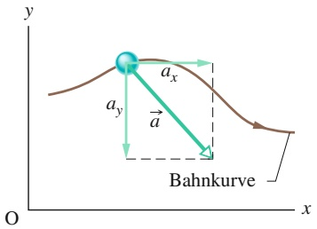

text_image

y
ax
ay
a
Bahnkurve
O
x

Abb. 1.11

Die Beschleunigung a⃗ eines Teilchens und die skalaren Komponenten von a⃗.

• Während des Flugs lauten die Bewegungsgleichungen des Teilchens

$$
\begin{array}{l} x - x _ {0} = (\nu_ {0} \cos \theta_ {0}) t, \\ y - y _ {0} = (\nu_ {0} \sin \theta_ {0}) t - \frac {1}{2} g t ^ {2}, \\ \nu_ {y} = \nu_ {0} \sin \theta_ {0} - g t, \\ \nu_ {y} ^ {2} = (\nu_ {0} \sin \theta_ {0}) ^ {2} - 2 g (y - y _ {0}). \\ \end{array}
$$

• Die Trajektorie (Bahnkurve, Flugbahn) eines fliegenden Teilchens ist eine Parabel, die für $x _ { 0 } = y _ { 0 } = 0$ durch

$$
y = (\tan \theta_ {0}) x - \frac {g x ^ {2}}{2 (\nu_ {0} \cos \theta_ {0}) ^ {2}}
$$

gegeben ist.

• Die horizontale Reichweite R des Teilchens, d. h. die horizontale Entfernung vom Startpunkt bis zu der Stelle, an der es die Abwurfhöhe wieder erreicht, beträgt

$$
R = \frac {\nu_ {0} ^ {2}}{g} \sin 2 \theta_ {0}.
$$

## 1.9.1 Flugbahnen

natural_image

Microscopic view of a yellow-green cellular or biological structure with white branching patterns against a black background (no text or symbols)

Abb. 1.12

Eine Stroboskopaufnahme eines gelben Tennisballs, der von einer harten Oberfläche abprallt. Zwischen den Augenblicken, in denen er den Boden berührt, führt der Ball eine Wurfbewegung aus [Quelle: Richard Megna/Fundamental Photographs].

Als Nächstes betrachten wir einen Spezialfall der zweidimensionalen Bewegung: Ein Teilchen bewege sich in einer senkrechten Ebene mit einer bestimmten Anfangsgeschwindigkeit $\vec { \nu } _ { 0 }$ und unterliege dabei der nach unten gerichteten Gravitationsbeschleunigung $\vec { g } .$ Ein solches Teilchen wird ein **Projektil** genannt, da es geworfen oder geschossen wurde. Seine Bewegung bezeichnen wir als eine **Wurfbewegung**. Ein solches Projektil kann z. B. ein Tennisball (Abb. 1.12) oder ein Stein während des Flugs sein – ein Flugzeug oder eine fliegende Ente wären jedoch keine Projektile. Unser Ziel ist es hier, die Wurfbewegung anhand der in den Abschn. 4.1–4.3 vorgestellten „Werkzeuge“ für die zweidimensionale Bewegung zu analysieren. Dazu setzen wir voraus, dass die Auswirkungen des Luftwiderstands auf das Projektil vernachlässigt werden können.

Die Abb. 1.13, die im nächsten Abschnitt analysiert wird, zeigt die Bahnkurve, die ein Projektil beschreibt, wenn der Luftwiderstand gleich null ist. Das Projektil wird mit einer Anfangsgeschwindigkeit $\vec { \nu } _ { 0 }$ geworfen, die sich in der Form

$$
\vec {\nu} _ {0} = \nu_ {0 x} \vec {e} _ {x} + \nu_ {0 y} \vec {e} _ {y} \tag {1.32}
$$

Abb. 1.13

Die Bahn eines Projektils, das bei $x _ { 0 } = 0$ und $y _ { 0 } = 0$ mit einer Anfangsgeschwindigkeit $\vec { \nu } _ { 0 }$ geworfen wird. Eingezeichnet sind die Anfangsgeschwindigkeit sowie die Geschwindigkeiten an verschiedenen Punkten der Bahnkurve zusammen mit ihren Komponenten. Beachten Sie, dass die horizontale Geschwindigkeitskomponente konstant bleibt, die vertikale Geschwindigkeitskomponente sich jedoch kontinuierlich verändert. Die Reichweite R ist die horizontale Entfernung, die das Projektil in dem Moment zurückgelegt hat, in dem es wieder seine Ausgangshöhe erreicht.

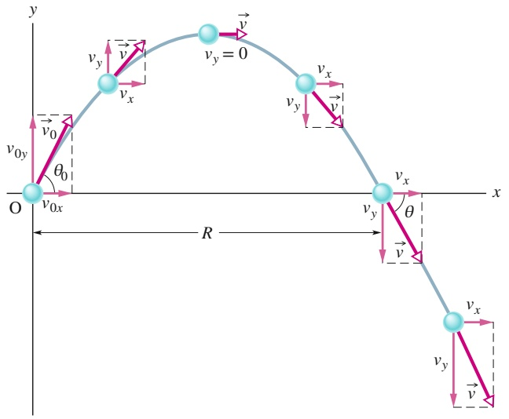

text_image

y
vy = 0
vy
vx
vy
vx
O
v0x
θ0
R
x
vy
v
v
vx
vy
v

schreiben lässt. Die Komponenten $\vec { \nu } _ { 0 x }$ und $\vec { \nu } _ { 0 y }$ lassen sich mithilfe des Winkels $\theta _ { 0 }$ zwischen $\vec { \nu } _ { 0 }$ und der positiven x-Richtung bestimmen:

$$
\nu_ {0 x} = \nu_ {0} \cos \theta_ {0} \quad \text {und} \quad \nu_ {0 y} = \nu_ {0} \sin \theta_ {0}. \tag {1.33}
$$

Während der zweidimensionalen Bewegung des Projektils verändern sich sein Ortsvektor ⃗r und sein Geschwindigkeitsvektor v⃗ kontinuierlich; der Beschleuni gungsvektor a⃗ ist jedoch konstant und immer senkrecht nach unten gerichtet. Ein Projektil erfährt keine horizontale Beschleunigung.

Die in den Abb. 1.12 und 1.13 dargestellte Wurfbewegung sieht kompliziert aus, die folgende – experimentell bestätigte – Tatsache vereinfacht die Situation jedoch deutlich:

Bei der Wurfbewegung erfolgen die horizontale und die vertikale Bewegung unabhängig voneinander, sie beeinflussen sich gegenseitig nicht.

Diese Eigenschaft erlaubt es uns, eine Aufgabe mit einer zweidimensionalen Bewegung in zwei getrennte, einfachere eindimensionale Aufgaben zu zerlegen – eine für die horizontale Bewegung (bei der die Beschleunigung null ist) und eine für die vertikale Bewegung (mit einer gleichmäßigen, nach unten gerichteten Beschleunigung). Lassen Sie uns zwei Experimente betrachten, die zeigen, dass die waagerechte und die senkrechte Bewegung voneinander unabhängig sind.

## Zwei Golfbälle

Abbildung 1.14 zeigt eine Stroboskopaufnahme zweier Golfbälle: Während der eine Ball einfach fallen gelassen wird, wird der andere durch eine Feder in die ho rizontale Richtung geschossen. Die Golfbälle besitzen die gleiche vertikale Bewegung, beide fallen während desselben Zeitintervalls die gleiche senkrechte Strecke nach unten. Die Tatsache, dass sich der eine Ball während des Falls auch horizontal bewegt, hat keinen Einfluss auf seine vertikale Bewegung. Die waagerechte und die senkrechte Bewegung sind also unabhängig voneinander.

## Ein Beispiel für die Physikvorlesung

Abbildung 1.15 zeigt eine Vorführung, die bereits in zahlreichen Physikvorlesungen für Stimmung gesorgt hat. Dazu wird ein Blasrohr mit einem kleinen Ball als Projektil benötigt. Ziel ist es, eine an einem Magneten M aufgehängte Dose zu treffen; das Blasrohr ist dabei direkt auf die Büchse gerichtet. Das Experiment wird so aufgebaut, dass der Magnet die Dose genau in dem Augenblick freigibt, in dem der Ball das Blasrohr verlässt.

Wäre g (der Betrag der Erdbeschleunigung) gleich null, so würde der Ball wie in Abb. 1.15 gezeigt eine gerade Linie beschreiben und die Dose würde, nachdem der Magnet sie freigegeben hat, an ein und derselben Stelle hängenbleiben. Der Ball würde die Dose mit Sicherheit treffen.

Die Gravitationsbeschleunigung g ist jedoch nicht gleich null. Und dennoch trifft der Ball die Dose! Wie Abb. 1.15 zeigt, fallen Dose und Ball während der Flugzeit des Balls ab dem Moment, in dem der Ball das Blasrohr verlässt, um die gleiche Strecke h. Je stärker der Vorführende in das Rohr bläst, desto größer ist die Anfangsgeschwindigkeit des Balls, desto kürzer ist die Flugzeit und desto kleiner auch der Wert von h.

## 1.9.2 Analyse der Wurfbewegung

Lassen Sie uns nun die Wurfbewegung sowohl in horizontaler als auch in vertikaler Richtung im Einzelnen analysieren.

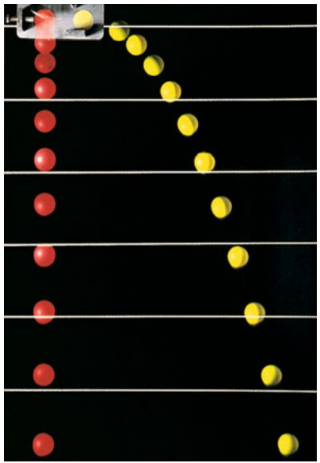

natural_image

Black background with scattered red and yellow dots, no text or symbols present

Abb. 1.14 Ein Ball wird ohne Anfangsgeschwindigkeit in dem Moment fallen gelassen, in dem ein anderer Ball horizontal nach rechts geworfen wird. Die vertikale Bewegung der beiden Bälle ist identisch [Quelle: Richard Megna/ Fundamental Photographs].

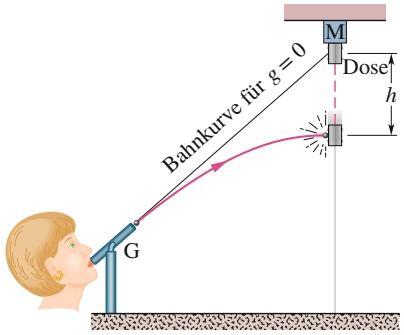

text_image

Bahnkurve für g = 0
M
Dose
h
G

Abb. 1.15 Der Ball – das Projektil – trifft die fallende Dose immer. Beide fallen eine Entfernung h von dem Punkt aus gemessen, an dem sie sich ohne Gravitationsbeschleunigung befinden würden.

## Die horizontale Bewegung

Da in horizontaler Richtung keine Beschleunigung stattfindet, bleibt die horizontale Komponente $\nu _ { x }$ der Projektilgeschwindigkeit während der gesamten Bewegung unverändert gleich der Anfangsgeschwindigkeit $\nu _ { 0 x }$ . Zu jeder beliebigen Zeit t ist die horizontale Verschiebung $\Delta x = x - x _ { 0 }$ des Projektils von seiner Ausgangsposition $x _ { 0 }$ durch Gl. 1.13 gegeben, wobei $\alpha = 0$ ist. Damit haben wir

$$
x - x _ {0} = \nu_ {0} t.
$$

Wegen $\nu _ { 0 x } = \nu _ { 0 }$ cos $\theta _ { 0 }$ wird daraus:

$$
x - x _ {0} = (\nu_ {0} \cos \theta_ {0}) t. \tag {1.34}
$$

## Die vertikale Bewegung

Die vertikale Bewegung entspricht derjenigen, die wir in Abschn. 2.5 für ein Teilchen im freien Fall untersucht hatten. Wichtig ist hier, dass die Beschleunigung konstant ist. Also gelten die Gleichungen aus Tab. 1.1, wobei wir a durch $- g$ ersetzen und die Gleichungen für y umschreiben müssen. So wird etwa Gl. 1.13 zu:

$$
y - y _ {0} = \nu_ {0 y} t - \frac {1}{2} g t ^ {2} = (\nu_ {0} \sin \theta_ {0}) t - \frac {1}{2} g t ^ {2}, \tag {1.35}
$$

wobei die vertikale Komponente $\nu _ { 0 y }$ der Anfangsgeschwindigkeit durch den äquivalenten Ausdruck $\nu _ { 0 }$ sin $\theta$ ersetzt wurde. Analog ergibt sich aus den Gln. 1.9 und 1.14

$$
\nu_ {y} = \nu_ {0} \sin \theta_ {0} - g t \tag {1.36}
$$

und

$$
\nu_ {y} ^ {2} = (\nu_ {0} \sin \theta_ {0}) ^ {2} - 2 g (y - y _ {0}). \tag {1.37}
$$

Wie aus Abb. 1.13 und Gl. 1.36 deutlich wird, verhält sich die vertikale Geschwin digkeitskomponente genauso wie bei einem Ball, der senkrecht nach oben geworfen wurde. Sie zeigt anfänglich nach oben und ihr Betrag nimmt kontinuierlich ab, bis er schließlich verschwindet – dieser Punkt entspricht der maximalen Höhe der Flugbahn. Daraufhin verändert die Geschwindigkeitskomponente ihre Richtung und ihr Betrag wird mit der Zeit immer größer.

## Die Bahngleichung

Wir können die Gleichung ermitteln, welche die Form der Flugbahn (**Trajektorie**) des Teilchens beschreibt, indem wir t aus den Gln. 1.34 und 1.35 eliminieren. Dazu lösen wir Gl. 1.34 nach t auf und setzen das Ergebnis in Gl. 1.35 ein. Nach kleinen Umformungen erhalten wir:

$$
y = (\tan \theta_ {0}) x - \frac {g x ^ {2}}{2 (\nu_ {0} \cos \theta_ {0}) ^ {2}}. \tag {1.38}
$$

Dies ist die Gleichung der in Abb. 1.13 gezeigten Bahnkurve. Bei ihrer Herleitung haben wir der Einfachheit halber in den Gln. 1.34 und 1.35 jeweils $x _ { 0 } = 0$ und $y _ { 0 } = 0$ gesetzt. Da $g , \theta _ { 0 }$ und $\nu _ { 0 }$ Konstanten sind, hat Gl. 1.38 die allgemeine Form $y = ax + bx^{2}$ , wobei a und b konstant sind. Dies ist die Gleichung einer Parabel; man sagt, das Projektil beschreibt eine parabolische Bahn bzw. eine Wurfparabel.

## Die horizontale Reichweite

Die horizontale Reichweite des Projektils ist, wie Abb. 1.13 zeigt, die Entfernung, die das Projektil in horizontaler Richtung zurückgelegt hat, wenn es seine ursprüngliche (Abwurf-)Höhe wieder erreicht. Um die Reichweite R zu bestimmen, setzen wir $x - x _ { 0 } = R$ in Gl. 1.34 und $y - y _ { 0 } = 0$ in Gl. 1.35. Damit erhalten wir:

$$
R = (\nu_ {0} \cos \theta_ {0}) t
$$

und

$$
0 = (\nu_ {0} \sin \theta_ {0}) t - \frac {1}{2} g t ^ {2}.
$$

Eliminieren wir t aus diesen beiden Gleichungen, so ergibt sich:

$$
R = \frac {2 \nu_ {0} ^ {2}}{g} \sin \theta_ {0} \cos \theta_ {0}.
$$

Nun nutzen wir aus, dass sin $2 \theta _ { 0 } = 2$ sin $\theta _ { 0 }$ cos $\theta _ { 0 }$ (siehe Anhang D), und erhalten damit:

$$
R = \frac {\nu_ {0} ^ {2}}{g} \sin 2 \theta_ {0}. \tag {1.39}
$$

Vorsicht: Diese Gleichung gibt nicht die horizontale Entfernung an, die ein Projektil zurückgelegt hat, wenn die Höhe des Endpunkts ungleich der Höhe des Startpunkts ist.

Beachten Sie, dass der Wert von R in Gl. 1.39 maximal wird, wenn sin $2 \theta _ { 0 } = 1$ ist; dies entspricht einem Winkel von $2 \theta _ { 0 } = 9 0 ^ { \circ }$ bzw. $\theta _ { 0 } = 4 5 ^ { \circ }$

Die horizontale Reichweite R ist maximal, wenn das Projektil in einem Winkel von $4 5 ^ { \circ }$ geworfen bzw. geschossen wird.

## Der Luftwiderstand

Wir haben bisher vorausgesetzt, dass die Luft, durch die sich das Projektil bewegt, keinerlei Auswirkungen auf seine Bewegung hat. In vielen Situationen kann die Abweichung zwischen unseren Rechnungen und der tatsächlichen Bewegung des Projektils allerdings ganz beträchtlich sein, da die Luft der Bewegung in der Realität durchaus einen Widerstand entgegensetzt. Abbildung 1.16 z. B. zeigt zwei Bahnkurven eines Balls, der in einem Winkel von 60° zur Horizontalen und mit einer Anfangsgeschwindigkeit von $4 4 . 7$ m/s geworfen wird. Bahn I entspricht einer be rechneten Kurve, welche die normalen Bedingungen (in Luft) annähernd wieder gibt. Bahn II ist die Kurve, die der Ball in einem Vakuum beschreiben würde.

TABELLE 1.2: Zwei $\mathrm { B \ddot { a } l l e ^ { a ) } }$

|  | Bahn I (in Luft) | Bahn II (im Vakuum) |
| --- | --- | --- |
| Reichweite | 98,5 m | 177 m |
| maximale Höhe | 53,0 m | 76,8 m |
| Flugzeit | 6,6 s | 7,9 s |

a) Siehe Abb. 1.16. Der Wurfwinkel beträgt 60°, die Abwurfgeschwindigkeit 44,7 m/s.

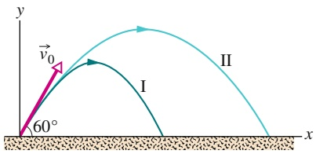

text_image

y
→v₀
60°
I
II
x

Abb. 1.16

(I) Die Bahn eines geworfenen Balls, wenn man sie unter Berücksichtigung des Luftwiderstands berechnet. (II) Die Bahn, die derselbe Ball im Vakuum beschreiben würde. Sie wurde mit den in diesem Kapitel vorgestellten Methoden berechnet. Die verwendeten Daten finden Sie in Tab. 1.2 [Quelle: Nach „The Trajectory of a Fly Ball“ von Brancazio, P.J. (1985). The Physics Teacher].

## KONTROLLFRAGE 10

Ein Fußball wird über das Spielfeld getreten. Was passiert während seines Flugs (bei dem Sie den Luftwiderstand vernachlässigen können) mit (a) der horizontalen und (b) der vertikalen Komponente seiner Geschwindigkeit? Wie groß sind (c) die horizontale und (d) die vertikale Komponente seiner Beschleunigung während des Anstiegs, des Herabfallens und am höchsten Punkt seiner Flugbahn?

## 1.10 Die gleichförmige Kreisbewegung

## Lernziele

Nach dem Durcharbeiten dieses Abschnitts sollten Sie in der Lage sein, . . .

• die Bahnkurve in einer gleichförmigen Kreisbewegung zu skizzieren und die während der Bewegung auftretenden Geschwindigkeits- und Beschleunigungsvektoren zu erläutern (Betrag und Richtung),
• Beziehungen zwischen dem Radius der Kreisbahn, der Periode der Bewegung, der Geschwindigkeit des Teilchens und dem Betrag seiner Beschleunigung anzugeben und anzuwenden.

## Schlüsselideen

• Wenn ein Teilchen sich mit konstanter Geschwindigkeit v im Kreis oder entlang eines Kreisbogens mit Radius r bewegt, spricht man von einer gleichförmigen Kreisbewegung. Ein solches Teilchen erfährt eine Beschleunigung $\vec { a }$ mit dem konstanten Betrag

$$
a = \frac {v ^ {2}}{r}
$$

in Richtung des Kreismittelpunkts, die als Zentripetalbeschleunigung bezeichnet wird.

• Zur Vollendung eines vollständigen Umlaufs benötigt das Teilchen die Zeit

$$
T = \frac {2 \pi r}{\nu},
$$

die als Periode der Kreisbewegung bezeichnet wird.

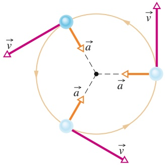

flowchart

Abb. 1.17

Geschwindigkeits- und Beschleunigungsvektoren eines Teilchens, das gegen den Uhrzeigersinn eine gleichförmige Kreisbewegung absolviert. Geschwindigkeit und Beschleunigung besitzen einen konstanten Betrag, ändern jedoch kontinuierlich ihre Richtung.

## 1.10.1 Konstanter Betrag, variable Richtung

Ein Teilchen führt eine **gleichförmige Kreisbewegung** aus, wenn es sich mit konstantem, d. h. gleichförmigem Geschwindigkeitsbetrag auf einem Kreis oder einem Kreisbogen bewegt. Obwohl sich der Betrag der Geschwindigkeit nicht ändert, wird das Teilchen beschleunigt. Dies mag auf den ersten Blick verwunderlich erscheinen, da wir eine Beschleunigung meist mit einer Vergrößerung oder Verkleinerung des Geschwindigkeitsbetrags in Verbindung bringen. Tatsächlich ist die Geschwindigkeit jedoch ein Vektor, kein Skalar. Wenn eine Geschwindigkeit also nicht ihren Betrag, sondern nur ihre Richtung verändert, so ist dennoch eine Beschleunigung im Spiel – und genau dies ist bei der gleichförmigen Kreisbewegung der Fall.

Abbildung 1.17 verdeutlicht die Beziehung zwischen dem Geschwindigkeitsvektor und dem Beschleunigungsvektor während verschiedener Phasen einer gleichförmigen Kreisbewegung. Während des Ablaufs der Bewegung ist der Betrag beider Vektoren konstant, ihre Richtung ändert sich jedoch kontinuierlich, da die Geschwindigkeit immer in Bewegungsrichtung entlang der Tangente an die Kreisbahn zeigt. Die Beschleunigung ist immer auf den Mittelpunkt des Kreises gerichtet. Deshalb wird die Beschleunigung in der gleichförmigen Kreisbewegung auch **Zentripetalbeschleunigung** genannt (was so viel bedeutet wie „den Mittelpunkt suchende“ Beschleunigung). Wie wir gleich beweisen werden, ist der Betrag

dieser Beschleunigung $\vec { a }$ gleich

$$
a = \frac {v ^ {2}}{r} \quad (\text {Zentripetalbeschleunigung}), \tag {1.40}
$$

wobei r der Radius der Kreisbahn und v der Betrag der Geschwindigkeit des Teilchens ist.

Während dieser Beschleunigung bei konstantem Geschwindigkeitsbetrag legt das Teilchen den Umfang des Kreises (welcher der Strecke 2πr entspricht) in der Zeit $T$ zurück mit

$$
T = \frac {2 \pi r}{\nu} \quad (\text {Periode}). \tag {1.41}
$$

T wird die Periode der Bewegung genannt. Im Allgemeinen bezeichnet man damit die Zeit, die ein Teilchen benötigt, um eine geschlossene Bahn genau einmal zu durchlaufen.

## 1.10.2 Beweis von Gl. 1.40

Um den Betrag und die Richtung der Beschleunigung bei einer gleichförmigen Kreisbewegung zu bestimmen, betrachten wir Gl. 1.32. In Abb. 1.18a bewegt sich das Teilchen p mit konstantem Geschwindigkeitsbetrag v entlang einer Kreisbahn mit Radius r. Zu dem dargestellten Zeitpunkt besitzt p die Koordinaten $x _ { \mathrm { p } }$ und $y _ { \mathrm { p } } .$

In Abschn. 4.2 hatten wir gezeigt, dass die Geschwindigkeit v⃗ eines bewegten Teilchens immer entlang der Tangente an die Bahnkurve des Teilchens am momentanen Ort des Teilchens zeigt. In Abb. 1.18a bedeutet dies, dass ⃗v senkrecht auf dem Radius r steht, der zum Ort des Teilchens führt. Dann ist der Winkel $\theta ,$ den v⃗ am Ort von p mit der Vertikalen bildet, gleich dem Winkel θ zwischen dem Radius r und der x-Achse.

Die skalaren Komponenten von ⃗v sind in Abb. 1.18b dargestellt. Mit ihnen können wir die Geschwindigkeit v⃗ in der Form

$$
\vec {\nu} = \nu_ {x} \vec {e} _ {x} + \nu_ {y} \vec {e} _ {y} = (- \nu \sin \theta) \vec {e} _ {x} + (\nu \cos \theta) \vec {e} _ {y} \tag {1.42}
$$

schreiben. Indem wir das rechtwinklige Dreieck aus Abb. 1.18a nutzen, können wir sin θ durch $y _ { \mathrm { p } } / r$ und cos θ durch $x _ { \mathrm { p } } / r$ ersetzen und erhalten damit

$$
\vec {\nu} = \left(- \frac {\nu}{r} y _ {\mathrm{p}}\right) \vec {e} _ {x} + \left(\frac {\nu}{r} x _ {\mathrm{p}}\right) \vec {e} _ {y}. \tag {1.43}
$$

Um die Beschleunigung a⃗ des Teilchens p zu ermitteln, müssen wir diese Gleichung nach der Zeit ableiten. Da sich der Geschwindigkeitsbetrag v und der Radius r im Lauf der Zeit nicht ändern, ergibt dies

$$
\vec {a} = \frac {\mathrm{d} \vec {\nu}}{\mathrm{d} t} = \left(- \frac {\nu}{r} \frac {\mathrm{d} y _ {\mathrm{p}}}{\mathrm{d} t}\right) \vec {e} _ {x} + \left(\frac {\nu}{r} \frac {\mathrm{d} x _ {\mathrm{p}}}{\mathrm{d} t}\right) \vec {e} _ {y}. \tag {1.44}
$$

## Abb. 1.18

Das Teilchen p bewegt sich im Gegenuhrzeigersinn gleichförmig im Kreis. (a) Seine Position und Geschwindigkeit ⃗v zu einem bestimmten Zeitpunkt. (b) Die Geschwindigkeit ⃗v und ihre Komponenten. (c) Die Beschleunigung a⃗ des Teilchens und ihre Komponenten.

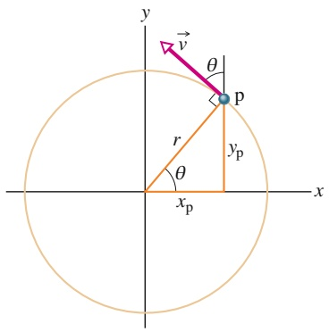

text_image

y
v
θ
P
r
θ
x_p
y_p
x

(a)

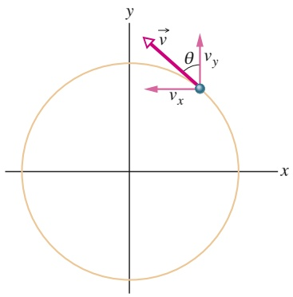

text_image

y
→
v
θ
vy
vx
x

(b)

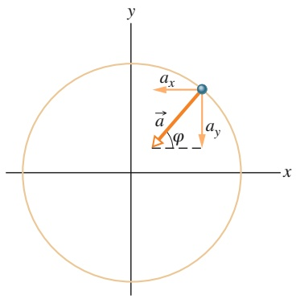

text_image

y
a_x
→
φ
a_y
x

(c)

Beachten Sie nun, dass die Rate $\mathrm { d } y _ { \mathrm { p } } / \mathrm { d } t _ { \mathrm { r } }$ mit der sich $y _ { \mathrm { p } }$ verändert, gleich der Geschwindigkeitskomponente $\nu _ { y }$ ist. Entsprechend ist d $x _ { \mathrm { p } } ^ { \mathrm { ~ \scriptsize ~ r ~ } } / \mathrm { d } t = \nu _ { x }$ . Ebenfalls aus Abb. 1.18b sehen wir, dass $\nu _ { x } = - \nu$ sin θ und $\nu _ { y } = \nu \cos \hat { \theta }$ . Einsetzen in Gl. 1.44 liefert:

$$
\vec {a} = \left(- \frac {\nu^ {2}}{r} \cos \theta\right) \vec {e} _ {x} + \left(- \frac {\nu^ {2}}{r} \sin \theta\right) \vec {e} _ {y}. \tag {1.45}
$$

Dieser Vektor und seine Komponenten sind in Abb. 1.18c dargestellt. Mit der allgemeinen Regel für Beträge und Richtungen von Vektoren (vgl. Gl. D.6 in Anhang D) finden wir, dass der Betrag von a⃗ gleich

$$
a = \sqrt {a _ {x} ^ {2} + a _ {y} ^ {2}} = \frac {v ^ {2}}{r} \sqrt {(\cos \theta) ^ {2} + (\sin \theta) ^ {2}} = \frac {v ^ {2}}{r}
$$

ist, genau wie wir es beweisen wollten. Um die Richtung von $\vec { a }$ zu ermitteln, bestimmen wir den in Abb. 1.18c eingezeichneten Winkel $\varphi ;$

$$
\tan \varphi = \frac {a _ {y}}{a _ {x}} = \frac {- (\nu^ {2} / r) \sin \theta}{- (\nu^ {2} / r) \cos \theta} = \tan \theta.
$$

Demnach ist $\varphi = \theta ,$ was bedeutet, dass $\vec { a }$ entlang dem in Abb. 1.18a eingezeichneten Radius r in Richtung Kreismittelpunkt zeigt, wie wir es beweisen wollten.

## KONTROLLFRAGE 11

Ein Gegenstand bewege sich mit konstantem Geschwindigkeitsbetrag in einer ho rizontalen xy-Ebene entlang einer Kreisbahn mit Mittelpunkt im Ursprung des Koordinatensystems. In dem Moment, in dem sich der Gegenstand bei $x = - 2$ m befindet, sei seine Geschwindigkeit gleich $- ( 4   \mathrm { m / s } ) \vec { e } _ { y }$ . Geben Sie (a) die Geschwindigkeit und (b) die Beschleunigung des Gegenstands am Ort $y = 2$ m an.

## 1.11 Relativbewegung in einer Dimension

## Lernziele

Nach dem Durcharbeiten dieses Abschnitts sollten Sie in der Lage sein, . . .

• die Beziehung zwischen Ort, Geschwindigkeit und Beschleunigung eines Teilchens anzugeben, wenn diese in zwei Bezugssystemen gemessen werden, die sich mit konstanter Geschwindigkeit entlang einer Achse gegeneinander bewegen.

## Schlüsselideen

Wenn sich zwei Bezugssysteme A und B mit konstanter Geschwindigkeit relativ zueinander bewegen, unterscheidet sich die von einem Beobachter im Bezugssystem A gemessene Geschwindigkeit eines Teilchens P in der Regel von der, die ein Beobachter im Bezugssystem B misst. Die beiden gemessenen Geschwindig keiten hängen über

$$
\vec {\nu} _ {\mathrm{PA}} = \vec {\nu} _ {\mathrm{PB}} + \vec {\nu} _ {\mathrm{BA}}
$$

miteinander zusammen, wobei $\vec { \nu } _ { \mathrm { B A } }$ die Geschwindigkeit von B relativ zu A ist. Beobachter in beiden Bezugssystemen messen jedoch dieselbe Beschleunigung des Teilchens:

$$
\vec {a} _ {\mathrm{PA}} = \vec {a} _ {\mathrm{PB}}.
$$

## 1.11.1 Bezugssysteme

Nehmen Sie an, Sie beobachten eine Ente, die mit 30 km/h nach Norden fliegt. Aus Sicht einer zweiten Ente, die neben der ersten herfliegt, ändert die erste Ente ihre Position dagegen nicht (sie befindet sich immer „neben mir“). Mit anderen Worten: Die Geschwindigkeit eines Teilchens hängt vom **Bezugssystem** desjenigen ab, der die Bewegung beobachtet bzw. die Geschwindigkeit misst. In unserem Fall ist ein Bezugssystem durch das physikalische Objekt gegeben, an dem wir unser Koordinatensystem befestigen. Im Alltag ist dies meist der Erdboden. So wird z. B. die Geschwindigkeit, die auf Ihrem Bußgeldbescheid erscheint, immer relativ zum Erdboden gemessen. Die Geschwindigkeit relativ zum Auto vor Ihnen ist eine ganz andere, da sich dies während der Messung relativ zum Erdboden bewegt!

Nehmen wir an, dass Alex (am Ursprung des Bezugssystems A) am Rand der Autobahn hält und zusieht, wie das Auto P (das „Teilchen“) vorbeifährt. Barbara (im Ursprung des Bezugssystems B) fährt mit konstanter Geschwindigkeit die Autobahn entlang und beobachtet dabei ebenfalls das Auto P. Wie in Abb. 1.19 gezeigt, messen beide die Position des Autos zu einem bestimmten Zeitpunkt. Aus der Abbildung können wir ablesen, dass

$$
x _ {\mathrm{PA}} = x _ {\mathrm{PB}} + x _ {\mathrm{BA}}. \tag {1.46}
$$

Diese Gleichung besagt Folgendes: „Die von A gemessene Koordinate $x _ { \mathrm { P A } }$ von P ist gleich der von B gemessenen Koordinate $x _ { \mathrm { P B } }$ von P plus der von A gemessenen Koordinate $x _ { \mathrm { A B } }$ von B.“ Beachten Sie, wie diese Bedeutung in der Reihenfolge der Indizes zum Ausdruck kommt.

Indem wir Gl. 1.46 nach der Zeit ableiten, erhalten wir:

$$
\frac {\mathrm{d}}{\mathrm{d} t} (x _ {\mathrm{PA}}) = \frac {\mathrm{d}}{\mathrm{d} t} (x _ {\mathrm{PB}}) + \frac {\mathrm{d}}{\mathrm{d} t} (x _ {\mathrm{BA}})
$$

oder (da $\nu = \mathrm { d } x / \mathrm { d } t )$

$$
\nu_ {\mathrm{PA}} = \nu_ {\mathrm{PB}} + \nu_ {\mathrm{BA}}. \tag {1.47}
$$

Diese Gleichung bedeutet: „Die von A gemessene Geschwindigkeit $\nu _ { \mathrm { P A } }$ von P ist gleich der von B gemessenen Geschwindigkeit $\nu _ { \mathrm { P B } }$ von P plus der von A gemessenen Geschwindigkeit $\nu _ { \mathrm { B A } }$ von B.“ Der Term $\nu _ { \mathrm { B A } }$ entspricht der Geschwindigkeit des Bezugssystems B relativ zum Bezugssystem A. (Da die Bewegungen entlang einer einzigen Achse erfolgen, können wir hier in Gl. 1.47 die Komponenten entlang dieser Achse benutzen und die Vektorpfeile weglassen.)

An dieser Stelle beschränken wir unsere Betrachtungen auf Bezugssysteme, die sich relativ zueinander mit konstanter Geschwindigkeit bewegen. In unserem Beispiel bedeutet dies, dass Barbara (System B) relativ zu Alex (System A) immer mit derselben Geschwindigkeit $\nu _ { \mathrm { B A } }$ fährt. Das Auto P jedoch (das bewegte Teilchen) kann schneller oder langsamer werden, anhalten oder die Richtung wechseln (d. h, es darf einer Beschleunigung unterliegen).

Um die von Barbara und Alex gemessenen Beschleunigungen von P miteinander zu verknüpfen, leiten wir Gl. 1.47 nach der Zeit ab:

$$
\frac {\mathrm{d}}{\mathrm{d} t} (\nu_ {\mathrm{PA}}) = \frac {\mathrm{d}}{\mathrm{d} t} (\nu_ {\mathrm{PB}}) + \frac {\mathrm{d}}{\mathrm{d} t} (\nu_ {\mathrm{BA}}).
$$

Da $\nu _ { \mathrm { B A } }$ konstant ist, ist der letzte Term gleich null und wir erhalten:

$$
a _ {\mathrm{PA}} = a _ {\mathrm{PB}}. \tag {1.48}
$$

Mit anderen Worten:

Bei einem sich bewegenden Teilchen messen Beobachter in verschiedenen Bezugssystemen (die sich mit gleichförmiger Geschwindigkeit relativ zueinander bewegen) die gleiche Beschleunigung.

## KONTROLLFRAGE 12

Die nebenstehende Tabelle gibt für Barbara und das Auto P aus Abb. 1.19 in drei unterschiedlichen Situationen verschiedene Geschwindigkeiten an (in km/h). Wie lautet der fehlende Wert in jeder der drei Situationen und wie verändert sich die Entfernung zwischen Barbara und dem Auto P?

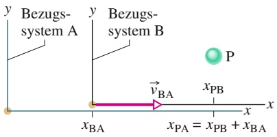

text_image

Bezug-
system A
Bezug-
system B
P
vBA
xPA = xPB + xBA
x

Abb. 1.19

Alex (Bezugssystem A) und Barbara (Bezugssystem B) beobachten das Auto P, während B und P sich mit unterschiedlichen Geschwindigkeiten entlang der identisch verlaufenden x-Achsen der beiden Systeme bewegen. Zu dem dargestellten Zeitpunkt ist $x _ { \mathrm { B A } }$ die Koordinate von B im System A. P besitzt im System B die Koordinate $x _ { \mathrm { P B } }$ und im System A die Koordinate $x _ { \mathrm { P A } } = x _ { \mathrm { P B } } + x _ { \mathrm { B A } } .$

|  | $\nu_{\text{BA}}$ | $\nu_{\text{PA}}$ | $\nu_{\text{PB}}$ |
| --- | --- | --- | --- |
| (a) | +50 | +50 |  |
| (b) | +30 |  | +40 |
| (c) |  | +60 | -20 |

## 1.12 Relativbewegung in zwei Dimensionen

## Lernziele

Nach dem Durcharbeiten dieses Abschnitts sollten Sie in der Lage sein, . . .

• die Beziehung zwischen Position, Geschwindigkeit und Beschleunigung eines Teilchens in zwei Dimensionen aus Sicht zweier Bezugssysteme zu formulieren, die sich mit konstanter Geschwindigkeit aneinander vorbeibewegen.

## Schlüsselideen

Wenn sich zwei Bezugssysteme A und B mit konstanter Geschwindigkeit aneinander vorbeibewegen, unterscheidet sich die in System A gemessene Geschwindigkeit eines Teilchens P in der Regel von der im System B gemessenen. Die beiden gemessenen Geschwindigkeiten hängen über die Beziehung

$$
\vec {\nu} _ {\mathrm{PA}} = \vec {\nu} _ {\mathrm{PB}} + \vec {\nu} _ {\mathrm{BA}}
$$

zusammen. Dabei ist $\vec { \nu } _ { \mathrm { B A } }$ die Geschwindigkeit von B relativ zu A. Beide Beobachter bzw. Systeme messen jedoch die gleiche Beschleunigung von P:

$$
\vec {a} _ {\mathrm{PA}} = \vec {a} _ {\mathrm{PB}}.
$$

## 1.12.1 Mehr als eine Dimension

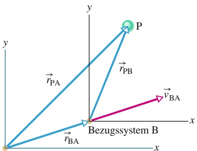

text_image

P
rPB
y
rPA
Bezugssystem B
vBA
x
y
rBA
x

Bezugssystem A

Abb. 1.20

Bezugssystem B besitzt eine konstante zweidimensionale Geschwindigkeit $\vec { \nu } _ { \mathrm { B A } }$ relativ zum Bezugssystem A. Der Ortsvektor von B relativ zu A ist $\vec { r } _ { \mathrm { B A } } .$ Die Ortsvektoren des Teilchens P sind $\vec { r } _ { \mathrm { P A } }$ relativ zu A und $\vec { r } _ { \mathrm { P B } }$ relativ zu B.

Wir wenden uns nun der Relativbewegung in zwei (und nach Erweiterung auch in drei) Dimensionen zu. In Abb. 1.20 betrachten unsere beiden Beobachter wieder ein sich bewegendes Teilchen P vom Ursprung ihrer jeweiligen Bezugssysteme A und B aus. Dabei bewegt sich B mit einer konstanten Geschwindigkeit $\vec { \nu } _ { \mathrm { B A } }$ relativ zu A. (Die Achsen der beiden Bezugssysteme bleiben dabei jedoch parallel.)

Abbildung 1.20 stellt eine Momentaufnahme während der Bewegung dar. Zu diesem Zeitpunkt ist der Ortsvektor von B relativ zu A gleich $\vec { r } _ { \mathrm { B A } }$ . Die Ortsvektoren des Teilchens P sind $\vec { r } _ { \mathrm { P A } }$ relativ zu A und $\vec { r } _ { \mathrm { P B } }$ relativ zu B. Aus der Anordnung dieser drei Ortsvektoren können wir schließen, dass sie über die Gleichung

$$
\vec {r} _ {\mathrm{PA}} = \vec {r} _ {\mathrm{PB}} + \vec {r} _ {\mathrm{BA}} \tag {1.49}
$$

miteinander verknüpft sind. Indem wir diese Beziehung nach der Zeit ableiten, erhalten wir eine Verbindung zwischen den Geschwindigkeiten $\vec { \nu } _ { \mathrm { P A } }$ und $\vec { \nu } _ { \mathrm { P B } }$ des Teilchens P relativ zu unseren Beobachtern:

$$
\vec {\nu} _ {\mathrm{PA}} = \vec {\nu} _ {\mathrm{PB}} + \vec {\nu} _ {\mathrm{BA}}. \tag {1.50}
$$

Indem wir diese Gleichung wiederum nach der Zeit ableiten, können wir die Beschleunigungen $\vec { a } _ { \mathrm { P A } }$ und $\vec { a } _ { \mathrm { P B } }$ des Teilchens P relativ zu den beiden Beobachtern miteinander verbinden. Beachten Sie jedoch, dass die Ableitung von $\vec { \nu } _ { \mathrm { B A } }$ nach der Zeit null ist, da $\vec { \nu } _ { \mathrm { B A } }$ konstant ist. Damit erhalten wir also:

$$
\vec {a} _ {\mathrm{PA}} = \vec {a} _ {\mathrm{PB}}. \tag {1.51}
$$

Genau wie bei der eindimensionalen Bewegung gilt auch hier die Regel: Beobachter in verschiedenen Bezugssystemen, die sich mit konstanter Geschwindigkeit relativ zueinander bewegen, messen für ein sich bewegendes Teilchen die gleiche Beschleunigung.

## KONTROLLFRAGE 13

Nehmen Sie in Beispielaufgabe 1.13 im Übungsbuch an, dass der Pilot das Flugzeug so abwendet, dass es direkt in Richtung Osten zeigt, ohne dabei jedoch den Betrag der Fluggeschwindigkeit (relativ zum Wind) zu verändern. Welche der folgenden Beträge nehmen ab, welche nehmen zu und welche bleiben konstant: (a) $\nu _ { \mathrm { P G } , y } ,$ (b) $\nu _ { \mathrm { P G } , x }$ und $( \mathtt { c } )   \nu _ { \mathrm { P G } } ?$ (Diese Frage können Sie ohne Berechnungen beantworten.)

## 1.13 Zusammenfassung

**Ort** Der Ort x eines Teilchens auf einer x-Achse gibt die Position eines Teilchens in Bezug auf den **Ursprung** oder **Nullpunkt** der Achse an. Der Ort ist entweder positiv oder negativ, je nachdem, auf welcher Seite des Ursprungs sich das Teilchen befindet. Er ist null, wenn das Teilchen sich am Ursprung befindet. Die **positive Richtung** der Achse ist die Richtung ansteigender positiver Zahlen; die entgegengesetzte Richtung ist die **negative Richtung**.

**Verschiebung** Die Verschiebung Δx eines Teilchens ist die Änderung seiner Position:

$$
\Delta x = x _ {2} - x _ {1}. \tag {1.1}
$$

Die Verschiebung ist eine Vektorgröße. Sie ist positiv, wenn das Teilchen sich in die positive Richtung der x-Achse bewegt hat. Sie ist negativ, wenn es sich in die negative Richtung bewegt hat.

**Durchschnittsgeschwindigkeit** Hat sich ein Teilchen während des Zeitintervalls $\Delta t = t _ { 2 } - t _ { 1 }$ von einem Ort $x _ { 1 }$ zu einem Ort $x _ { 2 }$ bewegt, so ist seine Durchschnittsgeschwindigkeit in diesem Intervall

$$
\nu_ {\mathrm{gem}} = \frac {\Delta x}{\Delta t} = \frac {x _ {2} - x _ {1}}{t _ {2} - t _ {1}}. \tag {1.2}
$$

Das Vorzeichen von $\nu _ { \mathrm { g e m } }$ gibt die Richtung der Bewegung an $( \nu _ { \mathrm { g e m } }$ ist eine Vektorgröße). Die Durchschnittsgeschwindigkeit hängt nicht von der tatsächlichen Entfernung ab, die ein Teilchen zurücklegt, sondern nur vom Anfangs- und Endpunkt seines Weges.

Auf einer Kurve von x in Abhängigkeit von t entspricht die Durchschnittsgeschwindigkeit in einem bestimmten Zeitintervall $\Delta t$ der Steigung der Geraden, die die Endpunkte des Zeitintervalls auf der Kurve verbindet.

**Effektivgeschwindigkeit** Die Effektivgeschwindigkeit $\nu _ { \mathrm { e f f } }$ eines Teilchens während eines Zeitintervalls Δt hängt von der Entfernung ab, die das Teilchen während dieses Zeitintervalls insgesamt zurückgelegt hat:

$$
\nu_ {\text {eff}} = \frac {\text {Gesamtentfernung}}{\Delta t}  . \tag {1.3}
$$

**Momentangeschwindigkeit** Die Momentangeschwindigkeit (oder kurz **Geschwindigkeit**) v eines sich bewegenden Teilchens ist gleich

$$
\nu = \lim _ {\Delta t \to 0} \frac {\Delta x}{\Delta t} = \frac {\mathrm{d} x}{\mathrm{d} t}, \tag {1.4}
$$

wobei $\Delta x$ und $\Delta t$ durch Gl. 1.2 gegeben sind. Die Momentangeschwindigkeit (zu einem bestimmten Zeitpunkt) entspricht der Steigung der Kurve von x in Abhängigkeit von t (zu diesem bestimmten Zeitpunkt).

**Mittlere Beschleunigung** Die mittlere Beschleunigung ist das Verhältnis einer Veränderung der Geschwindigkeit Δv zur Dauer des Zeitintervalls $\Delta t ,$ in dem die Veränderung stattfindet:

$$
a _ {\mathrm{gem}} = \frac {\Delta v}{\Delta t}. \tag {1.5}
$$

Das Vorzeichen gibt die Richtung von $a _ { \mathrm { g e m } }$ an.

**Momentanbeschleunigung** Die Momentanbeschleunigung (oder kurz **Beschleunigung**) a ist die Rate, mit der sich die Geschwindigkeit mit der Zeit ändert. Sie entspricht der zweiten Ableitung nach der Zeit am Ort x(t):

$$
a = \frac {\mathrm{d} v}{\mathrm{d} t} = \frac {\mathrm{d} ^ {2} x}{\mathrm{d} t ^ {2}}. \tag {1.6,1.7}
$$

Bei einer Kurve von v in Abhängigkeit von t ist die Beschleunigung a zu jedem Zeitpunkt t gleich der Steigung der Kurve an dem Punkt, der t entspricht.

**Konstante Beschleunigung** Die fünf Gleichungen in Tab. 1.1 beschreiben die Bewegung eines Teilchens, das gleichmäßig beschleunigt wird:

$$
\nu = \nu_ {0} + a t, \tag {1.9}
$$

$$
x - x _ {0} = \nu_ {0} t + \frac {1}{2} a t ^ {2}, \tag {1.13}
$$

$$
\nu^ {2} = \nu_ {0} ^ {2} + 2 a (x - x _ {0}), \tag {1.14}
$$

$$
x - x _ {0} = \frac {1}{2} (\nu_ {0} + \nu) t, \tag {1.15}
$$

$$
x - x _ {0} = \nu t - \frac {1}{2} a t ^ {2}. \tag {1.16}
$$

Diese Gleichungen gelten nicht, wenn die Beschleunigung nicht konstant ist.

**Der freie Fall** Ein wichtiges Beispiel einer geradlinigen, gleichmäßig beschleunigten Bewegung ist die eines Objekts, das sich nahe der Erdoberfläche im freien Fall bewegt. Die Gleichungen für die konstante Beschleunigung beschreiben diese Bewegung, dabei haben wir die Schreibweise jedoch in zwei Hinsichten verändert: (1) Wir beziehen die Bewegung auf eine senkrechte y-Achse, bei der die positive Richtung nach oben weist; (2) wir ersetzen a durch $- g ,$ wobei g der Betrag der Erdbeschleunigung ist. Nahe der Erdoberfläche ist $g = 9 { , } 8   \mathrm { m / s ^ { 2 } }$

**Ortsvektor im Raum** Die Position eines Teilchens relativ zum Ursprung des Koordinatensystems wird durch einen Ortsvektor ⃗r angegeben. In Einheitsvektoren-Schreibweise ist

$$
\vec {r} = x \vec {e} _ {x} + y \vec {e} _ {y} + z \vec {e} _ {z}. \tag {1.19}
$$

Dabei sind $x \vec { e } _ { x } ,   y \vec { e } _ { y }$ und $z \vec { e } _ { z }$ die Vektorkomponenten und $x ,   y$ und z die skalaren Komponenten des Ortsvektors ${ \vec { r } } , x ,$ y und z entsprechen außerdem den Koordinaten des Teilchens. Ein Ortsvektor kann über seinen Betrag und einen (oder im dreidimensionalen Fall zwei) Winkel für die Richtung, durch seine Vektorkomponenten oder durch seine skalaren Komponenten beschrieben werden.

**Verschiebung im Raum** Bewegt sich ein Teilchen so, dass sich sein Ortsvektor von ${ \vec { r } } _ { 1 }$ nach $\vec { r } _ { 2 }$ ändert, dann ist die Verschiebung $\Delta \vec { r }$ des Teilchens

$$
\Delta \vec {r} = \vec {r} _ {2} - \vec {r} _ {1}. \tag {1.20}
$$

Diese Verschiebung lässt sich auch in der Form

$$
\begin{array}{l} \Delta \vec {r} = (x _ {2} - x _ {1}) \vec {e} _ {x} + (y _ {2} - y _ {1}) \vec {e} _ {y} + (z _ {2} - z _ {1}) \vec {e} _ {z} \\ = \Delta x \vec {e} _ {x} + \Delta y \vec {e} _ {y} + \Delta z \vec {e} _ {z} \tag {1.21,1.22} \\ \end{array}
$$

schreiben, wobei die Koordinaten $( x _ { 1 } , y _ { 1 } , z _ { 1 } )$ dem Ortsvektor ${ \vec { r } } _ { 1 }$ und die Koordinaten $( x _ { 2 } ,   y _ { 2 } ,   z _ { 2 } )$ dem Ortsvektor $\vec { r } _ { 2 }$ zugeordnet sind.

**Durchschnittsgeschwindigkeit undMomentangeschwindigkeit in drei Dimensionen** Unterliegt ein Teilchen während eines Zeitintervalls Δt einer Verschiebung $\Delta \vec { r } _ { \star }$ so ist seine Durchschnittsgeschwindigkeit $\vec { \nu } _ { \mathrm { g e m } }$ in diesem Zeitintervall:

$$
\vec {\nu} _ {\mathrm{gem}} = \frac {\Delta \vec {r}}{\Delta t}. \tag {1.23}
$$

Geht $\Delta t$ in Gl. 1.23 gegen null, so strebt $\vec { \nu } _ { \mathrm { g e m } }$ gegen einen Grenzwert v⃗, der Momentangeschwindigkeit oder Geschwindigkeit genannt wird:

$$
\vec {v} = \frac {\mathrm{d} \vec {r}}{\mathrm{d} t}. \tag {1.25}
$$

In Einheitsvektoren-Schreibweise ist die Geschwindigkeit

$$
\vec {\nu} = \nu_ {x} \vec {e} _ {x} + \nu_ {y} \vec {e} _ {y} + \nu_ {z} \vec {e} _ {z}, \tag {1.26}
$$

wobei $\nu _ { x } = \mathrm { d } x / \mathrm { d } t ,   \nu _ { y } = \mathrm { d } y / \mathrm { d } t$ und $\nu _ { z } = \mathrm { d } z / \mathrm { d } t$ ist. Die Momentangeschwindigkeit ⃗v eines Teilchens zeigt immer entlang der Tangente an die Bahnkurve des Teilchens am momentanen Ort des Teilchens.

**Durchschnittsbeschleunigung und Momentanbeschleunigung in drei Dimensionen** Ändert sich die Geschwindigkeit eines Teilchens im Zeitintervall Δt von $\vec { \nu } _ { 1 }$ auf $\vec { \nu } _ { 2 } ,$ so ist seine Durchschnittsbeschleunigung während Δt gleich

$$
\vec {a} _ {\mathrm{gem}} = \frac {\vec {\nu} _ {2} - \vec {\nu} _ {1}}{\Delta t} = \frac {\Delta \vec {\nu}}{\Delta t}. \tag {1.28}
$$

Geht Δt in Gl. 1.28 gegen null, so strebt $\vec { a } _ { \mathrm { g e m } }$ gegen einen Grenzwert a⃗, der Momentanbeschleunigung oder Beschleunigung genannt wird:

$$
\vec {a} = \frac {\mathrm{d} \vec {v}}{\mathrm{d} t}. \tag {1.29}
$$

In Einheitsvektoren-Schreibweise ist

$$
\vec {a} = a _ {x} \vec {e} _ {x} + a _ {y} \vec {e} _ {y} + a _ {z} \vec {e} _ {z}, \tag {1.30}
$$

mit ax = dvx∕dt, ay = dv y∕dt und az = dvz∕dt.

**Wurfbewegung** Als Wurfbewegung bezeichnet man die Bewegung eines Teilchens, das mit einer Anfangsgeschwindigkeit $\vec { \nu } _ { 0 }$ geworfen oder geschossen wird. Während des Flugs ist die horizontale Beschleunigung des Teilchens gleich null und die vertikale Beschleunigung gleich der

Gravitationsbeschleunigung $- g .$ (Die positive y-Richtung weist bei der Betrachtung nach oben.) Wird $\vec { \nu } _ { 0 }$ durch seinen Betrag $\nu _ { 0 }$ und den Winkel $\theta _ { 0 }$ ausgedrückt, so lauten die Bewegungsgleichungen des Teilchens entlang der horizontalen x- und der vertikalen y-Achse:

$$
x - x _ {0} = (\nu_ {0} \cos \theta_ {0}) t. \tag {1.34}
$$

$$
y - y _ {0} = \nu_ {0 y} t - \frac {1}{2} g t ^ {2} = (\nu_ {0} \sin \theta_ {0}) t - \frac {1}{2} g t ^ {2}, \tag {1.35}
$$

$$
\nu_ {y} = \nu_ {0} \sin \theta_ {0} - g t, \tag {1.36}
$$

$$
\nu_ {y} ^ {2} = (\nu_ {0} \sin \theta_ {0}) ^ {2} - 2 g (y - y _ {0}). \tag {1.37}
$$

Die **Trajektorie** (Bahnkurve) eines Teilchens während einer Wurfbewegung ist eine Parabel, die durch

$$
y = (\tan \theta_ {0}) x - \frac {g x ^ {2}}{2 (\nu_ {0} \cos \theta_ {0}) ^ {2}} \tag {1.38}
$$

gegeben ist. Hierbei wurde der Ursprung so gewählt, dass $x _ { 0 }$ und $y _ { 0 }$ in den Gln. 1.34–1.37 gleich null sind. Die ho**rizontale Reichweite** R des Teilchens ist die horizontale Entfernung zwischen dem Abwurfpunkt und dem Punkt, an dem das Teilchen wieder die Abwurfhöhe erreicht. Sie ist gegeben durch

$$
R = \frac {\nu_ {0} ^ {2}}{g} \sin 2 \theta_ {0}. \tag {1.39}
$$

**Gleichförmige Kreisbewegung** Bewegt sich ein Teilchen mit konstantem Geschwindigkeitsbetrag v entlang eines Kreises oder eines Kreisbogens mit Radius $r ,$ so spricht man von einer gleichförmigen Kreisbewegung.

Die Beschleunigung a⃗ besitzt den Betrag

$$
a = \frac {\nu^ {2}}{r} \tag {1.40}
$$

und zeigt zum Mittelpunkt des Kreises bzw. des Kreisbogens. a⃗ wird deshalb als Zentripetalbeschleunigung bezeichnet. Die Zeit, die ein Teilchen für einen kompletten Umlauf braucht, ist

$$
T = \frac {2 \pi r}{\nu}. \tag {1.41}
$$

T wird die Periode der Bewegung genannt.

**Relativbewegung** Bewegen sich zwei Bezugssysteme A und B relativ zueinander mit einer konstanten Geschwindigkeit, so unterscheidet sich die von einem Beobachter im System A gemessene Geschwindigkeit eines Teilchens P üblicherweise von der im Bezugssystem B gemessenen Geschwindigkeit. Die zwei gemessenen Geschwindigkeiten sind durch

$$
\vec {\nu} _ {\mathrm{PA}} = \vec {\nu} _ {\mathrm{PB}} + \vec {\nu} _ {\mathrm{BA}} \tag {1.50}
$$

miteinander verknüpft, wobei $\vec { \nu } _ { \mathrm { B A } }$ die Geschwindigkeit von B relativ zu A ist. Beide Beobachter messen für das Teilchen die gleiche Beschleunigung, d. h.

$$
\vec {a} _ {\mathrm{PA}} = \vec {a} _ {\mathrm{PB}}. \tag {1.51}
$$

## 1.14 Fragen

**1.** Abbildung 1.F1 gibt die Geschwindigkeit eines Teilchens an, das sich auf einer x-Achse bewegt. In welche Richtung bewegt sich das Teilchen (a) am Anfang und (b) am Ende seiner Bahn? (c) Hält das Teilchen vorübergehend an? (d) Ist die Beschleunigung positiv oder negativ? (e) Bleibt sie konstant oder verändert sie sich?

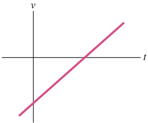

natural_image

Pure linear function graph with x and y axes (no labels or data points)

Abb. 1.F1

**2.** Abbildung 1.F2 zeigt vier Bahnen, entlang derer sich verschiedene Objekte gleichzeitig von einem Anfangs- zu einem Endpunkt bewegen. Diese Bahnen verlaufen über einem Gitter aus Geraden, die in gleichem Abstand nebeneinanderliegen. Ordnen Sie die Bahnen in absteigender Reihenfolge nach (a) der Durchschnittsgeschwindigkeit und (b) der Effektivgeschwindigkeit der Objekte.

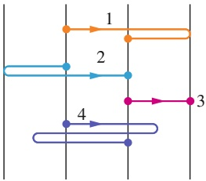

flowchart

Abb. 1.F2

**3.** Abbildung 1.F3 zeigt die Position eines Teilchens entlang der x-Achse als Funktion der Zeit. (a) Welches Vorzeichen hat die Position des Teilchens zur Zeit $t = 0 ?$ Ist die Geschwindigkeit des Teilchens zur Zeit (b) t = 1 s, (c) $t = 2   { \mathrm { { : } } }$ s und (d) $t = 3$ s positiv, negativ oder null? (e) Wie oft passiert das Teilchen den Ort $x = 0 ?$

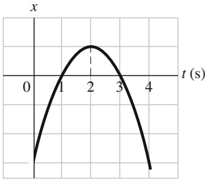

line

| t (s) | x |
| --- | --- |
| 0 | ~-1.5 |
| 1 | 0 |
| 2 | ~1.0 |
| 3 | 0 |
| 4 | ~-1.5 |

Abb. 1.F3

**4.** Abbildung 1.F4 zeigt die Geschwindigkeit eines Teilchens, das sich entlang einer Achse bewegt. Punkt 1 bezeichnet den höchsten Punkt der Kurve, Punkt 4 den tiefs ten; die Punkte 2 und 6 liegen auf derselben Höhe. In welche Richtung bewegt sich das Teilchen (a) zur Zeit $t = 0$ und (b) an Punkt 4? (c) An welchen der sechs nummerierten Punkte ändert das Teilchen seine Bewegungsrichtung? (d) Ordnen Sie die sechs Punkte in der Reichenfolge absteigenden Betrags der Beschleunigung.

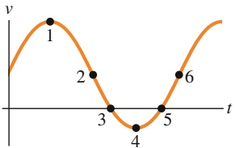

line

| Point | t | v |
| --- | --- | --- |
| 1 | ~0.25 | ~0.8 |
| 2 | ~0.6 | ~0.3 |
| 3 | ~0.9 | 0 |
| 4 | ~1.25 | ~-0.3 |
| 5 | ~1.6 | 0 |
| 6 | ~2.0 | ~0.3 |

Abb. 1.F4

5. Bei $t = 0$ befindet sich ein Teilchen, das sich entlang einer x-Achse bewegt, am Ort $x _ { 0 } = - 2 0   \mathrm { m }$ . Die Vorzeichen der ursprünglichen Geschwindigkeit $\nu _ { 0 }$ (zur Zeit $t _ { 0 } )$ und der konstanten Beschleunigung a sind in vier verschiedenen Situationen jeweils: $\left( 1 \right) + , + ; \left( 2 \right) + , - ; \left( 3 \right) - , + ; \left( 4 \right) - , -$ In welcher dieser Situationen wird das Teilchen (a) vorübergehend anhalten, (b) sich auf jeden Fall (bei ausreichend langer Zeit) über den Ursprung hinwegbewegen und (c) auf keinen Fall den Ursprung überqueren?
**6.** Die folgenden Gleichungen geben die Geschwindigkeit $\nu ( t )$ eines Teilchens in vier verschiedenen Situationen wieder: $(a) $\nu = 3 ; ( \mathrm { b } ) \; \nu = 4 t ^ { 2 } + 2 t - 6 ; ( \mathrm { c } ) \; \nu = 3 t - 4 ; ( \mathrm { d } ) \; \nu =$$ $5 t ^ { 2 } - 3$ . In welcher dieser Situationen gelten die Gleichungen aus Tab. 1.1?
**7.** Ein Passagier in einem Heißluftballon lässt beim Start versehentlich einen Apfel aus dem Korb fallen. Der Ballon beschleunigt in diesem Moment mit einer Beschleunigung von $4 \mathrm { , } 0   \mathrm { m / \bar { s ^ { 2 } } }$ nach oben und besitzt bereits eine nach oben gerichtete Geschwindigkeit von 2 m/s. Geben Sie (a) Betrag und (b) Richtung der Beschleunigung an, die direkt nach dem Loslassen auf den Apfel wirkt. (c) Bewegt sich der $\mathrm { A p } \cdot$ fel im Moment des Loslassens nach oben, nach unten oder ist er stationär? (d) Welchen Betrag besitzt seine Geschwindigkeit in diesem Moment? (e) Nimmt der Betrag seiner Geschwindigkeit in den folgenden Momenten zu, ab oder bleibt er konstant?
**8.** Abbildung 1.F8 zeigt die Beschleunigung, die ein sich entlang einer Achse bewegendes Teilchen in verschiedenen Zeitintervallen verspürt. Ordnen Sie diese Zeitintervalle ohne schriftliche Rechnung in absteigender Reihenfolge nach der durch sie bewirkten Änderung der Geschwindig keit des Teilchens.

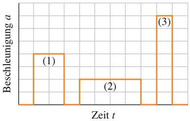

bar

| Zeit | Beschleunigung |
| --- | --- |
| 0 | 0 |
| 1 | ~1.5 |
| 2 | 0 |
| 3 | ~0.75 |
| 4 | 0 |
| 5 | ~2.5 |
| 6 | 0 |

Abb. 1.F8

**9.** Die Fahrerin eines blauen Autos, das sich mit 80 km/h bewegt, bemerkt plötzlich, dass sie im Begriff ist, ein rotes Auto zu rammen, das mit 60 km/h vor ihr fährt. Wie groß darf die Geschwindigkeit des blauen Autos, kurz bevor es das rote Auto erreicht, maximal sein, um einen Zusammenstoß zu vermeiden? (Aufwärmübung für Aufgabe 1.34 im Übungsbuch)

**10.** Bei $t = 0$ und $x = 0$ beginnt ein parkendes Auto mit einer konstanten Beschleunigung von $2 { , } 0   \mathrm { m / s ^ { 2 } }$ in positiver Richtung entlang einer x-Achse zu beschleunigen. Zur Zeit $t = 2   s$ kommt ein auf der Nebenspur in die gleiche Richtung fahrendes Auto mit einer Geschwindigkeit von $8 ,   0   \mathrm { m } / \mathrm { s }$ und einer konstanten Beschleunigung von $3 ,   0   \mathrm { m } / \mathrm { s } ^ { 2 }$ bei $x = 0$ vorbei. Welche zwei gekoppelten Gleichungen muss man lösen, um herauszufinden, wann das rote Auto das blaue überholt? (Aufwärmübung für Aufgabe 1.32 im Übungsbuch)
**11.** Sie werfen einen Ball von der Oberkante einer Klippe gerade nach oben, er landet im Sand unterhalb der Klippe. Wenn Sie den Ball stattdessen mit dem gleichen Geschwindigkeitsbetrag direkt von der Klippe aus nach unten geworfen hätten, wäre der Geschwindigkeitsbetrag des Balls kurz vor dem Aufprall größer als, kleiner als oder genauso groß wie im ersten Fall? (Hinweis: Betrachten Sie Gl. 1.14.)
**12.** Abbildung 1.F12 zeigt die Anfangsposition 1 und die Endposition 2 eines Teilchens. Wie lauten (a) der Ortsvektor ${ \vec { r } } _ { 1 }$ des Teilchens an der Anfangsposition und (b) der Ortsvektor $\vec { r } _ { 2 }$ des Teilchens an der Endposition in Einheitsvektoren-Schreibweise? (c) Wie lautet die x-Komponente der Verschiebung $\Delta \vec { r }$ des Teilchens?

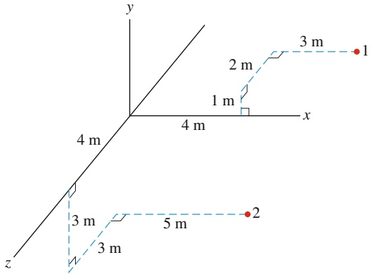

text_image

y
3 m
2 m
1 m
4 m
x
4 m
z
3 m
5 m
2

Abb. 1.F12

**13.** Im Folgenden finden Sie vier verschiedene Beschreibungen der Geschwindigkeit eines Eishockeypucks in einer xy-Ebene (in Metern pro Sekunde):

(a) Sind die $x -$ und y-Komponente der Beschleunigung bzw. der Beschleunigungsvektor a⃗ in allen Fällen konstant?
(b) Wie lauten in Fall (4) die Einheiten der Koeffizienten −2 und 3, wenn $\vec { \nu }$ in Metern pro Sekunde und t in Sekunden angegeben wird?

**14.** Zu einem bestimmten Zeitpunkt besitze ein Ball die Geschwindigkeit $\vec { \nu } = 2 5 \vec { e } _ { x } { - 4 } \mathbf { , } 9 \vec { e } _ { \perp }$ (die x-Achse verläuft horizontal, die y-Achse ist nach oben gerichtet und v⃗ wird in Metern pro Sekunde angegeben). Hat der Ball den höchsten Punkt seiner Trajektorie schon durchlaufen?

**15.** Sie sollen eine Rakete mit einer der folgenden Anfangsgeschwindigkeiten vom Boden aus starten:

In Ihrem Koordinatensystem verläuft x parallel zum Boden und y nimmt nach oben hin zu. (a) Ordnen Sie die Vektoren in absteigender Reihenfolge nach den Beträgen der Startgeschwindigkeiten. (b) Ordnen sie die Vektoren in absteigender Reihenfolge nach den Flugzeiten der Projektile.

**16.** Ein Flugzeug, das in horizontaler Richtung mit einem konstanten Geschwindigkeitsbetrag von 350 km/h über den ebenen Erdboden fliegt, werfe ein Paket mit Lebensmitteln ab. Vernachlässigen Sie die Auswirkungen des Luftwiderstands auf das Paket. Wie lauten (a) die vertikale und (b) die horizontale Komponente der Anfangsgeschwindigkeit des Pakets? (c) Wie lautet die horizontale Geschwindigkeitskomponente, unmittelbar bevor das Paket auf dem Boden auftrifft? (d) Wenn das Flugzeug stattdessen mit einem Geschwindigkeitsbetrag von 450 km/h fliegen würde, wäre die Fallzeit des Pakets dann länger, kürzer oder gleich lang?

**17.** Sie werfen einen Ball mit einer Wurfgeschwindigkeit $\vec { \nu } _ { 1 }   =   ( 3   \mathrm { m } / \mathrm { s } ) \vec { e } _ { x }   +   ( 4   \mathrm { m } / \mathrm { s } ) \vec { e } _ { y }$ gegen eine Wand, auf der er zur Zeit $t _ { 1 }$ nach dem Wurf in einer Höhe $h _ { 1 }$ auftrifft (Abb. 1.F17). Nehmen Sie an, die Wurfgeschwindigkeit sei stattdessen gleich $\vec { \nu } _ { 1 } = ( 5   \mathrm { m } / \mathrm { s } ) \vec { e } _ { x } + ( 4   \mathrm { m } / \mathrm { s } ) \vec { e } _ { y } .$

(a) Wäre die Zeit, die der Ball bis zur Wand braucht, in diesem Fall größer als, kleiner als oder genauso groß wie $t _ { 1 }$ – oder lässt sich diese Frage ohne Zusatzinformationen gar nicht beantworten?

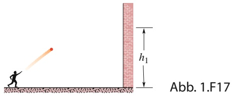

text_image

h₁
Abb. 1.F17

(b) Wäre die Höhe, in welcher der Ball auf der Wand auftrifft, größer als, kleiner als oder genauso groß wie $h _ { 1 } -$ oder lässt sich diese Frage gar nicht beantworten?
Nehmen Sie nun an, dass die Wurfgeschwindigkeit stattdessen $\vec { \nu } _ { 1 } = ( 3   \mathrm { m / s } ) \vec { e } _ { x } + ( 5   \mathrm { m / s } ) \vec { e } _ { y }$ ist.

(c) Wäre die Zeit, die der Ball bis zur Wand braucht, in diesem Fall größer als, kleiner als oder genauso groß wie $t _ { 1 }$ – oder lässt sich diese Frage gar nicht beantworten?

(d) Wäre die Höhe, in welcher der Ball auf der Wand auftrifft, größer als, kleiner als oder genauso groß wie $h _ { 1 } -$ oder lässt sich diese Frage gar nicht beantworten?
**18.** Abbildung 1.F18 zeigt drei Bahnkurven eines Fußballs, der vom Boden aus geschossen wurde. Vernachlässigen Sie die Auswirkungen des Luftwiderstands und ordnen Sie die Bahnkurven in absteigender Reihenfolge (a) nach den Flugzeiten, (b) der vertikalen Komponente der Anfangsgeschwindigkeit, (c) der horizontalen Komponente der Anfangsgeschwindigkeit und (d) dem Betrag der Anfangsgeschwindigkeit.

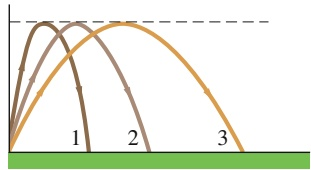

line

| Curve | X-axis Position (Relative) | Y-axis Position (Relative) |
| --- | --- | --- |
| 1 | Low | High |
| 2 | Medium-Low | High |
| 3 | Medium-High | High |

Abb. 1.F18

**19.** Abbildung 1.F19 zeigt die Geschwindigkeit und die Beschleunigung eines Teilchens zu einem bestimmten Zeitpunkt in drei verschiedenen Situationen. In welcher dieser Situationen (a) wächst der Geschwindigkeitsbetrag an, (b) nimmt der Geschwindigkeitsbetrag ab, (c) bleibt der Geschwindigkeitsbetrag gleich, (d) ist $\vec { \vec { \nu } } \cdot \vec { a }$ positiv, (e) ist v⃗ ⋅ a⃗ negativ und (f ) ist ${ \vec { \nu } } \cdot { \vec { a } } = 0 ?$

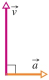

(1)

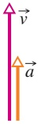

(2)

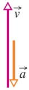

(3)

Abb. 1.F19

**20.** Abbildung 1.F20 stellt vier Gleise dar (deren Kurven entweder aus Viertel- oder Halbkreisen bestehen), die ein Zug mit konstanter Geschwindigkeit befährt. Ordnen Sie die Gleise in absteigender Reihenfolge nach dem Betrag der Beschleunigung des Zugs auf dem gekrümmten Teil der Gleise.

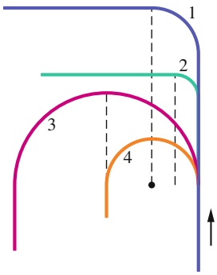

text_image

1
2
3
4

Abb. 1.F20

**21.** (a) Ist es möglich, beschleunigt zu werden, während man sich mit konstantem Geschwindigkeitsbetrag bewegt?

Ist es möglich, eine Kurve (b) mit einer Beschleunigung von null und (c) mit einer Beschleunigung, deren Betrag konstant bleibt, zu durchfahren?

**22.** Ein Ball wird mit einer bestimmten Anfangsgeschwindigkeit vom Boden aus geschossen. Abbildung 1.F22 zeigt die Reichweite R des Schusses als Funktion des Abschusswinkels θ. Ordnen Sie die drei bezeichneten Punkte auf der Kurve in absteigender Reihenfolge (a) nach der gesamten Flugdauer des Balls und (b) nach dem Betrag seiner Geschwindigkeit am höchsten Punkt seiner Flugkurve.

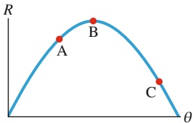

line

| Point | \(\theta\) | R |
| --- | --- | --- |
| A | ~0.45 | ~0.75 |
| B | ~0.65 | ~0.95 |
| C | ~0.85 | ~0.35 |

Abb. 1.F22

**23.** Das Teilchen P in Abb. 1.F23 vollführt eine gleichförmige Kreisbewegung um den Ursprung des xy-Koordinatensystems. (a) Bei welchen Werten von θ besitzt die vertikale Komponente $r _ { y }$ des Ortsvektors den größten Betrag? (b) Bei welchen Werten von θ besitzt die vertikale Komponente $\nu _ { y }$ des Geschwindigkeitsvektors den größten Betrag? (c) Bei welchen Werten von θ besitzt die vertikale Komponente $\alpha _ { y }$ des Beschleunigungsvektors den größten Betrag?

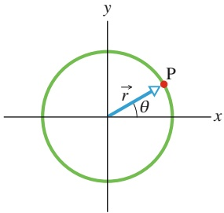

text_image

y
P
r
θ
x

Abb. 1.F23

**24.** Sie fahren direkt hinter einem Pickup mit derselben Geschwindigkeit wie dieser. Eine Kiste fällt von der Ladefläche des Wagens. (a) Kollidiert Ihr Auto mit der Kiste, bevor sie auf dem Boden aufschlägt, wenn Sie weder bremsen noch ausweichen? (b) Ist die horizontale Geschwindigkeit der Kiste während ihres Falls größer, kleiner oder gleich groß wie die des Pickups?
**25.** An welchem Punkt der Flugbahn eines Geschosses ist der Betrag seiner Geschwindigkeit minimal?
**26.** Beim Kugelstoßen wird die Kugel von oberhalb der Schulterhöhe des Athleten gestoßen. Ist der Abwurfwinkel, der den weitesten Wurf erzielt, größer oder kleiner als 45° oder gleich 45°?

# 2 Kraft und Bewegung

## 2.1 Das erste und das zweite Newtonsche Gesetz

## Physikalische Motivation

Wir haben bereits gesehen, dass sich ein wesentlicher Teil der Physik der Untersuchung von Bewegungen widmet, einschließlich der Untersuchung von Beschleunigungen, die nichts anderes sind als Veränderungen von Geschwindigkeiten. Die Physik beschäftigt sich aber auch mit der Frage, wodurch Beschleunigungen verursacht werden. Die Ursache einer Beschleunigung ist immer eine **Kraft** – vereinfacht gesagt, ein Ziehen oder Schieben des Objekts. Man sagt, dass eine Kraft auf das Objekt wirkt oder einwirkt, dessen Geschwindigkeit sie ändert. Wenn beispielsweise ein Rennauto beschleunigt, dann wirkt eine Kraft von der Fahrbahn auf seine Reifen und bewirkt die Änderung seiner Geschwindigkeit. Wenn im Fuß- ball ein Verteidiger einen gegnerischen Schuss mit dem Kopf abwehrt, wirkt eine Kraft vom Kopf des Verteidigers auf den Ball ein, die dessen Richtung (und damit Geschwindigkeit) verändert, ihn also beschleunigt. Oder wenn ein Auto in einen Telefonmast kracht, dann wirkt eine Kraft von dem Mast auf das Auto, die es ziemlich unsanft abbremst. Wissenschaftliche, technische, juristische und medizinische Zeitschriften sind voll mit Artikeln über die physikalischen, juristischen oder medizinischen Auswirkungen von Kräften, die auf Gegenstände oder Menschen einwirken oder eingewirkt haben.

**Kopf hoch** Viele Studierende werden dieses Kapitel als Herausforderung emp finden, jedenfalls als schwieriger als die vorhergehenden. Ein Grund dafür ist vermutlich, dass wir in den Gleichungen immer Vektoren verwenden müssen – man kann bei der Behandlung von Kräften nicht einfach Skalare addieren. Aus diesem Grund benötigen wir die Vektorrechnung (siehe Anhang D). Ein weiterer Grund mag sein, dass wir vielen unterschiedlichen physikalischen Situationen begegnen werden: Gegenstände werden sich entlang von Böden, Decken, Wänden oder Rampen bewegen. Sie bewegen sich an Seilen nach oben, hängen an Flaschenzügen oder fahren in auf- oder absteigenden Aufzügen. Manchmal sind Gegenstände auch miteinander verbunden.

Trotz der Vielzahl von Situationen benötigen wir jedoch nur eine einzige Schlüs selidee (das zweite Newtonsche Gesetz), um die meisten der Aufgaben zu lösen. Das Ziel dieses Kapitels ist es, zu zeigen und einzuüben, wie wir mit diesem zentralen Gesetz jede einzelne der vorgestellten Situationen entschlüsseln und analy sieren können. Das erfordert Erfahrung – Sie müssen dazu viele Aufgaben lösen, nicht nur einen Text durchlesen. Trotzdem beginnen wir mit etwas Text, bevor wir uns dann an die Aufgaben machen.

## 2.1.1 Die Newtonsche Mechanik

Wenn Sie beobachten, dass die Geschwindigkeit eines teilchenartigen Körpers ihren Betrag und/oder ihre Richtung ändert, so wissen Sie, dass irgendetwas diese

Veränderung (diese Beschleunigung) verursacht haben muss. In der Tat sagt Ihnen die Alltagserfahrung, dass eine solche Veränderung der Geschwindigkeit durch eine Wechselwirkung zwischen dem Körper und etwas aus seiner Umgebung hervorgerufen wurde. Wenn Sie z. B. einen Eishockeypuck dabei beobachten, wie er über eine Eisfläche gleitet und plötzlich anhält oder seine Richtung verändert, so werden Sie daraus schließen, dass der Puck an eine Unebenheit in der Eisfläche gestoßen ist.

Eine Wechselwirkung, die eine Beschleunigung eines Körpers hervorrufen kann, wird eine **Kraft** genannt. Salopp ausgedrückt handelt es sich dabei um ein Schieben oder Ziehen an dem entsprechenden Körper – man sagt, die Kraft wirkt auf den Körper. So übt die Unebenheit in der Eisfläche z. B. einen Schub auf den Puck aus und verursacht dabei eine Beschleunigung. Isaac Newton (1642–1727) war der Erste, der die Beziehung zwischen einer Kraft und der von ihr hervorgerufenen Beschleunigung erkannte. Diese Beziehung wird uns in diesem Kapitel beschäftigen; ihre – von Newton vorgestellte – Untersuchung wird Newtonsche Mechanik genannt. Wir werden uns hier auf ihre drei grundlegenden Bewegungsgesetze konzentrieren.

Die Newtonsche Mechanik gilt nicht für jede beliebige Situation. Wenn die Geschwindigkeiten der wechselwirkenden Körper sehr groß sind – d. h., wenn sie einen wesentlichen Bruchteil der Lichtgeschwindigkeit betragen –, so müssen wir die Newtonsche Mechanik durch Einsteins Spezielle Relativitätstheorie ersetzen, die für alle Geschwindigkeiten inklusive solcher nahe der Lichtgeschwindigkeit gilt. Sind die wechselwirkenden Körper von der Größenordnung atomarer Strukturen (handelt es sich z. B. um Elektronen in einem Atom), so müssen wir die Newtonsche Mechanik durch die Quantenmechanik ersetzen. Die Physiker sehen die Newtonsche Mechanik heutzutage als einen Spezialfall dieser beiden umfassenderen Theorien an. Dennoch handelt es sich dabei um einen äußerst wichtigen Spezialfall, da sich die Newtonsche Mechanik auf die Bewegung von Objekten anwenden lässt, deren Größe sich von kleinen (beinahe auf der Skala atomarer Strukturen) bis hin zu astronomischen Skalen (kosmische Objekte wie Galaxien und Galaxienhaufen) erstreckt.

## 2.1.2 Das erste Newtonsche Gesetz

Bevor Newton seine Mechanik formulierte, dachte man, dass irgendeine Art von Einwirkung, eine „Kraft“, notwendig sei, um einen Körper in einer gleichförmigen Bewegung zu halten. Dementsprechend sollte ein Körper genau dann in seinem „natürlichen Zustand“ sein, wenn er sich in Ruhe befindet. Damit sich der Körper mit konstanter Geschwindigkeit bewegte, musste er augenscheinlich durch etwas gezogen oder geschoben werden. Anderenfalls hätte er „natürlich“ angehalten.

Diese Ideen waren plausibel. Wenn Sie einen Puck über einen hölzernen Fuß- boden rutschen lassen, wird er in der Tat immer langsamer und hält schließlich an. Wollen Sie den Puck mit einer konstanten Geschwindigkeit über den Boden bewegen, müssen Sie ihn fortwährend ziehen oder schieben.

Wenn Sie den Puck jedoch über das Eis eines Eisstadions gleiten lassen, so wird er wesentlich weiter kommen. Sie können sich zudem noch längere und glattere Oberflächen ausdenken, auf denen der Puck weiter und weiter rutschen würde. Im Grenzfall können Sie sich eine lange, extrem glatte Oberfläche vorstellen (eine so genannte **reibungsfreie Oberfläche**), auf welcher der Puck überhaupt nicht langsamer wird. (Tatsächlich kommen wir im Labor oder einem Spielsalon einer solchen Situation sehr nahe, wenn wir den Puck über einen horizontalen Luftkissentisch gleiten lassen, über den er sich auf einer dünnen Luftschicht bewegt.)

Aus diesen Beobachtungen können wir darauf schließen, dass ein Körper sich weiterhin mit konstanter Geschwindigkeit bewegen wird, solange keine Kraft auf ihn wirkt. Dies führt uns zum ersten von Newtons drei Bewegungsgesetzen, das Newton ursprünglich etwa folgendermaßen formulierte:

**Erstes Newtonsches Gesetz (Trägheitsprinzip):** Wenn auf einen Körper keine Kräfte einwirken, dann bleibt er im Zustand der Ruhe oder der gleichförmigen Bewegung; der Körper wird also nicht beschleunigt.

Anders ausgedrückt: Ein Körper, der sich in Ruhe befindet, wird auch weiterhin in Ruhe bleiben. Bewegt sich der Körper, so wird er sich weiterhin mit derselben Geschwindigkeit fortbewegen (also mit demselben Betrag und derselben Richtung).

## 2.1.3 Kraft

Wir wollen nun die Einheit der Kraft definieren. Wir wissen, dass eine Kraft eine Beschleunigung eines Körpers verursachen kann. Also werden wir die Krafteinheit anhand der Beschleunigung definieren, die eine Kraft bei einem standardisierten Referenzkörper hervorruft. Als einen solchen Referenzkörper benutzen wir (bzw. stellen ihn uns vor) das in Paris aufbewahrte Urkilogramm. Diesem Körper wurde früher per Definition eine Masse von genau 1 kg zugewiesen.

Wir setzen das Urkilogramm auf einen horizontalen, reibungsfreien Tisch und ziehen es so nach rechts (Abb. 2.1), dass es eine Beschleunigung von 1 $\mathrm { m } / \mathrm { s } ^ { 2 }$ erfährt. Der Kraft, die wir in diesem Augenblick auf das Urkilogramm ausüben, weisen wir per Definition einen Betrag von 1 Newton (abgekürzt: N) zu.

Wir können eine 2 N große Kraft auf unser Urkilogramm ausüben, indem wir es derart ziehen, dass die gemessene Beschleunigung $\mathrm { \tilde { 2 }   m / s ^ { 2 } }$ beträgt, usw. Unterliegt unser Referenzkörper von 1 kg Masse einer Beschleunigung mit Betrag a, so wissen wir nun also, dass auf ihn eine Kraft F einwirken muss und dass der Betrag dieser Kraft in Newton gleich dem Betrag der Beschleunigung in Metern pro Sekundenquadrat sein muss.

Eine Kraft wird demnach anhand der Beschleunigung gemessen, die sie verursacht. Die Beschleunigung ist jedoch eine Vektorgröße, die sowohl einen Betrag als auch eine Richtung besitzt. Ist eine Kraft damit ebenfalls eine Vektorgröße? Wir können einer Kraft leicht eine Richtung zuordnen (z. B. die Richtung der Beschleunigung), doch dies ist nicht ausreichend. Wir müssen vielmehr experimentell beweisen, dass Kräfte Vektorgrößen sind. Solche Experimente wurden tatsächlich durchgeführt: Kräfte sind in der Tat Vektorgrößen; sie besitzen einen Betrag und eine Richtung und gehorchen den Regeln der Vektorrechnung (Anhang D).

Wirken zwei oder mehr Kräfte auf einen Körper ein, so können wir ihre **Gesamtkraft** oder **resultierende Kraft** bestimmen, indem wir die einzelnen Kräfte vektoriell addieren. Eine einzelne Kraft, die den Betrag und die Richtung der Gesamtkraft besitzt, hat die gleichen Auswirkungen auf den Körper wie alle einzelnen Kräfte zusammen. Diese Tatsache nennt man das **Superpositionsprinzip der Kräfte**.

In diesem Buch werden Kräfte meistens durch ein Vektorsymbol wie z. B. $\vec { F }$ symbolisiert, eine Gesamtkraft als $\vec { F } _ { \mathrm { g e s } }$ . Eine Kraft oder eine Gesamtkraft besitzt wie andere Vektoren auch Komponenten entlang der gerade gewählten Koordinatenachsen. Wirkt eine Kraft nur entlang einer einzigen Achse, so hat sie nur eine Komponente. Dann können wir die Pfeile über dem Symbol für die Kraft weglassen und ihre Richtung einfach durch ihr Vorzeichen angeben.

Zur Präzisierung der zuvor angegebenen Formulierung muss ergänzt werden, dass sich das erste Newtonsche Gesetz auf die resultierende Gesamtkraft bezieht, d. h., wenn keine Gesamtkraft $( \vec { F } _ { \mathrm { g e s } } = 0 )$ auf einen Körper einwirkt, dann bleibt er im Zustand der Ruhe oder der gleichförmigen Bewegung. Es kann durchaus eine Vielzahl von Kräften auf den Körper wirken, wenn die daraus resultierende Gesamtkraft jedoch gleich null ist, so kann der Körper nicht beschleunigen.

text_image

Diagram showing a hand holding a cylinder with force vector F and acceleration vector a labeled

Abb. 2.1 Eine Kraft F⃗ wirkt auf das Urkilogramm und beschleunigt es mit einer Beschleunigung a⃗.

(a)

natural_image

Diagram of a globe with a downward arrow indicating direction, no text or symbols present

(b)

## Abb. 2.2

(a) Die Bahn eines Pucks, der auf einem 2000 km langen, reibungsfreien Stück Eis geradewegs nach Süden geschickt wird, aus der Sicht eines auf dem Erdboden stehenden Beobachters. (b) Der Erdboden rotiert aufgrund der Erddrehung unter dem nach Sü- den gleitenden Puck nach Osten.

## Inertialsysteme

Das erste Newtonsche Gesetz gilt nicht in allen Bezugssystemen. Wir können jedoch immer Bezugssysteme finden, in denen es Gültigkeit hat. Solche Bezugssysteme werden **Inertialsysteme** genannt.

Ein Inertialsystem ist ein Bezugssystem, in dem das erste Newtonsche Gesetz gilt.

Wir können z. B. annehmen, dass der Erdboden ein Inertialsystem darstellt, allerdings nur unter der Voraussetzung, dass wir die tatsächlichen astronomischen Bewegungen der Erde – wie die Erdrotation und ihren Lauf um die Sonne – vernachlässigen können.

Diese Annahme funktioniert gut, wenn wir einen Puck ein kurzes, reibungsfreies Stück Eis entlanggleiten lassen – ein auf dem Erdboden stehender Beobachter würde dann bestätigen, dass die Bewegung des Pucks den Gesetzen der Newtonschen Mechanik gehorcht. Stellen Sie sich jedoch vor, wir würden die Eisfläche sehr lang wählen, z. B. einige tausend Kilometer geradlinig nach Süden. Ein auf dem Erdboden stehender Beobachter würde dann feststellen, dass der Puck während seiner Bewegung nach Süden leicht nach Westen beschleunigt wird (Abb. 2.2a); dennoch wäre der Beobachter nicht in der Lage, eine Kraft zu finden, die diese Beschleunigung nach Westen verursacht. In diesem Fall ist der Erdboden ein **Nichtinertialsystem**, da die Erddrehung bei der langen Bahn des Pucks nicht mehr vernachlässigt werden kann. Die überraschende Beschleunigung des gleitenden Pucks relativ zum Erdboden nach Westen wird nämlich einfach dadurch verursacht, dass sich der Erdboden unter dem Puck nach Osten wegdreht (Abb. 2.2b).

Mithilfe des Begriffs Inertialsystem können wir das erste Newtonsche Gesetz folgendermaßen formulieren:

**Erstes Newtonsches Gesetz (moderne Fassung):** Es gibt Inertialsysteme, d. h. Koordinatensysteme, in denen ein kräftefreier Körper im Zustand der Ruhe oder der geradlinigen gleichförmigen Bewegung verbleibt.

In diesem Buch werden wir im Allgemeinen annehmen, dass der Erdboden ein Inertialsystem darstellt und dass die Messungen von Kräften und Beschleunigungen vom Erdboden aus durchgeführt werden. Werden Messungen z. B. in einem Aufzug gemacht, der relativ zum Erdboden beschleunigt, dann werden sie in einem Nichtinertialsystem durchgeführt – und die Ergebnisse können überaus überraschend sein. Einen solchen Fall werden wir in der Beispielaufgabe 2.6 im Übungsbuch behandeln.

## KONTROLLFRAGE 1

Welche der folgenden sechs Anordnungen zeigen die korrekte Vektoraddition der Kräfte ${ \vec { F } } _ { 1 }$ und $\overset { \mathrm {  当 } } { F _ { 2 } }$ zur daraus resultierenden Gesamtkraft $\vec { F } _ { \mathrm { g e s } ^ { 2 } }$

text_image

F₁
(a)
F₂

text_image

F₁
(b)
F₂

text_image

(c)
F₁
F₂

text_image

F₂
F₁
(d)

text_image

F₁
(e)
F₂

text_image

F₁
(f)
F₂

## 2.1.4 Masse

Aus unserer Alltagserfahrung wissen wir, dass eine gegebene Kraft bei verschiedenen Körpern verschieden große Beträge der Beschleunigung hervorruft. Legen Sie eine Murmel und eine Bowlingkugel nebeneinander auf den Boden und geben sie beiden den gleichen scharfen Tritt. Selbst wenn Sie dies nicht wirklich ausprobieren, kennen Sie das Ergebnis: Die Murmel erhält eine merklich größere Beschleu nigung als die Bowlingkugel. Die zwei Beschleunigungen sind verschieden, weil die Masse der Murmel sich von der Masse der Bowlingkugel unterscheidet – doch was ist das genau, die Masse?

Wir können erklären, wie man Masse misst, indem wir uns eine Reihe von Experimenten in einem Inertialsystem vorstellen. Im ersten Experiment üben wir eine Kraft auf unser Urkilogramm aus, dessen Masse $m _ { 0 }$ definitionsgemäß gleich 1,0 kg ist. Nehmen wir an, dass es daraufhin mit $1 ,   0   \mathrm { m } / \mathrm { s } ^ { 2 }$ beschleunigt wird. Daraus können wir entnehmen, dass auf das Urkilogramm eine Kraft von 1,0 N wirkt.

In einem nächsten Schritt üben wir die gleiche Kraft (dazu müssten wir irgendwie sicherstellen, dass wir tatsächlich die gleiche Kraft ausüben) auf einen zweiten Körper X aus, dessen Masse wir nicht kennen. Nehmen Sie an, wir finden heraus, dass dieser Körper X mit $0 , 2 5   \mathrm { m } / \mathrm { s } ^ { 2 }$ beschleunigt. Uns ist bekannt, dass eine Murmel mit einer geringeren Masse eine größere Beschleunigung erhält als eine Bowlingkugel mit einer größeren Masse, wenn man auf beide die gleiche Kraft ausübt. Lassen Sie uns dann die folgende Vermutung aufstellen: Wird auf zwei Körper die gleiche Kraft ausgeübt, so ist das Verhältnis der Massen der beiden Körper gleich dem inversen Verhältnis ihrer Beschleunigungen. Im Fall des Körpers X und des Urkilogramms bedeutet dies, dass

$$
\frac {m _ {\mathrm{X}}}{m _ {0}} = \frac {a _ {0}}{a _ {\mathrm{X}}}.
$$

Auflösen nach $m _ { \mathrm { X } }$ ergibt:

$$
m _ {X} = m _ {0} \frac {a _ {0}}{a _ {\mathrm{X}}} = (1, 0 \mathrm{kg}) \frac {1 , 0 \mathrm{m/s} ^ {2}}{0 , 2 5 \mathrm{m/s} ^ {2}} = 4, 0 \mathrm{kg}.
$$

Unsere Vermutung ist natürlich nur dann von Nutzen, wenn sie auch für andere Werte der angewendeten Kraft gilt. Üben wir z. B. eine Kraft von 8,0 N auf das Urkilogramm aus, so erhalten wir eine Beschleunigung von $8 ,   0   \mathrm { m } / \mathrm { s } ^ { 2 }$ . Unsere Vermutung lautet dann:

$$
m _ {\mathrm{X}} = m _ {0} \frac {a _ {0}}{a _ {\mathrm{X}}} = (1, 0 \mathrm{kg}) \frac {8 , 0 \mathrm{m/s} ^ {2}}{2 , 0 \mathrm{m/s} ^ {2}} = 4, 0 \mathrm{kg},
$$

was mit unserem ersten Experiment konsistent ist. Eine Vielzahl von Experimen ten, die ähnliche Ergebnisse liefern, deutet darauf hin, dass unsere Vermutung eine konsistente und verlässliche Methode liefert, einem beliebigen Körper eine Masse zuzuordnen.

Unsere Experimente weisen darauf hin, dass Masse eine intrinsische, jedem Körper innewohnende Eigenschaft ist – d. h. eine Eigenschaft, die durch die Existenz des Körpers automatisch bedingt wird. Die Experimente zeigen außerdem an, dass die Masse eine skalare Größe ist. Dennoch bleibt die quälende Frage weiterhin bestehen: Was ist das nun genau, die Masse?

Da der Ausdruck $\mathrm { { \underline { { { ~ } } } M a s s e } ^ { \alpha } }$ in der Alltagssprache gebräuchlich ist, sollten wir von seiner Bedeutung ein intuitives Verständnis besitzen, vielleicht als etwas, das wir physisch spüren können. Ist es die Größe, das Gewicht oder die Dichte eines Körpers? Die Antwort ist nein, obwohl diese Eigenschaften mit der Masse zu tun ha ben und manchmal mit ihr verwechselt werden. Wir können nur sagen, dass die Masse eines Körpers jene Eigenschaft ist, welche die auf den Körper ausgeübte Kraft mit der daraus resultierenden Beschleunigung verknüpft. Man könnte sie auch den

Trägheitswiderstand nennen, den der Körper der Veränderung seines Bewegungszustands entgegensetzt. Genau genommen diskutieren wir hier die **träge Masse**. (Wir werden im nächsten Abschn. 2.2 noch einen weiteren Aspekt der Masse kennenlernen, die schwere Masse.) Es gibt keine vertrautere Definition für Masse; Sie können Masse nur dann physisch spüren, wenn Sie versuchen, einen Körper zu beschleunigen, wie z. B. im Fall der Murmel und der Bowlingkugel.

## 2.1.5 Das zweite Newtonsche Gesetz

All die Definitionen, Experimente und Beobachtungen, die wir bis jetzt untersucht haben, lassen sich in einer einzigen Aussage zusammenfassen:

**Zweites Newtonsches Gesetz (Aktionsprinzip) für Körper mit konstanter Masse:** Die auf einen Körper mit zeitlich konstanter Masse wirkende Gesamtkraft ist gleich dem Produkt der Masse und der Beschleunigung des Körpers.

Mathematisch ausgedrückt bedeutet dies:

$$
\vec {F} _ {\mathrm{ges}} = m \vec {a} \quad (m = \text {const.}). \tag {2.1}
$$

(Die allgemeine Beschreibung wird in Kap. 5 dargestellt). Gleichung 2.1 ist einfach, doch wir müssen sie umsichtig gebrauchen. Zunächst müssen wir sicher sein, auf welchen Körper wir sie anwenden. Dann muss $\vec { F } _ { \mathrm { g e s } }$ gleich der Vektorsumme aller Kräfte sein, die auf diesen Körper wirken. Nur Kräfte, die auf diesen Körper wirken, dürfen in die Summe eingeschlossen werden – nicht jedoch Kräfte, die auf andere Körper wirken, die in der gegebenen Situation vielleicht ebenfalls vorhanden sind. Wenn Sie sich z. B. beim Rugby im Gedränge befinden, so ist die Gesamtkraft, die auf Sie wirkt, die Vektorsumme allen „Ziehens“ und „Schiebens“ an Ihrem Körper. Diese resultierende Gesamtkraft beinhaltet jedoch nicht die Kräfte, die Sie durch Ziehen oder Schieben auf einen anderen Spieler ausüben.

Und noch ein weiterer Warnhinweis: Auch das zweite Newtonsche Gesetz gilt zunächst nur für Inertialsysteme. In Nichtinertialsystemen muss man bei Anwendung des zweiten Newtonschen Gesetzes sogenannte Scheinkräfte berücksichtigen, auf die wir im Abschn. 2.7 näher eingehen werden.

Wie andere Vektorgleichungen entspricht Gl. 2.1 drei Komponentengleichungen, einer für jede Achse eines xyz-Koordinatensystems:

$$
F _ {\mathrm{ges}, x} = m a _ {x}, \quad F _ {\mathrm{ges}, y} = m a _ {y} \quad \text {und} \quad F _ {\mathrm{ges}, z} = m a _ {z}. \tag {2.2}
$$

Jede dieser Gleichungen verbindet die Komponente der Gesamtkraft entlang einer Achse mit der Beschleunigung entlang derselben Achse. So besagt die erste Gleichung z. B., dass die Summe aller Kraftkomponenten entlang der x-Achse die x-Komponente $\alpha _ { x }$ der Beschleunigung des Körpers verursacht, aber keine Beschleunigung in y- oder z-Richtung. Andersherum betrachtet wird die Komponente $\alpha _ { x }$ der Beschleunigung nur durch die Summe der Kraftkomponenten entlang der x-Achse verursacht. Im Allgemeinen gilt:

Die Komponente der Beschleunigung entlang einer Achse wird nur durch die Summe der Kraftkomponenten entlang dieser Achse und nicht durch Kraftkomponenten entlang anderer Achsen verursacht.

Gleichung 2.1 verrät uns, dass die Beschleunigung a⃗ eines Körpers gleich null ist, wenn die auf den Körper ausgeübte Gesamtkraft gleich null ist. Befindet sich der Körper in Ruhe, so bleibt er in Ruhe; bewegt er sich, so bewegt er sich mit konstanter Geschwindigkeit weiter. In einem solchen Fall gleichen sich die auf den Körper wirkenden Kräfte aus; man sagt, sowohl die Kräfte als auch der Körper befinden sich im Gleichgewicht. Oft wird auch behauptet, die Kräfte heben sich gegenseitig auf – dieser Begriff ist allerdings irreführend. Er bedeutet nicht, dass die Kräfte aufhören zu existieren. Die Kräfte wirken vielmehr weiterhin auf den Körper, nur ihre Wirkungen heben sich auf.

In SI-Einheiten bedeutet Gl. 2.1, dass

$$
1 \mathrm{N} = (1 \mathrm{kg}) (1 \mathrm{m} / \mathrm{s} ^ {2}) = 1 \mathrm{kg} \cdot \mathrm{m} / \mathrm{s} ^ {2}. \tag {2.3}
$$

Weitere Einheiten aus anderen Einheitensystemen finden Sie in Anhang C.

Um Aufgaben mithilfe des zweiten Newtonschen Gesetzes zu lösen, zeichnen wir oft ein sogenanntes **Kräftediagramm**, in dem nur der Körper erscheint, auf den die zu summierenden Kräfte wirken. In diesem Buch wird der Körper häufig vereinfachend durch einen Punkt angedeutet. Jede Kraft wird dann als ein Vektorpfeil gezeichnet, dessen Anfang auf dem Körper liegt. Meist enthält ein solches Diagramm auch ein Koordinatensystem; die Beschleunigung des Körpers wird manchmal ebenfalls als Vektorpfeil eingezeichnet.

Eine Ansammlung von zwei oder mehr Körpern wird ein **System** genannt. Jede Kraft, die von Körpern außerhalb des Systems auf einen der Körper in dem System ausgeübt wird, bezeichnet man als **äußere Kraft**. Sind die Körper starr miteinander verbunden, so können wir das System wie einen zusammengesetzten Körper behandeln; die resultierende Gesamtkraft $\vec { F } _ { \mathrm { g e s } } ,$ die auf diesen zusammengesetzten Körper wirkt, ist dann die Vektorsumme aller äußerer Kräfte. (**Innere Kräfte** – also Kräfte, die zwischen den zwei Körpern innerhalb des Systems wirken – werden hier nicht betrachtet.) Eine Lokomotive und der mit ihr verbundene Waggon bilden z. B. ein System. Zieht jemand an einem an der Spitze der Lokomotive befestigten Abschleppseil, so wirkt die durch das Seil verursachte Kraft auf das gesamte System aus Lokomotive und Waggon. Wie bei einem einzelnen Körper können wir auch hier die auf das System ausgeübte, resultierende äußere Kraft anhand des zweiten Newtonschen Gesetzes $\vec { F } _ { \mathrm { g e s } } = m \vec { a }$ mit der Beschleunigung des Systems in Verbindung bringen, wobei m die Gesamtmasse des Systems darstellt.

## KONTROLLFRAGE 2

Die Abbildung zeigt zwei horizontale Kräfte, die auf einen liegenden Block wirken. Dieser befindet sich auf einem reibungsfreien Untergrund. Nehmen Sie an, dass außerdem eine dritte horizontale Kraft $\vec { F } _ { 3 }$ auf den Block ausgeübt wird. Wie lauten Betrag und Richtung von $\vec { F } _ { 3 }$ für den Fall, dass der Block sich (a) in Ruhe befindet und sich (b) mit einer konstanten Geschwindigkeit von 5 m/s nach links bewegt?

## KONTROLLFRAGE 3

Die Abbildung zeigt Draufsichten von vier verschiedenen Situationen, in denen zwei Kräfte den gleichen Quader über einen reibungsfreien Untergrund beschleunigen. Ordnen Sie die Situationen in absteigender Reihenfolge nach dem Betrag (a) der resultierenden Gesamtkraft, die auf den Quader wirkt, und (b) der Beschleunigung des Quaders.

## LÖSUNGSSTRATEGIEN

**Strategie 1: Dimensionen und Vektoren** Vielen Studierenden fällt es schwer, die zweite Lösungsidee in Beispielaufgabe 2.2 im Übungsbuch nachzuvollziehen, und diese Schwierigkeit verfolgt sie das ganze Buch hindurch. Wenn Sie mit Kräften arbeiten, können Sie nicht einfach deren Beträge addieren oder subtrahieren, um die resultierende Gesamtkraft zu bestimmen – es sei denn, die Kräfte liegen auf der selben Achse. Ist das nicht der Fall, so müssen Sie die Vektoraddition verwenden, entweder mithilfe eines vektorfähigen Taschenrechners oder indem Sie die Kom ponenten entlang der Koordinatenachsen ermitteln, wie wir es in der Beispielaufgabe 2.2 im Übungsbuch getan haben.

**Strategie 2: Aufgaben mit Kräften lesen und verstehen** Lesen Sie den Text der Aufgabe mehrmals, bis Sie ein klares Bild davon haben, wie sich die Situation darstellt, welche Werte vorgegeben sind und wonach gefragt ist. Wenn Sie zwar erkennen können, worum es in dieser Aufgabe geht, jedoch nicht wissen, was Sie als Nächstes tun sollen, legen Sie die Aufgabe zur Seite und lesen Sie den entsprechenden Teil des Kapitels noch einmal. Fühlen Sie sich z. B. bezüglich des zweiten Newtonschen Gesetzes unsicher, lesen Sie diesen Abschnitt erneut. Arbeiten Sie die Beispielaufgaben durch. Und behalten Sie im Hinterkopf, dass die Fähigkeit, Physikaufgaben zu lösen, nicht etwas Angeborenes ist – ebenso wie die Fähigkeit, Autos zu reparieren oder Computerchips zu entwerfen, erfordert sie entsprechende Übung.

**Strategie 3: Zwei Arten von Diagrammen zeichnen** Eventuell brauchen Sie zwei Abbildungen. Die eine ist eine grobe Skizze der aktuellen Situation. Wenn Sie die Kräfte darin einzeichnen, platzieren Sie den Anfang eines jeden Kraftvektors entweder auf den Rand oder ins Innere des Körpers, auf den diese Kraft wirkt. Die andere Abbildung ist ein Kräftediagramm: Zeichnen Sie die Kräfte, die auf einen einzigen Körper wirken, und stellen Sie den Körper anhand eines Punkts oder einer kleinen Skizze dar. Platzieren Sie den Anfang jedes Kraftvektors auf dem Punkt oder der Skizze.

**Strategie 4: Was ist Ihr System?** Wenn Sie das zweite Newtonsche Gesetz verwenden, müssen Sie wissen, auf welchen Körper bzw. welches System Sie es anwenden. In Beispielaufgabe 2.1 im Übungsbuch ist es der Puck (nicht das Eis). In Beispielaufgabe 2.2 im Übungsbuch ist es die Keksdose.

**Strategie 5: Wählen Sie zweckmäßige Koordinatenachsen** In vielen Fällen kann man sich viel Arbeit ersparen, indem man das verwendete Koordinatensystem so ausrichtet, dass möglichst viele der auftretenden Kräfte mit der/den Richtung(en) der Achsen zusammenfallen.

## 2.2 Einige besondere Kräfte

## Lernziele

Nach dem Durcharbeiten dieses Abschnitts sollten Sie in der Lage sein, . . .

• Betrag und Richtung der Gravitationskraft auf einen Körper mit gegebener Masse an einem Ort mit gegebener Erdbeschleunigung zu bestimmen,
• zu verstehen, dass das Gewicht eines Körpers der Betrag der Gesamtkraft (im Bezugssystem des Erdbodens gemessen) ist, die erforderlich ist, um ihn vom Fallen abzuhalten,
• zu verstehen, dass eine Waage bei Anwendung in einem Inertialsystem das Gewicht eines Objekts anzeigt, bei Anwendung in einem beschleunigten Bezugssystem jedoch nur ein scheinbares Gewicht,
• Betrag und Richtung der Normalkraft anzugeben, die auftritt, wenn ein Objekt auf eine Oberfläche drückt oder auf ihr geschoben wird,
• zu verstehen, dass die Kraft parallel zu einer Oberfläche, auf der ein Objekt rutscht oder zu rutschen versucht, eine Reibungskraft ist,
• zu verstehen, dass eine Zugspannung auf die Enden einer gespannten Schnur (oder eines ähnlichen Objekts) wirkt.

## Schlüsselideen

Eine Gravitationskraft $\vec { F } _ { \mathrm { G } }$ auf einen Körper ist eine Zugkraft, die von einem anderen Körper ausgeübt wird. In den meisten in diesem Buch vorkommenden Fällen ist der andere Körper die Erde, manchmal auch ein anderer Himmelskörper. Im Fall der Erde ist diese Kraft nach unten auf den Boden gerichtet, den wir als Inertialsystem betrachten. Mit dieser Annahme ist der Betrag von $\vec { F } _ { \mathrm { G } }$

$$
F _ {\mathrm{G}} = m g,
$$

wobei m die Masse des Körpers ist und g der Betrag der Erdbeschleunigung.

• Das Gewicht W eines Objekts ist der Betrag der nach oben gerichteten Kraft, die erforderlich ist, um die Gravitationskraft auf das Objekt zu kompensieren. Das Gewicht eines Körpers hängt mit seiner Masse durch

$$
W = m g
$$

zusammen.

• Eine Normalkraft $\vec { N }$ ist die Kraft, die eine Fläche, auf der ein Objekt liegt, auf dieses ausübt. Die Normalkraft steht immer senkrecht auf der Oberfläche.
Eine Reibungskraft $\vec { f }$ ist die Kraft, die auf einen Körper wirkt, wenn er auf einer Oberfläche rutscht oder versucht zu rutschen. Diese Kraft ist immer parallel zur Oberfläche und der Gleitbewegung entgegen gerichtet. Auf einer reibungsfreien Oberfläche ist die Reibungskraft null (oder vernachlässigbar).
Wenn eine Schnur gespannt ist, zieht jedes Ende der Schnur an einem Objekt. Diese Zugkraft ist entlang der Schnur gerichtet, weg von dem Befestigungspunkt an dem Objekt. Für eine masselose Schnur (eine Schnur mit vernachlässigbarer Masse) besitzt die Zugkraft an beiden Enden denselben Betrag T, selbst wenn die Schnur um eine masselose, reibungsfreie Rolle (eine Rolle mit vernachlässigbarer Masse und vernachlässigbarer Reibung) läuft.

## 2.2.1 Einige besondere Kräfte

## Die Gravitationskraft

Die Gravitationskraft $\vec { F } _ { \mathrm { G } } ,$ die auf einen Körper wirkt, wird von einem zweiten Körper verursacht, der den ersten Körper zu sich hinzieht. In diesen anfänglichen Kapiteln werden wir uns nicht weiter mit der Natur dieser Kraft beschäftigen; meist betrachten wir Fälle, in denen der zweite Körper die Erde ist. Wenn wir also von der Gravitationskraft $\vec { F } _ { \mathrm { G } }$ sprechen, die auf einen Körper wirkt, so meinen wir üblicherweise eine Kraft, die den Körper direkt in Richtung Erdmittelpunkt „zieht“ – d. h. senkrecht nach unten in Richtung Erdboden. Wir gehen außerdem davon aus, dass der Erdboden als Inertialsystem betrachtet werden kann.

Nehmen Sie an, dass ein Körper der Masse m sich unter dem Einfluss der Gra vitationsbeschleunigung mit Betrag g im freien Fall befindet. Vernachlässigen wir die Auswirkungen des Luftwiderstands, so ist die einzige Kraft, die auf den Körper wirkt, die Gravitationskraft $\vec { F } _ { \mathrm { G } }$ . Diese nach unten gerichtete Kraft und die entsprechende, ebenfalls nach unten gerichtete Beschleunigung können wir anhand des zweiten Newtonschen Gesetzes $( \vec { F } = m \vec { a } )$ miteinander verknüpfen. Dazu legen wir eine vertikale y-Achse entlang der Bahnkurve des Körpers, wobei die positive Richtung nach oben zeigt. Für diese Achse kann das zweite Newtonsche Gesetz in der Form $F _ { \mathrm { g e s } ,   y } = m a _ {   y }$ geschrieben werden, was in unserem Fall

$$
- F _ {\mathrm{G}} = m (- g)
$$

oder

$$
F _ {\mathrm{G}} = m g \tag {2.4}
$$

ergibt. Mit anderen Worten ist der Betrag der Gravitationskraft gleich dem Produkt mg.

Dieselbe Gravitationskraft wirkt – mit demselben Betrag – auch dann auf einen Körper, wenn dieser sich nicht im freien Fall befindet, sondern z. B. auf einem Billardtisch liegt oder sich über den Tisch bewegt.

In vektorieller Form lautet das zweite Newtonsche Gesetz für die Gravitationskraft:

$$
\vec {F} _ {\mathrm{G}} = - F _ {\mathrm{G}} \vec {e} _ {y} = - m g \vec {e} _ {y} = m \vec {g}, \tag {2.5}
$$

wobei $\vec { e } _ { y }$ den Einheitsvektor darstellt, der entlang der y-Achse vom Boden aus senkrecht nach oben zeigt, und $\vec { g }$ die nach unten gerichtete Gravitationsbeschleunigung in vektorieller Form bezeichnet.

Genau genommen handelt es sich bei der Masse m in Gl. 2.7 um die sogenannte **schwere Masse**. Im letzten Abschnitt hatten wir bereits die träge Masse kennengelernt, die ein Körper einer Veränderung seines Bewegungszustands als Trägheitswiderstand entgegensetzt. Es ist nun durchaus keine Selbstverständlichkeit, dass träge und schwere Masse gleich sind. Experimentelle Befunde zeigen jedoch, dass beide Massen sich höchstens um einen konstanten Faktor voneinander unterscheiden. Da man diesen Faktor in den Wert der Gravitationsbeschleunigung $\vec { g }$ in Gl. 2.7 aufnehmen könnte, wollen wir im Weiteren diesen Faktor auf 1, also den Wert der schweren Masse gleich dem der trägen Masse setzen und auf die Unterscheidung zwischen beiden verzichten.

## Gewicht

Das **Gewicht** $W$ eines Körpers entspricht dem von einem Beobachter auf dem Erdboden gemessenen Betrag der Gesamtkraft, die aufgewendet werden muss, um den Körper am freien Fall zu hindern. Um z. B. einen Ball in Ruhe in Ihrer Hand zu behalten, während Sie auf dem Boden stehen, müssen Sie eine aufwärts gerichtete Kraft aufbringen, welche die von der Erde auf den Ball ausgeübte Gravitationskraft kompensiert. Nehmen Sie an, der Betrag der Erdanziehungskraft ist 2,0 N. Dann muss der Betrag der von Ihnen ausgeübten, nach oben gerichteten Kraft ebenfalls gleich 2,0 N sein. Das Gewicht W des Balls ist damit 2,0 N. Wir sagen auch, der Ball wiegt 2,0 N, und sprechen von einem 2,0 N wiegenden Ball.

Ein Ball mit einem Gewicht von 3,0 N würde Ihnen eine größere Kraft abverlangen – eine von 3,0 N nämlich –, um den Ball in Ruhe halten zu können. Der Grund hierfür ist, dass die Gravitationskraft, die Sie ausgleichen müssen, in diesem Fall einen größeren Betrag besitzt, nämlich wiederum 3,0 N. Wir sagen, der zweite Ball ist schwerer als der erste.

Lassen Sie uns die Situation nun verallgemeinern. Betrachten Sie einen Körper, der eine Beschleunigung $\vec { a }$ von null relativ zum Boden besitzt, wobei wir auch hier den Erdboden als Inertialsystem ansehen. Zwei Kräfte wirken auf den Körper: die nach unten gerichtete Gravitationskraft $\vec { F } _ { \mathrm { G } }$ und eine ausgleichende, nach oben weisende Kraft mit Betrag W. Für eine vertikale y-Achse, deren positive Richtung nach oben zeigt, ist das zweite Newtonsche Gesetz:

$$
F _ {\mathrm{ges}, y} = m a _ {y}.
$$

In unserem Fall erhalten wir:

$$
W - F _ {\mathrm{G}} = m (0) \tag {2.6}
$$

oder

$$
W = F _ {\mathrm{G}} \quad (\text {Gewicht, mit Erdboden als Inertialsystem}). \tag {2.7}
$$

Diese Gleichung besagt (unter der Annahme, dass der Erdboden ein Inertialsystem darstellt):

Das Gewicht W eines Körpers ist gleich dem Betrag $F _ { \mathrm { G } }$ der Gravitationskraft, die auf diesen Körper wirkt.

Einsetzen von mg aus Gl. 2.6 anstelle von $F _ { \mathrm { G } }$ ergibt:

$$
W = m g \quad (\text {Gewicht}), \tag {2.8}
$$

also eine Gleichung, die das Gewicht eines Körpers mit seiner Masse verbindet.

Einen Körper zu wiegen, bedeutet, sein Gewicht zu messen. Dies kann man z. B. tun, indem man den Körper auf einen der Teller einer Hebelwaage (Abb. 2.3) legt und auf dem anderen Teller so lange Referenzkörper mit bekannten Massen hinzufügt, bis die Waage sich im Gleichgewicht befindet (d. h., bis die Gravitationskraft auf beiden Seiten der Waage gleich ist). Dann sind die Massen der beiden Teller gleich und wir kennen damit die Masse m des Körpers. Wissen wir den Wert von g am Ort der Waage, so können wir anhand von Gl. 2.9 auch das Gewicht des Körpers ermitteln.

Wir können einen Körper auch mit einer Federwaage wiegen (Abb. 2.4). Der Körper zieht dabei eine Feder in die Länge und bewegt einen Zeiger auf einer Ska-$\mathrm { l a } ,$ die zuvor kalibriert und mit Massen- oder Gewichtseinheiten beschriftet wurde. (Die meisten mechanischen Badezimmerwaagen funktionieren auf diese Art und Weise. Ihre Skalen zeigen hierzulande die Masseneinheit Kilogramm an; in anderen Ländern, z. B. den USA, geben die Waagen das Gewicht jedoch in der Gewichtseinheit Pound (Pfund) an.) Gibt die Skala Masseneinheiten an, so geht die Waage nur an solchen Orten genau, an denen der Wert von g derselbe ist wie an dem Ort, an dem die Waage kalibriert wurde.

Das Gewicht eines Körpers darf nur gemessen werden, wenn der Körper nicht senkrecht zum Erdboden beschleunigt wird. Sie können Ihr Gewicht z. B. in Ihrem Badezimmer oder in einem Schnellzug auf ebenen Gleisen messen. Wiederholen Sie die Messung jedoch mit derselben Waage in einem beschleunigten Aufzug, so wird der Zeiger auf der Skala aufgrund Ihrer Beschleunigung einen anderen Wert anzeigen als Ihr Gewicht. Ein solcher Messwert wird scheinbares Gewicht genannt.

Vorsicht: Das Gewicht eines Körpers entspricht nicht der Masse des Körpers. Das Gewicht wird durch den Betrag einer Kraft gegeben und ist mit der Masse über Gl. 2.9 verknüpft. Bewegen Sie einen Körper an einen Punkt, an dem $g$ einen anderen Wert besitzt, so verändert sich die Masse des Körpers (die eine intrinsische Eigenschaft des Körpers darstellt) nicht; das Gewicht jedoch ändert sich durchaus. Auf der Erde ist das Gewicht einer Bowlingkugel mit einer Masse von 7,2 kg gleich 71 N, auf dem Mond würde die Kugel dagegen nur 12 N wiegen. Die Masse der Kugel ist auf Erde und Mond dieselbe – die Gravitationsbeschleunigung beträgt auf dem Mond jedoch nur 1,7 m $/ \mathbf { s } ^ { 2 }$

## Die Normalkraft

Wenn Sie auf einer Matratze stehen, zieht die Erde Sie nach unten, doch Sie bleiben in Ruhe. Dies liegt daran, dass die Matratze sich unter Ihnen nach unten verformt und Sie nach oben drückt. Stehen Sie auf dem Fußboden, so verformt sich dieser ganz ähnlich (er wird durchgebogen oder eingedrückt, nur eben viel schwächer) und drückt Sie nach oben. Dies geschieht selbst bei einem scheinbar festen Betonboden. (Wenn ein solcher Betonboden nicht direkt auf dem Erdboden ruht, so kann er unter der Last einer entsprechenden Anzahl von Personen tatsächlich zusammenbrechen.)

Der Druck, den Matratze und Fußboden auf Sie ausüben, wird **Normalkraft** ge nannt und üblicherweise mit $\vec { N }$ bezeichnet. Der Name geht auf den mathematischen Ausdruck normal zurück, der so viel wie „senkrecht auf “ bedeutet: Die Kraft, die z. B. der Fußboden auf Sie ausübt, steht senkrecht auf dem Fußboden.

Wenn ein Körper gegen eine Oberfläche drückt, so verformt sich diese Oberfläche (selbst scheinbar feste Oberflächen verformen sich minimal) und wirkt auf den Körper mit einer Normalkraft $\vec { N } _ { i }$ die senkrecht zu der Oberfläche verläuft.

text_image

mL
F_{G,L} = m_Lg
mR
F_{G,R} = m_Rg

Abb. 2.3

Eine Hebelwaage. Wenn sich die Anordnung im Gleichgewicht befindet, sind die Gravitationskraft $\vec { F } _ { \mathrm { G , L } }$ , die auf den zu wiegenden Körper in der linken Waagschale wirkt, und die gesamte Gravitationskraft $\vec { F } _ { \mathrm { G , R } } ,$ die auf die Referenzkörper in der rechten Waagschale wirkt, gleich groß. Damit ist die Masse des zu wiegenden Körpers gleich der Gesamtmasse der Referenzkörper.

text_image

Skala in
Gewichts-
oder Massen-
einheiten
F_G = m\u0305g

Abb. 2.4

Eine Federwaage. Der angezeigte Wert ist proportional zum Gewicht des Gegenstands in der Waagschale. Ist die Skala in Gewichtseinheiten markiert, so gibt sie dieses Gewicht an. Ist die Skala dagegen in Masseneinheiten beschriftet, so ist der angezeigte Wert nur dann korrekt, wenn die Gravitationsbeschleunigung g am Ort der Waage der Gravitationsbeschleunigung an dem Ort entspricht, an dem die Waage geeicht wurde.

text_image

Normalkraft N
Körper
FG
(a)
y
N
Körper
x
FG
(b)

Abb. 2.5

(a) Ein Körper, der auf einem Tisch ruht, unterliegt einer Normalkraft $\vec { N } ,$ die senkrecht zur Oberfläche des Tischs verläuft. (b) Das entsprechende Kräftediagramm für den Körper.

Ein Beispiel ist in Abb. 2.5a dargestellt. Ein Quader der Masse m liegt auf der ho rizontalen Oberfläche eines Tischs, drückt nach unten auf den Tisch und verformt diesen dabei aufgrund der Gravitationskraft $\vec { F } _ { \mathrm { G } }$ leicht. Der Tisch wiederum drückt den Quader mit einer Normalkraft $\vec { N }$ nach oben. Das Kräftediagramm für den Quader ist in Abb. 2.5b dargestellt. Die Kräfte $\vec { F } _ { \mathrm { G } }$ und $\vec { N }$ sind die einzigen Kräfte, die auf den Quader wirken, sie stehen beide senkrecht auf der Tischoberfläche. In Bezug auf eine vertikale, nach oben hin positive y-Achse lautet das zweite Newtonsche Gesetz $( F _ { \mathrm { g e s } ,   y } = m a _ {   y } )$ für den Quader:

$$
N - F _ {\mathrm{G}} = m a _ {y}.
$$

Einsetzen von mg aus Gl. 2.6 für $F _ { \mathrm { G } }$ ergibt:

$$
N - m g = m a _ {y}.
$$

Der Betrag der Normalkraft ist damit

$$
N = m g + m a _ {y} = m (g + a _ {y}) \tag {2.9}
$$

für jede beliebige vertikale Beschleunigung $\alpha _ { y }$ von Tisch und Quader (die beiden könnten sich z. B. in einem beschleunigten Aufzug befinden). Beschleunigen Tisch und Quader relativ zum Erdboden nicht, dann ist $a _ { y } = 0$ und Gl. 2.11 wird zu:

$$
N = m g. \tag {2.10}
$$

## KONTROLLFRAGE 4

Falls sich der Körper und der Tisch aus Abb. 2.5 in einem Aufzug befinden, der sich (a) mit konstantem Geschwindigkeitsbetrag und (b) mit anwachsendem Geschwindigkeitsbetrag nach oben bewegt, ist der Betrag der Normalkraft $\vec { N }$ dann größer als, kleiner als oder gleich groß wie mg?

text_image

Richtung der
versuchten
Bewegung
f
Abb. 2.6

Der Versuch, einen Körper über eine Oberfläche zu schieben: Eine Reibungskraft ⃗f wirkt der angestrebten Bewegung entgegen.

## Reibung

Wenn wir versuchen, einen Körper über eine Oberfläche gleiten zu lassen, so wirkt der Bewegung eine gewisse Haftung zwischen dem Körper und der Oberfläche entgegen. (Diese Haftung werden wir in Abschn. 2.4 näher untersuchen.) Der resultierende Widerstand wird mit einer Kraft $\vec { f }$ beschrieben, die **Reibungskraft** oder einfach nur **Reibung** genannt wird. Diese Kraft verläuft entlang der Oberfläche und ist immer der angestrebten Bewegung entgegengesetzt (Abb. 2.6). Um eine gegebene Situation zu vereinfachen, geht man oft davon aus, dass die Reibung vernachlässigt werden kann (die Oberfläche ist dann reibungsfrei).

## Zugspannung

Wenn eine Schnur (oder ein Seil, Draht oder ähnliches Objekt) an einem Körper befestigt und straff angezogen wird, dann zieht sie den Körper mit einer Kraft ${ \vec { T } } ,$ die entlang der Schnur verläuft und von dem Körper weg zeigt (Abb. 2.7a). Diese Kraft wird Zugkraft oder Zugspannung genannt, da die Schnur unter Spannung steht – was bedeutet, dass sie straff angezogen wird. Die Zugspannung (englisch: tension) in der Schnur ist der Betrag T der Kraft, die auf den Körper wirkt. Besitzt die auf den Körper wirkende Kraft z. B. den Betrag T = 50 N, so beträgt die Zugspannung in der Schnur 50 N.

Eine Schnur wird oft als masselos (ihre Masse ist im Vergleich zur Masse des Körpers vernachlässigbar klein) und undehnbar angenommen. Die Schnur existiert dann nur als eine Verbindung zwischen zwei Körpern. Sie zieht an beiden Seiten mit einem Betrag $T ,$ auch dann, wenn die Körper und die Schnur beschleunigen oder die Schnur um eine masselose, reibungsfreie Rolle läuft (Abb. 2.7b und c).

text_image

Diagram showing a hand pulling a rope with tension forces labeled T, illustrating mechanical or physical interaction.

(a)

text_image

Diagram illustrating a physics problem showing a lever system with tension T applied to a block on a horizontal surface, connected to a hand holding a rope.

(b)

text_image

Diagram of a pulley system with two hanging weights labeled T, showing mechanical advantage setup

(c)

Die Masse einer solchen Rolle kann im Vergleich zur Masse der Körper vernachlässigt werden; ebenso ist die Reibung im Achsenlager der Rolle, die der Bewegung entgegenwirkt, vernachlässigbar. Läuft die Schnur halb um die Rolle wie in Abb. 2.7c, dann ist der Betrag der Gesamtkraft, welche die Schnur auf die Rolle ausübt, gleich 2T.

## KONTROLLFRAGE 5

Der Körper, der in Abb. 2.7c von einem Seil herabhängt, hat ein Gewicht von 75 N. Ist T größer als, kleiner als oder gleich 75 N, wenn sich der Körper (a) mit konstantem Geschwindigkeitsbetrag, (b) mit ansteigendem Geschwindigkeitsbetrag und (c) mit abnehmendem Geschwindigkeitsbetrag nach oben bewegt?

## LÖSUNGSSTRATEGIEN

**Strategie 6: Normalkraft** Gleichung 2.12 für die auf einen Körper wirkende Normalkraft gilt nur, wenn N⃗ nach oben gerichtet ist und die vertikale Beschleunigung des Körpers gleich null ist. Für andere Richtungen von N⃗ oder im Fall einer nicht verschwindenden senkrechten Beschleunigung können wir die Gleichung nicht anwenden. Stattdessen müssen wir aus dem zweiten Newtonschen Gesetz einen neuen Ausdruck für N⃗ ableiten.

Es steht uns frei, N⃗ in einer Abbildung zu verschieben, solange wir ihre Orientierung im Raum beibehalten. In Abb. 2.5a z. B. können wir N⃗ nach unten verschieben, sodass die Spitze des Kraftpfeils auf der Grenzfläche zwischen dem Körper und der Oberfläche des Tischs liegt. Meist lässt sich N⃗ jedoch am einfachsten deuten, wenn der Anfang des Kraftpfeils auf der Grenzfläche bzw. irgendwo im Körper eingezeichnet ist (wie in der Abbildung dargestellt). Noch besser ist es, ein Kräftediagramm wie das aus Abb. 2.5b zu zeichnen, in dem der Anfang von N⃗ direkt auf dem Punkt bzw. der Skizze liegt, die den entsprechenden Körper darstellt.

## 2.3 Die Newtonschen Gesetze in der Praxis

## Lernziele

Nach dem Durcharbeiten dieses Abschnitts sollten Sie in der Lage sein, . . .

• das dritte Newtonsche Gesetz zu verstehen und anzuwenden und Paare von Kräften zu identifizieren, auf die dieses Gesetz zutrifft,
• das zweite Newtonsche Gesetz auf das Kräftediagramm eines Objekts anzuwenden, das sich vertikal oder auf einer horizontalen oder geneigten Ebene bewegt,
• ein Kräftediagramm für eine bewegte Anordnung aus starr miteinander verbundenen Objekten zu zeichnen und das zweite Newtonsche Gesetz sowohl auf die einzelnen Objekte als auch auf die Anordnung als Ganzes anzuwenden.

## Abb. 2.7

(a) Die straff angezogene Schnur befindet sich unter Zugspannung. Kann die Masse der Schnur vernachlässigt werden, so übt sie auf den Körper und die Hand die Kraft T⃗ aus, und zwar auch dann, wenn sie – wie in (b) und (c) dargestellt – um eine masselose, reibungsfreie Rolle läuft.

## Schlüsselideen

• Die resultierende oder Gesamtkraft $\vec { F } _ { \mathrm { g e s } }$ , die auf ein Objekt mit der Masse m wirkt, ist gemäß

$$
\vec {F} _ {\mathrm{ges}} = m \vec {a}
$$

mit dessen Beschleunigung verknüpft; in Komponentenschreibweise

$$
F _ {\mathrm{ges}, x} = m a _ {x}, \quad F _ {\mathrm{ges}, y} = m a _ {y} \quad \text {und} \quad F _ {\mathrm{ges}, z} = m a _ {z}.
$$

• Wenn auf einen Körper B eine Kraft $\vec { F } _ { \mathrm { B C } }$ von einem Körper C ausgeübt wird, übt B eine entsprechende Kraft $\vec { F } _ { \mathrm { C B } }$ auf C aus:

$$
\vec {F} _ {\mathrm{BC}} = - \vec {F} _ {\mathrm{CB}}.
$$

Die beiden Kräfte haben denselben Betrag, sind aber entgegengesetzt gerichtet.

(a)

(b)

## Abb. 2.8

(a) Buch B lehnt an der Kiste C. (b) Gemäß dem dritten Newtonschen Gesetz besitzt die Kraft $\vec { F } _ { \mathrm { B C } } ,$ welche die Kiste auf das Buch ausübt, den gleichen Betrag, aber die entgegengesetzte Richtung wie die Kraft $\vec { F } _ { \mathrm { C B } } ,$ die das Buch auf die Kiste ausübt.

## 2.3.1 Das dritte Newtonsche Gesetz

Wenn zwei Körper einen Zug oder einen Druck aufeinander ausüben – wenn also auf jeden der Körper eine Kraft wirkt, die durch den anderen Körper verursacht wird –, so sagt man, die Körper wechselwirken miteinander. Nehmen Sie z.B. an, Sie lehnen ein Buch B an eine Kiste C (Abb. 2.8a). Dann wechselwirken Buch und Kiste miteinander: Die Kiste übt eine horizontale Kraft $\vec { F } _ { \mathrm { B C } }$ auf das Buch aus, während das Buch eine horizontale Kraft $\vec { F } _ { \mathrm { C B } }$ auf die Kiste ausübt. Dieses Paar von Kräften ist in Abb. 2.8b dargestellt. Das dritte Newtonsche Gesetz besagt nun Folgendes:

**Drittes Newtonsches Gesetz (Wechselwirkungsgesetz oder Reaktionsprinzip; Aktion ist gleich Reaktion):** Wenn zwei Körper miteinander wechselwirken, dann besitzen die Kräfte, welche die Körper aufeinander ausüben, denselben Betrag und entgegengesetzte Richtungen.

Im Fall des Buchs und der Kiste können wir dieses Gesetz in Form der skalaren Beziehung

$$
F _ {\mathrm{BC}} = F _ {\mathrm{CB}} \quad (\text { gleicher   Betrag })
$$

oder in Form der Vektorgleichung

$$
\vec {F} _ {\mathrm{BC}} = - \vec {F} _ {\mathrm{CB}} \quad \text {(gleicher Betrag und entgegengesetzte Richtung)}
$$

schreiben, wobei das Minuszeichen aussagt, dass die beiden Kräfte in entgegengesetzte Richtungen weisen. Die Kräfte zwischen zwei wechselwirkenden Körpern können wir als **Kraft-Gegenkraft-Paar** bezeichnen. In welcher Situation auch immer zwei Körper miteinander wechselwirken, immer tritt ein Kraft-Gegenkraft-Paar auf. Das Buch und die Kiste aus Abb. 2.8a befinden sich in Ruhe, das drit te Newtonsche Gesetz würde jedoch gleichermaßen gelten, wenn sich die Körper bewegen würden – selbst dann, wenn sie dabei beschleunigen.

Lassen Sie uns in einem weiteren Beispiel das Kraft-Gegenkraft-Paar in Abb. 2.9a bestimmen, in der eine Melone auf einem Tisch liegt, der wiederum auf dem Erdboden steht. Die Melone wechselwirkt mit dem Tisch und mit der Erde (in diesem Fall sind es also drei Körper, deren Wechselwirkungen wir ermitteln müssen).

Betrachten wir zunächst nur die Melone (Abb. 2.9b). Die Kraft $\vec { F } _ { \mathrm { C T } }$ ist die Normalkraft, die der Tisch auf die Melone ausübt, und die Kraft $\vec { F } _ { \mathrm { C E } }$ die Gravitations kraft, die die Erde auf die Melone ausübt. Bilden diese beiden Kräfte ein Kraft Gegenkraft-Paar? Nein, denn sie wirken beide auf denselben Körper.

Um ein Kraft-Gegenkraft-Paar zu bestimmen, dürften wir nicht allein die Melone betrachten, sondern müssen die Wechselwirkung zwischen der Melone und einem der beiden anderen Körper ins Auge fassen. Bei der Wechselwirkung zwischen Melone und Erde (Abb. 2.9c) zieht die Erde die Melone mit einer Gravitationskraft $\vec { F } _ { \mathrm { C E } }$ an, während die Melone die Erde mit einer Gravitationskraft $\vec { F } _ { \mathrm { E C } }$ anzieht. Bilden diese Kräfte ein Kraft-Gegenkraft-Paar? Ja, denn sie wirken auf zwei wechselwirkende Körper, und jede der Kräfte wird durch den einen Körper auf den jeweils anderen ausgeübt. Gemäß dem zweiten Newtonschen Gesetz ist:

$$
\vec {F} _ {\mathrm{CE}} = - \vec {F} _ {\mathrm{EC}} \quad \text {(Wechselwirkung Melone - Erde)}.
$$

Betrachten wir als Nächstes die Wechselwirkung zwischen Melone und Tisch. Die Kraft des Tischs auf die Melone ist $\vec { F } _ { \mathrm { C T } } ,$ die Kraft der Melone auf den Tisch $\vec { F } _ { \mathrm { T C } }$ (Abb. 2.9d). Diese Kräfte stellen ebenfalls ein Kraft-Gegenkraft-Paar dar, und deshalb gilt

$$
\vec {F} _ {\mathrm{CT}} = - \vec {F} _ {\mathrm{TC}} \quad \text {(Wechselwirkung Melone - Tisch)}.
$$

Um die Newtonschen Gesetze in der Praxis sicher anwenden zu können, ist es wichtig, dass Sie die hier angebotenen Kontrollfragen und die Beispielaufgaben im Übungsbuch eingehend studieren und dabei nicht die einzelnen Antworten auswendig lernen, sondern sich die gezeigten Methoden und Lösungswege einprägen. Besonders wichtig ist es, zu wissen, wie man die Skizze einer bestimmten Situation interpretiert und in ein Kräftediagramm mit zweckmäßigen Achsen „übersetzt“, sodass die Newtonschen Gesetze angewendet werden können.

## KONTROLLFRAGE 6

Nehmen Sie an, dass die Melone und der Tisch aus Abb. 2.9 sich in einem Aufzug befinden, der vom Halten aus nach oben beschleunigt. (a) Werden die Beträge der Kräfte $\vec { F } _ { \mathrm { T C } }$ und $\vec { F } _ { \mathrm { C T } }$ größer, kleiner oder bleiben sie gleich? (b) Besitzen diese beiden Kräfte immer noch den gleichen Betrag und die entgegengesetzte Richtung? (c) Werden die Beträge der Kräfte $\vec { F } _ { \mathrm { C E } }$ und $\vec { F } _ { \mathrm { E C } }$ größer, kleiner oder bleiben sie gleich? (d) Besitzen diese beiden Kräfte immer noch den gleichen Betrag und die entgegengesetzte Richtung?

## KONTROLLFRAGE 7

In der Abbildung wird die horizontale Kraft $\vec { F }$ auf einen Block angewendet, der auf einer Rampe liegt. (a) Ist die Komponente von ${ \vec { F } } ,$ die senkrecht zur Rampe verläuft, gleich F cos θ oder gleich F sin θ? (b) Verstärkt oder verringert die Kraft $\vec { F }$ den Betrag der Normalkraft, die die Rampe auf den Block ausübt?

## KONTROLLFRAGE 8

Eine Person der Masse $m = 7 2 { , } 2$ kg steht auf einer Brückenwaage in einem Aufzug. Wie lautet die Anzeige der Waage, wenn das Aufzugkabel reißt und der Aufzug frei hinunterfällt; d. h., wie groß ist das scheinbare Gewicht der Person im freien Fall?

text_image

Melone C
Tisch T
Erde E

(a)

(b)

text_image

Melone
F_CE
F_EC
Erde

(c)

(d)

## Abb. 2.9

(a) Eine Melone liegt auf einem Tisch, der auf der Erde steht. (b) Die Kräfte, die auf die Melone wirken, sind $\vec { F } _ { \mathrm { C T } }$ und $\vec { F } _ { \mathrm { C E ^ { * } } }$ (c) Das Kraft-Gegenkraft-Paar für die Wechselwirkung Melone–Erde. (d) Das Kraft-Gegenkraft-Paar für die Wechselwirkung Melone–Tisch.

text_image

θ
F

## 2.4 Reibung

## Lernziele

Nach dem Durcharbeiten dieses Abschnitts sollten Sie in der Lage sein, . . .

• den Unterschied zwischen der Reibung in einer statischen Situation (Haftreibung) und der Reibung in einer kinetischen/dynamischen Situation (Gleitreibung) zu unterscheiden,
• Betrag und Richtung von Reibungskräften anzugeben,
• Kräftediagramme für Objekte auf horizontalen, vertikalen oder geneigten Ebenen zu zeichnen und das zweite Newtonsche Gesetz auf diese Situationen anzuwenden.

## Schlüsselideen

Wenn eine Kraft $\vec { F }$ darauf hinwirkt, ein Objekt auf einer Oberfläche zum Gleiten zu bringen, wirkt eine Reibungskraft von der Oberfläche auf das Objekt. Diese Reibungskraft ist parallel zur Oberfläche gerichtet und wirkt der Gleitbewegung entgegen. Sie resultiert aus der Wechselwirkung zwischen Objekt und Oberflä- che.
So lange der Körper nicht gleitet, handelt es sich bei der Reibungskraft um eine statische Reibungskraft (oder Haftreibungskraft) $\vec { f } _ { s }$ . Wenn er tatsächlich gleitet, handelt es sich um eine kinetische Reibungskraft (oder Gleitreibungskraft) ${ \vec { f } } _ { \mathrm { k } } ,$
• Wenn das Objekt sich nicht bewegt, sind die Haftreibungskraft $\vec { f } _ { s }$ und die Komponente von $\vec { \bar { F } }$ parallel zur Oberfläche gleich groß und einander entgegen gerichtet. Wenn die Komponente von $\vec { F }$ parallel zur Oberfläche zunimmt, erhöht sich auch $\vec { f } _ { \mathrm { s } } .$
• Der Betrag von $\vec { f } _ { s }$ besitzt einen Maximalwert $f _ { \mathrm { s , m a x } } ,$ der durch

$$
f _ {\mathrm{s,max}} = \mu_ {\mathrm{s}} N
$$

gegeben ist, wobei $\mu _ { s }$ der Koeffizient der statischen Reibung (Haftreibungskoeffizient) und N der Betrag der Normalkraft ist. Wenn die Komponente von $\vec { F }$ parallel zur Oberfläche größer wird als $f _ { \mathrm { s , m a x } }$ beginnt das Objekt, auf der Oberfläche zu gleiten.

• Wenn das Objekt auf der Oberfläche zu gleiten beginnt, verringert sich der Betrag der Reibungskraft schnell auf einen konstanten Wert

$$
f _ {\mathrm{k}} = \mu_ {\mathrm{k}} N,
$$

wobei $\mu _ { \mathrm { k } }$ der Koeffizient der kinetischen Reibung (Gleitreibungskoeffizient) ist. $\mu _ { \mathrm { k } }$ ist in der Regel kleiner als $\mu _ { s } .$

In den folgenden Abschnitten konzentrieren wir uns auf die Physik von drei häufig vorkommenden Arten von Kraft: Reibungs-, Widerstands- und Zentripetalkraft, bevor wir noch ein paar Kräfte vorstellen, die es eigentlich gar nicht gibt: die sogenannten Scheinkräfte.

Für einen Ingenieur, der ein Rennauto für den Grand Prix vorbereitet, sind alle drei „realen“ Kräfte wichtig: Reibungskräfte wirken auf die Reifen und sind von entscheidender Bedeutung für die Beschleunigung des Fahrzeugs aus der Boxengasse und die Kurvenlage (wenn das Auto z. B. auf eine Ölspur kommt, geht die Reibung verloren und das Auto wird aus der Kurve getragen). Der Ingenieur muss die Widerstandskräfte minimieren, die die vorbeiströmende Luft auf das Auto ausübt, da es dem Auto sonst an Geschwindigkeit fehlt, es zu viel Sprit verbraucht und vorzeitig an die Box muss (ein Boxenstopp von 14 s kann leicht den Sieg kosten!). Zentripetalkräfte sind wiederum in Kurven entscheidend – wenn es an Zentripetalkraft fehlt, rutscht das Auto von der Piste. Wir beginnen unsere Betrachtung mit Reibungskräften.