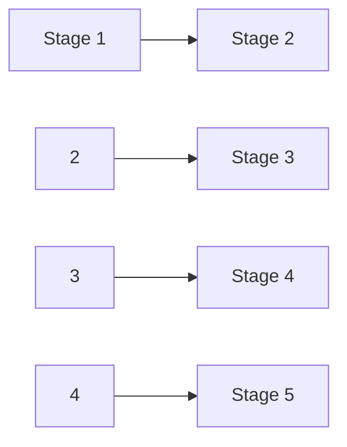
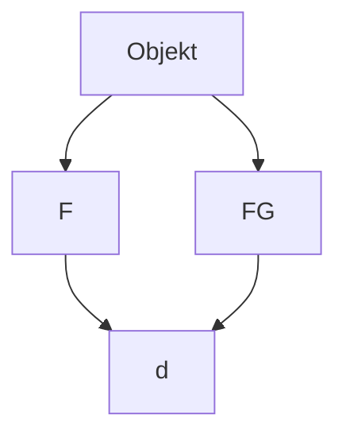

## 2.4.1 Reibung

Reibungskräfte sind in unserem täglichen Leben unvermeidbar. Wären wir nicht in der Lage, ihnen entgegenzuwirken, würden sie jedes sich bewegende Objekt stoppen und jede sich drehende Antriebswelle anhalten. Etwa 20 % des von einem Auto verbrauchten Benzins werden dazu benötigt, die Reibung im Motor und im Antrieb auszugleichen. Gäbe es keine Reibung, so könnten wir allerdings kein Auto irgendwohin bewegen, wir könnten auch nicht laufen oder Fahrrad fahren. Wir könnten keinen Stift festhalten und, wenn wir es könnten, würde er nicht schreiben. Nägel und Schrauben wären nutzlos, gewebte Stoffe würden zerfallen und Knoten nicht halten.

An dieser Stelle beschäftigen wir uns mit Reibungskräften, die zwischen trocke nen, festen Oberflächen auftreten, welche sich entweder relativ zueinander in Ruhe befinden oder sich mit geringer Geschwindigkeit übereinander hinwegbewegen. Beginnen wir mit drei Gedankenexperimenten:

1. Lassen Sie ein Buch einen langen horizontalen Tisch entlang gleiten. Wie er wartet, wird das Buch langsamer und hält dann an. Dies bedeutet, dass das Buch eine Beschleunigung erfahren muss, die parallel zur Oberfläche des Tisches ver läuft und der Geschwindigkeit des Buchs entgegengesetzt gerichtet ist. Nach dem zweiten Newtonschen Gesetz (Aktionsprinzip) muss auf das Buch also eine Kraft wirken, die ebenfalls parallel zur Tischoberfläche verläuft und der Ge schwindigkeit des Buchs entgegengesetzt ist. Diese Kraft ist eine Reibungskraft
2. Schieben Sie das Buch horizontal so, dass es sich mit konstanter Geschwindigkeit über den Tisch bewegt. Kann die von Ihnen ausgeübte Kraft die einzige Kraft sein, die in horizontaler Richtung auf das Buch wirkt? Nein, denn sonst müsste das Buch beschleunigen. Gemäß dem zweiten Newtonschen Gesetz muss auf das Buch also eine zweite Kraft wirken, die den gleichen Betrag besitzt wie Ihre Kraft, deren Richtung ihr jedoch entgegengesetzt ist, sodass sich die beiden Kräfte aufheben. Diese zweite Kraft ist eine parallel zum Tisch wirkende Reibungskraft.
3. Versuchen Sie, eine schwere Kiste horizontal zu verschieben. Die Kiste bewegt sich nicht. Gemäß dem zweiten Newtonschen Gesetz muss also noch eine zweite Kraft auf die Kiste wirken, die Ihrer Kraft entgegenwirkt. Diese Kraft muss Ihrer entgegengerichtet sein und den gleichen Betrag wie Ihre Kraft besitzen, sodass sich die beiden Kräfte aufheben. Diese zweite Kraft ist eine Reibungskraft. Schieben Sie noch stärker. Die Kiste bewegt sich immer noch nicht. Offensichtlich kann die Reibungskraft ihren Betrag verändern, sodass sich die beiden Kräfte immer noch aufheben. Schieben Sie nun mit all Ihrer Kraft. Die Kiste beginnt zu rutschen. Offenbar gibt es einen maximalen Betrag der Reibungskraft: Wenn Sie diesen Maximalbetrag überschreiten, wird die Kiste (endlich) beschleunigt und fängt zu rutschen an.

Abbildung 2.10 zeigt eine ähnliche Situation im Detail. In Abb. 2.10a ruht ein Quader auf einer Tischplatte. Dabei wird die Gravitationskraft $\scriptstyle { \vec { F } } _ { \mathrm { G } }$ durch eine Normalkraft $\vec { N }$ ausgeglichen. In Abb. 2.10b üben Sie eine Kraft $\vec { F }$ auf den Quader aus, indem Sie versuchen, ihn nach links zu ziehen. Infolgedessen wirkt eine Reibungskraft $\vec { f } _ { s }$ nach rechts, die Ihre Kraft genau aufhebt. Die Kraft $\vec { f } _ { s }$ wird statische Reibungskraft oder **Haftreibungskraft** genannt. Der Quader bewegt sich nicht.

Die Abb. 2.10c und d zeigen, dass der Betrag der Haftreibungskraft $\vec { f } _ { s }$ in dem Maß, wie Sie den Betrag der aufgewendeten Kraft erhöhen, ebenfalls wächst und der Quader in Ruhe verbleibt. Erreicht die aufgewendete Kraft aber einen bestimmten Maximalbetrag, löst sich der Quader aus seinem engen Kontakt mit der Tisch platte und beschleunigt nach links (Abb. 2.10e). Die Reibungskraft, die der Bewegung dann entgegenwirkt, nennt man kinetische oder **Gleitreibungskraft** $\vec { f } _ { \mathrm { k } } .$

Normalerweise ist der Betrag der Gleitreibungskraft, die bei Bewegung wirkt, geringer als der Maximalbetrag der Haftreibungskraft, die in Ruhe wirkt. Wenn Sie den Quader also mit konstanter Geschwindigkeit über die Oberfläche bewe-

## Abb. 2.10

(a) Die Kräfte, die auf einen in Ruhe befindlichen Quader wirken.
(b)–(d) Eine äußere, auf den Quader wirkende Kraft $\vec { F }$ wird durch eine Haftreibungskraft $\vec { f } _ { s }$ aufgehoben. Wächst $F ,$ so nimmt $f _ { s }$ bis zu einem bestimmten Maximalwert ebenfalls zu. (e) Der Quader löst sich und wird plötzlich in Richtung von $\vec { F }$ beschleunigt. (f ) Soll sich der Quader mit konstanter Geschwindigkeit bewegen, so muss F von dem Maximalwert, den F beim Loslösen des Quaders besaß, verringert werden. (g) Einige Ergebnisse der Versuchsreihe (a) bis (f ).

text_image

(a)
(b)

Abb. 2.11

Gleitreibung. (a) In dieser Gesamtansicht gleitet die obere Oberfläche auf der unteren nach rechts. (b) Der Ausschnitt zeigt zwei Punkte, die kalt verschweißt sind. Eine Kraft wird benö- tigt, um die Schweißstellen zu trennen und die Bewegung aufrechtzuerhalten.

gen wollen, müssen Sie meist die aufgewendete Kraft verringern, sobald sich der Quader wie in Abb. 2.10f gezeigt zu bewegen beginnt. Abbildung 2.10g zeigt als Beispiel die Ergebnisse eines Experiments, bei dem die auf einen Quader wirkende Kraft langsam erhöht wurde, bis sich der Quader loslöste. Beachten Sie, dass nach dem Loslösen eine geringere Kraft benötigt wird, um den Quader mit konstanter Geschwindigkeit zu bewegen.

Eine Reibungskraft ist im Wesentlichen die (äußerst komplizierte) Vektorsumme der unzähligen Kräfte, die zwischen den Oberflächenatomen eines Körpers und denen eines anderen wirken. Werden zwei extrem glatt polierte und sorgfältig gesäuberte Metalloberflächen im hochreinen Vakuum (damit sie sauber bleiben) zusammengebracht, gelingt es nicht, sie aufeinander gleiten zu lassen. Da ihre Oberflächen sehr glatt sind, berühren so viele Atome der einen Oberfläche die Atome der anderen, dass die Oberflächen sofort kalt zu einem einzigen Metallstück verschweißen. Hält ein Maschinenschlosser seine speziell polierten Maßblöcke in Luft aneinander, so berühren sich zwar weniger Atome, die Blöcke haften jedoch immer noch so fest aneinander, dass man sie nur durch eine ruckartige Drehbewegung wieder trennen kann. Im Allgemeinen können sich allerdings nicht so viele Atome berühren wie in diesen beiden Extremfällen. Sogar eine äußerst sorgfältig polierte Metalloberfläche ist weit davon entfernt, auf atomarer Skala glatt zu sein. Überdies sind die Oberflächen von Alltagsgegenständen mit Schichten von Oxiden und anderen Verunreinigungen bedeckt, die das Kaltschweißen verhindern.

Werden zwei gewöhnliche Oberflächen aufeinander gelegt, so berühren sich nur die Spitzen auf der Oberfläche – etwa so, als ob man die Schweizer Alpen umdreht und auf die Österreichischen Alpen klappt. Die tatsächliche mikroskopische Berührungsfläche ist viel geringer – vielleicht um das $1 0 ^ { 4 } - \mathrm { F a c h e } -$ als die scheinbare makroskopische. Trotzdem verschweißen viele Berührungspunkte kalt. Diese Schweißstellen erzeugen Haftreibung, wenn eine Kraft aufgewendet wird, um die Oberflächen übereinander gleiten zu lassen.

Ist die aufgewendete Kraft groß genug, um die eine Oberfläche über die andere zu ziehen, so werden zuerst die Schweißstellen getrennt (beim Loslösen) und dann an den zufälligen Berührungspunkten während der Bewegung ständig neue gebildet und wieder getrennt (Abb. 2.11). Die Gleitreibungskraft ${ \vec { f } } _ { \mathrm { k } } ,$ die der Bewegung entgegenwirkt, ist die Vektorsumme der an diesen vielen zufälligen Berührungspunkten wirkenden Kräfte.

Werden die zwei Oberflächen stärker zusammengepresst, verschweißen noch mehr Punkte kalt. Um die Oberflächen dann übereinander gleiten zu lassen, muss eine größere Kraft aufgewendet werden: Die Haftreibungskraft $\vec { f } _ { s }$ besitzt einen hö- heren Maximalbetrag. Sobald die zwei Oberflächen gleiten, gibt es viel mehr Punkte, die kurzzeitig kalt verschweißen, sodass die Gleitreibungskraft $\vec { f } _ { \mathrm { k } }$ ebenfalls grö- ßer ist.

Oft erfolgt die Gleitbewegung einer Oberfläche auf einer anderen ruckartig, da die zwei Oberflächen abwechselnd zusammenhaften und dann wieder übereinander gleiten. Ein solches wiederholtes Haften und Gleiten kann Quietschen und Kreischen erzeugen, wenn z. B. Reifen auf trockener Straße rutschen, Fingernä- gel an einer Tafel kratzen oder eine Tür mit rostigen Angeln geöffnet wird. Es kann aber auch sehr schöne Töne erzeugen, wenn z. B. eine Geigerin den Bogen gekonnt über die Saiten ihrer Violine führt.

## 2.4.2 Eigenschaften der Reibung

Experimentell zeigt sich Folgendes: Drückt ein trockener und nicht geschmierter Körper gegen eine ebensolche Oberfläche, während eine Kraft $i \vec { F }$ versucht, den Körper über die Oberfläche gleiten zu lassen, so besitzt die resultierende Reibungskraft drei Eigenschaften:

**• Eigenschaft 1.** Bewegt sich der Körper nicht, so heben sich die Haftreibungskraft $\vec { f } _ { s }$ und die parallel zur Oberfläche wirkende Komponente von $\vec { F }$ auf. Ihr Betrag ist gleich, und $\vec { f } _ { s }$ ist dieser Komponente von $\vec { F }$ entgegen gerichtet.
**• Eigenschaft 2.** Der Maximalbetrag $f _ { \mathrm { s , m a x } }$ von $\vec { f } _ { s }$ wird durch

$$
f _ {\mathrm{s,max}} = \mu_ {\mathrm{s}} N \tag {2.11}
$$

bestimmt, wobei $\mu _ { s }$ der Koeffizient der statischen Reibung oder Haftreibungs**koeffizient** und N der Betrag der Normalkraft ist, welche die Oberfläche auf den Körper ausübt. Übersteigt der Betrag der parallel zur Oberfläche wirkenden Komponente von $\vec { F }$ den Wert $f _ { \mathrm { s , m a x ^ { \star } } }$ so beginnt der Körper, über die Oberfläche zu gleiten.

**• Eigenschaft 3.** Beginnt der Körper über die Oberfläche zu gleiten, so verringert sich der Betrag der Reibungskraft rasch auf einen Wert $f _ { \mathrm { k } } ,$ der durch

$$
f _ {\mathrm{k}} = \mu_ {\mathrm{k}} N \tag {2.12}
$$

gegeben ist. Dabei ist $\mu _ { \mathrm { k } }$ der Koeffizient der kinetischen Reibung oder Gleitrei**bungskoeffizient**. Während des Gleitens wirkt der Bewegung dann eine Gleitreibungskraft $\vec { f } _ { \mathrm { k } }$ entgegen, deren Betrag Gl. 2.12 angibt.

Der Betrag N der Normalkraft stellt bei den Eigenschaften 2 und 3 ein Maß dafür dar, wie stark der Körper gegen die Oberfläche drückt. Wird der Druck des Körpers größer, dann ist N gemäß dem dritten Newtonschen Gesetz ebenfalls größer. Die Eigenschaften 1 und 2 gehen hier von einer einzigen aufgewendeten Kraft F⃗ aus, sie gelten jedoch ebenso für eine Gesamtkraft, die von mehreren auf den Körper wirkenden Kräften ausgeübt wird. Beachten Sie, dass die Gln. 2.11 und 2.12 keine Vektorgleichungen sind: $\vec { f } _ { s }$ und $\vec { f } _ { \mathrm { k } }$ wirken stets parallel zur Oberfläche und entgegen der versuchten Gleitbewegung; die Normalkraft N wirkt senkrecht zur Oberfläche.

Die Koeffizienten $\mu _ { s }$ und $\mu _ { \mathrm { k } }$ sind dimensionslos und müssen experimentell bestimmt werden. Ihr Wert hängt von den speziellen Eigenschaften sowohl des Körpers als auch der Oberfläche ab. Im Allgemeinen werden sie deshalb mit der Präposition „zwischen“ angegeben, z. B. in der Aussage „der Wert von $\mu _ { s }$ zwischen einem Ei und einer teflonbeschichteten Bratpfanne ist $_ { 0 , 0 4 ; }$ zwischen Bergschuhen und Fels beträgt er immerhin 1,2“. Wir gehen davon aus, dass der Wert von $\mu _ { \mathrm { k } }$ nicht vom Geschwindigkeitsbetrag abhängt, mit dem der Körper über die Oberfläche gleitet.

## KONTROLLFRAGE 9

Ein Block liegt auf dem Fußboden. (a) Wie groß ist der Betrag der Reibungskraft, die der Fußboden auf den Block ausübt? (b) Nun wird eine horizontale Kraft von 5 N auf den Block angewendet, dieser bewegt sich jedoch nicht. Wie groß ist die auf den Block wirkende Reibungskraft? (c) Der Maximalwert $f _ { \mathrm { s , m a x } }$ der auf den Quader wirkenden Haftreibungskraft sei gleich 10 N. Bewegt sich der Block, wenn der Betrag der horizontal wirkenden Kraft gleich 8 N ist? (d) Und wenn der Betrag gleich 12 N ist? (e) Wie groß ist der Betrag der Reibungskraft in Teil (c)?

## KONTROLLFRAGE 10

In der Abbildung wirkt eine Kraft $\vec { F } _ { 1 }$ mit dem Betrag 10 N waagerecht auf eine Kiste, die sich auf dem Boden befindet; die Kiste bewegt sich jedoch nicht. Nun wird eine senkrecht nach oben wirkende Kraft $\vec { F } _ { 2 }$ auf die Kiste angewendet, deren Betrag von null ausgehend ansteigt, ohne dass sich die Kiste jedoch zur Seite bewegt. Werden die folgenden Größen anwachsen, abfallen oder gleich bleiben: (a) der Betrag der auf die Kiste wirkenden Reibungskraft; (b) der Betrag der vom Boden auf die Kiste ausgeübten Normalkraft; (c) der Maximalbetrag θ der auf die Kiste wirkenden Haftreibungskraft?

text_image

Physics diagram showing two forces F1 and F2 acting on a block on a horizontal surface

## 2.5 Strömungswiderstand und Endgeschwindigkeit

## Lernziele

Nach dem Durcharbeiten dieses Abschnitts sollten Sie in der Lage sein, . . .

• die Beziehung zwischen dem Strömungswiderstand, den ein Körper bei einer Bewegung durch Luft spürt, und seiner Geschwindigkeit anzugeben,
• die Endgeschwindigkeit eines Körpers anzugeben, der in Luft fällt.

## Schlüsselideen

Wenn ein Körper sich relativ zu Luft (oder einem anderen Fluid) bewegt, erfährt er einen Strömungswiderstand $\vec { \bar { F } } _ { \mathrm { G } } ,$ die der relativen Bewegung entgegengesetzt ist und in die Richtung zeigt, in die das Fluid relativ zu dem Körper fließt. Der Betrag von $\vec { D }$ hängt über einen experimentell zu bestimmenden Luftwiderstandsbeiwert $C$ mit der Relativgeschwindigkeit v zwischen Körper und Fluid zusammen:

$$
D = \frac {1}{2} C \rho A \nu^ {2},
$$

wobei $\rho$ die Dichte des Fluids ist (Masse pro Volumeneinheit) und A die effektive Querschnittsfläche des Körpers (seine Querschnittsfläche senkrecht zur Relativgeschwindigkeit v⃗).

• Wenn ein gedrungener Gegenstand weit genug durch die Luft gefallen ist, werden die Beträge des Strömungswiderstands und der Schwerkraft des Körpers gleich. Er fällt dann mit einer konstanten Endgeschwindigkeit

$$
\nu_ {\mathrm{t}} = \sqrt {\frac {2 F _ {\mathrm{G}}}{C \rho A}}.
$$

## 2.5.1 Strömungswiderstand und Endgeschwindigkeit

Als ein **Fluid** bezeichnet man alles, was fließen kann – im Allgemeinen sowohl ein Gas als auch eine Flüssigkeit. Wenn sich ein Fluid und ein Körper relativ zueinander in Bewegung befinden (entweder weil sich der Körper durch das Fluid bewegt oder weil das Fluid an dem Körper vorbeiströmt), so erfährt der Körper einen **Strö- mungswiderstand** ${ \vec { D } } _ { i }$ welcher der Relativbewegung entgegengerichtet ist und in die Richtung zeigt, in die das Fluid relativ zum Körper fließt.

Wir betrachten an dieser Stelle nur Fälle, in denen die Luft das Fluid darstellt. Der betrachtete Körper ist eher gedrungen als schlank (wie z. B. ein Ball, nicht wie ein Speer) und die Relativgeschwindigkeit ist so hoch, dass die Luft hinter dem Körper turbulent wird, also Wirbel bildet. In solchen Fällen ist der Betrag des Strömungswiderstands $\vec { D }$ über einen experimentell bestimmten **Widerstandskoeffizienten** C mit dem Betrag der Relativgeschwindigkeit v verknüpft:

$$
D = \frac {1}{2} C \rho A \nu^ {2}, \tag {2.13}
$$

natural_image

Skier mid-air in a snowy mountain landscape, no visible text or symbols

Abb. 2.12

Diese Skifahrerin bückt sich in die Abfahrtshocke, um so ihre effektive Querschnittsfläche und damit den auf sie wirkenden Luftwiderstand zu minimieren [Quelle: resilva/Shutterstock].

wobei $\rho$ die Dichte der Luft (Masse pro Volumen) und A die effektive Quer**schnittsfläche** des Körpers darstellt, d. h. die Querschnittsfläche senkrecht zur Geschwindigkeit $\vec { \nu } .$ Der Widerstandskoeffizient C (dessen Werte typischerweise zwischen $^ { 0 , 4 }$ und 1,0 liegen) ist keine wirkliche Konstante für einen gegebenen Körper, da der Wert von C variieren kann, wenn v sich deutlich verändert. Solche Komplikationen lassen wir hier allerdings außer Acht.

Abfahrtsläufer wissen sehr genau, dass der Strömungswiderstand von A und $\nu ^ { 2 }$ abhängt. Um hohe Geschwindigkeiten zu erreichen, muss ein Skifahrer $D$ so gering wie möglich halten, indem er $\mathbf { Z } .$ B. in die Hocke geht (Abb. 2.12) und so A minimiert.

Wenn ein gedrungener Gegenstand aus seiner Ruheposition heraus durch Luft fällt, so ist der Strömungswiderstand $\vec { D }$ nach oben gerichtet; sein Betrag wächst mit dem Betrag der Geschwindigkeit des Körpers allmählich von null an. Diese nach oben wirkende Kraft $\vec { D }$ wirkt der nach unten gerichteten Gravitationskraft $\vec { F } _ { \mathrm { G } }$ auf den Körper entgegen. Wir können diese Kräfte mit der Beschleunigung des Körpers verbinden, indem wir das zweite Newtonsche Gesetz für eine vertikale y-Achse $( F _ { \mathrm { g e s } ,   y } = m a _ {   y } )$ benutzen:

$$
D - F _ {\mathrm{G}} = m a, \tag {2.14}
$$

mit m als Masse des Körpers. Wie in Abb. 2.13 angedeutet ist, gleichen sich $D$ und $F _ { \mathrm { G } }$ letztendlich aus, wenn der Körper lange genug fällt. Aus Gl. 2.14 ergibt sich, dass dann $\alpha = 0$ und folglich der Betrag der Geschwindigkeit des Körpers konstant ist. Der Körper fällt gleichförmig mit der „terminalen“ **Endgeschwindigkeit** $\nu _ { \mathrm { t } } .$

Um $\nu _ { \mathrm { t } }$ zu bestimmen, setzen wir $\alpha = 0$ in Gl. 2.14 ein, ersetzen D anhand von Gl. 2.13 und erhalten:

$$
\frac {1}{2} C \rho A \nu_ {\mathrm{t}} ^ {2} - F _ {\mathrm{G}} = 0,
$$

woraus

$$
\nu_ {\mathrm{t}} = \sqrt {\frac {2 F _ {\mathrm{G}}}{C \rho A}} \tag {2.15}
$$

folgt. Tabelle 2.1 zeigt Werte von $\nu _ { \mathrm { t } }$ für einige alltägliche Körper.

Berechnungen1) zufolge, die auf Gl. 2.13 beruhen, muss eine Katze etwa sechs Stockwerke tief fallen, um ihre Endgeschwindigkeit zu erreichen. Bis dies geschieht, ist $F _ { G } > D$ und die Katze wird wegen der nach unten gerichteten Gesamtkraft nach unten beschleunigt. Erinnern Sie sich an Kap. 1: Unser Körper ist ein Beschleunigungsmesser, kein Geschwindigkeitsmesser. Da die Katze ebenfalls die Beschleunigung fühlt, hat sie Angst, behält die Pfoten unter ihrem Körper, zieht den Kopf ein und macht einen Buckel, wodurch A klein, $\nu _ { \mathrm { t } }$ groß und eine Verletzung bei der Landung wahrscheinlich wird.

Erreicht die Katze jedoch die Endgeschwindigkeit $\nu _ { \mathrm { t } } ,$ so wird die Beschleunigung gleich null, die Katze entspannt sich etwas, streckt ihre Beine sowie den Hals horizontal aus und macht den Rücken gerade (sie erinnert dann an ein Eichhörnchen im Sprung). Dies vergrößert die Fläche A und somit laut Gl. 2.13 auch den Strö- mungswiderstand D. Der Fall der Katze verlangsamt sich, da nun $D > F _ { G }$ (die Gesamtkraft ist nach oben gerichtet), bis eine neue, kleinere Endgeschwindigkeit $\nu _ { \mathrm { t } }$ erreicht wird. Die Verringerung von $\nu _ { \mathrm { t } }$ reduziert die Wahrscheinlichkeit einer ernsten Verletzung bei der Landung. Kurz vor Ende des Falls, wenn die Katze merkt, dass sie sich dem Boden nähert, zieht sie die Beine zurück unter den Körper, um sich auf die Landung vorzubereiten.

Abb. 2.13

Die auf einen in Luft fallenden Körper wirkenden Kräfte: (a) Der Körper zu Beginn des Falls; (b) Kräftediagramm etwas später, nachdem sich ein Strömungswiderstand entwickelt hat. (c) Der Strömungswiderstand hat zugenommen, bis er die auf den Körper wirkende Gravitationskraft ausgleicht. Der Körper fällt nun mit seiner konstanten Endgeschwindigkeit.

TABELLE 2.1: Einige Endgeschwindigkeiten beim freien Fall in Luft.

| Körper | Endgeschwindigkeit (m/s) | 95-%-Entfernunga)(m) |
| --- | --- | --- |
| Kugel (vom Kugelstoßen) | 145 | 2500 |
| Fallschirmspringer (durchschnittlich, Fallschirm nicht geöffnet) | 60 | 430 |
| Baseball | 42 | 210 |
| Tennisball | 31 | 115 |
| Basketball | 20 | 47 |
| Tischtennisball | 9 | 10 |
| Regentropfen (Radius = 1,5 mm) | 7 | 6 |
| Fallschirmspringer (durchschnittlich, Fallschirm geöffnet) | 5 | 3 |

a) Dies ist die Höhe, aus der ein Körper aus der Ruhe fallen muss, um 95 % seiner Endgeschwindigkeit zu erreichen [Quelle: nach Brancazio, P.J. (1984). Sport Science („Sportwissenschaft“). New York: Simon & Schuster].

1) Whitney, W.O. und Mehlhaff C.J. (1987). „High-Rise Syndrome in Cats“. The Journal of the American Veterinary Medical Association („Das Hochhaus-Phänomen bei Katzen“, Zeitschrift der Amerikanischen Veterinärmedizinischen Gesellschaft), 191: 1399–1403.

natural_image

Aerial view of multiple people in mid-air during a parachute, surrounded by farmland and landscape (no text or symbols visible)

Abb. 2.14

Fallschirmspringer in einer horizontalen Spread-Eagle-Position, die ihren Strömungswiderstand maximiert [Quelle: Mauricio Graiki/Shutterstock].

Beim Fallschirmspringen lassen sich Unerschrockene aus großen Höhen fallen, um das Gefühl des freien Falls zu genießen. Im April 1987 jedoch bemerkte der Fallschirmspringer Gregory Robertson, dass seine Kollegin Debbie Williams durch den Zusammenstoß mit einem dritten Fallschirmspringer das Bewusstsein verloren hatte und ihren Fallschirm nicht öffnen konnte. Robertson befand sich zu diesem Zeitpunkt weit über Williams und hatte seinen Fallschirm für den 4 km hohen Sprung noch nicht geöffnet. Er richtete seinen Körper neu aus, mit dem Kopf nach unten, um A zu minimieren und seine abwärts gerichtete Geschwindigkeit zu maximieren. Er erreichte dabei eine geschätzte Endgeschwindigkeit $\nu _ { \mathrm { t } }$ von 320 km/h, holte Williams ein und ging dann in eine horizontale Position über (wie in Abb. 2.14), um D zu erhöhen, sodass er sie fassen konnte. Er öffnete ihren Fallschirm und – nachdem er sie losgelassen hatte – seinen eigenen, gerade mal 10 s vor dem Aufprall. Williams erlitt wegen fehlender Kontrolle bei der Landung schwere innere Verletzungen, aber sie überlebte.

## KONTROLLFRAGE 11

Ist die Geschwindigkeit großer Regentropfen kurz über dem Erdboden größer als, kleiner als oder genauso groß wie die Geschwindigkeit kleiner Regentropfen, wenn wir annehmen, dass alle Regentropfen kugelförmig sind und den gleichen Widerstandskoeffizienten besitzen?

## 2.6 Gleichförmige Kreisbewegung

## Lernziele

Nach dem Durcharbeiten dieses Abschnitts sollten Sie in der Lage sein, . . .

den bei einer gleichförmigen Kreisbewegung zurückgelegten Weg zu skizzieren und die Vektoren der Geschwindigkeit, der Beschleunigung und der Kraft während der gesamten Bewegung zu erläutern (Beträge und Richtungen),
• zu verstehen, dass ein Objekt keine gleichförmige Kreisbewegung ausführen kann, wenn es keine radial nach innen gerichtete Kraft (eine Zentripetalkraft) gibt,
• für ein Teilchen, das eine gleichförmige Kreisbewegung ausführt, die Beziehung zwischen Kreisradius, Geschwindigkeit und Masse des Teilchens und der resultierenden Kraft auf das Teilchen anzugeben und anzuwenden.

## Schlüsselideen

Wenn sich ein Teilchen auf einer Kreisbahn oder einem Kreisbogen mit Radius R mit konstanter Geschwindigkeit v bewegt, sagt man, dass es eine gleichförmige Kreisbewegung ausführt. Es spürt dann eine Zentripetalbeschleunigung mit dem Betrag

$$
a = \frac {\nu^ {2}}{R}.
$$

• Diese Beschleunigung wird durch eine resultierende Zentripetalkraft auf das Teilchen mit dem Betrag

$$
F = \frac{mv^2}{R}
$$

verursacht, wobei m die Masse des Teilchens ist. Die Vektorgrößen $\vec { a }$ und $\vec { F }$ zeigen in Richtung auf den Krümmungsmittelpunkt der Bahn des Teilchens (den Kreismittelpunkt).

## 2.6.1 Gleichförmige Kreisbewegung

Wenn sich ein Körper mit einer konstanten Geschwindigkeit v auf einem Kreis bzw. einem Kreisbogen bewegt, spricht man – wie wir aus Abschn. 1.10 wissen – von einer gleichförmigen Kreisbewegung. Wir wissen auch, dass der Körper dabei einer (zum Kreismittelpunkt gerichteten) Zentripetalbeschleunigung unterliegt, deren Betrag durch

$$
a = \frac {\nu^ {2}}{R} \quad (\text {Zentripetalbeschleunigung}) \tag {2.16}
$$

bestimmt wird, wobei R der Radius des Kreises ist.

Lassen Sie uns zwei Bespiele von gleichförmigen Kreisbewegungen betrachten:

## 1. Mit einem Auto um eine Kurve fahren

Sie sitzen in der Mitte der Rückbank eines Autos, das sich mit konstanter, ho her Geschwindigkeit entlang einer ebenen Straße bewegt. In dem Moment, in dem der Fahrer plötzlich nach links steuert und eine kreisförmige Kurve fährt, rutschen Sie auf dem Sitz nach rechts und werden während des gesamten Rests der Kurve an die Seite des Autos gedrückt. Was geschieht dabei?

Während sich das Auto auf der Kreisbahn (bzw. dem Kreisbogen) bewegt, führt es eine gleichförmige Kreisbewegung aus, d. h., es besitzt eine auf den Kreismit telpunkt gerichtete Beschleunigung. Gemäß dem zweiten Newtonschen Gesetz muss eine Kraft diese Beschleunigung verursachen. Diese Kraft muss ebenfalls zum Kreismittelpunkt weisen. Es handelt sich dabei also um eine Zentripetalkraft, wobei „zentripetal“ nichts anderes als „zum Zentrum strebend“ bedeutet. In diesem Beispiel ist die Zentripetalkraft eine von der Straße auf die Reifen ausgeübte Reibungskraft. Sie ermöglicht das Abbiegen.

Wenn Sie sich zusammen mit dem Auto in einer gleichförmigen Kreisbewegung bewegen sollen, so muss auch auf Sie eine Zentripetalkraft wirken. Offensichtlich war jedoch die vom Sitz auf Sie ausgeübte Reibungskraft nicht groß genug, als dass Sie sich mit dem Auto im Kreis bewegen könnten. Deshalb rutscht der Sitz unter Ihnen weg, bis die rechte Wand des Autos gegen Sie drückt. Danach sorgt dieser Druck für die notwendige, auf Sie wirkende Zentripetalkraft, sodass Sie die gleichförmige Kreisbewegung zusammen mit dem Auto ausführen.

## 2. Umkreisen der Erde

Diesmal sind Sie Passagier einer Raumfähre. Während die Raumfähre und Sie die Erde umkreisen, schweben Sie sanft in Ihrer Kabine herum. Was geschieht nun?

Das Spaceshuttle und Sie führen beide eine gleichförmige Kreisbewegung aus, Sie werden beide zum Kreismittelpunkt beschleunigt. Auch hier müssen diese Beschleunigungen nach dem zweiten Newtonschen Gesetz durch Zentripetalkräfte verursacht werden. Dieses Mal sind die Zentripetalkräfte durch die Gra vitationskraft der Erde hervorgerufene, radial nach innen in Richtung Erdmit telpunkt zeigende Zugkräfte (die Gravitationskraft, die auf Sie wirkt, und die Gravitationskraft, die auf das Shuttle wirkt).

Sowohl im Auto als auch in der Raumfähre befinden Sie sich in einer gleichförmi gen Kreisbewegung, die durch eine Zentripetalkraft verursacht wird – Sie nehmen jedoch beide Situationen ganz unterschiedlich wahr. Im Auto werden Sie gegen die Wand gedrückt und nehmen diesen Druck der Wand bewusst wahr. In der Raumfähre auf der Umlaufbahn aber schweben Sie herum, ohne die auf Sie wirkende Kraft zu spüren. Woher kommt dieser Unterschied?

Die Ursache für diesen Unterschied liegt in der Natur der beiden Zentripetalkräfte. Im Auto ist die Zentripetalkraft der Druck gegen den Teil Ihres Körpers, der die Wand berührt. Sie können diesen Druck auf den Teil des Körpers spüren. In der Raumfähre ist die Zentripetalkraft die auf jedes Atom Ihres Körpers wirkende Erdanziehungskraft. Dadurch entsteht kein Druck (oder Zug) auf einen einzelnen Teil Ihres Körpers und somit auch kein Gefühl einer auf Sie wirkenden Kraft. (Dieses

text_image

Puck
Schnur
T
R
v
r

Abb. 2.15

Draufsicht auf einen Eishockeypuck der Masse m, der sich mit einem konstanten Geschwindigkeitsbetrag v auf einer kreisförmigen Bahn mit dem Radius R auf einer waagerechten, reibungsfreien Oberfläche bewegt. Die auf den Puck wirkende Zentripetalkraft ist die Zugspannung $\vec { T }$ der Schnur, die entlang der sich durch den Puck erstreckenden radialen r-Achse nach innen zeigt.

Gefühl wird als „Schwerelosigkeit“ bezeichnet, doch diese Bezeichnung ist irreführend. Die auf Sie wirkende Erdanziehungskraft ist keineswegs verschwunden, sondern in Wirklichkeit nur etwas schwächer als am Erdboden.)

Ein weiteres Beispiel für eine Zentripetalkraft ist in Abb. 2.15 dargestellt. Dabei bewegt sich ein mit einer Schnur an einem Pflock befestigter Eishockeypuck mit einer konstanten Geschwindigkeit v im Kreis. In diesem Fall ist die Zentripetalkraft die durch die Schnur auf den Puck ausgeübte Zugspannung, die radial nach innen zeigt. Ohne diese Kraft würde der Puck in einer geraden Linie davonrutschen, anstatt sich im Kreis zu bewegen.

Beachten Sie, dass die Zentripetalkraft keine neue Art von Kraft ist. Der Name gibt nur die Richtung der Kraft und die spezielle Art der Bewegung (nämlich auf krummen Wegen) an. Es kann sich hierbei um eine Reibungskraft, eine Gravitationskraft, eine durch eine Wand bzw. Schnur verursachte Kraft oder eine beliebige andere Kraft handeln. In jedem Fall gilt:

Eine Zentripetalkraft beschleunigt einen Körper, indem sie die Richtung der Geschwindigkeit des Körpers verändert, ohne den Betrag der Geschwindigkeit zu verändern.

Nach dem zweiten Newtonschen Gesetz und Gl. 2.16 $( a = \nu ^ { 2 } / R )$ können wir den Betrag $F$ einer Zentripetalkraft (oder einer Gesamtzentripetalkraft) als

$$
F = m \frac {v ^ {2}}{R} \quad (\text {Betrag der Zentripetalkraft}) \tag {2.17}
$$

schreiben. Da der Betrag der Geschwindigkeit v hierbei konstant ist, sind auch die Beträge der Beschleunigung und der Kraft konstant.

Die Richtungen von Zentripetalbeschleunigung und -kraft sind jedoch nicht konstant, sie ändern sich ständig derart, dass sie immer zum Kreismittelpunkt weisen. Aus diesem Grund werden die Kraft- und Beschleunigungsvektoren manchmal entlang einer radialen r-Achse (Radialachse r) dargestellt, die sich mit dem Körper bewegt und sich stets vom Kreismittelpunkt zum Körper erstreckt, wie in Abb. 2.15 gezeigt. Die positive Richtung der Achse wird radial nach außen angenommen, die Beschleunigungs- und Kraftvektoren weisen radial nach innen.

## KONTROLLFRAGE 12

Sie sitzen in einem Riesenrad, das sich mit konstanter Geschwindigkeit bewegt. In welche Richtung zeigen die auf Sie wirkende Beschleunigung $\vec { a }$ sowie die Normalkraft $\vec { N }$ der waagerechten Sitzfläche beim Durchqueren (a) des höchsten und (b) des tiefsten Punkts der Fahrt?

## KONTROLLFRAGE 13

Nehmen Sie an, das Auto aus Abb. Ü2.13 im Übungsbuch ist bei dem Kreisradius $R _ { 1 }$ kurz davor wegzurutschen. (a) Wenn wir die Geschwindigkeit des Autos verdoppeln, wie groß muss der Radius dann mindestens sein, um ein Rutschen des Autos zu verhindern? (b) Wenn wir die Masse des Autos ebenfalls verdoppeln (z. B. durch Sandsäcke), wie groß muss der Radius dann mindestens sein, um ein Rutschen des Autos zu verhindern?

## 2.7 Scheinkräfte

## Lernziele

Nach dem Durcharbeiten dieses Abschnitts sollten Sie in der Lage sein, . . .

• zwischen Kräften in Inertialsystemen und Scheinkräften in rotierenden Koordinatensystemen zu unterscheiden,
• die Zentrifugalkraft, die Coriolis-Kraft und die Azimutalkraft auszurechnen.

## Schlüsselideen

• Die Newtonschen Gesetze gelten nicht in rotierenden Koordinatensystemen, da diese keine Inertialsysteme sind.
• In rotierenden Koordinatensystemen treten Scheinkräfte auf, die die Dimension einer physikalischen Kraft haben und in geeigneten Situationen subjektiv als Kraft wahrgenommen werden.
• Man muss sorgfältig zwischen Bewegungsgleichungen in raumfesten, inertialen Koordinatensystemen und in rotierenden Koordinatensystem unterscheiden.
• Beim Umschreiben der Newtonschen Bewegungsgleichungen von einem raumfesten in ein rotierendes Koordinatensystem treten Zusatzterme auf, die als Scheinkräfte interpretiert werden können.

## 2.7.1 Nichtinertialsysteme

Die Newtonschen Gesetze gelten bekanntlich ja nur in **Inertialsystemen**, d. h., sie gelten nicht in **rotierenden Koordinatensystemen**. Nun befinden wir uns auf der Erde aber gerade in solch einem rotierenden System und es stellt sich die Frage, welche Auswirkungen dies auf die Bewegungsgleichungen hat.

Zur systematischen Untersuchung dieser Effekte definieren wir ein absolutes (nicht mit der Erde rotierendes) Koordinatensystem K, das ein echtes Inertialsystem darstellen soll. Hier auf der Erde haben wir das Koordinatensystem $\mathrm { K } ^ { \prime } ,$ das relativ zu K mit der **Winkelgeschwindigkeit** ω⃗ der Erddrehung rotiert. In dem Inertialsystem K gilt das Newtonsche Bewegungsgesetz

$$
\vec {F} _ {\mathrm{ext}} = \left. \frac {\mathrm{d} \vec {p}}{\mathrm{d} t} \right| _ {\mathrm{K}}, \tag {2.18}
$$

wobei wir die einwirkende externe Kraft mit $\vec { F } _ { \mathrm { e x t } }$ bezeichnen und $\mathrm { d } / \mathrm { d } t | _ { \mathrm { K } }$ anzeigen |soll, dass die Zeitableitung im Koordinatensystem K genommen wird. (Wir haben bisher immer die Formulierung des zweiten Newtonsches Gesetzes mit Masse und Beschleunigung benutzt (Gln. 2.1 bzw. 2.25), wie dies mit dem Impuls $\vec { p }$ zusammenhängt, wird in Abschn. 5.3 näher erläutert werden.)

Zwischen den Zeitableitungen im festen Koordinatensystem K und dem rotierenden Koordinatensystem besteht die Beziehung

$$
\left. \frac {\mathrm{d}}{\mathrm{d} t} \right| _ {\mathrm{K}} = \left. \frac {\mathrm{d}}{\mathrm{d} t} \right| _ {\mathrm{K} ^ {\prime}} + \vec {\omega} \times \tag {2.19}
$$

sodass wir Gl. 2.18 umschreiben können in

$$
\vec {F} _ {\mathrm{ext}} = \left. \frac {\mathrm{d} \vec {p}}{\mathrm{d} t} \right| _ {\mathrm{K} ^ {\prime}} + \vec {\omega} \times \vec {p}. \tag {2.20}
$$

Nun gilt für Systeme mit zeitlich konstanter Masse

$$
\vec {p} = m \left. \frac {\mathrm{d} \vec {r}}{\mathrm{d} t} \right| _ {\mathrm{K}}, \tag {2.21}
$$

was wir im rotierenden Koordinatensystem K′ schreiben können als

$$
\vec {p} = m \left. \frac {\mathrm{d} \vec {r}}{\mathrm{d} t} \right| _ {\mathrm{K} ^ {\prime}} + m \vec {\omega} \times \vec {r}. \tag {2.22}
$$

Setzen wir dies in Gl. 2.20 ein und sortieren die Terme um, so erhalten wir

$$
\vec {F} _ {\mathrm{ext}} = m \left. \frac {\mathrm{d} ^ {2} \vec {r}}{\mathrm{d} t ^ {2}} \right| _ {\mathrm{K} ^ {\prime}} + 2 m \vec {\omega} \times \left. \frac {\mathrm{d} \vec {r}}{\mathrm{d} t} \right| _ {\mathrm{K} ^ {\prime}} + m \left. \frac {\mathrm{d} \vec {\omega}}{\mathrm{d} t} \right| _ {\mathrm{K} ^ {\prime}} \times \vec {r} + m \vec {\omega} \times (\vec {\omega} \times \vec {r}). \tag {2.23}
$$

Durch Umstellen der Terme wird daraus

$$
m \left. \frac {\mathrm{d} ^ {2} \vec {r}}{\mathrm{d} t ^ {2}} \right| _ {\mathrm{K} ^ {\prime}} = \vec {F} _ {\text {ext}} - m \vec {\omega} \times (\vec {\omega} \times \vec {r}) - 2 m \vec {\omega} \times \left. \frac {\mathrm{d} \vec {r}}{\mathrm{d} t} \right| _ {\mathrm{K} ^ {\prime}} - m \left. \frac {\mathrm{d} \vec {\omega}}{\mathrm{d} t} \right| _ {\mathrm{K} ^ {\prime}} \times \vec {r}. \tag {2.24}
$$

| | |Diese Gleichung hat genau die Form der Newtonschen Bewegungsgleichung für konstante Masse,

$$
m \vec {a} = \vec {F} _ {\text {effektiv}}, \tag {2.25}
$$

wenn wir die Beschleunigung

$$
\vec {a} = \left. \frac {\mathrm{d} ^ {2} \vec {r}}{\mathrm{d} t ^ {2}} \right| _ {\mathrm{K} ^ {\prime}} \tag {2.26}
$$

|auf der Erde, d. h. im rotierenden Koordinatensystem messen. Alle Terme auf der rechten Seite von Gl. 2.24 fassen wir als effektive Kraft auf,

$$
\vec {F} _ {\mathrm{effektiv}} = \vec {F} _ {\mathrm{ext}} - m \vec {\omega} \times (\vec {\omega} \times \vec {r}) - 2 m \vec {\omega} \times \left. \frac {\mathrm{d} \vec {r}}{\mathrm{d} t} \right| _ {\mathrm{K} ^ {\prime}} - m \left. \frac {\mathrm{d} \vec {\omega}}{\mathrm{d} t} \right| _ {\mathrm{K} ^ {\prime}} \times \vec {r}. (2. 2 7)
$$

Physikalisch gesehen handelt es sich dabei aber keineswegs um echte Kräfte, sondern um Korrekturterme, die nur aufgrund der Rotation unseres Koordinatensystems auftreten. Daher bezeichnet man diese Terme auch als Scheinkräfte. Speziell sind

$$
\vec {F} _ {\text {Zentrifugal}} = - m \vec {\omega} \times (\vec {\omega} \times \vec {r}) \quad \text {(Zentrifugalkraft)} \tag {2.28}
$$

die **Zentrifugalkraft**,

$$
\vec {F} _ {\text {Coriolis}} = - 2 m \vec {\omega} \times \frac {\mathrm{d} \vec {r}}{\mathrm{d} t} \Bigg | _ {\mathrm{K} ^ {\prime}} \quad \tag {2.29}
$$

die **Coriolis-Kraft** und

$$
\vec {F} _ {\text {Azimutal}} = - m \left. \frac {\mathrm{d} \vec {\omega}}{\mathrm{d} t} \right| _ {\mathrm{K} ^ {\prime}} \times \vec {r} \quad \tag {2.30}
$$

## die Azimutalkraft.

Die Scheinkräfte haben die Dimension einer physikalischen Kraft und werden von uns Menschen in geeigneten Situationen subjektiv auch als solche wahrge nommen. Zum Beispiel wirkt auf einen Menschen, der sich entlang eines Kreises des Radius R mit der Geschwindigkeit θ bewegt – wie z. B. in einem Kinderkarussell – nur die Zentripetalkraft, Gl. 2.17. Als Person auf dem Karussell nimmt man die Situation aber so wahr, als ob es zusätzlich noch eine nach außen gerichtete Zentrifugalkraft oder Fliehkraft gäbe. Wohlgemerkt nimmt ein äußerer Beobachter, der sich nicht auf dem Karussell befindet, diese Scheinkraft nicht wahr. Für diesen Beobachter gibt es nur die Zentripetalkraft.

Schauen wir uns die Situation auf dem Karussell nochmals genauer an. Der Einfachheit halber ersetzen wir den Menschen durch einen Massepunkt m. Auf diesen wirkt die **Zentripetalkraft** (Gl. 2.17) in Richtung des Karussellmittelpunktes, d. h. nach innen:

$$
\vec {F} _ {\text {Zentripetal}} = - m \frac {\nu^ {2}}{R} \vec {e} _ {R} = - m \omega^ {2} R \vec {e} _ {R}. \tag {2.31}
$$

Hierbei ist die Bahngeschwindigkeit $\nu = \omega R$ und $\vec { e } _ { R } = \vec { R } / R$ der Einheitsvektor in Richtung $\vec { R } ,$ d. h. in Richtung weg vom Zentrum der Drehbewegung.

Zur Auswertung der Zentrifugalkraft (Gl. 2.28) verwenden wir die im Anhang D angegebene Formel

$$
\vec {a} \times (\vec {b} \times \vec {c}) = (\vec {a} \cdot \vec {c}) \vec {b} - (\vec {a} \cdot \vec {b}) \vec {c}. \tag {2.32}
$$

Für $\vec { a } = \vec { b } = \vec { \omega }$ und $\vec { c } = \vec { R }$ liefert dies

$$
\vec {\omega} \times (\vec {\omega} \times \vec {R}) = (\vec {\omega} \cdot \vec {R}) \vec {\omega} - (\vec {\omega} \cdot \vec {\omega}) \vec {R}.
$$

Da ω⃗ und $\vec { R }$ senkrecht aufeinander stehen, ergibt das Skalarprodukt $\vec { \omega } \cdot \vec { R } = 0$ und wir erhalten

$$
\vec {F} _ {\text {Zentrifugal}} = m \omega^ {2} \vec {R} = m \omega^ {2} R \vec {e} _ {R}. \tag {2.33}
$$

Für diesen Fall sind also Zentrifugal- und Zentripetalkraft vom Betrag her gleich, sie wirken aber in exakt entgegengesetzte Richtungen.

Die nach Gustave Gaspard **Coriolis** (1792–1843, sprich: „Koriolí“) benannte Scheinkraft (Gl. 2.29) wirkt nur auf Objekte, die sich relativ zum rotierenden Koordinatensystem bewegen, da ansonsten $\left. \mathrm { d } \vec { r } / \mathrm { d } t \right| _ { \mathrm { K } ^ { \prime } }   =   0$ ist. Die Wirkung der |Coriolis-Kraft zeigt sich an vielen Beispielen. Für die Physik spielt dabei wohl das sogenannte Foucaultsche Pendel, das wir in Kap. 12 vorstellen, die größte Rolle. Aber auch in der Meteorologie ist die Coriolis-Kraft sehr wichtig. Sie ist z. B. dafür verantwortlich, dass sich Tiefdruckgebiete auf der Nordhalbkugel der Erde gegen den Uhrzeigersinn und auf der Südhalbkugel im Uhrzeigersinn drehen.

Die Azimutalkraft ist proportional zur zeitlichen Ableitung der Winkelge schwindigkeit. Sie wirkt daher nur in nicht gleichförmig rotierenden Systemen und muss bei deren mathematischer Beschreibung berücksichtigt werden.

## 2.8 Zusammenfassung

**Newtonsche Mechanik** Die Geschwindigkeit eines Teilchens oder eines teilchenartigen Körpers kann sich ändern (das Teilchen kann beschleunigen), wenn eine oder mehrere, von anderen Objekten ausgeübte **Kräfte** auf das Teilchen wirken (z. B. „schieben“ oder „ziehen“). Die Newtonsche Mechanik setzt die entsprechenden Beschleunigungen und Kräfte miteinander in Beziehung.

**Kraft** Kräfte sind Vektorgrößen. Ihr Betrag wird anhand der Beschleunigung definiert, die sie beim Urkilogramm verursachen würden. Eine Kraft, die diesen Referenzkörper auf genau 1 $\mathrm { m } / \mathrm { s } ^ { 2 }$ beschleunigt, besitzt definitionsgemäß einen Betrag von 1 N. Die Kraft zeigt in die Richtung der Beschleunigung, die sie erzeugt. Kräfte werden gemäß den Rechenregeln der Vektorrechnung kombiniert. Insbesondere entspricht die auf einen Körper wirkende Gesamtkraft oder resultierende Kraft der Vektorsumme aller Kräfte, die auf diesen Körper wirken.

**Masse** Die Masse eines Körpers ist jene charakteristische Eigenschaft des Körpers, welche die Beschleunigung des Körpers mit der Kraft (bzw. der Gesamtkraft) verbindet, die diese Beschleunigung verursacht. Die Masse ist eine skalare Größe.

**Das erste Newtonsche Gesetz** Wirkt keine Kraft auf einen Körper, so bleibt dieser in Ruhe, wenn er sich vorher in Ruhe befand, bzw. er verbleibt in geradliniger gleichförmiger Bewegung, wenn er sich zuvor so bewegte.

**Inertialsysteme** Ein Bezugssystem, in dem das erste Newtonsche Gesetz gilt, wird Inertialsystem genannt. In den Fällen, in denen die Erdrotation (einschließlich ihrer sonstigen kosmischen Bewegungen) vernachlässigt werden kann, können wir den Erdboden als Inertialsystem ansehen. Bezugssysteme, in denen dies nicht der Fall ist heißen Nichtinertialsystem. Ein Aufzug, der relativ zum Erdboden beschleunigt, ist ein klassisches Beispiel hierfür.

**Das zweite Newtonsche Gesetz** Die Gesamtkraft $\vec { F } _ { \mathrm { g e s } } ,$ die auf einen Körper der Masse m wirkt, ist über die Gleichung

$$
\vec {F} _ {\mathrm{ges}} = m \vec {a} \tag {2.1}
$$

mit der Beschleunigung a⃗ des Körpers verknüpft. Diese Beziehung lautet in Komponentenform

$$
F _ {\mathrm{ges}, x} = m a _ {x}, F _ {\mathrm{ges}, y} = m a _ {y}, F _ {\mathrm{ges}, z} = m a _ {z}. \tag {2.2}
$$

Das zweite Newtonsche Gesetz zeigt, dass in SI-Einheiten

$$
1 \mathrm{N} = 1 \mathrm{kg} \cdot \mathrm{m} / \mathrm{s} ^ {2}. \tag {2.3}
$$

Ein **Kräftediagramm** kann beim Lösen von Aufgaben rund um das zweite Newtonsche Gesetz sehr hilfreich sein: Es besteht aus einem vereinfachten Diagramm, in dem nur ein Körper betrachtet wird. Dieser Körper wird durch eine grobe Skizze bzw. einfach nur als Punkt symbolisiert. Man zeichnet dann die auf den Körper wirkenden äußeren Kräfte ein sowie ein Koordinatensystem, dessen Achsen so gelegt werden, dass sie die Lösung der Aufgabe möglichst vereinfachen.

**Einige besondere Kräfte** Die **Gravitationskraft** $\vec { F } _ { \mathrm { G } } ,$ die auf einen Körper wirkt, ist eine durch einen anderen Körper verursachte Anziehung. In den meisten Situationen in diesem Buch ist dieser andere Körper die Erde oder auch ein anderer Himmelskörper. Im Fall der Erde weist die Kraft senkrecht nach unten in Richtung Erdboden, der als Inertialsystem betrachtet wird. Mit dieser Annahme ist

$$
F _ {\mathrm{G}} = m g, \tag {2.4}
$$

wobei m die Masse des Körpers und g den Betrag der Gravitationsbeschleunigung darstellt.

Das **Gewicht** W eines Körpers ist der Betrag der aufwärts gerichteten Kraft, die benötigt wird, um die von der Erde (bzw. einem anderen Himmelskörper) auf den Körper ausgeübte Gravitationskraft zu kompensieren. Das Gewicht ist über die Beziehung

$$
W = m g \tag {2.8}
$$

mit der Masse des Körpers verknüpft.

Eine **Normalkraft** $\vec { N }$ ist die Kraft, die von einer Oberflä- che auf einen Körper ausgeübt wird, wenn der Körper gegen diese Oberfläche drückt. Die Normalkraft steht immer senkrecht auf der betreffenden Oberfläche.

Eine **Reibungskraft** $\vec { f }$ ist die Kraft, die auf einen Körper wirkt, wenn dieser sich über eine Oberfläche bewegt bzw. versucht, sich darüber zu bewegen. Die Kraft verläuft immer parallel zu der Oberfläche, sie wirkt der Bewegung des Körpers entgegen. Wir sprechen von einer reibungsfreien Oberfläche, sobald die Reibungskraft vernachlässigt werden kann.

Wenn eine Schnur sich unter Spannung befindet, dann zieht sie mit jedem ihrer Enden an einem Körper. Diese **Zugspannung** verläuft entlang der Schnur und zeigt dabei von dem Punkt weg, an dem diese an dem jeweiligen Körper befestigt ist. Bei einer masselosen Schnur (einer Schnur, deren Masse vernachlässigt werden kann) besitzen die Zugspannungen an beiden Enden den gleichen Betrag T, selbst dann, wenn die Schnur um eine masselose, reibungsfreie Rolle läuft (eine Rolle, bei der die Masse und die Reibung, welche das Achslager der Drehbewegung der Rolle entgegensetzt, vernachlässigt werden können).

**Das dritte Newtonsche Gesetz** Wirkt eine durch den Körper C hervorgerufene Kraft $\vec { F } _ { \mathrm { B C } }$ auf den Körper B, dann existiert eine Gegenkraft $\vec { F } _ { \mathrm { C B } } ,$ die der Körper B auf den Körper C ausübt. Die beiden Kräfte besitzen den gleichen Betrag und entgegengesetzte Richtungen:

$$
\vec {F} _ {\mathrm{BC}} = - \vec {F} _ {\mathrm{CB}}.
$$

**Reibung** Wenn eine Kraft $\vec { F }$ versucht, einen Körper eine Oberfläche entlangzuschieben, so übt die Oberfläche eine **Reibungskraft** auf den Körper aus. Die Reibungskraft wirkt parallel zur Oberfläche und ist der Verschiebung entgegengerichtet. Sie ist auf eine Haftwirkung zwischen Körper und Oberfläche zurückzuführen.

Wenn der Körper nicht rutscht, so ist die Reibungskraft eine statische Reibungskraft oder **Haftreibungskraft** ${ \vec { f } } _ { s } .$ Rutscht der Körper, ist die Reibungskraft eine kinetische Reibungskraft oder **Gleitreibungskraft** $\vec { f } _ { \mathrm { k } }$

## Drei Eigenschaften der Reibung

1. Bewegt sich der Körper nicht, dann besitzen die Haftreibungskraft $\vec { f } _ { s }$ und die Komponente von $\vec { F } ,$ die parallel zur Oberfläche verläuft, den gleichen Betrag und $\vec { f } _ { s }$ wirkt dieser Komponente entgegen. Wenn sich der Betrag dieser parallelen Komponente von $\vec { F }$ erhöht, so steigt auch der Wert von $f _ { s } .$

2. Der Betrag von $\vec { f } _ { s }$ besitzt einen Maximalwert $f _ { \mathrm { s , m a x } } ,$ der durch

$$
f _ {\mathrm{s}, \max} = \mu_ {\mathrm{s}} N \tag {2.11}
$$

gegeben ist, wobei $\mu _ { s }$ der statische Reibungskoeffizient oder **Haftreibungskoeffizient** und N der Betrag der Normalkraft ist. Ist die parallel zur Oberfläche wirkende Komponente von $\vec { F }$ größer als $f _ { \mathrm { s , m a x } } ,$ so rutscht der Körper auf der Oberfläche.

3. Wenn der Körper auf der Oberfläche zu rutschen beginnt, sinkt der Betrag der Reibungskraft rasch auf einen konstanten Wert $f _ { \mathrm { k } } ,$ der durch

$$
f _ {\mathrm{k}} = \mu_ {\mathrm{k}} N \tag {2.12}
$$

bestimmt wird, wobei $\mu _ { \mathrm { k } }$ der kinetische Reibungskoeffizient oder **Gleitreibungskoeffizient** ist.

**Strömungswiderstand** Bewegen sich Luft (oder ein anderes Fluid) und ein Körper relativ zueinander, so erfährt der Körper einen Strömungswiderstand ${ \vec { D } } ,$ der der Relativbewegung entgegenwirkt und in die Richtung zeigt, in die das Fluid relativ zum Körper fließt. Der Betrag von $\vec { D }$ hängt über einen experimentell zu bestimmenden **Widerstandskoeffizienten** C mit dem Betrag der Relativgeschwindigkeit v zusammen:

$$
D = \frac {1}{2} C \rho A \nu^ {2}, \tag {2.13}
$$

wobei $\rho$ die Dichte des Fluids (Masse pro Volumen) und A die **effektive Querschnittsfläche** des Körpers (die Fläche eines Querschnitts senkrecht zur Geschwindigkeit v⃗) darstellt.

**Endgeschwindigkeit** Wenn ein gedrungener Körper weit genug durch die Luft gefallen ist, so gleichen sich die Beträge des Strömungswiderstands $\vec { D }$ und der auf den Körper wirkenden Gravitationskraft $\vec { F } _ { \mathrm { G } }$ aus. Der Körper fällt dann mit einer konstanten Endgeschwindigkeit $\nu _ { \mathrm { t } } ,$ die durch

$$
\nu_ {\mathrm{t}} = \sqrt {\frac {2 F _ {\mathrm{G}}}{C \rho A}} \tag {2.15}
$$

gegeben ist.

**Gleichförmige Kreisbewegung** Bewegt sich ein Teilchen mit einer konstanten Geschwindigkeit v auf einem Kreis oder einem Kreisbogen mit Radius R, so vollführt es eine gleichförmige Kreisbewegung. Es besitzt dann eine **Zentripetalbeschleunigung** a⃗ mit dem Betrag

$$
a = \frac {\nu^ {2}}{R}. \tag {2.16}
$$

Diese Beschleunigung ist auf eine auf das Teilchen wirkende (Gesamt-)**Zentripetalkraft** zurückzuführen, deren Betrag durch

$$
F = m \frac {\nu^ {2}}{R} \tag {2.17}
$$

gegeben ist, wobei m die Masse des Teilchens ist. Die Vektorgrößen a⃗ und $\vec { F }$ zeigen zum Krümmungsmittelpunkt der Teilchenbahn.

**Scheinkräfte** In rotierenden Koordinatensystemen gelten die Newtonschen Gleichungen nicht, da es sich nicht um Inertialsysteme handelt. Für Körper konstanter Masse m kann man aber eine zum zweiten Newtonschen Gesetz analoge Gleichung der Form

$$
m \vec {a} = \vec {F} _ {\text {effektiv}} \tag {2.25}
$$

herleiten, wobei wir mit

$$
\vec {a} = \left. \frac {\mathrm{d} ^ {2} \vec {r}}{\mathrm{d} t ^ {2}} \right| _ {\mathrm{K} ^ {\prime}} \tag {2.26}
$$

die Beschleunigung im rotierenden Koordinatensystem $\mathrm { K ^ { \prime } }$ bezeichnen. Es ist dabei

$$
\vec {F} _ {\mathrm{effektiv}} = \vec {F} _ {\mathrm{ext}} + \vec {F} _ {\mathrm{Zentrifugal}} + \vec {F} _ {\mathrm{Coriolis}} + \vec {F} _ {\mathrm{Azimutal}}
$$

die Summe aus der physikalischen Kraft $\vec { F } _ { \mathrm { e x t } }$ und den Scheinkräften Zentrifugal-, Coriolis- und Azimutalkraft.

## 2.9 Fragen

**1.** Zwei horizontale Kräfte $\vec { F } _ { 1 }   =   ( 3   \mathrm { N } ) \vec { e } _ { x }   -   ( 4   \mathrm { N } ) \vec { e } _ { y }$ und $\vec { F } _ { 2 } \; = \; ( - 1   \mathrm { N } ) \vec { e } _ { x }   -   ( 2   \mathrm { N } ) \vec { e } _ { y }$ ziehen einen Eisbecher über eine reibungsfreie Kneipentheke. Geben Sie ohne einen

Taschenrechner zu benutzen an, welcher der Vektoren in dem Kräftediagramm aus Abb. 2.F1 (a) $\vec { F } _ { 1 }$ und (b) $\vec { F } _ { 2 }$ am besten darstellt. Wie lautet die Komponente der Gesamtkraft entlang (c) der x-Achse und (d) der y-Achse? In welche Quadranten zeigen (e) der Vektor der Gesamtkraft und (f ) der Beschleunigungsvektor des Eisbechers?

radar

| Vector | Direction |
| --- | --- |
| 1 | Up-Right |
| 2 | Down-Right |
| 3 | Up-Left |
| 4 | Up-Right |
| 5 | Down-Right |
| 6 | Down-Left |
| 7 | Down-Left |
| 8 | Down-Left |

Abb. 2.F1

**2.** Zum Zeitpunkt $t = 0$ fange eine einzelne Kraft $\vec { F }$ mit konstantem Betrag an, auf einen Stein zu wirken, der sich entlang einer x-Achse durch die Tiefen des Weltalls bewegt. Der Stein bewege sich nach Einsetzen der Kraft auch weiterhin die x-Achse entlang. (a) Welcher der folgenden Ausdrücke stellt für $t > 0$ eine mögliche Funktion $x ( t )$ für die Position des Steins dar: (1) $x = 4t - 3,   (2)   x = - 4t^{2} +$ $6t-3,(3)x=4t^{2}+6t-32$ Für welche der angegebenen Funktionen zeigt $\vec { F }$ in die der ursprünglichen Bewegungsrichtung des Steins entgegengesetzte Richtung?
**3.** Abbildung 2.F3 zeigt Draufsichten von vier Situationen, in denen verschiedene Kräfte auf einen Block wirken, der

**Zentrifugalkraft** Die **Zentrifugalkraft**

$$
\vec {F} _ {\text {Zentrifugal}} = - m \vec {\omega} \times (\vec {\omega} \times \vec {r}) \tag {2.28}
$$

ist die Scheinkraft, die in einem rotierenden Bezugssystem vom Mittelpunkt der Kreisbewegung weg wirkt. Für den rotierenden Beobachter auf einem Karussell wirkt sie der Zentripetalkraft entgegen.

**Coriolis-Kraft** Die **Coriolis-Kraft**

$$
\vec {F} _ {\text {Coriolis}} = - 2 m \vec {\omega} \times \frac {\mathrm{d} \vec {r}}{\mathrm{d} t} \Bigg | _ {\mathrm{K} ^ {\prime}} \tag {2.29}
$$

ist eine Scheinkraft, die auf Körper wirkt, die sich im rotierenden Koordinatensystem $\mathrm { K ^ { \prime } }$ mit einer Geschwindigkeit $\left. { \frac { \mathrm { d } { \vec { r } } } { \mathrm { d } t } } \right| _ { \mathrm { K ^ { \prime } } }$ bewegen.

|**Azimutalkraft** Bei der **Azimutalkraft**

$$
\vec {F} _ {\text {Azimutal}} = - m \left. \frac {\mathrm{d} \vec {\omega}}{\mathrm{d} t} \right| _ {\mathrm{K} ^ {\prime}} \times \vec {r} \tag {2.30}
$$

handelt es sich auch um eine Scheinkraft, die nur in rotierenden Systemen auftritt, deren Winkelgeschwindigkeit zeitlich veränderlich ist.

auf einer reibungsfreien Ebene liegt. In welcher dieser Situationen bleibt der Block bei geeignet ausgewählten Beträgen der Kräfte (a) in Ruhe bzw. (b) bewegt sich mit konstanter Geschwindigkeit?

Abb. 2.F3

**4.** In Abb. 2.F4 wirken zwei Kräfte ${ \vec { F } } _ { 1 }$ und $\vec { F } _ { 2 }$ auf einen Brotkasten, der mit konstanter Geschwindigkeit über einen reibungsfreien Fußboden gleitet. Unser Ziel ist $\mathbf { e } \mathbf { s } ,$ den Winkel θ immer weiter zu verkleinern, ohne den Betrag von ${ \vec { F } } _ { 1 }$ zu verändern. Der Brotkasten soll sich dabei weiterhin mit konstanter Geschwindigkeit bewegen. Müssen wir den Betrag von $\vec { F } _ { 2 }$ dazu vergrößern, verkleinern oder unverändert beibehalten?

text_image

F₁
θ
F₂

Abb. 2.F4

**5.** Abbildung 2.F5 zeigt Kräftediagramme für vier Situationen, in denen ein Objekt von mehreren Kräften über einen reibungsfreien Boden gezogen wird (in Draufsicht). In welchen dieser Situationen besitzt die Beschleunigung a⃗ des Objekts (a) eine x-Komponente und (b) eine y-Komponente? (c) Geben Sie die Richtung von a⃗ für jede der Situationen anhand eines Quadranten bzw. einer Richtung entlang einer Achse an. (Dies können Sie mit ein paar Kopfrechnungen bewerkstelligen.)

Abb. 2.F5

**6.** Abbildung 2.F6 zeigt jeweils drei Kurven einer Geschwindigkeitskomponente $\nu _ { x } ( t )$ und einer Geschwindigkeitskomponente $\nu _ { y } ( t )$ . Die Kurven sind nicht maßstabsgetreu gezeichnet. Welche der Kurven für $\nu _ { x } ( t )$ und $\nu _ { y } ( t )$ entspricht den vier Situationen aus Frage 5 und Abb. 2.F5 am besten?

(a)

(b)

(c)

text_image

vy
t

(d)

text_image

vy
t

(e)

text_image

vy
t

(f)

**7.** Der Körper, der in Abb. 2.9c an einem Seil hängt, besitze ein Gewicht von 75 N. Ist T gleich, größer als oder kleiner als 75 N, wenn sich der Körper (a) mit anwachsendem Geschwindigkeitsbetrag bzw. (b) mit abnehmendem Geschwindigkeitsbetrag nach unten bewegt?
**8.** Eine vertikale Kraft $\vec { F }$ wirke auf einen Block der Masse m, der auf dem Boden liegt. Was passiert mit dem Betrag der Normalkraft $\vec { N } _ { i }$ die der Boden auf den Block ausübt, wenn der Betrag $F$ von null ausgehend vergrößert wird, in dem Fall, dass die Kraft ${ \vec { F } } \left( \mathbf { a } \right)$ nach unten bzw. (b) nach oben zeigt?
**9.** Abbildung 2.F9 zeigt vier miteinander verbundene Blö- cke, die von einer Kraft $\vec { F }$ über einen reibungsfreien Fuß- boden gezogen werden. Welche Gesamtmasse beschleunigt (a) die Kraft $\vec { F } ,$ (b) die Schnur 3 bzw. (c) die Schnur 1 nach rechts? (d) Ordnen Sie die Blöcke in absteigender Reihenfolge nach ihren Beschleunigungen. (e) Ordnen Sie die Schnü- re in absteigender Reihenfolge nach ihren Zugspannungen. (Aufwärmübung für Aufgabe 2.18 im Übungsbuch)

line

| Step | Weight (kg) | Schnur |
| --- | --- | --- |
| 1 | 10 | 1 |
| 2 | 3 | 2 |
| 3 | 5 | 3 |
| 4 | 2 | N/A |

Abb. 2.F9

**10.** Abbildung 2.F10 stellt eine Gruppe von drei Blöcken dar, die durch eine horizontale Kraft F⃗ über einen reibungsfreien Fußboden geschoben werden. Welche Gesamtmasse beschleunigt (a) die Kraft $\vec { F } ,$ (b) die Kraft $\vec { \bar { F } } _ { 2 1 }$ , die Block 1 auf Block 2 ausübt, und (c) die Kraft $\vec { F } _ { 3 2 } ,$ die Block 2 auf Block 3 ausübt, nach rechts? (d) Ordnen Sie die Blöcke in absteigender Reihenfolge nach den Beträgen ihrer Beschleunigungen. (e) Ordnen Sie die Kräfte $\vec { \vec { F } } , \vec { \vec { F } } _ { 2 1 }$ und $\vec { \bar { F } } _ { 3 2 }$ in absteigender Reihenfolge nach ihren Beträgen. (Aufwärmübung für Aufgabe 2.15 im Übungsbuch)

bar

| Category | Weight (kg) |
| --- | --- |
| 1 | 5 |
| 2 | 2 |
| 3 | 10 |

Abb. 2.F10

**11.** In Abb. 2.F11a liegt eine Kiste mit Spielzeug auf dem Dach einer (schwereren) Hundehütte, die auf einem Holzfußboden steht. In Abb. 2.F11b sind diese drei Gegenstände durch Punkte in den entsprechenden Höhen dargestellt. Die Abbildung enthält außerdem sechs senkrechte Vektoren (die nicht maßstabsgetreu gezeichnet sind). Welcher dieser Vektoren stellt die folgenden Kräfte jeweils am besten dar: (a) die auf die Hundehütte wirkende Gravitationskraft, (b) die auf die Spielzeugkiste wirkende Gravitationskraft, (c) die Kraft, welche die Hundehütte auf die Kiste ausübt, (d) die Kraft, welche die Kiste auf die Hütte ausübt, (e) die Kraft, die der Fußboden auf die Hütte ausübt, und (f ) die Kraft, welche die Hütte auf den Fußboden ausübt? (g) Welche dieser Kräfte besitzen den gleichen Betrag? Welche von ihnen besitzen (h) den größten und (i) den kleinsten Betrag?

Abb. 2.F6

text_image

Spiel-
zeug
(a)
1
2
3
4
5
6
(b)
Abb. 2.F11

**12.** In Abb. 2.F12a ist ein Block mit einem Seil an einer Stange angebunden, die wiederum fest mit einer Rampe verbunden ist. Bestimmen Sie, ob die Beträge der folgenden Größen größer werden, kleiner werden oder gleich bleiben, wenn der Winkel θ der Rampe gegen null geht: (a) die Komponente der auf den Block wirkenden Gravitationskraft $\vec { F } _ { \mathrm { G } }$ entlang der Rampe, (b) die Zugspannung in dem Seil, (c) die Komponente von $\vec { F } _ { \mathrm { G } } ,$ die senkrecht auf der Rampe steht, sowie (d) die Normalkraft, welche die Rampe auf den Block ausübt. (e) Welche der Kurven aus Abb. 2.F12b entspricht welcher der in Teil (a) bis (d) aufgeführten Größen?

Abb. 2.F12

**13.** Abbildung 2.F13 zeigt eine Kiste in vier Situationen, in denen unterschiedliche horizontale Kräfte auf sie wirken. Ordnen Sie die Situationen absteigend nach dem Betrag der resultierenden Beschleunigung.

Abb. 2.F13

**14.** Abbildung 2.F14 zeigt vier Möglichkeiten, eine Kraft mit dem Betrag F auf einen Block auf einer geneigten Ebene auszuüben. Alle Richtungen sind entweder horizontal oder vertikal. (Für Variante b ist die Kraft nicht ausreichend, um den Block von der Ebene zu heben.) Ordnen Sie die Varianten absteigend nach dem Betrag der Normalkraft, die von der Ebene auf den Block wirkt.

text_image

a
b
c
d
30°

Abb. 2.F14

**15.** In drei Experimenten wirken drei verschiedene Kräfte horizontal auf denselben Körper, der immer auf derselben Tischplatte liegt. Die Beträge der Kräfte seien $F _ { \mathrm { 1 } } = 1 2   \mathrm { N } ,$ $F _ { 2 } = 8   \mathrm { N }$ und $F _ { 3 } = 4   \mathrm { N }$ . Bei jedem Experiment bleibt der Körper trotz der auf ihn ausgeübten Kraft in Ruhe. Ordnen Sie die Kräfte in absteigender Reihenfolge nach (a) dem Betrag $f _ { s }$ der von der Tischplatte auf den Körper ausgeübten Haftreibungskraft und (b) dem Maximalwert $f _ { \mathrm { s , m a x } }$ dieser Kraft.
**16.** In Abb. 2.F16a lassen wir eine Tasse über ein langes Plastiktablett nach links rutschen. In welche Richtung wirkt die Gleitreibungskraft (a) vom Tablett auf die Tasse und (b) von der Tasse auf das Tablett? (c) Erhöht oder verringert die Reibungskraft vom Tablett auf die Tasse den Geschwindigkeitsbetrag der Tasse relativ zum Fußboden? In Abb. 2.F16b lassen wir nun das Tablett unter der Tasse nach links rutschen. In welche Richtung wirkt nun die Gleitreibungskraft (d) vom Tablett auf die Tasse und (e) von der Tasse auf das Tablett? (f ) Erhöht oder verringert die Reibungskraft vom Tablett auf die Tasse den Geschwindigkeitsbetrag der Tasse relativ zum Fußboden? (g) Bremsen Gleitreibungskräfte Körper immer ab?

Abb. 2.F16

**17.** In Abb. 2.F17 wirkt eine Kraft $\vec { F } _ { 1 }$ mit dem Betrag 10 N horizontal auf eine Kiste, die auf dem Fußboden steht; die Kiste bewegt sich jedoch nicht. Wenn der Betrag der vertikalen Kraft ${ \vec { F } } _ { 2 }$ nun von null erhöht wird, bleiben die folgenden Größen gleich, erhöhen sie sich oder werden sie kleiner: (a) der Betrag der auf die Kiste wirkenden Reibungskraft $\dot { f } _ { s } ;$ (b) der Betrag der Normalkraft $\vec { N } _ { i }$ die der Fußboden auf die Kiste ausübt; (c) der Maximalwert $f _ { \mathrm { s , m a x } }$ des Betrags der auf die Kiste wirkenden Haftreibungskraft? (d) Bewegt sich die Kiste letztendlich?

text_image

Physics diagram showing two forces F1 and F2 acting on a block on a horizontal surface

Abb. 2.F17

**18.** Wenn Sie eine Apfelkiste so stark gegen eine Wand drücken, dass die Kiste nicht herunterrutschen kann, in welche Richtung wirken dann (a) die von der Wand auf die Kiste ausgeübte Haftreibungskraft $\vec { f } _ { s }$ und (b) die von der Wand auf die Kiste ausgeübte Normalkraft $\vec { N } _ { \star } ^ { 2 }$ Was geschieht mit (c) $f _ { s } ,$ (d) N und (e) $f _ { \mathrm { s , m a x } } ,$ wenn Sie den Druck erhöhen?

**19.** Wenn die Kiste aus Abb. 2.F19 in Ruhe ist und der Winkel $\theta$ der Kraft $\vec { F }$ vergrößert wird, bleiben die folgenden Größen gleich, erhöhen sie sich oder werden sie kleiner: (a) $F _ { x } ; ( \mathrm { b } ) f _ { s } ; ( \mathrm { c } ) N ; ( \mathrm { d } ) f _ { \mathrm { s , m a x } } ?$ (e) Wenn der Körper stattdessen rutscht und θ vergrößert wird, bleibt der Betrag der auf den Körper wirkenden Reibungskraft dann gleich, erhöht er sich oder nimmt er ab?

Abb. 2.F19

**20.** Wiederholen Sie Frage 19 für eine nach oben statt – wie abgebildet – nach unten gerichtete Kraft ${ \vec { F } } .$

**21.** Abbildung 2.F21 zeigt einen Quader der Masse m auf einer Platte der Masse M und eine horizontal auf den Quader einwirkende Kraft ${ \vec { F } } ,$ die ihn über die Platte gleiten lässt. Zwischen Quader und Platte tritt Reibung auf (nicht aber zwischen Platte und Fußboden). (a) Welche Masse bestimmt den Betrag der Reibungskraft zwischen Quader und Platte? (b) Ist der Betrag der auf den Quader wirkenden Reibungskraft an der Berührfläche zwischen Quader und Platte größer als, kleiner als oder genauso groß wie der Betrag der auf die Platte wirkenden Reibungskraft? (c) In welche Richtungen wirken diese beiden Reibungskräfte? (d) Welche Masse müssen wir mit der Beschleunigung der Platte multiplizieren, wenn wir das zweite Newtonsche Gesetz für die Platte aufstellen?

text_image

reibungsfrei
F
Quader, m
Platte, M

Abb. 2.F21

**22.** Fortsetzung von Aufgabe 2.42 aus dem Übungsbuch. Nehmen Sie an, der größere der beiden Blöcke aus Abb. 2.A42 sei stattdessen auf der darunter befindlichen Oberfläche befestigt. Der kleinere Block soll wiederum nicht an dem größeren herunterrutschen. (a) Ist der Betrag der Reibungskraft zwischen den Blöcken dann größer als, kleiner als oder genauso groß wie in der ursprünglichen Aufgabe? (b) Ist der erforderliche Minimalbetrag der horizontal wirkenden Kraft $\vec { F }$ dann größer als, kleiner als oder genauso groß wie in der ursprünglichen Aufgabe?

**23.** Abbildung 2.F23 zeigt das Gleis einer Bimmelbahn, die mit konstantem Geschwindigkeitsbetrag v durch fünf kreisförmige Bögen mit den Radien $R _ { 0 } , 2 R _ { 0 }$ und $3 R _ { 0 }$ fährt. Ordnen Sie die Bögen in absteigender Reihenfolge nach den Beträgen der auf die Insassen wirkenden Zentripetalkraft.

flowchart

Abb. 2.F23

**24.** Ein Riesenrad fahrende Person bewegt sich durch (1) den höchsten, (2) den tiefsten und (3) einen auf halber Höhe liegenden Punkt. Ordnen Sie diese drei Positionen in absteigender Reihenfolge nach (a) dem Betrag der Zentripetalbeschleunigung der Person, (b) dem Betrag der auf die Person wirkenden Gesamtzentripetalkraft und (c) dem Betrag der auf die Person wirkenden Normalkraft, wenn sich das Riesenrad mit konstantem Geschwindigkeitsbetrag dreht.

**25.** 1987 gönnten sich zwei Fallschirmspringer ein Halloween-Vergnügen der besonderen Art. Sie sprangen westlich von Chicago gemeinsam ab und warfen sich während ihres freien Falls einen großen Kürbis gegenseitig zu. Das Ganze war ein großer Spaß, bis der Springer mit dem Kürbis schließlich seinen Fallschirm öffnete. Er konnte den Kürbis nicht mehr halten, der daraufhin etwa 0,5 km abstürzte, das Dach eines Hauses durchschlug und dort auf dem Küchenboden zerplatzte und die frisch renovierte Kü- che verunstaltete. Begründen Sie einmal aus der Sicht des Fallschirmspringers und einmal aus der Sicht des Kürbisses, warum der Springer die Kontrolle über den Kürbis verlor.

**26.** In Abb. 2.F26 wird ein Block der Masse m auf einer Rampe durch die von dieser ausgeübte Reibungskraft in Ruhe gehalten. Dann wird eine entlang der Rampe nach oben gerichtete Kraft $\vec { F }$ ausgeübt, deren Betrag allmählich von null ausgehend erhöht wird. Wie verändern sich während dieser Erhöhung Richtung und Betrag der auf den Block wirkenden Reibungskraft?

Abb. 2.F26

**27.** Wiederholen Sie Frage 26, aber nun mit einer entlang der Rampe nach unten gerichteten Kraft ${ \vec { F } } .$ Wie verändern sich jetzt während der Erhöhung der Kraft Richtung und Betrag der auf den Block wirkenden Reibungskraft?

**28.** In Abb. 2.F28 soll eine horizontale Kraft von 100 N auf eine Platte der Masse 10 kg ausgeübt werden, die anfänglich auf einem reibungsfreien Boden ruht, um die Platte zu beschleunigen. Auf der Platte liegt ein Blick mit einer Masse von 10 kg; der Reibungskoeffizient $\mu$ zwischen dem Block und der Platte ist nicht bekannt; der Block könnte verrutschen – möglicherweise ist der Kontakt zwischen dem Block und der Platte sogar reibungsfrei. (a) Welchen Bereich von Werten kann die Beschleunigung $a _ { \mathrm { P l a t t e } }$ der Platte unter Berücksichtigung dieser Möglichkeiten annehmen? (Hinweis: Sie brauchen dafür keine expliziten Berechnungen, betrachten Sie einfach Grenzwerte für μ.) (b) Welchen Bereich von Werten kann die Beschleunigung des Blocks $a _ { \mathrm { B l o c k } }$ annehmen?

Abb. 2.F28

**29.** Während eines Routineflugs feuerte der Testpilot Tom Attridge 1956 zu Testzwecken auf 4000 m Höhe bei Überschallgeschwindigkeit einige Feuerstöße aus seinen 20-mm-Bordgeschützen ab. Anschließend steuerte er seinen Jet in einen Sturzflug mit einem Sturzwinkel von 20°, bevor er auf 2000 m Höhe bei einer Geschwindigkeit von 344 m/s eine weitere Salve abfeuerte. Die Geschwindigkeit der Geschosse relativ zu seinem Flugzeug betrug 730 m/s. Plötzlich zerriss es die Glaskuppel um ihn herum und sein rechter Lufteinlass wurde beschädigt. Er versuchte noch, zu seinem Stützpunkt zurückzukehren, aber schließlich stürzte der Jet in ein Waldgebiet; der Pilot überlebte verletzt.

Erklären Sie, was hier anscheinend kurz nach dem zweiten Auslösen der Bordkanonen passierte. (Attridge gilt bis heute als der einzige Pilot, der es schaffte, sich selbst abzuschießen.)

**30.** Eine Kiste steht auf einer Rampe, die in einem Winkel θ gegen die Horizontale geneigt ist. Bleiben die folgenden Größen gleich, erhöhen oder verringern sie sich, solange die Kiste noch nicht rutscht, wenn θ allmählich von null aus vergrößert wird: (a) die Komponente der Schwerkraft, die entlang der Rampe auf die Kiste wirkt, (b) der Betrag der Haftreibungskraft, die von der Rampe auf die Kiste wirkt, (c) die Komponente der Schwerkraft, die senkrecht zur Rampe auf die Kiste wirkt, (d) der Betrag der Normalkraft, die von der Rampe auf die Kiste wirkt und (e) der Maximalwert $f _ { \mathrm { s , m a x } }$ der Haftreibungskraft?

# 3 Kinetische Energie und Arbeit

## 3.1 Energie

## Physikalische Motivation

Möglichweise die wichtigste physikalische Größe überhaupt ist ein Begriff, über den heute auch außerhalb der Physik viel geredet wird: die Energie. Offensichtlich ist dieses Thema wichtig. In der Tat beruht unsere gesamte Zivilisation auf der Erzeugung und effektiven Nutzung von Energie.

Jedes Kind weiß, dass jede Art von Bewegung Energie erfordert, seien es Urlaubs- oder Geschäftsflüge auf andere Kontinente, Transport von Material in die oberste Etage eines Bürogebäudes oder zu einer Raumstation oder auch das Werfen oder Schießen eines Balles. Wir geben Unsummen von Geld aus, um Energie zu gewinnen oder zu verwenden. Kriege werden begonnen und Schlachten werden geschlagen, um Energiequellen zu erobern oder zu sichern – und die Kriege wurden gewonnen oder verloren, weil eine Seite zu einem neuartigen durchschlagenden Einsatz von Energie in der Lage war. Wir alle kennen zahllose Beispiele für Energie und ihre Nutzung – aber was bedeutet dieser Begriff eigentlich?

## 3.1.1 Kinetische Energie

Die Newtonschen Bewegungsgesetze erlauben uns, viele verschiedene Arten von Bewegungen zu analysieren. Oft ist die Analyse jedoch kompliziert und erfordert die Kenntnis von Details der Bewegung, die wir einfach nicht wissen können. Ein Beispiel: Ein Eishockeypuck wird über eine reibungsfreie Fläche geschossen, die auf und ab verläuft und mehrere, unterschiedlich geformte „Berge“ und „Täler enthält. Der Puck startet mit einer Anfangsgeschwindigkeit von 4,0 m/s auf einer Höhe von 0,46 m. Können Sie mithilfe des zweiten Newtonschen Gesetzes die Geschwindigkeit des Pucks am Ende seiner Bahn auf der Endhöhe null berechnen? Nein – nicht ohne zu wissen, wie die Steigungen der verschiedenen Schrägen entlang seiner Bahn verlaufen, und selbst dann wären die Rechnungen äußerst kompliziert.

Vor langer Zeit begannen Wissenschaftler und Ingenieure, eine weitere, teilweise sehr viel effektivere Technik für die Analyse von Bewegungen zu entwickeln. Diese ließ sich auch auf andere Situationen wie chemische Reaktionen, geologische Prozesse und biologische Funktionen ausweiten, die nichts mit Bewegung zu tun hatten. Dieser Ansatz basiert auf dem Konzept der **Energie**, einer Größe, die in vielen verschiedenen Formen auftritt. In der Tat ist der Begriff der Energie so weit gefasst, dass eine einfache Definition nur sehr schwer zu geben ist. Zunächst einmal ist Energie eine skalare Größe, die mit dem Zustand eines oder mehrerer Objekte in Zusammenhang steht. Diese Definition ist jedoch zu vage, als dass sie eine echte Hilfe sein könnte.

Eine etwas freiere Definition könnte uns zumindest einen ersten Anhaltspunkt bieten. Energie ist eine Zahl, die wir einem System aus einem oder mehreren Objekten zuordnen können. Verändert eine Kraft eines dieser Objekte, indem sie es z. B. in Bewegung versetzt, so ändert sich diese Zahl.

Die für diese Diskussion relevante Form von Energie nennt man die **kinetische Energie** K („kinetisch“ kommt aus dem Griechischen und bedeutet so viel wie „bewegungsmäßig“). Sie hängt unmittelbar mit dem Bewegungszustand eines Objekts zusammen: Je schneller sich das Objekt bewegt, desto größer ist seine kinetische Energie. Befindet sich das Objekt in Ruhe, so ist seine kinetische Energie null.

Für ein Objekt der Masse $m ,$ dessen Geschwindigkeit v weit unterhalb der Lichtgeschwindigkeit liegt, definieren wir die kinetische Energie als:

$$
K = \frac {1}{2} m v ^ {2} \quad (\text {kinetische Energie}). \tag {3.1}
$$

Eine Ente der Masse 3,0 kg, die mit 2,0 m/s an uns vorbeifliegt, besitzt z. B. eine kinetische Energie von $6,0\mathrm{kg}\cdot \mathrm{m}^{2}/\mathrm{s}^{2};$ ; wir ordnen der Bewegung der Ente also diesen Zahlenwert zu.

Die SI-Einheit der kinetischen Energie (und jeder anderen Form von Energie) ist das **Joule** (J), das nach James Prescott Joule benannt wurde, einem englischen Wissenschaftler des 19. Jahrhunderts. Es wird direkt über Gl. 3.1 anhand der Einheiten von Masse und Geschwindigkeit definiert:

$$
1 \text {Joule} = 1 \mathrm{J} = 1 \mathrm{kg} \cdot \mathrm{m} ^ {2} / \mathrm{s} ^ {2}. \tag {3.2}
$$

Die fliegende Ente besitzt also eine kinetische Energie von $^ { 6 , 0 1 }$ .

## 3.1.2 Arbeit

Wenn Sie ein Objekt auf eine größere Geschwindigkeit beschleunigen, indem Sie eine Kraft auf das Objekt ausüben, so vergrößern Sie die kinetische Energie $K ( =$ ${ \frac { 1 } { 2 } } m \nu ^ { 2 } )$ dieses Objekts. Analog verringern Sie die kinetische Energie eines Objekts, wenn Sie es auf eine geringere Geschwindigkeit verzögern, indem Sie eine Kraft auf das Objekt ausüben. Wir verfolgen diese Änderungen der kinetischen Energie, indem wir sagen, dass Ihre Kraft dem Objekt Energie (von Ihnen) zugeführt hat bzw. Ihnen von dem Objekt Energie zugeführt wurde.

Bei einem solchen Energietransfer über eine Kraft sagt man, dass die Kraft eine **Arbeit** W an dem Objekt verrichtet hat $( , W ^ { \alpha }$ steht für englisch „work“). Formaler definieren wir Arbeit wie folgt:

Die Arbeit W ist die Energie, die eine auf ein Objekt wirkende Kraft diesem Objekt zuführt bzw. von diesem Objekt abführt. Energie, die dem Objekt zugeführt wird, entspricht positiven Werten der Arbeit; Energie, die einem Objekt entzogen wird, entspricht negativen Werten der Arbeit.

„Arbeit“ ist also Energie, die übertragen wird; mit dem Ausdruck „Arbeit verrich ten“ bezeichnen wir das Übertragen von Energie. Die Arbeit besitzt dieselbe Einheit wie die Energie, sie ist ebenfalls eine skalare Größe. Übrigens: Da man in der Physik von Arbeit immer nur dann spricht, wenn Energie übertragen wird, ist es sinnlos zu sagen, dass ein Objekt eine gewisse Menge an Arbeit „hat“.

Der Begriff „übertragen“ kann auch irreführend sein. Er bedeutet nicht, dass etwas Materielles in das Objekt hinein- oder aus dem Objekt herausfließt; diese Energieübertragung darf man sich also nicht wie fließendes Wasser vorstellen. Sie entspricht vielmehr dem elektronischen Geldtransfer zwischen zwei Bankkonten: Die Zahl in dem einen Konto steigt an, während die Zahl in dem anderen Konto kleiner wird, obwohl zwischen den beiden Konten kein materieller Gegenstand ausgetauscht wird.

Beachten Sie, dass es uns hier nicht um die alltägliche Bedeutung des Worts $\mathbf { , } \mathbf { A r } \mathbf { \cdot }$ beit“ geht, die beinhaltet, dass jede Art von körperlicher oder mentaler Anstrengung Arbeit ist. Wenn Sie z. B. kräftig gegen eine Wand drücken, so werden Sie aufgrund der erforderten kontinuierlichen Muskelanspannung müde; im alltäglichen Sinne des Worts verrichten Sie dabei Arbeit. Eine solche Anstrengung bewirkt jedoch weder eine Übertragung von Energie auf die Wand noch von der Wand; in dem Wortsinn, den wir hier definiert haben, verrichten Sie demnach an der Wand keine Arbeit.

Um Verwechslungen vorzubeugen, werden wir den Buchstaben W in diesem Kapitel nur für die Arbeit verwenden und das Gewicht mit dem äquivalenten Ausdruck mg bezeichnen.

## 3.2 Arbeit und kinetische Energie

## Lernziele

Nach dem Durcharbeiten dieses Abschnitts sollten Sie in der Lage sein, . . .

• die Beziehung zwischen einem Kraftvektor (mit Betrag und Richtung) und der von ihm während der Verschiebung eines Teilchens an diesem verrichteten Arbeit anzugeben,
• die Arbeit zu berechnen, indem Sie das Skalarprodukt des Kraftvektors und des Verschiebungsvektors in Einheitsvektoren- oder Betrag-Winkel-Schreibweise berechnen,
• die gesamte verrichtete Arbeit zu berechnen, wenn mehrere Kräfte auf ein Teilchen wirken,
• die Beziehung zwischen der durch eine Kraft (oder mehrere Kräfte) verrichteten Arbeit und der hierdurch bewirkten Veränderung der kinetischen Energie eines Teilchens anzugeben.

## Schlüsselideen

Eine Arbeit W ist eine durch eine auf ein Objekt wirkende Kraft auf dieses übertragene (oder von diesem entnommene) Energiemenge. Wenn Energie auf das Objekt übertragen wird, ist die Arbeit positiv, wenn sie dem Objekt entnommen wird, ist die Arbeit negativ.
• Die im Zuge einer Verschiebung $\vec { d }$ durch eine Kraft $\vec { F }$ an einem Teilchen verrichtete Arbeit ist

$$
W = F d \cos \varphi = \vec {F} \cdot \vec {d},
$$

wobei 𝜑 der (konstante) Winkel zwischen $\vec { F }$ und $\vec { d }$ ist.

• Nur die Komponente von F⃗ in Richtung der Verschiebung $\vec { d }$ kann Arbeit an dem Teilchen verrichten.
• Wenn auf ein Objekt zwei oder mehr Kräfte wirken, ist die übertragene Arbeit die Summe der von den einzelnen Kräften jeweils verrichteten Arbeit. Dies ist gleichbedeutend mit der Sichtweise, dass die insgesamt verrichtete Arbeit die von der resultierenden Gesamtkraft $\vec { F } _ { \mathrm { g e s } }$ an dem Objekt verrichtete Arbeit ist.
• Die Veränderung $\Delta K$ der kinetischen Energie eines Teilchens ist gleich der insgesamt an diesem verrichteten Arbeit $W ;$

$$
\Delta K = K _ {\mathrm{f}} - K _ {\mathrm{i}} = W,
$$

wobei $K _ { \mathrm { i } }$ die anfängliche (initiale) kinetische Energie des Teilchens bedeutet und $K _ { \mathrm { f } }$ seine finale kinetische Energie ist, also am Ende des Prozesses, nachdem die Arbeit verrichtet wurde. Die kinetische Energie am Ende des Prozesses ist daher:

$$
K _ {\mathrm{f}} = K _ {\mathrm{i}} + W.
$$

text_image

Perle
Draht
φ
F
x
v₀
v
d
Kᵢ
K_f

Abb. 3.1 Eine konstante Kraft $\vec { F } ,$ die einen Winkel 𝜑 zur Verschiebung d⃗ einer Perle auf einem Draht bildet, beschleunigt die Perle den Draht entlang. Dabei ändert sich die Geschwindigkeit der Perle von $\vec { \nu } _ { 0 }$ auf v⃗. Ein Messgerät zeigt die daraus resultierende Änderung der kinetischen Energie der Perle von $\bar { \iota } K _ { \mathrm { i } }$ auf $K _ { \mathrm { f } }$ an.

## 3.2.1 Arbeit und kinetische Energie

## Herleitung eines Ausdrucks für die Arbeit

Wir wollen zunächst einen Ausdruck für die Arbeit bestimmen. Dazu betrachten wir eine Perle, die über einen reibungsfreien, entlang der horizontalen x-Achse gespannten Draht gleiten kann (Abb. 3.1). Eine konstante Kraft ${ \vec { F } } ,$ die mit dem Draht einen Winkel $\varphi$ bildet, beschleunigt die Perle entlang des Drahts. Die Kraft und die daraus resultierende Beschleunigung können wir anhand des zweiten Newtonschen Gesetzes für die Komponenten entlang der x-Achse miteinander verbinden:

$$
F _ {x} = m a _ {x}, \tag {3.3}
$$

wobei m die Masse der Perle bezeichnet. Während die Perle um $\vec { d }$ verschoben wird, verändert die Kraft die Geschwindigkeit der Perle von einem Anfangswert $\vec { \nu } _ { 0 }$ zu einem anderen Wert $\vec { \nu } .$ Da die Kraft konstant ist, wissen wir, dass auch die Beschleunigung konstant ist. Damit können wir Gl. 1.14 (eine der Grundgleichungen der gleichmäßig beschleunigten Bewegung aus Kapitel 1) benutzen und erhalten für die Komponenten entlang der x-Achse:

$$
\nu^ {2} = \nu_ {0} ^ {2} + 2 a _ {x} d. \tag {3.4}
$$

Auflösen dieser Gleichung nach $a _ { x } ,$ Einsetzen in Gl. 3.3 und Umformen ergibt:

$$
\frac {1}{2} m \nu^ {2} - \frac {1}{2} m \nu_ {0} ^ {2} = F _ {x} d. \tag {3.5}
$$

Der erste Term auf der linken Seite der Gleichung entspricht der (finalen) kine tischen Energie $K _ { \mathrm { f } }$ der Perle am Ende ihrer Verschiebung $d ,$ während der zweite Term der (initialen) kinetischen Energie $K _ { \mathrm { i } }$ der Perle am Anfang der Verschiebung entspricht. Die linke Seite von Gl. 3.5 verrät uns also, dass die kinetische Energie durch die Kraft verändert wurde, und die rechte Seite besagt, dass diese Änderung gleich $F _ { x } d$ ist. Damit ist die durch die Kraft an der Perle verrichtete Arbeit $W$ (d. h. der durch die Kraft verursachte Energietransfer):

$$
W = F _ {x} d. \tag {3.6}
$$

Kennen wir die Werte von $F _ { x }$ und $d ,$ so können wir anhand dieser Gleichung die Arbeit W berechnen, welche die Kraft an der Perle verrichtet hat.

Um die Arbeit zu berechnen, die eine Kraft während einer Verschiebung an einem Objekt verrichtet hat, verwenden wir nur die Kraftkomponente in Richtung der Verschiebung des Objekts. Die Komponente der Kraft, die senkrecht auf der Verschiebung steht, verrichtet keine Arbeit.

Aus Abb. 3.1 können wir ersehen, dass $F _ { x }$ auch als F cos 𝜑 geschrieben werden kann, wobei $\varphi$ der Winkel zwischen den Richtungen der Verschiebung $\vec { d }$ und der Kraft $\vec { F }$ ist. Damit können wir Gl. 3.6 allgemeiner als

$$
W = F d \cos \varphi \quad (\text {von einer konstanten Kraft verrichtete Arbeit}) \tag {3.7}
$$

schreiben. Diese Gleichung ist sehr nützlich, wenn es darum geht, die Arbeit aus den bekannten Größen $F ,$ d und $\varphi$ zu berechnen. Da die rechte Seite dieser Gleichung dem Skalarprodukt $\vec { F } \cdot \vec { d }$ entspricht, lautet die Gleichung auch:

$$
W = \vec {F} \cdot \vec {d} \quad \text {(von einer konstanten Kraft verrichtete Arbeit)}. \tag {3.8}
$$

(Eventuell ist es hilfreich, wenn Sie sich an dieser Stelle die Eigenschaften des Skalarprodukts aus Anhang D vergegenwärtigen.) Gleichung 3.8 eignet sich besonders zur Berechnung der Arbeit, wenn $\vec { F }$ und $\vec { d }$ in Einheitsvektoren-Schreibweise angegeben sind.

Vorsicht: Die Gln. 3.6 bis 3.8 zur Berechnung der Arbeit, die eine Kraft an einem Objekt verrichtet, unterliegen zweierlei Einschränkungen. Erstens muss die Kraft konstant sein; d. h., weder der Betrag noch die Richtung der Kraft dürfen sich während der Bewegung des Objekts ändern. (Den Fall einer veränderlichen Kraft werden wir später untersuchen.) Zweitens muss das Objekt wie ein Teilchen behandelt werden können. Dies bedeutet, dass das Objekt starr sein muss; alle seine Teile müssen sich zusammen in die gleiche Richtung bewegen. In diesem Kapitel werden wir nur solche teilchenartigen Objekte untersuchen, wie z. B. Wagen und Kisten in Abb. 3.2.

**Vorzeichen der Arbeit** Die durch eine Kraft an einem Objekt verrichtete Arbeit kann entweder positiv oder negativ sein. Ist der Winkel $\varphi$ in Gl. 3.7 z. B. kleiner als 90°, so ist cos 𝜑 positiv und die Arbeit damit ebenfalls. Ist $\varphi$ größer als 90° (und kleiner als 180°), dann ist cos 𝜑 negativ und die Arbeit ebenso. (Erkennen Sie, dass die Arbeit null ist, wenn $\varphi = 9 0 ^ { \circ }$ ist?) Diese Ergebnisse führen zu einer einfachen Regel. Um das Vorzeichen der von einer Kraft verrichteten Arbeit zu ermitteln, betrachten Sie die Vektorkomponente der Kraft entlang der entsprechenden Verschiebung:

Eine Kraft verrichtet eine positive Arbeit, wenn sie eine Vektorkomponente besitzt, die in die gleiche Richtung zeigt wie die Verschiebung; eine Kraft verrichtet negative Arbeit, wenn sie eine Vektorkomponente besitzt, die in die entgegengesetzte Richtung weist. Die von einer Kraft verrichtete Arbeit ist null, wenn die Kraft keine derartige Vektorkomponente besitzt.

**Einheiten der Arbeit** Die Arbeit besitzt die gleiche Einheit wie die kinetische Energie, nämlich die SI-Einheit Joule. Aus den Gln. 3.6 und 3.7 können wir jedoch erkennen, dass die Einheit Newton mal Meter (N ⋅ m) dazu äquivalent ist. In Erweiterung von Gl. 3.2 gilt also:

$$
1 \mathrm{J} = 1 \mathrm{kg} \cdot \mathrm{m} ^ {2} / \mathrm{s} ^ {2} = 1 \mathrm{N} \cdot \mathrm{m}. \tag {3.9}
$$

**Von mehreren Kräften verrichtete Gesamtarbeit** Wenn zwei oder mehr Kräfte auf ein Objekt wirken, so ist die **resultierende Arbeit** oder **Gesamtarbeit** die Summe der von den einzelnen Kräften jeweils verrichteten Arbeit. Diese Gesamtarbeit können wir auf zwei Arten berechnen: (1) Wir bestimmen die von jeder einzelnen Kraft verrichtete Arbeit und summieren diese Werte anschließend auf. (2) Alternativ ermitteln wir zuerst die aus den einzelnen Kräften resultierende Gesamtkraft $\vec { F } _ { \mathrm { g e s } } .$ . Anschließend verwenden wir Gl. 3.7, wobei wir anstelle von $F$ den Betrag $\tilde { F _ { \mathrm { g e s } } }$ und anstelle von $\varphi$ den Winkel zwischen der Richtung von $\vec { F } _ { \mathrm { g e s } }$ und der Ver schiebung einsetzen müssen; oder wir benutzen die Vektorgleichung Gl. 3.8 und ersetzen dort $\vec { F }$ durch $\vec { F } _ { \mathrm { g e s } }$

## Der Zusammenhang zwischen Arbeit und kinetischer Energie

Gleichung 3.5 verbindet die Änderung der kinetischen Energie der Perle (von einer anfänglichen Energie $\begin{array} { r } { K _ { \mathrm { i } } = \frac { 1 } { 2 } m \nu _ { 0 } ^ { 2 } } \end{array}$ zu einer späteren Energie $K _ { \mathrm { f } } = { \textstyle { \frac { 1 } { 2 } } } \dot { m \nu ^ { 2 } ) }$ mit der Arbeit $W ( = F _ { x } d )$ , die an der Perle verrichtet wird. Für solche teilchenartigen Objekte können wir diese Gleichung verallgemeinern. Es sei ΔK die Änderung der kinetischen Energie des Objekts und $W$ die Gesamtarbeit, die an diesem Objekt verrichtet wird. Dann ist:

$$
\Delta K = K _ {\mathrm{f}} - K _ {\mathrm{i}} = W. \tag {3.10}
$$

Diese Gleichung besagt, dass

$$
\binom{\text {Änderung der kinetischen}}{\text {Energie eines Teilchens}} = \binom{\text {an dem Teilchen}}{\text {verrichtete Gesamtarbeit}}
$$

natural_image

Illustration of a person pushing a cart with stacked boxes and a force vector labeled F (no text or symbols on the cart or background)

## Abb. 3.2

Um die Arbeit zu berechnen, welche die von dem Lagerarbeiter ausgeübte Kraft an der Transportkarre und ihrem Inhalt verrichtet, können wir Wagen und Kisten näherungsweise als ein einziges Teilchen betrachten.

ist. Dies können wir auch in der Form

$$
K _ {\mathrm{f}} = K _ {\mathrm{i}} + W \tag {3.11}
$$

schreiben, was so viel bedeutet wie

$$
\begin{array}{l} \binom{\text {kinetische Energie, nachdem die}}{\text {Gesamtarbeit verrichtet wurde}} \\ = \binom{\text {kinetische Energie, bevor die}}{\text {Gesamtarbeit verrichtet wurde}} + \binom{\text {verrichtete}}{\text {Gesamtarbeit}}. \\ \end{array}
$$

Diese Beziehungen gelten sowohl für Arbeit mit positivem als auch mit negativem Vorzeichen: Ist die an einem Teilchen verrichtete Gesamtarbeit positiv, dann erhöht sich die kinetische Energie des Teilchens um den Betrag (Absolutwert) der Arbeit. Ist die Gesamtarbeit negativ, dann nimmt die kinetische Energie um den Betrag der Arbeit ab.

Die kinetische Energie eines Teilchens betrage ursprünglich z. B. 5 J. Wird dem Teilchen eine Gesamtarbeit von 2 J zugeführt (ist die Gesamtarbeit also positiv), so beträgt die kinetische Energie danach 7 J. Wird dagegen eine Gesamtarbeit von 2 J von dem Teilchen abgeführt (ist die Gesamtarbeit also negativ), so ist die kinetische Energie daraufhin 3 J.

## KONTROLLFRAGE 1

Ein Teilchen bewege sich entlang einer x-Achse. Wird die kinetische Energie des Teilchens größer, kleiner oder bleibt sie gleich, wenn sich die Geschwindigkeit des Teilchens (a) von −3 m/s auf −2 m/s bzw. (b) von −2 m/s auf 2 m/s ändert? (c) Ist die an dem Teilchen verrichtete Arbeit in diesen Situationen jeweils positiv, negativ oder null?

## KONTROLLFRAGE 2

Die Abbildung zeigt vier Situationen, in denen eine Kraft auf eine Kiste wirkt, wäh rend diese über einen reibungsfreien Fußboden nach rechts gleitet. Die Beträge der einzelnen Kräfte sind gleich; ihre Richtungen verlaufen wie in der Abbildung angegeben. Ordnen Sie die verschiedenen Situationen nach der Arbeit, die während der Verschiebung an der Kiste verrichtet wird, von der positivsten zur negativsten.

## 3.3 Von der Gravitationskraft verrichtete Arbeit

## Lernziele

Nach dem Durcharbeiten dieses Abschnitts sollten Sie in der Lage sein, . . .

• die beim Anheben oder Absenken eines Objekts von der Gravitationskraft verrichtete Arbeit zu berechnen,
• die Beziehung zwischen der verrichteten Arbeit und der kinetischen Energie eines Objekts auf Situationen anzuwenden, in denen ein Objekt angehoben oder abgesenkt wird.

## Schlüsselideen

• Die von der Gravitationskraft $\vec { F } _ { \mathrm { G } }$ an einem teilchenartigen Objekt der Masse m während einer Verschiebung $\vec { d }$ verrichtete Arbeit $W _ { \mathrm { G } }$ ist

$$
W _ {\mathrm{G}} = m g d \cos \varphi ,
$$

wobei 𝜑 der Winkel zwischen $\vec { F } _ { \mathrm { G } }$ und $\vec { d }$ ist.

• Die Arbeit $W _ { \mathbf { a } } ,$ die eine äußere einwirkende Kraft an einem Objekt verrichtet, wenn dieses angehoben oder abgesenkt wird, hängt mit der von der Gravitationskraft verrichteten Arbeit $W _ { \mathrm { G } }$ und der Änderung $\Delta K$ der kinetischen Energie des Objekts gemäß

$$
\Delta K = K _ {\mathrm{f}} - K _ {\mathrm{i}} = W _ {\mathrm{a}} + W _ {\mathrm{G}}
$$

zusammen. Für $K _ { \mathrm { f } } = K _ { \mathrm { i } }$ reduziert sich dieser Ausdruck auf

$$
W _ {\mathrm{a}} = - W _ {\mathrm{G}},
$$

was bedeutet, dass die äußere Kraft gerade so viel Energie auf das Objekt überträgt, wie die Gravitationskraft ihm entnimmt (oder umgekehrt).

## 3.3.1 Von der Gravitationskraft verrichtete Arbeit

Als Nächstes untersuchen wir die Arbeit, die von einer besonderen Art von Kraft an einem Objekt verrichtet wird – nämlich von der Gravitationskraft, die auf dieses Objekt wirkt. Abbildung 3.3 zeigt eine teilchenartige Tomate der Masse m, die mit der Anfangsgeschwindigkeit $\nu _ { 0 } ,$ d. h. der anfänglichen kinetischen Energie $\begin{array} { r } { K _ { \mathrm { i } } = \frac { 1 } { 2 } m \nu _ { 0 } ^ { 2 } , } \end{array}$ , nach oben geworfen wird. Während des Anstiegs der Tomate wird sie durch die Gravitationskraft $\vec { F } _ { \mathrm { G } }$ abgebremst; d. h., die kinetische Energie der Tomate nimmt ab, da $\vec { F } _ { \mathrm { G } }$ während des Anstiegs an der Tomate Arbeit verrichtet.

Da wir die Tomate wie ein Teilchen behandeln können, können wir Gl. 3.7 $\left( W = F d \right.$ cos 𝜑) benutzen, um einen Ausdruck für die während einer Verschiebung $\vec { d }$ verrichtete Arbeit herzuleiten. Für den Betrag F der Kraft setzen wir mg ein, den Betrag von $\vec { F } _ { \mathrm { G } }$ . Damit ist die durch die Gravitationskraft $\vec { F } _ { \mathrm { G } }$ verrichtete Arbeit $W _ { \mathrm { G } }$

$$
W _ {\mathrm{G}} = m g d \cos \varphi \quad (\text {von der Gravitationskraft verrichtete Arbeit}). \tag {3.12}
$$

Wie in Abb. 3.3 dargestellt, zeigt $\vec { F } _ { \mathrm { G } }$ für ein ansteigendes Objekt in die entgegengesetzte Richtung der Verschiebung $\vec { d } .$ Damit ist $\varphi = 1 8 0 ^ { \circ }$ und

$$
W _ {\mathrm{G}} = m g d \cos 1 8 0 ^ {\circ} = m g d (- 1) = - m g d. \tag {3.13}
$$

Das Minuszeichen bedeutet, dass die Gravitationskraft, die auf das Objekt wirkt, während des Anstiegs eine Energiemenge mgd von der kinetischen Energie des Objekts abgeführt hat. Dies stimmt mit der Beobachtung überein, dass das Objekt während des Anstiegs immer langsamer wird.

Nachdem das Objekt seine Maximalhöhe erreicht hat, fällt es wieder nach unten und der Winkel $\varphi$ zwischen der Kraft $\vec { F } _ { \mathrm { G } }$ und der Verschiebung $\vec { d }$ ist gleich null. Dann gilt

$$
W _ {\mathrm{G}} = m g d \cos 0 ^ {\circ} = m g d (+ 1) = + m g d. \tag {3.14}
$$

Das Pluszeichen besagt, dass die Gravitationskraft nun der kinetischen Energie des Objekts eine Energiemenge mgd zuführt. Dies stimmt mit der Beobachtung überein, dass das Objekt während des Falls immer schneller wird. (Wie wir in Kap. 4 sehen werden, betreffen solche Energieübertragungen, die mit dem Steigen oder Fallen eines Objekts zusammenhängen, nicht nur das Objekt selbst, sondern das gesamte System Objekt–Erde. Ohne die Erde wäre in der Tat sogar der Begriff des „Steigens“ bedeutungslos.)

## Während des Anhebens und Absenkens eines Objekts verrichtete Arbeit

Nehmen Sie nun an, dass wir ein teilchenartiges Objekt anheben, indem wir eine senkrechte Kraft $\vec { F }$ auf das Objekt ausüben. Während der Aufwärtsverschiebung verrichtet unsere angelegte Kraft eine positive Arbeit $W _ { \mathrm { a } }$ an dem Objekt, während die Gravitationskraft eine negative Arbeit $W _ { \mathrm { G } }$ daran verrichtet. Unsere Kraft überträgt Energie auf das Objekt, während die Gravitationskraft ihm Energie entzieht. Gemäß Gl. 3.10 ist die Änderung ΔK der kinetischen Energie des Objekts aufgrund dieser beiden Energietransfers gleich

text_image

v
F_G
d
K_f
v_0
F_G
K_i

Abb. 3.3 Eine teilchenartige Tomate der Masse m wird nach oben geworfen. Die Gravitationskraft $\vec { \bar { F } } _ { \mathrm { G } } ,$ die auf die Tomate wirkt, bremst die Tomate während der Verschiebung $\vec { d }$ von der Geschwindigkeit $\vec { \nu } _ { 0 }$ auf die Geschwindigkeit v⃗ ab. Ein Messgerät zeigt die daraus resultierende Änderung der kinetischen Energie der Tomate von $K _ { \mathrm { i } } \; ( = { \textstyle { \frac { 1 } { 2 } } } m \nu _ { 0 } ^ { 2 } )$ auf $K _ { \mathrm { f } } \: ( = { \textstyle { \frac { 1 } { 2 } } } m \nu ^ { 2 } )$ an.

$$
\Delta K = K _ {\mathrm{f}} - K _ {\mathrm{i}} = W _ {\mathrm{a}} + W _ {\mathrm{G}}, \tag {3.15}
$$

wobei $K _ { \mathrm { f } }$ die kinetische Energie am Ende und $K _ { \mathrm { i } }$ diejenige am Anfang der Verschiebung darstellt. Diese Gleichung gilt auch, wenn wir das Objekt absenken, doch dann überträgt die Gravitationskraft Energie auf das Objekt, während unsere Kraft ihm Energie entzieht.

In bestimmten alltäglichen Situationen befindet sich das Objekt vor und nach unserer Einwirkung in Ruhe – so z. B., wenn Sie ein Buch vom Boden aufheben und ins Regal stellen. Dann sind $K _ { \mathrm { f } }$ und $K _ { \mathrm { i } }$ beide null und Gl. 3.15 wird zu:

$$
W _ {\mathrm{a}} + W _ {\mathrm{G}} = 0
$$

oder

text_image

Objekt
F
d
F_G

(a)

flowchart

(b)

Abb. 3.4

(a) Eine angelegte Kraft $\vec { F }$ zieht ein Objekt hoch. Die Verschiebung $\vec { d }$ des Objekts bildet einen Winkel $\varphi =$ 180° mit der Gravitationskraft $\vec { \bar { F } } _ { \mathrm { G } } ,$ die auf das Objekt wirkt. Die angelegte Kraft verrichtet positive Arbeit an dem Objekt. (b) Eine angelegte Kraft senkt ein Objekt ab. Die Verschiebung d⃗ des Objekts bildet einen Winkel $\varphi = 0 ^ { \circ }$ mit der Gravitationskraft ${ \vec { F } } _ { \mathrm { G } } .$ Die angelegte Kraft verrichtet negative Arbeit an dem Objekt.

$$
W _ {\mathrm{a}} = - W _ {\mathrm{G}}. \tag {3.16}
$$

Beachten Sie, dass wir das gleiche Ergebnis erhalten, wenn $K _ { \mathrm { f } }$ und $K _ { \mathrm { i } }$ zwar von null verschieden sind, aber den gleichen Wert besitzen. In beiden Fällen besagt das Ergebnis, dass die von der angewendeten Kraft verrichtete Arbeit gleich dem Negativen der von der Gravitationskraft verrichteten Arbeit ist; die ausgeübte Kraft überträgt gerade so viel Energie auf das Objekt, wie die Gravitationskraft von ihm abführt. Anhand von Gl. 3.12 können wir Gl. 3.16 in der Form

$$
W _ {\mathrm{a}} = - m g d \cos \varphi \quad (\text {Arbeit beim Anheben und Absenken;} K _ {\mathrm{f}} = K _ {\mathrm{i}}) \tag {3.17}
$$

schreiben, wobei 𝜑 den Winkel zwischen $\vec { F } _ { \mathrm { G } }$ und $\vec { d }$ bezeichnet. Zeigt die Verschiebung senkrecht nach oben (Abb. 3.4a), so ist $\varphi = 1 8 0 ^ { \circ }$ und die Arbeit, die unsere Kraft verrichtet, wird gleich mgd. Erfolgt die Verschiebung senkrecht nach unten (Abb. 3.4b), dann ist $\varphi = 0 ^ { \circ }$ und die von unserer Kraft verrichtete Arbeit ist gleich −mgd.

Die Gln. 3.16 und 3.17 gelten für jede Situation, in der ein Objekt angehoben oder abgesenkt wird, wenn das Objekt sich vor und nach der Höhenveränderung in Ruhe befindet. Die Gleichungen sind unabhängig vom Betrag der angewendeten Kraft. Wenn ein Gewichtheber seine Hantel in die Höhe stemmt, ändert sich die Kraft, die er dabei auf die Hantel ausübt, im Laufe des Anhebens ganz beträchtlich. Da sich die Hantel jedoch vor und nach dem Anheben in Ruhe befindet, wird die Arbeit, die er an ihr verrichtet hat, durch die Gln. 3.16 und 3.17 gegeben. Dabei entspricht mg in Gl. 3.17 dem gestemmten Gewicht und d der Strecke, um die der Schwerathlet die Hantel angehoben hat.

## KONTROLLFRAGE 3

Nehmen Sie an, dass die Kiste um die gleiche Höhe h angehoben wird, jedoch auf einer längeren Rampe. (a) Ist die durch die Kraft $\vec { T }$ verrichtete Arbeit nun größer als, kleiner als oder gleich groß wie zuvor? (b) Ist der Betrag von ${ \vec { T } } ,$ der benötigt wird, um die Kiste zu bewegen, nun größer als, kleiner als oder gleich groß wie zuvor?

## 3.4 Von einer Federkraft verrichtete Arbeit

## Lernziele

Nach dem Durcharbeiten dieses Abschnitts sollten Sie in der Lage sein, . . .

• das Hookesche Gesetz, d. h. die Beziehung zwischen der von einer Feder auf ein Objekt wirkenden Kraft, der Dehnung oder Kompression der Feder und der Federkonstante anzugeben,
• zu verstehen, dass die Kraft einer Feder eine veränderliche Kraft ist,

• die von der Kraft einer Feder an einem Objekt verrichtete Arbeit durch Integration der Kraft zwischen der Anfangs- und der Endposition der Feder oder durch Anwendung des allgemeinen Ergebnisses dieser Integration zu berechnen,
• Arbeit zu bestimmen, indem Sie die Auftragung der Kraft als Funktion der Position des Objekts grafisch integrieren,
• die Beziehung zwischen der verrichteten Arbeit und der kinetischen Energie eines Objekts auf Situationen anzuwenden, in denen ein Objekt durch die Kraft einer Feder bewegt wird.

## Schlüsselideen

• Die Kraft $\vec { F } _ { \mathrm { F } }$ einer Feder ist durch

$$
\vec {F} _ {\mathrm{F}} = - k \vec {d} \quad \text {(Hookesches Gesetz)}
$$

gegeben, wobei $\vec { d }$ die Auslenkung der Feder aus ihrer Ruhelage (weder gedehnt noch komprimiert) und k die Federkonstante (ein Maß für die Härte oder Steifigkeit einer Feder) ist. Wenn die Feder in Richtung einer x-Achse liegt, deren Nullpunkt sich an der Stelle des Federendes im entspannten Zustand befindet, ist

$$
F _ {\mathrm{F}, x} = - k x \qquad (\text {Hookesches Gesetz}).
$$

• Die Kraft einer Feder ist folglich eine veränderliche Kraft: Sie hängt von der Auslenkung der Feder aus ihrer Ruhelage ab.
• Wenn am Ende der Feder ein Objekt befestigt ist, verrichtet die Feder an diesem Objekt eine Arbeit $W _ { \mathrm { F } } ,$ wenn es von einer anfänglichen Position $x _ { \mathrm { i } }$ zu einer Endposition $x _ { \mathrm { f } }$ bewegt wird:

$$
W _ {\mathrm{F}} = \frac {1}{2} k x _ {\mathrm{i}} ^ {2} - \frac {1}{2} k x _ {\mathrm{f}} ^ {2}.
$$

Für $x _ { \mathrm { i } } = 0$ und $x _ { \mathrm { f } } = x$ wird daraus

$$
W _ {\mathrm{F}, x} = - \frac {1}{2} k x ^ {2}.
$$

## 3.4.1 Von einer Federkraft verrichtete Arbeit

In dem folgenden Abschnitt untersuchen wir die Arbeit, die eine bestimmte Art von veränderlicher Kraft – nämlich eine von einer Feder ausgeübte **Federkraft** – an einem teilchenartigen Objekt verrichtet. Viele der in der Natur auftretenden Kräfte besitzen die gleiche mathematische Form wie die Federkraft. Indem Sie diese Kraft im Detail studieren, entwickeln Sie ein Verständnis für viele weitere derartige Kräfte.

## Die Federkraft

Abbildung 3.5a zeigt eine Feder im entspannten Zustand, dem **Ruhezustand**, in dem die Feder weder zusammengedrückt noch auseinandergezogen wird. Eines ihrer Enden ist fest; an dem anderen – dem freien – Ende ist ein teilchenartiges Objekt wie z. B. ein Block befestigt. Dehnen wir die Feder, indem wir den Block wie in Abb. 3.5b gezeigt nach rechts bewegen, so zieht die Feder den Block nach links. (Weil eine Federkraft immer danach strebt, den Entspannungszustand wiederherzustellen, wird sie auch Rückstellkraft genannt.) Stauchen wir die Feder, indem wir den Block wie in Abb. 3.5c dargestellt nach links schieben, so drückt die Feder den Block nach rechts.

In einer für viele Federn gültigen Näherung ist die von einer Feder ausgeübte Kraft $\vec { F }$ proportional zur hier **Auslenkung** genannten Verschiebung $\vec { d }$ des freien

text_image

x = 0
F = 0
an der Feder
befestigter
Block
0
x

(a)

text_image

x positiv
F negativ
F
d
x
0
x

(b)

text_image

x negativ
F positiv
x
0
x

(c)

## Abb. 3.5

(a) Eine Feder im entspannten Zustand. Der Ursprung der x-Achse wurde an dasjenige Ende der Feder gelegt, an dem der Block befestigt ist.
(b) Der Block wird um d⃗ verschoben, die Feder dabei um die positive Auslenkung x gedehnt. Beachten Sie die von der Feder ausgeübte Rückstellkraft F⃗. (c) Die Feder wird um die negative Auslenkung x gestaucht. Beachten Sie auch hier die Rückstellkraft der Feder.

Endes von seiner Ausgangsposition im entspannten Zustand. Die Federkraft wird durch das **Hookesche Gesetz**

$$
\vec {F} = - k \vec {d} \quad (\text {Hookesches Gesetz}) \tag {3.18}
$$

beschrieben, das nach Robert Hooke, einem englischen Wissenschaftler des späten 17. Jahrhunderts, benannt ist. Das Minuszeichen in Gl. 3.18 drückt aus, dass die Federkraft immer der Auslenkung des freien Endes entgegenwirkt. Die Konstantek ist die **Federkonstante**; sie ist ein $\mathrm { M a } \&$ für die Steifigkeit oder Härte der Feder. Je größerk ist, desto steifer ist die Feder; d. h., desto stärker ist der Zug oder Druck für eine bestimmte Auslenkung. Die SI-Einheit vonk ist Newton pro Meter.

In Abb. 3.5 verläuft einex-Achse parallel zur Länge der Feder, wobei der Ursprung $( x = 0 )$ am Ort des freien Endes liegt, wenn die Feder sich im entspannten Zustand befindet. Für diese allgemein übliche Anordnung können wir Gl. 3.18 in der Form

$$
F = - k x \quad (\text {Hookesches Gesetz}) \tag {3.19}
$$

schreiben.

Istx positiv (d. h., die Feder wird entlang derx-Achse nach rechts gedehnt), dann ist F negativ (die Kraft zieht nach links). Ist x negativ (d. h., die Feder wird nach links gestaucht), dann ist $F$ positiv (die Kraft drückt nach rechts).

Beachten Sie, dass eine Federkraft eine veränderliche Kraft ist, da ihr Betrag und ihre Richtung vom Ortx des freien Endes abhängen; $F$ kann auch als Funktion $F ( x )$ geschrieben werden. Beachten Sie außerdem, dass das Hookesche Gesetz eine lineare Beziehung zwischen F und x darstellt.

## Von einer Federkraft verrichtete Arbeit

Um einen Ausdruck für die Arbeit herzuleiten, welche die Federkraft verrichtet, während sich der Block aus Abb. 3.5a bewegt, lassen Sie uns zwei vereinfachende Annahmen machen. (1) Die Feder ist masselos; d. h., ihre Masse kann im Vergleich zur Masse des Blocks vernachlässigt werden. (2) Die Feder ist eine ideale Feder; d. h., sie gehorcht dem Hookeschen Gesetz ohne Einschränkung. Außerdem nehmen wir an, dass der Kontakt zwischen dem Block und dem Boden reibungsfrei ist und dass der Block einem Teilchen gleichgesetzt werden kann.

Wir stoßen den Block nach rechts an, um ihn in Bewegung zu versetzen, und lassen ihn seine Bewegung ungestört weiter ausführen. Während der Block sich nach rechts bewegt, verrichtet die Federkraft $\vec { F }$ Arbeit an dem Block, sodass sich die kinetische Energie des Blocks verringert und er langsamer wird. Diese Arbeit können wir jedoch nicht bestimmen, indem wir Gl. 3.7 $\left( W = F d \right.$ cos𝜑) verwenden, da diese Gleichung eine konstante Kraft voraussetzt. Die Federkraft jedoch ist eine veränderliche Kraft.

Um die von der Federkraft verrichtete Arbeit zu ermitteln, müssen wir uns der Analysis bedienen. Die Anfangsposition des Blocks sei $x _ { \mathrm { i } } ,$ seine spätere Position $x _ { \mathrm { f } } .$ . Teilen Sie nun den Abstand zwischen diesen zwei Positionen in viele Segmente der (winzigen) Länge $\Delta x .$ Nummerieren Sie die Segmente von $x _ { \mathrm { i } }$ ausgehend der Reihe nach mit 1, 2 usw. Während der Block sich durch eines dieser Segmente bewegt, verändert sich die Federkraft kaum, da das Segment so klein ist, dass sich x kaum ändert. Also können wir den Betrag der Kraft in einem solchen Segment näherungsweise als konstant annehmen. Nummerieren Sie diese Beträge der Reihe nach mit $F _ { 1 }$ im Segment 1, $F _ { 2 }$ im Segment 2 usw.

Nachdem die Kräfte nun in jedem Segment konstant sind, können wir die in jedem Segment verrichtete Arbeit anhand von Gl. $3 . 7 \left( W = F d \right.$ cos𝜑) berechnen. Hier ist $\varphi = 0 ,$ d. h. cos $\varphi = 1$ . Die in Segment 1 verrichtete Arbeit ist dann $F _ { 1 } \Delta x ,$ die in Segment 2 verrichtete $F _ { 2 } \Delta ;$ x usw. Die von der Feder von $x _ { \mathrm { i } }$ bis $x _ { \mathrm { f } }$ verrichtete Gesamtarbeit $W _ { \mathrm { F } }$ ist die Summe all dieser Arbeiten:

$$
W _ {\mathrm{F}} = \sum_ {\mathrm{i}} ^ {\mathrm{f}} F _ {j} \Delta x, \tag {3.20}
$$

wobei der Index j die Nummer des Segments angibt. Geht $\Delta x$ im Grenzwert gegen null, wird Gl. 3.20 zu

$$
W _ {\mathrm{F}} = \int_ {x _ {\mathrm{i}}} ^ {x _ {\mathrm{f}}} F \mathrm{d} x. \tag {3.21}
$$

Setzen wir F aus Gl. 3.19 ein, so erhalten wir

$$
\begin{array}{l} W _ {\mathrm{F}} = \int_ {x _ {\mathrm{i}}} ^ {x _ {\mathrm{f}}} (- k x) \mathrm{d} x = - k \int_ {x _ {\mathrm{i}}} ^ {x _ {\mathrm{f}}} x \mathrm{d} x \\ = \left(- \frac {1}{2} k\right) \left[ x ^ {2} \right] _ {x _ {\mathrm{i}}} ^ {x _ {\mathrm{f}}} = \left(- \frac {1}{2} k\right) \left(x _ {\mathrm{f}} ^ {2} - x _ {\mathrm{i}} ^ {2}\right). \tag {3.22} \\ \end{array}
$$

Ausmultipliziert ergibt dies

$$
W _ {\mathrm{F}} = \frac {1}{2} k x _ {\mathrm{i}} ^ {2} - \frac {1}{2} k x _ {\mathrm{f}} ^ {2} \quad (\text {von einer Federkraft verrichtete Arbeit}). \tag {3.23}
$$

Diese von der Federkraft verrichtete Arbeit $W _ { \mathrm { F } }$ kann ein positives oder negatives Vorzeichen besitzen, je nachdem, ob der gesamte Energietransfer während der Bewegung von $x _ { \mathrm { i } }$ nach $x _ { \mathrm { f } }$ dem Block zugeführt oder von ihm abgeführt wird. Vorsicht: Die Endposition $x _ { \mathrm { f } }$ erscheint auf der rechten Seite von Gl. 3.23 im zweiten Term. Gleichung 3.23 besagt also:

Die Arbeit $W _ { \mathrm { F } }$ ist positiv, wenn der Block sich am Ende der Bewegung näher am entspannten Zustand $( x = 0 )$ befindet, als er es ursprünglich war. Die Arbeit ist negativ, wenn der Block am Ende der Bewegung weiter von $x = 0$ entfernt ist als am Anfang der Bewegung. Die Arbeit ist null, wenn der Block sich am Ende der Bewegung im gleichen Abstand von $x = 0$ befindet.

Ist $x _ { \mathrm { i } } = 0$ und nennen wir die Endposition des Blocks $x ,$ so lautet Gl. 3.23:

$$
W _ {\mathrm{F}} = - \frac {1}{2} k x ^ {2} \quad (\text {von einer Federkraft verrichtete Arbeit}). \tag {3.24}
$$

## Von einer angelegten Kraft verrichtete Arbeit

Nehmen Sie nun an, dass wir den Block entlang der x-Achse bewegen, indem wir kontinuierlich eine äußere Kraft $\vec { F } _ { \mathrm { a } }$ auf ihn ausüben. Diese angelegte Kraft verrichtet während der Verschiebung an dem Block eine Arbeit $W _ { \mathbf { a } } ,$ die Federkraft eine Arbeit $W _ { \mathrm { F } } .$ . Anhand von Gl. 3.10 ergibt sich für die Änderung $\Delta K$ der kinetischen Energie des Blocks aufgrund dieser beiden Energietransfers:

$$
\Delta K = K _ {\mathrm{f}} - K _ {\mathrm{i}} = W _ {\mathrm{a}} + W _ {\mathrm{F}}, \tag {3.25}
$$

wobei $K _ { \mathrm { f } }$ die (finale) kinetische Energie am Ende und $K _ { \mathrm { i } }$ die (initiale) kinetische Energie am Anfang der Verschiebung bezeichnet. Befindet sich der Block vor und nach der Verschiebung in Ruhe, dann sind $K _ { \mathrm { f } }$ und $K _ { \mathrm { i } }$ beide null und Gl. 3.25 wird zu:

$$
W _ {\mathrm{a}} = - W _ {\mathrm{F}}. \tag {3.26}
$$

Befindet sich ein an einer Feder befestigter Block vor und nach einer Verschiebung in Ruhe, dann ist die durch die angelegte Kraft, die den Block bewegt, verrichtete Arbeit gleich dem Negativen der von der Federkraft an dem Block verrichteten Arbeit.

Vorsicht: Befindet sich der Block vor und nach der Verschiebung nicht in Ruhe, dann gilt diese Aussage nicht.

## KONTROLLFRAGE 4

In drei Situationen sind die Anfangs- und Endpositionen des Blocks aus Abb. 3.5 entlang der x-Achse durch die folgenden Werte gegeben: (a) −3 cm, 2 cm; (b) 2 cm, 3 cm und (c) −2 cm, 2 cm. Ist die von der Federkraft an dem Block verrichtete Arbeit in der jeweiligen Situation positiv, negativ oder null?

## 3.5 Von einer allgemeinen veränderlichen Kraft verrichtete Arbeit

## Lernziele

Nach dem Durcharbeiten dieses Abschnitts sollten Sie in der Lage sein, . . .

• aus einer gegebenen veränderlichen Kraft als Funktion des Orts die von ihr an einem Objekt verrichtete Arbeit durch Integration dieser Funktion vom Anfangs zum Endzustand in einer oder mehr Dimensionen zu berechnen,
• aus der Auftragung einer Kraft als Funktion des Orts die von ihr verrichtete Arbeit durch grafische Integration von der Anfangs- bis zur Endposition des Objekts zu bestimmen,
• eine Auftragung der Beschleunigung als Funktion des Orts in eine Auftragung der Kraft als Funktion des Orts umzuwandeln,
• die Beziehung zwischen der verrichteten Arbeit und der kinetischen Energie eines Objekts auf Situationen anzuwenden, in denen ein Objekt durch eine veränderliche Kraft bewegt wird.

## Schlüsselideen

Wenn die Kraft $\vec { F }$ auf ein teilchenartiges Objekt von dessen Position abhängt, muss die Arbeit, die diese Kraft an dem Objekt verrichtet, während es sich von einer Anfangsposition $( x _ { \mathrm { i } } , y _ { \mathrm { i } } , z _ { \mathrm { i } } )$ zu einer Endposition $( x _ { \mathrm { f } } ,   y _ { \mathrm { f } } ,   z _ { \mathrm { f } } )$ bewegt, durch Integration der veränderlichen Kraft bestimmt werden. Unter der Annahme, dass die Komponente $F _ { x }$ nur von x abhängt, nicht aber von y und z (und analog für $F _ { y }$ und $F _ { z } ) ,$ , gilt für die Arbeit

$$
W = \int_ {x _ {\mathrm{i}}} ^ {x _ {\mathrm{f}}} F _ {x} \mathrm{d} x + \int_ {y _ {\mathrm{i}}} ^ {y _ {\mathrm{f}}} F _ {y} \mathrm{d} y + \int_ {z _ {\mathrm{i}}} ^ {z _ {\mathrm{f}}} F _ {z} \mathrm{d} z.
$$

• Wenn die Kraft $\vec { F }$ nur eine x-Komponente besitzt, reduziert sich dieser Ausdruck auf

$$
W = \int_ {x _ {\mathrm{i}}} ^ {x _ {\mathrm{f}}} F (x) \mathrm{d} x.
$$

## 3.5.1 Von einer allgemeinen veränderlichen Kraft verrichtete Arbeit

## Eindimensionale Analyse

Lassen Sie uns zu der in Abb. 3.1 dargestellten Situation zurückkehren. Nehmen Sie nun jedoch an, dass die Kraft die x-Achse entlang weist und der Betrag der Kraft ortsabhängig ist, sich also mit der Position x verändert. Beachten Sie, dass sich hier nur der Betrag dieser Kraft ändert, nicht jedoch ihre Richtung; auch ändert sich der Betrag der Kraft an einem beliebigen festen Ort nicht mit der Zeit.

Abbildung 3.6a zeigt die Kurve einer solchen eindimensionalen veränderlichen Kraft. Gesucht ist ein Ausdruck für die Arbeit, die diese Kraft an einem Teilchen verrichtet, während sich das Teilchen von einem Anfangspunkt $x _ { \mathrm { i } }$ zu einem Endpunkt $x _ { \mathrm { f } }$ bewegt. Wir können jedoch nicht Gl. 3.7 verwenden, da diese nur für eine konstante Kraft $\vec { F }$ gilt. Auch hier werden wir uns deshalb wieder der Analysis bedienen. Wir teilen die Fläche unterhalb der Kurve aus Abb. 3.6a wiederum in eine Vielzahl von schmalen Streifen der Breite $\Delta x$ (Abb. 3.6b). Dabei wählen wir $\Delta x$ so schmal (infinitesimal), dass wir die Kraft $F ( x )$ in diesem Intervall mit gutem $\mathbf { G e } -$ wissen als konstant annehmen können. Es sei $F _ { j , \mathrm { g e m } }$ der mittlere Wert von $F ( x )$ im Intervall $j .   F _ { j , \mathrm { g e m } }$ gibt damit die Höhe des Streifens j an.

Da $F _ { j , \mathrm { g e m } }$ als konstant angenommen wird, wird die infinitesimale Änderung der Arbeit $\widetilde { \Delta }   W _ { j i }$ , welche die Kraft im Intervall $j$ verrichtet hat, nun näherungsweise durch Gl. 3.7 gegeben:

$$
\Delta W _ {j} = F _ {j, \mathrm{gem}} \Delta x. \tag {3.27}
$$

In Abb. 3.6b ist $\Delta W _ { \mathrm { i } }$ gleich der Fläche des rechteckigen, schattierten Streifens $j .$

Um nun die Arbeit W zu erhalten, welche die Kraft während der Bewegung des Teilchens von $x _ { \mathrm { i } }$ nach $x _ { \mathrm { f } }$ insgesamt näherungsweise verrichtet, addieren wir die Flächen aller Streifen, die in Abb. 3.6b zwischen $x _ { \mathrm { i } }$ und $x _ { \mathrm { f } }$ liegen:

$$
W = \sum \Delta W _ {j} = \sum F _ {j, \mathrm{gem}} \Delta x. \tag {3.28}
$$

Gleichung 3.28 ist eine Näherung, da die gebrochene $\mathrm{,Skyline}$ welche die oberen Ränder der schattierten rechteckigen Streifen in Abb. 3.6b bilden, den tatsächlichen Verlauf der Kurve $F ( x )$ nur annähernd beschreibt.

Wir können die Näherung verbessern, indem wir die Breite $\Delta x$ der Streifen wie in Abb. 3.6c dargestellt verkleinern und mehr Streifen verwenden. Im Grenzfall lassen wir die Breite der Streifen gegen null gehen; die Anzahl der Streifen wird dann unendlich groß und wir erhalten als exaktes Ergebnis

$$
W = \lim _ {\Delta x \to 0} \sum F _ {j, \mathrm{gem}} \Delta x. \tag {3.29}
$$

Dieser Grenzwert entspricht genau dem Integral der Funktion $F ( x )$ zwischen den Grenzen $x _ { \mathrm { i } }$ und $x _ { \mathrm { f } } .$ . Damit ist Gl. 3.29 also:

$$
W = \int_ {x _ {\mathrm{i}}} ^ {x _ {\mathrm{f}}} F (x) \mathrm{d} x \quad (\text {von einer veränderlichen Kraft verrichtete Arbeit}). \tag {3.30}
$$

Kennen wir die Funktion $F ( x ) ,$ , so können wir sie in Gl. 3.30 einsetzen, die passenden Integrationsgrenzen einfügen, die Integration ausführen und so die $\mathrm { A l }$ rbeit ermitteln. (Anhang D enthält eine Liste der gebräuchlichsten Integrale.) Geometrisch entspricht die Arbeit der Fläche, die innerhalb der Grenzen $x _ { \mathrm { i } }$ und $x _ { \mathrm { f } }$ zwischen der Kurve $F ( x )$ und der x-Achse enthalten ist (in Abb. 3.6d schattiert dargestellt).

## Dreidimensionale Analyse

Betrachten wir nun ein Teilchen, auf das eine dreidimensionale Kraft

$$
\vec {F} = F _ {x} \vec {e} _ {x} + F _ {y} \vec {e} _ {y} + F _ {z} \vec {e} _ {z} \tag {3.31}
$$

wirkt, wobei die Komponenten $F _ { x } , F _ { y }$ und $F _ { z }$ ortsabhängig, also Funktionen der Position des Teilchens sein können. Wir führen allerdings drei Vereinfachungen ein: $F _ { x }$ darf von x abhängen, nicht jedoch von $y$ oder z, $F _ { y }$ darf von $y$ abhängen, nicht jedoch von x oder $z ,$ und $F _ { z }$ darf von z abhängen, nicht jedoch von x oder $y .$ Das Teilchen bewege sich um eine infinitesimale Verschiebung

$$
\mathrm{d} \vec {r} = \mathrm{d} x \vec {e} _ {x} + \mathrm{d} y \vec {e} _ {y} + \mathrm{d} z \vec {e} _ {z}. \tag {3.32}
$$

line

| X | F(x) |
| --- | --- |
| \(x_i\) | ~0.25 |
| \(x_f\) | ~0.95 |

(a)

area

| Point | Description |
| --- | --- |
| x_i | Initial point on the curve |
| x_f | Final point on the curve |
| \(\Delta W_j\) | Difference between the two curves |
| F_{j, gem} | Geometric approximation of the area under the curve |

(b)

area

| X | F(x) |
| --- | --- |
| 0 | ~0.2 |
| xi | ~0.3 |
| xf | ~1.0 |

(c)

area

| X | F(x) |
| --- | --- |
| 0 | ~0.2 |
| x_i | ~0.3 |
| x_f | ~1.0 |

(d)

## Abb. 3.6

(a) Kurve einer eindimensionalen Kraft $\vec { F }$ in Abhängigkeit von der Verschiebung x des Teilchens, auf das die Kraft wirkt. Das Teilchen bewegt sich von $x _ { \mathrm { i } }$ nach $x _ { \mathrm { f } } .$ (b) Die gleiche Kurve wie in $( a ) ;$ die Fläche unterhalb der Kurve ist in schmale Streifen unterteilt. (c) Die gleiche Darstellung wie in (b); die Fläche unterhalb der Kurve ist in noch schmalere Streifen unterteilt. (d) Der Grenzfall. Die von der Kraft verrichtete Arbeit wird durch Gl. 3.30 gegeben, sie entspricht der schattierten Fläche zwischen der Kurve und der $x - \mathbf { A }$ chse einerseits und zwischen $x _ { \mathrm { i } }$ und $x _ { \mathrm { f } }$ andererseits.

Die infinitesimale $\ddot { \mathrm { A } }$ nderung d $W$ der von $\vec { F }$ während der Verschiebung $\mathrm { d } \vec { r }$ an dem Teilchen verrichteten Arbeit ist gemäß Gl. 3.8:

$$
\mathrm{d} W = \vec {F} \cdot \mathrm{d} \vec {r} = F _ {x} \mathrm{d} x + F _ {y} \mathrm{d} y + F _ {z} \mathrm{d} z. \tag {3.33}
$$

Die Arbeit, die $\vec { F }$ verrichtet, während sich das Teilchen von einer Anfangsposition $r _ { \mathrm { i } }$ mit den Koordinaten $( x _ { \mathrm { i } } , y _ { \mathrm { i } } , z _ { \mathrm { i } } )$ zu einer Endposition $r _ { \mathrm { f } }$ mit den Koordinaten $( x _ { \mathrm { f } } )$ $y _ { \mathrm { f } } , z _ { \mathrm { f } } )$ bewegt, ist dann:

$$
W = \int_ {r _ {\mathrm{i}}} ^ {r _ {\mathrm{f}}} \mathrm{d} W = \int_ {x _ {\mathrm{i}}} ^ {x _ {\mathrm{f}}} F _ {x} \mathrm{d} x + \int_ {y _ {\mathrm{i}}} ^ {y _ {\mathrm{f}}} F _ {y} \mathrm{d} y + \int_ {z _ {\mathrm{i}}} ^ {z _ {\mathrm{f}}} F _ {z} \mathrm{d} z. \tag {3.34}
$$

Besitzt $\vec { F }$ nur eine x-Komponente, dann sind der zweite und der dritte Term in Gl. 3.34 gleich null und die Gleichung reduziert sich auf Gl. 3.30.

## Zusammenhang zwischen Arbeit und kinetischer Energie im Fall einer veränderlichen Kraft

Gleichung 3.30 gibt die von einer veränderlichen Kraft an einem Teilchen verrichtete Arbeit für eine eindimensionale Situation an. Stellen wir nun sicher, dass die mit Gl. 3.30 berechnete Arbeit tatsächlich der Änderung der kinetischen Energie des Teilchens entspricht.

Betrachten wir ein Teilchen der Masse $m ,$ das sich entlang einer $x - A$ chse bewegt und auf das eine Gesamtkraft $F ( x )$ wirkt, die entlang dieser Achse verläuft. Die Arbeit, die diese Kraft an dem Teilchen verrichtet, während es sich von einer Anfangsposition $x _ { \mathrm { i } }$ zu einer Endposition $x _ { \mathrm { f } }$ bewegt, ist durch Gl. 3.30 gegeben:

$$
W = \int_ {x _ {\mathrm{i}}} ^ {x _ {\mathrm{f}}} F _ {x} \mathrm{d} x = \int_ {x _ {\mathrm{i}}} ^ {x _ {\mathrm{f}}} m a \mathrm{d} x, \tag {3.35}
$$

wobei wir das zweite Newtonsche Gesetz ausgenutzt haben, um $F ( x )$ durch ma zu ersetzen. Die Größe ma dx in Gl. 3.35 können wir in der Form

$$
m a \mathrm{d} x = m \frac {\mathrm{d} \nu}{\mathrm{d} t} \mathrm{d} x \tag {3.36}
$$

umschreiben. Gemäß der „Kettenregel“ der Analysis ist:

$$
\frac {\mathrm{d} \nu}{\mathrm{d} t} = \frac {\mathrm{d} \nu}{\mathrm{d} x} \frac {\mathrm{d} x}{\mathrm{d} t} = \frac {\mathrm{d} \nu}{\mathrm{d} x} \nu . \tag {3.37}
$$

Damit wird Gl. 3.36 zu

$$
m a \mathrm{d} x = m \frac {\mathrm{d} \nu}{\mathrm{d} x} \nu \mathrm{d} x = m \nu \mathrm{d} \nu . \tag {3.38}
$$

Einsetzen von Gl. 3.38 in Gl. 3.35 ergibt

$$
\begin{array}{l} W = \int_ {\nu_ {\mathrm{i}}} ^ {\nu_ {\mathrm{f}}} m \nu   \mathrm{d} \nu = m \int_ {\nu_ {\mathrm{i}}} ^ {\nu_ {\mathrm{f}}} \nu   \mathrm{d} \nu \\ = \frac {1}{2} m v _ {\mathrm{f}} ^ {2} - \frac {1}{2} m v _ {\mathrm{i}} ^ {2}. \tag {3.39} \\ \end{array}
$$

Beachten $\mathrm { S i e } ,$ dass wir auch die Grenzen eines Integrals ändern müssen, wenn wir von der Integrationsvariable x zur Integrationsvariable v übergehen. Beachten Sie außerdem, dass wir die Masse m vor das Integral ziehen konnten, da m konstant ist.