Die Terme auf der rechten Seite von Gl. 3.39 sind kinetische Energien; dies erlaubt uns, die Gleichung in der Form

$$
W = K _ {\mathrm{f}} - K _ {\mathrm{i}} = \Delta K
$$

zu schreiben.

## 3.6 Leistung

## Lernziele

Nach dem Durcharbeiten dieses Abschnitts sollten Sie in der Lage sein, . . .

• die Beziehung zwischen der mittleren Leistung, der von einer Kraft verrichteten Arbeit und dem Zeitintervall, in dem diese Arbeit geleistet wird, anzugeben und anzuwenden,
• aus einer gegebenen Arbeit als Funktion der Zeit die momentane Leistung zu bestimmen,
• die momentane Leistung als Skalarprodukt des Kraftvektors und des Geschwindigkeitsvektors zu berechnen (in Einheitsvektoren- und Betrag-Winkel-Schreibweise).

## Schlüsselideen

• Die von einer Kraft erbrachte Leistung ist die von dieser Kraft pro Zeitintervall verrichtete Arbeit.
• Wenn die Kraft im Zeitintervall Δt die Arbeit W verrichtet, ist die von ihr in diesem Zeitintervall erbrachte mittlere (gemittelte) Leistung

$$
P _ {\mathrm{gem}} = \frac {W}{\Delta t}.
$$

• Die momentane Leistung ist die Ableitung der verrichteten Arbeit nach der Zeit:

$$
P = \frac {\mathrm{d} W}{\mathrm{d} t}.
$$

• Wenn eine Kraft $\vec { F }$ in einem Winkel 𝜑 zur Richtung einer Momentangeschwindigkeit v⃗ wirkt, ist die von ihr erbrachte momentane Leistung

$$
P = \vec {F} \cdot \vec {\nu} = F \nu \cos \varphi .
$$

## 3.6.1 Leistung

Ein Bauunternehmer möchte eine Ladung Ziegelsteine mithilfe einer Winde vom Bürgersteig auf das Dach eines Gebäudes heben. Wir können nun berechnen, wie viel Arbeit die von der Winde ausgeübte Kraft an der Ladung verrichten muss, um die Ziegelsteine auf das Dach zu befördern. Den Bauunternehmer interessiert jedoch eigentlich eher die Rate, mit der diese Arbeit verrichtet wird. Wird er für das Anheben fünf Minuten brauchen (was einer akzeptablen Zeitspanne entspräche) oder eher eine Woche (was natürlich völlig inakzeptabel wäre)?

Die Zeitrate, mit der eine Kraft eine Arbeit verrichtet, wird als **Leistung** bezeichnet. Verrichtet eine Kraft eine Arbeit W in dem Zeitintervall $\Delta t ,$ so ist die gemittelte, **durchschnittliche** oder **mittlere Leistung** der Kraft während dieses Zeitintervalls:

$$
P _ {\mathrm{gem}} = \frac {W}{\Delta t} \quad (\text {durchschnittliche Leistung}). \tag {3.40}
$$

Die **momentane Leistung** oder einfach Leistung ist die momentane Rate, mit der Arbeit verrichtet wird:

$$
P = \frac {\mathrm{d} W}{\mathrm{d} t} \quad (\text {momentane Leistung}). \tag {3.41}
$$

Nehmen Sie an, die von einer Kraft verrichtete Arbeit ist als Funktion der Zeit $W ( t )$ bekannt. Um die momentane Leistung $P$ während der verrichteten Arbeit, z. B. zum Zeitpunkt $t = 3 { , } 0   \mathrm { s } _ { i }$ zu berechnen, müssen wir $W ( t )$ zunächst nach der Zeit ableiten und das Ergebnis dann für $t = 3 \mathrm { , } 0$ s ausrechnen.

Die SI-Einheit der Leistung ist das Joule pro Sekunde. Diese Einheit wird so oft gebraucht, dass man ihr einen eigenen Namen gegeben hat, das **Watt** (W). Diese ist nach dem schottischen Erfinder James Watt benannt, der die Rate, mit der Dampfmaschinen Arbeit verrichteten, deutlich verbesserte. Manchmal wird als Einheit der Leistung auch noch die veraltete Nicht-SI-Einheit Pferdestärke (PS) verwendet. Es gilt

$$
1 \mathrm{Watt} = 1 \mathrm{W} = 1 \mathrm{J/s} \tag {3.42}
$$

und

$$
1 \text {Pferdestärke} = 1 \mathrm{PS} = 7 3 5 \mathrm{W}. \tag {3.43}
$$

Aus Gl. 3.40 wird ersichtlich, dass Arbeit auch als Leistung mal Zeit angegeben werden kann, wie man z. B. an der gebräuchlichen Energieeinheit Kilowattstunde ablesen kann:

$$
\begin{array}{l} 1 \text {Kilowattstunde} = 1 \mathrm{kW} \cdot \mathrm{h} = 1 \mathrm{kWh} = (1 0 ^ {3} \mathrm{W}) (3 6 0 0 \mathrm{s}) \\ = 3, 6 0 \cdot 1 0 ^ {6} \mathrm{J} = 3, 6 0 \mathrm{MJ}. \tag {3.44} \\ \end{array}
$$

Oft werden Watt und Kilowattstunde als Einheiten aus dem Bereich der Elektrizität angesehen – vielleicht deshalb, weil sie auf unseren Stromrechnungen erscheinen. Diese Einheiten können jedoch für beliebige Formen von Leistung und Arbeit oder Energie verwendet werden. Heben Sie z. B. dieses Buch vom Fußboden auf und legen es auf einen Tisch, so können Sie die Arbeit, die Sie dabei verrichtet haben, auch als $4 \cdot 1 0 ^ { - 6 }   \mathrm { k W h }$ (oder praktischer als 4 mWh) angeben.

Wir können die Rate, mit der eine Kraft Arbeit an einem Teilchen (oder einem teilchenartigen Objekt) verrichtet, auch durch Kraft und Geschwindigkeit des Teilchens ausdrücken. Für ein Teilchen, das sich auf einer Geraden bewegt (z. B. entlang der x-Achse) und auf das eine konstante Kraft $\vec { F }$ wirkt, die mit dieser Geraden einen Winkel $\varphi$ bildet, wird Gl. 3.41 zu:

$$
P = \frac {\mathrm{d} W}{\mathrm{d} t} = \frac {F \cos \varphi   \mathrm{d} x}{\mathrm{d} t} = F \cos \varphi \left(\frac {\mathrm{d} x}{\mathrm{d} t}\right)
$$

oder

$$
P = F \nu \cos \varphi . \tag {3.45}
$$

Die rechte Seite von Gl. 3.45 entspricht dem Skalarprodukt ${ \vec { F } } \cdot { \vec { \nu } } .$ Damit lässt sich Gl. 3.45 auch in der Form

$$
P = \vec {F} \cdot \vec {\nu} \quad (\text {momentane Leistung}) \tag {3.46}
$$

schreiben.

Der Motor des Pick-ups in Abb. 3.7 übt z. B. eine Kraft $\vec { F }$ auf Fahrzeug und Wohn wagen-Trailer aus, wobei diese zu einem bestimmten Zeitpunkt die gemeinsame Geschwindigkeit v⃗ haben. Die momentane Leistung von $\vec { \bar { F } }$ ist die Rate, mit der $\vec { F }$ zu diesem Zeitpunkt Arbeit am Trailer verrichtet; sie wird durch die Gln. 3.45 und 3.46 gegeben. Oft wird in diesem Zusammenhang von „der Leistung des Pickups“ gesprochen. Wir sollten dabei jedoch im Hinterkopf behalten, was damit wirklich gemeint ist: Leistung ist die Rate, mit der die wirkende Kraft Arbeit verrichtet.

## KONTROLLFRAGE 5

Ein Block bewege sich in einer gleichförmigen Kreisbewegung an einem Seil, das im Zentrum des Kreises befestigt ist. Ist die Leistung der Kraft, die auf den Block wirkt, positiv, negativ oder null?

natural_image

White pickup truck driving on a desert road with rugged terrain in the background (no visible text or symbols)

Abb. 3.7

Die Leistung der Kraft des Pick-up-Motors auf Fahrzeug und Trailer ist die Rate, mit der diese Kraft Arbeit verrichtet [Quelle: Condor 36/Shutterstock].

## 3.7 Zusammenfassung

**Kinetische Energie** Die kinetische Energie K eines bewegten Teilchens der Masse m und Geschwindigkeit v (wobei v weit unterhalb der Lichtgeschwindigkeit liegt) ist:

$$
K = \frac {1}{2} m v ^ {2} \quad (\text {kinetische Energie}). \tag {3.1}
$$

**Arbeit** Die Arbeit $W$ entspricht einer Energie, die durch eine auf ein Objekt wirkende Kraft auf dieses Objekt übertragen bzw. von diesem Objekt abgeführt wird. Energie, die dem Objekt zugeführt wird, ist positive Arbeit; Energie, die von dem Objekt abgeführt wird, ist negative Arbeit.

**Von einer konstanten Kraft verrichtete Arbeit** Die $\mathrm { A r } -$ beit, die eine konstante Kraft $\vec { F }$ während einer Verschie bung d⃗ eines Teilchens an diesem Teilchen verrichtet, ist:

$$
W = F D \cos \varphi = \vec {F} \cdot \vec {d} \quad (\text {Arbeit; konstante Kraft}), \tag {3.7,3.8}
$$

wobei $\varphi$ der konstante Winkel zwischen den Richtungen von $\vec { F }$ und $\vec { d }$ ist. Nur die Komponente von ${ \vec { F } } ,$ die parallel zur Verschiebung $\vec { d }$ verläuft, kann an dem Objekt Arbeit verrichten. Wenn zwei oder mehr Kräfte auf ein Objekt wirken, so ist ihre **Gesamtarbeit** die Summe der von den einzelnen Kräften verrichteten Arbeiten. Dies ist auch gleich der Arbeit, welche die aus diesen Kräften resultierende Gesamtkraft $\vec { F } _ { \mathrm { g e s } }$ an dem Objekt verrichten würde.

**Arbeit und kinetische Energie** Wir können die Änderung ΔK der kinetischen Energie eines Teilchens und die an ihm verrichtete Arbeit über die Beziehung

$$
\Delta K = K _ {\mathrm{f}} - K _ {\mathrm{i}} = W \tag {3.10}
$$

miteinander verknüpfen, wobei $K _ { \mathrm { i } }$ die ursprüngliche $\mathbf { k i } -$ netische Energie und $K _ { \mathrm { f } }$ die kinetische Energie nach Abschluss der verrichteten Arbeit ist. Nach Umformung ergibt sich aus Gl. 3.10

$$
K _ {\mathrm{f}} = K _ {\mathrm{i}} + W. \tag {3.11}
$$

**Von der Gravitationskraft verrichtete Arbeit** Die von der Gravitationskraft $\vec { F } _ { \mathrm { G } }$ an einem teilchenartigen Objekt der Masse m während einer Verschiebung $\vec { d }$ des Objekts verrichtete Arbeit $W _ { \mathrm { G } }$ beträgt

$$
W _ {\mathrm{G}} = m g d \cos \varphi , \tag {3.12}
$$

wobei 𝜑 der Winkel zwischen $\vec { F } _ { \mathrm { G } }$ und $\vec { d }$ ist.

**Während des Anhebens und Absenkens eines Objekts verrichtete Arbeit** Die Arbeit $W _ { \mathrm { a } } ,$ , die eine angelegte Kraft während des Anhebens oder Absenkens eines teilchenartigen Objekts verrichtet, ist mit der von der Gravitationskraft verrichteten Arbeit $W _ { \mathrm { G } }$ und der Änderung $\Delta K$ der kinetischen Energie über die Beziehung

$$
\Delta K = K _ {\mathrm{f}} - K _ {\mathrm{i}} = W _ {\mathrm{a}} + W _ {\mathrm{G}} \tag {3.15}
$$

verknüpft. Ist die kinetische Energie vor dem Anheben gleich der kinetischen Energie nach dem Anheben, reduziert sich Gl. 3.15 auf:

$$
W _ {\mathrm{a}} = - W _ {\mathrm{G}}. \tag {3.16}
$$

Dies besagt, dass die angelegte Kraft dem Objekt genauso viel Energie zuführt, wie die Gravitationskraft dem Objekt entzieht.

**Federkraft** Die von einer Feder ausgeübte Kraft $\vec { F }$ ist

$$
\vec {F} = - k \vec {d} \quad (\text {Hookesches Gesetz}). \tag {3.18}
$$

Hierbei ist $\vec { d }$ die hier **Auslenkung** genannte Verschiebung des freien Endes der Feder aus der Position, in der sich die Feder im entspannten Zustand befindet (wenn sie also weder zusammengedrückt noch auseinandergezogen ist). k ist die **Federkonstante**, ein Maß für die Steifigkeit der Feder. Verläuft die x-Achse entlang der Feder und liegt der Ursprung am Ort des freien Endes der Feder im entspannten Zustand, so wird Gl. 3.18 zu

$$
F = - k x \quad (\text {Hookesches Gesetz}). \tag {3.19}
$$

Die Federkraft ist eine veränderliche Kraft: Sie hängt von der Auslenkung des freien Endes der Feder ab.

**Von einer Federkraft verrichtete Arbeit** Ist ein Objekt an dem freien Ende einer Feder befestigt, so ist die Arbeit $W _ { \mathrm { F } } ,$ welche die Federkraft verrichtet, während sich das Objekt von einer Anfangsposition $x _ { \mathrm { i } }$ zu einer Endposition $x _ { \mathrm { f } }$ bewegt, durch den Ausdruck

$$
W _ {\mathrm{F}} = \frac {1}{2} k x _ {\mathrm{i}} ^ {2} - \frac {1}{2} k x _ {\mathrm{f}} ^ {2} \tag {3.23}
$$

gegeben. Sind $x _ { \mathrm { i } } = 0$ und $x _ { \mathrm { f } } = x ,$ so wird Gl. 3.23 zu

$$
W _ {\mathrm{F}} = - \frac {1}{2} k x ^ {2}. \tag {3.24}
$$

**Von einer veränderlichen Kraft verrichtete Arbeit** Hängt die auf ein teilchenartiges Objekt ausgeübte Kraft F⃗ von der Position des Objekts ab, so muss man das Integral der Kraft bilden, um die Arbeit zu bestimmen, die F⃗ während einer Verschiebung des Objekts von einer $\mathrm { A n - }$ fangsposition $\vec { r } _ { \mathrm { i } }$ mit den Koordinaten $( x _ { \mathrm { i } } ,   y _ { \mathrm { i } } ,   z _ { \mathrm { i } } )$ zu einer Endposition $\vec { r } _ { \mathrm { f } }$ mit den Koordinaten $( x _ { \mathrm { f } } , \; y _ { \mathrm { f } } , \; z _ { \mathrm { f } } )$ an dem Objekt verrichtet. Unter der Annahme, dass die Komponente $F _ { x }$ von x abhängt, nicht jedoch von $y$ oder $z ,$ die Komponente $F _ { y }$ von y abhängt, nicht jedoch von x oder z und die Komponente $F _ { z }$ von z abhängt, nicht jedoch von x oder $y ,$ ist diese Arbeit gleich

$$
W = \int_ {x _ {\mathrm{i}}} ^ {x _ {\mathrm{f}}} F _ {x} \mathrm{d} x + \int_ {y _ {\mathrm{i}}} ^ {y _ {\mathrm{f}}} F _ {y} \mathrm{d} y + \int_ {z _ {\mathrm{i}}} ^ {z _ {\mathrm{f}}} F _ {z} \mathrm{d} z. \tag {3.34}
$$

Besitzt $\vec { F }$ nur eine x-Komponente, so reduziert sich Gl. 3.34 auf

$$
W = \int_ {x _ {\mathrm{i}}} ^ {x _ {\mathrm{f}}} F _ {x} \mathrm{d} x. \tag {3.30}
$$

**Leistung** Die Leistung einer Kraft ist die Rate, mit der diese Kraft Arbeit an einem Objekt verrichtet. Verrichtet die Kraft während eines Zeitintervalls $\Delta t$ die Arbeit $W ,$ so ist die gemittelte oder durchschnittliche Leistung der Kraft in diesem Zeitintervall

$$
P _ {\mathrm{gem}} = \frac {W}{\Delta t}. \tag {3.40}
$$

Die momentane Leistung oder einfach Leistung ist die momentane Rate, mit der Arbeit verrichtet wird:

$$
P = \frac {\mathrm{d} W}{\mathrm{d} t}. \tag {3.41}
$$

Bildet die Richtung einer Kraft $\vec { F }$ mit der Bewegungsrichtung, d. h. der Momentangeschwindigkeit ⃗v, des Objekts den Winkel $\varphi ,$ so ist die momentane Leistung

$$
P = F \nu \cos \varphi = \vec {F} \cdot \vec {\nu}. \tag {3.45,3.46}
$$

## 3.8 Fragen

**1.** Ordnen Sie die folgenden Geschwindigkeiten in absteigender Reihenfolge nach der kinetischen Energie, die ein Teilchen mit dieser Geschwindigkeit besitzen würde: (a) $\vec { \nu } = 4 \vec { e } _ { x } + 3 \vec { e } _ { y } , \left( \mathrm { b } \right) \vec { \nu } = - 4 \vec { e } _ { x } + 3 \vec { e } _ { y } ^ { \; ^ { \circ } } , \left( \mathrm { c } \right) \vec { \nu } = - 3 \vec { e } _ { x } + 4 \vec { e } _ { y } ,$ (d) $\vec { \nu } = 3 \ddot { \vec { e } } _ { x } - 4 \vec { \vec { e } } _ { y } ,   ( \mathrm { e } ) \; \vec { \nu } = 5 \vec { e } _ { x }$ und (f ) $\nu = 5$ m/s in einem Winkel von $3 0 ^ { \circ }$ zur Horizontalen.
**2.** Verrichtet eine konstante Kraft $\vec { F }$ an einem Teilchen während einer geradlinigen Verschiebung $\vec { d }$ eine positive oder negative Arbeit, wenn (a) der Winkel zwischen $\vec { F }$ und d⃗ 30° beträgt; (b) der Winkel 100° beträgt; (c) $\vec { F } = 2 \vec { e } _ { x }   -   3 \vec { e } _ { y }$ und $\vec { d } = - 4 \vec { e } _ { x }$ ist?
**3.** Abbildung 3.F3 zeigt sechs verschiedene Situationen, in denen zwei Kräfte gleichzeitig auf eine Kiste wirken, während diese nach links oder nach rechts über eine reibungsfreie Oberfläche gleitet. Die Kräfte besitzen je nach Länge der dargestellten Pfeile einen Betrag von 1 N oder 2 N. Ist die von der resultierenden Gesamtkraft an der Kiste verrichtete Arbeit während der angegebenen Verschiebung d⃗ in diesen Situationen jeweils positiv, negativ oder null?

flowchart

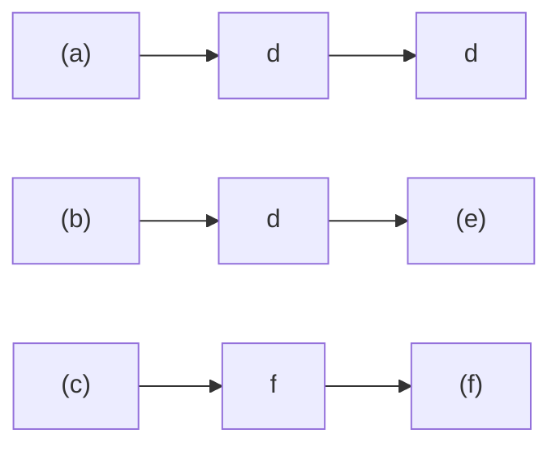

Abb. 3.F3

**4.** Abbildung 3.F4 zeigt die Werte einer Kraft ${ \vec { F } } ,$ die entlang einer x-Achse zeigt und auf ein Teilchen wirkt, das sich entlang der x-Achse bewegt. Wenn das Teilchen bei $x = 0$ aus der Ruhe startet, wie lautet dann seine Koordinate in dem Moment, in dem es (a) die größte kinetische Energie, (b) den größten Geschwindigkeitsbetrag bzw. (c) die Geschwindigkeit null besitzt? (d) In welche Richtung bewegt sich das Teilchen, nachdem es den Punkt $x = 6$ m erreicht hat?

line

| x (m) | F |
| --- | --- |
| 0 | F1 |
| 1 | F2 |
| 3 | 0 |
| 5 | -F2 |
| 7 | 0 |
| 8 | 0 |

Abb. 3.F4

**5.** Abbildung 3.F5 gibt für drei verschiedene Situationen die Position einer Kiste mit Schmuggelware in Abhängigkeit von der Zeit an; die Kiste wird von den an ihr angelegten, entlang der x-Achse zeigenden Kräften über eine reibungsfreie Oberfläche gezogen. Kurve B ist eine Gerade; die anderen Linien verlaufen gekrümmt. Ordnen Sie die Situationen in absteigender Reihenfolge nach der kinetischen Energie der Kiste (a) zur Zeit $t _ { 1 }$ und (b) zur Zeit $t _ { 2 } .$ (c) Ordnen Sie die Situationen nun in absteigender Reihenfolge nach der Gesamtarbeit, welche die angelegten Kräfte während des Zeitintervalls von $t _ { 1 }$ bis $t _ { 2 }$ an der Kiste verrichten. (d) Welche der folgenden Aussagen beschreibt die Gesamtarbeit, welche die angelegten Kräfte während des Zeitintervalls von $t _ { 1 }$ bis $t _ { 2 }$ verrichten, für jede Situation am besten?

(a) Der Kiste wird Energie zugeführt.
(b) Von der Kiste wird Energie abgeführt.
(c) Die Gesamtarbeit ist null.

line

| Category | Description |
| --- | --- |
| A | Orange curve representing a non-linear growth function starting from origin. |
| B | Green line representing a linear growth function starting from origin. |
| C | Purple line representing a non-linear growth function starting from origin. |

Abb. 3.F5

**6.** Abbildung 3.F6 zeigt vier (im selben Maßstab gezeichnete) Kurven der x-Komponente einer veränderlichen Kraft $\vec { F }$ (die entlang der x-Achse zeigt) in Abhängigkeit von der Position x eines Teilchens, auf das die Kraft wirkt. Ordnen Sie die Kurven nach der zwischen $x = 0$ und $x _ { 1 }$ von der Kraft $\vec { F }$ an dem Teilchen verrichteten Arbeit, von der positivsten zur negativsten.

Abb. 3.F6

**7.** In Abb. 3.F7 hat ein Kind die Wahl zwischen drei reibungsfreien Rutschbahnen, auf denen es bis zum Erdboden hinunterrutschen kann. Ordnen Sie die Rutschbahnen in absteigender Reihenfolge nach der Arbeit, welche die Gravitationskraft während des Hinunterrutschens an dem Kind verrichtet.

text_image

(a)
(b)
(c)

Abb. 3.F7

**8.** Sie heben eine Kiste auf ein Regal. Hängt die Kraft, die Sie auf die Kiste ausüben, (a) von der Masse der Kiste, (b) vom Gewicht der Kiste, (c) von der Höhe des Regals, (d) von der Zeit, die Sie dafür benötigen, oder (e) davon ab, ob Sie die Kiste schräg oder senkrecht hinaufheben?
**9.** Abbildung 3.F9 zeigt einen Stapel Zeitschriften, der von einem Seil eine Strecke d angehoben wird. In der Tabelle sind sechs Paare von Werten der Anfangsgeschwindigkeit $\nu _ { 0 }$ und der Endgeschwindigkeit v (in Metern pro Sekunde) aufgeführt, die der Stapel jeweils am Anfang und am Ende der Strecke d besitzt. Ordnen Sie die Paare nach der Arbeit, welche die Kraft des Seils über die Entfernung d an dem Stapel verrichtet hat (die positivste zuerst, die negativste zuletzt).

text_image

v=
a b c d e f
0 2 2 2 0 1
v₀=
0 2 0 1 2 2

Abb. 3.F9

**10.** Die Feder A ist steifer als die Feder B; d. h. $k _ { \mathrm { A } } > k _ { \mathrm { B } }$ Welche der Federkräfte verrichtet die größere Arbeit, wenn die Federn (a) um die gleiche Strecke bzw. (b) mit der gleichen angelegten Kraft zusammengedrückt werden?
**11.** Abbildung 3.F11 zeigt drei Anordnungen, in denen ein Block mit einer Anzahl von identischen Federn verbunden ist. Die Federn sind entspannt, wenn der Block wie in der Abbildung gezeigt in der Mitte zwischen den Wänden liegt. Ordnen Sie die Anordnungen absteigend nach dem Betrag der resultierenden Gesamtkraft auf den Block, wenn der Block um einen Betrag d (a) nach rechts und (b) nach links ausgelenkt wird. Ordnen Sie die Anordnungen absteigend nach der von den Federn an dem Block verrichteten Arbeit, wenn der Block um einen Betrag d (c) nach rechts und (d) nach links ausgelenkt wird.

natural_image

Simple diagram of a spring attached to a block on a horizontal surface (no text or symbols)

(a)

natural_image

Simple diagram of a spring-mass system with no text or symbols

(b)

Abb. 3.F11

**12.** Abbildung 3.F12 zeigt die Geschwindigkeit eines Autoskooters, der durch eine veränderliche angelegte Kraft eine Achse entlang bewegt wird, in Abhängigkeit von der Zeit. Die Zeitachse ist in sechs Abschnitte unterteilt, für die gilt: $\begin{array} { r } { \Delta t _ { 1 } = \Delta t _ { 2 } = \Delta t _ { 3 } = \Delta t _ { 6 } = 2 \Delta t _ { 4 } = \frac { 2 } { 3 } \Delta t _ { 5 } } \end{array}$ . (a) Innerhalb welcher dieser Zeitintervalle führt die angelegte Kraft Energie von dem Autoskooter ab? (b) Ordnen Sie die Zeitintervalle nach der Arbeit, welche die angelegte Kraft während des Intervalls an dem Autoskooter verrichtet (die positivste zuerst, die negativste zuletzt). (c) Ordnen Sie die Zeitintervalle nach der Rate, mit der die angelegte Kraft Energie überträgt, die größte Energieübertragung auf den Skooter zuerst, die größte Energieübertragung von dem Skooter zuletzt.

line

| t | v |
| --- | --- |
| 0 | 0 |
| 1.5 | Peak |
| 2.5 | Peak |
| 3.5 | 0 |
| 4.2 | Trough |
| 5.5 | Trough |
| 6.5 | 0 |

Abb. 3.F12

**13.** In drei verschiedenen Situationen wird eine Dose, die sich ursprünglich in Ruhe befand, durch eine angelegte Kraft über einen reibungsfreien Fußboden geschickt. Abbildung 3.F13 zeigt die Kurven der entsprechenden Beschleunigung für die drei Situationen in Abhängigkeit von der Zeit. Ordnen Sie die Kurven in absteigender Reihenfolge nach der Arbeit, welche die angelegte Kraft während der Beschleunigungsphase verrichtet hat.

area

| Time Interval | Process A | Process B | Process C |
| --- | --- | --- | --- |
| Start to End | High | High | Low |

**14.** Abbildung 3.F14a zeigt vier Situationen, in denen eine horizontale Kraft auf denselben Block wirkt, der sich anfänglich in Ruhe befindet. Die Beträge der Kräfte sind $F _ { 2 } = F _ { 4 } = 2 F _ { 1 } = 2 F _ { 3 }$ . Die horizontale Komponente $\nu _ { x }$ der Geschwindigkeit des Blocks ist für jede der vier Situationen in Abb. 3.F14b gezeigt. (a) Welche Kurve aus Abb. 3.F14b passt zu welcher Kraft aus Abb. 3.F14a? (b) Welche Kurve aus Abb. 3.F14c (kinetische Energie K als Funktion der Zeit t) passt am besten zu welcher Kurve aus Abb. 3.F14b?

text_image

F₁
F₂
F₃
F₄
x

(a)

text_image

vₓ
A
B
t
C
D

(b)

line

| Category | Trend Description |
| --- | --- |
| E | Positive growth curve |
| F | Moderate positive growth curve |
| G | Negative growth curve |
| H | Negative growth curve |

(c)

Abb. 3.F14

**15.** Ein Erdklumpen wird vom Rand einer Klippe geworfen. Welche der Kurven in Abb. 3.F15 könnte die Veränderung seiner kinetischen Energie während des Flugs zeigen?

Abb. 3.F15

**16.** Gegeben sind drei Situationen, in denen eine einzige Kraft auf ein sich bewegendes Teilchen wirkt. Die Geschwindigkeiten des Teilchens im betrachteten Moment und die Kräfte sind:

(1)
(2)
(3)

Ordnen Sie die drei Situationen absteigend nach der Geschwindigkeit des Energietransfers auf das oder von dem Teilchen.

# 4 Potenzielle Energie und Energieerhaltung

## 4.1 Potenzielle Energie

## Physikalische Motivation

Eine der Aufgaben der Physik ist es, die verschiedenen Arten von Energie zu identifizieren, die in der Natur vorkommen. Eine sehr häufig auftretende Energieform ist die **potenzielle Energie** U. Formal ausgedrückt ist sie eine Energie, die mit dem Zustand eines Systems aus mehreren Objekten zusammenhängt, die Kräfte aufeinander ausüben.

Trotz der ungewohnten Formulierung handelt es sich dabei um eine Tatsache, die uns allen wohlvertraut ist. Ein Beispiel hilft vielleicht, diesen Punkt besser zu verstehen: Wenn wir in einer Anordnung von Gegenständen, die Kräfte aufeinander ausüben, die Lage der Gegenstände relativ zueinander verändern wollen, müssen wir (häufig) Arbeit aufwenden – als beispielsweise der russische Gewichtheber Andrei Chemerkin während der Olympischen Spiele von 1996 seine Hantel mit einer Masse von 260 kg über seinen Kopf hob, vergrößerte er den Abstand zwischen der Hantel und dem Erdmittelpunkt. Die Arbeit, die er mit seiner Kraft dabei verrichtete, veränderte die potenzielle Energie des Systems Hantel–Erde (Abb. 4.1).

Eine andere Art von potenzieller Energie ist die **elastische potenzielle Energie**, die damit zusammenhängt, ob ein elastisches (einer Feder ähnliches) Objekt gestaucht oder gedehnt ist. Wenn Sie eine Feder zusammendrücken oder auseinanderziehen, so verrichten Sie Arbeit an ihr, um die Positionen der Windungen innerhalb der Feder relativ zueinander zu verändern. Das Ergebnis der von Ihrer Kraft verrichteten Arbeit ist eine Zunahme der elastischen potenziellen Energie der Feder.

Das Konzept der potenziellen Energie kann äußerst hilfreich sein, um Situationen zu analysieren, in denen es um die Bewegung von Objekten geht. Mithilfe der potenziellen Energie können wir Aufgaben ganz einfach lösen, die – nur mit den Techniken der vorangehenden Kapitel angegangen – aufwändige Computerprogramme erfordern würden.

## 4.1.1 Arbeit und potenzielle Energie

In Kapitel 7 haben wir die Beziehung zwischen der Arbeit und einer Änderung der kinetischen Energie untersucht. Hier wollen wir uns der Verbindung zwischen Arbeit und Änderung der potenziellen Energie zuwenden.

In Abb. 4.2 wird eine Tomate senkrecht nach oben geworfen. Wie wir bereits wissen, ist die von der Gravitationskraft an der Tomate verrichtete Arbeit $W _ { \mathrm { G } }$ während des Anstiegs negativ, da die Kraft Energie von der kinetischen Energie der Tomate abführt. Wir können unsere Analyse nun vervollständigen, indem wir festhalten, dass diese Energie durch die Gravitationskraft in die potenzielle Energie des Systems Tomate–Erde übertragen wurde.

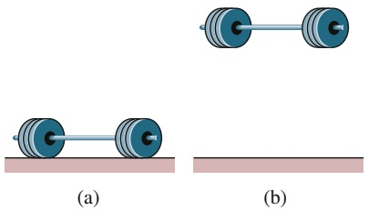

natural_image

Two diagrams showing dumbbells on a horizontal surface, labeled (a) and (b), with no text or symbols present.

Abb. 4.1 Als Chemerkin die Hantel über seinen Kopf hob, vergrößerte er den Abstand zwischen der Hantel und der Erde und änderte damit die Konfiguration des Systems Hantel–Erde von der in (a) gezeigten zu der in (b) dargestellten Konfiguration.

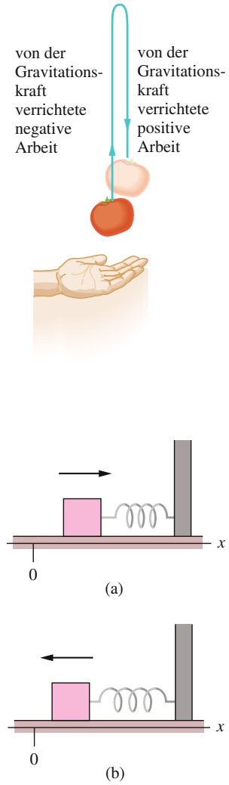

Abb. 4.3

Ein an einer Feder befestigter Block, der sich ursprünglich bei in Ruhe befindet, wird nach rechts in Bewegung versetzt. (a) Während der Block sich nach rechts bewegt (wie durch den Pfeil angedeutet), verrichtet die Federkraft negative Arbeit an ihm. (b) Wenn der Block anschließend in Richtung $x = 0$ zurückkehrt, verrichtet die Federkraft positive Arbeit an ihm.

## Abb. 4.2

Eine Tomate wird nach oben geworfen. Während des Anstiegs verrichtet die Gravitationskraft negative Arbeit an der Tomate und verringert damit deren kinetische Energie. Während des Herabfallens verrichtet die Gravitationskraft positive Arbeit an der Tomate und lässt damit deren kinetische Energie wieder anwachsen.

Die Tomate wird langsamer, hält an und beginnt, unter dem Einfluss der Gravitationskraft wieder nach unten zu fallen. Während des Hinunterfallens findet die Energieübertragung in umgekehrter Richtung statt: Die von der Gravitationskraft an der Tomate verrichtete Arbeit $W _ { \mathrm { G } }$ ist nun positiv, die Kraft überträgt Energie von der potenziellen Energie des Systems Tomate–Erde auf die kinetische Energie der Tomate.

Sowohl für den Anstieg als auch für das Hinunterfallen ist die Änderung ΔU der potenziellen Energie als das Negative der Arbeit definiert, welche die Gravitationskraft an der Tomate verrichtet. Benutzen wir wie gehabt W als das allgemeine Symbol für die Arbeit, so haben wir:

$$
\Delta U = - W. \tag {4.1}
$$

Diese Gleichung gilt auch für ein System aus einem Masseblock und einer Feder, wie es in Abb. 4.3 dargestellt ist. Wenn wir dem Block plötzlich einen Stoß nach rechts versetzen, sodass er sich dorthin bewegt, so wirkt die Rückstellkraft der Feder nach links und verrichtet somit negative Arbeit an dem Block. Dabei wird Energie von der kinetischen Energie des Blocks in elastische potenzielle Energie der Feder umgewandelt. Der Block wird langsamer, hält an und beginnt, sich nach links zu bewegen, da die Federkraft weiterhin nach links wirkt. Der Energietransfer findet daraufhin umgekehrt statt – von der potenziellen Energie der Feder in die kinetische Energie des Blocks.

## Konservative und nichtkonservative Kräfte

Die folgenden Punkte sind die Schlüsselelemente für die beiden Situationen, die wir soeben untersucht haben:

1. Das System besteht aus zwei oder mehr Objekten.
2. Eine Kraft wirkt zwischen einem teilchenartigen Objekt des Systems (hier der Tomate bzw. dem Block) und dem Rest des Systems.
3. Wenn sich die Konfiguration des Systems – also die räumliche Anordnung der Komponenten des Systems relativ zueinander – ändert, so verrichtet die Kraft eine Arbeit $W _ { 1 }$ an dem teilchenartigen Objekt. Dabei überträgt sie Energie zwischen der kinetischen Energie K des Objekts und einer anderen Form von Energie des Systems.
4. Wird die Änderung der Konfiguration des Systems rückgängig gemacht, so überträgt die Kraft Energie in umgekehrter Richtung, wobei sie eine Arbeit $W _ { 2 }$ verrichtet.

Gilt für eine bestimmte Situation immer $W _ { 1 } = - W _ { 2 }$ , so ist diese andere Energieform eine potenzielle Energie und die Kraft wird als **konservative Kraft** bezeich net. Wie Sie vielleicht schon vermutet haben, sind die Gravitationskraft und die Federkraft beide konservativ.

Eine Kraft, für welche die Gleichung $W _ { 1 } = - W _ { 2 }$ nicht gilt, wird nichtkonser**vative Kraft** genannt. Die Gleitreibungskraft (auch kinetische Reibungskraft genannt, vgl. Kapitel 2) und der Strömungswiderstand sind nichtkonservative Kräfte. Lassen wir z. B. einen Block über einen Fußboden gleiten, der nicht reibungsfrei ist. Während der Block über den Boden rutscht, verrichtet eine von dem Boden ausgeübte Gleitreibungskraft negative Arbeit an dem Block. Dabei wird der Block langsamer, da die Kraft Energie von der kinetischen Energie des Blocks in eine andere Art von Energie überträgt, die thermische Energie oder Wärmeenergie genannt wird (Kap. 14). Aus Experimenten wissen wir, dass diese Art des Energietransfers nicht umgekehrt werden kann (die Gleitreibungskraft kann die thermische Energie nicht wieder in kinetische Energie des Blocks umwandeln). Obwohl wir hier auch ein System (das aus dem Block und dem Fußboden besteht), eine zwischen den Komponenten des Systems wirkende Kraft und einen durch die Kraft verursachten Energietransfer haben, ist die Kraft nicht konservativ. Die thermische Energie ist demnach keine potenzielle Energie.

Wirken auf ein teilchenartiges Objekt nur konservative Kräfte, dann können wir Aufgaben, welche die Bewegung des Objekts betreffen und ansonsten nur sehr schwierig zu lösen wären, stark vereinfachen. In dem nächsten Abschnitt leiten wir her, wie man ermittelt, ob eine bestimmte Kraft konservativ ist oder nicht, und zeigen eine Methode auf, derartige Aufgaben zu vereinfachen.

## 4.1.2 Wegunabhängigkeit von konservativen Kräften

Ob eine Kraft konservativ ist oder nicht, können Sie grundsätzlich wie folgt testen: Nehmen Sie an, dass die Kraft auf ein Teilchen wirkt, das sich entlang eines belie bigen geschlossenen Wegs bewegt. Das heißt, das Teilchen beginnt seinen Weg an einem bestimmten Punkt, an den es am Ende seines Wegs zurückkehrt. Die Kraft ist genau dann konservativ, wenn die Gesamtenergie, die sie dem Teilchen wäh rend eines vollständigen Umlaufs zuführt oder entzieht, entlang dieses und jedes anderen geschlossenen Wegs gleich null ist. Mit anderen Worten:

Für jeden geschlossenen Weg ist die Gesamtarbeit, die von einer konservativen Kraft an einem Teilchen entlang dieses Wegs verrichtet wird, gleich null.

Aus Experimenten wissen wir, dass die Gravitationskraft dieses Kriterium erfüllt. Ein Beispiel dafür ist die in Abb. 4.2 geworfene Tomate. Die Tomate verlässt ihren Ausgangspunkt mit dem Geschwindigkeitsbetrag $\nu _ { 0 }$ und der kinetischen Energie $\frac { 1 } { 2 } m \overset { \leftrightarrow } { \nu _ { 0 } ^ { 2 } } .$ Die auf die Tomate wirkende Gravitationskraft bremst die Tomate ab, hält sie an und bewirkt, dass sie wieder hinunterfällt. In dem Moment, in dem die Tomate ihren Ausgangspunkt wieder erreicht, besitzt sie erneut den Geschwindig keitsbetrag $\nu _ { 0 }$ und die kinetische Energie $\frac { 1 } { 2 } m \nu _ { 0 } ^ { 2 } .$ Die Gravitationskraft führt während des Anstiegs also genauso viel Energie von der Tomate ab, wie sie ihr während des Herabfallens bis zum Ausgangspunkt wieder zuführt. Die Gesamtarbeit, welche die Gravitationskraft auf dem geschlossenen Weg an der Tomate verrichtet hat, ist null.

Nehmen Sie nun an, dass sich das Teilchen in Abb. 4.4a entweder auf dem Weg 1 oder dem Weg 2 von Punkt a nach Punkt b bewegt. Wirkt nur eine konservative Kraft auf das Teilchen, dann ist die an dem Teilchen verrichtete Arbeit entlang beider Wege gleich. Mathematisch können wir dieses Ergebnis wie folgt ausdrücken:

$$
W _ {\mathrm{ab}, 1} = W _ {\mathrm{ab}, 2}, \tag {4.2}
$$

wobei der Index ab die Anfangs- und Endpunkte bezeichnet und die Indizes 1 bzw. 2 den eingeschlagenen Weg angeben.

Dies ist ein äußerst bemerkenswertes Resultat:

Die Arbeit, die eine konservative Kraft an einem Teilchen verrichtet, das sich zwischen zwei Punkten bewegt, hängt nicht von dem Weg ab, den das Teilchen zwischen den beiden Punkten durchläuft.

Dieses Ergebnis ist deshalb so wichtig, weil es uns erlaubt, schwierige Fragestellungen in Fällen, in denen nur konservative Kräfte wirken, stark zu vereinfachen. Nehmen Sie an, Sie müssten die Arbeit berechnen, die eine konservative Kraft entlang eines bestimmten Wegs zwischen zwei Punkten verrichtet; die Berechnungen sind jedoch schwierig bzw. ohne zusätzliche Information gar nicht durchzuführen.

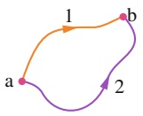

(a)

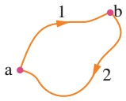

(b)

## Abb. 4.4

(a) Eine konservative Kraft wirkt auf ein Teilchen. Dieses kann sich dabei über den Weg 1 oder den Weg 2 von Punkt a nach Punkt b bewegen. (b) Das Teilchen bewegt sich auf einem geschlossenen Weg, von Punkt a nach Punkt b über den Weg 1 und dann zurück zum Punkt a via Weg 2.

Dann können Sie die Arbeit trotzdem ermitteln, indem Sie den ursprünglichen Weg zwischen den zwei Punkten durch einen anderen ersetzen, für den die Berechnungen einfacher und durchführbar sind. Die Beispielaufgabe 4.1 im Übungsbuch beschreibt einen solchen Fall. Doch bevor wir uns ihr zuwenden, müssen wir erst noch Gl. 4.2 beweisen.

## Beweis von Gleichung 4.2

Abbildung 4.4b zeigt einen willkürlich gewählten geschlossenen Weg eines Teilchens, auf das eine einzelne Kraft wirkt. Das Teilchen bewegt sich von seinem Anfangspunkt a auf dem Weg 1 zu einem Punkt b und kehrt dann auf dem Weg 2 zum Punkt a zurück. Während sich das Teilchen die beiden Wege entlangbewegt, verrichtet die Kraft an ihm Arbeit. Wir kümmern uns nicht darum, in welchen Abschnitten die von der Kraft verrichtete Arbeit nun positiv bzw. negativ ist, sondern bezeichnen die von a nach b entlang des Wegs 1 verrichtete Arbeit allgemein als $W _ { \mathrm { a b , 1 } }$ und die von b nach a entlang des Wegs 2 verrichtete Arbeit als $W _ { \mathrm { b a , 2 } }$ . Da die Kraft konservativ ist, muss die während eines Umlaufs verrichtete Arbeit null sein:

$$
W _ {\mathrm{ab}, 1} + W _ {\mathrm{ba}, 2} = 0,
$$

das heißt

$$
W _ {\mathrm{ab}, 1} = - W _ {\mathrm{ba}, 2}. \tag {4.3}
$$

Die auf dem Hinweg verrichtete Arbeit ist also das Negative der auf dem Rückweg verrichteten Arbeit.

Betrachten wir nun die Arbeit $W _ { \mathsf { a b } , 2 } ,$ welche die Kraft an dem Teilchen verrichtet, wenn es sich wie in Abb. 4.4a dargestellt entlang des Wegs 2 von a nach b bewegt. Da die Kraft konservativ ist, ist diese Arbeit gleich dem Negativen von $W _ { \mathrm { b a , 2 ^ { \cdot } } }$

$$
W _ {\mathrm{ab}, 2} = - W _ {\mathrm{ba}, 2}. \tag {4.4}
$$

Ersetzen wir $- W _ { \mathrm { b a } , 2 }$ in Gl. 4.3 durch $W _ { \mathrm { a b , 2 } } ,$ so erhalten wir:

$$
W _ {\mathrm{ab}, 1} = W _ {\mathrm{ab}, 2},
$$

was zu beweisen war.

## KONTROLLFRAGE 1

Die Abbildung zeigt drei Wege, welche die Punkte a und b miteinander verbinden. Es ist jeweils angegeben, welche Arbeit eine Kraft $\vec { F }$ an einem Teilchen verrichtet, das sich in die eingezeichnete Richtung auf einem der drei Wege bewegt. Ist die Kraft $\vec { F }$ konservativ?

## 4.1.3 Berechnung der potenziellen Energie

In diesem Abschnitt wollen wir Gleichungen herleiten, anhand derer wir die Werte der potenziellen Energie bestimmen können. Dafür leiten wir zunächst eine all gemeine Beziehung zwischen einer konservativen Kraft und der entsprechenden potenziellen Energie her.

Betrachten wir ein teilchenartiges Objekt, das Teil eines Systems ist, in dem eine konservative Kraft $\vec { F }$ wirkt. Wenn diese Kraft eine Arbeit $W$ an dem Objekt verrichtet, ist die Änderung $\Delta U$ der mit dem System zusammenhängenden potenziellen Energie gleich dem Negativen der verrichteten Arbeit. Diese Tatsache haben wir in Gl. 4.1 ausgedrückt $\left( \Delta U = - W \right)$ . Für den allgemeinen Fall, dass sich die Kraft als Funktion des Orts verändert, können wir die verrichtete Arbeit anhand von Gl. 3.30 ausdrücken:

$$
W = \int_ {x _ {\mathrm{i}}} ^ {x _ {\mathrm{f}}} F (x) \mathrm{d} x. \tag {4.5}
$$

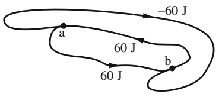

flowchart

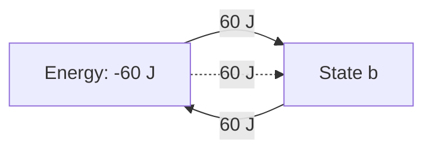

Diese Gleichung gibt die Arbeit an, welche die Kraft verrichtet, wenn sich das Ob jekt von einem Punkt $x _ { \mathrm { i } }$ zu einem Punkt $x _ { \mathrm { f } }$ bewegt und dabei die Konfiguration des Systems verändert. (Da die Kraft konservativ ist, ist die Arbeit für alle Wege zwischen diesen beiden Punkten gleich.)

Setzen wir Gl. 4.5 in Gl. 4.1 ein, so erhalten wir die durch die Veränderung der Konfiguration hervorgerufene Änderung der potenziellen Energie:

$$
\Delta U = - \int_ {x _ {\mathrm{i}}} ^ {x _ {\mathrm{f}}} F (x) \mathrm{d} x. \tag {4.6}
$$

Dies ist die allgemeine Beziehung, nach der wir gesucht haben. Wenden wir sie an!

## Potenzielle Energie der Gravitation

Wir betrachten zunächst ein Teilchen der Masse m, das sich in vertikaler Richtung entlang einer y-Achse bewegt, deren positive Richtung nach oben weist. Während es sich vom initialen Punkt $y _ { \mathrm { i } }$ zum finalen Punkt $y _ { \mathrm { f } }$ bewegt, verrichtet die Gravitationskraft $\vec { F } _ { \mathrm { G } }$ Arbeit an dem Teilchen. Um die entsprechende Änderung der potenziellen Energie des Systems Teilchen–Erde zu ermitteln, verwenden wir Gl. 4.6 mit zwei Abweichungen: (1) Wir integrieren hier entlang der y-Achse und nicht der x-Achse, da die Gravitationskraft im vorliegenden Fall in vertikaler Richtung wirkt. (2) Wir ersetzen das Kraftsymbol F durch −mg, da $\vec { F } _ { \mathrm { G } }$ den Betrag mg hat und entlang der y-Achse nach unten weist. Damit erhalten wir:

$$
\Delta U = - \int_ {y _ {\mathrm{i}}} ^ {y _ {\mathrm{f}}} (- m g) \mathrm{d} y = m g \int_ {y _ {\mathrm{i}}} ^ {y _ {\mathrm{f}}} \mathrm{d} y = m g \left[ y \right] _ {y _ {\mathrm{i}}} ^ {y _ {\mathrm{f}}}.
$$

beziehungsweise

$$
\Delta U = m g (y _ {\mathrm{f}} - y _ {\mathrm{i}}) = m g \Delta y. \tag {4.7}
$$

Nur Änderungen ΔU der potenziellen Energie besitzen eine physikalische Bedeutung. Um eine Rechnung oder eine Herleitung zu vereinfachen, ist es manchmal jedoch hilfreich, einem bestimmten System Teilchen–Erde, in dem sich das Teilchen in einer Höhe $y$ befindet, einen bestimmten Wert U der potenziellen Energie zuordnen zu können. Dazu schreiben wir Gl. 4.7 in der Form:

$$
U - U _ {\mathrm{i}} = m g (y - y _ {\mathrm{i}}). \tag {4.8}
$$

Dabei ist $U _ { \mathrm { i } }$ die potenzielle Energie des Systems in einer **Referenzkonfiguration**, in der sich das Teilchen an einem bestimmten **Referenzpunkt** $y _ { \mathrm { i } }$ befindet. Üblicherweise wählt man $U _ { \mathrm { i } } = 0$ und $y _ { \mathrm { i } } = 0$ . Damit wird Gl. 4.8 zu:

$$
U (y) = m g y. \tag {4.9}
$$

Diese Gleichung besagt Folgendes:

Die potenzielle Energie der Gravitationskraft in einem System Teilchen– Erde hängt nur von der vertikalen Position (d. h. der Höhe) des Teilchens relativ zum Referenzpunkt $y = 0$ ab; sie ist nicht von der horizontalen Position abhängig.

## Elastische potenzielle Energie

Als Nächstes betrachten wir das in Abb. 4.3 dargestellte System aus einem Block und einer Feder, bei dem der Block am Ende der Feder befestigt ist; die Federkonstante der Feder ist k. Während sich der Block vom Punkt $x _ { \mathrm { i } }$ zum Punkt $x _ { \mathrm { f } }$ bewegt, verrichtet die Federkraft $F = - k x$ Arbeit an dem Block. Um die entsprechende $\ddot { \mathrm { A n } } \cdot$ derung der elastischen potenziellen Energie des Systems Block–Feder zu ermitteln, ersetzen wir $F ( x )$ in Gl. 4.6 durch −kx. Wir erhalten:

$$
\Delta U = - \int_ {x _ {\mathrm{i}}} ^ {x _ {\mathrm{f}}} (- k x) \mathrm{d} x = k \int_ {x _ {\mathrm{i}}} ^ {x _ {\mathrm{f}}} x \mathrm{d} x = \frac {1}{2} k \left[ x ^ {2} \right] _ {x _ {\mathrm{i}}} ^ {x _ {\mathrm{f}}}
$$

beziehungsweise

$$
\Delta U = \frac {1}{2} k x _ {\mathrm{f}} ^ {2} - \frac {1}{2} k x _ {\mathrm{i}} ^ {2}. \tag {4.10}
$$

Um dem Block bei einer Position x einen bestimmten Wert der potenziellen Ener gie zuzuordnen, wählen wir als Referenzkonfiguration jene Anordnung, bei der die Feder im entspannten Zustand ist und der Block sich bei $x _ { \mathrm { i } } = 0$ befindet. Die elastische potenzielle Energie $U _ { \mathrm { i } }$ ist dann null und Gl. 4.10 wird zu

$$
U - 0 = \frac {1}{2} k x ^ {2} - 0,
$$

das heißt

$$
U (x) = \frac {1}{2} k x ^ {2} \quad \text {(elastische potenzielle Energie).} \tag {4.11}
$$

## KONTROLLFRAGE 2

Ein Teilchen bewege sich entlang einer x-Achse von $x = 0$ nach $x _ { 1 }$ . Dabei wirkt eine konservative Kraft auf das Teilchen, die ebenfalls in x-Richtung weist. Die Abbildung zeigt drei verschiedene Situationen, in denen die x-Komponente dieser Kraft sich in Abhängigkeit von x ändert. In allen drei Situationen besitzt die Kraft den gleichen Betrag $F _ { 1 }$ . In welcher Situation ist die Änderung der entsprechenden potenziellen Energie am größten? Ordnen Sie die jeweiligen Änderungen nach ihrer Größe.

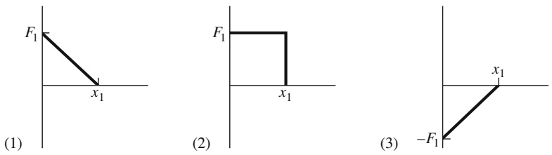

## LÖSUNGSSTRATEGIEN

**Strategie 1: Verwendung des Ausdrucks „potenzielle Energie“** Eine potenzielle Energie wird einem System als Ganzem zugeordnet. Ab und zu werden Ihnen möglicherweise jedoch Aussagen begegnen, in denen die potenzielle Energie nur einem Teil des Systems zugeordnet wird, so z. B. in dem Satz: „Ein Apfel, der auf einem Baum hängt, besitzt eine potenzielle Energie von 30 J.“ Solche Aussagen sind meist annehmbar; Sie sollten jedoch immer im Hinterkopf behalten, dass die potenzielle Energie eigentlich mit einem System zusammenhängt, in diesem Fall dem System Apfel–Erde. Beachten Sie auch, dass die Zuordnung eines bestimmten Werts der potenziellen Energie – wie hier $, 30 ] ^{ \alpha }  .$ – zu einem Objekt oder sogar einem System nur dann sinnvoll ist, wenn ein Referenzwert der potenziellen Energie festgelegt wurde (siehe Beispielaufgabe 4.2 im Übungsbuch).

## 4.2 Der Energieerhaltungssatz der Mechanik

## Lernziele

Nach dem Durcharbeiten dieses Abschnitts sollten Sie in der Lage sein, . . .

• zu verstehen, dass die mechanische Gesamtenergie eines Systems, dass aus eindeutig definierten einzelnen Objekten besteht, die Summe der kinetischen und potenziellen Energien dieser Objekte ist,

den Energieerhaltungssatz anzuwenden, um aus den anfänglichen kinetischen und potenziellen Energien eines abgeschlossenen Systems, in dem nur konservative Kräfte wirken, die kinetischen und potenziellen Energien zu einem spä- teren Zeitpunkt zu bestimmen.

## Schlüsselideen

• Die mechanische Energie $E _ { \mathrm { m e c h } }$ eines Systems ist die Summe seiner potenziellen Energie U und seiner kinetischen Energie K:

$$
E _ {\mathrm{mech}} = K + U.
$$

Ein abgeschlossenes System ist ein System, in das keine Kräfte von außen einwirken und Energieänderungen bewirken können. Wenn in einem abgeschlos senen System nur konservative Kräfte wirken, kann sich die mechanische Energie $E _ { \mathrm { m e c h } }$ des Systems nicht ändern. Wir können den Energieerhaltungssatz der Mechanik in der Form

$$
K _ {2} + U _ {2} = K _ {1} + U _ {1}
$$

schreiben, wobei sich die Indizes 1 und 2 auf zwei verschiedene Zeitpunkte während der Übertragung von Energie beziehen. Eine andere Schreibweise dieses wichtigen Prinzips ist

$$
\Delta E _ {\mathrm{mech}} = \Delta K + \Delta U = 0.
$$

## 4.2.1 Der Energieerhaltungssatz der Mechanik

Die **mechanische Energie** $E _ { \mathrm { m e c h } }$ eines Systems ist die Summe seiner potenziellen Energie U und der kinetischen Energie K der Objekte, die es enthält:

$$
E _ {\mathrm{mech}} = K + U \quad (\text {mechanische Energie}). \tag {4.12}
$$

In diesem Abschnitt untersuchen wir, wie sich diese mechanische Energie verändert, wenn die Energieübertragung innerhalb des Systems von konservativen Kräften verursacht wird – wenn auf die Objekte in dem System also weder Reibungskräfte noch Strömungswiderstände wirken. Wir nehmen außerdem an, dass das System abgeschlossen, also von seiner Umgebung **isoliert** ist. Das heißt, es gibt keine äußere, von einem Objekt außerhalb des Systems ausgeübte Kraft, die eine Energieänderung innerhalb des Systems verursacht.

Verrichtet eine konservative Kraft eine Arbeit W an einem Objekt innerhalb des Systems, so überträgt sie Energie zwischen der kinetischen Energie K des Objekts und der potenziellen Energie U des Systems. Laut Gl. 7.10 ist die Änderung ΔK der kinetischen Energie:

$$
\Delta K = W. \tag {4.13}
$$

Laut Gl. 4.1 ist die Änderung ΔU der potenziellen Energie:

$$
\Delta U = - W. \tag {4.14}
$$

Indem wir die Gln. 4.13 und 4.14 kombinieren, erhalten wir:

$$
\Delta K = - \Delta U. \tag {4.15}
$$

Die eine Energie nimmt also in genau dem Maß zu, in dem die andere abnimmt.

Gleichung 4.15 können wir wie folgt umschreiben:

$$
K _ {2} - K _ {1} = - (U _ {2} - U _ {1}), \tag {4.16}
$$

wobei die Indizes zwei verschiedene Zeitpunkte und damit zwei verschiedene An ordnungen der Objekte des Systems bezeichnen. Umformen von Gl. 4.16 ergibt:

$$
K _ {2} + U _ {2} = K _ {1} + U _ {1} \quad \text {(Energieerhaltungssatz der Mechanik)}  . \tag {4.17}
$$

Diese Gleichung besagt also, dass für ein abgeschlossenes System, auf dessen Objekte nur konservative Kräfte wirken, Folgendes gilt:

$$
\left( \begin{array}{c} \text {Summe von $K$ und $U$} \\ \text {für einen beliebigen} \\ \text {Zustand des Systems} \end{array} \right) = \left( \begin{array}{c} \text {Summe von $K$ und $U$} \\ \text {für jeden beliebigen anderen} \\ \text {Zustand des Systems} \end{array} \right).
$$

Anders ausgedrückt:

In einem abgeschlossenen System, in dem Änderungen der Energie nur durch konservative Kräfte verursacht werden, können sich kinetische und potenzielle Energie zwar ändern, ihre Summe – die mechanische Energie $E _ { \mathrm { m e c h } }$ des Systems – bleibt jedoch erhalten.

Dieses Ergebnis ist als **Energieerhaltungssatz der Mechanik** bekannt. Anhand von Gl. 4.15 können wir diesen Satz in einer weiteren Form schreiben:

$$
\Delta E _ {\mathrm{mech}} = \Delta K + \Delta U = 0. \tag {4.18}
$$

Der Energieerhaltungssatz der Mechanik erlaubt uns, Aufgaben zu lösen, die mithilfe der Newtonschen Gesetze allein nur sehr schwer zu berechnen wären:

Ist die mechanische Energie eines Systems erhalten, so ist die Summe der kinetischen und der potenziellen Energie zu einem bestimmten Zeitpunkt gleich der zu einem beliebigen anderen Zeitpunkt, unabhängig von etwaigen Bewegungen oder der von den beteiligten Kräften verrichteten Arbeit.

Abbildung 4.5 zeigt ein Beispiel, auf das der Energieerhaltungssatz der Mechanik angewendet werden kann: Während ein Pendel schwingt, wird die Energie des Systems Pendel–Erde zwischen der kinetischen Energie K des Pendels und der potenziellen Energie U des Systems hin und her übertragen, wobei die Summe $K + U$ konstant bleibt. Kennen wir die potenzielle Energie zu dem Zeitpunkt, zu dem sich das Ende des Pendels am höchsten Punkt seiner Bahn befindet (Abb. 4.5c), so liefert Gl. 4.17 die kinetische Energie des Pendelendes an seinem tiefsten Punkt (Abb. 4.5e).

Lassen Sie uns den tiefsten Punkt als den Referenzpunkt wählen, an dem die po tenzielle Energie $U _ { 2 } = 0$ ist. Nehmen Sie nun an, dass die potenzielle Energie relativ zu diesem Referenzpunkt am höchsten Punkt $U _ { \mathrm { 1 } } = 2 0   )$ beträgt. Da das Pendelende am höchsten Punkt vorübergehend anhält, ist die kinetische Energie dort $K _ { 1 } = 0$ . Einsetzen dieser Werte in Gl. 4.17 ergibt die kinetische Energie $K _ { 2 }$ am tiefsten Punkt:

$$
K _ {2} + 0 = 0 + 2 0 \mathrm{J}
$$

oder

$$
K _ {2} = 2 0 \mathrm{J}.
$$

Beachten Sie, dass wir dieses Ergebnis ermittelt haben, ohne die Bewegung zwischen dem höchsten und dem tiefsten Punkt (wie sie z. B. in Abb. 4.5d dargestellt ist) zu betrachten und ohne die Arbeit irgendeiner an der Bewegung beteiligten Kraft zu berechnen.

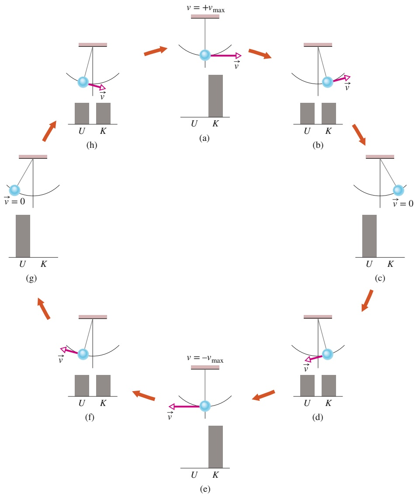

flowchart

Abb. 4.5

Ein Pendel, dessen Masse in dem Pendelkörper an seinem unteren Ende konzentriert ist, schwingt hin und her. Die Abbildung zeigt einen vollständigen Zyklus der Bewegung. Während des Zyklus verändern sich die Werte der potenziellen und der kinetischen Energie des Systems Pendel–Erde mit dem Auf- und Abstieg des Pendelkörpers, doch die mechanische Energie $E _ { \mathrm { m e c h } }$ des Systems bleibt konstant. Die Energie $E _ { \mathrm { m e c h } }$ verlagert sich sozusagen kontinuierlich von kinetischer zu potenzieller Energie und umgekehrt. In den Phasen (a) und (e) liegt die gesamte Energie in Form von kinetischer Energie vor. Der Pendelkörper besitzt dann seine größte Geschwindigkeit und befindet sich am tiefsten Punkt. In den Phasen (c) und (g) ist die gesamte Energie potenzielle Energie. Der Pendelkörper hat dann die Geschwindigkeit null und befindet sich am höchsten Punkt. In den Phasen (b), (d), (f ) und (h) ist die Hälfte der Energie kinetische und die andere Hälfte potenzielle Energie. Würde die Bewegung des Pendels einer Reibungskraft (z. B. an der Aufhängung des Pendels) oder einem merklichen Strömungswiderstand der Luft unterliegen, so wäre $E _ { \mathrm { m e c h } }$ nicht erhalten und das Pendel käme irgendwann zum Stehen.

## KONTROLLFRAGE 3

Die Abbildung zeigt vier Situationen – eine, in der ein ursprünglich in Ruhe be findlicher Block fallen gelassen wird, und drei, in denen der ursprünglich eben falls in Ruhe befindliche Block verschiedene reibungsfreie Rampen hinuntergleitet. (a) Ordnen Sie die Situationen in absteigender Reihenfolge nach der kinetischen Energie des Blocks am Punkt B. (b) Ordnen Sie sie in absteigender Reihenfolge nach dem Geschwindigkeitsbetrag des Blocks am Punkt B.

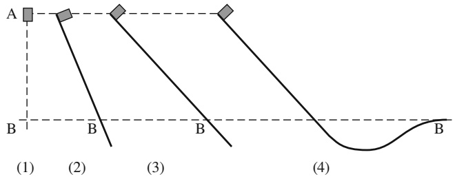

text_image

A
B
(1)
(2)
(3)
B
(4)
B

## LÖSUNGSSTRATEGIEN

**Strategie 2: Erhaltung der mechanischen Energie** Die folgenden Fragen werden Ihnen helfen, Aufgaben zu lösen, in denen es um die Erhaltung der mechanischen Energie geht.

Für welches System ist die mechanische Energie erhalten? Sie sollten in der Lage sein, Ihr System von seiner Umgebung zu trennen. Stellen Sie sich vor, Sie würden eine geschlossene Fläche um das System herum zeichnen, sodass das Innere der Fläche Ihr System beinhaltet und alles, was sich außerhalb der Fläche befindet, die Umgebung Ihres Systems darstellt. Übrigens: in Beispielaufgabe 4.3 im Übungsbuch enthält das System das Kind und die Erde.

Treten Reibungskräfte oder Strömungswiderstände auf? Gibt es Reibungskräfte oder Strömungswiderstände, so ist die mechanische Energie nicht erhalten.

Ist Ihr System abgeschlossen? Die Erhaltung der mechanischen Energie gilt nur für abgeschlossene Systeme. Dies bedeutet, dass keinerlei äußere Kräfte (also Kräfte, die von Objekten außerhalb des Systems ausgeübt werden) an den Objekten innerhalb des Systems Arbeit verrichten.

Was sind der Anfangs- und der Endzustand Ihres Systems? Das System ändert sich von einem bestimmten Anfangszustand (oder einer Anfangskonfiguration) zu einem bestimmten Endzustand. Der Energieerhaltungssatz der Mechanik sagt aus, dass $E _ { \mathrm { m e c h } }$ in diesen beiden Zuständen den gleichen Wert hat. Machen Sie sich deutlich klar, welches diese beiden Zustände genau sind.

## 4.3 Grafische Darstellung der potenziellen Energie

## Lernziele

Nach dem Durcharbeiten dieses Abschnitts sollten Sie in der Lage sein, . . .

• aus der gegebenen potenziellen Energie eines Teilchens als Funktion seiner Position x die Kraft auf das Teilchen zu bestimmen,
• aus einer grafischen Darstellung der potenziellen Energie eines Teilchens als Funktion des Orts die Kraft auf das Teilchen zu bestimmen,
• in eine grafische Auftragung der potenziellen Energie eines Teilchens als Funktion seines Orts seine mechanische Energie einzutragen und seine kinetische Energie an beliebigen Orten zu bestimmen,
• mithilfe der Potenzialkurve für eine x-Achse für die Bewegung eines Teilchens entlang dieser Achse eine Beziehung zwischen seinen Energien an unterschiedlichen Orten anzugeben,
• auf der Potenzialkurve eines Teilchens anzugeben, wo gegebenenfalls Umkehrpunkte oder Bereiche liegen, in denen sich das Teilchen aus energetischen Gründen nicht aufhalten kann,
• die Begriffe neutrales Gleichgewicht, stabiles Gleichgewicht und instabiles Gleichgewicht zu erläutern.

## Schlüsselideen

• Wenn wir die Potenzialkurve U(x) eines Teilchens in einem System kennen, in dem eine Kraft F(x) in einer Dimension wirkt, ist die an einer beliebigen Stelle x auf das Teilchen wirkende Kraft

$$
F (x) = - \frac {\mathrm{d} U}{\mathrm{d} x}.
$$

• Wenn U(x) als grafische Auftragung gegeben ist, dann entspricht die Kraft F(x) für jeden Ort x der negativen Steigung der Kurve an diesem Punkt und die kinetische Energie K des Teilchens ist

$$
K (x) = - E _ {\mathrm{mech}} - U (x),
$$

wenn $E _ { \mathrm { m e c h } }$ die mechanische Energie des Teilchens ist.

• Ein Umkehrpunkt ist ein Ort, an dem das Teilchen seine Bewegungsrichtung umkehrt (dort gilt mindestens für einen kurzen Moment $K = 0 )$
• Ein Teilchen befindet sich an den Punkten seiner Potenzialkurve im Gleichgewicht, an denen die Steigung von U(x) null ist (dort gilt $F ( x ) = 0 )$

## 4.3.1 Potenzialkurven

Wir betrachten erneut ein Teilchen, das Teil eines Systems ist, in dem eine konservative Kraft wirkt. Nehmen Sie nun an, dass sich das Teilchen entlang einer x-Achse bewegt, während die konservative Kraft Arbeit an ihm verrichtet. Wir können sehr viel über die Bewegung des Teilchens in Erfahrung bringen, wenn wir die potenzielle Energie $U ( x )$ des Systems grafisch auftragen. Bevor wir uns der Analyse solcher Kurven zuwenden, benötigen wir jedoch noch eine weitere Beziehung.

## Analytische Bestimmung der Kraft

Gleichung 4.6 verrät uns, wie wir in einer eindimensionalen Situation die Änderung $\Delta U$ einer potenziellen Energie zwischen zwei Punkten bestimmen können, wenn wir die entsprechende Kraft $F ( x )$ kennen. Nun möchten wir den umgekehrten Weg gehen: Wir kennen die potenzielle Energie $U ( x )$ als Funktion von x und möchten die Kraft $F ( x )$ ermitteln.

Ein Teilchen bewege sich in einer solchen eindimensionalen Situation um eine Entfernung $\Delta x .$ Die auf das Teilchen wirkende Kraft verrichtet dabei die Arbeit $W = F ( x ) \Delta x .$ . Damit können wir Gl. 4.1 in der Form

$$
\Delta U (x) = - W = - F (x) \Delta x
$$

schreiben. Lösen wir dies nach $F ( x )$ auf und bilden gleichzeitig den Grenzwert, so erhalten wir:

$$
F (x) = - \frac {\mathrm{d} U (x)}{\mathrm{d} x} \quad \text {(eindimensionale Bewegung).} \tag {4.19}
$$

Dies ist die Beziehung, die wir gesucht hatten.

Wir können dieses Ergebnis überprüfen, indem wir $\begin{array} { r } { U ( x ) = \frac { 1 } { 2 } k x ^ { 2 } } \end{array}$ setzen, d. h., wir betrachten die elastische potenzielle Energie einer Feder. Gleichung 4.19 ergibt dann wie erwartet das Hookesche Gesetz $F ( x ) = - k x .$ . Analog können wir $U ( x )$ gleich der potenziellen Energie der Gravitation in dem System Teilchen–Erde setzen, in dem sich ein Teilchen der Masse m in einer Höhe h über der Erdoberfläche befindet, also $U ( x ) = m g x .$ . Gleichung 4.19 liefert dann die auf das Teilchen wirkende Gravitationskraft $F = - m g$ (auch dies hatten wir erwartet).

## Die Kurve der potenziellen Energie

Abbildung 4.6a zeigt die Kurve der potenziellen Energie $U ( x )$ als Funktion von x (eine Potenzialkurve) für ein System, in dem ein Teilchen eine eindimensionale Bewegung ausführt, während eine konservative Kraft $F ( x )$ an ihm Arbeit verrichtet. Wir können $F ( x )$ leicht (grafisch) ermitteln, indem wir die Steigung der $U ( x )$ -Kurve an verschiedenen Punkten bestimmen. (Gleichung 4.19 besagt, dass F(x) das Negative der Steigung der U(x)-Kurve ist.) Abbildung 4.6b zeigt die auf diese Weise ermittelte Kurve von $F ( x )$ .

## Umkehrpunkte

In Abwesenheit einer nichtkonservativen Kraft besitzt die mechanische Energie eines Systems einen konstanten Wert, der durch

$$
U (x) + K (x) = E _ {\mathrm{mech}} \tag {4.20}
$$

gegeben ist. Hierbei ist $K ( x )$ die kinetische Energie des Teilchens als Funktion seines Orts x. Gleichung 4.20 können wir in der Form

$$
K (x) = E _ {\mathrm{mech}} - U (x) \tag {4.21}
$$

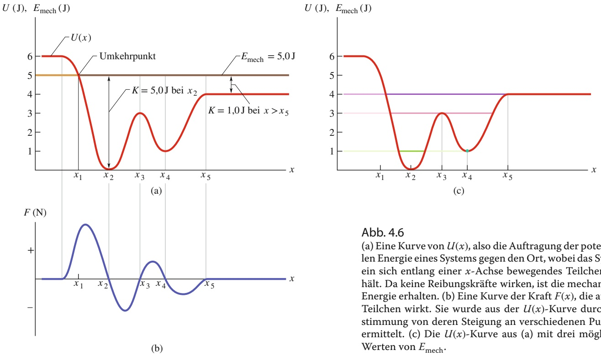

umschreiben. Nehmen wir nun an, dass die mechanische Energie $E _ { \mathrm { m e c h } }$ (die ja einen konstanten Wert besitzt) gleich 5,0 J ist. In Abb. 4.6a wird dieser Sachverhalt durch eine horizontale Linie dargestellt, welche die Energieachse im Punkt 5,0 J schneidet.

Gleichung 4.21 verrät uns, wie wir die kinetische Energie K an jedem beliebi gen Ort x eines Teilchens bestimmen können: Finden Sie an jener Position x den entsprechenden Wert von U anhand der $U ( x )$ -Kurve und ziehen Sie dann U von $E _ { \mathrm { m e c h } }$ ab. Befindet sich das Teilchen z. B. an einem beliebigen Punkt rechts von $x _ { 5 } ,$ so ist $K = 1 , 0   )$ . Der Wert von $K$ ist am größten $^ { ( 5 , 0 } \mathrm { J ) }$ , wenn sich das Teilchen bei $x _ { 2 }$ befindet, und am kleinsten (0 J), wenn es sich bei $x _ { 1 }$ befindet.

Da K niemals negativ sein kann (weil $\nu ^ { 2 }$ immer positiv ist), kann sich das Teilchen niemals auf die linke Seite von $x _ { 1 }$ bewegen, wo $E _ { \mathrm { m e c h } } - U$ negativ ist. Während sich das Teilchen von $x _ { 2 }$ nach $x _ { 1 }$ bewegt, wird K immer kleiner (das Teilchen wird immer langsamer), bis K schließlich bei $x _ { 1 }$ gleich null wird (das Teilchen hält dort an).

Beachten Sie, dass die auf das Teilchen wirkende Kraft – die durch Gl. 4.19 gegeben ist – in dem Moment, in dem das Teilchen den Punkt $x _ { 1 }$ erreicht, positiv ist (da die Steigung dU∕dx negativ ist). Dies bedeutet, dass das Teilchen nicht im Punkt $x _ { 1 }$ bleibt, sondern stattdessen anfängt, sich entgegen seiner ursprünglichen Bewegungsrichtung nach rechts zu bewegen. $x _ { 1 }$ ist also ein **Umkehrpunkt:** ein Punkt, in dem $K = 0$ ist (da $U = E   \mathrm { i s t } )$ und das Teilchen seine Bewegungsrichtung wechselt. An der rechten Seite der Kurve gibt es keinen Umkehrpunkt. Bewegt sich das Teilchen einmal nach rechts, so wird es diese Bewegung unendlich lange fortführen.

## Gleichgewichtspunkte

Abbildung 4.6c zeigt drei verschiedene Werte von $E _ { \mathrm { m e c h } }$ sowie die gleiche Kurve der potenziellen Energie $U ( x )$ als Funktion von x wie in Abb. 4.6a. Untersuchen wir nun, wie diese verschiedenen Werte von $E _ { \mathrm { m e c h } }$ die jeweilige Situation beeinflussen. Ist $E _ { \mathrm { m e c h } } = 4 , 0 1$ (violette Linie), so ist der Umkehrpunkt nicht mehr $x _ { 1 }$ sondern liegt zwischen $x _ { 1 }$ und $x _ { 2 }$ . An jedem beliebigen Punkt rechts von $x _ { 5 }$ ist die mechanische Energie des Systems außerdem gleich seiner potenziellen Energie; das

Teilchen besitzt hier also keine kinetische Energie und laut Gl. 4.19 wirkt hier keine Kraft auf das Teilchen. Es muss sich an diesen Punkten also in Ruhe befinden. Man spricht in diesem Fall von einem **neutralen** oder **indifferenten Gleichgewicht**. (Eine auf einem Tisch ruhende Murmel befindet sich z. B. in einem solchen Gleichgewichtszustand.)

Ist $E _ { \mathrm { m e c h } } = 3 ,   0 )$ (rosa Linie), so gibt es zwei Umkehrpunkte: Der eine liegt zwischen $x _ { 1 }$ und $x _ { 2 } ,$ der zweite zwischen $x _ { 4 }$ und $x _ { 5 } ,   x _ { 3 }$ ist außerdem ein Punkt, in dem $K = 0$ ist. Befindet sich das Teilchen genau an diesem Punkt, so ist die darauf wirkende Kraft ebenfalls gleich null und das Teilchen verharrt in Ruhe. Wird das Teilchen jedoch noch so geringfügig nach links oder rechts verschoben, so ist die Kraft nicht mehr null; sie drückt das Teilchen noch weiter in die eingeschlagene Richtung, sodass sich das Teilchen immer weiterbewegt. Befindet sich ein Teilchen in solch einer Position, spricht man von einem **instabilen** oder **labilen Gleichgewicht**. (In einem solchen Gleichgewichtszustand befindet sich z. B. eine Murmel, die auf einer Bowlingkugel ruht.)

Betrachten wir als Nächstes die Bewegung des Teilchens für den Fall, dass $E _ { \mathrm { m e c h } } = 1 , 0   )$ ist (grüne Linie). Setzen wir das Teilchen an den Punkt $x _ { 4 } ,$ so bleibt es dort stecken. Es kann sich hier von allein weder nach links noch nach rechts bewegen, da es dazu eine negative kinetische Energie bräuchte. Stoßen wir das Teilchen leicht nach links oder rechts an, so tritt eine Rückstellkraft auf, die das Teilchen zum Punkt $x _ { 4 }$ zurückbewegt. In einem solchen Fall spricht man von einem stabi**len Gleichgewicht**. (Eine Murmel, die am tiefsten Punkt einer halbkugelförmigen Schale liegt, ist ein Beispiel eines solchen Gleichgewichtszustands.) Setzen wir das Teilchen in den um $x _ { 2 }$ liegenden, schalenförmigen Potenzialtopf , befindet es sich zwischen zwei Umkehrpunkten. Es kann sich zwar ein wenig bewegen, doch nur bis zu $x _ { 1 }$ oder $x _ { 3 }$

## KONTROLLFRAGE 4

Die Abbildung zeigt die potenzielle Energie U(x) eines Systems, in dem ein Teilchen eine eindimensionale Bewegung ausführt. (a) Ordnen Sie die Abschnitte AB, BC und CD in absteigender Reihenfolge nach dem Betrag der auf das Teilchen wirkenden Kraft. (b) In welche Richtung zeigt die auf das Teilchen in Abschnitt AB wirkende Kraft?

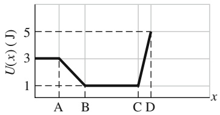

line

| Segment | U(x) (J) |
| --- | --- |
| A | 3 |
| B | 1 |
| C | 1 |
| D | 5 |

## 4.4 Von einer äußeren Kraft an einem System verrichtete Arbeit

## Lernziele

Nach dem Durcharbeiten dieses Abschnitts sollten Sie in der Lage sein, . . .

• die Veränderungen der kinetischen und potenziellen Energie anzugeben, wenn an einem System in Abwesenheit von Reibung von einer äußeren Kraft Arbeit verrichtet wird,
• die Veränderungen der kinetischen, potenziellen und thermischen Energie anzugeben, wenn an einem System in Anwesenheit von Reibung von einer äußeren Kraft Arbeit verrichtet wird.

## Schlüsselideen

• Durch eine äußere Kraft, die auf das System wirkt, kann Arbeit an ihm verrichtet (auf es übertragen oder aus ihm entnommen) werden.
• Wenn auf ein System mehr als eine Kraft wirkt, entspricht die von ihnen verrichtete Gesamtarbeit der auf das System übertragenen (oder von ihm entnommenen) Energie.
• In Abwesenheit von Reibung ist die an dem System verrichtete Arbeit gleich der Änderung $\Delta E _ { \mathrm { m e c h } }$ seiner mechanischen Energie:

$$
W = \Delta E _ {\mathrm{mech}} = \Delta K + \Delta U.
$$

• Wenn innerhalb des Systems eine Gleitreibungskraft wirkt, ändert sich die thermische Energie $E _ { \mathrm { t h } }$ des Systems (das ist die Energie, die mit der zufälligen Bewegung der Atome und Moleküle des Systems verknüpft ist). Für die an dem System verrichtete Arbeit gilt dann

$$
W = \Delta E _ {\mathrm{mech}} + \Delta E _ {\mathrm{th}}.
$$

• Die Änderung $\Delta E _ { \mathrm { t h } }$ hängt gemäß

$$
\Delta E _ {\mathrm{th}} = f _ {\mathrm{k}} d
$$

mit dem Betrag $f _ { \mathrm { k } }$ der Reibungskraft (oder kinetischen Reibung) und dem Betrag d der von der äußeren Kraft bewirkten Verschiebung zusammen.

## 4.4.1 Von einer äußeren Kraft an einem System verrichtete Arbeit

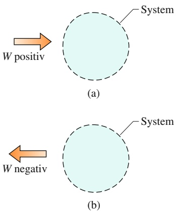

Abb. 4.7

(a) Wird an einem beliebigen System positive Arbeit W verrichtet, so bedeutet dies, dass Energie in das System übertragen wird. (b) Negative Arbeit W bedeutet, dass Energie von dem System abgeführt wird.

In Kap. 3 haben wir die Arbeit als Energie definiert, die durch eine auf ein Objekt wirkende Kraft auf das Objekt übertragen bzw. von diesem Objekt abgeführt wird. Diese Definition können wir nun auf Situationen erweitern, in denen eine äußere Kraft auf ein System von Objekten wirkt.

Arbeit ist Energie, die eine auf ein System wirkende äußere Kraft diesem System zuführt bzw. entzieht.

In Abb. 4.7a ist positive Arbeit dargestellt (also ein Energietransfer in ein System), in Abb. 4.7b negative Arbeit (also ein Energietransfer aus einem System). Wirkt auf ein System mehr als eine Kraft, so ist die von diesen Kräften verrichtete Gesamtarbeit die Energie, die dem System „netto“ zugeführt bzw. entzogen wurde.

Diese Energieübertragungen ähneln dem Geldtransfer auf oder von einem Bankkonto. Besteht ein System wie in Kap. 7 aus einem einzelnen Teilchen oder teilchenartigen Objekt, so kann die durch eine Kraft an dem System verrichtete Arbeit nur die kinetische Energie des Systems verändern. Diese Situation wird durch Gl. 7.10 (ΔK = W) beschrieben; d. h., ein einzelnes Teilchen besitzt nur ein „Energiekonto“, nämlich seine kinetische Energie. Äußere Kräfte können Energie auf dieses Konto bzw. von diesem Konto übertragen. Ist das System jedoch komplexer, so kann eine äußere Kraft auch andere Energieformen (wie z. B. die potenzielle Energie) verändern; ein komplexeres System kann sozusagen mehrere Energiekonten besitzen.

Um entsprechende Energiebilanzen für derartige Systeme herzuleiten, betrachten wir zwei grundlegende Situationen – eine, in der Reibung keine Rolle spielt, sowie eine weitere, in der eine Reibungskraft vorkommt.

## Abwesenheit von Reibung

Sie nehmen an einem Wettkampf im Kugelstoßen teil. Dazu heben Sie zunächst die auf dem Boden liegende Kugel auf, sodass Sie die Kugel etwa in Gesichtshöhe loswerfen. Während Ihrer Aufwärtsbewegung verrichtet die Kraft, die Sie auf die Kugel ausüben, offensichtlich Arbeit; d. h., diese Kraft ist eine äußere Kraft, die Energie überträgt – doch auf welches System?

Um diese Frage zu beantworten, überprüfen wir zunächst, welche Energien sich verändern. Die kinetische Energie der Kugel ändert sich um den Betrag ΔK; da Ku gel und Erde sich dabei weiter voneinander entfernen, gibt es auch eine Änderung ΔU der mit der Gravitationskraft verbundenen potenziellen Energie des Systems Kugel–Erde. Um beide Änderungen in unsere Betrachtungen einschließen zu können, müssen wir also das System Kugel–Erde untersuchen. Die Kraft, die Sie aufwenden, ist dann eine äußere Kraft, die an diesem System Arbeit verrichtet, und die Arbeit ist durch

$$
W = \Delta K + \Delta U \tag {4.22}
$$

oder

$$
W = \Delta E _ {\text {mech}} \quad \begin{array}{l} \text {(in Abwesenheit von Reibung an einem} \\ \text {System verrichtete Arbeit)} \end{array} \tag {4.23}
$$

gegeben, wobei $\Delta E _ { \mathrm { m e c h } }$ die $\ddot { \mathrm { A } }$ nderung der mechanischen Energie des Systems ist. Diese zwei Gleichungen, die in Abb. 4.8 dargestellt sind, sind einander äquivalente Energiebilanzgleichungen für die durch eine äußere Kraft an einem System verrichtete Arbeit in einer Situation, in der keine Reibungskräfte auftreten.

## Anwesenheit von Reibung

Als Nächstes betrachten wir das in Abb. 4.9a dargestellte Beispiel. Hier zieht eine konstante horizontale Kraft $\vec { F }$ einen Block um eine Verschiebung d die x-Achse entlang und vergrößert dabei die Geschwindigkeit des Blocks von $\vec { \nu } _ { 0 }$ auf v⃗. Während der Bewegung übt der Boden eine konstante Gleitreibungskraft $\vec { f } _ { \mathrm { k } }$ auf den Block aus. Zunächst wählen wir den Block als unser System und wenden darauf das zweite Newtonsche Gesetz an. Für die Komponenten entlang der x-Achse $( F _ { \mathrm { g e s } , x } =$ ma ) ergibt sich hier:

$$
F - f _ {\mathrm{k}} = m a. \tag {4.24}
$$

Da die Kräfte konstant sind, ist auch die Beschleunigung $\vec { a }$ konstant. Also können wir Gl. (2.14) verwenden und erhalten:

$$
\nu^ {2} = \nu_ {0} ^ {2} + 2 a d.
$$

Auflösen nach a, Einsetzen des Ergebnisses in Gl. 4.24 und Umformen liefert dann

$$
F d = \frac {1}{2} m v ^ {2} - \frac {1}{2} m v _ {0} ^ {2} + f _ {\mathrm{k}} d \tag {4.25}
$$

beziehungsweise, da für den Block $\begin{array} { r } { \frac { 1 } { 2 } m \nu ^ { 2 } - \frac { 1 } { 2 } m \nu _ { 0 } ^ { 2 } = \Delta K } \end{array}$ ist:

$$
F d = \Delta K + f _ {\mathrm{k}} d. \tag {4.26}
$$

In einer allgemeineren Situation (in der sich der Block z. B. eine Rampe hinaufbewegt) kann außerdem eine Änderung der potenziellen Energie auftreten. Um eine solche mögliche Änderung einzuschließen, verallgemeinern wir Gl. 4.26 zu

$$
F d = \Delta E _ {\mathrm{mech}} + f _ {\mathrm{k}} d. \tag {4.27}
$$

Experimentell stellt sich heraus, dass sich sowohl der Block als auch der Teil des Fußbodens, über den er gleitet, während der Bewegung des Blocks erwärmen. Wie wir in Kap. 14 sehen werden, hängt die Temperatur eines Objekts mit seiner thermischen Energie oder Wärmeenergie $E _ { \mathrm { t h } }$ zusammen (der Energie, die der Zufallsbewegung der Atome und Moleküle in dem Objekt zugeordnet ist). Hier erhöht sich die thermische Energie von Block und Boden, weil (1) zwischen den beiden Reibung auftritt und (2) der Block über den Boden rutscht. Erinnern Sie sich daran, dass Reibung durch „Mikro-Kaltschweißen“ zwischen zwei Oberflächen entsteht (Kap. 2). Während der Block über den Boden gleitet, verursacht diese Gleitbewegung ein wiederholtes Aufbrechen und Neubilden der Schweißstellen zwischen dem Block und dem Boden, wodurch sich Block und Boden aufwärmen. Die Gleitbewegung vergrößert also deren thermische Energie $E _ { \mathrm { t h } }$

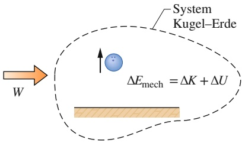

text_image

System
Kugel-Erde
ΔEmech = ΔK + ΔU
W

Abb. 4.8

An dem System Kugel–Erde wird eine positive Arbeit W verrichtet. Dies verursacht eine Änderung $\Delta E _ { \mathrm { m e c h } }$ der mechanischen Energie des Systems, eine Änderung ΔK der kinetischen Energie der Kugel sowie eine Änderung ΔU der potenziellen Energie des Systems.

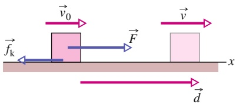

text_image

v₀
F
v
x
fₖ
d

(a)

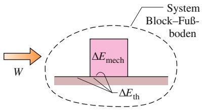

text_image

System
Block-Fuß-
boden
ΔE_mech
ΔE_th
W

(b)

## Abb. 4.9

(a) Ein Block wird von einer Kraft F⃗ über einen Boden gezogen. Dabei wirkt eine Gleitreibungskraft $\vec { f } _ { \mathrm { k } }$ der Bewegung entgegen. Am Anfang der Verschiebung d⃗ besitzt der Block die Geschwindigkeit $\vec { \nu } _ { 0 } ,$ am Ende der Verschiebung die Geschwindigkeit ⃗v. (b) Die Kraft $\vec { F }$ verrichtet eine positive Arbeit W an dem System Block– Boden, was eine Änderung $\Delta E _ { \mathrm { m e c h } }$ der mechanischen Energie des Blocks und eine Änderung $\Delta E _ { \mathrm { t h } }$ der thermischen Energie von Block und Boden verursacht.

Experimentell zeigt sich außerdem, dass diese Zunahme $\Delta E _ { \mathrm { t h } }$ der thermischen Energie gleich dem Produkt der Beträge $f _ { \mathrm { k } }$ und d ist:

$$
\Delta E _ {\mathrm{th}} = f _ {\mathrm{k}} d \quad (\text {Zunahme der thermischen Energie durch Gleiten}). \tag {4.28}
$$

Damit können wir Gl. 4.27 also in der Form

$$
F d = \Delta E _ {\mathrm{mech}} + \Delta E _ {\mathrm{th}} \tag {4.29}
$$

schreiben.

Fd ist die von der äußeren Kraft $\vec { F }$ verrichtete Arbeit W (d. h. die Energie, die von der Kraft übertragen wird) – doch an welchem System wird diese Arbeit verrichtet (d. h., wo finden die Energieübertragungen statt)? Um diese Frage zu beantworten, überprüfen wir, welche Energien sich verändern. Die mechanische Energie des Blocks ändert sich ebenso wie die thermische Energie von Block und Boden. Die Kraft F⃗ verrichtet ihre Arbeit also an dem System Block–Fußboden. Diese Arbeit ist

$$
W = \Delta E _ {\text {mech}} + \Delta E _ {\text {th}} \quad \begin{array}{l} \text {(in Anwesenheit von Reibung} \\ \text {an einem System verrichtete Arbeit)} \end{array} . \tag {4.30}
$$

Diese Gleichung – die in Abb. 4.9b dargestellt ist – ist die Energiebilanzgleichung für die durch eine äußere Kraft an einem System verrichtete Arbeit in einer Situation, in der Reibungskräfte auftreten.

## KONTROLLFRAGE 5

Ein Block wird wie in Abb. 4.9a gezeigt in drei Versuchen von einer horizonta len Kraft über einen Fußboden geschoben, der nicht reibungsfrei ist. Die folgende Tabelle führt den Betrag F der angelegten Kraft und die durch das Schieben ver ursachte Änderung des Geschwindigkeitsbetrags des Blocks auf. In allen drei Versuchen legt der Block dieselbe Entfernung d zurück. Ordnen Sie die drei Versuche in absteigender Reihenfolge nach der auf dieser Strecke d auftretenden Änderung der thermischen Energie von Block und Fußboden.

| Versuch | F | Auswirkung auf den Geschwindigkeitsbetrag des Blocks |
| --- | --- | --- |
| a | 5,0 N | nimmt ab |
| b | 7,0 N | bleibt konstant |
| c | 8,0 N | nimmt zu |

## 4.5 Energieerhaltung

## Lernziele

Nach dem Durcharbeiten dieses Abschnitts sollten Sie in der Lage sein, . . .

• für ein abgeschlossenes System (keine resultierende äußere Kraft) die Energieerhaltung zu verwenden, um eine Beziehung zwischen der anfänglichen Gesamt energie des Systems und seiner Gesamtenergie zu einem späteren Zeitpunkt anzugeben,
• für ein nicht abgeschlossenes System eine Beziehung zwischen der durch eine äußere Kraft an dem System verrichteten Arbeit und den Änderungen der verschiedenen Energiearten im System anzugeben,
• die Beziehung zwischen der mittleren Leistung, der damit verbundenen Übertragung von Energie und dem Zeitintervall anzugeben, in dem diese Übertragung stattfindet,
• aus einer vorgegebenen Energieübertragung als Funktion der Zeit (entweder als Funktionsterm oder als grafische Auftragung) die momentane Leistung (die in einem gegebenen Moment übertragene Energie) zu bestimmen.

## Schlüsselideen

Die Gesamtenergie eines Systems (die Summe seiner mechanischen Energie und aller internen Energiearten, einschließlich der thermischen Energie) kann sich nur ändern, wenn Energie auf das System übertragen oder aus ihm entnommen wird. Diese experimentelle Tatsache wird als Energieerhaltung bezeichnet.

• Wenn an einem System Arbeit verrichtet wird, dann gilt

$$
W = \Delta E = \Delta E _ {\mathrm{mech}} + \Delta E _ {\mathrm{th}} + \Delta E _ {\mathrm{int}}.
$$

Wenn das System abgeschlossen ist $\left( W = 0 \right)$ , gilt folglich

$$
\Delta E _ {\mathrm{mech}} + \Delta E _ {\mathrm{th}} + \Delta E _ {\mathrm{int}} = 0
$$

und

$$
E _ {\mathrm{mech,2}} = E _ {\mathrm{mech,1}} - \Delta E _ {\mathrm{th}} - \Delta E _ {\mathrm{int}},
$$

wobei die Indizes 1 und 2 zwei unterschiedliche Zeitpunkte bezeichnen.

• Die von einer Kraft erbrachte Leistung beschreibt die Geschwindigkeit des Energietransfers. Wenn eine Kraft in einem Zeitintervall Δt eine Energie $\Delta E$ auf ein System überträgt, erbringt sie eine mittlere (gemittelte) Leistung

$$
P _ {\mathrm{gem}} = \frac {\Delta E}{\Delta t}.
$$

• Die momentane Leistung, die eine Kraft erbringt, ist

$$
P = \frac {\mathrm{d} E}{\mathrm{d} t}.
$$

Trägt man die übertragene Energie gegen die Zeit auf, entspricht die Steigung der Kurve der Leistung zu einem gegebenen Zeitpunkt.

## 4.5.1 Energieerhaltung

Wir haben bisher einige Situationen untersucht, in denen Energie auf Objekte und Systeme übertragen bzw. von diesen abgeführt wird, ähnlich wie Geld auf ein Konto eingezahlt bzw. von einem Konto abgehoben wird. In all diesen Situationen sind wir davon ausgegangen, dass wir die entsprechende Energie immer verfolgen konnten – dass die Energie also nicht auf magische Weise einfach auftauchen oder verschwinden kann. Formaler ausgedrückt haben wir (ganz richtig) angenommen, dass die Energie dem sogenannten **Erhaltungssatz der Energie** gehorcht, der die **Gesamtenergie** E eines Systems betrifft. Diese Gesamtenergie ist die Summe der mechanischen Energie, der thermischen Energie und jeglicher weiteren Formen von innerer Energie eines Systems. (Diese weiteren Energiearten haben wir bisher noch nicht untersucht. Es gibt auch noch weitere „äußere“ Energieformen, auf die wir im Laufe des Buchs zurückkommen werden – Energieerhaltung gilt immer für alle auftretenden Formen.) Der Erhaltungssatz besagt Folgendes:

Die Gesamtenergie E eines Systems kann sich nur dann ändern, wenn Energie auf das System übertragen bzw. aus dem System abgeführt wird.

Die einzige Art des Energietransfers, die wir bisher betrachtet haben, ist die an einem System verrichtete Arbeit W. Zum jetzigen Zeitpunkt lautet der Energieerhaltungssatz für uns also

$$
W = \Delta E = \Delta E _ {\mathrm{mech}} + \Delta E _ {\mathrm{th}} + \Delta E _ {\mathrm{int}}, \tag {4.31}
$$

wobei $\Delta E _ { \mathrm { m e c h } }$ jegliche Änderung der mechanischen Energie des Systems, $\Delta E _ { \mathrm { t h } }$ jegliche Änderung der thermischen Energie des Systems und $\Delta E _ { \mathrm { i n t } }$ jegliche Änderung irgendeiner anderen Form von innerer Energie des Systems darstellt. $\Delta E _ { \mathrm { m e c h } }$ enthält die Änderungen ΔK der kinetischen Energie sowie die Änderungen ΔU der potenziellen Energie (der elastischen potenziellen Energie, der potenziellen Energie der Gravitation oder jeder anderen Form von Energie, der wir begegnen können).

Diesen Energieerhaltungssatz haben wir nicht aus anderen grundlegenden phy sikalischen Prinzipien hergeleitet. Vielmehr beruht dieser Satz auf zahlreichen Ex perimenten und es gibt bisher noch keinen Widerspruch zu diesem Satz. Manche sagen sogar, er sei das Grundgesetz der Physik schlechthin.

## Abgeschlossenes System

natural_image

Silhouette of a rock climber ascending a cliff against a sunset sky (no text or symbols)

Abb. 4.10

Um sich abzuseilen, muss die Kletterin Energie von der potenziellen Energie des Systems, das aus ihr, ihrer Ausrüstung und der Erde besteht, abführen. Dabei sorgt sie dafür, dass zwischen dem Seil, metallenen Ringen und der Felswand Reibungskräfte entstehen. Der größte Teil der übertragenen Energie wird dadurch der thermischen Energie von Seil, Ringen und Wand zugeführt – und nicht der kinetischen Energie der Kletterin [Quelle: Greg Epperson/iStockphoto].

Ist ein System abgeschlossen, also von seiner Umgebung isoliert, so kann keine Energie in das System hinein bzw. aus dem System heraus übertragen werden. In diesem Fall besagt der Energieerhaltungssatz:

Die Gesamtenergie E eines abgeschlossenen Systems kann sich nicht verändern.

Viele Energietransfers können innerhalb eines abgeschlossenen Systems stattfin den, so z. B. zwischen der kinetischen Energie und einer potenziellen Energie oder zwischen der kinetischen Energie und der thermischen Energie. Die Gesamtsumme aller Energieformen in dem System kann sich jedoch nicht ändern.

Betrachten wir als ein Beispiel die Kletterin aus Abb. 4.10. Mit ihrer Ausrüstung und der Erde bildet sie ein System, das wir näherungsweise als abgeschlossen betrachten können. Während sie sich die Felswand (ein Teil der Erde!) hinunter abseilt und dabei die Konfiguration des Systems verändert, muss sie den Energietransfer von der potenziellen Energie des Systems unter Kontrolle behalten. (Diese Energie kann nicht einfach verschwinden.) Ein Teil der potenziellen Energie wird in ihre kinetische Energie übertragen. Offensichtlich muss sie jedoch vermeiden, dass zu viel potenzielle Energie in diese Form von Energie übertragen wird, da sie sich sonst zu schnell bewegen würde. Deshalb hat sie das Seil um verschiedene Metallringe gewickelt, damit zwischen dem Seil und den Ringen während ihrer Abwärtsbewegung Reibung entsteht. Das Gleiten der Ringe entlang des Seils überträgt dann potenzielle Energie des Systems in die thermische Energie von Ringen und Seil – und zwar auf eine Art und Weise, die die Kletterin kontrollieren kann. Die Gesamtenergie des Systems Kletterin–Ausrüstung–Erde (d. h. die Summe aus seiner potenziellen Energie, kinetischen Energie und thermischen Energie) verändert sich während des Abseilens nicht.

Für ein abgeschlossenes System kann der Energieerhaltungssatz in zwei verschiedenen Formen geschrieben werden. Zunächst setzen wir in Gl. 4.31 $W = 0$ und erhalten damit

$$
\Delta E _ {\mathrm{mech}} + \Delta E _ {\mathrm{th}} + \Delta E _ {\mathrm{int}} = 0 \quad (\text {abgeschlossenes System}). \tag {4.32}
$$

Wir können auch $\Delta E _ { \mathrm { m e c h } } = \Delta E _ { \mathrm { m e c h , 2 } } - \Delta E _ { \mathrm { m e c h , 1 } }$ ansetzen, wobei die Indizes 1 und 2 zwei verschiedene Zeitpunkte bezeichnen, z. B. bevor und nachdem ein bestimmter Prozess stattgefunden hat. Dann wird Gl. 4.32 zu

$$
E _ {\mathrm{mech}, 2} = E _ {\mathrm{mech}, 1} - \Delta E _ {\mathrm{th}} - \Delta E _ {\mathrm{int}}. \tag {4.33}
$$

Gleichung 4.33 besagt Folgendes:

In einem abgeschlossenen System können wir die Gesamtenergie zu einem bestimmten Zeitpunkt mit der Gesamtenergie zu einem anderen Zeitpunkt in Beziehung setzen, ohne die Energie des Systems während der dazwischenliegenden Zeitpunkte betrachten zu müssen.

Diese Tatsache kann sehr hilfreich sein, wenn es darum geht, Aufgaben zu lösen, bei denen Sie die Energie eines abgeschlossenen Systems vor und nach einem bestimmten Prozess miteinander in Verbindung bringen müssen.

In Abschn. 4.2 haben wir einen Spezialfall eines abgeschlossenen Systems untersucht – nämlich eine Situation, in der innerhalb der betrachteten Systeme keine nichtkonservativen Kräfte (wie z. B. Gleitreibungskräfte) wirken. In diesem speziellen Fall sind $\Delta E _ { \mathrm { t h } }$ und $\Delta E _ { \mathrm { i n t } }$ beide gleich null und Gl. 4.33 reduziert sich auf Gl. 4.18. Anders ausgedrückt ist die mechanische Energie eines abgeschlossenen Systems erhalten, wenn innerhalb des Systems keine nichtkonservativen Kräfte wirken.

## Leistung

Nachdem wir nun gesehen haben, wie Energie von einer Energieform in eine andere übertragen werden kann, können wir die in Abschn. 7.6 aufgestellte Definition der Leistung erweitern. Dort war die Leistung die Rate, mit der eine Kraft Arbeit verrichtet. Im allgemeineren Sinn ist die Leistung P die Rate, mit der eine Kraft Energie von einer Energieform in die andere überträgt. Wird während eines Zeitintervalls $\Delta t$ die Energiemenge ΔE übertragen, so ist die durchschnittliche Leis**tung** der Kraft

$$
P _ {\mathrm{gem}} = \frac {\Delta E}{\Delta t}. \tag {4.34}
$$

Analog ist die **momentane Leistung** der Kraft

$$
P = \frac {\mathrm{d} E}{\mathrm{d} t}. \tag {4.35}
$$

## 4.6 Zusammenfassung

**Konservative Kräfte** Eine Kraft ist konservativ, wenn die Gesamtarbeit, die sie an einem Teilchen verrichtet, welches sich von einem Anfangs- zu einem Endpunkt entlang eines beliebigen geschlossenen Wegs bewegt, gleich null ist. Gleichbedeutend ist die Aussage, dass die Gesamtarbeit unabhängig von dem Weg ist, auf dem sich das Teilchen bewegt. Gravitationskraft und Federkraft sind konservative Kräfte; die Reibungskräfte und Strömungswiderstand sind dagegen nichtkonservative Kräfte.

**Potenzielle Energie** Eine potenzielle Energie ist eine Energie, die mit der Konfiguration eines Systems zusammenhängt, in dem eine konservative Kraft wirkt. Verrichtet die konservative Kraft eine Arbeit W an einem Teilchen innerhalb des Systems, so ist die Änderung ΔU der potenziellen Energie des Systems

$$
\Delta U = - W. \tag {4.1}
$$

Bewegt sich das Teilchen von einem Punkt $x _ { \mathrm { i } }$ zu einem Punkt $x _ { \mathrm { f } } ,$ so lautet die Änderung der potenziellen Energie des Systems

$$
\Delta U = \int_ {x _ {\mathrm{i}}} ^ {x _ {\mathrm{f}}} F (x) \mathrm{d} x. \tag {4.6}
$$

**Potenzielle Energie der Gravitation** Die Energie, die einem System zugeordnet ist, das aus der Erde und einem sich nahe der Erde befindlichen Teilchen besteht, ist die potenzielle Energie der Gravitation oder auch Lageenergie. Bewegt sich das Teilchen von einer Höhe $y _ { \mathrm { i } }$ zu einer Hö- he $y _ { \mathrm { f } } ,$ so lautet die Änderung der potenziellen Energie des Systems Teilchen–Erde

$$
\Delta U = m g (y _ {\mathrm{f}} - y _ {\mathrm{i}}) = m g \Delta y. \tag {4.7}
$$

Legt man den **Referenzpunkt** der potenziellen Energie, bei dem $U _ { \mathrm { i } } = 0$ ist, an den Ort $y _ { \mathrm { i } } = 0$ , dann ist die potenzielle Energie U für jede beliebige Höhe y des Teilchens gerade

$$
U (y) = m g y. \tag {4.9}
$$

**Elastische potenzielle Energie** Die elastische potenzielle Energie ist die Energie, die dem Spannungszustand eines elastischen Objekts zugeordnet ist. Die elastische potenzielle Energie einer Feder, welche eine Federkraft $F = - k x$ ausübt, wenn ihr freies Ende um eine Verschiebung x ausgelenkt wurde, ist

$$
U (x) = \frac {1}{2} k x ^ {2}. \tag {4.11}
$$

Bei einer Feder verwendet man als Referenzkonfiguration mit $U = 0$ den Zustand, in dem die Feder entspannt ist, die Auslenkung ist dann $x = 0$

**Mechanische Energie** Die mechanische Energie $E _ { \mathrm { m e c h } }$ eines Systems ist die Summe seiner kinetischen Energie K und seiner potenziellen Energie U:

$$
E _ {\mathrm{mech}} = K + U. \tag {4.12}
$$

Ein System heißt isoliert oder abgeschlossen, wenn keine äußere Kraft Energieänderungen in diesem System verursacht. Verrichten nur konservative Kräfte innerhalb eines abgeschlossenen Systems Arbeit, dann kann sich die mechanische Energie $E _ { \mathrm { m e c h } }$ des Systems nicht ändern. Dieser Energieerhaltungssatz der Mechanik lässt sich in der Form

$$
K _ {2} + U _ {2} = K _ {1} + U _ {1} \tag {4.17}
$$

schreiben, wobei die Indizes zwei verschiedene Zeitpunkte eines Prozesses bezeichnen, bei dem Energie übertragen wird. Eine weitere Form des Energieerhaltungssatzes ist

$$
\Delta E _ {\mathrm{mech}} = \Delta K + \Delta U = 0. \tag {4.18}
$$

**Potenzialkurven** Kennen wir die potenzielle Energie U(x) eines Systems, in dem eine eindimensionale Kraft F auf ein Teilchen wirkt, als Funktion des Orts x, so können wir die Kraft mithilfe der Gleichung

$$
F (x) = - \frac {\mathrm{d} U (x)}{\mathrm{d} x} \tag {4.19}
$$

bestimmen. Wird U(x) grafisch als Kurve aufgetragen, so ist die Kraft F für jeden Wert von x das Negative der Steigung der Kurve in diesem Punkt; die kinetische Energie des Teilchens ist dann durch

$$
K (x) = E _ {\mathrm{mech}} - U (x) \tag {4.21}
$$

gegeben, wobei $E _ { \mathrm { m e c h } }$ die mechanische Energie des Systems ist.

Ein **Umkehrpunkt** ist ein Punkt x, in dem das Teilchen seine Bewegungsrichtung ändert (dort gilt $K   =   0 )$ . Das Teilchen befindet sich im Gleichgewicht an Punkten, in denen die Steigung der U(x)-Kurve null ist (an diesen Stellen ist $F ( x ) = 0 )$ .

**Von einer äußeren Kraft an einem System verrichtete Arbeit** Eine Arbeit W ist Energie, die durch eine äußere, auf ein System wirkende Kraft auf das System übertragen bzw. dem System entzogen wird. Wirken mehrere Kräfte auf ein System, so ist die von ihnen verrichtete Gesamtarbeit die insgesamt übertragene Energie. In Abwesenheit von Reibung sind die an dem System verrichtete Arbeit und die

Änderung $\Delta E _ { \mathrm { m e c h } }$ der mechanischen Energie des Systems gleich:

$$
W = \Delta E _ {\mathrm{mech}} = \Delta K + \Delta U. \tag {4.22,4.23}
$$

Wirkt innerhalb des Systems eine Gleitreibungskraft $\vec { f } _ { \mathrm { k } ^ { \prime } }$ so ändert sich die thermische Energie oder Wärmeenergie $E _ { \mathrm { t h } }$ des Systems. (Diese Energie ist der Zufallsbewegung der Atome und Moleküle in dem System zugeordnet.) Die an dem System verrichtete Arbeit ist dann

$$
W = \Delta E _ {\mathrm{mech}} + \Delta E _ {\mathrm{th}}. \tag {4.30}
$$

Die Änderung $\Delta E _ { \mathrm { t h } }$ hängt mit dem Betrag $f _ { k }$ der Reibungskraft und dem Betrag d der von der äußeren Kraft verursachten Verschiebung über die Beziehung

$$
\Delta E _ {\mathrm{th}} = f _ {\mathrm{k}} d \tag {4.28}
$$

zusammen.

**Energieerhaltung** Die Gesamtenergie E eines Systems (die Summe seiner mechanischen Energie und seiner inneren Energien inklusive der thermischen Energie) kann sich nur um Energiebeträge ändern, die dem System zugeführt oder von dem System abgeführt werden. Diese experimentell nachgewiesene Tatsache wird **Energieerhaltungssatz** genannt. Wird an dem System eine Arbeit W verrichtet, so ist

$$
W = \Delta E = \Delta E _ {\mathrm{mech}} + \Delta E _ {\mathrm{th}} + \Delta E _ {\mathrm{int}}. \tag {4.31}
$$

Ist das System abgeschlossen $\left( W = 0 \right)$ , so ergibt dies

$$
\Delta E _ {\mathrm{mech}} + \Delta E _ {\mathrm{th}} + \Delta E _ {\mathrm{int}} = 0 \tag {4.32}
$$

sowie

$$
E _ {\mathrm{mech}, 2} = E _ {\mathrm{mech}, 1} - \Delta E _ {\mathrm{th}} - \Delta E _ {\mathrm{int}}, \tag {4.33}
$$

wobei die Indizes 1 und 2 zwei verschiedene Zeitpunkte bezeichnen.

**Leistung** Die Leistung einer Kraft ist die Rate, mit der diese Kraft Energie überträgt. Überträgt eine Kraft in einem Zeitintervall Δt eine Energiemenge ΔE, so ist die **durchschnittliche Leistung** dieser Kraft:

$$
P _ {\mathrm{gem}} = \frac {\Delta E}{\Delta t}. \tag {4.34}
$$

Die **momentane Leistung** der Kraft ist:

$$
P = \frac {\mathrm{d} E}{\mathrm{d} t}. \tag {4.35}
$$

## 4.7 Fragen

**1.** Abbildung 4.F1 zeigt einen direkten und vier indirekte Wege zwischen einem Punkt i und einem Punkt f. Entlang des direkten Wegs und dreier der indirekten Wege wirkt nur eine konservative Kraft $F _ { \mathrm { k o n } }$ auf ein bestimmtes Objekt. Entlang des vierten indirekten Wegs wirken $F _ { \mathrm { k o n } }$ sowie eine weitere, nichtkonservative Kraft $F _ { \mathrm { n k } }$ auf das Objekt. Die Änderung $\Delta E _ { \mathrm { m e c h } }$ der mechanischen Energie des Objekts (in Joule) zwischen Punkt i und Punkt f ist an jedem geraden Segment des jeweiligen indirekten Wegs angegeben. (a) Wie groß ist $\Delta E _ { \mathrm { m e c h } }$ , wenn sich das Teilchen entlang des direkten Wegs von i nach f bewegt? (b) Wie groß ist die durch $F _ { \mathrm { n k } }$ verursachte Änderung von $\Delta E _ { \mathrm { m e c h } }$ entlang des Wegs, auf dem diese Kraft wirkt?

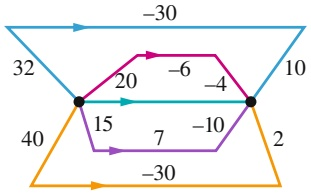

flowchart

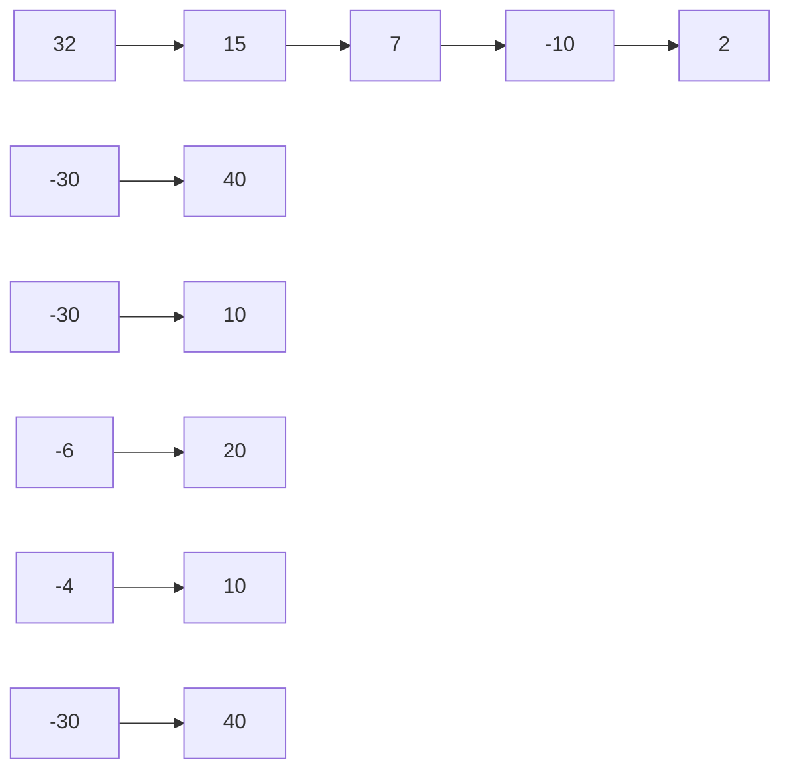

Abb. 4.F1

**2.** Eine Feder ist ursprünglich gedehnt und dabei um 3,0 cm aus ihrem entspannten Zustand ausgelenkt. Anbei folgen vier verschiedene Möglichkeiten, diese ursprüngliche Auslenkung zu verändern: (a) Die Feder ist hinterher um 2,0 cm gedehnt; (b) die Feder ist hinterher um 2,0 cm gestaucht; (c) die Feder ist hinterher um 4,0 cm gestaucht; (d) die Feder ist hinterher um 4,0 cm gedehnt. Ordnen Sie diese vier Möglichkeiten nach den Änderungen, die sie in der elastischen potenziellen Energie der Feder hervorrufen – die positivste zuerst, die negativste zuletzt.
**3.** Eine Kokosnuss wird mit einem anfänglichen Geschwin digkeitsbetrag $\nu _ { 0 } \; = \; 8   \mathrm { m / s }$ von einer Klippe in ein weites, flaches Tal geworfen. Ordnen Sie die folgenden möglichen Wurfrichtungen in absteigender Reihenfolge nach (a) der ursprünglichen kinetischen Energie der Kokosnuss und (b) ihrer kinetischen Energie, kurz bevor sie auf dem Boden des Tals auftrifft: (1) $\vec { \nu } _ { 0 }$ zeigt beinahe vertikal nach oben; $( 2 )   \vec { \nu } _ { 0 }$ zeigt in einem Winkel von $4 5 ^ { \circ }$ nach oben; $\left( 3 \right) \vec { \nu } _ { 0 }$ verläuft horizontal; $\left( 4 \right) \vec { \nu } _ { 0 }$ zeigt in einem Winkel von 45°nach unten und $( 5 )   \vec { \nu } _ { 0 }$ zeigt beinahe senkrecht nach unten.
**4.** In Abb. 4.F4 gleitet eine mutige Schlittschuhläuferin drei Hänge aus reibungsfreiem

Eis hinunter, deren vertikale Höhen d identisch sind. Ordnen Sie die Hänge in absteigender Reihenfolge nach (a) der von der Gravitationskraft wäh rend des Hinuntergleitens an diesem Hang an der Schlittschuhläuferin verrichteten Arbeit und (b) der Änderung ihrer kinetischen Energie, die durch das Hinuntergleiten an diesem Hang verursacht wird.

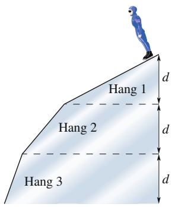

text_image

Hang 1
Hang 2
Hang 3
d
d
d

Abb. 4.F4

**5.** In Abb. 4.F5 wird ein kleiner, ursprünglich in Ruhe befindlicher Block in einer Höhe von 3,0m auf einer reibungsfreien Rampe losgelassen. Die Rampe verläuft wie dargestellt auf und ab über „Berge“ und „Täler“. Die Berge besitzen identische kreisbogenförmige Spitzen (nehmen Sie an, dass der Block an keiner der Bergspitzen abhebt). (a) Welcher Berg ist der erste, den der Block nicht mehr überqueren kann? (b) Was geschieht mit dem Block, nachdem er an diesem Berg „gescheitert“ ist? Auf welcher Bergspitze ist (c) die Zentripetalbeschleunigung des Blocks am größ- ten und (d) die auf den Block wirkende Normalkraft am geringsten?

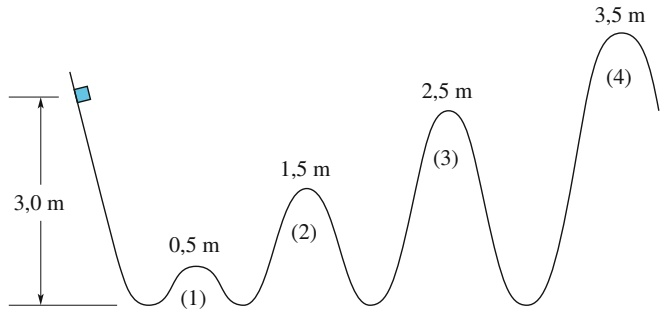

line

| Stage | Wave Height (m) |
| --- | --- |
| 1 | 0.5 |
| 2 | 1.5 |
| 3 | 2.5 |
| 4 | 3.5 |

Abb. 4.F5

**6.** Abbildung 4.F6 gibt die potenzielle Energie eines Teilchens als Funktion des Orts x an. (a) Ordnen Sie die Abschnitte AB, BC, CD und DE in absteigender Reihenfolge nach dem Betrag der auf das Teilchen wirkenden Kraft. Wie groß darf die mechanische Energie $E _ { \mathrm { m e c h } }$ des Teilchens maximal sein, wenn das Teilchen (b) in dem linken Potenzialtopf gefangen sein soll, (c) in dem rechten Potenzialtopf gefangen sein soll bzw. (d) sich zwischen den beiden Potenzialtöpfen bewegen darf, dabei jedoch nicht weiter nach rechts kommen soll als Punkt H? In welchem der Abschnitte BC, DE und FG besitzt in Teilfrage (d) das Teilchen (e) die größte kinetische Energie und (f ) den kleinsten Geschwindigkeitsbetrag?

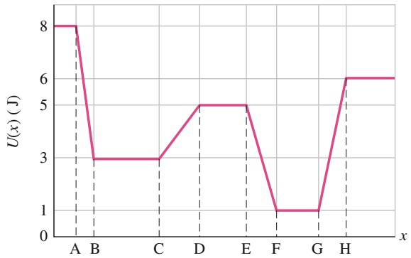

line

| x | U(x) (J) |
| --- | --- |
| A | 8 |
| B | 3 |
| C | 3 |
| D | 5 |
| E | 5 |
| F | 1 |
| G | 1 |
| H | 6 |

Abb. 4.F6

**7.** In Abb. 4.F7 wird ein Block mit einer initialen potenziellen Energie $U _ { \mathrm { i } }$ aus der Ruhe am oberen Ende einer Bahn losgelassen. Die gekrümmten Abschnitte der Bahn sind reibungsfrei, während das horizontale Stück der Länge L mit einer Reibungskraft f auf den Block einwirkt. (a) Wie viel Energie wird in thermische Energie umgewandelt, wenn der Block die Länge L einmal durchläuft? Wie oft durchläuft der Block diese Länge L, wenn die ursprüngliche potenzielle Energie $U _ { \mathrm { i } }$ gleich (b) 0,50 fL, (c) 1,25 fL bzw. (d) 2,25 fL ist? (e) Wo kommt der Block in diesen drei Situationen zum Halten – in der Mitte des horizontalen Abschnitts, links von der Mitte oder rechts von der Mitte? (Aufwärmübung für Aufgabe 4.29 im Übungsbuch)

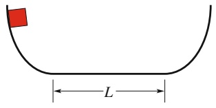

text_image

L

Abb. 4.F7

**8.** In Abb. 4.F8 gleitet ein Block eine Bahn hinunter und verringert dabei seine Höhe um h. Die Bahn ist bis auf den unteren Abschnitt reibungsfrei. Dort kommt der Block nach einer bestimmten Strecke D aufgrund der Reibung zum Stehen. (a) Wenn wir h kleiner wählen, wird der Block bis zum Anhalten dann eine Strecke brauchen, die grö- ßer als, kleiner als oder gleich groß ist wie D? (b) Wenn wir stattdessen die Masse des Blocks vergrößern, ist die zum Anhalten benötigte Strecke dann größer als, kleiner als oder gleich groß wie D?

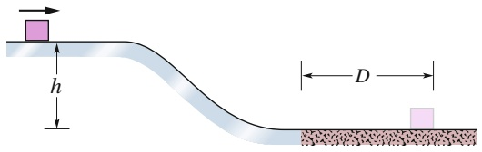

text_image

h
D

Abb. 4.F8

**9.** In Abb. 4.F9 rutscht ein Block entlang einer reibungsfreien Rampe von A nach C und durchquert dann den horizontalen Abschnitt CD, in dem eine Reibungskraft auf den Block wirkt. Wie verändert sich die kinetische Energie des Blocks in den Abschnitten (a) AB, (b) BC und (c) CD: Wird sie größer, kleiner oder bleibt sie unverändert? (d) Wird die mechanische Energie des Blocks in diesen Abschnitten grö- ßer, kleiner oder bleibt sie unverändert?

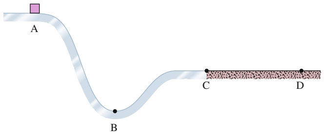

text_image

A
B
C
D

Abb. 4.F9

**10.** In Abb. 4.F10 kann ein sich zunächst horizontal bewegender Block drei reibungsfreie Wege nehmen, die sich nur in ihrer Höhe unterscheiden, um zu der gestrichelten (vertikalen) Ziellinie zu gelangen. Ordnen Sie die Wege in absteigender Reihenfolge (a) nach der Geschwindigkeit des

Blocks an der Ziellinie und (b) nach der Zeit, die der Block zum Erreichen der Ziellinie benötigt.

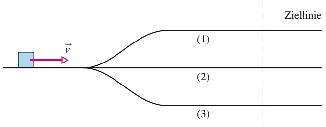

flowchart

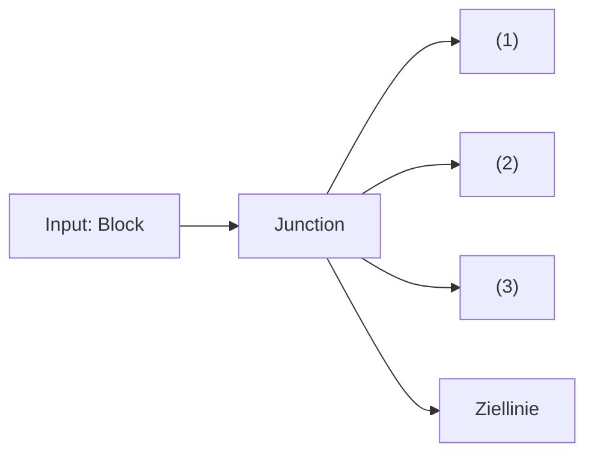

Abb. 4.F10

**11.** In der Situation in Abb. 4.F11a ziehen Sie an dem Seil nach oben, der daran befestigte Zylinder kann auf der vertikalen Stange hinauf- und hinuntergleiten, allerdings nur mühsam, da die aufgeraute Stangenoberfläche eine erhebliche Reibung ausübt. Ihre Kraft verrichtet die Arbeit W = +100 J an dem System Zylinder–Stange–Erde (Abb. 4.F11b). Eine „Energiebilanz“ des Systems ist in Abb. 4.F11c gezeigt: die kinetische Energie K nimmt um 50 J zu, die Gravitationsenergie $U _ { \mathrm { G } }$ steigt um 20 J. Die einzige weitere Energieänderung im System betrifft die thermische Energie $E _ { \mathrm { t h } } .$ . Wie groß ist $\Delta E _ { \mathrm { t h } } ?$

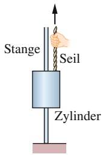

text_image

Stange
Seil
Zylinder

(a)

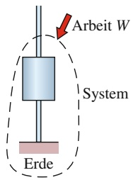

text_image

Arbeit W
System
Erde

(b)

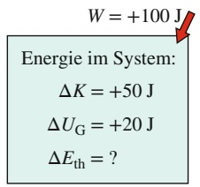

text_image

W = +100 J
Energie im System:
ΔK = +50 J
ΔU_G = +20 J
ΔE_th = ?

(c)

Abb. 4.F11

**12.** Abbildung 4.F12 zeigt eine ähnliche Situation wie die aus Frage 11. Hier ziehen Sie nach unten an dem Seil, das an dem Zylinder befestigt ist, der eng auf der Stange sitzt. Während der Zylinder sich senkt, zieht er über ein zweites Seil einen Block über eine Tischplatte. Betrachten Sie wieder das System Zylinder–Stange–Erde, ähnlich wie in Abb. 4.F11b. Sie verrichten an dem System eine Arbeit von +200 J. Das System

verrichtet eine Arbeit von 60 J an dem Block auf dem Tisch. Innerhalb des Systems nimmt die kinetische Energie um 130 J zu und die potenzielle Energie der Gravitation sinkt um 20 J. (a) Skizzieren Sie eine „Energiebilanz“ für das System wie in Abb. 4.F11c. (b) Wie groß ist die Änderung der thermischen Energie innerhalb des Systems?

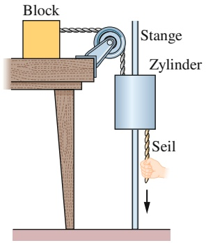

text_image

Block
Stange
Zylinder
Seil

Abb. 4.F12

**13.** Abbildung 4.F13 zeigt drei Situationen mit einer nicht reibungsfreien Ebene, auf der ein Block gleitet. Der Block beginnt in allen drei Situationen mit derselben Geschwindigkeit zu gleiten, die Gleitreibung bringt ihn schließlich zum Stehen. Ordnen Sie die Situationen in absteigender Reihenfolge nach dem Anstieg der thermischen Energie durch das Gleiten.

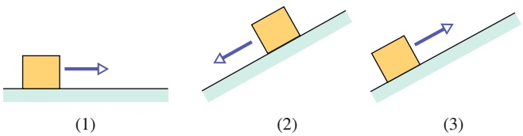

Abb. 4.F13

**14.** Abbildung 4.F14 zeigt drei Pflaumen, die von derselben Höhe aus mit derselben Geschwindigkeit gestartet werden. Die erste wird senkrecht nach oben geworfen, die zweite in einem kleinen Winkel zur Vertikalen und die dritte wird entlang einer reibungsfreien geneigten Ebene nach oben geschubst. Ordnen Sie die Pflaumen in absteigender Reihenfolge nach der Geschwindigkeit, die sie in Höhe der gestrichelten Linie erreicht haben.

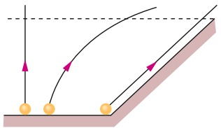

natural_image

Diagram showing two objects on a slope with curved paths and arrows indicating motion (no text or symbols)

(1) (2) (3)

Abb. 4.F14

**15.** Eine konservative Kraft $\vec { F }$ verrichtet die in Abb. 4.F15 gezeigte Arbeit an einem Teilchen, das sich entlang der gezeigten Wege und in den gezeigten Richtungen von i nach f bzw. von j nach f bewegt. Welche Arbeit verrichtet $\vec { F }$ an dem Teilchen, wenn es sich auf dem direkten Weg von i nach j bewegt?

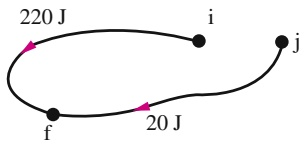

flowchart

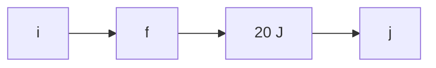

Abb. 4.F15

# 5 Systeme von Teilchen

## 5.1 Der Schwerpunkt

## Physikalische Motivation

Jeder Ingenieur, der als Gutachter vor Gericht geladen ist, um den Hergang eines Verkehrsunfalls aufzuklären, verlässt sich auf die Gesetze der Physik. Jeder Trainer, der einer Tänzerin beibringt, wie sie springen soll, verwendet dabei Physik. Jede Analyse einer beliebigen komplizierten Bewegung erfordert ein Verständnis der zugrunde liegenden Physik. In diesem Kapitel wollen wir uns damit befassen, wie wir die komplizierte Bewegung eines komplexen Systems von Objekten – wie z. B. einer Tänzerin oder eines Fahrzeugs – auf einfache Weise beschreiben können, indem wir einen besonderen Punkt des Systems bestimmen – seinen Schwerpunkt.

Wir wollen mit einem Beispiel beginnen: Stellen Sie sich vor, Sie werfen einen Ball in die Luft. Er bewegt sich, wie in Abb. 5.1a zu sehen ist, im Wesentlichen wie ein einfaches Teilchen. Nun werfen Sie einen Baseballschläger (Abb. 5.1b), und der Bewegungsablauf scheint viel komplizierter zu sein. Jeder Punkt des Schlägers folgt einer anderen Bahn, sodass Sie das System nicht als ein einzelnes Teilchen beschreiben können. Man erkennt sehr deutlich, dass es sich um ein System aus vielen Teilchen handelt.

Betrachten Sie dieses Systems allerdings genauer, so stellen Sie fest, dass sich einer der vielen Punkte tatsächlich auf einer parabelförmigen Bahn bewegt, die jener eines einzelnen Teilchens (Abb. 5.1a) gleicht. Dieser besondere Punkt bewegt sich so, als ob erstens die gesamte Masse des Schlägers hier konzentriert wäre und zweitens die Gravitation ausschließlich auf diesen Punkt wirkte. Wir nennen diesen Punkt den **Schwerpunkt**.

## 5.1.1 Der Schwerpunkt

Wir definieren den Schwerpunkt S eines Teilchensystems (z. B. eines menschlichen Körpers) anschaulich durch seine Rolle bei der Bewegung des Systems:

Der Schwerpunkt eines Körpers oder eines Systems mehrerer Körper ist derjenige Punkt, der sich bewegt, als ob die gesamte Masse des Systems dort konzentriert wäre und alle äußeren Kräfte ausschließlich dort angriffen.

Wir wollen nun untersuchen, wie man den Schwerpunkt verschiedener Systeme ermittelt. Dabei beginnen wir mit einen System aus wenigen, genauer gesagt zwei

## Abb. 5.1

(a) Ein in die Luft geworfener Ball beschreibt eine parabelförmige Bahn. (b) Der Schwerpunkt (schwarz markiert) eines nach oben geworfenen Baseballschlägers beschreibt ebenfalls eine Parabel; alle anderen Punkte des Schlägers bewegen sich hingegen auf komplizierteren Bahnkurven [Quelle: Richard Megna/Fundamental Photographs].

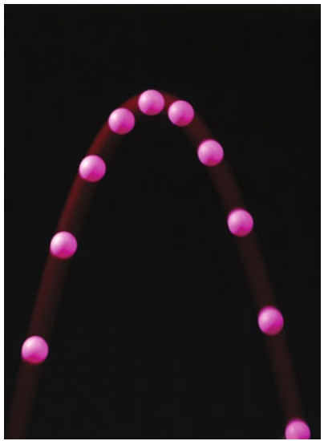

natural_image

A pink curved line with evenly spaced small dots against a black background, resembling a bell curve or arch (no text or symbols)

(a)

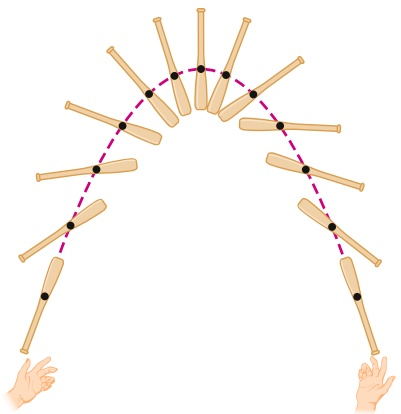

natural_image

Diagram showing two hands forming a symmetrical arch with multiple vertical bars and a dashed purple line connecting them (no text or symbols)

(b)

Teilchen, um anschließend zu einem komplizierteren System aus vielen Teilchen (ähnlich dem Baseballschläger) überzugehen.

## Teilchensysteme

In Abb. 5.2a sehen Sie zwei Teilchen mit den Massen $m _ { 1 }$ und $m _ { 2 }$ im Abstand d. Der Ursprung des Koordinatensystems wurde hier willkürlich auf das Teilchen mit der Masse $m _ { 1 }$ gelegt. Wir definieren nun den Schwerpunkt S dieses sehr einfachen Zweiteilchensystems als

$$
x _ {\mathrm{S}} = \frac {m _ {2}}{m _ {1} + m _ {2}} d. \tag {5.1}
$$

Nehmen wir beispielsweise an, es sei $m _ { 2 } = 0 .$ . Dann enthält das System nur ein Teilchen der Masse $m _ { 1 : }$ , der Schwerpunkt liegt am Ort dieses Teilchens, und Gl. 5.1 liefert erwartungsgemäß $x _ { \mathrm { S } } = 0$ . Ist hingegen $m _ { 1 } = 0 ,$ so enthält das System nur ein Teilchen der Masse $m _ { 2 }$ , und folglich ist $x _ { S } = d .$ Im Fall gleicher Massen, $m _ { 1 } =$ $m _ { 2 } ,$ befindet sich der Schwerpunkt exakt in der Mitte zwischen den Teilchen, $x _ { \mathrm { S } } =$ $d / 2 .$ Für den Fall schließlich, dass $m _ { 1 }$ und $m _ { 2 }$ nicht gleich, aber beide verschieden von null sind, kann der Schwerpunkt Gl. 5.1 zufolge nur Werte zwischen 0 und d annehmen. Er muss also irgendwo zwischen den Teilchen liegen.

Abbildung 5.2b zeigt eine allgemeinere Situation. Das Koordinatensystem wurde jetzt nach links verschoben, und der Ort des Schwerpunkts ist jetzt

$$
x _ {\mathrm{S}} = \frac {m _ {1} x _ {1} + m _ {2} x _ {2}}{m _ {1} + m _ {2}}. \tag {5.2}
$$

Setzen wir hier $x _ { 1 } = 0$ , so wird $x _ { 2 } = d ,$ und Gl. 5.2 geht wie erwartet in Gl. 5.1 über. Der Abstand des Schwerpunkts zu den beiden Teilchen wird durch die Verschiebung des Koordinatensystems nicht verändert.

Wir können Gl. 5.2 auch in der Form

$$
x _ {S} = \frac {m _ {1} x _ {1} + m _ {2} x _ {2}}{M} \tag {5.3}
$$

schreiben, wobei M die Gesamtmasse des Systems ist. (In unserem Fall gilt $M =$ $m _ { 1 } { + } m _ { 2 } . )$ Nun verallgemeinern wir diese Beziehung auf ein System von n Teilchen, welche sich sämtlich auf der x-Achse befinden. Die Gesamtmasse ist dann $M =$ $m_{1} + m_{2} + \cdots + m_{n},$ , und der Schwerpunkt befindet sich bei

$$
x _ {S} = \frac {m _ {1} x _ {1} + m _ {2} x _ {2} + m _ {3} x _ {3} + \cdots + m _ {n} x _ {n}}{M} = \frac {1}{M} \sum_ {i = 1} ^ {n} m _ {i} x _ {i}. \tag {5.4}
$$

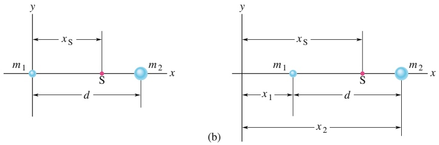

(a)

## Abb. 5.2

(a) Zwei Teilchen mit den Massen $m _ { 1 }$ und $m _ { 2 } ;$ der Abstand zwischen ihnen ist gleich d. Der rote Punkt gibt den Schwerpunkt des Systems an, wie er aus Gl. 5.1 folgt. (b) Dieselbe Situation wie in (a), jetzt fällt jedoch der Ursprung des Koordinatensystems mit keinem der Teilchen zusammen. Die Position des Schwerpunkts muss nun mithilfe von Gl. 5.2 berechnet werden. Die Lage des Schwerpunkts bezüglich der beiden Teilchen hängt, wie sich herausstellt, nicht von der relativen Lage des Koordinatensystems ab.