Der Index i, die Summationsvariable, durchläuft hier alle natürlichen Zahlen von 1 bis $n .$ Er bezeichnet die einzelnen Teilchen, deren Massen und x-Koordinaten.

Liegt eine dreidimensionale Verteilung von Teilchen vor, dann wird der Ort des Schwerpunkts durch drei Koordinaten beschrieben. Wir erweitern Gl. 5.4 entsprechend und erhalten

$$
x _ {\mathrm{S}} = \frac {1}{M} \sum_ {i = 1} ^ {n} m _ {i} x _ {i}, \quad y _ {\mathrm{S}} = \frac {1}{M} \sum_ {i = 1} ^ {n} m _ {i} y _ {i}, \quad z _ {\mathrm{S}} = \frac {1}{M} \sum_ {i = 1} ^ {n} m _ {i} z _ {i} \tag {5.5}
$$

Wir können den Schwerpunkt auch in Vektorschreibweise angeben. Wie Sie sich erinnern, wird die Position eines Teilchens mit den Koordinaten $x _ { i } , y _ { i }$ und $z _ { i }$ durch einen Ortsvektor ⃗r festgelegt:

$$
\vec {r} _ {i} = x _ {i} \vec {e} _ {x} + y _ {i} \vec {e} _ {y} + z _ {i} \vec {e} _ {z}. \tag {5.6}
$$

Der Index bezeichnet das Teilchen, und die Einheitsvektoren $\vec { e } _ { x } , \vec { e } _ { y }$ und $\vec { e } _ { z }$ zeigen in die positive Richtung der x-, y- bzw. z-Achse. Der Ort des Schwerpunkts des Teilchensystems ist ebenfalls durch den Ortsvektor

$$
\vec {r} _ {\mathrm{S}} = x _ {\mathrm{S}} \vec {e} _ {x} + y _ {\mathrm{S}} \vec {e} _ {y} + z _ {\mathrm{S}} \vec {e} _ {z} \tag {5.7}
$$

gegeben. Damit können wir die drei skalaren Gleichungen (Gl. 5.5) durch eine einzige Vektorgleichung ersetzen:

$$
\vec {r} _ {\mathrm{S}} = \frac {1}{M} \sum_ {i = 1} ^ {n} m _ {i} \vec {r} _ {i} \tag {5.8}
$$

(M ist wieder die Gesamtmasse des Systems). Um diese Gleichung zu überprüfen, setzen Sie die Gln. 5.6 und 5.7 ein und separieren die $x - , y -$ und z-Komponente. Sie erhalten dann die skalaren Gln. 5.5.

## Homogene feste Körper

Ein gewöhnliches Objekt, etwa ein Baseballschläger, enthält sehr viele Teilchen (Atome). Wir behandeln solche Objekte sinnvollerweise als kontinuierliche Materieverteilungen. Aus den „Teilchen“ werden dann differenzielle Massenelemente dm, die Summen in Gl. 5.5 werden zu Integralen und die Koordinaten des Schwerpunkts sind wie folgt definiert:

$$
x _ {\mathrm{S}} = \frac {1}{M} \int x \mathrm{d} m, \quad y _ {\mathrm{S}} = \frac {1}{M} \int y \mathrm{d} m, \quad z _ {\mathrm{S}} = \frac {1}{M} \int z \mathrm{d} m. \tag {5.9}
$$

M ist die Masse des Objekts.

Die Berechnung dieses Integrals ist für die meisten Dinge des täglichen Lebens, etwa einen Fernsehapparat oder eine Katze, sehr kompliziert. Wir wollen deshalb nur homogene Objekte betrachten, solche also, deren Dichte (oder Masse pro Vo lumeneinheit) überall gleich ist. Das bedeutet, die Dichte $\rho$ eines beliebigen Volu menelements ist gleich der Dichte des Objekts als Ganzem:

$$
\rho = \frac {\mathrm{d} m}{\mathrm{d} V} = \frac {M}{V}, \tag {5.10}
$$

mit dV als dem Volumenelement, das von einem Massenelement dm eingenommen wird, und V als Volumen des gesamten Objekts. Wir setzen nun $\mathrm { d } m   =$ (M∕V) dV aus Gl. 5.10 in Gl. 5.9 ein und erhalten

$$
x _ {\mathrm{S}} = \frac {1}{V} \int x \mathrm{d} V, \quad y _ {\mathrm{S}} = \frac {1}{V} \int y \mathrm{d} V, \quad z _ {\mathrm{S}} = \frac {1}{V} \int z \mathrm{d} V. \tag {5.11}
$$

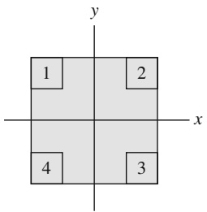

text_image

y
1
2
x
4
3

Bei Objekten, die eine räumliche Symmetrie besitzen (Symmetriezentrum, -achse, -ebene usw.), können Sie gegebenenfalls ein Integral oder mehrere weglassen. Der Schwerpunkt eines solchen Objekts ist stets im Symmetrieelement enthalten. So befindet sich der Schwerpunkt einer homogenen Kugel in deren Mittelpunkt, der gleichzeitig das Symmetriezentrum ist; der Schwerpunkt eines homogenen Kegels liegt auf dessen (Symmetrie-)Achse, und der Schwerpunkt einer idealen Banane befindet sich in der (Symmetrie-)Ebene, welche die Banane in zwei gleiche Teile teilt. Übrigens muss der Schwerpunkt eines beliebig geformten Objekts nicht notwendigerweise innerhalb des Objekts liegen – denken Sie z. B. an einen Schlüsselring oder ein Hufeisen.

## KONTROLLFRAGE 1

Die Abbildung zeigt eine homogene quadratische Tafel, aus deren Ecken sich vier identische Quadrate entfernen lassen. (a) Wo befindet sich der Schwerpunkt der Tafel, bevor ein Quadrat entfernt wurde? Wo liegt er nach Entfernen (b) von Quadrat 1, (c) der Quadrate 1 und 2, (d) der Quadrate 1 und 3, (e) der Quadrate 1, 2 und 3 sowie (f ) aller vier Quadrate? Drücken Sie Ihre Antworten mithilfe von Quadranten, Achsen und Punkten aus. Sie sollten ohne eine explizite Rechnung auskommen.

## LÖSUNGSSTRATEGIEN

**Strategie 1: Berechnung des Schwerpunkts** Aus den Beispielaufgaben 5.1 und 5.2 im Übungsbuch können wir drei grundsätzliche Strategien zur Vereinfachung der Berechnung von Schwerpunkten ableiten:

1. Machen Sie sich alle Symmetrieelemente des Objekts – Punkte, Achsen, Ebenen – zunutze.
2. Wenn das Objekt in mehrere Teile aufgeteilt werden kann, so behandeln Sie jeden Teil als Massepunkt, der sich im jeweiligen Schwerpunkt befindet.
3. Überlegen Sie genau, wie Sie ein Koordinatensystem auf das Objekt legen: Handelt es sich um eine Anordnung von Teilchen, so wählen Sie den Ort eines Teil chens als Ursprung; handelt es sich um einen Körper mit einer Symmetrieachse, so legen Sie die x- oder y-Achse auf dieses Symmetrieelement.

Wie Sie den Ursprung festlegen, hat keinerlei Einfluss auf Ihr Ergebnis, sondern nur auf den Aufwand, mit dem Sie es erhalten!

## 5.2 Das zweite Newtonsche Gesetz für ein Teilchensystem

## Lernziele

Nach dem Durcharbeiten dieses Abschnitts sollten Sie in der Lage sein, . . .

• das zweite Newtonsche Gesetz auf ein Teilchensystem anzuwenden, indem Sie die Beziehung zwischen der Gesamtkraft auf das System (der Vektorsumme aller äußeren Kräfte) und der Beschleunigung seines Schwerpunkts nutzen,
• die Beziehungen für Bewegungen mit konstanter Beschleunigung auf die Bewegungen der einzelnen Teilchen eines Systems sowie auf die Bewegung des Systemschwerpunkts anzuwenden,
• aus den Massen und Geschwindigkeiten der Teilchen in einem System die Geschwindigkeit des Systemschwerpunkts zu berechnen,
• aus den Massen und Beschleunigungen der Teilchen in einem System die Beschleunigung des Systemschwerpunkts zu berechnen,
• aus der Position des Schwerpunkts eines Systems als Funktion der Zeit dessen Geschwindigkeit zu berechnen,
• aus der Geschwindigkeit des Schwerpunkts eines Systems als Funktion der Zeit dessen Beschleunigung zu berechnen,
• die Veränderung der Geschwindigkeit eines Systemschwerpunkts durch Integration seiner Beschleunigung über die Zeit zu berechnen,

• die Veränderung der Position eines Systemschwerpunkts durch Integration seiner Geschwindigkeit über die Zeit zu berechnen,
• für ein Zweiteilchensystem, in dem sich die Teilchen ohne Bewegung des Systemschwerpunkts relativ zueinander bewegen, Beziehungen zwischen den Verschiebungen der Teilchen und ihren Geschwindigkeiten anzugeben.

## Schlüsselideen

• Die Bewegung des Schwerpunkts eines beliebigen Teilchensystems wird durch das zweite Newtonsche Gesetz für Teilchensysteme beschrieben:

$$
\vec {F} _ {\mathrm{eff}} = M \vec {a} _ {\mathrm{S}}.
$$

Hierbei sind $\vec { F } _ { \mathrm { e f f } }$ die Resultierende aller äußeren Kräfte auf das System, M seine Gesamtmasse und ${ \vec { a } } _ { S }$ die Beschleunigung des Schwerpunkts.

## 5.2.1 Das zweite Newtonsche Gesetz für ein Teilchensystem

Wenn Sie eine Billardkugel auf eine zweite, ruhende Kugel zurollen lassen, erwarten Sie, dass sich beide Kugeln nach dem Aufprall weiter von Ihnen weg bewegen. Sicher wären Sie sehr überrascht, wenn die Kugeln stattdessen beide auf Sie zukä- men oder sich gemeinsam nach links oder rechts entfernten.

Was sich eigentlich weiter vorwärtsbewegt, ist der Schwerpunkt des Systems aus zwei Kugeln, dessen stetige Bewegung durch den Stoß in keiner Weise beeinflusst wird. An einem Billardtisch können Sie sich sofort von der Richtigkeit dieser Aussage überzeugen, wenn Sie den Schwerpunkt im Auge behalten, der sich stets in der Mitte zwischen den Kugeln befindet, sofern sie gleich schwer sind. Gleichgültig, ob der Zusammenstoß frontal oder streifend stattfindet – stets bewegt sich der Schwerpunkt unverändert vorwärts, als ob überhaupt kein Stoß stattgefunden hät te. Im Folgenden wollen wir diese Schwerpunktbewegung genauer untersuchen.

Wir ersetzen dazu unsere beiden Billardkugeln durch eine Menge von n Teilchen, die nicht notwendigerweise dieselbe Masse haben. Nun verfolgen wir nicht die Bewegung der einzelnen Teilchen, sondern ausschließlich diejenige ihres Schwerpunkts. Dieser bewegt sich – obwohl er $\mathbf { , } \mathbf { n u r } ^ { \omega }$ ein Punkt ist – wie ein Teilchen, dessen Masse gleich der Gesamtmasse des Systems ist, und wir können ihm einen Ort, eine Geschwindigkeit und eine Beschleunigung zuordnen. Wir behaupten nun (und werden später beweisen), dass die Bewegung eines solchen Schwerpunkts durch folgende (Vektor-)Gleichung bestimmt ist:

$$
\vec {F} _ {\mathrm{eff}} = M \vec {a} _ {\mathrm{S}}. \tag {5.12}
$$

Dies ist das zweite Newtonsche Gesetz für die Bewegung des Schwerpunkts eines Systems aus mehreren Teilchen. Wie Sie bemerken werden, hat es dieselbe Form wie das entsprechende Bewegungsgesetz für ein einzelnes Teilchen $( \vec { F } _ { \mathrm { e f f } } = m \vec { a } )$ Bei der Behandlung der drei in Gl. 5.12 auftretenden Größen ist jedoch eine gewisse Vorsicht geboten:

1. $\vec { F } _ { \mathrm { e f f } }$ ist die effektive von außen auf das System wirkende Kraft; innere Kräfte, die von einem Teil des Systems auf einen anderen ausgeübt werden, sind in Gl. 5.12 nicht enthalten.
2. M ist die Gesamtmasse des Systems. Wir gehen davon aus, dass die Masse des Systems während der Bewegung weder zu- noch abnimmt, sodass M konstant bleibt. Ein solches System nennen wir geschlossen.
3. ${ \vec { a } } _ { S }$ ist die Beschleunigung des Schwerpunkts des Systems. Gleichung 5.12 sagt nichts darüber aus, welche Beschleunigung die anderen Punkte des Systems erfahren.

Äquivalent zu Gl. 5.12 können wir auch drei Gleichungen für die einzelnen Komponenten der Vektoren $\vec { F } _ { \mathrm { e f f } }$ und ${ \vec { a } } _ { S }$ bezüglich der gewählten Koordinatenachsen aufschreiben:

$$
F _ {\mathrm{eff}, x} = M a _ {\mathrm{S}, x}, \quad F _ {\mathrm{eff}, y} = M a _ {\mathrm{S}, y}, \quad F _ {\mathrm{eff}, z} = M a _ {\mathrm{S}, z}. \tag {5.13}
$$

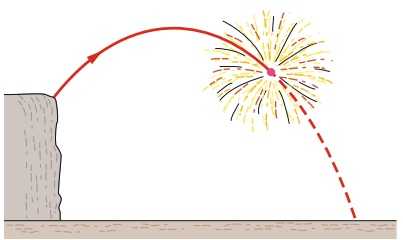

natural_image

Illustration of a firecracker on a cliff face with a red arc and dashed trajectory line (no text or symbols)

Abb. 5.3

Ein Feuerwerkskörper explodiert im Flug. Vernachlässigt man die Luftreibung, so bewegt sich der Schwerpunkt der Bruchstücke weiter auf der ursprünglichen parabelförmigen Bahn der Rakete, bis die Fragmente den Boden erreichen.

Grand jeté. In veränderter Form übernommen aus The Physics of Dance von Kenneth Laws, Schirmer Books, 1984.

Abb. 5.4

Kehren wir nun zu unserem System aus zwei Billardkugeln zurück. Eine Kugel befinde sich in Ruhe. Sobald die zweite Kugel angestupst wurde und auf die erste zurollt, wirkt keine äußere Kraft mehr auf das System. Wegen $\vec { F } _ { \mathrm { e f f } } = 0$ ist gemäß Gl. 5.12 dann $\vec { a } _ { \mathrm { S } } = 0$ . Da die Beschleunigung die Rate der Geschwindigkeitsänderung angibt, folgern wir, dass sich die Geschwindigkeit des Schwerpunkts des Systems nicht ändert. Beim Zusammenstoß der Kugeln wirken nur innere Kräfte (von einer Kugel auf die andere), welche nicht zu $\vec { F } _ { \mathrm { e f f } }$ beitragen, und nach wie vor ist $\vec { F } _ { \mathrm { e f f } } = 0$ . Der Schwerpunkt des Systems, der sich vor dem Stoß vorwärts bewegt hat, muss sich nach dem Stoß weiterhin vorwärts bewegen, und zwar mit unveränderter Geschwindigkeit und in unveränderter Richtung.

Gleichung 5.12 gilt nicht nur für Systeme aus einzelnen Teilchen, sondern auch für feste Körper wie den Baseballschläger in Abb. 5.1b. In diesem Fall ist M in Gl. 5.12 die Masse des Schlägers und $\vec { F } _ { \mathrm { e f f } } ^ { \mathrm { ~ \tilde { ~ } } }$ die auf ihn wirkende Gravitationskraft. Wir entnehmen der Gleichung, dass $\vec { \alpha } _ { \mathrm { S } } = \vec { g }$ ist. Mit anderen Worten: Der Schwerpunkt des Schlägers bewegt sich so, als ob der Schläger ein Massepunkt mit der Masse M wäre, auf den die Kraft $\vec { F } _ { \mathrm { G } }$ wirkt.

Abbildung 5.3 zeigt einen anderen interessanten Fall. Bei einem Feuerwerk fliegt eine Rakete auf einer parabelförmigen Bahn. An einem bestimmten Punkt explodiert sie in Fragmente. Hätte die Explosion nicht stattgefunden, so wäre die Rakete auf der in Abb. 5.3 gestrichelt eingezeichneten Bahnkurve weitergeflogen. Die während der Explosion wirkenden Kräfte sind innere Kräfte, ausgeübt von einem Teil des Systems auf die anderen Teile. Wenn wir die Luftreibung vernachlässigen, verbleibt als äußere Kraft nur die Gravitationskraft, deren Wirkung nicht davon abhängt, ob die Rakete explodiert oder nicht. Gleichung 5.12 zufolge bleibt die Beschleunigung ${ \vec { a } } _ { S }$ des Schwerpunkts der Fragmente gleich $\vec { g }$ (solange sich die Fragmente in der Luft befinden). Der Schwerpunkt des Systems dieser Bruchstücke beschreibt nach wie vor dieselbe parabolische Bahn, auf der sich die Rakete bewegt hätte, wenn sie nicht explodiert wäre.

Bei einem grand jeté („großen Wurf “) streckt eine Tänzerin Arme und Beine waagerecht aus, sobald sich ihre Füße von der Bühne abgehoben haben (Abb. 5.4). Dadurch wird der Schwerpunkt ihres Körpers nach oben verschoben; in der Tat beschreibt er eine parabelförmige Bahn, ohne dass dazu Kopf und Torso der Tänzerin jedoch wesentlich an Höhe gewinnen müssen, wie es bei einem normalen Sprung der Fall wäre. Kopf und Körper bewegen sich nahezu waagerecht, und dem Zuschauer erscheint die Bewegung mehr als Schweben denn als Sprung.

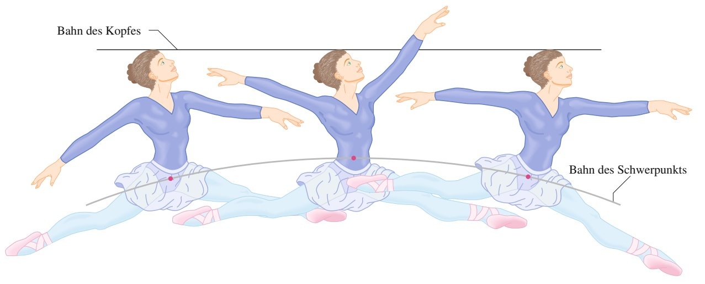

text_image

Bahn des Kopfes
Bahn des Schwerpunkts

## Herleitung von Gl. 5.12

Wir wollen nun das zweite Newtonsche Gesetz für die Bewegung des Schwerpunkts, Gl. 5.12, herleiten. Gemäß Gl. 5.8 gilt für ein System aus n Teilchen

$$
M \vec {r} _ {\mathrm{S}} = m _ {1} \vec {r} _ {1} + m _ {2} \vec {r} _ {2} + m _ {3} \vec {r} _ {3} + \dots + m _ {n} \vec {r} _ {n} \tag {5.14}
$$

mit M als Gesamtmasse des Systems und $\vec { r } _ { \mathrm { S } }$ als Ortsvektor des Schwerpunkts.

Wir leiten Gl. 5.14 nach der Zeit ab und erhalten

$$
M \vec {\nu} _ {S} = m _ {1} \vec {\nu} _ {1} + m _ {2} \vec {\nu} _ {2} + m _ {3} \vec {\nu} _ {3} + \dots + m _ {n} \vec {\nu} _ {n}. \tag {5.15}
$$

Dabei ist $\vec { \nu } _ { i } = \mathsf { d } \vec { r } _ { i } / \mathsf { d } t$ die Geschwindigkeit des i-ten Teilchens und $\vec { \nu } _ { S } = \mathrm { d } \vec { r } _ { S } / \mathrm { d } t$ die Geschwindigkeit des Schwerpunkts.

Nun leiten wir Gl. 5.15 nochmals nach der Zeit ab:

$$
M \vec {a} _ {\mathrm{S}} = m _ {1} \vec {a} _ {1} + m _ {2} \vec {a} _ {2} + m _ {3} \vec {a} _ {3} + \dots + m _ {n} \vec {a} _ {n}, \tag {5.16}
$$

wobei $\vec { a } _ { i } = \mathrm { d } \vec { \nu } _ { i } / \mathrm { d } t$ die Beschleunigung des i-ten Teilchens und $\vec { a } _ { S } = \mathrm { d } \vec { \nu } _ { S } / \mathrm { d } t$ die Beschleunigung des Schwerpunkts ist. Wie Sie sehen, können wir dem Schwerpunkt einen Ort, eine Geschwindigkeit und eine Beschleunigung zuordnen, obwohl es sich lediglich um einen (geometrischen) Massepunkt handelt, nicht um ein reales Teilchen. Aus dem zweiten Newtonschen Gesetz folgt, dass $m _ { i } \vec { a } _ { i }$ gleich der resultierenden Kraft $\vec { F } _ { i }$ ist, die auf das i-te Teilchen wirkt. Wir können Gl. 5.16 daher auch in der Form

$$
M \vec {a} _ {\mathrm{S}} = \vec {F} _ {1} + \vec {F} _ {2} + \vec {F} _ {3} + \dots + \vec {F} _ {n} \tag {5.17}
$$

schreiben. Zu den Kräften, die zur rechten Seite von Gl. 5.17 beitragen, gehören die Kräfte, welche die Teilchen des Systems aufeinander ausüben (innere Kräfte) sowie die Kräfte, welche von außen auf die Teilchen ausgeübt werden (äußere Kräfte). Dem dritten Newtonschen Gesetz gemäß heben die inneren Kräfte einander in der Summe, die auf der rechten Seite von Gl. 5.16 erscheint, auf; übrig bleibt die Vektorsumme aller von außen auf das System wirkenden Kräfte. Gleichung 5.17 lässt sich damit auf Gl. 5.12 zurückführen, die wir herleiten wollten.

## KONTROLLFRAGE 2

Zwei Schlittschuhläufer, Fred und Ethel, stehen auf einer reibungsfreien Eisbahn und halten je ein Ende eines Stabs von vernachlässigbar kleiner Masse fest. Eine Achse des Systems verläuft entlang des Stabs; der Ursprung dieser Achse liege auf dem Schwerpunkt des Systems. Fred ist doppelt so schwer wie Ethel. Wo begegnen die Läufer einander, wenn (a) Fred sich zu Ethel heranzieht, indem er Hand über Hand am Stab anfasst, (b) Ethel sich in gleicher Weise zu Fred heranzieht, (c) beide Läufer sich gleichzeitig zu ihrem Gegenüber ziehen?

## 5.3 Der Impuls

## Lernziele

Nach dem Durcharbeiten dieses Abschnitts sollten Sie in der Lage sein, . . .

• zu verstehen, dass der Impuls eine Vektorgröße ist und daher einen Betrag und eine Richtung sowie Komponenten besitzt,
• den Impuls eines Teilchens als Produkt aus seiner Masse und seiner Geschwindigkeit zu berechnen,
• die Änderung des Impulses eines Teilchens (Betrag und Richtung) zu berechnen, wenn das Teilchen den Betrag und/oder die Richtung seiner Geschwindig keit verändert,
• die Beziehung zwischen dem Impuls eines Teilchens und der (resultierenden) Kraft auf das Teilchen anzugeben und anzuwenden,

• den Impuls eines Teilchensystems als Produkt seiner Gesamtmasse und seiner Schwerpunktgeschwindigkeit zu berechnen,
• die Beziehung zwischen dem Impuls des Schwerpunkts eines Teilchensystems und der resultierenden Gesamtkraft auf das System anzugeben und anzuwenden.

## Schlüsselideen

• Für ein einzelnes Teilchen definieren wir seinen Impuls $\vec { p }$ als die Vektorgröße

$$
\vec {p} = m \vec {\nu},
$$

die dieselbe Richtung besitzt wie seine Geschwindigkeit. Wir können das zweite Newtonsche Gesetz mit dem Impuls wie folgt formulieren:

$$
\vec {F} _ {\mathrm{eff}} = \frac {\mathrm{d} \vec {p}}{\mathrm{d} t}.
$$

• Für ein Teilchensystem wird aus diesen Beziehungen

$$
\vec {P} = m \vec {\nu} _ {\mathrm{S}} \quad \text {und} \quad \vec {F} _ {\mathrm{eff}} = \frac {\mathrm{d} \vec {P}}{\mathrm{d} t}.
$$

## 5.3.1 Der Impuls eines einzelnen Teilchens

In der Alltagssprache hat der Begriff Impuls mehrere Bedeutungen. In der Physik definieren wir den Impuls eines Teilchens als

$$
\vec {p} = m \vec {\nu} \tag {5.18}
$$

mit m als Masse und v⃗ als Geschwindigkeit des Teilchens. (Gelegentlich bezeich net man $\vec { p }$ als linearen Impuls zur Unterscheidung vom Drehimpuls, der mit der Drehbewegung zusammenhängt und in Kapitel 7 eingeführt wird.) Weil m stets eine positive skalare Größe ist, haben ⃗v und $\vec { p }$ Gl. 5.18 zufolge stets die gleiche Richtung. Ebenfalls aus dieser Gleichung entnehmen wir die SI-Einheit für den Impuls: Kilogramm mal Meter pro Sekunde (hierfür gibt es keine besondere Abkürzung).

Newton formulierte sein zweites Bewegungsgesetz ursprünglich mithilfe des Impulses:

**Zweites Newtonsches Gesetz (Aktionsprinzip):** Die zeitliche $\ddot { \mathrm { A } }$ nderung des Impulses eines Teilchens ist in Betrag und Richtung gleich der insgesamt auf dieses Teilchen wirkenden Kraft.

Diesen Zusammenhang gibt die Formel

$$
\vec {F} = \frac {\mathrm{d} \vec {p}}{\mathrm{d} t} \tag {5.19}
$$

wieder. Dabei nehmen wir an, dass die Masse konstant (nicht zeitabhängig) ist. Wir setzen hier $\vec { p }$ aus Gl. 5.18 ein und erhalten:

$$
\vec {F} = \frac {\mathrm{d} \vec {p}}{\mathrm{d} t} = \frac {\mathrm{d}}{\mathrm{d} t} (m \vec {v}) = m \frac {\mathrm{d} \vec {v}}{\mathrm{d} t} = m \vec {a}.
$$

Die Beziehungen $\vec { F } _ { \mathrm { e f f } } = \mathrm { d } \vec { p } / \mathrm { d } t$ und $\vec { F } _ { \mathrm { e f f } } = n$ a⃗ sind folglich äquivalente Schreibweisen des zweiten Newtonschen Gesetzes für die Bewegung eines Teilchens.

## KONTROLLFRAGE 3

Im Diagramm wurde der Impuls eines Teilchens, das sich entlang einer Achse be wegt, gegen die Zeit aufgetragen. Auf das Teilchen wirkt eine Kraft in Richtung dieser Achse. (a) Ordnen Sie die Bereiche 1–4 nach dem Betrag der Kraft, beginnend mit dem größten Wert. (b) In welchem Bereich wird das Teilchen langsamer?

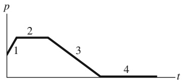

line

| Phase | Pressure (p) |
| --- | --- |
| 1 | ~0.5 |
| 2 | ~0.8 |
| 3 | ~0.5 |
| 4 | 0 |

## 5.3.2 Der Impuls eines Teilchensystems

Betrachten wir nun ein System aus n Teilchen mit verschiedenen Massen, Geschwindigkeiten und Impulsen. Die Teilchen können untereinander in Wechselwirkung treten, außerdem können von außen Kräfte auf das System einwirken. Der Impuls P⃗ des gesamten Systems ist definiert als die Vektorsumme der Impulse der einzelnen Teilchen:

$$
\begin{array}{l} \vec {P} = \vec {p} _ {1} + \vec {p} _ {2} + \vec {p} _ {3} + \dots + \vec {p} _ {n} \\ = m _ {1} \vec {\nu} _ {1} + m _ {2} \vec {\nu} _ {2} + m _ {3} \vec {\nu} _ {3} + \dots + m _ {n} \vec {\nu} _ {n}. \tag {5.20} \\ \end{array}
$$

Ein Vergleich dieser Beziehung mit Gl. 5.15 zeigt:

$$
\vec {P} = M \vec {\nu} _ {\mathrm{S}}. \tag {5.21}
$$

Damit bietet sich eine alternative Definition des Impulses eines Teilchensystems an:

Der Impuls eines Teilchensystems ist gleich dem Produkt aus der Gesamtmasse M und der Geschwindigkeit des Schwerpunkts des Systems.

Die Ableitung von Gl. 5.21 nach der Zeit liefert:

$$
\frac {\mathrm{d} \vec {P}}{\mathrm{d} t} = M \frac {\mathrm{d} \vec {v} _ {\mathrm{S}}}{\mathrm{d} t} = M \vec {a} _ {\mathrm{S}}. \tag {5.22}
$$

Durch Vergleich von Gl. 5.12 mit Gl. 5.22 gelangen wir zur folgenden, zu Gl. 5.21 äquivalenten Schreibweise des zweiten Newtonschen Gesetzes für ein Teilchensystem:

$$
\vec {F} _ {\mathrm{eff}} = \frac {\mathrm{d} \vec {P}}{\mathrm{d} t}, \tag {5.23}
$$

mit $\vec { F } _ { \mathrm { e f f } }$ als insgesamt auf das System wirkender äußerer Kraft. Diese Gleichung entspricht einer Verallgemeinerung der entsprechenden Gleichung für ein Teilchen, $\vec { F } _ { \mathrm { e f f } } = \mathrm { d } \vec { p } / \mathrm { d } t ,$ auf ein Vielteilchensystem.

## 5.4 Stoßprozesse: Der Kraftstoß

## Lernziele

Nach dem Durcharbeiten dieses Abschnitts sollten Sie in der Lage sein, . . .

• zu verstehen, dass der Kraftstoß eine Vektorgröße ist und daher einen Betrag und eine Richtung sowie Komponenten besitzt,
• die Beziehung zwischen dem Kraftstoß und der Änderung des Impulses anzugeben und anzuwenden,
• die Beziehung zwischen dem Kraftstoß, der mittleren Kraft und dem zugehörigen Zeitintervall anzugeben und anzuwenden,
• die Gleichungen für Bewegungen mit konstanter Beschleunigung anzuwenden, um den Kraftstoß mit der mittleren Kraft zu verknüpfen,
• aus der Kraft als Funktion der Zeit durch Integration den Kraftstoß (und damit die Impulsänderung) zu berechnen,
• aus einer Auftragung der Kraft gegen die Zeit durch grafische Integration den Kraftstoß (und damit die Impulsänderung) zu ermitteln,
• die mittlere auf ein Ziel ausgeübte Kraft zu bestimmen, wenn eine kontinuierli che Stoßserie von Projektilen auf es abgefeuert wird, und zwar aus der zeitlichen Abfolge der Stöße, der Massen der Projektile und der Geschwindigkeitsänderung der Projektile.

## Schlüsselideen

• Anwendung des zweiten Newtonschen Gesetzes in der Impulsschreibweise auf den Stoß eines teilchenartigen Körpers führt zu der Beziehung

$$
\vec {p} _ {\mathrm{f}} - \vec {p} _ {\mathrm{i}} = \Delta \vec {p} = \vec {J},
$$

in der $\vec { p } _ { \mathrm { f } } - \vec { p } _ { \mathrm { i } } = \Delta \vec { p }$ die Änderung des Impulses des Körpers angibt und $\vec { J }$ der Kraftstoß aufgrund der Kraft $\vec { F } ( t )$ ist, die während des Stoßes auf den Körper wirkt:

$$
\vec {J} = \int_ {t _ {\mathrm{i}}} ^ {t _ {\mathrm{f}}} \vec {F} (t) \mathrm{d} t.
$$

• Wenn $F _ { \mathrm { g e m } }$ der gemittelte Betrag von $\vec { F } ( t )$ während des Stoßes und $\Delta t$ das entsprechende Zeitintervall ist, gilt für eine eindimensionale Bewegung

$$
J = F _ {\mathrm{gem}} \cdot \Delta t.
$$

• Wenn ein regelmäßiger Strom von Teilchen mit der Masse m und der Geschwindigkeit v auf ein feststehendes Ziel auftrifft, ist die mittlere Kraft auf das Ziel

$$
F _ {\mathrm{gem}} = - \frac {n}{\Delta t} \Delta p = - \frac {n}{\Delta t} m \Delta \nu ,
$$

wenn $n / \Delta t$ die (mittlere) Frequenz des Auftreffens eines Teilchens auf das Ziel angibt und Δv die Änderung der Geschwindigkeit der Teilchen beim Auftreffen ist. Die mittlere Kraft kann auch in der Form

$$
F _ {\mathrm{gem}} = - \frac {\Delta m}{\Delta t} \Delta \nu
$$

geschrieben werden, wobei $\Delta m / \Delta t$ die Rate des Auftreffens von Masse auf dem Ziel ist. Wenn die Teilchen auf dem Ziel auf null abgebremst werden, ist jeweils $\Delta \nu = - \nu ;$ falls sie mit konstantem Geschwindigkeitsbetrag v zurückprallen, ist $\Delta \nu = - 2 \nu$

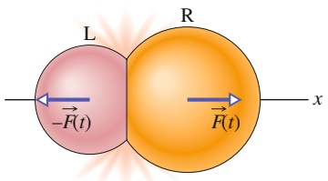

text_image

L
-R(t)
R
-F(t)
x

Abb. 5.5

Zwei kleine, kugelförmige Körper L und R stoßen zusammen. Dabei übt Körper L eine Kraft $\vec { F } ( t )$ auf Körper

R aus, Körper R entsprechend eine Kraft $\cdot - F ( t )$ auf L. $\vec { F } ( t )$ und $- \vec { F } ( t )$ sind ein Kraft-Gegenkraft-Paar im Sinne des dritten Newtonschen Gesetzes.

Die Beträge der Kräfte ändern sich während des Stoßes, sind aber zu einem gegebenen Zeitpunkt stets gleich.

## 5.4.1 Einzelne Stöße

Abbildung 5.5 veranschaulicht das Kraft-Gegenkraft-Paar gemäß dem dritten Newtonschen Gesetz, $\vec { F } ( t )$ und $- \vec { F } ( t )$ , welches während eines einfachen zentralen Stoßes zwischen zwei kleinen, kugelförmigen Körpern verschiedener Massen wirkt. Infolge der Wirkung der Kräfte ändern sich die Impulse beider Körper. Das Ausmaß der Impulsänderungen hängt hierbei nicht nur von den zeitlichen Mittelwerten der Kräfte ab, sondern auch von der Dauer Δt ihrer Wirkung. Um dies quantitativ nachzuvollziehen, wenden wir das zweite Newtonsche Gesetz in der Form $\vec { F } = \mathbf { d } \vec { p } / \mathbf { d }$ t auf den rechten Körper (R) in Abb. 5.5 an:

$$
\mathrm{d} \vec {p} = \vec {F} (t) \mathrm{d} t. \tag {5.24}
$$

$\vec { F } ( t )$ ist eine zeitabhängige Kraft, deren Betrag durch den Graphen in Abb. 5.6a gegeben ist. Nun integrieren wir Gl. 5.24 im Intervall $\Delta t ,$ also zwischen einem (initialen) Zeitpunkt $t _ { \mathrm { i } }$ unmittelbar vor dem Stoß und einem (finalen) Zeitpunkt $t _ { \mathrm { f } }$ unmittelbar nach dem Stoß. Wir erhalten:

$$
\int_ {\vec {p} _ {\mathrm{i}}} ^ {\vec {p} _ {\mathrm{f}}} \mathrm{d} \vec {p} = \int_ {t _ {\mathrm{i}}} ^ {t _ {\mathrm{f}}} \vec {F} (t) \mathrm{d} t. \tag {5.25}
$$

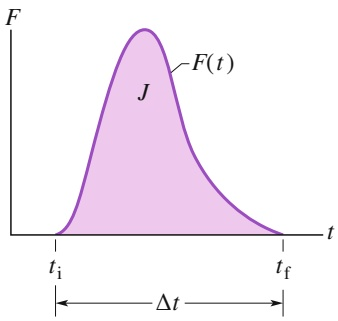

area

| Time | Value |
| --- | --- |
| ti | 0 |
| Peak (J) | High |
| tf | 0 |

(a)

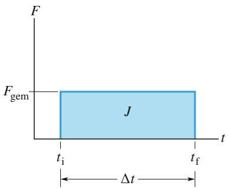

text_image

F
Fgem
J
t_i
t_f
Δt

(b)

Die linke Seite dieser Gleichung ist $\vec { p } _ { \mathrm { f } } - \vec { p } _ { \mathrm { i } }$ , die Änderung des Impulses von R im Zuge des Stoßes. Die rechte Seite, ein Maß für sowohl den Betrag als auch die Dauer der Kraftwirkung, wird **Kraftstoß** ⃗J (oder, aus offensichtlichen Gründen, auch **Impulsübertrag**) genannt. Definiert ist der Kraftstoß folglich als

$$
\vec {J} = \int_ {t _ {\mathrm{i}}} ^ {t _ {\mathrm{f}}} \vec {F} (t) \mathrm{d} t. \tag {5.26}
$$

Gleichung 5.26 sagt aus, dass der Betrag des Kraftstoßes gleich der Fläche unter dem Graphen der Funktion $F ( t )$ ist (siehe Abb. 5.6a). Da es sich bei den Kräften $F ( t )$ und $- F ( t )$ , die auf die Körper R bzw. L wirken, um ein Kraft-Gegenkraft-Paar handelt, sind die zugehörigen Kraftstöße gleich groß, aber entgegengesetzt gerichtet.

Aus den Gln. 5.25 und 5.26 entnehmen wir, dass die Impulsänderung jedes an einem Stoß beteiligen Körpers gleich dem Kraftstoß ist, der auf diesen Körper wirkt:

$$
\vec {p} _ {\mathrm{f}} - \vec {p} _ {\mathrm{i}} = \Delta \vec {p} = \vec {J}. \tag {5.27}
$$

Diese Gleichung sagt außerdem Folgendes aus: Impuls und Kraftstoß sind vektorielle Größen und haben gleiche Einheiten und Dimensionen. In Komponentenschreibweise lautet Gl. 5.27

$$
p _ {\mathrm{f} x} - p _ {\mathrm{i} x} = \Delta p _ {x} = J _ {x}, \tag {5.28}
$$

$$
p _ {\mathrm{f} y} - p _ {\mathrm{i} y} = \Delta p _ {y} = J _ {y} \tag {5.29}
$$

und

$$
p _ {\mathrm{f} z} - p _ {\mathrm{i} z} = \Delta p _ {z} = J _ {z}. \tag {5.30}
$$

Ist $F _ { \mathrm { g e m } }$ der mittlere Betrag der Kraft in Abb. 5.6a, so ist der Betrag des Kraftstoßes gegeben durch:

$$
J = F _ {\mathrm{gem}} \Delta t \tag {5.31}
$$

mit Δt als Stoßzeit (Dauer des Stoßes). Der Wert von $F _ { \mathrm { g e m } }$ ist so zu wählen, dass die Fläche innerhalb des Rechtecks aus Abb. 5.6b gleich der Fläche unter dem Graphen der tatsächlichen Funktion F(t) (Abb. 5.6a) ist.

## KONTROLLFRAGE 4

Ein Fallschirmspringer, dessen Fallschirm sich nicht geöffnet hat, landet im Schnee und verletzt sich leicht. Wäre er auf dem schneefreien Boden gelandet, so wäre die Zeit, innerhalb der er zum Halten gekommen wäre, nur ein Zehntel so lang gewesen wie im Schnee, und er hätte tödliche Verletzungen davongetragen. Nimmt (a) die Impulsänderung des Springers, (b) der Kraftstoß, der den Springer stoppt, und (c) die Kraft, die den Springer stoppt, durch die Anwesenheit des Schnees zu, ab oder bleibt die betreffende Größe gleich?

## Abb. 5.6

(a) Graph des Betrags der zeitabhängigen Kraft $F ( t ) ,$ die während des in Abb. 5.5 dargestellten Stoßes auf Körper R wirkt. Die Fläche unter der Kurve ist gleich dem Betrag des dabei auf R ausgeübten Kraftstoßes ⃗J. (b) Die Höhe des Rechtecks entspricht der mittleren Kraft $F _ { \mathrm { g e m } } ,$ die während des Intervalls Δt auf den Körper R wirkt. Die Fläche des Rechtecks ist gleich der Fläche unter der Kurve in (a) und folglich auch gleich dem Betrag des während des Stoßes auftretenden Kraftstoßes ⃗J.

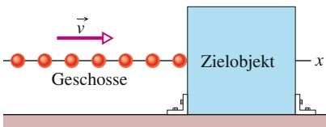

flowchart

Abb. 5.7

Ein Strom von Geschossen mit identischen Impulsen trifft auf ein ortsfestes Ziel. Die mittlere Kraft $F _ { \mathrm { g e m } }$ auf das Ziel wirkt nach rechts; ihr Betrag hängt mit der Rate des Auftreffens der Geschosse (oder, gleichbedeutend, mit der Rate des Auftreffens der Masse) zusammen.

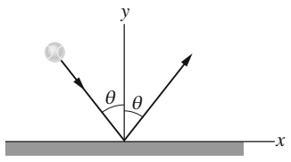

text_image

y
θ θ
x

## 5.4.2 Stoßserien

Betrachten wir nun die Kraft, die auf einen Körper wirkt, der eine ganze Reihe schnell hintereinander erfolgender identischer Stöße erleidet. Denken Sie z. B. an eine Maschine, die Tennisbälle auf eine Wand schießt. Bei jedem Treffer wird eine Kraft auf die Wand ausgeübt; diese interessiert uns aber nicht. Wir suchen die mittlere Kraft $F _ { \mathrm { g e m } } ,$ die während des Beschusses – d. h. während einer Serie aus vielen Stößen – auf die Wand wirkt.

In Abb. 5.7 sehen Sie, wie sich ein Strom von Geschossen mit identischen Massen m und Impulsen mv⃗ entlang einer x-Achse bewegt und auf ein ortsfestes Ziel trifft. Es sei n die Anzahl der im Intervall Δt aufprallenden Geschosse. Da die Bewegung entlang der x-Achse stattfindet, dürfen wir uns auf die x-Komponenten des Impulses beschränken. Jedes Geschoss besitzt also einen Anfangsimpuls mv, der sich im Zuge des Stoßes um $\Delta p$ ändert. Die Gesamtänderung des Impulses aller n Geschosse während $\Delta t$ ist dann $n \Delta p .$ Daraus folgt ein Kraftstoß $J ,$ der ebenfalls entlang der x-Achse gerichtet ist und den Betrag $n \Delta p$ hat, aber in die entgegengesetzte Richtung zeigt. In Komponentenschreibweise bedeutet das:

$$
J = - n \Delta p; \tag {5.32}
$$

das Minuszeichen gibt an, dass J und $\Delta p$ in entgegengesetzte Richtungen zeigen.

Wir stellen Gl. 5.31 um und setzen Gl. 5.32 ein. So erhalten wir die während der Stoßserie im Mittel auf das Ziel wirkende Kraft:

$$
F _ {\mathrm{gem}} = \frac {J}{\Delta t} = - \frac {n}{\Delta t} \Delta p = - \frac {n}{\Delta t} m \Delta \nu . \tag {5.33}
$$

Die Gleichung liefert uns $F _ { \mathrm { g e m } }$ als Funktion der Rate des Auftreffens der Geschosse, $n / \Delta t ,$ und der Änderung der Geschwindigkeit der Geschosse, $\Delta \nu .$

Kommen die Geschosse beim Auftreffen zum Stillstand, so können wir in Gl. 5.33 für $\Delta \nu$ einsetzen:

$$
\Delta \nu = \nu_ {\mathrm{f}} - \nu_ {\mathrm{i}} = 0 - \nu = - \nu . \tag {5.34}
$$

Dabei sind $\nu _ { \mathrm { i } } ( = \nu )$ und $\nu _ { \mathrm { f } } ( = 0 )$ die Geschwindigkeiten vor bzw. nach dem Stoß. Prallen die Geschosse hingegen mit unverändertem Betrag der Geschwindigkeit zurück, so ist $\nu _ { \mathrm { f } } = - \nu ,$ und wir erhalten

$$
\Delta \nu = \nu_ {\mathrm{f}} - \nu_ {\mathrm{i}} = - \nu - \nu = - 2 \nu . \tag {5.35}
$$

Während des Intervalls $\Delta t$ trifft insgesamt eine Masse $\Delta m = n m$ auf das Ziel. Wir können Gl. 5.33 damit in der Form

$$
F _ {\mathrm{gem}} = - \frac {\Delta m}{\Delta t} \Delta \nu \tag {5.36}
$$

schreiben. Diese Gleichung liefert die mittlere Kraft $F _ { \mathrm { g e m } }$ als Funktion der Rate des Auftreffens der Masse, $\Delta m / \Delta t .$ Je nach Art des Stoßes können wir hier wieder Gl. 5.34 oder Gl. 5.35 einsetzen.

## KONTROLLFRAGE 5

Die Zeichnung zeigt einen Ball, der ohne Geschwindigkeitsänderung von einer senkrechten Wand abprallt (in Draufsicht). Betrachten Sie die Impulsänderung $\Delta \vec { p }$ des Balls: (a) Ist $\Delta p _ { x }$ positiv, negativ oder null? (b) Ist $\Delta p _ { y }$ positiv, negativ oder null? (c) Geben Sie die Richtung von $\Delta \vec { p }$ an.

## 5.5 Die Impulserhaltung

## Lernziele

Nach dem Durcharbeiten dieses Abschnitts sollten Sie in der Lage sein, . . .

• die Impulserhaltung auf ein abgeschlossenes Teilchensystem anzuwenden, um aus den anfänglichen Impulsen der Teilchen ihre Impulse zu einem späteren Zeitpunkt zu berechnen,
• zu verstehen, dass Sie die Impulserhaltung auch auf eine einzelne Achse anwenden können, solange keine Komponente einer äußeren Kraft in Richtung dieser Achse existiert.

## Schlüsselideen

• Wenn ein System abgeschlossen ist, d. h., keine resultierende äußere Kraft wirkt, muss der Impuls $\vec { P }$ des Gesamtsystems konstant bleiben, auch wenn sich die Impulse innerhalb des Systems ändern:

$$
\vec {P} = \text {const.}
$$

• Diese Impulserhaltung kann auch mithilfe der Impulse $\vec { P } _ { \mathrm { i } }$ des Systems zu Beginn der Betrachtung und $\vec { P } _ { \mathrm { f } }$ zu einem beliebigen späteren Zeitpunkt formuliert werden:

$$
\vec {P} _ {\mathrm{i}} = \vec {P} _ {\mathrm{f}}.
$$

## 5.5.1 Die Impulserhaltung

Nehmen wir an, auf ein Teilchensystem wirke keine äußere Kraft und die Anzahl der enthaltenen Teilchen sei konstant. (Ein solches System heißt isoliert und geschlossen.)

Setzen wir in Gl. 5.23 $\vec { F } _ { \mathrm { e f f } } = 0 ,$ so ergibt sich $\mathrm { d } \vec { P } / \mathrm { d } t = 0$ oder

$$
\vec {P} = \text {const.} \quad (\text {geschlossenes, isoliertes System}). \tag {5.37}
$$

In Worten ausgedrückt bedeutet dies:

Solange auf ein Teilchensystem keine äußere Kraft wirkt, ist der Gesamtimpuls $\vec { P }$ des Systems konstant.

Dieser **Impulserhaltungssatz** kann auch wie folgt formuliert werden:

$$
\vec {P} _ {\mathrm{i}} = \vec {P} _ {\mathrm{f}} \quad (\text {geschlossenes, isoliertes System}). \tag {5.38}
$$

Gleichung 5.38 sagt aus, dass für ein geschlossenes, isoliertes System gilt:

$$
\binom{\text {Gesamtimpuls zum}}{(\text {anfänglichen}) \text {Zeitpunkt} t _ {\mathrm{i}}} = \binom{\text {Gesamtimpuls zum}}{(\text {späteren}) \text {Zeitpunkt} t _ {\mathrm{f}}}.
$$

Die Gln. 5.37 und 5.38 enthalten vektorielle Größen und sind äquivalent zu je drei Gleichungen für die Impulserhaltung in drei aufeinander senkrecht stehenden Richtungen, etwa in den Richtungen der x-, y- und z-Achse eines kartesischen Koordinatensystems. In Abhängigkeit von den wirkenden äußeren Kräften kann die Impulserhaltung auch nur in einer oder zwei, aber nicht in allen drei Richtungen gelten. Stets gilt aber:

Ist die Komponente der auf ein abgeschlossenes System wirkenden äußeren Kraft entlang einer Koordinatenachse gleich null, so kann sich die Komponente des Gesamtimpulses des Systems entlang dieser Achse nicht ändern.

Stellen Sie sich z. B. vor, Sie werfen einen Ball (= das System). Während des Flugs wirkt auf das System von außen die Gravitationskraft ${ \vec { F } } _ { \mathrm { G } } ,$ die senkrecht nach unten gerichtet ist. Folglich ändert sich die senkrechte Komponente des Impulses Ihres Balls. Die waagerechte Komponente hingegen ändert sich nicht, weil keine Kraft in waagerechter Richtung auf den Ball wirkt.

Vergessen Sie nicht, dass wir hier ausschließlich geschlossene Systeme betrach tet haben, auf die äußere Kräfte wirken. Innere Kräfte können zwar den Impuls von Teilen des Systems, nicht aber den Gesamtimpuls des Systems als Ganzes beeinflussen.

## KONTROLLFRAGE 6

Eine am Boden (reibungsfrei) liegende Mine explodiert in zwei Bruchstücke, die über den Boden davonfliegen. Eines der Stücke entfernt sich in positiver x-Richtung. (a) Geben Sie die Summe der Impulse der Bruchstücke nach der Explosion an. (b) Kann sich das zweite Stück unter einem Winkel $\theta \neq 0$ relativ zur x-Achse entfernen? (c) In welche Richtung zeigt der Impuls des zweiten Bruchstücks?

## KONTROLLFRAGE 7

In der Tabelle finden Sie die Geschwindigkeiten des Transporters und des Moduls (relativ zur Sonne) aus Beispielaufgabe 5.5 im Übungsbuch, nachdem letzteres abgestoßen wurde, sowie die Geschwindigkeit des Transporters relativ zum Modul für drei Situationen. Ergänzen Sie die fehlenden Werte.

|  | Geschwindigkeit des Moduls | Geschwindigkeit des Transporters | Relativgeschwindigkeit |
| --- | --- | --- | --- |
| (a) | 1500 km/h | 2000 km/h |  |
| (b) |  | 3000 km/h | 400 km/h |
| (c) | 1000 km/h |  | 600 km/h |

## KONTROLLFRAGE 8

Nehmen Sie an, die explodierende Kugel in Abb. Ü5.6 im Übungsbuch werde in negativer y-Richtung beschleunigt (etwa, indem sie eine entsprechend geneigte Ebene hinunterrollt). Bleibt der Impuls (a) entlang der x-Achse (Gl. 5.49) und/oder (b) entlang der y-Achse (Gl. 5.48) erhalten?

## LÖSUNGSSTRATEGIEN

**Strategie 2: Impulserhaltung** Spielt bei der Lösung einer Aufgabe die Impuls erhaltung eine Rolle, so überprüfen Sie zunächst, ob es sich um ein geschlosse nes, isoliertes System handelt. Geschlossen bedeutet hier, dass keinerlei Materie (Teilchen irgendeiner Art) die Systemgrenzen durchdringen kann, gleichgültig in welcher Richtung. Als isoliert bezeichnen wir ein System, auf das keine äußere (Gesamt-)Kraft wirkt. Ist das System nicht isoliert, so bedenken Sie, dass jede Komponente des Impulsvektors einzeln erhalten bleibt, sofern die zugehörige Komponente des Vektors der äußeren Kraft null ist. Möglicherweise bleiben nicht alle, sondern nur einzelne Komponenten des Impulsvektors erhalten.

Nun wählen Sie zwei geeignete Zustände des Systems (einen Anfangs- und einen Endzustand) und formulieren Sie den Impuls des Systems in beiden Zuständen. Beim Aufschreiben der Gleichungen beachten Sie, welches Bezugssystem Sie verwenden; geben Sie außerdem Acht, dass Sie das gesamte System berücksichtigen, keinen Teil übersehen und auch kein Objekt unberechtigterweise hinzunehmen.

Setzen Sie schließlich Ihre Ausdrücke für $\vec { P } _ { \mathrm { i } }$ und $\vec { P } _ { \mathrm { f } }$ gleich und lösen Sie die Gleichung gemäß der Aufgabenstellung.

## 5.6 Inelastische eindimensionale Stöße

## Lernziele

Nach dem Durcharbeiten dieses Abschnitts sollten Sie in der Lage sein, . . .

• den Unterschied zwischen elastischen Stößen, inelastischen Stößen und voll ständig inelastischen Stößen zu erklären,
• zu verstehen, dass sich bei einem eindimensionalen Stoß beide Stoßpartner sowohl vor als auch nach dem Stoß entlang einer einzigen Achse bewegen,
• die Impulserhaltung auf einen isolierten eindimensionalen Stoß anzuwenden, um aus den Impulsen der Stoßpartner vor dem Stoß ihre Impulse nach dem Stoß zu berechnen,
• zu verstehen, dass in einem isolierten System Impuls und Geschwindigkeit des Schwerpunkts bei einem Stoß zwischen zwei Objekten gleich bleiben.

## Schlüsselideen

• Bei einem inelastischen Stoß zweier Körper bleibt die kinetische Energie des Zweiteilchensystems nicht erhalten. Wenn das System geschlossen und isoliert ist, muss der Gesamtimpuls des Systems erhalten bleiben; dafür schreiben wir in Vektorform

$$
\vec {p} _ {\mathrm{1i}} + \vec {p} _ {\mathrm{2i}} = \vec {p} _ {\mathrm{1f}} + \vec {p} _ {\mathrm{2f}},
$$

wobei die Indizes i und f sich auf Momente unmittelbar vor bzw. nach dem Stoß beziehen.

• Wenn die Bewegung beider Körper entlang einer einzigen Achse erfolgt, handelt es sich um einen eindimensionalen Stoß und wir können die Gleichung für die Komponenten entlang dieser Achse wir folgt formulieren:

$$
m _ {1} \nu_ {\mathrm{1i}} + m _ {2} \nu_ {\mathrm{2i}} = m _ {1} \nu_ {\mathrm{1f}} + m _ {2} \nu_ {\mathrm{2f}}.
$$

• Wenn die Körper nach dem Stoß aneinander kleben bleiben, ist der Stoß voll ständig inelastisch und beide Körper haben nach dem Stoß dieselbe Geschwindigkeit V (weil sie jetzt einen gemeinsamen Körper bilden).
• Der Schwerpunkt eines geschlossenen und isolierten Systems aus zwei stoßenden Körpern wird durch den Stoß nicht beeinflusst. Insbesondere ändert sich die Geschwindigkeit ${ \vec { \nu } } _ { S }$ des Schwerpunkts durch den Stoß nicht.

## 5.6.1 Inelastische eindimensionale Stöße

In Abb. 5.8 sehen Sie zwei Körper unmittelbar vor bzw. nach einem eindimensionalen Stoß: Alle Bewegungen laufen entlang einer einzigen Achse ab. Angegeben sind die Geschwindigkeiten vor (initial, Index i) und nach dem Stoß (final, Index f ). Die beiden Körper bilden unser geschlossenes, isoliertes System, für das wir den Impulserhaltungssatz wie folgt formulieren können:

$$
\binom{\text {Gesamtimpuls} \vec {P} _ {\mathrm{i}}}{\text {vor dem Stoß}} = \binom{\text {Gesamtimpuls} \vec {P} _ {\mathrm{f}}}{\text {nach dem Stoß}}\left. \right.
$$

oder

$$
\vec {p} _ {1 \mathrm{i}} + \vec {p} _ {2 \mathrm{i}} = \vec {p} _ {1 \mathrm{f}} + \vec {p} _ {2 \mathrm{f}}. \tag {5.39}
$$

Weil die Bewegung in nur einer Dimension abläuft, dürfen wir uns auf die Komponente der Vektoren entlang der entsprechenden Achse beschränken (und in Gl. 5.39 die Pfeile weglassen). Mit $p = m \nu$ wird Gl. 5.39 zu:

$$
m _ {1} \nu_ {1 \mathrm{i}} + m _ {2} \nu_ {2 \mathrm{i}} = m _ {1} \nu_ {1 \mathrm{f}} + m _ {2} \nu_ {2 \mathrm{f}}. \tag {5.40}
$$

Sind die Massen, die Anfangsgeschwindigkeiten und eine Endgeschwindigkeit bekannt, so können wir mithilfe von Gl. 5.40 die andere Endgeschwindigkeit berechnen.

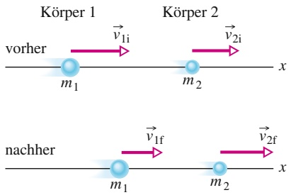

Abb. 5.8

Die Körper 1 und 2 bewegen sich vor und nach dem Stoß entlang der gleichen x-Achse.

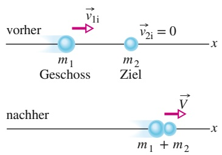

text_image

vorher
m₁
Geschoss
v₁i
m₂
Ziel
v₂i = 0
x
nachher
m₁ + m₂
V
x

Abb. 5.9

Vollständig inelastischer Stoß. Vor dem Stoß ruht der Körper mit der Masse $m _ { 2 } ,$ auf den sich der Körper mit der Masse m1 zentral zubewegt. Nach dem Stoß bewegen sich beide Körper gemeinsam mit der Geschwindigkeit $\vec { V } .$

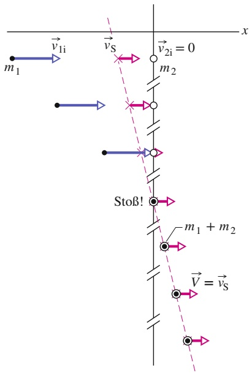

text_image

x
v1i
vS
v2i = 0
m1
m2
Stoß!
m1 + m2
V = vS

Abb. 5.10

Schnappschüsse der Bewegung des Zweikörpersystems aus Abb. 5.9. Es findet ein vollständig inelastischer Stoß statt. Der Schwerpunkt des Systems ist in jedem Teilbild eingezeichnet; die Geschwindigkeit $\vec { \nu } _ { S }$ wird durch den Stoß nicht beeinflusst. Nach dem Stoß bewegen sich beide Körper gemeinsam weiter; ihre Geschwindigkeit $\vec { V }$ muss folglich gleich $\vec { \nu } _ { \mathrm { S } }$ sein.

## 5.6.2 Vollständig inelastische eindimensionale Stöße

Abbildung 5.9 zeigt zwei Körper vor und nach einem vollständig inelastischen Stoß (nach dem Stoß sind sie fest verbunden). In diesem Beispiel befindet sich der Körper mit der Masse $m _ { 2 }$ vor dem Stoß in Ruhe $( \nu _ { 2 \mathrm { i } } = 0 )$ . Wir können diesen Körper als Ziel betrachten und den anderen entsprechend als Geschoss. Nach dem Stoß bewegen sich beide Körper gemeinsam mit der Geschwindigkeit V. Gleichung 5.40 lässt sich hierfür wie folgt umformulieren:

$$
m _ {1} v _ {1 \mathrm{i}} = (m _ {1} + m _ {2}) V \tag {5.41}
$$

oder

$$
V = \frac {m _ {1}}{m _ {1} + m _ {2}} v _ {\mathrm{li}}. \tag {5.42}
$$

Kennen wir die Massen und die Anfangsgeschwindigkeit $\nu _ { 1 \mathrm { i } }$ des Geschosses, so liefert uns Gl. 5.42 die Endgeschwindigkeit V. Wie Sie bemerken werden, ist V stets kleiner als $\nu _ { 1 \mathrm { i } } ,$ weil das Massenverhältnis $m _ { 1 } / ( m _ { 1 } + m _ { 2 } )$ stets kleiner als eins ist.

## 5.6.3 Die Geschwindigkeit des Schwerpunkts

In einem geschlossenen, isolierten System kann sich die Geschwindigkeit des Schwerpunkts, $\vec { \nu } _ { S } ,$ infolge eines Stoßes nicht ändern: Da es sich um ein isoliertes System handelt, wirkt keine äußere (Gesamt-)Kraft. Um einen Ausdruck für $\vec { \nu } _ { S }$ zu finden, kehren wir noch einmal zu unserem Zweikörpersystem mit eindimensionalem Stoß (Abb. 5.8) zurück. Gleichung 5.21 $( \vec { \cal P } = \vec { M } \vec { \nu } _ { S } )$ liefert uns einen Zusammenhang zwischen $\vec { \nu } _ { S }$ und dem Gesamtimpuls $\vec { P }$ des Zweikörpersystems:

$$
\vec {P} = M \vec {\nu} _ {\mathrm{S}} = (m _ {1} + m _ {2}) \vec {\nu} _ {\mathrm{S}}. \tag {5.43}
$$

Der Gesamtimpuls $\vec { P }$ bleibt während des Stoßes erhalten, er ist also durch beide Seiten von Gl. 5.39 gegeben. Wir verwenden die linke Seite und schreiben:

$$
\vec {P} = \vec {p} _ {1 \mathrm{i}} + \vec {p} _ {2 \mathrm{i}}. \tag {5.44}
$$

Dies setzen wir für $\vec { P }$ in Gl. 5.43 ein und lösen nach $\vec { \nu } _ { S }$ auf:

$$
\begin{array}{l} \vec {\nu} _ {S} = \frac {\vec {P}}{m _ {1} + m _ {2}} \\ = \frac {\vec {p} _ {1 \mathrm{i}} + \vec {p} _ {2 \mathrm{i}}}{m _ {1} + m _ {2}}. \tag {5.45} \\ \end{array}
$$

Die rechte Seite dieser Gleichung ist eine Konstante; das bedeutet, $\vec { \nu } _ { S }$ hat vor und nach dem Stoß den gleichen konstanten Wert.

In Abb. 5.10 sehen Sie eine Abfolge von Schnappschüssen, welche die Bewegung des Schwerpunkts während des vollständig inelastischen Stoßes von Abb. 5.9 verdeutlichen. Körper $2 ,$ das Ziel, hat einen Anfangsimpuls (Gl. 5.45) von $\vec { p } _ { 2 \mathrm { i } } =$ $m _ { 2 } \vec { \nu } _ { 2 \mathrm { i } } = 0 ;$ Körper 1, das Geschoss, hat den Anfangsimpuls $\vec { p } _ { \mathrm { 1 i } } = m _ { \mathrm { 1 } } \vec { \nu } _ { \mathrm { 1 i } }$ . Wie Sie feststellen, bewegt sich der Schwerpunkt des Systems vor, während und nach dem Stoß mit konstanter Geschwindigkeit nach rechts. Die Endgeschwindigkeit beider Körper nach dem Stoß, $\vec { V } ,$ ist gleich $\vec { \nu } _ { \mathsf { S } } ,$ denn der Schwerpunkt bewegt sich nun gemeinsam mit den aneinander haftenden Körpern.

## KONTROLLFRAGE 9

Zwischen Körper 1 und Körper 2 findet ein vollständig inelastischer, eindimensionaler Stoß statt. Berechnen Sie den Impuls des Systems nach dem Stoß, wenn die Anfangsimpulse der Körper wie folgt gegeben sind: (a) 10 kg ⋅ m/s und $0 ;$ (b) 10 kg ⋅ m/s und 4 kg ⋅ m/s; (c) 10 kg ⋅ m/s und −4 kg ⋅ m/s.

## 5.7 Elastische eindimensionale Stöße

## Lernziele

Nach dem Durcharbeiten dieses Abschnitts sollten Sie in der Lage sein, . . .

• die Erhaltungssätze für die Gesamtenergie und den resultierenden Impuls der stoßenden Objekte auf isolierte, elastische Stöße in einer Dimension anzuwenden, um aus den Anfangswerten dieser Größen ihre Werte nach dem Stoß zu berechnen,
• für ein Projektil, das auf ein ruhendes Ziel auftrifft, die resultierende Bewegung für die drei Fälle (i) gleiche Massen, (ii) Ziel schwerer als Projektil und (iii) Projektil schwerer als Ziel anzugeben.

## Schlüsselideen

Ein elastischer Stoß ist ein Stoß, bei dem die kinetische Gesamtenergie der sto ßenden Teilchen erhalten bleibt. Wenn das System geschlossen und isoliert ist, bleibt auch sein Impuls erhalten. Für einen eindimensionalen Stoß, bei dem Körper 1 das Ziel und Körper 2 ein darauf auftreffendes Projektil ist, liefert die Erhaltung von kinetischer Energie und Impuls die folgenden Gleichungen für die Geschwindigkeiten unmittelbar nach dem Stoß:

$$
\nu_ {\mathrm{1f}} = \frac {m _ {1} - m _ {2}}{m _ {1} + m _ {2}} \nu_ {\mathrm{1i}} \quad \text {und} \quad \nu_ {\mathrm{2f}} = \frac {2 m _ {1}}{m _ {1} + m _ {2}} \nu_ {\mathrm{1i}}.
$$

## 5.7.1 Stöße auf ein ruhendes Objekt

Die uns aus unserem Alltag vertrauten Stöße sind in der Regel inelastisch. Eini ge von ihnen können wir aber näherungsweise als elastisch behandeln – d. h., wir können annehmen, die kinetische Gesamtenergie der Stoßpartner bleibe erhalten und werde nicht in andere Energieformen umgewandelt:

$$
\binom{\text {kinetische Gesamtenergie}}{\text {vor dem Stoß}} = \binom{\text {kinetische Gesamtenergie}}{\text {nach dem Stoß}}.
$$

Das bedeutet aber keineswegs, dass sich die kinetische Energie der einzelnen am Stoß beteiligten Körper nicht ändern kann. Es besagt lediglich Folgendes:

Während eines elastischen Stoßes kann sich die kinetische Energie jedes einzelnen Stoßpartners ändern, die kinetische Gesamtenergie des Systems hingegen ist konstant.

Den Zusammenstoß zweier Billardkugeln beispielsweise können wir als elastischen Stoß behandeln. Erfolgt der Stoß zentral (prallen die Kugeln frontal aufeinander), so wird die Energie der vor dem Stoß rollenden Kugel fast vollständig auf die vor dem Stoß ruhende Kugel übertragen. (Wie Sie sofort einwenden werden, ist dieser Zusammenstoß hörbar – d. h., ein kleiner, aber in unserer Rechnung eben vernachlässigbarer Teil der kinetischen Energie wird in Schallenergie umgewandelt.)

In Abb. 5.11 sehen Sie zwei Körper vor und nach einem eindimensionalen Stoß (etwa zwei Billardkugeln bei einem zentralen Zusammenstoß). Ein Geschoss mit der Masse $m _ { 1 }$ und der Anfangsgeschwindigkeit $\nu _ { 1 \mathrm { i } }$ bewegt sich auf ein ruhendes Ziel $( \nu _ { 2 \mathrm { i } } = 0 )$ mit der Masse $m _ { 2 }$ zu. Wir nehmen an, es handele sich um ein geschlossenes, isoliertes System. Dann bleibt der Gesamtimpuls des Systems erhalten, was wir mithilfe von Gl. 5.39 wie folgt formulieren können:

$$
m _ {1} \nu_ {1 \mathrm{i}} = m _ {1} \nu_ {1 \mathrm{f}} + m _ {2} \nu_ {2 \mathrm{f}}. \tag {5.46}
$$

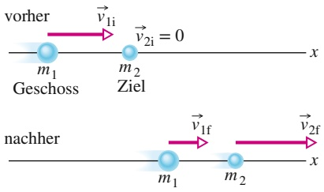

flowchart

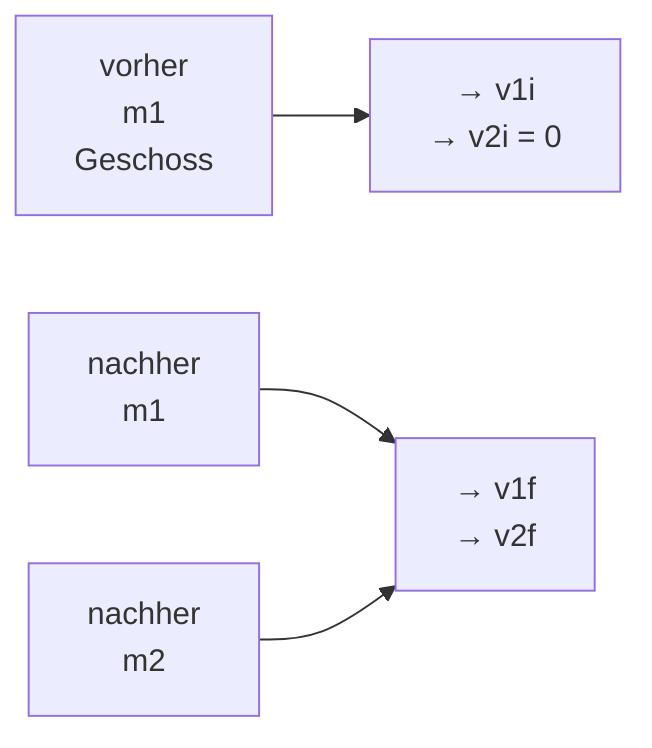

Abb. 5.11

Körper 1 bewegt sich entlang der x-Achse auf den (ruhenden) Körper 2 zu. Der Stoß verläuft elastisch, danach bewegen sich beide Körper weiter entlang der x-Achse.

Verläuft der Stoß außerdem elastisch, so bleibt auch die kinetische Gesamtenergie des Systems erhalten:

$$
\frac {1}{2} m _ {1} v _ {\mathrm{1i}} ^ {2} = \frac {1}{2} m _ {1} v _ {\mathrm{1f}} ^ {2} + \frac {1}{2} m _ {2} v _ {\mathrm{2f}} ^ {2}. \tag {5.47}
$$

In allen diesen Gleichungen steht der Index i für den Anfangswert und der Index f für den Endwert der jeweiligen Geschwindigkeit. Kennen wir die Massen der Stoß- partner sowie die Anfangsgeschwindigkeit $\nu _ { 1 \mathrm { i } }$ der rollenden Kugel, so verbleiben als unbekannte Größen die Geschwindigkeiten der Stoßpartner nach dem $\mathrm { S t o } \mathbb { S } , \nu _ { \mathrm { 1 f } }$ und $\nu _ { 2 \mathrm { f } }$ . Um sie berechnen zu können, benötigen wir zwei Gleichungen.

Wir schreiben zunächst Gl. 5.46 in der Form

$$
m _ {1} (\nu_ {\mathrm{1i}} - \nu_ {\mathrm{1f}}) = m _ {2} \nu_ {\mathrm{2f}} \tag {5.48}
$$

und Gl. 5.47 in der Form

$$
m _ {1} (\nu_ {\mathrm{1i}} - \nu_ {\mathrm{1f}}) (\nu_ {\mathrm{1i}} + \nu_ {\mathrm{1f}}) = m _ {2} \nu_ {\mathrm{2f}} ^ {2}. \tag {5.49}
$$

Nun teilen wir Gl. 5.49 durch Gl. 5.48 und erhalten nach einigen Umformungsschritten (und unter Ausnutzung der dritten binomischen Formel):

$$
\nu_ {\mathrm{1f}} = \frac {m _ {1} - m _ {2}}{m _ {1} + m _ {2}} \nu_ {\mathrm{1i}} \tag {5.50}
$$

sowie

$$
\nu_ {2 \mathrm{f}} = \frac {2 m _ {1}}{m _ {1} + m _ {2}} \nu_ {1 \mathrm{i}}. \tag {5.51}
$$

Aus Gl. 5.51 folgt, dass $\nu _ { 2 \mathrm { f } }$ stets positiv ist. Das bedeutet, dass sich das vor dem Stoß ruhende Zielobjekt mit der Masse $m _ { 2 }$ sich nach dem Stoß stets vorwärts bewegt. Gleichung 5.50 sagt hingegen aus, dass $\nu _ { 1 \mathrm { f } }$ sowohl positiv als auch negativ sein kann: Ist $m _ { \mathrm { 1 } } > m _ { \mathrm { 2 } } ,$ so bewegt sich das Geschoss mit der Masse $m _ { 1 }$ nach dem Stoß vorwärts, ist $m _ { \mathrm { 1 } } < m _ { \mathrm { 2 } } ,$ , so prallt es in Rückwärtsrichtung ab.

Betrachten wir nun einige Spezialfälle:

## 1. Gleiche Massen

Für $m _ { \mathrm { 1 } } = m _ { \mathrm { 2 } }$ werden die Gln. 5.50 und 5.51 zu

$$
\nu_ {\mathrm{1f}} = 0 \quad \text {und} \quad \nu_ {\mathrm{2f}} = \nu_ {\mathrm{1i}}.
$$

Diese Situation strebt ein Billardspieler an: Nach dem zentralen Zusammenstoß zweier Kugeln gleicher Masse bleibt die ursprünglich rollende Kugel 1 ruhend zurück, während sich die ursprünglich ruhende Kugel 2 mit der Geschwindig keit von Kugel 1 vor dem Stoß weiterbewegt. Beim zentralen, elastischen Stoß vertauschen zwei Körper gleicher Masse lediglich ihre Geschwindigkeiten. Dies trifft auch dann zu, wenn sich Kugel 2 vor dem Stoß ebenfalls bewegt.

## 2. Ein schweres Ziel

Nun ist in Abb. 5.11 $m _ { 2 } \gg m _ { 1 }$ (stellen Sie sich dazu vor, Sie werfen einen Golfball gegen eine Kanonenkugel). Aus den Gln. 5.50 und 5.51 wird dann

$$
\nu_ {1 \mathrm{f}} \approx - \nu_ {1 \mathrm{i}} \quad \text {und} \quad \nu_ {2 \mathrm{f}} \approx \left(\frac {2 m _ {1}}{m _ {2}}\right) \nu_ {1 \mathrm{i}}. \tag {5.52}
$$

Dies sagt Folgendes aus: Körper 1 (der Golfball) prallt auf dem gleichen Weg und mit nahezu derselben Geschwindigkeit von Körper 2 ab, mit der er ankam. Körper 2 (die Kanonenkugel) bewegt sich sehr langsam vorwärts, denn der Klammerausdruck in Gl. 5.52 ist viel kleiner als eins. Dieses Ergebnis entspricht unserer Erfahrung.

## 3. Ein schweres Geschoss

Die Situation ist nun genau umgekehrt, also $m _ { 1 } \gg m _ { 2 }$ (Sie schießen jetzt mit der Kanonenkugel auf den Golfball). Die Gln. 5.50 und 5.51 nehmen die Form

$$
\nu_ {1 \mathrm{f}} \approx \nu_ {1 \mathrm{i}} \quad \text {und} \quad \nu_ {2 \mathrm{f}} \approx 2 \nu_ {1 \mathrm{i}} \tag {5.53}
$$

an. Gleichung 5.53 besagt, dass sich Körper 1 (die Kanonenkugel) mit nur sehr geringfügig reduzierter Geschwindigkeit weiterbewegt, während Körper 2 (der Golfball) mit einer Geschwindigkeit nach vorne wegfliegt, die zweimal so groß ist wie die Geschwindigkeit der Kanonenkugel.

Vielleicht fragen Sie sich jetzt, wo der Faktor 2 herkommt. Denken Sie an den Stoß, der durch Gl. 5.52 beschrieben wurde: Die Geschwindigkeit des ankommenden leichten Körpers (des Golfballs) änderte sich dort von +v nach −v, d. h., die Änderung war gleich 2v. Dieselbe Geschwindigkeitsänderung (jetzt aber von 0 auf 2v) tritt auch in unserem letzten Beispiel auf.

## 5.7.2 Stöße auf ein bewegtes Objekt

Nachdem wir nun den elastischen Stoß eines bewegten auf ein ruhendes Objekt untersucht haben, wollen wir uns dem Fall zuwenden, dass sich ein solcher Stoß zwischen zwei bewegten Objekten ereignet.

Wir formulieren die Impulserhaltung für die in Abb. 5.12 skizzierte Situation:

$$
m _ {1} \nu_ {1 \mathrm{i}} + m _ {2} \nu_ {2 \mathrm{i}} = m _ {1} \nu_ {1 \mathrm{f}} + m _ {2} \nu_ {2 \mathrm{f}}. \tag {5.54}
$$

Die Erhaltung der kinetischen Energie bedeutet

$$
\frac {1}{2} m _ {1} v _ {\mathrm{1i}} ^ {2} + \frac {1}{2} m _ {2} v _ {\mathrm{2i}} ^ {2} = \frac {1}{2} m _ {1} v _ {\mathrm{1f}} ^ {2} + \frac {1}{2} m _ {2} v _ {\mathrm{2f}} ^ {2}. \tag {5.55}
$$

Um dieses Gleichungssystem nach $\nu _ { 1 \mathrm { f } }$ und $\nu _ { 2 \mathrm { f } }$ aufzulösen, schreiben wir zunächst Gl. 5.54 in der Form

$$
m _ {1} (\nu_ {1 \mathrm{i}} - \nu_ {1 \mathrm{f}}) = - m _ {2} (\nu_ {2 \mathrm{i}} - \nu_ {2 \mathrm{f}}) \tag {5.56}
$$

und Gl. 5.55 als

$$
m _ {1} (\nu_ {\mathrm{1i}} - \nu_ {\mathrm{1f}}) (\nu_ {\mathrm{1i}} + \nu_ {\mathrm{1f}}) = - m _ {2} (\nu_ {\mathrm{2i}} - \nu_ {\mathrm{2f}}) (\nu_ {\mathrm{2i}} + \nu_ {\mathrm{2f}}). \tag {5.57}
$$

Wir teilen Gl. 5.57 durch Gl. 5.56 und erhalten nach mehreren Umformungsschritten

$$
\nu_ {1 \mathrm{f}} = \frac {m _ {1} - m _ {2}}{m _ {1} + m _ {2}} \nu_ {1 \mathrm{i}} + \frac {2 m _ {2}}{m _ {1} + m _ {2}} \nu_ {2 \mathrm{i}} \tag {5.58}
$$

sowie

$$
\nu_ {2 \mathrm{f}} = \frac {2 m _ {1}}{m _ {1} + m _ {2}} \nu_ {1 \mathrm{i}} + \frac {m _ {2} - m _ {1}}{m _ {1} + m _ {2}} \nu_ {2 \mathrm{i}}. \tag {5.59}
$$

Die Zuordnung der Indizes 1 und 2 zu den beiden Körpern ist willkürlich. Vertau schen wir die Indizes in Abb. 5.12 sowie in den Gln. 5.58 und 5.59, so ändert dies das Ergebnis nicht. Setzen wir $\nu _ { 2 \mathrm { i } } = 0 ,$ befindet sich also Körper 2 zu Beginn in Ruhe wie in Abb. 5.11, so gehen die Gln. 5.58 und 5.59 in die oben angegebenen Gln. 5.50 bzw. 5.51 über.

## KONTROLLFRAGE 10

Geben Sie den Endwert des Impulses des anfangs ruhenden Körpers (des Ziels) in Abb. 5.11 an, wenn der Impuls des Geschosses vor dem Stoß gleich 6 kg ⋅ m/s und nach dem Stoß gleich (a) 2 kg ⋅ m/s und (b) −2 kg ⋅ m/s ist. (c) Wie groß ist der Endwert der kinetischen Energie des Ziels, wenn die kinetische Energie des Geschosses vor und nach dem Stoß gleich 5 J bzw. 2 J ist?

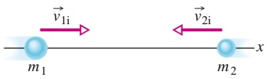

text_image

v₁i
m₁
v₂i
x
m₂

Abb. 5.12

Zwei Körper vor einem zentralen, eindimensionalen, elastischen Stoß.

## 5.8 Zweidimensionale Stöße

## Lernziele

Nach dem Durcharbeiten dieses Abschnitts sollten Sie in der Lage sein, . . .

bei einem zweidimensionalen Stoß in einem isolierten System die Impulserhal tung für jede Achse des Koordinatensystems anzuwenden, um die Komponenten der Impulse bezüglich der jeweiligen Achse nach dem Stoß aus den Komponenten der Impulse bezüglich derselben Achse vor dem Stoß zu berechnen,
in einem isolierten System, in dem ein zweidimensionaler elastischer Stoß statt findet, (a) die Impulserhaltung für jede Achse des Koordinatensystems anzuwenden, um die Komponenten der Impulse bezüglich der jeweiligen Achse nach dem Stoß aus den Komponenten der Impulse bezüglich derselben Achse vor dem Stoß zu berechnen und (b) die Erhaltung der Gesamtenergie anzuwenden, um die kinetischen Energien der Stoßpartner nach dem Stoß aus ihren kinetischen Energien vor dem Stoß zu berechnen.

## Schlüsselideen

• Ein Stoß ist zweidimensional, wenn zwei Stoßpartner stoßen und ihre Bewegungen nicht entlang nur einer Achse verlaufen. Wenn das Zweikörpersystem geschlossen und isoliert ist, gilt der Impulserhaltungssatz, der die Form

$$
\vec {P} _ {\mathrm{1i}} + \vec {P} _ {\mathrm{2i}} = \vec {P} _ {\mathrm{1f}} + \vec {P} _ {\mathrm{2f}}
$$

annimmt. In Komponentenschreibweise ergeben sich daraus zwei Gleichungen, die gemeinsam den Stoß beschreiben (jeweils eine für jede Dimension). Im Sonderfall eines elastischen Stoßes liefert die Energieerhaltung noch eine dritte Gleichung:

$$
K _ {\mathrm{1i}} + K _ {\mathrm{2i}} = K _ {\mathrm{1f}} + K _ {\mathrm{2f}}.
$$

## 5.8.1 Zweidimensionale Stöße

Bei einem Stoß zwischen zwei Körpern entscheidet der auftretende Kraftstoß, in welcher Richtung sich die Stoßpartner anschließend weiterbewegen. Erfolgt der Stoß nicht zentral, so liegt die Bewegungsrichtung der Körper nach dem Stoß nicht auf der gleichen Achse wie vor dem Stoß. Für solche zweidimensionalen Stöße gilt in geschlossenen, isolierten Systemen die Erhaltung des Gesamtimpulses:

$$
\vec {P} _ {\mathrm{1i}} + \vec {P} _ {\mathrm{2i}} = \vec {P} _ {\mathrm{1f}} + \vec {P} _ {\mathrm{2f}}. \tag {5.60}
$$

Ist der Stoß außerdem elastisch, bleibt auch die kinetische Gesamtenergie erhalten:

$$
K _ {\mathrm{1i}} + K _ {\mathrm{2i}} = K _ {\mathrm{1f}} + K _ {\mathrm{2f}}. \tag {5.61}
$$

Zur Analyse zweidimensionaler Stöße bietet es sich an, Gl. 5.60 komponentenweise in einem xy-Koordinatensystem aufzuschreiben. Abbildung 5.13 zeigt beispielsweise einen streifenden (nicht zentralen) Stoß zwischen einem Geschoss und einem vor dem Stoß ruhenden Ziel. Infolge des Kraftstoßes entfernen sich die Körper nach dem Stoß unter den Winkeln $\theta _ { 1 }$ und $\theta _ { 2 }$ bezüglich der x-Achse, entlang derer sich das Geschoss vor dem Stoß bewegte. Wir formulieren für diese Situation Gl. 5.60 für die Komponenten entlang der x-Achse:

$$
m _ {1} \nu_ {1 \mathrm{i}} = m _ {1} \nu_ {1 \mathrm{f}} \cos \theta_ {1} + m _ {2} \nu_ {2 \mathrm{f}} \cos \theta_ {2}; \tag {5.62}
$$

entlang der $y - \mathrm { A }$ chse gilt entsprechend

$$
0 = - m _ {1} \nu_ {1 \mathrm{f}} \sin \theta_ {1} + m _ {2} \nu_ {2 \mathrm{f}} \sin \theta_ {2}. \tag {5.63}
$$

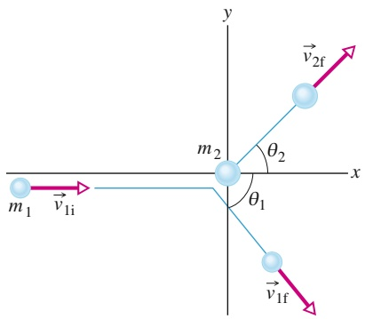

text_image

y
→ v₂f
m₂
θ₂
x
m₁
→ v₁i
θ₁
v₁f

Abb. 5.13

Ein elastischer, aber nicht zentraler Stoß zwischen zwei Körpern. Der Körper mit der Masse $m _ { 2 }$ ruht vor dem Stoß.

Erfolgt der Stoß elastisch, so können wir außerdem Gl. 5.61 unter Verwendung von Geschwindigkeiten angeben:

$$
\frac {1}{2} m _ {1} \nu_ {\mathrm{1i}} ^ {2} = \frac {1}{2} m _ {1} \nu_ {\mathrm{1f}} ^ {2} + \frac {1}{2} m _ {2} \nu_ {\mathrm{2f}} ^ {2}. \tag {5.64}
$$

Die Gln. 5.62–5.64 enthalten sieben Variablen: zwei Massen $( m _ { 1 }$ und $m _ { 2 } )$ , drei Geschwindigkeiten $( \nu _ { \mathrm { 1 i } } , \nu _ { \mathrm { 1 f } }$ und $\nu _ { \mathrm { 2 f } } )$ sowie zwei Winkel $( \theta _ { 1 }$ und $\theta _ { 2 } )$ . Das System aus drei Gleichungen ist folglich immer dann lösbar, wenn vier von diesen Variablen bekannt sind.

## KONTROLLFRAGE 11

Betrachten Sie noch einmal Abb. 5.13. Das Geschoss habe vor dem Stoß einen Impuls von $6   \mathrm { k g } \cdot \mathrm { m } / \mathrm { s } _ { \mathrm { r } }$ nach dem Stoß einen Impuls mit der x-Komponente $p _ { \mathrm { G f } , x } =$ $4   \mathrm { k g } \cdot \mathrm { m } / \mathrm { s }$ und der y-Komponente $p _ { \mathrm { G f } ,   y } = - 3   \mathrm { k g } \cdot \mathrm { m } / \mathrm { s } .$ Geben Sie (a) die x-Komponente $p _ { \mathrm { Z f } , x }$ und (b) die y-Komponente $p _ { \mathrm { Z f } , y }$ des Impulses des Zielobjekts nach dem Stoß an.

## 5.9 Systeme mit veränderlicher Masse: Eine Rakete

## Lernziele

Nach dem Durcharbeiten dieses Abschnitts sollten Sie in der Lage sein, . . .

• die erste Raketengleichung anzuwenden, um eine Beziehung zwischen der Massenverlustrate der Rakete, der Geschwindigkeit der Abgase relativ zu der Rakete, der Masse der Rakete und ihrer Beschleunigung anzugeben,
• die zweite Raketengleichung anzuwenden, um die Änderung der Geschwindigkeit der Rakete mit der Relativgeschwindigkeit der Abgase und der Anfangsbzw. Endmasse der Rakete zu verknüpfen,
• für ein bewegtes System mit veränderlicher Masse aus der Rate der Massenänderung die Veränderung des Impulses zu berechnen.

## Schlüsselideen

• In Abwesenheit äußerer Kräfte beschleunigt eine Rakete mit dem konstanten Betrag

$$
R \nu_ {\mathrm{rel}} = M a
$$

(erste Raketengleichung), wobei M die momentane Masse der Rakete ist (einschließlich des noch unverbrauchten Treibstoffs), R die Verbrauchsrate des Treibstoffs und $\nu _ { \mathrm { r e l } }$ die Relativgeschwindigkeit der Abgase relativ zur Rakete. Der Term $R \nu _ { \mathrm { r e l } }$ wird als Schubkraft der Rakete bezeichnet.

• Für eine Rakete mit konstanten Werten von R und $\nu _ { \mathrm { r e l } } ,$ deren Geschwindigkeit sich von $\nu _ { \mathrm { i } }$ auf $\nu _ { \mathrm { f } }$ und deren Masse sich von $M _ { \mathrm { i } }$ auf $M _ { \mathrm { f } }$ verändert, gilt die zweite Raketengleichung:

$$
\nu_ {\mathrm{f}} - \nu_ {\mathrm{i}} = \nu_ {\mathrm{rel}} \ln \frac {M _ {\mathrm{i}}}{M _ {\mathrm{f}}}.
$$

## 5.9.1 Raketen

Bei unseren bisherigen Überlegungen sind wir stets davon ausgegangen, dass die Masse des Systems konstant bleibt. In der Praxis trifft aber dies nicht immer zu. Ein klassisches Beispiel für ein System mit veränderlicher Masse sind Raketen (Abb. 5.14). Auf der Startrampe machen die Treibstofftanks einen großen Teil der Masse einer Rakete aus. Während der Beschleunigung des Flugkörpers werden diese Vorräte vollständig in den Triebwerken verbrannt und als gasförmige Verbrennungsprodukte ausgestoßen – dieser Ausstoß ist der Antrieb der Rakete.

natural_image

Rocket ascending above Earth, creating a bright exhaust plume (no text or symbols visible)

Abb. 5.14 Ein Raumfrachter bringt Material in den Weltraum [Quelle: 3Dsculptor/ Shutterstock].

Die Massenänderung der Rakete während der Beschleunigung erfassen wir mit dem zweiten Newtonschen Gesetz, welches wir hier nicht auf die Rakete allein, sondern auf das System aus Rakete und Treibstofftanks anwenden. Die Masse dieses Systems bleibt auch während der Beschleunigung konstant.

## Berechnung der Beschleunigung

Nehmen wir an, wir befinden uns in den Weiten des Alls, in Ruhe relativ zu einem inertialen Bezugssystem (Kapitel 33), und sehen zu, wie eine Rakete beschleunigt. Auf den Flugkörper wirken weder Gravitations- noch atmosphärische Reibungskräfte, da sich keine Himmelskörper und schon gar keine Atmosphären von Himmelskörpern in der Nähe befinden. Für eine solche eindimensionale Bewegung sei M die Masse der Rakete und v ihre Geschwindigkeit zu einem beliebigen Zeitpunkt t (Abb. 5.15a).

Abbildung 5.15b zeigt die gleiche Situation nach einer Zeit dt. Die Rakete bewegt sich nun mit der Geschwindigkeit $\nu + \mathrm { d } \nu ,$ und ihre Masse ist $M + \mathsf { d } M ;$ die Massenänderung dM ist dabei eine negative Größe. Die Verbrennungsprodukte, die während der Zeit dt von der Rakete ausgestoßen wurden, haben die Masse − dM und bewegen sich mit der Geschwindigkeit U relativ zu unserem inertialen Bezugssystem.

Wir betrachten nun das System, das aus der Rakete und den während der Zeitspanne dt abgegebenen Verbrennungsprodukten besteht. Da es sich um ein geschlossenes und isoliertes System handelt, muss der Impuls während dt erhalten bleiben:

$$
P _ {\mathrm{i}} = P _ {\mathrm{f}} \tag {5.65}
$$

(die Indizes i und f stehen für den Beginn bzw. das Ende des Intervalls dt). Gleichung 5.65 können wir auch in der Form

$$
M \nu = - \mathrm{d} M U + (M + \mathrm{d} M) (\nu + \mathrm{d} \nu) \tag {5.66}
$$

schreiben, wobei der erste Term auf der rechten Seite dem Impuls der während dt freigesetzten Verbrennungsprodukte und der zweite Term dem Impuls der Rakete am Ende des Intervalls dt entspricht.

Gleichung 5.66 lässt sich vereinfachen, indem wir die Relativgeschwindigkeit $\nu _ { \mathrm { r e l } }$ von Rakete und Verbrennungsprodukten heranziehen. Der Zusammenhang zwischen $\nu _ { \mathrm { r e l } }$ und den Geschwindigkeiten relativ zum Bezugssystem lautet:

$$
\begin{array}{l} \binom{\text {Geschwindigkeit Rakete}}{\text {relativ zu Bezugssystem}} = \binom{\text {Geschwindigkeit Rakete}}{\text {relativ zu Produkten}} \\ + \binom{\text {Geschwindigkeit Produkte}}{\text {relativ zu Bezugssystem}}, \\ \end{array}
$$

also:

$$
(\nu + \mathrm{d} \nu) = \nu_ {\mathrm{rel}} + U
$$

Abb. 5.15

(a) Eine beschleunigte Rakete der Masse M zu einem Zeitpunkt t, gesehen von einem inertialen Bezugssystem aus. (b) Die gleiche Rakete zum Zeitpunkt t + dt. Während der Zeitspanne dt stößt die Rakete Verbrennungsprodukte mit einer Masse von − dM aus.

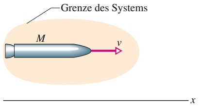

text_image

Grenze des Systems
M
v
x

(a)

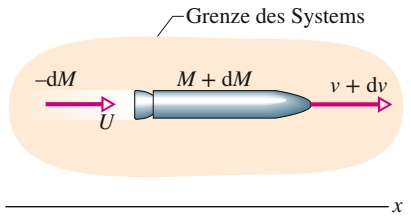

flowchart

(b)

oder

$$
U = \nu + \mathrm{d} \nu - \nu_ {\mathrm{rel}}. \tag {5.67}
$$

Wir setzen diese Beziehung für U in Gl. 5.66 ein und erhalten nach einigen Umformungen

$$
- \mathrm{d} M \nu_ {\mathrm{rel}} = M \mathrm{d} \nu . \tag {5.68}
$$

Beide Seiten teilen wir durch dt und haben

$$
- \frac {\mathrm{d} M}{\mathrm{d} t} \nu_ {\mathrm{rel}} = M \frac {\mathrm{d} \nu}{\mathrm{d} t}. \tag {5.69}
$$

Die Rate, mit der die Rakete an Masse verliert $( \mathsf { d } M / \mathsf { d } t ) ,$ , setzen wir nun gleich −R mit R als (positiver) Rate des Verbrauchs an Brennstoff(-masse). Außerdem wissen wir, dass $\mathrm { d } \nu / \mathrm { d } t$ die Beschleunigung der Rakete angibt. Damit wird Gl. 5.69 zu

$$
R \nu_ {\mathrm{rel}} = M a. \tag {5.70}
$$

Dies ist die **erste Raketengleichung**. Gleichung 5.70 gilt zu jedem beliebigen Zeitpunkt, für den die Masse $M ,$ die Rate des Brennstoffverbrauchs R und die Beschleunigung a angegeben werden.

Die linke Seite von Gl. 5.70 hat die Dimension einer Kraft $( \mathrm { k g } \cdot \mathrm { m } / \mathrm { s } ^ { 2 } = \mathrm { N } )$ und hängt nur von der technischen Auslegung der Rakete (der Rate des Brennstoffverbrauchs und der Relativgeschwindigkeit $\nu _ { \mathrm { r e l } }$ des Ausstoßes der Verbrennungsprodukte) ab. Man bezeichnet diesen Term $R \nu _ { \mathrm { r e l } }$ auch als **Schub(kraft)** T der Rakete. Wenn wir Gl. 5.70 in der Form $T = M a$ schreiben, erkennen wir, dass es sich um eine spezielle Form des zweiten Newtonschen Gesetzes handelt: a ist die Beschleunigung der Rakete zu dem Zeitpunkt, zu dem deren Masse gleich M ist.

## Berechnung der Geschwindigkeit

Wie ändert sich die Geschwindigkeit der Rakete während des Brennstoffverbrauchs? Aus Gl. 5.68 folgt:

$$
\mathrm{d} \nu = - \nu_ {\mathrm{rel}} \frac {\mathrm{d} M}{M}.
$$

Die Integration dieser Gleichung liefert

$$
\int_ {\nu_ {\mathrm{i}}} ^ {\nu_ {\mathrm{f}}} \mathrm{d} \nu = - \nu_ {\mathrm{rel}} \int_ {M _ {\mathrm{i}}} ^ {M _ {\mathrm{f}}} \frac {\mathrm{d} M}{M}
$$

mit $M _ { \mathrm { i } }$ als Anfangs- und $M _ { \mathrm { f } }$ als Endmasse der Rakete. Wenn wir die Integrale ausführen, erhalten wir die **zweite Raketengleichung**:

$$
\nu_ {\mathrm{f}} - \nu_ {\mathrm{i}} = \nu_ {\mathrm{rel}} \ln \frac {M _ {\mathrm{i}}}{M _ {\mathrm{f}}} . \tag {5.71}
$$

Sie gibt an, um wie viel die Geschwindigkeit der Rakete zunimmt, während die Masse von $M _ { \mathrm { i } }$ nach $M _ { \mathrm { f } }$ abnimmt. An dieser Stelle erkennen wir den Vorteil mehr stufiger Raketen: $M _ { \mathrm { f } }$ wird reduziert, indem leere Treibstofftanks (Stufen) nach und nach abgestoßen werden. An Bord einer idealen Rakete befindet sich am Ziel der Reise nur noch die Nutzlast (einschließlich einer etwaigen Besatzung!).

## 5.10 Äußere Kräfte und Änderungen der inneren Energie

## Lernziele

Nach dem Durcharbeiten dieses Abschnitts sollten Sie in der Lage sein, . . .

• den Zusammenhang zwischen äußerer Kraft und dem Transport der inneren Energie zu verstehen,
• die Umwandlung zwischen verschiedenen Energieformen analysieren zu können.

## Schlüsselideen

• In abgeschlossenen Systemen bleibt zwar die Gesamtenergie erhalten, in dynamischen Prozessen findet aber häufig eine Umwandlung zwischen verschiedenen Energieformen statt.
• Die Einwirkung einer äußeren Kraft führt zum Transport von innerer Energie.

## 5.10.1 Körper, die nicht starr sind

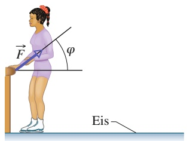

text_image

F
φ
Eis

(a)

Wenn sich die Schlittschuhläuferin in Abb. 5.16a von der Bande abstößt, wirkt auf sie eine Kraft $\vec { F }$ in einem Winkel $\varphi$ bezüglich der Waagerechten. Diese Kraft beschleunigt die Läuferin, bis deren Geschwindigkeit groß genug ist, um die Bande zu verlassen (Abb. 5.16b). Die kinetische Energie der Läuferin nimmt folglich durch das Wirken der Kraft zu. Dieses Beispiel unterscheidet sich in zweierlei Hinsicht von den bereits besprochenen Fällen der Änderung einer kinetischen Energie durch eine Kraft:

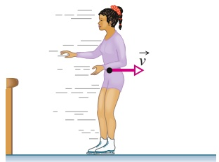

natural_image

Illustration of a woman in a dance pose with motion lines and a velocity vector (no text or symbols)

(b)

1. Bisher haben wir starre Objekte betrachtet, deren sämtliche Teile sich in gleicher Richtung bewegt haben. Im jetzigen Fall bewegt sich der Arm der Läuferin anders als der restliche Körper.
2. Bisher wurde durch die äußere Kraft Energie von der Umgebung auf das System übertragen: Die Kraft verrichtete Arbeit. Im jetzigen Fall sorgt die äußere Kraft dafür, dass Energie im Inneren des Objekts von einem Teil auf einen anderen übertragen wird (biochemische Energie der Muskeln wird in kinetische Energie umgewandelt).

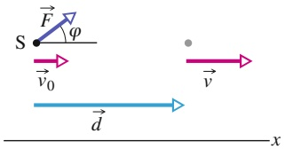

text_image

S
F
φ
v₀
d
x
v

(c)

Wir wollen nun einen Zusammenhang zwischen der äußeren Kraft $\vec { F }$ und diesem Transport innerer Energie herstellen.

Trotz der beiden aufgeführten Unterschiede können wir $\vec { F }$ im Wesentlichen so zur Änderung der kinetischen Energie in Beziehung setzen, wie wir es in Abschn. 3.2 für ein Teilchen getan haben. Dazu stellen wir uns zunächst vor, die Masse M der Schlittschuhläuferin sei in deren Schwerpunkt konzentriert. Wir können die Läuferin dann als Massepunkt behandeln, der sich im Schwerpunkt befindet. Nun lassen wir die äußere Kraft $\vec { F }$ auf diesen Massepunkt wirken (Abb. 5.16c). Die horizontale Komponente der Kraft, F cos 𝜑, beschleunigt den Massepunkt und ändert dessen kinetische Energie um ΔK während einer Verschiebung um den Betrag d. Wie wir weiter unten beweisen werden, gilt

$$
\Delta K = F d \cos \varphi . \tag {5.72}
$$

## Abb. 5.16

(a) Eine Schlittschuhläuferin stößt sich von einer Bande ab; dabei wirkt auf sie eine Kraft F⃗. (b) Nach dem Verlassen der Bande bewegt sich der Schwerpunkt der Läuferin mit der Geschwindigkeit v⃗. (c) Die äußere Kraft F⃗ wirkt auf den Schwerpunkt der Läuferin unter einem Winkel 𝜑 bezüglich der waagerechten x-Achse. Verschiebt sich der Schwerpunkt um $\vec { d } ,$ so ändert sich die Geschwindigkeit $\vec { \nu } _ { 0 }$ nach ⃗v infolge der Wirkung der horizontalen Komponente von ${ \vec { F } } .$

Natürlich könnte sich durch die Wirkung der äußeren Kraft auch die Höhe des Schwerpunkts der Läuferin ändern, woraus sich wiederum eine Änderung ΔU der potenziellen Energie der Gravitation des Systems Läuferin–Erde ergäbe. Um eine solche Änderung einzubeziehen, erweitern wir Gl. 5.72 auf

$$
\Delta K + \Delta U = F d \cos \varphi . \tag {5.73}
$$

Die linke Seite entspricht hier der $\ddot { \mathrm { A } }$ nderung der mechanischen Energie des Systems, $\Delta E _ { \mathrm { m e c h } }$ . Allgemein können wir also aussagen:

$$
\Delta E _ {\mathrm{mech}} = F d \cos \varphi . \tag {5.74}
$$

Betrachten wir nun die Energieumwandlungen innerhalb des Systems der Läufe rin. Zwar wirkt auf sie eine äußere Kraft ein, aber es wird keine Energie zum System oder vom System weg übertragen. Das heißt, die Gesamtenergie des Systems ändert sich nicht: $\Delta E = 0$ . Wenn sich die Läuferin von der Bande abstößt, ändert sich nicht nur die mechanische Energie ihres Schwerpunkts, sondern auch die Energie ihrer Muskeln. Ohne uns genauer mit den Details biochemischer Energieumwandlung zu beschäftigen, bezeichnen wir diese Änderung der inneren Energie summarisch mit $\Delta E _ { \mathrm { i n } }$ . Anstelle von $\Delta E = 0$ schreiben wir dann

$$
\Delta E _ {\mathrm{in}} + \Delta E _ {\mathrm{mech}} = 0 \tag {5.75}
$$

oder

$$
\Delta E _ {\mathrm{in}} = - \Delta E _ {\mathrm{mech}}. \tag {5.76}
$$

In Worten bedeutet dies: Die mechanische Energie $E _ { \mathrm { m e c h } }$ der Läuferin nimmt um den gleichen Betrag zu, wie ihre innere Energie $E _ { \mathrm { i n } }$ abnimmt. Wir setzen die Beziehung für $\Delta E _ { \mathrm { m e c h } }$ aus Gl. 5.76 in Gl. 5.74 ein und erhalten

$$
\Delta E _ {\mathrm{in}} = - F d \cos \varphi . \tag {5.77}
$$

Diese Beziehung gibt den Zusammenhang zwischen der Änderung der inneren Energie des Systems, $\Delta E _ { \mathrm { i n } }$ , und dem Wirken einer äußeren Kraft an. Ist der Betrag von $\vec { F }$ nicht konstant, so setzen wir anstelle von F in Gl. 5.74 und Gl. 5.77 den mittleren Betrag $F _ { \mathrm { g e m } }$ ein.

Die Gln. 5.74 und 5.77, die wir für eine Eisläuferin hergeleitet haben, gelten natürlich auch für andere Systeme, deren innere Energie sich durch Einwirken einer äußeren Kraft ändert. Betrachten wir z. B. ein Auto mit Vierradantrieb (der Motor setzt alle vier Räder in Bewegung) während der Beschleunigung. Die Räder stoßen sich nach hinten von der Straße ab, wobei Reibungskräfte auftreten, die auf jedes Rad in Vorwärtsrichtung wirken (siehe Abb. 5.17). Die äußere Kraft $\vec { F }$ insgesamt – also die Summe der Reibungskräfte an allen Rädern – bewirkt eine Beschleunigung a⃗ des Schwerpunkts des Autos. Innere, im Treibstoff gespeicherte Energie wird folglich in kinetische Energie des Fahrzeugs umgewandelt. Ist $\vec { F }$ konstant, so gibt bei gegebener Verschiebung d⃗ des Schwerpunkts Gl. 5.73 den Zusammenhang zwischen $\Delta K$ und $\vec { F }$ an; dabei sind $\Delta U = 0$ und $\varphi = 0 .$

Gleichung 5.73 gilt auch, wenn der Fahrer auf die Bremse tritt. Nun wirkt $\vec { F }$ aufgrund der Reibung in rückwärtiger Richtung $\left( \varphi = 1 8 0 ^ { \circ } \right)$ , und kinetische Energie des Schwerpunkts des Autos wird in thermische Energie von Bremsbelägen und -scheiben umgewandelt.

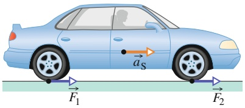

text_image

F₁
aₛ
F₂

Abb. 5.17

Ein Auto mit Vierradantrieb beschleunigt nach rechts. An allen vier Rädern (zwei sind zu sehen) übt die Straße Reibungskraft auf die Reifen aus. Zusammengenommen bilden diese vier Teilkräfte die äußere Kraft ${ \vec { F } } ,$ die auf das Auto wirkt.

## 5.10.2 Herleitung von Gl. 5.72

Kehren wir noch einmal zu unserer Schlittschuhläuferin (Abb. 5.16) zurück. Wir nehmen an, während der Verschiebung ⃗d ihres Schwerpunkts ändere sich die Geschwindigkeit dieses Punkts von $\vec { \nu } _ { 0 }$ nach v⃗. Der Betrag von $\vec { \nu }$ ist dann Gl. 1.14 zufolge

$$
\nu^ {2} = \nu_ {0} ^ {2} + 2 a _ {x} d \tag {5.78}
$$

mit $a _ { x }$ als Beschleunigung der Läuferin in $x -$ Richtung. Wir multiplizieren beide Seiten von Gl. 5.78 mit der Masse M der Läuferin und stellen die Gleichung um:

$$
\frac {1}{2} M \nu^ {2} - \frac {1}{2} M \nu_ {0} ^ {2} = M a _ {x} d. \tag {5.79}
$$

Die linke Seite von Gl. 5.79 entspricht der Differenz zwischen $K _ { \mathrm { f } }$ und $K _ { \mathrm { i } } ,$ dem Endund dem Anfangswert der kinetischen Energie des Schwerpunkts. Diese Differenz ist gleich der Energieänderung $\Delta K$ infolge der Wirkung der Kraft $\vec { F } .$ Wir setzen dies sowie das Produkt $F$ cos 𝜑 für $M a _ { x }$ (gemäß dem zweiten Newtonschen Gesetz) ein und erhalten

$$
\Delta K = F d \cos \varphi ,
$$

was wir herleiten wollten.

## 5.11 Zusammenfassung

**Schwerpunkt** Als Schwerpunkt S eines Systems aus n Teilchen mit der Gesamtmasse M definiert man den Punkt mit den Koordinaten

$$
x _ {S} = \frac {1}{M} \sum_ {i = 1} ^ {n} m _ {i} x _ {i}, \quad y _ {S} = \frac {1}{M} \sum_ {i = 1} ^ {n} m _ {i} y _ {i}, \tag {5.5}
$$

$$
z _ {\mathrm{S}} = \frac {1}{M} \sum_ {i = 1} ^ {n} m _ {i} z _ {i}
$$

oder

$$
\vec {r} _ {\mathrm{S}} = \frac {1}{M} \sum_ {i = 1} ^ {n} m _ {i} \vec {r} _ {i}. \tag {5.8}
$$

**Zweites Newtonsches Gesetz für Teilchensysteme** Die Bewegung des Schwerpunkts eines aus mehreren Teilchen bestehenden Systems wird durch das zweite Newtonsche Gesetz für Teilchensysteme beschrieben:

$$
\vec {F} _ {\mathrm{eff}} = M \vec {a} _ {\mathrm{S}}. \tag {5.12}
$$

$\vec { F } _ { \mathrm { e f f } }$ ist die insgesamt von außen auf das System wirkende Kraft, M ist die Gesamtmasse des Systems und ${ \vec { a } } _ { S }$ ist die Beschleunigung des Schwerpunkts.

**Impuls und zweites Newtonsches Gesetz** Für ein einzelnes Teilchen definieren wir den **Impuls** $\vec { p }$ wie folgt:

$$
\vec {p} = m \vec {\nu}. \tag {5.18}
$$

In Impulsschreibweise lautet dann das zweite Newtonsche Gesetz

$$
\vec {F} _ {\mathrm{eff}} = \frac {\mathrm{d} \vec {p}}{\mathrm{d} t}. \tag {5.19}
$$

Für Systeme aus mehreren Teilchen gelten entsprechend die Gleichungen:

$$
\vec {P} = M \vec {\nu} _ {S} \tag {5.21}
$$

und

$$
\vec {F} _ {\mathrm{eff}} = \frac {\mathrm{d} \vec {P}}{\mathrm{d} t}. \tag {5.23}
$$

**Stoßprozesse und Kraftstoß** Die Anwendung des zweiten Newtonschen Gesetzes in Impulsschreibweise auf einen teilchenähnlichen, an einem Stoß beteiligten Körper führt zu der Beziehung

$$
\vec {p} _ {\mathrm{f}} - \vec {p} _ {\mathrm{i}} = \Delta \vec {p} = \vec {J} \tag {5.27,5.28}
$$

mit $\Delta \vec { p } = \vec { p } _ { \mathrm { f } }   -   \vec { p } _ { \mathrm { i } }$ als Impulsänderung des Körpers und $\vec { J }$ als Kraftstoß, der (aus der Kraft $\vec { F } ( t )$ folgend) von einem Stoß- partner auf den anderen ausgeübt wird:

$$
\vec {J} = \int_ {t _ {\mathrm{i}}} ^ {t _ {\mathrm{f}}} \vec {F} (t) \mathrm{d} t. \tag {5.26}
$$

Geben $F _ { \mathrm { g e m } }$ den gemittelten Betrag von $\vec { F } ( t )$ während des Stoßes und Δt die Stoßzeit an, so gilt für eindimensionale Bewegungen

$$
J = F _ {\mathrm{gem}} \Delta t. \tag {5.31}
$$

Ein Strom von Objekten gleicher Masse m und gleicher Geschwindigkeit v, der auf ein ortsfestes Ziel trifft, übt auf dieses die mittlere Kraft

$$
F _ {\mathrm{gem}} = - \frac {n}{\Delta t} \Delta p = - \frac {n}{\Delta t} m \Delta \nu \tag {5.33}
$$

aus; $n / \Delta t$ ist die Rate, mit der die Objekte auf das Ziel treffen, und $\Delta \nu$ gibt die Geschwindigkeitsänderung jedes auftreffenden Körpers an. Diese mittlere Kraft können wir auch wie folgt schreiben:

$$
F _ {\mathrm{gem}} = - \frac {\Delta m}{\Delta t} \Delta \nu . \tag {5.36}
$$

Hier ist $\Delta m / \Delta t$ die Rate, mit der Masse auf das Ziel trifft. In den Gln. 5.33 und 5.36 ist $\Delta \nu = - \nu ,$ wenn die Objekte beim Auftreffen zum Stillstand kommen, und $\Delta \nu = 2 \nu ,$ wenn sie ohne Geschwindigkeitsänderung direkt rückwärts abprallen.

**Impulserhaltung** In einem isolierten System – einem System, auf das keine äußere Kraft wirkt – ist der Gesamtimpuls konstant:

$$
\vec {P} = \text {const.} \quad (\text {geschlossenes, isoliertes System}) \tag {5.37}
$$

oder

$$
\vec {P} _ {\mathrm{i}} = \vec {P} _ {\mathrm{f}} \quad (\text {geschlossenes, isoliertes System}). \tag {5.38}
$$

Die Indizes i und f beziehen sich auf einen (initialen) Anfangs- bzw. einen (finalen) späteren Zeitpunkt. Die Gln. 5.37 und 5.38 sind gleichwertige Formulierungen des **Impulserhaltungssatzes**.

**Inelastische eindimensionale Stöße** Während eines inelastischen Stoßes zweier Körper bleibt die kinetische Energie des Zweikörpersystems nicht erhalten. Handelt es sich um ein geschlossenes, isoliertes System, so muss dessen Gesamtimpuls hingegen erhalten bleiben. Wir formulieren in Vektorschreibweise:

$$
\vec {p} _ {1 \mathrm{i}} + \vec {p} _ {2 \mathrm{i}} = \vec {p} _ {1 \mathrm{f}} + \vec {p} _ {2 \mathrm{f}}, \tag {5.39}
$$

wobei die Indizes i und f zu den entsprechenden Werten kurz vor bzw. kurz nach dem Stoß gehören.

Erfolgt die Bewegung entlang einer einzigen Achse, so sprechen wir von einem eindimensionalen Stoß. Gleichung 5.39 lautet dann für die Geschwindigkeitskomponenten entlang dieser Achse

$$
m _ {1} \nu_ {1 \mathrm{i}} + m _ {2} \nu_ {2 \mathrm{i}} = m _ {1} \nu_ {1 \mathrm{f}} + m _ {2} \nu_ {2 \mathrm{f}}. \tag {5.40}
$$

Nach einem vollständig inelastischen Stoß bewegen sich die Körper gemeinsam mit der Geschwindigkeit V weiter (sie haften aneinander).

**Bewegung des Schwerpunkts** Der Schwerpunkt eines geschlossenen, isolierten Systems zweier Stoßpartner wird durch einen Stoß nicht beeinflusst. Insbesondere kann sich die Geschwindigkeit des Schwerpunkts, $\vec { \nu } _ { \mathrm { S } } ,$ infolge des Stoßes nicht ändern.

**Elastische eindimensionale Stöße** Ein Spezialfall ist der elastische Stoß: Hier bleibt die kinetische Energie des Systems der Stoßpartner erhalten. Einige im Alltag auftretende Stoßprozesse können näherungsweise als elastisch behandelt werden. Handelt es sich außerdem um ein geschlossenes, isoliertes System, so gilt auch die Impulserhaltung. Für einen eindimensionalen Stoß zwischen einem vor dem Stoß ruhenden Zielobjekt 2 und einem ankommenden Geschoss 1 ergeben sich aus der Erhaltung von kinetischer Energie und Impuls folgende Beziehungen für die Geschwindigkeiten unmittelbar nach dem Stoß:

$$
\nu_ {\mathrm{1f}} = \frac {m _ {1} - m _ {2}}{m _ {1} + m _ {2}} \nu_ {\mathrm{1i}} \tag {5.50}
$$

und

$$
\nu_ {2 \mathrm{f}} = \frac {2 m _ {1}}{m _ {1} + m _ {2}} \nu_ {1 \mathrm{i}}. \tag {5.51}
$$

Bewegen sich beide Körper vor dem Stoß, so sind ihre Geschwindigkeiten unmittelbar nach dem Stoß gegeben durch

$$
\nu_ {\mathrm{1f}} = \frac {m _ {1} - m _ {2}}{m _ {1} + m _ {2}} \nu_ {\mathrm{1i}} + \frac {2 m _ {2}}{m _ {1} + m _ {2}} \nu_ {\mathrm{2i}} \tag {5.58}
$$

und

$$
\nu_ {2 \mathrm{f}} = \frac {2 m _ {1}}{m _ {1} + m _ {2}} \nu_ {1 \mathrm{i}} + \frac {m _ {2} - m _ {1}}{m _ {1} + m _ {2}} \nu_ {2 \mathrm{i}}. \tag {5.59}
$$

Beachten Sie die Symmetrie der Indizes 1 und 2 in den Gln. 5.58 und 5.59.

**Zweidimensionale Stöße** Stoßen zwei Körper nicht zentral zusammen, so erfolgt die Bewegung nicht entlang einer einzelnen Achse, sondern zweidimensional. In einem geschlossenen, isolierten Zweikörpersystem kann der Impulserhaltungssatz auf den Stoß in vektorieller Form angewendet werden:

$$
\vec {P} _ {1 \mathrm{i}} + \vec {P} _ {2 \mathrm{i}} = \vec {P} _ {1 \mathrm{f}} + \vec {P} _ {2 \mathrm{f}}. \tag {5.60}
$$

## 5.12 Fragen

**1.** Abbildung 5.F1 zeigt drei Teilchen, auf die äußere Kräfte wirken. Für zwei Teilchen sind Betrag und Richtung der jeweiligen Kraft angegeben. Welchen Betrag und welche Richtung muss die auf das dritte Teilchen wirkende Kraft haben, wenn der Schwerpunkt des Dreiteilchensystems (a) stationär ist, (b) sich mit konstanter Geschwindigkeit nach rechts bewegt und (c) nach rechts beschleunigt wird?

In Komponentenform liefert der Impulserhaltungssatz zwei Gleichungen (je eine für jede Dimensionen). Im Spezialfall eines elastischen Stoßes ergibt sich aus der Erhaltung der kinetischen Energie während des Stoßes eine dritte Gleichung:

$$
K _ {1 \mathrm{i}} + K _ {2 \mathrm{i}} = K _ {1 \mathrm{f}} + K _ {2 \mathrm{f}}. \tag {5.61}
$$

**Systeme mit veränderlicher Masse** Ändert sich die Masse eines Systems, so definieren wir neue Systemgrenzen in der Weise, dass wieder ein System mit konstanter Masse entsteht. Dann können wir den Impulserhaltungssatz anwenden. Im Fall einer Rakete bedeutet dies, dass wir die ausgestoßenen Verbrennungsprodukte des Treibstoffs mit in das System einschließen müssen. Wirken keine äußeren Kräfte, so beschleunigt eine Rakete mit der momentanen Rate

$$
R \nu_ {\mathrm{rel}} = M a. \tag {5.70}
$$

In dieser ersten Raketengleichung ist M die momentane Masse der Rakete (einschließlich des unverbrannten Treibstoffs), R ist die Rate des Treibstoffverbrauchs und $\nu _ { \mathrm { r e l } }$ ist die Geschwindigkeit relativ zum Triebwerk, mit der die Verbrennungsprodukte ausgestoßen werden. Den Term $R \nu _ { \mathrm { r e l } }$ bezeichnet man als **Schub** der Rakete. Für eine Rakete mit konstanten Werten von R und $\nu _ { \mathrm { r e l } } ,$ deren Geschwindigkeit von $\nu _ { \mathrm { i } }$ auf $\nu _ { \mathrm { f } }$ steigt, während die Masse von $M _ { \mathrm { i } }$ auf $M _ { \mathrm { f } }$ sinkt, gilt die zweite Raketengleichung:

$$
\nu_ {\mathrm{f}} - \nu_ {\mathrm{i}} = \nu_ {\mathrm{rel}} \ln \frac {M _ {\mathrm{i}}}{M _ {\mathrm{f}}}  . \tag {5.71}
$$

**Äußere Kräfte und Änderungen der inneren Energie** Durch die Wirkung einer äußeren Kraft $\vec { F }$ können innerhalb eines Systems verschiedene Energieformen ineinander umgewandelt werden $( \mathbf { z } , \mathbf { B } .$ biochemisch gespeicherte Energie in mechanische Energie). Die Beziehung zwischen der Änderung der inneren Energie $\Delta E _ { \mathrm { i n } }$ und der äußeren Kraft lautet:

$$
\Delta E _ {\mathrm{in}} = - F d \cos \varphi , \tag {5.77}
$$

mit $\vec { d }$ als Verschiebung des Schwerpunkts des Systems und 𝜑 als Winkel zwischen den Richtungen von $\vec { d }$ und ${ \vec { F } } .$ Die Änderung der mechanischen Energie ist gegeben durch

$$
\Delta E _ {\mathrm{mech}} = \Delta K + \Delta U = F d \cos \varphi . \tag {5.73,5.74}
$$

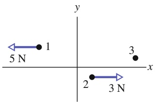

text_image

1
5 N
2
3 N
3
x
y

Abb. 5.F1

**2.** In Abb. 5.F2 sehen Sie vier Teilchen gleicher Masse, die mit konstanter Geschwindigkeit reibungsfrei über eine Fläche gleiten; die Bewegungsrichtung ist jeweils angegeben, die Beträge aller Geschwindigkeiten sind gleich

groß. Betrachten Sie Paare von Teilchen. Welche Paare bilden ein System (a) mit stationärem Schwerpunkt, (b) mit stationä- rem und im Ursprung befindlichen Schwerpunkt und (c) mit einem Schwerpunkt, der

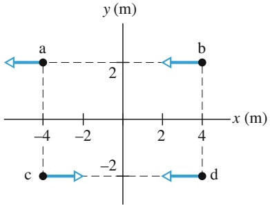

text_image

y (m)
a
2
b
x (m)
-4
-2
2
4
c
-2
d

Abb. 5.F2

sich durch den Ursprung bewegt?

**3.** Betrachten wir einen Kasten, der in zwei Teile explodiert, während er sich mit konstanter positiver Geschwindigkeit eine x-Achse entlang bewegt. Die Geschwindigkeit eines Teils mit der Masse $m _ { 1 }$ sei $\vec { \nu } _ { 1 } ;$ der andere Teil mit der Masse $m _ { 2 }$ könnte dann (a) eine positive Geschwindigkeit $\vec { \nu } _ { 2 }$ (Abb. 5.F3a), (b) eine negative Geschwindigkeit $\vec { \nu } _ { 2 }$ (Abb. 5.F3b) oder (c) die Geschwindigkeit null (Abb. 5.F3c) haben. Ordnen Sie die Fälle (a) bis (c) nach dem zugehö- rigen Betrag der Geschwindigkeit ${ \vec { \nu } } _ { 1 } ,$ beginnend mit dem größten Wert.

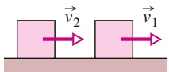

(a)

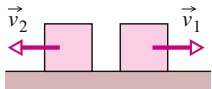

(b)

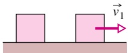

(c)

Abb. 5.F3

**4.** In Abb. 5.F4 sehen Sie drei Graphen des Betrags der Kraft als Funktion der Zeit für einen Körper, der an einem Stoß beteiligt ist. Ordnen Sie die Graphen nach dem Betrag des Kraftstoßes, beginnend mit dem größten Wert.

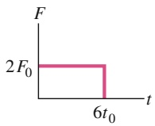

(a)

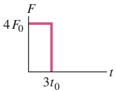

(b)

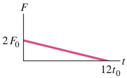

line

| Time (t) | Force (F) |
| --- | --- |
| 0 | 2F0 |
| 12t0 | 12t0 |

(c)

Abb. 5.F4

**5.** Die Kräftediagramme in Abb. 5.F5 zeigen Draufsichten auf die horizontalen Kräfte auf drei Packungen Schokolade, die sich reibungsfrei über eine Ladentheke bewegen. Geben Sie für jede der Packungen an, ob ihr Impuls in x- bzw. y-Richtung erhalten bleibt.

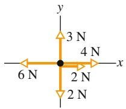

text_image

y
3 N
4 N
x
6 N
2 N
2 N

(a)

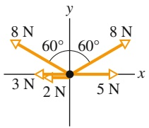

text_image

8 N
60°
60°
8 N
3 N
2 N
5 N
x
y

(b)

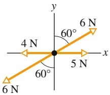

text_image

y
60°
4 N
x
5 N
60°
6 N

(c)

Abb. 5.F5

**6.** Abbildung 5.F6 zeigt vier Gruppen von drei bzw. vier identischen Teilchen, die sich mit identischen Geschwindigkeiten parallel entweder zur x- oder zur y-Achse bewegen. Ordnen Sie die Gruppen in absteigender Reihenfolge nach dem Betrag ihrer Schwerpunktgeschwindigkeit.

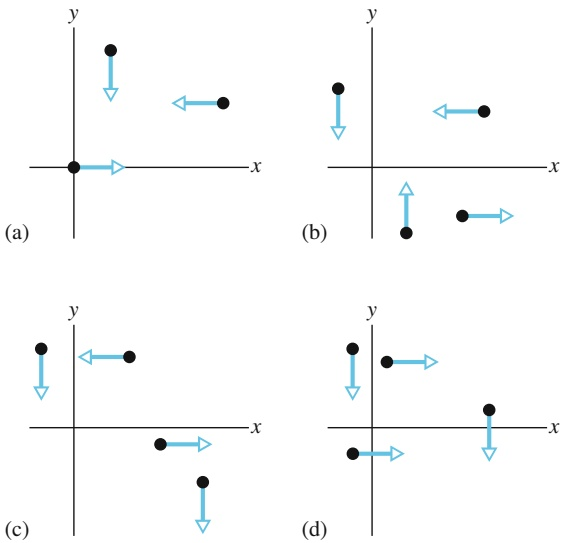

Abb. 5.F6

**7.** Ein Block gleitet über einen reibungsfreien Boden auf einen ruhenden zweiten Block mit derselben Masse. Abbildung 5.F7 zeigt vier Möglichkeiten für den Verlauf der kinetischen Energie der beiden Blöcke. (a) Welche der angebotenen Möglichkeiten sind physikalisch unmöglich? Welche der übrigen Möglichkeiten beschreiben (b) einen elastischen oder (c) einen inelastischen Stoß?

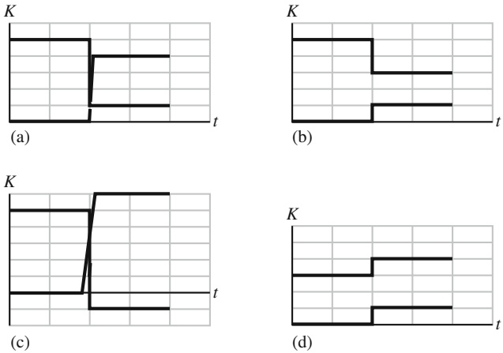

Abb. 5.F7

**8.** Abbildung 5.F8 zeigt eine Momentaufnahme von Block 1, der auf einem reibungsfreien Boden entlang der x-Achse gleitet, kurz vor seiner elastischen Kollision mit dem stationären Block 2. Es sind drei mögliche Positionen des gemeinsamen Schwerpunkts der beiden Blöcke gezeigt (Punkt B liegt in der Mitte zwischen den Zentren der beiden Blö- cke). Ist Block 1 nach dem Stoß in Ruhe oder bewegt er sich vorwärts oder rückwärts, wenn der Schwerpunkt in der Momentaufnahme (a) bei A, (b) bei B und (c) bei C liegt?

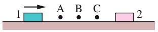

Abb. 5.F8

**9.** Zwei Körper sind eindimensional (entlang einer x-Achse) elastisch zusammengestoßen. Abbildung 5.F9 zeigt eine Auftragung des Orts der Körper sowie ihres gemeinsamen Schwerpunkts als Funktion der Zeit. (a) Bewegten sich beide Körper vor dem Stoß, oder ruhte einer von ihnen? Welches der Linienstücke 1–6 entspricht der Bewegung des Schwerpunkts (b) vor dem Stoß und (c) nach dem Stoß? (d) Ist die Masse des Körpers, der sich vor dem Stoß schneller bewegte, größer als, kleiner als oder gleich der seines Stoßpartners?

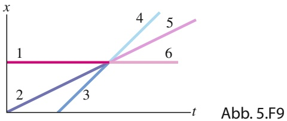

line

| Line | Trend Description |
| --- | --- |
| 1 | Constant horizontal line at x=1 |
| 2 | Linear increase from origin to intersection with line 3 |
| 3 | Linear increase from origin to intersection with line 3 |
| 4 | Linear increase from origin to intersection with line 4 |
| 5 | Linear increase from intersection with line 5 |
| 6 | Horizontal line at x=1 |

**10.** Ein Block ruht entweder auf einem horizontalen Boden oder er gleitet in Richtung der positiven oder negativen x-Achse auf diesem entlang, als er plötzlich in zwei Stücke explodiert, die sich entlang der x-Achse (weiter)bewegen. Abbildung 5.F10 zeigt sechs mögliche Auftragungen des Impulses des intakten Blocks bzw. der beiden Teile gegen die Zeit t. Nehmen Sie an, das der Block und die beiden Teile ein geschlossenes, isoliertes System bilden und geben Sie an (mit Begründung), welche der gezeigten Auftragungen physikalisch unmöglich sind.

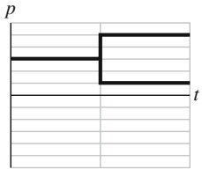

line

| Time (t) | p |
| --- | --- |
| 0~1 | Constant Value |
| 1~2 | Constant Value |
| 2~3 | Constant Value |
| 3~4 | Constant Value |

(a)

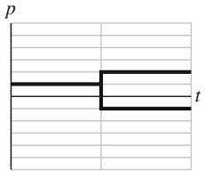

line

| Category | p | t |
| --- | --- | --- |
| 1 | Constant | Constant |
| 2 | Constant | Step Change |
| 3 | Constant | Constant |

(b)

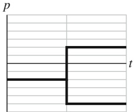

line

| Time (t) | Value (p) |
| --- | --- |
| 0~1 | Constant Value |
| 1~2 | Increasing Value |
| 2~3 | Constant Value |

(c)

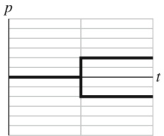

text_image

p
t

(d)

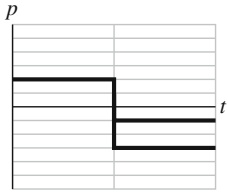

line

| Time (t) | Value (p) |
| --- | --- |
| 0~t1 | High |
| t1~t2 | Low |
| t2~t3 | Lower |
| t3~t4 | Low |

(e)

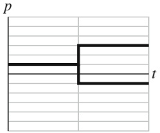

text_image

p
t

(f)

Abb. 5.F10

**11.** Block 1 mit der Masse $m _ { 1 }$ gleitet entlang der x-Achse auf einem reibungsfreien Boden und stößt elastisch gegen den ruhenden Block 2 mit der Masse $m _ { 2 } .$ . Abbildung 5.F11 zeigt eine Auftragung der Position x von Block 1 gegen die Zeit t bis zu dem Stoß bei $( x _ { \mathrm { S t } } , \; t _ { \mathrm { S t } } )$ . In welchen der mit Buchstaben bezeichneten Bereiche des Diagramms verläuft die Auftragung nach dem Stoß, wenn (a) $m _ { \mathrm { 1 } } < m _ { \mathrm { 2 } }$ und (b) $m _ { \mathrm { 1 } } > m _ { \mathrm { 2 } }$ ist? (c) Entlang welcher der mit Ziffern bezeichneten gestrichelten Linien verläuft die Auftragung nach dem Stoß für $m _ { 1 } = m _ { 2 } ?$

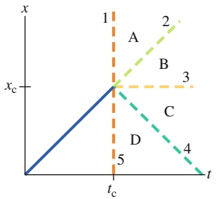

line

| Point | Description |
| --- | --- |
| 1 | Start of the line segment |
| 2 | Linear trend from A to B |
| 3 | Horizontal segment between points A and B |
| 4 | Linear trend from C to D |
| 5 | End of the line segment |

Abb. 5.F11

**12.** Die Diagramme in Abb. 5.F12 zeigen die Position zweier Körper und ihres gemeinsamen Schwerpunkts als Funktion der Zeit für vier Situationen. Es handelt sich um ein geschlossenes, isoliertes System; die Stöße erfolgen vollständig inelastisch und eindimensional entlang einer x-Achse. Bewegen sich in Diagramm 1 (a) die beiden Körper und (b) ihr gemeinsamer Schwerpunkt in positiver oder negativer x-Richtung? (c) Welche der Situationen (1) bis (4) sind physikalisch unmöglich? Erklären Sie Ihre Entscheidung.

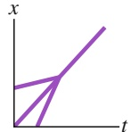

(1)

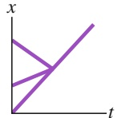

(2)

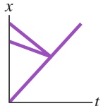

(3)

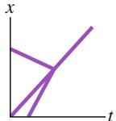

(4)

Abb. 5.F12

# 6 Die Rotation ausgedehnter Körper

## 6.1 Die Variablen der Rotation

## Physikalische Motivation

Wie wir schon in den vergangenen Kapiteln diskutiert haben, hat Physik viel mehr mit Bewegung zu tun als sich das Nichtphysiker oft vorstellen. Bisher haben wir vor allem Translationsbewegungen untersucht, also solche, bei denen sich ein Objekt entlang einer geraden oder gekrümmten Linie bewegt wie in Abb. 6.1a. Nun wollen wir uns Rotationsbewegungen zuwenden, bei denen sich ein Körper um eine Achse dreht, wie in Abb. 6.1b.

Rotationsbewegungen sind in Maschinen praktisch allgegenwärtig. Auch wenn Sie ein Glas oder eine Flasche mit Schraubverschluss öffnen, setzen Sie jedes Mal eine Rotationsbewegung in Gang. Und wenn Sie einen Vergnügungspark besuchen, bezahlen Sie sogar dafür, Rotationsbewegungen erleben zu dürfen. Rotation ist auch im Sport oft der Schlüssel zum Erfolg, z. B. beim Schlagen eines langen Balls beim Golf (hier muss der Ball rotieren, damit er sich länger in der Luft hält) oder bei raffinierten Freistößen im Fußball (hier bewirkt die Rotation des Balls eine Krümmung der Flugbahn, die die Bahn des Balls schwer einschätzbar macht und sogar Eckbälle direkt ins Tor lenken kann). Rotation ist aber auch im Ingenieurwesen ein entscheidendes Thema, beispielsweise wenn es um das Versagen von Bauteilen bei älteren Flugzeugen geht.

Wir beginnen unsere Diskussion der Rotation, indem wir die wesentlichen Variablen für diese Art von Bewegung definieren, genau wie wir es in Kapitel 1 für die Translation gemacht haben. Wie wir sehen werden, sind die Variablen für die Rotation ganz analog zu denen für die eindimensionale Bewegung, und wie in Kapitel 1 werden wir feststellen, dass eine konstante Beschleunigung (hier: Rotationsbeschleunigung) einen besonders wichtigen Spezialfall darstellt. Wir werden ebenfalls feststellen, dass das zweite Newtonsche Gesetz auch für Rotationsbewegungen formuliert werden kann; allerdings müssen wir hierzu eine neue Größe definieren, die an die Stelle der Kraft tritt: das Drehmoment. Auch die Arbeit und die Beziehung zwischen Arbeit und kinetischer Energie finden wir bei Rotationsbewegungen wieder, nur dass auch in diesem Fall eine neue Größe auftritt: das Trägheitsmoment, das an die Stelle der Masse tritt. Kurz gesagt – vieles von dem, was wir bisher diskutiert haben, kann mit einigen kleineren Änderungen auf Rotationsbewegungen übertragen werden.

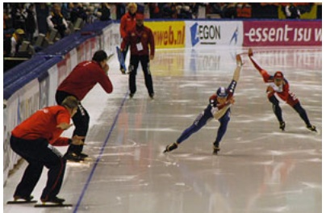

natural_image

Speed skaters competing on an ice rink during a competition (no visible text or symbols)

(a)

natural_image

Figure skater performing a high acrobatic pose in red costume (no text or symbols visible)

(b)

Abb. 6.1 Zwei Bewegungsformen auf dem Eis: (a) Beim Eisschnelllauf kommt es im Wesentlichen auf die Translation in eine vorgegebene Richtung an [Quelle: McSmit/CC-SA-3.0]. (b) Beim Eiskunstlaufen ist eine Pirouette idealerweise eine reine Rotation [Quelle: Paolo Bona/Shutterstock].

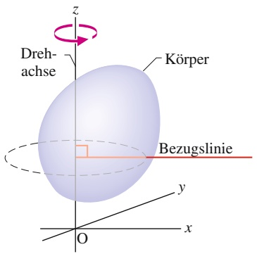

text_image

Drehachse
Körper
Bezugslinie
O
y
x
z

Abb. 6.2

Ein starrer Körper mit zufällig gewählter Gestalt vollführt eine reine Rotation um die z-Achse des Koordinatensystems. Die Bezugslinie steht immer senkrecht auf der Drehachse, ansonsten ist ihre Lage beliebig wählbar, aber fest; die Bezugslinie rotiert mit dem Körper.

text_image

Bezugs-
linie
y
s
r
θ
Dreh-
achse
x

Abb. 6.3

Querschnitt durch den rotierenden Körper aus Abb. 6.2, von oben gesehen. Die Querschnittsebene ist senkrecht zur Drehachse, welche nun aus der Papierebene heraus zeigt. In der dargestellten Position des Körpers schließt die Bezugslinie einen Winkel θ mit der x-Achse ein.

Aber Vorsicht: Obwohl eine Reihe von physikalischen Ideen hier nicht zum ersten Mal an auftritt, finden viele Studierende dieses und das nächste Kapitel sehr anspruchsvoll. Dozenten diskutieren zahlreiche Gründe, warum das so ist, zwei Ursachen werden besonders häufig genannt: (1) Es kommt eine Vielzahl von Symbolen (viele davon mit griechischen Buchstaben) auf Sie zu, und (2) sind wir aus unserem Alltag mit linearen Bewegung sehr vertraut (wir alle können problemlos durch ein Zimmer oder über die Straße gehen), Rotationen bleiben uns dagegen eher fremd (was andererseits ein Grund sein mag, dass wir bereit sind, in Vergnü- gungsparks so viel Geld für schnell rotierende Fahrgeschäfte zu bezahlen). Wenn eine Aufgabe zum Thema Rotation Ihnen wie ein Text in einer unbekannten Sprache vorkommt, dann versuchen Sie doch einmal, ihren Text in die Ihnen bekannte Sprache der eindimensionalen linearen Bewegung aus Kapitel 1 zu übersetzen. Wenn Sie z. B. eine Winkelverschiebung bestimmen sollen, dann ignorieren Sie vorübergehend das Wort „Winkel“ und probieren Sie, ob Sie die Aufgabe mit der Notation und den Ideen aus Kapitel 1 angehen können.

## 6.1.1 Die Variablen der Rotation

Gegenstand unserer Diskussion ist die Rotation eines starren Körpers um eine festgehaltene Achse. Ein **starrer Körper** besteht aus fest miteinander verbundenen Teilchen, die sich während der Rotation nicht gegeneinander verschieben. Das bedeutet, die Gestalt des Körpers ändert sich dabei nicht. Eine **feste Achse** bleibt bei der Rotation unbewegt. Nicht beschäftigen werden wir uns demnach mit Objekten wie der Sonne, deren Teilchen (Gasmoleküle usw.) nicht unbeweglich miteinander verbunden sind. Auch Körper wie eine Bowlingkugel, die auf einer Bowlingbahn rollt, gehören nicht in dieses Kapitel, denn die Achse einer solchen Kugel bewegt sich während der Rotation (tatsächlich handelt es sich hier um eine Mischung aus Translation und Rotation).

In Abb. 6.2 sehen Sie einen starren Körper mit zufällig gewählter Form, der um eine feste Achse – die **Drehachse** (**Rotationsachse**) – rotiert. Jeder Punkt des Körpers beschreibt einen Kreis, dessen Mittelpunkt auf der Drehachse liegt, und jeder Punkt überstreicht innerhalb eines bestimmten Zeitintervalls den gleichen Winkel. Bei der reinen Translation bewegt sich jeder Punkt des Körpers auf einer geraden Linie, und jeder Punkt legt in einem bestimmten Zeitraum die gleich lineare Entfernung zurück. (Im Laufe dieses Kapitels werden wir die lineare und die Kreisbewegung einander mehrmals gegenüberstellen.)

Zunächst führen wir nacheinander die Rotations-Äquivalente der linearen Grö- ßen Ort, Weg, Geschwindigkeit und Beschleunigung ein.

## Die Winkelposition

In dem Körper in Abb. 6.2 wurde eine Bezugslinie festgelegt, die senkrecht auf der Drehachse steht und mit dem Körper rotiert. Die **Winkelposition** dieser Linie entspricht dem Winkel der Linie bezüglich einer bestimmten Richtung, welcher der Nullpunkt des Winkels zugeordnet wurde. In Abb. 6.3 wird die Winkelposition θ relativ zur positiven x-Richtung gemessen. Aus der Geometrie ist uns die folgende Beziehung für den Winkel $\theta ,$ die Länge s des Kreisbogens und den Radius r des zugehörigen Kreises bekannt:

$$
\theta = \frac {s}{r}. \tag {6.1}
$$

Ein in dieser Weise gemessener Winkel wird in **Bogenmaß** (rad) angegeben; zur Angabe von Winkeln stehen außerdem die Einheit Grad und die Hilfseinheit Umdrehungen (U) zur Verfügung. Das Bogenmaß ist als Verhältnis zweier Längen eine dimensionslose Zahl, das „Einheitenzeichen“ rad wird nur der Deutlichkeit halber (und nicht immer) hinzugefügt. Da der Umfang eines Kreises mit dem Radius r gleich 2πr ist, entspricht ein Vollkreis 2π rad:

$$
1 \mathrm{U} = 3 6 0 ^ {\circ} = \frac {2 \pi r}{r} = 2 \pi \mathrm{rad}, \tag {6.2}
$$

also

$$
1 \mathrm{rad} = \frac {1 8 0 ^ {\circ}}{\pi} \approx 5 7, 3 ^ {\circ} = 0, 1 5 9 \mathrm{U}. \tag {6.3}
$$

Wir setzen $\theta$ nach einer vollständigen Umdrehung der Bezugslinie nicht auf null zurück. Führt die Bezugslinie also vom Winkel null ausgehend zwei ganze Umdrehungen aus, so ist $\theta = 4 \pi$ rad usw.

Über die reine Translationsbewegung eines Körpers entlang der x-Richtung wissen wir alles, wenn wir die Zeitabhängigkeit seines Orts kennen, die Funktion x(t). Ähnlich wissen wir über die reine Rotationsbewegung eines Körpers Bescheid, wenn die Zeitabhängigkeit der Winkelposition seiner Bezugslinie bekannt ist, θ(t).

## Der Drehwinkel

Wenn sich der in Abb. 6.3 dargestellte Körper um seine Achse dreht, wie es in Abb. 6.4 gezeigt ist, so ändert sich die Winkelposition der Bezugslinie. Bei einer Änderung des Winkels von $\theta _ { 1 }$ nach $\theta _ { 2 }$ ist der **Drehwinkel** Δθ des Körpers definiert als

$$
\Delta \theta = \theta_ {2} - \theta_ {1}. \tag {6.4}
$$

Diese Definition gilt nicht nur für den starren Körper im Ganzen, sondern auch für jeden einzelnen Punkt (jedes Teilchen) in seinem Inneren, weil alle Teilchen unverrückbar miteinander verbunden sind.

Bei einer Translationsbewegung eines Körpers entlang einer x-Achse ist die Verschiebung Δx positiv oder negativ, je nachdem, ob sich der Körper in positiver oder negativer Richtung dieser Achse bewegt. Auch der Drehwinkel eines rotierenden Körpers kann positiv oder negativ sein. Dafür vereinbaren wir folgende Konvention:

Ein Drehwinkel entgegen dem Uhrzeigersinn erhält ein positives Vorzeichen, ein Drehwinkel im Uhrzeigersinn ein negatives.

## KONTROLLFRAGE 1

Wir betrachten eine Scheibe, die um ihre Mittelachse rotieren kann (wie in Abb. 6.5a). Aus welchen der folgenden Wertepaare für die Winkelposition am Anfang und am Ende eines Zeitintervalls folgt ein negativer Drehwinkel? (a) −3 rad, +5 rad, (b) −3 rad, −7 rad, (c) 7 rad, −3 rad.

## Die Winkelgeschwindigkeit

Nehmen wir an, die Bezugslinie eines rotierenden Körpers befinde sich zum Zeitpunkt $t _ { 1 }$ beim Winkel $\theta _ { 1 }$ und zum (späteren) Zeitpunkt $t _ { 2 }$ beim Winkel $\theta _ { 2 }$ (siehe Abb. 6.4). Wir definieren nun die **mittlere Winkelgeschwindigkeit** im Intervall Δt (zwischen $t _ { 1 }$ und $t _ { 2 } )$ als

$$
\omega_ {\mathrm{gem}} = \frac {\theta_ {2} - \theta_ {1}}{t _ {2} - t _ {1}} = \frac {\Delta \theta}{\Delta t} \tag {6.5}
$$

mit $\Delta \theta$ als dem während des Intervalls Δt überstrichenen Drehwinkel (d. h. der Winkelverschiebung).

text_image

y
Bezugslinie
bei t₂
Δθ
bei t₁
O
x
θ₁
θ₂
Drehachse

Abb. 6.4 Die Bezugslinie des in Abb. 6.2 und 6.3 gezeigten Körpers befindet sich zur Zeit $t _ { 1 }$ an der Winkelposition $\theta _ { 1 } ,$ zum (späteren) Zeitpunkt $t _ { 2 }$ an $\theta _ { 2 }$ . Die Größe $\Delta \theta = \theta _ { 2 } - \theta _ { 1 }$ ist der während des Intervalls $\Delta t = t _ { 2 } - t _ { 1 }$ überstrichene Drehwinkel. Der Körper selbst ist nicht eingezeichnet.

Die **momentane Winkelgeschwindigkeit** $\omega ,$ mit der wir uns in der Regel beschäftigen werden, ist der Grenzwert des Verhältnisses in Gl. 6.5 für ein unendlich kurzes Zeitintervall:

$$
\omega = \lim _ {\Delta t \to 0} \frac {\Delta \theta}{\Delta t} = \frac {\mathrm{d} \theta}{\mathrm{d} t}. \tag {6.6}
$$

Ist die Funktion $\theta ( t )$ bekannt, so können wir sie nach der Zeit ableiten, um ω zu ermitteln.

Auch die Gln. 6.5 und 6.6 gelten nicht nur für den starren Körper im Ganzen, sondern auch für jedes einzelne seiner Teilchen. In der Regel gibt man die Winkelgeschwindigkeit in den Einheiten rad pro Sekunde, rad/s, oder Umdrehungen pro Sekunde, U/s, an. Ein anderes Maß der Winkelgeschwindigkeit kennen Sie, wenn Sie schon als DJ gearbeitet haben, vielleicht von Plattenspielern, deren Plattenteller sich mit $, 33 ^ { 1 } /  _ { 3 }$ rpm“ oder „45 rpm“ drehten (rpm bedeutet revolutions per minute, auf Deutsch entsprechend U/min).

Bei der Translationsbewegung eines Teilchens entlang einer x-Achse geben wir die Geschwindigkeit entweder als positive oder als negative Größe an, je nachdem, ob sich das Teilchen in positiver oder negativer x-Richtung bewegt. Analog ist die Winkelgeschwindigkeit eines rotierenden starren Körpers positiv oder negativ, je nachdem, ob sich der Körper gegen den Uhrzeigersinn (positiv) oder im Uhrzeigersinn (negativ) dreht.

## Die Winkelbeschleunigung

Ist die Winkelgeschwindigkeit eines rotierenden Körpers nicht konstant, so ist seine Winkelbeschleunigung verschieden von null. Es seien $\omega _ { 1 }$ und $\omega _ { 2 }$ die Winkelge schwindigkeiten des Körpers zu den Zeitpunkten $t _ { 1 }$ und $t _ { 2 } .$ Dann definieren wir die **mittlere Winkelbeschleunigung** im Intervall zwischen $t _ { 1 }$ und $t _ { 2 }$ als

$$
\alpha_ {\mathrm{gem}} = \frac {\omega_ {2} - \omega_ {1}}{t _ {2} - t _ {1}} = \frac {\Delta \omega}{\Delta t} \tag {6.7}
$$

mit Δω als $\ddot { \mathrm { A } }$ nderung der Winkelgeschwindigkeit während des Intervalls Δt. Die **momentane Winkelbeschleunigung**, mit der wir uns meist beschäftigen werden, ist der Grenzwert dieser Größe für ein unendlich kleines Intervall $\Delta t ;$

$$
\alpha = \lim _ {\Delta t \to 0} \frac {\Delta \omega}{\Delta t} = \frac {\mathrm{d} \omega}{\mathrm{d} t}. \tag {6.8}
$$

Wieder gelten die Gln. 6.7 und 6.8 nicht nur für den ganzen Körper, sondern auch für jedes einzelne seiner Teilchen. Angegeben wird die Winkelbeschleunigung in den Einheiten rad $/ \mathrm { s } ^ { 2 }$ oder $\mathrm { U } / s ^ { 2 }$

## 6.1.2 Sind Winkelgrößen Vektoren?

Ort, Geschwindigkeit und Beschleunigung eines einzelnen Teilchens können wir mithilfe von Vektoren beschreiben. Kann sich das Teilchen nur entlang einer geraden Linie bewegen, müssen wir nicht notwendigerweise auf Vektoren zurückgreifen: Dem Teilchen stehen nur zwei Richtungen zur Verfügung, die wir einfach mit Plus und Minus bezeichnen können.

Ähnlich ist die Situation eines rotierenden starren Körpers. Auch hier kommen nur zwei Bewegungsrichtungen infrage (im Uhrzeigersinn bzw. entgegengesetzt dazu), denen wir das Plus- bzw. das Minuszeichnen zuordnen. Ist es möglich (und sinnvoll), den Drehwinkel, die Winkelgeschwindigkeit und die Winkelbeschleunigung eines rotierenden Körpers auch als Vektoren aufzufassen? Die Antwort lautet „zweimal $\mathrm { j a } ^ { \alpha }$ (beachten Sie allerdings die weiter unten erläuterte Besonderheit!).

Betrachten wir beispielsweise die Winkelgeschwindigkeit. In Abb. 6.5a sehen Sie eine Schallplatte, die sich mit der konstanten Winkelgeschwindigkeit ω (etwa $3 3 ^ { 1 } / _ { 3 }$