## 7.7 Der Drehimpuls eines starren Körpers

## Lernziele

Nach dem Durcharbeiten dieses Abschnitts sollten Sie in der Lage sein, . . .

• das zweite Newtonsche Gesetz in Winkelschreibweise auf ein Teilchensystem anzuwenden, um die zeitliche Änderung seines Drehimpulses aus dem auf das System wirkenden Gesamtdrehmoment zu berechnen,
• den Drehimpuls eines starren Körpers, der sich um eine feste Achse dreht, aus seinem Trägheitsmoment und seiner Winkelgeschwindigkeit um diese Achse zu berechnen,
• den Gesamtdrehimpuls zweier starrer Körper zu berechnen, die sich um dieselbe Achse drehen.

## Schlüsselideen

• Der Drehimpuls $\vec { L }$ eines Teilchensystems ist die Vektorsumme der Drehimpulse der einzelnen Teilchen:

$$
\vec {L} = \vec {\ell} _ {1} + \vec {\ell} _ {2} + \dots = \sum_ {i = 1} ^ {n} \vec {\ell} _ {i}.
$$

• Die zeitliche Änderung dieses Drehimpulses ist gleich dem resultierenden äußeren Drehmoment auf das System, also der Vektorsumme aller Drehmomente aufgrund von Wechselwirkungen zwischen Teilchen des Systems und Teilchen außerhalb des Systems:

$$
\vec {\tau} _ {\mathrm{ges}} = \frac {\mathrm{d} \vec {L}}{\mathrm{d} t}.
$$

• Für einen starren Körper, der um eine feste Achse rotiert, beträgt die Komponente seines Drehimpulses parallel zur Rotationsachse

$$
L = I \omega .
$$

## 7.7.1 Der Drehimpuls eines Systems von Teilchen

Wenden wir uns nun dem Drehimpuls eines Systems aus mehreren Teilchen bezüglich eines gegebenen Bezugspunkts zu. Der Gesamtdrehimpuls $\vec { L }$ ergibt sich als (Vektor-)Summe der Drehimpulse $\vec { \ell }$ der einzelnen Teilchen:

$$
\vec {L} = \vec {\ell} _ {1} + \vec {\ell} _ {2} + \vec {\ell} _ {3} + \dots + \vec {\ell} _ {n} = \sum_ {i = 1} ^ {n} \vec {\ell} _ {i} \tag {7.24}
$$

$( i = 1 , 2 , 3 , . . . , n$ ist die Summationsvariable).

Die Drehimpulse der einzelnen Teilchen können sich mit der Zeit ändern – entweder in Folge von Wechselwirkungen zwischen den Teilchen innerhalb des Systems oder durch äußere Einflüsse. Wir erfassen diese Änderung durch die Ableitung von Gl. 7.24 nach der Zeit:

$$
\frac {\mathrm{d} \vec {L}}{\mathrm{d} t} = \sum_ {i = 1} ^ {n} \frac {\mathrm{d} \vec {\ell} _ {i}}{\mathrm{d} t}. \tag {7.25}
$$

Gleichung 7.21 gemäß ist $\mathrm { d } \vec { \ell _ { i } } / \mathrm { d } t$ gleich dem resultierenden Drehmoment $\vec { \tau } _ { \mathrm { g e s } , i }$ des i-ten Teilchens. Deshalb können wir Gl. 7.25 auch in der Form

$$
\frac {\mathrm{d} \vec {L}}{\mathrm{d} t} = \sum_ {i = 1} ^ {n} \vec {\tau} _ {\mathrm{ges}, i} \tag {7.26}
$$

schreiben. In Worten besagt diese Gleichung: Die zeitliche Änderungsrate des Gesamtdrehimpulses $\vec { L }$ eines Systems aus mehreren Teilchen ist gleich der Vektorsumme der Drehmomente, die auf diese Teilchen wirken. Berücksichtigt werden dabei sowohl innere Drehmomente (aufgrund von Wechselwirkungen zwischen den Teilchen innerhalb des Systems) als auch äußere Drehmomente (aufgrund von Kräften, die von außen auf das System ausgeübt werden). Kräfte zwischen den Teilchen des Systems treten jedoch stets als Kräftepaare im Sinne des dritten Newtonschen Gesetzes auf, weshalb sich die von ihnen erzeugten Drehmomente zu null addieren. Folglich kann sich der Gesamtdrehimpuls $\vec { L }$ eines Teilchensystems nur ändern, wenn Drehmomente von außen auf das System wirken.

Die Vektorsumme aller von außen auf die Teilchen des Systems wirkenden Drehmomente sei $\vec { \tau } _ { \mathrm { g e s } }$ . Dann wird Gl. 7.26 zu

$$
\vec {\tau} _ {\mathrm{ges}} = \frac {\mathrm{d} \vec {L}}{\mathrm{d} t}. \tag {7.27}
$$

Dieses zweite Newtonsche Gesetz für die Rotationsbewegung eines Teilchensystems in Winkelschreibweise besagt:

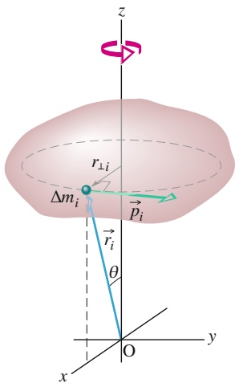

text_image

z
r⊥i
Δmᵢ
pᵢ
rᵢ
θ
O
x
y

(a)

Das von außen auf ein Teilchensystem wirkende resultierende Drehmoment $\vec { \tau } _ { \mathrm { g e s } }$ ist gleich der zeitlichen $\dot { \mathrm { A } }$ nderungsrate des Gesamtdrehimpulses $\vec { L }$ dieses Systems.

Gleichung 7.27 ist das „Rotationsanalogon“ von Gl. 5.19 $( \vec { F } _ { \mathrm { g e s } } = \mathrm { d } \vec { P } / \mathrm { d } t )$ . Achten Sie aber darauf, dass die Drehmomente und der Drehimpuls des Systems bezüglich desselben Punkts angegeben werden müssen! Solange der Schwerpunkt des Systems nicht relativ zu einem Inertialsystem beschleunigt wird, dürfen Sie den Bezugspunkt beliebig auswählen; anderenfalls muss der Schwerpunkt als Bezugspunkt verwendet werden. Betrachten wir beispielsweise ein Rad als Teilchensystem. Dreht sich das Rad um eine relativ zum Boden feste Achse, so kann als Bezugspunkt zur Anwendung von Gl. 7.27 jeder relativ zum Boden stationäre Punkt gewählt werden. Dreht sich das Rad hingegen um eine beschleunigte Achse (etwa beim Abrollen von einer geneigten Ebene), so müssen Sie den Schwerpunkt als Bezugspunkt wählen.

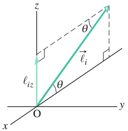

text_image

z
θ
ℓᵢₖ
θ
O
y
x

(b)

## 7.7.2 Der Drehimpuls eines rotierenden starren Körpers

Als Nächstes berechnen wir den Drehimpuls eines Teilchensystems, das einen starren, um eine feste Achse rotierenden Körper bildet. Einen solchen Körper zeigt Abb. 7.11a. Die feste Drehachse ist hier die z-Achse, um die der Körper mit der konstanten Winkelgeschwindigkeit ω rotiert. Gesucht ist der Drehimpuls des Körpers bezüglich dieser Achse.

Ein geeigneter Ansatz besteht darin, die z-Komponenten des Drehimpulses aller Massenelemente des Körpers zu addieren. In Abb. 7.11a wurde ein typisches Massenelement $\Delta m _ { i }$ ausgewählt, welches sich auf einer Kreisbahn um die z-Achse bewegt. Der Ort des Massenelements relativ zum Ursprung O ist durch den Ortsvektor $\vec { r } _ { i }$ gegeben. Der Radius der Kreisbahn des Elements ist gleich dessen senkrechtem Abstand zur z-Achse, $r _ { \perp i } .$

Den Betrag des Drehimpulses $\vec { \ell } _ { i }$ dieses Massenelements bezüglich O gibt Gl. 7.17 an:

$$
\ell_ {i} = r _ {i} p _ {i} (\sin 9 0 ^ {\circ}) = r _ {i} (\Delta m _ {i} \nu_ {i}).
$$

Hier sind $p _ { i }$ und $\nu _ { i }$ der lineare Impuls bzw. die lineare Geschwindigkeit des Massenelements, der Winkel zwischen $\vec { r } _ { i }$ und ${ \vec { p } } _ { i }$ beträgt 90°. Abbildung 7.11b zeigt den Drehimpulsvektor $\vec { \ell } _ { i }$ für das Massenelement in Abb. 7.11a; $\vec { \ell }$ muss senkrecht auf $\vec { r } _ { i }$ und $\vec { \vec { p } } _ { i }$ stehen.

Abb. 7.11 (a) Ein starrer Körper rotiert mit der Winkelgeschwindigkeit ω um die z-Achse. Ein Massenelement $\Delta m _ { i }$ des Körpers beschreibt eine Kreisbahn um die $z - \mathbf { A }$ chse mit dem Radius $r _ { \perp i } .$ Der Ort des Massenelements relativ zum Ursprung ist durch den Ortsvektor $\vec { r } _ { i }$ gegeben; das Massenelement besitzt den linearen Impuls ${ \vec { p } } _ { i }$ . Abgebildet ist das Massenelement in dem Augenblick, wenn $r _ { \perp i }$ parallel zur x-Achse ist. (b) Der Drehimpuls $\vec { \ell } _ { i }$ bezüglich O des Massenelements aus (a) sowie seine z-Komponente $\ell _ { i z } .$

TABELLE 7.1: Weitere Gleichungen für die Rotation und ihre Äquivalente für die Translation.

<table><tr><td colspan="2">Reine Translation</td><td colspan="2">Reine Rotation</td></tr><tr><td>Kraft</td><td> $\vec{F}$ </td><td>Drehmoment</td><td> $\vec{\tau} = \vec{r} \times \vec{F}$ </td></tr><tr><td>Linearer Impuls</td><td> $\vec{p}$ </td><td>Drehimpuls</td><td> $\vec{\ell} = \vec{r} \times \vec{p}$ </td></tr><tr><td> $Linearer\ Impuls^{a)}$ </td><td> $\vec{P} = \sum \vec{p}_{i}$ </td><td> $Drehimpuls^{a)}$ </td><td> $\vec{L} = \sum \vec{\ell}_{i}$ </td></tr><tr><td> $Linearer\ Impuls^{a)}$ </td><td> $\vec{P} = M\vec{\nu}_{S}$ </td><td> $Drehimpuls^{b)}$ </td><td> $L = I\omega$ </td></tr><tr><td>Zweites</td><td rowspan="2"> $\vec{F}_{ges} = \frac{d\vec{P}}{dt}$ </td><td>Zweites</td><td rowspan="2"> $\vec{\tau}_{ges} = \frac{d\vec{L}}{dt}$ </td></tr><tr><td> $Newtonsches\ Gesetz^{a)}$ </td><td> $Newtonsches\ Gesetz^{a)}$ </td></tr><tr><td> $Erhaltungssatz^{c)}$ </td><td> $\vec{P} = const.$ </td><td> $Erhaltungssatz^{c)}$ </td><td> $\vec{L} = const.$ </td></tr></table>

a) Für Teilchensysteme einschließlich starrer Körper.

b) Für einen starren Körper bezüglich einer festen Achse mit L als Komponente entlang dieser Achse.

c) Für ein geschlossenes, isoliertes System.

Wir suchen nun die Komponente von $\vec { \ell } _ { i }$ parallel zur Drehachse (hier der z-Achse), also die z-Komponente. Sie ist gegeben durch

$$
\ell_ {i z} = \ell_ {i} \sin \theta = (r _ {i} \sin \theta) (\Delta m _ {i} v _ {i}) = r _ {\perp i} \Delta m _ {i} v _ {i}.
$$

Die z-Komponente des Drehimpulses eines rotierenden starren Körpers ist gleich der Summe der Beiträge aller Massenelemente des Körpers. Mit $\nu = \omega r _ { \perp }$ gilt also

$$
\begin{array}{l} L _ {z} = \sum_ {i = 1} ^ {n} \ell_ {i z} = \sum_ {i = 1} ^ {n} \Delta m _ {i} v _ {i} r _ {\perp i} = \sum_ {i = 1} ^ {n} \Delta m _ {i} (\omega r _ {\perp i}) r _ {\perp i} \\ = \omega \left(\sum_ {i = 1} ^ {n} \Delta m _ {i} r _ {\perp i} ^ {2}\right). \tag {7.28} \\ \end{array}
$$

(Wir dürfen ω vor die Summe ziehen, weil der Wert von ω für alle Punkte des rotierenden starren Körpers gleich ist.)

Der Term $\textstyle \sum \Delta m _ { i } r _ { \perp i } ^ { 2 }$ in Gl. 7.28 ist das Trägheitsmoment I des Körpers um die feste Achse (siehe Gl. 6.23). Damit verkürzt sich Gl. 7.28 zu

$$
L = I \omega . \tag {7.29}
$$

Den Index z haben wir hier weggelassen, aber Sie dürfen nicht vergessen, dass sowohl der durch Gl. 7.29 definierte Drehimpuls als auch das auf der rechten Seite auftretende Trägheitsmoment bezüglich der z-Achse als Drehachse angegeben sind (und immer bezüglich derselben Achse formuliert werden müssen!).

In Ergänzung zu Tab. 6.1 und 6.3 fasst Tab. 7.1 weitere Gleichungen für die Rotation und ihre Äquivalente für die Translation zusammen.

## KONTROLLFRAGE 6

In der Skizze sehen Sie eine Scheibe, einen Ring und eine Kugel, die durch Ziehen an den (jeweils aufgewickelten) Bindfäden in Rotation um ihre mittlere Achse versetzt werden. Die Fäden üben auf alle drei Körper dieselbe tangentiale Kraft $\vec { F }$ aus. Alle Körper haben gleiche Massen und Radien und befinden sich zu Beginn in Ruhe. Ordnen Sie die Körper (a) nach dem Drehimpuls bezüglich der angegebenen Achsen und (b) nach ihrer Winkelgeschwindigkeit, nachdem eine Zeit t lang an den Fäden gezogen wurde.

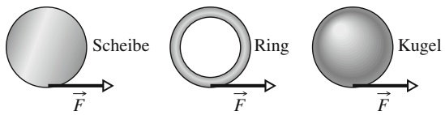

## 7.8 Die Erhaltung des Drehimpulses

## Lernziele

Nach dem Durcharbeiten dieses Abschnitts sollten Sie in der Lage sein, . . .

auf ein System ohne resultierendes äußeres Drehmoment bezüglich einer angegebenen Achse die Drehimpulserhaltung anzuwenden, um aus dem anfänglichen Drehimpuls des Systems bezüglich dieser Achse seinen Wert zu einem späteren Zeitpunkt zu berechnen.

## Schlüsselideen

• Der Drehimpuls $\vec { L }$ eines Systems bleibt konstant, wenn kein resultierendes äußeres Drehmoment auf das System wirkt:

$$
\vec {L} = \text {const.} \quad \text {oder} \quad \vec {L} _ {\mathrm{i}} = \vec {L} _ {\mathrm{f}}.
$$

Diese Aussage wird als Drehimpulserhaltungssatz bezeichnet.

## 7.8.1 Die Erhaltung des Drehimpulses

Wir haben bisher zwei überaus nützliche Erhaltungssätze kennengelernt, einen für die Energie und einen für den (linearen) Impuls. In diesem Abschnitt fügen wir den Satz von der Erhaltung des Drehimpulses hinzu. Dabei gehen wir von Gl. 7.27 aus $( \vec { \tau } _ { \mathrm { g e s } } = \mathrm { d } \vec { L } / \mathrm { d } t )$ , dem zweiten Newtonschen Gesetz in Winkelschreibweise. Wirkt auf das System kein äußeres Drehmoment, so wird aus dieser Gleichung $\mathrm { d } \vec { L } / \mathrm { d } t = 0$ oder

$$
\vec {L} = \text {const.} \quad (\text {isoliertes System}). \tag {7.30}
$$

Eine andere Formulierung dieses **Drehimpulserhaltungssatzes** lautet

$$
\binom{\text {resultierender Drehimpuls}}{\text {zum (früheren) Zeitpunkt t_{i}}} = \binom{\text {resultierender Drehimpuls}}{\text {zum (späteren) Zeitpunkt t_{f}}}
$$

oder

$$
\vec {L} _ {\mathrm{i}} = \vec {L} _ {\mathrm{f}} \quad (\text {isoliertes System}). \tag {7.31}
$$

In Worten ausgedrückt, besagen die Gln. 7.30 und 7.31:

Wirkt auf ein System kein äußeres Drehmoment, so ist der Drehimpuls $\vec { L }$ des Systems konstant, ungeachtet aller Prozesse, die innerhalb des Systems stattfinden.

In den Gln. 7.30 und 7.31 treten vektorielle Größen auf. Jede der Gleichungen ist deshalb äquivalent zu einem System aus drei Gleichungen für die Erhaltung des Drehimpulses entlang dreier aufeinander senkrecht stehender Achsen. In Abhängigkeit von den wirkenden Drehmomenten kann der Drehimpuls auch in nur einer oder zwei anstelle aller drei Raumrichtungen erhalten bleiben:

Ist die Komponente des resultierenden äußeren Drehmoments auf ein System entlang einer bestimmten Achse gleich null, so ist die Komponente des Drehimpulses dieses Systems entlang dieser Achse konstant, ungeachtet aller Prozesse, die innerhalb des Systems stattfinden.

Wir wollen diesen Satz auf den isolierten, um die z-Achse rotierenden Körper aus Abb. 7.11 anwenden. Nehmen wir an, während der Drehbewegung verteile sich die

Masse des anfangs starren Körpers relativ zur Rotationsachse in bestimmter Weise um, wodurch sich das Trägheitsmoment des Körpers bezüglich dieser Achse ändert. Der Drehimpuls des Körpers hingegen kann sich entsprechend den Gln. 7.30 und 7.31 nicht ändern. Setzen wir Gl. 7.29 (für den Drehimpuls entlang der Dreh achse) in Gl. 7.31 ein, so erhalten wir den Erhaltungssatz für den Drehimpuls in der Form:

$$
I _ {\mathrm{i}} \omega_ {\mathrm{i}} = I _ {\mathrm{f}} \omega_ {\mathrm{f}}. \tag {7.32}
$$

Die Indizes i und f beziehen sich hier auf die initialen und finalen Werte des Träg heitsmoments und der Winkelgeschwindigkeit, d. h. vor bzw. nach dem Umverteilen der Masse.

Wie auch die beiden anderen bisher behandelten Erhaltungssätze gilt die Drehimpulserhaltung (Gln. 7.30 und 7.31) über die Grenzen der Newtonschen Mechanik hinaus, z. B. für Teilchen, deren Geschwindigkeit der Lichtgeschwindigkeit nahekommt (und die deshalb mithilfe der Relativitätstheorie beschrieben werden müssen), und für Teilchen subatomarer Dimension (die den Gesetzen der Quantenphysik unterworfen sind). Bis heute wurde kein Fall bekannt, in dem die Drehimpulserhaltung verletzt würde.

Zur Veranschaulichung der Drehimpulserhaltung diskutieren wir im Folgenden vier Beispiele.

## 1. Eine Person auf einem Drehstuhl

In Abb. 7.12 sehen Sie einen jungen Mann auf einem Drehstuhl, der ungehindert um seine vertikale Längsachse rotieren kann. In den ausgestreckten Händen hält er zwei Hanteln. Der Drehimpulsvektor $\vec { L }$ zeigt entlang der senkrechten Drehachse nach oben. Durch vorsichtiges Anstoßen wird der Mann auf eine mäßige Anfangswinkelgeschwindigkeit $\omega _ { \mathrm { i } }$ beschleunigt.

Nun zieht der Mann seine Arme an, wodurch sein Trägheitsmoment vom Anfangswert $I _ { \mathrm { i } }$ auf einen Wert $I _ { \mathrm { f } }$ absinkt, weil sich jetzt mehr Masse in der Nähe der Drehachse befindet. Gleichzeitig nimmt die Winkelgeschwindigkeit deutlich zu (von $\omega _ { \mathrm { i } }$ auf $\omega _ { \mathrm { f } } )$ . Um die Rotation zu verzögern, streckt der Mann die Arme wieder aus.

Warum ändert sich die Drehgeschwindigkeit? Auf das System Mann–Stuhl– Hanteln wirkt kein äußeres Drehmoment. Der Drehimpuls des Systems bezüg lich der angegebenen Achse muss deshalb konstant bleiben, gleichgültig, welche Bewegungen der Mann mit den Hanteln ausführt. In Abb. 7.12a ist die Winkelgeschwindigkeit $\omega _ { \mathrm { i } }$ des Mannes relativ gering und sein Trägheitsmoment relativ hoch. Gemäß Gl. 7.32 muss die Winkelgeschwindigkeit in Abb. 7.12b größer sein, um das reduzierte Trägheitsmoment zu kompensieren.

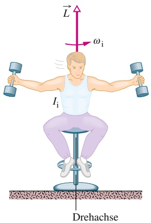

text_image

L
ωi
Ii
Drehachse

(a)

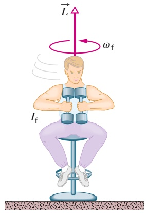

text_image

L
ωf
If

(b)

## Abb. 7.12

(a) Das Trägheitsmoment des Mannes bezüglich der senkrechten Achse ist relativ groß, die Winkelgeschwindigkeit relativ gering. (b) Indem er das Trägheitsmoment absenkt, erhöht er seine Winkelgeschwindigkeit: Der Drehimpuls L⃗ des rotierenden Systems bleibt konstant.

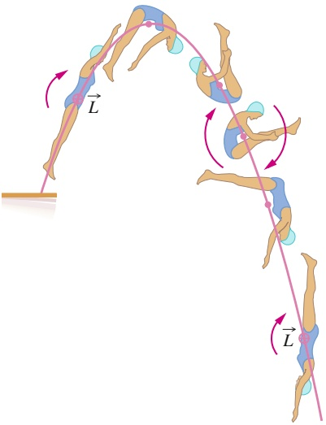

text_image

Diagram illustrating a dynamic path with labeled vectors L and directional arrows, showing movement around two human figures.

Abb. 7.13

Der Drehimpuls L⃗ der Springerin, dargestellt durch das Symbol ⊕ (einen in die Papierebene hineinzeigenden Pfeil), bleibt während der Flugphase konstant. Der Schwerpunkt (durch Punkte angedeutet) beschreibt eine Parabel.

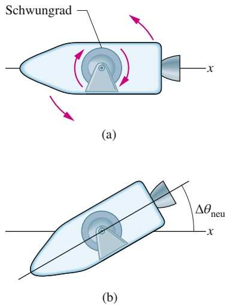

Abb. 7.14

(a) Stark vereinfachte Skizze eines Raumschiffs mit eingebautem Schwungrad. Wird das Rad wie dargestellt in Rotation (im Uhrzeigersinn) versetzt, so dreht sich das Raumschiff in entgegengesetzter Richtung (gegen den Uhrzeigersinn). (b) Wenn das Rad zum Stillstand gebracht wird, hört auch das Raumschiff auf, sich zu drehen, verbleibt aber in der neuen Orientierung, welche im Winkel $\Delta \theta _ { \mathrm { n e u } }$ zur alten Ausrichtung steht.

## 2. Ein Turmspringer

Abbildung 7.13 zeigt den Bewegungsablauf einer Turmspringerin bei einem anderthalbfachen Salto vorwärts. Wie Sie sicherlich erwarten, beschreibt der Schwerpunkt der Sportlerin eine parabelförmige Bahn. Beim Absprung besitzt die Springerin einen definierten Drehimpuls $\overrightarrow { \bar { L } }$ bezüglich einer Achse durch ihren Schwerpunkt, in Abb. 7.13 dargestellt durch einen Vektor, der senkrecht in die Abbildungsebene hineinzeigt. Während sich die Springerin in der Luft befindet, wirkt kein äußeres Drehmoment bezüglich ihres Schwerpunkts auf sie; folglich muss ihr Drehimpuls konstant bleiben. Indem sie Arme und Beine wie ein Taschenmesser zusammenklappt, kann die Sportlerin ihr Trägheitsmoment bezüglich der Drehachse deutlich herabsetzen, wodurch ihre Winkelgeschwindigkeit zunimmt (siehe Gl. 7.32). Am Ende des Sprungs streckt sich die Springerin wieder lang aus, das Trägheitsmoment erhöht sich, die Winkelgeschwindigkeit nimmt ab und das Eintauchen erfolgt mit möglichst wenigen Spritzern. Die Erhaltung des Drehimpulses (in Betrag und Richtung) gilt natürlich auch bei komplizierteren Sprüngen, die außer Saltos auch Schraubenbewegungen beinhalten.

## 3. Die Lenkung eines Raumschiffs

Abbildung 7.14 zeigt die Skizze eines Raumschiffs mit starr eingebautem Schwungrad, welche das Funktionsprinzip einer (sehr einfachen) Lenkung für ein Raumschiff illustriert: Das System Raumschiff–Schwungrad ist isoliert. Ist also der Drehimpuls $\vec { L }$ des Systems gleich null, weil sich weder das Raumschiff noch das Schwungrad dreht, so muss er bei allen Manövern null bleiben (solange das System isoliert bleibt).

Um die Flugrichtung des Raumschiffs zu ändern, wird das Schwungrad in Ro tation versetzt (Abb. 7.14a). Damit L⃗ null bleibt, beginnt sich das Raumschiff in der entgegengesetzten Richtung zu drehen. Wird das Schwungrad nun wieder angehalten, so hört auch das Raumschiff auf, sich zu drehen, aber es verbleibt in der neuen Orientierung (Abb. 7.14b). Während des gesamten Vorgangs ist der Drehimpuls des Systems Raumschiff–Schwungrad stets gleich null.

Bei ihrem Vorbeiflug am Planeten Uranus 1986 wurde die Raumsonde Voyager 2 durch einen ähnlichen Effekt immer dann in unerwünschte Rotation versetzt, wenn an Bord bei hoher Geschwindigkeit ein Kassettenrecorder eingeschaltet wurde. Das Bodenpersonal im Antriebslabor musste daraufhin den Bordcomputer so umprogrammieren, dass gleichzeitig mit dem Ein- oder Ausschalten des Recorders ein kurzer Schub der Triebwerke ausgelöst wurde, der diese ungewollte Rotation ausglich.

## 4. Ein Neutronenstern

Ist der Kernbrennstoff im Inneren eines Sterns nahezu verbraucht, so kann der Stern zusammenfallen – unter Umständen so weit, dass sein Radius von Dimensionen ähnlich denen der Sonne bis auf den unglaublich geringen Wert von wenigen Kilometern abnimmt. Dabei baut sich innerhalb des Sterns ein enormer Druck auf, und seine Bestandteile werden zu einem überwiegend aus Neutronen bestehenden Quantengas ungeheuer hoher Dichte komprimiert. Ein Neutronenstern ist entstanden.

Während dieses Kollapses ist der Stern ein isoliertes System, folglich kann sich sein Drehimpuls L⃗ nicht ändern. Da das Trägheitsmoment außerordentlich stark abnimmt, muss seine Winkelgeschwindigkeit entsprechend rasant ansteigen. Manche Neutronensterne rotieren 600- bis 800-mal in der Sekunde – unsere Sonne, ein typischer Stern, dreht sich in dreieinhalb Wochen einmal um sich selbst!

## KONTROLLFRAGE 7

Ein Insekt fährt auf dem Rand einer kleinen Scheibe Karussell. Nun krabbelt es in Richtung des Mittelpunkts der Scheibe. Nehmen dabei die folgenden Größen (jeweils relativ zur Drehachse) zu, ab oder bleiben sie gleich? (a) Trägheitsmoment des Systems Insekt–Scheibe, (b) Drehimpuls des Systems Insekt–Scheibe, (c) Winkelgeschwindigkeit des Insekts und der Scheibe.

## 7.9 Die Präzession eines Kreisels

## Lernziele

Nach dem Durcharbeiten dieses Abschnitts sollten Sie in der Lage sein, . . .

• zu verstehen, dass die auf einen rotierenden Kreisel wirkende Gravitationskraft bewirkt, dass sich der Drehimpulsvektor (und damit der Kreisel) in einer als Präzession bezeichneten Bewegung um seine vertikale Achse dreht,
• die Präzessionsgeschwindigkeit eines Kreisels zu berechnen,
• zu verstehen, dass die Präzessionsgeschwindigkeit eines Kreisels nicht von seiner Masse abhängt.

## Schlüsselideen

• Ein rotierender Kreisel präzediert mit der Geschwindigkeit

$$
\Omega = \frac {M g r}{I \omega}
$$

um eine vertikale Achse durch seinen Auflagepunkt, wenn die Gravitationskraft $M \vec { g }$ auf ihn einwirkt. Dabei sind M die Masse des Kreisels, r der Hebelarm, I das Trägheitsmoment und ω die Winkelgeschwindigkeit des Kreisels.

## 7.9.1 Die Präzession eines Kreisels

Ein einfacher Kreisel besteht aus einem Rad, das an einer Welle befestigt ist und frei um eine Drehachse in Richtung dieser Welle rotieren kann. Wenn ein Ende der Welle eines nicht rotierenden Kreisels wie in Abb. 7.15a auf einen Auflagepunkt gesetzt und der Kreisel losgelassen wird, fällt der Kreisel durch eine Rotation um den Auflagepunkt um. Da es sich bei diesem Umfallen um eine Rotation handelt, wird sie durch das zweite Newtonsche Gesetz in Winkelschreibweise beschrieben, also durch Gl. 7.27:

$$
\vec {\tau} = \frac {\mathrm{d} \vec {L}}{\mathrm{d} t}. \tag {7.33}
$$

Diese Gleichung besagt, dass das Drehmoment, das die Drehung (das Umfallen) bewirkt, den Drehimpuls $\vec { L }$ des Kreisels von seinem anfänglichen Wert von null verändert. Das Drehmoment ist auf die im Schwerpunkt des Kreisels (der im Zentrum des Rads liegen soll) wirkende Schwerkraft zurückzuführen. Der Hebelarm bezogen auf den Auflagepunkt (O in Abb. 7.15a) ist ⃗r. Da der Winkel zwischen $M \vec { g }$ und $\tilde { \vec { r } }   9 0 ^ { \circ }$ beträgt, ist sein Betrag

$$
\tau = M g r \sin 90^\circ = M g r \tag{7.34}
$$

und seine Richtung ist wie in Abb. 7.15a gezeigt.

Ein rotierender Kreisel verhält sich anders. Wir nehmen zunächst an, dass seine Drehachse im Moment des Loslassens ein wenig nach oben gerichtet ist. In diesem Fall wird er sich nach dem Loslassen zwar zunächst etwas nach unten bewegen, aber dann – während er weiterhin um seine Drehachse rotiert – wird seine Drehachse und damit sein Drehimpulsvektor beginnen, horizontal um eine vertikale Achse durch den Auflagepunkt O zu rotieren. Diese Bewegung wird als Präzession bezeichnet.

Warum kippt er nicht einfach um? Wie schafft es der rotierende Kreisel, sich in der Schwebe zu halten, während der ruhende Kreisel einfach umfällt? Der entscheidende Unterschied zwischen beiden Fällen ist, dass das Drehmoment aufgrund der Schwerkraft $M \vec { g }$ im Fall des rotierenden Kreisels nicht auf einen anfänglichen Drehimpuls von null trifft, den es zu ändern gilt, sondern auf einen von null ver schiedenen Drehimpuls, da der Kreisel ja bereits rotiert.

Um zu sehen, wie dieser von null verschiedene Anfangsdrehimpuls zu einer Prä- zession führt, betrachten wir zunächst den Drehimpuls $\vec { L }$ des Kreisels aufgrund

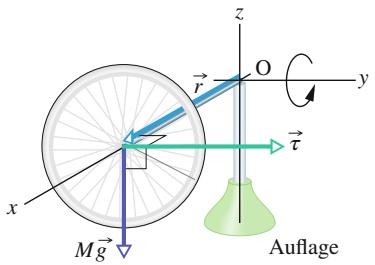

text_image

z
O
y
τ
x
Mg
Auflage

(a)

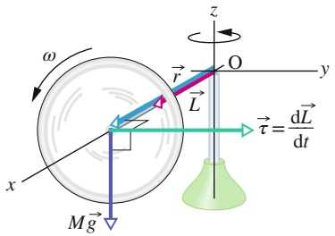

text_image

ω
x
Mg
r
L
O
z
y
τ̇ = dL/dt

(b)

Kreisbahn der Spitze des Drehimpulsvektors

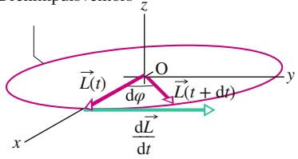

text_image

z
O
dφ
L(t)
L(t + dt)
y
x
dL/dt

(c)

## Abb. 7.15

(a) Ein ruhender Kreisel fällt aufgrund des Drehmoments τ⃗ durch eine Rotation in der xz-Ebene um. (b) Ein schnell rotierender Kreisel mit dem Drehimpuls $\vec { L }$ präzediert um die z-Achse. Die Präzession findet in der xy-Ebene statt. (c) Die zeitliche Veränderung $\mathrm { d } \vec { L } / \mathrm { d } t$ des Drehimpulses bewirkt eine Rotation von $\vec { L }$ um O.

seiner Rotation um die eigene Längsachse. Um die Situation zu vereinfachen, nehmen wir an, dass seine Rotation so schnell ist, dass der zusätzliche Drehimpuls infolge der Präzession gegenüber $\vec { L }$ vernachlässigbar ist. Außerdem nehmen wir an, dass die Drehachse des Kreisels zu Beginn der Präzession horizontal liegt, wie in Abb. 7.15b gezeigt. Der Betrag von $\vec { L }$ ist durch Gl. 7.29 gegeben,

$$
L = I \omega , \tag {7.35}
$$

wobei I das Trägheitsmoment des Kreisels um seine Drehachse ist und ω die Winkelgeschwindigkeit seiner Rotation um diese Achse. Der Vektor $\vec { L }$ zeigt wie in Abb. 7.15b parallel zur Welle bzw. zur Drehachse. Da $\vec { L }$ parallel zu $\vec { r }$ ist, muss das Drehmoment $\vec { \tau }$ senkrecht auf $\vec { L }$ stehen.

Nach Gl. 7.33 bewirkt das Drehmoment $\vec { \tau }$ in einem infinitesimalen Zeitintervall dt eine infinitesimale $\ddot { \mathrm { A } }$ nderung $\mathrm { d } \vec { L }$ des Drehimpulses des Kreisels, also

$$
\mathrm{d} \vec {L} = \vec {\tau} \mathrm{d} t. \tag {7.36}
$$

Für einen schnell rotierenden Kreisel ist der Betrag von $\vec { L }$ aber durch Gl. 7.35 vorgegeben, daher kann das Drehmoment nur die Richtung von $\vec { L }$ ändern, nicht aber seinen Betrag.

Aus Gl. 7.36 erkennen wir, dass $\mathrm { d } \vec { L }$ in Richtung von $\vec { \tau }$ zeigt, also senkrecht zu $\vec { L } .$ Die einzige Möglichkeit, $\dot { \vec { L } }$ in Richtung von $\vec { \tau }$ zu ändern, ohne dabei auch seinen Betrag $L$ zu verändern, ist eine Rotation der Kreiselachse um die $z - \mathrm { A }$ chse wie in Abb. 7.15c. So behält $\vec { L }$ seinen Betrag, während die Spitze des Vektors $\vec { L }$ eine Kreisbahn beschreibt und $\vec { \tau }$ zu jedem Zeitpunkt tangential zu dieser Bahn zeigt. Da $\vec { L }$ immer in Richtung der Drehachse des Kreisels zeigen muss, muss sich also auch diese Drehachse in Richtung von $\vec { \tau }$ um die z-Achse drehen. So entsteht die Präzession: Der rotierende Kreisel muss als Reaktion auf eine Änderung seines anfänglichen Drehimpulses dem zweiten Newtonschen Gesetz in Winkelschreibweise gehorchen und präzedieren, anstatt einfach nur umzufallen.

Die Geschwindigkeit der Präzession können wir bestimmen, indem wir zuerst mithilfe der Gln. 7.36 und 7.34 den Betrag von $\mathrm { d } \vec { L }$ berechnen:

$$
\mathrm{d} L = \tau \mathrm{d} t = M g r \mathrm{d} t. \tag {7.37}
$$

Wenn sich $\vec { L }$ innerhalb eines Zeitintervalls dt um einen infinitesimalen Betrag $\mathrm { d } \vec { L }$ ändert, präzediert die Drehachse $\vec { L }$ um einen infinitesimalen Winkel d𝜑 um die z-Achse. (In Abb. 7.15c ist der Winkel d𝜑 zur Verdeutlichung übertrieben dargestellt.) Mithilfe der Gln. 7.35 und 7.37 erhalten wir für d𝜑

$$
\mathrm{d} \varphi = \frac {\mathrm{d} L}{L} = \frac {M G r \mathrm{d} t}{I \omega}.
$$

Wir dividieren diesen Ausdruck durch dt und setzen die Präzessionsgeschwindig keit $\mathrm { d } \Omega = \mathrm { d } \varphi / \mathrm { d } t$ ein und gelangen so schließlich zu dem Ergebnis

$$
\Omega = \frac {M g r}{I \omega}. \tag {7.38}
$$

Dieses Ergebnis gilt, wie bereits gesagt, unter der vereinfachenden Annahme, dass die Rotationsgeschwindigkeit ω groß ist. Wenn ω zunimmt, nimmt Ω ab. Interessanterweise hängt $\Omega$ nicht von der Masse des Kreisels ab, weil sich M aufgrund der Massenabhängigkeit von $I$ aus dem Ausdruck in Gl. 7.38 herauskürzt, – und das, obwohl die Präzession überhaupt nur deshalb auftritt, weil die Schwerkraft $M \vec { g }$ auf den Kreisel wirkt.

Gleichung 7.38 gilt auch, wenn die Welle bzw. Drehachse des Kreisels schräg zur Horizontalen steht.

## 7.10 Zusammenfassung

**Die Rollbewegung** Für ein rollendes (und dabei nicht gleitendes) Rad mit dem Radius R gilt

$$
\nu_ {\mathrm{S}} = \omega R \tag {7.2}
$$

mit $\nu _ { S }$ als linearer Geschwindigkeit der Mitte des Rads und ω als Winkelgeschwindigkeit des Rads bei der Rotation um seinen Mittelpunkt. Alternativ kann das Rollen eines Rads auch als momentane Rotation um den Berührungspunkt P zwischen Rad und Untergrund beschrieben werden. Die Winkelgeschwindigkeit des Rads bezüglich seines Mittelpunkts ist gleich der Winkelgeschwindigkeit bezüglich P. Die kinetische Energie eines rollenden Rads ist

$$
K = \frac {1}{2} I _ {\mathrm{S}} \omega^ {2} + \frac {1}{2} M \nu_ {\mathrm{S}} ^ {2}, \tag {7.5}
$$

mit $I _ { \mathrm { S } }$ als Trägheitsmoment des Rads bei der Rotation um seinen Mittelpunkt und M als Masse des Rads. Wird das Rad bei einer reinen (gleitfreien) Rollbewegung beschleunigt, so lautet die Beziehung zwischen der Beschleunigung des Schwerpunkts ${ \vec { a } } _ { S }$ und der Winkelbeschleunigung α bezüglich des Mittelpunkts des Rads

$$
a _ {S} = \alpha R. \tag {7.6}
$$

Rollt das Rad ohne zu gleiten eine Ebene hinab, die um den Winkel θ bezüglich der Waagerechten geneigt ist, so ist seine Beschleunigung entlang einer die Rampe aufwärts gerichteten x-Achse gleich:

$$
a _ {\mathrm{S}, x} = - \frac {g \sin \theta}{1 + I _ {\mathrm{S}} / (M R ^ {2})}. \tag {7.10}
$$

**Das Drehmoment als Vektor** Das Drehmoment τ⃗ ist eine in den drei Raumrichtungen relativ zu einem festen Punkt (in der Regel dem Ursprung des Koordinatensystems) definierte vektorielle Größe:

$$
\vec {\tau} = \vec {r} \times \vec {F}. \tag {7.12}
$$

$\vec { F }$ ist dabei eine an dem betreffenden Massepunkt (Teilchen) angreifende Kraft und $\vec { r }$ der zu diesem Massepunkt gehörende Ortsvektor bezüglich des erwähnten festen Punkts. Der Betrag von τ⃗ ist gegeben durch

$$
\tau = r F \sin \varphi = r F _ {\perp} = r _ {\perp} F \tag {7.13,7.15}
$$

mit $\varphi$ als Winkel zwischen den Richtungen von $\vec { F }$ und ⃗r, $F _ { \perp }$ als Komponente von $\vec { F }$ senkrecht zu $\vec { r }$ und $r _ { \perp }$ als Hebelarm von $\vec { F } .$ Die Richtung von $\vec { r }$ erhält man mithilfe der Rechte-Hand-Regel für Kreuzprodukte von Vektoren.

**Der Drehimpuls eines Teilchens** Der Drehimpuls $\vec { \ell }$ eines Teilchens mit dem linearen Impuls $\vec { p } ,$ der Masse m und der linearen Geschwindigkeit v⃗ ist eine vektorielle Größe, definiert relativ zu einem Bezugspunkt (in der Regel dem Ursprung des gewählten Koordinatensystems):

$$
\vec {\ell} = \vec {r} \times \vec {p} = m (\vec {r} \times \vec {v}). \tag {7.16}
$$

Der Betrag von $\vec { \ell }$ ist gegeben durch folgende Beziehungen:

$$
\ell = r m \nu \sin \varphi , \tag {7.17}
$$

$$
\ell = r p _ {\perp} = r m v _ {\perp}, \tag {7.18}
$$

$$
\ell = r _ {\perp} p = r _ {\perp} m \nu . \tag {7.19}
$$

Hier sind 𝜑 der Winkel zwischen den Richtungen von $\vec { r }$ und ⃗p, $p _ { \perp }$ und $\nu _ { \perp }$ die Komponenten von $\vec { p }$ bzw. ⃗v senkrecht zu $\vec { r }$ und $r _ { \perp }$ der senkrechte Abstand zwischen dem Bezugspunkt und der Verlängerung der Richtung von $\vec { p } .$ Die Richtung von $\vec { \ell }$ ergibt sich durch Anwendung der Rechte-Hand-Regel für Kreuzprodukte von Vektoren.

**Das zweite Newtonsche Gesetz in Winkelschreibweise** Formuliert mit winkelabhängigen Größen lautet das zweite Newtonsche Gesetz für ein Teilchen

$$
\vec {\tau} _ {\mathrm{ges}} = \frac {\mathrm{d} \vec {\ell}}{\mathrm{d} t} \tag {7.21}
$$

mit $\vec { \tau } _ { \mathrm { g e s } }$ als dem resultierenden auf das Teilchen wirkenden Drehmoment und $\vec { \ell }$ als seinem Drehimpuls.

**Der Drehimpuls eines Teilchensystems** Der Drehimpuls L⃗ eines Systems von Teilchen ergibt sich als Vektorsumme der Drehimpulse aller einzelnen Teilchen:

$$
\vec {L} = \vec {\ell} _ {1} + \vec {\ell} _ {2} + \dots + \vec {\ell} _ {n} = \sum_ {i = 1} ^ {n} \vec {\ell} _ {i}. \tag {7.24}
$$

Die zeitliche $\ddot { \mathrm { A } }$ nderungsrate dieses Drehimpulses ist gleich dem resultierenden von außen auf das System wirkenden Drehmoment (der Vektorsumme aller Drehmomente, die sich durch Wechselwirkung zwischen Teilchen des Systems und Teilchen außerhalb des Systems ergeben):

$$
\vec {\tau} _ {\mathrm{ges}} = \frac {\mathrm{d} \vec {L}}{\mathrm{d} t}. \tag {7.27}
$$

**Drehimpuls eines starren Körpers** Die Komponente des Drehimpulses eines starren, um eine feste Achse rotierenden Körpers parallel zur Drehachse ist gegeben durch

$$
L = I \omega . \tag {7.29}
$$

**Die Erhaltung des Drehimpulses** Der Drehimpuls L⃗ eines Systems bleibt konstant, wenn das resultierende von außen wirkende Drehmoment null ist:

$$
\vec {L} = \text {const.} \quad \text {(isoliertes System)} \tag {7.30}
$$

oder

$$
\vec {L} _ {\mathrm{i}} = \vec {L} _ {\mathrm{f}} \quad (\text {isoliertes System}). \tag {7.31}
$$

Dieser **Drehimpulserhaltungssatz** gehört zu den grundlegenden Erhaltungssätzen der Natur, dessen Gültigkeit sogar in Situationen bestätigt wurde, in denen die Newtonschen Gesetze nicht angewendet werden können (z. B. bei Wechselwirkungen zwischen extrem beschleunigten oder subatomaren Teilchen).

**Präzession eines Kreisels** Ein rotierender Kreisel präzediert unter dem Einfluss der Gravitationskraft Mg⃗ mit der Geschwindigkeit

$$
\Omega = \frac {M g r}{I \omega} \tag {7.38}
$$

um eine vertikale Achse durch seinen Auflagepunkt, wobei M die Masse des Kreisels ist, r der Hebelarm, I das Trägheitsmoment und ω seine Rotationsgeschwindigkeit.

## 7.11 Fragen

**1.** In Abb. 7.F1 sehen Sie zwei Situationen dargestellt: Ein Quader gleitet eine um den Winkel θ gegen die Waagerechte geneigte Ebene hinab; eine Kugel rollt ohne zu gleiten eine ebensolche Ebene hinunter. Quader und Kugel sind gleich schwer und bewegen sich jeweils aus der Ruhelage (Punkt A) durch einen tiefer gelegenen Punkt B. (a) Verrichtet die Gravitationskraft bei der Abwärtsbewegung von A nach B an dem Quader eine größere, eine geringere oder gleiche Arbeit wie an der Kugel? Welches Objekt hat in B (b) die größere kinetische Energie der Translation und (c) die höhere Geschwindigkeit abwärts?

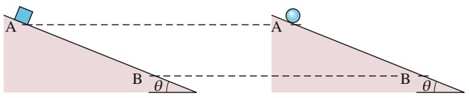

text_image

A
B
θ
A
B
θ

Abb. 7.F1

**2.** Eine Kanonenkugel rollt ohne zu gleiten einen Hang hinab. Anschließend rollt sie einen zweiten, ebenso hohen, aber weniger steilen Hang hinunter. Ist (a) die Zeit, in der die Kugel den Fuß des Hangs erreicht, und (b) die kinetische Energie der Kugel am Fuß des Hangs im zweiten Fall größer als, kleiner als oder ebenso groß wie im ersten?
**3.** In Abb. 7.F3 sehen Sie eine Frau, die mithilfe eines Bretts eine zylindrische Tonne vor sich herschiebt. Die Tonne bewegt sich ohne zu gleiten oder zu springen um die Strecke $L / 2 ,$ die Länge des Bretts ist $L ;$ das Brett rutscht nicht über die Tonne. (a) Über welche Länge rollt das Brett auf dem höchsten Punkt der Tonne? (b) Wie weit läuft die Frau?

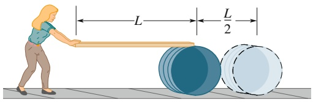

text_image

L
L/2

Abb. 7.F3

**4.** Der Betrag des Ortsvektors $\vec { r }$ eines Teilchens relativ zu einem festen Punkt ist gleich 3 m, der Betrag der auf das Teilchen wirkenden Kraft $\vec { F }$ ist 4 N. Wie groß ist der Winkel zwischen den Richtungen von ⃗r und $\vec { F } ,$ wenn der Betrag des zugehörigen Drehmoments (a) gleich null und (b) gleich 12 N ⋅ m ist?
**5.** In Abb. 7.F5 sehen Sie ein Koordinatensystem, in das fünf Punkte mit den zugehörigen Koordinaten (x, y)eingetragen sind, außerdem ein Teilchen, das sich mit der konstanten Geschwindigkeit v⃗ bewegt. Ordnen Sie die Punkte nach dem Betrag des relativ zu jedem von ihnen gemessenen Drehimpulses des Teilchens, beginnend mit dem größten Wert.

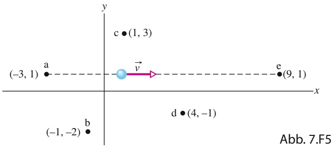

text_image

y
c • (1, 3)
(-3, 1) a
→
v
e • (9, 1)
x
d • (4, -1)
-1, -2) b
Abb. 7.F5

**6.** Kehren wir noch einmal zurück zu Kontrollfrage 4. (a) Welches Drehmoment auf die Teilchen 1 und 2 bezüglich des Punkts O verursachen die Zentripetalkräfte, die für die gleichförmige (mit konstantem Geschwindigkeitsbetrag verlaufende) Kreisbewegung der Teilchen verantwortlich sind? (b) Nehmen die Drehimpulse der Teilchen 3, 4 und 5 bei einer Bewegung von links nach rechts durch O zu, ab oder bleiben sie gleich?
**7.** In Abb. 7.F7 sehen Sie drei gleich schwere Teilchen, die sich mit der gleichen konstanten Geschwindigkeit in die durch die Vektoren angegebenen Richtungen bewegen. Die Punkte a, b, c und d liegen auf den Ecken eines Quadrats, Punkt e ist dessen Mittelpunkt. Ordnen Sie die Punkte nach dem relativ zu ihnen gemessenen resultierenden Drehimpuls des Dreiteilchensystems, beginnend mit dem größten Wert.

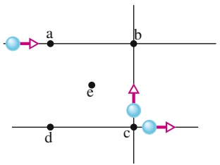

text_image

a
b
e
d
c

Abb. 7.F7

**8.** Das Bola genannte Wurfgerät der südamerikanischen Gauchos besteht aus drei schweren Kugeln, die an gleich langen, in einem Punkt zusammenlaufenden kräftigen Seilen befestigt sind (siehe Abb. 7.F8). Man hält die Bola an einer Kugel über den Kopf und dreht das Handgelenk $\mathbf { \mathit { S } } \mathbf { \mathit { \mathbf { 0 } } } ,$ dass die anderen beiden Kugeln in einer waagerechten Kreisbahn um die Hand zu rotieren beginnen (Abb. 7.F8a). Dann lässt man die Bola los, woraufhin es sich sofort wie in Abb. 7.F8b (Draufsicht) gezeigt anordnet. Die Drehachse verläuft also zu Beginn durch die fest gehaltene

Kugel (Achse 1), anschließend durch den Schwerpunkt des Systems (Achse 2). Ist (a) der Drehimpuls und (b) die Winkelgeschwindigkeit bezüglich Achse 2 größer als, kleiner als oder ebenso groß wie bezüglich Achse 1?

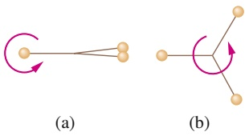

chemical

Two molecular diagrams labeled (a) and (b), showing conformational or structural relationships with directional arrows

Abb. 7.F8

**9.** Ein Käfer sitzt auf dem Rand einer waagerechten, gegen den Uhrzeigersinn rotierenden Scheibe. Plötzlich beginnt er, in Drehrichtung auf dem Rand entlangzulaufen. Werden dabei die Beträge der folgenden Größen kleiner, grö- ßer oder bleiben sie gleich? (a) Drehimpuls des Systems Kä- fer–Scheibe, (b) Drehimpuls und Winkelgeschwindigkeit des Käfers, (c) Drehimpuls und Winkelgeschwindigkeit der Scheibe. (d) Wie lauten Ihre Antworten auf die Teilfragen (a) bis (c), wenn sich der Käfer entgegengesetzt der Drehrichtung bewegt?

**10.** Abbildung 7.F10 zeigt eine rechteckige Platte in Draufsicht, die sich wie ein Karussell um ihren Mittelpunkt O drehen kann. Eingezeichnet sind sieben Wege, auf denen Kugeln (gleicher Masse) aus Knete mit immer der gleichen Geschwindigkeit gegen die ruhende Platte geworfen werden, wo sie dann haften bleiben. (a) Ordnen Sie die Wege nach der Winkelgeschwindigkeit des Systems Knete–Plat-

te nach dem Auftreffen der jeweiligen Kugel, beginnend mit dem größten Wert. (b) Für welche Wege ergibt sich ein negativer Drehimpuls des Systems Knete–Platte bezüglich O aus Blickrichtung von Abb. 7.F10?

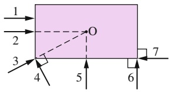

text_image

1
2
3
4
5
6
7
O

Abb. 7.F10

**11.** In Abb. 7.F11 sehen Sie drei Kräfte gleichen Betrags, die auf ein Teilchen im Ursprung des Koordinatensystems wirken $( \vec { F } _ { 1 }$ zeigt in die Abbildungsebene hinein). Ordnen Sie die Kräfte nach den Drehmomenten, die sie bezüglich (a) Punkt $\mathrm { P } _ { 1 }$ , (b) Punkt $\mathrm { P } _ { 2 }$ und (c) Punkt $\mathrm { P } _ { 3 }$ erzeugen, beginnend mit dem größten Wert.

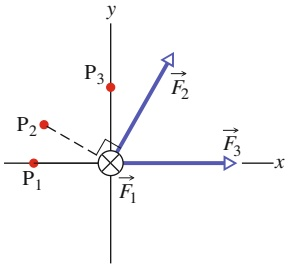

text_image

y
P₃
F₂
P₂
P₁
×
F₁
F₃
x

Abb. 7.F11

**12.** In Abb. 7.F12 wurden zwei Teilchen A und B mit den Koordinaten $( x ,   y , z ) = ( 1   m , 1   m , 0 )$ und $( 1   m , 0 , 1   m )$ eingezeichnet. Auf jedes Teilchen wirken drei nummerierte Kräfte, alle gleichen Betrags und parallel zu je einer Koordinatenachse gerich-

tet. (a) Welche Kräfte erzeugen ein Drehmoment bezüglich des Ursprungs, welches parallel zur y-Achse gerichtet ist? (b) Ordnen Sie die Kräfte nach den Beträgen der Drehmomente, die sie bezüglich des Ursprungs auf die Teilchen erzeugen, beginnend mit dem größten Wert.

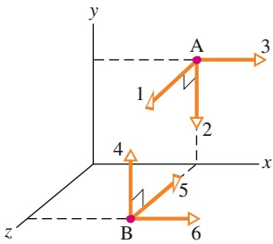

text_image

y
A
3
1
2
4
x
5
z
B
6

Abb. 7.F12

**13.** Betrachten wir noch einmal Abb. 6.F7: Drei kleine Ku geln gleicher Masse sind in den angegebenen Abständen an einem masselosen Stab befestigt. Mit einer Winkelgeschwindigkeit von 3,0 rad/s rotiert diese Anordnung um eine Achse, die senkrecht auf der Papierebene steht und durch eine der Kugeln verläuft. Wie Sie sofort feststellen werden, gibt es drei Möglichkeiten, eine solche Achse festzulegen. Ordnen Sie diese Alternativen (a) nach dem Betrag des Drehimpulses der Anordnung bezüglich der gewählten Achse und (b) nach der kinetischen Rotationsenergie der Anordnung, beginnend jeweils mit dem größten Wert.

**14.** Was geschieht, wenn man an dem zu Beginn ruhenden Jo-Jo in Abb. 7.F14 mit der Kraft (a) $\vec { \bar { F } } _ { 2 } ^ { \smile }$ (die Richtung der Kraft verläuft durch den Kontaktpunkt auf dem Tisch), (b) ${ \vec { F } } _ { 1 }$ (die Richtung der Kraft verläuft oberhalb des Kontaktpunkts) und (c) $\vec { F } _ { 3 } ^ { \mathrm { ~   ~ } }$ (die Richtung der Kraft verläuft rechts des Kontaktpunkts) an der Schnur zieht?

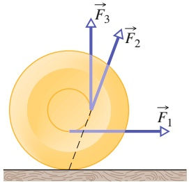

text_image

Diagram showing three force vectors (F1, F2, F3) acting on a circular object with a dashed line indicating direction.

Abb. 7.F14

**15.** Die Drehimpulse 𝓁(t) eines Teilchens in vier Situationen sind (1 $1) $\ell = 3 t + 4 ,$ (2) $\ell = - 6 t ^ { 2 } ,$$ (3) $\ell = 2$ und (4) $\ell = 4 / t .$ In welchen dieser Situationen ist das resultierende Drehmoment auf das Teilchen (a) null, (b) positiv und konstant, (c) negativ und mit der Zeit zunehmendem Absolutbetrag $( t > 0 )$ und (d) negativ und mit der Zeit abnehmendem Absolutbetrag $( t > 0 ) ?$

**16.** Abbildung 7.F16 zeigt den Betrag L des Drehimpulses eines Rads als Funktion der Zeit t. Ordnen Sie die vier beschrifteten Zeitintervalle in absteigender Reihenfolge nach dem Betrag des auf das Rad wirkenden Drehmoments.

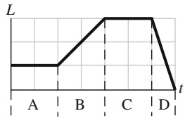

line

| Time Interval | Value |
| --- | --- |
| 1 | Constant |
| 2 | Constant |
| 3 | Increasing |
| 4 | Maximum |
| 5 | Maximum |
| 6 | Maximum |
| 7 | Decreasing |
| t | 0 |

Abb. 7.F16

**17.** Eine Stahl- und eine Marmorkugel rollen aus dem Still stand ein Gefälle hinunter. Sind (a) die Zeit, die die Stahlku gel bis nach unten benötigt und (b) ihre kinetische Energie der Translation am Ende des Gefälles größer, kleiner oder gleich groß wie die der Marmorkugel?

**18.** Ein massiver Messingzylinder und ein massiver Holzzylinder haben denselben Radius und dieselbe Masse (der Holzzylinder ist länger). Sie rollen auf einer Rampe gleichzeitig aus dem Stillstand los. (a) Welcher Zylinder erreicht das Ende der Rampe zuerst? Oder kommen Sie gleichzeitig an? (b) Der Holzzylinder wird auf dieselbe Länge wie der Messingzylinder gekürzt, dafür erhält der Messingzylinder eine Bohrung entlang seiner Achse, damit er wieder dieselbe Masse wie der Holzzylinder hat. Wie geht das Rennen jetzt aus?

# 8 Gleichgewicht und Elastizität

## 8.1 Gleichgewicht

## Physikalische Motivation

Menschliche Bauwerke sollen in der Lage sein, den auf sie einwirkenden Kräften zu widerstehen. So sollen beispielsweise Gebäude trotz der Kraft der Gravitation und der auf sie einwirkenden Windkräfte stabil stehen und Brücken müssen sowohl der Schwerkraft, die sie nach unten zieht, als auch den unregelmäßigen Kräften aufgrund des über sie fließenden Verkehrs trotzen.

Ein wichtiges Gebiet der Physik beschäftigt sich damit, herauszufinden, welche Eigenschaften es Objekten ermöglichen, allen einwirkenden Kräften zum Trotz stabil zu bleiben. In diesem Kapitel untersuchen wir die beiden wichtigsten Gesichtspunkte der Stabilität: das Gleichgewicht der Kräfte und Drehmomente auf starre Objekte und die Elastizität von nichtstarren Objekten – eine Eigenschaft, die angibt, wie sich diese Objekte verformen. Sofern diese Aspekte der Physik beachtet werden, sind sie Gegenstand von Fachartikeln in physikalischen und ingenieurwissenschaftlichen Zeitschriften. Wenn sie nicht beachtet oder falsch eingeschätzt werden, rückt das Thema in die Schlagzeilen der Tages- und Boulevardpresse und wird anschließend in juristischen Fachzeitschriften aufgearbeitet.

## 8.1.1 Gleichgewicht

Betrachten Sie die folgenden Gegenstände: (1) ein auf einem Tisch liegendes Buch, (2) einen Eishockeypuck, der mit konstanter Geschwindigkeit über eine reibungs freie Oberfläche gleitet, (3) die rotierenden Blätter eines Deckenventilators und (4) das Rad eines Fahrrads, das mit konstanter Geschwindigkeit über einen geraden Weg fährt. Für alle diese Gegenstände gilt:

1. Der Impuls $\vec { P }$ des Schwerpunkts ist konstant.
2. Der Drehimpuls $\vec { L }$ in Bezug auf den Schwerpunkt (oder irgendeinen anderen Punkt) ist ebenfalls konstant.

Von solchen Gegenständen sagen wir, sie befinden sich im **Gleichgewicht** bzw. in einem **Gleichgewichtszustand**. Die beiden Bedingungen für das Vorliegen eines Gleichgewichts sind daher

$$
\vec {P} = \text {const.} \quad \text {und} \quad \vec {L} = \text {const.} \tag {8.1}
$$

In diesem Kapitel werden wir Situationen untersuchen, in denen die Konstanten in Gl. 8.1 sogar verschwinden. Wir beschäftigen uns also in erster Linie mit Gegenständen, die sich in dem von uns verwendeten Bezugssystem überhaupt nicht bewegen – weder in Form einer Translation noch einer Rotation. Solche Gegenstände befinden sich in einem **statischen Gleichgewicht**. Von den vier oben erwähnten Gegenständen ist nur einer – das ruhende Buch auf dem Tisch – im statischen Gleichgewicht.

natural_image

Rocky mountain landscape with a tall, reddish-brown rock formation and snow-capped peaks in the background (no text or symbols visible)

Abb. 8.1

Ein Felsen im Arches National Park im US-Staat Utah. Seine Lage mag bedenklich erscheinen, doch er befindet sich im statischen Gleichgewicht [Quelle: Joe Cornish/Getty Images].

Der Felsen in Abb. 8.1 ist ein weiteres Beispiel für einen Gegenstand, der sich (zumindest im Augenblick) in einem statischen Gleichgewicht befindet. Diese Eigenschaft teilt er mit unzähligen anderen Strukturen wie Kathedralen, Häusern, Aktenschränken oder Würstchenbuden, die sich im Verlauf der Zeit ebenfalls nicht verändern.

Wenn ein Körper in denselben Zustand des statischen Gleichgewichts zurückkehrt, nachdem er durch eine Kraft aus diesem Zustand gebracht wurde, dann sagen wir, dieser Körper befindet sich in einem stabilen statischen Gleichgewicht (vgl. Abschn. 4.3). Ein Beispiel hierfür ist eine Murmel am Grund einer halbkreisförmigen Schale. Kann jedoch eine winzige Störung den Körper dauerhaft aus seiner Gleichgewichtslage herausbringen, so sagt man, der Körper befinde sich in einem instabilen Gleichgewicht.

Betrachten Sie beispielsweise einen Dominostein, dessen Schwerpunkt sich genau über einer seiner aufliegenden Kanten befindet (Abb. 8.2a). Das Drehmoment um diese Kante aufgrund der Gravitationskraft $\vec { F } _ { \mathrm { G } }$ auf den Dominostein verschwindet, weil die Kraftrichtung genau durch diese Kante verläuft. Der Dominostein befindet sich daher im Gleichgewicht. Aber offensichtlich kann eine beliebig kleine, zufällige Kraft diesen Gleichgewichtszustand beenden. Verschiebt sich die Verlängerung der Kraftrichtung zu einer der beiden Seiten neben der Kante (wie in Abb. 8.2b), verstärkt $\vec { F } _ { \mathrm { G } }$ das Drehmoment und der Dominostein beginnt zu kippen. Der Dominostein in Abb. 8.2a befindet sich daher in einem instabilen Gleichgewichtszustand.

Der Dominostein in Abb. 8.2c ist nicht ganz so instabil. Um diesen Stein kippen zu können, muss man ihn über die Lage aus Abb. 8.2a, bei der sich der Schwerpunkt exakt über einer der beiden Kanten befindet, hinausdrehen. Eine sehr schwache Kraft bringt den Dominostein daher nicht zum Kippen, wohl aber ein kräftiger Stoß. (Stellen wir mehrere Dominosteine auf diese Weise hintereinander auf, kann ein Stoß gegen den ersten Stein die ganze Kette zu Fall bringen.)

Der Bauklotz aus Abb. 8.2d ist sogar noch stabiler, weil sein Schwerpunkt weiter bewegt werden muss, bis er sich direkt oberhalb einer der Kanten befindet. Ein leichter Stoß bringt ihn in der Regel nicht zu Fall. Der Mann in Abb. 8.3 befindet sich in einer besonders schwierigen Situation: Seine Gleichgewichtsposition quer zum Longboard ist sehr diffizil, weil er nur eine schmale Auflagefläche hat und das Longboard in dieser Richtung außerdem auch noch neigbar ist, seiner Kraft also keinen festen Widerstand entgegensetzt. In Längsrichtung hat er zwar eine breitere Auflagefläche, aber dafür kann sich das Bord in dieser Richtung in Bewegung setzen, sodass er ein dynamisches Gleichgewicht aufrechterhalten muss.

Die Untersuchung von statischen Gleichgewichtslagen ist bei Bauvorhaben von höchster Wichtigkeit. Der Bauingenieur muss alle auf eine Struktur einwirkenden äußeren Kräfte und Drehmomente erkennen und durch ein entsprechendes Design und eine gute Wahl der Werkstoffe sicherstellen, dass die geplante Struktur den Belastungen auch standhält. Solche Untersuchungen sind beispielsweise notwendig um sicherzustellen, dass Brücken nicht unter dem Gewicht des Verkehrs oder dem Druck eines Sturms zusammenbrechen, oder dass das Fahrgestell eines Flugzeugs auch den Schock einer rauen Landung übersteht.

Abb. 8.2

(a) Ein Dominostein balanciert auf einer seiner Kanten, d. h., der Schwerpunkt befindet sich genau über dieser Kante. Die Richtung der Gravitationskraft $\vec { F } _ { \mathrm { G } }$ auf den Dominostein verläuft exakt durch diese Kante. (b) Wird der Dominostein auch nur minimal aus dieser ausbalancierten Lage gebracht, verursacht $\vec { \bar { F } } _ { \mathrm { G } }$ ein Drehmoment und der Stein beginnt zu kippen. (c) Steht ein Dominostein auf einer seiner schmalen Seiten, ist er etwas stabiler als der Dominostein aus (a). (d) Ein quadratischer Bauklotz ist noch stabiler.

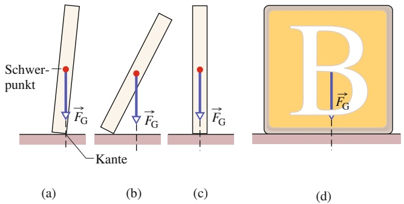

## 8.1.2 Bedingungen für das Gleichgewicht

Die Translationsbewegung eines Körpers wird durch das zweite Newtonsche Gesetz beschrieben. Ausgedrückt durch den Impuls ist es durch Gl. 5.23 gegeben:

$$
\vec {F} _ {\mathrm{ges}} = \frac {\mathrm{d} \vec {P}}{\mathrm{d} t}. \tag {8.2}
$$

Befindet sich der Körper im Gleichgewicht bezüglich Translation – ist also $\vec { P }$ konstant $\neg ,$ dann gilt $\mathrm { d } \vec { P } / \mathrm { d } t = 0$ und es folgt

$$
\vec {F} _ {\text {ges}} = 0 \quad (\text {Kräftegleichgewicht}). \tag {8.3}
$$

Die Rotationsbewegung eines Körpers wird ebenfalls durch das zweite Newtonsche Gesetz bestimmt, allerdings jetzt ausgedrückt über den Drehimpuls (Gl. 7.27):

$$
\vec {\tau} _ {\mathrm{ges}} = \frac {\mathrm{d} \vec {L}}{\mathrm{d} t}. \tag {8.4}
$$

Befindet sich der Körper im Gleichgewicht bezüglich Rotation – ist also $\vec { L }$ konstant –, so gilt $\mathrm { d } \vec { L } / \mathrm { d } t = 0$ und es folgt

$$
\vec {\tau} _ {\text {ges}} = 0 \quad (\text {Gleichgewicht der Drehmomente}). \tag {8.5}
$$

Die beiden Bedingungen für einen Körper im Gleichgewicht lauten somit:

1. Die vektorielle Summe aller äußeren Kräfte auf einen Körper muss verschwinden.
2. Die vektorielle Summe aller äußeren Drehmomente auf einen Körper muss bezüglich aller Punkte verschwinden.

Diese Bedingungen gelten offensichtlich für ein statisches Gleichgewicht. Sie gelten ebenfalls für eine allgemeinere Form von Gleichgewicht, bei der $\vec { P }$ und $\vec { L }$ konstant sind, aber nicht null.

Die Gln. 8.3 und 8.5 sind Vektorgleichungen. Sie sind jeweils äquivalent zu drei unabhängigen Komponentengleichungen, eine für jede Richtung der Koordinatenachsen:

Kräftegleichgewicht Gleichgewicht der Drehmomente

| $F_{\text{ges},x} = 0$ | $\tau_{\text{ges},x} = 0$ |
| --- | --- |
| $F_{\text{ges},y} = 0$ | $\tau_{\text{ges},y} = 0$ |
| $F_{\text{ges},z} = 0$ | $\tau_{\text{ges},z} = 0$ |

Wir werden oft eine vereinfachte Situation betrachten, bei der die auf einen Körper wirkenden Kräfte nur in der xy-Ebene liegen. In diesem Fall können nur solche Drehmomente auftreten, die einen Körper in eine Drehung um eine Achse parallel zur z-Achse versetzen. Unter dieser Voraussetzung werden von den Gleichungen in Gl. 8.6 eine Kraftgleichung und zwei Drehmomentgleichungen eliminiert und wir erhalten:

$$
F _ {\mathrm{ges}, x} = 0 \quad (\text {Kräftegleichgewicht}), \tag {8.7}
$$

$$
F _ {\mathrm{ges}, y} = 0 \quad (\text {Kräftegleichgewicht}), \tag {8.8}
$$

$$
\tau_ {\mathrm{ges}, z} = 0 \quad (\text {Gleichgewicht der Drehmomente}). \tag {8.9}
$$

Hierbei ist $\tau _ { \mathrm { g e s } , z }$ das von den äußeren Kräften erzeugte gesamte Drehmoment entweder um die z-Achse oder irgendeine andere Achse parallel zur z-Achse.

Ein Eishockeypuck, der mit konstanter Geschwindigkeit über das Eis gleitet, erfüllt die Gln. 8.7–8.9 und befindet sich daher im Gleichgewicht, allerdings nicht im statischen Gleichgewicht. Für ein statisches Gleichgewicht muss der Impuls $\vec { P }$ des Pucks nicht nur konstant sein, sondern auch verschwinden: Der Puck muss auf dem Eis ruhen. Für ein statisches Gleichgewicht muss daher noch eine weitere Bedingung gelten:

3. Der Impuls $\vec { P }$ des Körpers muss null sein.

natural_image

Person performing a high-lying handstand on a skateboard, wearing jeans and black shirt (no text or symbols visible)

Abb. 8.3

Im Handstand auf dem Longboard befindet man sich zwar im Gleichgewicht – doch wenn das Brett ins Rollen kommt, wird es schwer, den Schwerpunkt über der Standfläche zu halten! [Quelle: DRB Images, LLC/iStockphoto].

## KONTROLLFRAGE 1

Die Abbildung zeigt sechs Draufsichten eines homogenen Stabs. Zwei oder mehr Kräfte wirken senkrecht zu diesem Stab. In welchen Fällen kann sich der Stab in einem statischen Gleichgewicht befinden, wenn die Beträge der Kräfte geeignet adjustiert werden (allerdings von null verschieden bleiben)?

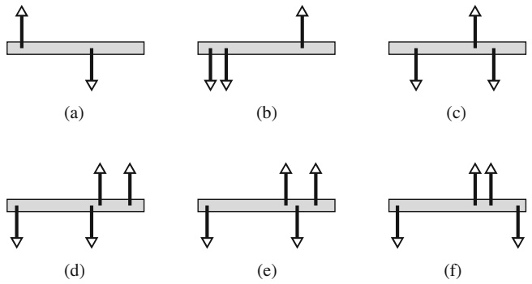

## 8.1.3 Das Gravizentrum

Die Gravitationskraft auf einen ausgedehnten Körper ist gleich der vektoriellen Summe der Gravitationskräfte auf die einzelnen Elemente (die Atome) dieses Körpers. Statt diese Elemente alle einzeln zu betrachten, können wir auch sagen:

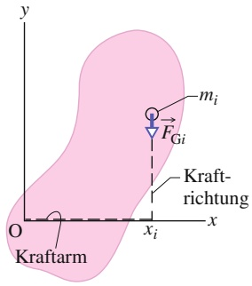

text_image

y
O
Kraftarm
xi
x
mi
FGi
Kraft-
richtung

(a)

Die Gravitationskraft $\vec { F } _ { \mathrm { G } }$ auf einen Körper wirkt effektiv in einem einzelnen Punkt, den man das Gravizentrum (GZ) dieses Körpers nennt.

Der Begriff „effektiv“ bedeutet Folgendes: Würden die Kräfte auf die einzelnen Elemente irgendwie abgeschaltet und stattdessen eine einzelne Kraft $\vec { F } _ { \mathrm { G } }$ auf das Gravizentrum eingeschaltet, dann wären die Gesamtkraft und das Gesamtdrehmoment (um jeden Punkt) dieses Körpers unverändert.

Bisher sind wir immer davon ausgegangen, dass die Gravitationskraft $\vec { F } _ { \mathrm { G } }$ im Schwerpunkt eines Körpers angreift. Das ist gleichbedeutend mit der Annahme, dass das Gravizentrum sich im Schwerpunkt befindet. Für einen Körper der Masse M ist die Schwerkraft $\vec { F } _ { \mathrm { G } }$ gleich $M _ { \mathcal { S } _ { 1 } } ^ { \rightarrow }$ , wobei $\cdot \vec { g }$ die durch die Schwerkraft erzeugte (Fall-)Beschleunigung dieses Körpers wäre, wenn sich der Körper frei bewegen könnte. Im Folgenden werden wir beweisen:

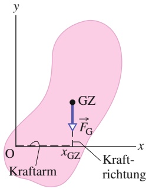

text_image

y
O
GZ
F_G
x_GZ
Kraftarm
x
Kraft-
richtung

(b)

Wenn $\vec { g }$ für alle Elemente eines Körpers gleich ist, dann befindet sich das Gravizentrum (GZ) des Körpers in seinem Schwerpunkt (S).

Diese Bedingung ist für die meisten Alltagsgegenstände erfüllt, weil sich $\vec { g }$ entlang der Erdoberfläche nur wenig ändert und auch mit der Höhe nur langsam abnimmt. Im Anschluss an den folgenden Beweis werden wir diese Annahme weiterhin machen.

**Beweis:** Zunächst betrachten wir die einzelnen Elemente eines Körpers. Abbildung 8.4a zeigt einen ausgedehnten Körper mit der Masse M und eines seiner Elemente mit der Masse $m _ { i }$ . Auf jedes dieser Elemente wirkt eine Gravitationskraft $\vec { F } _ { G , i } = m _ { i } \vec { g } _ { i }$ . Der Index bei $\vec { g } _ { i }$ bedeutet, dass die Gravitationsbeschleunigung $\vec { g } _ { i }$ am Ort des Elements i zu nehmen ist, und dass diese sich von der Gravitationsbeschleunigung am Ort von anderen Elementen unterscheiden kann.

Wie in Abb. 8.4 erkennbar, erzeugt jede Kraft $\vec { F } _ { \mathrm { G } , i }$ für das Element i in Bezug auf den Koordinatenursprung O ein Drehmoment $\tau _ { i }$ mit zugehörigem Kraftarm $x _ { i }$ Nach Gl. 6.30 $( \tau = r _ { \perp } F )$ können wir für das Drehmoment $\tau _ { i }$ auch schreiben:

$$
\tau_ {i} = x _ {i} F _ {\mathrm{G}, i}. \tag {8.10}
$$

Abb. 8.4 (a) Ein Teilelement der Masse mi in einem ausgedehnten Körper. Vom Ursprung O des Koordinatensystems aus betrachtet gehört zu der Gravitationskraft $\vec { \bar { F } } _ { \mathrm { G } , i } ^ { \mathrm { ~   ~ } }$ auf dieses Element ein Kraftarm $x _ { i }$ . (b) Effektiv wirkt auf einen Körper die Gravitationskraft ${ \vec { F } } _ { \mathrm { G } } ,$ die im Gravizentrum (GZ) dieses Körpers angreift. Der Kraftarm zur Gravitationskraft bezüglich des Koordinatenursprungs O ist $x _ { \mathrm { G Z } ^ { * } }$

Das Gesamtdrehmoment auf alle Elemente des Körpers ist somit

$$
\tau_ {\mathrm{ges}} = \sum \tau_ {i} = \sum x _ {i} F _ {\mathrm{G}, i}. \tag {8.11}
$$

Nun betrachten wir den Körper als Ganzes. Abbildung 8.4b zeigt die Gravitationskraft $\vec { F } _ { \mathrm { G } } ,$ die im Gravizentrum des Körpers angreift. Diese Kraft erzeugt für den Körper ein Drehmoment τ um O mit einem Kraftarm $x _ { \mathrm { G Z } } .$ . Dieses Drehmoment können wir wiederum nach Gl. 6.30 in der Form

$$
\tau = x _ {\mathrm{GZ}} F _ {\mathrm{G}} \tag {8.12}
$$

schreiben. Die Gravitationskraft $\vec { F } _ { \mathrm { G } }$ auf den Körper ist gleich der Summe der Gravitationskräfte $\vec { F } _ { \mathrm { G } , i }$ auf alle Elemente. Wir können daher $F _ { \mathrm { G } }$ in Gl. 4.12 durch $\sum F _ { G , i }$ ersetzen:

$$
\tau = x _ {\mathrm{GZ}} \sum F _ {\mathrm{G}, i}. \tag {8.13}
$$

Nun soll das Drehmoment aufgrund der Kraft $\vec { F } _ { \mathrm { G } } ,$ die im Gravizentrum angreift, gleich dem Gesamtdrehmoment aufgrund aller Kräfte $\vec { F } _ { \mathrm { G } , i }$ auf die einzelnen Elemente des Körpers sein. (So haben wir das Gravizentrum GZ definiert.) Daher ist τ aus Gl. 8.13 gleich $\tau _ { \mathrm { g e s } }$ aus Gl. 8.11:

$$
x _ {\mathrm{GZ}} \sum F _ {\mathrm{G}, i} = \sum x _ {i} F _ {\mathrm{G}, i}.
$$

Wir ersetzen $F _ { \mathrm { G } , i }$ durch $m _ { i } g _ { i }$ und erhalten

$$
x _ {\mathrm{GZ}} \sum m _ {i} g _ {i} = \sum x _ {i} m _ {i} g _ {i}.
$$

Nun kommt der kritische Punkt: Wenn die Beschleunigungen $g _ { i }$ an allen Orten der Elemente gleich sind, können wir sie aus der Gleichung herauskürzen. Das führt uns auf:

$$
x _ {\mathrm{GZ}} \sum m _ {i} = \sum x _ {i} m _ {i}. \tag {8.14}
$$

Die Summe $\sum m _ { i }$ der Massen der Elemente ist gleich der Gesamtmasse M des Körpers. Daher können wir für Gl. 8.14 auch als

$$
x _ {\mathrm{GZ}} = \frac {1}{M} \sum x _ {i} m _ {i} \tag {8.15}
$$

schreiben. Die rechte Seite dieser Gleichung entspricht der Koordinate $x _ { S }$ des Schwerpunkts des Körpers (Gl. 5.4). Wir erhalten somit, was wir beweisen wollten:

$$
x _ {\mathrm{GZ}} = x _ {\mathrm{S}}. \tag {8.16}
$$

## KONTROLLFRAGE 2

Angenommen, Sie spießen mit einem dünnen Spieß einen Apfel auf, treffen allerdings nicht das Gravizentrum des Apfels. Wenn Sie den Spieß waagerecht halten und der Apfel sich frei um den Spieß drehen kann, wo wird sich das Gravizentrum schließlich befinden? Weshalb?

## 8.2 Beispiele für statische Gleichgewichte

## Lernziele

Nach dem Durcharbeiten dieses Abschnitts sollten Sie in der Lage sein, . . .

• die Bedingungen für das Gleichgewicht der Kräfte und das der Drehmomente auf das statische Gleichgewicht anzuwenden,
zu verstehen, dass eine kluge Wahl des Koordinatenursprungs (auf den Drehmo mente zu beziehen sind) die Berechnung durch Eliminierung einer oder mehrerer unbekannter Kräfte aus den Gleichungen entscheidend vereinfachen kann.

## Schlüsselideen

• Von einem ruhenden starren Körper sagt man, er befinde sich im statischen Gleichgewicht. Für einen solchen Körper ist die Vektorsumme der auf ihn wirkenden äußeren Kräfte null (Kräftegleichgewicht):

$$
\vec {F} _ {\mathrm{ges}} = 0.
$$

Wenn alle Kräfte beispielsweise in der xy-Ebene liegen, ist diese Vektorgleichung äquivalent zu den Komponentengleichungen

$$
F _ {\mathrm{ges}, x} = 0 \quad \text {und} \quad F _ {\mathrm{ges}, y} = 0.
$$

• Im statischen Gleichgewicht muss auch die Vektorsumme aller an einem beliebigen Punkt des Körpers angreifenden Drehmomente null sein (Gleichgewicht der Drehmomente):

$$
\vec {\tau} _ {\mathrm{ges}} = 0.
$$

Wenn alle Kräfte in der xy-Ebene liegen, sind alle Drehmomente parallel zur z-Achse und diese Vektorgleichung ist äquivalent zu der Komponentengleichung

$$
\tau_ {\mathrm{ges}, z} = 0.
$$

## 8.2.1 Beispiele für statische Gleichgewichte

In diesem Abschnitt untersuchen wir vier Beispiele von Systemen im statischen Gleichgewicht. In allen Fällen wenden wir die Gleichgewichtsbedingungen (Gln. 8.7–8.9) auf einen oder mehrere Gegenstände des Systems an. Die für die Gleichgewichtslage relevanten Kräfte befinden sich alle in der xy-Ebene, die Drehmomente stehen daher parallel zur z-Achse. Zur Anwendung von Gl. 8.9, dem Gleichgewicht der Drehmomente, wählen wir daher eine Achse parallel zur z-Achse, um das Drehmoment zu berechnen. Obwohl Gl. 8.9 für jede solche Achse erfüllt ist, werden wir sehen, dass sich die Anwendung von Gl. 8.9 für bestimmte Achsen vereinfacht, bei denen eine oder mehrere unbekannte Kräfte eliminiert werden können.

## KONTROLLFRAGE 3

Die Abbildung zeigt die Draufsicht eines homogenen Stabs im statischen Gleichgewicht. (a) Können Sie die Beträge der unbekannten Kräfte ${ \vec { F } } _ { 1 }$ und $\vec { F } _ { 2 }$ aus den Gleichgewichtsbedingungen für die Kräfte bestimmen? (b) Wenn Sie den Betrag von $\vec { F } _ { 2 }$ aus einer einzelnen Gleichung berechnen wollen, durch welchen Punkt sollten Sie eine Drehachse legen? (c) Der Betrag von $\vec { F } _ { 2 }$ sei 65 N. Wie groß ist der Betrag von $\vec { F } _ { 1 } { } ^ { ? }$

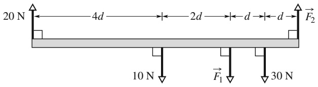

text_image

20 N
4d
2d
d
d
F₂
10 N
F₁
30 N

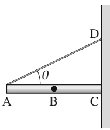

text_image

A
B
C
D
θ

## KONTROLLFRAGE 4

In der Abbildung wird ein ruhender 5 kg schwerer Stab AC durch ein Seil gehalten und gegen eine Wand gedrückt. Dort verhindert die Reibung zwischen Stab und Wand das Abrutschen. Der homogene Stab hat eine Länge von 1 m und wird unter einem Winkel von $\theta = 3 0 ^ { \circ }$ gehalten. (a) Wenn Sie den Betrag der Kraft ${ \vec { T } } ,$ die vom Seil auf den Stab ausgeübt wird, aus einer einzigen Gleichung berechnen wollen, bei welchem der markierten Punkte sollte dann die Drehachse gewählt werden?

Wir betrachten nun die Drehmomente bezüglich dieser Achse und treffen wie immer die Konvention, gegen den Uhrzeigersinn wirkende Drehmomente positiv zu zählen. (b) Welches Vorzeichen hat das Drehmoment $\tau _ { \mathrm { G } } ,$ das durch das Gewicht des Stabs erzeugt wird? (c) Welches Vorzeichen hat das Drehmoment $\tau _ { \mathsf { S } } ,$ das durch die Aufhängung des Stabs am Seil erzeugt wird? (d) Ist der Betrag von $\tau _ { \mathrm { G } }$ größer, kleiner oder gleich dem Betrag von $\tau _ { \mathrm { S } } { } ^ { ? }$

## LÖSUNGSSTRATEGIEN

**Strateg**i**e 1: Aufgaben zum statischen Gl**e**ichgewicht** Es folgt eine Liste von Schritten zur Lösung von Aufgaben zum statischen Gleichgewicht:

1. Fertigen Sie eine Skizze an.
2. Wählen Sie das System, auf das Sie die Gleichgewichtsbedingungen anwenden wollen. Zeichnen Sie um dieses System eine geschlossene Kurve, damit Sie es klar vor Augen haben. In manchen Fällen können Sie als System einen einzelnen Gegenstand auswählen. Es handelt sich dann um den Gegenstand, der sich im Gleichgewicht befinden soll (wie beispielsweise den schiefen Turm in Beispielaufgabe 8.4 im Übungsbuch). In anderen Fällen kann es sinnvoll sein, weitere Gegenstände in das System mit aufzunehmen, wenn dadurch die Berechnungen für das Gleichgewicht vereinfacht werden. Angenommen, Sie hätten in Beispielaufgabe 8.3 im Übungsbuch nur die Leiter als System gewählt. Dann müssten Sie in Abb. Ü8.7b noch zusätzliche unbekannte Kräfte auf die Leiter berücksichtigen, die durch die Hände und die Füße der Feuerwehrfrau ausgeübt werden. Diese zusätzlichen Unbekannten hätten die Gleichgewichtsbedingungen wesentlich komplizierter gemacht. Wenn das System von Abb. Ü8.7 dagegen die Feuerwehrfrau enthält, werden diese unbekannten Kräfte zu einem inneren Teil des Systems und müssen daher zur Lösung von Beispielaufgabe 8.3 im Übungsbuch nicht bestimmt werden.
3. Zeichnen Sie ein Kräftediagramm des Systems. In diesem Diagramm sollten sämtliche Kräfte auftreten, die auf dieses System wirken. Markieren Sie diese Kräfte und stellen Sie sicher, dass die Angriffspunkte und Richtungen korrekt eingetragen sind.
4. Tragen Sie die x- und y-Achse eines Koordinatensystems ein. Wählen Sie diese Achsen so, dass mindestens eine der Achsen parallel zu einer oder mehreren der unbekannten Kräfte liegt. Zerlegen Sie die nicht parallel zu den Koordinatenachsen liegenden Kräfte in ihre Komponenten bezüglich dieses Koordinatensystems. In unseren Beispielaufgaben im Übungsbuch war es immer sinnvoll, die x-Achse horizontal und die y-Achse vertikal zu legen (das muss aber keineswegs immer so sein).
5. Schreiben Sie Gleichgewichtsbedingungen für die Kräfte inx- undy-Richtung auf, wobei sie noch Symbole (keine expliziten Zahlen) verwenden sollten.
6. Wählen Sie eine oder mehrere Drehachsen senkrecht zur Bildebene und for mulieren Sie die Gleichgewichtsbedingung für das Drehmoment zu jeder dieser Achsen. Liegt eine dieser Achsen in der Richtung einer der unbekannten Kräfte, so vereinfachen sich die Gleichungen, weil diese Kraft nicht mehr auftritt.
7. Lösen Sie die Gleichungen algebraisch nach den Unbekannten auf. Noch unerfahrene Studierende mögen sich sicherer fühlen, wenn sie an diesem Punkt Zahlen mit Einheiten in die unabhängigen Gleichungen einsetzen, insbesondere wenn die algebraischen Umformungen kompliziert erscheinen. Die Erfahreneren ziehen jedoch den algebraischen Zugang vor, da in diesem Fall die Abhängigkeit der Lösung von den einzelnen Variablen deutlich wird.
8. Setzen Sie nun Zahlen und Einheiten in die algebraische Lösung der Aufgabe ein. Sie erhalten dann die numerischen Werte für die Unbekannten.
9. Betrachten Sie ihre Antworten – erscheinen sie sinnvoll? Sind sie offensichtlich zu groß oder zu klein? Ist das Vorzeichen richtig? Passen die Einheiten zusammen?

## 8.3 Elastizität

## Lernziele

Nach dem Durcharbeiten dieses Abschnitts sollten Sie in der Lage sein, . . .

• zu erklären, was ein unterbestimmtes System ist,
• für Zug- und Druckbelastungen die Beziehung zwischen Spannung, Dehnung und dem Youngschen Modul anzugeben und anzuwenden,
• zwischen Streckgrenze und Zugfestigkeit zu unterscheiden,
• für Scherbelastungen die Beziehung zwischen Spannung, Dehnung und Schubmodul anzugeben und anzuwenden,
• für hydraulische Beanspruchungen die Beziehung zwischen hydraulischer Spannung, Volumenänderung und Kompressionsmodul anzugeben und anzuwenden.

## Schlüsselideen

Um das elastische Verhalten (die Deformation) von Objekten als Reaktion auf einwirkende Kräfte zu beschreiben, verwendet man drei elastische Moduln. Allgemein hängt die Dehnung (relative Längenänderung) über den passenden Modul linear mit der angewandten Spannung (Kraft pro Flächeneinheit) zusammen, was die allgemeine Spannungs-Dehnungs-Beziehung beschreibt:

$$
\text {Dehnung} = \text {Modul} \cdot \text {Spannung}.
$$

• Wenn ein Objekt unter Zug oder Druck steht, wird die Spannungs-Dehnungs-Beziehung in der Form

$$
\frac {F}{A} = E \frac {\Delta L}{L}
$$

geschrieben. Dabei sind $\Delta L / L$ die Dehnung des Objekts durch Zug bzw. Druck ist, F der Betrag der einwirkenden Kraft, welche die Dehnung verursacht, A die Querschnittsfläche, auf welche die Kraft (senkrecht zu A) wirkt und E der Elastizitätsmodul des Objekts. Die Spannung ist $F / A$

• Wenn ein Objekt einer Scherspannung ausgesetzt ist, hat die Spannungs-Dehnungs-Beziehung die Form

$$
\frac {F}{A} = G \frac {\Delta x}{L}
$$

mit $\Delta x / L$ als der Scherbeanspruchung des Objekts, Δx als der Verschiebung des einen Endes des Objekts in Richtung der einwirkenden Kraft F und G als dem Schubmodul des Objekts. Die Spannung ist wiederum $F / A$

• Wenn ein Objekt von einer Flüssigkeit umgeben ist und diese das Objekt durch eine Druckkraft hydraulisch komprimiert, nimmt die Spannungs-Dehnungs-Beziehung die Form

$$
p = B \frac {\Delta V}{V}
$$

an, wobei p der Druck (die hydraulische Spannung) auf das Objekt aufgrund der Flüssigkeit ist, $\Delta V / V$ (die Dehnung) der Absolutbetrag der relativen Volumenänderung des Objekts aufgrund dieses Drucks und B der Kompressionsmodul des Objekts.

## 8.3.1 Unterbestimmte Strukturen

Zur Lösung der Aufgaben in diesem Kapitel gibt es nur drei unabhängige Glei chungen, meist zwei Gleichungen für das Kräftegleichgewicht und eine Gleichge wichtsbedingung für das Drehmoment um eine gegebene Drehachse. Wenn eine Aufgabe daher mehr als drei Unbekannte enthält, können wir sie nicht lösen.

Solche Aufgaben lassen sich leicht finden. In Beispielaufgabe 8.3 hätten wir beispielsweise auch annehmen können, dass die Wand nicht reibungsfrei ist und zwischen der Wand und der Leiterspitze daher auch vertikale Reibungskräfte auftre ten. In diesem Fall wären vier unbekannte Kräfte im Spiel gewesen. Mit nur drei Gleichgewichtsgleichungen wäre die Aufgabe nicht zu lösen gewesen.

Stellen Sie sich ein unsymmetrisch beladenes Auto vor. Wie groß sind die – alle jeweils verschiedenen – Kräfte auf die vier Räder? Auch diese Kräfte können wir nicht berechnen, wenn wir nur drei unabhängige Gleichungen zur Verfügung haben. Ein ähnliches Problem tritt bei einem Tisch auf: Wir können zwar die Gleichgewichtsaufgabe für einen Tisch mit drei Beinen lösen, nicht aber für einen Tisch mit vier Beinen. Solche Aufgaben, bei denen es mehr Unbekannte gibt als Gleichungen, bezeichnet man als **unbestimmt** oder **unterbestimmt**.

Offensichtlich existieren aber die Lösungen zu solchen unterbestimmten Aufgaben in der Wirklichkeit. Wenn Sie die Reifen des Autos auf vier Bodenwaagen stellen, wird jede dieser Waagen einen eindeutigen Wert anzeigen, und die Summe dieser Werte entspricht dem Gewicht des Autos. Was fehlt uns, wenn wir die einzelnen Kräfte durch das Lösen von Gleichungen bestimmen wollen?

Des Rätsels Lösung liegt darin, dass wir – ohne es besonders betont zu haben – sämtliche Körper, auf die wir die Gleichungen für ein statisches Gleichgewicht angewandt haben, als perfekt starr angenommen haben. Damit ist gemeint, dass sich diese Körper unter der Einwirkung von Kräften nicht verformen. Streng genommen gibt es solche Körper aber gar nicht. Autoreifen beispielsweise verformen sich bei Belastung vergleichsweise leicht, bis das Auto in einer statischen Gleichgewichtslage zur Ruhe kommt.

Wir alle haben unsere Erfahrungen mit wackeligen Esstischen in Restaurants. Üblicherweise legen wir in solchen Fällen gefaltetes Papier oder Bierdeckel unter eines der Tischbeine. Würde sich ein ausgewachsener Elefant auf einen solchen Tisch setzen und der Tisch dabei nicht zusammenbrechen, dann würden sich seine Beine wie die Reifen eines Autos so weit verformen, bis alle Beine den Boden berühren, die Kräfte würden vertikal nach oben entlang der Tischbeine wirken und wohldefinierte (verschiedene) Werte annehmen wie in Abb. 8.5. Und auch wackeln würde der Tisch nicht mehr. Wie können wir die Kräfte auf die Tischbeine bestimmen?

Wollen wir solche unterbestimmten Gleichgewichtsaufgaben lösen, müssen wir die Gleichgewichtsbedingungen noch um einige Kenntnisse aus dem Bereich der Elastizitätstheorie erweitern. Dabei handelt es sich um einen Zweig der Physik und der Ingenieurswissenschaften, der die Verformung wirklicher Körper unter dem Einfluss von Kräften beschreibt. Der folgende Abschnitt stellt eine Einführung in dieses Thema dar.

## KONTROLLFRAGE 5

Ein horizontaler homogener Balken von 10 N Gewicht hängt an zwei Drähten von der Decke. Diese Drähte üben auf den Balken zwei nach oben gerichtete Kräfte ${ \vec { F } } _ { 1 }$ und $\vec { F } _ { 2 }$ aus. Die Abbildung zeigt vier Anordnungen dieser Drähte. Gibt es Anordnungen, bei denen wir keine numerischen Werte für ${ \vec { F } } _ { 1 }$ und $\vec { F } _ { 2 }$ bestimmen können?

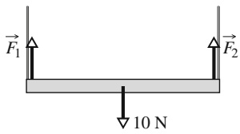

text_image

F₁
F₂
10 N

(a)

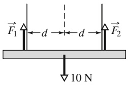

text_image

F₁ ← d → d → F₂
↓ 10 N

(b)

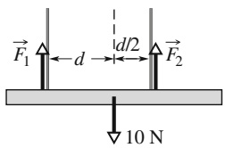

text_image

F₁ ← d → d/2 → F₂
↓ 10 N

(c)

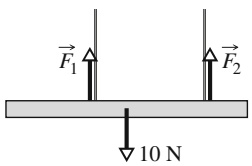

text_image

F₁
F₂
10 N

(d)

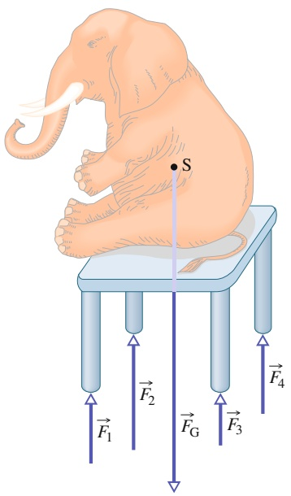

text_image

S
F₁
F₂
Fₖ
F₃
F₅

Abb. 8.5

Ein perfekt starrer Tisch ist ein unterbestimmtes System. Die vier Kräfte an den Tischbeinen sind vom Betrag her verschieden und können nicht nur aus den Gesetzen der statischen Gleichgewichtszustände gefunden werden. In der Realität gibt er jedoch der Gewichtskraft des Elefanten nach und nimmt eine eindeutig bestimmte Position ein.

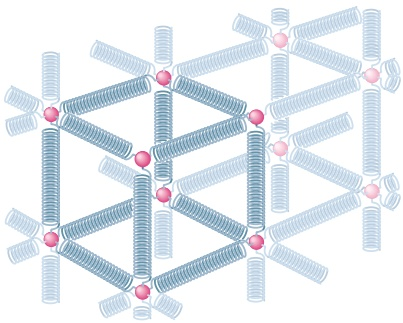

natural_image

Abstract 3D molecular or crystal lattice structure with pink spheres and gray rods, no text or symbols present

Abb. 8.6

Die Atome eines metallischen Festkörpers sind in einem dreidimensionalen Gitter angeordnet. Die Federn stellen die interatomaren Kräfte dar.

(a) Ein Zylinder, auf den eine $Z   u g -$ spannung wirkt, ändert seine Länge um den Betrag ΔL. (b) Ein $\mathrm { Z y } -$ linder, auf den eine Scherspannung wirkt, verformt sich seitlich um einen Betrag $\Delta x ,$ ähnlich wie ein Stapel Spielkarten. (c) Das Volumen einer Vollkugel, die einem homogenen hydraulischen Druck eines Fluids unterworfen ist, schrumpft um einen Betrag ΔV. Alle Verformungen sind sehr übertrieben dargestellt.

Abb. 8.7

## 8.3.2 Elastizität

Wenn sich viele Atome zu einem metallischen Festkörper zusammenfinden, bei spielsweise zu einem Eisennagel, dann entsprechen die Gleichgewichtslagen der Atome einem dreidimensionalen Gitter. Dabei handelt es sich um eine sich wiederholende Anordnung, bei der jedes Atom einen wohldefinierten Gleichgewichtsabstand von seinen nächsten Nachbarn besitzt. Die Atome werden durch interatomare Kräfte zusammengehalten, die in Abb. 8.6 durch winzige Federn symbolisiert werden. Das Gitter ist bemerkenswert fest, was gleichbedeutend mit der Feststellung ist, dass diese „interatomaren Federn“ außerordentlich steif sind. Aus diesem Grund empfinden wir viele gewöhnliche Gegenstände, wie Metallleitern, Tische und Hämmer, als praktisch starr. Natürlich erscheinen uns andere Alltagsgegenstände, wie Gartenschläuche oder Gummihandschuhe, alles andere als starr. Die Atome solcher Gegenstände bilden kein starres Gitter wie in Abb. 8.6, sondern sie sind eher in langen, biegsamen Molekülketten angeordnet, wobei jede dieser Ketten nur lose mit ihren Nachbarn verbunden ist.

Alle sogenannten „starren“ Körper sind in Wirklichkeit bis zu einem gewissen Grad **elastisch**, d. h., wir können ihre Abmessungen etwas verändern, indem wir an ihnen ziehen, sie stoßen, drehen oder zusammendrücken. Um ein Gespür für die Größenordnung zu erhalten, stellen wir uns einen vertikalen Stahlstab vor, der 1 m lang ist und einen Durchmesser von 1 cm hat. Wenn wir an das Ende dieses Stabs einen Kleinwagen hängen, dehnt sich dieser $\operatorname { S t a b } ,$ allerdings nur um $^ { 0 , 5 }$ m m oder 0,05 %. Außerdem geht der Stab wieder auf seine ursprüngliche Länge zurück, wenn das Auto entfernt wird.

Hängt man zwei Autos an den $\operatorname { S t a b } ,$ so wird dieser Stab dauerhaft gedehnt bleiben und seine ursprüngliche Länge nicht wieder einnehmen, auch wenn die Belastung entfernt wird. Hängt man drei Autos an den Stab, wird er brechen. Kurz vor dem Bruch wird die Dehnung des Stabs etwas weniger als $^ { 0 , 2 }$ % betragen. Obwohl Verformungen dieser Größenordnung sehr klein erscheinen, sind sie für die Praxis von großer Bedeutung. (Ob ein Flügel bei Belastung an einem Flugzeug hängen bleibt, ist offensichtlich von sehr großer Bedeutung.)

Abbildung 8.7 zeigt drei Möglichkeiten, wie ein Festkörper seine Abmessungen unter dem Einfluss von Kräften verändern kann. In Abb. 8.7a wird ein Zylinder gedehnt. In Abb. 8.7b wird ein $\mathrm { Z y l }$ inder durch eine Kraft senkrecht zu seiner Achse verformt, ähnlich wie ein Stapel Spielkarten oder Bücher sich verformen würde. In Abb. 8.7c schließlich wird ein fester Gegenstand in eine Flüssigkeit unter hohem Druck gelegt und dabei gleichmäßig von allen Seiten zusammengepresst. Allen drei Verformungsarten ist gemeinsam, dass eine Spannung, oder auch eine Verformungskraft pro Flächeneinheit, zu einer Dehnung oder relativen Längenbzw. Volumenänderung führt. Abbildung 8.7 zeigt in (a) eine Zugspannung (entsprechend einer Dehnung), eine Scherspannung in (b) und eine hydraulische Spannung in (c).

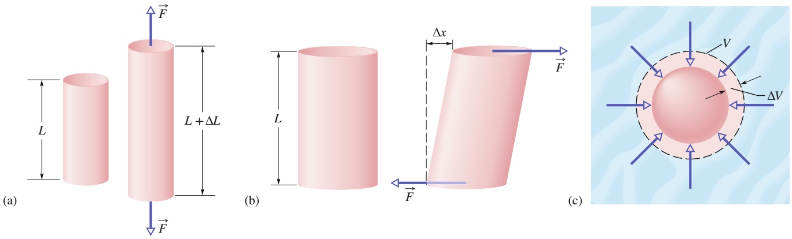

Spannung und Dehnung zeigen sich in den drei Fällen von Abb. 8.7 in verschiedenen Formen, aber soweit es für die Anwendung in der Technik von Nutzen ist, sind Spannung und Dehnung proportional zueinander. Die Proportionalitätskonstante bezeichnet man als den **Elastizitätsmodul**, und es gilt:

$$
\text {Spannung} = \text {Elastizitätsmodul} \cdot \text {Dehnung}. \tag {8.17}
$$

(Man sagt übrigens in der Mechanik elastischer Körper immer „der Modul“ bzw., wenn es mehrere sind, „die Moduln“.) Bei Prüfverfahren zur Zugbelastbarkeit eines Materials wird ein Testzylinder (wie der in Abb. 8.8) einer Zugspannung unterworfen, die langsam von null gesteigert wird, bis der Zylinder bricht. Die Dehnung wird dabei sorgfältig gemessen und aufgetragen. Das Ergebnis ist ein Graph wie in Abb. 8.9, in dem die Spannung gegen die Dehnung aufgetragen ist. Bei nicht zu großen Werten ist die Beziehung zwischen Spannung und Dehnung linear und die Probe nimmt, nachdem die Spannung abgeschaltet wird, ihre ursprüngliche Form wieder an. Für diesen Bereich gilt Gl. 8.17. Wird die Spannung über die sogenannte **Streckgrenze** $R _ { \mathrm { e } }$ des Testzylinders erhöht, verformt sich die Probe dauerhaft. Wird die Spannung noch weiter erhöht, kommt es schließlich zum Bruch. Die zugehörige Spannung bezeichnet man als **Zugfestigkeit** $R _ { \mathrm { m } } ,$ (Bei Druckbelastungen spricht man auch von Druckfestigkeit.)

## Zug und Druck

Für die einfache Beanspruchung unter Zug oder Druck ist die Spannung eines Gegenstands definiert als $F / A _ { 1 }$ , wobei F der Betrag der senkrecht zur Fläche A wirkenden Kraft ist. Die Dehnung oder Verformung pro Längeneinheit ist dann gleich der dimensionslosen Größe $\Delta L / L$ , also gleich der relativen Längenänderung der Probe (die manchmal auch als prozentuale Längenänderung angegeben wird). Handelt es sich bei der Probe um einen langen Stab und steigt die Spannung nicht über die Streckgrenze, so erfährt bei einer gegebenen angelegten Spannung jedes Teilstück (also nicht nur der Stab als ganzer) dieselbe Dehnung. Da die Dehnung dimensionslos ist, hat der Elastizitätsmodul in Gl. 8.17 dieselbe Dimension wie die Spannung, nämlich Kraft pro Fläche.

Den Elastizitätsmodul für Zug- oder Druckspannungen bezeichnet man auch als **Youngschen Modul**, und er wird in der angewandten Technik durch das Symbol E repräsentiert. Gleichung 8.17 wird damit zu

$$
\frac {F}{A} = E \frac {\Delta L}{L}. \tag {8.18}
$$

Die Dehnung $\Delta L / L$ einer Probe lässt sich leicht mit einem elektrischen Dehnungsmessgerät (Abb. 8.10) bestimmen. Dieses einfache und nützliche Gerät wird mit einem Kleber direkt an der Probe befestigt und beruht auf der Abhängigkeit der elektrischen Eigenschaften des Materials von seiner Dehnung.

Obwohl der Elastizitätsmodul eines Gegenstands für Zug- und Druckbeanspruchung nahezu gleich ist, kann sich die Zugfestigkeit sehr von der Druckfestigkeit unterscheiden. Beton beispielsweise kann einen vergleichsweise hohen Druck aushalten, bevor es zum Bruch kommt, aber unter Zugbeanspruchungen ist Beton so schwach, dass er für solche Belastungen praktisch nie eingesetzt wird. In Tab. 8.1 sind der Elastizitätsmodul und weitere Elastizitätseigenschaften für technologisch relevante Werkstoffe angegeben.

## Abb. 8.10

Ein elektrischer Dehnungsmesser. Seine Abmessungen betragen 9,8 mm zu 4,6 mm. Das Messgerät wird an den Gegenstand geklebt, dessen Dehnung gemessen werden soll. Es erfährt dadurch dieselbe Dehnung wie die Probe. Der elektrische Widerstand des Messgeräts ändert sich in Abhängigkeit von der Dehnung. Auf diese Weise lassen sich Dehnungen bis zu 3 % messen [Quelle: Martin Meise/CC-AS-3.0].

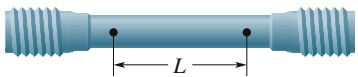

## Abb. 8.8

Ein Testzylinder zur Bestimmung einer Spannungs-Dehnungs-Kurve wie in Abb. 8.9. Bei einem Zugspannungs-Dehnungs-Test wird die relative Längenänderung ΔL∕L in Abhängigkeit von der Spannung gemessen.

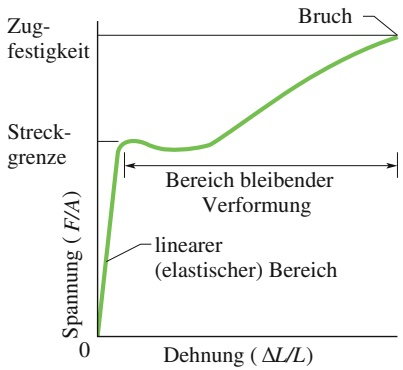

line

| Feature | Description |
| --- | --- |
| Y-axis | Spannung (F/A) |
| X-axis | Dehnung \((\Delta L/L)\) |
| Key Points | Zugfestigkeit, Bruch, Streckgrenze, linearer (elastic) Bereich |
| Region | Bereich bleibender Verformung |

## Abb. 8.9

Eine Spannungs-Dehnungs-Kurve für eine Probe aus Stahl wie in Abb. 8.8. Die Probe verformt sich dauerhaft, wenn die Spannung größer als die Streckgrenze des Materials wird. Sie bricht, wenn die Spannung die Zugfestigkeit des Materials überschreitet.

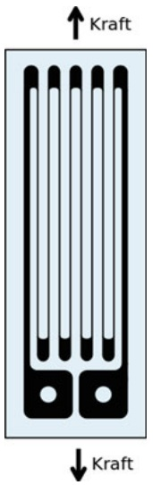

text_image

Kraft
Kraft

TABELLE 8.1:

Einige Elastizitätseigenschaften technologisch wichtiger Werkstoffe.

| Material | Dichte ρ (kg/m3) | Elastizitätsmodul E (109N/m2) | Zug-/Druckfestigkeit Rm (106N/m2) | Streckgrenze Re (106N/m2) |
| --- | --- | --- | --- | --- |
| unlegierter Stahl | 7860 | 200 | 400 | 250 |
| Aluminium | 2710 | 70 | 110 | 95 |
| Glas | 2190 | 65 | 50b) | — |
| Hartbeton | 2320 | 30 | 40b) | — |
| Holza) | 525 | 13 | 50b) | — |
| Knochen | 1900 | 9b) | 170b) | — |
| Polystyrol | 1050 | 3 | 48 | — |

a) Douglasie (ein Nadelbaum)

b) unter Druck

## Scherung

Bei einer Scherung ist die Spannung ebenfalls durch das Verhältnis einer Kraft zu einer Fläche gegeben, allerdings steht der Kraftvektor in diesem Fall nicht senkrecht zur Flächenebene, sondern liegt in der Flächenebene. Mit den in Abb. 8.7b definierten Größen ist die Dehnung definiert als das dimensionslose Verhältnis $\Delta x / L$ . Den zugehörigen Modul bezeichnet man als **Schubmodul**, er wird in der Praxis meist mit dem Symbol G gekennzeichnet. Für eine Scherbeanspruchung wird aus Gl. 8.17

$$
\frac {F}{A} = G \frac {\Delta x}{L}. \tag {8.19}
$$

Scherspannungen spielen eine wichtige Rolle beim Abknicken von Achswellen, die sich unter Belastung drehen, wie auch bei Knochenbrüchen aufgrund von Biegebeanspruchungen.

## Hydraulische Spannung

In Abb. 8.7c besteht die Spannung aus dem allseitigen Flüssigkeitsdruck $p$ auf den vom Fluid umgebenen Gegenstand, der ebenfalls als eine Kraft pro Fläche angegeben wird (wie Sie in Kapitel 10 sehen werden). Die Verformung ist durch die relative Volumenänderung $\Delta V / V$ gegeben, wobei V das ursprüngliche Volumen der Probe ist und $\Delta V$ der Absolutwert der Volumenänderung. Der zugehörige Modul K ist der **Kompressionsmodul** des Materials. Der Gegenstand befindet sich in diesem Fall unter hydraulischem Druck, und den Druck selbst nennt man auch hydraulische Spannung. Für diese Situation wird Gl. 8.17 zu

$$
p = K \frac {\Delta V}{V}. \tag {8.20}
$$

Der Kompressionsmodul beträgt für Wasser $2 { , } 2 { \mathrm { ~ \cdot ~ } } 1 0 ^ { 9 }   \mathrm { N } / \mathrm { m } ^ { 2 }$ und für Stahl 16 $1 0 ^ { 1 0 }   \mathrm { N / m } ^ { \ddagger }$ . Der Druck am Grund des Pazifischen Ozeans in einer mittleren Tiefe von 4000 m beträgt $4 { , } 0 { \mathrm { ~ \cdot ~ } } 1 0 ^ { 7 }   \mathrm { N } / \mathrm { m } ^ { 2 } .$ . Die relative Volumenänderung $\Delta V / V$ von Wasser beträgt bei diesem Druck ungefähr 1,8 %, die für einen Gegenstand aus Stahl rund 0,025 %. Im Allgemeinen sind Festkörper mit ihren starren atomaren Gittern weniger kompressibel als Flüssigkeiten, in denen die Atome oder Moleküle nicht so fest an ihre Nachbarn gebunden sind.

## KONTROLLFRAGE 6

Die Abbildung zeigt einen horizontalen Block, der von zwei Drähten A und B gehalten wird. Die beiden Drähte seien abgesehen von ihren ursprünglichen Längen identisch. Der Schwerpunkt des Blocks sei näher an Draht B als an Draht A.

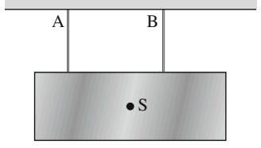

text_image

A
B
•S

(a) Wenn Sie die Drehmomente um den Schwerpunkt abschätzen, ist der Betrag des von Draht A ausgeübten Drehmoments größer, kleiner oder gleich dem Betrag des von Draht B ausgeübten Drehmoments? (b) Welcher Draht übt eine größere Kraft auf den Block aus? (c) Wenn die Drähte nun gleiche Längen haben, welcher Draht war ursprünglich kürzer?

## 8.4 Zusammenfassung

**Statisches Gleichgewicht** Ein starrer Körper in Ruhe befindet sich in einem **statischen Gleichgewicht**. Für einen solchen Körper ist die vektorielle Summe aller äußeren Kräfte gleich null:

$$
\vec {F} _ {\mathrm{ges}} = 0 \quad (\text {Gleichgewicht der Kräfte}). \tag {8.3}
$$

Wenn alle Kräfte in der xy-Ebene liegen, ist diese Vektorgleichung äquivalent zu zwei Komponentengleichungen:

$$
F _ {\text {ges}, x} = 0 \quad \text {und} \quad F _ {\text {ges}, y} = 0 \quad (\text {Gleichgewicht der Kräfte}). \tag {8.7,8.8}
$$

Im statischen Gleichgewicht verschwindet auch die vektorielle Summe der äußeren Drehmomente auf den Körper um jeden Punkt:

$$
\vec {\tau} _ {\mathrm{ges}} = 0 \quad (\text {Gleichgewicht der Drehmomente}). \tag {8.5}
$$

Liegen die Kräfte in der xy-Ebene, sind alle Drehmomentvektoren parallel zur $z - \mathrm { A }$ chse und Gl. 8.5 ist äquivalent zu einer einzelnen Komponentengleichung:

$$
\tau_ {\mathrm{ges}, z} = 0 \quad (\text {Gleichgewicht der Drehmomente}). \tag {8.9}
$$

**Gravizentrum** Die Gravitationskraft wirkt auf jedes Element eines Körpers einzeln. Die Gesamtwirkung aller einzelnen Beiträge kann man sich auch als eine Gesamtgravitationskraft $\vec { \bar { F } } _ { \mathrm { G } }$ vorstellen, die in einem bestimmten Punkt, dem **Gravizentrum**, angreift. Ist die Gravitationsbeschleu nigung $\vec { g }$ für alle Elemente des Körpers gleich, dann befindet sich das Gravizentrum im Schwerpunkt.

**Elastizitätsmodul** Drei **elastische Modulen** werden zur Beschreibung des elastischen Verhaltens (den Verformungen) von Gegenständen aufgrund einwirkender Kräfte verwendet. Die **Dehnung** (relative Längenänderung) steht über den entsprechenden Elastizitätsmodul in linearem Zusammenhang mit der wirkenden **Spannung** (Kraft pro Fläche):

$$
\text {Spannung} = \text {Elastizitätsmodul} \cdot \text {Dehnung}. \tag {8.17}
$$

## 8.5 Fragen

**1.** Abbildung 8.F1 zeigt eine Draufsicht auf einen homogenen Stab, auf den vier Kräfte wirken. Angenommen, wir wählen eine Drehachse durch den Punkt O, berechnen die Drehmomente bezüglich dieser Achse aufgrund der Kräfte und stellen fest, dass diese Drehmomente die Gleichgewichtsbedingung erfüllen. Gelten die Gleichgewichtsbedingungen für die Drehmomente auch dann, wenn wir

**Zug und Druck** Wirken auf einen Gegenstand Zug- oder Druckkräfte, so wird aus Gl. 8.17

$$
\frac {F}{A} = E \frac {\Delta L}{L}, \tag {8.18}
$$

wobei $\Delta L / L$ die relative Längenänderung (Dehnung bei Zugkräften bzw. Stauchung bei Druckkräften) ist. F ist der Betrag der die Spannung verursachenden Kraft ${ \vec { F } } .$ A ist die Querschnittsfläche, über welche die Kraft $\vec { F }$ verteilt ist (senkrecht zu $A$ wie in Abb. 8.7a), und $E$ ist der Elastizi**tätsmodul** des Gegenstands. Die Spannung ist gleich $F / A$

**Scherung** Erfährt ein Gegenstand eine Scherspannung, wird aus Gl. 8.17

$$
\frac {F}{A} = G \frac {\Delta x}{L}. \tag {8.19}
$$

In diesem Fall ist $\Delta x$ der Betrag der Verschiebung des einen Endes des Gegenstands in Richtung der wirkenden Kraft $\vec { F }$ (wie in Abb. 8.7b). $\Delta x / L$ ist die relative Verschiebung, G der **Schubmodul** des Gegenstands und F∕AΔx∕Le Scherspannung.

**Hydraulische Spannung** Wirkt auf einen Gegenstand der hydraulische Druck eines umgebenden Fluids, so wird Gl. 8.17 zu

$$
p = K \frac {\Delta V}{V}, \tag {8.20}
$$

wobei $p$ der (hydraulische) Druck des Fluids auf den Gegenstand ist, $\Delta V / V$ der Absolutbetrag der relativen Volumenänderung aufgrund dieses Drucks, und K der **Kompressionsmodul** des Gegenstands.

stattdessen (a) Punkt $\mathrm { A } ,$ (b) Punkt B oder (c) Punkt C als Drehachse gewählt hätten?

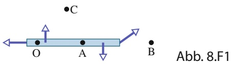

text_image

C
O A B
Abb. 8.F1

**2.** In Abb. 8.F2 ist ein starrer Balken auf zwei Stützen befestigt, die fest im Boden verankert sind. Ein kleiner, aber schwerer Safe wird der Reihe nach an die sechs eingezeichneten Positionen gestellt. Die Masse des Balkens soll im Vergleich zur Masse des Safes vernachlässigbar sein. (a) Ordnen Sie die Positionen nach der Stärke der vom Safe auf die Stütze A ausgeübten Kraft, angefangen beim größ- ten Druck bis zum größten Zug, und geben Sie an, ob (und wenn ja, wo) die Kraft verschwindet. (b) Wiederholen Sie diese Zuordnung für die Stütze B.

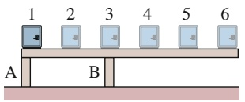

text_image

1 2 3 4 5 6
A B

Abb. 8.F2

**3.** Abbildung 8.F3 zeigt vier Draufsichten auf rotierende homogene Scheiben, die über einen reibungsfreien Boden gleiten. Auf jede dieser Scheiben wirken drei Kräfte vom Betrag $F ,   2 F$ oder $3 F$ entweder am Rand, im Mittelpunkt oder an einem Punkt auf der Hälfte zwischen Rand und Mittelpunkt. Die Kraftvektoren drehen sich mit den Scheiben und zeigen in der „Momentaufnahme“ von Abb. 8.F3 nach links oder rechts. Welche dieser Scheiben befindet sich im Gleichgewicht?

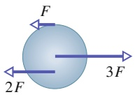

(a)

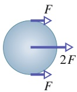

(b)

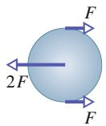

(c)

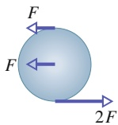

(d)

Abb. 8.F3

**4.** Abbildung 8.F4 zeigt Draufsichten auf zwei Strukturen, auf die jeweils drei Kräfte wirken. Die Richtungen der Kräfte sind eingezeichnet, die Beträge der Kräfte können noch geeignet justiert werden (sollen aber von null verschieden bleiben). Welche dieser Strukturen kann sich im statischen Gleichgewicht befinden?

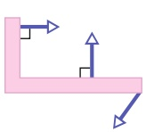

(a)

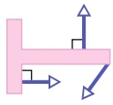

(b)

Abb. 8.F4

**5.** Abbildung 8.F5 zeigt ein Mobile aus Spielzeugpinguinen, das von der Decke herunterhängt. Jede Querstange hängt waagerecht, hat eine vernachlässigbare Masse und erstreckt sich dreimal so weit zur Rechten der Aufhängung wie zur Linken. Pinguin 1 hat die Masse $m _ { \mathrm { 1 } } = 4 8   \mathrm { k g } .$ Welche Massen haben die anderen Pinguine?

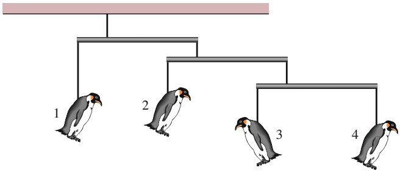

flowchart

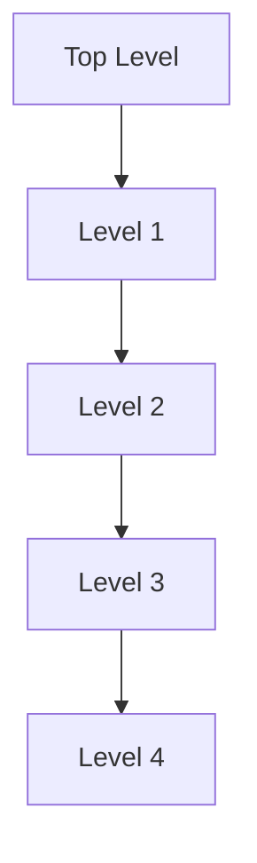

Abb. 8.F5

**6.** Eine Leiter lehnt gegen eine reibungsfreie Wand, wird aber durch die Reibung zwischen Leiter und Boden am Abrutschen gehindert. Angenommen, Sie verschieben den Fuß der Leiter näher zur Wand. Welche der folgenden Grö- ßen wird (betragsmäßig) größer, kleiner oder bleibt gleich: (a) die Normalkraft des Bodens auf die Leiter, (b) die Kraft der Wand auf die Leiter, (c) die Haftreibungskraft des Bodens auf die Leiter und (d) der Maximalwert $f _ { \mathrm { R , m a x } }$ der Haftreibungskraft?
**7.** Drei Tierfiguren hängen an der (ruhenden) Anordnung aus masselosen Rollen und Schnüren, wie sie in Abb. 8.F7 wiedergegeben ist. Eine Schnur verläuft von der Decke auf der rechten Seite zu der unteren Rolle links. An einigen kürzeren Schnüren hängen Rollen von der Decke bzw. Tierfiguren von den Rollen. Von zwei der Tierfiguren sind die Gewichte (in Newton) angegeben. (a) Welches Gewicht hat die dritte Tierfigur? (b) Wie groß ist die Zugkraft in der kurzen mit T gekennzeichneten Schnur ganz links? Hinweis: Wenn eine Schnur oberhalb einer Rolle halb herumläuft, dann zieht sie an dieser Rolle mit einer Gesamtkraft, die doppelt so groß ist wie die Zugkraft bzw. Seilkraft in der Schnur.

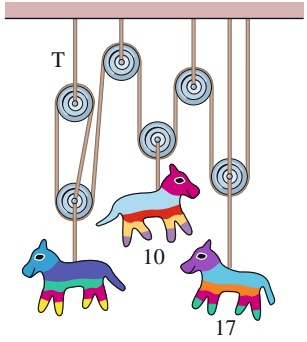

text_image

T
10
17

Abb. 8.F7

**8.** (a) Wenn Sie in Kontrollfrage 4 das Drehmoment $\tau _ { \mathsf { S } }$ durch T ausdrücken wollen, müssen Sie sin θ oder cos θ verwenden? (b) Wenn der Winkel θ kleiner wird (indem das Seil verkürzt wird, der Stab aber horizontal bleibt), wird das für das Gleichgewicht notwendige Drehmoment $\tau _ { \mathsf { S } }$ größer, kleiner oder bleibt es gleich? (c) Wird der Betrag der zugehörigen Kraft T größer, kleiner oder bleibt er gleich?
**9.** Die Tabelle gibt die Flächeninhalte von drei Flächen an sowie jeweils den Betrag einer Kraft, die senkrecht zu dieser Fläche wirkt und gleichförmig über sie verteilt ist. Ordnen

Sie die Flächen nach der Größe der Spannung (die größte zuerst).

|  | Fläche | Kraft |
| --- | --- | --- |
| Fläche A | $0,5A_{0}$ | $2F_{0}$ |
| Fläche B | $2A_{0}$ | $4F_{0}$ |
| Fläche C | $3A_{0}$ | $6F_{0}$ |

**10.** Vier zylindrische Stäbe werden wie in Abb. 8.7a gedehnt. Die Beträge der Kräfte, die Querschnittsflächen, die Längenänderungen und die ursprünglichen Längen sind in der Tabelle aufgeführt. Ordnen Sie die Stäbe in absteigender Reihenfolge nach ihrem Elastizitätsmodul.

| Stab | Kraft | Fläche | absolute Längenänderung | ursprüngliche Länge |
| --- | --- | --- | --- | --- |
| 1 | F | A | $\Delta L$ | L |
| 2 | 2F | 2A | $2\Delta L$ | L |
| 3 | F | 2A | $2\Delta L$ | $2\Delta L$ |
| 4 | 2F | A | $\Delta L$ |  |

**11.** Abbildung 8.F11 zeigt drei Situationen, in denen der gleiche horizontale Stab an seinem einen Ende an einem Scharnier an einer Wand befestigt ist und an seinem anderen Ende von einer Schnur gehalten wird. Ordnen Sie die Situationen (1) bis (3) ohne Rechnung in absteigender Reihenfolge nach dem Betrag (a) der vertikalen Kraft der Schnur auf den Stab, (b) der vertikalen Kraft des Scharniers auf den Stab und (c) der horizontalen Kraft des Scharniers auf den Stab.

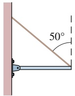

(1)

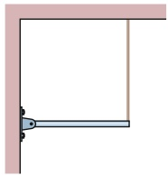

(2)

text_image

50°

(3)

Abb. 8.F11

**12.** Abbildung 8.F12 zeigt einen ruhenden Stab AC mit einer Masse von 5 kg, der durch ein Seil und die Reibung zwischen Stab und Wand gehalten wird. Der homogene Stab ist 1 m lang und der Winkel θ beträgt 30°. (a) Wenn Sie den Betrag der Kraft $\vec { T }$ des Seils auf den Stab aus einer einzigen Gleichung bestimmen sollten, an welche der markierten Positionen würden Sie die Drehachse legen? Welches Vorzeichen hat (b) das Drehmoment $\tau _ { \mathrm { G } }$ aufgrund des Gewichts des Stabes und (c) das Drehmoment $\tau _ { \mathrm { Z } }$ aufgrund der Zugspannung des Seils für diese Wahl der Drehachse, wenn Sie Drehmomente im Gegenuhrzeigersinn positiv zählen? (d) Ist der Betrag von $\tau _ { \mathrm { Z } }$ größer als, kleiner als oder gleich groß wie der von $\tau _ { \mathrm { G } } { } ^ { ? }$

text_image

D
θ
A B C

Abb. 8.F12

**13.** Die vertikale Stange in Abb. 8.F13 ist an ihrem unteren Ende beweglich und wird an ihrem oberen Ende durch ein Seil gehalten. Nun soll wie in der Abbildung gezeigt eine horizontale Kraft $\vec { F } _ { \mathrm { h } }$ auf die Stange ausgeübt werden. Nimmt die Zugspannung in dem Seil zu, ab oder bleibt sie gleich, wenn der Punkt, an dem die Kraft angreift, nach oben bewegt wird?

text_image

Diagram showing a vertical rod with applied force F_h acting on it, mounted on a horizontal surface.

Abb. 8.F13

# 9 Gravitation

## 9.1 Das Newtonsche Gravitationsgesetz

## Physikalische Motivation

Die Gravitation ist eine der Grundkräfte der Natur, sie zu verstehen ist daher eine wichtige Aufgabe der Physik. Sie ist die Kraft, die uns alle auf der Erde, den Mond auf seiner Umlaufbahn um die Erde und die Erde auf ihrer Umlaufbahn um die Sonne hält. Sie erstreckt sich durch unsere ganze Galaxie, die Milchstraße, und hält ihre Milliarden und Abermilliarden von Sternen ebenso zusammen wie die unzähligen Moleküle und Staubteilchen zwischen den Sternen. Wir befinden uns im Außenbereich dieser scheibenförmigen Ansammlung von Sternen und sonstiger Materie, etwa $^ { 2 , 6 \cdot 1 0 ^ { 4 } }$ Lichtjahre $( 2 , 5 \cdot 1 0 ^ { 2 0 }   \mathrm { m } )$ von dem galaktischen Zentrum entfernt, um das wir uns langsam drehen.

Die Gravitation wirkt auch auf noch größeren Maßstäben, durch den intergalaktischen Raum hält sie die Lokale Gruppe von Galaxien zusammen, die außer unserer Milchstraße auch die Andromeda-Galaxie (Abb. 9.1) in einem Abstand von $^ { 2 , 3 \cdot 1 0 ^ { 6 } }$ Lichtjahren von der Erde sowie einige näher gelegene Zwerggalaxien wie die Große und die Kleine Magellansche Wolke umfasst. Die Lokale Gruppe wiederum ist ein Teil des Lokalen Superhaufens von Galaxien, der seinerseits von der Schwerkraft in Richtung einer außerordentlich massiven Region voller Galaxienhaufen und -superhaufen gezogen wird, die als Großer Attraktor bezeichnet wird. Diese Region scheint etwa $\bar { 3 { , } 0 \cdot 1 0 ^ { 8 } }$ Lichtjahre von der Erde entfernt und auf der gegenüberliegenden Seite der Milchstraße zu liegen. Die Gravitation reicht sogar noch weiter, prinzipiell bis ins Unendliche – und sie versucht, das Universum als solches während der kosmischen Expansion zusammenzuhalten.

natural_image

A spiral galaxy in deep space with star clusters and dust (no text or symbols visible)

Abb. 9.1

Der Andromeda-Nebel. Sein Abstand von uns beträgt $^ { 2 , 5 \cdot 1 0 ^ { 6 } }$ Lichtjahre und er ist als einzige Galaxie gerade noch mit dem bloßen Auge zu erkennen. Dieser kosmische Nachbar sieht unserer Heimatgalaxis, der Milchstraße, sehr ähnlich [Quelle: plefevre/iStockphoto].

Die Gravitation ist auch für einige der geheimnisvollsten Strukturen im ganzen Universum verantwortlich: die Schwarze Löcher. Wenn ein Stern, der wesentlich größer ist als unsere Sonne, seinen nuklearen Brennstoffvorrat aufgebraucht hat, kann er die Gravitationskräfte zwischen seinen Teilchen nicht mehr kompensieren, sodass er kollabiert und im Extremfall zu einem Schwarzen Loch wird. Die Gravitation an der Oberfläche eines solchen kollabierten Sterns ist so stark, dass weder Teilchen noch Licht von seiner Oberfläche entweichen können (daher der Name „Schwarzes Loch“). Jeder Stern, der einem Schwarzen Loch zu nahe kommt, wird durch die starke Gravitation auseinander gerissen und in das Loch gezogen. Dies geschieht besonders häufig im Zentrum von Sternsystemen wie unserer Milchstraßen, wo sich daher im Laufe der Zeit ein sogenanntes supermassives Schwarzes Loch herausbildet. „Unser“ eigenes Schwarzes Riesenloch im Zentrum der Milchstraße liegt im Sternbild Schütze und wird deshalb Sagittarius A\* genannt, es hat eine Masse von etwa $^ { 3 , 7 \cdot 1 0 ^ { 6 } }$ Sonnenmassen. In der Nähe dieses Schwarzen Lochs ist die Gravitation so stark, dass sie kreisende Sterne zu einer peitschenden Bewegung um das Schwarze Loch antreibt, bei der sie für einen Umlauf nur wenige Jahre brauchen (die Sonne umrundet das Milchstraßenzentrum einmal in 220 Millionen Jahren).

Obwohl die Gravitation noch immer nicht vollständig verstanden ist, wollen wir mit unseren Ausführungen bei dem Gravitationsgesetz von Isaac Newton beginnen – vielleicht sind Sie ja derjenige oder diejenige, die in einigen Jahren die letzten Rätsel der Gravitation lösen wird.

## 9.1.1 Das Newtonsche Gravitationsgesetz

Physiker untersuchen gern scheinbar unzusammenhängende Phänomene, von denen sie dann zeigen wollen, dass es bei genauerer Betrachtung eine Beziehung zwischen ihnen gibt. Diese Suche nach Vereinheitlichungen hat eine jahrhundertelange Tradition. Im Jahr 1665 zeigte der damals 23-jährige Isaac Newton, dass es sich bei der Kraft, die den Mond in seiner Umlaufbahn hält, um dieselbe Kraft handelt, die auch einen Apfel zu Boden fallen lässt. Damit legte er einen Grundstein der Physik. Für uns heute ist dieser Zusammenhang so selbstverständlich geworden, dass es uns schwerfällt, anderslautende Vorstellungen der antiken Gelehrten nachzuvollziehen. Für sie waren die Bewegungen erdgebundener Körper und die Bewegungen der Himmelskörper von grundsätzlich unterschiedlicher Art und durch unterschiedliche Gesetze zu beschreiben.

Newton zeigte nicht nur, dass die Erde einen Apfel ebenso wie den Mond anzieht, sondern er schloss auch, dass jeder Körper im Universum jeden anderen Körper anzieht. Dieses Verhalten der Körper, sich aufeinander zuzubewegen, bezeichnet man als Gravitation. Newtons Schlussfolgerung ist nicht offensichtlich, denn die vertraute und starke Anziehungskraft, welche die Erde auf Körper auf ihrer Oberfläche ausübt, lässt die minimale Anziehungskräfte durch alltägliche Körper oft vergessen. Beispielsweise zieht die Erde einen Apfel mit einer Kraft von ungefähr 0,8 N an. Auch Sie ziehen einen Apfel an (und umgekehrt er Sie), aber diese Anziehungskraft ist kleiner als das Gewicht eines Staubteilchens.

Newton formulierte ein Kraftgesetz, das wir heute als das Newtonsche Gravitationsgesetz bezeichnen: Jedes Teilchen zieht jedes andere Teilchen mit einer Gravitationskraft an, deren Betrag durch die Beziehung

$$
F = G \frac {m _ {1} m _ {2}}{r ^ {2}} \quad \text {(Newtonsches Gravitationsgesetz)} \tag {9.1}
$$

gegeben ist. Hierbei sind $m _ { 1 }$ und $m _ { 2 }$ die Massen der Teilchen, r ist ihr Abstand und G die Gravitationskonstante. Ihr Wert beträgt

$$
G = 6, 6 7 \cdot 1 0 ^ {- 1 1} \mathrm{N} \cdot \mathrm{m} ^ {2} / \mathrm{kg} ^ {2} = 6, 6 7 \cdot 1 0 ^ {- 1 1} \mathrm{m} ^ {3} / \mathrm{kg} \cdot \mathrm{s} ^ {2}. \tag {9.2}
$$

Wie in Abb. 9.2 zu sehen ist, wird ein Teilchen $m _ { 1 }$ von einem Teilchen $m _ { 2 }$ mit einer Gravitationskraft $\vec { F }$ angezogen, die auf Teilchen $m _ { 2 }$ gerichtet ist. Umgekehrt wird $m _ { 2 }$ von $m _ { 1 }$ durch eine Gravitationskraft $- \vec { F }$ in Richtung $m _ { 1 }$ angezogen. Die Kräfte $\vec { F }$ und $- \vec { F }$ bilden ein Kräftepaar im Sinn des dritten Newtonschen Gesetzes: Ihre Beträge sind gleich, aber sie sind entgegengesetzt gerichtet. Die Stärke dieser Kraft hängt vom Abstand zwischen den beiden Teilchen ab, allerdings nicht von ihrem Ort: Die beiden Teilchen können sich tief in einer Höhle oder auch tief im Weltraum befinden. Auch das Vorhandensein anderer Körper beeinflusst die beiden Kräfte $\vec { F }$ und $- \vec { F }$ nicht, selbst wenn sich diese anderen Körper genau zwischen den beiden Teilchen befinden.

Die Stärke der Gravitationskraft – wie stark sich also zwei Teilchen mit gege benen Massen in einem gegebenen Abstand anziehen – hängt von der Gravitationskonstanten G ab. Würde G durch ein Wunder plötzlich mit einem Faktor 10 multipliziert, würden Sie durch die Anziehungskraft der Erde auf den Boden geworfen. Betrüge andererseits G auf einmal nur noch 10 % des heutigen Werts, wäre die Anziehung der Erde so schwach, dass Sie über ein Gebäude springen könnten.

Obwohl sich das Newtonsche Gravitationsgesetz streng genommen auf Punktteilchen bezieht, können wir es auch auf ausgedehnte Gegenstände anwenden, sofern die Größe dieser Gegenstände klein im Vergleich zu ihrem Abstand ist. Mond und Erde sind weit genug voneinander entfernt, sodass wir beide Objekte in guter Näherung als punktförmig annehmen können – aber wie steht es mit dem Apfel und der Erde? Vom Standpunkt des Apfels erscheint die breite ausgedehnte Erde, die sich unter dem Apfel in jede Himmelsrichtung bis zum Horizont erstreckt, alles andere als punktförmig.

Newton löste dieses Apfel-Erde-Problem durch ein sehr wichtiges Theorem, das manchmal als das Kugelschalentheorem bezeichnet wird:

Eine homogene materielle Kugelschale zieht ein Teilchen außerhalb dieser Schale mit derselben Kraft an, die auch wirken würde, wenn die gesamte Materie der Schale sich in ihrem Mittelpunkt befände.

Die Erde kann man sich als eine Verschachtelung vieler solcher Kugelschalen vorstellen, vergleichbar mit Zwiebelschalen, und jede dieser Kugelschalen zieht ein Teilchen außerhalb der Erdoberfläche mit einer Kraft an, als ob ihre Masse im Mittelpunkt dieser Schale konzentriert wäre. Auch vom Standpunkt des Apfels aus be trachtet verhält sich die Erde daher wie ein Teilchen, das sich im Erdmittelpunkt befindet und dessen Masse gleich der Erdmasse ist.

Nehmen wir an, die Erde zieht wie in Abb. 9.3 dargestellt einen Apfel mit einer Kraft vom Betrag 0,8 N nach unten. Dann muss der Apfel die Erde mit einer Kraft vom Betrag 0,8 N nach oben ziehen. Von dieser Kraft können wir uns vorstellen, dass sie im Erdmittelpunkt angreift. Obwohl die Beträge dieser beiden Kräfte gleich sind, führen sie zu unterschiedlichen Beschleunigungen, wenn der Apfel losgelassen wird. Für den Apfel beträgt die Beschleunigung ungefähr $9 { , } 8   \mathrm { m / s ^ { 2 } ] }$ , die bekannte Beschleunigung eines frei fallenden Körpers in der Nähe der Erdoberfläche. Für die Erde beträgt die Beschleunigung im Schwerpunktsystem von Apfel und Erde aufgrund ihrer gigantisch großen Masse(nträgheit) nur rund $1 \cdot 1 0 ^ { - \hat { 2 } 5 }   \mathrm { m } / \mathrm { s } ^ { 2 }$

## KONTROLLFRAGE 1

Ein Teilchen wird der Reihe nach außerhalb der folgenden vier Gegenstände plat ziert, die jeweils die Masse m haben sollen: (1) eine große homogene Vollkugel, (2) eine große homogene Kugelschale, (3) eine kleine homogene Vollkugel und (4) eine kleine homogene Kugelschale. In allen Fällen beträgt der Abstand zwischen dem Teilchen und dem Mittelpunkt des Gegenstands d. Ordnen Sie die Gegenstände nach dem Betrag der Gravitationskraft, die sie auf das Teilchen ausüben.

text_image

m₁
F
-F
r
m₂

Abb. 9.2

Zwei Teilchen der Massen $m _ { 1 }$ und $m _ { 2 }$ im Abstand r ziehen sich gemäß dem Newtonschen Gravitationsgesetz (Gl. 9.1) an. Die Anziehungskräfte $\vec { F }$ und $- \vec { F }$ sind vom Betrag her gleich, aber entgegengesetzt gerichtet.

text_image

Diagram illustrating force vectors on an apple in a globe, showing positive and negative forces with arrows labeled F and -F.

Abb. 9.3

Der Apfel zieht die Erde mit derselben Kraft nach oben, mit der umgekehrt die Erde den Apfel nach unten zieht.

## 9.2 Gravitation und das Superpositionsprinzip

## Lernziele

Nach dem Durcharbeiten dieses Abschnitts sollten Sie in der Lage sein, . . .

• für Fälle, in denen mehr als eine Gravitationskraft auf ein Teilchen wirkt, ein Kräftediagramm zu zeichnen, das alle diese Kräfte zeigt, wobei die Enden aller Kraftvektoren an dem Teilchen angreifen,
• für Fälle, in denen mehr als eine Gravitationskraft auf ein Teilchen wirkt, die Gesamtkraft durch vektorielle Addition der einzelnen Kräfte zu berechnen.

## Schlüsselideen

• Gravitationskräfte gehorchen dem Superpositionsprinzip, d. h., wenn n Teilchen miteinander wechselwirken, ist die Gesamtkraft auf Teilchen 1 die Summe aller einzelnen Kräfte aufgrund von anderen Teilchen:

$$
\vec {F} _ {1, \mathrm{ges}} = \sum_ {i = 2} ^ {n} \vec {F} _ {1 i},
$$

wobei die vektorielle Summe alle Kräfte auf Teilchen 1 aufgrund von Teilchen $2 , 3 , \ldots , n$ umfasst.

• Die Gravitationskraft eines Teilchens aufgrund eines ausgedehnten Körpers kann berechnet werden, indem man den Körper in differenzielle Massenelemente dm aufteilt, die jeweils eine differenzielle Kraft $\mathrm { d } \vec { F }$ auf das Teilchen ausüben, und dann über alle diese Massenelemente integriert:

$$
\vec {F} _ {1} = \int \mathrm{d} \vec {F}.
$$

## 9.2.1 Gravitation und das Superpositionsprinzip

Für eine Gruppe aus mehreren Teilchen erhalten wir die Gesamtgravitationskraft, die auf jedes einzelne Teilchen von den anderen Teilchen ausgeübt wird, mithilfe des sogenannten Superpositionsprinzips. Hierbei handelt es sich um ein allgemeines Prinzip, wonach sich die Gesamtwirkung aus der Summe der einzelnen Wirkungen zusammensetzt. Im vorliegenden Fall bedeutet das Superpositionsprinzip, dass wir zunächst der Reihe nach die Gravitationskraft von jedem einzelnen Teilchen auf unser spezielles Teilchen berechnen können. Die Gesamtkraft erhalten wir dann, indem wir diese Kräfte vektoriell addieren.

Für n Teilchen in Wechselwirkung können wir das Superpositionsprinzip der Gravitationskraft in der folgenden Form ausdrücken:

$$
\vec {F} _ {1, \mathrm{ges}} = \vec {F} _ {1 2} + \vec {F} _ {1 3} + \vec {F} _ {1 4} + \vec {F} _ {1 5} + \dots + \vec {F} _ {1 n}. \tag {9.3}
$$

Hierbei ist $\vec { F } _ { 1 , \mathrm { g e s } }$ die Gesamtkraft auf Teilchen 1, und $\vec { \bar { F } } _ { 1 3 }$ ist z. B. die Kraft, die von Teilchen 3 auf Teilchen 1 ausgeübt wird. Wir können diese Gleichung auch etwas kompakter als Vektorsumme schreiben:

$$
\vec {F} _ {1, \text {ges}} = \sum_ {i = 2} ^ {n} \vec {F} _ {1 i}. \tag {9.4}
$$

Doch wie steht es mit der Gravitationskraft von einem wirklich ausgedehnten Kör per auf ein Teilchen? Diese Kraft erhalten wir, indem wir zunächst den Gegenstand in so kleine Teile zerlegen, dass wir diese wie Teilchen behandeln können, und anschließend nach Gl. 9.4 die vektorielle Summe aller Kräfte dieser einzelnen Teile bilden. Im Grenzfall unterteilen wir den ausgedehnten Gegenstand in infinitesimal