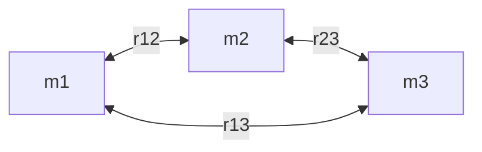
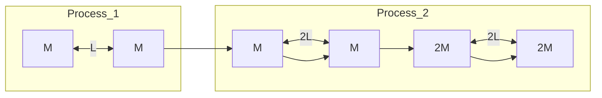

kleine Teile der Masse dm, von denen jedes eine differenzielle Kraft $\mathrm { d } \vec { F }$ auf das Teilchen ausübt. In diesem Grenzfall wird aus der Summe in Gl. 9.4 ein Integral und wir erhalten

$$
\vec {F} _ {1} = \int \mathrm{d} \vec {F}. \tag {9.5}
$$

Das Integral erstreckt sich dabei über den gesamten Gegenstand und den Index $\mathbf { \nabla } _ { \mathbf { \nabla } ^ { \prime } } \mathbf { g e s } ^ { \alpha }$ haben wir weggelassen. Handelt es sich bei dem Gegenstand um eine homogene Vollkugel oder eine gleichförmige Kugelschale, können wir das Integral in Gl. 9.5 umgehen, indem wir uns die Masse des Gegenstands in seinem Mittelpunkt konzentriert denken und Gl. 9.1 anwenden.

## KONTROLLFRAGE 2

In der Abbildung erkennt man vier Anordnungen von jeweils drei Teilchen gleicher Masse. (a) Ordnen Sie die Anordnungen nach dem Betrag der Gesamtgravitationskraft (die größte zuerst) auf das mit $_ { v } m ^ { \alpha }$ gekennzeichnete Teilchen. (b) Liegt die Richtung der Gesamtkraft in Anordnung 2 näher an der Linie der Länge d oder näher an der Linie der Länge D?

## KONTROLLFRAGE 3

In welche Richtung wirkt in der Abbildung die Gesamtgravitationskraft auf das Teilchen der Masse $m _ { 1 }$ aufgrund der anderen Teilchen, die jeweils die Masse m haben und symmetrisch relativ zur y-Achse angeordnet sein sollen?

text_image

y
m₁
m
m
m
x

## LÖSUNGSSTRATEGIEN

**Strategie 1: Kräftediagramm für ein Teilchen** Wenn Sie ein Diagramm von Teilchen vor sich haben, wie beispielsweise Abb. 9.4a im Übungsbuch, und die Gesamtgravitationskraft auf eines dieser Teilchen bestimmen wollen, dann sollten Sie zunächst ein Kräftediagramm nur für dieses eine Teilchen zeichnen. In diesem Kräftediagramm sollten auch nur die Kräfte auf dieses eine Teilchen eingezeichnet sein, wie in Abb. 9.4b im Übungsbuch. Wenn Sie es jedoch vorziehen, die Kraftvektoren in dem gegebenen Diagramm direkt zu überlagern, dann sollten Sie die Vektoren mit ihren Enden oder ihren Spitzen an das Teilchen zeichnen, auf das die Kräfte wirken. Zeichnen Sie die Vektoren an anderer Stelle, kann das zu Verwirrung führen, und mit Sicherheit stiftet es Verwirrung, wenn Sie die Vektoren an die Teilchen zeichnen, welche die Kräfte auf das betreffende Teilchen verursachen.

## 9.3 Die Gravitation in der Nähe der Erdoberfläche

## Lernziele

Nach dem Durcharbeiten dieses Abschnitts sollten Sie in der Lage sein, . . .

• zwischen der Beschleunigung des freien Falls und der Gravitationsbeschleunigung zu unterscheiden,
• die Gravitationsbeschleunigung in der Nähe, aber außerhalb eines homogenen kugelförmigen astronomischen Körpers zu berechnen,
• zwischen dem gemessenen Gewicht und dem Betrag der Gravitationskraft zu unterscheiden.

## Schlüsselideen

• Die Gravitationsbeschleunigung $\alpha _ { \mathrm { G } }$ eines Teilchens der Masse m resultiert einzig aus der Schwerkraft. Wenn das Teilchen sich in einem Abstand r vom Mittelpunkt eines homogenen sphärischen Körpers der Masse M befindet, ist der Betrag F der Gravitationskraft auf das Teilchen durch Gl. 9.1 gegeben. Daher gilt nach dem zweiten Newtonschen Gesetz

$$
a _ {\mathrm{G}} = \frac {G M}{r ^ {2}}.
$$

Die Masse der Erde ist nicht homogen verteilt, weil die Erde nicht perfekt sphä- risch ist, die Erdkruste unterschiedlich dick ist und weil die Erde sich dreht. Daher unterscheidet sich die gemessene Beschleunigung $\vec { g }$ geringfügig von der Gravitationsbeschleunigung ${ \vec { a } } _ { \mathrm { G } }$ , und ebenso unterscheidet sich das Gewicht mg eines Teilchens geringfügig von der auf das Teilchen wirkenden Kraft der Gravitation.

## 9.3.1 Die Gravitation in der Nähe der Erdoberfläche

Wenn wir die Erde als eine homogene Kugel der Masse M ansehen, ist der Betrag der Gravitationskraft von der Erde auf ein Teilchen der Masse m, das sich im Abstand r vom Erdmittelpunkt über der Erdoberfläche befindet, durch Gl. 9.1 gegeben:

$$
F = G \frac {M m}{r ^ {2}}. \tag {9.6}
$$

Lässt man das Teilchen los, so fällt es aufgrund der Gravitationskraft $\vec { F }$ auf den Erdmittelpunkt zu (und dieser mit minimaler Geschwindigkeit auf das Teilchen zu!). Die Beschleunigung des Teilchens bezeichnen wir als Gravitationsbeschleunigung ${ \vec { a } } _ { \mathrm { G } }$ . Nach dem zweiten Newtonschen Gesetz hängen die Beträge F und $a _ { \mathrm { G } }$ über

$$
F = m a _ {\mathrm{G}} \tag {9.7}
$$

zusammen. Setzen wir F aus Gl. 9.6 in Gl. 9.7 ein und lösen nach $a _ { \mathrm { G } }$ auf, erhalten wir

$$
a _ {\mathrm{G}} = \frac {G M}{r ^ {2}}. \tag {9.8}
$$

Tabelle 9.1 gibt einige Werte für $a _ { \mathrm { G } }$ für verschiedene Höhen über der Erdoberflä- che an.

Seit Abschn. 2.2 haben wir angenommen, dass es sich bei der Erde um ein Iner tialsystem handelt, und ihre Eigendrehung vernachlässigt. Wegen dieser Vereinfachung konnten wir die tatsächliche Fallbeschleunigung (oder Erdbeschleunigung) $g$ eines Teilchens mit der Gravitationsbeschleunigung an der Erdoberfläche (die wir mit $x a _ { G } \; ( \mathrm { { \sf { m } } } / \mathrm { { s } } ^ { 2 } )$ bezeichnen) gleichsetzen. Außerdem haben wir angenommen, dass g auf der gesamten Erdoberfläche den konstanten Wert $9 { , } 8   \mathrm { m / s ^ { 2 } }$ hat. Der für g gemessene Wert unterscheidet sich jedoch von dem aus Gl. 9.8 berechneten Wert $a _ { \mathrm { G } }$ aus drei Gründen: (1) Die Erde (und vor allem die Erdkruste) hat keine perfekt homogene Massenverteilung, (2) sie ist keine perfekte Kugel und (3) sie dreht sich, und zwar um eine Achse durch ihren Mittelpunkt. Da g und $a _ { \mathrm { G } }$ verschieden sind, unterscheidet sich aus denselben drei Gründen auch der Betrag des gemessenen Gewichts mg eines Teilchens von dem Betrag der Gravitationskraft nach Gl. 9.6. Diese Gründe wollen wir nun genauer untersuchen.

TABELLE 9.1: Werte für $\alpha _ { \mathrm { G } }$ in Abhängigkeit von der Höhe.

| Höhe (km) | $a_{G}$ (m/s2) | Beispiel |
| --- | --- | --- |
| 0 | 9,83 | mittlere Höhe der Erdoberfläche |
| 8,8 | 9,80 | Mt. Everest |
| 36,6 | 9,71 | höchster bemannter Ballon |
| 400 | 8,70 | Bahn des Spaceshuttles |
| 35 700 | 0,225 | Nachrichtenübertragungssatelliten |

1. **Die Erde ist nicht homogen.** Die Dichte (Masse pro Volumen) der Erde verändert sich wie in Abb. 9.4 angegeben mit dem Radius. Außerdem ist die Dichte der Erdkruste (äußerer Bereich) an verschiedenen Orten der Erdoberfläche unterschiedlich – vergleichen Sie z. B. die Dicke der Erdkruste am Mt. Everest und am Boden des Pazifik. Daher hängt auch g vom Ort an der Erdoberfläche ab.
2. **Die Erde ist keine Kugel.** Die Erde ist näherungsweise ein Ellipsoid: abgeplattet an den Polen und etwas verdickt am Äquator. Ihr äquatorialer Radius ist um 21 km größer als ihr Radius an Nord- und Südpol. Ein Punkt am Pol ist daher dem Erdmittelpunkt näher als ein Punkt am Äquator. Das ist einer der Gründe, warum die Erdbeschleunigung g zunimmt, wenn man sich auf Meereshöhe vom Äquator zu einem der beiden Pole bewegt.
3. **Die Erde rotiert.** Die Drehachse verläuft durch Mittelpunkt, Nord- und Südpol der Erde. Ein Gegenstand irgendwo auf der Erdoberfläche (außer an den Polen selbst) muss sich auf einem Kreis um die Drehachse bewegen und daher eine Zentripetalbeschleunigung in Richtung des Kreismittelpunkts erfahren. Diese Zentripetalbeschleunigung erfordert eine ebenfalls auf diesen Mittelpunkt gerichtete Zentripetalkraft.

Zur Berechnung des Unterschieds zwischen g und $a _ { \mathrm { G } }$ aufgrund der Erdrotation untersuchen wir den einfachen Fall, in dem eine Kiste der Masse m am Äquator auf einer Waage liegt. Abbildung 9.5a zeigt diese Situation aus einem Blickwinkel weit oberhalb des Nordpols.

Abbildung 9.5b zeigt ein Kräftediagramm für die Kiste. Zwei Kräfte wirken auf die Kiste, beide entlang der radialen Achse vom Erdmittelpunkt. Die Normalkraft $\vec { N }$ von der Waage auf die Kiste ist nach außen gerichtet, entlang der positiven Richtung der r-Achse. Die Gravitationskraft, dargestellt durch $m \vec { a } _ { \mathrm { G } }$ , ist zum Erdmittelpunkt gerichtet. Da sich die Kiste mit der Erde auf einem Kreis um den Erdmittelpunkt dreht, wirkt die Zentripetalbeschleunigung nach innen. Nach Gl. 6.20 hat diese Beschleunigung die Form $\omega ^ { 2 } R ,$ wobei ω die Winkelgeschwindigkeit der Erde und R der Kreisradius (näherungsweise der Erdradius) ist. Das zweite Newtonsche Gesetz für die r-Achse $( F _ { \mathrm { g e s } , r } = m a _ { r } )$ wird damit zu

$$
N - m a _ {\mathrm{G}} = m (- \omega^ {2} R). \tag {9.9}
$$

Der Betrag N der Normalkraft ist gleich dem auf der Waage abgelesenen Gewicht mg. Ersetzen wir N in Gl. 9.9 durch mg, so erhalten wir

$$
m g = m a _ {\mathrm{G}} - m (\omega^ {2} R) \tag {9.10}
$$

beziehungsweise in Worten:

$$
\binom{\text {gemessenes}}{\text {Gewicht}} = \binom{\text {Betrag der}}{\text {Gravitationskraft}} - \binom{\text {Zentripetal-}}{\text {kraft}}.
$$

Das gemessene Gewicht ist daher wegen der Erddrehung kleiner als der Betrag der Gravitationskraft auf die Kiste.

Einen entsprechenden Ausdruck für $g$ und $\alpha _ { \mathrm { G } }$ erhalten wir, indem wir Gl. 9.10 durch m dividieren:

$$
g = a _ {\mathrm{G}} - \omega^ {2} R \tag {9.11}
$$

line

| Abstand vom Erdmittelpunkt (10^6 m) | Dichte (10^3 kg/m^3) |
| --- | --- |
| 0 | ~13.5 |
| 1.4 | ~12.0 |
| 3.3 | ~9.8 |
| 3.4 | ~5.3 |
| 6.4 | ~2.7 |

Abb. 9.4

Die Dichte der Erde als Funktion des Abstands von ihrem Mittelpunkt. Die Grenzen für den festen inneren Kern, den zum größten Teil flüssigen äußeren Kern und den festen Mantel sind eingetragen. Die Erdkruste ist jedoch zu dünn, um in dieser Zeichnung erkennbar zu sein.

text_image

Kiste
Waage
R
Nordpol

(a)

text_image

r
N
Kiste
a
maG

(b)

Abb. 9.5

(a) Eine Kiste liegt auf einer Waage am Erdäquator; die Blickrichtung verläuft entlang der Drehachse von einem Punkt oberhalb des Nordpols. (b) Ein Kräftediagramm für die Kiste mit einer radial nach außen gerichteten r-Achse. Die Gravitationskraft auf die Kiste ist durch ihr Äquivalent $m \vec { a } _ { \mathrm { G } }$ dargestellt. Die Normalkraft von der Waage auf die Kiste ist $\vec { N } .$ Wegen der Erdrotation wirkt auf die Kiste noch eine zum Erdmittelpunkt hin gerichtete Zentripetalbeschleunigung a⃗.

beziehungsweise in Worten:

$$
\binom{\text {freie Fall - }}{\text {beschleunigung}} = \binom{\text {Erd - }}{\text {beschleunigung}} - \binom{\text {Zentripetal - }}{\text {beschleunigung}}.
$$

Die gemessene freie Fallbeschleunigung ist also wegen der Erddrehung kleiner als die Erdbeschleunigung.

Der Unterschied zwischen den Beschleunigungen $g$ und $a _ { \mathrm { G } }$ beträgt $\omega ^ { 2 } R$ und ist am Äquator am größten (denn dort ist der Radius des von der Kiste durchlaufenen Kreises am größten). Zur Berechnung dieses Unterschieds verwenden wir Gl. 6.5 $\left( \omega = \Delta \theta / \Delta t \right)$ und den Erdradius $R = 6 , 3 7 \cdot 1 0 ^ { 6 }   \mathrm { m }$ . Für eine Erddrehung ist θ gleich 2π und die Zeitdauer beträgt ungefähr 24 h. Mit diesen Werten (und der Umrechnung $1   \mathrm { h } = 8 6   4 0 0   \mathrm { s } )$ erhalten wir $\operatorname { f i i r } g$ einen um $0 , 0 3 4   \mathrm { m } / \mathrm { s } ^ { 2 }$ kleineren Wert als für $a _ { \mathrm { G } } .$ Verglichen mit $9 { , } 8   \mathrm { m } / \mathrm { s } ^ { 2 }$ können wir diese Differenz zwischen g und $\alpha _ { \mathrm { G } }$ meist vernachlässigen. Aus demselben Grund ist auch der Unterschied zwischen der Gewichtskraft und dem Betrag der Gravitationskraft meist vernachlässigbar.

## 9.4 Die Gravitation innerhalb der Erde

## Lernziele

Nach dem Durcharbeiten dieses Abschnitts sollten Sie in der Lage sein, . . .

• zu verstehen, dass eine homogene Materieschale keine Gravitationskraft auf ein Teilchen ausübt, das sich in ihr befindet,
• die Gravitationskraft auf ein Teilchen zu berechnen, das sich im Inneren einer nicht rotierenden, homogenen Kugel in einem Abstand r vom Zentrum befindet.

## Schlüsselideen

• Eine homogene Schale übt keine resultierende Gravitationskraft auf ein darin befindliches Teilchen aus.
• Die Gravitationskraft auf ein Teilchen innerhalb einer homogenen Vollkugel in einem Abstand r vom Zentrum hängt nur von der Masse M in einer „inneren Kugel“ mit gerade diesem Radius r ab,

$$
M _ {\mathrm{in}} = \frac {4}{3} \pi r ^ {3} \rho = \frac {M}{R ^ {3}} r ^ {3},
$$

wobei ρ die Dichte der Vollkugel ist, R ihr Radius und M ihre Masse. Wir können diese „innere Masse“ auch gedanklich einem Teilchen im Zentrum der Vollkugel zuordnen und dann das Newtonsche Gravitationsgesetz für Teilchen anwenden. Der Betrag der auf die Masse m wirkenden Kraft ist

$$
F = \frac {g m M}{R ^ {3}} r.
$$

## 9.4.1 Die Gravitation innerhalb der Erde

Das Kugelschalentheorem von Newton lässt sich auch auf eine Situation anwenden, bei der sich ein Teilchen innerhalb einer gleichförmigen Kugelschale befindet. In diesem Fall folgt:

Eine homogene sphärische Materieschale übt auf ein Teilchen innerhalb dieser Schale keine Gesamtgravitationskraft aus.

Vorsicht: Diese Aussage bedeutet nicht, dass die Gravitationskräfte von den verschiedenen Elementen der Kugelschale auf das Teilchen auf mysteriöse Weise verschwinden. Sie besagt nur, dass die Summe aller Kraftvektoren von diesen Elementen auf das Teilchen null ist.

Wäre die Dichte der Erde homogen, würde an der Erdoberfläche auf ein Teilchen die größtmögliche Gravitationskraft wirken. Bewegte sich das Teilchen vom Erdmittelpunkt weg, würde die Gravitationskraft kleiner. Bewegte sich das Teilchen zum Erdmittelpunkt hin, fällt es beispielsweise in einen tiefen Minenschacht, würde sich die Gravitationskraft ebenfalls verändern, und zwar aus zwei Gründen: (1) Sie würde zunehmen, weil sich das Teilchen näher auf den Erdmittelpunkt zubewegt, und (2) sie würde abnehmen, weil die dicker werdende Kugelschale aus Erdmaterie außerhalb der radialen Lage des Teilchens keine Gesamtkraft auf das Teilchen mehr ausübt.

Für eine homogene Erde würde der zweite Einfluss überwiegen. Die Kraft auf das Teilchen nähme immer weiter ab, wenn sich das Teilchen dem Erdmittelpunkt näherte und würde schließlich am Mittelpunkt verschwinden. Für unsere tatsächlich existierende (nicht homogene) Erde nimmt die Kraft jedoch zunächst zu, wenn sich das Teilchen von der Oberfläche nach unten bewegt. Die Kraft erreicht in einer bestimmten Tiefe ein Maximum, und erst wenn sich das Teilchen weiter auf den Erdmittelpunkt zubewegt, beginnt sie wieder abzunehmen.

Um einen Ausdruck für die Gravitationskraft im Inneren einer (homogen gedachten) Erdkugel zu bestimmen, orientieren wir uns an der Geschichte $_ { r ^ { V } }$ on Pol zu Pol“, einer frühen Science-Fiction-Erzählung von George Griffith. Hier versuchen drei Forscher, in einer Kapsel durch einen natürlich entstandenen (und natürlich fiktiven) Tunnel direkt vom Südpol zum Nordpol zu reisen. Abbildung 9.6 zeigt die Kapsel (mit der Masse m) in einem Abstand r vom Erdmittelpunkt. In diesem Moment wirkt eine resultierende Gravitationskraft auf die Kapsel, die sich aus der Masse $M _ { \mathrm { i n } }$ innerhalb der Kugel mit dem Radius r errechnet (die Masse innerhalb der gestrichelten Linie); die Masse in der äußeren Kugelschale (außerhalb der gestrichelten Linie) hat keinen Einfluss. Darüber hinaus können wir annehmen, dass die Masse $M _ { \mathrm { i n } }$ im Erdmittelpunkt konzentriert ist, und können daher Gl. 9.1 für den Betrag der Gravitationskraft auf die Kapsel verwenden; so erhalten wir

$$
F = \frac {G m M _ {\mathrm{in}}}{r ^ {2}}. \tag {9.12}
$$

Da wir von einer homogenen Dichte $\rho$ ausgehen, können wir die Masse $M _ { \mathrm { i n } }$ durch die Gesamtmasse M der Erde und ihren Radius R ausdrücken:

$$
\text {Dichte} = \frac {\text {Masse innen}}{\text {Volumen innen}} = \frac {\text {Gesamtmasse}}{\text {Gesamtvolumen}},
$$

$$
\rho = \frac {M _ {\mathrm{in}}}{\frac {4}{3} \pi r ^ {3}} = \frac {M}{\frac {4}{3} \pi R ^ {3}}.
$$

Auflösen nach $M _ { \mathrm { i n } }$ ergibt

$$
M _ {\mathrm{in}} = \frac {4}{3} \pi r ^ {3} \rho = \frac {M}{R ^ {3}} r ^ {3}. \tag {9.13}
$$

Nun setzen wir den zweiten Ausdruck für $M _ { \mathrm { i n } }$ in Gl. 9.12 ein und erhalten so den gesuchten Ausdruck für die Kraft der Gravitation auf eine Kapsel als Funktion ihres Abstands r von Erdmittelpunkt:

$$
F = \frac {G m M}{R ^ {3}} r. \tag {9.14}
$$

In der Geschichte von Griffith nimmt die Gravitationskraft auf die Forscher gefährlich zu, als sich ihre Kapsel dem Erdmittelpunkt nähert. Dann, exakt am Mittelpunkt, verschwindet die Kraft plötzlich für einen kurzen Moment. Aus Gl. 9.14 erkennen wir, dass die Kraft in Wirklichkeit linear abnimmt, während sich die Kapsel dem Erdmittelpunkt nähert und dort null wird. Wenigstens in diesem letzten Punkt hatte der Autor der Geschichte also recht.

Wir können Gl. 9.14 auch mit dem Kraftvektor $\vec { F }$ und dem Positionsvektor ⃗r der Kapsel formulieren, wenn wir $\vec { r }$ entlang der radialen Achse vom Erdmittelpunkt wählen. Wir bezeichnen die Konstanten aus Gl. 9.14 zusammengefasst mit K und erhalten so für Gl. 9.14 in Vektorschreibweise

text_image

M_in
r
m

Abb. 9.6

Eine Kapsel der Masse m fällt aus dem Stillstand durch einen Tunnel, der den Nord- und Südpol der Erde miteinander verbindet. Wenn sich die Kapsel in einem Abstand r vom Erdmittelpunkt befindet, trägt von der Erdmasse nur noch der Teil $M _ { \mathrm { i n } }$ zur Gravitationskraft bei, der sich in einer Kugel innerhalb dieses Radius r befindet.

$$
\vec {F} = - K \vec {r}. \tag {9.15}
$$

Hierbei haben wir ein Minuszeichen eingefügt, um anzudeuten, dass $\vec { F }$ und ⃗r in entgegengesetzte Richtungen zeigen. Gleichung 9.15 hat die Form des Hookeschen Gesetzes (Gl. 3.18). Unter den von Griffith und uns angenommenen idealisierten Bedingungen würde die Kapsel also wie ein Gewicht an einer Feder um den Erdmittelpunkt schwingen, d. h., nachdem sie vom Südpol zum Erdmittelpunkt gefallen wäre, würde sie von dort weiter zum Nordpol fliegen (wie bei Griffith beschrieben) und anschließend wieder zurück. Dieser Prozess würde sich – vermutlich sehr zum Missfallen der Forscher in der Kapsel – unendlich wiederholen. Träte noch Luftreibung hinzu (eine realistische Annahme), nähme die Schwingungsamplitude mit der Zeit immer weiter ab, bis die Kapsel schließlich im Erdmittelpunkt zur Ruhe kommt, was den Forschern möglicherweise noch mehr missfallen würde.

## 9.5 Die potenzielle Energie der Gravitation

## Lernziele

Nach dem Durcharbeiten dieses Abschnitts sollten Sie in der Lage sein, . . .

• die potenzielle Energie der Gravitation für ein System von Teilchen (oder von Kugeln, die als Teilchen behandelt werden können) zu berechnen,
zu verstehen, dass die von der Gravitation an einem Teilchen verrichtete Arbeit (und damit die Veränderung von dessen potenzieller Gravitationsenergie), wenn sich dieses von einem Anfangspunkt zu einem Endpunkt bewegt, nicht von dem Weg abhängt, den das Teilchen nimmt,
aus der Kraft der Gravitation, die in der Nähe eines astronomischen (oder eines anderen ortsfesten) Körpers auf ein Teilchen wirkt, die Arbeit zu berechnen, die diese Kraft an dem Teilchen verrichtet, wenn es sich bewegt,
• die Erhaltung der mechanischen Energie (einschließlich der Gravitationsenergie) auf ein Teilchen anzuwenden, das sich relativ zu einem astronomischen (oder sonstigen ortsfesten) Körper bewegt,
• die Energie zu berechnen, die ein Teilchen aufbringen muss, um aus dem Schwerefeld eines astronomischen Körpers (in der Regel als homogene Kugel betrachtet) zu entkommen,
• die Fluchtgeschwindigkeit eines Teilchens für das Verlassen eines astronomischen Körpers zu berechnen.

## Schlüsselideen

Die potenzielle Gravitationsenergie U(r) eines Systems von zwei Teilchen mit den Massen M und m in einem Abstand r voneinander ist das Negative der Arbeit, die die Gravitationskraft eines der beiden Teilchen an dem jeweils anderen verrichten würde, wenn man den Abstand zwischen den Teilchen von unendlich (sehr groß) auf r verringern würde. Diese Energie ist

$$
U = - \frac {G M m}{r}.
$$

• Wenn ein System aus mehr als zwei Teilchen besteht, ist seine gesamte potenzielle Gravitationsenergie U die Summe der potenziellen Energien aller Paare von Teilchen. Für drei Teilchen der Massen $m _ { 1 } , m _ { 2 }$ und $m _ { 3 }$ gilt beispielsweise

$$
U = - \left(\frac {G m _ {1} m _ {2}}{r _ {1 2}} + \frac {G m _ {1} m _ {3}}{r _ {1 3}} + \frac {G m _ {2} m _ {3}}{r _ {2 3}}\right).
$$

• Ein Objekt kann aus dem Schwerefeld eines astronomischen Körpers mit der Masse M und dem Radius R entkommen (d. h., es kann einen unendlichen

Abstand von diesem Körper erreichen), wenn seine Geschwindigkeit nahe der Oberfläche des Körpers mindestens gleich der Fluchtgeschwindigkeit v ist:

$$
\nu = \sqrt {\frac {2 G M}{R}}.
$$

## 9.5.1 Die potenzielle Energie der Gravitation

In Abschn. 4.1 haben wir die potenzielle Energie der Gravitation für ein System aus einem Teilchen und der Erde behandelt. Das Teilchen befand sich in diesem Fall in der Nähe der Erdoberfläche, sodass wir die Gravitationskraft als konstant annehmen konnten. Einer sinnvoll gewählten Referenzkonfiguration dieses Systems haben wir dann den Wert null für die potenzielle Energie zugeschrieben. Meist befand sich das Teilchen in dieser ausgezeichneten Konfiguration auf der Erdoberfläche. Für ein Teilchen oberhalb der Erdoberfläche nahm die potenzielle Gravitationsenergie mit zunehmendem Abstand von der Erde zu.

Nun wollen wir unsere Einsichten vertiefen und die potenzielle Gravitationsenergie U von zwei Teilchen der Massen m und M im Abstand r bestimmen. Wiederum wählen wir eine ausgezeichnete Bezugskonfiguration, für die U verschwinden soll. Diesmal vereinfachen sich allerdings die Gleichungen, wenn wir für diese Bezugskonfiguration den Abstand zwischen den Teilchen als so groß annehmen, dass wir ihn als unendlich approximieren dürfen. Wie vorher wird die potenzielle Energie der Gravitation abnehmen, wenn der Abstand zwischen den Teilchen abnimmt. Da $U = 0$ für $r = \infty$ , ist die potenzielle Energie für jeden endlichen $\mathrm { A b } \mathrm { - }$ stand negativ, und sie wird immer negativer, je näher sich die Teilchen kommen.

Wie wir gleich beweisen werden, ist die potenzielle Energie der Gravitation für das Zweiteilchensystem unter diesen Bedingungen durch

$$
U = - \frac {G M m}{r} \quad (\text {potenzielle Energie der Gravitation}) \tag {9.16}
$$

gegeben. Man beachte, dass $U ( r )$ für r gegen unendlich gegen null geht, und dass $U ( r )$ für jeden endlichen (positiven) Wert von r negativ ist.

Die durch Gl. 9.16 gegebene potenzielle Gravitationsenergie ist eine Eigenschaft des Zweiteilchensystems, nicht der einzelnen Teilchen für sich genommen. Diese Energie lässt sich auch nicht in zwei Anteile aufspalten, die den einzelnen Teilchen getrennt zugesprochen werden könnten. Ist jedoch $M \gg m ,$ , wie es beispielsweise bei der Erde (Masse M) und einem Tennisball (Masse m) der Fall ist, so sprechen wir oft von „der potenziellen Energie des Tennisballs“. Diese Sprechweise ist zulässig, weil für einen Tennisball in der Nähe der Erdoberfläche Änderungen in der potenziellen Energie des Gesamtsystems nahezu ausschließlich zu einer Änderung der kinetischen Energie des Tennisballs führen. Die Änderungen in der kinetischen Energie der Erde sind unmessbar klein. In Abschn. 9.7 werden wir von „der potenziellen Energie eines künstlichen Satelliten“ sprechen, weil auch in diesem Fall die Masse des Satelliten sehr viel kleiner als die Erdmasse ist. Wenn wir jedoch von der potenziellen Energie von Körpern vergleichbarer Masse sprechen, müssen wir diese immer als ein zusammenhängendes System ansehen.

Enthält unser System mehr als zwei Teilchen, so betrachten wir zunächst jedes Teilchenpaar getrennt. Wir berechnen nach Gl. 9.16 die potenzielle Gravitationsenergie für dieses Teilchenpaar und tun so, als ob die anderen Teilchen nicht vorhanden wären. Schließlich addieren wir die Ergebnisse. Wenden wir beispielsweise Gl. 9.16 auf jedes der drei Teilchenpaare in Abb. 9.7 an, so erhalten wir für die potenzielle Energie des Gesamtsystems

$$
U = - \left(\frac {G m _ {1} m _ {2}}{r _ {1 2}} + \frac {G m _ {1} m _ {3}}{r _ {1 3}} + \frac {G m _ {2} m _ {3}}{r _ {2 3}}\right) \quad \binom {\text {potenzielle Energie}} {\text {der Gravitation}}. \tag {9.17}
$$

flowchart

Abb. 9.7

Drei Körper bilden ein System. Der Abstand zwischen je zwei Teilchen ist durch einen Doppelindex gekennzeichnet, der sich auf die beiden Teilchen bezieht. Die potenzielle Energie der Gravitation für das System ist gleich der Summe der potenziellen Energien der drei Teilchenpaare.

text_image

r
d⃗r
F
P
M
R

Abb. 9.8

Ein Tennisball wird radial von der Erde weg durch den Punkt P im Abstand R vom Erdmittelpunkt geworfen. In der Zeichnung wiedergegeben sind die Gravitationskraft $\vec { F }$ auf den Ball sowie ein differenzieller Verschiebungsvektor d⃗r. Beide sind entlang der radialen r-Achse gerichtet.

flowchart

Abb. 9.9

In der Nähe der Erde wird ein Tennisball von Punkt A nach Punkt G entlang eines Wegs aus Radialabschnitten und Kreisbögen transportiert.

## Beweis von Gl. 9.16

Wir werfen einen Tennisball entlang des in Abb. 9.8 eingezeichneten Wegs radial von der Erde weg „nach unendlich“. Unser Ziel ist es, einen Ausdruck für die potenzielle Gravitationsenergie U des Balls am Punkt P auf diesem Weg im Abstand R vom Erdmittelpunkt zu finden. Dazu berechnen wir zunächst die Arbeit $W ,$ welche die Gravitationskraft an dem Ball während seines Flugs von Punkt P zu einem Punkt in sehr großem Abstand (unendlich) von der Erde leistet. Da die Gravitationskraft $\vec { F } ( r )$ nicht konstant ist (ihr Betrag hängt von r ab), müssen wir zur Bestimmung dieser Arbeit die Methoden aus Abschn. 3.5 anwenden. In Vektorschreibweise gilt

$$
W = \int_ {R} ^ {\infty} \vec {F} (r) \cdot \mathrm{d} \vec {r}. \tag {9.18}
$$

Das Integral enthält das Skalarprodukt der Kraft $\vec { F }$ mit dem differenziellen Verschiebungsvektor $\mathrm { d } \vec { r }$ entlang des Wegs des Balls. Dieses Produkt können wir auch in der Form

$$
\vec {F} (r) \cdot \mathrm{d} \vec {r} = F (r) \mathrm{d} r \cos \varphi \tag {9.19}
$$

schreiben, wobei 𝜑 der Winkel zwischen den Richtungen von $\vec { F } ( r )$ und $\mathrm { d } \vec { r }$ ist. Dieser Winkel 𝜑 beträgt immer 180°. Ersetzen wir jetzt noch $F ( r )$ durch den Ausdruck in Gl. 9.1, so wird aus Gl. 9.19

$$
\vec {F} (r) \cdot \mathrm{d} \vec {r} = - \frac {G M m}{r ^ {2}} \mathrm{d} r,
$$

wobei wir mit M die Masse der Erde und mit m die Masse des Tennisballs bezeichnen.

Diesen Ausdruck können wir nun in Gl. 9.18 einsetzen und die Integration ausführen:

$$
\begin{array}{l} W = - G M m \int_ {R} ^ {\infty} \frac {1}{r ^ {2}} \mathrm{d} r = \left[ \frac {G M m}{r} \right] _ {R} ^ {\infty} \\ = 0 - \frac {G M m}{R} = - \frac {G M m}{R}. \tag {9.20} \\ \end{array}
$$

In dieser Gleichung ist W die erforderliche Arbeit, um den Ball von Punkt P (im Abstand R) nach $R = \infty$ zu bringen. Gleichung 4.1 $\left( \Delta U = - W \right)$ sagt uns, dass wir diese Arbeit auch durch die potenzielle Energie ausdrücken können:

$$
U _ {\infty} - U = - W.
$$

Die potenzielle Energie $U _ { \infty }$ bei unendlich ist null, und U ist die potenzielle Energie bei P. Mit dem Ausdruck für W aus Gl. 9.20 wird aus dieser Gleichung

$$
U = W = - \frac {G M m}{R}.
$$

Ersetzen wir nun noch R durch r, so erhalten wir Gl. 9.16, die wir beweisen wollten.

## Wegunabhängigkeit

In Abb. 9.9 wird ein Tennisball von Punkt A nach Punkt G entlang eines Wegs transportiert, der aus drei radialen Abschnitten und drei Kreisbogenabschnitten (deren Zentrum im Erdmittelpunkt liege) besteht. Wir interessieren uns für die

Gesamtarbeit W, die von der Gravitationskraft $\vec { F }$ der Erde an dem Ball verrichtet wird, wenn sich dieser von A nach G bewegt. Die Arbeit entlang der Kreisbögen ist in allen Fällen gleich null, weil die Richtung von $\vec { F }$ an jedem Punkt senkrecht zum Kreisbogen steht. Die einzige von $\vec { F }$ verrichtete Arbeit stammt daher von den drei radialen Abschnitten, und die Gesamtarbeit ist gleich der Summe dieser Einzelarbeiten.

Nun stellen wir uns vor, die Kreisbögen würden jeweils zur Länge null zusammengeschrumpft. In diesem Fall würden wir den Ball direkt von A nach G entlang eines einzelnen radialen Abschnitts bewegen. Ändert dies die Arbeit W? Nein. Da auf den Kreisbögen keine Arbeit verrichtet wurde, ändert sich auch die Arbeit nicht, wenn wir diese Kreisbögen eliminieren. Der Weg von A nach G hat sich offensichtlich verändert, aber die von $\vec { F }$ geleistete Arbeit ist die gleiche geblieben.

In einem allgemeinen Zusammenhang haben wir ein solches Ergebnis in Abschn. 4.1 diskutiert. Die wichtige Schlussfolgerung besteht darin, dass es sich bei der Gravitationskraft um eine konservative Kraft handelt. Die von der Gravitationskraft an einem vom Anfangspunkt i zum Endpunkt f bewegten Teilchen geleistete Arbeit ist unabhängig von dem tatsächlich durchlaufenen Weg zwischen diesen beiden Punkten. Nach Gl. 4.1 ist die Änderung ΔU der potenziellen Gravitationsenergie zwischen Punkt i und Punkt f durch

$$
\Delta U = U _ {\mathrm{f}} - U _ {\mathrm{i}} = - W \tag {9.21}
$$

gegeben. Da die von einer konservativen Kraft geleistete Arbeit W unabhängig von dem tatsächlich durchlaufenen Weg ist, ist auch die Änderung ΔU der potenziellen Gravitationsenergie unabhängig von dem durchlaufenen Weg.

## Potenzielle Energie und Kraft

Für den Beweis von Gl. 9.16 haben wir die potenzielle Energie $U ( r )$ aus der Kraft $\vec { F } ( r )$ abgeleitet. Auch der umgekehrte $\mathrm { W e g }$ sollte möglich sein: Wir beginnen mit der potenziellen Energie und leiten aus ihr die Kraft ab. In Analogie zu Gl. 4.19 schreiben wir

$$
F = - \frac {\mathrm{d} U}{\mathrm{d} r} = - \frac {\mathrm{d}}{\mathrm{d} r} \left(- \frac {G M m}{r}\right) = - \frac {G M m}{r ^ {2}}. \tag {9.22}
$$

Dies ist das Newtonsche Gravitationsgesetz (Gl. 9.1). Das Minuszeichen besagt, dass die auf die Masse m wirkende Kraft radial nach innen zur Masse M gerichtet ist.

## Die Fluchtgeschwindigkeit

Wenn Sie ein Projektil senkrecht nach oben abfeuern, wird es üblicherweise langsamer, hält für einen Augenblick an und kehrt zur Erde zurück. Es gibt jedoch eine bestimmte minimale Anfangsgeschwindigkeit, bei der sich das Projektil für immer von der Erde fortbewegen wird und theoretisch wenn überhaupt, dann erst in einem unendlich großen Abstand zur Ruhe kommt. Diese Anfangsgeschwindigkeit bezeichnet man als die Fluchtgeschwindigkeit (der Erde).

Wir betrachten ein Projektil der Masse $m ,$ das die Oberfläche eines Planeten (oder eines anderen astronomischen Körpers oder Systems) mit der Fluchtgeschwindigkeit v verlässt. Seine kinetische Energie $K$ ist durch $\textstyle { \frac { 1 } { 2 } } m \nu ^ { 2 }$ gegeben und seine potenzielle Energie U nach Gl. 9.16 durch

$$
U = - \frac {G M m}{r},
$$

wobei M die Masse des Planeten und R sein Radius sind.

TABELLE 9.2:

Einige Fluchtgeschwindigkeiten.

| Körper | Masse (kg) | Radius (m) | Fluchtgeschwindigkeit (km/s) |
| --- | --- | --- | --- |
| Ceresa) | $1,17 \cdot 10^{21}$ | $3,8 \cdot 10^{5}$ | 0,64 |
| Mond | $7,36 \cdot 10^{22}$ | $1,74 \cdot 10^{6}$ | 2,38 |
| Erde | $5,98 \cdot 10^{24}$ | $6,37 \cdot 10^{6}$ | 11,2 |
| Jupiter | $1,90 \cdot 10^{27}$ | $7,15 \cdot 10^{7}$ | 59,5 |
| Sonne | $1,99 \cdot 10^{30}$ | $6,96 \cdot 10^{8}$ | 618 |
| Sirius Bb) | $2 \cdot 10^{30}$ | $1 \cdot 10^{7}$ | 5200 |
| Neutronensternc) | $2 \cdot 10^{30}$ | $1 \cdot 10^{4}$ | $2 \cdot 10^{5}$ |

a) Ein Zwergplanet im Asteroidengürtel

b) Ein Weißer Zwerg (ein Stern im Endstadium seiner Entwicklung), Begleiter von Sirius, des hellsten Sterns am Nachthimmel

c) Nach einer Supernovaexplosion eines Sterns dessen übriggebliebener Kern

Bei $R = \infty$ kommt das Projektil zur Ruhe und besitzt keine kinetische Energie mehr. Es besitzt auch keine potenzielle Energie mehr, da es sich bei der ausgezeichneten Bezugskonfiguration mit verschwindender potenzieller Energie be findet $( U _ { \infty } = 0 )$ . Seine Gesamtenergie bei unendlich ist daher null. Aufgrund der Energieerhaltung muss die Gesamtenergie auch auf der Oberfläche des Planeten null gewesen sein, d. h.

$$
K + U = \frac {1}{2} m v ^ {2} + \left(- \frac {G M m}{R}\right) = 0.
$$

Daraus folgt

$$
\nu = \sqrt {\frac {2 G M}{R}}. \tag {9.23}
$$

Die Fluchtgeschwindigkeit v hängt nicht von der Abschussrichtung des Projektils ab. Man erreicht diese Geschwindigkeit allerdings leichter, wenn die Abschussrichtung des Projektils in die Richtung zeigt, in die sich auch die Abschussrampe aufgrund der Eigenrotation des Planeten bewegt. Beispielsweise werden Raketen vom Kennedy Space Center in Florida in östlicher Richtung abgeschossen, um die nach Osten gerichtete Geschwindigkeit aufgrund der Erdrotation (rund 1500km/h) ausnutzen zu können.

Mithilfe von Gl. 9.23 können wir die Fluchtgeschwindigkeit eines Projektils von jedem astronomischen Körper bestimmen, wir setzen dazu einfach für M die Masse dieses Körpers ein und für R seinen Radius. In Tab. 9.2 sind die Fluchtgeschwin digkeiten einiger astronomischer Körper angegeben.

## KONTROLLFRAGE 4

Sie bewegen einen Ball der Masse m weg von einer Kugel der Masse M. (a) Wird die potenzielle Gravitationsenergie des Systems Ball–Kugel größer oder kleiner? (b) Leistet die Gravitationskraft zwischen dem Ball und der Kugel positive oder negative Arbeit?

## 9.6 Planeten und Satelliten: Die Keplerschen Gesetze

## Lernziele

Nach dem Durcharbeiten dieses Abschnitts sollten Sie in der Lage sein, . . .

• die drei Keplerschen Gesetze anzugeben,
• anzugeben, welches der Keplerschen Gesetze dem Drehimpulserhaltungssatz entspricht,
• auf einer Skizze einer elliptischen Bahn die große Halbachse, die Exzentrizität, das Perihel, das Aphel und die Brennpunkte zu identifizieren,

• die Beziehungen zwischen der großen Halbachse, der Exzentrizität, dem Perihel und dem Aphel für eine elliptische Umlaufbahn anzugeben,
• für einen natürlichen oder künstlichen Satelliten in einer Umlaufbahn die Keplersche Beziehung zwischen seiner Bahnperiode, seinem Bahnradius und der Masse des umkreisten Himmelskörpers anzugeben.

## Schlüsselideen

• Die Bewegung von natürlichen und künstlichen Satelliten unterliegt den Keplerschen Gesetzen:

1. Gesetz der Planetenbahnen: Alle Planeten bewegen sich auf elliptischen Bahnen um die Sonne, die in einem der Brennpunkte steht.
2. Flächensatz: Die Verbindungslinie zwischen einem Planeten und der Sonne überstreicht in gleichen Zeitintervallen gleiche Flächen. (Diese Aussage ist gleichbedeutend mit der Erhaltung des Drehimpulses.)
3. Gesetz der Umlaufzeiten: Das Quadrat der Periode T eines Planeten ist proportional zur dritten Potenz der großen Halbachse a seiner Umlaufbahn. Für Kreisbahnen mit Radius r gilt

$$
T ^ {2} = \left(\frac {4 \pi^ {2}}{G M}\right) r ^ {3},
$$

wobei M die Masse des anziehenden Himmelskörpers ist (im Fall des Sonnensystems also die Sonnenmasse). Für elliptische Planetenbahnen ist die große Halbachse a anstelle von r einzusetzen.

## 9.6.1 Planeten und Satelliten: Die Keplerschen Gesetze

Die scheinbaren Bewegungen der Planeten vor dem Hintergrund der Sterne waren den Menschen seit Anbeginn der Geschichte ein Rätsel. Besonders die manchmal auftretende rückläufige Schleifenbewegung (in Abb. 9.10 dargestellt für den Mars) erschien Priestern und Naturbeobachtern seltsam. Nach lebenslanger Suche konnte Johannes Kepler (1571–1630) schließlich die empirischen Gesetze formulieren, die diese Bewegungen beschreiben. Tycho Brahe (1546–1601), der letzte große Astronom, der noch ohne die Hilfe eines Teleskops seine Beobachtungen vornahm, hatte eine riesige Datenmenge zusammengetragen, woraus Kepler die drei Gesetze der Planetenbewegung ableiten konnte, die heute seinen Namen tragen. Später zeigte Newton (1642–1727), dass sich alle drei Keplerschen Gesetze aus seinem Gravitationsgesetz herleiten lassen.

In diesem Abschnitt behandeln wir der Reihe nach jedes der Keplerschen Gesetze. Obwohl wir die Gesetze hier zunächst nur auf Planetenbahnen um die Sonne anwenden, gelten sie ebenso gut für alle natürlichen und künstlichen Satelliten, welche irgendeinen hinreichend schweren Zentralkörper umkreisen.

1. Keplersches Gesetz – Gesetz der Planetenbahnen: Alle Planeten bewegen sich auf elliptischen Bahnen um die Sonne, die sich in einem der Brennpunkte dieser Bahn befindet.

Abbildung 9.11 zeigt einen Planeten der Masse m auf einer solchen Bahn um die Sonne, deren Masse wir mit M bezeichnen. Es gelte $M \gg m ,$ sodass sich der Schwerpunkt des Systems Planet–Sonne nahe beim Sonnenzentrum befindet.

Die Bahnkurve in Abb. 9.11 kann durch die große Halbachse a und die Exzentrizität e beschrieben werden. e ist so definiert, dass ea der Abstand vom Mittelpunkt der Ellipse zu einem der Brennpunkte F bzw. $F ^ { \prime }$ ist. Eine verschwindende Exzentri zität entspricht einem Kreis, bei dem die beiden Brennpunkte zu einem zentralen Punkt verschmelzen. Die Exzentrizitäten der Planetenbahnen sind nicht groß und ihre Bahnen sehen in einer Zeichnung nahezu kreisförmig aus. Die Exzentrizität

scatter

| Date | Description |
| --- | --- |
| 4. September | Cluster located near June and October |
| 6. Juni | Cluster located near October |
| 14. Oktober | Cluster located near October |
| 26. Juli | Cluster located near July |

Abb. 9.10

Die Bewegung des Planeten Mars vor dem Hintergrund des Sternzeichens Steinbock im Jahr 1971. Für vier bestimmte Tage ist seine Lage eingezeichnet. Sowohl Mars als auch die Erde bewegen sich auf Bahnen um die Sonne, und wir sehen die Position von Mars relativ zu uns. Wenn die Erde einen äußeren Planeten „innen“ überholt, resultiert daraus eine Schleife in der scheinbaren Bewegung des äußeren Planeten.

text_image

Rp
Ra
m
r
M
θ
F
ea
ea
F
a

Abb. 9.11

Ein Planet der Masse m bewegt sich auf einer elliptischen Bahn um die Sonne. Die Sonne mit Masse M befindet sich in einem der Brennpunkte F dieser Ellipse. Der andere Brennpunkt $F ^ { \prime }$ ist im leeren Raum. Jeder Brennpunkt besitzt einen Abstand ea vom Mittelpunkt der Ellipse, wobei der dimensionslose Faktor e die Exzentrizität der Ellipse ist. Die große Halbachse a der Ellipse, der Abstand $R _ { \mathrm { P } }$ des Perihels (des sonnennächsten Punkts) und der Abstand $R _ { \mathrm { A } }$ des Aphels (des sonnenfernsten Punkts) sind ebenfalls markiert.

Abb. 9.12

(a) In der Zeitspanne Δt dreht sich die Linie r zwischen dem Planeten und der Sonne (Masse M) um einen Winkel Δθ und überstreicht dabei die Fläche ΔA (getönt gezeichnet). (b) Der lineare Impuls ⃗p des Planeten und seine Komponenten.

text_image

Sonne
M
Δθ
r
ΔA
r Δθ

(a)

text_image

Sonne
M
θ
r
p
pr
p⊥

(b)

der in Abb. 9.11 zur Verdeutlichung übertrieben dargestellten Ellipse beträgt 0,74. Die Exzentrizität der Erdumlaufbahn ist dagegen nur 0,0167.

2. Keplersches Gesetz – Flächensatz: Die Verbindungslinie zwischen einem Planeten und der Sonne überstreicht in der Ebene der Planetenbahn in gleichen Zeiten gleiche Flächen; d. h., die Rate $\mathrm { d } A / \mathrm { d } t$ , mit der die Fläche A überstrichen wird, ist konstant.

Qualitativ besagt dieses zweite Gesetz, dass der Planet sich an der von der Sonne entferntesten Stelle seiner Bahn am langsamsten bewegt und an der sonnennächs ten Stelle am schnellsten. Das zweite Keplersche Gesetz ist äquivalent zur Drehimpulserhaltung. Das soll nun bewiesen werden.

Die getönt gezeichnete Fläche des Keils in Abb. 9.12a entspricht ziemlich genau der Fläche, die von der Verbindungslinie mit Länge r zwischen Sonne und Planeten in der Zeit Δt überstrichen wird. Diese Fläche $\Delta A$ ist gleich der Fläche eines Dreiecks mit Grundlinie rΔθ und Höhe r. Da die Dreiecksfläche gleich der Hälfte des Produkts aus Grundlinie und Höhe ist, folgt $\Delta A \approx { \textstyle { \frac { 1 } { 2 } } } r ^ { 2 } \Delta \theta$ . Dieser Ausdruck für $\Delta A$ wird umso genauer, je kleiner $\Delta t$ (und damit $\Delta \theta )$ ist. Die momentane Rate, mit der diese Fläche überstrichen wird, ist somit

$$
\frac {\mathrm{d} A}{\mathrm{d} t} = \frac {1}{2} r ^ {2} \frac {\mathrm{d} \theta}{\mathrm{d} t} = \frac {1}{2} r ^ {2} \omega , \tag {9.24}
$$

wobei $\omega$ die Winkelgeschwindigkeit der rotierenden Verbindungslinie zwischen Sonne und Planeten ist.

Abbildung 9.12b zeigt den linearen Impuls $\vec { p }$ des Planeten sowie seine radiale und die dazu senkrechte Komponente. Nach Gl. 7.18 $( L = r p _ { \perp } )$ ist der Betrag des Drehimpulses $\vec { L }$ des Planeten um die Sonne durch das Produkt aus r und der zu r senkrechten Impulskomponente $p _ { \perp }$ gegeben. Für einen Planeten der Masse m gilt somit

$$
L = r p _ {\perp} = (r) (m v _ {\perp}) = (r) (m \omega r) = m r ^ {2} \omega . \tag {9.25}
$$

Hierbei haben wir $\nu _ { \perp }$ durch den äquivalenten Ausdruck $\omega r$ (Gl. 6.15) ersetzt. In den Gln. 9.24 und 9.25 können wir nun $r ^ { 2 } ,$ ω eliminieren und erhalten

$$
\frac {\mathrm{d} A}{\mathrm{d} t} = \frac {L}{2 m}. \tag {9.26}
$$

Wenn $\mathrm { d } A / \mathrm { d } t$ konstant ist, wie es das Keplersche Gesetz besagt, dann ist nach Gl. 9.26 auch L konstant – der Drehimpuls ist erhalten. Das zweite Keplersche Gesetz ist also tatsächlich äquivalent zur Drehimpulserhaltung.

text_image

m
r
θ
M

Abb. 9.13

Ein Planet der Masse m bewegt sich auf einer kreisförmigen Umlaufbahn um die Sonne.

3. Keplersches Gesetz – Gesetz der Umlaufzeiten: Das Quadrat der Umlaufzeit eines Planeten ist proportional zur dritten Potenz der großen Halbachse seiner Umlaufbahn.

Zur Herleitung betrachten wir die kreisförmige Umlaufbahn in Abb. 9.13, deren Radius r sein soll (der Radius eines Kreises entspricht der großen Halbachse einer

TABELLE 9.3: Umlaufzeiten im Sonnensystem gemäß dem dritten Keplerschen Gesetz.

| Planet | Große Halbachse $a$$(10^{10} \text{ m})$ | Umlaufzeit $T$(Jahre) | $T^{2}/a^{3}$$(10^{-34} \text{ Jahr}^{2}/\text{m}^{3})$ |
| --- | --- | --- | --- |
| Merkur | 5,79 | 0,241 | 2,99 |
| Venus | 10,8 | 0,615 | 3,00 |
| Erde | 15,0 | 1,00 | 2,96 |
| Mars | 22,8 | 1,88 | 2,98 |
| Jupiter | 77,8 | 11,9 | 3,01 |
| Saturn | 143 | 29,5 | 2,98 |
| Uranus | 287 | 84,0 | 2,98 |
| Neptun | 450 | 165 | 2,99 |
| Pluto (Zwergplanet) | 590 | 248 | 2,99 |

Ellipse). Wenden wir das zweite Newtonsche Gesetz $( F = m a )$ auf den Planeten auf seiner Umlaufbahn in Abb. 9.13 an, so folgt

$$
\frac {G M m}{r ^ {2}} = (m) (\omega^ {2} r). \tag {9.27}
$$

Dabei haben wir Gl. 9.1 für den Betrag der Kraft eingesetzt und die Zentripetalbeschleunigung nach Gl. 6.20 durch $\omega ^ { \widetilde { 2 } } r$ ausgedrückt. Ersetzen wir nun noch nach Gl. 6.17 die Winkelgeschwindigkeit ω durch $\bar { 2 } \pi / T ,$ wobei T die Periodendauer der Bewegung ist, so erhalten wir bereits das dritte Keplersche Gesetz:

$$
T ^ {2} = \left(\frac {4 \pi^ {2}}{G M}\right) r ^ {3} \quad (\text {Gesetz der Umlaufzeiten}). \tag {9.28}
$$

Die Größe in der Klammer ist eine Konstante, die nur von der Masse M des Zentralkörpers abhängt, um den der Planet kreist.

Durch ausführliche Rechnung kann man zeigen, dass Gl. 9.28 auch für elliptische Bahnen gilt, wenn wir r durch die große Halbachse a der Ellipse ersetzen. Nach diesem Gesetz besitzt das Verhältnis $T ^ { 2 } / a ^ { 3 }$ im Wesentlichen denselben Wert für alle Planetenbahnen um einen gegebenen schweren Körper. Tabelle 9.3 zeigt, wie gut dieses Gesetz für die Planetenbahnen im Sonnensystem erfüllt ist.

## KONTROLLFRAGE 5

Satellit 1 und 2 befinden sich auf kreisförmigen Umlaufbahnen um einen Planeten; der Radius der Umlaufbahn von Satellit 2 sei größer. Welcher Satellit hat (a) die längere Umlaufzeit und (b) die größere Geschwindigkeit?

## 9.7 Satelliten: Umlaufbahnen und Energie

## Lernziele

Nach dem Durcharbeiten dieses Abschnitts sollten Sie in der Lage sein, . . .

• die potenzielle Energie, die kinetische Energie und die Gesamtenergie eines Satelliten in einer kreisförmigen Umlaufbahn um einen Himmelskörper zu berechnen,
• die Gesamtenergie eines Satelliten auf einer elliptischen Bahn zu berechnen.

## Schlüsselideen

• Wenn sich ein Planet oder ein Satellit mit der Masse m auf einer Kreisbahn mit dem Radius r bewegt, sind seine potenzielle Energie U und seine kinetische Energie K

$$
U = - \frac {G M m}{r} \quad \text {und} \quad K = \frac {G M m}{2 r}.
$$

Die mechanische Energie $E = K + U$ ist folglich

$$
E = - \frac {G M m}{2 r}.
$$

Für eine elliptische Bahn mit der großen Halbachse a gilt

$$
E = - \frac {G M m}{2 a}.
$$

## 9.7.1 Satelliten: Umlaufbahnen und Energie

Wenn ein Satellit auf seiner elliptischen Bahn die Erde umkreist, verändern sich sowohl seine Geschwindigkeit, durch die seine kinetische Energie K bestimmt ist, als auch sein Abstand vom Erdmittelpunkt, der seine potenzielle Energie U festlegt, periodisch. Die mechanische Energie E des Satelliten bleibt jedoch konstant. (Da die Satellitenmasse sehr viel kleiner ist als die Erdmasse, schreiben wir U und E des Systems Erde–Satellit nur dem Satelliten zu.)

Die potenzielle Energie des Systems ist durch Gl. 9.16 gegeben

contour

| Series | Value |
| --- | --- |
| Blue | 0 |
| Red | 0.5 |
| Green | 0.8 |
| Blue (inner) | N/A |
| Red (center) | M |
| Green (outer) | 0.9 |

Abb. 9.14

Vier Umlaufbahnen um einen Gegenstand der Masse M. Alle vier Umlaufbahnen haben dieselbe große Halbachse a und entsprechen somit derselben mechanischen Gesamtenergie E. Angegeben sind ihre Exzentrizitäten e.

contour

| r | K(r) | E(r) | U(r) |
| --- | --- | --- | --- |
| 0 | High | Low | Low |
| >0 | Decreasing towards zero | Increasing towards zero | Increasing towards zero |

Abb. 9.15

Die Abhängigkeit der kinetischen Energie $K ,$ der potenziellen Energie U und der Gesamtenergie $E$ vom Radius r für einen Satelliten auf einer Kreisbahn. Für alle Werte von r sind U und E negativ, K ist immer positiv und es gilt: $E = - K$ Für r → ∞ nähern sich alle drei Energiekurven dem Wert null.

$$
U = - \frac {G M m}{r}
$$

(mit der Konvention $U = 0$ für einen unendlich weit entfernten Satelliten). In die sem Fall ist r der Radius der Umlaufbahn, die wir für den Moment einmal als kreisförmig annehmen, und M bzw. m sind die Massen der Erde und des Satelliten.

Die kinetische Energie des Satelliten auf einer kreisförmigen Umlaufbahn erhalten wir aus dem zweiten Newtonschen Gesetz $( F = m a )$ in der Form

$$
\frac {G M m}{r ^ {2}} = m \frac {\nu^ {2}}{r}, \tag {9.29}
$$

wobei $\nu ^ { 2 } / r$ die Zentripetalbeschleunigung des Satelliten ist. Aus dieser Gleichung ergibt sich die kinetische Energie zu

$$
K = \frac {1}{2} m v ^ {2} = \frac {G M m}{2 r}. \tag {9.30}
$$

Für einen Satelliten auf einer kreisförmigen Umlaufbahn gilt daher

$$
K = - \frac {U}{2} \quad (\text {kreisförmige   Umlaufbahn}). \tag {9.31}
$$

Die gesamte mechanische Energie des Satelliten ist

$$
E = K + U = \frac {G M m}{2 r} - \frac {G M m}{r} \tag {9.32}
$$

oder

$$
E = - \frac {G M m}{2 r} \quad (\text {kreisförmige   Umlaufbahn}). \tag {9.33}
$$

Für einen Satelliten auf einer kreisförmigen Umlaufbahn ist daher die gesamte mechanische Energie gleich dem negativen der kinetischen Energie $K ;$

$$
E = - K \quad (\text {kreisförmige   Umlaufbahn}). \tag {9.34}
$$

Befindet sich der Satellit auf einer elliptischen Umlaufbahn mit großer Halbachse $a ,$ so kann man zeigen, dass man das gleiche Ergebnis wie Gl. 9.33 erhält, wenn man den Radius r durch a ersetzt. Wir erhalten für die mechanische Energie in diesem Fall

$$
E = - \frac {G M m}{2 a} \quad \text {(elliptische Umlaufbahn)}. \tag {9.35}
$$

Gleichung 9.35 besagt, dass die Gesamtenergie eines Satelliten auf seiner Umlaufbahn nur von der großen Halbachse seiner Bahnkurve abhängt, nicht jedoch von der Exzentrizität e. In Abb. 9.14 sind vier Bahnkurven mit derselben großen Halb achse dargestellt. Derselbe Satellit hätte auf allen vier Bahnkurven dieselbe mechanische Gesamtenergie E. Abbildung 9.15 zeigt das Verhalten von K, U und E als Funktion von r für einen Satelliten auf einer kreisförmigen Umlaufbahn um einen schweren Zentralkörper.

## KONTROLLFRAGE 6

In der Grafik befindet sich ein Spaceshuttle ursprünglich auf einer Kreisbahn vom Radius r um die Erde. Am Punkt P zündet der Pilot kurz die nach vorn gerichteten Korrekturtriebwerke, um die kinetische Energie K und die mechanische Energie E des Shuttles zu verringern. (a) Welche der in der Abbildung gestrichelt gezeichneten elliptischen Bahnkurven wird das Shuttle einnehmen? (b) Ist die Umlaufzeit T des Shuttles (die Zeit bis zur Rückkehr zum Punkt P) jetzt größer, kleiner oder gleich der Umlaufzeit auf der Kreisbahn?

text_image

2
1
P
r

## 9.8 Einstein und die Gravitation

## Lernziele

Nach dem Durcharbeiten dieses Abschnitts sollten Sie in der Lage sein, . . .

• das Einsteinsche Äquivalenzprinzip zu erklären,
• zu verstehen, dass Einsteins Modell die Gravitation auf die Krümmung der Raumzeit zurückführt.

## Schlüsselideen

Einstein zeigte, dass Gravitation und Beschleunigung gleichwertig sind. Dieses Äquivalenzprinzip führte ihn zur heute gültigen allgemeinen Theorie der Gravitation (die Allgemeine Relativitätstheorie). Diese erklärt die Wirkung der Gravitation als eine Krümmung des Raums.

## 9.8.1 Das Äquivalenzprinzip

Albert Einstein soll einmal gesagt haben: „Ich befand mich . . . in meinem Büro im Patentamt in Bern, als mir plötzlich ein Gedanke durch den Kopf schoss: Eine Person im freien Fall spürt ihr eigenes Gewicht nicht. Ich war verblüfft. Dieser einfache Gedanke hinterließ bei mir einen tiefen Eindruck. Er führte mich auf die Theorie der Schwerkraft.“

Einstein berichtet hier über den Ursprung seiner **Allgemeinen Relativitätstheorie**. Das grundlegende Postulat dieser Theorie der Gravitation (der Anziehung zwischen Gegenständen) bezeichnet man als **Äquivalenzprinzip**, und es besagt, dass Gravitation und Beschleunigung zueinander äquivalent sind. Ein in einer Kiste eingeschlossener Physiker (vgl. Abb. 9.16) kann nicht feststellen, ob diese Kiste auf der Erdoberfläche ruht (und damit der Schwerkraft der Erde unterliegt), wie in Abb. 9.16a, oder ob sie im interstellaren Raum mit 9,8 m/s2 beschleunigt wird (und damit nur dieser die Beschleunigung verursachenden Kraft unterliegt), wie in Abb. 9.16b. In beiden Fällen spürt er dasselbe und in beiden Fällen zeigt eine Waage denselben Wert für sein Gewicht an. Beobachtet er einen frei fallenden Gegenstand, so hat dieser Gegenstand in beiden Fällen relativ zu ihm dieselbe Beschleunigung.

natural_image

Illustration of a person standing at a desk with a ball and an arrow indicating acceleration (no text or symbols present)

(a)

natural_image

Illustration of a person standing next to a ball with an arrow labeled 'a' and a clock on the base (no text or symbols beyond basic geometry)

(b)

Abb. 9.16

(a) Ein Physiker in einer auf der Erdoberfläche ruhenden Kammer beobachtet eine Melone, die mit einer Beschleunigung von $a = 9 , 8   \mathrm { m } / \mathrm { s } ^ { 2 }$ zu Boden fällt. (b) Würden er und die Kammer im freien Raum durch die von dem Triebwerk ausgeübte Kraft mit 9,8 m/s2 beschleunigt, hätte die Melone relativ zu ihm dieselbe Beschleunigung. Durch kein Experiment innerhalb der Kammer kann der Physiker herausfinden, in welcher der beiden Situationen er sich befindet. Auch die Waage, auf der er steht, würde in beiden Fällen denselben Wert anzeigen.

## 9.8.2 Die Krümmung des Raums

Bisher haben wir die Gravitation als eine Kraft zwischen Massen diskutiert. Einstein zeigte jedoch, dass man die Gravitation eigentlich als durch die Massen verursachte Krümmung (oder Verformung) des Raums auffassen muss. (Später in diesem Buch werden wir noch sehen, dass Raum und Zeit miteinander verwoben sind, sodass die von Einstein angesprochene Krümmung sich in Wirklichkeit auf eine Krümmung der vierdimensionalen Raumzeit unseres Universums bezieht.)

Man kann sich die Krümmung des Raums (beispielsweise im Vakuum) nur schwer vorstellen. Allerdings ist hier vielleicht eine Analogie hilfreich: Angenommen, wir beobachten aus dem Weltraum ein Rennen zwischen zwei Booten, die im Abstand von 20 km am Äquator starten und sich beide in Richtung Süden bewegen (Abb. 9.17a). Für die Seeleute bewegen sich diese Boote entlang flacher, paralleler Wege. Im Lauf der Zeit kommen die Boote einander jedoch immer näher und treffen sich schließlich am Südpol. Die Seeleute können dieses „Näherkommen“ als eine zwischen den Booten wirkende Kraft interpretieren. Für uns ist jedoch offensichtlich, dass sich die Boote einfach aufgrund der Krümmung der Erdoberfläche einander nähern. Wir können das erkennen, weil wir das Rennen „von außerhalb der Erdoberfläche beobachten und es hier um eine – uns anschaulich vorstellbare – gekrümmte Fläche und nicht um ein gekrümmtes Volumen geht.

Abbildung 9.17b zeigt eine ähnliche Form von „Rennen“: Zwei horizontal entfernte Äpfel werden aus derselben Höhe oberhalb der Erdoberfläche fallen gelassen. Obwohl die beiden Äpfel entlang paralleler Wege zu fallen scheinen, bewegen sie sich tatsächlich aufeinander zu, denn beide fallen auf den Erdmittelpunkt zu. Wir können die Bewegung der Äpfel als Ergebnis der Gravitationskraft interpretieren, welche die Erde auf die Äpfel ausübt. Wir können die Bewegung aber auch als Wirkung der Raumkrümmung in der Nähe der Erde interpretieren, her vorgerufen durch die Masse der Erde. In diesem Fall können wir die Krümmung nicht unmittelbar sehen, weil wir uns nicht „außerhalb“ des gekrümmten Raums begeben können, so wie wir das Rennen der Boote von außerhalb der gekrümmten Erdoberfläche beobachten konnten. Wir können die Krümmung jedoch in einer Zeichnung, wie in Abb. 9.17c, darstellen. In diesem Fall bewegen sich die Äpfel auf einer Fläche, die aufgrund der Erdmasse zum Erdmittelpunkt hin gekrümmt ist.

Ein an der Erde vorbeifliegender Lichtstrahl wird durch die Raumkrümmung leicht abgelenkt. Diesen Effekt bezeichnet man als „Gravitationslinseneffekt“. In der Nähe eines wesentlich massiveren Gegenstands, beispielsweise einer Galaxie oder eines Schwarzen Lochs, wird sein Weg noch stärker abgelenkt. Befindet sich ein solches Objekt zwischen uns und einem Quasar (einer außerordentlich hellen, sehr weit entfernten Lichtquelle), dann wird das Licht von dieser massiven Struktur auf seinem Weg zu uns abgelenkt (Abb. 9.18a). Da das Licht für uns nun aus vielen, etwas verschiedenen Richtungen zu uns zu gelangen scheint, sehen wir denselben Quasar unter all diesen Richtungen. In manchen Fällen sehen wir ihn sogar in Form eines großen leuchtenden Kreises, den man auch als Einstein-Ring bezeichnet (Abb. 9.18b).

Abb. 9.17

(a) Zwei Gegenstände, die sich entlang von Längengraden in Richtung Südpol bewegen, kommen sich wegen der Krümmung der Erdoberfläche näher. (b) Zwei in der Nähe der Erde frei fallende Gegenstände bewegen sich entlang von Linien, die wegen der Raumkrümmung in Erdnähe im Erdmittelpunkt zusammentreffen. (c) In großer Entfernung von der Erde (und anderer Massen) ist der Raum flach, und parallele Wege bleiben parallel. In der Nähe der Erde beginnen parallele Linien zusammenzulaufen, weil der Raum durch die Erdmasse gekrümmt wird.

Sollen wir die Gravitation der Krümmung der Raumzeit aufgrund von Massen oder dem Vorhandensein einer Kraft zwischen diesen Massen zusprechen? Oder beruht die Gravitation auf der Wirkung eines postulierten fundamentalen Quantenteilchens namens Graviton, wie im Rahmen von Theorien zur Quantengravitation vermutet wird? Wir wissen es nicht.

## Abb. 9.18

(a) Das Licht eines entfernten Quasars wird von einer Galaxie oder einem großen Schwarzen Loch abgelenkt, weil der Raum um die große Masse der Galaxie oder des Schwarzen Lochs merklich gekrümmt wird. Wenn wir das Licht des Quasars wahrnehmen, scheint sein Ursprung in der Richtung zu liegen, aus der uns die Strahlen treffen (gestrichelte Linien). (b) Der Einstein-Ring mit der Bezeichnung MG 1131+0456 auf dem Computerbildschirm eines Teleskops. Die Lichtquelle (in Wirklichkeit eine Quelle von Radiowellen, einer besonderen Art von unsichtbarem Licht) liegt weit hinter der großen, unsichtbaren Galaxie, die diesen Ring verursacht. Ein Teil der Quelle ist in Form von zwei hellen Punkten auf dem Ring erkennbar [Quelle: NRAO/AUI].

## 9.9 Zusammenfassung

**Das Gravitationsgesetz** Jedes Teilchen im Universum zieht jedes andere Teilchen mit einer **Gravitationskraft** an, deren Betrag durch

$$
F = G \frac {m _ {1} m _ {2}}{r ^ {2}} \quad (\text {Newtonsches Gravitationsgesetz}) \tag {9.1}
$$

gegeben ist. $m _ { 1 }$ und $m _ { 2 }$ sind die Massen der beiden Teilchen und r ihr Abstand. $G \; ( = 6 { , } 6 7 \cdot 1 0 ^ { - 1 1 }   \mathrm { N } \cdot \mathrm { m } ^ { 2 } / \mathrm { k g } ^ { 2 } )$ ist die **Gravitationskonstante**.

**Gravitationskraft bei homogenen Kugelschalen** Gleichung 9.1 gilt zunächst nur für Punktteilchen. Die Gravitationskraft zwischen ausgedehnten Körpern muss im Allgemeinen durch eine Summe (bzw. ein Integral) über alle Einzelkräfte auf die einzelnen Teilchen innerhalb der Körper ermittelt werden. Handelt es sich jedoch bei den Körpern um gleichförmige Kugelschalen oder homogene kugelförmige Festkörper, so ist die resultierende Kraft auf ein äußeres Teilchen dieselbe, als ob sich die gesamte Masse der Kugelschale oder der Vollkugel in deren Mittelpunkt befände.

**Superposition** Die Gravitationskraft gehorcht dem **Superpositionsprinzip**. Wenn n Teilchen miteinander wechselwirken, dann ist die Gesamtkraft $\vec { F } _ { 1 , \mathrm { g e s } }$ auf ein Teilchen (das als Teilchen 1 bezeichnet wird) durch die Summe der von allen anderen Teilchen auf dieses eine Teilchen ausgeübten Kräfte gegeben:

$$
\vec {F} _ {1, \text {ges}} = \sum_ {i = 2} ^ {n} \vec {F} _ {1 i}, \tag {9.4}
$$

wobei die Summe als vektorielle Summe über die Kräfte $\vec { F } _ { 1 i }$ von den Teilchen $2 ,   3 ,   \ldots ,   n$ auf das Teilchen 1 zu verstehen ist. Die Gravitationskraft $\vec { F } _ { 1 1 }$ , die ein ausgedehnter Körper auf ein Teilchen ausübt, erhält man, indem man diesen Körper in infinitesimale Elemente mit den differenziellen Massen dm aufteilt, die jeweils eine differenzielle Kraft d $\vec { F }$ auf das Teilchen ausüben, und dann über alle diese Kräfte integriert:

$$
\vec {F} _ {1} = \int \mathrm{d} \vec {F}. \tag {9.5}
$$

**Gravitationsbeschleunigung** Die Gravitationsbeschleu nigung $a _ { \mathrm { G } }$ eines Teilchens der Masse m beruht ausschließ- lich auf der Gravitationskraft auf dieses Teilchen. Befindet sich das Teilchen im Abstand r vom Mittelpunkt einer homogenen Vollkugel der Masse M, dann ist der Betrag der

Gravitationskraft F auf dieses Teilchen durch Gl. 9.1 gegeben. Nach dem zweiten Newtonschen Gesetz

$$
F = m a _ {\mathrm{G}} \tag {9.7}
$$

folgt

$$
a _ {\mathrm{G}} = \frac {G M}{r ^ {2}}. \tag {9.8}
$$

**Erdbeschleunigung und Gewicht** Die tatsächliche Beschleunigung $\vec { g }$ eines Teilchens an der Erdoberfläche unterscheidet sich etwas von der Gravitationsbeschleunigung ${ \vec { a } } _ { \mathrm { G } } .$ . Ebenso unterscheidet sich das Gewicht des Teilchens (gleich mg) von dem Betrag der Gravitationskraft auf dieses Teilchen, berechnet nach Gl. 9.1. Der Grund liegt darin, dass die Erde nicht homogen und nicht kugelförmig ist und außerdem um ihre Achse rotiert.

**Die Gravitation innerhalb einer Kugelschale** Eine gleichförmige massive Kugelschale übt auf ein Teilchen innerhalb dieser Schale keine Gesamtgravitationskraft aus. Befindet sich also ein Teilchen innerhalb einer homogenen Vollkugel im Abstand r von deren Mittelpunkt, so wirkt auf dieses Teilchen nur der Massenanteil $M _ { \mathrm { i n } } ,$ der sich innerhalb einer Kugel vom Radius r befindet. Diese Masse ist durch

$$
M _ {\mathrm{in}} = \rho \frac {4 \pi r ^ {3}}{3} \tag {9.13}
$$

gegeben, wobei $\rho$ die Dichte der Kugel ist.

**Potenzielle Gravitationsenergie** Für ein System aus zwei Teilchen der Massen M und m im Abstand r ist die potenzielle Energie der Gravitation U(r) gleich der negativen Arbeit, die gegen die Gravitationskraft von einem der beiden Teilchen an dem anderen verrichtet wird, wenn der Ab stand zwischen diesen Teilchen von unendlich (bzw. sehr groß) auf r verringert wird. Diese Energie entspricht

$$
U = - \frac {G M m}{r} \quad (\text {potenzielle Energie der Gravitation}). \tag {9.16}
$$

**Fluchtgeschwindigkeit** Ein Gegenstand kann der gravitativen Anziehung eines astronomischen Körpers mit Masse M und Radius R entkommen (einen unendlichen Ab stand erreichen), wenn die Geschwindigkeit dieses Gegenstands in der Nähe der Oberfläche des Körpers mindestens gleich der durch

$$
\nu = \sqrt {\frac {2 G M}{R}} \tag {9.23}
$$

gegebenen **Fluchtgeschwindigkeit** ist.

**Die Keplerschen Gesetze** Die gravitative Anziehung hält das Sonnensystem zusammen und ermöglicht es künstlichen und natürlichen Satelliten, auf einer Umlaufbahn um die Erde zu kreisen. Solche Bewegungen werden durch die drei Keplerschen Gesetze der Planetenbewegung beschrieben, die sich alle drei aus den Newtonschen Bewegungsund Gravitationsgesetzen ableiten lassen:

## 1. Gesetz der Planetenbahnen

Alle Planeten bewegen sich auf elliptischen Bahnen um die Sonne, die sich in einem der Brennpunkte dieser Bahn befindet.

## 2. Flächensatz

Die Verbindungslinie zwischen dem Planeten und der Sonne überstreicht in gleichen Zeiten gleiche Flächen. (Diese Aussage ist äquivalent zur Drehimpulserhaltung.)

## 3. Gesetz der Umlaufzeiten

Das Quadrat der Umlaufzeit T von einem Planeten um die Sonne ist proportional zur dritten Potenz der großen Halbachse a der Planetenbahn. Für kreisförmige Umlaufbahnen vom Radius r ist die große Halbachse a durch r zu ersetzen und das Gesetz hat die Form

$$
T ^ {2} = \left(\frac {4 \pi^ {2}}{G M}\right) r ^ {3} \quad (\text {Gesetz der Umlaufzeiten}), \tag {9.28}
$$

wobei M die Masse des anziehenden Zentralkörpers ist – im Fall des Sonnensystems die Sonne. Diese Gleichung gilt auch allgemeiner für elliptische Bahnkurven, wenn man statt des Kreisradius r die große Halbachse a einsetzt.

**Energie der Planetenbewegung** Bewegt sich ein Planet oder Satellit der Masse m auf einer kreisförmigen Umlaufbahn mit Radius r, dann sind seine potenzielle Energie U und seine kinetische Energie K durch

$$
U = - \frac {G M m}{r} \quad \text {und} \quad K = \frac {G M m}{2 r} \tag {9.16,9.30}
$$

gegeben. Die mechanische Energie $E = K + U$ ist damit

$$
E = - \frac {G M m}{2 r}. \tag {9.33}
$$

Für eine elliptische Bahnkurve mit großer Halbachse a gilt entsprechend

$$
E = - \frac {G M m}{2 a}. \tag {9.35}
$$

**Die Einsteinsche Sichtweise der Gravitation** Einstein machte darauf aufmerksam, dass Gravitation und Beschleunigung äquivalent sind. Dieses **Äquivalenzprinzip** führte ihn zu einer Theorie der Gravitation (der **Allgemeinen Relativitätstheorie**), wonach die Effekte der Gravitation auf einer Krümmung des Raums beruhen.

## 9.10 Fragen

**1.** In Abb. 9.F1 befinden sich zwei Teilchen der Massen m und 2m fest auf einer Achse. (a) Wo kann auf dieser Achse ein drittes Teilchen der Masse 3m platziert werden (außer bei unendlich), sodass die resultierende Gravitationskraft von den ersten beiden Teilchen auf dieses Teilchen verschwindet: zur Linken der beiden Teilchen, zur Rechten, zwischen ihnen, aber näher am schwereren Teilchen oder zwischen ihnen, aber näher am leichteren Teilchen? (b) Ändert sich die Antwort, wenn dieses dritte Teilchen stattdessen eine Masse von 16m besitzt? (c) Gibt es einen Punkt außerhalb der Achse, an dem die Gesamtkraft auf das dritte Teilchen null ist?

Abb. 9.F1

**2.** In Abb. 9.F2 ist ein Teilchen (in der Mitte) von zwei kreisförmigen Ringen (Radien r und $R ,$ mit $R > r )$ aus Teilchen umgeben. Alle Teilchen haben die Masse m. Wie groß ist der Betrag und was ist die Richtung der Gesamtgravitationskraft auf das zentrale Teilchen?

natural_image

Geometric diagram with concentric circles and radial dashed lines, no text or symbols present

Abb. 9.F2

**3.** In Abb. 9.F3 ist ein Teilchen der Masse M (in der Mitte) von einem Quadrat aus anderen Teilchen umgeben, die entweder durch einen Abstand d oder $d / 2$ entlang der Quadratseiten getrennt sind. Wie groß ist der Betrag und was ist die Richtung der Gesamtgravitationskraft auf das zentrale Teilchen?

text_image

2M
7M
3M
5M
4M
M
M
M
4M
5M
7M
2M
4M

Abb. 9.F3

**4.** Abbildung 9.F4 zeigt vier Anordnungen aus jeweils einem Teilchen der Masse m und einem oder mehreren homogenen Stäben der Masse M und der Länge $L ,$ die alle einen Abstand $d$ vom zentralen Teilchen haben. Ordnen Sie diese Situationen nach dem Betrag der Gesamtgravitationskraft auf das Teilchen durch die Stäbe (der größte Wert zuerst).

natural_image

Simple crosshair diagram with a horizontal bar and a red dot at the center (no text or symbols)

(a)

natural_image

Pure electrical circuit lines without any symbols

(b)

natural_image

Pure electrical circuit lines without any symbols

(c)

natural_image

Pure electrical circuit lines without any symbols

(d)

Abb. 9.F4

**5.** Abbildung 9.F5 zeigt die Gravitationsbeschleunigung $\alpha _ { \mathrm { G } }$ für vier Planeten als Funktion des radialen Abstands r vom Planetenmittelpunkt, beginnend jeweils an der Oberfläche des Planeten (bei Radius $R _ { 1 } ,   R _ { 2 } ,   R _ { 3 }$ bzw. $R _ { 4 } )$ . Die Kurven 1 und 2 stimmen für $r \geq R _ { 2 }$ überein; die Kurven 3 und 4 für $r \geq R _ { 4 } .$ . Ordnen Sie die vier Planeten nach (a) ihren Massen und (b) ihren Dichten (jeweils größte zuerst).

line

| Point | Curve 1 | Curve 2 | Curve 3 | Curve 4 |
| --- | --- | --- | --- | --- |
| R1 | ~High | — | — | — |
| R2 | — | ~Medium-High | ~Low-Medium | — |
| R3 | — | — | — | ~Low |
| R4 | — | — | — | ~Lowest |

Abb. 9.F5

**6.** Abbildung 9.F6 zeigt drei homogene kugelförmige Planeten von identischer Größe und Masse. Die Eigenrotationszeiten T der Planeten sind angegeben und sechs Punkte durch Buchstaben markiert. Drei dieser Punkte befinden sich am Äquator der jeweiligen Planeten und drei Punkte am Nordpol. Ordnen Sie die Punkte nach dem Wert der bei ihnen wirkenden freien Fallbeschleunigung g (größte Werte zuerst).

Abb. 9.F6

**7.** Aus einem Inertialsystem im freien Raum beobachten wir zwei identische homogene Vollkugeln, die aufgrund ihrer gegenseitigen Schwerkraft aufeinander zufallen. Die anfängliche Geschwindigkeit der Kugeln sei null, und $U _ { \mathrm { i } } .$ sei die anfängliche potenzielle Energie des Zweikugelsystems. Wie groß ist die kinetische Energie jeder Kugel, wenn sich der Abstand zwischen den beiden Kugeln relativ zur Anfangskonfiguration halbiert hat?
**8.** Ordnen Sie die vier Systeme aus gleichschweren Teilchen in Kontrollfrage 2 nach dem Absolutwert der potenziellen Energie der Gravitation des Systems (größter Wert zuerst).
**9.** Abbildung 9.F9 zeigt sechs verschiedene Wege, über die eine Rakete in einer Umlaufbahn um einen Mond von Punkt A nach Punkt B gelangen kann. Ordnen Sie

die Wege (a) nach der jeweiligen Änderung in der potenziellen Energie des Systems Rakete–Mond und (b) nach der Gesamtarbeit, die durch die Gravitationskraft des Monds an der Rakete verrichtet wird (größte Werte zuerst).

text_image

1
2
3
4
B
5
A
6

Abb. 9.F9

**10.** In Abb. 9.F10 soll ein Teilchen der Masse m (nicht eingezeichnet) von einem unendlichen Abstand zu einer der drei möglichen Positionen $\mathrm { A } ,$ B oder C gebracht werden. Zwei andere Teilchen der Massen m und 2m $U _ { \mathrm { i } }$ seien fest. Ordnen Sie die drei möglichen Positionen nach der $\mathrm { A r } -$ beit, die über die Gravitationskraft von den beiden festen Teilchen an dem bewegten Teilchen geleistet wird (größter Wert zuerst).

text_image

d
d
d
d
A 2m B m C

Abb. 9.F10

**11.** In Abb. 9.F11 befinde sich ein Teilchen der Masse m anfänglich am Punkt A, der einen Abstand d vom Mittelpunkt einer homogenen Kugel und einen Abstand 4d vom Mittelpunkt einer zweiten homogenen Kugel haben soll. Die beiden homogenen Kugeln haben die Massen M ≫ m. Welche der folgenden Größen ist positiv, negativ oder null, wenn das Teilchen zum Punkt D gebracht wird: (a) die Änderung in der potenziellen Energie des Teilchens, (b) die bei diesem Transport von der Gesamtgravitationskraft an dem Teilchen verrichtete Arbeit, (c) die Arbeit, die Sie durch Ihren Kraftaufwand leisten? (d) Was änderte sich an den Antworten, wenn das Teilchen stattdessen von Punkt B nach Punkt C gebracht würde?

text_image

A
m
M
B
C
M
D

Abb. 9.F11

**12.** Abbildung 9.F13 zeigt die Massen und Abstände für drei Sternpaare, die jeweils ein Doppelsternsystem bilden. (a) Geben Sie den Punkt an, um den sich die Sterne in den einzelnen Fällen drehen. (b) Ordnen Sie die Paare nach dem Betrag der Zentripetalbeschleunigung der Sterne (größte zuerst).

flowchart

**13.** Abbildung 9.F13 zeigt drei Anordnungen derselben identischen Teilchen, von denen drei auf einem Kreis mit einem Radius von 0,20 m liegen und das vierte im Mittelpunkt des Kreises. (a) Ordnen Sie die Varianten in absteigender Reihenfolge nach dem Betrag der resultierenden Kraft der Gravitation auf das zentrale Teilchen aufgrund der anderen drei Teilchen. (b) Ordnen Sie die Varianten nach der potenziellen Energie der Gravitation des Vierteilchensystems, beginnend mit der am wenigsten negativen.

text_image

(a)
(b)
(c)
Abb. 9.F13

**14.** Abbildung 9.F14 zeigt drei Anordnungen eines punktförmigen Teilchens P mit der Masse m und einer Kugelschale mit einer homogen verteilten Masse M. Die Radien der Schalen sind gegeben. Ordnen Sie die Anordnungen in absteigender Reihenfolge nach dem Betrag der Gravitationskraft auf Teilchen P aufgrund der Kugelschale.

text_image

P
2R
(a)
d
P
R
(b)
R/2
(c)

Abb. 9.F14

**15.** Abbildung 9.F15 zeigt drei ortsfeste Teilchen A, B und C, wobei die Masse von B größer sein soll als die von $C .$ Kann ein viertes Teilchen D so platziert werden, dass die resultierende Gravitationskraft auf Teilchen A aufgrund der Teilchen B, C und D verschwindet? Falls ja, in welchem Quadranten und in der Nähe welcher Achse sollte es liegen?

text_image

y
A
C
x
d
d
B

Abb. 9.F15

**16.** Abbildung 9.F16 zeigt drei Teilchen, deren Positionen zunächst fixiert sein sollen. B und C sind identisch und liegen symmetrisch zur y-Achse in einem Abstand d von A. (a) In welche Richtung zeigt die resultierende Gravitationskraft $\vec { F } _ { \mathrm { g e s } }$ auf A? (b) Ändert sich die Richtung von $\vec { F } _ { \mathrm { g e s } } ,$ wenn sich C in direkter Linie vom Ursprung wegbewegt? Falls ja, in welche Richtung bewegt es sich und was passiert im Grenzfall einer sehr großen Entfernung zwischen A und C?

text_image

B
θ
d
A
x
y
C
θ
d

Abb. 9.F16

# 10 Fluide

## 10.1 Fluide, Dichte und Druck

## Physikalische Motivation

Die Physik der Fluide ist die Grundlage des Wasserbaus, eines Zweigs des Ingenieurwesens mit zahllosen Anwendungen auf vielen Gebieten. Ein Kerntechniker wird vielleicht die Strömung von Fluiden im hydraulischen System eines alternden Kernreaktors untersuchen, während ein Medizintechniker eher an der Strömung des Bluts in den Arterien eines alternden Patienten interessiert sein dürfte. Ein Umwelttechniker studiert stattdessen die Entwässerung von Deponien oder die effiziente Bewässerung von Ackerland. Schiffsbauer analysieren die Gefahren für Tiefsee-Tauchboote oder suchen nach Möglichkeiten, Besatzungen aus gesunkenen U-Booten zu evakuieren. Luftfahrttechniker wollen mit sogenannten Winglets das Design der Tragflächen von Flugzeugen optimieren, um damit deutliche Einsparungen beim Treibstoffverbrauch der Jets zu erzielen.

Aber auch in vielen unspektakulären und für uns alltäglichen Anwendungen stehen Fluide mit ihren besonderen Eigenschaften im Mittelpunkt, beispielsweise überall dort, wo Hydrauliksysteme Kräfte übertragen. Bevor wir uns mit solchen Anwendungen der Fluide genauer beschäftigen können, müssen wir jedoch zuerst die Frage beantworten: „Was ist ein Fluid überhaupt?“

## 10.1.1 Was ist ein Fluid?

Im Gegensatz zu einem Festkörper ist ein **Fluid** eine Substanz, die strömen kann. Fluide passen sich den Begrenzungen jedes Behälters an, in die wir sie einfüllen. Der Grund hierfür liegt darin, dass ein Fluid keiner Kraft entgegenwirken kann, die tangential zu ihrer Oberfläche angreift. (In der formaleren Sprache von Abschn. 8.3 ist ein Fluid eine Substanz, die fließt oder strömt, weil sie keine Scher spannung aushalten kann. Sie kann jedoch eine Kraft senkrecht zu ihrer Oberflä- che ausüben.) Einige Stoffe, beispielsweise Pech, benötigen eine lange Zeit, bis sie sich der Form eines Behälters angepasst haben, aber letztendlich schaffen auch sie es. Daher rechnen wir auch solche Stoffe zu den Fluiden.

Es mag verwundern, warum wir Flüssigkeiten und Gase zusammenfassen und sie als Fluide bezeichnen. Schließlich (so könnte man einwerfen) unterscheidet sich flüssiges Wasser von Wasserdampf ebenso sehr wie von Eis. Doch tatsächlich ist das nicht der Fall. Eis hat, ebenso wie andere kristalline Festkörper, seine Atome in einer ziemlich starren, dreidimensionalen, regelmäßigen Struktur angeordnet, die wir als kristallines Gitter bezeichnen. Weder in Dampf noch in Wasser finden wir eine vergleichbar weitreichende regelmäßige Anordnung.

## 10.1.2 Dichte und Druck

Wenn wir uns mit festen Gegenständen beschäftigen, interessieren uns Materiebrocken, wie Holzscheite, Tennisbälle oder Metallstäbe. Bestimmte physikalische Größen empfinden wir für ihre Beschreibung als nützlich, und mit ihnen formulieren wir die Newtonschen Gesetze. Dazu gehören die Masse und die Kraft. Wir können beispielsweise von einem 3,6 kg schweren Holzblock sprechen, auf den eine Kraft von 25 N einwirkt.

Bei Fluiden sind wir eher an der ausgedehnten Substanz interessiert und an Eigenschaften, die an verschiedenen Punkten in der Substanz verschieden sein können. Es erweist sich als sinnvoller, statt von Masse und Kraft von **Dichte** und **Druck** zu sprechen.

## Dichte

Zur Bestimmung der Dichte eines Fluids an einem bestimmten Punkt isolieren wir ein kleines Volumenelement $\Delta V$ um diesen Punkt und messen die Masse Δm des Fluids in diesem Element. Die **Dichte** des Fluids ist dann an dieser Stelle

$$
\rho = \frac {\Delta m}{\Delta V}. \tag {10.1}
$$

Theoretisch ist die Dichte an jedem Punkt eines Fluids durch den Grenzwert dieses Verhältnisses gegeben, wenn das Volumenelement ΔV um den Punkt immer kleiner wird. In der Praxis nehmen wir meist an, dass eine Fluidprobe groß im Vergleich zu atomaren Abmessungen und daher $\mathrm { { \sf { p l a t } } ^ { \omega } }$ (von homogener Dichte) statt „klumpig“ (aus Atomen zusammengesetzt) ist. Mit dieser Annahme können wir Gl. 10.1 in der Form

$$
\rho = \frac {m}{V} \quad (\text {homogene Dichte}) \tag {10.2}
$$

schreiben, wobei m und V die Masse und das Volumen der Fluidprobe sind.

Die Dichte ist eine skalare Eigenschaft; ihre SI-Einheit ist Kilogramm pro Kubikmeter. Tabelle 10.1 gibt die Dichten einiger Substanzen und die durchschnittlichen Dichten einiger Gegenstände wieder. Man beachte, dass die Dichten von Gasen (beispielsweise der $\mathrm { { \tt { , } } { \tt { , } } { \tt { L u f t } } ^ { \omega } }$ in der Tabelle) sehr druckabhängig sind, was bei Flüssigkeiten (siehe „Wasser“) nicht der Fall ist. Gase lassen sich also im Gegensatz zu Flüssigkeiten leicht zusammendrücken oder komprimieren. Man sagt auch, Gase sind kompressibel, Flüssigkeiten dagegen inkompressibel.

text_image

Druck-
sensor
(a)
ΔF
ΔA
Vakuum
(b)

Abb. 10.1

(a) Ein mit einem Fluid gefüllter Behälter enthält einen kleinen Drucksensor, dessen Arbeitsweise in (b) vergrößert dargestellt ist. Der Druck wird durch die relative Lage des beweglichen Kolbens im Sensor angezeigt.

## Druck

Ein kleines druckempfindliches Gerät wird wie in Abb. 10.1a in einen mit einem Fluid gefüllten Behälter gebracht. Der Sensor (Abb. 10.1b) besteht aus einem Kolben der Querschnittsfläche ΔA, der in einem eng anliegenden Zylinder gegen eine Feder gedrückt wird. Abgelesen wird der Betrag, um den die (kalibrierte) Feder durch das umgebende Fluid zusammengedrückt wird, und damit indirekt der Betrag der senkrecht auf den Kolben wirkenden Kraft $\Delta F .$ Wir definieren den **Druck** des Fluids auf den Kolben als

$$
p = \frac {\Delta F}{\Delta A}. \tag {10.3}
$$

Theoretisch ist der Druck in jedem Punkt des Fluids durch den Grenzwert dieses Verhältnisses definiert, wenn die Fläche $\Delta A$ des an diesem Punkt befindlichen Kolbens immer kleiner wird. Ist die Kraft jedoch homogen über die ganze Fläche A verteilt, können wir Gl. 10.3 auch in der Form

$$
p = \frac {F}{A} \quad (\text {Druck einer homogen über die Fläche verteilten Kraft}) \tag {10.4}
$$

TABELLE 10.1: Einige Dichten.

| Material bzw. Gegenstand | Dichte (kg/m3) |
| --- | --- |
| interstellarer Raum | $10^{-20}$ |
| bestes Laborvakuum | $10^{-17}$ |
| Luft bei 20°C und 1,013 bar Druck | 1,21 |
| Luft bei 20°C und 50,66 bar Druck | 60,5 |
| Styropor | $1 \cdot 10^{2}$ |
| Eis | $0,917 \cdot 10^{3}$ |
| Wasser bei 20°C und 1,013 bar Druck | $0,998 \cdot 10^{3}$ |
| Wasser bei 20°C und 50,66 bar Druck | $1,000 \cdot 10^{3}$ |
| Meerwasser bei 20°C und 1,013 bar Druck | $1,024 \cdot 10^{3}$ |
| Blut | $1,60 \cdot 10^{3}$ |
| Eisen | $7,9 \cdot 10^{3}$ |
| Quecksilber | $13,6 \cdot 10^{3}$ |
| Erde (Mittelwert) | $5,5 \cdot 10^{3}$ |
| – Erdkern | $9,5 \cdot 10^{3}$ |
| – Erdkruste | $2,8 \cdot 10^{3}$ |
| Sonne (Mittelwert) | $1,4 \cdot 10^{3}$ |
| – Sonne (Zentrum) | $1,6 \cdot 10^{3}$ |
| Zentrum eines Weißen Zwergs | $10^{10}$ |
| Atomkern | $2-3 \cdot 10^{17}$ |
| Zentrum eines Neutronensterns | $10^{18}$ |

schreiben, wobei F der Betrag der senkrecht auf A wirkenden Kraft ist. (Wenn wir von einer homogen über eine Fläche verteilten Kraft sprechen, dann meinen wir, dass diese Kraft an jedem Punkt der Fläche denselben Wert hat.)

Experimentell findet man, dass an einem gegebenen Punkt in einem ruhenden Fluid der durch Gl. 10.3 definierte Druck denselben Wert hat, unabhängig davon, wie der Drucksensor orientiert ist. Der Druck ist eine skalare Größe ohne rich tungsspezifische Eigenschaften. Die auf den Kolben des Drucksensors wirkende Kraft ist zwar ein Vektor, aber in Gl. 10.3 geht nur der Betrag dieser Kraft ein, also eine skalare Größe.

Die SI-Einheit des Drucks ist Newton pro Quadratmeter, wofür man gewöhnlich den speziellen SI-Namen **Pascal** (Pa) verwendet. Der Reifendruck wird in Kilopascal angegeben. Neben dem Pascal gibt es noch einige andere gebräuchliche (nicht-SI-)Druckeinheiten:

$$
1 \mathrm{atm} = 1, 0 1 3 \mathrm{bar} = 1, 0 1 3 \cdot 1 0 ^ {5} \mathrm{Pa} = 1 0 1 3 \mathrm{hPa} = 7 6 0 \mathrm{Torr}.
$$

Die Atmosphäre (atm) ist, wie der Name schon andeutet, der ungefähre durch schnittliche Luftdruck auf Meereshöhe. Das Torr (nach Evangelista Torricelli, der im Jahr 1674 das Quecksilberbarometer erfand) wurde ursprünglich auch Millimeter Quecksilbersäule (mmHg) genannt. In Tab. 10.2 sind einige Drücke zusammengefasst.

## 10.2 Ruhende Fluide

## Lernziele

Nach dem Durcharbeiten dieses Abschnitts sollten Sie in der Lage sein, . . .

• die Beziehung zwischen dem hydrostatischen Druck, der Fluiddichte und der Höhe einer Fluidsäule über oder unter einer gegebenen Bezugshöhe anzugeben und anzuwenden,
• zwischen Gesamtdruck (oder absoluten Druck) und Überdruck zu unterscheiden.

TABELLE 10.2: Einige Drücke.

|  | Druck (Pa) |
| --- | --- |
| Sonnenzentrum | $2 \cdot 10^{16}$ |
| Erdmittelpunkt | $4 \cdot 10^{11}$ |
| höchster im Labor erreichbarer Druck | $1,5 \cdot 10^{10}$ |
| tiefster Ozeangraben | $1,1 \cdot 10^{8}$ |
| Pfennigabsätze auf einer Tanzfläche | $1 \cdot 10^{6}$ |
| Autoreifena) | $2 \cdot 10^{5}$ |
| Atmosphäre auf Meereshöhe | $1,0 \cdot 10^{5}$ |
| normaler Blutdrucka)b) | $1,6 \cdot 10^{4}$ |
| bestes Laborvakuum | $10^{-12}$ |

text_image

Luft
Wasser
y1 — A — Niveau 1, p1
y2 — A — Niveau 2, p2
Test-
volumen
F1
mg
F2
y = 0

(a)

text_image

Test-
volumen
F₂
mg
F₁

(b)

## Abb. 10.2

(a) Ein zylinderförmiges Volumen mit horizontaler Grundfläche A in einem Wasserbecken. Die Kraft $\vec { F } _ { 1 }$ wirkt auf die obere Zylinderfläche, die Kraft $\vec { \bar { F } } _ { 2 }$ auf die untere Zylinderfläche. Die Gravitationskraft auf das Wasser im Zylinder ist durch m⃗g gegeben. (b) Ein Kräftediagramm für das Wasser im Zylinder.

a) Überdruck = Druck über Atmosphärendruck
b) systolischer Blutdruck; entspricht 120 mmHg, der von Medizinern nach wie vor verwendeten Einheit

## Schlüsselideen

• Der Druck in einem ruhenden Fluid hängt von der vertikalen Position y in dem Fluid ab. Wenn wir y nach oben positiv zählen, ist

$$
p _ {2} = p _ {1} + \rho g (y _ {1} - y _ {2}).
$$

Wenn wir die Tiefe eines Fluids unterhalb einer Bezugshöhe, auf der der Druck $p _ { 0 }$ ist, mit h bezeichnen, wird diese Gleichung zu

$$
p = p _ {0} + \rho g h;
$$

hier ist $p$ der Druck in der Tiefe h des Fluids.

• Der Druck in einem Fluid ist für alle Punkte auf derselben Höhe gleich.
• Als Überdruck bezeichnet man die Differenz zwischen dem tatsächlich herrschenden (absoluten) Druck an einem gegebenen Punkt und dem Atmosphä- rendruck.

## 10.2.1 Ruhende Fluide

Abbildung 10.2a zeigt ein mit Wasser (oder einer anderen Flüssigkeit) gefülltes Becken, das nach oben zur Atmosphäre hin geöffnet ist. Wie jeder Taucher weiß, nimmt der Druck mit der Tiefe unterhalb der Luft-Wasser-Grenze rasch zu. Der Tiefenmesser eines Tauchers ist übrigens ein Drucksensor wie in Abb. 10.1b. Wie jeder Bergsteiger weiß, nimmt der Druck mit der Höhe ab, wenn man in die Atmosphäre hinaufsteigt. Der vom Taucher und vom Bergsteiger gemessene Druck wird üblicherweise als hydrostatischer Druck bezeichnet, weil beide von ruhenden (statischen) Fluiden herrühren. Wir wollen nun einen Ausdruck für den hydrostatischen Druck als Funktion der Höhe bzw. Tiefe herleiten.

Betrachten wir zunächst die Druckzunahme mit der Tiefe unterhalb der Wasseroberfläche. Wir definieren für das Becken eine vertikale y-Achse, deren Ursprung an der Luft-Wasser-Grenze liegen soll und deren positive Richtung nach oben zeigt. Als Nächstes betrachten wir das Wasser in einem zylinderförmigen Volumen mit horizontaler Grundfläche $A ,$ sodass $y _ { 1 }$ und $y _ { 2 }$ (beides sind negative Zahlen) die jeweils von der Wasseroberfläche aus gemessenen Tiefen der oberen und unteren Zylinderflächen sind.

Abbildung 10.2b zeigt ein Kräftediagramm für das Wasser im Zylinder. Das Was ser befindet sich im statischen Gleichgewicht, d. h., es ist stationär und die auf das Wasser wirkenden Kräfte halten sich die Waage. Drei Kräfte wirken in vertikaler Richtung: Die Kraft ${ \vec { F } } _ { 1 }$ wirkt auf die obere Zylinderfläche und wird von dem Wasser oberhalb des Zylinders ausgeübt. Ähnlich wirkt die Kraft $\vec { F } _ { 2 }$ auf die Bodenfläche des Zylinders; sie stammt von dem Wasser unterhalb des Zylinders. Die Gravitationskraft auf das Wasser im Zylinder entspricht mg⃗, wobei m die Wassermasse innerhalb des Zylinders ist. Die Ausgeglichenheit der Kräfte bedeutet:

$$
F _ {2} = F _ {1} + m g. \tag {10.5}
$$

Gleichung 10.5 soll nun in eine Gleichung umgeformt werden, in der die Drücke auftreten. Aus Gl. 10.4 wissen wir, dass

$$
F _ {1} = p _ {1} A \quad \text {und} \quad F _ {2} = p _ {2} A. \tag {10.6}
$$

Nach Gl. 10.2 ist die Masse m des Wassers im Zylinder durch $m = \rho V$ gegeben, wobei das Zylindervolumen V das Produkt aus Grundfläche A und Höhe $y _ { 1 } - y _ { 2 }$ ist. Daher ist m gleich $\rho A \; ( y _ { 1 } - y _ { 2 } )$ . Setzen wir dies sowie Gl. 10.6 in Gl. 10.5 ein, so erhalten wir

$$
p _ {2} A = p _ {1} A + \rho A g (y _ {1} - y _ {2})
$$

oder

$$
p _ {2} = p _ {1} + \rho g (y _ {1} - y _ {2}). \tag {10.7}
$$

Mithilfe dieser Gleichung können wir sowohl den Druck in einer Flüssigkeit (als Funktion der Tiefe) als auch in der Atmosphäre (als Funktion der Höhe) bestimmen. Wir wollen zunächst einen Ausdruck für den Druck $p$ im Wasser in einer Tiefe h unterhalb der Wasseroberfläche finden. Wir wählen als Niveau 1 die Oberfläche und als Niveau 2 eine Tiefe h unterhalb der Oberfläche (vgl. Abb. 10.3). $p _ { 0 }$ sei der Atmosphärendruck an der Wasseroberfläche. In Gl. 10.7 nehmen wir die folgenden Ersetzungen vor:

$$
y _ {1} = 0, p _ {1} = p _ {0}
$$

und

$$
y _ {2} = - h, p _ {2} = p
$$

und erhalten

$$
p = p _ {0} + \rho g h \quad (\text {Druck in einer Tiefe} h). \tag {10.8}
$$

Der Druck in einer Flüssigkeit in einer bestimmten Tiefe hängt nur von dieser Tiefe ab, nicht aber von irgendeiner horizontalen Abmessung.

Der Druck an einem Punkt in einem Fluid im statischen Gleichgewicht hängt von der Tiefe dieses Punkts ab, nicht jedoch von irgendeiner horizontalen Abmessung des Fluids oder des Behälters.

Gleichung 10.8 gilt daher unabhängig von der Form des Behälters. Befindet sich die Bodenfläche des Behälters in einer Tiefe h, dann liefert uns Gl. 10.8 den dortigen Druck.

Den Druck $p$ in Gl. 10.8 bezeichnet man auch als Gesamtdruck oder **absoluten Druck** auf Niveau 2. Diese Bezeichnung erklärt sich daraus, dass sich in Abb. 10.3 der Druck $p$ auf Niveau 2 aus zwei Anteilen zusammensetzt: (1) $p _ { 0 } ,$ dem Luftbzw. Atmosphärendruck, der von oben auf die Flüssigkeitsoberfläche drückt, und (2) $\rho g h ,$ dem Druck aufgrund der Flüssigkeitsmenge oberhalb von Niveau 2 (aber natürlich unterhalb der Flüssigkeitsoberfläche), die auf die Flüssigkeit in Niveau 2 drückt. Im Allgemeinen bezeichnet man die Differenz zwischen dem absoluten Druck und einem atmosphärischen Druck als **Überdruck**. Für die Situation in Abb. 10.3 ist der Überdruck durch $\rho g h$ gegeben.

text_image

Luft p0 Niveau 1 y = 0
Flüssig-
keit h
p Niveau 2

Abb. 10.3 Der Druck p nimmt mit der Tiefe h unter der Flüssigkeitsoberfläche nach Gl. 10.8 zu.

Gleichung 10.7 gilt auch oberhalb der Flüssigkeitsoberfläche: Sie gibt uns den atmosphärischen Druck in einer bestimmten Höhe über Niveau 1 durch den atmosphärischen Druck $p _ { 1 }$ auf Niveau 1 an (aber nur unter der Annahme, dass die Dichte der Atmosphäre über diese Distanz konstant ist). Wenn wir beispielsweise den Atmosphärendruck in einem Abstand d oberhalb von Niveau 1 in Abb. 10.3 bestimmen möchten, setzen wir

$$
y _ {1} = 0, p _ {1} = p _ {0} \quad \text {und} \quad y _ {2} = d, p _ {2} = 0.
$$

Mit $\rho = \rho _ { \mathrm { L u f t } }   \mathrm { f o l g t } ;$

$$
p = p _ {0} - \rho_ {\mathrm{Luft}} g d.
$$

## KONTROLLFRAGE 1

Die Abbildung zeigt vier Behälter mit Olivenöl. Ordnen Sie diese Behälter in absteigender Reihenfolge nach dem Druck in der Tiefe h.

text_image

(a)
(b)
(c)
(d)

## 10.3 Druckmessung

## Lernziele

Nach dem Durcharbeiten dieses Abschnitts sollten Sie in der Lage sein, . . .

• zu beschreiben, wie die Druckmessung mit einem Barometer funktioniert,
• zu erklären, wie man mit einem offenen U-Rohr-Manometer den Überdruck eines eingeschlossenen Gases messen kann.

## Schlüsselideen

• Mit einem Quecksilbermanometer kann der Atmosphärendruck gemessen werden.
• Mit einem offenen U-Rohr-Manometer lässt sich der Überdruck eines eingeschlossenen Gases messen.

## 10.3.1 Druckmessung

## Das Quecksilberbarometer

Abbildung 10.4a zeigt das Prinzip eines Quecksilberbarometers, mit dem früher der Atmosphärendruck gemessen wurde. Eine lange Glasröhre wird mit dem unter Normalbedingungen flüssigen Schwermetall Quecksilber gefüllt und mit ihrem oberen, offenen Ende kopfüber in einen mit Quecksilber gefüllten Teller gestellt. Der Raum oberhalb der Quecksilbersäule enthält nur Quecksilberdampf, dessen Druck bei gewöhnlichen Temperaturen vernachlässigbar klein ist.

Mithilfe von Gl. 10.7 finden wir den atmosphärischen Druck $p _ { 0 }$ als Funktion der Höhe h der Quecksilbersäule. Niveau 1 in Abb. 10.2 sei nun die Grenzfläche zwischen dem Quecksilber und der Luft, und Niveau 2 sei der obere Rand der Quecksilbersäule, so wie in Abb. 10.4a angegeben. Nun ersetzen wir in Gl. 10.7

$$
y _ {1} = 0, p _ {1} = p _ {0} \quad \text {und}
$$

$$
y _ {2} = h, p _ {2} = 0
$$

und erhalten mit $\rho$ als Dichte des Quecksilbers

$$
p _ {0} = \rho g h. \tag {10.9}
$$

text_image

y
p ≈ 0
Niveau 2
h
p₀
Niveau 1
(a)
p₀
(b)
p ≈ 0
h

Abb. 10.4

(a) Ein Quecksilberbarometer. (b) Ein anderes Quecksilberbarometer. Der Abstand h ist in beiden Fällen derselbe.

Für einen gegebenen Druck hängt die Höhe h der Quecksilbersäule nicht von der Querschnittsfläche der Röhre ab. Die Anzeige des etwas abstrusen Quecksilberbarometers aus Abb. 10.4b hat dieselbe Höhe wie die des handelsüblichen Exemplars in Abb. 10.4a – es zählt nur der vertikale Abstand zwischen den Quecksilberniveaus.

Wie aus Gl. 10.9 ersichtlich wird, hängt die Höhe der Quecksilbersäule bei einem gegebenen Druck auch noch von dem Wert für $g$ am Ort des Barometers und von der temperaturabhängigen Dichte des Quecksilbers ab. Die Säulenhöhe (in Millimeter) entspricht dem numerischen Wert des Drucks (in Torr bzw. mmHg) nur dann, wenn sich das Barometer an einem Ort befindet, an dem g den Standardwert von $9 { , } 8 0 6   6 5   \mathrm { m } / \mathrm { s } ^ { 2 }$ annimmt und wo die Temperatur des Quecksilbers $0   ^ { \circ } \mathrm { C }$ beträgt. Sind diese Bedingungen nicht erfüllt (was häufig der Fall ist), müssen kleine Korrekturen vorgenommen werden, bevor die Höhe der Quecksilbersäule in einen Druck umgerechnet werden kann.

## Das offene U-Rohr-Manometer

Ein offenes U-Rohr-Manometer (Abb. 10.5) misst den Überdruck $p _ { \mathrm { \hat { U } } }$ eines Gases. Es besteht aus einem U-Rohr, in dem sich eine Flüssigkeit befindet. Das eine Ende des Rohrs ist mit dem Gefäß verbunden, dessen Überdruck wir messen wollen, das andere Ende ist zur Atmosphäre hin offen. Mithilfe von Gl. 10.7 können wir den Überdruck als Funktion der Höhe h in Abb. 10.5 bestimmen. Die Niveaus 1 und 2 wählen wir wie in Abb. 10.5. In Gl. 10.7 setzen wir

$$
y _ {1} = 0, p _ {1} = p _ {0}
$$

und

$$
y _ {2} = - h, p _ {2} = p
$$

und erhalten

$$
p _ {\ddot {\mathrm{U}}} = p - p _ {0} = \rho g h, \tag {10.10}
$$

wobei $\rho$ die Dichte der Flüssigkeit in dem Rohr ist. Der Überdruck $p _ { \mathrm { \hat { U } } }$ ist direkt proportional zu h.

Der Überdruck kann positiv oder negativ sein, je nachdem ob $p > p _ { 0 }$ oder $p <$ $p _ { 0 } .$ In einem aufgeblasenen Reifen oder im menschlichen Blutsystem ist der (absolute) Druck größer als der Atmosphärendruck, der Überdruck ist also eine positive Größe. Wenn Sie an einem Strohhalm saugen, um ein Fluid hochzuziehen, dann ist der (absolute) Druck in Ihren Lungen kleiner als der Atmosphärendruck. Der „Überdruck“ in ihren Lungen ist also eine negative Größe, weshalb man auch meist von Unterdruck spricht.

text_image

P0
Niveau 1
h
Niveau 2
P_U
Behälter
Manometer

Abb. 10.5

Ein offenes U-Rohr-Manometer misst den Überdruck des Gases in dem Behälter zur Linken. Der rechte Arm des U-Rohrs ist zur Atmosphäre hin offen.

## 10.4 Das Pascalsche Prinzip

## Lernziele

Nach dem Durcharbeiten dieses Abschnitts sollten Sie in der Lage sein, . . .

• das Pascalsche Prinzip zu verstehen,
• bei einer hydraulischen Presse die Beziehung zwischen Querschnitt und Ver schiebung des Presskolbens einerseits und Querschnitt und Verschiebung des Pumpkolbens andererseits anzugeben und anzuwenden.

## Schlüsselideen

• Das Pascalsche Prinzip besagt, dass eine Druckänderung in einem eingeschlossenen Fluid sich ohne Änderung auf alle Bereiche des Fluids und die Wände des umschließenden Behälters auswirkt.

## 10.4.1 Das Pascalsche Prinzip

Wenn Sie auf das eine Ende einer Zahnpastatube drücken, um am anderen Ende die Zahnpasta herauszupressen, sehen Sie das **Pascalsche Prinzip** in Aktion. Es ist auch die Grundlage für den Heimlich-Handgriff, bei dem ein plötzlicher Druck von unten auf das Zwerchfell ausgeübt wird. Dieser überträgt sich zur Luftröhre und kann dort eventuell festsitzende Speisereste herauspressen. Das Prinzip wurde 1652 zum ersten Mal von Blaise Pascal (nach dem auch die Einheit des Drucks benannt ist) formuliert.

text_image

Bleikugeln
Kolben
Flüssigkeit
P
pext
h
p

Abb. 10.6

Kleine Bleikugeln in einem Behälter auf einem Kolben erzeugen einen äußeren Druck $p _ { \mathrm { e x t } }$ am oberen Rand der eingeschlossenen (inkompressiblen) Flüssigkeit. Wird $p _ { \mathrm { e x t } }$ erhöht, indem beispielsweise mehr Bleikugeln in den Behälter gelegt werden, erhöht sich der Druck an allen Punkten in der Flüssigkeit um denselben Betrag.

Eine Druckänderung in einem abgeschlossenen, inkompressiblen Fluid wird unvermindert auf jeden Teil des Fluids sowie auf die Behälterwände übertragen.

## Ein Beispiel für das Pascalsche Prinzip

Als Beispiel für ein inkompressibles Fluid betrachten wir eine Flüssigkeit in einem schmalen Zylinder wie in Abb. 10.6. Der Zylinder sei oben durch einen Kolben abgeschlossen, auf dem ein Behälter mit kleinen Bleikugeln steht. Die Atmosphäre, der Behälter und die Bleikugeln üben den äußeren bzw. externen Druck $p _ { \mathrm { e x t } }$ auf den Kolben und damit auf die Flüssigkeit aus. Der Druck p an irgendeinem Punkt P in der Flüssigkeit ist dann

$$
p = p _ {\text {ext}} + \rho g h. \tag {10.11}
$$

Geben wir mehr Bleikugeln in den Behälter, so erhöht sich $p _ { \mathrm { e x t } }$ um den Betrag $\Delta p _ { \mathrm { e x t } }$ . Die Größen $\rho , g$ und h in Gl. 10.11 bleiben unverändert, daher ist auch die Druckänderung bei P durch

$$
\Delta p = \Delta p _ {\text {ext}} \tag {10.12}
$$

gegeben. Diese Druckänderung ist unabhängig von h und gilt daher für alle Punkte in der Flüssigkeit, wie es das Pascalschen Prinzip zum Ausdruck bringt.

## Die hydraulische Presse

Das Pascalsche Prinzip ist auch die Grundlage einer hydraulischen Presse bzw. eines hydraulischen Hebels (siehe Abb. 10.7). Auf den linken Kolben (den sogenannten Pumpkolben am Eingang des Systems) mit der Querschnittsfläche $A _ { e }$ wirkt eine äußere Kraft $F _ { \mathrm { e } }$ nach unten. Eine inkompressible Flüssigkeit überträgt diesen Druck und erzeugt eine nach oben gerichtete Kraft $F _ { \mathrm { a } }$ auf den rechten Kolben (den sogenannten Presskolben am Ausgang des Systems) mit der Querschnittsfläche $A _ { \mathrm { a } ^ { * } }$

Damit sich das System im Gleichgewicht befindet, muss auf den Presskolben eine äußere, nach unten gerichtete Kraft vom Betrag $F _ { \mathrm { a } }$ (beispielsweise in Form einer Last) wirken. Die Kraft $\vec { F } _ { \mathrm { e } }$ auf den linken Kolben und die nach unten gerichtete äußere Kraft $\vec { F } _ { \mathrm { a } }$ auf den rechten Kolben bewirken eine Druckänderung $\Delta p$ in der Flüssigkeit. Diese ist durch

$$
\Delta p = \frac {F _ {\mathrm{e}}}{A _ {\mathrm{e}}} = \frac {F _ {\mathrm{a}}}{A _ {\mathrm{a}}}
$$

gegeben. Damit folgt

$$
F _ {\mathrm{a}} = F _ {\mathrm{e}} \frac {A _ {\mathrm{a}}}{A _ {\mathrm{e}}}.\tag {10.13}
$$

Ist $A _ { \mathrm { a } } > A _ { \mathrm { e } }$ (wie in Abb. 10.7), dann ist nach Gl. 10.13 die Presskraft $F _ { \mathrm { a } }$ auf die Last größer als die Pumpkraft $F _ { e } .$

Wird der Pumpkolben um eine Strecke $d _ { \mathrm { e } }$ nach unten bewegt, bewegt sich der Presskolben um eine Strecke $d _ { \mathrm { a } }$ nach oben, sodass von der inkompressiblen Flüssigkeit dasselbe Volumen V vom einen zum anderen Kolben verschoben wird. Also gilt

$$
V = A _ {\mathrm{e}} d _ {\mathrm{e}} = A _ {\mathrm{a}} d _ {\mathrm{a}}
$$

beziehungsweise

$$
d _ {\mathrm{a}} = d _ {\mathrm{e}} \frac {A _ {\mathrm{e}}}{A _ {\mathrm{a}}}  . \tag {10.14}
$$

Ist also $A _ { \mathrm { a } } < A _ { \mathrm { e } }$ (wie in Abb. 10.7), dann bewegt sich der Presskolben um eine kürzere Strecke als der Pumpkolben.

Für die geleistete Arbeit folgt aus den Gln. 10.13 und 10.14

$$
W = F _ {\mathrm{a}} d _ {\mathrm{a}} = \left(F _ {\mathrm{e}} \frac {A _ {\mathrm{a}}}{A _ {\mathrm{e}}}\right) \left(d _ {\mathrm{e}} \frac {A _ {\mathrm{e}}}{A _ {\mathrm{a}}}\right) = F _ {\mathrm{e}} d _ {\mathrm{e}}. \tag {10.15}
$$

Die von dem Pumpkolben durch die aufgewandte Kraft geleistete Arbeit ist also gleich der vom Presskolben zum Anheben der Last verrichteten Arbeit.

Der Vorteil einer hydraulischen Presse ist:

Mit einer hydraulischen Presse kann eine gegebene Kraft, die über eine gegebene Strecke wirkt, in eine größere Kraft umgewandelt werden, die über eine kleinere Strecke wirkt.

Das Produkt aus Kraft und Strecke bleibt unverändert, es wird also dieselbe Arbeit geleistet. Oft ist es jedoch von großem Vorteil, auf diese Weise eine größere Kraft ausüben zu können. Nur die wenigsten von uns werden beim Reifenwechsel ihren Wagen ohne Hilfsmittel anheben können. Mit einem hydraulischen Wagenheber ist das jedoch kein Problem, auch wenn der Griff über eine größere Strecke gepumpt werden muss, als der Wagen angehoben wird. In diesem Fall wird die Verschiebung $d _ { \mathrm { e } }$ nicht durch eine einzelne große Bewegung ausgeführt, sondern in eine Serie von vielen kleinen Bewegungen umgewandelt.

## 10.5 Das archimedische Prinzip

## Lernziele

Nach dem Durcharbeiten dieses Abschnitts sollten Sie in der Lage sein, . . .

• das archimedische Prinzip zu beschreiben,
• die Beziehung zwischen der Auftriebskraft auf einen Körper und der Masse des von diesem Körper verdrängten Fluids anzugeben und anzuwenden,
• für einen schwimmenden Körper den Zusammenhang zwischen Auftrieb und Schwerkraft anzugeben,

text_image

Eingang
Fₑ
Aₑ
dₑ
Ausgang
Fₐ
Aₐ
dₐ
Öl

Abb. 10.7

Eine hydraulische Anordnung zur Verstärkung der am Eingang wirkenden Kraft $\vec { F } _ { \mathrm { e } } ^ { \mathrm { ~ - ~ } }$ Die jeweils geleistete Arbeit wird jedoch nicht verstärkt; sie ist für die Kräfte an Eingang und Ausgang dieselbe.

• für einen schwimmenden Körper den Zusammenhang zwischen der Schwerkraft und der Masse des vom Körper verdrängten Fluids anzugeben,
• zwischen dem scheinbaren Gewicht und dem tatsächlichen Gewicht eines Körpers zu unterscheiden,
• das scheinbare Gewicht eines Körpers zu berechnen, der teilweise oder vollständig in ein Fluid eintaucht.

## Schlüsselideen

• Das archimedische Prinzip besagt, dass auf einen teilweise oder vollständig in ein Fluid eintauchenden Körper eine nach oben gerichtete Auftriebskraft mit dem Betrag

$$
F _ {\mathrm{A}} = m _ {\mathrm{F}} g
$$

wirkt, wobei $m _ { \mathrm { F } }$ die Masse des von dem (schwimmenden oder tauchenden) Körper verdrängten Fluids ist.

• Wenn ein Körper in einem Fluid schwimmt, ist der Betrag $F _ { \mathrm { A } }$ der nach oben gerichteten Auftriebskraft gleich dem Betrag $F _ { \mathrm { G } }$ der nach unten gerichteten Schwerkraft.
• Das scheinbare Gewicht $W _ { \mathrm { s c h } }$ eines Körpers, auf den eine Auftriebskraft wirkt, hängt wie folgt mit seinem tatsächlichen Gewicht W zusammen:

$$
W _ {\mathrm{sch}} = W - F _ {\mathrm{A}}.
$$

## 10.5.1 Das archimedische Prinzip

natural_image

Illustration of a person swimming in water, holding a blue object (no text or symbols)

Abb. 10.8

Eine dünnwandige, mit Wasser gefüllte Kunststofftüte befindet sich im Schwimmbecken im statischen Gleichgewicht. Die auf sie wirkende Gravitationskraft muss durch eine nach oben gerichtete Kraft des Wassers in ihrer Umgebung kompensiert werden.

In Abb. 10.8 erkennt man eine Studentin in einem Schwimmbecken mit einer Tü- te aus sehr dünnem Kunststoff (mit vernachlässigbarer Masse). Sie stellt fest, dass sich die Tüte und das in ihr enthaltene Wasser im statischen Gleichgewicht befinden und weder sinken noch aufsteigen. Die nach unten gerichtete Kraft $\vec { F } _ { \mathrm { G } }$ auf das in der Tüte enthaltene Wasser muss durch eine nach oben gerichtete Kraft des Umgebungswassers kompensiert werden.

Diese nach oben gerichtete Kraft ist die **Auftriebskraft** (oder kurz der Auftrieb) ${ \vec { F } } _ { \mathrm { A } } .$ Sie beruht auf der Zunahme des Drucks in dem umgebenden Wasser mit der Tiefe. Der Druck auf den unteren Teil der Tüte ist daher größer als der Druck am oberen Ende. Also sind auch die Beträge der Kräfte auf die Tüte unten größer als oben. Einige dieser Kräfte sind in Abb. 10.10a wiedergegeben, wobei der von der Tüte eingenommene Platz freigelassen wurde. Man beachte, dass die unteren Kräftevektoren (mit nach oben gerichteten Komponenten) länger sind als die oberen Kräftevektoren (mit nach unten gerichteten Komponenten). Bilden wir die Summe all dieser vom Umgebungswasser auf die Tüte wirkenden Kräfte, so heben sich die horizontalen Komponenten gegenseitig auf und die vertikalen Komponenten addieren sich zu der nach oben gerichteten Auftriebskraft ${ \vec { F } } _ { \mathrm { A } } .$ . (Die Kraft $\vec { F } _ { \mathrm { A } }$ ist auf der rechten Seite des Beckens in Abb. 10.10a eingezeichnet.)

Weil sich die Tüte im statischen Gleichgewicht befindet, ist der Betrag von $\vec { F } _ { \mathrm { A } }$ gleich dem Betrag m g $m _ { \mathrm { F } } g$ der Gravitationskraft $\vec { F } _ { \mathrm { G } }$ auf die mit Wasser gefüllte Tüte: $F _ { \mathrm { A } } = m _ { \mathrm { F } } g$ . (Der Index F bezieht sich auf das „Fluid“, in diesem Fall das Wasser.) Mit anderen Worten, der Betrag des Auftriebs ist gleich dem Gewicht der wassergefüllten Tüte.

Ein anderes, dramatisches Beispiel ist die Katastrophe am Nyos-See in Kamerun, als 1986 aus dem See aufsteigendes (weil dort leichteres) Kohlenstoffdioxid an der Luft (dort schwerer) eine tödliche Gasschicht bildete (Abb. 10.9).

In Abb. 10.10b haben wir die Wassertüte durch einen Stein ersetzt, der das Loch in Abb. 10.10a genau ausfüllt. Der Stein verdrängt das Wasser. Damit ist gemeint, dass der Stein einen Raum einnimmt, der anderenfalls von Wasser eingenommen würde. Wir haben an der Form des Lochs nichts geändert, die Kräfte an der Oberfläche des Lochs müssen also immer noch dieselben sein wie bei der Wassertüte.