(a)

(b)

## Abb. 10.9

Am späten Nachmittag des 21. August 1986 wurde der hoch gelegene See Nyos in Kamerun, der eine hohe Konzentration von gelöstem Kohlenstoffdioxid enthält, durch ein besonderes Ereignis (vermutlich ein vulkanisches Beben) gestört. Diese Störung bewirkte, dass sich in der Flüssigkeit Blasen aus Kohlenstoffdioxid bildeten. Da diese Blasen leichter waren als das Fluid der Umgebung (das Wasser), wurden sie zur Oberfläche getrieben, wo das Kohlenstoffdioxid frei wurde. Dort war das Gas schwerer als das Fluid der Umgebung (nun die Luft) und es rauschte wie ein Fluss den Abhang hinab. 1700 Menschen erstickten, ebenso eine Unzahl an Tieren. Bild (a) zeigt den See acht Tage nach dem Ausbruch. Gut zu erkennen ist der beim Ausbruch überschwemmte Uferstreifen des Sees [© United States Geological Survey]. (b) Seit 2005 sorgt ein Siphon dafür, dass die Gase gezielt entweichen können [Quelle: [http://pagesperso-orange.fr/mhalb/nyos](http://pagesperso-orange.fr/mhalb/nyos)].

Dieselbe Auftriebskraft, die vorher auf die Wassertüte wirkte, wirkt nun auf den Stein. Der Betrag $F _ { \mathrm { A } }$ des Auftriebs ist also gleich $m _ { \mathrm { F } } g ,$ dem Gewicht des von dem Stein verdrängten Wassers.

Doch anders als die wassergefüllte Tüte befindet sich der Stein nicht im statischen Gleichgewicht. Die nach unten gerichtete Gravitationskraft $\vec { F } _ { \mathrm { G } }$ auf den Stein ist vom Betrag her größer als der nach oben gerichtete Auftrieb. Dies wird in dem Kräftediagramm rechts neben dem Becken in Abb. 10.10b angedeutet. Der Stein wird daher nach unten beschleunigt und sinkt auf den Boden des Beckens.

Nun füllen wir das Loch aus Abb. 10.10a mit einem passend zurechtgefeilten Block aus leichtem (viele Luftblasen enthaltendem) Holz wie in Abb. 10.10c. Wieder hat sich an den Kräften an der Oberfläche des Lochs nichts geändert, der Betrag des Auftriebs $F _ { \mathrm { A } }$ ist daher immer noch gleich $m _ { \mathrm { F } } g ,$ dem Gewicht des verdrängten Wassers. Ebenso wie der Stein befindet sich auch der Holzblock nicht im statischen Gleichgewicht. Diesmal ist jedoch die Gravitationskraft $\vec { F } _ { \mathrm { G } }$ vom Betrag her kleiner als der Auftrieb (wie auf der rechten Seite des Beckens angedeutet). Der Block erfährt also eine nach oben gerichtete Beschleunigung und steigt zur Wasseroberfläche.

Die Ergebnisse unserer Überlegungen gelten für alle Fluide und lassen sich im **archimedischen Prinzip** zusammenfassen:

Wenn ein Körper ganz oder teilweise in ein Fluid eintaucht, wirkt auf den Körper eine Auftriebskraft $\vec { F } _ { \mathrm { A } }$ von dem umgebenden Fluid. Diese Kraft ist nach oben gerichtet und ist vom Betrag her gleich dem Gewicht $m _ { \mathrm { F } } g$ des von dem Körper verdrängten Fluids.

Die Auftriebskraft auf einen Gegenstand in einem Fluid hat den Betrag

$$
F _ {\mathrm{A}} = m _ {\mathrm{F}} g \quad (\text {Auftriebskraft}), \tag {10.16}
$$

wobei $m _ { \mathrm { F } }$ die Masse des von dem Gegenstand verdrängten Fluids ist.

## Abb. 10.10

(a) Das Wasser um das Loch herum erzeugt eine nach oben gerichtete Auftriebskraft auf jeden Gegenstand, der dieses Loch ausfüllt. (b) Bei einem Stein mit demselben Volumen wie das Loch ist der Betrag der Gravitationskraft größer als der Auftrieb. (c) Für einen Holzklotz desselben Volumens ist der Betrag der Gravitationskraft kleiner als der Auftrieb.

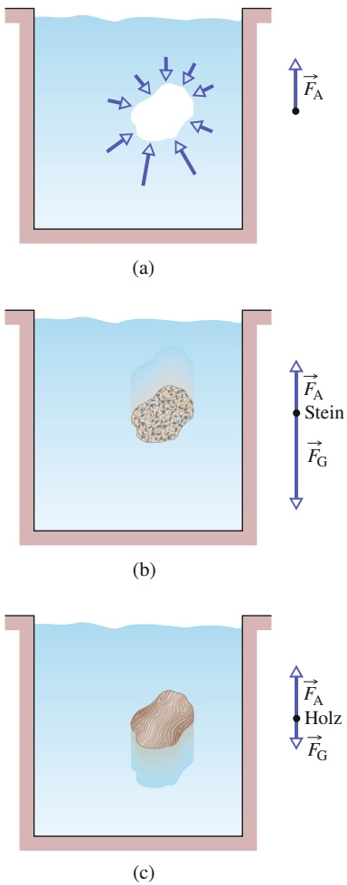

## Schwimmen und Schweben

Wenn wir einen Klotz aus leichtem Holz gerade oberhalb einer Wasseroberfläche loslassen, sinkt er in das Wasser, weil die Gravitationskraft $\vec { F } _ { \mathrm { G } }$ ihn nach unten zieht. Je mehr Wasser von dem Klotz verdrängt wird, umso größer wird der Betrag der Auftriebskraft $F _ { \mathrm { A } }$ . An irgendeinem Punkt ist $F _ { \mathrm { A } }$ groß genug, um den Betrag $F _ { \mathrm { G } }$ der nach unten gerichteten Gravitationskraft auf den Klotz auszugleichen, und der Block kommt zur Ruhe. Er befindet sich dann im statischen Gleichgewicht und schwimmt auf dem Wasser. Ganz allgemein gilt:

Wenn ein Körper in einem Fluid schwimmt oder schwebt, so ist der Betrag $F _ { \mathrm { A } }$ der Auftriebskraft auf diesen Körper gleich dem Betrag $F _ { \mathrm { G } }$ der Schwerkraft auf diesen Körper.

Wir können diese Aussage auch in der Form

$$
F _ {\mathrm{A}} = F _ {\mathrm{G}} \quad (\text {schwimmender Körper}) \tag {10.17}
$$

schreiben. Nach Gl. 10.16 ist $F _ { \mathrm { A } } = m _ { \mathrm { F } } g$ und daraus folgt:

Wenn ein Körper in einem Fluid schwimmt oder schwebt, ist der Betrag $F _ { \mathrm { G } }$ der Gravitationskraft auf diesen Körper gleich dem Gewicht $m _ { \mathrm { F } } g$ des von dem Körper verdrängten Fluids.

Diese Aussage können wir in der folgenden Gleichung zusammenfassen:

$$
F _ {\mathrm{G}} = m _ {\mathrm{F}} g \quad (\text {schwimmender Körper}). \tag {10.18}
$$

Mit anderen Worten, schwimmende oder schwebende Körper verdrängen eine Fluidmenge, die genau ihrem eigenen Gewicht entspricht.

## Das scheinbare Gewicht in einem Fluid

Wenn wir einen Stein auf eine Waage zur Gewichtsmessung legen, entspricht die Anzeige der Waage auch dem Gewicht des Steins. Wenn wir das gleiche Experiment jedoch unter Wasser durchführen, vermindert der Auftrieb auf den Stein diese Anzeige. Sie entspricht nun dem scheinbaren Gewicht. Im Allgemeinen hängt das scheinbare Gewicht mit dem tatsächlichen Gewicht eines Körpers über folgende Beziehung zusammen:

$$
\binom{\text {scheinbares}}{\text {Gewicht}} = \binom{\text {tatsächliches}}{\text {Gewicht}} - \binom{\text {Betrag der}}{\text {Auftriebskraft}}
$$

beziehungsweise als Formel:

$$
W _ {\mathrm{sch}} = W - F _ {\mathrm{A}} \quad (\text {scheinbares Gewicht}). \tag {10.19}
$$

Sollten Sie im Rahmen irgendeines seltsamen Kräftetests einen schweren Stein hochheben müssen, so fällt Ihnen das unter Wasser leichter. Ihre Kraft muss nur das scheinbare Gewicht des Steins heben, nicht sein größeres tatsächliches Gewicht. Der nach oben gerichtete Auftrieb hilft Ihnen also bei der Bewältigung der Aufgabe.

Der Betrag der Auftriebskraft auf einen schwimmenden (oder im Wasser schwebenden) Gegenstand ist gleich dem Gewicht dieses Gegenstands. Nach Gl. 10.19 hat ein schwimmender (oder schwebender) Gegenstand das Gewicht null – das wäre auch die Anzeige auf einer Gewichtswaage. (Wenn sich Astronauten auf eine komplizierte Aufgabe im Weltraum vorbereiten, üben sie diese Aufgabe unter Wasser schwebend, weil ihr scheinbares Gewicht dort null ist – wie im Weltraum.)

## KONTROLLFRAGE 2

Ein Pinguin schwimmt (nicht: taucht!) zunächst in einem Fluid der Dichte $\rho _ { 0 } ,$ dann in einem Fluid der Dichte $^ { 0 , 9 5 \rho _ { 0 } }$ und schließlich in einem Fluid der Dichte $^ { 1 , 1 } \rho _ { 0 } .$ (a) Ordnen Sie die Dichten nach dem Betrag der Auftriebskraft auf den Pinguin (größter Wert zuerst). (b) Ordnen Sie die Dichten in absteigender Reihenfolge nach der von dem Pinguin verdrängten Fluidmenge.

## 10.6 Die Kontinuitätsgleichung

## Lernziele

Nach dem Durcharbeiten dieses Abschnitts sollten Sie in der Lage sein, . . .

• die Begriffe gleichmäßige Strömung, inkompressible Strömung, nichtviskose Strömung und wirbelfreie Strömung zu erläutern,
• den Begriff Stromlinie zu erklären,
• die Kontinuitätsgleichung anzuwenden, um den Querschnitt und die Strö- mungsgeschwindigkeit an einer Stelle in einem durchströmten Rohr mit den jeweiligen Werten an einer anderen Stelle zu verknüpfen,
• das Konzept des Volumenstroms zu verstehen und den Volumenstrom zu berechnen,
• das Konzept des Massenstroms zu verstehen und den Massenstrom zu berechnen.

## Schlüsselideen

• Ein ideales Fluid ist nicht kompressibel und besitzt keine Viskosität; seine Strö- mung ist gleichmäßig und wirbelfrei.
• Eine Stromlinie ist der von einem einzelnen Fluidteilchen genommene Weg.
• Eine Flussröhre beschreibt ein Bündel von Stromlinien.
• Die Strömung in einer Stromröhre gehorcht der Kontinuitätsgleichung,

$$
R _ {\mathrm{V}} = A \nu = \text { const. },
$$

wobei $R _ { \mathrm { V } }$ die Volumenflussrate ist, A der Querschnitt der Stromröhre an einem gegebenen Punkt und v die Strömungsgeschwindigkeit des Fluids an diesem Punkt.

• Die Massenflussrate $R _ { M }$ ist

$$
R _ {\mathrm{M}} = \rho R _ {\mathrm{V}} = \rho A \nu = \text { const. }
$$

## 10.6.1 Ideale Fluide in Bewegung

Die Bewegung realer Fluide ist sehr kompliziert und immer noch nicht ganz verstanden. Stattdessen werden wir die Bewegung eines **idealen Fluids** untersuchen, die mathematisch einfacher zu behandeln ist und trotzdem interessante und nützliche Ergebnisse liefert. Die folgenden vier Annahmen werden wir über dieses ideale Fluid machen; sie beziehen sich alle auf die Art der Strömung:

1. **Gleichmäßige Strömung** Bei einer gleichmäßigen (oder laminaren) Strömung verändert sich die Geschwindigkeit des Fluids in einem gegebenen Punkt nicht, weder hinsichtlich ihres Betrags noch hinsichtlich ihrer Richtung. Das langsame Fließen des Wassers in der Mitte eines ruhigen Flusses ist gleichmäßig; das unregelmäßige Fließen in Stromschnellen ist nicht gleichmäßig. Abbildung 10.11 zeigt einen Übergang von einer gleichmäßigen Strömung zu einer nicht gleichmäßigen (oder turbulenten) Strömung in aufsteigendem Rauch. Die Geschwindigkeit der Rauchteilchen wird schnell größer, und bei einer kritischen Geschwindigkeit ändert sich die Strömung von einer gleichmäßigen zu einer nicht gleichmäßigen Strömung (d. h. von einer laminaren zu einer nichtlaminaren Strömung).

natural_image

Cigarette with smoke rising against a black background (no text or symbols)

Abb. 10.11

An einem Punkt etwas oberhalb der Zigarette ändert sich die aufwärts gerichtete Strömung aus Rauch und heißem Gas von einer gleichmäßigen zu einer turbulenten Strömung [Quelle: ConstantinosZ/Shutterstock].

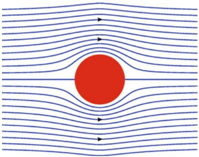

natural_image

Diagram showing fluid flow around a central red circle with streamlines (no text or symbols)

Abb. 10.12

Stromlinien um ein zylinderförmiges Hindernis.

2. **Inkompressible Strömung** Wie schon bei den ruhenden Fluiden nehmen wir wieder an, dass unser ideales Fluid inkompressibel sei, d. h., seine Dichte hat überall denselben konstanten Wert.
3. **Nichtviskose Strömung** Grob gesprochen ist die Viskosität eines Fluids ein Maß dafür, wie sehr sich das Fluid gegen das Fließen sträubt. Honig beispielsweise fließt sehr viel schwerfälliger als Wasser, er besitzt daher eine wesentlich hö- here Viskosität als Wasser. Der Viskosität bei Fluiden entspricht die Reibung bei Festkörpern: Bei beiden Mechanismen wird die kinetische Energie des bewegten Gegenstands in thermische Energie umgewandelt. Ohne Reibung könnte ein Klotz mit konstanter Geschwindigkeit über eine horizontale Oberfläche gleiten. Ganz ähnlich könnte sich ein Gegenstand durch ein viskositätsfreies Fluid bewegen, ohne einen Widerstand zu verspüren – ohne Viskosität gäbe es keine bremsende Kraft. Der englische Wissenschaftler Lord Rayleigh bemerkte einmal, dass der Propeller eines Schiffs in einem idealen Fluid nicht funktionieren würde, allerdings würde ein Schiff (einmal in Bewegung versetzt) in einem idealen Fluid auch keinen Propeller benötigen!
4. **Wirbelfreie Strömung** Auch wenn wir davon keinen Gebrauch machen werden, nehmen wir die Strömung als wirbelfrei bzw. rotationsfrei an. Diese Eigenschaft lässt sich leicht überprüfen, indem man ein kleines Staubteilchen in das Fluid bringt. Dieses Staubteilchen darf sich zwar (muss aber nicht) entlang eines kreisförmigen Wegs bewegen, aber in einer wirbelfreien Strömung dreht sich das Staubteilchen nie um eine Achse durch seinen Schwerpunkt. Eine eher oberflächliche Analogie: Die Bewegung eines Riesenrads ist nicht wirbelfrei, die der Fahrgäste wohl.

Wir können die Strömung eines Fluids durch sogenannte Tracer sichtbar machen. Dabei kann es sich um einen Farbstoff handeln, der an mehreren Punkten in die Strömung eingespritzt wird oder um Rauchteilchen, die einer Gasströmung zugesetzt werden (Abb. 10.12 und 10.13). Jeder Teil des Tracers folgt einer Stromlinie, d. h. einem Weg, dem auch ein winziges Fluidelement in der Strömung folgen würde. Wie wir in Kapitel 1 gesehen haben, ist die Geschwindigkeit eines Teilchens immer tangential zu seiner Bahnkurve. In diesem Fall entspricht dem Teilchen das Fluidelement, und seine Geschwindigkeit v⃗ ist immer tangential zur Stromlinie (Abb. 10.14). Aus diesem Grund können sich zwei Stromlinien auch niemals schneiden. Andernfalls hätte nämlich ein Fluidelement an diesem Schnittpunkt gleichzeitig zwei verschiedene Geschwindigkeiten, was nicht möglich ist.

Abb. 10.13

Im Windkanal lassen sich die Stromlinien der Luftströmung um ein Auto durch Rauch sichtbar machen [Quelle: Viaframe/Getty Images].

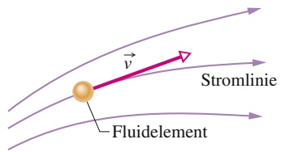

text_image

Fluidelement
v
Stromlinie

Abb. 10.14

Die Bewegung eines Fluidelements P folgt einer Stromlinie. Der Geschwindigkeitsvektor des Elements ist an jedem Punkt tangential zur Stromlinie.

natural_image

Side profile of a black sports car driving against a dark, abstract background with motion blur (no text or symbols visible)

## 10.6.2 Die Kontinuitätsgleichung

Ihnen ist sicherlich schon aufgefallen, dass Sie die Geschwindigkeit eines aus einem Gartenschlauch austretenden Wasserstrahls erhöhen können, indem Sie die Schlauchöffnung mit Ihrem Daumen teilweise abdecken. Offensichtlich hängt die Geschwindigkeit v des Wassers von der Querschnittsfläche A ab, durch die das Wasser strömt.

Im Folgenden wollen wir eine Beziehung zwischen v und A für eine laminare Strömung eines idealen Fluids herleiten, das durch ein Rohr mit variabler Querschnittsfläche fließt, wie in Abb. 10.15 skizziert. Das Fluid strömt von links nach rechts, und der wiedergegebene Rohrabschnitt (Teil eines längeren Rohrs) habe die Länge L. Die Geschwindigkeit des Fluids auf der linken Seite des Rohrabschnitts sei $\nu _ { 1 : }$ , die auf der rechten Seite sei $\nu _ { 2 } .$ . Entsprechend ist die Querschnittsfläche des Rohrs am linken Ende $A _ { 1 } ,$ die am rechten Ende $A _ { 2 } .$ Angenommen, während eines Zeitintervalls $\Delta t$ tritt auf der linken Seite ein Volumen $\Delta V _ { 1 }$ in den Rohrabschnitt ein (dieses Volumen ist in Abb. 10.15 violett wiedergegeben). Da das Fluid inkompressibel ist, muss in derselben Zeitspanne ein genauso großes Volumen $\Delta V _ { 2 }$ am rechten Ende des Rohrabschnitts wieder austreten (dieser Teil ist in Abb. 10.15 grün gezeichnet).

Über dieses gemeinsame Volumen ΔV stellen wir nun eine Beziehung zwischen den Geschwindigkeiten und den Querschnittsflächen auf. Dazu betrachten wir zunächst Abb. 10.16, in der eine Seitenansicht eines Rohrs mit gleichbleibender Querschnittsfläche A wiedergegeben ist. In Abb. 10.16a fließt ein Fluidelement e bei der gestrichelten Linie durch die entsprechende Querschnittsfläche des Rohrs. Die Geschwindigkeit des Elements sei $\nu ,$ sodass sich während des Zeitintervalls $\Delta t$ das Element in dem Rohr um eine Strecke $\Delta x = \nu \Delta t$ weiterbewegt hat. Das Fluidvolumen $\Delta V ,$ das in diesem Zeitintervall $\Delta t$ durch die gestrichelte Linie getreten ist, beträgt

$$
\Delta V = A \Delta x = A \nu \Delta t. \tag {10.20}
$$

Wenden wir diese Gleichung auf das linke und das rechte Rohrende in Abb. 10.15 an, erhalten wir

$$
\Delta V = A _ {1} \nu_ {1} \Delta t = A _ {2} \nu_ {2} \Delta t
$$

oder

$$
A _ {1} \nu_ {1} = A _ {2} \nu_ {2} \quad (\text {Kontinuitätsgleichung}). \tag {10.21}
$$

Diese Beziehung zwischen der Geschwindigkeit und der Querschnittsfläche be zeichnet man als **Kontinuitätsgleichung** für die Strömung eines idealen Fluids. Sie besagt, dass die Strömungsgeschwindigkeit zunimmt, wenn die Querschnittsfläche der Strömung kleiner wird (etwa wenn wir mit dem Daumen die Öffnung unseres Gartenschlauchs teilweise verschließen).

Gleichung 10.21 gilt nicht nur für ein tatsächlich vorhandenes Rohr, sondern auch für eine sogenannte Flussröhre. Dabei handelt es sich um eine gedachte Röhre, deren Begrenzung aus Stromlinien besteht. Eine solche Röhre wirkt wie ein richtiges Rohr, da kein Fluidelement eine Stromlinie kreuzen kann. Das in einer Flussröhre enthaltene Fluid muss also innerhalb dieser Grenzen bleiben. Abbildung 10.17 zeigt eine Flussröhre, bei der die Querschnittsfläche in Flussrichtung von $A _ { 1 }$ auf $A _ { 2 }$ zunimmt. Aus Gl. 10.21 wissen wir, dass eine Zunahme der Fläche eine Abnahme der Geschwindigkeit bedeutet, was durch den größeren Abstand zwischen den Stromlinien auf der rechten Seite von Abb. 10.17 angedeutet wird. Entsprechend erkennt man in Abb. 10.12, dass die Strömungsgeschwindigkeit direkt oberhalb und unterhalb des Zylinders am größten ist.

Wir können Gl. 10.21 auch in der Form

$$
R _ {\mathrm{V}} = A \nu = \text {const.} \quad \text {(Kontinuitätsgleichung für die Volumenflussrate)} \tag {10.22}
$$

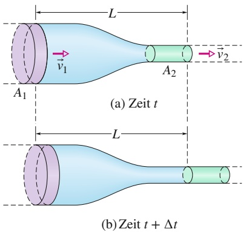

text_image

(a) Zeit t
(b) Zeit t + Δt

## Abb. 10.15

Ein Fluid strömt von links nach rechts durch einen Rohrabschnitt der Länge L. Die Geschwindigkeit des Fluids auf der linken Seite sei $\nu _ { 1 } ,$ die auf der rechten Seite $\nu _ { 2 } .$ Die Querschnittsfläche des Rohrs auf der linken Seite sei $A _ { 1 } ,$ die auf der rechten Seite $A _ { 2 ^ { \bullet } }$ In dem Zeitintervall zwischen der Zeit t in $( \mathrm { a } )$ und der Zeit t + Δt in (b) fließt die violett gezeichnete Fluidmenge auf der linken Seite in das Rohr. Dieselbe Fluidmenge (in grün gezeichnet) fließt in dieser Zeitspanne auf der rechten Seite aus.

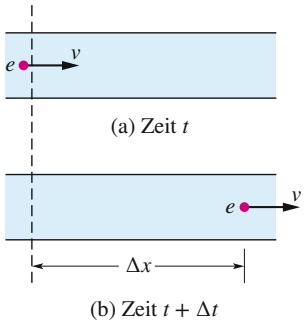

text_image

(a) Zeit t
(b) Zeit t + Δt

## Abb. 10.16

Ein Fluid strömt mit konstanter Geschwindigkeit v durch ein Rohr. (a) Zum Zeitpunkt t überquert das Fluidelement e die gestrichelte Linie. (b) Zum Zeitpunkt t + Δt befindet sich das Fluidelement e im Abstand $\Delta x = \nu \Delta t$ hinter der gestrichelten Linie.

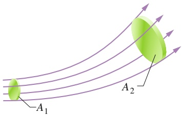

text_image

A₁
A₂

## Abb. 10.17

Eine Flussröhre wird durch die Stromlinien (oder Flusslinien) definiert, die ihre Begrenzung ausmachen. Die Volumenflussrate ist für alle Querschnitte der Flussröhre dieselbe.

schreiben, wobei $R _ { \mathrm { V } }$ die **Volumenflussrate** des Fluids ist (Volumen pro Zeiteinheit). Die SI-Einheit von $R _ { \mathrm { V } }$ ist Kubikmeter pro Sekunde $( \mathrm { m } ^ { 3 } / \mathrm { s } )$ . Ist die Dichte des Fluids überall gleich, können wir Gl. 10.22 mit dieser Dichte multiplizierten und erhalten so die **Massenflussrate** $R _ { M }$ (Masse pro Zeiteinheit):

$$
R _ {\mathrm{M}} = \rho R _ {\mathrm{V}} = \rho A \nu = \text {const.} \quad \text {(Massenflussrate)} \tag {10.23}
$$

Die SI-Einheit für die Massenflussrate ist Kilogramm pro Sekunde $( \mathrm { k g / s } )$ . Gleichung 10.23 besagt, dass die in einen Rohrabschnitt (Abb. 10.14) hineinfließende Masse in jedem Augenblick gleich der Masse sein muss, die diesen Rohrabschnitt verlässt.

## KONTROLLFRAGE 3

Die Abbildung zeigt ein Röhrensystem. Die Volumenflussrate (in $\mathtt { c m ^ { 3 } / s ) }$ und die Richtung der Strömung sind für alle Röhrenabschnitte außer einem angegeben. Wie groß ist die Volumenflussrate in diesem Abschnitt und in welche Richtung fließt dort die Strömung?

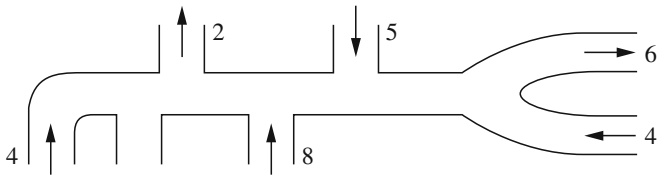

flowchart

## 10.7 Die Bernoulli-Gleichung

## Lernziele

Nach dem Durcharbeiten dieses Abschnitts sollten Sie in der Lage sein, . . .

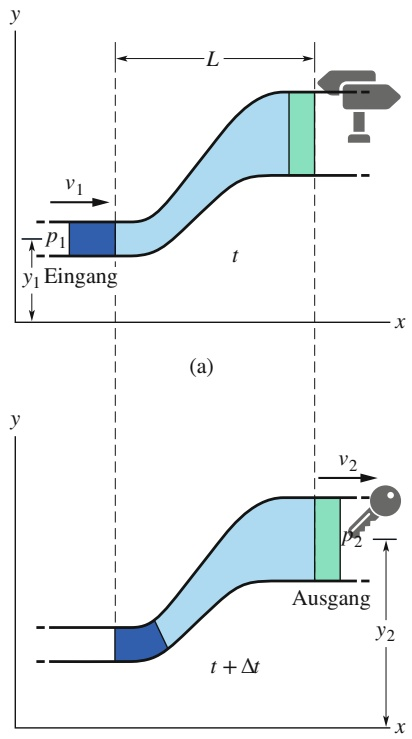

text_image

y
L
v1
p1
Eingang
t
x
(a)
y
v2
p2
Ausgang
t + Δt
y2
x

(b)

Abb. 10.18

Ein Fluid strömt mit einer homogenen Rate von links nach rechts durch einen Rohrabschnitt der Länge L. Zwischen der Zeit t in (a) und der Zeit $t + \Delta t$ in (b) tritt die dunkelblau gezeichnete Fluidmenge auf der linken Seite in das Rohr, und dieselbe (grüne) Fluidmenge tritt auf der rechten Seite aus dem Rohr heraus.

• die kinetische Energiedichte aus der Dichte eines Fluids und seiner Strömungsgeschwindigkeit zu berechnen,
• den Druck in einem Fluid als eine Energiedichte aufzufassen,
• die Dichte der potenziellen Energie der Gravitation zu berechnen,
• die Bernoulli-Gleichung anzuwenden, um die Dichte der Gesamtenergie an einem Punkt einer Stromlinie mit ihrem Wert an einer anderen Stelle zu verknüpfen,
• zu verstehen, dass die Bernoulli-Gleichung eine alternative Formulierung des Energieerhaltungssatzes ist.

## Schlüsselideen

• Die Anwendung des Energieerhaltungssatzes auf die Strömung eines idealen Fluids entlang einer Stromröhre führt zur Bernoulli-Gleichung:

$$
p + \frac {1}{2} \rho v ^ {2} + \rho g y = \text {const.}
$$

## 10.7.1 Die Bernoulli-Gleichung

Abbildung 10.18 zeigt ein Rohr, durch das ein ideales Fluid mit konstanter Flussrate strömt. Angenommen, in dem Zeitintervall strömt ein Fluidvolumen $\Delta V$ auf der linken Seite in das Rohr hinein (dieses Fluidvolumen ist in Abb. 10.18 dunkelblau gezeichnet), dann strömt ein genauso großes Volumen (in Abb. 10.18 grün) im selben Zeitraum am rechten Ende heraus. Das einlaufende und das auslaufende Volumen müssen gleich sein, da das Fluid inkompressibel sein soll und eine konstante Dichte $\mathrm { ~ : ~ } \rho$ besitzt.

$y _ { 1 } ,   \nu _ { 1 }$ und $p _ { 1 }$ seien Höhe, Geschwindigkeit und Druck des einlaufenden Fluids am linken Ende, und $y _ { 2 } , \nu _ { 2 }$ und $p _ { 2 }$ seien die entsprechenden Größen auf der rechten Seite. Aus der Energieerhaltung für das Fluidsystem werden wir zwischen diesen Größen die folgende Beziehung herleiten:

$$
p _ {1} + \frac {1}{2} \rho v _ {1} ^ {2} + \rho g y _ {1} = p _ {2} + \frac {1}{2} \rho v _ {2} ^ {2} + \rho g y _ {2}. \tag {10.24}
$$

Wir können diesen Zusammenhang auch folgendermaßen ausdrücken:

$$
p + \frac {1}{2} \rho v ^ {2} + \rho g y = \text {const.} \quad \text {(Bernoulli - Gleichung)} \tag {10.25}
$$

Die Gln. 10.24 und 10.25 sind äquivalente Formen der **Bernoulli-Gleichung**1), benannt nach Daniel Bernoulli, der um 1700 Fluidströmungen untersuchte. Ebenso wie die Kontinuitätsgleichung (Gl. 10.22) bringt auch die Bernoulli-Gleichung kein neues Prinzip zum Ausdruck, sondern es handelt sich lediglich um eine Umformulierung eines bekannten Prinzips in eine der Fluidmechanik angemessenere Form. Als einfachen Test wenden wir die Bernoulli-Gleichung auf ein ruhendes Fluid an, indem wir in Gl. 10.24 die Geschwindigkeiten $\nu _ { 1 } = \nu _ { 2 } = 0$ setzen. Wir erhalten für diesen Fall

$$
p _ {2} = p _ {1} + \rho g (y _ {1} - y _ {2}),
$$

was Gl. 10.7 entspricht.

Eine wichtige Aussage der Bernoulli-Gleichung ergibt sich, wenn wir y als konstant annehmen $( \mathrm { z .   B .   y = 0 } )$ , die Fluidströmung also eine feste Höhe beibehält. In diesem Fall wird aus Gl. 10.24

$$
p _ {1} + \frac {1}{2} \rho v _ {1} ^ {2} = p _ {2} + \frac {1}{2} \rho v _ {2} ^ {2}. \tag {10.26}
$$

Das bedeutet:

Wenn die Geschwindigkeit eines einer horizontalen Stromlinie folgenden Fluidelements zunimmt, muss der Druck des Fluids abnehmen (und umgekehrt).

Mit anderen Worten, wo die Stromlinien vergleichsweise nahe beieinander liegen (die Geschwindigkeit also vergleichsweise groß ist), muss der Druck vergleichsweise niedrig sein und umgekehrt.

Diese Beziehung zwischen einer Geschwindigkeitsänderung und einer Druckän derung erscheint sinnvoll, wenn man sich ein Fluidelement anschaut: Nähert sich dieses Element einem engeren Bereich, wird es durch den größeren Druck hinter ihm beschleunigt, sodass es in dem engeren Bereich eine größere Geschwindigkeit besitzt. Nähert es sich umgekehrt einem breiteren Bereich, wird es durch den hö- heren Druck vor ihm abgebremst, sodass es in dem breiten Bereich eine geringere Geschwindigkeit besitzt.

Die Bernoulli-Gleichung gilt streng genommen nur für ideale Fluide. Sind Reibungskräfte vorhanden, spielt auch die thermische Energie eine Rolle. In der folgenden Herleitung werden wir diese jedoch nicht berücksichtigen.

## Beweis der Bernoulli-Gleichung

Unser System sei das gesamte Volumen des in Abb. 10.18 dargestellten (idealen) Fluids. Wir wenden das Gesetz der Energieerhaltung auf dieses System an, wie es sich von einem Anfangszustand (Abb. 10.18a) zu einem Endzustand (Abb. 10.18b) entwickelt. Das in Abb. 10.18 zwischen den beiden vertikalen Ebenen im Abstand L

1) In einer wirbelfreien Strömung (die wir hier annehmen) hat die Konstante in Gl. 10.25 an allen Punkten innerhalb einer Flussröhre denselben Wert. Die Punkte müssen dabei nicht auf derselben Stromlinie liegen. Auch die Punkte 1 und 2 in Gl. 10.24 können sich irgendwo innerhalb der Flussröhre befinden.

befindliche Fluid ändert seine Eigenschaften während dieses Prozesses nicht; wir brauchen uns daher nur um die Veränderungen im Eingangs- und Ausgangsbereich der Röhre zu kümmern.

Wir wenden die Energieerhaltung in der folgenden Form an:

$$
W = \Delta K. \tag {10.27}
$$

Diese Gleichung besagt, dass die $\ddot { \mathrm { A } }$ nderung der kinetischen Energie unseres $S _ { \mathrm { { Y S } ^ { - } } }$ tems gleich der an dem System geleisteten Arbeit ist. Die Änderung in der kinetischen Energie ergibt sich aus der Änderung der Geschwindigkeit zwischen den beiden Enden der Röhre und beträgt

$$
\Delta K = \frac {1}{2} \Delta m v _ {2} ^ {2} - \frac {1}{2} \Delta m v _ {1} ^ {2} = \frac {1}{2} \rho \Delta V \left(v _ {2} ^ {2} - v _ {1} ^ {2}\right), \tag {10.28}
$$

wobei $\Delta m ( = \rho \Delta V )$ die Masse des Fluids ist, die während des kurzen Zeitintervalls $\Delta t$ am Eingang eintritt bzw. am Ende das Rohr verlässt.

Auf zwei Weisen wurde an dem System Arbeit geleistet: Gegen die Gravitationskraft $( \Delta m \vec { g } )$ wurde das Fluid der Masse Δm zwischen Anfang und Ende um eine bestimmte Höhe angehoben. Die dadurch verrichtete Arbeit $W _ { \mathrm { G } }$ ist

$$
W _ {\mathrm{G}} = - \Delta m g (y _ {2} - y _ {1}) = - \rho g \Delta V (y _ {2} - y _ {1}). \tag {10.29}
$$

Diese Arbeit ist negativ, da die Richtung des Anhebens und die Richtung der Gravitationskraft entgegengesetzt sind.

Am Eingang des Rohres wird Arbeit an dem System verrichtet, um das Fluid in das Rohr zu drücken, während am Ausgang von dem System Arbeit geleistet wird, um das vor dem herausströmenden Fluidelement befindliche Fluid nach vorne wegzudrücken. Ganz allgemein ist die von einer Kraft F (Betrag) an einem Fluid in einem Rohr mit der Querschnittsfläche A geleistete Arbeit, wenn dieses Fluid um eine Strecke $\Delta x$ vorwärts geschoben wird, gleich

$$
F \Delta x = (p A) (\Delta x) = p (A \Delta x) = p \Delta V.
$$

Die an dem System geleistete Arbeit ist somit $p _ { 1 } \Delta V ,$ die von dem System geleistete Arbeit ist $- p _ { 2 } \Delta V$ . Ihre Summe $W _ { p }$ ist

$$
W _ {p} = - p _ {2} \Delta V + p _ {1} \Delta V = - (p _ {2} - p _ {1}) \Delta V. \tag {10.30}
$$

Die Energieerhaltung in der Form von Gl. 10.27 lautet daher

$$
W = W _ {\mathrm{G}} + W _ {p} = \Delta K.
$$

Setzen wir die Ergebnisse aus Gln. 10.28–10.30 ein, so folgt

$$
- \rho g \Delta V (y _ {2} - y _ {1}) - \Delta V (p _ {2} - p _ {1}) = \frac {1}{2} \rho \Delta V \left(\nu_ {2} ^ {2} - \nu_ {1} ^ {2}\right) .
$$

Nach einer einfachen Umformung entspricht dies der Gl. 10.24, die wir beweisen wollten.

## KONTROLLFRAGE 4

Durch das Rohr in der Abbildung fließt eine laminare Wasserströmung abwärts. Ordnen Sie die vier nummerierten Rohrabschnitte nach (a) der durch sie fließenden Volumenflussrate $R _ { \mathrm { V } } ,$ (b) der Strömungsgeschwindigkeit v in ihnen und (c) dem Wasserdruck in ihnen (jeweils größte Werte zuerst).

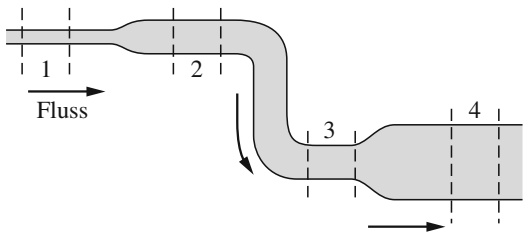

text_image

1
Fluss
2
3
4

## 10.8 Zusammenfassung

**Dichte** Die Dichte ρ eines Materials ist definiert als das Verhältnis aus Masse und Volumen:

$$
\rho = \frac {\Delta m}{\Delta V}. \tag {10.1}
$$

Ist eine homogene Substanzprobe groß im Vergleich zu atomaren Abständen, schreiben wir Gl. 10.1 gewöhnlich in der Form:

$$
\rho = \frac {m}{V}. \tag {10.2}
$$

**Fluiddruck** Ein **Fluid** ist eine fließfähige Substanz. Sie passt sich den Begrenzungen ihres Behälters an, weil es ihr nicht möglich ist, einer Scherspannung entgegenzuwirken. Sie kann jedoch eine Kraft senkrecht zu ihrer Oberfläche ausüben. Diese Kraft wird meist durch den **Druck** $p$ ausgedrückt:

$$
p = \frac {\Delta F}{\Delta A}. \tag {10.3}
$$

Hierbei ist ΔF die auf das Oberflächenelement ΔA wirkende Kraft. Ist die Kraft homogen über eine ebene Fläche verteilt, lässt sich Gl. 10.3 auch in der Form

$$
p = \frac {F}{A} \tag {10.4}
$$

schreiben.

Der von einem Fluid an einem bestimmten Punkt ausgeübte Druck hat in alle Richtungen denselben Betrag. Als Über- bzw. Unterdruck bezeichnet man die Differenz zwischen dem tatsächlichen Druck (oder absoluten Druck) an einem Punkt und dem Atmosphärendruck.

**Druckverhalten als Funktion der Höhe bzw. Tiefe** In einem ruhenden Fluid ist der Druck eine Funktion der vertikalen Position y. Wird $y$ nach oben als positiv gezählt, so gilt

$$
p _ {2} = p _ {1} + \rho g (y _ {1} - y _ {2}). \tag {10.7}
$$

An allen auf derselben Höhe liegenden Punkten ist der Druck in einem Fluid derselbe. Sei h die Tiefe einer Fluidprobe unterhalb eines Bezugsniveaus, an welchem der Druck $p _ { 0 }$ herrscht, so wird aus Gl. 10.7

$$
p = p _ {0} + \rho g h, \tag {10.8}
$$

wobei $p$ der Druck in der Fluidprobe ist.

**Das Pascalsche Prinzip** Das Pascalsche Prinzip lässt sich aus Gl. 10.7 ableiten und besagt, dass eine Druckänderung auf ein eingeschlossenes Fluid unvermindert auf jeden Teil innerhalb des Fluids sowie auf die Wände des Behälters übertragen wird.

**Das archimedische Prinzip** Taucht ein Körper ganz oder teilweise in ein Fluid ein, wirkt eine Auftriebskraft $\vec { F } _ { \mathrm { A } }$ von dem umgebenden Fluid auf diesen Körper. Die Kraft ist nach oben gerichtet und hat den Betrag

$$
F _ {\mathrm{A}} = m _ {\mathrm{F}} g, \tag {10.16}
$$

mit $m _ { \mathrm { F } }$ als der von dem Körper verdrängten Fluidmasse.

Schwimmt bzw. schwebt ein Körper in einem Fluid, so ist der Betrag $F _ { \mathrm { A } }$ des (nach oben gerichteten) Auftriebs auf den Körper gleich dem Betrag $F _ { \mathrm { G } }$ der (nach unten gerichteten) Gravitationskraft auf den Körper. Für das scheinbare Gewicht eines Körpers, auf den ein Auftrieb wirkt, und sein tatsächliches Gewicht gilt die Beziehung

$$
W _ {\mathrm{sch}} = W - F _ {\mathrm{A}}. \tag {10.19}
$$

**Strömung idealer Fluide** Ein ideales Fluid ist inkompressibel und fließt reibungsfrei (es besitzt keine Viskosität), seine Strömung ist außerdem laminar und wirbelfrei. Eine **Stromlinie** ist der von einem einzelnen Fluidteilchen durchlaufene Weg. Eine Flussröhre ist ein Bündel von Stromlinien. Die Strömung innerhalb einer Flussröhre genügt der **Kontinuitätsgleichung**:

$$
R _ {\mathrm{V}} = A \nu = \text {const.} \tag {10.22}
$$

Hierbei sind $R _ { \mathrm { V } }$ die **Volumenflussrate**, A die Querschnittsfläche der Flussröhre an irgendeinem Punkt und v die Fluidgeschwindigkeit an diesem Punkt, die entlang des Querschnitts A als konstant angenommen wird. Für die **Massenflussrate** $R _ { M }$ gilt

$$
R _ {\mathrm{M}} = \rho R _ {\mathrm{V}} = \rho A \nu = \text {const.} \tag {10.23}
$$

**Bernoulli-Gleichung** Wendet man das Prinzip der Erhaltung der mechanischen Energie auf die Strömung eines idealen Fluids an, so erhält man die Bernoulli-Gleichung:

$$
p + \frac {1}{2} \rho v ^ {2} + \rho g y = \text {const.} \tag {10.25}
$$

Diese Gleichung gilt entlang jeder Flussröhre.

## 10.9 Fragen

**1.** Abbildung 10.F1 zeigt einen mit Wasser gefüllten Behälter. Fünf horizontale Böden und Decken sind markiert; sie alle haben dieselbe Fläche und befinden sich in den jeweiligen Abständen L, 2L bzw. 3L unterhalb der Obergrenze des Behälters. Ordnen Sie die Böden und Decken in absteigender Reihenfolge nach den Kräften, die das Wasser auf sie ausübt.

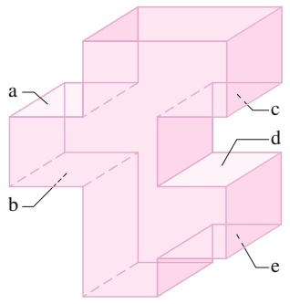

text_image

a
b
c
d
e

Abb. 10.F1

**2.** Der Teekannen-Effekt: Wird Wasser langsam aus einer Teekanne gegossen, kann es unterhalb des Schnabels für eine beachtliche Strecke zurücklaufen, bevor es sich löst und herabfällt. (Diese Wasserschicht wird durch den Atmosphärendruck von unten gegen den Schnabel gedrückt.) In Abb. 10.F2 sind in der Wasserschicht vier Punkte markiert: zwei Punkte innerhalb des Schnabels, davon ist Punkt (a) oben auf der Schicht und Punkt (b) am unte-

ren Rand, und zwei Punkte in der Wasserschicht unterhalb des Schnabels, (c) oben und (d) unten. Ordnen Sie diese vier Punkte in absteigender Reihenfolge nach dem Überbzw. Unterdruck im Wasser an der jeweiligen Stelle.

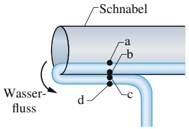

text_image

Schnabel
Wasserfluss
a
b
c
d

Abb. 10.F2

**3.** Abbildung 10.F3 zeigt vier Situationen, in denen sich eine rote und eine graue Flüssigkeit in einem U-Rohr befinden. In einer dieser Situationen können sich die Flüssigkeiten nicht im statischen Gleichgewicht befinden. (a) Um welche Situation handelt es sich? (b) Nehmen Sie für die anderen drei Situationen ein statisches Gleichgewicht an. Untersuchen Sie, in welchen Fällen die Dichte der roten Flüssigkeit größer, kleiner bzw. gleich der Dichte der grauen Flüssigkeit ist.

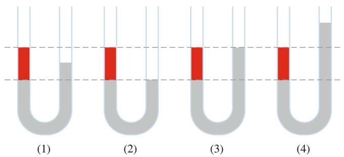

Abb. 10.F3

**4.** Drei Behälter sind mit verschiedenen Flüssigkeiten gefüllt. Abbildung 10.F4 zeigt den gemessenen Überdruck p als Funktion der Tiefe h für die drei Flüssigkeiten. In jeden Behälter wird eine starre Kunststoffperle vollständig eingetaucht. Ordnen Sie die Behälter in absteigender Reihenfolge nach dem Betrag der Auftriebskraft auf die Perle.

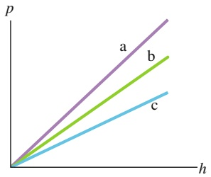

line

| Series | Trend |
| --- | --- |
| a | Linear increase |
| b | Linear increase |
| c | Linear increase |

Abb. 10.F4

**5.** Ein 3 kg schwerer, unregelmäßig geformter Klotz wird in ein bestimmtes Fluid voll eingetaucht. Das von dem Volumen des Klotzes verdrängte Fluid hat eine Masse von 2 kg. (a) Bewegt sich der Klotz nach oben, nach unten oder verbleibt er an der Stelle, wenn wir ihn loslassen? (b) Angenommen, wir tauchen den Klotz anschließend in ein weniger dichtes Fluid und lassen ihn wieder los. Was geschieht in diesem Fall?
**6.** Abbildung 10.F6 zeigt vier Festkörper, die in Sirup schwimmen. Ordnen Sie die vier Gegenstände in absteigender Reihenfolge nach ihrer Dichte.

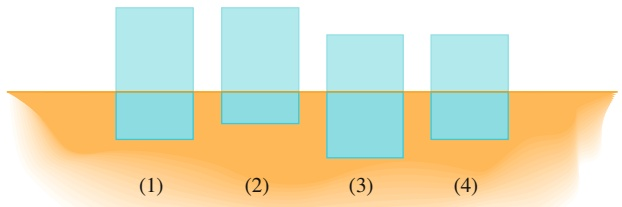

text_image

(1)
(2)
(3)
(4)

Abb. 10.F6

**7.** Abbildung 10.F7 zeigt drei identische offene, bis zum Rand mit Wasser gefüllte Behälter. In zwei Behältern schwimmen Gummienten. Ordnen Sie die Behälter einschließlich ihres Inhalts in absteigender Reihenfolge nach ihrem Gewicht.

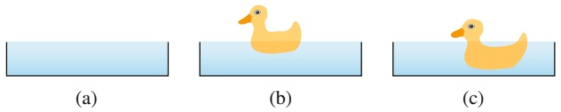

Abb. 10.F7

**8.** Ein Holzklotz schwimmt in einem Wassereimer in einem Aufzug. Liegt der Klotz tiefer im Wasser, höher im Wasser oder bleibt er auf gleicher Höhe, wenn sich der Aufzug (a) mit konstanter Geschwindigkeit nach oben bewegt, (b) mit konstanter Geschwindigkeit nach unten bewegt, (c) nach oben beschleunigt und (d) nach unten beschleunigt, wobei der Betrag der Beschleunigung kleiner als die Erdbeschleunigung g sein soll?

**9.** Ein Boot mit einem Anker an Bord schwimmt in einem Becken, das etwas größer als das Boot ist. Steigt der Wasserspiegel im Becken, sinkt er oder bleibt er auf gleicher Höhe, wenn der Anker (a) ins Wasser geworfen wird oder (b) auf den Boden außerhalb des Beckens geworfen wird? (c) Hebt sich der Wasserspiegel im Becken, sinkt er oder bleibt er gleich, wenn stattdessen ein Korken (der schwimmt) aus dem Boot ins Wasser geworfen wird?
**10.** Abbildung 10.F10 zeigt drei gerade, wasserdurchflossene Rohre. In der Abbildung sind die Strömungsgeschwindigkeiten und die Querschnittsflächen für jedes Rohr angegeben. Ordnen Sie die Rohre in absteigender Reihenfolge nach der Volumenflussrate pro Minute durch die Querschnittsflächen.

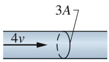

(a)

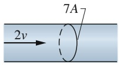

(b)

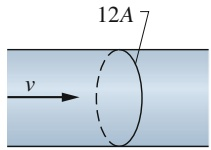

(c)

Abb. 10.F10

**11.** Abbildung 10.F11 zeigt vier Anordnungen von Rohren, durch die Wasser gleichmäßig nach rechts fließt. Die Radien der Rohrabschnitte sind angegeben. In welcher der Anordnungen ist die an einer Volumeneinheit Wasser auf dem Weg von ganz links nach ganz rechts verrichtete Arbeit (a) null, (b) positiv und (c) negativ?

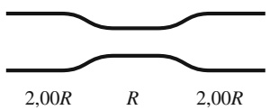

(1)

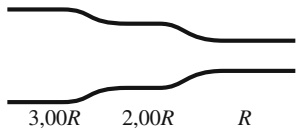

text_image

3,00R 2,00R R

(2)

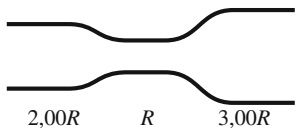

text_image

2,00R R 3,00R

(3)

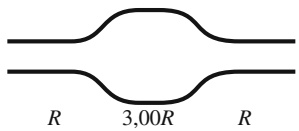

text_image

R 3,00R R

(4)

Abb. 10.F11

**12.** Ein Quader wird nacheinander in drei Flüssigkeiten a, b und c gedrückt. Das scheinbare Gewicht $W _ { \mathrm { s c h } }$ des Quaders in den drei Flüssigkeiten ist in Abb. 10.F12 gegen die Eintauchtiefe h aufgetragen. Ordnen Sie die Flüssigkeiten in absteigender Reihenfolge nach ihrem Gewicht pro Volumeneinheit.

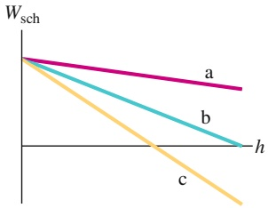

line

| Series | Trend Description |
| --- | --- |
| a | Linear decrease from top to bottom |
| b | Linear decrease from top to bottom |
| c | Linear decrease from top to bottom |

Abb. 10.F12

**13.** Wasser fließt sanft durch ein horizontales Rohr. Abbildung 10.F13 zeigt die kinetische Energie K eines Volumenelements Wasser auf seinem Weg durch das Rohr (x-Achse). Ordnen Sie die drei Abschnitte A, B und C des Rohres in absteigender Reihenfolge nach ihrem Radius.

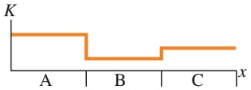

Abb. 10.F13

# 11 Schwingungen

## 11.1 Harmonische Schwingungen

## Physikalische Motivation

Unsere Welt ist voller Schwingungen – regelmäßig wiederholten Bewegungen. Manche dieser Schwingungen sind unterhaltsam, manche lästig, aber viele sind auch gefährlich oder können immense wirtschaftliche Folgen haben. Ein paar Beispiele: Wenn ein Baseball auf einen Schläger trifft, kann der Schläger so stark in Schwingungen geraten, dass der Schlagmann ernsthafte Verletzungen (bis hin zu Knochenbrüchen) davonträgt. Starker Wind versetzt manchmal Hochspannungsleitungen in so heftige Schwingungen, dass die Drähte reißen und ganze Städte ohne Strom sind. Bei Flugzeugen kann die über die Tragflächen strömende Luft diese zum Schwingen bringen, was im Laufe der Zeit zu einer Ermüdung des Metalls und schließlich sogar zu Rissen führen kann. Wenn ein Zug um eine Kurve fährt, schwingen seine Räder in horizontaler Richtung, während sie ihre Richtung ändern.

Erdbeben sind nichts anderes als starke Schwingungen des Erdbodens; wenn sie in der Nähe einer Stadt auftreten, sind die Folgen oft katastrophal. Wird ein Pfeil von einem Bogen abgeschossen, passieren die Federn am Ende des Schafts den Bogen, ohne ihn zu berühren, weil der Pfeil quer zu seiner Längsachse schwingt. Die Kolben in Ottomotoren bewegen sich periodisch hin und zurück. Gitarrensaiten, Trommeln, Glocken, die Membranen von Lautsprechern oder Quarzkristalle in Armbanduhren – sie alle schwingen auf die eine oder andere (mehr oder weniger offensichtliche) Art und Weise.

Die Untersuchung und Kontrolle von Schwingungen sind zwei zentrale Ziele von Physik und Technik. In diesem Kapitel diskutieren wir eine grundlegende Art der Schwingung, die sogenannte einfache harmonische Bewegung.

**Kopf hoch:** Den Inhalt dieses Kapitels empfinden viele Studierende als ziemlich anspruchsvoll. Ein Grund dafür ist vermutlich, dass dabei eine Unmenge von Definitionen und Symbolen auftauchen, die einsortiert und verarbeitet sein wollen. Der Hauptgrund dürfte aber sein, dass es ein gewisses Abstraktionsvermögen und viel Übung braucht, um die Schwingungen eines Objekts (die wir sehen oder sogar fühlen können) mit den Gleichungen und Graphen in Beziehung zu setzen, mit denen wir diese Schwingungen physikalisch beschreiben.

## 11.1.1 Harmonische Schwingungen

Abbildung 11.1a zeigt eine Folge von „Momentaufnahmen“ eines einfachen schwingenden Systems: Ein Teilchen bewegt sich um den Ursprung der x-Achse vor und zurück. In diesem Abschnitt wollen wir diese Bewegung nur beschreiben. Später werden wir untersuchen, wie eine solche Bewegung zustande kommt.

Eine wichtige Eigenschaft einer schwingenden Bewegung ist ihre **Frequenz**, d. h. die Anzahl der pro Sekunde ausgeführten Schwingungen. Für die Frequenz ver-

Abb. 11.1

(a) Eine Folge von $_ { p } M$ omentaufnahmen“ (aufgenommen in gleichen Zeitabständen) zeigt jeweils den Ort eines Teilchens, das um den Ursprung der x-Achse zwischen den Grenzen $+ x _ { \mathrm { m } }$ und $- x _ { \mathrm { m } }$ hin- und herschwingt. Die Länge der Vektorpfeile deutet die Geschwindigkeit des Teilchens an. Die Geschwindigkeit ist jeweils maximal, wenn das Teilchen am Ursprung ist, und sie ist null, wenn sich das Teilchen bei $\pm x _ { \mathrm { m } }$ befindet. Wählt man die Zeitkoordinate $t \; { \bf s o } ,$ dass sich das Teilchen zum Zeitpunkt $t = 0$ bei $+ x _ { \mathrm { m } }$ befindet, dann ist das Teilchen zum Zeitpunkt $t = T$ wieder bei $+ x _ { \mathrm { m } } ,$ $T$ nennt man dann die Periode der Bewegung. Von nun an wiederholt sich die Bewegung. (b) x als Funktion der Zeit für die Bewegung aus (a).

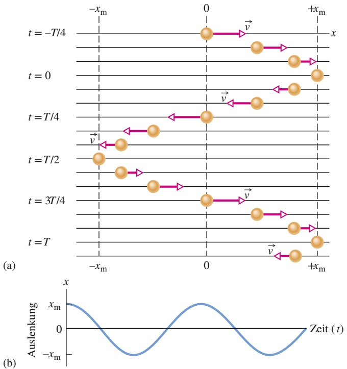

wendet man meist das Symbol $f$ und die SI-Einheit ist das **Hertz** (abgekürzt Hz), wobei

$$
1 \text {Hertz} = 1 \mathrm{Hz} = 1 \text {Schwingung pro Sekunde} = 1 \mathrm{s} ^ {- 1}. \tag {11.1}
$$

Mit der Frequenz eng verknüpft ist die **Periode** (oder **Schwingungsdauer**) $T$ der Bewegung. Darunter versteht man die Zeitdauer einer vollständigen Schwingung (oder eines vollständigen Durchlaufs), d. h.

$$
T = \frac {1}{f}. \tag {11.2}
$$

Eine Bewegung, die sich in regelmäßigen Zeitabständen wiederholt, bezeichnet man als **periodische Bewegung**. Wir interessieren uns hier für eine ganz besondere Form dieser Bewegung, wie sie in Abb. 11.1a wiedergegeben ist. Bei dieser Bewegung lässt sich die Auslenkung x des Teilchens vom Ursprung in folgender Weise als Funktion der Zeit ausdrücken:

$$
x (t) = x _ {\mathrm{m}} \cos (\omega t + \varphi) \quad \text {(Auslenkung)}. \tag {11.3}
$$

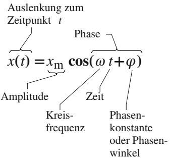

flowchart

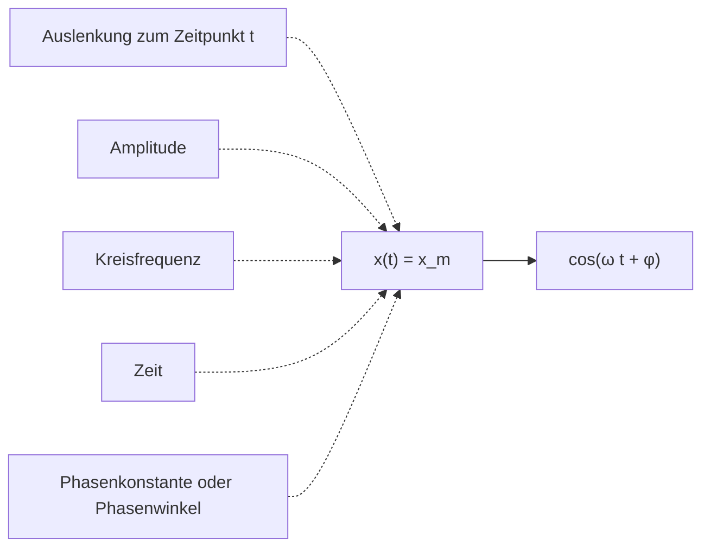

Abb. 11.2

Eine nützliche Zusammenfassung der in Gl. 11.3 auftretenden Größen für die harmonische Schwingung.

Eine solche Bewegung bezeichnet man als **harmonische Schwingung**. Die periodische Bewegung ist in diesem Fall eine kosinus- bzw. sinusförmige Funktion der Zeit. In Abb. 11.1b ist der Graph zu Gl. 11.3 aufgetragen. (Man erhält diesen Graph beispielsweise, indem man Abb. 11.1a gegen den Uhrzeigersinn um $9 0 ^ { \circ }$ dreht und anschließend die entsprechenden Lagen des Teilchens durch eine Kurve verbindet.) Die einzelnen Größen, welche die Form des Graphen bestimmen, sind zusammen mit ihren Bezeichnungen in Abb. 11.2 wiedergegeben. Wir wollen diese Größen nun definieren.

Die Größe $x _ { \mathrm { m } }$ bezeichnet man als **Amplitude** der Schwingung (oder auch **Schwingungsamplitude** oder **Auslenkungsamplitude**). Sie ist eine positive Konstante, deren Wert von den Anfangsbedingungen der Bewegung abhängt. Der Index $\mathrm { { _ { \mathrm { { \it { p } } } } m } ^ { \it { \it { \it { \it { \it { \it { \it { \it { \it { \it { \it { \it { } } } } } } } } } } } } } }$ steht für „maximal“, weil die Amplitude gerade der Betrag der maximalen Auslenkung des Teilchens in jede der beiden Richtungen ist. Die Kosinusfunktion in Gl. 11.3 variiert zwischen den Werten $\pm 1$ , daher variiert die Auslenkung x(t) zwischen den Grenzen $\pm x _ { \mathrm { m } }$

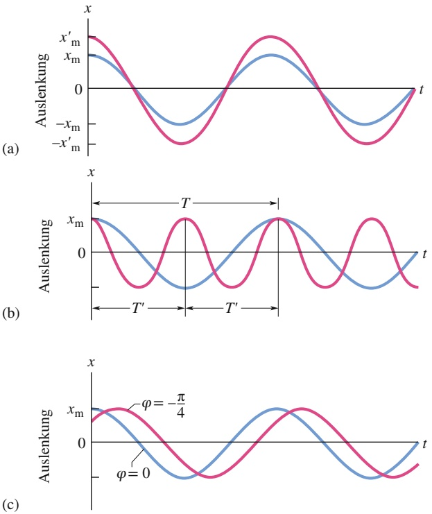

## Abb. 11.3

Die blaue Kurve ergibt sich in allen Fällen aus Gl. 11.3 mit Die rote Kurve unterscheidet sich von der blauen Kurve nur in ihrer Amplitude: ist größer (die Extremwerte der roten Kurve liegen jeweils höher bzw. tiefer). (b) Die rote Kurve unterscheidet sich von der blauen Kurve nur in der Periode: Es gilt (die rote Kurve erscheint horizontal zusammengedrückt). (c) Die rote Kurve unterscheidet sich von der blauen Kurve nur hinsichtlich der Phasenkonstante: rad statt null (der negative Wert von 𝜑 verschiebt die rote Kurve nach rechts).

Die zeitlich veränderliche $\mathrm { G r \ddot { o } \beta e } \left( \omega t + \varphi \right)$ in Gl. 11.3 nennt man die Phase der Bewegung, und die Konstante 𝜑 heißt **Phasenkonstante** (oder auch **Phasenwinkel**). Der Wert von 𝜑 hängt von der Auslenkung und der Geschwindigkeit des Teilchens zum Zeitpunkt $t = 0$ ab. Für den Graphen von $x ( t )$ in Abb. 11.3a ist die Phasenkonstante 𝜑 gleich null.

Zur Interpretation der Konstante $\omega ,$ der sogenannten **Kreisfrequenz** der Bewe gung, überlegen wir uns zunächst, dass die Auslenkung x(t) nach einer vollen Periode T der Bewegung wieder zu ihrem Ausgangswert zurückkehrt. Für alle Zeiten t muss $x ( t )$ daher gleich $x ( t + T )$ sein. Der Einfachheit halber setzen wir in Gl. 11.3 $\varphi = 0 ,$ , dann folgt:

$$
x _ {\mathrm{m}} \cos \omega t = x _ {\mathrm{m}} \cos \omega (t + T). \tag {11.4}
$$

Die Kosinusfunktion wiederholt sich zum ersten Mal wieder, wenn ihr Argument (die Phase) um 2π rad zugenommen hat. Nach Gl. 11.4 gilt daher

$$
\omega (t + T) = \omega t + 2 \pi
$$

oder

$$
\omega T = 2 \pi .
$$

Zusammen mit Gl. 11.2 erhalten wir somit für die Kreisfrequenz

$$
\omega = \frac {2 \pi}{T} = 2 \pi f. \tag {11.5}
$$

Die SI-Einheit für die Kreisfrequenz ist entweder Hertz oder Radiant pro Sekun de. (Aus Konsistenzgründen muss 𝜑 daher im zweiten Fall in Radiant angegeben werden, vgl. Anhang D) In Abb. 11.3 werden jeweils zwei harmonische Schwingungen miteinander verglichen, die sich entweder nur in ihrer Amplitude, nur in ihrer Periode (und daher in der Frequenz bzw. der Kreisfrequenz) oder nur in ihrer Phasenkonstante unterscheiden.

## KONTROLLFRAGE 1

Ein Teilchen führe eine harmonische Schwingung mit der Periode T (vgl. Abb. 11.1) aus und befinde sich zum Zeitpunkt $t = 0$ bei $- x _ { \mathrm { m } } .$ Befindet sich das Teilchen bei (a) $t = 2 { , } 0 0 T _ { \mathrm { i } }$ , (b) $t = 3 { , } 5 0 T$ und (c) $t = 5 { , } 2 5 T$ bei $- x _ { \mathrm { m } } ,$ bei $+ x _ { \mathrm { m } } + x _ { \mathrm { m } } ,$ bei 0, zwischen $- x _ { \mathrm { m } }$ und 0 oder zwischen 0 und $+ x _ { \mathrm { m } } ?$

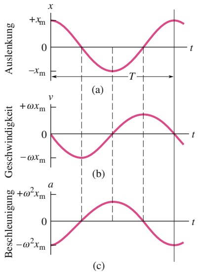

line

| Time | Auslenkung (x) | Geschwindigkeit (v) | Beschleunigung (a) |
| --- | --- | --- | --- |
| 0 | +xm | 0 | \(-\omega2\)xm |
| T1 | 0 | \(-\omega\)xm | 0 |
| T2 | -xm | 0 | \(+\omega2\)xm |
| T3 | 0 | +ωxm | 0 |
| T4 | +xm | 0 | \(-\omega2\)xm |

Abb. 11.4

(a) Die Auslenkung eines Teilchens bei einer harmonischen Schwingung mit $\varphi = 0 .$ Die Periode T entspricht der Zeitdauer einer vollständigen Schwingung. (b) Die Geschwindigkeit v(t) des Teilchens. (c) Die Beschleunigung a(t) des Teilchens.

## Die Geschwindigkeit eines harmonisch schwingenden Teilchens

Wenn wir Gl. 11.3 einmal nach der Zeit ableiten, erhalten wir einen Ausdruck für die Geschwindigkeit des Teilchens während einer harmonischen Schwingung (vgl. Anhang D zur Ableitung der trigonometrischen Funktionen):

$$
\nu (t) = \frac {\mathrm{d} x (t)}{\mathrm{d} t} = \frac {\mathrm{d}}{\mathrm{d} t} [ x _ {\mathrm{m}} \cos (\omega t + \varphi) ],
$$

also

$$
\nu (t) = - \omega x _ {\mathrm{m}} \sin (\omega t + \varphi) \quad \text {(Geschwindigkeit)}  . \tag {11.6}
$$

Abbildung 11.4a zeigt die Kurve zu Gl. 11.3 mit $\varphi = 0 .$ Abbildung 11.4b entspricht Gl. 11. $. 6 ,$ ebenfalls mit $\varphi = 0 .$ In Analogie zur Amplitude $x _ { \mathrm { m } }$ in Gl. 11.3 bezeichnet man die positive Größe $\omega x _ { \mathrm { m } }$ in Gl. 11.6 auch als Geschwindigkeitsamplitude $\nu _ { \mathrm { m } } .$ In Abb. 11.4b erkennt man, dass die Geschwindigkeit des oszillierenden Teilchens zwischen den Grenzen $\pm \nu _ { \mathrm { m } } = \pm \omega x _ { \mathrm { m } }$ variiert. Außerdem beachte man in dieser Abbildung, dass die Kurve von v(t) relativ zur Kurve von x(t) um eine Viertelperiode $\left( { \frac { 1 } { 4 } } T \right)$ nach links verschoben ist. Wenn der Betrag der Auslenkung am größten ist (d. h., wenn $x ( t ) = \pm x _ { \mathrm { m } } )$ ist der Betrag der Geschwindigkeit am kleinsten (d. h. $\nu ( t ) = 0 )$ . Ist der Betrag der Auslenkung am kleinsten (d. h. null), ist der Betrag der Geschwindigkeit am größten (d. h. $\nu ( t ) = \pm \nu _ { \mathrm { m } } = \pm \omega x _ { \mathrm { m } } )$

## Die Beschleunigung eines harmonisch schwingenden Teilchens

Aus der Geschwindigkeit v(t) der harmonischen Bewegung erhalten wir durch er neute Ableitung nach der Zeit einen Ausdruck für die Beschleunigung des oszillierenden Teilchens:

$$
a (t) = \frac {\mathrm{d} \nu (t)}{\mathrm{d} t} = \frac {\mathrm{d}}{\mathrm{d} t} [ - \omega x _ {\mathrm{m}} \sin (\omega t + \varphi) ]
$$

oder

$$
a (t) = - \omega^ {2} x _ {\mathrm{m}} \cos (\omega t + \varphi) \quad \text {(Beschleunigung).} \tag {11.7}
$$

Abbildung 11.4c zeigt einen Graphen von Gl. 11.7 für den Fall $\varphi = 0 .$ . Die positive Größe $\omega ^ { 2 } x _ { \mathrm { m } }$ in Gl. 11.7 ist die **Beschleunigungsamplitude** $a _ { \mathrm { m } }$ . Die Beschleunigung des Teilchens variiert also zwischen den Grenzen $\pm a _ { \mathrm { m } } = \pm \omega ^ { 2 } x _ { \mathrm { m } } ,$ wie in Abb. 11.4c zu erkennen ist. Außerdem ist die Kurve von a(t) relativ zur Kurve von v(t) wiederum um ${ \frac { 1 } { 4 } } T$ nach links verschoben.

Aus den Gln. 11.3 und 11.7 folgt

$$
a (t) = - \omega^ {2} x (t). \tag {11.8}
$$

Diese Beziehung ist das Markenzeichen der harmonischen Schwingung:

Bei einer harmonischen Schwingung ist die Beschleunigung proportional zur Auslenkung, allerdings mit entgegengesetztem Vorzeichen, und die Proportionalitätskonstante ist das Quadrat der Kreisfrequenz.

Wie man in Abb. 11.4 sieht, hat die Auslenkung ihren größten positiven Wert, wenn die Beschleunigung ihren größten negativen Wert hat, und umgekehrt. Ist die Auslenkung null, verschwindet auch die Beschleunigung.

## LÖSUNGSSTRATEGIEN

**Strategie 1: Phasenwinkel** Man beachte den Einfluss des Phasenwinkels $\varphi$ auf den Graphen von $x ( t )$ . Für $\varphi = 0$ hat $x ( t )$ einen Graphen wie in Abb. 11.4a, also eine typische Kosinuskurve. Wird 𝜑 größer, verschiebt sich diese Kurve entlang der t-Achse nach links. (Man kann sich das mit dem Symbol $仝  \varphi$ merken: Der Pfeil nach oben steht für die Zunahme von $\varphi$ und der Pfeil nach links zeigt die Verschiebung der Kurve an.) Wird $\varphi$ kleiner, verschiebt sich die Kurve nach rechts, beispielsweise in Abb. 11.3c für $\varphi = - \pi / 4$

Haben zwei harmonische Schwingung unterschiedliche Phasenwinkel, spricht man von einer Phasenverschiebung oder Phasendifferenz zwischen diesen Schwingungen. Die beiden Bewegungen sind relativ zueinander phasenverschoben oder außer Phase. Beispielsweise haben die Kurven in Abb. 11.3c eine Phasenverschiebung von π∕4 rad.

Da eine harmonische Schwingung sich nach jeder Periode T und die Kosinus-Funktion sich nach jeweils 2π rad wiederholt, entspricht eine Periode $T$ gerade einer Phasenverschiebung von 2π rad. In Abb. 11.4 ist $x ( t )$ relativ zu $\nu ( t )$ um eine Viertelperiode nach rechts, also um $- \pi / 2$ rad phasenverschoben, relativ zu $a ( t )$ beträgt die Phasenverschiebung eine halbe Periode oder −π rad. Bei einer Phasenverschiebung von 2π rad stimmt die Kurve der harmonischen Schwingung wieder mit sich selbst überein, sie erscheint also unverändert.

## 11.1.2 Das Kraftgesetz einer harmonischen Schwingung

Ist die Beschleunigung eines Teilchens als Funktion der Zeit einmal bekannt, kön nen wir mithilfe des zweiten Newtonschen Gesetzes auch die Kraft ermitteln, die dem Teilchen diese Beschleunigung erteilt. Setzen wir Gl. 11.8 in das zweite Newtonsche Gesetz ein, so erhalten wir für die harmonische Schwingung

$$
F = m a = - (m \omega^ {2}) x. \tag {11.9}
$$

Dieses Ergebnis – eine rücktreibende Kraft proportional zur Auslenkung, aber mit entgegengesetztem Vorzeichen – ist uns vertraut. Es handelt sich um das Hookesche Gesetz für eine Feder,

$$
F = - k x, \tag {11.10}
$$

wobei die Federkonstante in diesem Fall durch

$$
k = m \omega^ {2} \tag {11.11}
$$

gegeben ist (vgl. Abschn. 3.4).

Gleichung 11.10 bietet eine alternative Möglichkeit zur Definition der harmonischen Schwingung. Sie besagt:

Ein Teilchen der Masse m führt eine harmonische Schwingung aus, wenn auf dieses Teilchen eine Kraft proportional zu seiner Auslenkung und mit entgegengesetztem Vorzeichen wirkt.

Das System Feder–Masse in Abb. 11.5 bildet einen **eindimensionalen harmonischen Oszillator** (kurz: harmonischen Oszillator). Die Kreisfrequenz ω der harmonischen Schwingung der Masse hängt nach Gl. 11.11 von der Federkonstante k und der Masse m ab:

$$
\omega = \sqrt {\frac {k}{m}} \quad (\text {Kreisfrequenz}). \tag {11.12}
$$

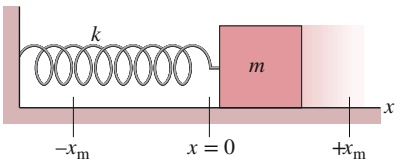

text_image

k
m
-x_m
x = 0
+x_m
x

Abb. 11.5

Ein linearer harmonischer Oszillator. Die Oberfläche ist reibungsfrei. Wie das Teilchen in Abb. 11.2 führt auch diese Masse eine harmonische Schwingung aus, wenn sie einmal zur Seite gezogen und dann losgelassen wird. Ihre Auslenkung folgt Gl. 11.3.

Zusammen mit Gl. 11.5 erhalten wir aus dieser Gleichung für die **Periode** des linearen Oszillators aus Abb. 11.5

$$
T = 2 \pi \sqrt {\frac {m}{k}} \quad (\text {Periode}). \tag {11.13}
$$

Aus diesen beiden Gleichungen lernen wir, dass eine große Kreisfrequenz (und somit eine kurze Periode) eine große Federkonstante (großes k) und eine kleine Masse (kleines m) erfordert.

Jedes oszillierende System, sei es der lineare Oszillator aus Abb. 11.5, ein Sprungbrett im Schwimmbad oder eine Geigensaite, hat etwas von einer Feder – etwas „Rücktreibendes“ – und etwas von einer Masse – etwas „Träges“ – an sich und ähnelt in diesem Sinn dem linearen Oszillator aus der Abbildung. Bei dem linearen Oszillator aus Abb. 11.5 liegen diese beiden Elemente in getrennten Teilen des Systems: Das rücktreibende Element liegt in der Feder, die wir als masselos ansehen, und das träge Element liegt in der Masse, die wir als starr annehmen. Bei einer Geigensaite befinden sich jedoch beide Elemente in der Saite selbst, wie wir in Kapitel 12 sehen werden.

## KONTROLLFRAGE 2

Welche der folgenden Beziehungen zwischen der Kraft F auf ein Teilchen und dem Ort x des Teilchens führen zu einer harmonischen Schwingung: (a) $F = - 5 ^ { 2 } x$ (b) $F = - 400x^{2}, \left(  c  \right) F = 10x, \left(  d  \right) F = 3x^{2}?$

## LÖSUNGSSTRATEGIEN

**Strategie 2: Wie man eine harmonische Schwingung erkennt** Bei einer harmonischen Schwingung sind die Beschleunigung a und die Auslenkung x des Systems über eine Gleichung der Form

$$
a = - (\text {positive Konstante}) \cdot x
$$

miteinander verknüpft. Die Beschleunigung ist also proportional zur Auslenkung aus der Gleichgewichtslage, hat allerdings das entgegengesetzte Vorzeichen. Wenn Sie einen solchen Ausdruck für ein oszillierendes System vorliegen haben, können sie ihn direkt mit Gl. 11.8 vergleichen und die positive Konstante als $\omega ^ { 2 }$ identifizie ren. Sie erhalten also sofort einen Ausdruck für die Kreisfrequenz der Bewegung. Mit Gl. 11.5 ergeben sich dann auch sofort die Periode $T$ und die Frequenz $\bar { f } .$

Bei manchen Aufgabenstellungen ist es vielleicht leichter, einen Ausdruck für die Kraft F als Funktion der Auslenkung x abzuleiten. Handelt es sich bei der Bewegung um eine lineare harmonische Schwingung, dann lautet die Beziehung zwischen Kraft und Auslenkung

$$
F = - (\text {positive Konstante}) \cdot x.
$$

Die Kraft ist also proportional zur Auslenkung, hat aber das entgegengesetzte Vorzeichen. Liegt eine solche Beziehung vor, können Sie durch Vergleich mit Gl. 11.10 die positive Konstante als k identifizieren. Kennen Sie zusätzlich noch die Masse des Systems, können Sie mit den Gln. 11.12, 11.13 und 11.15 die Kreisfrequenz $\omega ,$ die Periode $T$ und die Frequenz $f$ bestimmen.

## 11.2 Die Energie einer harmonischen Schwingung

## Lernziele

Nach dem Durcharbeiten dieses Abschnitts sollten Sie in der Lage sein, . . .

• für einen Oszillator aus einer Feder und einer Masse die kinetische Energie und die elastische potenzielle Energie zu einem beliebigen Zeitpunkt während seiner Bewegung anzugeben,

• für einen Oszillator aus einer Feder und einer Masse mithilfe der Energieerhaltung einen Zusammenhang zwischen seiner Gesamtenergie zu einem Zeitpunkt und seiner Gesamtenergie zu einem anderen Zeitpunkt anzugeben,
• für einen Oszillator aus einer Feder und einer Masse seine kinetische Energie, seine potenzielle Energie und seine Gesamtenergie als Funktion der Zeit oder der Position des Oszillators zu skizzieren,
• für einen Oszillator aus einer Feder und einer Masse seine Position anzugeben, wenn seine Gesamtenergie entweder vollständig als kinetische Energie oder vollständig als potenzielle Energie vorliegt.

## Schlüsselideen

• Ein Teilchen, das eine einfache harmonische Bewegung ausführt, besitzt zu jedem Zeitpunkt die kinetische Energie $\begin{array} { r } { K = \frac { 1 } { 2 } m \nu ^ { 2 } } \end{array}$ und die potenzielle Energie $\begin{array} { r } { U = \frac { 1 } { 2 } \bar { k } x ^ { 2 } } \end{array}$ . In Abwesenheit von Reibung ist die Gesamtenergie $E = K + U$ konstant, obwohl K und U sich fortlaufend ändern.

## 11.2.1 Die Energie einer harmonischen Schwingung

In Kapitel 4 hatten wir qualitativ gesehen, dass die Energie eines linearen harmo nischen Oszillators periodisch zwischen den Energieformen kinetische und potenzielle Energie hin- und herwechselt. Die Summe dieser beiden Energien – die mechanische Energie E des Oszillators – bleibt jedoch konstant. Wir untersuchen diese Situation nun quantitativ.

Die potenzielle Energie eines linearen Oszillators wie in Abb. 11.5 beruht ausschließlich auf dem Zustand der Feder. Der Wert der potenziellen Energie hängt davon ab, wie weit die Feder gedehnt oder zusammengedrückt ist, d. h. von x(t). Aus den Gln. 4.11 und 11.3 erhalten wir

$$
U (t) = \frac {1}{2} k x ^ {2} = \frac {1}{2} k x _ {\mathrm{m}} ^ {2} \cos^ {2} (\omega t + \varphi). \tag {11.14}
$$

Man beachte in diesem Zusammenhang, dass eine Funktion der Form $\cos ^ { 2 } A$ (wie hier) dasselbe bedeutet wie $( \cos A ) ^ { 2 }$ . Das ist nicht dasselbe wie cos $A ^ { 2 } ,$ was vielmehr für $\cos ( A ^ { 2 } )$ steht.

Die kinetische Energie des Systems aus Abb. 11.5 beruht ausschließlich auf dem Zustand der Masse, und ihr Wert hängt von der Geschwindigkeit v der Masse ab. Mit Gl. 11.6 erhalten wir

$$
K (t) = \frac {1}{2} m v ^ {2} = \frac {1}{2} m \omega^ {2} x _ {\mathrm{m}} ^ {2} \sin^ {2} (\omega t + \varphi). \tag {11.15}
$$

Nach Gl. 11.12 können wir $\omega ^ { 2 }$ durch das Verhältnis $k / m$ ersetzen und Gl. 11.15 auch in der folgenden Form schreiben:

$$
K (t) = \frac {1}{2} m v ^ {2} = \frac {1}{2} k x _ {\mathrm{m}} ^ {2} \sin^ {2} (\omega t + \varphi). \tag {11.16}
$$

Für die mechanische Energie folgt aus den Gln. 11.14 und 11.16

$$
\begin{array}{l} E = U + K = \frac {1}{2} k x _ {\mathrm{m}} ^ {2} \cos^ {2} (\omega t + \varphi) + \frac {1}{2} k x _ {\mathrm{m}} ^ {2} \sin^ {2} (\omega t + \varphi) \\ = \frac {1}{2} k x _ {\mathrm{m}} ^ {2} [ \cos^ {2} (\omega t + \varphi) + \sin^ {2} (\omega t + \varphi) ]. \\ \end{array}
$$

Für jeden beliebigen Winkel α gilt

$$
\cos^ {2} \alpha + \sin^ {2} \alpha = 1.
$$

Daher ist die Größe in den eckigen Klammern oben gleich eins und wir bekommen

$$
E = U + K = \frac {1}{2} k x _ {\mathrm{m}} ^ {2}. \tag {11.17}
$$

## Abb. 11.6

(a) Potenzielle Energie U, kinetische Energie K und mechanische Energie E als Funktionen der Zeit t für einen linearen harmonischen Oszillator. Alle Energien sind positiv, und die potenzielle Energie wie auch die kinetische Energie erreichen innerhalb einer Periode zweimal ihren Maximalwert. (b) Potenzielle Energie $U ,$ kinetische Energie K und mechanische Energie E als Funktionen der Auslenkung x für einen linearen harmonischen Oszillator mit der Amplitude $x _ { \mathrm { m } } .$ Bei $x = 0$ besteht die gesamte Energie aus kinetischer Energie, für $x = \pm x _ { \mathrm { m } }$ liegt die gesamte Energie als potenzielle Energie vor.

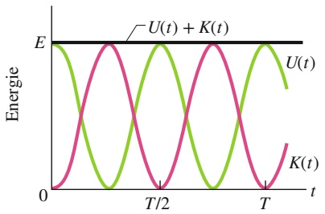

line

| Time (t) | U(t) | K(t) |
| --- | --- | --- |
| 0 | E | 0 |
| T/2 | ~E - E | 0 |
| T | ~E + E | 0 |

(a)

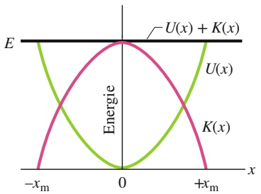

contour

| X | U(x) | K(x) |
| --- | --- | --- |
| -xm | 0 | 0 |
| 0 | E | E |
| +xm | 0 | 0 |

(b)

Die mechanische Energie eines linearen Oszillators ist also tatsächlich konstant und zeitunabhängig. Die potenzielle Energie und die kinetische Energie eines linearen Oszillators sind in Abb. 11.6a als Funktionen der Zeit t und in Abb. 11.6b als Funktionen der Auslenkung x wiedergegeben.

Nun ist auch einsichtig, warum ein oszillierendes System normalerweise ein „rücktreibendes“ Element und ein Element der „Trägheit“ enthält: Das erste speichert die potenzielle Energie und das zweite die kinetische Energie.

## KONTROLLFRAGE 3

Wenn sich die Masse in Abb. 11.5 bei $x = + 2$ cm befindet, habe sie eine kinetische Energie von 3 J und die Feder eine elastische potenzielle Energie von 2 J. (a) Wie groß ist die kinetische Energie, wenn sich die Masse bei $x = 0$ befindet? Wie groß ist die elastische potenzielle Energie, wenn sich die Masse (b) bei $x = - 2 { , } 0$ cm und (c) bei $x = - x _ { \mathrm { m } }$ befindet?

## 11.3 Das Torsionspendel

## Lernziele

Nach dem Durcharbeiten dieses Abschnitts sollten Sie in der Lage sei $1 , \ldots .$

• die Bewegung eines einfachen harmonischen Torsionspendels zu beschreiben,
• für ein einfaches harmonisches Torsionspendel die Beziehung zwischen dem Drehmoment τ und der Winkelauslenkung θ (aus der Ruhelage) anzugeben und anzuwenden,
• für ein einfaches harmonisches Torsionspendel die Beziehung zwischen seiner Periode T (oder seiner Frequenz $f ) ,$ , seinem Trägheitsmoment I und der Torsionskonstante κ anzugeben und anzuwenden,
• für ein einfaches harmonisches Torsionspendel die Beziehung zwischen der Winkelbeschleunigung $\alpha ,$ der Kreisfrequenz ω und der Winkelauslenkung θ anzugeben und anzuwenden.

## Schlüsselideen

• Ein Torsionspendel besteht aus einem Objekt, das an einem Draht aufgehängt ist. Wenn der Draht zuerst verdreht und dann freigegeben wird, führt das Objekt eine einfache harmonische Drehschwingung mit einer Periode

$$
T = 2 \pi \sqrt {\frac {I}{\kappa}}
$$

aus, wobei I das Trägheitsmoment des Objekts und $\kappa ( \mathrm { { \tt { , } K a p p a } ^ { \omega } } )$ die Torsionskonstante des Drahts ist.

## 11.3.1 Das Torsionspendel

Abbildung 11.7 zeigt eine Version eines harmonischen Oszillators, bei der die Auslenkung eine Winkelvariable ist. Das rücktreibende Element bzw. die Elastizität be ruht nun auf der Verdrillung einer Aufhängung (meist einem Draht). Diese Anord nung bezeichnet man als **Torsionspendel**, wobei Torsion wörtlich $_ { p } \mathrm { V }$ erdrillung bedeutet.

Wenn wir die Scheibe in Abb. 11.7 um einen Winkel θ aus ihrer Ruhelage (bei der sich die Bezugslinie beim Winkel $\theta = 0$ befindet) auslenken und dann loslassen, rotiert die Scheibe um diese Lage hin und her. Jede Auslenkung der Scheibe um einen Winkel θ nach rechts oder links erzeugt ein rücktreibendes Drehmoment, das durch

$$
\tau = - \kappa \theta \tag {11.18}
$$

gegeben ist. $\kappa$ (der griechische Buchstabe Kappa) ist hier eine Konstante, die man als **Torsionskonstante** (oder auch **Winkelrichtgröße**) bezeichnet und die von der Länge, dem Durchmesser und dem Material der Aufhängung abhängig ist.

Ein Vergleich von Gl. 11.18 mit Gl. 11.10 legt die Vermutung nahe, dass es sich bei Gl. 11.18 um das Winkelanalogon zum Hookeschen Gesetz handelt, und dass wir Gl. 11.13 für die Periode der linearen harmonischen Schwingung in eine entsprechende Gleichung für die Periode der harmonischen Drehschwingung umwandeln können: Wir ersetzen die Federkonstante k in Gl. 11.13 durch ihr Gegenstück, die Konstante κ aus Gl. 11.18, und wir ersetzen die Masse m in Gl. 11.13 durch ihr Gegenstück, das Massenträgheitsmoment I der schwingenden Scheibe. Diese Ersetzungen führen auf

$$
T = 2 \pi \sqrt {\frac {I}{\kappa}} \quad (\text {Torsionspendel}). \tag {11.19}
$$

Dies ist tatsächlich die korrekte Gleichung für die Periode einer harmonischen Drehschwingung bzw. die Periode des Torsionspendels.

## LÖSUNGSSTRATEGIEN

**Strategie 3: Woran erkennt man eine harmonische Drehschwingung?** Wenn ein System eine harmonische Drehschwingung ausführt, hängen seine Winkelbeschleunigung α und seine Winkelauslenkung θ über eine Gleichung der Form

$$
\alpha = - (\text {positive Konstante}) \cdot \theta
$$

miteinander zusammen. Diese Gleichung ist das Gegenstück zu Gl. 11.8 $( \alpha   =$ $- \omega ^ { 2 } x )$ bei der linearen harmonischen Schwingung. Sie besagt, dass die Winkelbeschleunigung α proportional zur Winkelauslenkung θ aus der Gleichgewichtslage ist, dass diese Winkelbeschleunigung allerdings das System entgegengesetzt zur Auslenkungsrichtung zu drehen versucht. Wenn Ihnen eine Gleichung dieser Form vorliegt, können Sie die positive Konstante als $\omega ^ { 2 }$ identifizieren und daraus $\omega ,   f$ und T berechnen.

Wenn Sie einen Ausdruck für das Drehmoment als Funktion der Winkelauslenkung haben, können Sie das Vorliegen einer harmonischen Drehschwingung auch daran erkennen, dass dieser Ausdruck von der Form von Gl. 11.18 $\left( \tau = - \kappa \theta \right)$ ist, also:

$$
\tau = - (\text {positive Konstante}) \cdot \theta .
$$

Dieser Gleichung entspricht bei der linearen harmonischen Schwingung Gl. 11.10 $( F = - k x )$ . Sie besagt, dass das Drehmoment τ proportional zur Winkelauslenkung θ aus der Gleichgewichtslage ist, dass dieses Drehmoment allerdings das System in die entgegengesetzte Richtung zu drehen versucht. Wenn Sie einen Aus druck dieser Form vorliegen haben, können Sie die positive Konstante als die Tor sionskonstante κ des Systems identifizieren. Kennen Sie das Massenträgheitsmo ment I des Systems, berechnen Sie dann die Periode T mithilfe von Gl. 11.19.

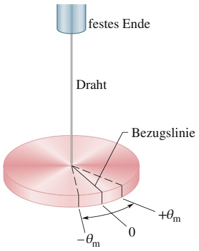

text_image

festes Ende
Draht
Bezugslinie
+θm
0
-θm

Abb. 11.7

Ein Torsionspendel ist eine besondere Version des harmonischen Oszillators aus Abb. 11.5, bei der die Auslenkung eine Winkelvariable ist. Die Scheibe führt in einer horizontalen Ebene eine Drehschwingung aus; die Bezugslinie schwingt mit einer Winkelamplitude $\theta _ { \mathrm { m } } .$ Die Verdrillung in der Aufhängung speichert ähnlich wie eine Feder potenzielle Energie und erzeugt ein rücktreibendes Drehmoment.

## 11.4 Pendel und Kreisbewegungen

## Lernziele

Nach dem Durcharbeiten dieses Abschnitts sollten Sie in der Lage sein, . . .

• die Bewegung eines oszillierenden einfachen Pendels zu beschreiben,
• das Kräftediagramm eines Pendelkörpers zu zeichnen, wenn das Pendel einen Winkel θ zur Vertikalen bildet,
• für kleine Auslenkungen eines einfachen Pendels den Zusammenhang zwischen der Periode T (oder der Frequenz f ) und der Länge L des Pendels anzugeben,
• den Unterschied zwischen einem einfachen Pendel und einem physikalischen Pendel zu beschreiben,
• für kleine Auslenkungen eines physikalischen Pendels den Zusammenhang zwischen der Periode T (oder der Frequenz f ) und dem Abstand h zwischen Drehpunkt und Schwerpunkt anzugeben,
die Kreisfrequenz ω eines Torsionspendels entweder aus dem Zusammenhang zwischen dem Drehmoment τ und der Winkelauslenkung θ oder dem Zusammenhang zwischen der Winkelbeschleunigung α und der Winkelauslenkung θ zu bestimmen,
• den Unterschied zwischen der Kreisfrequenz ω eines Pendels (der Zahl der Schwingungszyklen pro Zeiteinheit) und seinem Wert für $\mathrm { d } \theta / \mathrm { d } t$ (der Geschwindigkeit, mit der sich der Winkel zur Vertikalen ändert) zu verstehen,
• aus gegebenen Werten der Winkelposition θ und ihrer Änderungsrate dθ∕dt an einen gegebenen Zeitpunkt die Phasenkonstante 𝜑 und die Amplitude $\theta _ { \mathrm { m } }$ zu bestimmen,
• zu beschreiben, wie die Fallbeschleunigung g mit einem einfachen Pendel gemessen werden kann,
• für ein gegebenes physikalisches Pendel die Lage des Schwingungszentrums zu bestimmen und zu verstehen, was dieser Begriff im Zusammenhang mit einem einfachen Pendel bedeutet,
• den Zusammenhang zwischen einer einfachen harmonischen Bewegung und einer gleichförmigen Kreisbewegung zu erklären.

## Schlüsselideen

Ein einfaches Pendel besteht aus einem Stab mit vernachlässigbarer Masse, der sich um sein oberes Ende drehen kann und an dessen unterem Ende ein Teilchen mit gegebener Masse (der Pendelkörper) befestigt ist. Wenn der Stab nur wenig ausgelenkt wird, ist seine Bewegung näherungsweise eine einfache harmonische Schwingung mit der Periode

$$
T = 2 \pi \sqrt {\frac {I}{m g L}},
$$

wobei I das Trägheitsmoment des Teilchens um den Drehpunkt ist, m die Masse des Teilchens und L die Länge des Stabs.

• Ein physisches Pendel besitzt eine kompliziertere Massenverteilung. Für kleine Auslenkungen ist auch seine Bewegung eine einfache harmonische Schwingung mit einer Periode

$$
T = 2 \pi \sqrt {\frac {I}{m g h}},
$$

wobei I das Trägheitsmoment des Pendels um den Drehpunkt ist, m seine Masse und h der Abstand zwischen Drehpunkt und Schwerpunkt des Pendels.

• Eine einfache harmonische Bewegung entspricht der Projektion einer gleichmä- ßigen Kreisbewegung auf einen Durchmesser des Kreises.

## 11.4.1 Pendel

Wir wenden uns nun einer bestimmten Klasse von harmonischen Oszillatoren zu, bei denen das rücktreibende Element nicht durch eine zusammengedrückte bzw. gedehnte Feder oder die elastischen Eigenschaften eines verdrillten Drahts verursacht wird, sondern auf der Gravitationskraft beruht.

## Das einfache Pendel

Hängen Sie einen Apfel an das untere Ende einer langen Schnur, deren oberes Ende irgendwo befestigt ist, und stoßen Sie den Apfel leicht zu einer hin- und herschwingenden Bewegung an. Sie erkennen sofort, dass der Apfel eine periodische Bewegung ausführt. Handelt es sich hierbei sogar um eine harmonische Schwingung? Falls ja, welche Periode T hat diese Schwingung? Zur Beantwortung dieser Fragen betrachten wir ein **einfaches Pendel**: Es besteht aus einem Teilchen der Masse m (dem Pendelkörper), das an einem dehnungsfreien, masselosen, am oberen Ende fixierten Seil der Länge L hängt (vgl. Abb. 11.8a). Relativ zu einer senkrechten Linie durch den Aufhängepunkt kann das Gewicht in der Papierebene frei nach links und rechts ausgelenkt werden.

Auf das Gewicht wirken die Zugkraft $\vec { Z }$ des Seils und die Gravitationskraft ${ \vec { F } } _ { \mathrm { G } } .$ Beide sind in Abb. 11.8b eingetragen, wobei das Seil in diesem Fall unter einem Winkel θ relativ zur Senkrechten steht. Wir zerlegen $\vec { F } _ { \mathrm { G } }$ in eine radiale Komponente $F _ { \mathrm { G } }$ cos $\theta$ und eine Komponente $F _ { \mathrm { G } }$ sin θ tangential zur Bahnkurve des Gewichts. Diese tangentiale Komponente erzeugt ein rücktreibendes Drehmoment um die Aufhängung des Pendels, weil sie der Auslenkung des Gewichts immer entgegenwirkt und das Gewicht in seine Mittellage zu bringen versucht. Diese Mittellage bezeichnet man auch als Gleichgewichtslage $( \theta = 0 )$ , weil das nicht schwingende Pendel in dieser Lage ruhen würde.

Nach Gl. 6.30 $( \tau = r _ { \perp } F )$ können wir für das rücktreibende Drehmoment als

$$
\tau = - L (F _ {\mathrm{G}} \sin \theta) \tag {11.20}
$$

schreiben, wobei das Minuszeichen andeutet, dass das Drehmoment den Winkel θ zu verkleinern versucht. L ist der Kraftarm zu der Kraftkomponente $F _ { \mathrm { G } }$ sin $\theta$ um die Aufhängung. Setzen wir Gl. 11.20 in Gl. 6.33 $( \tau = I \alpha )$ ein und ersetzen $F _ { \mathrm { G } }$ durch mg, erhalten wir

$$
- L (m g \sin \theta) = I \alpha , \tag {11.21}
$$

wobei I das Massenträgheitsmoment des Pendels um die Aufhängung und α die Winkelbeschleunigung um diesen Punkt darstellen.

Wir können Gl. 11.21 noch vereinfachen, wenn wir θ als klein annehmen. In diesem Fall können wir sin θ nämlich durch θ annähern (ausgedrückt in Radiant). (Ist θ beispielsweise $5 ^ { \circ } = 0 { , } 0 8 7 3$ rad, dann ist sin $\theta = 0 { , } 0 8 7 2 ;$ der Unterschied beträgt also nur 0,1 %.) Mit dieser Näherung und einigen Umformungen bekommen wir schließlich

$$
\alpha = - \frac {m g L}{I} \theta . \tag {11.22}
$$

Diese Gleichung charakterisiert die harmonische Drehschwingung, ähnlich wie Gl. 11.8 die lineare harmonische Schwingung kennzeichnet. Sie besagt, dass die Winkelbeschleunigung α des Pendels proportional zur Winkelauslenkung θ des Pendels ist, allerdings mit entgegengesetztem Vorzeichen. Bewegt sich das Pendel beispielsweise nach rechts, wie in Abb. 11.8a, nimmt seine Beschleunigung nach links zu bis zu dem Moment, wo das Pendel anhält und sich anschließend nach links bewegt. Befindet es sich auf der linken Seite, ist seine Beschleunigung nach rechts gerichtet, und so weiter.

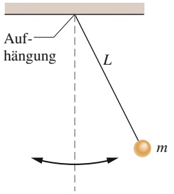

text_image

Auf-
hängung
L
m

(a)

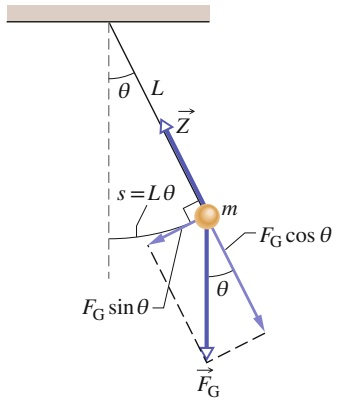

text_image

L
θ
Z
s = L θ
m
F_G cos θ
θ
F_G sin θ
F_G

(b)

## Abb. 11.8

(a) Ein einfaches Pendel. (b) Auf das Gewicht wirken die Gravitationskraft $\vec { \bar { F } } _ { \mathrm { G } }$ und die Zugkraft Z⃗ des Seils. Die tangentiale Komponente $F _ { \mathrm { G } }$ sin θ der Gravitationskraft wirkt als eine rücktreibende Kraft, die das Pendel in seine Ruhelage in der Mitte zurückzubringen versucht.

Die Bewegung eines einfachen, nur mit kleinen Auslenkungen schwingenden Pendels ist näherungsweise eine harmonische Schwingung.

Diese Einschränkung auf kleine Winkel können wir auch anders ausdrücken: Die **Winkelamplitude** $\theta _ { \mathrm { m } }$ der Bewegung (der maximale Auslenkungswinkel) muss klein sein.

Durch einen Vergleich d<u>er Gln.</u> 11.22 und 11.8 sehen wir, dass die Kreisfrequenz des Pendels durch $\tilde { \omega } = \sqrt { m g L / I }$ gegeben ist. Diesen Ausdruck setzen wir nun in Gl. 11.5 $( \omega = 2 \pi / T )$ ein und erhalten so die Periode des Pendels:

$$
T = 2 \pi \sqrt {\frac {I}{m g L}}. \tag {11.23}
$$

Bei einem einfachen Pendel ist die gesamte Masse des Pendels in der Masse m des teilchenartigen Gewichts konzentriert, das vom Aufhängepunkt den Abstand L hat. Wir können also mithilfe von Gl. 6.23 $( I = m r ^ { 2 } )$ für das Massenträgheitsmoment des Pendels $I = m L ^ { 2 }$ schreiben. Setzen wir dies in Gl. 11.23 ein und kürzen entsprechend, folgt als vereinfachter Ausdruck für die Periode eines einfachen Pendels bei kleinen Auslenkungen der Ausdruck

$$
T = 2 \pi \sqrt {\frac {L}{g}} \quad \text {(einfaches Pendel, kleine Amplitude).} \tag {11.24}
$$

(In diesem Kapitel werden wir immer kleine Auslenkungen der Pendel annehmen.)

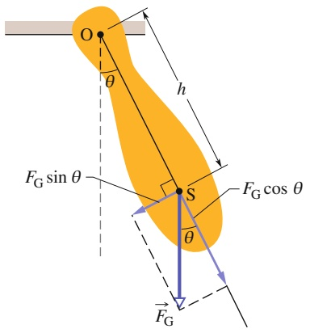

text_image

O
θ
h
F_G sin θ
S
F_G cos θ
θ
F_G

Abb. 11.9

Ein physikalisches Pendel. Das rücktreibende Drehmoment ist $h F _ { G }$ sin θ. Für $\theta = 0$ hängt der Schwerpunkt S genau unter der Aufhängung O.

## Das physikalische Pendel

Ein reales Pendel bezeichnet man üblicherweise als **physikalisches Pendel**. Es kann eine komplizierte Massenverteilung haben, die sich von einem einfachen Pendel deutlich unterscheidet. Führt auch ein physikalisches Pendel eine harmonische Schwingung aus? Falls ja, was ist die Periode?

Abbildung 11.9 zeigt ein beliebig geformtes physikalisches Pendel, das um einen Winkel θ ausgelenkt ist. Die Gravitationskraft $\vec { F } _ { \mathrm { G } }$ wirkt auf den Schwerpunkt S, der sich im Abstand h von der Aufhängung O befindet. Trotz ihrer unterschiedlichen Formen zeigt ein Vergleich von Abb. 11.9 mit Abb. 11.8b nur einen wesentlichen Unterschied zwischen einem beliebigen Pendel und einem einfachen Pendel: Bei einem physikalischen Pendel hat die rücktreibende Komponente $F _ { \mathrm { G } }$ sin θ der Gravitationskraft einen Kraftarm der Länge h um die Aufhängung, während beim einfachen Pendel das Seil die Länge L hatte. Ansonsten würde eine detailliere Diskussion des physikalischen Pendels nur unsere Überlegungen zum einfachen Pendel bis hin zu Gl. 11.23 wiederholen. Wiederum ist die Bewegung des physikalischen Pendels (für kleine $\theta _ { \mathrm { m } } )$ die einer harmonischen Schwingung.

Ersetzen wir in Gl. 11.23 L durch $h ,$ so erhalten wir für die Periode eines physikalischen Pendels:

$$
T = 2 \pi \sqrt {\frac {I}{m g h}} \quad (\text {physikalisches Pendel, kleine Amplitude}). \tag {11.25}
$$

Wie beim einfachen Pendel bezeichnet I das Trägheitsmoment des Pendels um den Punkt O. In diesem Fall ist I jedoch nicht einfach gleich $m L ^ { 2 }$ , sondern es hängt von der Form des physikalischen Pendels ab. Trotzdem ist I immer noch proportional zu m.

Ein physikalisches Pendel führt keine Schwingungen aus, wenn sich die Aufhän gung O im Schwerpunkt befindet. In Gl. 11.25 entspricht dies formal dem Fall $h = 0 ,$ was zu einer Periode von $T \to \infty$ führt. Ein solches „Pendel“ würde also in endlicher Zeit keine Schwingung ausführen.

Zu jedem physikalischen Pendel, das um eine gegebene Aufhängung O mit der Periode T schwingt, gibt es ein einfaches Pendel der Länge $L _ { 0 }$ mit derselben Periode T. Wir können $L _ { 0 }$ nach Gl. 11.24 berechnen. $L _ { 0 }$ bezeichnet man auch als reduzierte Pendellänge des physikalischen Pendels. Den Punkt, der sich im physikalischen Pendel im Abstand $L _ { 0 }$ von O befindet, bezeichnet man als das Schwingungszentrum bezüglich der Aufhängung $\mathrm { O } .$

## Die Messung der Erdbeschleunigung g

Mithilfe eines physikalischen Pendels können wir die Erdbeschleunigung g an einem beliebigen Punkt auf der Erdoberfläche messen. (Im Rahmen geologischer Untersuchungen wurden tausende solcher Messungen durchgeführt.)

Wir betrachten im Folgenden einen einfachen Fall: Das Pendel bestehe aus einem gleichförmigen Stab der Länge $L ,$ der an einem seiner Enden aufgehängt wird. Für ein solches Pendel ist die Länge h in Gl. 11.25 durch den Abstand zwischen der Aufhängung und dem Massenschwerpunkt, also durch ${ \frac { 1 } { 2 } } L ,$ gegeben. Nach Tab. 6.2e ist das Trägheitsmoment für einen solchen Stab um eine Achse durch den Schwerpunkt senkrecht zur Ausdehnung des Stabs durch $\scriptstyle { \frac { 1 } { 1 2 } } m L ^ { 2 }$ gegeben. Nach dem Steinerschen Satz, Gl. 6.26 $( I = I _ { S } + M h ^ { 2 } )$ , erhalten wir für das Trägheitsmoment des Stabs um eine senkrecht zur Ausdehnung gelegene Achse durch eines der Stabenden:

$$
I = I _ {\mathrm{S}} + m h ^ {2} = \frac {1}{1 2} m L ^ {2} + m \left(\frac {1}{2} L\right) ^ {2} = \frac {1}{3} m L ^ {2}. \tag {11.26}
$$

Setzen wir $\begin{array} { r } { h = \frac { 1 } { 2 } L } \end{array}$ und $\begin{array} { r } { I = \frac { 1 } { 3 } m L ^ { 2 } } \end{array}$ in Gl. 11.25 ein und lösen nach $g$ auf, so finden wir

$$
g = \frac {8 \pi^ {2} L}{3 T ^ {2}}. \tag {11.27}
$$

Eine Messung von L und der Periode T liefert somit den Wert von $g$ am Ort des Pendels. (Für Präzisionsmessungen müssen noch einige Verbesserungen vorgenommen werden, beispielsweise muss sich das Pendel in einer luftleeren Kammer befinden.)

## KONTROLLFRAGE 4

Drei physikalische Pendel der Massen $m _ { 0 } , 2 m _ { 0 }$ und $3 m _ { 0 }$ haben dieselbe Form, Grö- ße und Aufhängung. Ordnen Sie die Massen in absteigender Reihenfolge nach den Schwingungsperioden der Pendel.

## 11.4.2 Harmonische Schwingungen und die gleichförmige Kreisbewegung

Im Jahr 1610 entdeckte Galileo Galilei mit seinem neu entwickelten Teleskop die vier Hauptmonde des Jupiters. Im Verlauf seiner wochenlangen Beobachtungen schien sich jeder Mond relativ zum Planeten vor- und zurückzubewegen. Heute würden wir von einer harmonischen Bewegung sprechen. Die Planetenscheibe war der Mittelpunkt dieser Schwingung. Die handgeschriebenen Aufzeichnungen von Galilei sind uns heute noch erhalten, und A.P. French vom MIT hat aus den Daten von Galilei die Position des Monds Callisto relativ zu Jupiter am Anfang des Jahres 1610 rekonstruiert. Die Ergebnisse sind in Abb. 11.10 wiedergegeben. Die Kreise basieren auf Galileis Beobachtungen und die Kurve entspricht der besten Anpassung an die Daten. Diese Kurve wird durch Gl. 11.3, die Auslenkungsfunktion einer harmonischen Schwingung, sehr gut beschrieben. Aus den Daten lässt sich eine Periode von 16,8 Tagen ablesen.

In Wirklichkeit bewegt sich Callisto mit nahezu konstanter Geschwindigkeit auf einer im Wesentlichen kreisförmigen Bahn um den Jupiter. Seine wahre Bewegung ist eine gleichförmige Kreisbewegung. Was Galilei sah – und was Sie mit einem guten Fernglas und etwas Geduld ebenfalls beobachten können – ist die Projektion dieser gleichförmigen Kreisbahn auf eine Linie in der Bewegungsebene. Die wichtigen Beobachtungen Galileis führen uns zu dem Schluss, dass aus einer in Wirklichkeit gleichförmigen Kreisbewegung eine scheinbare harmonische Schwingung wird, wenn man sie von der Seite betrachtet. Etwas formaler ausgedrückt heißt das:

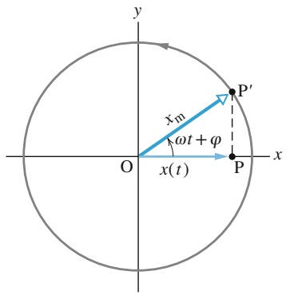

text_image

y
x_m
ωt + φ
O
x(t)
P'
P
x

(a)

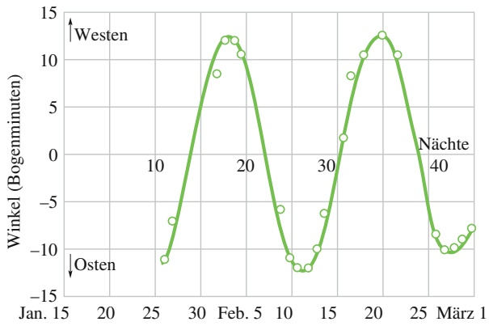

line

| Datum | Winkel (Bogenminuten) |
| --- | --- |
| ~26 | -11 |
| ~27 | -7 |
| ~30 | 8.5 |
| ~31 | 12.5 |
| ~32 | 12.5 |
| ~33 | 10.5 |
| ~34 | 5.5 |
| ~35 | -11 |
| ~36 | -12 |
| ~37 | -12 |
| ~38 | -10 |
| ~39 | -6 |
| ~40 | 2 |
| ~41 | 8.5 |
| ~42 | 10.5 |
| ~43 | 12.5 |
| ~44 | 10.5 |
| ~45 | -8.5 |
| ~46 | -10 |
| ~47 | -10 |
| ~48 | -9 |
| ~49 | -7.5 |

Abb. 11.10

Der Position des Monds Callisto relativ zum Jupiter aus Sicht der Erde. Die Kreise beruhen auf den Messungen von Galileo Galilei aus dem Jahr 1610. Die Kurve ist die beste Anpassung für diese Daten und legt eine harmonische Schwingung nahe. Für den mittleren Abstand des Jupiters von der Erde entsprechen 10 Bogenminuten ungefähr $2 \cdot 1 0 ^ { 6 }$ km. [Quelle: French, A.P. (1971). Newtonian Mechanics. New York: W.W. Norton & Company, S. 288].

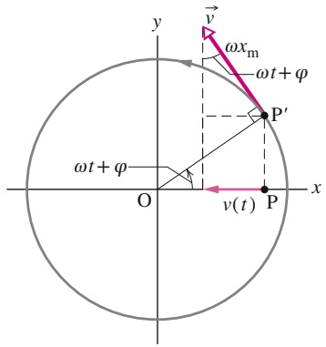

text_image

y
v
ωx_m
ωt + φ
P'
ωt + φ
O
v(t)
P
x

(b)

Eine harmonische Schwingung entsteht als Projektion einer gleichförmigen Kreisbewegung auf den Durchmesser des Kreises, auf dem diese Kreisbewegung stattfindet.

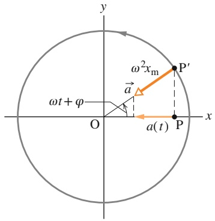

text_image

y
ω²xₘ
P'
a
ωt + φ
O
a(t)
P
x

(c)

Abbildung 11.11a zeigt ein Beispiel. Man erkennt ein Referenzteilchen $\mathrm { P ^ { \prime } } _ { i }$ das sich mit konstanter Winkelgeschwindigkeit ω auf einem Kreis bewegt. Der Radius $x _ { \mathrm { m } }$ des Kreises ist gleich dem Betrag des Ortsvektors des Teilchens. Zu jedem Zeitpunkt t lässt sich die Position von $\mathrm { P ^ { \prime } }$ durch seinen Winkel (relativ zur x-Achse) ωt + 𝜑 kennzeichnen, wobei 𝜑 die Winkelposition zum Zeitpunkt $t = 0$ ist.

Die Projektion des Referenzteilchens $\mathrm { P ^ { \prime } }$ auf die x-Achse entspricht einem Punkt P, den wir als zweites Teilchen ansehen. Die Projektion des Ortsvektors von Teilchen $\mathrm { P ^ { \prime } }$ auf die x-Achse entspricht dem Ort x(t) des Teilchens P. Wir erhalten also

$$
x (t) = x _ {\mathrm{m}} \cos (\omega t + \varphi),
$$

was genau Gl. 11.3 entspricht. Unsere Schlussfolgerung war richtig: Wenn sich das Referenzteilchen $\mathrm { P ^ { \prime } }$ gleichförmig auf einer Kreisbahn bewegt, führt das Teilchen P eine harmonische Schwingung auf dem Durchmesser dieses Kreises aus.

Abbildung 11.11b gibt die Geschwindigkeit ⃗v des Referenzteilchens wieder. Nach Gl. 6.15 $\left( \nu = \omega r \right)$ ist der Betrag der Geschwindigkeit gleich $\omega x _ { \mathrm { m } }$ . Die Projektion der Geschwindigkeit auf die x-Achse ist somit

$$
\nu (t) = - \omega x _ {\mathrm{m}} \sin (\omega t + \varphi),
$$

Abb. 11.11

(a) Ein Referenzteilchen P′ bewegt sich mit konstanter Winkelgeschwindigkeit auf einem Kreis mit Radius $x _ { \mathrm { m } ^ { * } }$ Seine Projektion P auf die x-Achse führt dabei eine harmonische Schwingung aus. (b) Die Projektion des Geschwindigkeitsvektors ⃗v des Referenzteilchens ist gleich der Geschwindigkeit der harmonischen Schwingung. (c) Die Projektion der Radialbeschleunigung a⃗ des Referenzteilchens ist gleich der Beschleunigung der harmonischen Schwingung.

was genau Gl. 11.6 entspricht. Das Minuszeichen tritt auf, weil die Geschwindigkeitskomponente von P in Abb. 11.11b nach links gerichtet ist, also in negative x-Richtung.

In Abb. 11.11c erkennt man die Radialbeschleunigung $\vec { a }$ des Referenzteilchens. Nach Gl. 6.20 $( a _ { \mathrm { r } } = \omega ^ { 2 } r )$ ist der Betrag der Radialbeschleunigung gleich $\omega ^ { 2 } r _ { \mathrm { m } } .$ Seine Projektion auf die x-Achse ist daher

$$
a (t) = - \omega^ {2} x _ {\mathrm{m}} \cos (\omega t + \varphi),
$$

genau wie in Gl. 11.7. Gleichgültig ob wir die Auslenkung, die Geschwindigkeit oder die Beschleunigung betrachten, die Projektion der gleichförmigen Kreisbewegung ist tatsächlich eine harmonische Schwingung.

## 11.5 Gedämpfte harmonische Schwingungen

## Lernziele

Nach dem Durcharbeiten dieses Abschnitts sollten Sie in der Lage sein, . . .

• die Bewegung eines gedämpften harmonischen Oszillators zu beschreiben und seine Position als Funktion der Zeit zu skizzieren,
• die Position eines gedämpften harmonischen Oszillators zu einem gegebenen Zeitpunkt zu berechnen,
• die Amplitude eines gedämpften harmonischen Oszillators zu einem beliebigen Zeitpunkt zu berechnen,
• die Kreisfrequenz eines gedämpften harmonischen Oszillators aus seiner Federkonstante, seiner Dämpfungskonstante und seiner Masse zu berechnen und eine Näherung für die Kreisfrequenz für kleine Dämpfungskonstanten anzugeben,
• die (genäherte) Gesamtenergie eines gedämpften harmonischen Oszillators als Funktion der Zeit zu berechnen.

## Schlüsselideen

In realen schwingenden Systemen nimmt die mechanische Energie E im Verlauf der Schwingungen ab, da äußere Einflüsse wie z. B. Reibungskräfte die Schwingungen hemmen und mechanische Energie in thermische Energie umwandeln. Man bezeichnet einen solchen realen Oszillator bzw. seine Bewegung als gedämpft.
• Wenn die dämpfende Kraft durch $\vec { F } _ { \mathrm { D } } = - b \vec { \nu }$ gegeben ist, wobei v⃗ die Geschwindigkeit des Oszillators und b eine Dämpfungskonstante ist, dann folgt die Auslenkung des Oszillators der Gleichung

$$
x (t) = x _ {\mathrm{m}} \mathrm{e} ^ {- b t / (2 m)} \cos (\omega^ {\prime} t + \varphi),
$$

wobei für die Kreisfrequenz ω′ des gedämpften Oszillators gilt

$$
\omega^ {\prime} = \sqrt {\frac {k}{m} - \frac {b ^ {2}}{4 m ^ {2}}}.
$$

• Wenn die Dämpfungskonstante klein ist $( b \ll \sqrt { k m } )$ , gilt $\omega ^ { \prime } \approx \omega$ , wenn ω die Kreisfrequenz des ungedämpften Oszillators ist. Für kleine b ist die mechanische Energie E des Oszillators

$$
E (t) \approx \frac {1}{2} k x _ {\mathrm{m}} ^ {2} \mathrm{e} ^ {- b t / m}.
$$

## 11.5.1 Gedämpfte harmonische Schwingungen

Unter Wasser wird ein Pendel nur sehr kurz schwingen, da das Wasser auf das Pendel einen Widerstand ausübt, der die Bewegung rasch abklingen lässt. Die Schwingung eines Pendels in Luft hält schon länger an, aber über kurz oder lang klingt auch diese Bewegung ab, weil auch die Luft auf das Pendel einen Widerstand aus übt (und zusätzlich noch Reibungskräfte – beispielsweise an der Aufhängung – auftreten, vgl. Kapitel 2). Der Pendelbewegung wird also Energie entzogen.

Wenn die Bewegung eines Oszillators durch eine äußere Kraft abgeschwächt wird, bezeichnet man den Oszillator und seine Bewegung als **gedämpft**. Ein idealisiertes Beispiel einer gedämpften Schwingung zeigt Abb. 11.12. Ein Gewicht der Masse m schwingt vertikal an einer Feder mit der Federkonstante k. Unten an dem Gewicht befindet sich ein dünner Stab mit einem Dämpfungskolben (beide als masselos angenommen), die in eine Flüssigkeit eintauchen. Wenn sich der Kolben auf- und abbewegt, übt die Flüssigkeit einen Widerstand auf ihn aus und damit auf das gesamte oszillierende System. Im Verlauf der Zeit nimmt die mechanische

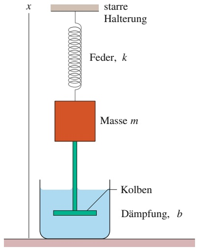

text_image

x
starre
Halterung
Feder, k
Masse m
Kolben
Dämpfung, b

Abb. 11.12

Ein idealisierter gedämpfter harmonischer Oszillator. Ein Kolben in einer Flüssigkeit überträgt auf das Gewicht eine dämpfende Kraft, während es in x-Richtung oszilliert.

Energie des Systems Feder–Gewicht ab, und die Energie wird in thermische Energie von Flüssigkeit und Kolben umgewandelt.

Wir nehmen im Folgenden an, die Flüssigkeit übe eine **Reibungskraft** $\vec { \bar { F } } _ { \mathrm { R } }$ aus, die proportional zum Betrag der Geschwindigkeit v⃗ des Kolbens bzw. des Gewichts ist. (Diese Annahme ist zulässig, wenn sich der Kolben nicht zu schnell bewegt.) Für die x-Komponente (vgl. Abb. 11.12) dieser Kraft gilt dann

$$
F _ {\mathrm{R}} = - b \nu \tag {11.28}
$$

wobei b der **Dämpfungskoeffizient** ist, der sowohl von den Eigenschaften des Kolbens als auch von denen der Flüssigkeit abhängt. Seine SI-Einheit ist Kilogramm pro Sekunde. Das Minuszeichen deutet an, dass die Kraft $\vec { \bar { F } } _ { \mathrm { R } }$ der Bewegung entgegenwirkt.

Die von der Feder auf das Gewicht ausgeübte Kraft ist $F _ { \mathrm { F } } = - k x$ . Außerdem nehmen wir noch an, dass die Gravitationskraft auf das Gewicht im Vergleich zu $F _ { \mathrm { R } }$ und $F _ { \mathrm { F } }$ vernachlässigbar ist. In diesem Fall können wir das zweite Newtonsche Gesetz entlang der x-Achse $( F _ { \mathrm { g e s } , x } = m a _ { x } )$ in der Form

$$
- b v - k x = m a \tag {11.29}
$$

schreiben. Ersetzen wir v durch dx∕dt und a durch $\mathrm { d } ^ { 2 } x / \mathrm { d } t ^ { 2 }$ und bringen alle Terme auf eine Seite, so erhalten wir die Differenzialgleichung

$$
m \frac {\mathrm{d} ^ {2} x}{\mathrm{d} t ^ {2}} + b \frac {\mathrm{d} x}{\mathrm{d} t} + k x = 0. \tag {11.30}
$$

Mit ein bisschen mathematischem Aufwand kann man die Lösung dieser Gleichung auch als

$$
x (t) = x _ {\mathrm{m}} \mathrm{e} ^ {- b t / (2 m)} \cos (\omega^ {\prime} t + \varphi) \tag {11.31}
$$

schreiben, wobei $x _ { \mathrm { m } }$ die Amplitude und $\omega ^ { \prime }$ die Kreisfrequenz des gedämpften Oszillators ist.

Diese Kreisfrequenz ist durch

$$
\omega^ {\prime} = \sqrt {\frac {k}{m} - \frac {b ^ {2}}{4 m ^ {2}}} \tag {11.32}
$$

gegeben<u>. Fü</u>r den Fall $b   =   0$ (keine Dämpfung) wird Gl. 11.32 zu Gl. 11.12 $( \omega = \sqrt { k / m } )$ , der Kreisfrequenz des ungedämpften Oszillators, und Gl. 11.31 wird zu Gl. 11.3, der Gleichung für die Auslenkung des ungedämpften Oszillators. Für einen kleinen, aber von null verschiedenen Dämpfungskoeffizienten $( b \ll \sqrt { k m } )$ gilt $\omega ^ { \prime } \approx \omega$

Wir können Gl. 11.31 als Kosinusfunktion interpretieren, deren Amplitude – gegeben durch $x _ { \mathrm { m } } \mathrm { e } ^ { - b t / 2 ^ { m } }$ – mit der Zeit abnimmt. Für einen ungedämpften Oszillator ist die mechanische Energie konstant und durch Gl. 11.17 $\begin{array} { r } { \tilde { ( E = \frac { 1 } { 2 } k x _ { \mathrm { m } } ^ { 2 } ) } } \end{array}$ gegeben. Für einen gedämpften Oszillator ist die mechanische Energie nicht mehr konstant, sondern sie nimmt im Lauf der Zeit ab. Ist die Dämpfung schwach, können wir $E ( t )$ näherungsweise bestimmen, indem wir $x _ { \mathrm { m } }$ in Gl. 11.17 durch $x _ { \mathrm { m } } \mathrm { e } ^ { - b t / ( 2 m ) }$ ersetzen, die Amplitude der gedämpften Schwingung. Auf diese Weise erhalten wir

$$
E (t) \approx \frac {1}{2} k x _ {\mathrm{m}} ^ {2} \mathrm{e} ^ {- b t / m}. \tag {11.33}
$$

Wie die Amplitude nimmt auch die mechanische Energie exponentiell mit der Zeit ab.

## KONTROLLFRAGE 5

In der Tabelle sind Federkonstante, Dämpfungskoeffizient und Masse für drei Sys teme von gedämpften Oszillatoren wie in Abb. 11.12 angegeben. Ordnen Sie die se Systeme in absteigender Reihenfolge nach der Zeit, nach der die mechanische Energie auf ein Viertel ihres Anfangswerts gesunken ist.

| System 1 | $2k_{0}$ | $b_{0}$ | $m_{0}$ |
| --- | --- | --- | --- |
| System 2 | $k_{0}$ | $6b_{0}$ | $4m_{0}$ |
| System 3 | $3k_{0}$ | $3b_{0}$ | $m_{0}$ |

## 11.6 Erzwungene Schwingungen und Resonanz

## Lernziele

Nach dem Durcharbeiten dieses Abschnitts sollten Sie in der Lage sein, . . .

• zwischen der natürlichen Kreisfrequenz ω und der antreibenden Erreger-Kreisfrequenz $\omega _ { \mathrm { e } }$ zu unterscheiden,
• für eine erzwungene Schwingung die Schwingungsamplitude als Funktion des Verhältnisses $\omega _ { \mathrm { e } } / \omega$ von antreibender zu natürlicher Kreisfrequenz zu skizzieren, den Resonanzfall anzugeben sowie die Auswirkungen einer zunehmenden Dämpfung zu erläutern,
• zu einer gegebenen natürlichen Kreisfrequenz ω die ungefähre antreibende Erreger-Kreisfrequenz $\omega _ { \mathrm { e } }$ anzugeben, bei der es zur Resonanz kommt.

## Schlüsselideen

• Wenn auf ein schwingendes oszillierendes System mit der natürlichen Kreisfrequenz ω eine externe antreibende Erregerkraft wirkt, die mit der Kreisfrequenz $\omega _ { e }$ oszilliert, schwingt das System mit der Kreisfrequenz $\omega _ { e }$
• Die Geschwindigkeitsamplitude $\nu _ { \mathrm { m } }$ des angetriebenen Systems ist für

$$
\omega_ {\mathrm{e}} = \omega
$$

am größten; man spricht in diesem Fall von Resonanz. Wenn diese Bedingung erfüllt ist, ist auch die Auslenkungsamplitude des Systems (näherungsweise) maximal.

## 11.6.1 Erzwungene Schwingungen und Resonanz

Eine Person auf einer Schaukel, die sich ohne äußere (und eigene) Hilfe hin- und herschwingen lässt, ist ein Beispiel für ein frei schwingendes System. Wird diese Person jedoch von einer anderen Person (oder von sich selbst) in regelmäßigen Abständen angestoßen, haben wir es mit einer erzwungenen (oder auch angetriebenen) Schwingung zu tun. Bei einer solchen erzwungenen Schwingung treten zwei Kreisfrequenzen auf: (1) die natürliche Kreisfrequenz ω des Systems, also die Kreisfrequenz, mit der das System ohne äußeren Einfluss schwingen würde, und (2) die Kreisfrequenz $\omega _ { e }$ der (als periodisch angenommenen) externen antreibenden Erregerkraft.

Wir können die Anordnung aus Abb. 11.12 auch zur Darstellung eines idealisierten getriebenen harmonischen Oszillators verwenden. Dazu müssen wir uns vorstellen, die als „starre Halterung“ gekennzeichnete Struktur bewege sich mit der (frei einstellbaren) Kreisfrequenz $\omega _ { \mathrm { e } }$ auf und ab. Ein solcher getriebener Oszillator schwingt mit der Winkelgeschwindigkeit der antreibenden Kraft und seine Auslenkung x(t) ist durch

$$
x (t) = x _ {\mathrm{m}} \cos (\omega_ {\mathrm{e}} t + \varphi) \tag {11.34}
$$

gegeben, wobei $x _ { \mathrm { m } }$ die Amplitude der Erregerschwingung ist.

Die Verschiebungsamplitude $x _ { \mathrm { m } }$ auszurechnen erfordert etwas mathematischen Aufwand. Es ergibt sich schließlich, dass (für kleine Dämpfungen) die Auslenkung bei

$$
\omega_ {\mathrm{e}} = \omega \quad (\text {Resonanz}) \tag {11.35}
$$

maximal wird. Das Vorliegen dieser Bedingung bezeichnet man als **Resonanz**. Die Resonanzbedingung ist näherungsweise auch die Bedingung dafür, dass die Verschiebungsamplitude $x _ { \mathrm { m } }$ am größten ist. Wenn Sie also eine Schaukel bei ihrer natürlichen Frequenz anstoßen, werden die Auslenkungs- und Geschwindigkeits amplituden sehr groß, eine Tatsache, die schon kleine Kinder spielend lernen. Sto ßen Sie die Schaukel mit einer anderen Frequenz an, gleichgültig ob größer oder kleiner, bleiben Auslenkungs- und Geschwindigkeitsamplituden kleiner.

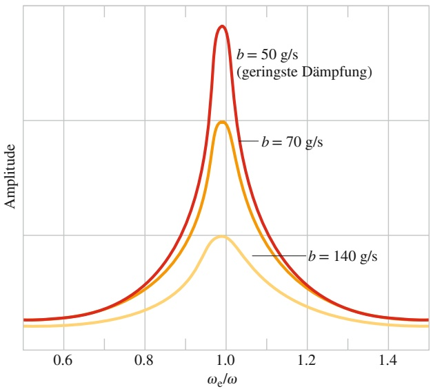

line

| \(\omega e/\omega\) | Amplitude (b=50 g/s) | Amplitude (b=70 g/s) | Amplitude (b=140 g/s) |
| --- | --- | --- | --- |
| 0.6 | ~0.1 | ~0.1 | ~0.05 |
| 0.8 | ~0.3 | ~0.25 | ~0.15 |
| 1.0 | ~1.0 | ~0.6 | ~0.3 |
| 1.2 | ~0.3 | ~0.25 | ~0.15 |
| 1.4 | ~0.1 | ~0.1 | ~0.05 |

## Abb. 11.13

Die Verschiebungsamplitude $X _ { \mathrm { m } }$ für eine erzwungene Schwingung ändert sich mit der Kreisfrequenz $\omega _ { \mathrm { e } }$ der antreibenden Kraft. In der Nähe von $\omega _ { \mathrm { e } } / \omega _ { \mathrm { r } }$ also der Resonanzbedingung, ist die Amplitude am größten. Die Kurven entsprechen drei verschiedenen Werten für den Dämpfungskoeffizienten b.

Abbildung 11.13 zeigt die Auslenkungsamplitude eines Oszillators als Funktion der Kreisfrequenz $\omega _ { e }$ der treibenden Kraft für drei verschiedene Werte des Dämpfungskoeffizienten $b .$ Die größten Werte für die Amplitude erhält man für alle drei Dämpfungskoeffizienten in der Nähe von $\omega _ { \mathrm { e } } / \omega = 1 ,$ , wenn also die Resonanzbedingung aus Gl. 11.35 erfüllt ist. Die Kurven in Abb. 11.13 lassen auch erkennen, dass weniger Dämpfung zu einer höheren und engeren Amplitudenresonanzfunktion führt.

Alle mechanischen Strukturen haben eine oder mehrere natürliche Schwingungsfrequenzen, und wenn eine solche Struktur einer starken äußeren periodischen Kraft ausgesetzt ist, die mit einer dieser Frequenzen übereinstimmt, können die resultierenden Schwingungen die Struktur zerstören. Ein Flugzeugkonstrukteur beispielsweise muss sich vergewissern, dass im Flug keine der natürlichen Schwingungsfrequenzen der Flügel mit den Schwingungsfrequenzen der Maschinen übereinstimmen. Ein bei bestimmten Fluggeschwindigkeiten heftig auf- und abschwingender Flügel wäre offensichtlich eine große Gefahr.

Das heftige Erdbeben an der mexikanischen Pazifikküste im September 1985 erreichte einen Wert von 8,1 auf der Richter-Skala. Trotzdem wären die seismischen Wellen eigentlich zu schwach gewesen, um in dem 400 km entfernten Mexiko-Stadt größere Schäden anrichten zu können. Mexiko-Stadt wurde allerdings zu einem Großteil auf einem alten Seebett erbaut, und die Erde des Untergrunds ist immer noch feucht und weich. Obwohl die Amplituden der seismischen Wellen auf dem festeren Grund auf dem Weg nach Mexiko-Stadt klein waren, wurden sie durch den weicheren Untergrund der Stadt wesentlich größer. Die Beschleunigungsamplituden der Wellen betrugen rund 0,20g, und die Frequenzen waren in der Nähe von 3 rad/s ungewöhnlich konzentriert. Nicht nur, dass der Boden vergleichsweise stark oszillierte, sondern viele der Gebäude mittlerer Größe hatten auch eine natürliche Resonanzfrequenz von ungefähr 3 rad/s. Die meisten dieser mittelgroßen Gebäude fielen während des Bebens zusammen, während niedrigere (mit einer größeren Resonanzfrequenz) und höhere Gebäude (mit einer kleineren Resonanzfrequenz) stehen blieben.

## 11.7 Das Foucaultsche Pendel

## Lernziele

Nach dem Durcharbeiten dieses Abschnitts sollten Sie in der Lage sein, . . .

• die Drehung der Schwingungsebene eines Foucaultschen Pendels relativ zum Erdboden zu verstehen und zu erklären.

## Schlüsselideen

• Die Schwingungsebene eines Foucaultschen Pendels scheint sich relativ zum Erdboden zu drehen. Korrekter ist es zu sagen, dass sich der Erdboden aufgrund der Erdrotation unter dem Pendel hinwegdreht.

## 11.7.1 Das Foucaultsche Pendel

Der französische Physiker J.B. Léon Foucault führte im Januar 1851 in seinem Haus erstmals ein einfaches Pendelexperiment aus, das im Laufe der Jahre zu einem der berühmtesten und am häufigsten kopierten Experimente der Physik wurde. Das **Foucaultsche Pendel** ist dadurch charakterisiert, dass es eine sehr lange (in der Regel mehrere Meter lange) Aufhängung hat, an der eine relativ schwere Masse befestigt ist (Abb. 11.14). Wenn man diese Masse aus ihrer Gleichgewichtslage auslenkt und loslässt, dann fängt das Pendel an zu schwingen. In Foucaults Experiment hat der Pendelkörper, d. h. die schwere Masse, eine Spitze, die während der Schwingungen eine Spur in einem mit Sand bestreuten Untergrund hinterlässt. Wenn man diese Spur über einige Stunden hinweg beobachtet, dann formt sie sich zu eine Rosette, d. h., die Schwingungsebene des Pendels ist nicht konstant, sondern sie rotiert im Laufe der Zeit. Das Auftreten dieser Rosette ist ein direkter Nachweis der **Erdrotation**, die damit in einem konzeptionell sehr einfachen Experiment von Laien beobachtet werden kann.

Wie können wir verstehen, dass die Rotation der Schwingungsebene beim Foucaultschen Pendel einen direkten Nachweis der Erdrotation darstellt? Dafür müssen wir die Pendelbewegung im rotierenden Koordinatensystem K auf der Erdoberfläche berechnen. Da die Erde sich innerhalb von 24 Stunden einmal um ihre durch die Pole verlaufende Rotationsachse dreht, ist der Betrag der Winkelgeschwindigkeit

$$
\omega = \omega_ {\mathrm{Erde}} = \frac {1}{2 4 \cdot 3 6 0 0} \mathrm{s} ^ {- 1} \approx 1, 1 5 7 \cdot 1 0 ^ {- 5} \mathrm{s} ^ {- 1}, \tag {11.36}
$$

das heißt ein recht kleiner Zahlenwert.

In Abschn. 2.7 hatten wir die Newtonsche Bewegungsgleichung in rotierenden Koordinatensystemen hergeleitet. (Dort hatten wir allerdings das rotierende Koordinatensystem mit $\mathrm { K ^ { \prime } }$ und das inertiale System mit K bezeichnet – hier verwenden wir die Bezeichnungen aus Gründen der Übersichtlichkeit genau umgekehrt!) Wir haben also in unserem Fall in den Koordinaten x, y, z des rotierenden Systems

$$
m \left. \frac {\mathrm{d} ^ {2} \vec {r}}{\mathrm{d} t ^ {2}} \right| _ {\text {Erde}} = \vec {F} _ {\text {ext}} + \vec {F} _ {\text {Zentrifugal}} + \vec {F} _ {\text {Coriolis}} + \vec {F} _ {\text {Azimutal}}. \tag {11.37}
$$

|Die Scheinkraft $\vec { F } _ { \mathrm { A z i m u t a l } }$ tritt nur auf, falls die Winkelgeschwindigkeit sich mit der Zeit ändert. Dieser Effekt ist bei der Erde so klein, dass wir ihn hier vernachlässigen können.

Von den beiden übrigen Scheinkräften $\vec { F } _ { \mathrm { Z e n t r i f u g a l } }$ und $\vec { F } _ { \mathrm { C o r i o l i s } }$ müssen wir nur

$$
\vec {F} _ {\text {Coriolis}} = (- 2 m \vec {\omega} _ {\mathrm{Erde}}) \times \left(\frac {\mathrm{d} \vec {r}}{\mathrm{d} t} \Bigg | _ {\mathrm{Erde}}\right) \tag {11.38}
$$

berücksichtigen, da

$$
\vec {F} _ {\text {Zentrifugal}} = - m \vec {\omega} _ {\text {Erde}} \times (\vec {\omega} _ {\text {Erde}} \times \vec {r}) \tag {11.39}
$$

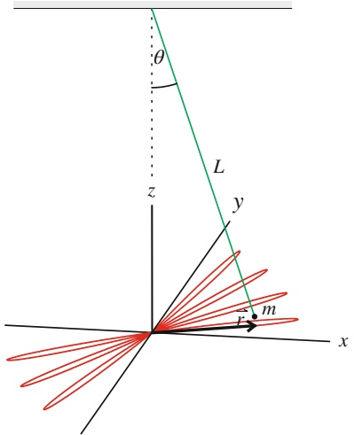

text_image

θ
L
z
y
m
r
x

Abb. 11.14

Eine schwere Masse m ist an einer langen Aufhängung (Länge L) befes tigt. Nach der Auslenkung schwingt das Pendel, wobei seine Schwingungsebene wegen der von der Erdrotation bewirkten Coriolis-Kraft rotiert. Zur Aufzeichnung dieses Effekts versah Foucault in seinen Originalexperimenten die schwere Masse mit einer Spitze, die während der Schwingungen eine Spur in einem mit Sand bestreuten Untergrund hinterließ. Diese Spur ist in der Abbildung als rote Linie symbolisiert.

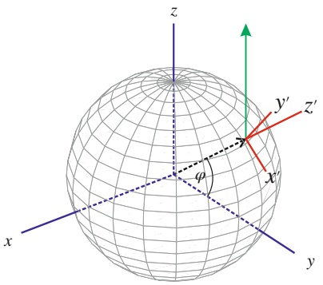

text_image

z
y'
z'
x'
φ
x
y

Abb. 11.15

Bei den Koordinatensystemen, die für die Behandlung des Foucaultschen Pendelversuchs wichtig sind, unterscheidet man zwischen dem inertialen Koordinatensystem K′ (blau) mit Ursprung im Mittelpunkt der Erde (blau eingezeichnet) und dem rotierenden lokalen Koordinatensystem K mit Ursprung am Aufhängungsort des Pendels auf der Erdoberfläche (rot; beachten Sie, dass hier das „ungestrichene“ System das rotierende ist!). Die z-Achse der blauen Koordinaten ist die Rotationsachse der Erde. Das rot eingezeichnete lokale Koordinatensystem ist so orientiert, dass die lokale z-Achse radial vom Erdmittelpunkt nach außen und die xund die y-Achse tangential nach Süden bzw. Osten weisen. Der Breitengrad des lokalen Koordinatenursprungs ist durch den Winkel 𝜑 gegeben und der Vektor der Winkelgeschwindigkeit im lokalen Koordinatensystem ist durch den grünen Pfeil symbolisiert. Er steht senkrecht auf der lokalen (roten) y-Achse, schließt mit der lokalen negativen x-Achse den Winkel 𝜑 und mit der z-Achse den Winkel $9 0 ^ { \circ } - \varphi$ ein.

quadratisch in der kleinen Größe $\omega _ { \mathrm { E r d e } }$ ist, wohingegen die Coriolis-Kraft linear mit $\omega _ { \mathrm { E r d e } }$ skaliert. Daher ist für das Foucaultsche Pendel

$$
\left| \vec {F} _ {\text {Zentrifugal}} \right| \ll \left| \vec {F} _ {\text {Coriolis}} \right| \tag {11.40}
$$

und Gl. 11.37 vereinfacht sich weiter zu

$$
m \left. \frac {\mathrm{d} ^ {2} \vec {r}}{\mathrm{d} t ^ {2}} \right| _ {\text {Erde}} = \vec {F} _ {\text {ext}} - (2 m \vec {\omega} _ {\text {Erde}}) \times \left(\left. \frac {\mathrm{d} \vec {r}}{\mathrm{d} t} \right| _ {\text {Erde}}\right). \tag {11.41}
$$

Hierbei ist die externe Kraft die Vektorsumme aus der Schwerkraft, die auf den Massepunkt wirkt, und der Zugkraft $\vec { Z }$ des Seils, an dem der Massepunkt aufgehängt ist. Ohne Coriolis-Kraft wäre Gl. 11.41 daher gerade die sogenannte Pendelgleichung, deren Lösung eine harmonische Schwingung mit der Frequenz $\omega   =   \sqrt { g / L }$ (vgl. Gl. 11.24) beschreibt. Für das Foucaultsche Pendel erhält man nach einer länglichen Rechnung eine der harmonischen Oszillation überlagerte Drehung der Schwingungsebene. Die x-Komponente der Auslenkung variiert wie

$$
x (t) = A \cos (\Omega t) \cos (\omega t) \tag {11.42}
$$

und die y-Komponente wie

$$
y (t) = - A \sin (\Omega t) \cos (\omega t). \tag {11.43}
$$

Hierbei ist

$$
\Omega = \omega_ {\mathrm{Erde}} \sin \varphi . \tag {11.44}
$$

Der Winkel 𝜑 bezeichnet die geografische Breite des Pendelstandorts (siehe Abb. 11.15). Am Äquator ist $\varphi = 0$ und das Foucaultsche Pendel dreht seine Schwingungsebene überhaupt nicht. An Nord- und Südpol ist die Rotation am schnellsten, d. h. das Pendel vollführt dort eine volle Drehung um 360° pro Tag. In Deutschland, also bei ca. 50° nördlicher Breite, rotiert die Schwingungsebene um ca. $2 7 0 ^ { \circ }$ am Tag bzw. 11,25° in der Stunde, was (mit etwas Geduld) einfach zu beobachten ist. Demonstrationsexperimente des Versuchs von Foucault finden sich an vielen Orten weltweit, in Universitäten, Museen und anderen öffentlich zugänglichen Gebäuden.

## 11.8 Zusammenfassung

**Frequenz** Die **Frequenz** f einer periodischen oder oszillierenden Bewegung ist gleich der Anzahl der vollen Durchläufe (Schwingungen) pro Sekunde. Ihre SI-Einheit ist das Hertz:

$$
1 \text {Hertz} = 1 \mathrm{Hz} = 1 \text {Schwingung pro Sekunde} = 1 \mathrm{s} ^ {- 1}. \tag {11.1}
$$

**Periode** Die **Periode** T ist die für eine vollständige Oszillation bzw. einen vollständigen Durchlauf des Bewegungszyklus benötigte Zeit. Sie ist der Kehrwert der Frequenz:

$$
T = \frac {1}{f}. \tag {11.2}
$$

**Harmonische Schwingung** Bei einer harmonischen Schwingung lässt sich die Auslenkung x(t) eines Teilchens aus seiner Gleichgewichtslage durch die Gleichung

$$
x (t) = x _ {\mathrm{m}} \cos (\omega t + \varphi) \quad \text {(Auslenkung)} \tag {11.3}
$$

beschreiben. Hierbei ist $x _ { \mathrm { m } }$ die **Amplitude** der Verschiebung, die Größe $( \omega t + \varphi )$ ist die **Phase** der Bewegung und 𝜑 ist die Phasenkonstante. Die Kreisfrequenz ω hängt mit Periode und Frequenz über die Beziehung

$$
\omega = \frac {2 \pi}{T} = 2 \pi f \qquad (\text {Kreisfrequenz}) \tag {11.5}
$$

zusammen. Die erste und zweite Ableitung von Gl. 11.3 führen auf die Geschwindigkeit und die Beschleunigung des Teilchens bei einer harmonischen Schwingung als Funktion der Zeit:

$$
\nu = - \omega x _ {\mathrm{m}} \sin (\omega t + \varphi) \quad \text {(Geschwindigkeit)} \tag {11.6}
$$

und

$$
a = - \omega^ {2} x _ {\mathrm{m}} \cos (\omega t + \varphi) \quad \text {(Beschleunigung). (11.7)}
$$

Die positive Größe $\omega x _ { \mathrm { m } }$ in Gl. 11.6 bezeichnet man als Geschwindigkeitsamplitude $\nu _ { \mathrm { m } } ,$ die positive Größe $\omega ^ { 2 } x _ { \mathrm { m } }$ in