## 14.3 Wärmeausdehnung

## Lernziele

Nach dem Durcharbeiten dieses Abschnitts sollten Sie in der Lage sein, . . .

• für die eindimensionale Wärmeausdehnung den Zusammenhang zwischen der Temperaturänderung ΔT, der Längenänderung $\Delta L$ und dem Längenausdehnungskoeffizienten α anzugeben,
• für die zweidimensionale Wärmeausdehnung die Änderung der Fläche aus der eindimensionalen Wärmeausdehnung herzuleiten,
• für die dreidimensionale Wärmeausdehnung den Zusammenhang zwischen der Temperaturänderung ΔT, der Volumenänderung ΔV und dem Volumenausdehnungskoeffizienten $\beta$ anzugeben.

## Schlüsselideen

• Bei Änderungen der Temperatur verändern alle Objekte ihre Abmessungen. Die Änderung ΔL einer linearen Ausdehnung L aufgrund einer Temperaturänderung ΔT ist

$$
\Delta L = L \alpha \Delta T,
$$

wobei α der Längenausdehnungskoeffizient des betreffenden Materials ist.

• Die Änderung ΔV eines Volumens V aufgrund einer Temperaturänderung ΔT ist

$$
\Delta V = V \beta \Delta T,
$$

wobei $\beta$ der Volumenausdehnungskoeffizient des betreffenden Materials ist. Für Festkörper gilt $\beta = 3 \alpha$

## 14.3.1 Wärmeausdehnung

Einen festsitzenden Metalldeckel auf einem Glas können Sie lösen, indem Sie ihn unter einen heißen Wasserstrahl halten. Sowohl das Metall des Deckels als auch das Glas dehnen sich aus, wenn ihren Atomen durch das heiße Wasser Wärmeenergie zugeführt wird. (Mit der zugeführten Energie können sich die Atome den federartigen interatomaren Kräften, die jeden Festkörper zusammenhalten, entgegenwirken und sich so etwas weiter als gewöhnlich voneinander entfernen.) Da sich jedoch die Atome im Metall weiter voneinander entfernen als die Atome im Glas, dehnt sich der Deckel mehr als der Behälter und wird somit gelockert.

Eine solche **Wärmeausdehnung** (oder **thermische Expansion**) ist nicht immer erwünscht. Wenn sich Eisenbahnschienen im Sommer verbiegen, können Züge entgleisen. Damit Brückenbauwerke nicht bei unregelmäßiger Wärmeausdehnung einstürzen, werden sogenannte Dehnungsfugen eingebaut, welche solche Unterschiede ausgleichen. Die in der Zahnmedizin verwendeten Materialien für Füllungen müssen in ihren Wärmeausdehnungseigenschaften dem Zahnschmelz angepasst werden, anderenfalls kann der Genuss von heißem Kaffee oder kaltem Eis sehr schmerzlich werden. Andererseits werden im Flugzeugbau oft Nieten und ähnliche Verbindungsteile vor dem Einbau in Trockeneis gekühlt, sodass sie nach ihrer Ausdehnung noch fester sitzen (vgl. Abb. 14.8).

Thermometer oder Thermostate können auch auf der unterschiedlichen Ausdehnung zwischen den Komponenten eines Bimetallstreifens basieren (Abb. 14.9). Ebenso nutzen die bekannten Haushaltsthermometer, bei denen sich eine Flüssig keit in einem Glas befindet, die thermische Expansion von Flüssigkeiten, beispielsweise Quecksilber oder Alkohol, aus. Genauer gesagt beruhen sie darauf, dass sich die Flüssigkeiten deutlich stärker ausdehnen als die festen Behälter, in denen sie eingeschlossen sind.

## Abb. 14.8

Wenn eine Concorde mit Überschallgeschwindigkeit flog, bewirkte die Wärmeausdehnung aufgrund der Luftreibung, dass die Länge des Flugzeugs um etwa 12,5 cm zunahm. Die Konstruktion war jedoch – auch dank geschickt ausgenutzter thermischer Effekte – stabil genug, um dies auszuhalten. (Die $\mathbf { , } \mathbf { \mathrm { { N a s e } } } ^ { \alpha }$ der Concorde erwärmte sich dabei um knapp $1 3 0   ^ { \circ } \mathbf { C } _ { 1 }$ das Heck immerhin um rund $9 0   ^ { \circ } \mathbf { C } ,$ und die Innenseiten der Fenster fühlten sich spürbar wärmer an.) [Quelle: Hugh Thomas/BWP Media/Getty Images, Inc.].

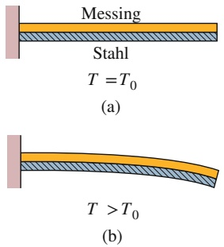

## Abb. 14.9

(a) Ein Bimetallstreifen aus einem Messing- und einem Stahlstreifen, die bei einer Temperatur $T _ { 0 }$ zusammengeschweißt wurden. (b) Bei Temperaturen oberhalb dieser Referenztemperatur verbiegt sich der Streifen in der abgebildeten Form. Unterhalb dieser Temperatur verbiegt er sich in die andere Richtung. Auf diesem Prinzip beruhen viele Thermostate, bei denen durch einen Temperaturanstieg oder -abfall ein elektrischer Kontakt hergestellt oder unterbrochen wird.

natural_image

Exterior view of a modern ultra-speed train aircraft in flight against a clear sky (no visible text or markings)

## Längenausdehnung

Erhöht sich die Temperatur eines Metallstabs der Länge L um einen Betrag ΔT, so nimmt seine Länge um den Betrag

$$
\Delta L = L \alpha \Delta T \tag {14.9}
$$

zu. Die Konstante α bezeichnet man als **Längenausdehnungskoeffizienten**. Die Einheit von α ist „pro Grad“ bzw. „pro Kelvin“. Der Wert von α ist materialabhängig. Obwohl sich dieser Wert für ein gegebenes Material als Funktion der Temperatur noch etwas verändert, kann er für die meisten praktischen Anwendungen als konstant angesehen werden. In Tab. 14.2 sind einige Längenausdehnungskoeffizienten zusammengefasst. Beachten Sie, dass die hier verwendete Einheit $^ \circ \mathrm { C }$ auch durch die Einheit K ersetzt werden kann, da es immer um Temperaturdifferenzen geht.

Die Wärmeausdehnung eines Festkörpers entspricht einer dreidimensionalen fotografischen Vergrößerung. Abbildung 14.10b zeigt die (übertrieben dargestellte) Ausdehnung eines Metalllineals nach einer Temperaturerhöhung im Vergleich zu Abb. 14.10a. Gleichung 14.9 gilt für jede lineare Ausdehnung des Lineals, einschließlich seiner Kanten, seiner Dicke, den Diagonalen und den Durchmessern

TABELLE 14.2:

Einige Längenausdehnungskoeffizientena).

| Material | $\alpha(10^{-6}/^{\circ}\text{C})$ | Material | $\alpha(10^{-6}/^{\circ}\text{C})$ |
| --- | --- | --- | --- |
| Eis (bei 0°C) | 51 | Stahl | 11 |
| Blei | 29 | (normales) Glas | 9 |
| Aluminium | 23 | Borosilikatglas | 3,2 |
| Messing | 19 | Diamant | 1,2 |
| Kupfer | 17 | Invarb) | 0,7 |
| Beton | 12 | Quarzglas | 0,5 |

a) Abgesehen von Eis handelt es sich immer um Werte bei Zimmertemperatur.

b) Die Entwicklung dieser Legierung zielte auf einen niedrigen Ausdehnungskoeffizienten ab. Ihr Name ist eine Kurzform von „invariable“.

## Abb. 14.10

Dasselbe Metalllineal bei zwei verschiedenen Temperaturen. Die Markierungen, die Zahlen, die Dicke und auch der Durchmesser des Kreises bzw. der Öffnung dehnen sich alle um denselben Faktor aus. (Zur Verdeutlichung wurde der Ausdehnungsmaßstab weit übertrieben dargestellt.)

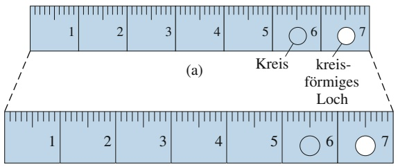

text_image

1 2 3 4 5 6 7
(a) Kreis kreis-
förmiges Loch
1 2 3 4 5 6 7

(b)

von aufgemalten und eingestanzten Kreisen. Passt die aus diesem Loch herausgeschnittene Kreisscheibe anfänglich genau in das Loch, dann gilt das auch, wenn diese Kreisscheibe um dieselbe Temperatur erwärmt wird wie das Lineal.

## Volumenausdehnung

Da sich alle Dimensionen eines Festkörpers mit der Temperatur ausdehnen, nimmt das Volumen dieses Körpers bei Erwärmung zu. Für Fluide ist die Volumenausdehnung sogar der einzig sinnvolle Ausdehnungsparameter. Erhöht sich die Temperatur eines Festkörpers oder eines Fluids vom Volumen $V$ um einen Betrag $\Delta T _ { \star }$ so nimmt auch das Volumen zu und zwar um

$$
\Delta V = V \beta \Delta T, \tag {14.10}
$$

wobei $\beta$ der sogenannte **Volumenausdehnungskoeffizient** des Festkörpers bzw. des Fluids ist. Die Koeffizienten für Volumen- und Längenausdehnung hängen bei einem Festkörper über die Beziehung

$$
\beta = 3 \alpha \tag {14.11}
$$

## zusammen.

Das vertrauteste aller Fluide, Wasser, verhält sich allerdings anderes als die meisten anderen Fluide. Oberhalb von ungefähr $4   ^ { \circ } \mathrm { C }$ dehnt sich Wasser bei einer Temperaturerhöhung wie erwartet aus. Zwischen 0 und $4   ^ { \circ } \mathrm { C }$ jedoch zieht Wasser sich mit zunehmender Temperatur zusammen. Bei ungefähr $4   ^ { \circ } \mathrm { C }$ durchläuft die Dichte von Wasser also ein Maximum. Bei allen anderen Temperaturen ist die Wasserdichte kleiner als dieser maximale Wert.

Dieses besondere Verhalten von Wasser ist auch der Grund, weshalb ein See von oben nach unten zufriert und nicht von unten nach oben. Wenn Wasser sich an der Oberfläche von beispielsweise $1 0   ^ { \circ } \mathrm { C }$ abkühlt, wird es dichter („schwerer“) als das Wasser in tieferen Schichten und sinkt zu Boden. Unterhalb von $4   ^ { \circ } \mathrm { C }$ wird das Wasser an der Oberfläche jedoch weniger dicht („leichter“) als das Wasser in tieferen Schichten und daher bleibt es an der Oberfläche, bis es gefriert. Die Wasseroberfläche friert also $\mathbf { Z } \mathbf { u } ,$ während das Wasser unterhalb noch flüssig bleibt. Würde ein See von unten nach oben zufrieren, würde das so entstandene Eis während der Sommermonate nicht vollständig auftauen, da die oberen Wasserschichten isolierend wirken. Nach einigen Jahren wären die Gewässer in vielen Klimazonen der Erde das ganze Jahr über fest zugefroren, und eine Unterwasserwelt, wie wir sie kennen, könnte es nicht geben.

## KONTROLLFRAGE 2

In der Abbildung sehen Sie vier Metallplatten mit Kantenlängen L, 2L oder 3L. Sie alle bestehen aus demselben Material und ihre Temperaturen sollen um denselben Betrag zunehmen. Ordnen Sie die Platten nach dem zu erwartenden Zuwachs in (a) ihrer vertikalen Höhe und (b) ihrer Fläche (größte Werte zuerst).

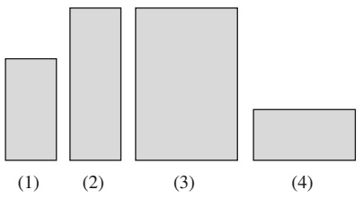

bar

| Category | Value |
| --- | --- |
| (1) | ~3.5 |
| (2) | ~6.0 |
| (3) | ~6.0 |
| (4) | ~2.0 |

## 14.4 Die Absorption von Wärme

## Lernziele

Nach dem Durcharbeiten dieses Abschnitts sollten Sie in der Lage sein, . . .

• zu verstehen, dass Wärmeenergie mit der zufälligen Bewegung der mikroskopischen Bestandteile eines Gegenstands zusammenhängt,
zu erkennen, dass eine Wärmemenge Q den Betrag einer in Form von Wärme (auf einen oder von einem Gegenstand) aufgrund einer Temperaturdifferenz zwischen diesem Gegenstand und seiner Umgebung übertragenen Energie beschreibt,

• Energien zwischen verschiedenen Einheiten umzurechnen,
• mechanische oder elektrische Energie in thermische Energie umzurechnen,
• den Zusammenhang zwischen der Temperaturänderung $\Delta T$ eines Gegenstands, der übertragenen Wärmemenge Q und der Wärmekapazität C des Gegenstands zu erklären,
• den Zusammenhang zwischen der Temperaturänderung ΔT eines Gegenstands, der übertragenen Wärmemenge Q, der spezifischen Wärme c und der Masse m des Gegenstands zu erklären,
• die drei Aggregatzustände der Materie zu kennen und ihre Eigenschaften zu verstehen,
• für einen Phasenübergang in einer Substanz den Zusammenhang zwischen der übertragenen Wärmemenge Q, der spezifischen Umwandlungswärme L der Substanz und ihrer Masse m zu erklären,
zu verstehen, dass der Prozess der Wärmeübertragung schrittweise berechnet werden muss, wenn eine Substanz dabei einen Phasenübergang vollzieht: (a) Berechnung der Temperaturänderung bis zur Temperatur des Phasenübergangs, (b) Berechnung des Phasenübergangs und (c) Berechnung der Temperaturänderung von der Temperatur des Phasenübergangs bis zur Endtemperatur nach Übertragung der gesamten Wärmemenge.

## Schlüsselideen

• Die Wärme Q ist eine Energie, die aufgrund einer Temperaturdifferenz zwischen einem System und seiner Umgebung ausgetauscht wird. Sie kann in Joule (J), Kalorien (cal), Kilokalorien (Cal oder kcal) oder auch Britisch Thermal Units (Btu) angegeben werden; dabei gilt

$$
1 \mathrm{cal} = 3, 9 6 8 \cdot 1 0 ^ {- 3} \mathrm{Btu} = 4, 1 8 6 8 \mathrm{J}.
$$

• Wenn ein Objekt die Wärmemenge Q aufnimmt (absorbiert), ändert sich seine Temperatur von $T _ { \mathrm { i } }$ auf $T _ { \mathrm { f } } ;$ dabei gilt

$$
Q = C (T _ {\mathrm{f}} - T _ {\mathrm{i}}),
$$

wobei C die Wärmekapazität des Objekts ist. Wenn das Objekt die Masse m hat, kann dieser Zusammenhang in der Form

$$
Q = c m (T _ {\mathrm{f}} - T _ {\mathrm{i}})
$$

geschrieben werden, wobei c eine Materialkonstante ist, die als spezifische Wärme des Materials bezeichnet wird, aus dem das Objekt besteht.

• Die molare Wärmekapazität einer Substanz ist ihre Wärmekapazität pro Mol, d. h. pro 6,023 ⋅ $1 0 ^ { 2 3 }$ Teilchen der Substanz.
Die von einer Substanz aufgenommene oder abgegebene Wärme kann dazu führen, dass die Substanz ihren Aggregatzustand ändert, also z. B. von einem Festkörper zu einer Flüssigkeit oder von einer Flüssigkeit zu einem Gas wird. Die Energie, die pro Masseneinheit der Substanz benötigt wird, um diese Zustands änderung (ohne dass sich dabei die Temperatur ändert) herbeizuführen, wird als Umwandlungsenergie L bezeichnet. Es gilt

$$
Q = L m.
$$

• Die Verdampfungswärme $L _ { \mathrm { V } }$ ist die pro Masseneinheit benötigte Energie, um eine Flüssigkeit zu verdampfen. Dieselbe Energie wird pro Masseneinheit frei, wenn dieselbe Substanz aus dem gasförmigen Zustand zu einer Flüssigkeit kondensiert.
• Die Schmelzwärme $L _ { \mathrm { S } }$ ist die pro Masseneinheit benötigte Energie, um einen Festkörper zu schmelzen. Dieselbe Energie wird pro Masseneinheit frei, wenn die Substanz aus dem flüssigen Zustand zu einem Festkörper erstarrt.

## 14.4.1 Temperatur und Wärme

Wenn Sie eine Getränkedose aus dem Kühlschrank nehmen und auf dem Küchentisch stehen lassen, nimmt die Temperatur in der Dose zu – zunächst schneller und später langsamer –, bis die Temperatur von Dose und Inhalt gleich der Zimmertemperatur ist (sie befinden sich dann im thermischen Gleichgewicht). Ebenso nimmt die Temperatur einer heißen Tasse Kaffee solange ab, bis sie Zimmertemperatur erreicht hat.

Verallgemeinernd betrachten wir die Dose bzw. die Kaffeetasse als ein System mit der Temperatur $T _ { S }$ und den für den Vorgang wesentlichen Teil der Küche als die Umgebung dieses Systems (mit der Temperatur $T _ { \mathrm { U } } )$ . Sind $T _ { \mathrm { S } }$ und $T _ { \mathrm { U } }$ verschieden, so wird sich nach unserer Beobachtung die Temperatur $T _ { S }$ solange ändern $( T _ { \mathrm { U } }$ ändert sich wegen der als sehr groß angenommenen Umgebung vergleichsweise wenig), bis die beiden Temperaturen gleich sind und der Zustand des thermischen Gleichgewichts eingetreten ist.

Eine solche Temperaturänderung beruht auf einer Übertragung von thermischer Energie zwischen Systems und Umgebung. (Thermische Energie bezieht sich auf eine innere Energie, die sich zusammensetzt aus den kinetischen und potenziellen Energien der Atome, Moleküle und anderer Mikrokörper, die sich innerhalb eines Gegenstands teilweise ungeordnet bewegen.) Die übertragene Energie bezeichnet man als **Wärme**, und sie wird mit Q bezeichnet. Die Wärme ist positiv, wenn thermische Energie aus der Umgebung zur inneren Energie des Systems hinzugeführt wird (in diesem Fall spricht man auch davon, dass Energie aufgenommen wurde). Wärme ist negativ, wenn thermische Energie vom System an die Umgebung abgegeben wird.

Dieser Energieübertrag ist in Abb. 14.11 dargestellt. In Abb. 14.11a, wo $T _ { \mathrm { S } } > T _ { \mathrm { U } }$ ist, wird Energie vom System an die Umgebung abgegeben, Q ist also negativ. In Abb. 14.11b ist $T _ { \mathrm { S } } = T _ { \mathrm { U } }$ und es findet kein Energieübertrag statt, Q ist null und es wird weder Energie abgegeben noch aufgenommen. In Abb. 14.11c ist $T _ { \mathrm { S } } < T _ { \mathrm { U } }$ Es wird Energie von der Umgebung auf das System übertragen, Q ist also positiv.

Dies führt uns auf folgende Definition der Wärme:

Wärme ist die zwischen einem System und seiner Umgebung aufgrund eines Temperaturunterschieds ausgetauschte thermische Energie.

Zwischen einem System und seiner Umgebung kann Energie auch in Form von Arbeit W übertragen werden, wenn nämlich auf das System eine Kraft wirkt, gegen die das System Arbeit verrichtet. Anders als Temperatur, Druck oder Volumen sind Wärme und Arbeit keine intrinsischen Eigenschaften eines Systems. Sie haben nur insoweit eine Bedeutung, als mit ihnen eine Übertragung von Energie in das System oder aus dem System heraus beschrieben wird. Aussagen der Form „Während der letzten drei Minuten wurden 15 J Wärme von dem System an seine Umgebung abgegeben“ oder „Innerhalb der letzten Minute wurde von der Umgebung an dem System 12 J Arbeit verrichtet“ sind also durchaus sinnvoll. Demgegenüber ist es sinnlos zu sagen: „Dieses System enthält 450 J Wärme“ oder „Dieses System enthält 385 J Arbeit“.

Als den Wissenschaftlern noch nicht klar war, dass es sich bei Wärme um eine Form der Energieübertragung handelt, wurde die Menge an Wärme über deren Fä- higkeit zur Temperaturerhöhung von Wasser gemessen. So war eine **Kalorie** (cal) definiert als die Wärmemenge, die zur Erhöhung der Temperatur von 1 g Wasser von $^ { 1 4 , 5   ^ { \circ } C }$ auf $^ { 1 5 , 5   ^ { \circ } \mathrm { C } }$ notwendig ist.

Da es sich bei Wärme (wie bei Arbeit) um einen Energieübertrag handelt, entschied man sich 1948, als SI-Einheit für die Wärme die Einheit für Energie zu über nehmen, also das **Joule**. Eine Kalorie wurde zunächst (exakt) als 4,1860 J definiert, ohne Bezug auf die Erwärmung von Wasser. (Die im Zusammenhang mit der Ernährung manchmal verwendete „große“ Kalorie (Cal) ist in Wirklichkeit eine Ki-

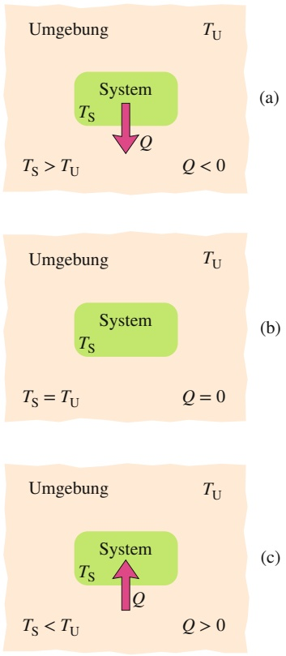

## Abb. 14.11

Wenn, wie in (a), die Temperatur eines Systems größer ist als die seiner Umgebung, wird Wärme Q von diesem System an die Umgebung abgegeben, bis ein thermisches Gleichgewicht (b) erreicht ist. (c) Ist die Temperatur eines Systems niedriger als die seiner Umgebung, wird von dem System Wärme aufgenommen, bis ein thermischer Gleichgewichtszustand erreicht ist.

lokalorie.) Als Beziehung zwischen den Wärmeeinheiten halten wir daher fest:

$$
1 \mathrm{cal} = 4, 1 8 6 0 \mathrm{J}. \tag {14.12}
$$

Später hat man sich dann daran gewöhnt, auch in der Wärmelehre direkt mit Joule zu arbeiten, sofern man sich nicht mit Diätratgebern beschäftigt . . .

## 14.4.2 Die Aufnahme von Wärme durch Festkörper und Flüssigkeiten

## Die Wärmekapazität

Die **Wärmekapazität** C eines Gegenstands ist die Proportionalitätskonstante zwischen der Wärme $Q ,$ die von dem Gegenstand aufgenommen oder abgegeben wird, und der Temperaturänderung ΔT dieses Gegenstands:

$$
Q = C \Delta T = C (T _ {\mathrm{f}} - T _ {\mathrm{i}}), \tag {14.13}
$$

wobei $T _ { \mathrm { i } }$ die anfängliche oder Initialtemperatur und $T _ { \mathrm { f } }$ die End- bzw. Finaltemperatur des Gegenstands bezeichnen. Die Wärmekapazität C hat die Einheit Energie pro Grad bzw. Energie pro Kelvin. Die Wärmekapazität C einer Marmorplatte in einem Brötchenwärmer kann beispielsweise 179 cal/°C betragen, was man auch als 179 cal/K oder als 749 J/K schreiben kann.

Die Bezeichnung „Kapazität“ ist in diesem Zusammenhang etwas irreführend, da eine Analogie zur Kapazität beispielsweise eines Wassereimers nahegelegt wird. Diese Analogie ist falsch! Man sollte sich in diesem Fall nicht vorstellen, dass ein Gegenstand die Wärme „enthalte“ oder in seiner Fähigkeit zur Wärmeabsorption eingeschränkt sei. Eine Wärmeübertragung kann im Prinzip beliebig fortgesetzt werden, solange der notwendige Temperaturunterschied aufrechterhalten wird und der Gegenstand bei diesem Prozess nicht schmilzt oder verdampft.

## Die spezifische Wärme

Die Wärmekapazitäten zweier Gegenstände aus demselben Material – z. B. Marmor – sind proportional zu ihren Massen. Daher ist es naheliegend, eine „Wärmekapazität pro Masse“ zu definieren: die **spezifische Wärmekapazität** oder kurz **spezifische Wärme** c. Sie bezieht sich nicht auf einen bestimmten Gegenstand, sondern auf das Material, aus dem dieser Gegenstand besteht. Gleichung 14.13 wird damit zu

$$
Q = c m \Delta T = c m (T _ {\mathrm{f}} - T _ {\mathrm{i}}). \tag {14.14}
$$

Obwohl die Wärmekapazität einer bestimmten Marmorplatte vielleicht 179 cal/°C (oder 749 J/K) beträgt, würden wir experimentell für die spezifische Wärme von Marmor selber (sei es in dieser Platte oder in irgendeinem anderen Marmorgegenstand) den Wert $0 , 2 1   \mathrm { c a l } / ( \mathrm { g } \cdot { } ^ { \circ } \mathrm { C } )$ oder 880 $\mathrm { J } / ( \mathrm { k g } \cdot \mathrm { K } )$ finden.

Aus der ursprünglichen Definition der Kalorie ergibt sich für die spezifische Wärme von Wasser

$$
c = 1 \mathrm{cal} / (\mathrm{g} \cdot {} ^ {\circ} \mathrm{C}) = 4 1 9 0 \mathrm{J} / (\mathrm{kg} \cdot \mathrm{K}). \tag {14.15}
$$

Tabelle 14.3 fasst die spezifischen Wärmen von verschiedenen Substanzen bei Zimmertemperatur zusammen. Man beachte, dass der Wert für Wasser vergleichs weise groß ist. Genau genommen hängt die spezifische Wärme in geringem Maß auch von der Temperatur ab, aber die Werte in Tab. 14.3 gelten in guter Näherung für einen großen Temperaturbereich um die Zimmertemperatur.

TABELLE 14.3: Die spezifische Wärme einiger Substanzen bei Zimmertemperatur.

<table><tr><td rowspan="2">Material</td><td colspan="2">Spezifische Wärme</td><td>Molare spezifische Wärme</td></tr><tr><td>cal $\mathrm{g} \cdot \mathrm{K}$ </td><td>J $\mathrm{kg} \cdot \mathrm{K}$ </td><td>J $\mathrm{mol} \cdot \mathrm{K}$ </td></tr><tr><td colspan="4">Elementare Festkörper</td></tr><tr><td>Blei</td><td>0,0305</td><td>128</td><td>26,5</td></tr><tr><td>Wolfram</td><td>0,0321</td><td>134</td><td>24,8</td></tr><tr><td>Silber</td><td>0,0564</td><td>236</td><td>25,5</td></tr><tr><td>Kupfer</td><td>0,0923</td><td>386</td><td>24,5</td></tr><tr><td>Aluminium</td><td>0,215</td><td>900</td><td>24,4</td></tr><tr><td colspan="4">Andere Festkörper</td></tr><tr><td>Messing</td><td>0,092</td><td>380</td><td></td></tr><tr><td>Granit</td><td>0,19</td><td>790</td><td></td></tr><tr><td>Glas</td><td>0,20</td><td>840</td><td></td></tr><tr><td>Eis ( $-10^{\circ}\mathrm{C}$ )</td><td>0,530</td><td>2220</td><td></td></tr><tr><td colspan="4">Flüssigkeiten</td></tr><tr><td>Quecksilber</td><td>0,033</td><td>140</td><td></td></tr><tr><td>Ethanol (Ethylalkohol)</td><td>0,58</td><td>2430</td><td></td></tr><tr><td>Meerwasser</td><td>0,93</td><td>3900</td><td></td></tr><tr><td>Wasser</td><td>1,00</td><td>4190</td><td></td></tr></table>

## KONTROLLFRAGE 3

Eine bestimme Wärmemenge Q erwärmt 1 g eines Materials A um $3   ^ { \circ } \mathrm { C }$ und 1 g eines anderen Materials B um 4 °C. Welches Material hat die größere spezifische Wärme?

## Die molare Wärmekapazität

In vielen Fällen ist es sinnvoll, die Menge einer Substanz in der Einheit Mol (mol) anzugeben, wobei

$$
1 \mathrm{mol} = 6, 0 2 \cdot 1 0 ^ {2 3} \text {Elementareinheiten}
$$

einer beliebigen Substanz ist. 1 mol Aluminium besteht daher aus $6 { , } 0 2 \cdot 1 0 ^ { 2 3 }$ Atomen (das Atom ist die Elementareinheit) und 1 mol Kohlenstoffdioxid entspricht $6 { , } 0 2 \cdot 1 0 ^ { 2 3 }$ Molekülen dieses Gases (da in diesem Fall das Molekül die Elementareinheit der Verbindung ist).

Werden Mengen in Mol angegeben, müssen sich auch die spezifischen Wärmen auf das Mol beziehen (und nicht auf die Masseneinheit); diese bezeichnet man dann als **molare Wärmekapazitäten**. Tabelle 14.3 gibt die Werte bei Zimmertemperatur für einige elementare Festkörper an (die jeweils nur aus einem Element bestehen).

## Ein wichtiger Punkt

Wenn wir die spezifische Wärme einer Substanz messen bzw. mit ihr arbeiten, müssen wir wissen, unter welchen Bedingungen die Energie in Form von Wärme übertragen wird. Bei Festkörpern und Flüssigkeiten nehmen wir gewöhnlich an, dass sich die Probe bei der Energieübertragung unter konstantem Druck (meist Atmosphärendruck) befindet. Man könnte sich aber auch vorstellen, dass die Probe während der Energieaufnahme bei einem konstanten Volumen gehalten wird. In diesem Fall müsste die Wärmeausdehnung der Probe durch einen äußeren Druck unterbunden werden. Experimentell lassen sich diese Bedingungen bei Festkörpern oder Flüssigkeiten nur sehr schwer verwirklichen, allerdings kann man den

Effekt berechnen, und es zeigt sich, dass sich die spezifische Wärme bei konstantem Druck und bei konstantem Volumen für fast alle Festkörper oder Flüssigkeiten um nicht mehr als einige wenige Prozent unterscheidet. Wie wir noch sehen werden, sind die Werte für die spezifische Wärme von Gasen bei konstantem Druck bzw. konstantem Volumen jedoch merklich verschieden.

## Umwandlungswärme

Wenn ein Festkörper oder eine Flüssigkeit Wärme aufnehmen, muss die Temperatur der Probe nicht notwendigerweise zunehmen. Es kann auch sein, dass sich die Phase bzw. der Aggregatzustand der Probe ändert. Gewöhnlich liegt Materie in einem der drei folgenden Zustände vor: Im festen Zustand sind die Moleküle einer Probe durch ihre gegenseitige Anziehung zu einer mehr oder weniger festen Struktur miteinander verbunden. Im flüssigen Zustand liegen die einzelnen Moleküle noch dicht an dicht, aber sie haben mehr Energie und können sich relativ frei umherbewegen. Sie verbinden sich dabei kurzzeitig zu größeren Klumpen, aber allgemein hat die Probe keine feste Struktur und kann fließen oder sich einem Behälter anpassen. Im gasförmigen Zustand bzw. als Dampf besitzen die einzelnen Moleküle noch mehr Energie, sie haben sich voneinander befreit und können in verhältnismäßig großen Abständen das Volumen eines geschlossenen Behälters ausfüllen.

Beim Schmelzen wandelt sich ein Festkörper von einem festen in einen flüssigen Zustand um. Dieser Prozess erfordert Energie, da die Moleküle des Festkörpers erst aus ihrer starren Struktur befreit werden müssen. Das Schmelzen eines Eiswürfels zu flüssigem Wasser ist ein vertrautes Beispiel. Bei dem umgekehrten Vorgang, dem Gefrieren einer Flüssigkeit zu einem Festkörper, muss der Flüssigkeit Energie entzogen werden, damit sich die Moleküle zu einer starren Struktur zusammenfinden können.

Das Verdampfen einer Flüssigkeit bedeutet, sie von ihrem flüssigen Zustand in einen gasförmigen Zustand, den Dampf, zu überführen. Wie das Schmelzen erfordert auch dieser Prozess Energie, da die Moleküle aus ihren Klumpen befreit werden müssen. Das Verkochen von flüssigem Wasser zu Wasserdampf ist wiederum ein bekanntes Beispiel. Die Kondensation von einem Gas zu einer Flüssigkeit ist der zur Verdampfung umgekehrte Vorgang. In diesem Fall muss dem Gas Energie entzogen werden, sodass die Moleküle sich wieder zu losen Klumpen zusammenfinden können und nicht mehr frei und unabhängig voneinander umherfliegen.

Die bei einem vollständigen Übergang einer Probe in eine neue Phase in Form von Wärme übertragene Energiemenge pro Masse bezeichnet man als **spezifische Umwandlungswärme** L. Wenn also eine Probe der Masse m sich vollständig von einer Phase in eine andere umwandelt, ist die übertragene Gesamtenergie (die sogenannte **latente Wärme**) gleich

$$
Q = L m, \tag {14.16}
$$

Umwandlungswärme ist also so etwas wie eine „spezifische latente Wärme“.

Handelt es sich bei dem Phasenübergang um den Übergang von flüssig zu gasförmig (nimmt die Probe also Energie auf ) oder vom gasförmigen zum flüssigen Zustand (die Probe gibt Energie ab), so nennt man die Umwandlungswärme auch **Verdampfungswärme** (bzw. genauer **spezifische Verdampfungswärme**) $L _ { \mathrm { V } } .$ Für Wasser bei seiner Koch- bzw. Kondensationstemperatur ist

$$
L _ {\mathrm{V}} = 5 3 9 \mathrm{cal/g} = 4 0, 7 \mathrm{kJ/mol} = 2 2 5 6 \mathrm{kJ/kg}. \tag {14.17}
$$

Handelt es sich bei dem Phasenübergang um einen Übergang vom festen zum flüssigen Zustand (muss die Probe also Energie aufnehmen) oder vom flüssigen zum festen Zustand (die Probe gibt Energie ab), so bezeichnet man die latente Wärme auch als **(spezifische) Schmelzwärme** $L _ { \mathrm { S } }$ . Die spezifische Schmelzwärme von

TABELLE 14.4:

Einige spezifische Umwandlungswärmen.

<table><tr><td rowspan="2">Material</td><td colspan="2">Schmelzen</td><td colspan="2">Verdampfen</td></tr><tr><td>Schmelzpunkt (K)</td><td>Schmelzwärme  $L_{S}$  (kJ/kg)</td><td>Siedepunkt (K)</td><td>Verdampfungswärme  $L_{V}$  (kJ/kg)</td></tr><tr><td>Wasserstoff</td><td>14,0</td><td>58,0</td><td>20,3</td><td>455</td></tr><tr><td>Sauerstoff</td><td>54,8</td><td>13,9</td><td>90,2</td><td>213</td></tr><tr><td>Quecksilber</td><td>234</td><td>11,4</td><td>630</td><td>296</td></tr><tr><td>Wasser</td><td>273</td><td>333</td><td>373</td><td>2256</td></tr><tr><td>Blei</td><td>601</td><td>23,2</td><td>2017</td><td>858</td></tr><tr><td>Silber</td><td>1235</td><td>105</td><td>2323</td><td>2336</td></tr><tr><td>Kupfer</td><td>1356</td><td>207</td><td>2868</td><td>4730</td></tr></table>

Wasser bei seinem normalen Gefrier- bzw. Schmelzpunkt beträgt

$$
L _ {\mathrm{S}} = 7 9, 5 \mathrm{cal/g} = 6, 0 1 \mathrm{kJ/mol} = 3 3 3 \mathrm{kJ/kg}. \tag {14.18}
$$

In Tab. 14.4 sind die spezifischen Umwandlungswärmen verschiedener Substanzen zusammengefasst.

## 14.5 Der erste Hauptsatz der Thermodynamik

## Lernziele

Nach dem Durcharbeiten dieses Abschnitts sollten Sie in der Lage sein, . . .

• die von einem eingeschlossenen Gas bei Expansion oder Kompression verrichtete Arbeit W durch Integration des Gasdrucks über das Volumen zu berechnen,
• das Vorzeichen der Arbeit W zu bestimmen, die mit einer Expansion oder Kompression verknüpft ist,
• die von einem Gas verrichtete Arbeit W durch grafische Integration zwischen Anfangs- und Endzustand im $p V \text-- \mathrm { D i }$ agramm des Prozesses zu bestimmen,
• das Vorzeichen der Arbeit W bei einer Expansion oder Kompression aus dem pV-Diagramm des Prozesses für die jeweilige Prozessrichtung zu bestimmen,
• den ersten Hauptsatz der Thermodynamik anzuwenden, um den Zusammenhang zwischen der Änderung $\Delta E _ { \mathrm { i n t } }$ der inneren Energie eines Gases, der auf das Gas übertragenen (oder von ihm entnommenen) Wärmemenge Q und der von dem Gas (oder an ihm) verrichteten Arbeit W anzugeben,
• das Vorzeichen von Q anzugeben, wenn Wärme auf ein Gas übertragen oder von ihm abgegeben wird,
• zu verstehen, dass die innere Energie $\Delta E _ { \mathrm { i n t } }$ eines Gases zunimmt, wenn Wärme auf das Gas übertragen wird, und abnimmt, wenn das Gas Arbeit an seiner Umgebung verrichtet,
• sich zu merken, dass bei einem adiabatischen Prozess keine Wärme zwischen System und Umgebung ausgetauscht wird,
• zu verstehen, dass bei einem bei konstantem Gasvolumen ablaufenden Prozess keine Arbeit von oder an dem Gas verrichtet wird,
• zu erkennen, dass sich die innere Energie $\Delta E _ { \mathrm { i n t } }$ eines Gases in einem Kreisprozess nicht verändert,
• zu verstehen, dass sich bei der freien Expansion eines Gases ins Vakuum dessen innere Energie $\Delta E _ { \mathrm { i n t } }$ nicht ändert und auch keine Arbeit verrichtet oder Wärme mit der Umgebung ausgetauscht wird.

## Schlüsselideen

• Ein Gas kann mit seiner Umgebung Energie in Form von Arbeit austauschen. Die von einem Gas bei der Expansion oder Kompression von einem anfäng lichen Volumen $V _ { \mathrm { i } }$ zu einem Endvolumen $V _ { \mathrm { f } }$ an seiner Umgebung verrichtete Arbeit ist

$$
W = \int \mathrm{d} W = \int_ {V _ {\mathrm{i}}} ^ {V _ {\mathrm{f}}} p \mathrm{d} V.
$$

Die Integration ist notwendig, da der Druck $p$ sich während der Volumenänderung ändern kann.

• Das Prinzip der Energieerhaltung für einen thermodynamischen Prozess wird durch den ersten Hauptsatz der Thermodynamik ausgedrückt, der als

$$
\Delta E _ {\mathrm{int}} = \Delta E _ {\mathrm{int,f}} - \Delta E _ {\mathrm{int,i}} = Q - W
$$

oder

$$
\mathrm{d} E _ {\text {int}} = \mathrm{d} Q - \mathrm{d} W
$$

geschrieben werden kann. $E _ { \mathrm { i n t } }$ Eint ist dabei die innere Energie des Systems, die nur vom Zustand des Systems (Temperatur, Druck und Volumen) abhängt. Q ist die Energie, die als Wärme zwischen dem System und seiner Umgebung ausgetauscht wird; Q wird positiv gezählt, wenn das System Wärme absorbiert (aufnimmt), und negativ, wenn das System Wärme abgibt. $W$ ist die vom System verrichtete Arbeit; sie ist positiv, wenn sich das System gegen eine von der Umgebung ausgeübte äußere Kraft ausdehnt, und negativ, wenn das System durch eine äußere Kraft komprimiert wird.

• Q und W hängen vom Weg ab; $\Delta E _ { \mathrm { i n t } }$ ist wegunabhängig.
• Der erste Hauptsatz der Thermodynamik wird in vielen unterschiedlichen Sonderfällen angewendet. Beispiele hierfür sind

adiabatische Prozesse:

Prozesse bei konstantem Volumen:

Kreisprozesse:

freie Expansion im Vakuum:

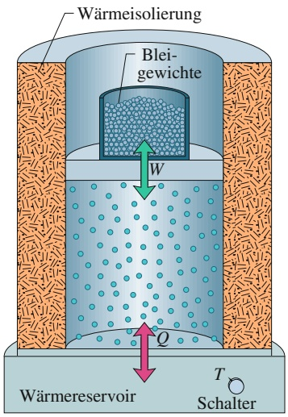

text_image

Wärmeisolierung
Blei-
gewichte
W
Q
Wärmereservoir
T
Schalter

Abb. 14.12

Ein Zylinder mit einem beweglichen Kolben ist mit einem Gas gefüllt. Durch Regelung der Temperatur $T$ an einem Wärmereservoir kann dem Gas die Wärme Q zugeführt oder entzogen werden. Das Gas leistet die Arbeit W, wenn es den Kolben anhebt oder absinken lässt.

## 14.5.1 Wärme und Arbeit: Eine ausführlichere Betrachtung

Im Folgenden wollen wir uns etwas genauer ansehen, wie Wärme und Arbeit zwischen einem System und seiner Umgebung übertragen werden können. Als System betrachten wir ein in einem Zylinder eingeschlossenes Gas. Das Volumen des $\mathrm { Z y } _ { 1 }$ linders sei über einen beweglichen Kolben veränderbar (vgl. Abb. 14.12). Die durch den Druck des eingeschlossenen Gases ausgeübte, nach oben gerichtete Kraft auf den Kolben wird durch das Gewicht der Bleikugeln oberhalb des Kolbens ausgeglichen. Die Zylinderwände bestehen aus einem isolierenden, wärmeundurchlässigen Material. Der Zylinderboden befinde sich auf einem Reservoir für thermische Energie, einem Wärmereservoir oder auch Wärmebad (beispielsweise einer heißen Platte), deren Temperatur $T$ sich über einen Schalter regulieren lässt.

Das System (das Gas) befinde sich zunächst in einem Initialzustand i mit dem Druck $p _ { \mathrm { i } } ,$ dem Volumen $V _ { \mathrm { i } }$ und der Temperatur $T _ { \mathrm { i } } .$ . Nun soll dieses System in einen zweiten, „finalen“ Zustand f gebracht werden, charakterisiert durch den Druck $p _ { \mathrm { f } } ,$ das Volumen $V _ { \mathrm { f } }$ und die Temperatur $T _ { \mathrm { f } } .$ . Einen solchen Vorgang, bei dem ein System von einem Anfangs- in einen Endzustand überführt wird, bezeichnet man als thermodynamischen Prozess. Im Verlauf eines solchen Prozesses kann dem System von einem Wärmereservoir Energie zugeführt werden (positive Wärme) oder es kann thermische Energie an das Wärmereservoir abgegeben werden (negative Wärme). Außerdem kann das System Arbeit verrichten, indem es den mit einem Gewicht beladenen Kolben anhebt (positive Arbeit) oder ihn absinken lässt (negative Arbeit). Wir nehmen an, dass all diese Veränderungen langsam ablaufen. In diesem Fall befindet sich das System zu jedem Zeitpunkt (annähernd) im thermischen Gleichgewicht, genauer gesagt ist jeder Teil des Systems im thermischen Gleichgewicht mit jedem anderen Teil des Systems.

Angenommen, Sie entfernen nun eine differenzielle Zahl von Bleikugeln von dem Kolben in Abb. 14.12. Das Gas drückt dann den Kolben mit der Kraft $\vec { F }$ um die differenzielle Verschiebung d⃗s nach oben. Diese Verschiebung soll klein sein, daher können wir während dieses Vorgangs die Kraft $\vec { F }$ als konstant ansehen. In diesem Fall ist der Betrag von $\vec { F }$ gleich $p A$ , wobei $p$ der Gasdruck in dem Behälter und A die Fläche des Kolbens sind. Die von dem Gas bei dieser Verschiebung geleistete Arbeit dW ist

$$
\mathrm{d} W = \vec {F} \cdot \mathrm{d} \vec {s} = (p A) (\mathrm{d} s) = p (A \mathrm{d} s) = p \mathrm{d} V, \tag {14.19}
$$

wobei dV die differenzielle Volumenänderung des Gases aufgrund der Bewegung des Kolbens ist. Werden nacheinander so viele Bleikugeln entfernt, dass sich das Gas vom Volumen $V _ { \mathrm { i } }$ auf das Volumen $V _ { \mathrm { f } }$ ausdehnt, ist die gesamte vom Gas geleistete Arbeit

$$
W = \int \mathrm{d} W = \int_ {V _ {\mathrm{i}}} ^ {V _ {\mathrm{f}}} p \mathrm{d} V. \tag {14.20}
$$

Im Verlauf dieser Volumenänderung können sich auch der Druck und die Temperatur ändern. Wollten wir das Integral in Gl. 14.20 direkt auswerten, müssten wir also den Druck als Funktion des Volumens beim Übergang des Systems vom Zustand i in den Zustand f kennen.

Tatsächlich gibt es viele Möglichkeiten, das Gas vom Zustand i in den Zustand f zu überführen. Eine Möglichkeit ist in Abb. 14.13a wiedergegeben. Dabei ist der Gasdruck dargestellt als Funktion des Gasvolumens, man nennt so etwas ein pV-Diagramm. An der Kurve in Abb. 14.13a erkennt man, dass der Druck mit wachsendem Volumen abnimmt. Das Integral aus Gl. 14.20 (und damit die von dem Gas geleistete Arbeit) entspricht der schattierten Fläche unterhalb der Kurve zwischen den Punkten i und f. Durch welchen Prozess auch immer wir das Gas entlang dieser Kurve führen, die geleistete Arbeit ist positiv, da das Gas durch die Vergrößerung seines Volumens den Kolben nach oben angehoben hat.

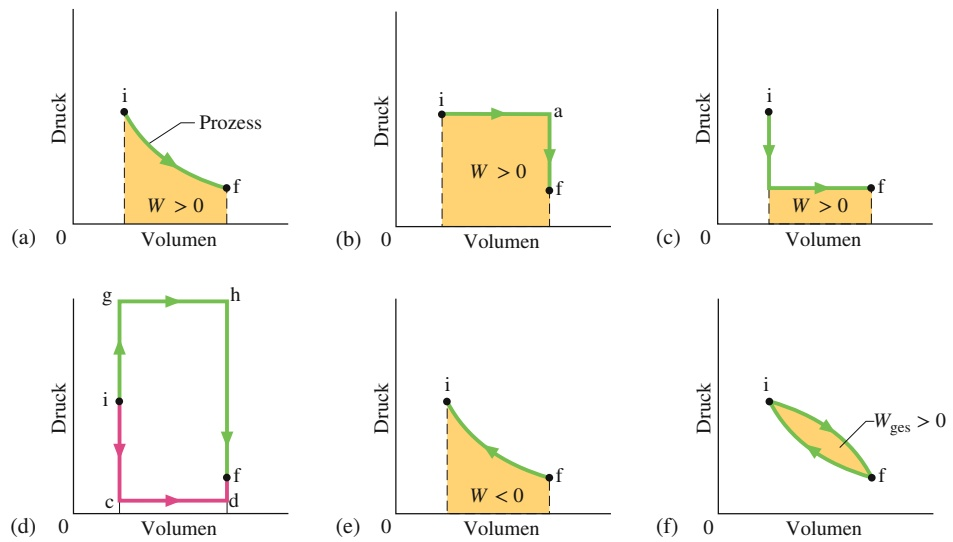

## Abb. 14.13

(a) Die schattierte Fläche entspricht der vom System beim Übergang vom Initialzustand i zum finalen Zustand f geleisteten Arbeit W. Die Arbeit W ist positiv, da das Volumen des Systems zunimmt. (b) W ist immer noch positiv, diesmal allerdings größer.
(c) Auch in diesem Fall ist W positiv, allerdings kleiner. (d) Die Arbeit W kann sogar noch kleiner (Weg „icdf“) oder noch größer sein (Weg „ighf“).
(e) In diesem Fall verläuft der Prozess von Zustand f zu Zustand i, das Gas wird dabei durch eine äußere Kraft zusammengedrückt. Die vom System geleistete Arbeit W ist nun negativ.
(f ) Die von dem System im Verlauf eines vollständigen Kreisprozesses geleistete Gesamtarbeit $W _ { \mathrm { g e s } }$ entspricht der schattierten Fläche zwischen den beiden grünen Kurven.

Eine zweite Möglichkeit, von Zustand i zu Zustand f zu gelangen, zeigt Abb. 14.13b. Dieser Prozess besteht aus zwei Schritten: der erste Schritt geht von Zustand i nach Zustand a, der zweite von Zustand a nach Zustand f.

Der Schritt $\mathrm { { _ { \partial } } _ { \partial } \mathrm { { _ { \partial } i a } } ^ { \alpha } }$ dieses Prozesses verläuft bei konstantem Druck, d. h., die Zahl der Bleigewichte auf dem Kolben in Abb. 14.12 wird nicht verändert. Den Zuwachs an Volumen (von $V _ { \mathrm { i } }$ zu $V _ { \mathrm { f } } )$ erreicht man durch einen langsamen Anstieg der Gastemperatur (indem Sie den Schalter am Wärmereservoir drehen) auf einen höheren Wert $T _ { \mathrm { a } }$ . Eine Temperaturzunahme erhöht den Druck und damit die Kraft des Gases auf den Kolben und hebt ihn an. In diesem Schritt leistet das expandierende Gas positive Arbeit (zum Anheben des Kolbens), gleichzeitig nimmt das System Wärme aus dem Reservoir auf (da die Temperatur des Reservoirs langsam zugenommen hat). Diese Wärme ist positiv, da sie dem System zugeführt wurde.

Der Schritt $\mathrm { { _ { p } a f } ^ { \omega } }$ in Abb. 14.13b erfolgt bei konstantem Volumen, der Kolben muss also fixiert, d. h. an der Bewegung gehindert werden. Wird nun die Temperatur des Wärmebads (und damit die Gastemperatur) langsam zurückgedreht, sinkt auch der Druck von $p _ { \mathrm { a } }$ auf seinen Endwert $p _ { \mathrm { f } } .$ . Bei diesem Vorgang gibt das System Wärme an das Reservoir ab.

Die bei dem gesamten Prozess $\mathrm { { _ { p } i a f } ^ { \alpha } }$ von dem System verrichtete Arbeit $W$ ist positiv. Sie entspricht der schattierten Fläche unter der Kurve in Abb. 14.13b und entstammt ausschließlich dem Schritt $\mathbf { \nabla } _ { p } \mathbf { i a } ^ { \alpha } .$ Sowohl bei Schritt $\mathrm { { } _ { p } i a } ^ { \alpha }$ als auch bei Schritt $\mathrm { { _ { p } a f } ^ { \alpha } }$ wurde Wärmeenergie zwischen dem System und dem Reservoir ausgetauscht. Der Nettowärmeübertrag ist $Q .$

Abbildung 14.13c zeigt einen Prozess, bei dem die beiden obigen Schritte in umgekehrter Reihenfolge ausgeführt werden. Die geleistete Arbeit W ist nun kleiner als in Abb. 14.13b; das Gleiche gilt für die insgesamt übertragene Wärme. Abbildung 14.13d soll verdeutlichen, dass die von dem Gas geleistete Arbeit beliebig klein (entlang des Wegs „icdf “) oder auch beliebig groß sein kann (entlang des Wegs „ighf “).

Wir halten fest: Ein System kann über unendlich viele Prozesse von einem gegebenen Anfangszustand in einen gegebenen Endzustand überführt werden. Es kann dabei zu einem Wärmeaustausch kommen, muss aber nicht. Im Allgemeinen haben die Arbeit W und die übertragene Wärme Q bei verschiedenen Prozessen auch verschiedene Werte. Wärme und Arbeit sind daher wegabhängige Größen.

Abbildung 14.13e zeigt ein Beispiel, bei dem von einem System negative Arbeit verrichtet wird. Eine äußere Kraft drückt in diesem Fall das System zusammen und verringert sein Volumen. Der Absolutwert der geleisteten Arbeit ist immer noch gleich der schattierten Fläche unter der Kurve, doch da das Gas in diesem Fall sein Volumen verringert, ist die vom Gas geleistete Arbeit negativ.

Abbildung 14.13f zeigt einen thermodynamischen Kreisprozess, bei dem das System von einem Anfangszustand i über einen (diesmal nicht finalen!) Zwischenzustand f wieder nach i zurückgeführt wird. Die vom System bei diesem Prozess geleistete Gesamtarbeit ist gleich der Summe aus der positiven Arbeit während der Ausdehnungsphase und der negativen Arbeit während der Kompressionsphase. In Abb. 14.13f ist die Gesamtarbeit positiv, da die Fläche unter der Kurve bei der Expansion (von i nach f ) größer ist als die Fläche unter der Kurve bei der Kompression (von f nach i).

## KONTROLLFRAGE 4

Das pV-Diagramm zeigt sechs „gebogene“ Wege (verbunden durch vertikale We-$\mathtt { g e } )$ , die von einem Gas durchlaufen werden können. Welche zwei Wege sollten Teil eines geschlossenen Kreisprozesses sein, wenn die von dem Gas geleistete Gesamtarbeit einen maximal positiven Wert haben soll?

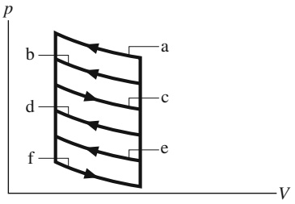

text_image

p
b
d
f
a
c
e
V

## 14.5.2 Der erste Hauptsatz der Thermodynamik

Wir haben gerade gesehen, dass sowohl die Arbeit W als auch die Wärme Q bei der Zustandsänderung eines Systems von der Art des Prozesses abhängen. Experimentell findet man jedoch etwas Überraschendes: Die Größe $Q - W$ ist bei allen Prozessen dieselbe. Sie hängt nur vom Anfangs- und Endzustand ab, nicht jedoch davon, wie das System von einem zum anderen gelangt ist. Alle anderen Kombinationen von Q und W – einschließlich Q selbst, W selbst, $Q + W$ oder $Q - 2 W \cdot$ sind wegabhängig. Nur die Größe $Q - W$ ist nicht wegabhängig.

Die Größe $Q -   W$ muss daher der Änderung einer intrinsischen Eigenschaft des Systems entsprechen. Diese Eigenschaft nennen wir die innere Energie $E _ { \mathrm { i n t } }$ (manchmal auch interne Energie) des Systems und schreiben

$$
\Delta E _ {\mathrm{int}} = E _ {\mathrm{int,f}} - E _ {\mathrm{int,i}} = Q - W \quad \text {(ersterHauptsatz)}.\tag {14.21}
$$

Gleichung 14.21 bezeichnet man als den **ersten Hauptsatz der Thermodynamik**. Ist die Änderung des thermodynamischen Systems nur infinitesimal, können wir den ersten Hauptsatz auch in der Form

$$
\mathrm{d} E _ {\text {int}} = \mathrm{d} Q - \mathrm{d} W \quad (\text {erster Hauptsatz}) \tag {14.22}
$$

schreiben2).

Die innere Energie $E _ { \mathrm { i n t } }$ eines Systems nimmt zu, wenn dem System Energie in Form von Wärme Q zugeführt wird, und sie nimmt ab, wenn dem System durch die geleistete Arbeit W Energie entzogen wurde.

In Kapitel 4 hatten wir uns mit dem Prinzip der Energieerhaltung für isolierte Systeme beschäftigt, d. h. für Systeme, denen keine Energie zugefügt oder entnommen wird. Der erste Hauptsatz der Thermodynamik ist eine Erweiterung dieses Prinzips auf Systeme, die nicht isoliert sind. In solchen Fällen kann dem System Energie entweder zugeführt oder entnommen werden, und zwar in Form von Arbeit W oder Wärme Q. Bei unserer Formulierung des ersten Hauptsatzes der Thermodynamik haben wir vorausgesetzt, dass das System als Ganzes keine Veränderungen hinsichtlich seiner kinetischen oder potenziellen Energie erfährt, d. h. $\Delta K = \Delta U = 0 .$

Generell kann sich bei nicht isolierten Systemen die Energie natürlich auf viele verschiedene Weisen ändern: Bei offenen Systemen kann sich die Teilchenzahl ändern (beispielsweise bei unterschiedlichem Druck relativ zur Umgebung) oder die Teilchenzahl bestimmter Komponenten (beispielsweise bei Systemen, deren Wände nur für bestimmte Teilchenarten durchlässig sind) oder die Magnetisierung (bei Ferromagneten in einem äußeren Magnetfeld) usw. Im Einzelfall ist daher immer zu überprüfen, welche Größen das betrachtete System mit seiner Umgebung austauschen kann. In diesem Buch werden wir uns auf den Austausch von Wärmeenergie und Arbeit beschränken.

Vor diesem Kapitel bezogen sich die Bezeichnung Arbeit und das Symbol W immer auf die Arbeit, die an einem System verrichtet wird. Mit Gl. 14.19 haben wir begonnen, die von einem System verrichtete Arbeit zu betrachten (beispielsweise das Gas in Abb. 14.12). Diese Vorzeichenkonvention wird auch in den folgenden beiden Kapiteln beibehalten.

Die an einem System verrichtete Arbeit ist immer das Negative der von einem System verrichteten Arbeit. Bezeichnen wir mit $W _ { \mathrm { a n } }$ die an einem System verrichtete Arbeit, so können wir Gl. 14.16 auch umschreiben: $\Delta E _ { \mathrm { i n t } } = Q + W _ { \mathrm { a n } }$ . Diese Gleichung besagt Folgendes: Die innere Energie eines Systems wird größer, wenn von dem System Wärme aufgenommen wird oder positive Arbeit an dem System verrichtet wird. Umgekehrt wird die innere Energie eines Systems kleiner, wenn das System Wärme abgibt oder an dem System negative Arbeit verrichtet wird (also von dem System positive Arbeit geleistet wird).

<small>2) Bei den Größen dQ und dW handelt es sich im Gegensatz zu dEi t nicht um wirkliche Differenziale, d. h., es gibt keine Funktionen Q( p,V) und W( p,V), die nur vom Zustand des Systems abhängen. Die Größen dQ und dW heißen unechte Differenziale und werden üblicherweise durch die Symbole δQ und δW dargestellt. Für unsere Zwecke bezeichnen sie einfach infinitesimal kleine Energiemengen.</small>

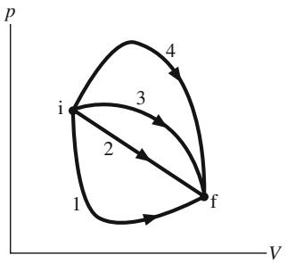

flowchart

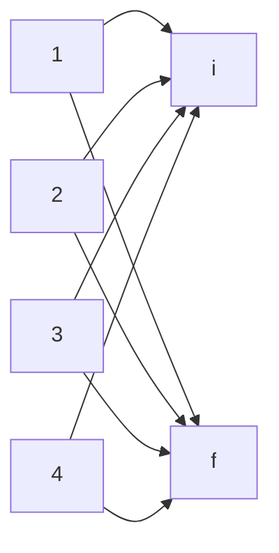

## KONTROLLFRAGE 5

Die Abbildung zeigt vier Wege in einem pV-Diagramm, entlang derer ein Gas von einem Anfangszustand i zu einem Endzustand f gelangen kann. Ordnen Sie die Wege (a) nach der Änderung der inneren Energie $\Delta E _ { \mathrm { i n t } } ,$ (b) der von dem Gas geleisteten Arbeit W und (c) dem Betrag der als Wärme Q übertragenen Energiemenge (größte Werte jeweils zuerst).

## 14.5.3 Einige Beispiele für den ersten Hauptsatz der Thermodynamik

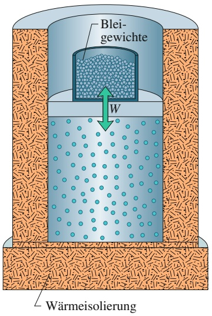

text_image

Blei-
gewichte
W
Wärmeisolierung

Abb. 14.14

Ein adiabatischer Prozess lässt sich realisieren, indem das Gewicht auf dem Kolben langsam reduziert wird (Entnahme von Bleikugeln). Durch Erhöhung des Gewichts (Zugabe von Bleikugeln) kann der Prozess in jedem Stadium umgekehrt werden.

Im Folgenden betrachten wir vier thermodynamische Prozesse, bei denen das untersuchte System jeweils bestimmten Einschränkungen unterliegt, und wenden den ersten Hauptsatz auf den jeweiligen Prozess an. Tabelle 14.5 fasst die Ergebnisse zusammen.

## 1. Adiabatische Prozesse

Ein adiabatischer Prozess erfolgt entweder so schnell oder findet in einem so gut isolierten System statt, dass keine Übertragung von Wärmeenergie zwischen dem System und seiner Umgebung stattfindet. Mit $Q = 0$ wird aus dem ersten Hauptsatz (Gl. 14.21)

$$
\Delta E _ {\text {int}} = - W \quad (\text {adiabatischer Prozess}). \tag {14.23}
$$

Diese Gleichung besagt, dass die innere Energie eines Systems um den Betrag der Arbeit abnimmt, wenn von dem System Arbeit geleistet wird (also W positiv ist). Wird umgekehrt an dem System Arbeit verrichtet (ist W also negativ), nimmt die innere Energie um genau diesen Betrag zu.

Abbildung 14.14 zeigt einen idealisierten adiabatischen Prozess. Wegen der Iso lierung kann das System keine Wärme mit der Umgebung austauschen. Die einzige Möglichkeit für das System, Energie mit seiner Umgebung auszutauschen, ist in Form von Arbeit. Entnehmen wir dem Kolben Bleikugeln und dehnt sich das Gas dabei aus, ist die von dem System (dem Gas) geleistete Arbeit positiv und die innere Energie des Gases nimmt ab. Fügen wir stattdessen weitere Bleikugeln hinzu und drücken das Gas dadurch zusammen, ist die von dem System geleistete Arbeit negativ und die innere Energie des Gases nimmt zu.

## 2. Prozess bei konstantem Volumen

Wird das Volumen eines Systems (beispielsweise eines Gases) konstant gehalten, kann das System keine Arbeit verrichten. Setzen wir im ersten Hauptsatz (Gl. 14.16) $W = 0 ,$ folgt

$$
\Delta E _ {\text {int}} = Q \quad (\text {Prozess bei konstantem Volumen}). \tag {14.24}
$$

Nimmt ein solches System also Wärme auf (Q positiv), so nimmt die innere Energie des Systems um gerade diesen Energiebetrag zu. Wird umgekehrt bei einem Prozess Wärme abgegeben (Q negativ), muss die innere Energie des Systems entsprechend abnehmen.

TABELLE 14.5: Der erste Hauptsatz der Thermodynamik für vier verschiedene Fälle.

<table><tr><td colspan="3">Das Gesetz:  $\Delta E_{\text{int}} = Q - W$  (Gl. 14.21)</td></tr><tr><td>Prozess</td><td>Einschränkung</td><td>Folgerung</td></tr><tr><td>adiabatisch</td><td> $Q = 0$ </td><td> $\Delta E_{\text{int}} = -W$ </td></tr><tr><td>konstantes Volumen</td><td> $W = 0$ </td><td> $\Delta E_{\text{int}} = Q$ </td></tr><tr><td>Kreisprozess</td><td> $\Delta E_{\text{int}} = 0$ </td><td> $Q = W$ </td></tr><tr><td>freie Expansion</td><td> $Q = W = 0$ </td><td> $\Delta E_{\text{int}} = 0$ </td></tr></table>

## 3. Kreisprozess

Es gibt Prozesse, bei denen nach einem Austausch von Wärme und Arbeit das System wieder in seinen ursprünglichen Zustand zurückkehrt. In einem solchen Fall kann sich keine intrinsische Eigenschaft des Systems – einschließlich seiner inneren Energie – ändern. Ist $\Delta E _ { \mathrm { i n t } } = 0$ , wird aus dem ersten Hauptsatz (Gl. 14.21)

$$
Q = W \quad (\text {Kreisprozess}). \tag {14.25}
$$

Die bei einem solchen Prozess geleistete Gesamtarbeit muss daher gleich der bei diesem Prozess übertragenen Wärmemenge sein. Der Vorrat des Systems an innerer Energie verändert sich nicht. Kreisprozesse bilden in einem pV-Diagramm einen geschlossenen Weg wie in Abb. 14.13f. Solche Prozesse werden wir in Kapitel 16 noch genauer untersuchen.

## 4. Freie Expansion

In diesem Fall handelt es sich um adiabatische Prozesse (kein Wärmeaustausch zwischen System und Umgebung), bei denen zusätzlich auch keine Arbeit von oder an dem System verrichtet wird. Es ist also $Q   =   W   =   0$ , und nach dem ersten Hauptsatz muss dann gelten

$$
\Delta E _ {\mathrm{int}} = 0 \qquad (\text {freie Expansion}). \tag {14.26}
$$

Abbildung 14.15 zeigt, wie sich eine solche Expansion realisieren lässt. Ein im thermischen Gleichgewicht befindliches Gas befindet sich zunächst in einer der beiden Hälften einer isolierten Doppelkammer; die andere Hälfte wurde evakuiert. Die Verbindung zwischen den beiden Hälften ist durch einen Absperrhahn verschlossen. Wird der Hahn geöffnet, kann sich das Gas frei in beiden Hälften der Kammer ausbreiten. Wegen der Isolation tauscht das Gas keine Wärme mit der Umgebung aus. Es leistet auch keine Arbeit, da es sich gegen das Vakuum ausbreitet und somit auf keinen Gegendruck trifft. Dieser Prozess der freien Expansion unterscheidet sich von allen bisher betrachteten Prozessen, weil er sich nicht in langsamer und kontrollierter Form durchführen lässt. Während der plötzlichen Ausdehnung befindet sich das Gas daher nicht im thermischen Gleichgewicht und sein Druck ist nicht überall derselbe. Aus diesem Grund können wir zwar den Anfangs- und Endzustand in ein pV-Diagramm eintragen, nicht aber den Weg während der Expansion.

## KONTROLLFRAGE 6

Das pV-Diagramm zeigt einen Kreisprozess. Sind darin (a) $\Delta E _ { \mathrm { i n t } }$ des Gases und (b) die als Wärme netto übertragene Energie Q positiv, negativ oder null?

## 14.6 Mechanismen der Wärmeübertragung

## Lernziele

Nach dem Durcharbeiten dieses Abschnitts sollten Sie in der Lage sein, . . .

• für die Wärmeleitung durch eine Platte den Zusammenhang zwischen dem Wärmestrom $P _ { \mathrm { L } }$ , der Fläche A der Platte, der Wärmeleitfähigkeit k, der Dicke L der Platte und der Temperaturdifferenz ΔT zwischen den beiden Seiten der Platte anzugeben,
• zu verstehen, dass in einer Verbundplatte aus zwei oder mehr Komponenten, die einen stationären Zustand erreicht hat, in dem sich die Temperaturen nicht mehr ändern, die Wärmeströme $P _ { \mathrm { L } }$ durch alle Platten aus Gründen der Energieerhaltung gleich sein müssen,
• für die Wärmeleitung durch eine Platte den Zusammenhang zwischen dem Wärmewiderstand $R ,$ der Dicke L und der Wärmeleitfähigkeit k anzugeben und anzuwenden,

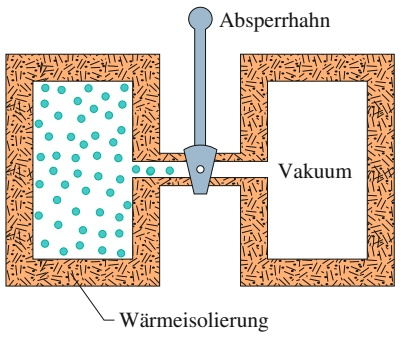

text_image

Absperrhahn
Vakuum
Wärmeisolierung

Abb. 14.15

Der Anfangszustand bei einem Prozess mit freier Expansion. Nachdem der Absperrhahn geöffnet wurde, kann das Gas beide Hälften der Kammer ausfüllen und erreicht schließlich einen neuen Gleichgewichtszustand.

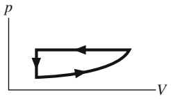

• zu verstehen, dass Wärmeenergie durch Konvektion übertragen werden kann, bei der ein wärmeres Fluid (ein Gas oder eine Flüssigkeit) in einem kühleren Fluid aufsteigt,
• im Fall der Emission von Wärmestrahlung durch ein Objekt den Zusammenhang zwischen dem Wärmestrom $P _ { \mathrm { S } } ,$ der Oberfläche A des Objekts, seinem Emissionsvermögen ε und seiner Oberflächentemperatur T (in Kelvin) anzugeben und anwenden,
• im Fall der Absorption von Wärmestrahlung durch ein Objekt den Zusammenhang zwischen dem Wärmestrom $P _ { \mathsf { a b s } } ,$ der Oberfläche A des Objekts, seinem Emissionsvermögen ε und der Umgebungstemperatur T (in Kelvin) anzugeben und anwenden,
• den Netto- oder Gesamtwärmestrom $P _ { \mathrm { g e s } }$ für ein Objekt zu berechnen, das Strahlung in seine Umgebung emittiert und gleichzeitig Strahlung aus dieser Umgebung absorbiert.

## Schlüsselideen

• Der Wärmestrom $P _ { \mathrm { L } }$ durch eine Platte, deren eine Fläche die höhere Temperatur $T _ { \mathrm { H } }$ und deren andere Fläche die niedrigere Temperatur $T _ { \mathrm { K } }$ hat, beträgt

$$
P _ {\mathrm{L}} = \frac {Q}{t} = k A \frac {T _ {\mathrm{H}} - T _ {\mathrm{K}}}{L}.
$$

Dabei sind A die Fläche jeder der beiden Seiten, L die Dicke der Platte (der Abstand zwischen den beiden Seiten) und k die Wärmeleitfähigkeit des Materials.

• Konvektion tritt auf, wenn Temperaturunterschiede einen Energietransport durch Strömungen in einem Fluid bewirken.
• Wärmestrahlung ist die Übertragung von thermischer Energie in Form von elektromagnetischer Strahlung. Der Wärmestrom $P _ { S } ,$ mit dem ein Objekt Energie als Wärmestrahlung emittiert, ist

$$
P _ {\mathrm{S}} = \sigma \varepsilon A \cdot T ^ {4},
$$

wobei $\sigma = 5 { , } 6 7 0 4   \cdot   1 0 ^ { - 8 }   \mathrm { W } / ( \mathrm { m } ^ { 2 } \cdot \mathrm { K } ^ { 4 } )$ die Stefan-Boltzmann-Konstante ist, ε das Emissionsvermögen der Oberfläche A des Objekts und T dessen Temperatur (in Kelvin). Der Wärmestrom $P _ { \mathrm { a b s } } ,$ mit dem ein Objekt Energie als Wärmestrahlung aus seiner Umgebung (die die gleichförmige Temperatur $T _ { \mathrm { U } }$ hat) absorbiert, beträgt

$$
P _ {\mathrm{abs}} = \sigma \varepsilon A \cdot T _ {\mathrm{U}} ^ {4}.
$$

## 14.6.1 Mechanismen der Wärmeübertragung

Bisher haben wir zwar mehrfach von der Wärmeübertragung zwischen einem System und seiner Umgebung gesprochen, wir haben jedoch noch nicht geklärt, wie diese Übertragung erfolgt. Es gibt grundsätzlich drei verschiedene Wärmeübertragungsmechanismen: Wärmeleitung, Konvektion und Wärmestrahlung.

## Wärmeleitung

Liegt das Ende eines metallischen Schürhakens für eine gewisse (bei Metallen gar nicht so lange) Zeit im Feuer, wird auch der Griff heiß. Entlang des Schürhakens wird Energie durch **Wärmeleitung** vom Feuer bis zum Griff übertragen. Die Schwingungsamplituden der Atome und Elektronen des Metalls werden an dem im Feuer befindlichen Ende des Schürhakens aufgrund der hohen Umgebungstemperatur ziemlich groß. Diese erhöhten Schwingungsamplituden und die damit verbundenen Energien übertragen sich durch Stöße zwischen benachbarten

Atomen von Atom zu Atom und breiten sich so entlang des Schürhakens aus. Der Bereich erhöhter Temperatur erstreckt sich im Verlauf der Zeit von der Spitze des Schürhakens bis zum Griff.

Wir betrachten eine Platte der Fläche A und der Dicke L, deren Seitenflächen durch ein heißes und ein kaltes Wärmereservoir auf den Temperaturen $T _ { \mathrm { H } }$ und $T _ { \mathrm { K } }$ gehalten werden $( , \mathrm { h e i } \beta ^ { a }$ und „kalt“, vgl. Abb. 14.16). Q sei die von der Platte in der Zeit t von der heißen zur kalten Seite übertragene Wärmeenergie. Experimentell findet man, dass der Wärmestrom $P _ { \mathrm { L } }$ (also die pro Zeit übertragene Energiemenge) durch

$$
P _ {\mathrm{L}} = \frac {Q}{t} = \lambda A \frac {T _ {\mathrm{H}} - T _ {\mathrm{K}}}{L} \tag {14.27}
$$

gegeben ist. Die Konstante λ, die sogenannte Wärmeleitfähigkeit (auch thermische Leitfähigkeit), ist eine Eigenschaft des Materials, aus dem die Platte besteht. Leitet ein Material die Wärmeenergie vergleichsweise rasch, so bezeichnet man es als guten Wärmeleiter und es besitzt eine hohe Wärmeleitfähigkeit λ. In Tab. 14.6 sind die Wärmeleitfähigkeiten einiger Metalle, Gase und Baumaterialien zusammengestellt.

## Thermischer Widerstand und Wärmeleitfähigkeit (R-Wert)

Wenn Sie Ihr Haus wärmeisolieren oder Ihren To-go-Kaffee bei einem Ausflug warmhalten wollen, sind Sie mehr an schlechten Wärmeleitern interessiert als an guten. Aus diesem Grund wurde für die Baupraxis der Begriff des thermischen Widerstands R eingeführt. Der R-Wert einer Platte der Dicke L ist definiert als

$$
R = \frac {L}{\lambda}. \tag {14.28}
$$

Je kleiner die Wärmeleitfähigkeit eines Materials, umso größer ist der R-Wert einer Platte aus diesem Material. Ein großer R-Wert bedeutet daher einen schlechten Wärmeleiter und damit guten Wärmeisolator.

Man beachte, dass R eine Eigenschaft einer Platte mit einer bestimmten Dicke ist, nicht die Eigenschaft eines bestimmten Materials. Die übliche Einheit für R ist $\mathrm { { \tt m } ^ { 2 } \cdot { } ^ { \circ } C / W } .$ . (Oft versteht man unter dem thermischen Widerstand bzw. dem Wärmewiderstand allerdings auch das Verhältnis $R / A ,$ bei welcher der oben definierte R-Wert noch durch die Fläche der Platte dividiert wird. In diesem Fall ist die Einheit °C/W.)

## Wärmeleitung durch eine Verbundplatte

Abbildung 14.17 zeigt eine Verbundplatte aus zwei Materialien mit unterschiedlichen Dicken $L _ { 1 }$ und $L _ { 2 }$ und den Wärmeleitfähigkeiten $\lambda _ { 1 }$ und $\lambda _ { 2 }$ . Die Temperaturen auf den Außenflächen der Platte seien $T _ { \mathrm { H } }$ und $T _ { \mathrm { K } } .$ Die Plattenseiten haben jeweils die Fläche A. Wir wollen nun einen Ausdruck für den Wärmestrom durch die Verbundplatte herleiten und dabei von der Annahme ausgehen, dass es sich bei der Energieübertragung um einen Prozess im Fließgleichgewicht handelt, d. h., die Temperaturen innerhalb der Platte und die Energieübertragungsrate (der Wärmestrom) sind konstant.

In einem Zustand des Fließgleichgewichts muss der Wärmestrom durch die beiden Materialien gleich sein. Das ist gleichbedeutend mit der Aussage, dass die in einem bestimmten Zeitintervall übertragene Energie durch das eine Material gleich der in demselben Zeitintervall durch das andere Material übertragenen Energie sein muss. Wäre das nicht der Fall, würden sich die Temperaturen in der Platte verändern und es läge kein Fließgleichgewicht vor. Sei $T _ { \mathrm { X } }$ die Temperatur an der

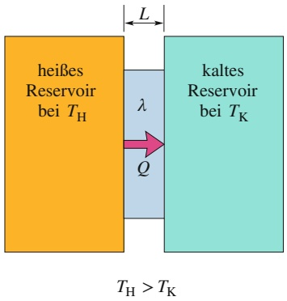

flowchart

## Abb. 14.16

Wärmeleitung: Wärmeenergie wird durch eine leitende Platte der Dicke L und der Wärmeleitfähigkeit λ von einem heißen Reservoir der Temperatur $T _ { \mathrm { H } }$ zu einem kühleren Reservoir mit der Temperatur $T _ { \mathrm { K } }$ übertragen.

## TABELLE 14.6:

Einige Wärmeleitfähigkeiten.

<table><tr><td>Material</td><td> $\lambda (W/(m \cdot K))$ </td></tr><tr><td colspan="2">Metalle</td></tr><tr><td>rostfreier Stahl</td><td>14</td></tr><tr><td>Blei</td><td>35</td></tr><tr><td>Aluminium</td><td>235</td></tr><tr><td>Kupfer</td><td>401</td></tr><tr><td>Silber</td><td>428</td></tr><tr><td colspan="2">Gase</td></tr><tr><td>Luft (trocken)</td><td>0,026</td></tr><tr><td>Helium</td><td>0,15</td></tr><tr><td>Wasserstoff</td><td>0,18</td></tr><tr><td colspan="2">Baumaterialien</td></tr><tr><td>Polyurethan-Hartschaum</td><td>0,024</td></tr><tr><td>Steinwolle</td><td>0,043</td></tr><tr><td>Glasfaser</td><td>0,048</td></tr><tr><td>Fichtenholz</td><td>0,13</td></tr><tr><td>Fensterglas</td><td>1,0</td></tr></table>

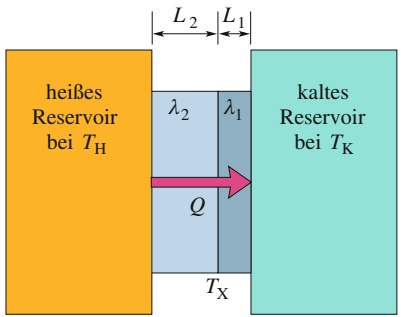

flowchart

## Abb. 14.17

Wärme wird mit einer konstanten Rate durch eine Verbundplatte aus zwei verschiedenen Materialien mit unterschiedlichen Dicken und verschiedenen Wärmeleitfähigkeiten übertragen. Die Fließgleichgewichtstemperatur an der Grenzfläche zwischen den beiden Materialien sei $T _ { \mathrm { X } }$

Grenzfläche zwischen den beiden Materialien. Mithilfe von Gl. 14.27 können wir

$$
P _ {\mathrm{L}} = \frac {\lambda_ {2} A (T _ {\mathrm{H}} - T _ {\mathrm{X}})}{L _ {2}} = \frac {\lambda_ {1} A (T _ {\mathrm{X}} - T _ {\mathrm{K}})}{L _ {1}} \tag {14.29}
$$

schreiben. Wir lösen diese Gleichung nach $T _ { \mathrm { X } }$ auf und erhalten nach einigen Umformungen

$$
T _ {\mathrm{X}} = \frac {\lambda_ {1} L _ {2} T _ {\mathrm{K}} + \lambda_ {2} L _ {1} T _ {\mathrm{H}}}{\lambda_ {1} L _ {2} + \lambda_ {2} L _ {1}}. \tag {14.30}
$$

Setzen wir diesen Ausdruck für $T _ { \mathrm { X } }$ in eine der beiden Gleichungen in Gl. 14.29 ein, folgt

$$
P _ {\mathrm{L}} = \frac {A (T _ {\mathrm{H}} - T _ {\mathrm{K}})}{L _ {1} / \lambda_ {1} + L _ {2} / \lambda_ {2}}. \tag {14.31}
$$

Wir können diese Beziehung auch für eine beliebige Anzahl n von Materialien in der Platte verallgemeinern:

$$
P _ {\mathrm{L}} = \frac {A (T _ {\mathrm{H}} - T _ {\mathrm{K}})}{\sum (L / \lambda)}. \tag {14.32}
$$

Das Summenzeichen im Nenner bedeutet, dass die Werte $L / \lambda$ aller Materialien addiert werden sollen.

## KONTROLLFRAGE 7

Die Abbildung zeigt die Oberflächen- und Grenzflächentemperaturen einer Verbundplatte aus vier Materialien gleicher Dicke. Der Wärmestrom durch die Platte sei gleichförmig. Ordnen Sie die Materialien in absteigender Reihenfolge nach ihren Wärmeleitfähigkeiten.

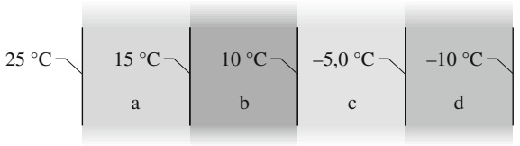

text_image

25 °C—
15 °C—
a
10 °C—
b
-5,0 °C—
c
-10 °C—
d

## Konvektion

Wenn Sie die Flamme einer Kerze oder eines Streichholzes beobachten, sehen Sie, wie dort Wärmeenergie durch **Konvektion** nach oben transportiert wird. Ein solcher Energietransport tritt auf, wenn ein Fluid (z. B. Wasser oder Luft) in Kontakt mit einem Gegenstand kommt, der heißer als das Fluid selbst ist. An der Kontaktstelle erwärmt sich das Fluid, es dehnt sich an dieser Stelle aus und seine Dichte nimmt ab. Da dieses expandierte Fluid nun leichter als das kühlere Fluid in seiner Umgebung ist, erfährt es einen Auftrieb (Abschn. 10.5) und beginnt nach oben zu steigen. Ein Teil des kälteren Fluids aus der Umgebung fließt nach unten und nimmt den Raum des aufgestiegenen wärmeren Fluids ein. So kommt eine Konvektionsströmung in Gang.

Konvektionsphänomene spielen bei vielen natürlichen Prozessen eine Rolle. Die atmosphärische Konvektion bestimmt sowohl das globale Klima wie auch die täglichen Wetteränderungen. Segelflieger und Vögel suchen gleichermaßen nach aufsteigender Thermik (Konvektionsströmen aus warmer Luft), die sie nach oben trägt. Derselbe Prozess steuert Energieumwälzungen von unvorstellbarem Ausmaß in den Ozeanen und im Erdmantel. Auch in der Sonne wird auf diese Weise Energie aus dem unvorstellbar heißen nuklearen Brennofen im Zentrum zur strahlenden Oberfläche transportiert.

## Strahlung

Bei der dritten Methode, über die ein Gegenstand mit seiner Umgebung Wärmeenergie austauschen kann, dienen elektromagnetische Wellen (sichtbares Licht ist eine spezielle Art von elektromagnetischer Welle, vgl. Kapitel 29) als Vermittler. Die auf diese Weise übertragene Energie wird oft als **Wärmestrahlung** (oder **thermische Strahlung**) bezeichnet, um sie von elektromagnetischen Signalen (beispielsweise Fernsehübertragungen) und von radioaktiver Strahlung (von Atomkernen emittierte Energie und Teilchen) zu unterscheiden. Wenn Sie vor einem großen Feuer stehen, werden Sie durch die thermische Strahlung des Feuers erwärmt, auch wenn Sie sich wohlweislich von den Flammen fernhalten. Ihre thermische Energie nimmt dennoch zu, während die thermische Energie des Feuers abnimmt. Für diese Art der Wärmeübertragung ist kein Medium notwendig – die Strahlung kann sich auch durch das Vakuum ausbreiten, beispielsweise von der Sonne zur Erde (zum Glück für uns!).

Die Rate $P _ { \mathrm { S } } ,$ mit der ein Gegenstand Energie in Form von elektromagnetischer Strahlung emittiert, hängt von der Oberfläche A des Körpers und der Temperatur T dieser Fläche (in Kelvin) ab und ist durch

$$
P _ {S} = \sigma \varepsilon A T ^ {4} \tag {14.33}
$$

gegeben. $\sigma = 5 { , } 6 7 0 4 \cdot 1 0 ^ { - 8 }   \mathrm { W } / ( \mathrm { m } ^ { 2 } \cdot \mathrm { K } ^ { 4 } )$ ist die Stefan-Boltzmann-Konstante, benannt nach Josef Stefan (der Gl. 14.33 im Jahr 1879 experimentell entdeckte) und Ludwig Boltzmann (der sie kurze Zeit später theoretisch herleitete). Das Symbol ε steht für den Emissionsgrad der Oberfläche des Gegenstands und hat je nach Art der Oberfläche einen Wert zwischen 0 und 1. Eine Oberfläche mit maximalem Emissionsgrad 1,0 bezeichnet man als schwarzen Körper oder auch schwarzen Strahler. Eine solche Oberfläche entspricht jedoch einem idealen Grenzfall und tritt in der Natur nicht auf. Man beachte, dass in Gl. 14.33 die Temperatur in Kelvin angegeben werden muss, am absoluten Nullpunkt also keine Strahlung emittiert wird. Jeder Gegenstand mit einer Temperatur oberhalb von 0 K emittiert Wärmestrahlung (vgl. Abb. 14.18).

Ein Körper kann auch Wärmestrahlung aus seiner Umgebung absorbieren. Sei $T _ { \mathrm { U } }$ die als gleichförmig verteilt angenommene Umgebungstemperatur in Kelvin, dann ist die von einem Körper absorbierte Energierate gleich

$$
P _ {\mathrm{abs}} = \sigma \varepsilon A T _ {\mathrm{U}} ^ {4}. \tag {14.34}
$$

Der Emissionsgrad ε ist in dieser Gleichung derselbe wie in Gl. 14.33. Ein idealisierter schwarzer Körper mit ε = 1 absorbiert sämtliche auftreffende Strahlungsenergie, an seiner Oberfläche wird keine Strahlung reflektiert oder gestreut.

Da ein Gegenstand einerseits Strahlung an die Umgebung abgibt und andererseits gleichzeitig von der Umgebung Strahlung aufnimmt, ist die Netto- bzw. Gesamtrate $P _ { \mathrm { g e s } }$ des Energieaustauschs über Wärmestrahlung durch

$$
P _ {\mathrm{ges}} = P _ {\mathrm{abs}} - P _ {\mathrm{S}} = \sigma \varepsilon A \left(T _ {\mathrm{U}} ^ {4} - T ^ {4}\right) \tag {14.35}
$$

gegeben. $P _ { \mathrm { g e s } }$ ist positiv, wenn mehr Energie absorbiert als emittiert wird, und negativ, wenn mehr Energie durch Abstrahlung verloren geht.

Die Strahlung des schwarzen Körpers, speziell die Erklärung ihrer spektralen Form, stellte Ende des 19. Jahrhunderts ein lange Zeit ungelöstes Problem dar. Erst dem Physiker Max Planck (1858–1947) gelang es mit seinem 1901 publizierten Strahlungsgesetz, das Schwarzkörperspektrum korrekt zu modellieren. Die Plancksche Arbeit erwies sich später als einer der wesentlichen Schritte zur Einführung der Quantenmechanik, in der Energien nicht mehr notwendigerweise kontinuierlich variieren dürfen, wie in der klassischen Physik, sondern als ganzzahlige Vielfache einer Minimalenergie, d. h. eines Energiequantums auftreten. Auf das Plancksche Strahlungsgesetz kommen wir in Kapitel 34 zurück.

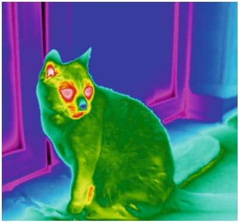

natural_image

Thermal image of a green cat with orange eyes, sitting indoors against a purple and blue background (no text or symbols)

Abb. 14.18

Das Falschfarben-Thermogramm zeigt die Strahlungsleistung (Abstrahlungsrate von Wärmeenergie) einer Katze. Die Werte sind farbkodiert: die stärkste Wärmestrahlung entspricht weiß, es folgen mit abnehmenden Raten rot, gelb, grün, blau, rosa und schwarz.

Man sieht: Katzenfell dämmt gut, das Gesicht ist warm, die Nase jedoch kühl (mit freundlicher Erlaubnis von Michael Vollmer, Univ. Brandenburg).

## 14.7 Zusammenfassung

**Temperatur, Thermometer** Die Temperatur ist eine SI-Basisgröße und entspricht unserem Sinn für heiß und kalt. Gemessen wird sie mit einem Thermometer, das aus einer Arbeitssubstanz mit einer messbaren Eigenschaft (beispielsweise Länge oder Druck) besteht, die sich auf regulä- re Weise verändert, wenn die Substanz heißer oder kälter wird.

**Der nullte Hauptsatz der Thermodynamik** Stehen ein Thermometer und ein anderer Gegenstand in engem Kontakt zueinander, erreichen sie schließlich ein thermisches Gleichgewicht. Die Anzeige des Thermometers entspricht dann der Temperatur des anderen Gegenstands. Dieses Verfahren stellt eine konsistente und sinnvolle Temperaturmessung dar, begründet durch den nullten Hauptsatz der Thermodynamik: Wenn zwei Körper A und B sich jeweils im thermischen Gleichgewicht mit einem dritten Körper C befinden (dem Thermometer), dann sind sie auch untereinander im thermischen Gleichgewicht.

**Die Kelvin-Skala** In SI-Einheiten wird die Temperatur auf der Kelvin-Skala gemessen, die über den exakt festgelegten Wert der Boltzmann-Konstanten definiert ist. Temperaturen lassen sich mithilfe eines Gasthermometers mit konstantem Volumen messen. Für eine Gasprobe bei konstantem Volumen ist der Druck proportional zur Temperatur. Wir erhalten die mit einem Gasthermometer gemessene Temperatur $T$ durch

$$
T = (2 7 3, 1 6 \mathrm{K}) \left(\lim _ {\text {Gasmenge} \rightarrow 0} \frac {p}{p _ {3}}\right). \tag {14.6}
$$

T wird hierbei in Kelvin gemessen, $p _ { 3 }$ ist der gemessene Druck bei 273,16 K (am Tripelpunkt) und $p$ der gemessene Druck bei der zu bestimmenden Temperatur.

**Celsius- und Fahrenheit-Skala** Die Celsius-Temperaturskala ist durch

$$
T _ {\mathrm{C}} = T - 2 7 3, 1 5 \tag {14.7}
$$

definiert, wobei T in Kelvin angegeben wird. Die Fahrenheit-Temperaturskala ist definiert durch

$$
T _ {\mathrm{F}} = \frac {9}{5} T _ {\mathrm{C}} + 3 2. \tag {14.8}
$$

**Wärmeausdehnung** Alle Körper verändern bei Temperaturänderungen auch ihre Abmessungen. Für eine Temperaturänderung um $\Delta T$ erhält man für jede lineare Dimension L eine Längenänderung ΔL von

$$
\Delta L = L \alpha \Delta T. \tag {14.9}
$$

α ist der **Längenausdehnungskoeffizient**. Die Volumenänderung $\Delta V$ des Volumens V eines Festkörpers oder einer Flüssigkeit ist

$$
\Delta V = V \beta \Delta T. \tag {14.10}
$$

Zwischen **Volumenausdehnungskoeffizient** $\beta$ und Längenausdehnungskoeffizient α eines Festkörpers besteht die Beziehung $\beta = 3 \alpha$

**Wärme** Die Wärme Q ist eine Energie, die ein System mit seiner Umgebung aufgrund einer Temperaturdifferenz austauscht. Sie kann in **Joule** (J), **Kalorien** (cal) oder **Kilokalorien** (kcal = Cal) gemessen werden, wobei gilt:

$$
1 \mathrm{cal} = 4, 1 8 6 0 \mathrm{J}. \tag {14.12}
$$

**Wärmekapazität und spezifische Wärme** Nimmt ein Körper die Wärmemenge Q auf, ist die dadurch bewirkte Temperaturänderung $T _ { \mathrm { f } } - T _ { \mathrm { i } }$ des Körpers proportional zu Q:

$$
Q = C (T _ {\mathrm{f}} - T _ {\mathrm{i}}). \tag {14.13}
$$

C ist die Wärmekapazität des Körpers. Für einen Körper der Masse m gilt

$$
Q = c m (T _ {\mathrm{f}} - T _ {\mathrm{i}}), \tag {14.14}
$$

mit c als der spezifischen Wärme des Materials. Die **molare spezifische Wärme** eines Materials ist seine Wärmekapazität pro Mol, d. h. pro $6 { , } 0 2 \cdot 1 0 ^ { 2 3 }$ elementaren Einheiten des Materials.

**Umwandlungswärme** Die von einem Material aufgenommene Wärme kann auch den Zustand bzw. die Phase des Materials ändern, beispielsweise von fest nach flüssig oder von flüssig zu gasförmig. Bei der Phasenänderung ändert sich die Temperatur nicht. Die zur Phasenänderung notwendige Energiemenge pro Masse ist die **Umwandlungswärme** L. Es gilt somit

$$
Q = L m. \tag {14.16}
$$

Die **Verdampfungswärme** $L _ { \mathrm { V } }$ ist die Energiemenge pro Masse, die beim Verdampfen einer Flüssigkeit aufgenommen wird bzw. bei der Kondensation eines Gases frei wird. Die **Schmelzwärme** $L _ { \mathrm { S } }$ ist die Energiemenge pro Masse, die einem Festkörper beim Schmelzen zugeführt werden muss bzw. die frei wird, wenn eine Flüssigkeit gefriert.

**Arbeit bei Volumenänderung** Ein Gas kann mit seiner Umgebung Energie in Form von Arbeit austauschen. Die von einem Gas bei seiner Expansion von einem Anfangsvolumen $V _ { \mathrm { i } }$ zu einem Endvolumen $V _ { \mathrm { f } }$ geleistete Arbeit ist durch

$$
W = \int \mathrm{d} W = \int_ {V _ {\mathrm{i}}} ^ {V _ {\mathrm{f}}} p \mathrm{d} V. \tag {14.20}
$$

gegeben. Die Integration ist notwendig, weil der Druck $p$ sich im Verlauf der Expansion ändern kann. Bei einer Kompression des Gases wird an dem System Arbeit geleistet.

**Der erste Hauptsatz der Thermodynamik** Der erste Hauptsatz der Thermodynamik drückt das Prinzip der Energieerhaltung bei einem thermodynamischen Prozess aus. Er kann in der Form

$$
\Delta E _ {\mathrm{int}} = E _ {\mathrm{int,f}} - E _ {\mathrm{int,i}} = Q - W (\text {erster Hauptsatz}) \tag {14.21}
$$

oder infinitesimal in der Form

$$
\mathrm{d} E _ {\text {int}} = \mathrm{d} Q - \mathrm{d} W \quad \text {(erster Hauptsatz)} \tag {14.22}
$$

ausgedrückt werden. $E _ { \mathrm { i n t } }$ steht für die innere Energie des Materials, die nur von seinem Zustand (Temperatur, Druck, Volumen) abhängt. Q ist die zwischen dem System und seiner Umgebung ausgetauschte Wärmeenergie. Q ist positiv, wenn das System Wärme aufnimmt, und negativ, wenn es Wärme abgibt. W ist die von dem System geleistete Arbeit. W ist positiv, wenn sich das System gegen eine äußere Kraft aus der Umgebung ausdehnt, und negativ, wenn es von einer äußeren Kraft zusammengedrückt wird. Sowohl Q als auch W sind wegabhängig; $\Delta E _ { \mathrm { i n t } }$ ist wegunabhängig.

**Anwendungen des ersten Hauptsatzes** Der erste Hauptsatz der Thermodynamik lässt sich auf verschiedene Spezialfälle anwenden:

adiabatische Prozesse:

Prozesse bei

konstantem Volumen:

Kreisprozesse:

freie Expansion

ins Vakuum:

**Wärmeleitung, Konvektion, Wärmestrahlung** Durch eine Platte der Dicke $L ,$ deren beide Seiten die konstanten Temperaturen $T _ { \mathrm { H } }$ bzw. $T _ { \mathrm { K } }$ haben, fließt ein Wärmestrom. Dieser Wärmestrom, d. h. die durch die Platte geleitete Energierate, ist durch

$$
P _ {\mathrm{L}} = \frac {Q}{t} = \lambda A \frac {T _ {\mathrm{H}} - T _ {\mathrm{K}}}{L} \tag {14.27}
$$

gegeben. A ist die Seitenfläche und λ bezeichnet man als die Wärmeleitfähigkeit des Materials.

Konvektion tritt auf, wenn Wärmeenergie durch die Bewegung eines Fluids mittransportiert wird, beispielsweise wenn ein Temperaturunterschied innerhalb eines Fluids zu einer Strömung führt.

Wärmestrahlung überträgt Energie durch die Abstrahlung und Aufnahme von elektromagnetischen Wellen. Für die von einem Gegenstand in Form von Strahlung emittierte Energierate $P _ { S }$ gilt

$$
P _ {S} = \sigma \varepsilon A T ^ {4}. \tag {14.33}
$$

Hierbei sind $\sigma = ( 5 { , } 6 7 0 4 \cdot 1 0 ^ { - 8 }   \mathrm { W } / ( \mathrm { m } ^ { 2 } \cdot \mathrm { K } ^ { 4 } ) )$ die Stefan-Boltzmann-Konstante, ε der Emissionsgrad der Oberfläche des Gegenstands, A seine Oberfläche und T deren Temperatur in Kelvin. Die Rate $P _ { \mathrm { a b s } } ,$ mit der ein Gegenstand Energie in Form von Wärmestrahlung aus seiner Umgebung mit der gleichförmigen Temperatur $T _ { \mathrm { U } }$ absorbiert, ist

$$
P _ {\mathrm{abs}} = \sigma \varepsilon A T _ {\mathrm{U}} ^ {4}. \tag {14.34}
$$

## 14.8 Fragen

**1.** In Abb. 14.F1 erkennt man drei lineare Temperaturskalen, in denen jeweils die Gefrier- und Siedepunkte von Wasser eingetragen sind. Ordnen Sie die Gradänderungen von 25 °R, 25 °S und 25 °U nach den entsprechenden Temperaturänderungen (größte Werte zuerst).

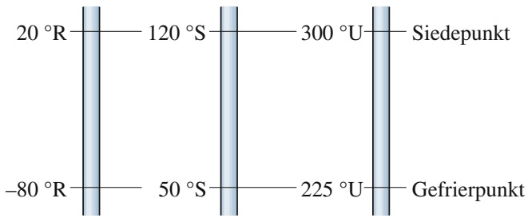

wireframe

| Kategorie | Wert |
| --- | --- |
| \(20 {}^{\circ}R\) | N/A |
| \(120 {}^{\circ}S\) | N/A |
| \(300 {}^{\circ}U\) | N/A |
| \(225 {}^{\circ}U\) | N/A |
| \(-80 {}^{\circ}R\) | N/A |
| \(50 {}^{\circ}S\) | N/A |
| Siedepunkt | N/A |
| Gefrierpunkt | N/A |

Abb. 14.F1

**2.** In der Tabelle sind die ursprüngliche Länge $L ,$ die Temperaturänderung $\Delta T$ und die Längenänderung ΔL für vier Stäben eingetragen. Ordnen Sie die Stäbe in absteigender Reihenfolge nach ihren Längenausdehnungskoeffizienten.

| Stab | L (m) | ΔT (°C) | ΔL (m) |
| --- | --- | --- | --- |
| a | 2 | 10 | $4 \cdot 10^{-4}$ |
| b | 1 | 20 | $4 \cdot 10^{-4}$ |
| c | 2 | 10 | $8 \cdot 10^{-4}$ |
| d | 4 | 5 | $4 \cdot 10^{-4}$ |

**3.** In einem wärmeisolierten Behälter befindet sich Material A der Masse m in Kontakt mit Material B, dessen Masse ebenfalls m ist, das jedoch eine höhere Temperatur hat. Nachdem sich ein thermisches Gleichgewicht eingestellt hat, werden die Temperaturänderungen $\Delta T _ { \mathrm { A } }$ und $\Delta T _ { \mathrm { B } }$ registriert, anschließend wird das Experiment mit Material A in Kontakt mit anderen Materialien C und D (alle von derselben Masse m) wiederholt. Die Ergebnisse sind in der Tabelle zusammengefasst. Ordnen Sie die vier Materialien in absteigender Reihenfolge nach ihrer spezifischen Wärme.

<table><tr><td>Experiment</td><td colspan="2">Temperaturänderungen</td></tr><tr><td>1</td><td> $\Delta T_{\text{A}} = +50^{\circ}\text{C}$ </td><td> $\Delta T_{\text{B}} = -50^{\circ}\text{C}$ </td></tr><tr><td>2</td><td> $\Delta T_{\text{A}} = +10^{\circ}\text{C}$ </td><td> $\Delta T_{\text{C}} = -20^{\circ}\text{C}$ </td></tr><tr><td>3</td><td> $\Delta T_{\text{A}} = +2^{\circ}\text{C}$ </td><td> $\Delta T_{\text{D}} = -40^{\circ}\text{C}$ </td></tr></table>

**4.** Bei den Materialien A, B und C handele es sich um Festkörper bei ihren Schmelztemperaturen. Man braucht 200 J, um 4 kg von Material A zu schmelzen, 300 J für 5 kg von Material B und 300 J für 6 kg von Material C. Ordnen Sie die Materialien nach ihrer Schmelzwärme (größte Werte zuerst).
**5.** Abbildung 14.F5 zeigt zwei Kreisprozesse eines Gases im pV-Diagramm. Die drei Abschnitte von Kreisprozess 1 haben dieselben Längen und Formen wie die entsprechenden Abschnitte in Kreisprozess 2. Überprüfen Sie in beiden Fällen, ob der Kreisprozess im Uhrzeigersinn oder gegen den Uhrzeigersinn durchlaufen werden muss, wenn (a) die von dem Gas geleistete Gesamtarbeit W positiv sein soll und (b) die von dem Gas als Wärme Q abgegebene Energie positiv sein soll.

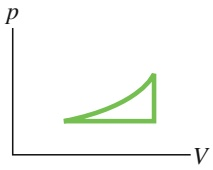

(1)

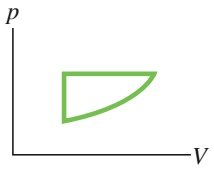

(2)

Abb. 14.F5

Fragen 5 und 6.

**6.** Für welchen der Kreisprozesse in Abb. 14.F5 ist (a) W größer und (b) Q größer, wenn der Prozess im Uhrzeigersinn durchlaufen wird?
**7.** Abbildung 14.F7 zeigt eine Verbundplatte aus drei verschiedenen Materialien A, B und C mit gleicher Dicke und Wärmeleitfähigkeiten $\lambda _ { \mathrm { b } } > \lambda _ { \mathrm { a } } > \lambda _ { \mathrm { c } } .$ Der Energiefluss durch die Platte sei von null verschieden, allerdings gleichförmig (es herrsche ein Fließgleichgewicht). Ordnen Sie die Materialien in absteigender Reihenfolge nach den Temperaturunterschieden ΔT zwischen ihren Seitenwänden.

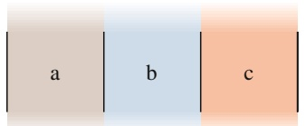

text_image

a
b
c

Abb. 14.F7

**8.** Wenn ein Eiszapfen wächst, ist seine äußere Oberflä- che von einem dünnen Mantel aus flüssigem Wasser überzogen, das langsam an dem Zapfen herunterfließt und an der Spitze des Eiszapfens in regelmäßigen Abständen Tropfen bildet (Abb. 14.F8). Innerhalb des Eiszapfens bleibt eine dünne Röhre aus flüssigem Wasser, die sich nach oben erstreckt (allerdings nicht ganz bis zur Wurzel). Wenn das Wasser an der oberen Spitze der Röhre langsam gefriert, wird Energie frei. Wird diese Energie radial durch das Eis nach außen oder nach unten durch das Wasser bis zum hängenden Tropfen oder nach oben in Richtung der Wurzel geleitet? (Nehmen Sie eine Außentemperatur der Luft von unter 0 °C an.)

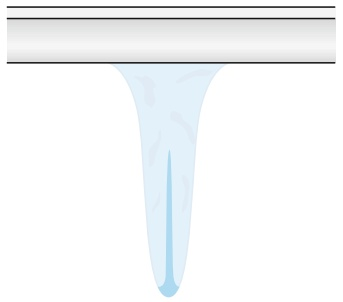

natural_image

Illustration of a funnel-shaped object with a light blue liquid, no text or symbols present

Abb. 14.F8

**9.** Die folgenden Festkörper (alle aus demselben Material) werden innerhalb einer Umgebungstemperatur von 350 K auf einer Temperatur von 300 K gehalten: ein Quader der Länge r, eine Kugel vom Radius r und eine Halbkugel vom Radius r. Ordnen Sie die Gegenstände nach der Rate, mit der sie Wärmestrahlung mit der Umgebung austauschen (größte Werte zuerst).
**10.** Drei Körper aus verschiedenen Materialien mit identischer Masse werden nacheinander in eine besondere Kühlkammer gestellt, in der sie mit einer konstanten Rate thermische Energie verlieren. Im Verlauf der Abkühlung beginnt jedes Material im flüssigen Zustand und endet im festen Zustand. Abbildung 14.F10 zeigt den Verlauf der Temperatur T als Funktion der Zeit t für die drei Materialien. (a) Ist die spezifische Wärme für den flüssigen Zustand von Material 1 größer oder kleiner als die für seinen festen Zustand? Ordnen Sie die Materialien in absteigender Reihenfolge (b) nach ihrem Gefrierpunkt, (c) ihrer spezifischen Wärme im flüssigen Zustand, (d) ihrer spezifischen Wärme im festen Zustand und (e) ihrer Schmelzwärme (in allen Fällen größte Werte zuerst).

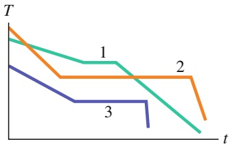

line

| Time (t) | Series 1 (T) | Series 2 (T) | Series 3 (T) |
| --- | --- | --- | --- |
| Start | High | High | Medium |
| Mid-1 | Medium | Low | Low |
| Mid-2 | Medium | Low | Low |
| End | Low | Low | — |

Abb. 14.F10

**11.** Eine Probe A flüssigen Wassers und eine zweite Probe B aus Eis, beide mit gleicher Masse, befinden sich gemeinsam in einem wärmeisolierten Behälter und erreichen ein thermisches Gleichgewicht. In Abb. 14.F11a ist der Temperaturverlauf T der beiden Proben gegen die Zeit t aufgetragen. (a) Liegt die Gleichgewichtstemperatur oberhalb, unterhalb oder am Gefrierpunkt von Wasser? (b) Was geschieht mit der flüssigen Probe, bevor das Gleichgewicht erreicht wird: Gefriert sie teilweise, gefriert sie vollständig oder gefriert sie gar nicht? (c) Schmilzt das Eis teilweise, vollständig oder gar nicht?

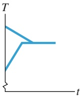

(a)

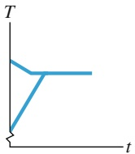

(b)

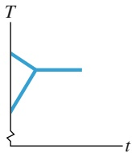

(c)

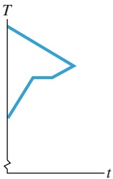

natural_image

Simple geometric line diagram with labeled axes T and t, no text or symbols present

(d)

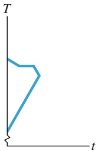

natural_image

Simple geometric line drawing with a triangle and a vertical axis labeled T, no text or symbols present.

(e)

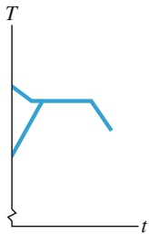

line

| Time (t) | T |
| --- | --- |
| 0 | High |
| ~1 | Low |
| ~2 | Medium |
| ~4 | Medium |
| ~6 | Medium |
| ~8 | Medium |
| ~9 | Low |

(f)

Abb. 14.F11

Fragen 11 und 12.

**12.** In Abb. 14.F11b bis f sind weitere Temperaturverläufe T als Funktion der Zeit t angegeben, von denen einer oder mehrere sich nicht realisieren lassen. (a) Welche der Skizzen sind nicht realisierbar und weshalb? (b) Befindet sich bei den möglichen Skizzen die Gleichgewichtstemperatur oberhalb des Gefrierpunkts, unterhalb des Gefrierpunkts oder am Gefrierpunkt von Wasser? (c) Was geschieht, bis dort das Gleichgewicht erreicht wird: Gefriert die flüssige Probe vollständig, teilweise oder gar nicht? Schmilzt das Eis vollständig, teilweise oder gar nicht?
**13.** Eine Experimentatorin taucht ein heißes Objekt in einen wärmeisolierten Behälter mit Wasser und wartet dann ab, bis der Gegenstand und das Wasser sich im thermischen Gleichgewicht befinden. Anschließend wiederholt sie das Experiment zweimal mit jeweils einem anderen Objekt. Alle drei Objekte haben gleiche Masse und Anfangstemperatur, und auch Masse und Anfangstemperatur des Wassers sind in allen drei Experimenten gleich. Abbildung 14.F13 zeigt Graphen der Temperatur T der Objekte und des Wassers als Funktion der Zeit t für alle drei Experimente. Ordnen Sie die Diagramme in absteigender Reihenfolge nach der spezifischen Wärme der Objekte.

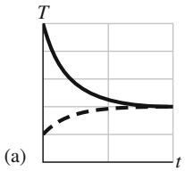

line

| t | T (Solid Line) | T (Dashed Line) |
| --- | --- | --- |
| 0 | High | Low |
| ~1 | Decreasing | Increasing |
| ~2 | Low | High |
| ~3 | Low | High |
| ~4 | Low | High |
| ~5 | Low | High |
| ~6 | Low | High |
| ~7 | Low | High |
| ~8 | Low | High |
| ~9 | Low | High |
| ~10 | Low | High |

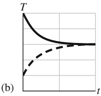

line

| t | T (Solid Line) | T (Dashed Line) |
| --- | --- | --- |
| 0 | High | Low |
| ~1 | Medium-High | Medium-Low |
| ~2 | Medium | Medium |
| ~3 | Medium-Low | Medium-Low |
| ~4 | Low | Low |
| ~5 | Low | Low |

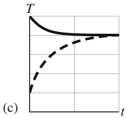

line

| t | T (Solid Line) | T (Dashed Line) |
| --- | --- | --- |
| 0 | High | Low |
| ~1 | Medium-High | Medium |
| ~2 | Medium-Low | Medium-High |
| ~3 | Low | High |
| ~4 | Low | High |
| ~5 | Low | High |

Abb. 14.F13

# 15 Die kinetische Gastheorie

## 15.1 Ein neuer Blick auf Gase

## Physikalische Motivation

Die klassische Thermodynamik – das Thema des letzten Kapitels – sagt nichts über Atome aus. Ihre Gesetze beziehen sich ausschließlich auf makroskopische Variablen wie Druck, Volumen und Temperatur. Wir wissen aber, dass ein Gas aus umherfliegenden Atomen oder Molekülen, d.h. Gruppen von miteinander verbundenen Atomen besteht. Der Druck eines Gases muss irgendetwas mit den Stößen dieser (sub-)mikroskopischen Teilchen gegen die Wände des Behälters zu tun haben. Die Fähigkeit eines Gases, einen Behälter vollständig auszufüllen, hat sicherlich etwas mit der freien Beweglichkeit seiner Atome oder Moleküle zu tun, und die Temperatur und die innere Energie eines Gases hängen irgendwie mit deren kinetischer Energie zusammen. Wir können daher neue Einsichten in das Verhalten von Gasen gewinnen, wenn wir sie unter diesem Blickwinkel betrachten. Diesen „mikroskopischen“ Zugang bezeichnet man als die **kinetische Gastheorie**; sie ist das Thema dieses Kapitels.

Es gibt unzählige praktische Anwendungen der kinetischen Gastheorie. Ingenieure in der Automobilbranche beschäftigen sich mit der Verbrennung von verdampftem Kraftstoff (einem Gas) in den Zylindern der Verbrennungsmotoren. In der Lebensmittelindustrie ist die Geschwindigkeit der Entstehung von Gärgasen ein wichtiges Thema, da sie Backwaren aufgehen lassen. Getränkehersteller wollen verstehen, wie Gase eine Blume auf ein Glas Bier zaubern oder einen Korken schwungvoll aus einer Sektflasche schießen lassen. Mediziner und Physiologen wollen berechnen, wie lange ein Taucher beim Aufstieg pausieren muss, um Stickstoffgas aus seinem Blutkreislauf zu entfernen und sich so vor der gefürchteten Taucherkrankheit zu schützen. Umweltforscher beschäftigen sich damit, wie der Wärmeaustausch zwischen Ozeanen und Atmosphäre das Klima beeinflusst.

Der erste Schritt in unserer Diskussion der kinetischen Theorie der Gase beschäftigt sich damit, die Gasmenge in einer Probe zu bestimmen – hier kommt die Avogadro-Konstante ins Spiel.

## 15.1.1 Die Avogadro-Konstante

Wenn wir Atome oder Moleküle zur Grundlage unserer Vorstellungen machen, ist es sinnvoll, die Menge einer Substanz in Mol anzugeben. In diesem Fall können wir sicher sein, dass wir immer Proben mit derselben Anzahl von Atomen oder Molekülen miteinander vergleichen. Das Mol ist eine der sieben SI-Basiseinheiten und als Kehrwert der exakt festgelegten Avogadro-Konstanten (siehe unten) definiert:

Ein Mol ist die Stoffmenge eines Systems, bei dem die Zahl der Einzelteilchen durch die fundamentale Avogadro-Konstante $N _ { \mathrm { A } } = 6 { , } 0 2 \cdot 1 0 ^ { 2 3 }$ gegeben ist.

Die Avogadro-Konstante gibt also die Zahl der Atome oder Moleküle in einem Mol an, sie beträgt, wie wir schon Kapitel 14 gesehen haben,

$$
N _ {\mathrm{A}} = 6, 0 2 \cdot 1 0 ^ {2 3} \mathrm{mol} ^ {- 1} \quad (\text {Avogadro - Konstante}). \tag {15.1}
$$

„mol“ ist das Einheitenzeichen für die SI-Basiseinheit „Mol“. Der Name der Konstanten $N _ { \mathrm { A } }$ geht auf den italienischen Wissenschaftler Amadeo Avogadro (1776–1856) zurück, von dem die Idee stammt, dass alle Gase dieselbe Anzahl von Atomen oder Molekülen enthalten, wenn sie unter denselben Temperatur- und Druckbedingungen dasselbe Volumen einnehmen. In der älteren deutschen Literatur findet man für $N _ { \mathrm { A } }$ manchmal auch noch die Bezeichnung **Loschmidt-Zahl**.

Die Stoffmenge n in einer Substanzprobe ist gleich dem Verhältnis aus der Anzahl der Moleküle N in der Probe zur Anzahl der Moleküle in 1 mol, also

$$
n = \frac {N}{N _ {\mathrm{A}}} . \tag {15.2}
$$

(Achtung: Die drei ähnlichen Symbole in dieser Gleichung können leicht zu Verwirrung führen, daher sollte man sich ihre jeweilige Bedeutung genau vor Augen halten, bevor man alle N’s durcheinander wirft.) Wir erhalten die Stoffmenge in einer Probe auch aus der Masse $M _ { \mathrm { P r o b e } }$ der Probe und entweder der Molmasse M (der Masse von 1 mol der Substanz) oder der Molekülmasse m (der Masse eines Moleküls dieser Substanz):

$$
n = \frac {M _ {\mathrm{Probe}}}{M} = \frac {M _ {\mathrm{Probe}}}{m N _ {\mathrm{A}}} . \tag {15.3}
$$

In dieser Gleichung haben wir ausgenutzt, dass die Masse M von 1 mol gleich dem Produkt aus der Masse m eines einzelnen Moleküls und der Anzahl der Moleküle in 1 mol ist:

$$
M = m N _ {\mathrm{A}}. \tag {15.4}
$$

## LÖSUNGSSTRATEGIEN

**Strategie 1: Die Einheit der Avogadro-Konstante** In Gl. 15.1 haben wir die Avogadro-Konstante in der Einheit $\mathrm { m o l ^ { - 1 } }$ ausgedrückt, also dem inversen Mol oder 1/mol. Stattdessen können wir auch explizit die elementare Einheit in einer gegebenen Situation angeben. Beispielsweise können wir schreiben: $N _ { \mathrm { A } } =$ $6 { , } 0 2 \cdot \widetilde { 1 0 ^ { 2 3 } }$ Atome∕mol, wenn es sich bei der elementaren Einheit um ein Atom handelt. Handelt es sich um ein Molekül, können wir schreiben: $N _ { \mathrm { A } } = 6 { , } 0 2 \cdot 1 0 ^ { 2 3 }$ Moleküle∕mol.

Für die kinetische Gastheorie ist es übrigens unerheblich, ob die kleinsten Teilchen Moleküle oder Atome sind, weswegen wir im Rest dieses Kapitel meistens der Einfachheit halber „Molekül“ schreiben, damit aber „Molekül oder Atom“ meinen werden.

## 15.2 Ideale Gase

## Lernziele

Nach dem Durcharbeiten dieses Abschnitts sollten Sie in der Lage sein, . . .

• zu erläutern, warum ein ideales Gas ideal genannt wird,
• eine der beiden Formen des idealen Gasgesetzes anzuwenden, entweder mit der Stoffmenge n oder der Molekülzahl N,
• den Zusammenhang zwischen der allgemeinen Gaskonstante R und der Boltzmann-Konstante k anzugeben,
• zu verstehen, dass die Temperatur im idealen Gasgesetz in Kelvin angegeben werden muss,

• pV-Diagramme für die Expansion oder Kompression eines Gases bei konstanter Temperatur zu skizzieren,
• zu verstehen, was eine Isotherme ist,
• die von einem Gas bei einer isothermen Expansion oder Kompression verrichtete Arbeit zu berechnen (einschließlich des Vorzeichens),
• zu verstehen, dass die Änderung $\Delta E$ der inneren Energie eines idealen Gases bei isothermen Prozessen null ist und folglich die dabei als Wärme übertragene Energie $Q$ gleich der verrichteten Arbeit $\bar { W }$ ist,
• einen Prozess bei konstantem Volumen im $p V \cdot$ Diagramm zu skizzieren und die dabei verrichtete Arbeit aus der Fläche unter der Kurve zu bestimmen,
• einen Prozess bei konstantem Druck im $p V$ -Diagramm zu skizzieren und die dabei verrichtete Arbeit aus der Fläche unter der Kurve zu bestimmen.

## Schlüsselideen

• Ein ideales Gas ist ein Gas, dessen Druck $p ,$ Volumen V und Temperatur $T$ die Beziehung

$$
p V = n R T
$$

erfüllen, mit der Stoffmenge n des Gases und der allgemeinen Gaskonstante $R = 8 , 3 1 4 \mathrm { J } / ( \mathrm { m o l } \cdot \mathrm { K } ) .$

• Das ideale Gasgesetz kann auch in der Form

$$
p V = N k T
$$

geschrieben werden, wobei

$$
k = \frac {R}{N _ {\mathrm{A}}} = 1, 3 8 \cdot 1 0 ^ {- 2 3} \mathrm{J/K}
$$

die Boltzmann-Konstante ist.

• Die von einem idealen Gas bei einer isothermen, d.h. bei konstanter Temperatur ablaufenden Volumenänderung von $V _ { \mathrm { i } }$ nach $V _ { \mathrm { f } }$ verrichtete Arbeit beträgt

$$
W = n R T \ln \frac {V _ {\mathrm{f}}}{V _ {\mathrm{i}}}.
$$

## 15.2.1 Ideale Gase

Unser Ziel in diesem Abschnitt ist, die makroskopischen Eigenschaften eines Gases – beispielsweise seinen Druck und seine Temperatur – durch das Verhalten der Moleküle dieses Gases zu erklären. Es ergibt sich jedoch sofort ein Problem: Von welchem Gas sprechen wir? Soll es sich um Wasserstoff oder Sauerstoff, Methan oder vielleicht gar um verdampftes Uranhexafluorid handeln? Sie alle verhalten sich unterschiedlich. Im Experiment hat sich jedoch herausgestellt, dass man für 1 mol irgendeines Gases, eingeschlossen in Behältern von gleichem Volumen und bei der gleichen Temperatur, nahezu – wenn auch nicht exakt – denselben Druck misst. Wiederholt man das Experiment bei niedrigeren Gasdichten, so werden die Unterschiede im gemessenen Gasdruck kleiner und scheinen im Grenzfall sehr kleiner Gasdichten ganz zu verschwinden. Weitere Experimente haben gezeigt, dass bei genügend kleinen Dichten alle Gase die Beziehung

$$
p V = n R T k \quad (\text {ideales Gasgesetz}) \tag {15.5}
$$

mit hoher Genauigkeit erfüllen, wobei $p$ den absoluten Druck (nicht Über- oder Unterdruck), n die Stoffmenge des vorhandenen Gases und $T$ die Temperatur in Kelvin bezeichnen. Das Symbol R steht für die sogenannte **allgemeine Gaskonstante**, die für alle Gase denselben Wert hat:

$$
R = 8, 3 1 \mathrm{J} / (\mathrm{mol} \cdot \mathrm{K}). \tag {15.6}
$$

Gleichung 15.5 bezeichnet man als das **ideale Gasgesetz** oder genauer als **Zustandsgleichung idealer Gase**. Ist die Dichte klein genug, gilt dieses Gesetz für jedes reine Gas oder auch jedes Gemisch von verschiedenen Gasen. (Für ein Gemisch von Gasen ist n die gesamte Stoffmenge in dem Gemisch.)

Wir können Gl. 15.5 auch mit der **Boltzmann-Konstante** $k$ formulieren, die als

$$
k = \frac {R}{N _ {\mathrm{A}}} = \frac {8 , 3 1 \mathrm{J/(mol} \cdot \mathrm{K)}}{6 , 0 2 \cdot 1 0 ^ {2 3} \mathrm{mol} ^ {- 1}} = 1, 3 8 \cdot 1 0 ^ {- 2 3} \mathrm{J/K} \tag {15.7}
$$

definiert ist. Mit $R = k N _ { \mathrm { A } }$ und Gl. 15.2 $\left( n = N / N _ { \mathrm { A } } \right)$ folgt dann

$$
n R = N k. \tag {15.8}
$$

Setzen wir diese Relation in Gl. 15.5 ein, erhalten wir die zweite Form des idealen Gasgesetzes:

$$
p V = N k T \quad (\text {ideales Gasgesetz}). \tag {15.9}
$$

(Beachten Sie, dass in Gl. 15.5 die Stoffmenge n, in Gl. 15.9 dagegen die Molekülzahl N steht.)

An dieser Stelle liegt die Frage nahe: „Was ist eigentlich so ‚ideal‘ an einem idealen Gas?“ Die Antwort liegt in der einfachen Form des Gesetzes (Gl. 15.5 bzw. 15.9), das die makroskopischen Eigenschaften dieses Gases beschreibt. Wie wir noch sehen werden, lassen sich aus dieser Beziehung viele Eigenschaften eines idealen Gases sehr einfach ableiten. Obwohl es in der Natur so etwas wie ein wirklich ideales Gas nicht gibt, nähern sich alle Gase diesem idealen Zustand bei genügend kleinen Dichten und hohen Temperaturen – also unter Bedingungen, bei denen die Moleküle so weit voneinander entfernt sind, dass sie untereinander keine Wechselwirkungen mehr haben. Die Theorie idealer Gase erlaubt uns so einfache wie nützliche Einsichten in das Grenzverhalten wirklicher Gase.

## Die von einem idealen Gas bei konstanter Temperatur geleistete Arbeit

Angenommen, wir füllen ein ideales Gas in eine Anordnung aus einem Zylindergefäß und einem Kolben wie in Kapitel 14. Weiterhin nehmen wir an, dass sich das Gas von einem Anfangsvolumen $V _ { \mathrm { i } }$ auf ein Endvolumen $V _ { \mathrm { f } }$ ausdehnen kann, wobei wir die Temperatur des Gases konstant halten. Einen solchen Prozess bei konstanter Temperatur bezeichnet man als **isotherme Expansion** (der umgekehrte Prozess heißt **isotherme Kompression**).

Im pV-Diagramm nennt man eine Kurve, die Punkte derselben Temperatur miteinander verbindet, eine Isotherme. Es handelt sich also um eine Kurve, bei der für ein Gas bei konstanter Temperatur $T$ der Druck gegen das Volumen aufgetragen ist. Für n mol eines idealen Gases genügt diese Kurve der Gleichung

$$
p = n R T \frac {1}{V} = \text {const.} \cdot \frac {1}{V}. \tag {15.10}
$$

Abbildung 15.1 zeigt drei Isothermen, die jeweils einem anderen (konstanten) Wert von $T$ entsprechen. (Man beachte, dass die Temperatur von links unten nach rechts oben zunimmt.) Auf der mittleren Isotherme ist ein Pfad markiert, dem ein Gas im Verlauf einer isothermen Expansion bei 310 K von einem initialen Zustand i zum finalen Zustand f folgt.

Die von einem idealen Gas bei einem isothermen Prozess verrichtete Arbeit erhalten wir aus Gl. 14.20:

$$
W = \int_ {V _ {\mathrm{i}}} ^ {V _ {\mathrm{f}}} p \mathrm{d} V. \tag {15.11}
$$

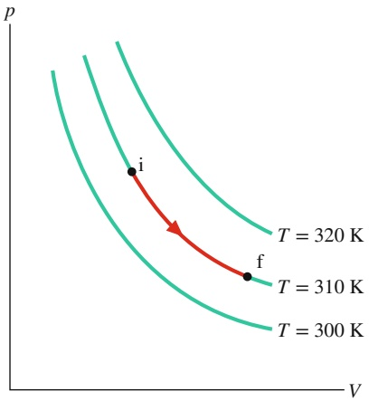

contour

| Point | Temperature (K) |
| --- | --- |
| i | 320 |
| f | 310 |

Abb. 15.1

Drei Isothermen in einem pV-Diagramm. Der Pfad entlang der mittleren Isotherme entspricht einer isothermen Expansion eines Gases von einem Anfangszustand i zu einem Endzustand f. Der Weg von f nach i entlang derselben Isotherme entspräche dem umgekehrten Prozess, also einer isothermen Kompression.

Dies ist ein allgemeiner Ausdruck für die Arbeit eines Gases bei einer Volumenänderung. Für ein ideales Gas können wir $p$ mithilfe von Gl. 15.5 ersetzen:

$$
W = \int_ {V _ {\mathrm{i}}} ^ {V _ {\mathrm{f}}} \frac {n R T}{V} \mathrm{d} V. \tag {15.12}
$$

Da es sich um eine isotherme Expansion handelt, ist $T$ konstant; wir können es mit den anderen Konstanten vor das Integralzeichen ziehen und erhalten:

$$
W = n R T \int_ {V _ {\mathrm{i}}} ^ {V _ {\mathrm{f}}} \frac {\mathrm{d} V}{V} = n R T \left[ \ln V \right] _ {V _ {\mathrm{i}}} ^ {V _ {\mathrm{f}}}. \tag {15.13}
$$

Die Auswertung des Ausdrucks in den eckigen Klammern an den Grenzen ergibt, zusammen mit der Beziehung ln $a - \ln b = \ln ( a / b ) ,$ , das gesuchte Ergebnis:

$$
W = n R T \ln \frac {V _ {\mathrm{f}}}{V _ {\mathrm{i}}} \quad (\text {ideales Gas, isothermer Prozess}). \tag {15.14}
$$

(Das Symbol ln steht für den natürlichen Logarithmus, also den Logarithmus zur Basis e.)

Bei einer Expansion ist $V _ { \mathrm { f } }$ größer als $V _ { \mathrm { i } } ,$ das Verhältnis $V _ { \mathrm { f } } / V _ { \mathrm { i } }$ in Gl. 15.14 ist dann größer als eins. Der natürliche Logarithmus einer Zahl größer als eins ist positiv, also ist auch die von dem Gas bei einer isothermen Expansion geleistete Arbeit positiv, wie wir es erwarten würden. Bei einer Kompression ist $V _ { \mathrm { f } }$ kleiner als $V _ { \mathrm { i } } ,$ d. h., das Verhältnis der Volumina in Gl. 15.14 ist kleiner als eins. In diesem Fall wird der natürliche Logarithmus in obiger Gleichung – und somit auch die Arbeit $W -$ negativ, wiederum wie erwartet.

## Die bei konstantem Volumen bzw. konstantem Druck geleistete Arbeit

Gleichung 15.14 liefert uns die von einem idealen Gas geleistete Arbeit nicht für jeden thermodynamischen Prozess, sondern nur für einen Prozess bei konstanter Temperatur. Verändert sich die Temperatur im Verlauf eines Prozesses, kann die Größe T in Gl. 15.12 nicht mehr vor das Integral gezogen werden wie in Gl. 15.13 und wir erhalten für die geleistete Arbeit nicht mehr Gl. 15.14.

Wir können aber zu Gl. 15.11 zurückkehren und die von einem idealen Gas geleistete Arbeit W noch für zwei andere Prozesse bestimmen: einen Prozess bei festgehaltenem Volumen und einen Prozess bei konstantem Druck. Bleibt das Volumen eines Gases konstant, folgt aus Gl. 15.11

$$
W = 0 \quad (\text {Prozess bei konstantem Volumen}). \tag {15.15}
$$

Ist stattdessen zwar das Volumen variabel, der Druck p des Gases jedoch konstant, so folgt aus Gl. 15.11

$$
W = p (V _ {\mathrm{f}} - V _ {\mathrm{i}}) = p \Delta V \qquad (\text {Prozess bei konstantem Druck}). \tag {15.16}
$$

## KONTROLLFRAGE 1

Ein ideales Gas habe einen Anfangsdruck von 3 Druckeinheiten und ein Anfangsvolumen von 4 Volumeneinheiten. Die Tabelle gibt für fünf Prozesse den Druck und das Volumen des Endzustands (in denselben Einheiten) an. Welche Prozesse beginnen und enden auf derselben Isotherme?

|  | a | b | c | d | e |
| --- | --- | --- | --- | --- | --- |
| p | 12 | 6 | 5 | 4 | 1 |
| V | 1 | 2 | 7 | 3 | 12 |

## 15.3 Druck, Temperatur und gemittelte Geschwindigkeiten

## Lernziele

Nach dem Durcharbeiten dieses Abschnitts sollten Sie in der Lage sein, . . .

• zu verstehen, dass der Druck auf die Wände eines Behälters, in dem sich ein Gas befindet, aus den Stößen der Gasmoleküle mit den Behälterwänden resultiert,
• den Zusammenhang zwischen dem Druck auf die Wand eines Behälters und dem Impuls der Gasmoleküle in dem Behälter sowie dem Zeitintervall zwischen ihren Stößen gegen die Behälterwand anzugeben,
• für die Moleküle eines idealen Gases den Zusammenhang zwischen der quadratisch gemittelten Geschwindigkeit $\nu _ { \mathrm { r m s } }$ und der mittleren Geschwindigkeit $\nu _ { \mathrm { g e m } }$ anzugeben,
• den Zusammenhang zwischen dem Druck p eines idealen Gases und der quadratisch gemittelten Geschwindigkeit $\nu _ { \mathrm { r m s } }$ seiner Moleküle anzugeben,
• den Zusammenhang zwischen der Temperatur T eines idealen Gases und der quadratisch gemittelten Geschwindigkeit $\nu _ { \mathrm { r m s } }$ sowie der Molmasse M seiner Moleküle anzugeben.

## Schlüsselideen

• Der von n mol eines idealen Gases ausgeübte Druck lässt sich als Funktion der Geschwindigkeit seiner Moleküle wie folgt schreiben:

$$
p = \frac {n M \nu_ {\mathrm{rms}} ^ {2}}{3 V}, \quad \text {wobei} \quad \nu_ {\mathrm{rms}} = \sqrt {(\nu^ {2}) _ {\mathrm{gem}}}
$$

die quadratisch gemittelte („root-mean-square-“) Geschwindigkeit der Molekü- le ist, M ihre Molmasse und V das Volumen des Gases.

• Die quadratisch gemittelte Geschwindigkeit hängt wie folgt von der Temperatur des Gases ab:

$$
\nu_ {\mathrm{rms}} = \sqrt {\frac {3 R T}{M}}.
$$

## 15.3.1 Druck, Temperatur und Mittelwerte von Geschwindigkeiten

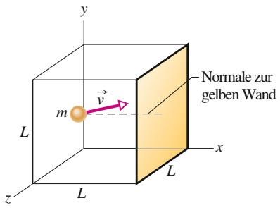

text_image

Normale zur
gelben Wand
y
v
m
L
x
L
z
L

Abb. 15.2

Ein Würfel der Länge L enthalte n mol eines idealen Gases. Ein Molekül der Masse m und Geschwindigkeit v⃗ fliegt auf die gelbe Wand der Fläche $L ^ { 2 ^ { - } }$ zu. Eingezeichnet ist auch eine Senkrechte zu dieser Wand.

Es folgt unsere erste Berechnung im Rahmen der kinetischen Gastheorie. n mol eines idealen Gases befinden sich in einem Würfel vom Volumen V wie in Abb. 15.2. Welche Beziehung besteht zwischen dem von dem Gas auf die Würfelwände ausgeübten Druck $p$ und der Geschwindigkeit der Moleküle?

Die Gasmoleküle in dem Würfel bewegen sich mit unterschiedlichen Geschwin digkeiten in alle Richtungen, stoßen gegeneinander und prallen von den Würfelwänden ab wie die Bälle in einem Squash-Court. Für den Augenblick lassen wir die Stöße der Moleküle untereinander unberücksichtigt und betrachten nur die elastischen Stöße mit den Wänden.

In Abb. 15.2 erkennt man ein typisches Gasmolekül mit der Masse m und der Geschwindigkeit v⃗, das auf die gelbe Wand zufliegt. Da wir die Stöße der Moleküle mit den Wänden als elastisch ansehen, ist die einzige Geschwindigkeitskomponente, die sich bei einem Stoß des Moleküls gegen die Wand ändert, die x-Komponente, und diese Komponente dreht ihr Vorzeichen um. Die einzige Änderung im Impuls des Teilchens erfolgt also entlang der x-Achse und ist durch

$$
\Delta p _ {x} = (- m \nu_ {x}) - (m \nu_ {x}) = - 2 m \nu_ {x}
$$

gegeben. Der von dem Teilchen bei dem Stoß auf die Wand übertragene Impuls $\Delta p _ { x }$ ist daher $+ 2 m \nu _ { x } .$ . (Da in der Physik das Symbol $\scriptstyle { \boldsymbol { p } } ^ { \alpha }$ leider sowohl für den

Impuls als auch den Druck verwendet wird, muss man an dieser Stelle vorsichtig sein. Ohne Vektorpfeil oder Komponentenindex bezeichnet der Buchstabe $p$ in diesem Kapitel den Druck. In obiger Beziehung ist daher der Impuls gemeint.)

Das Molekül aus Abb. 15.2 trifft mehrfach auf die gelbe Wand. Die Zeit Δt zwischen zwei solchen Stößen ist gleich der von dem Molekül benötigten Zeit, um mit der Geschwindigkeit $\nu _ { x }$ zur gegenüberliegenden Wand und wieder zurück (ein Abstand von 2L) zu fliegen. Also ist $\Delta t$ gleich $2 L / \nu _ { x } .$ . (Dieses Ergebnis bleibt richtig, auch wenn die Moleküle auf ihrem Weg gegen die anderen Wände stoßen, da diese Wände parallel zur x-Richtung verlaufen und daher die Geschwindigkeitskomponente $\nu _ { x }$ nicht verändern.) Die mittlere Rate, mit der von diesem einen Molekül Impuls auf die schraffierte Wand übertragen wird, ist daher

$$
\frac {\Delta p _ {x}}{\Delta t} = \frac {2 m \nu_ {x}}{2 L / \nu_ {x}} = \frac {m \nu_ {x} ^ {2}}{L}.
$$

Nach dem zweiten Newtonschen Gesetz $( \vec { F } = \mathrm { d } \vec { p } / \mathrm { d } t )$ ist die Rate, mit der Impuls auf die Wand übertragen wird, gleich der Kraft auf diese Wand. Zur Berechnung der Gesamtkraft müssen wir die Beiträge aller Moleküle aufsummieren und dabei auch die Möglichkeit zulassen, dass diese unterschiedliche Geschwindigkeiten haben. Teilen wir dann die Gesamtkraft $F _ { x }$ noch durch die Wandfläche $( = \bar { L } ^ { 2 } )$ , erhalten wir den Druck $p$ auf die Wand. Mit dem obigen Ausdruck für $\Delta p _ { x } / \Delta t$ folgt für diesen Druck (von nun an steht $p$ für den Druck):

$$
\begin{array}{l} p = \frac {F _ {x}}{L ^ {2}} = \frac {m v _ {x 1} ^ {2} / L + m v _ {x 2} ^ {2} / L + \cdots + m v _ {x N} ^ {2} / L}{L ^ {2}} \\ = \left(\frac {m}{L ^ {3}}\right) \left(\nu_ {x 1} ^ {2} + \nu_ {x 2} ^ {2} + \dots + \nu_ {x N} ^ {2}\right), \tag {15.17} \\ \end{array}
$$

wobei N gleich der Anzahl der Moleküle in dem Würfel ist.

Wegen $N = n N _ { \mathrm { A } }$ gibt $\mathrm { e s   n } N _ { \mathrm { A } }$ Terme in der zweiten Klammer von Gl. 15.17. Wir können diesen Ausdruck durch $n N _ { \mathrm { A } } ( \nu _ { x } ^ { 2 } ) _ { \mathrm { g e m } }$ ersetzen, wobei $( \nu _ { x } ^ { 2 } ) _ { \mathrm { g e m } }$ den gemittelten Wert (den Mittelwert) der Quadrate der x-Komponenten aller Molekülgeschwindigkeiten bezeichnet. Damit wird aus Gl. 15.17

$$
p = \frac {n m N _ {\mathrm{A}}}{L ^ {3}} \left(\nu_ {x} ^ {2}\right) _ {\mathrm{gem}}.
$$

m $N _ { \mathrm { A } }$ ist aber die Molmasse M des Gases (also die Masse von 1 mol des Gases). Außerdem ist $L ^ { 3 }$ das Volumen des Würfels, d. h.

$$
p = \frac {n M \left(\nu_ {x} ^ {2}\right) _ {\mathrm{gem}}}{V}. \tag {15.18}
$$

Für jedes Molekül gilt $\nu ^ { 2 } = \nu _ { x } ^ { 2 } + \nu _ { y } ^ { 2 } + \nu _ { z } ^ { 2 }$ . Da es sehr viele Moleküle gibt und sie sich alle in zufällige Richtungen bewegen, sind die Mittelwerte der Quadrate ihrer Geschwindigkeitskomponenten gleich, sodass $\begin{array} { r } { \nu _ { x } ^ { 2 } = \frac { 1 } { 3 } \nu ^ { 2 } } \end{array}$ ist. Damit wird aus Gl. 15.18

$$
p = \frac {n M (\nu^ {2}) _ {\mathrm{gem}}}{3 V}. \tag {15.19}
$$

Die Wurzel aus $( \nu ^ { 2 } ) _ { \mathrm { g e m } }$ ist eine gemittelte Geschwindigkeit der Moleküle, genauer die Wurzel aus dem Mittelwert der Geschwindigkeitsquadrate, und wird als quadratisch gemittelte Geschwindigkeit $\nu _ { \mathrm { r m s } }$ bezeichnet (von englisch „root mean square“). Die Vorschrift ist einfach: Man quadriere jede Geschwindigkeit, berechne den Mittelwert (also den Durchschnitt) all dieser quadrierten Geschwindigkeiten, und nehme schließlich die Wurzel aus diesem Mittelwert. Wenn wir den Unterschied zwischen quadratisch gemittelten Geschwindigkeit $\nu _ { \mathrm { r m s } }$ und der mittleren Geschwindigkeit $\nu _ { \mathrm { g e m } }$ (dem Mittelwert aus den Geschwindigkeitsbeträgen) betonen wollen, bezeichnen wir $\nu _ { \mathrm { r m s } }$ auch als rms-Geschwindigkeit. Mit $( \nu ^ { 2 } ) _ { \mathrm { g e m } } ^ { 0 , 5 } = \nu _ { \mathrm { r m s } }$ können wir Gl. 15.19 in der Form

$$
p = \frac {n M v _ {\mathrm{rms}} ^ {2}}{3 V} \tag {15.20}
$$

schreiben. Diese Gleichung entspricht ganz dem Geist der kinetischen Gastheorie. Es wird hier eine Beziehung zwischen dem Druck eines Gases (einer rein makroskopischen Größe) und der Geschwindigkeit der Moleküle (einer rein mikroskopischen Größe) hergestellt.

Wir können über Gl. 15.20 auch umgekehrt $\nu _ { \mathrm { r m s } }$ berechnen. Nutzen wir außerdem noch die ideale Gasgleichung $( p V = n R T )$ aus, so erhalten wir

$$
\nu_ {\mathrm{rms}} = \sqrt {\frac {3 R T}{M}}. \tag {15.21}
$$

In Tab. 15.1 sind einige nach Gl. 15.21 berechnete rms-Geschwindigkeiten zusammengestellt. Die Geschwindigkeiten sind überraschend hoch. Für Wasserstoffmoleküle bei Zimmertemperatur (300 K) ist $\nu _ { \mathrm { r m s } } = 1 9 2 0   \mathrm { m / s }$ oder 6912 km/h – schneller als eine Gewehrkugel! Auf der Sonnenoberfläche mit einer Temperatur von rund 5800 K wäre die quadratisch gemittelte Geschwindigkeit der Wasserstoffmoleküle etwa 80-mal größer als bei Zimmertemperatur, allerdings überleben die Moleküle die Zusammenstöße untereinander bei solch hohen Geschwindigkeiten nicht. Außerdem muss man sich vor Augen halten, dass es sich bei $\nu _ { \mathrm { r m s } }$ nur um eine Art Durchschnittsgeschwindigkeit handelt; manche Moleküle bewegen sich wesentlich schneller, einige aber auch viel langsamer.

Die quadratisch gemittelte Geschwindigkeit der Moleküle in dem Gas hängt eng mit dessen Schallgeschwindigkeit zusammen. Bei einer Schallwelle wird die Druckänderung im Prinzip durch Stoßprozesse zwischen den Molekülen übertragen. Die Welle kann sich auf keinen Fall schneller bewegen als die quadratisch gemittelte Geschwindigkeit der Moleküle. Tatsächlich muss die Schallgeschwindigkeit etwas kleiner sein, da sich nicht alle Moleküle in genau dieselbe Richtung wie die Welle bewegen. Als Beispiel betrachten wir die quadratisch gemittelten Geschwindigkeiten von Wasserstoff- und Stickstoffmolekülen bei Zimmertemperatur, die 1920 m/s bzw. 517 m/s betragen. Die Schallgeschwindigkeit bei Zimmertemperatur liegt in diesen beiden Gasen bei 1350 m/s bzw. 350 m/s.

In diesem Zusammenhang tritt oft eine Frage auf: Wenn sich Moleküle so schnell bewegen, weshalb dauert es dann oft eine Minute oder länger, bis man ein Parfum riecht, nachdem in einer anderen Zimmerecke ein Flakon geöffnet wurde? Die Antwort lautet: Ein einzelnes Parfummolekül bewegt sich nur sehr langsam von der Parfumflasche weg, weil es ständig mit den anderen Molekülen in der Luft zusammenstößt, also vor allem hin- und herfliegt und nicht auf direktem Weg auf uns zufliegen kann. Mit diesem Problem werden wir uns in Abschn. 15.5 noch genauer beschäftigen.

TABELLE 15.1: Einige Molekülgeschwindigkeiten bei Zimmertemperatur $( T = 3 0 0   \mathrm { K } ) ^ { \mathrm { a ) } }$

| Gas | Molmasse ($10^{-3}$ kg/mol) | $\nu_{\text{rms}}$ (m/s) |
| --- | --- | --- |
| Wasserstoff ($H_2$) | 2,02 | 1920 |
| Helium (He) | 4,0 | 1370 |
| Wasserdampf ($H_2O$) | 18,0 | 645 |
| Stickstoff ($N_2$) | 28,0 | 517 |
| Sauerstoff ($O_2$) | 32,0 | 483 |
| Kohlenstoffdioxid ($CO_2$) | 44,0 | 412 |
| Schwefeldioxid ($SO_2$) | 64,1 | 342 |

a) Aus Gründen der Bequemlichkeit wird die Zimmertemperatur oft gleich 300 K gesetzt, obwohl dies mit $2 7   ^ { \circ } \mathbf { C }$ einem ziemlich warmen Zimmer entspricht.