## 15.4 Kinetische Translationsenergie

## Lernziele

Nach dem Durcharbeiten dieses Abschnitts sollten Sie in der Lage sein, . . .

• den Zusammenhang zwischen der mittleren kinetischen Energie der Moleküle eines idealen Gases und ihrer quadratisch gemittelten Geschwindigkeit anzugeben,
• den Zusammenhang zwischen der mittleren kinetischen Energie der Moleküle in einem Gas und dessen Temperatur anzugeben und anzuwenden,
• zu verstehen, dass die Messung der Temperatur eines Gases letztlich eine Messung der kinetischen Energie seiner Moleküle ist.

## Schlüsselideen

• Die mittlere kinetische Translationsenergie eines Moleküls in einem idealen Gas ist

$$
K _ {\mathrm{gem}} = \frac {1}{2} m v _ {\mathrm{rms}} ^ {2}.
$$

• Der Zusammenhang zwischen der mittleren kinetischen Translationsenergie eines Moleküls in einem idealen Gas und dessen Temperatur lautet

$$
K _ {\mathrm{gem}} = \frac {3}{2} k T.
$$

## 15.4.1 Kinetische Translationsenergie

Wir betrachten wiederum ein einzelnes Molekül eines idealen Gases, das in dem Würfel aus Abb. 15.2 umherfliegt. Diesmal nehmen wir jedoch an, dass sich die Geschwindigkeit ändert, wenn es mit anderen Molekülen zusammenstößt. Seine kinetische Translationsenergie ist in einem gegebenen Augenblick $\textstyle { \frac { 1 } { 2 } } m \nu ^ { 2 }$ . Seine mittlere kinetische Translationsenergie über einen längeren Beobachtungszeitraum ist

$$
K _ {\mathrm{gem}} = \left(\frac {1}{2} m v ^ {2}\right) _ {\mathrm{gem}} = \frac {1}{2} m (v ^ {2}) _ {\mathrm{gem}} = \frac {1}{2} m v _ {\mathrm{rms}} ^ {2}, \tag {15.22}
$$

wobei wir die Annahme gemacht haben, dass die mittlere Geschwindigkeit des einen Moleküls über den Beobachtungszeitraum gleich der gemittelten Geschwindigkeit aller Moleküle zu einem gegebenen Zeitpunkt ist. (Diese Annahme bezeichnet man als die Ergodenhypothese; sie hängt von der Wechselwirkung zwischen den Bestandteilen des Systems ab. Die Überprüfung ihrer Gültigkeit für konkrete Wechselwirkungen ist Teil der Ergodentheorie. Für reale Systeme kann man davon ausgehen, dass diese Annahme gerechtfertigt ist.) Wir ersetzen $\nu _ { \mathrm { r m s } }$ noch nach Gl. 15.21:

$$
K _ {\mathrm{gem}} = \frac {1}{2} m \frac {3 R T}{M}.
$$

Das Verhältnis $M /$ m aus molarer Masse und Molekülmasse ist aber gleich der Avogadro-Konstante. Also gilt

$$
K _ {\mathrm{gem}} = \frac {3 R T}{2 N _ {\mathrm{A}}}.
$$

Mit Gl. 15.7 $( k = R / N _ { \mathrm { A } } )$ erhalten wir schließlich

$$
K _ {\mathrm{gem}} = \frac {3}{2} k T. \tag {15.23}
$$

Aus dieser Gleichung lernen wir etwas Unerwartetes:

Bei einer gegebenen Temperatur T haben alle Moleküle in einem idealen Gas – unabhängig von ihrer Masse – im Mittel dieselbe kinetische Translationsenergie ${ \frac { 3 } { 2 } } k T .$ Wenn wir die Temperatur eines Gases messen, messen wir gleichzeitig die gemittelte kinetische Translationsenergie der Moleküle.

## KONTROLLFRAGE 2

Ein Gasgemisch bestehe aus drei Molekülarten 1, 2 und 3 mit den Molekülmassen $m _ { 1 } > m _ { 2 } > m _ { 3 }$ . Ordnen Sie die drei Arten in absteigender Reihenfolge nach (a) ihrer mittleren kinetischen Energie und (b) ihrer rms-Geschwindigkeit.

## 15.5 Die mittlere freie Weglänge

## Lernziele

Nach dem Durcharbeiten dieses Abschnitts sollten Sie in der Lage sein, . . .

• zu verstehen, was man unter der mittleren freien Weglänge versteht,
• den Zusammenhang zwischen mittlerer freier Weglänge, Moleküldurchmesser und Zahl der Moleküle pro Volumeneinheit (Anzahldichte) anzugeben.

## Schlüsselideen

• Die mittlere freie Weglänge λ eines Gasmoleküls ist der von ihm zwischen zwei Stößen im zeitlichen Mittel zurückgelegte Weg; sie ist durch

$$
\lambda = \frac {1}{\sqrt {2} \pi d ^ {2} N / V}
$$

gegeben, wobei N∕V die Zahl der Moleküle pro Volumeneinheit bezeichnet und d der Durchmesser der Moleküle ist.

## 15.5.1 Die mittlere freie Weglänge

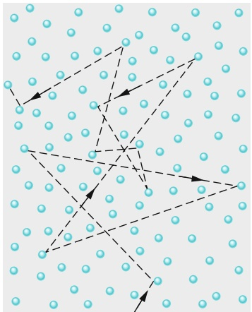

natural_image

Diagram showing scattered blue circles with dashed black arrows indicating directional relationships or vectors (no text or symbols)

Abb. 15.3

Ein Molekül bewegt sich durch ein Gas und stößt dabei mit anderen Molekülen zusammen. Obwohl die anderen Moleküle als ruhend dargestellt werden, bewegen sie sich auf ähnliche Weise.

Wir betrachten weiterhin die Bewegung der Moleküle in einem idealen Gas. Abbildung 15.3 zeigt den Weg eines typischen Moleküls bei seinem Flug durch das Gas, wobei es sowohl seine Geschwindigkeit als auch seine Ausbreitungsrichtung bei elastischen Kollisionen mit anderen Molekülen abrupt ändert. Zwischen den einzelnen Stößen bewegt sich unser typisches Molekül auf einer geraden Linie mit konstanter Geschwindigkeit. Obwohl die Abbildung alle anderen Moleküle als ruhend wiedergibt, bewegen sich diese natürlich in ähnlicher Weise.

Ein nützlicher Parameter zur Beschreibung dieser Zufallsbewegung ist die **mittlere freie Weglänge** λ der Moleküle. Wie der Name schon sagt, bezeichnet λ die mittlere Weglänge, die von einem Molekül zwischen zwei Stößen zurückgelegt wird. Wir würden erwarten, dass sich λ umgekehrt wie N∕V verhält, der Anzahl der Moleküle pro Volumen (d. h. der Anzahldichte der Moleküle). Je größer N∕V ist, desto mehr Stöße sollte es geben und umso kleiner sollte die mittlere freie Weglänge sein. Außerdem können wir erwarten, dass λ umgekehrt proportional zur Größe der einzelnen Moleküle ist, beschrieben beispielsweise durch ihren Durchmesser d. (Handelte es sich bei den Molekülen tatsächlich um Punkte, wie wir bisher angenommen haben, würden sie niemals zusammenstoßen und die mittlere freie Weglänge wäre unendlich.) Je größer also die Moleküle sind, umso kleiner ist die mittlere freie Weglänge. Wir können sogar vermuten, dass sich λ wie das inverse Quadrat des Moleküldurchmessers verhält, denn die effektive Zielflä- che ist durch die Querschnittsfläche eines Moleküls – nicht seinen Durchmesser – gegeben.

Tatsächlich findet man für die mittlere freie Weglänge eines Moleküls in einem idealen Gas

$$
\lambda = \frac {1}{\sqrt {2} \pi d ^ {2} N / V} \quad (\text {mittlere freie Weglänge}). \tag {15.24}
$$

Um diese Gleichung plausibel zu machen, konzentrieren wir uns auf ein einzelnes Molekül und nehmen an – wie es Abb. 15.3 nahelegt –, dass sich dieses Molekül mit einer konstanten Geschwindigkeit v bewegt, während alle anderen Moleküle ruhen. Später werden wir diese Annahme lockern.

Außerdem nehmen wir an, dass es sich bei den Molekülen um Kugeln vom Durchmesser d handelt. Ein Zusammenstoß tritt dann auf, wenn sich die Mittelpunkte zweier Moleküle auf den Abstand d nähern, wie man in Abb. 15.4a erkennt. Man kann sich diese Situation allerdings vereinfacht auch so vorstellen, dass man dem einzelnen bewegten Molekül den Radius d zuspricht, und alle anderen Moleküle als Punkte ansieht wie in Abb. 15.4b. Dieses Bild ändert die Bedingung für einen Zusammenstoß nicht.

Wenn sich unser Molekül auf seinem Zickzackkurs durch das Gas bewegt, überstreicht es zwischen zwei Zusammenstößen einen kurzen Zylinder der Querschnittsfläche $\pi d ^ { 2 }$ . Beobachten wir das Molekül für eine Zeitdauer $\Delta t ,$ so bewegt es sich um die Weglänge vΔt weiter, wobei v seine angenommene Geschwindigkeit ist. Legen wir also all die in dem Zeitintervall Δt überstrichenen kurzen Zylinder hintereinander, erhalten wir einen langen Zylinder (Abb. 15.5) der Länge vΔt und mit dem Volumen $( \pi d ^ { 2 } ) ( \nu \Delta t )$ . Die Anzahl der Stöße im Zeitintervall Δt ist dann gleich der Anzahl der (Punkt-)Moleküle innerhalb dieses Zylinders.

Die Anzahl der Moleküle in dem Zylinder ist gleich der Dichte der Moleküle $N / V$ multipliziert mit dem Volumen des Zylinders, also $( N / V ) ( \pi d ^ { 2 } \nu \Delta t )$ . Dies ist gleichzeitig auch die Anzahl der Stöße in der Zeitspanne Δt. Die mittlere freie Weglänge ist nun gleich der Länge des Weges (Länge des Zylinders) dividiert durch die Anzahl der Stöße:

$$
\begin{array}{l} \lambda = \frac {\text {Länge des Weges im Zeitintervall} \Delta t}{\text {Anzahl der Zusammenstöße in} \Delta t} \\ \approx \frac {\nu \Delta t}{\pi d ^ {2} \nu \Delta t N / V} = \frac {1}{\pi d ^ {2} N / V}. \tag {15.25} \\ \end{array}
$$

Diese Gleichung ist noch nicht ganz richtig, da sie auf der Annahme beruht, dass sich alle Moleküle außer einem in Ruhe befinden. Tatsächlich bewegen sich jedoch alle Moleküle. Berücksichtigt man das entsprechend, erhält man Gl. 15.24, die sich von Gl. 15.25 nur in dem Faktor $1 / \sqrt { 2 }$ unterscheidet.

Wir können auch erahnen, in welchem Sinn Gl. 15.25 eine Näherung ist. Das v im Zähler und das v im Nenner sind – streng genommen – verschieden. Bei dem v im Zähler handelt es sich um $\nu _ { \mathrm { g e m } } ,$ der mittleren Geschwindigkeit der Moleküle relativ zum Behälter. Bei dem v im Nenner handelt es sich um $\nu _ { \mathrm { r e l } } ,$ der mittleren Geschwindigkeit unseres einzelnen Moleküls relativ zu den anderen Molekülen, die in Bewegung sind. Diese Relativgeschwindigkeit bestimmt die Anzahl der Zusammenstöße. Eine genaue Berechnung, die auch die tatsächliche Geschwindigkeitsverteilung aller Moleküle berücksichtigt, liefert $\nu _ { \mathrm { r e l } } = \sqrt { 2 } \nu _ { \mathrm { g e m } }$ und somit den Faktor $\sqrt { 2 } .$

Die mittlere freie Weglänge von Luftmolekülen auf Meereshöhe beträgt ungefähr 0,1 μm. In einer Höhe von 100 km ist die Luft bereits so verdünnt, dass die mittlere freie Weglänge auf 16 cm angestiegen ist. In 300 km Höhe beträgt die mittlere freie Weglänge schon rund 20 km. Möchte man die Physik und Chemie der oberen Atmosphäre im Labor untersuchen, steht man vor dem Problem, dass es keine ausreichend großen Behälter gibt, um die Bedingungen der oberen Atmosphäre zu realisieren. Andererseits sind Untersuchungen zur Konzentration von FCKW (Fluorchlorkohlenwasserstoffen), Kohlenstoffdioxid und Ozon in der oberen Atmosphäre von großem allgemeinem Interesse.

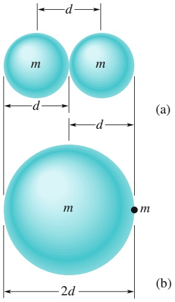

text_image

d
m m
d
(a)
m
m
2d
(b)

Abb. 15.4

(a) Ein Zusammenstoß tritt auf, wenn die Mittelpunkte der beiden Moleküle sich auf den Abstand d nähern, wobei d der Moleküldurchmesser ist. (b) Eine gleichwertige, allerdings einfachere Darstellung desselben Sachverhalts besteht in der Annahme, dass das bewegte Molekül einen Radius d hat und alle anderen Moleküle punktförmig sind. Die Bedingung für einen Zusammenstoß ändert sich dadurch nicht.

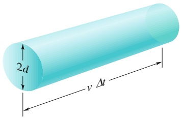

text_image

2d
v Δt

Abb. 15.5

In der Zeit Δt überstreicht das umherfliegende Molekül effektiv einen Zylinder der Länge vΔt mit einem Querschnittsradius d.

## KONTROLLFRAGE 3

In einem Behälter befinde sich ein Mol eines Gases A mit dem Moleküldurchmes ser $2 d _ { 0 }$ und der mittleren Molekülgeschwindigkeit $\nu _ { 0 } .$ Ein zweiter Behälter derselben Form enthalte ein Mol eines Gases B mit Moleküldurchmesser $d _ { 0 }$ und der mittleren Molekülgeschwindigkeit $2 \nu _ { 0 }$ (die B-Moleküle sind kleiner, aber schneller). Welches der beiden Gase hat die größere mittlere Stoßrate in seinem Behälter?

## 15.6 Die Verteilungsfunktion der Molekülgeschwindigkeiten

## Lernziele

Nach dem Durcharbeiten dieses Abschnitts sollten Sie in der Lage sein, . . .

• zu erläutern, wie Sie mithilfe der Maxwellschen Geschwindigkeitsverteilung den Anteil der Moleküle in einem bestimmten Geschwindigkeitsbereich bestimmen können,
• die Maxwellsche Geschwindigkeitsverteilung als Wahrscheinlichkeitsverteilung gegen die Geschwindigkeit zu skizzieren und die relativen Lagen der mittleren Geschwindigkeit $\nu _ { \mathrm { g e m } } ,$ der wahrscheinlichsten Geschwindigkeit $\nu _ { P }$ und der quadratisch gemittelten Geschwindigkeit $\nu _ { \mathrm { r m s } }$ anzugeben,
• zu erläutern, wie man mithilfe der Maxwellschen Geschwindigkeitsverteilung die mittlere Geschwindigkeit, die quadratisch gemittelte Geschwindigkeit und die wahrscheinlichste Geschwindigkeit ermitteln kann,
• die mittlere Geschwindigkeit, die wahrscheinlichste Geschwindigkeit und die quadratisch gemittelte Geschwindigkeit für eine gegebene Temperatur und Molmasse zu berechnen.

## Schlüsselideen

• Die Maxwellsche Geschwindigkeitsverteilung $P ( \nu )$ ist eine Funktion, die über den Ausdruck $P ( \nu )$ dv die Wahrscheinlichkeit angibt, dass ein gegebenes Molekül eine Geschwindigkeit im infinitesimalen Intervall zwischen v und v + dv besitzt:

$$
P (\nu) = 4 \pi \left(\frac {M}{2 \pi R T}\right) ^ {3 / 2} \nu^ {2} \mathrm{e} ^ {- M \nu^ {2} / (2 R T)}.
$$

• Aus dieser Verteilung lassen sich drei typische Geschwindigkeiten ableiten, die als Maß für die Verteilung der Molekülgeschwindigkeiten in einem Gas dienen können:

$$
\begin{array}{l} \nu_ {\mathrm{gem}} = \sqrt {\frac {8 R T}{\pi M}} \quad \text {(mittlere Geschwindigkeit)}, \\ \nu_ {P} = \sqrt {\frac {2 R T}{\pi M}} \quad \text {(wahrscheinlichste Geschwindigkeit)}, \\ \nu_ {\mathrm{rms}} = \sqrt {\frac {3 R T}{M}} \quad \text {(quadratisch gemittelte Geschwindigkeit)}. \\ \end{array}
$$

## 15.6.1 Die Verteilung der Molekülgeschwindigkeiten

Die quadratisch gemittelte Geschwindigkeit $\nu _ { \mathrm { r m s } }$ gibt uns eine allgemeine Vorstellung von der Molekülgeschwindigkeit in einem Gas bei einer gegebenen Temperatur. Oftmals sind wir jedoch an weiteren Eigenschaften interessiert, beispielsweise: Welcher Anteil aller Moleküle hat eine Geschwindigkeit, die größer als $\nu _ { \mathrm { r m s } }$ ist? Oder kleiner als das Doppelte von $\nu _ { \mathrm { r m s } } { } ^ { 2 }$ Um solche Fragen beantworten zu kön-

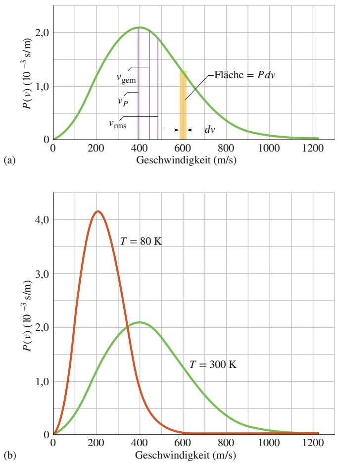

## Abb. 15.6

(a) Die Maxwellsche Geschwindigkeitsverteilung für Sauerstoffmoleküle bei $T = 3 0 0   \mathrm { \bar { K } } .$ Die drei charakteristischen Geschwindigkeiten sind markiert. (b) Die Verteilungskurven für 300 K und 80 K. Die Moleküle bewegen sich bei tieferen Temperaturen deutlich langsamer. Da es sich um Wahrscheinlichkeitsverteilungen handelt, muss die Fläche unter jeder Kurve den Wert eins haben.

nen, müssen wir genauer wissen, wie sich die einzelnen Geschwindigkeitswerte auf die Moleküle verteilen. Abbildung 15.6a zeigt eine solche Verteilungsfunktion für Sauerstoffmoleküle bei Zimmertemperatur $( T = 3 0 0   \mathrm { K } )$ , in Abb. 15.6b wird diese Verteilung mit der Verteilung bei $T = 8 0$ K verglichen.

Im Jahr 1852 konnte der schottische Physiker James Clerk Maxwell (1831–1879) als Erster das Problem der Geschwindigkeitsverteilung von Gasmolekülen lösen. Sein Ergebnis, die **Maxwellsche Geschwindigkeitsverteilung**, lautet

$$
P (\nu) = 4 \pi \left(\frac {M}{2 \pi R T}\right) ^ {3 / 2} \nu^ {2} \mathrm{e} ^ {- M \nu^ {2} / (2 R T)}. \tag {15.26}
$$

In dieser Formel sind $\nu$ der Betrag der Molekülgeschwindigkeit, $T$ die Gastemperatur, M die Molmasse des Gases und R die allgemeine Gaskonstante. Der Graph zu dieser Funktion ist in Abb. 15.6b wiedergegeben. Die Größe $P ( \nu )$ in Gl. 15.26 und Abb. 15.6 ist eine Wahrscheinlichkeitsverteilung: Für jede Geschwindigkeit v ist das dimensionslose Produkt $P ( \nu )$ dv gleich dem relativen Anteil der Moleküle, deren Geschwindigkeiten innerhalb des Intervalls der Breite dv um die Geschwindigkeit v liegen.

In Abb. 15.6 erkennt man, dass dieser Anteil gleich der Fläche eines Streifens der Höhe $P ( \nu )$ und der Breite dv ist. Die Gesamtfläche unter der Verteilungskurve entspricht dem Anteil der Moleküle, deren Geschwindigkeiten zwischen null und unendlich liegen. Da alle Moleküle zu dieser Klasse gehören, ist der Wert dieser Gesamtfläche immer eins:

$$
\int_ {0} ^ {\infty} P (\nu) \mathrm{d} \nu = 1. \tag {15.27}
$$

Der Anteil $\Delta P$ derjenigen Moleküle, deren Geschwindigkeiten in dem Intervall zwischen $\nu _ { 1 }$ und $\nu _ { 2 }$ liegen, beträgt daher

$$
\Delta P = \int_ {\nu_ {1}} ^ {\nu_ {2}} P (\nu) \mathrm{d} \nu . \tag {15.28}
$$

## Mittlere, quadratisch gemittelte und wahrscheinlichste Geschwindigkeit

Die **mittlere Geschwindigkeit** (oder auch **Durchschnittsgeschwindigkeit**) $\nu _ { \mathrm { g e m } }$ der Gasmoleküle erhalten wir im Prinzip aus folgender Vorschrift: Wir gewichten jeden Wert von v mit der Verteilungsfunktion, d. h., wir multiplizieren ihn mit dem Anteil $P ( \nu )$ dv der Moleküle, deren Geschwindigkeiten sich in dem infinitesimalen Intervall von v bis $\nu + \mathrm { d } \nu$ befinden. Anschließend summieren wir über all diese Werte von $\nu P ( \nu )   \mathrm { d } \nu .$ Das Ergebnis ist $\nu _ { \mathrm { g e m } } .$ In der Praxis erhalten wir dieses Ergebnis durch die Berechnung von

$$
\nu_ {\mathrm{gem}} = \int_ {0} ^ {\infty} \nu P (\nu) \mathrm{d} \nu . \tag {15.29}
$$

Mit $P ( \nu )$ aus Gl. 15.26 und mithilfe der Integralliste in Anhang D finden wir

$$
\nu_ {\mathrm{gem}} = \sqrt {\frac {8 R T}{\pi M}} \quad (\text {mittlere Geschwindigkeit}). \tag {15.30}
$$

Ganz ähnlich können wir auch den Mittelwert der Geschwindigkeitsquadrate, $( \nu ^ { 2 } ) _ { \mathrm { g e m } } ,$ berechnen:

$$
(\nu^ {2}) _ {\mathrm{gem}} = \int_ {0} ^ {\infty} \nu^ {2} P (\nu) \mathrm{d} \nu . \tag {15.31}
$$

Wir setzen wiederum $P ( \nu )$ aus Gl. 15.26 ein und verwenden noch einmal Anhang D:

$$
(\nu^ {2}) _ {\mathrm{gem}} = \frac {3 R T}{M}. \tag {15.32}
$$

Die Wurzel aus $( \nu ^ { 2 } ) _ { \mathrm { g e m } }$ ist die quadratisch gemittelte Geschwindigkeit $\nu _ { \mathrm { r m s } }$

$$
\nu_ {\mathrm{rms}} = \sqrt {\frac {3 R T}{M}} \quad (\text {rms - Geschwindigkeit}), \tag {15.33}
$$

in Übereinstimmung mit Gl. 15.21.

Schließlich versteht man unter der **wahrscheinlichsten Geschwindigkeit** $\nu _ { P }$ noch die Geschwindigkeit, bei der $P ( \nu )$ maximal wird (siehe Abb. 15.6a). Zur Berechnung von $\nu _ { P }$ setzen wir $\mathrm { d } P / \mathrm { d } \nu = 0$ (die Steigung der Kurve in Abb. 15.6a ist an ihrem Maximalwert null) und lösen nach v auf. Auf diese Weise finden wir

$$
\nu_ {P} = \sqrt {\frac {2 R T}{M}} \quad \text {(wahrscheinlichste Geschwindigkeit).} \tag {15.34}
$$

Ein Molekül hat die Geschwindigkeit $\nu _ { P }$ mit einer größeren Wahrscheinlichkeit als jede andere Geschwindigkeit, allerdings haben manche Moleküle Geschwindigkeiten, die ein Vielfaches oder nur ein kleiner Bruchteil von $\nu _ { P }$ sind. Wir sollten insbesondere für die sehr schnellen Moleküle dankbar sein, denn durch sie werden Regen und Sonnenschein erst möglich, und beides ist für uns lebenswichtig. Diesen Zusammenhang wollen wir kurz beschreiben:

**Regen** Die Geschwindigkeitsverteilung der Wassermoleküle beispielsweise in einem Teich bei sommerlichen Temperaturen ist durch eine ähnliche Kurve gegeben wie in Abb. 15.6a. Die meisten Moleküle haben nicht annähernd genügend kinetische Energie, um der Wasseroberfläche zu entkommen. Für eine sehr kleine Anzahl von besonders schnellen Molekülen im oberen Geschwindigkeitsbereich der Kurve ist dies jedoch möglich. Diese Wassermoleküle können verdampfen und ermöglichen die Bildung von Wolken und schließlich den Regen.

Obwohl die schnellen Wassermoleküle die Wasseroberfläche verlassen und Energie mit sich nehmen, bleibt die Wassertemperatur durch einen Wärmeaustausch mit der Umgebung nahezu gleich. Weitere schnelle Moleküle werden bei besonders günstigen Stoßprozessen erzeugt und nehmen rasch den Platz der gerade verdampften Moleküle ein. Die Geschwindigkeitsverteilung bleibt also erhalten.

**Sonnenschein** Nun beziehen wir die Geschwindigkeitsverteilung aus Abb. 15.6a auf die Protonen im Zentrum der Sonne. Die Sonnenenergie entsteht bei nuklearen Fusionsprozessen, die mit der Verschmelzung zweier Protonen beginnen. Wegen ihrer elektrischen Ladungen stoßen sich Protonen allerdings ab, und Protonen mittlerer Geschwindigkeiten hätten nicht genügend kinetische Energie, diese Abstoßung zu überwinden. Sie kämen sich für eine Verschmelzung daher nicht nahe genug. Dies schaffen nur die sehr schnellen Protonen im obersten Bereich der Geschwindigkeitsverteilung, und aus diesem Grund kann die Sonne scheinen.

## 15.7 Die molare Wärmekapazität idealer Gase

## Lernziele

Nach dem Durcharbeiten dieses Abschnitts sollten Sie in der Lage sein, . . .

• zu verstehen, dass die innere Energie eines einatomigen idealen Gases die Summe der kinetischen Translationsenergien seiner Atome ist,
• den Zusammenhang zwischen der inneren Energie $E _ { \mathrm { i n t } }$ eines einatomigen idealen Gases, der Stoffmenge n und der Temperatur $T$ anzugeben,
• den Unterschied zwischen einatomigen, zweiatomigen und mehratomigen idealen Gasen zu kennen,
• die molaren Wärmekapazitäten einatomiger, zweiatomiger und mehratomiger idealer Gase für Prozesse bei konstantem Volumen oder konstantem Druck zu berechnen,
• die molare Wärmekapazität $C _ { p }$ bei konstantem Druck aus der molaren Wärmekapazität $C _ { V }$ bei konstantem Volumen durch Addition von R zu berechnen und physikalisch zu begründen, warum $C _ { p }$ größer ist,
zu verstehen, dass die bei einem Prozess bei konstantem Volumen in Form von Wärme auf ein ideales Gas übertragene Energie vollständig in innere Energie (zufällige Translationsbewegung der Teilchen) umgewandelt wird, während die Energie in einem Prozess bei konstantem Druck teilweise auch für die vom Gas verrichtete Arbeit fließt,
• zu verstehen, dass die Änderung der inneren Energie eines Gases für eine gegebene Temperaturänderung für alle Prozesse identisch ist und sich am einfachsten berechnen lässt, indem man konstantes Volumen annimmt,
• den Zusammenhang zwischen der übertragenen Wärme $Q ,$ der Stoffmenge $n ,$ der Temperaturänderung $\Delta T$ und der entsprechenden molaren Wärmekapazität für ein ideales Gas anzuwenden,
• in einem $p V \text-- \mathrm { D i }$ iagramm einen zwischen zwei Isothermen ablaufenden Prozess bei konstantem Volumen bzw. Druck zu skizzieren und die dabei jeweils verrichtete Arbeit anhand einer Fläche in dem Diagramm zu bestimmen,
• die von einem idealen Gas in einem Prozess bei konstantem Druck verrichtete Arbeit zu berechnen,
• zu verstehen, dass die in einem Prozess bei konstantem Volumen verrichtete Arbeit null ist.

## Schlüsselideen

• Ein ideales Gas hat bei konstantem Volumen die molare Wärmekapazität

$$
C _ {V} = \frac {Q}{n \Delta T} = \frac {\Delta E _ {\mathrm{int}}}{n \Delta T}.
$$

Dabei sind Q die als Wärme auf das Gas übertragene Energie, n die Stoffmenge, ΔT die resultierende Temperaturänderung des Gases und $\Delta E _ { \mathrm { i n t } }$ die Änderung seiner inneren Energie.

• Für ein einatomiges ideales Gas ist

$$
C _ {V} = \frac {3}{2} R = 1 2, 5 \mathrm{J/(mol} \cdot \mathrm{K)}.
$$

• Bei konstantem Druck hat ein ideales Gas die molare Wärmekapazität

$$
C _ {p} = \frac {Q}{n \Delta T} = \frac {\Delta E _ {\mathrm{int}}}{n \Delta T}.
$$

(Alle Größen haben die zuvor beschriebene Bedeutung.) Der Zusammenhang zwischen $C _ { p }$ und $C _ { V }$ ist

$$
C _ {p} = C _ {V} + R.
$$

• Mit der Stoffmenge n eines idealen Gases gilt

$$
E _ {\mathrm{int}} = n C _ {V} T.
$$

• Wenn eine Stoffmenge n eines idealen Gases aufgrund eines beliebigen Prozesses die Temperaturänderung $\Delta T$ erfährt, ist die resultierende Änderung seiner inneren Energie

$$
\Delta E _ {\mathrm{int}} = n C _ {V} \Delta T.
$$

## 15.7.1 Die molare Wärmekapazität idealer Gase

In diesem Abschnitt wollen wir aus molekularen Betrachtungen einen Ausdruck für die innere Energie $E _ { \mathrm { i n t } }$ eines idealen Gases ableiten. Mit anderen Worten, wir wollen einen Ausdruck für die Energie herleiten, die mit den Zufallsbewegungen der Atome oder Moleküle des Gases zusammenhängt. Anschließend werden wir mithilfe dieses Ausdrucks die molaren Wärmekapazitäten eines idealen Gases bestimmen.

## Die innere Energie

Wir nehmen zunächst an, bei unserem idealen Gas handele es sich um ein einatomiges Gas (das nicht aus Molekülen, sondern aus einzelnen Atomen besteht), beispielsweise Helium, Neon oder Argon. Weiterhin nehmen wir an, dass die innere Energie $E _ { \mathrm { i n t } }$ unseres idealen Gases einfach gleich der Summe der kinetischen Translationsenergien seiner Atome ist. (Aus der Quantentheorie folgt, dass einzelne Atome keine kinetische Rotationsenergie besitzen können.)

Die mittlere kinetische Translationsenergie eines einzelnen Atoms hängt nur von der Gastemperatur ab und ist nach Gl. 15.23 durch $\begin{array} { r } { K _ { \mathrm { g e m } } = \frac { 3 } { 2 } k T } \end{array}$ gegeben. Eine Probe aus n mol eines solchen Gases enthält $n N _ { \mathrm { A } }$ Atome. Also ist die innere Energie $E _ { \mathrm { i n t } }$ dieser Probe

$$
E _ {\mathrm{int}} = (n N _ {\mathrm{A}}) K _ {\mathrm{gem}} = (n N _ {\mathrm{A}}) \left(\frac {3}{2} k T\right). \tag {15.35}
$$

Mithilfe von Gl. 1 $5 . 7 \: ( k = R / N _ { \mathrm { A } } )$ können wir auch schreiben:

$$
E _ {\mathrm{int}} = \frac {3}{2} n R T \quad (\text {einatomiges ideales Gas}). \tag {15.36}
$$

Somit gilt:

Die innere Energie $E _ { \mathrm { i n t } }$ eines idealen Gases ist nur eine Funktion der Gastemperatur; sie hängt von keiner anderen Variable ab.

Mit dieser Gleichung für die innere Energie können wir nun einen Ausdruck für die molare Wärmekapazität eines idealen Gases herleiten. Genau genommen werden wir zwei Ausdrücke herleiten. Ein Ausdruck gilt für den Fall, bei dem das Volumen des Gases unverändert bleibt, während dem Gas Wärmeenergie zu- oder abgeführt wird. Der andere Ausdruck gilt für den Fall, dass der Druck des Gases bei der $\mathbf { Z } \mathbf { u } .$ oder Abfuhr von Wärmeenergie unverändert bleibt. Die Symbole für diese beiden molaren Wärmekapazitäten sind $C _ { V }$ und $C _ { p }$

## Die molare Wärmekapazität bei konstantem Volumen

Abbildung 15.7a zeigt n mol eines idealen Gases bei einem Druck p und einer Temperatur $T$ in einem Zylinder mit dem konstanten Volumen V. Dieser Anfangszustand i des Gases ist im $p V$ -Diagramm von Abb. 15.7b eingezeichnet. Angenommen, Sie führen dem Gas nun eine kleine Energiemenge in Form der Wärme Q zu, indem Sie die Temperatur des Wärmereservoirs langsam erhöhen. Die Gastemperatur erhöht sich ebenfalls um einen kleinen Betrag auf $T + \Delta T$ , und außerdem erhöht sich noch der Druck auf $p + \Delta p$ . Dies entspricht dem Endzustand f des Gases.

In einem solchen Experiment würden wir feststellen, dass die Wärme Q mit der Temperaturänderung $\Delta T$ über die Beziehung

$$
Q = n C _ {V} \Delta T \quad (\text {konstantes Volumen}) \tag {15.37}
$$

zusammenhängt. Die Konstante $C _ { V }$ bezeichnet man als **molare Wärmekapazität bei konstantem Volumen**. Wir setzen diesen Ausdruck für Q in die Gleichung für den ersten Hauptsatz der Thermodynamik in der Form von Gl. 14.21 $\left( \Delta E _ { \mathrm { i n t } } = \right.$ $Q - W )$ ein und erhalten

$$
\Delta E _ {\mathrm{int}} = n C _ {V} \Delta T - W. \tag {15.38}
$$

Da das Volumen festgehalten wird und sich das Gas nicht ausdehnen kann, leistet es auch keine Arbeit. Also ist $W = 0$ und Gl. 15.38 wird zu

$$
C _ {V} = \frac {\Delta E _ {\mathrm{int}}}{n \Delta T}. \tag {15.39}
$$

Nach Gl. 15.36 ist aber $\begin{array} { r } { \Delta E _ { \mathrm { i n t } } = \frac { 3 } { 2 } n R T , } \end{array}$ , also muss die $\ddot { \mathrm { A } }$ nderung der inneren Energie durch

$$
\Delta E _ {\mathrm{int}} = \frac {3}{2} n R \Delta T \tag {15.40}
$$

gegeben sein. Wir setzen dieses Ergebnis in Gl. 15.39 ein und erhalten schließlich

$$
C _ {V} = \frac {3}{2} R = 1 2, 5   \mathrm{J/(mol} \cdot \mathrm{K)} \qquad (\text {einatomiges Gas}). \tag {15.41}
$$

Wie aus Tab. 15.2 hervorgeht, stimmt diese Vorhersage aus der kinetischen Gas theorie (für ideale Gase) sehr gut mit experimentellen Ergebnissen für reale einatomige Gase überein. Die vorhergesagten und experimentellen Werte für $C _ { V }$ sind bei zweiatomigen und mehratomige Gasen größer als die Werte für einatomige Gase. Die Gründe dafür werden wir in Abschn. 15.8 behandeln.

Wir können Gl. 15.36 nun für die innere Energie eines beliebigen idealen Gases verallgemeinern, indem wir $C _ { V }$ für ${ \frac { 3 } { 2 } } R$ einsetzen:

$$
E _ {\mathrm{int}} = n C _ {V} T \quad (\text {beliebiges   ideales   Gas}). \tag {15.42}
$$

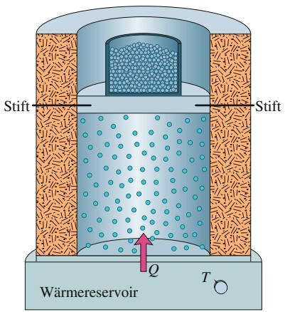

text_image

Stift
Stift
Wärmereservoir
Q
T

(a)

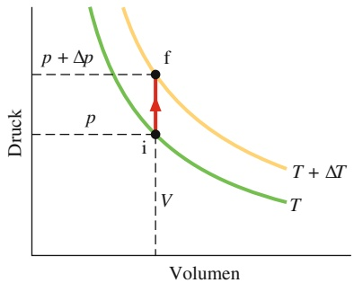

contour

| Point | Description |
| --- | --- |
| f | Intersection of T + \(\Delta T\) and Druck curves |
| i | Intersection of T and Druck curves |
| V | Vertical axis label for volume |
| p | Pressure point on the green curve |
| p + \(\Delta p\) | Pressure difference between T and T+ΔT curves |

(b)

## Abb. 15.7

(a) Die Temperatur eines idealen Gases wird bei festgehaltenem Volumen von T auf $T + \tilde { \Delta T }$ erhöht. Dem Gas wird Wärme zugeführt, allerdings leistet es keine Arbeit. (b) Derselbe Prozess im $p V \cdot$ Diagramm.

TABELLE 15.2: Molare Wärmekapazitäten bei konstantem Volumen.

<table><tr><td>Molekül</td><td colspan="2">Beispiel</td><td> $C_V$  (J/(mol·K))</td></tr><tr><td rowspan="3">einatomig</td><td>ideal</td><td></td><td> $\frac{3}{2}R = 12,5$ </td></tr><tr><td rowspan="2">real</td><td>He</td><td>12,5</td></tr><tr><td>Ar</td><td>12,6</td></tr><tr><td rowspan="3">zweiatomig</td><td>ideal</td><td></td><td> $\frac{5}{2}R = 20,8$ </td></tr><tr><td rowspan="2">real</td><td> $N_2$ </td><td>20,7</td></tr><tr><td> $O_2$ </td><td>20,8</td></tr><tr><td rowspan="3">mehratomig</td><td>ideal</td><td></td><td>3R = 24,9</td></tr><tr><td rowspan="2">real</td><td> $NH_4$ </td><td>29,0</td></tr><tr><td> $CO_2$ </td><td>29,7</td></tr></table>

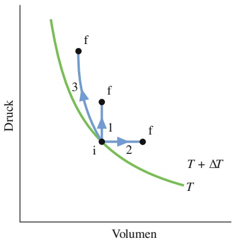

scatter

| State | Volumen | Druck |
| --- | --- | --- |
| i | ~0.45 | ~0.25 |
| 1 | ~0.48 | ~0.35 |
| 2 | ~0.55 | ~0.25 |
| 3 | ~0.35 | ~0.65 |

Abb. 15.8

Die drei Pfade entsprechen drei verschiedenen Prozessen, die ein ideales Gas von einem Anfangszustand i bei einer Temperatur T in einen Endzustand f bei der Temperatur $T + \Delta T$ überführen. Die Änderung $\Delta E _ { \mathrm { i n t } }$ der inneren Energie des Gases ist für alle drei Prozesse gleich, ebenso wie für jeden anderen Prozess mit derselben Temperaturänderung.

Diese Gleichung gilt nicht nur für ein ideales einatomiges Gas, sondern auch für zweiatomige und mehratomige ideale Gase, vorausgesetzt man verwendet den entsprechenden Wert für $C _ { V }$ . Wie bei Gl. 15.36 sehen wir wieder, dass die innere Energie eines Gases nur von dessen Temperatur, nicht aber von seinem Druck oder seiner Dichte abhängt.

Ändert sich die Temperatur eines idealen Gases in einem abgeschlossenen Behälter um $\Delta T ,$ so folgt aus Gl. 15.39 bzw. Gl. 15.42 für die Änderung der inneren Energie

$$
\Delta E _ {\mathrm{int}} = n C _ {V} \Delta T \quad (\text {ideales Gas, beliebiger Prozess}). \tag {15.43}
$$

Diese Gleichung besagt:

Eine Änderung der inneren Energie $E _ { \mathrm { i n t } }$ in einem abgeschlossenen Behälter hängt nur von der Änderung der Gastemperatur ab; sie hängt nicht von der Art des temperaturverändernden Prozesses ab.

Als Beispiele betrachten wir die drei Pfade zwischen den beiden Isothermen in dem $p V \mathrm { { \text-- } D }$ iagramm von Abb. 15.8. Pfad 1 entspricht einem Prozess bei konstantem Volumen. Pfad 2 entspricht einem Prozess bei konstantem Druck (den wir im folgenden Abschnitt untersuchen werden), und Pfad 3 entspricht einem Prozess, bei dem das System keine Wärme mit seiner Umgebung austauscht (solche Prozesse untersuchen wir in Abschn. 15.9). Obwohl die Werte der Wärme Q und der Arbeit W auf den drei Pfaden unterschiedlich sind, ebenso wie $p _ { \mathrm { f } }$ und $V _ { \mathrm { f } } ,$ sind die Werte für $\Delta E _ { \mathrm { i n t } }$ auf allen drei Pfaden gleich und durch Gl. 15.43 gegeben, denn bei allen drei Pfaden ist die Temperaturänderung $\Delta T$ dieselbe. Unabhängig von dem tatsächlichen Pfad zwischen $\overline { { T } }$ und $T + \Delta T$ können wir uns immer auf Pfad 1 beziehen und $\Delta E _ { \mathrm { i n t } }$ nach Gl. 15.43 berechnen.

## Die molare Wärmekapazität bei konstantem Druck

Wir nehmen nun an, dass die Temperatur des idealen Gases um denselben kleinen Betrag $\Delta T$ angehoben wird, das Gas allerdings bei der dazu notwendigen Wärmezufuhr (Q) unter konstantem Druck bleibt. Eine experimentelle Anordnung dafür ist in Abb. 15.9a skizziert, Abb. 15.9b zeigt das $p V .$ -Diagramm für diesen Prozess. In solchen Experimenten findet man zwischen der Wärme $Q$ und der Temperatur

änderung ΔT eine Beziehung der Form

$$
Q = n C _ {p} \Delta T \quad (\text {konstanter Druck}). \tag {15.44}
$$

Die Konstante $C _ { p }$ bezeichnet man als **molare Wärmekapazität bei konstantem Druck**. $C _ { p }$ ist größer als die molare Wärmekapazität $C _ { V }$ bei konstantem Volumen, weil die zugeführte Energie in diesem Fall nicht nur für den Temperaturanstieg verwendet wird, sondern auch noch für die vom Gas beim Anheben des Kolbens in Abb. 15.9a geleistete Arbeit.

Wir wollen nun eine Beziehung zwischen den molaren Wärmekapazitäten $C _ { p }$ und $C _ { V }$ herleiten. Dazu beginnen wir mit dem ersten Hauptsatz der Thermodynamik (Gl. 14.21):

$$
\Delta E _ {\mathrm{int}} = Q - W. \tag {15.45}
$$

Die einzelnen Terme in Gl. 15.45 drücken wir nun durch die Temperaturerhöhung aus: $\Delta E _ { \mathrm { i n t } }$ ersetzen wir mit Gl. 15.43, Q, mit Gl. 15.44. Da der Druck konstant bleibt, folgt aus Gl. 15.16 für die Arbeit $W = p \Delta V$ . Nun nutzen wir die ideale Gasgleichung aus $( p V = n R T )$ und schreiben

$$
W = p \Delta V = n R \Delta T. \tag {15.46}
$$

Nachdem wir diese Ersetzungen vorgenommen haben, können wir durch $n \Delta T$ dividieren und erhalten

$$
C _ {V} = C _ {p} - R
$$

beziehungsweise

$$
C _ {p} = C _ {V} + R. \tag {15.47}
$$

Diese Vorhersage der kinetischen Gastheorie stimmt mit dem Experiment gut überein, und zwar nicht nur für einatomige Gase, sondern für beliebige Gase, sofern deren Dichte klein genug ist, damit sie wie ein ideales Gas behandelt werden dürfen.

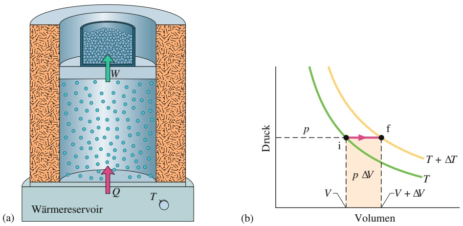

## Abb. 15.9

(a) Die Temperatur eines idealen Gases steigt bei konstant gehaltenem Druck von T auf $T + \bar { \Delta } T .$ Es wird Wärme zugeführt, und das System leistet Arbeit, indem es den Kolben anhebt. (b) Derselbe Prozess in einem $p V .$ -Diagramm. Die Arbeit $p \Delta V$ entspricht der gelben Fläche.

## KONTROLLFRAGE 4

Die Abbildung zeigt fünf Pfade, die jeweils für die Zustandsänderung eines Gases im $p V .$ -Diagramm stehen. Ordnen Sie die Gase nach der Änderung ihrer inneren Energie (größte Werte zuerst).

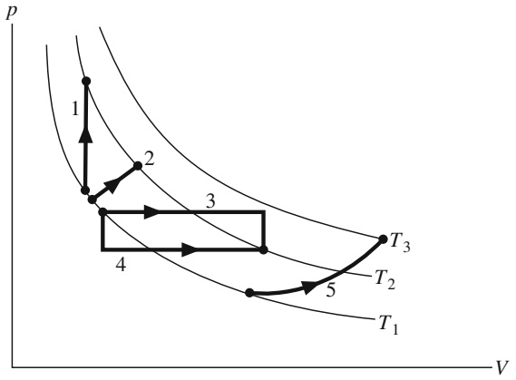

contour

| Point | Description |
| --- | --- |
| 1 | Start of cycle 1 |
| 2 | Intermediate point on curve 2 |
| 3 | Intermediate point on curve 3 |
| 4 | Central path from start to end |
| 5 | End of cycle 5 |
| T1 | Lower boundary line |
| T2 | Intermediate point on curve 2 |
| T3 | Upper boundary line |

## 15.8 Freiheitsgrade und molare Wärmekapazität

## Lernziele

Nach dem Durcharbeiten dieses Abschnitts sollten Sie in der Lage sein, . . .

• zu verstehen, dass zu jeder Art, in der ein Atom oder Molekül kinetische Energie haben kann (in Translation, Rotation oder Schwingung), ein entsprechender Freiheitsgrad gehört,
• zu verstehen, dass jeder Freiheitsgrad in einem Molekül eine Energie von $\frac { 1 } { 2 } k T$ speichern kann,
• zu verstehen, dass die innere Energie eines einatomigen Gases nur auf Translation beruhen kann,
• zu verstehen, dass die innere Energie eines zweiatomigen Gases bei sehr tiefen Temperaturen nur aus Anteilen von Translation besteht, bei höheren Temperaturen auch die Rotation der Moleküle beträgt und bei noch höheren Temperaturen auch die Molekülschwingungen,
• die molaren Wärmekapazitäten einatomiger und zweiatomiger idealer Gase für Prozesse bei konstantem Volumen oder konstantem Druck zu berechnen.

## Schlüsselideen

Die molare Wärmekapazität $C _ { V }$ bei konstantem Volumen lässt sich auf der Grundlage des Gleichverteilungssatzes berechnen, der besagt, dass jeder Freiheitsgrad von Translation und Rotation eines Moleküls (d. h. jede unabhängige $\mathrm { A r t }$ , wie es Energie speichern kann) im Mittel eine Energie von $\left[ { \frac { 1 } { 2 } } k T \right.$ pro Molekül $( \frac { 1 } { 2 } R T$ pro Mol) enthält.

Eine Schwingung in einer Raumrichtung besitzt zwei Freiheitsgrade, also trägt sie pro Molekül die Energie kT bei.

• Wenn wir die Zahl der Freiheitsgrade eines Moleküls mit $f$ bezeichnen, dann gilt $E _ { \mathrm { i n t } } = ( f / 2 ) n R T$ und daher

$$
C _ {V} = \left(\frac {f}{2}\right) R = f \cdot 4, 1 6   \text {J/(mol} \cdot \text {K)}.
$$

• Für einatomige Gase ist $f = 3$ (drei Freiheitsgrade der Translation), für zweiatomige Gase ist $f = 5$ (drei Freiheitsgrade der Translation und zwei Freiheitsgrade der Rotation).

## 15.8.1 Freiheitsgrade und molare Wärmekapazität

Wie aus Tab. 15.2 deutlich wird, stimmt die Vorhersage $\begin{array} { r } { C _ { V } = \frac { 3 } { 2 } R T } \end{array}$ für einatomige Gase sehr gut mit dem Experiment überein, nicht aber für zwei- und mehratomige Gase. Wir wollen diesen Unterschied im Folgenden dadurch erklären, dass Moleküle mit mehr als einem Atom ihre innere kinetische Energie auch in anderen Formen speichern können als nur in zufälligen Translationsbewegungen.

Abbildung 15.10 zeigt vereinfachte Modelle für drei bekannte Gase: das einatomige Helium, den zweiatomigen Sauerstoff und das mehratomige Methan. Aus diesen Modellen würden wir annehmen, dass alle drei Molekülarten drei Translationsbewegungen (links/rechts, vorne/hinten oder oben/unten) und Rotationsbewegungen um eine oder mehrere Achsen ausführen können. Zusätzlich würden wir bei den zwei- und mehratomigen Molekülen noch die Möglichkeit von Schwingungsbewegungen vermuten, bei denen die Atome hin- und herschwingen und dabei ihre relativen Abstände periodisch verändern.

Im Zusammenhang mit den verschiedenen Möglichkeiten, wie Energie in einem Gas gespeichert werden kann, formulierte James Clerk Maxwell den **Gleichverteilungssatz der Energie**:

Jede Art von Molekül besitzt eine bestimmte Anzahl von thermodynamischen Freiheitsgraden. Dabei handelt es sich um unabhängige Möglichkeiten für das Molekül, Energie zu speichern. Jeder Freiheitsgrad trägt – im Mittel – einen Energieanteil von $\frac { 1 } { 2 } \bar { k } T$ pro Molekül (oder $\frac { 1 } { 2 } \bar { R T }$ pro Mol) zur gesamten inneren Energie bei.

Wir wollen dieses Theorem nun auf die Translations- und Rotationsbewegung der Moleküle in Abb. 15.10 anwenden. (Die Schwingungsbewegungen besprechen wir im nächsten Abschnitt.) Für die Translationsbewegung denken wir uns das Gas in einem xyz-Koordinatensystem. Im Allgemeinen besitzen die Moleküle in jeder der drei Achsen eine Geschwindigkeitskomponente. Jedes Gasmolekül hat daher drei Translationsfreiheitsgrade (drei unabhängige Möglichkeiten, eine Translationsbewegung auszuführen). Im Mittel trägt daher jedes Molekül eine Energie von $3 ( \textstyle { \frac { 1 } { 2 } } k T )$ zur gesamten inneren Energie eines Gases bei.

Für die Rotationsbewegung stellen wir uns den Ursprung des xyz-Koordinatensystems im Mittelpunkt der Moleküle in Abb. 15.10 vor. In einem Gas sollte jedes Molekül in der Lage sein, sich mit einer unabhängigen Winkelgeschwindigkeitskomponente um jede der drei Achsen zu drehen. Jedes Gas sollte also noch drei weitere Rotationsfreiheitsgrade besitzen und daher im Mittel eine Energie von $3 ( \textstyle { \frac { 1 } { 2 } } k T )$ pro Molekül beitragen. Experimentell findet man jedoch, dass dies nur für die mehratomigen Moleküle gilt. Eine Erklärung liefert erst die Quantentheorie, wonach sich ein einatomiges Gas überhaupt nicht drehen kann und daher auch keine Rotationsenergie trägt (ein einzelnes Atom kann nicht wie ein Kreisel rotieren). Ein zweiatomiges Gas kann sich zwar wie ein Kreisel um die beiden Achsen senkrecht zur Verbindungslinie zwischen den beiden Atomen drehen (die Achsen sind in Abb. 15.10b eingetragen), allerdings nicht um die Verbindungslinie selbst. Daher besitzt ein zweiatomiges Molekül auch nur zwei Rotationsfreiheitsgrade und trägt pro Molekül eine Rotationsenergie von nur $2 ( { \textstyle { \frac { 1 } { 2 } } } k T )$ bei.

Wir wollen nun unsere Überlegungen zu den molaren Wärmekapazitäten $( C _ { p }$ und $C _ { V }$ in Abschn. 15.7) auf ideale zwei- und mehratomige Gase ausdehnen. Dazu ist es notwendig, die Herleitungen nochmals im Detail zu überdenken. Zunächst ersetzen wir Gl. 15.36 $\textstyle ( E _ { \mathrm { i n t } } = { \frac { 3 } { 2 } } n R T )$ durch $\begin{array} { r } { E _ { \mathrm { i n t } } = \frac { f } { 2 } n R T } \end{array}$ , wobei f die Anzahl der thermodynamischen Freiheitsgrade (aufgelistet in Tab. 15.3) angibt. Dies führt uns zu der Vorhersage

$$
C _ {V} = \left(\frac {f}{2}\right) R = f \cdot 4, 1 6 \mathrm{J/(mol} \cdot \mathrm{K)}, \tag {15.48}
$$

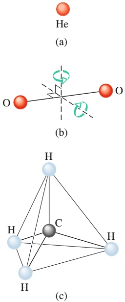

## Abb. 15.10

Verschiedene in der kinetischen Gastheorie verwendete Molekülmodelle: (a) Helium, ein typisches einatomiges Molekül; (b) Sauerstoff, ein typisches zweiatomiges Molekül; und (c) Methan, ein typisches mehratomiges Molekül. Die Kugeln sollen die Atome darstellen und die Linien zwischen ihnen die chemischen Bindungen. Für das Sauerstoffmolekül sind zwei Drehachsen eingezeichnet, da eine Drehung um die Längsachse aus quantenmechanischen Gründen unterdrückt ist.

TABELLE 15.3: Thermodynamische Freiheitsgrade für verschiedene Moleküle.

<table><tr><td rowspan="2">Molekül</td><td rowspan="2">Beispiel</td><td rowspan="2">Freiheitsgrade Translation</td><td rowspan="2">Rotation</td><td rowspan="2">Gesamt (f)</td><td colspan="2">Vorhergesagte molare Wärmekapazitäten</td></tr><tr><td> $C_V$ (Gl. 15.48)</td><td> $C_p = C_V + R$ </td></tr><tr><td>einatomig</td><td>He</td><td>3</td><td>0</td><td>3</td><td> $\frac{3}{2}R$ </td><td> $\frac{5}{2}R$ </td></tr><tr><td>zweiatomig</td><td> $O_2$ </td><td>3</td><td>2</td><td>5</td><td> $\frac{5}{2}R$ </td><td> $\frac{7}{2}R$ </td></tr><tr><td>mehratomig</td><td> $CH_4$ </td><td>3</td><td>3</td><td>6</td><td>3R</td><td>4R</td></tr></table>

was (wie es auch sein muss) mit Gl. 15.41 für einatomige Gase $( f = 3 )$ übereinstimmt. Wie man Tab. 15.2 entnehmen kann, stimmt diese Vorhersage auch mit den experimentellen Ergebnissen für zweiatomige Gase $( f = 5 )$ überein, sie ist aber für mehratomige Gase zu niedrig.

## 15.8.2 Die Quantenmechanik macht sich bemerkbar

Wir können die Übereinstimmung zwischen kinetischer Gastheorie und Experiment noch verbessern, indem wir die Schwingungen der Atome in einem Gas aus zwei- oder mehratomigen Molekülen berücksichtigen. Beispielsweise können die beiden Atome des $\mathrm { O } _ { 2 }$ -Moleküls in Abb. 15.10b gegeneinander schwingen, wobei die chemische Bindung zwischen ihnen wie eine Feder wirkt. Im Experiment findet man jedoch, dass solche Oszillationen erst bei vergleichsweise hohen Gastemperaturen auftreten – diese Form der Bewegung wird erst „eingeschaltet“, wenn die Gasmoleküle vergleichsweise hohe Energien haben. Auch die Rotationsbewegung muss „eingeschaltet“ werden, allerdings geschieht dies schon bei deutlich niedrigeren Temperaturen als im Fall der Schwingung.

Abbildung 15.11 verdeutlicht das Einschalten von Rotations- und Oszillationsbewegungen. In dieser Abbildung ist das Verhältnis $C _ { V } / R$ für das zweiatomige Gas Wasserstoff $( \mathrm { H } _ { 2 } )$ gegen die Temperatur aufgetragen, wobei die Temperaturskala logarithmisch ist, um mehrere Größenordnungen überdecken zu können. Unterhalb von rund 80 K finden wir $C _ { V } / R = 3 / 2$ . Dieses Ergebnis zeigt, dass nur die drei Translationsfreiheitsgrade des Wasserstoffs zur molaren Wärmekapazität beitragen.

Mit zunehmender Temperatur wächst auch der Wert für $C _ { V } / R$ langsam auf $^ { \prime } 5 / 2 ;$ es treten also zusätzlich die beiden Rotationsfreiheitsgrade auf. Aus der Quantentheorie wissen wir, dass das zweiatomige Wasserstoffmolekül nur um die beiden Achsen senkrecht zur Verbindungslinie rotieren kann und dass diese Bewegung eine gewisse Minimalenergie erfordert.

Bei sehr tiefen Temperaturen (unterhalb von 80 K) besitzen die Moleküle also nicht genügend Energie für eine Rotation. Steigt die Temperatur über 80 K, erlan-

Abb. 15.11

Der Graph von $C _ { V } / R$ als Funktion der Temperatur für das zweiatomige Wasserstoffmolekül. Da die Rotations- und Oszillationsbewegungen erst oberhalb bestimmter Energien einsetzen, ist bei sehr tiefen Temperaturen nur die Translationsbewegung möglich. Mit zunehmender Temperatur setzen auch die Rotationsbewegungen ein. Erst bei sehr viel höheren Temperaturen beginnen schließlich auch die Oszillationsbewegungen. Die Schwingung der beiden Atome entlang ihrer Verbindungslinie trägt zwei Freiheitsgrade bei. Beachten Sie die logarithmische Temperaturachse!

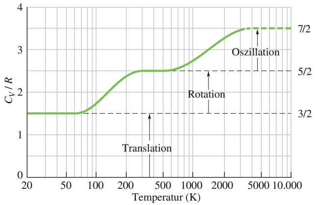

line

| Temperature (K) | Cv/R |
| --- | --- |
| 20 | 1.5 |
| 50 | 1.5 |
| 100 | ~1.7 |
| 200 | ~2.3 |
| 500 | 2.5 |
| 1000 | ~2.7 |
| 2000 | ~3.2 |
| 5000 | 3.5 |
| 10000 | 3.5 |

gen zunächst einige und schließlich immer mehr Moleküle ausreichend Energie für diese Form der Bewegung. Demzufolge steigt das Verhältnis $C _ { V } / R ,$ bis alle Moleküle rotieren und der Wert $C _ { V } / R = 5 / 2$ erreicht ist.

Eine Oszillationsbewegung der beiden Atome in Richtung ihrer Verbindungsachse bedeutet zwei Freiheitsgrade, sodass $C _ { V } / R = 7 / 2$ betragen sollte, wenn die entsprechende Minimalmenge an Energie erreicht wird. Dies ist für das Wasserstoffmolekül erst bei einer Temperatur von rund 1000 K der Fall, wie in Abb. 15.11 deutlich wird. Die Kurve in Abb. 15.11 endet bei 3200 K, weil bei dieser Temperatur die Atome in den Wasserstoffmolekülen so heftig oszillieren, dass sie ihre chemische Bindung überwinden können und das Molekül in zwei getrennte Atome dissoziiert.

## 15.9 Die adiabatische Expansion eines idealen Gases

## Lernziele

Nach dem Durcharbeiten dieses Abschnitts sollten Sie in der Lage sein, . . .

• eine adiabatische Expansion (oder Kompression) in einem pV-Diagramm zu skizzieren und zu verstehen, dass in diesem Prozess keine Wärme mit der Umgebung ausgetauscht wird,
• zu verstehen, dass ein Gas bei einer adiabatischen Expansion Arbeit an seiner Umgebung verrichtet, wobei seine innere Energie abnimmt, und dass bei einer adiabatischen Kompression umgekehrt die Umgebung Arbeit an dem Gas verrichtet und dabei dessen innere Energie erhöht,
• den Zusammenhang zwischen Anfangsdruck und -volumen sowie Enddruck und -volumen bei einer adiabatischen Volumenänderung anzugeben,
• den Zusammenhang zwischen Anfangstemperatur und -volumen sowie Endtemperatur und -volumen bei einer adiabatischen Volumenänderung anzugeben,
• die bei einem adiabatischen Prozess verrichtete Arbeit durch Integration des Drucks über das Volumen zu berechnen,
zu verstehen, dass die freie Expansion eines idealen Gases in ein Vakuum adiabatisch erfolgt, dass dabei aber keine Arbeit verrichtet wird und sich infolge des ersten Hauptsatzes der Thermodynamik demzufolge weder die innere Energie noch die Temperatur des Gases ändert.

## Schlüsselideen

• Bei einer langsamen adiabatischen Volumenänderung mit $Q = 0$ gilt für ideale Gase

$$
p V ^ {\gamma} = \text {const.}
$$

Dabei ist $\gamma = C _ { p } / C _ { V }$ das Verhältnis der molaren Wärmekapazitäten des Gases.
• Für eine freie Expansion ins Vakuum gilt $p V = \mathrm { c o n s t } .$

## 15.9.1 Die adiabatische Expansion idealer Gase

In Absch. 13.1 hatten wir gesehen, dass sich Schallwellen in Luft oder anderen Gasen als periodische Kompressionen und Expansionen ausbreiten. Diese Änderungen innerhalb des Trägermediums erfolgen so schnell, dass für eine Wärmeübertragung von einem Teil des Mediums zu einem anderen nicht genügend Zeit zur Verfügung steht. In Abschn. 14.5 hatten wir einen Prozess mit $Q = 0$ als adiabatischen Prozess bezeichnet. Die Bedingung $Q = 0$ können wir auf zwei Weisen realisieren: Entweder geschieht der Prozess sehr schnell (wie in Schallwellen) oder er findet (mit beliebiger Geschwindigkeit) in einem wärmeisolierten Behälter statt. Wir wollen nun untersuchen, was wir aus der kinetischen Gastheorie über adiabatische Prozesse lernen können.

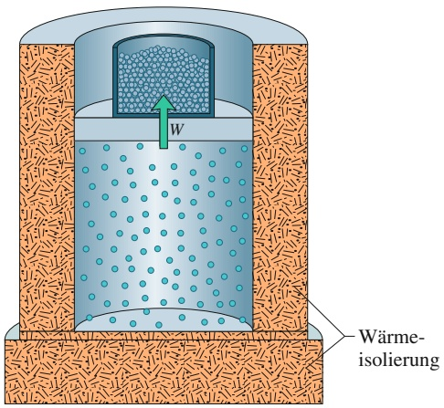

text_image

W
Wärme-
isolierung

(a)

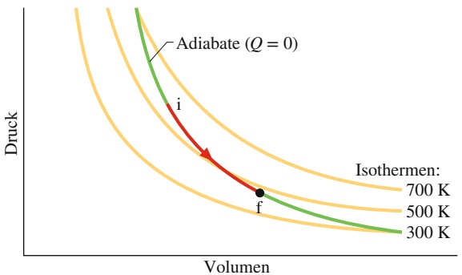

contour

| Isothermen | Volumen | Druck |
| --- | --- | --- |
| 700 K | f | ~low |
| 500 K | f | ~medium |
| 300 K | f | ~high |

(b)

## Abb. 15.12

(a) Das Volumen eines idealen Gases dehnt sich aus, wenn das Gewicht auf dem Kolben kleiner wird. Dieser Prozess ist adiabatisch $\left( Q = 0 \right)$ . (b) Im pV-Diagramm erfolgt der Prozess entlang einer Adiabaten von i nach f.

Abbildung 15.12a zeigt den uns schon vertrauten wärmeisolierten Zylinder (hier zusätzlich mit einem wärmeisolierten Boden), in dem sich ein ideales Gas befindet. Verringern wir das Gewicht auf dem Kolben (indem wir beispielsweise Bleikugeln aus dem Behälter entfernen), kann sich das Gas adiabatisch ausdehnen. Mit zunehmendem Volumen nehmen sowohl der Druck als auch die Temperatur ab. Wir werden gleich beweisen, dass bei einem solchen adiabatischen Prozess die Bezie hung zwischen dem Volumen und dem Druck durch

$$
p V ^ {\gamma} = \text {const.} \quad \text {(adiabatischer Prozess)} \tag {15.49}
$$

gegeben ist, wobei $\gamma = C _ { p } / C _ { V }$ das Verhältnis der molaren Wärmekapazitäten des Gases ist. In einem $p V .$ -Diagramm wie in Abb. 15.12b erfolgt der Prozess entlang einer Adiabate genannten Linie, die durch die Gleichung $p = \mathrm { c o n s t . } / V ^ { \gamma }$ gegeben ist. Da sich das Gas von einem Anfangszustand i zu einem Endzustand f ausdehnt, schreibt sich Gl. 15.49 auch in der Form

$$
p _ {\mathrm{i}} V _ {\mathrm{i}} ^ {\gamma} = p _ {\mathrm{f}} V _ {\mathrm{f}} ^ {\gamma} \quad \text {(adiabatischer Prozess)}  . \tag {15.50}
$$

Wir können für einen adiabatischen Prozess auch eine Beziehung zwischen $T$ und V aufstellen. Dazu verwenden wir die ideale Gasgleichung $( p V = n R T )$ und eliminieren $p$ aus Gl. 15.49:

$$
\left(\frac {n R T}{V}\right) V ^ {\gamma} = \text {const.}
$$

Da es sich bei n und $R$ um Konstanten handelt, können wir diese Beziehung vereinfachen:

$$
T V ^ {\gamma - 1} = \text {const.} ^ {\prime} \quad \text {(adiabatischer Prozess)}, \tag {15.51}
$$

wobei sich die Konstante in dieser Gleichung von der Konstante in Gl. 15.49 unterscheidet. Wir betrachten den Prozess wieder als einen Übergang von einem Anfangszustand i in einen Endzustand f und schreiben Gl. 15.51 in der Form

$$
T _ {\mathrm{i}} V _ {\mathrm{i}} ^ {\gamma - 1} = T _ {\mathrm{f}} V _ {\mathrm{f}} ^ {\gamma - 1} \quad (\text {adiabatischer Prozess}). \tag {15.52}
$$

Wenn wir adiabatische Prozesse verstehen, können wir beispielsweise auch er klären, warum sich beim Öffnen einer kalten Sektflasche oder Getränkedose ein leichter Nebel über der Öffnung bildet. In einem verschlossenen, kohlensäurehaltigen Getränkebehälter (Flasche bzw. Dose) befindet sich oben eine Gasblase aus Kohlenstoffdioxid und Wasserdampf. Da der Druck dieses Gases größer ist als der Atmosphärendruck, dehnt sich das Gas beim Öffnen gegen die Atmosphäre aus.

Das Gas vergrößert also sein Volumen und leistet Arbeit gegen den Atmosphä- rendruck. Diese sehr rasche Expansion erfolgt adiabatisch, und die einzige Energiequelle für die Arbeit ist die innere Energie des Gases. Da die innere Energie abnimmt, muss auch die Temperatur des Gases abnehmen. Dadurch kann der Wasserdampf in dem Gas zu winzigen Tropfen kondensieren und den beobachteten Nebel bilden. (Man beachte, dass nach Gl. 15.52 die Temperatur bei einem adiabatischen Prozess abnehmen muss: Da $V _ { \mathrm { f } }$ größer als $V _ { \mathrm { i } }$ und $\gamma = C _ { p } / C _ { V }$ größer als eins ist, muss $T _ { \mathrm { f } }$ kleiner als $T _ { \mathrm { i } }$ sein.)

## Der Beweis von Gl. 15.49

Angenommen, wir entnehmen dem Behälter auf dem Kolben in Abb. 15.12a eine infinitesimale Menge an Bleikugeln und ermöglichen es so dem Gas, den Kolben etwas nach oben zu drücken, wobei sein Volumen um den infinitesimalen Betrag dV zunimmt. Da diese Volumenänderung infinitesimal ist, können wir den Druck p des Gases gegen den Kolben bei diesem Prozess als konstant annehmen. Unter dieser Annahme gilt für die vom Gas geleistete Arbeit: d $W = p   \mathrm { d } V$ . Nach Gl. 14.22 folgt damit für den ersten Hauptsatz der Thermodynamik

$$
\mathrm{d} E _ {\mathrm{int}} = Q - p \mathrm{d} V. \tag {15.53}
$$

Da sich das Gas in einem wärmeisolierten Behälter befindet und die Expansion somit adiabatisch ist, können wir Q gleich null setzen. Außerdem ersetzen wir d $. E _ { \mathrm { i n t } }$ nach Gl. 15.43 noch durch $n C _ { V }   \mathsf { d } T$ . Nach einigen Umformungen erhalten wir

$$
n \mathrm{d} T = - \left(\frac {p}{C _ {V}}\right) \mathrm{d} V. \tag {15.54}
$$

Nun gilt nach der idealen Gasgleichung $( p V = n R T )$

$$
p \mathrm{d} V + V \mathrm{d} p = n R \mathrm{d} T. \tag {15.55}
$$

In dieser Gleichung ersetzen wir jetzt noch R durch $C _ { p } - C _ { V } { : }$

$$
n \mathrm{d} T = \frac {p \mathrm{d} V + V \mathrm{d} p}{C _ {p} - C _ {V}}. \tag {15.56}
$$

Wir können nun Gl. 15.54 und Gl. 15.56 gleichsetzen und finden

$$
\frac {\mathrm{d} p}{p} + \left(\frac {C _ {p}}{C _ {V}}\right) \frac {\mathrm{d} V}{V} = 0.
$$

Das Verhältnis der molaren Wärmekapazitäten bezeichnen wir mit $\gamma .$ Die Integration dieser Gleichung (siehe Anhang D) führt auf

$$
\ln p + \gamma \ln V = \text { const.} ^ {\prime}
$$

Die linke Seite schreiben wir als $\ln ( p V ^ { \gamma } )$ . Nehmen wir noch auf beiden Seiten die Umkehrfunktion des Logarithmus, erhalten wir das gesuchte Ergebnis, wobei wir bemerken, dass die Konstante in der letzten Gleichung eine andere als die in Gl. 15.57 ist:

$$
p V ^ {\gamma} = \text {const.} \tag {15.57}
$$

## Freie Expansion

In Abschn. 14.5 hatten wir festgestellt, dass es sich bei der freien Expansion eines Gases um einen adiabatischen Prozess handelt, bei dem keine Arbeit an oder von dem Gas verrichtet wird, und bei dem sich auch die innere Energie des Gases nicht ändert. Die freie Expansion unterscheidet sich daher wesentlich von dem adiabatischen Prozess, den wir in den Gln. 15.49–15.57 beschrieben haben und bei dem sowohl Arbeit geleistet wird als auch die innere Energie sich ändert. Diese Gleichungen gelten daher nicht für die freie Expansion, obwohl es sich bei dieser Expansion um einen adiabatischen Prozess handelt.

Außerdem befindet sich das Gas bei einer freien Expansion nur im Anfangs- und im Endzustand im thermodynamischen Gleichgewicht. Wir können daher auch nur diese beiden Punkte, nicht aber den Prozess selbst in einem $p V \text-- \mathrm { D i }$ iagramm darstellen. Da sich außerdem die innere Energie nicht ändert, $\Delta E _ { \mathrm { i n t } } = 0 ,$ , muss die Temperatur des Endzustands gleich der des Anfangszustands sein. Anfangs- und Endpunkt in einem pV-Diagramm liegen daher auf derselben Isotherme, und statt Gl. 15.52 haben wir nun

$$
T _ {\mathrm{i}} = T _ {\mathrm{f}} \quad (\text {freie Expansion}). \tag {15.58}
$$

Nehmen wir noch die Gültigkeit der idealen Gasgleichung an (also $p V = n R T )$ muss das Produkt $p V$ konstant bleiben, da sich die Temperatur nicht ändert. Statt Gl. 15.49 gilt daher bei einer freien Expansion

$$
p _ {\mathrm{i}} V _ {\mathrm{i}} = p _ {\mathrm{f}} V _ {\mathrm{f}} \quad (\text {freie Expansion}). \tag {15.59}
$$

## LÖSUNGSSTRATEGIEN

**Strategie 2: Eine grafische Zusammenfassung der vier Gasprozesse** In diesem Kapitel haben wir vier besondere Prozesse untersucht, die ein ideales Gas durchlaufen kann. Für jeden dieser Prozesse ist in Abb. 15.13 ein Beispiel angegeben, außerdem fasst Tab. 15.4 einige Eigenschaften der Prozesse zusammen. Dazu zählen unter anderem auch zwei Prozessbezeichnungen (isobar und isochor), die wir in diesem Kapitel zwar nicht verwendet haben, die aber in anderen Büchern auftauchen können.

## KONTROLLFRAGE 5

Ordnen Sie die Pfade 1, 2 und 3 in Abb. 15.13 nach der auf das Gas übertragenen Wärmemenge (größte Werte zuerst).

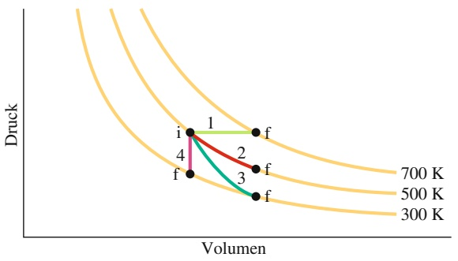

contour

| Point | Volumen | Druck |
| --- | --- | --- |
| i | ~150 | ~250 |
| f | ~150 | ~150 |
| 1 | ~250 | ~250 |
| 2 | ~350 | ~200 |
| 3 | ~350 | ~150 |
| f | ~450 | ~150 |

Abb. 15.13 Vier besondere Prozesse für ein ideales Gas im $p V \cdot$ Diagramm, vgl. Tab. 15.4.

TABELLE 15.4: Vier besondere Prozesse.

<table><tr><td>Pfad in Abb. 15.13</td><td>Konstante Größe</td><td>Prozesstyp</td><td colspan="2">Einige spezielle Ergebnisse $(\Delta E_{\text{int}} = Q - W \text{ und } \Delta E_{\text{int}} = nC_V \Delta T \text{ für alle Wege})$ </td></tr><tr><td>1</td><td> $p$ </td><td>isobar</td><td> $Q = nC_p \Delta T$ </td><td> $W = p \Delta V$ </td></tr><tr><td>2</td><td> $T$ </td><td>isotherm</td><td> $Q = W = nRT \ln(V_f/V_i)$ </td><td> $\Delta E_{\text{int}} = 0$ </td></tr><tr><td>3</td><td> $pV^\gamma, TV^{\gamma-1}$ </td><td>adiabatisch</td><td> $Q = 0$ </td><td> $W = -\Delta E_{\text{int}}$ </td></tr><tr><td>4</td><td> $V$ </td><td>isochor</td><td> $Q = \Delta E_{\text{int}} = nC_V \Delta T$ </td><td> $W = 0$ </td></tr></table>

## 15.10 Reale Gase

## Lernziele

Nach dem Durcharbeiten dieses Abschnitts sollten Sie in der Lage sein, . . .

• ideale Gase als den Grenzfall realer Gase zu verstehen,
• die Zustandsgleichung realer Gase zu verwenden,
• das Konzept des Phasenübergangs zwischen verschiedenen Aggregatzuständen der Materie zu verstehen.

## Schlüsselideen

• Die Zustandsgleichung idealer Gase gilt näherungsweise nur für sehr stark verdünnte Systeme mit vernachlässigbarer Wechselwirkung zwischen den Molekülen.
Für reale Gase muss die Zustandsgleichung erweitert werden. Im Ansatz des Physikers J.D. van der Waals werden der Druck p durch $p   +   n ^ { 2 } a / V ^ { 2 }$ und das Volumen V durch $V - n b$ ersetzt, wobei a den Kohäsionsdruck darstellt, $n ^ { 2 } a / V ^ { 2 }$ die anziehende Dipolwechselwirkung zwischen den Molekülen beschreibt und b das Kovolumen ist.
• Unterhalb der kritischen Temperatur beschreibt die Van-der-Waals-Zustandsgleichung den Phasenübergang zwischen dem gasförmigen und dem flüssigen Aggregatzustand.

## 15.10.1 Reale Gase

In Abschn. 15.2 haben wir das Konzept des idealen Gases eingeführt. Wie wir dort ausführlich diskutiert haben, gibt es ein solches ideales Gas nicht wirklich, sondern es stellt einen Grenzfall dar, dem sich **reale Gase** bei genügend kleinen Dichten und hohen Temperaturen annähern. In diesem Parameterregime sind die Gasmoleküle im Mittel so weit voneinander entfernt, dass ihre Wechselwirkung untereinander vernachlässigt werden kann. Außerdem spielt es im Grenzfall sehr geringer Dichte auch keine Rolle, dass die Moleküle in Wirklichkeit keine punktförmigen Teilchen sind, sondern eine gewisse endliche Ausdehnung haben.

Die Frage ist nun, wie wir das ideale Gasgesetz in Gl. 15.5 zu erweitern haben, um sowohl die zwischenmolekulare Wechselwirkung als auch das endliche Molekülvolumen zu berücksichtigen. Streng genommen müssten wir hierfür Methoden aus der mikroskopischen Physik, d. h. der Quantenmechanik zu Hilfe nehmen, denn die detaillierten Wechselwirkungen zwischen Atomen und Molekülen können nur in diesem Rahmen berechnet werden. Da wir uns im Rahmen dieses Buches allerdings nicht mit dem hierfür notwendigen Theorieformalismus auseinandersetzen wollen und auch weil dieser mikroskopische Zugang leicht die allgemeinen Prinzipien in den Hintergrund drängen kann, wollen wir hier lieber einen phänomenologischen Ansatz wählen.

Im Jahr 1873 machte der holländische Physiker Johannes Diderik van der Waals (1837–1923) einen bahnbrechenden Vorschlag zur Erweiterung des idealen Gasgesetzes in der Form

$$
\left(p + \frac {n ^ {2} a}{V ^ {2}}\right) (V - n b) = n R T \quad \text {(Van - der - Waals - Gleichung).} \tag {15.60}
$$

In dieser **Van-der-Waals-Gleichung** bezeichnen a den Kohäsionsdruck und b das Kovolumen, deren Werte man für viele reale Gase in der einschlägigen Literatur finden kann. Im Vergleich mit der idealen Gasgleichung sehen wir in der Van-der-Waals-Gleichung zwei wesentliche Erweiterungen:

1. der Druck $p$ wird durch $\begin{array} { r } { p + \frac { n ^ { 2 } a } { V ^ { 2 } } } \end{array}$ und
2. das Volumen V wird durch $V ^ { ' } - n b$ ersetzt.

## Abb. 15.14

Isothermen des realen Gases gemäß der Van-der-Waals-Gleichung (Gl. 15.61). Im $p V$ -Diagramm sind die Temperaturen in aufsteigender Reihenfolge gewählt, d. h. $T _ { 0 } < T _ { 1 } < T _ { 2 } < T _ { 3 } < T _ { 4 } .$ Oberhalb der kritischen Temperatur $T _ { \mathrm { k } } = T _ { 2 }$ (rote Isotherme) ähneln die Van-der-Waals-Isothermen zunehmend den einfachen Hyperbeln des idealen Gases.

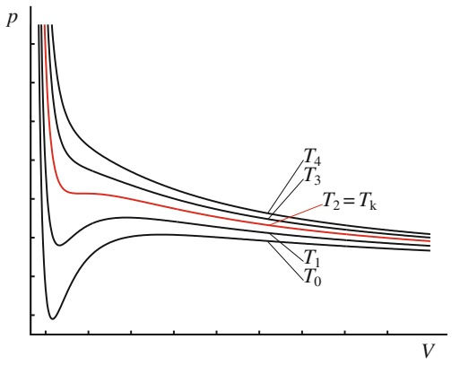

line

| V | T0 | T1 | T2 = Tk | T3 | T4 |
| --- | --- | --- | --- | --- | --- |
| ~0.1 | ~0.1 | ~0.5 | ~0.8 | ~0.9 | ~1.0 |
| ~0.2 | ~0.3 | ~0.6 | ~0.7 | ~0.75 | ~0.8 |
| ~0.5 | ~0.4 | ~0.65 | ~0.65 | ~0.65 | ~0.65 |
| ~1.0 | ~0.45 | ~0.65 | ~0.6 | ~0.6 | ~0.6 |

Dies entspricht einem Modell, in dem die Gasmoleküle als harte Kugeln mit dem Volumen b modelliert werden. Man nennt $b$ auch das Kovolumen. In einem solchen Gas ist das freie Volumen um das von den n Molekülen eingenommene Volumen reduziert. Die Druckerhöhung um $\frac { n ^ { 2 } } { V ^ { 2 } } a$ beruht auf einer anziehenden Dipolwechselwirkung zwischen den Molekülen. Da es sich hierbei um eine paarweise Wechselwirkung handelt, ist die Druckkorrektur (der Binnendruck), proportional zum Quadrat der Anzahldichte $n / V$

Wie bereits erwähnt, sind der Kohäsionsdruck a und das Kovolumen b empirische Parameter, die man durch geeignete Experimente und deren Anpassung an die Van-der-Waals-Gleichung bestimmt. Man findet dabei oft, dass a und b keine echten Konstanten sind, sondern durchaus von den Versuchsbedingungen abhängen können.

Wir wollen nun einige Konsequenzen der Van-der-Waals-Gleichung diskutieren. Dazu schauen wir uns zuerst die Isothermen an. Aufgelöst nach $p$ lautet Gl. 15.60

$$
p = \frac {n R T}{V - n b} - \frac {n ^ {2}}{V ^ {2}} a. \tag {15.61}
$$

Beispiele der resultierenden Isothermen sind in Abb. 15.14 gezeigt. Anstelle des einfachen $p \propto 1 / V$ -Verhaltens im idealen Gas, in dem sich der Druck umgekehrt proportional zum Volumen verhält und die Isothermen Hyperbeln sind, sehen wir hier die Differenz zwischen dem hyperbelartigen Term proportional zu $1 / ( V   -   n b )$ und einem Term mit $1 / V ^ { 2 }$ -Verhalten.

Für hohe Temperaturen nähern sich die Van-der-Waals-Isothermen den einfachen Hyperbeln des idealen Gases an. Für niedrigere Temperaturen finden wir jedoch immer stärkere Abweichungen. Speziell erkennen wir, dass unterhalb der **kritischen Temperatur** $T _ { 2 } = T _ { \mathrm { k } }$ die Isothermen einen Bereich enthalten, in dem der Druck ansteigt, wenn wir das Volumen vergrößern. Eine solche Isotherme ist in Abb. 15.15 herausgezeichnet. Dieses Verhalten ist im thermodynamischen Gleichgewicht einer realen Substanz sicher nicht realisiert, d. h., es ist unphysikalisch! Darüber hinaus würde es laut Gl. 15.11

$$
W = \int_ {V _ {\mathrm{a}}} ^ {V _ {\mathrm{b}}} p \mathrm{d} V \tag {15.62}
$$

einer negativen Arbeit entsprechen. Demzufolge kann also die Van-der-Waals-Gleichung allein zumindest für $T < T _ { \mathrm { k } }$ und im Bereich $V _ { \mathrm { a } } < V < V _ { \mathrm { b } }$ das Verhalten eines realen Gases nicht korrekt beschreiben.

Um dieser scheinbaren Unzulänglichkeit der Van-der-Waals-Gleichung auf den Grund zu gehen, betrachten wir die Isotherme für $T < T _ { \mathrm { k } }$ in Abb. 15.15 etwas genauer. Wenn wir uns deren Verlauf für große Volumina V ansehen, finden wir einen relativ schwachen Druckanstieg bei Verkleinerung des Volumens. Dies entspricht dem physikalischen Verhalten eines leicht komprimierbaren Gases.

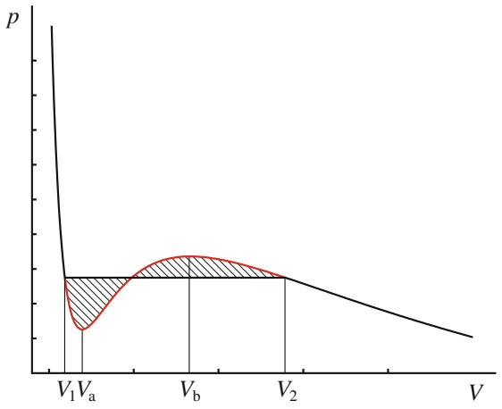

area

| Volume | Pressure (p) |
| --- | --- |
| V1 | ~0.4 |
| Va | ~0.2 |
| Vb | ~0.5 |
| V2 | ~0.4 |

## Abb. 15.15

Eine Van-der-Waals-Isotherme bei $T < T _ { \mathrm { k } }$ . Gemäß dem Kurvenverlauf würde im Bereich $V _ { \mathrm { a } }   <   V   <   V _ { \mathrm { b } }$ der Druck ansteigen, obwohl das Volumen zunimmt. Dieses unphysikalische Verhalten wird durch die Maxwell-Konstruktion korrigiert, die im Bereich $V _ { 1 } < V < V _ { 2 }$ die Van-der-Waals-Isotherme durch p = const. ersetzt, wobei die Konstante so bestimmt wird, dass die gestrichelt eingezeichneten Flächen genau gleich groß sind.

Für sehr kleine Volumina $\left( V < V _ { 1 } \right.$ in Abb. 15.15) finden wir einen sehr viel stärkeren Druckanstieg selbst für geringe Volumenänderungen. Ein solches Verhalten kennen wir von Flüssigkeiten, die nur sehr schwer komprimierbar sind. Daraus schließen wir also, dass die Isotherme in Abb. 15.15 für kleine Werte von $V$ eine Flüssigkeit und für große Werte von V ein Gas charakterisiert. Damit muss der Zwischenbereich den **Phasenübergang** zwischen diesen beiden Aggregatzuständen beschreiben. In diesem Bereich hat man eine Phasenkoexistenz, d. $\mathrm { h } _ { \star } ,$ ein Teil des Systems liegt gasförmig und der Rest in flüssiger Form vor. In diesem Koexistenzbereich ändert sich der Druck gar nicht, wenn wir das Volumen verändern, sondern es findet bei Volumenerniedrigung lediglich eine Umwandlung von Gas in Flüssigkeit bzw. bei Volumenerhöhung eine Umwandlung von Flüssigkeit in Gas statt. Dieses Verhalten ist durch die waagerechte Linie in Abb. 15.15 angezeigt. Diese Linie entspricht der sogenannten Maxwell-Konstruktion, die dadurch gewonnen wird, dass bei der Phasenkoexistenz die sogenannten chemischen Potenziale μ der beiden Phasen gleich sein müssen, d. h.

$$
\mu_ {\text {Gas}} = \mu_ {\text {Flüssigkeit}}. \tag {15.63}
$$

Hierbei charakterisiert das chemische Potenzial die Möglichkeiten eines Stoffes, seine Zustandsform zu ändern bzw. mit anderen Stoffen zu reagieren. Diese Grö- ße wurde von **Josiah Willard Gibbs** (1839–1903) eingeführt. Technisch gesehen ist −μ gerade die Energieänderung, die in einem thermodynamischen Gleichgewichtssystem durch das Hinzufügen eines Teilchens hervorgerufen wird, $- \mu N$ ist dementsprechend die Energieänderung bei der Zufuhr von N Teilchen.

Mithilfe der Gleichgewichtsbedingung in Gl. 15.63 kann man zeigen, dass die beiden gestrichelten Flächen in Abb. 15.15 gleich groß sind. Die Maxwell-Konstruktion ersetzt also den Verlauf der Van-der-Waals-Isothermen zwischen $V _ { 1 }$ und $V _ { 2 }$ durch ein Geradenstück, vgl. Abb. 15.16.

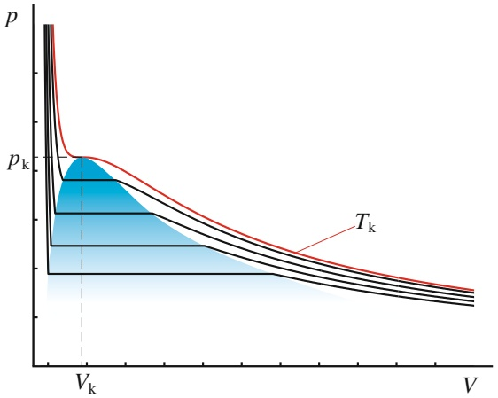

area

| V | p (Curve 1) | p (Curve 2) | p (Curve 3) | p (Curve 4) |
| --- | --- | --- | --- | --- |
| Vk | ~pk | ~pk | ~pk | ~pk |
| >Vk | Decreasing trend | Decreasing trend | Decreasing trend | Decreasing trend |

## Abb. 15.16

Isothermen des realen Gases für eine Serie von Temperaturen $T \leq T _ { \mathrm { k } } .$ Der blau eingezeichnete Bereich ist das Gas-Flüssigkeit-Koexistenzgebiet. Oberhalb des kritischen Punkts $p _ { \mathrm { k } } ,$ $V _ { \mathrm { k } } ,   T _ { \mathrm { k } }$ ist keine Unterscheidung zwischen flüssiger und gasförmiger Phase möglich.

Für Parameterkombinationen p, V, T innerhalb des blau hinterlegten Bereichs in Abb. 15.16 haben wir Phasenkoexistenz zwischen Gas und Flüssigkeit. Dieses **Phasenkoexistenzgebiet** schrumpft bei Temperaturerhöhung auf einen Punkt, den sogenannten kritischen Punkt mit den Werten $p _ { \mathrm { k } } ,   V _ { \mathrm { k } }$ und $T _ { \mathrm { k } } ,$ oberhalb dessen keine Unterscheidung zwischen flüssiger und gasförmiger Phase möglich ist.

## 15.11 Zusammenfassung

**Kinetische Gastheorie** In der kinetischen Gastheorie werden makroskopische Eigenschaften eines Gases (beispielsweise Druck und Temperatur) mit mikroskopischen Eigenschaften der Gasmoleküle bzw. -atome (beispielsweise Geschwindigkeit und kinetische Energie) in Beziehung gesetzt.

**Avogadro-Konstante** Ein Mol einer Substanz enthält $N _ { \mathrm { A } }$ (Avogadro-Konstante) elementare Einheiten (üblicherweise Atome oder Moleküle), wobei experimentell $N _ { \mathrm { A } }$ zu

$$
N _ {\mathrm{A}} = 6, 0 2 \cdot 1 0 ^ {2 3} \mathrm{mol} ^ {- 1} \quad (\text {Avogadro - Konstante}) \tag {15.1}
$$

bestimmt wurde. Die Molmasse M einer Substanz ist gleich der Masse eines Mols dieser Substanz. Sie hängt mit der Masse m der einzelnen Moleküle der Substanz über

$$
M = m N _ {\mathrm{A}} \tag {15.4}
$$

zusammen. Die Stoffmenge n einer aus N Molekülen bestehenden Probe der Masse $M _ { \mathrm { P r o b e } }$ ist gleich

$$
n = \frac {N}{N _ {\mathrm{A}}} = \frac {M _ {\mathrm{Probe}}}{M} = \frac {M _ {\mathrm{Probe}}}{m N _ {\mathrm{A}}}. \tag {15.2,15.3}
$$

**Ideales Gas** Ein ideales Gas ist ein Gas, für dessen Druck $p ,$ Volumen V und Temperatur T die Beziehung

$$
p V = n R T \quad \text {(ideales Gasgesetz)} \tag {15.5}
$$

erfüllt ist. Hierbei sind n die Stoffmenge des Gases und $R   =   8 { , } 3 1 \mathrm { J } /$ (mol ⋅ K) die **allgemeine Gaskonstante**. Das ideale Gasgesetz kann auch in der Form

$$
p V = N k T \tag {15.9}
$$

geschrieben werden. Die **Boltzmann-Konstante** k hat den Wert

$$
k = \frac {R}{N _ {\mathrm{A}}} = 1, 3 8 \cdot 1 0 ^ {- 2 3} \mathrm{J/K}. \tag {15.7}
$$

**Arbeit bei einer isothermen Volumenänderung** Die von einem idealen Gas bei einer **isothermen** Volumenänderung von $V _ { \mathrm { i } }$ auf $V _ { \mathrm { f } }$ (also bei konstanter Temperatur) geleistete Arbeit ist

$$
W = n R T \ln \frac {V _ {\mathrm{f}}}{V _ {\mathrm{i}}} \quad \text {(ideales Gas, isothermer Prozess).} \tag {15.14}
$$

**Druck, Temperatur und Molekülgeschwindigkeit** Der von n mol eines idealen Gases ausgeübte Druck ist

$$
p = \frac {n M v _ {\mathrm{rms}} ^ {2}}{3 V}, \tag {15.20}
$$

wobei $\nu _ { \mathrm { r m s } } \; = \; \sqrt { ( \nu ^ { 2 } ) _ { \mathrm { g e m } } }$ die quadratisch gemittelte Geschwindigkeit oder rms-Geschwindigkeit der Gasmoleküle ist. Zusammen mit Gl. 15.5 erhält man

$$
\nu_ {\mathrm{rms}} = \sqrt {\frac {3 R T}{M}}. \tag {15.21}
$$

**Temperatur und kinetische Energie** Die mittlere kinetische Energie $K _ { \mathrm { g e m } }$ pro Molekül eines idealen Gases ist

$$
K _ {\mathrm{gem}} = \frac {3}{2} k T. \tag {15.23}
$$

**Mittlere freie Weglänge** Die mittlere freie Weglänge λ eines Gasmoleküls zwischen zwei Stößen ist gleich

$$
\lambda = \frac {1}{\sqrt {2} \pi d ^ {2} N / V}, \tag {15.24}
$$

wobei $N / V$ die Anzahldichte der Moleküle und d der Moleküldurchmesser sind.

**Maxwellsche Geschwindigkeitsverteilung** Die Maxwellsche Geschwindigkeitsverteilung $P ( \nu )$ ist so definiert, sodass $P ( \nu )$ dv dem Anteil der Moleküle entspricht, deren Geschwindigkeiten in dem Intervall zwischen v und v + dv liegen:

$$
P (\nu) = 4 \pi \left(\frac {M}{2 \pi R T}\right) ^ {3 / 2} \nu^ {2} \mathrm{e} ^ {- M \nu^ {2} / (2 R T)}. \tag {15.26}
$$

Maße für die Geschwindigkeitsverteilung der Gasmoleküle sind

$$
\nu_ {\mathrm{gem}} = \sqrt {\frac {8 R T}{\pi M}} \quad (\text {mittlere Geschwindigkeit}), \tag {15.30}
$$

$$
\nu_ {P} = \sqrt {\frac {2 R T}{M}} \quad (\text {wahrscheinlichste Geschwindigkeit}) \tag {15.34}
$$

und die rms-Geschwindigkeit aus Gl. 15.21 (siehe oben).

**Molare Wärmekapazitäten** Ein Gas mit der Stoffmenge n hat bei konstantem Volumen die molare Wärmekapazität

$$
C _ {V} = \frac {1}{n} \frac {Q}{\Delta T} = \frac {1}{n} \frac {\Delta E _ {\mathrm{int}}}{\Delta T}. \tag {15.37,15.39}
$$

Q ist die zu- bzw. abgeführte Wärmeenergie, $\Delta T$ ist die daraus resultierende Temperaturänderung des Gases und $\Delta E _ { \mathrm { i n t } }$ ist die damit zusammenhängende Änderung der inneren Energie des Gases. Für ein ideales einatomiges Gas gilt

$$
C _ {V} = \frac {3}{2} R = 1 2, 5   \mathrm{J/(mol} \cdot \mathrm{K)}  . \tag {15.41}
$$

Bei konstantem Druck hat ein Gas die molare Wärmekapazität

$$
C _ {p} = \frac {1}{n} \frac {Q}{\Delta T}, \tag {15.44}
$$

wobei $Q ,$ n und T dieselbe Bedeutung haben wie oben. Zwischen $C _ { p }$ und $C _ { V }$ besteht die Beziehung

$$
C _ {p} = C _ {V} + R. \tag {15.47}
$$

Mit der Stoffmenge n gilt für ein ideales Gas

$$
E _ {\mathrm{int}} = n C _ {V} T \quad (\text {ideales Gas}). \tag {15.42}
$$

Wenn n mol eines idealen Gases in einem abgeschlossenen Behälter bei einem beliebigen Prozess ihre Temperatur um ΔT ändern, so ändert sich auch die innere Energie des Gases um

$$
\Delta E _ {\text {int}} = n C _ {V} \Delta T \quad \text {(ideales Gas, beliebiger Prozess)}, \tag {15.43}
$$

wobei sich der Wert für $C _ { V }$ nach der Art des idealen Gases richtet.

**Thermodynamische Freiheitsgrade und** $c _ { v }$ Den Wert für $C _ { V }$ erhalten wir aus dem Gleichverteilungssatz der Energie: Jeder thermodynamische Freiheitsgrad eines Mole küls (d. h. jede unabhängige Form, in der ein Molekül Energie speichern kann) kann im Mittel $\frac { 1 } { 2 } k T$ pro Molekül bzw.

## 15.12 Fragen

**1.** Angenommen, die Temperatur eines idealen Gases erhöht sich bei festgehaltenem Volumen von $2 0   ^ { \circ } \mathrm { C }$ auf $4 0   ^ { \circ } \mathrm { C } ,$ Verdoppelt sich der Druck, oder nimmt er zu, aber um weniger als das Doppelte, oder nimmt er zu, aber um mehr als das Doppelte?
**2.** In Abb. 15.F2a sind für dasselbe Gas und für dieselben Volumenänderungen (von $V _ { \mathrm { i } }$ nach $V _ { \mathrm { f } } ) _ { i }$ aber bei verschiedenen Temperaturen drei isotherme Prozesse wiedergegeben. Ordnen Sie diese Prozesse (a) nach der vom Gas geleisteten $\frac { 1 } { 2 } R T$ pro Mol zur gesamten inneren Energie beitragen. Bezeichnen wir mit $f$ die Anzahl der thermodynamischen Freiheitsgrade, so ist $E _ { \mathrm { i n t } } = ( f / 2 ) n R T$ und somit

$$
C _ {V} = \left(\frac {f}{2}\right) R = f \cdot 4, 1 6 \mathrm{J/(mol} \cdot \mathrm{K)}. \tag {15.48}
$$

Bei nicht zu hohen Temperaturen ist für einatomige Gase $f = 3$ (drei Translationsfreiheitsgrade); für zweiatomige Gase gilt dann $f = 5$ (drei Translations- und zwei Rotationsfreiheitsgrade). Kommen bei höheren Temperaturen noch Schwingungsfreiheitsgrade, dann trägt jede Schwingungsform zwei Freiheitsgrade bei.

**Adiabatische Prozesse** Durchläuft ein Gas eine langsame adiabatische Volumenänderung (also $Q = 0 )$ , so hängen sein Druck und sein Volumen über die Beziehung

$$
p V ^ {\gamma} = \text {const.} \quad \text {(adiabatischer Prozess)} \tag {15.49}
$$

zusammen. Hierbei ist $\gamma = C _ { p } / C _ { V }$ das Verhältnis der molaren Wärmekapazitäten für das Gas. Bei einer freien Expansion gilt jedoch $p V = \mathrm { c o n s t }$

**Van-der-Waals-Gleichung** Für die Beschreibung eines realen Gases muss die Zustandsgleichung des idealen Gases um den Binnendruck und das Kovolumen erweitert werden. Die attraktive Dipolwechselwirkung zwischen den Molekülen und deren endliche Ausdehnung erfasste J.D. van der Waals in der Gleichung

$$
\left(p + \frac {n ^ {2} a}{V ^ {2}}\right) (V - n b) = n R T \quad (\text {Van - der - Waals - Gleichung}) \tag {15.60}
$$

durch Einführung der phänomenologischen Konstanten a (Kohäsionsdruck) und b (Kovolumen).

**Maxwell-Konstruktion** Unterhalb der kritischen Temperatur kommt es zur Phasenkoexistenz zwischen Gas und Flüssigkeit. In diesem Parameterbereich ändert sich der Druck nicht bei Volumenänderungen, sondern es findet eine Umwandlung zwischen Gas und Flüssigkeit statt. Die Maxwell-Konstruktion ersetzt innerhalb des Phasenkoexistenzgebiets die Van-der-Waals-Isothermen durch eine Gerade mit $p = \mathsf { c o n s t }$

Arbeit, (b) nach der Änderung seiner inneren Energie und (c) nach der dem Gas zugeführten Wärmeenergie (größte Werte zuerst).

In Abb. 15.F2b sind drei isotherme Prozesse entlang einer einzelnen Isotherme wiedergegeben, wobei in allen drei Fällen die Volumenänderungen $\Delta V$ gleich sind. Ordnen Sie die Prozesse (d) nach der vom Gas geleisteten Arbeit, (e) nach der Änderung seiner inneren Energie und (f ) nach der dem Gas zugeführten Wärmeenergie (größte Werte zuerst).

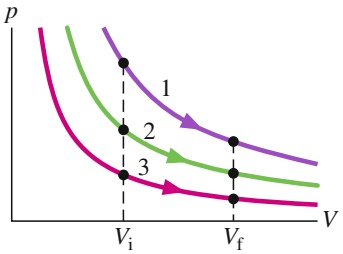

contour

| Curve | Point | p | V |
| --- | --- | --- | --- |
| 1 | 1 | High | \(V_i\) |
| 1 | 2 | Medium-High | \(V_f\) |
| 1 | 3 | Medium | \(V_i\) |
| 2 | 2 | Medium | \(V_i\) |
| 2 | 3 | Low-Medium | \(V_f\) |
| 3 | 3 | Low | \(V_i\) |
| 3 | 4 | Very Low | \(V_f\) |

(a)

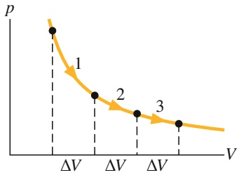

line

| Segment | Pressure (p) |
| --- | --- |
| 1 | High |
| 2 | Medium |
| 3 | Low |

(b)

Abb. 15.F2

**3.** Für vier verschiedene Situationen seien jeweils das Volumen eines Gases und die Anzahl der Gasmoleküle gegeben: (a) $2 V _ { 0 }$ und $N _ { 0 1 }$ , (b) $3 V _ { 0 }$ und $3 N _ { 0 } ,$ (c) $8 V _ { 0 }$ und $4 N _ { 0 }$ und (d) $3 V _ { 0 }$ und $9 N _ { 0 ^ { \cdot } }$ . Ordnen Sie diese Systeme nach der mittleren freien Weglänge der Moleküle (größte Werte zuerst).
**4.** Wie viel Wärmeenergie wird in Beispielaufgabe 15.2 im Übungsbuch bei der Expansion übertragen?
**5.** Abbildung 15.F5 zeigt den Anfangszustand eines idealen Gases und eine Isotherme durch diesen Zustand. Welche der gezeigten Pfade entsprechen einer Temperaturabnahme des Gases?

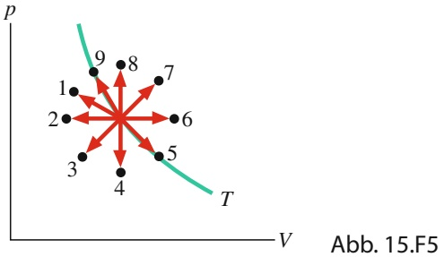

scatter

| State | Pressure (p) | Potential (V) |
| --- | --- | --- |
| 1 | High | Low |
| 2 | High | Low |
| 3 | High | Low |
| 4 | Low | Medium |
| 5 | Low | Medium |
| 6 | Low | Medium |
| 7 | Low | High |
| 8 | High | Low |
| 9 | High | Low |

**6.** Für vier Situationen werden in der untenstehenden Tabelle die Wärme Q und entweder die vom Gas geleistete Arbeit W oder die am Gas verrichtete Arbeit $W _ { \mathrm { a n } }$ (alle in Joule) angegeben. Ordnen Sie die vier Situationen nach der Temperaturänderung des Gases (größter positiver Wert zuerst, größter negativer Wert zuletzt).

|  | a | b | c | d |
| --- | --- | --- | --- | --- |
| Q | -50 | +35 | -15 | +20 |
| W | -50 | +35 |  |  |
| $W_{\text{an}}$ |  |  | -40 | +40 |

**7.** Eine Temperaturzunahme von $\Delta T _ { 1 }$ erfordere für eine bestimmte Gasmenge 30 J, wenn es bei konstantem Volumen erhitzt wird, und 50 J, wenn es bei konstantem Druck erhitzt wird. Wie viel Arbeit leistet das Gas im zweiten Fall?

**8.** Ein ideales zweiatomiges Gas, dessen Moleküle rotieren, aber nicht schwingen können, verliere Wärmeenergie. Ist der damit verbundene Verlust an innerer Energie des Gases größer, wenn die Wärmeabgabe bei konstantem Volumen oder wenn sie bei konstantem Druck erfolgt?
9. Eine bestimmte Energiemenge wird in Form von Wärme einem Mol eines einatomigen Gases (a) bei konstantem Druck und (b) bei konstantem Volumen übertragen. Dieselbe Energiemenge wird auch einem Mol eines zweiatomigen Gases in Form von Wärme bei (c) konstantem Druck und (d) konstantem Volumen übertragen. In Abb. 15.F9 erkennt man vier Wege in einem $p V .$ -Diagramm von einem Anfangspunkt zu vier Endpunkten. Welcher dieser Wege gehört zu welchem Prozess? (e) Können die Moleküle des zweiatomigen Gases rotieren?

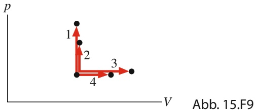

scatter

| State | p | V |
| --- | --- | --- |
| 1 | High | Low |
| 2 | Medium-High | Low-Medium |
| 3 | Medium-Low | Medium |
| 4 | Low | Medium-High |

**10.** Bei welchen der folgenden Prozesse nimmt die Temperatur eines idealen Gases ab, bei welchen nimmt sie zu, und bei welchen bleibt sie unverändert: (a) einer isothermen Expansion, (b) einer Expansion bei konstantem Druck, (c) einer adiabatischen Expansion und (d) einem Druckanstieg bei konstantem Volumen?
**11.** (a) Ordnen Sie die vier Pfade in Abb. 15.13 nach der vom Gas geleisteten Arbeit (größte Werte zuerst). (b) Ordnen Sie die Pfade 1, 2 und 3 nach der Änderung der inneren Energie des Gases (größter positiver Wert zuerst, größter negativer Wert zuletzt).
**12.** In dem pV-Diagramm der Abb. 15.F12 leistet das Gas 5 J Arbeit entlang der Isotherme $\mathrm { { , a b } ^ { \alpha } }$ und 4 J entlang der Adiabaten $\mathbf { , } \mathbf { b } \mathbf { c } ^ { \alpha } \mathbf { . }$ Um wie viel ändert sich die innere Energie des Gases, wenn es den direkten Weg von a nach c durchläuft?

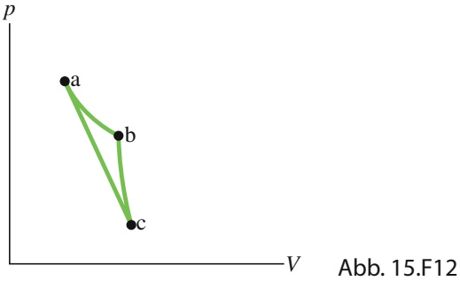

line

| Point | X | Y |
| --- | --- | --- |
| a | ~10 | ~85 |
| b | ~45 | ~60 |
| c | ~50 | ~10 |

**13.** Der Punkt in Abb. 15.F13a stellt den Anfangszustand eines Gases dar und die vertikale Linie durch den Punkt teilt das $p V$ -Diagramm in die Bereiche 1 und 2. Geben Sie für die folgenden Prozesse an, ob die von dem Gas verrichtete Arbeit W positiv, negativ oder null ist: (a) Das System bewegt sich auf der senkrechten Linie nach oben. (b) Es bewegt sich auf der senkrechten Linie nach unten. (c) Es bewegt sich zu einem Punkt irgendwo in Bereich 1. (d) Es bewegt sich zu einem Punkt irgendwo in Bereich 2.

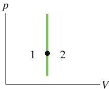

(a)

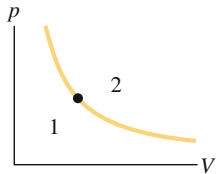

(b)

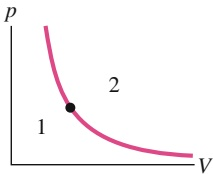

(c)

Abb. 15.F13

**14.** Der Punkt in Abb. 15.F13b stellt den Anfangszustand eines Gases dar und die Isotherme durch den Punkt teilt das $p V { \mathrm { - D i } }$ agramm in die Bereiche 1 und 2. Geben Sie für die folgenden Prozesse an, ob die Änderung $\Delta E _ { \mathrm { i n t } }$ der inneren Energie des Gases positiv, negativ oder null ist: (a) Das System bewegt sich auf der Isotherme nach oben. (b) Es bewegt sich auf der Isotherme nach unten. (c) Es bewegt sich zu einem Punkt irgendwo in Bereich 1. (d) Es bewegt sich zu einem Punkt irgendwo in Bereich 2.

**15.** Der Punkt in Abb. 15.F13c stellt den Anfangszustand eines Gases dar und die Adiabate durch den Punkt teilt das pV-Diagramm in die Bereiche 1 und 2. Geben Sie für die folgenden Prozesse an, ob die dabei übertragene Wärme Q positiv, negativ oder null ist: (a) Das System bewegt sich auf der Adiabate nach oben. (b) Es bewegt sich auf der Adiabate nach unten. (c) Es bewegt sich zu einem Punkt irgendwo in Bereich 1. (d) Es bewegt sich zu einem Punkt irgendwo in Bereich 2.

# 16 Entropie und der zweite Hauptsatz der Thermodynamik

## 16.1 Entropie

## Physikalische Motivation

Die Zeit hat eine Richtung – die Richtung, in der wir altern. Wir kennen viele Pro zesse, die nur in einer bestimmten Richtung ablaufen und niemals umgekehrt: Ein Ei fällt zu Boden und zerbricht, eine Pizza wird knusprig gebacken, ein Auto fährt gegen einen Laternenpfahl und bekommt eine Beule, Meereswellen erodieren eine Klippe, bis sie einstürzt – all diese Prozesse sind irreversibel, d. h., sie können nicht durch kleine Veränderungen in ihrer Umgebung umgekehrt werden.

Ein Ziel der Physik ist es, zu verstehen, warum die Zeit eine Richtung hat und warum derartige Prozesse unumkehrbar sind. Obwohl diese Fragestellungen wenig Relevanz für unseren Alltag zu haben scheinen, sind sie doch in Wirklichkeit von zentraler Bedeutung für jede Art von Maschine, etwa einen Verbrennungsmotor, weil sie bestimmen, wie effizient so eine Maschine arbeiten kann.

Um zu verstehen, warum solche Prozesse nicht rückgängig gemacht werden können, müssen wir uns mit einer eigenartigen Größe beschäftigen, die unter dem Namen Entropie bekannt ist.

## 16.1.1 Irreversible Prozesse und Entropie

Die einseitige Gerichtetheit von thermodynamischen Prozessen ist uns so vertraut, dass wir sie als selbstverständlich ansehen. Entwickelten sich diese Prozesse spontan (von selbst) in die „falsche“ Richtung, würden wir vermutlich an unserem Verstand zweifeln. Trotzdem: Keines dieser „falschen“ Ereignisse würde das Gesetz von der Energieerhaltung verletzen. Dieses Gesetz wäre etwa bei einem heißen Becher Kakao erfüllt, selbst wenn der Wärmeaustausch zwischen Ihren Händen und dem Becher in die falsche Richtung ablaufen und ihre Finger abkühlen sollte. Das Gesetz wäre ebenfalls erfüllt, wenn ein ruhender Gegenstand einen Teil seiner thermischen Energie in kinetische Energie umsetzen würde und sich plötzlich zu bewegen anfinge. Und es wäre auch erfüllt, wenn sich frei im Zimmer umherfliegende Heliumatome plötzlich wieder zu der Form ihres kurz zuvor geplatzten Ballons zusammenfinden würden.

In einem abgeschlossenen System lässt sich aus Energieänderungen keine Richtung für den Ablauf irreversibler Prozesse ablesen. Diese Richtung ist durch eine andere Eigenschaft bestimmt, mit der wir uns in diesem Kapitel beschäftigen wollen – die Änderung der Entropie ΔS eines Systems. Wir werden die Entropieänderung in einem System im folgenden Abschnitt definieren, aber an dieser Stelle wollen wir die wesentliche Eigenschaft, das Entropiepostulat, zumindest formulieren:

Findet in einem abgeschlossenen System ein irreversibler Prozess statt, so nimmt die Entropie S dieses Systems immer zu; sie nimmt niemals ab.

text_image

System
Absperrhahn geschlossen
Isolierung
Vakuum

(a) Anfangszustand i

flowchart

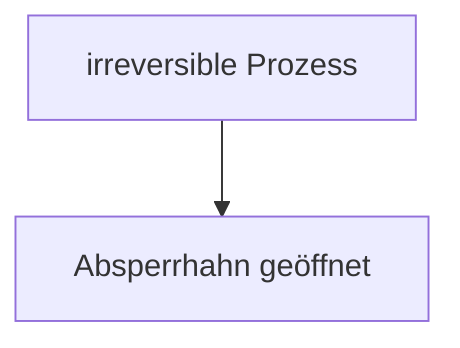

(b) Endzustand f

## Abb. 16.1

Die freie Expansion eines idealen Gases. (a) Das Gas wird durch einen Absperrhahn in der linken Hälfte eines isolierten Behälters gehalten. (b) Nachdem der Hahn geöffnet wurde, verteilt sich das Gas auf den gesamten Behälter. Dieser Prozess ist irreversibel, er läuft also nie in umgekehrter Richtung ab – die Gasmoleküle finden sich nie von selbst wieder in der linken Hälfte des Behälters zusammen.

scatter

| Point | Volumen | Druck |
| --- | --- | --- |
| i | ~1.5 | ~2.8 |
| f | ~3.0 | ~1.5 |

## Abb. 16.2

In einem $p V \mathrm { { \text-- } D }$ iagramm sind der Anfangszustand i und der Endzustand f der freien Expansion aus Abb. 16.1 eingetragen. Die Zwischenzustände des Gases können hier nicht wiedergegeben werden, da sie keinen Gleichgewichtszuständen entsprechen.

Die Entropie unterscheidet sich von der Energie in der Hinsicht, dass sie keinem Erhaltungssatz genügt. Die Energie eines abgeschlossenen Systems ist immer erhalten, die Entropie eines abgeschlossenen Systems nimmt jedoch bei irreversiblen Prozessen immer zu. Wegen dieser Eigenschaft bezeichnet man die Entropieänderung auch manchmal als „den Zeitpfeil“. Zum Beispiel verbinden wir mit einem gerade zerplatzenden Ei die Vorwärtsrichtung der Zeit (erst heil, dann kaputt) und eine Zunahme der Entropie. Die umgekehrte Zeitrichtung, wie man sie in einer rückwärtslaufenden Videoaufzeichnung sehen kann, entspräche einem zerbrochenen Ei, das sich wieder zu einem ganzen Ei zusammenfindet. Dieser umgekehrte Prozess würde eine Entropieabnahme bedeuten und kann daher nie stattfinden.

Es gibt zwei äquivalente Möglichkeiten, die Entropieänderung eines Systems zu definieren: (1) durch die Temperatur des Systems und die von dem System aufge nommene oder abgegebene Wärmeenergie, und (2) durch ein Abzählen aller Möglichkeiten, in der sich die Atome oder Moleküle eines Systems anordnen können. Im folgenden Abschnitt wählen wir den ersten Weg, in Abschn. 16.4 den zweiten.

## 16.1.2 Entropieänderungen

Wir betrachten nochmals einen Prozess, den wir bereits in den Abschn. 14.5 und 15.9 untersucht haben: die freie Expansion eines idealen Gases. Abbildung 16.1a zeigt das Gas zunächst in einem anfänglichen Gleichgewichtszustand i, wo es durch einen Absperrhahn in der linken Hälfte eines Behälters eingesperrt ist. Öffnen wir den Hahn, strömt das Gas heraus und erreicht schließlich den neuen Gleichgewichtszustand f in Abb. 16.1b, wo es sich gleichmäßig im gesamten Behälter verteilt hat. Es handelt sich hierbei um einen irreversiblen Prozess, denn es werden nie sämtliche Moleküle ohne äußere Einwirkung von selbst wieder in die linke Hälfte des Behälters zurückkehren.

Im pV-Diagramm von Abb. 16.2 erkennt man die Punkte für den Druck und die Temperatur des Gases im Anfangszustand i und im Endzustand f. Druck und Volumen sind Zustandsgrößen, also Eigenschaften, die nur vom aktuellen Zustand des Gases abhängen und nicht davon, wie das Gas in diesen Zustand gelangt ist. Weitere Zustandsgrößen sind die Temperatur und die Energie. Es gibt aber noch eine weitere Zustandsgröße: die Entropie des Gases. Wir definieren die **Entropieänderung** $\Delta S = S _ { \mathrm { f } } - S _ { \mathrm { i } }$ eines Systems bei einem Prozess, der von einem Anfangszustand i zu einem Endzustand f verläuft, als

$$
\Delta S = S _ {\mathrm{f}} - S _ {\mathrm{i}} = \int_ {\mathrm{i}} ^ {\mathrm{f}} \frac {\mathrm{d} Q}{T} \quad \text {(Definition der Entropieänderung).} \tag {16.1}
$$

Q ist die vom System bei dem Prozess aufgenommene oder abgegebene Wärmeenergie und T ist die Temperatur des Systems in Kelvin. Die Entropieänderung hängt also nicht nur von der ausgetauschten Wärmeenergie ab, sondern auch von der Temperatur, bei der dieser Austausch stattfindet. T ist immer positiv, daher ist das Vorzeichen von ΔS dasselbe wie das Vorzeichen von Q. Weiterhin erkennen wir aus Gl. 16.1, dass die SI-Einheit für die Entropie bzw. die Entropieänderung Joule pro Kelvin ist.

Es gibt jedoch ein Problem, wenn wir Gl. 16.1 auf die freie Expansion aus Abb. 16.1 anwenden wollen. Während das Gas durch das Verbindungsstück in die zweite Hälfte des Behälters strömt, verändern sich der Druck, die Temperatur und das Volumen des Gases auf unbekannte Art und Weise. Mit anderen Worten, es gibt für die Zwischenzustände keine Folge von wohldefinierten Gleichgewichtswerten. Wir können daher in Abb. 16.1 für die freie Expansion auch keinen „Druck-Volumen-Pfad“ angeben. Und was noch wichtiger ist: Wir können auch keine Beziehung zwischen Q und T aufstellen, mit deren Hilfe wir Gl. 16.1 integrieren könnten.

Wenn jedoch, wie oben gefordert, die Entropie eine Zustandsgröße darstellt, dann hängt die Differenz zwischen der Entropie der Zustände i und f nur von diesen beiden Zuständen ab und nicht von dem Pfad, den das System von dem einen zum anderen Zustand genommen hat. Wir können also die irreversible freie Expansion aus Abb. 16.1 durch einen reversiblen Prozess, der die Zustände i und f verbindet, ersetzen. Für einen solchen reversiblen Prozess gibt es einen Pfad im $p V \cdot$ Diagramm und wir können auch eine Beziehung zwischen $Q$ und $T$ aufstellen, die wir gemäß Gl. 16.1 integrieren können, um die Entropieänderung zu berechnen.

In Abschn. 15.9 hatten wir gesehen, dass sich die Temperatur eines idealen Gases bei einer freien Expansion nicht ändert: $T _ { \mathrm { i } } = T _ { \mathrm { f } } = T$ . Die Punkte i und f in Abb. 16.2 müssen sich also auf derselben Isothermen befinden. Eine sinnvolle Ersetzung für die freie Expansion wäre daher eine reversible isotherme Expansion vom Zustand i zum Zustand f, die tatsächlich entlang dieser Isothermen verläuft. Und da T im Verlauf einer reversiblen isothermen Expansion konstant bleibt, vereinfacht sich das Integral in Gl. 16.1 erheblich.

Abbildung 16.3 zeigt, wie sich eine solche isotherme Expansion als reversibler Prozess realisieren lässt. Das Gas befindet sich in einem geschlossenen wärmeisolierten Zylinder auf einem Wärmereservoir bei der Temperatur T. Das Gewicht auf dem beweglichen Kolben wird gerade so gewählt, dass Druck und Volumen des Gases dem Anfangszustand i aus Abb. 16.1a entsprechen. Nun entfernen wir nach und nach Bleikugeln, bis Druck und Volumen des Gases die Werte des Endzustands f in Abb. 16.1b haben. Die Temperatur des Gases ändert dabei nicht, da es in ständigem Kontakt mit dem Wärmereservoir steht.

Die reversible Expansion aus Abb. 16.3 unterscheidet sich in physikalischer Hinsicht wesentlich von der irreversiblen Expansion aus Abb. 16.1. Beide Prozesse haben jedoch denselben Anfangs- und denselben Endzustand und damit muss auch die Entropieänderung dieselbe sein. Da wir das Gewicht sehr langsam herabgesetzt haben, handelt es sich bei allen Zwischenzuständen des Gases um Gleichgewichtszustände, die wir in ein $p V \text-- \mathrm { D i }$ agramm eintragen können (Abb. 16.4).

Bei einer isothermen Expansion können wir die konstante Temperatur $T$ in Gl. 16.1 vor das Integral ziehen und erhalten

$$
\Delta S = S _ {\mathrm{f}} - S _ {\mathrm{i}} = \frac {1}{T} \int_ {\mathrm{i}} ^ {\mathrm{f}} \mathrm{d} Q.
$$

$\int \mathrm { d } Q = Q$ stellt die bei dem Prozess in Form von Wärme ausgetauschte Gesamtenergie dar, damit ist

$$
\Delta S = S _ {\mathrm{f}} - S _ {\mathrm{i}} = \frac {Q}{T} \quad \text {(Entropieänderung, isotherme Ausdehnung). (16.2)}
$$

Damit die Gastemperatur $T$ während der isothermen Expansion aus Abb. 16.3 konstant bleiben konnte, musste von dem Reservoir an das System die Wärmeenergie $Q$ übertragen werden. Q ist also positiv und die Entropie des Gases nimmt bei diesem isothermen Prozess ebenso wie bei der freien Expansion aus Abb. 16.1 zu.

Fassen wir zusammen:

Zur Bestimmung der Entropieänderung bei einem irreversiblen Prozess in einem abgeschlossenen System kann man diesen Prozess durch irgendeinen reversiblen Prozess mit demselben Anfangs- und Endzustand ersetzen und die Entropieänderung bei diesem reversiblen Prozess nach Gl. 16.1 berechnen.

Ist die Temperaturänderung $\Delta T$ eines Systems klein im Vergleich zur absoluten Temperatur (in Kelvin) vor und nach dem Prozess, so kann die Entropieänderung

text_image

Isolierung
Blei-
kugeln
Wärmereservoir
Q
T
Schalter

(a) Anfangszustand i

text_image

Blei-
kugeln
T

(b) Endzustand f

## Abb. 16.3

Die isotherme Expansion eines idealen Gases als reversibler Prozess. Das Gas hat denselben Anfangszustand i und denselben Endzustand f wie der irreversible Prozess aus den Abb. 16.1 und 16.2.

line

| Point | Volumen | Druck |
| --- | --- | --- |
| i | ~0.35 | ~0.75 |
| f | ~0.65 | ~0.45 |

## Abb. 16.4

Das $p V \cdot$ -Diagramm zu der reversiblen isothermen Expansion aus Abb. 16.3. Die Zwischenzustände sind nun Gleichgewichtszustände.

auch durch

$$
\Delta S = S _ {\mathrm{f}} - S _ {\mathrm{i}} \approx \frac {Q}{T _ {\mathrm{gem}}} \tag {16.3}
$$

approximiert werden, wobei $T _ { \mathrm { g e m } }$ die mittlere Systemtemperatur (in Kelvin) bei dem Prozess ist.

## KONTROLLFRAGE 1

In einem Ofen werde Wasser erhitzt. Ordnen Sie die Entropieänderungen für das Wasser während der Temperaturzunahme (a) von $2 0   ^ { \circ } \mathrm { C }$ auf $3 0   ^ { \circ } \mathbf { C } ,$ (b) von $3 0   ^ { \circ } \mathrm { C }$ auf $3 5   ^ { \circ } \mathrm { C }$ und (c) von $8 0   ^ { \circ } \mathrm { C }$ auf $8 5   ^ { \circ } \mathrm { C }$ in absteigender Reihenfolge.

## Die Entropie als Zustandsfunktion

Wir haben bisher angenommen, dass es sich bei der Entropie, ähnlich wie bei Druck, Energie und Temperatur, um eine Zustandsgröße eines Systems handelt, die nicht davon abhängt, wie dieser Zustand erreicht wurde. Ob Entropie tatsächlich eine Zustandsfunktion ist (so bezeichnet man die Zustandsgrößen eines Systems gewöhnlich) kann nur das Experiment entscheiden. Wir können diese Aussage jedoch für den speziellen, aber wichtigen Fall beweisen, bei dem ein ideales Gas einen reversiblen Prozess durchläuft.

Ein reversibler Prozess sollte langsam und in kleinen Schritten ablaufen, sodass sich das Gas nach jedem dieser Schritte im thermischen Gleichgewicht befindet. Für jeden Schritt sei die übertragene Wärmeenergie dQ, die von dem Gas geleistete Arbeit d $W$ und die Änderung der inneren Energie $\Delta E _ { \mathrm { i n t } }$ . Diese drei Größen hängen nach der differenziellen Form des ersten Hauptsatzes der Thermodynamik (Gl. 14.22) in folgender Weise zusammen:

$$
\mathrm{d} E _ {\mathrm{int}} = \mathrm{d} Q - \mathrm{d} W.
$$

Da die einzelnen Schritte reversibel sind und das Gas sich im Gleichgewichtszustand befindet, können wir dW mit Gl. 14.19 durch $p$ dV und $\mathrm { d } E _ { \mathrm { i n t } }$ mit Gl. 15.43 durch $n C _ { V }$ d $| T |$ ersetzen. Wir lösen die Gleichung noch nach dQ auf:

$$
\mathrm{d} Q = p \mathrm{d} V + n C _ {V} \mathrm{d} T.
$$

Mithilfe des idealen Gasgesetzes können wir p in dieser Gleichung durch nRT∕V ersetzen. Wir dividieren noch die gesamte Gleichung durch T und erhalten

$$
\frac {\mathrm{d} Q}{T} = n R \frac {\mathrm{d} V}{V} + n C _ {V} \frac {\mathrm{d} T}{T}.
$$

Nun integrieren wir jeden Term in dieser Gleichung von einem beliebigen Anfangszustand i bis zu einem beliebigen Endzustand f:

$$
\int_ {\mathrm{i}} ^ {\mathrm{f}} \frac {\mathrm{d} Q}{T} = \int_ {\mathrm{i}} ^ {\mathrm{f}} n R \frac {\mathrm{d} V}{V} + \int_ {\mathrm{i}} ^ {\mathrm{f}} n C _ {V} \frac {\mathrm{d} T}{T}.
$$

Die Größe auf der linken Seite ist die Entropieänderung $\Delta S = S _ { \mathrm { f } } - S _ { \mathrm { i } }$ aus Gl. 16.1. Führen wir noch die Integrale auf der rechten Seite durch, so finden wir schließlich

$$
\Delta S = S _ {\mathrm{f}} - S _ {\mathrm{i}} = n R \ln \frac {V _ {\mathrm{f}}}{V _ {\mathrm{i}}} + n C _ {V} \ln \frac {T _ {\mathrm{f}}}{T _ {\mathrm{i}}} . \tag {16.4}
$$

Bei dieser Integration mussten wir keinen besonderen Prozess vorgeben, daher gilt das Ergebnis für alle reversiblen Prozesse, die das Gas vom Zustand i in den Zustand f überführen. Die Entropieänderung zwischen Anfangs- und Endzustand eines idealen Gases hängt daher ebenfalls nur von den Eigenschaften des Anfangszustands $( V _ { \mathrm { i } }$ und $T _ { \mathrm { i } } )$ und des Endzustands $( V _ { \mathrm { f } }$ und $T _ { \mathrm { f } } )$ ab, nicht aber von dem Weg zwischen diesen beiden Zuständen.

## KONTROLLFRAGE 2

In dem pV-Diagramm habe ein ideales Gas bei dem Anfangszustand i die Tem peratur $T _ { 1 }$ . Bei den Endzuständen a und b, die entlang der eingezeichneten Pfade erreicht werden können, habe es die höhere Temperatur $T _ { 2 }$ . Ist die Entropieände rung entlang des Weges zum Zustand a größer, kleiner oder gleich der Entropieänderung entlang des Weges zum Zustand b?

wireframe

| State | Druck | Volumen |
| --- | --- | --- |
| a | High | Low |
| i | Medium | Low |
| b | Medium | High |

## 16.1.3 Der zweite Hauptsatz der Thermodynamik

Ein kleines Rätsel: In Beispielaufgabe 16.2 im Übungsbuch haben wir gesehen, dass die Entropieänderung für das Gas (das wir als unser System ansehen) bei dem reversiblen Prozess von Abb. 16.3a nach Abb. 16.3b positiv ist. Da es sich jedoch um einen reversiblen Prozess handelt, können wir ihn ebenso gut von Abb. 16.3b nach Abb. 16.3a zurücklaufen lassen, indem wir den Kolben in Abb. 16.3b langsam mit Bleikugeln beschweren, bis das ursprüngliche Gasvolumen wieder erreicht ist. In diesem umgekehrten Prozess muss dem Gas Wärmeenergie entzogen werden, da andernfalls seine Temperatur zunähme. Also ist Q negativ und somit muss nach Gl. 16.2 die Entropie des Gases abnehmen.

Widerspricht diese Entropieabnahme des Gases nicht dem Entropiepostulat aus Abschn. 16.1, wonach die Entropie immer zunimmt? Nein, denn dieses Postulat gilt nur für irreversible Prozesse in abgeschlossenen Systemen. Der hier vorliegende Prozess erfüllt keine der beiden Bedingungen: Der Prozess ist nicht irreversibel und das System – das Gas für sich genommen – ist nicht abgeschlossen, da es Wärmeenergie an das Reservoir abgegeben hat.

Betrachten wir jedoch das Reservoir zusammen mit dem Gas als unser System, dann haben wir ein abgeschlossenes System vor uns. Wie groß ist nun die Entropieänderung in diesem erweiterten System Gas + Reservoir für den Prozess von (b) nach (a) in Abb. 16.3? Bei diesem reversiblen Prozess wird Wärmeenergie von dem Gas auf das Reservoir übertragen – d. h. von einem Teil des erweiterten Systems auf den anderen. Sei |Q| der Absolutbetrag dieser Wärme. Mit Gl. 16.2 können wir nun die Entropieänderungen für das Gas (das |Q| verliert) und das Reservoir (das |Q| hinzugewinnt) getrennt berechnen. Wir erhalten

$$
\Delta S _ {\mathrm{Gas}} = - \frac {| Q |}{T}
$$

und

$$
\Delta S _ {\mathrm{Res}} = + \frac {| Q |}{T}.
$$

Die Entropieänderung des abgeschlossenen Systems ist die Summe dieser beiden Größen, also null.

Mit diesem Ergebnis können wir unser Entropiepostulat aus Abschn. 16.1 präzisieren und sowohl reversible als auch irreversible Prozesse einschließen:

Die Entropie in einem abgeschlossenen System nimmt für irreversible Prozesse immer zu und bleibt für reversible Prozesse konstant. Sie nimmt niemals ab.

Auch wenn die Entropie in einem Teil eines abgeschlossenen Systems abnehmen kann, so gibt es doch immer einen gleich großen oder sogar größeren Entropiezuwachs in einem anderen Teil dieses Systems, sodass die Entropie des Gesamtsystems niemals abnimmt. Diese Tatsache ist eine der vielen Formulierungen des **zweiten Hauptsatzes der Thermodynamik**. Ausgedrückt in einer Formel besagt dieser Satz kurz und knapp

$$
\Delta S \geq 0 \quad (\text {zweiter Hauptsatz der Thermodynamik}). \tag {16.5}
$$

Das „Größer als“-Zeichen bezieht sich auf irreversible Prozesse und das Gleichheitszeichen auf reversible Prozesse. Gleichung 16.5 gilt nur für abgeschlossene Systeme.

Reale Prozesse sind praktisch immer bis zu einem gewissen Grad irreversibel, sei es aufgrund von Reibung, Turbulenzen oder anderen Faktoren. Bei realen Prozessen in realen abgeschlossenen Systemen nimmt die Entropie immer zu. Prozesse, bei denen die Entropie eines Systems exakt konstant bleibt, sind immer eine Idealisierung.

## 16.2 Entropie in Aktion: Thermodynamische Maschinen

## Lernziele

Nach dem Durcharbeiten dieses Abschnitts sollten Sie in der Lage sein, . . .

zu verstehen, dass eine Wärmekraftmaschine eine Vorrichtung ist, die Energie in Form von Wärme aus ihrer Umgebung extrahiert und in nutzbare Arbeit umwandelt, und dass in einer idealen Wärmekraftmaschine alle Prozesse reversibel sind und ohne Energieverlust ablaufen,
ein pV-Diagramm für den Kreisprozess einer Carnot-Maschine zu skizzieren und darin die Richtung des Kreisprozesses, die Art der jeweils ablaufenden Teilprozesse, die während jedes Teilprozesses verrichtete Arbeit (einschließlich ihres Vorzeichens), die im Verlauf des Kreisprozesses insgesamt verrichtete Arbeit und die während jedes Teilprozesses übertragene Wärme (einschließlich ihres Vorzeichens) anzugeben,
• einen Carnot-Kreisprozess in einem Temperatur-Entropie-Diagramm zu skizzieren und darin die übertragenen Wärmemengen anzugeben,
• die Gesamt-Entropieänderung im Verlauf eines Carnotschen Kreisprozesses zu berechnen,
• den Wirkungsgrad $\varepsilon _ { \mathrm { C } }$ einer Carnot-Maschine aus den übertragenen Wärmemengen und den Temperaturen der Reservoirs zu berechnen,
• zu verstehen, dass es keine perfekten Maschinen gibt, welche die aus einem Reservoir bei einer hohen Temperatur entnommene Wärmeenergie Q vollständig in die von der Maschine verrichtete Arbeit W umwandeln,
ein pV-Diagramm für den Kreisprozess einer Stirling-Maschine zu skizzieren und darin die Richtung des Kreisprozesses, die Art der jeweils ablaufenden Teilprozesse, die während jedes Teilprozesses verrichtete Arbeit (einschließlich ihres Vorzeichens), die im Verlauf des Kreisprozesses insgesamt verrichtete Arbeit und die während jedes Teilprozesses übertragene Wärme (einschließlich ihres Vorzeichens) anzugeben.

## Schlüsselideen

• Eine thermodynamische Maschine ist eine Vorrichtung, die einen Kreisprozess durchläuft und dabei die Wärmeenergie $| Q _ { \mathrm { H } } |$ aus einem Reservoir mit hoher | |Temperatur entnimmt und damit eine Arbeit |W| verrichtet.Der Wirkungsgrad einer solchen Maschine ist

$$
\eta = \frac{\text{genutzte Energie}}{\text{entnommene Energie}} = \frac{|W|}{|Q_{\text{H}}|}.
$$

| |In einer idealen Maschine verlaufen alle Prozesse reversibel und es gibt keine Energieverluste, etwa durch Reibung oder Turbulenz.

• Eine Carnot-Maschine ist eine ideale Maschine, die den in Abb. 16.7 gezeigten Kreisprozess nutzt. Ihr Wirkungsgrad ist

$$
\eta = 1 - \frac {| Q _ {\mathrm{N}} |}{| Q _ {\mathrm{H}} |} = 1 - \frac {T _ {\mathrm{N}}}{T _ {\mathrm{H}}},
$$

wobei $T _ { \mathrm { H } }$ und $T _ { \mathrm { N } }$ |die Temperaturen des heißen bzw. kalten Reservoirs sind. Wirkungsgrade von realen Maschinen sind immer kleiner als der einer Carnot-