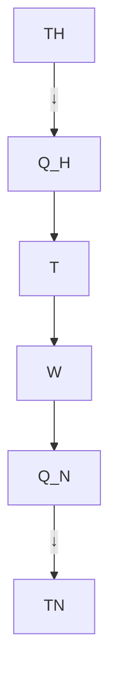
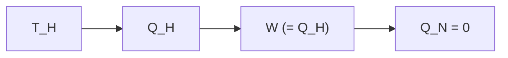
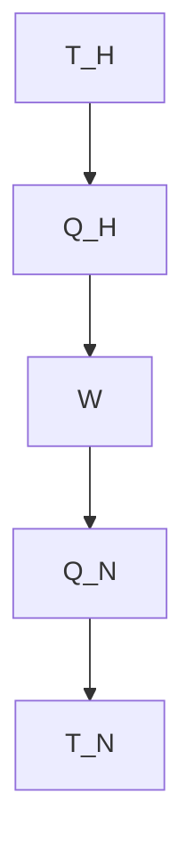
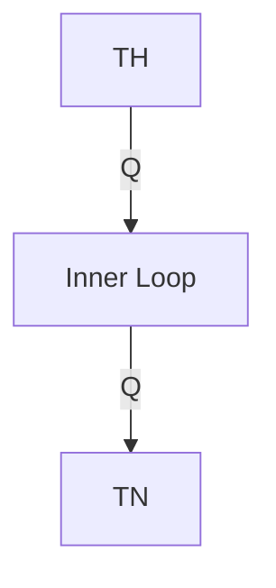
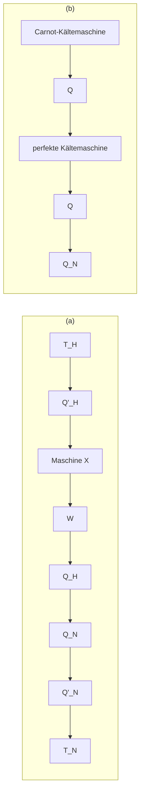
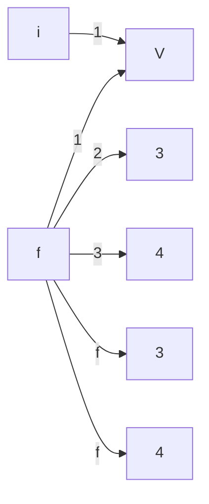
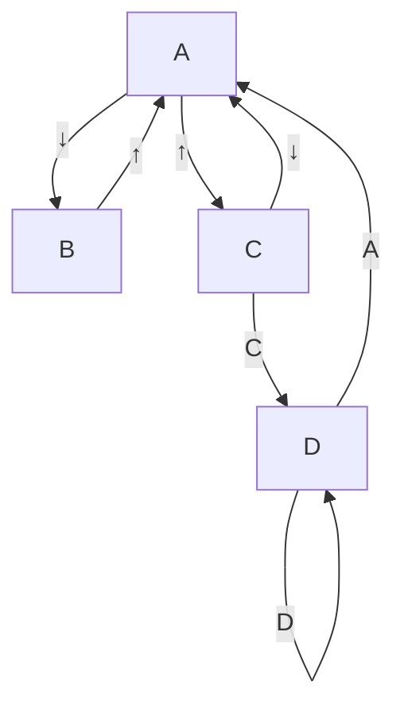
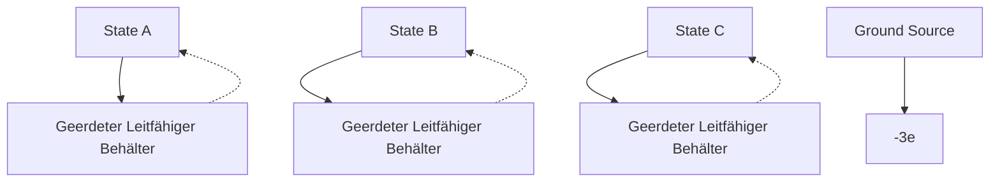
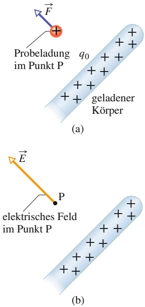

Maschine. Auch die Wirkungsgrade anderer idealer Maschinen sind stets kleiner als der einer Carnot-Maschine.

Eine perfekte Maschine ist eine imaginäre Maschine, die die als Wärme aus dem Hochtemperaturspeicher entnommene Energie vollständig in Arbeit umwandelt. Eine solche Maschine würde gegen den zweiten Hauptsatz der Thermodynamik verstoßen, der nämlich auch so formuliert werden kann: Es ist keine Abfolge von Prozessen möglich, deren einziges Ergebnis die Entnahme von Wärmeenergie aus einem thermischen Reservoir und die vollständige Umwandlung dieser Energie in Arbeit ist.

## 16.2.1 Thermodynamische Maschinen

Eine **Wärmekraftmaschine**, oder kurz **Maschine**, ist ein Gerät, das aus seiner Umgebung Wärmeenergie aufnimmt und damit Arbeit leistet. Jede Maschine basiert auf einer Arbeitssubstanz. Bei einer Dampfmaschine handelt es sich dabei um Wasser, sowohl in Form von Dampf als auch als Flüssigkeit. In einem Automotor ist die Arbeitssubstanz ein Gemisch aus Benzin und Luft. Soll eine Maschine über einen längeren Zeitraum Arbeit leisten, muss sie auf einem Kreisprozess beruhen, d. h., die Arbeitssubstanz muss eine geschlossene Folge von thermodynamischen Prozessen durchlaufen und dabei immer wieder zu denselben Zuständen zurückkehren. Was kann uns die Thermodynamik über die Arbeitsweise von solchen Maschinen sagen?

## Eine Carnot-Maschine

Wie wir gesehen haben, konnten wir aus der Untersuchung idealer Gase, die dem einfachen Gesetz $p V = n R T$ genügen, viel über wirkliche Gase lernen. Auch wenn es in Wirklichkeit keine idealen Gase gibt, war das ein sinnvoller Zugang, denn jedes reale Gas kommt in seinem Verhalten einem idealen Gas so nah wie man möchte, wenn nur die Dichte klein genug ist. Aus einem ganz ähnlichen Grund wollen wir etwas über wirkliche Maschinen lernen, indem wir das Verhalten von **idealen Maschinen** untersuchen.

Bei einer idealen Maschine sind alle Prozesse reversibel, und es geht keine Energie durch Reibung, Turbulenzen oder Ähnliches verloren.

Wir konzentrieren uns zunächst auf eine besondere ideale Maschine, die sogenannte **Carnot-Maschine**, benannt nach dem französischen Wissenschaftler und Ingenieur N.L. Sadi Carnot, der im Jahr 1824 als Erster das Konzept dieser Maschine entwickelte. Es zeigt sich, dass diese Maschine (aus prinzipiellen Gründen) nicht zu übertreffen ist, wenn es darum geht, Wärmeenergie in nützliche Arbeit umzuwandeln. Erstaunlicherweise konnte Carnot die Arbeitsweise dieser Maschine schon beschreiben, bevor der erste Hauptsatz der Thermodynamik und das Prinzip der Entropie überhaupt entdeckt worden waren.

Abbildung 16.5 zeigt schematisch die Arbeitsweise einer Carnot-Maschine. Bei jedem Maschinenzyklus absorbiert die Arbeitssubstanz die Wärmeenergie $| Q _ { \mathrm { H } } |$ von einem Wärmereservoir bei einer konstanten hohen Temperatur $T _ { \mathrm { H } }$ | |und gibt die Wärmeenergie $| Q _ { \mathrm { N } } |$ an ein zweites Wärmereservoir mit der konstanten nied-|rigeren Temperatur $T _ { \mathrm { N } }$ |ab.

Abbildung 16.6 zeigt das pV-Diagramm eines Carnotschen Kreisprozesses der Arbeitssubstanz. Wie die Pfeile andeuten, verläuft der Kreisprozess im Uhrzeigersinn. Als Arbeitssubstanz stellen wir uns ein ideales Gas vor, das in einem wärmeisolierten Zylinder mit einem beweglichen, durch veränderbare Gewichte beschwerten Kolben eingeschlossen ist. Je nach Bedarf kann der Zylinder auf eines der beiden Wärmereservoirs, wie in Abb. 16.3, oder auch auf eine wärmeisolier-

flowchart

Abb. 16.5

Das Prinzip einer Carnot-Maschine. Die beiden schwarzen Pfeile sollen andeuten, dass die Arbeitssubstanz in einem Kreisprozess arbeitet, vergleichbar dem Kreisprozess in einem $p V$ -Diagramm. Die Energie $| Q _ { \mathrm { H } } |$ wird | |als Wärme von einem Wärmereservoir bei der hohen Temperatur $T _ { \mathrm { H } }$ auf die Arbeitssubstanz übertragen. Die Energie $| Q _ { \mathrm { N } } |$ wird als Wärme von der | |Arbeitssubstanz auf ein Wärmereservoir bei der niedrigeren Temperatur $T _ { \mathrm { N } }$ übertragen. Die Maschine (bzw. die Arbeitssubstanz) verrichtet an irgendetwas in der Umgebung die Arbeit W.

area

| Point | Volumen | Druck |
| --- | --- | --- |
| a | ~0.2 | High |
| b | ~0.5 | Medium |
| c | ~0.9 | Low |
| d | ~0.4 | Low |

Abb. 16.6

Ein pV-Diagramm des Carnotschen Kreisprozesses, den die Arbeitssubstanz der Maschine aus Abb. 16.5 durchläuft. Der Kreisprozess besteht aus zwei isothermen $( , \mathrm { a b } ^ { \alpha }$ und $\scriptstyle { \mathrm { , c d } } ^ { \mathrm { { \acute { e } } } } )$ und zwei adiabatischen Teilprozessen $( , b c ^ { \alpha }$ und $\mathbf { , } \mathrm { d } \mathbf { a } ^ { \alpha } )$ . Die von dem Kreisprozess eingeschlossene gelbe Fläche ist gleich der Arbeit $W ,$ die von der Carnot-Maschine bei jedem Zyklus geleistet wird.

other

| State | Entropy (S) | Temperature (T) |
| --- | --- | --- |
| a | Low | High |
| b | High | High |
| c | High | Low |
| d | Low | Low |
| Q_H | Medium | High |
| Q_N | High | Low |

Abb. 16.7

Der Carnotsche Kreisprozess aus Abb. 16.7 im TS-Diagramm. Während der Teilprozesse $\mathrm { { , a b } ^ { \alpha } }$ und $\scriptstyle { \boldsymbol { \mathscr { v } } } ^ { c d ^ { \alpha } }$ bleibt die Temperatur konstant. Während der Teilprozesse $\mathbf { , } \mathbf { b } \mathbf { c } ^ { \alpha }$ und $\mathbf { , } \mathrm { d } \mathbf { a } ^ { \alpha }$ bleibt die Entropie konstant.

te Platte gestellt werden. Wir bringen den Zylinder zunächst in Kontakt mit dem Wärmereservoir bei der hohen Temperatur $T _ { \mathrm { H } }$ . Wie man in Abb. 16.6 erkennt, expandiert die Arbeitssubstanz isotherm vom Volumen $V _ { \mathrm { a } }$ zum größeren Volumen $V _ { \mathrm { b } } ,$ dabei wird ihr von dem Reservoir die Wärme $| Q _ { \mathrm { H } } |$ zugeführt. Ganz ähnlich er | |fährt die Arbeitssubstanz, wenn sie mit dem Wärmereservoir bei der niedrigeren Temperatur $T _ { \mathrm { N } }$ in Kontakt steht, eine isotherme Kompression von dem Volumen $V _ { \mathrm { c } }$ zum kleineren Volumen $V _ { \mathrm { d } } .$ Dabei gibt sie die Wärme $| Q _ { \mathrm { N } } |$ an das Reservoir ab.

| |Bei der Maschine in Abb. 16.5 nehmen wir an, dass ein Wärmeaustausch zwischen Arbeitssubstanz und Reservoir nur während der isothermen Prozesse $\mathrm { { , a b } ^ { \alpha } }$ und $\scriptstyle { \mathfrak { p } } ^ { \mathrm { c d } ^ { \mathrm { c } } }$ in Abb. 16.6 stattfindet. Daher muss es sich in dieser Abbildung bei den Prozessen $\mathbf { \nabla } _ { \mathbf { \nabla } ^ { \prime } } \mathbf { b } \mathbf { c } ^ { \prime \prime }$ und $\mathrm { { _ { \it { p } } } d a ^ { \it { a } } } _ { \it { \it { 1 } } }$ welche die beiden Isothermen bei den Temperaturen $T _ { \mathrm { H } }$ und $T _ { \mathrm { N } }$ verbinden, um (reversible) adiabatische Prozesse handeln. Bei diesen Prozessen wird also keine Wärmeenergie ausgetauscht. Um das trotz der Volumenänderung der Arbeitssubstanz zu gewährleisten, stellen wir den Zylinder bei den Prozessen $\mathbf { , } \mathbf { b } \mathbf { c } ^ { \alpha }$ und $\mathrm { { _ { \mathrm { { \it { p } } } } d a } ^ { \mathrm { { \it { a } } } } }$ auf eine wärmeisolierte Platte.

Bei den beiden Prozessen $\mathrm { { , a b } ^ { \alpha } }$ und $\mathbf { , } \mathbf { b } \mathbf { c } ^ { \alpha }$ in Abb. 16.6 dehnt sich die Arbeitssubstanz aus und leistet daher positive Arbeit, indem sie den beschwerten Kolben anhebt. Dieser Arbeit entspricht in Abb. 16.6 die Fläche unter der Kurve $\mathrm { { \tt { , } } a b c { \tt { ^ { \alpha } } } }$ Im Verlauf der beiden anschließenden Prozesse $\scriptstyle { \mathfrak { p } } ^ { \mathrm { c d } ^ { \mathrm { c } } }$ und $\mathrm { , d a } ^ { \alpha }$ wird die Arbeitssub stanz komprimiert, d. h., die Umgebung (der nach unten drückende Kolben) verrichtet an der Arbeitssubstanz Arbeit. Diese Arbeit entspricht der Fläche unter der Kurve $\mathrm { { , } c d a ^ { \alpha } } .$ Die Gesamtarbeit bei einem Durchlauf des Kreisprozesses, in Abb. 16.5 und 16.6 als W gekennzeichnet, ist die Differenz dieser zwei Flächen. Sie ist positiv und entspricht der von dem Kreisprozess „abcda“ eingeschlossenen Fläche in Abb. 16.6. Diese Arbeit W wird an irgendeinem äußeren Gegenstand verrichtet, beispielsweise einem Gewicht, das angehoben wird.

Gleichung 16.1 $( \Delta S = \int \mathrm { d } Q / T )$ besagt, dass ein Wärmefluss bzw. Wärmeaustausch auch eine Entropieänderung zur Folge hat. Zur Verdeutlichung der Entropieänderung bei einem Carnotschen Kreisprozess zeichnen wir den Carnot-Zyklus in ein Temperatur-Entropie-Diagramm (TS-Diagramm) wie in Abb. 16.7. Die markierten Punkte a, b, c und d in Abb. 16.7 entsprechen den markierten Punkten in dem $p V \text-- \mathrm { D i }$ agramm aus Abb. 16.6. Die beiden horizontalen Linien in Abb. 16.7 repräsentieren die beiden isothermen Prozesse des Zyklus (die Temperatur ist dort konstant). Der Prozess $\mathrm { { , a b } ^ { \alpha } }$ entspricht der isothermen Expansion der Arbeitssubstanz. Da diese während der Expansion bei konstanter Temperatur $T _ { \mathrm { H } }$ die $\mathbf { W \ddot { a } r }$ memenge $| Q _ { \mathrm { H } } |$ (reversibel) absorbiert, muss die Entropie zunehmen. Umgekehrt | |gibt die Arbeitssubstanz während der isothermen Kompression $\scriptstyle { \mathfrak { p } } ^ { \mathrm { c d } ^ { \mathrm { c } } }$ bei konstanter Temperatur $T _ { \mathrm { N } }$ die Wärmeenergie $| Q _ { \mathrm { N } } |$ (reversibel) ab, daher muss bei diesem | |Prozess die Entropie der Arbeitssubstanz abnehmen.

Die beiden vertikalen Linien in Abb. 16.7 entsprechen den beiden adiabatischen Prozessen des Carnot-Zyklus. Da während dieser beiden Prozesse keine Wärmeenergie übertragen wird, bleibt die Entropie der Arbeitssubstanz in diesen Teilabschnitten konstant.

Arbeit: Zur Berechnung der von der Carnot-Maschine während eines Zyklus geleisteten Gesamtarbeit wenden wir den ersten Hauptsatz der Thermodynamik (Gl. 14.21, $\Delta E _ { \mathrm { i n t } } = Q - \bar { W } )$ auf die Arbeitssubstanz an. Diese Substanz muss die Zustände des Kreisprozesses immer wieder durchlaufen. Wenn X also für irgendeine Zustandsgröße der Arbeitssubstanz steht, beispielsweise Druck, Temperatur, Volumen, innere Energie oder Entropie, dann muss für jeden Kreisprozess $\Delta X = 0$ gelten. Also muss für einen vollständigen Kreisprozess der Arbeitssubstanz auch $\Delta E _ { \mathrm { i n t } } = 0$ sein. Da es sich bei $Q$ in Gl. 14.21 um die gesamte ausgetauschte Wärmemenge handelt und bei $W$ um die gesamte geleistete Arbeit, können wir den ersten Hauptsatz der Thermodynamik für den Carnot-Prozess auch in der Form

$$
W = | Q _ {\mathrm{H}} | - | Q _ {\mathrm{N}} | \tag {16.6}
$$

schreiben.

Entropieänderung: Bei einer Carnot-Maschine gibt es zwei (und nur zwei) reversible Wärmeübertragungen und daher auch nur zwei Änderungen in der Entropie der Arbeitssubstanz – eine bei der Temperatur $T _ { \mathrm { H } }$ und eine bei $T _ { \mathrm { N } } .$ Die gesamte Entropieänderung im Verlauf eines Zyklus ist daher

$$
\Delta S = \Delta S _ {\mathrm{H}} + \Delta S _ {\mathrm{N}} = \frac {| Q _ {\mathrm{H}} |}{T _ {\mathrm{H}}} - \frac {| Q _ {\mathrm{N}} |}{T _ {\mathrm{N}}} . \tag {16.7}
$$

$\Delta S _ { \mathrm { H } }$ ist positiv, weil bei diesem Schritt der Arbeitssubstanz die Wärme $| Q _ { \mathrm { H } } |$ zugeführt wird, und $\Delta S _ { \mathrm { N } }$ | |ist negativ, weil der Arbeitssubstanz die Wärmeenergie $| Q _ { \mathrm { N } } |$ | |entzogen wird. Da die Entropie eine Zustandsfunktion ist, muss für einen kompletten Zyklus $\Delta S = 0$ gelten. Nach Gl. 16.7 bedeutet das

$$
\frac {| Q _ {\mathrm{H}} |}{T _ {\mathrm{H}}} = \frac {| Q _ {\mathrm{N}} |}{T _ {\mathrm{N}}}  . \tag {16.8}
$$

Für die Temperaturen gilt $T _ { \mathrm { H } } > T _ { \mathrm { N } } ,$ also folgt für die Wärmemengen $Q _ { \mathrm { H } } > Q _ { \mathrm { N } }$ Dem Reservoir bei der höheren Temperatur wird also mehr Wärmeenergie entzogen, als dem Reservoir bei der niedrigeren Temperatur zugeführt wird.

Aus den Gln. 16.6 und 16.8 werden wir jetzt den Wirkungsgrad der Carnot-Maschine herleiten.

## Der Wirkungsgrad der Carnot-Maschine

Das Ziel einer Wärmekraftmaschine besteht darin, so viel Wärmeenergie $Q _ { \mathrm { H } }$ wie möglich in Arbeit umzusetzen. Die Effektivität messen wir durch den **thermischen Wirkungsgrad** $\eta ,$ definiert als die von der Maschine pro Kreisprozess geleistete Arbeit („die Energie, die wir erhalten“) dividiert durch die bei jedem Kreisprozess verbrauchte Wärme („die Energie, die wir dafür bezahlen“):

$$
\eta = \frac {\text {genutzte Energie}}{\text {entnommene Energie}} = \frac {| W |}{| Q _ {\mathrm{H}} |} \quad \text {(Wirkungsgrad einer Maschine). (16.9)}
$$

Für eine Carnot-Maschine können wir W mit Gl. 16.6 ersetzen:

$$
\eta_ {C} = \frac {| Q _ {\mathrm{H}} | - | Q _ {\mathrm{N}} |}{| Q _ {\mathrm{H}} |} = 1 - \frac {| Q _ {\mathrm{N}} |}{| Q _ {\mathrm{H}} |}. \tag {16.10}
$$

Mit Gl. 16.8 erhalten wir schließlich für den Wirkungsgrad der Carnot-Maschine

$$
\eta_ {\mathrm{C}} = 1 - \frac {T _ {\mathrm{N}}}{T _ {\mathrm{H}}} \quad (\text {Wirkungsgrad der Carnot - Maschine}), \tag {16.11}
$$

wobei die Temperaturen $T _ { \mathrm { N } }$ und $T _ { \mathrm { H } }$ in Kelvin angegeben werden müssen. Da $T _ { \mathrm { N } } < T _ { \mathrm { H } } ,$ ist der thermische Wirkungsgrad der Carnot-Maschine notwendigerweise kleiner als eins, d. h. kleiner als 100 %. Das wird auch aus Abb. 16.5 deutlich: Nur ein Teil der aus dem heißeren Reservoir stammenden Wärmeenergie kann Arbeit leisten, der Rest wird an das kältere Reservoir wieder abgegeben. In Abschn. 16.3 werden wir beweisen, dass der thermische Wirkungsgrad für keine tatsächlich existierende Maschine größer sein kann als der Wirkungsgrad der Carnot-Maschine (Gl. 16.11).

Bei der Entwicklung neuer Maschinen versucht man, den Wirkungsgrad immer weiter zu verbessern, indem man die bei jedem Zyklus „weggeworfene“ Energie $| Q _ { \mathrm { N } } |$ vermindert. Der Traum wäre die perfekte Maschine, wie sie in Abb. 16.8 dar-| |gestellt ist: Dort wäre $| Q _ { \mathrm { N } } |$ zu null reduziert und $| Q _ { \mathrm { H } } |$ würde vollständig in $\mathrm { A } \mathbf { r } -$ | | | |beit umgesetzt. Eine solche Maschine könnte beispielsweise bei einem Kreuzschiff dem Meereswasser Wärmeenergie entziehen und zum Antrieb der Schiffsschrauben umsetzen, ohne jegliche Treibstoffkosten! Ein Auto könnte mit einer solchen

flowchart

Abb. 16.8

So würde eine perfekte Maschine arbeiten, d. h. eine Maschine, bei der Wärme $Q _ { \mathrm { H } }$ aus einem Wärmereservoir zu 100 % in Arbeit W umgesetzt wird.

Maschine die notwendige Wärmeenergie der Umgebungsluft entnehmen und zum Antrieb verwenden, ebenfalls ohne Treibstoffkosten. Doch die perfekte Maschine bleibt ein unerreichbarer Traum: Nach Gl. 16.11 können wir einen Wirkungsgrad von 100 % (d. h. $\eta = 1 )$ nur für $T _ { \mathrm { N } } = 0$ oder $T _ { \mathrm { H } } \rightarrow$ ∞ erreichen; beide Bedingungen sind unmöglich zu realisieren. Stattdessen haben jahrzehntelange Erfahrungen aus dem Bereich des Maschinenbaus zu der folgenden alternativen Version des zweiten Hauptsatzes geführt:

Es gibt keine Folge von Prozessen, bei denen insgesamt nur Wärmeenergie aus einem Wärmereservoir entnommen und vollständig in Arbeit umgewandelt wird.

## Kurz: Es gibt keine perfekte Maschine.

Fassen wir zusammen: Der durch Gl. 16.11 gegebene thermische Wirkungsgrad gilt nur für (ideale) Carnot-Maschinen. In Wirklichkeit bestehen die Kreisprozesse der Maschinen aus irreversiblen Teilprozessen und haben daher niedrigere Wirkungsgrade. Würde Ihr Auto von einer Carnot-Maschine angetrieben, hätte es nach Gl. 16.11 einen Wirkungsgrad von 55 %. Sein tatsächlicher Wirkungsgrad liegt eher bei 25 %. Auch ein großes Kraftwerk ist als Ganzes genommen eine Maschine. Die Wärme wird einem Brennraum oder Reaktor entnommen, Arbeit wird mithilfe von Turbinen geleistet und die verbleibende Wärmeenergie heizt die Atmosphäre oder einen benachbarten Fluss auf. Würde ein solches Kraftwerk als Carnot-Maschine arbeiten, hätte es einen Wirkungsgrad von ungefähr 40 %, sein tatsächlicher Wirkungsgrad liegt höchstens bei 30 %. Gleichgültig um welche Art von Maschinen es sich handelt, es führt einfach kein Weg an Gl. 16.11 vorbei!

## Die Stirling-Maschine

area

| Point | Volume | Druck |
| --- | --- | --- |
| a | Va | High |
| b | Vb | Medium |
| c | Vb | Low |
| d | Va | Medium |

Abb. 16.9

Ein pV-Diagramm für die Arbeitssubstanz einer idealen Stirling-Maschine, der Einfachheit halber als ideales Gas angenommen.

Gleichung 16.11 gilt nicht für beliebige Maschinen, sondern nur für solche, deren Arbeitsprinzip sich wie in Abb. 16.6 darstellen lässt, also für Carnot-Maschinen. Abbildung 16.9 gibt den Arbeitszyklus einer idealen **Stirling-Maschine** wieder. Ein Vergleich mit dem Carnot-Prozess in Abb. 16.6 zeigt, dass beide Maschinen einen isothermen Wärmeaustausch bei den Temperaturen $T _ { \mathrm { H } }$ und $T _ { \mathrm { N } }$ haben. Diese beiden Isothermen werden jedoch bei der Stirling-Maschine nicht durch adiabatische Prozesse verbunden (wie bei der Carnot-Maschine), sondern durch isochore Prozesse, also solche, bei denen das Volumen konstant bleibt (Abb. 16.9). Damit die Temperatur eines Gases bei konstantem Volumen reversibel von $T _ { \mathrm { N } }$ nach $T _ { \mathrm { H } }$ zunehmen kann (Prozess $\mathrm { , d a } ^ { \alpha }$ in Abb. 16.9), bedarf es einer Wärmezufuhr zur $\mathbf { A r } -$ beitssubstanz aus einem Wärmereservoir, dessen Temperatur langsam zwischen diesen beiden Grenzwerten verändert werden kann. Ein Wärmeaustausch in um gekehrter Richtung ist für den Prozess $\mathbf { , } \mathbf { b } \mathbf { c } ^ { \alpha }$ notwendig. Reversible Übertragungen von Wärmeenergie (und damit verbundene Entropieänderungen) findet man daher bei allen vier Teilprozessen einer Stirling-Maschine (nicht nur bei zwei Prozessen wie bei der Carnot-Maschine). Aus diesem Grund gilt die Herleitung von Gl. 16.11 auch nicht für eine ideale Stirling-Maschine. Außerdem ist für dieselben zwei Temperaturen $T _ { \mathrm { H } }$ und $T _ { \mathrm { N } }$ der Wirkungsgrad einer idealen Stirling-Maschine kleiner als der einer Carnot-Maschine. Real existierende Stirling-Maschinen haben sogar noch deutlich kleinere Wirkungsgrade.

Die Stirling-Maschine wurde im Jahr 1816 von Robert Stirling entwickelt. Dieser lange Zeit vernachlässigte Maschinentyp wird heute als Möglichkeit zur direkten Nutzung von Solarenergie oder in Raumfahrzeugen diskutiert.

## KONTROLLFRAGE 3

Drei Carnot-Maschinen arbeiten zwischen Reservoirtemperaturen von (a) 400 K und 500 K, (b) 600 K und 800 K und (c) 400 K und 600 K. Ordnen Sie die Maschinen in absteigender Reihenfolge nach ihrem thermischen Wirkungsgrad.

## LÖSUNGSSTRATEGIEN

**Strategie 1: Die Sprache der Thermodynamik** In wissenschaftlichen und technischen Büchern zur Thermodynamik findet man oft eine reichhaltige, aber leider manchmal auch irreführende Sprache. Sie können dort lesen, dass Wärme zugeführt, absorbiert, addiert, subtrahiert, entzogen, abgezogen, abgegeben, aufgenommen, gewonnen, verloren, übertragen, abgestoßen, zur Verfügung gestellt oder entwendet wird, oder dass Wärme von einem Körper zu einem anderen fließt (wie eine Flüssigkeit). Manchmal findet man auch Äußerungen der Art, dass ein Körper Wärme habe (als ob ein Körper Wärme besitzen könne), oder dass die Wärme eines Körpers zu- oder abnimmt. Sie sollten sich immer vor Augen halten, was Wärme wirklich bedeutet:

Wärme ist Energie, die von einem Körper auf einen anderen Körper aufgrund eines Temperaturunterschieds zwischen den beiden Körpern übertragen wird.

Wenn wir einen der Körper als das untersuchte System ansehen, bezeichnet man jede solche Energieübertragung in das System hinein als positive Wärme +Q und jede solche Energieübertragung aus dem System heraus als negative Wärme −Q.

Auch mit dem Begriff Arbeit muss man vorsichtig sein. Sie werden vielleicht lesen, dass Arbeit erzeugt oder umgesetzt wurde oder aus Wärme entstanden sei. Unter dem Begriff Arbeit versteht man das Folgende:

Arbeit ist Energie, die von einem Körper auf einen anderen Körper mittels einer Kraft zwischen diesen beiden Körpern übertragen wird.

Betrachten wir wieder einen der Körper als das untersuchte System, dann ist jeder solche Energieübertrag aus dem System heraus entweder positive Arbeit +W, die von dem System geleistet wurde, oder negative Arbeit −W, die an dem System geleistet wurde. Jeder Energieübertrag dieser Art in ein System hinein ist von dem System geleistete negative Arbeit oder an dem System geleistete positive Arbeit. (In diesem Fall ist die verwendete Präposition von größter Wichtigkeit.) Das ist offensichtlich verwirrend, und wenn Sie den Begriff Arbeit lesen, sollten sie sorgfältig überlegen, was gemeint ist.

## 16.3 Kältemaschinen und reale Maschinen

## Lernziele

Nach dem Durcharbeiten dieses Abschnitts sollten Sie in der Lage sein, . . .

• zu verstehen, dass eine Kältemaschine eine Vorrichtung ist, die Arbeit aufwendet, um Energie von einem Tieftemperaturreservoir auf ein Hochtemperaturreservoir zu übertragen,
• zu erkennen, dass in einer idealen Kältemaschine alle Prozesse reversibel ablaufen und keine Energieverluste auftreten,
ein pV-Diagramm für den Kreisprozess einer Carnot-Kältemaschine zu skizzieren und darin die Richtung des Kreisprozesses, die Art der jeweils ablaufenden Teilprozesse, die während jedes Teilprozesses verrichtete Arbeit (einschließlich ihres Vorzeichens), die im Verlauf des Kreisprozesses insgesamt verrichtete Arbeit und die während jedes Teilprozesses übertragene Wärme (inklusive Vorzeichen) anzugeben,
• den Zusammenhang zwischen der Leistungszahl ε, den mit den Reservoirs ausgetauschten Wärmemengen und den jeweiligen Temperaturen anzuwenden,
• zu erkennen, dass es keine ideale Kältemaschine gibt, die die gesamte aus dem Niedertemperaturspeicher entnommene Energie in den Hochtemperaturspeicher übertragen kann,
• zu verstehen, dass der Wirkungsgrad einer realen Kältemaschine geringer ist als der Wirkungsgrad der idealen Carnot-Maschine.

## Schlüsselideen

• Eine Kältemaschine ist eine Vorrichtung, die einen Kreisprozess nutzt, um mithilfe der an dort verrichteten Arbeit W eine Energie $| Q _ { \mathrm { N } } |$ als Wärme aus einem | |Niedertemperaturspeicher zu entnehmen, diesen also noch kälter zu machen. Die Leistungszahl ε einer Kältemaschine ist

$$
\varepsilon = \frac {\text {übertragene Wärme}}{\text {aufgewendete Arbeit}} = \frac {| Q _ {\mathrm{N}} |}{| W |}.
$$

• Eine Carnot-Kältemaschine ist eine Carnotsche Wärmekraftmaschine, die umgekehrt arbeitet. Ihre Leistungszahl ist

$$
\varepsilon = \frac {| Q _ {\mathrm{N}} |}{| Q _ {\mathrm{H}} | - | Q _ {\mathrm{N}} |} = \frac {T _ {\mathrm{N}}}{T _ {\mathrm{H}} - T _ {\mathrm{N}}}.
$$

• Eine perfekte Kältemaschine ist eine imaginäre Kältemaschine, die Energie in Form von Wärme aus einem Niedertemperaturspeicher entnimmt und sie vollständig an das Hochtemperaturreservoir abgibt, ohne dafür Arbeit aufzuwenden.
Eine perfekte Kältemaschine würde gegen den zweiten Hauptsatz der Thermodynamik verstoßen, der wie folgt formuliert werden kann: Es ist keine Abfolge von Prozessen möglich, deren einziges Ergebnis die Übertragung von Wärmeenergie von einem Reservoir bei einer gegebenen Temperatur zu einem Reservoir bei einer höheren Temperatur ist, ohne dass dafür Arbeit aufgewendet wird.

## 16.3.1 Kältemaschinen

flowchart

Abb. 16.10

Das Schema einer Kältemaschine. Die beiden schwarzen Pfeile in der Mitte sollen wieder andeuten, dass die Arbeitssubstanz wie in einem $p V$ -Diagramm einen Kreisprozess durchläuft, diesmal jedoch in der anderen Richtung. Energie $Q _ { \mathrm { N } }$ wird aus dem kühlen Wärmereservoir in Form von Wärme an die Arbeitssubstanz übertragen. Energie $Q _ { \mathrm { H } }$ wird von der Arbeitssubstanz in Form von Wärme an das warme Reservoir übertragen. Damit dies möglich ist, muss irgendetwas in der Umgebung an der Kältemaschine (der Arbeitssubstanz) die Arbeit W leisten.

Eine **Kältemaschine** ist ein Gerät, das mithilfe von Arbeit Wärmeenergie aus einem Wärmereservoir bei tiefer Temperatur in ein Wärmereservoir bei höherer Temperatur überträgt, also das kältere Reservoir noch kälter macht. Sie durchläuft dabei unablässig eine feste Folge thermodynamischer (Teil-)Prozesse. Bei einem gewöhnlichen Kühlschrank beispielsweise leistet ein elektrischer Kompressor Arbeit, um Energie aus dem kalten Innenraum (ein Wärmereservoir bei tiefer Temperatur) in das auf Zimmertemperatur temperierte Zimmer (ein Wärmereservoir bei höherer Temperatur) zu übertragen.

Auch eine Klimaanlage oder eine Wärmepumpe sind Kältemaschinen. Die Unterschiede liegen lediglich in der Art der kalten und warmen Wärmereservoirs. Bei einer Klimaanlage ist das kalte Wärmereservoir ein zu kühlendes Zimmer und das warme Wärmereservoir die noch wärmere Außenluft. Eine Wärmepumpe ist eine Art Klimaanlage, die umgekehrt zum Aufheizen eines Zimmers eingesetzt wird: Das Zimmer ist das lauwarme Wärmereservoir und Wärme wird von der kalten Außenluft ins Zimmer übertragen.

Wir betrachten wieder eine ideale Kältemaschine:

Bei einer idealen Kältemaschine sind alle Prozesse reversibel und es treten keine Energieverluste aufgrund von Reibung, Turbulenzen oder Ähnlichem auf.

Abbildung 16.10 zeigt das Grundprinzip einer idealen Kältemaschine. Im Wesentlichen wird dabei einfach der Carnotsche Kreisprozess aus Abb. 16.5 in umgekehrter Richtung durchlaufen. Mit anderen Worten: alle Energieübertragungen, sei es in Form von Wärme oder Arbeit, sind im Vergleich zur Carnot-Maschine umgekehrt. Eine solche ideale Kältemaschine könnte man als **Carnot-Kältemaschine** bezeichnen.

Der Konstrukteur einer Kältemaschine möchte gerne dem kühlen Wärmereservoir so viel Wärme $| Q _ { \mathrm { N } } |$ wie möglich entziehen („was wir wollen“) und dabei so wenig Arbeit $| W |$ | |wie möglich leisten („was wir bezahlen“). Ein Maß für die Effektivität einer Kältemaschine ist die Leistungszahl $\varepsilon ,$ definiert als

$$
\varepsilon = \frac {\text {übertragene Wärme}}{\text {aufgewendete Arbeit}} = \frac {| Q _ {\mathrm{N}} |}{| W |} (\text {Leistungszahl einer Kältemaschine}). \tag {16.12}
$$

Für eine Carnot-Kältemaschine gilt nach dem ersten Hauptsatz $| W | = | Q _ { \mathrm { H } } | -$ $| Q _ { \mathrm { N } } | ,$ , wobei $| Q _ { \mathrm { H } } |$ | |  | |der Betrag der an das warme Reservoir abgegebenen Wärme-| | | |energie ist. Gleichung 16.12 wird damit zu

$$
\varepsilon_ {\mathrm{C}} = \frac {| Q _ {\mathrm{N}} |}{| Q _ {\mathrm{H}} | - | Q _ {\mathrm{N}} |}. \tag {16.13}
$$

Da es sich bei einer Carnot-Kältemaschine um eine umgekehrt operierende Carnot-Maschine handelt, können wir Gl. 16.8 mit Gl. 16.13 verknüpfen und erhalten nach einigen Umformungen

$$
\varepsilon_ {\mathrm{C}} = \frac {T _ {\mathrm{N}}}{T _ {\mathrm{H}} - T _ {\mathrm{N}}} \quad (\text {Leistungszahl einer Carnot - Kältemaschine}). \tag {16.14}
$$

Für typische Raumklimaanlagen ist $\varepsilon   \approx   2 { , } 5 { ; }$ für gewöhnliche Kühlschränke gilt $\varepsilon \approx 5 .$ Seltsamerweise ist der Wert von ε umso höher, je kleiner der Temperaturunterschied zwischen den beiden Reservoirs ist. Daher sind Wärmepumpen auch bei gemäßigten Temperaturen effektiver als bei sehr stark schwankenden Außentemperaturen.

Es wäre natürlich schön eine Kältemaschine zu haben, in die keine Arbeit hineingesteckt werden muss – die also erst gar nicht an die Steckdose muss. Abbildung 16.11 zeigt das Prinzip eines solchen „Erfindertraums“: eine perfekte Kältemaschine, die ohne jede Arbeit eine Wärmemenge Q aus einem kalten Reservoir in ein warmes Reservoir überführt. Da eine solche Maschine auf Kreisprozessen beruht, kann sich die Entropie der Arbeitssubstanz bei einem solchen Zyklus nicht ändern. Die Entropien der beiden Reservoirs ändern sich jedoch: Die Entropieänderung für das kalte Reservoir beträgt $- | Q | / T _ { \mathrm { N } }$ und die für das warme Reservoir $+ | Q | / T _ { \mathrm { H } }$ | |. Die resultierende Entropieänderung für das Gesamtsystem ist daher

$$
\Delta S = - \frac {| Q |}{T _ {\mathrm{N}}} + \frac {| Q |}{T _ {\mathrm{H}}}.
$$

Da $T _ { \mathrm { H } } > T _ { \mathrm { N } } ,$ ist die rechte Seite dieser Gleichung negativ. Die Entropieänderung pro Zyklus ist für das abgeschlossene System Kältemaschine + zwei Reservoirs negativ. Doch weil eine solche Entropieabnahme dem zweiten Hauptsatz der Thermodynamik widerspricht (Gl. 16.5), kann es eine perfekte Kältemaschine nicht ge ben.

Dieses Ergebnis führt uns auf eine weitere (äquivalente) Formulierung des zweiten Hauptsatzes der Thermodynamik:

Es gibt keine Folge von Prozessen, deren einziges Ergebnis die Übertragung von Wärmeenergie aus einem Reservoir mit einer gegebenen Temperatur in ein Reservoir mit einer höheren Temperatur ist.

Kurz: Es gibt keine perfekte Kältemaschine.

## KONTROLLFRAGE 4

Sie möchten die Leistungszahl einer idealen Kältemaschine verändern. Dies errei chen Sie, indem Sie (a) die kalte Kammer auf eine etwas höhere Temperatur einstellen, (b) die kalte Kammer auf eine etwas niedrigere Temperatur einstellen, (c) das Gerät in einen etwas wärmeren Raum bringen oder (d) das Gerät in einen etwas kühleren Raum bringen. Die Beträge der Temperaturänderungen seien in allen vier Fällen gleich. Ordnen Sie die vier Fälle in absteigender Reihenfolge nach der neuen Leistungszahl.

flowchart

Abb. 16.11

Das Schema einer perfekten Kältemaschine, die ohne Arbeitsaufwand Energie aus einem kalten Wärmereservoir in ein warmes Reservoir überführen würde.

## 16.3.2 Der Wirkungsgrad von realen Maschinen

$\eta _ { \mathrm { C } }$ sei der Wirkungsgrad einer Carnot-Maschine, die zwischen zwei gegebenen Temperaturen arbeitet. Wir wollen in diesem Abschnitt beweisen, dass keine reale Maschine, die zwischen denselben beiden Temperaturen arbeitet, einen größeren Wirkungsgrad haben kann als $\eta _ { \mathrm { C } } .$ Eine solche Maschine würde dem zweiten Hauptsatz der Thermodynamik widersprechen.

Wir stellen uns vor, ein Erfinder hätte eine Maschine $\mathrm { _ { \partial } } _ { \partial } \mathrm { X } ^ { \alpha }$ konstruiert, von der er behauptet, ihr Wirkungsgrad $\eta _ { \mathrm { X } }$ sei größer als $\eta _ { \mathrm { C } } ;$

$$
\eta_ {\mathrm{X}} > \eta_ {\mathrm{C}} \quad (\text {Behauptung}). \tag {16.15}
$$

Wir kombinieren diese Maschine X mit einer Carnot-Kältemaschine (vgl. Abb. 16.12a), sodass die für die Kältemaschine bei einem Kreisprozess erforderliche Ar beit gerade von der Maschine X während eines Kreisprozesses geliefert wird. Unser System bestehe nun aus der Kombination Maschine X + Kältemaschine aus Abb. 16.12a. Diese Kombination erfordert keine weitere (äußere) Arbeit.

Wäre Gl. 16.15 richtig, ergäbe sich aus der Definition des Wirkungsgrads (Gl. 16.9)

$$
\frac {| W |}{| Q _ {\mathrm{H}} ^ {\prime} |} > \frac {| W |}{| Q _ {\mathrm{H}} |},
$$

wobei der Strich sich auf die Maschine X bezieht und die rechte Seite dieser Ungleichung dem Wirkungsgrad einer Carnot-Kältemaschine (aufgefasst als Maschine) entspricht. Nach dieser Ungleichung muss

$$
\left| Q _ {\mathrm{H}} \right| > \left| Q _ {\mathrm{H}} ^ {\prime} \right| \tag {16.16}
$$

gelten. Die von der Maschine X geleistete Arbeit soll gleich der an der Carnot-Kältemaschine geleisteten Arbeit sein. Daher folgt aus dem ersten Hauptsatz der Thermodynamik (Gl. 16.6)

$$
| Q _ {\mathrm{H}} | - | Q _ {\mathrm{N}} | = | Q _ {\mathrm{H}} ^ {\prime} | - | Q _ {\mathrm{N}} ^ {\prime} |,
$$

was wir auch in der Form

$$
| Q _ {\mathrm{H}} | - | Q _ {\mathrm{H}} ^ {\prime} | = | Q _ {\mathrm{N}} | - | Q _ {\mathrm{N}} ^ {\prime} | = Q \tag {16.17}
$$

schreiben können. Nach Gl. 16.16 ist die Größe Q in dieser Gleichung positiv.

Ein Vergleich von Gl. 16.17 mit Abb. 16.12 zeigt, dass die kombinierte Wirkung von Maschine X und der Carnot-Kältemaschine darin besteht, ohne äußere Arbeit eine Wärmeenergie Q von einem kalten Reservoir in ein warmes Reservoir zu übertragen. Diese Kombination entspräche daher der perfekten Kältemaschine aus Abb. 16.11, deren Existenz im Widerspruch zum zweiten Hauptsatz der Thermodynamik steht.

Abb. 16.12

(a) Eine Maschine X treibt eine Carnot-Kältemaschine an. (b) Wenn, wie behauptet, die Maschine X einen grö- ßeren Wirkungsgrad als eine Carnot-Maschine hätte, wäre die in (a) gezeigte Kombination äquivalent zu einer perfekten Kältemaschine. Das widerspricht jedoch dem zweiten Hauptsatz der Thermodynamik, woraus folgt, dass die Maschine X nicht effektiver sein kann als eine Carnot-Maschine.

flowchart

Irgendeine unserer Annahmen muss falsch sein, und der Fehler kann nur in Gl. 16.15 liegen. Wir können also folgern: Keine wirkliche Maschine kann einen Wirkungsgrad haben, der größer als der Wirkungsgrad einer Carnot-Maschine ist, wenn beide Maschinen zwischen denselben beiden Temperaturen arbeiten. Bestenfalls kann diese Maschine den Wirkungsgrad einer Carnot-Maschine haben, und in diesem Fall ist Maschine X die Carnot-Maschine.

## 16.4 Eine statistische Interpretation der Entropie

## Lernziele

Nach dem Durcharbeiten dieses Abschnitts sollten Sie in der Lage sein, . . .

• zu erläutern, was man unter den Konfigurationen eines Systems versteht,
• die Multiplizität einer gegebenen Konfiguration zu berechnen,
• zu verstehen, dass alle Mikrozustände gleich wahrscheinlich sind, aber Konfigurationen mit einer größeren Zahl von Mikrozuständen wahrscheinlicher sind als andere,
• die Boltzmannsche Entropiegleichung anzuwenden, um die Entropie einer bestimmten Multiplizität zu berechnen.

## Schlüsselideen

Die Entropie eines Systems kann anhand der möglichen Verteilungen seiner Moleküle definiert werden. Für identische Moleküle wird jede mögliche Verteilung der Moleküle als Mikrozustand des Systems bezeichnet. Alle äquivalenten Mikrozustände werden zu einer Konfiguration des Systems zusammengefasst. Die Anzahl der Mikrozustände in einer Konfiguration wird als Multiplizität W der Konfiguration bezeichnet.
• Für ein System aus N Molekülen, die sich über die beiden Hälften eines Kastens verteilen, ist die Multiplizität

$$
W = \frac {N !}{n _ {1} ! n _ {2} !},
$$

wobei $n _ { 1 }$ die Zahl der Moleküle in der einen Hälfte und $n _ { 2 }$ die Zahl der Moleküle in der anderen Hälfte ist. Eine grundlegende Annahme der statistischen Mechanik ist, dass alle Mikrozustände gleich wahrscheinlich sind. Daher kommen Konfigurationen mit großer Multiplizität am häufigsten vor. Wenn N sehr groß ist (z. B. $N = 1 0 ^ { 2 2 }$ Moleküle oder mehr), liegt das System fast immer in der Konfiguration mit $n _ { 1 } = n _ { 2 }$ vor.

• Die Multiplizität W einer Konfiguration eines Systems und die Entropie S des Systems in dieser Konfiguration sind durch die Boltzmannsche Entropiegleichung verknüpft:

$$
S = k \ln W,
$$

wobei $k = 1 { , } 3 8 \cdot 1 0 ^ { - 2 3 }$ J/K die Boltzmann-Konstante ist.

• Wenn N sehr groß ist (was häufig der Fall ist), können wir die Stirling-Näherung zur Berechnung von ln N! verwenden:

$$
\ln N! \approx N \ln N - N.
$$

## 16.4.1 Eine statistische Interpretation der Entropie

In Kapitel 15 haben wir gesehen, dass sich die makroskopischen Eigenschaften eines Gases durch seine mikroskopischen bzw. molekularen Eigenschaften erklären lassen. So hatten wir beispielsweise den Druck eines Gases auf die Behälterwände mit dem Impulsübertrag bei Stößen der Gasmoleküle gegen die Wand in Verbin dung bringen können. Diese Art von Erklärungen sind typisch für ein wichtiges Teilgebiet der Physik: die **statistische Mechanik**.

text_image

(a)
Isolierung
(b)

Abb. 16.13

Sechs Gasmoleküle in einem isolierten Kasten. Für jedes Molekül sind die Wahrscheinlichkeiten, sich in der linken bzw. rechten Hälfte des Kastens aufzuhalten, gleich. Die Anordnung (a) entspricht der Konfiguration III in Tab. 16.1, die Anordnung (b) der Konfiguration IV.

Im Folgenden richten wir unsere Aufmerksamkeit auf ein spezielles Problem, nämlich die Verteilung von Gasmolekülen zwischen den beiden Hälften eines isolierten Behälters. Dieses Problem lässt sich noch mit vergleichsweise einfachen Mitteln untersuchen, und wir können mithilfe der statistischen Mechanik die Entropieänderung bei der freien Expansion eines idealen Gases berechnen. In Beispielaufgabe 16.6 im Übungsbuch werden Sie sehen, dass die statistische Mechanik dieselbe Entropieänderung vorhersagt, wie wir sie schon in Beispielaufgabe 16.2 im Übungsbuch aus der Thermodynamik abgeleitet hatten.

Abbildung 16.13 zeigt einen Kasten mit sechs identischen, ununterscheidbaren Gasmolekülen. In jedem Augenblick befindet sich ein gegebenes Molekül entweder in der linken oder in der rechten Hälfte des Kastens. Da beide Hälften dasselbe Volumen haben, befindet sich jedes Molekül mit derselben Wahrscheinlichkeit in jeder der Hälften.

Tabelle 16.1 gibt vier der insgesamt sieben möglichen Konfigurationen der sechs Moleküle wieder, wobei jede Konfiguration mit römischen Zahlen nummeriert ist. Konfiguration I entspricht beispielsweise dem Fall, bei dem sich alle sechs Moleküle in der linken Kastenhälfte befinden $( n _ { 1 } = 6 )$ und keines der Moleküle in der rechten Kastenhälfte $( n _ { 2 } = 0 )$ . Die drei nicht wiedergegebenen Konfigurationen sind V mit einer (2, 4)-Aufteilung, VI mit einer (1, 5)-Aufteilung und VII mit einer (0, 6)-Aufteilung. Offensichtlich gibt es für eine gegebene Konfiguration viele verschiedene Möglichkeiten. Diese verschiedenen Anordnungen der Moleküle bezeichnen wir als Mikrozustände. Wir wollen nun die Anzahl der Mikrozustände zu jeder der sechs Konfiguration berechnen.

Angenommen, wir haben N Moleküle, von denen sich $n _ { 1 }$ Moleküle in der linken Kastenhälfte und $n _ { 2 }$ Moleküle in der rechten Kastenhälfte befinden $( n _ { 1 }   +   n _ { 2 } = N )$ Wir stellen uns vor, dass wir die Moleküle $\pmb { \mathscr { v } } \mathtt { O } \mathtt { h }$ Hand“, eines nach dem anderen, auf die Kastenhälften verteilen: die ersten $n _ { 1 }$ Moleküle in die linke Kastenhälfte und die restlichen $n _ { 2 }$ Moleküle in die rechte Kastenhälfte. Für $N = 6$ haben wir sechs verschiedene Möglichkeiten, das erste Molekül aus den sechs vorhandenen Molekülen auszuwählen. Für das zweite Molekül verbleiben uns noch fünf Möglichkeiten, eines der verbliebenen fünf Moleküle auszuwählen, und so weiter. Die Gesamtzahl der Möglichkeiten, mit denen wir eine Reihenfolge für alle sechs Moleküle auswählen können, ist das Produkt dieser einzelnen unabhängigen Möglichkeiten oder $6 { \cdot } 5 { \cdot } 4 { \cdot } 3 { \cdot } 2 { \cdot } 1 = 7 2 0$ . Die mathematische Schreibweise dafür ist $6 ! = 7 2 0 ,$ wobei 6! als „sechs Fakultät“ gesprochen wird. Ihr Taschenrechner hat vermutlich eine Taste für Fakultäten. Für später ist noch die Definition 0! = 1 wichtig. (Überprüfen Sie es auf Ihrem Taschenrechner.)

Für die Aufteilung der Moleküle in die beiden Kastenhälften sind diese 720 Mög lichkeiten jedoch nicht alle verschieden. Falls beispielsweise $n _ { 1 } = 4$ und $n _ { 2 } = 2$ (also Konfiguration III in Tab. 16.1), spielt die Reihenfolge, mit der Sie die ersten vier Moleküle in die linke Hälfte und die verbleibenden zwei Moleküle in die rechte Hälfte legen, keine Rolle. Im Nachhinein gibt es auch keine Möglichkeit mehr, diese Reihenfolge an der Konfiguration abzulesen. Die Anzahl der Möglichkeiten, mit der Sie die vier Moleküle für die linke Hälfte anordnen können, ist 4! bzw. 24. Entsprechend ist die Anzahl der Möglichkeiten, mit der Sie die zwei Moleküle in der anderen Hälfte anordnen können, einfach 2! oder 2. Die Anzahl der verschiedenen Anordnungen, die zu der (4, 2)-Aufspaltung von Konfiguration III geführt haben, erhalten wir, indem wir 720 sowohl durch 24 als auch durch 2 dividieren. Diese Größe, die gleich der Anzahl der Mikrozustände zu der gegebenen Konfiguration ist, bezeichnet man auch als Multiplizität W dieser Konfiguration. Für Konfiguration III haben wir somit

TABELLE 16.1:

Sechs Moleküle in einem Kasten.

<table><tr><td colspan="3">Konfiguration</td><td rowspan="2">Anzahl (Multiplizität) der Mikrozustände W</td><td rowspan="2">Berechnung von W mit Gl. 16.18</td><td rowspan="2">Entropie ( $10^{-23}$  J/K) nach Gl. 16.19</td></tr><tr><td>Nummer</td><td> $n_1$ </td><td> $n_2$ </td></tr><tr><td>I</td><td>6</td><td>0</td><td>1</td><td> $6!/(6! \cdot 0!) = 1$ </td><td>0</td></tr><tr><td>II</td><td>5</td><td>1</td><td>6</td><td> $6!/(5! \cdot 1!) = 6$ </td><td>2,47</td></tr><tr><td>III</td><td>4</td><td>2</td><td>15</td><td> $6!/(4! \cdot 2!) = 15$ </td><td>3,74</td></tr><tr><td>IV</td><td>3</td><td>3</td><td>20</td><td> $6!/(3! \cdot 3!) = 20$ </td><td>4,13</td></tr><tr><td colspan="6">Gesamtzahl der Mikrozustände einschließlich V–VII: 64</td></tr></table>

$$
W _ {\mathrm{III}} = \frac {6 !}{4 ! 2 !} = \frac {7 2 0}{2 4 \cdot 2} = 1 5.
$$

In Tab. 16.1 können wir ablesen, dass die Gesamtzahl aller Mikrozustände, d. h., die Gesamtzahl aller Möglichkeiten, sechs Moleküle auf zwei Hälften zu verteilen, 64 beträgt. Diese 64 Mikrozustände sind auf insgesamt sieben Konfigurationen verteilt.

Haben wir N Moleküle gegeben und betrachten wir die Anzahl aller Mikrozustände zu der Konfiguration $( n _ { 1 } , n _ { 2 } )$ , so gilt

$$
W = \frac {N !}{n _ {1} ! n _ {2} !} \quad (\text {Multiplizität einer Konfiguration}). \tag {16.18}
$$

Überprüfen Sie, dass Gl. 16.18 die Multiplizitäten aller in Tab. 16.1 aufgeführten Konfigurationen liefert.

Die statistische Mechanik basiert nun auf der folgenden Grundannahme:

Alle Mikrozustände sind gleich wahrscheinlich.

Was bedeutet das? Angenommen, wir machten sehr viele Momentaufnahmen der sechs Moleküle, wie sie in dem Kasten von Abb. 16.13 umherfliegen, und wir würden schließlich zählen, wie oft jeder Mikrozustand aufgetreten ist (wie viele Momentaufnahmen es von jedem Mikrozustand gibt), dann sollten wir feststellen, dass jeder der 64 Mikrozustände gleich häufig vertreten ist. Mit anderen Worten, das System wird im Mittel dieselbe Zeit in jedem der 64 Mikrozustände verbringen.

Da die Mikrozustände alle gleich wahrscheinlich sind, es aber zu jeder der verschiedenen Konfigurationen (man spricht in diesem Fall auch von Makrozuständen) eine unterschiedliche Anzahl von Mikrozuständen gibt, sind die Konfigurationen nicht gleich wahrscheinlich. In Tab. 16.1 ist die Konfiguration IV mit 20 Mikrozuständen die wahrscheinlichste Konfiguration. Sie hat die Wahrscheinlichkeit $2 0 / 6 4 = 0 { , } 3 1 3$ (daher übrigens auch das „ $, W ^ { \alpha }$ als Symbol für die Multi-plizität der Mikrozustände). Das System befindet sich also in 31,3 % der Zeit in Konfiguration IV. Die Konfigurationen I und VII, bei denen sich alle Moleküle in einer Kastenhälfte befinden, sind am unwahrscheinlichsten. Jede von ihnen hat nur die Wahrscheinlichkeit $1 / 6 4 = 0 { , } 0 1 6$ oder 1,6 %. Es wird kaum überraschen, dass die wahrscheinlichste Konfiguration gerade diejenige ist, bei der sich die Moleküle gleichermaßen auf die beiden Kastenhälften verteilen. Genau dieses Verhalten würden wir im thermischen Gleichgewicht auch erwarten. Andererseits mag es jedoch überraschen, dass es überhaupt eine (wenn auch sehr kleine) Wahrscheinlichkeit dafür gibt, alle sechs Moleküle in einer der beiden Kastenhälften anzutreffen und die andere Kastenhälfte vollkommen leer vorzufinden. In Beispielaufgabe 16.5 im Übungsbuch werden wir sehen, dass dieser Zustand nur deshalb tatsächlich auftreten kann, weil sechs Moleküle eine sehr kleine Anzahl sind.

Für große Werte von N gibt es auch eine außerordentlich große Anzahl von Mi krozuständen, doch fast alle Mikrozustände entsprechen den Konfigurationen, bei denen die Moleküle nahezu gleichmäßig zwischen den beiden Kastenhälften verteilt sind, wie in Abb. 16.14 angedeutet wird. Obwohl die gemessene Temperatur und der gemessene Druck des Gases konstant bleiben, „besucht“ das Gas in

line

| Prozentsatz der Moleküle (%) | Anzahl der Mikrozustände (W) |
| --- | --- |
| ~48 | ~10 |
| 50 | ~95 |
| ~52 | ~10 |

Abb. 16.14

Die Anzahl der Mikrozustände zu verschiedenen Konfigurationen für eine sehr große Anzahl von Molekülen. Die Konfigurationen sind durch den prozentualen Anteil der Moleküle in der linken Kastenhälfte gekennzeichnet. Fast alle Mikrozustände entsprechen einer nahezu gleichen Aufteilung der Moleküle in die beiden Kastenhälften. Diese Mikrozustände bilden in dem Diagramm die scharfe Spitze in der Mitte. Für $N \approx 1 0 ^ { 2 2 }$ (ein 60stel Mol) wäre diese Spitze viel zu schmal, um in dieser Darstellung überhaupt gezeichnet werden zu können.

einer rastlosen Jagd sämtliche Mikrozustände mit derselben Wahrscheinlichkeit. Doch weil nur so relativ wenige Mikrozustände außerhalb der sehr engen Spitze in Abb. 16.14 liegen, können wir ebenso gut annehmen, dass sich die Gasmoleküle immer gleichmäßig auf die beiden Hälften verteilen. Wie wir noch sehen werden, hat gerade diese Konfiguration die größte Entropie von allen.

## Wahrscheinlichkeit und Entropie

Im Jahr 1877 fand der österreichische Physiker Ludwig Boltzmann (nach dem auch die Boltzmann-Konstante k benannt ist) eine Beziehung zwischen der Entropie S einer Konfiguration von Mikrozuständen und deren Multiplizität W. Diese Beziehung lautet

$$
S = k \ln W \quad (\text {Boltzmannsche Entropiegleichung}). \tag {16.19}
$$

Diese berühmte Formel ist sogar auf Boltzmanns Grabstein zu lesen.

Dass S und W über eine Logarithmus-Funktion miteinander zusammenhängen, erscheint naheliegend: Die Gesamtentropie von zwei Systemen ist gleich der Summe der Einzelentropien. Andererseits ist die Wahrscheinlichkeit für das Auftreten zweier unabhängiger Ereignisse (z. B. zweier Mikrozustände in zwei verschiedenen Systemen) gleich dem Produkt der beiden Einzelwahrscheinlichkeiten. Da ln(ab) = ln a + ln b, scheint der Logarithmus die natürliche Funktion, diese beiden Größen miteinander in Beziehung zu setzen.

In Tab. 16.1 findet man auch die Entropien der Konfigurationen des Sechsmo lekülsystems aus Abb. 16.13, berechnet nach Gl. 16.19. Konfiguration IV hat die größte Multiplizität und damit auch die größte Entropie (der Logarithmus ist eine monotone Funktion).

Wenn Sie W mithilfe von Gl. 16.18 berechnen möchten und dabei die Fakultät von Zahlen eingeben, die größer als einige Hundert sind, zeigt Ihnen Ihr Taschenrechner möglicherweise eine Fehlermeldung, weil die auftretenden Zahlen zu groß sind. Glücklicherweise gibt es eine recht gute Näherung für ln N! (also genau das, was für Gl. 16.19 benötigt wird), die man als **Stirling-Näherung** bezeichnet. Diese Formel besagt

$$
\ln N! \approx N (\ln N) - N \quad \text {(Stirling - Näherung)} . \tag {16.20}
$$

Diese Näherung ist nach dem britischen Mathematiker James Stirling benannt, der nichts mit dem Pastor und Ingenieur Robert Stirling zu tun hat, dem wir die Stirling-Maschine und den Stirling-Motor verdanken.

## KONTROLLFRAGE 5

Ein Behälter enthalte 1 mol eines Gases. Betrachten Sie zwei Konfigurationen: (a) In jeder Hälfte des Behälters befindet sich genau die Hälfte der Moleküle, und (b) jedes Drittel des Behälters enthält jeweils ein Drittel aller Moleküle. Zu welcher dieser Konfigurationen gibt es mehr Mikrozustände?

## 16.5 Zusammenfassung

**Gerichtete Prozesse** Ein **irreversibler** Prozess lässt sich nicht durch kleine Änderungen in der Umgebung rückgängig machen. Die Richtung, in die ein irreversibler Prozess abläuft, ist durch die Entropieänderung ΔS des Systems gegeben. Die Entropie S ist eine Zustandsgröße (oder Zustandsfunktion), d. h., sie hängt nur von dem Zustand des Systems ab und nicht davon, wie das System in diesen Zustand gelangt ist. Das Entropiepostulat besagt (im Wesentlichen): Wenn in einem abgeschlossenen System ein irreversibler Prozess stattfindet, nimmt die Entropie des Systems immer zu.

**Berechnung von Entropieänderungen** Die Entropieänderung ΔS eines irreversiblen Prozesses von einem Anfangszustand i zu einem Endzustand f ist gleich der Entropieänderung ΔS eines beliebigen reversiblen Prozesses zwischen denselben beiden Zuständen. Die letztere (nicht die erstere) können wir nach der Formel

$$
\Delta S = S _ {\mathrm{f}} - S _ {\mathrm{i}} = \int_ {\mathrm{i}} ^ {\mathrm{f}} \frac {\mathrm{d} Q}{T} \tag {16.1}
$$

berechnen. Q ist hier die als Wärme zwischen dem System und seiner Umgebung übertragene Energie und $T$ ist die Temperatur des Systems bei diesem Prozess (in Kelvin).

Für einen reversiblen isothermen Prozess wird aus Gl. 16.1

$$
\Delta S = S _ {\mathrm{f}} - S _ {\mathrm{i}} = \frac {Q}{T}. \tag {16.2}
$$

Ist die Temperaturänderung ΔT eines Systems klein im Vergleich zur absoluten Temperatur (in Kelvin) vor und nach dem Prozess, kann man die Entropieänderung auch durch

$$
\Delta S = S _ {\mathrm{f}} - S _ {\mathrm{i}} \approx \frac {Q}{T _ {\mathrm{gem}}} . \tag {16.3}
$$

annähern, wobei $T _ { \mathrm { g e m } }$ die mittlere Temperatur des Systems bei diesem Prozess ist.

Wenn ein ideales Gas reversibel von einem Anfangszustand mit der Temperatur $T _ { \mathrm { i } }$ und dem Volumen $V _ { \mathrm { i } }$ in einen Endzustand mit der Temperatur $T _ { \mathrm { f } }$ und dem Volumen $V _ { \mathrm { f } }$ übergeht, ist die Entropieänderung des Gases durch folgende Beziehung gegeben:

$$
\Delta S = S _ {\mathrm{f}} - S _ {\mathrm{i}} = n R \ln \frac {V _ {\mathrm{f}}}{V _ {\mathrm{i}}} + n C _ {V} \ln \frac {T _ {\mathrm{f}}}{T _ {\mathrm{i}}} . \tag {16.4}
$$

**Der zweite Hauptsatz der Thermodynamik** Dieses Gesetz ist eine Erweiterung des Entropiepostulats und besagt: Für ein abgeschlossenes System nimmt die Entropie bei $i r -$ reversiblen Prozessen zu und bleibt für reversible Prozesse konstant, als Gleichung:

$$
\Delta S \geq 0. \tag {16.5}
$$

**Thermodynamische Maschinen** Eine Maschine ist eine Vorrichtung, die in einem Kreisprozess einem warmen Wärmereservoir die Energie $| Q _ { \mathrm { H } } |$ als Wärme entzieht und dabei die Arbeit $| W |$ | |leistet. Der Wirkungsgrad η einer Ma-| |schine ist definiert als:

$$
\eta = \frac {\text {erhaltene Energie}}{\text {bezahlte Energie}} = \frac {| W |}{| Q _ {\mathrm{H}} |}  . \tag {16.9}
$$

Bei einer **idealen Maschine** sind alle Prozesse reversibel und es gibt keine Energieverluste aufgrund von Reibung, Turbulenzen oder Ähnlichem. Eine **Carnot-Maschine** ist eine ideale Maschine, die dem Kreisprozess aus Abb. 16.6 folgt. Ihr Wirkungsgrad ist

$$
\eta_ {\mathrm{C}} = 1 - \frac {| Q _ {\mathrm{N}} |}{| Q _ {\mathrm{H}} |} = 1 - \frac {T _ {\mathrm{N}}}{T _ {\mathrm{H}}}, \tag {16.10,16.11}
$$

wobei $T _ { \mathrm { H } }$ und $T _ { \mathrm { N } }$ die Temperaturen des wärmeren bzw. kälteren Wärmereservoirs sind. Der Wirkungsgrad realer

Maschinen ist immer kleiner als der einer Carnot-Maschine (Gl. 16.11). Das Gleiche gilt für ideale Maschinen, die keine Carnot-Maschinen sind.

Eine perfekte Maschine ist eine imaginäre Maschine, bei der die aus dem Wärmereservoir entzogene Wärmeenergie vollständig in Arbeit umgesetzt wird. Eine solche Maschine würde dem zweiten Hauptsatz der Thermodynamik widersprechen, der sich daher auch folgendermaßen formulieren lässt: Es gibt keine Folge von Prozessen, deren einziges Ergebnis darin besteht, Wärmeenergie aus einem Wärmereservoir zu entziehen und diese vollständig in Arbeit umzusetzen.

**Kältemaschinen** Eine Kältemaschine ist ein Gerät, an dem im Rahmen eines Kreisprozesses Arbeit geleistet wird und das einem kalten Wärmereservoir die Wärmeenergie $| Q _ { \mathrm { N } } |$ entzieht. Die Leistungszahl ε einer Kältemaschine ist | |definiert als

$$
\varepsilon = \frac {\text {was wir wollen}}{\text {was wir bezahlen}} = \frac {| Q _ {\mathrm{N}} |}{| W |}  . \tag {16.12}
$$

| |Eine **Carnot-Kältemaschine** ist eine Carnot-Maschine, bei welcher der Kreisprozess in umgekehrter Richtung durchlaufen wird. Für eine Carnot-Kältemaschine wird aus Gl. 16.12

$$
\varepsilon_ {\mathrm{C}} = \frac {| Q _ {\mathrm{N}} |}{| Q _ {\mathrm{H}} | - | Q _ {\mathrm{N}} |} = \frac {T _ {\mathrm{N}}}{T _ {\mathrm{H}} - T _ {\mathrm{N}}} \tag {16.13,16.14}
$$

Eine perfekte Kältemaschine ist eine imaginäre Kältemaschine, bei der ohne jegliche Arbeit die einem kalten Wärmereservoir entzogene Wärmeenergie einem warmen Wärmereservoir zugeführt wird. Eine solche Kältemaschine würde dem zweiten Hauptsatz der Thermodynamik widersprechen, der sich auch folgendermaßen formulieren lässt: Es gibt keine Folge von Prozessen, deren einziges Ergebnis darin liegt, einem kühleren Reservoir Wärmeenergie zu entziehen und diese einem wärmeren Reservoir zuzuführen.

**Statistische Interpretation der Entropie** Die Entropie eines Systems lässt sich auch über die möglichen Verteilungen der Moleküle definieren. Für gleichartige Moleküle entspricht jede mögliche Verteilung einem **Mikrozustand** des Systems. Alle makroskopisch gleichwertigen Mikrozustände werden zu einer **Konfiguration** (bzw. einem **Makrozustand**) zusammengefasst. Die Anzahl der Mikrozustände zu einer gegebenen Konfiguration bezeichnet man als die **Multiplizität** W dieser Konfiguration.

Für ein System aus N Molekülen, die sich auf die beiden Hälften eines Kastens verteilen können, ist die Multiplizität durch

$$
W = \frac {N !}{n _ {1} ! n _ {2} !} \tag {16.18}
$$

gegeben, wobei $n _ { 1 }$ die Anzahl der Moleküle in der einen Kastenhälfte und $n _ { 2 }$ die Anzahl der Moleküle in der anderen Kastenhälfte sind. Nach einer Grundannahme der statistischen Mechanik sind alle Mikrozustände gleich wahrscheinlich. Konfigurationen mit einer großen Anzahl von

Mikrozuständen treten daher häufiger auf. Ist N sehr groß (beispielsweise $N \; = \; 1 0 ^ { 2 2 }$ Moleküle oder mehr), liegen praktisch immer solche Konfigurationen vor, bei denen $n _ { 1 } \approx n _ { 2 }$

Die Multiplizität W einer Systemkonfiguration und die Entropie des Systems in dieser Konfiguration sind über die Boltzmannsche Entropiegleichung miteinander verknüpft:

$$
S = k \ln W, \tag {16.19}
$$

## 16.6 Fragen

**1.** Ein Gas in einem wärmeisolierten Behälter werde adiabatisch auf die Hälfte seines Volumens komprimiert. Nimmt die Entropie des Gases zu, ab oder bleibt sie bei diesem Prozess unverändert?
**2.** Bei vier Experimenten werden jeweils zwei Blöcke A und B, die anfänglich verschiedene Temperaturen haben, in einem wärmeisolierten Behälter zusammengebracht (wie in Beispielaufgabe 16.1 im Übungsbuch), sodass sich ihre Temperaturen angleichen. Die Entropieänderungen der Blöcke hatten in den vier Experimenten die in der Tabelle angegebenen Werte (in J/K), allerdings nicht unbedingt in der angegebenen Reihenfolge. Bestimmen Sie, welche Werte für A zu welchen Werten für B gehören.

<table><tr><td>Block</td><td colspan="4">Werte</td></tr><tr><td>A</td><td>8</td><td>5</td><td>3</td><td>9</td></tr><tr><td>B</td><td>-3</td><td>-8</td><td>-5</td><td>-2</td></tr></table>

**3.** Der Punkt i in Abb. 16.F3 stellt die initiale Konfi-

guration eines idealen Gases bei der Temperatur T dar. Ordnen Sie unter Berücksichtigung der Vorzeichen die Entropieänderungen des Gases bei reversiblen Prozessen, die von i zu den Punkten a, b, c bzw. d führen, in absteigender Reihenfolge.

**4.** Ein ideales Gas im Kontakt mit einem einstellbaren Wärmereservoir durchlaufe von einem Anfangszustand i die vier reversiblen Pfade in Abb. 16.F4. Ordnen Sie die Pfade in absteigender Reihenfolge nach der Entropieänderung (a) des Gases, (b) des Reservoirs und (c) des Systems aus Gas und Reservoir.

contour

| State | Description |
| --- | --- |
| a | Initial state at point (a, d) |
| b | Intermediate state at point (b, c) |
| c | Final state at point (c, d) |
| d | New state at point (d) |
| i | Process direction indicated by arrows labeled T and T+ΔT |

Abb. 16.F3

flowchart

**5.** Ein Gas expandiert frei von einem Volumen V auf ein Volumen 2V. Anschließend expandiert es frei vom Voluwobei $k = 1 { , } 3 8 \cdot 1 0 ^ { - 2 3 }   \mathrm { J / K }$ die Boltzmann-Konstante ist.

Ist N sehr groß (was meist der Fall ist), können wir ln N! mithilfe der Stirling-Näherung annähern:

$$
\ln N! \approx N (\ln N) - N. \tag {16.20}
$$

men 2V auf das Volumen 3V. Ist die resultierende Entropieänderung für diese beiden Expansionen größer, kleiner oder gleich der Entropieänderung, die das Gas bei einer nicht unterbrochenen freien Expansion vom Volumen V auf das Volumen 3V hätte?

**6.** Drei Carnot-Maschinen arbeiten zwischen den Temperaturen (a) 400 K und 500 K, (b) 500 K und 600 K und (c) 400 K und 600 K. Beide Maschinen entnehmen dem wärmeren Reservoir pro Kreisprozess dieselbe Wärmemenge. Ordnen Sie die pro Kreisprozess von den Maschinen geleistete Arbeit in absteigender Reihenfolge.
**7.** Wird die Entropie der folgenden Maschinen pro Kreisprozess größer, kleiner oder bleibt sie gleich: (a) Carnot-Maschine, (b) eine reale Maschine und (c) eine perfekte Maschine (die sich natürlich nicht bauen lässt)?
**8.** Angenommen, Sie lassen die Tür Ihres Kühlschranks für einige Stunden offen. Nimmt die Temperatur in Ihrer Kü- che zu oder ab, oder bleibt sie gleich? Nehmen Sie an, Ihre Küche sei abgeschlossen und gut isoliert.
**9.** Wird die Entropie der folgenden Kältemaschinen pro Kreisprozess größer, kleiner oder bleibt sie gleich: (a) Carnot-Kältemaschine, (b) eine reale Kältemaschine und (c) eine perfekte Kältemaschine (die sich natürlich nicht bauen lässt)?
**10.** Ein Kasten enthalte 100 Atome in einer Konfiguration, bei der sich 50 Atome in jeder der beiden Hälften befinden. Angenommen, Sie könnten die verschiedenen Mikrozustände zu dieser Konfiguration mit einem Supercomputer zählen (pro Sekunde 100 Milliarden Zustände). Schätzen Sie ohne explizite Berechnung ab, wie viel Rechenzeit Sie dafür benötigten: einen Tag, ein Jahr oder viel mehr als ein Jahr.
**11.** Abbildung 16.F11 zeigt eine Momentaufnahme zum Zeitpunkt $t   =   0$ von zwei Molekülen a und b in einem Kasten (ähnlich wie in Abb. 16.13). Die Moleküle habendieselbe Masse und dieselbe Geschwindigkeit v, die Stö- ße der Moleküle mit der Wand seien elastisch. Mit welcher Wahrscheinlichkeit werden Momentaufnahmen zu den Zeitpunkten (a) $t = 0 { , } 1 0 L / \nu$ und (b) t = 10L∕v Atom a in der linken Kastenhälfte und Atom b in der rechten Kastenhälfte zeigen? (c) Mit welcher Wahrscheinlichkeit wird zu irgendeinem späteren Zeitpunkt nur die Hälfte der kinetischen Energie der Moleküle in der rechten Kastenhälfte sein?

text_image

a
b
L → L → 2L →

Abb. 16.F11

**12.** In vier Versuchen expandieren jeweils 2,5 mol Was serstoff isotherm und reversibel ausgehend von demselben Volumen, aber bei unterschiedlichen Temperaturen; die entsprechenden pV-Diagramme sind in Abb. 16.F12 gezeigt. Ordnen Sie die Experimente in absteigender Reihenfolge nach der dabei auftretenden Entropieänderung.

line

| Curve | Point 1 | Point 2 | Point 3 |
| --- | --- | --- | --- |
| a | High | Medium | Low |
| b | Medium | Medium-Low | Low |
| c | Low | Low | Very Low |
| d | Lowest | Lowest | Lowest |

**13.** Ein Erfinder behauptet, vier Motoren erfunden zu haben, die jeweils zwischen Reservoirs mit konstanten Temperaturen von $T _ { \mathrm { H } } = 4 0 0   \mathrm { K }$ und $T _ { \mathrm { N } } = 3 0 0$ K arbeiten sollen. Die Daten der Motoren sind (pro Arbeitszyklus): Motor A $- Q _ { \mathrm { H } } = 2 0 0   \mathrm { J } , Q _ { \mathrm { N } } = 1 7 5   \mathrm { J } , W = 4 0   \mathrm { J } ;$ Motor $\mathrm { B }   { - }   Q _ { \mathrm { H } } = 5 0 0   \mathrm { J }$ $Q_{ N } = 200  J ,   W = 400  J ;  Motor     C - Q_{ H } = 600  J ,   Q_{ N } = 200  J$ $W = 4 0 0   \mathrm { J }$ ; Motor $\mathrm { D - } Q _ { \mathrm { H } } = 1 0 0   \mathrm { J }$ $Q _ { \mathrm { N } } = 9 0   \mathrm { J } ,$ W = 10 J. Geben Sie an, ob und wenn ja welchen der beiden Hauptsätze der Thermodynamik die Motoren verletzen.

# 17 Elektrische Ladung

## 17.1 Elektromagnetismus

## Physikalische Motivation

Wir alle sind von zahllosen Geräten umgeben, deren Funktion auf elektromagnetischen Effekten beruht. Unter Elektromagnetismus versteht man die Kombination von elektrischen und magnetischen Erscheinungen. Er ist die Grundlage von Computern, Fernsehen, jeglicher moderner Telekommunikation, der Beleuchtung in unseren Wohnungen und lässt sogar Frischhaltefolien quasi von allein an Behältern haften. Elektromagnetismus bewirkt auch viele Erscheinungen in der Natur: Nicht nur, dass er alle Atome und Moleküle zusammenhält, er erzeugt auch Blitze, Nordlichter und Regenbögen.

Die Erforschung des Elektromagnetismus reicht bis in die Antike zurück. Bereits den frühen griechischen Philosophen war bekannt, dass ein Stück Bernstein, auf Griechisch „élektron“, kleine Strohhalme anzieht, wenn man an ihm reibt. Wie wir heute wissen, ist die Ursache dieser Anziehung eine elektrostatische Kraft. Die alten Griechen berichten ebenfalls, dass bestimmte, unter anderem in der Nähe der kleinasiatischen Stadt „Magnesía“ vorkommende Steine Eisen anziehen konnten. Wie wir heute wissen, beruht diese Anziehung auf der magnetischen Kraft (siehe Kapitel 24).

Ausgehend von diesen einfachen Beobachtungen entwickelte sich die Erforschung von Elektrizität und Magnetismus über viele Jahrhunderte unabhängig voneinander – bis zum Jahr 1820, als Hans Christian Oersted (1777–1851) einen Zusammenhang zwischen den beiden Erscheinungen entdeckte: Ein elektrischer Strom in einer Drahtspule lenkt eine magnetische Kompassnadel ab. Oersted machte diese Entdeckung übrigens, als er einen Demonstrationsversuch für seine Physikvorlesung vorbereitete.

Von nun an arbeiteten Wissenschaftler in vielen Ländern an der Entwicklung dieses neuen Zweigs der Physik, der sich eine vereinheitlichte Beschreibung elektrischer und magnetischer Erscheinungen unter dem Begriff des Elektromagnetismus zum Ziel setzte. Einer der begabtesten war Michael Faraday (1791–1867), ein begnadeter Experimentator mit außergewöhnlicher physikalischer Intuition und der Fähigkeit zur Veranschaulichung, was sich am deutlichsten in der Tatsache zeigt, dass all seine Protokollbücherüber seine Arbeit im Labor nicht eine einzige mathematische Gleichung enthalten. Mitte des 19. Jahrhunderts schließlich fasste James Clerk Maxwell Faradays physikalische Ideen in mathematischer Form zusammen, führte zudem zahlreiche neue, eigene Konzepte ein und stellte damit den Elektromagnetismus auf eine solide theoretische Grundlage.

Unsere Diskussion des Elektromagnetismus wird sich über die nächsten 13 Kapitel erstrecken. Wir beginnen mit den elektrischen Erscheinungen und wenden uns als Erstes der Frage zu, was elektrische Ladung eigentlich ist und wie sie sich bemerkbar macht.

natural_image

Close-up of a stainless steel faucet with a measuring tool applying liquid to the sink (no text or symbols visible)

Abb. 17.1

Statische Elektrizität ist die Ursache dafür, dass das elektrisch geladene Lineal den Wasserstrahl anzieht [Quelle: Bibliographisches Institut GmbH/Lernhelfer].

text_image

F
Glasstab
Glasstab
-F

(a)

text_image

Glasstab
Plastik-
stab

(b)

Abb. 17.2

(a) Zwei gleichnamig geladene Stä- be stoßen einander ab. (b) Zwei entgegengesetzt geladene Stäbe ziehen einander an. Pluszeichen im Bild zeigen eine positive Gesamtladung an, Minuszeichen eine negative.

## 17.1.1 Elektrische Ladung

Läuft man bei trockener Witterung über einen Teppich, so kann man manchmal einen Funkenüberschlag spüren oder sogar sehen, wenn man einen Finger in die Nähe eines Türgriffs aus Metall bringt. Auch die Werbung für antistatische Produkte macht uns darauf aufmerksam, dass das elektrostatische Haften von Kleidungsstücken am Körper unerwünscht sein soll. Auch bei anderen Gelegenheiten sorgen elektrostatisch aufgeladene Gegenstände für mitunter überraschende Effekte (Abb. 17.1). Phänomene dieser Art lassen ahnen, welche Mengen elektrischer Ladung in den uns umgebenden, alltäglichen Gegenständen – und natürlich auch in unserem eigenen Körper – vorhanden sind. Die elektrische Ladung gehört zu den intrinsischen, mit den elementaren Bausteinen aller Gegenstände verbundenen Eigenschaften, sie begleitet also diese elementaren Teilchen, wo auch immer sie auftreten und in welchem Umfeld sie sich auch befinden mögen – und damit auch uns!

Das Vorhandensein riesiger Ladungsmengen in alltäglichen Gegenständen ist nicht so ohne Weiteres zu erkennen, da in einem Körper normalerweise gleiche Mengen zweier unterschiedlicher Ladungsarten vorhanden sind: positive und negative Ladung. Enthält ein Körper gleich viel an positiver und negativer Ladung, so bezeichnet man diesen Körper als elektrisch neutral und seine effektive Ladung ist null. Sind die beiden Ladungsarten dagegen nicht im Gleichgewicht, so trägt der Körper eine effektive Ladung. Sprechen wir also von einem geladenen Körper, so meinen wir damit, dass ein Ungleichgewicht der beiden Ladungsarten in diesem Körper besteht und deshalb eine effektive Ladung nach außen hin in Erscheinung tritt. Machen Sie sich klar, dass der Betrag dieses Ladungsungleichgewichts stets sehr klein ist im Vergleich zur Gesamtmenge positiver und negativer Ladung in einem Körper.

Geladene Körper wechselwirken miteinander, indem sie Kräfte aufeinander ausüben. Um diesen Effekt zu demonstrieren, laden wir zunächst einen Glasstab, indem wir eines der beiden Enden des Stabs mit einem Seidentuch reiben. An den Berührungspunkten zwischen Glas und Seide werden dabei winzige Mengen elektrischer Ladung vom einen Material auf das andere übertragen, wodurch die Ladungsneutralität beider geringfügig gestört wird. (Durch die reibende Bewegung vergrößern wir effektiv die Menge der Kontaktpunkte zwischen den beiden Stoffen und damit auch die Menge der übertragenen Ladung.)

Nun hängen wir den geladenen Glasstab an einem nichtleitenden Faden auf und isolieren ihn somit elektrisch von seiner Umgebung, sodass sich seine Ladung nicht mehr ändern kann. Bringen wir nun einen zweiten, auf gleiche Weise aufgeladenen Glasstab in die Nähe des ersten Stabs (Abb. 17.2a), so stoßen sich die beiden Stäbe ab. Jeder der beiden Stäbe erfährt somit eine Kraft, die vom jeweils anderen Stab weg gerichtet ist. Reiben wir dagegen einen Plastikstab mit einem Stück Fell und bringen wir ihn in die Nähe des frei hängenden Glasstabs (Abb. 17.2b), so ziehen sich die beiden Stäbe an. In diesem Fall erfährt also jeder der beiden Stäbe eine Kraft, die zum jeweils anderen Stab zeigt.

Man kann die Beobachtungen dieser beiden Versuche mithilfe der Begriffe positiver und negativer Ladung beschreiben: Reiben wir einen Glasstab mit einem Seidentuch, so verliert der Glasstab einen kleinen Teil seiner negativen Ladung, sodass dann ein kleiner Teil seiner positiven Ladungen nicht mehr kompensiert wird (angedeutet durch die Pluszeichen in Abb. 17.2a). Reiben wir dagegen den Plastikstab mit einem Fellstück, so erhält der Stab vom Material des Fells eine kleine Menge negativer Überschussladung, die von den positiven Ladungen des Stabs nicht kompensiert wird (angedeutet durch die Minuszeichen in Abb. 17.2b). Unsere beiden Versuche bringen uns zu der folgenden wichtigen Aussage:

Ladungen mit gleichen Vorzeichen (gleichnamige Ladungen) stoßen einander ab, Ladungen mit unterschiedlichen Vorzeichen (ungleichnamige Ladungen) ziehen einander an.

Am Ende dieses Abschnitts werden wir dies quantitativ formulieren und in die mathematische Form des Coulomb-Gesetzes der Elektrostatik (oder des Gesetzes der elektrostatischen Kraft zwischen Ladungen) bringen. Man spricht von Elektrostatik, um zu betonen, dass die Ladungen relativ zueinander ruhen oder sich nur sehr langsam bewegen.

Die Bezeichnungen positiv und negativ für die beiden Arten elektrischer Ladung sind rein willkürlich gewählt und gehen auf Benjamin Franklin (1706–1790) zurück. Ebenso gut hätte er die beiden Bezeichnungen vertauschen oder auch ein beliebiges anderes Paar von gegensätzlichen (dualen) Begriffen verwenden können, um die beiden Ladungsarten voneinander zu unterscheiden. Franklin war nicht nur Politiker, sondern auch ein Wissenschaftler von internationalem Ruf. Man sagt, dass es ihm die diplomatischen Erfolge, die er in der Zeit des amerikanischen Unabhängigkeitskriegs in Frankreich erzielte, leichter machten oder vielleicht sogar erst ermöglichten, dass man ihn als Wissenschaftler so außerordentlich schätzte.

Das Phänomen der Anziehung und Abstoßung geladener Körper findet weite technische und industrielle Anwendung, beispielsweise beim elektrostatischen Farbsprühen, bei der Pulverbeschichtung, dem Aufsammeln von Flugasche in Kaminen oder dem berührungsfreien Druck in Tintenstrahldruckern und Fotokopierern. Ein Fotokopierer erzeugt ein Bild mithilfe von winzigen Trägerpartikeln, an denen noch kleinere Tonerteilchen aus einem schwarzen pulverförmigen Farbstoff aufgrund elektrostatischer Anziehung haften. Ebenfalls durch elektrostatische Anziehung werden die negativ geladenen Tonerteilchen von den Trägerpartikeln auf eine rotierende Trommel hin abgezogen, auf welcher das Kopiergerät zuvor ein positiv geladenes Abbild der zu kopierenden Druckvorlage erzeugt hat. Ein geladenes Blatt Papier zieht schließlich die Tonerteilchen, welche nun ebenfalls auf der Trommel ein Abbild der Druckvorlage gebildet haben, von der Trommel ab, und durch Erhitzen wird der Tonerfarbstoff schließlich auf der Papierunterlage fixiert.

## 17.1.2 Leiter und Isolatoren

In einigen Stoffen, beispielsweise den Metallen, im Regenwasser oder auch im menschlichen Körper, kann sich ein Teil der enthaltenen negativen Ladung mehr oder weniger frei bewegen. Solche Stoffe bezeichnet man als **Leiter**. In anderen Stoffen, wie beispielsweise in Glas, chemisch reinem Wasser oder Plastik, ist eine solche Bewegung negativer Ladungen nicht möglich. Man bezeichnet solche Stoffe daher als **Nichtleiter** oder **Isolatoren**.

Versucht man, einen Kupferstab, den man in der Hand hält, durch Reiben mit einem Wolltuch elektrisch zu laden, so gelingt dies nicht, da sowohl das Kupfer als auch der menschliche Körper Leiter sind. Zwar erzeugt man durch das Reiben ein Ladungsungleichgewicht zwischen Stab und Tuch, doch gleicht sich die Überschussladung auf dem Stab augenblicklich über die leitende Verbindung durch Stab, Hand und Körper bis in den Erdboden aus – der Stab bleibt elektrisch neutral.

Wenn man einen Gegenstand erdet, also eine leitende Verbindung zur Erdoberfläche herstellt, kann sich eine auf dem Gegenstand vorhandene negative oder positive Überschussladung ausgleichen und man sagt, der Gegenstand werde entladen. Hält man den Kupferstab nicht unmittelbar in der Hand und verwendet stattdessen einen isolierenden Haltegriff, so besteht die leitende Verbindung zur Erde nicht mehr und es ist dann sehr wohl möglich, den Stab durch Reiben mit dem Wolltuch zu laden.

Die elektrischen Eigenschaften von Leitern und Isolatoren haben ihre Ursache in der Struktur und den elektrischen Eigenschaften der Atome. Atome sind aufgebaut aus positiv geladenen Protonen, negativ geladenen Elektronen und elektrisch neutralen Neutronen. Die Protonen und Neutronen bilden dicht gepackt den zentralen Kern eines Atoms.

text_image

neutraler
Kupferstab
geladener
Plastikstab

Abb. 17.3

Ein neutraler Kupferstab ist an einem nichtleitenden Faden aufgehängt und dadurch elektrisch von seiner Umgebung isoliert. Ein geladener Plastikstab zieht ein Ende des Kupferstabs an. Diese Anziehung ergibt sich dadurch, dass die Leitungselektronen

im Kupferstab von den negativen Ladungen auf dem Plastikstab abgestoßen und zum abgewandten Ende des Kupferstabs hin verschoben werden. Die negativen Ladungen auf dem Kunststoffstab ziehen nun die am na-

he gelegenen Ende des Kupferstabs verbliebenen positiven Ladungen an, sodass sich der Kupferstab an seinem Faden zum Kunststoffstab hindreht.

natural_image

Illustration of a person performing a physical maneuver with multiple objects on a platform (no text or symbols visible)

Die Ladungen eines einzelnen Elektrons und eines einzelnen Protons haben ex akt gleiche Beträge, aber entgegengesetzte Vorzeichen. Ein nach außen hin neutrales Atom enthält deshalb gleich viele Protonen wie Elektronen. Die negativ gelade nen Elektronen bleiben in der Nähe des Kerns, da sie von den positiv geladenen Protonen im Kern angezogen werden.

Bauen die Atome eines Leiters wie beispielsweise Kupfer einen Festkörper auf, so bleiben einige der äußeren und damit am schwächsten gebundenen Elektronen eines jeden Atoms nicht mehr an das Atom gebunden, sondern können sich frei innerhalb des Festkörpers bewegen, wobei sie positiv geladene Atome (positive Ionen) zurücklassen. Diese frei beweglichen Elektronen eines Festkörpers nennen wir die Leitungselektronen. In Nichtleitern dagegen gibt es keine oder nur sehr wenige frei bewegliche Elektronen.

Das in Abb. 17.3 skizzierte Experiment demonstriert die Beweglichkeit der Ladung in einem Leiter: Ein negativ geladener Plastikstab in der Nähe eines Endes eines isoliert aufgehängten, neutralen Kupferstabs stößt dort Leitungselektronen ab, die sich am anderen Ende des Stabs sammeln. Am näher gelegenen Ende hinterlassen sie daher unkompensierte positive Ladungen. Diese positiven Ladungen werden nun von der negativen Ladung des Plastikstabs angezogen. Der Kupferstab als Ganzes bleibt dabei elektrisch neutral. Man sagt, er trage eine induzierte Ladung: Durch den Einfluss einer nahe benachbarten Ladung wurden die positiven und negativen Ladungen des neutralen Stabs voneinander getrennt.

Bringt man entsprechend einen positiv geladenen Glasstab in die Nähe eines Endes des Kupferstabs, so werden die Leitungselektronen im Kupfer angezogen. Dadurch lädt sich das nahe Ende negativ auf, das entferntere Ende wird durch die zurückbleibenden positiven Ladungen positiv – wieder wurde eine Ladung im Kupferstab induziert. Obwohl der Kupferstab dabei neutral bleibt, wird sein negativ geladenes Ende nun vom Glasstab angezogen. (Abb. 17.4 zeigt noch ein Beispiel für das Phänomen der induzierten Ladung.)

Beachten Sie, dass sich nur die negativ geladenen Leitungselektronen im Festkörper bewegen können; die positiven Ionen sind dagegen ortsfest. Ein fester Körper kann deshalb nur durch das Entfernen von negativer Ladung positiv geladen werden.

Die sogenannten **Halbleiter**, beispielsweise die Elemente Silicium und Germanium, stehen in ihren elektrischen Eigenschaften zwischen den Leitern und den Isolatoren. Die mikroelektronische Revolution, die unser Leben und unsere Gesellschaft in so vielfältiger Weise verändert hat und noch immer verändert, wurde ermöglicht durch den Einsatz von elektronischen Bauteilen aus halbleitenden Materialien.

Schließlich kennt man die sogenannten Supraleiter, die der Bewegung elektrischer Ladung keinerlei Widerstand entgegensetzen. Man spricht von einem elektrischen Strom, wenn sich Ladung in einem Körper bewegt. Gewöhnliche Materialien, selbst gute Leiter, setzen der Bewegung von Ladungen immer einen Widerstand entgegen. In einem Supraleiter dagegen ist dieser Widerstand nicht einfach nur sehr klein – er ist exakt gleich null. Setzt man einen elektrischen Strom in einem Supraleiter in Gang, so bleibt diese Ladungsbewegung für unbegrenzte Zeit bestehen. Keine Batterie oder irgendeine äußere Energiequelle ist zur Erhaltung des Stroms erforderlich. (Halb- und Supraleiter werden in Kapitel 22 näher untersucht.)

## Abb. 17.4

Dies ist kein Stunt, sondern ein ernsthaftes Experiment, mit welchem man im Jahr 1774 zeigen konnte, dass der menschliche Körper ein elektrischer Leiter ist. Der hier wiedergegebene Stich zeigt eine Person, die frei an nichtleitenden Seilen schwebt und durch Berührung mit einem geladenen Stab elektrisch geladen wird – wobei der Stab in Wirklichkeit wohl eher die Haut der Versuchsperson berührte, und nicht, wie dargestellt, ihre Hose. Brachte die Versuchsperson nun ihr Gesicht, die linke Hand sowie auch den elektrisch leitenden Stab und die leitende Kugel in ihrer rechten Hand in die Nähe der auf den Unterlagen am Boden liegenden Papierstückchen, so wurde in diesen Ladung induziert und aufgrund der resultierenden elektrostatischen Anziehung flogen die Papierstückchen frei durch die Luft auf die Versuchsperson zu [Quelle: Johann Gabriel Doppelmayr: Neuentdeckte Phaenomena von Bewunderungswürdigen Würckungen der Natur . . . , Endter und Engelbrecht, Nürnberg 1744].

## KONTROLLFRAGE 1

Die Abbildung zeigt fünf Plattenpaare. A, B und D sind elektrisch geladene Plas tikplatten, C eine elektrisch neutrale Kupferplatte. In drei Fällen sind die elektrostatischen Kräfte zwischen den Platten eingezeichnet. Ziehen sich die Platten der übrigen beiden Paare an, oder stoßen sie sich ab?

flowchart

## 17.1.3 Das Coulomb-Gesetz

Zwei kleine, geladene Teilchen (Punktladungen) sollen sich im Abstand r voneinander befinden und die Ladungen $q _ { 1 }$ und $q _ { 2 }$ **t**ragen. Die elektrostatische Kraft zwischen ihnen (Anziehung oder Abstoßung) hat den Betrag

$$
F = k \frac {| q _ {1} | | q _ {2} |}{r ^ {2}}, \tag {17.1}
$$

wobei k eine Konstante ist. Jede der beiden Punktladungen übt eine Kraft von diesem Betrag auf die jeweils andere aus, Es liegt also ein Kräftepaar aus Kraft und Gegenkraft nach dem dritten Newtonschen Gesetz vor. Stoßen sich die Ladungen ab, so zeigt die Kraft auf jedes Teilchen vom jeweils anderen Teilchen weg (Abb. 17.5a und b). Ziehen sich die Ladungen dagegen an, so ist die Kraft auf jedes der Teilchen zu dem jeweils anderen Teilchen hin ausgerichtet (Abb. 17.5c).

Man bezeichnet Gl. 17.1 zu Ehren von Charles Augustin de Coulomb (1736–1806), der es im Jahr 1785 aus seinen Experimenten abgeleitet hat, als **Coulomb-Gesetz**. Es ist bemerkenswert, dass Gl. 17.1 dieselbe mathematische Form hat wie das Newtonsche Gravitationsgesetz (Gl. 9.1) für die Gravitationskraft zwischen zwei Teilchen mit den Massen $m _ { 1 }$ und $m _ { 2 } ,$ die sich im Abstand r voneinander befinden:

$$
F = G \frac {m _ {1} m _ {2}}{r ^ {2}}. \tag {17.2}
$$

In diesem Fall bezeichnet G die **Gravitationskonstante**.

Man kann die Konstante k in Gl. 17.1 in Analogie zur Gravitationskonstante G in Gl. 17.2 als elektrostatische Konstante bezeichnen. Beide Gleichungen beschreiben eine Kraft zwischen zwei miteinander wechselwirkenden Teilchen, die proportional ist zum reziproken quadratischen Abstand zwischen beiden und jeweils proportional zum Produkt der Werte einer intrinsischen Eigenschaft der Teilchen, im einen Fall ihrer Masse, im anderen Fall ihrer Ladung. Die beiden Abstandsgesetze unterscheiden sich dadurch, dass Gravitationskräfte in jedem Fall anziehend sind, da es keine negativen Massen gibt. Elektrostatische Kräfte können dagegen, abhängig von den Vorzeichen der Ladungen, entweder anziehend oder abstoßend sein. (Dies ist auch der Grund dafür, dass Gl. 17.1 Betragszeichen enthält, Gl. 17.2 dagegen nicht.)

Das Coulomb-Gesetz hat jeder experimentellen Prüfung standgehalten; niemals konnte man auch nur die geringsten Abweichungen von seiner exakten Form nachweisen. Es gilt im makroskopischen Bereich ebenso wie innerhalb von Atomen, wo es die Kraft zwischen dem positiv geladenen Kern und jedem einzelnen der negativ geladenen Elektronen korrekt beschreibt, und dies obwohl die klassische Newtonsche Mechanik in diesem mikroskopischen Bereich ihre Gültigkeit verliert und durch die Quantenmechanik ersetzt wird. Dieses einfache Gesetz beschreibt ebenso exakt die Kräfte, welche die Atome zu Molekülen binden, wie auch die Kräfte, die Atome oder Moleküle in Flüssigkeiten oder Festkörpern zusammenhalten.

## Abb. 17.5

Zwei geladene Teilchen im Abstand r stoßen sich ab, falls ihre Ladungen (a) beide positiv oder (b) beide negativ sind. Sie ziehen sich dagegen an (c), wenn ihre Ladungen entgegengesetzte Vorzeichen haben. In jedem der drei Fälle hat die Kraft auf eines der Teilchen den gleichen Betrag wie die Kraft auf das jeweils andere Teilchen, hat aber die entgegengesetzte Richtung.

Aus praktischen Gründen im Zusammenhang mit der Messgenauigkeit leitete man lange Zeit die SI-Einheit der Ladung von der SI-Einheit des elektrischen Stroms ab, dem Ampere. Auch nachdem 2019 die Definition des Ampere auf den exakt festgelegten Wert der Elementarladung und damit auf einer Ladungsgröße zurückgeführt wurde (vgl. Anhang A), blieb das Ampere die Basisgröße, so dass ganz offiziell das **Coulomb** (C) definiert ist als die in einer Sekunde von einem Strom von einem Ampere transportierte Ladungsmenge – was einer exakt vorgegebenen Zahl an Elementarladungen entspricht, und zwar $1 / 1 { , } 6 0 2   1 7 6   6 3 4   \cdot \tilde { 1 0 ^ { - 1 9 } }$ $\bar { ( } \approx 6 ,   2 4 1   5 1 0 \cdot 1 0 ^ { 1 8 } )$

Unabhängig von dieser etwas verwirrenden Regelung können wir auf jeden Fall

$$
\mathrm{d} q = i \mathrm{d} t \tag {17.3}
$$

schreiben, wobei dq die Ladungsmenge bezeichnet, die ein Strom i im Zeitintervall dt transportiert.

Aus historischen Gründen – und auch deshalb, weil viele andere Formeln durch diese spezielle Wahl wesentlich vereinfacht werden – schreibt man die elektrostatische Konstante k in Gl. 17.1 gewöhnlich als $1 / ( 4 \pi \varepsilon _ { 0 } )$ . Damit erhält das Coulomb Gesetz die Gestalt

$$
F = \frac {1}{4 \pi \varepsilon_ {0}} \frac {| q _ {1} | | q _ {2} |}{r ^ {2}}. \tag {17.4}
$$

Die Konstante in den Gln. 17.1 und 17.4 hat den Wert

$$
k = \frac {1}{4 \pi \varepsilon_ {0}} = 8, 9 9 \cdot 1 0 ^ {9} \mathrm{N} \cdot \mathrm{m} ^ {2} / C ^ {2}. \tag {17.5}
$$

Die Größe $\varepsilon _ { 0 } ,$ die sogenannte **elektrische Feldkonstante** (früher auch als Permit tivität des Vakuums oder Dielektrizitätskonstante des Vakuums bezeichnet), erscheint in manchen Zusammenhängen auch ohne den Vorfaktor 4π und hat den Wert

$$
\varepsilon_ {0} = 8, 8 5 \cdot 1 0 ^ {- 1 2} \mathrm{C} ^ {2} / (\mathrm{N} \cdot \mathrm{m} ^ {2}). \tag {17.6}
$$

Eine weitere Parallele zwischen Gravitationskraft und elektrostatischer Kraft be steht darin, dass für beide das Superpositionsprinzip gilt: Betrachtet man n geladene Teilchen, so wechselwirken sie unabhängig voneinander paarweise miteinander, sodass die resultierende Kraft auf ein herausgegriffenes Teilchen, das wir mit dem Index 1 bezeichnen wollen, gegeben ist durch die Vektorsumme

$$
\vec {F} _ {1, \mathrm{res}} = \vec {F} _ {1 2} + \vec {F} _ {1 3} + \vec {F} _ {1 4} + \vec {F} _ {1 5} + \dots + \vec {F} _ {1 n}. \tag {17.7}
$$

Darin bezeichnet beispielsweise $\vec { F } _ { 1 4 }$ die Kraft auf das Teilchen 1 aufgrund des Vorhandenseins von Teilchen 4. Ein formal identischer Zusammenhang gilt für die Gravitationskraft.

Schließlich haben auch die beiden Kugelschalentheoreme, die wir bei unserer Untersuchung der Gravitation so nützlich fanden, ihre Entsprechungen in der Elektrostatik:

Eine homogen über eine Kugelschale verteilte Ladung wirkt auf ein geladenes Teilchen außerhalb der Schale genau so, als sei die gesamte Ladung der Schale in deren Zentrum vereinigt.

Die resultierende elektrostatische Kraft auf ein geladenes Teilchen, das sich im Inneren einer homogen geladenen Kugelschale befindet, ist null.

Anmerkung: Beim ersten Theorem nehmen wir an, dass die Ladungsmenge auf der Schale sehr viel größer ist als die Ladung des Teilchens. Nur unter dieser Annahme kann man eine Umverteilung der Ladung auf der Schale unter dem Einfluss der Ladung des Teilchens vernachlässigen.

## Leitende Kugelschalen

Bringt man eine Überschussladung auf eine leitende Kugelschale, so verteilt sich diese Ladung gleichmäßig über die äußere Oberfläche der Schale. Überschüssige Elektronen auf einer Kugelschale aus Metall beispielsweise stoßen einander ab und versuchen, sich voneinander zu entfernen. Dadurch verteilen sie sich über die gesamte zur Verfügung stehende Fläche, bis ihre Verteilung homogen ist. Eine homogene Verteilung maximiert die Abstände zwischen allen Paaren von Elektronen. Nun besagt das erste Kugelschalentheorem, dass die geladene Kugelschale auf eine äußere Probeladung genauso wirkt, als sei die gesamte Überschussladung der Schale in deren Zentrum konzentriert.

Entfernt man umgekehrt negative Ladung von einer metallenen Kugelschale, so verteilt sich auch die zurückbleibende, unkompensierte positive Ladung homogen über die Schale. Werden beispielsweise n Elektronen entnommen, so sind die verbleibenden n Plätze von Atomen, denen jeweils ein Elektron fehlt, in kürzester Zeit ebenfalls homogen über die Schalenoberfläche verteilt. Nach dem ersten Kugelschalentheorem wirkt auch diese geladene Kugelschale auf eine äußere Probeladung genauso, als sei die gesamte Überschussladung der Schale in deren Zentrum konzentriert.

## KONTROLLFRAGE 2

Zwei Protonen (Symbol p) und ein Elektron (Symbol e) seien entsprechend der Skizze linear auf einer Achse angeordnet. Welche Richtung hat (a) die elektrostatische Kraft auf das mittlere Proton aufgrund der Wechselwirkung mit dem Elektron, (b) die elektrostatische Kraft auf das mittlere Proton aufgrund der Wechselwirkung mit dem anderen Proton sowie (c) die resultierende elektrostatische Kraft auf das mittlere Proton?

text_image

e
p
p

## KONTROLLFRAGE 3

Die Abbildung zeigt drei verschiedene Anordnungen von drei Teilchen, einem Elektron e und zwei Protonen p. (a) Ordnen Sie die linke, mittlere und rechte Anordnung nach dem Betrag der resultierenden elektrostatischen Kraft auf das Elektron. (b) Ist in der rechten Skizze der Winkel zwischen der resultierenden Kraft auf das Elektron und der mit d bezeichneten Linie kleiner oder größer als 45°?

text_image

D
d
e p p
p e p
d
e D p
p

## LÖSUNGSSTRATEGIEN

**Strategie 1: Symbole zur Bezeichnung von Ladungen** Wir geben hier eine allgemeine Regel zur Wahl des Symbols für eine Ladung an. Wird das Symbol q, sei es mit oder ohne Index, ohne Angabe eines Vorzeichens verwendet, so kann die damit bezeichnete Ladung entweder positiv oder negativ sein. Manchmal wird das Vorzeichen der Ladung auch explizit angegeben: +q oder −q. Betrachtet man Anordnungen aus mehreren geladenen Objekten, so können deren jeweilige Ladungen auch als Vielfache einer gewählten Ladungseinheit angegeben sein. So bezeichnet beispielsweise +2q eine positive Ladung, deren Betrag das Doppelte einer zweckmäßig gewählten Ladungseinheit q ist, −3q eine negative Ladung vom dreifachen Betrag der Bezugsladungsmenge q.

**Strategie 2: Erstellen eines elektrostatischen Kräftediagramms** Ist eine bestimmte Anordnung geladener Teilchen gegeben, wie es beispielsweise in Abb. Ü17.1a im Übungsbuch der Fall ist, und besteht die Aufgabe darin, die resultierende elektrostatische Kraft auf eines der Teilchen zu bestimmen, so ist es in der Regel zweckmäßig, ein Kräftediagramm zu zeichnen, welches nur das zu betrachtende Teilchen und die auf dieses Teilchen wirkenden Kräfte berücksichtigt, wie beispielsweise in Abb. Ü17.1b. Sollten Sie es dagegen vorziehen, sämtliche wirkende Kräfte in einer Darstellung sämtlicher beteiligten Teilchen zu überlagern, so sollten entweder die Spitzen oder vorzugsweise die Ausgangspunkte aller Kraftvektoren auf dem zu betrachtenden Teilchen liegen. Zeichnen Sie die Vektoren dagegen an beliebigen Stellen im Diagramm, so leisten Sie Ihrer Verwirrung Vorschub – einer Verwirrung, die sich mit Sicherheit einstellen wird, sollten Sie die Kraftvektoren an diejenigen Teilchen heften, welche die Ursache sind für die auf das zu betrachtende Teilchen wirkenden Kräfte.

## 17.2 Die elektrische Ladung ist quantisiert

## Lernziele

Nach dem Durcharbeiten dieses Abschnitts sollten Sie in der Lage sein, . . .

• den Begriff der Elementarladung zu erläutern,
• zu verstehen, dass Ladungen auf einem Teilchen oder einem Gegenstand immer Vielfache der Elementarladung sein müssen.

## Schlüsselideen

• Die elektrische Ladung ist quantisiert, d. h. auf bestimmte Werte beschränkt.
• Die Ladung eines Teilchens kann in der Form ne geschrieben werden, wobei n eine positive oder negative ganze Zahl ist und e die Elementarladung, die dem Betrag nach die Ladung des Elektrons und des Protons ist $( e \approx 1 { , } 6 0 2 \cdot 1 0 ^ { - 1 9 }   \mathrm { C } )$

## 17.2.1 Ladung ist quantisiert

Zu Benjamin Franklins Tagen stellte man sich die elektrische Ladung als eine kontinuierliche Flüssigkeit vor. Diese Vorstellung erschien in vielen physikalischen Situationen vertretbar und nützlich, noch heute sagt man, dass ein elektrischer „Strom fließt“. Wie wir heute wissen, sind auch Flüssigkeiten, beispielsweise Wasser oder Luft, keine Kontinua, sondern bestehen aus einer sehr großen Anzahl von Atomen oder Molekülen – die Materie ist quantisiert. Wie weitere Experimente zeigten, ist auch die „elektrische Flüssigkeit“ keineswegs ein Kontinuum: Jede Ladung ist ein ganzzahliges Vielfaches einer minimalen Ladungseinheit. Man kann deshalb jede beliebige Ladung, positiv oder negativ, in der Form

$$
q = n e, \quad \text {mit} \quad n = \pm 1, \pm 2, \pm 3, \dots \tag {17.8}
$$

schreiben, wobei die Größe $e ,$ die **Elementarladung**, den konstanten Wert

$$
e = 1, 6 0 2 \cdot 1 0 ^ {- 1 9} \mathrm{C} \tag {17.9}
$$

TABELLE 17.1: Ladungen dreier Elementarteilchen.

| Teilchen | Symbol | Ladung |
| --- | --- | --- |
| Elektron | e oder e$^{-}$ | $-e$ |
| Proton | p | $+e$ |
| Neutron | n | 0 |

hat. Diese Elementarladung ist eine der wichtigsten Naturkonstanten. Sowohl das Elektron als auch das Proton tragen eine Ladung vom Betrag der Elementarladung e (Tab. 17.1). (Wohl haben die sogenannten Quarks als Bausteine der Protonen und Neutronen Ladungen von $\pm e / 3$ oder $\pm 2 e / 3 ,$ jedoch ist es bisher nicht gelungen, sie isoliert zu beobachten. Deshalb, und auch aus historischen Gründen, wählen wir nicht die kleinste Ladungseinheit der Quarks als Elementarladung.)

Man begegnet oft Formulierungen wie „die Ladung auf einer Kugel“, die „übertragene Ladungsmenge“ oder „die von einem Elektron getragene Ladung“, Formulierungen, die wir auch im vorliegenden Kapitel bereits verwendet haben und die uns eine Vorstellung von der elektrischen Ladung als Stoff nahelegen. Seien Sie sich dabei aber stets bewusst, dass eigentlich die Teilchen der Stoff sind, die Ladung dagegen genau wie ihre Masse eine der intrinsischen Eigenschaften dieser Teilchen ist.

Beobachtet man, dass eine physikalische Größe, beispielsweise die Ladung, nur bestimmte diskrete Werte annehmen kann – also nicht jeden beliebigen Wert –, so bezeichnet man diese Größe als **quantisiert**. Im Fall der elektrischen Ladung beobachtet man experimentell beispielsweise Teilchen mit Ladungen von 0e, +10e oder −6e, niemals jedoch eine Ladung von z. B. 3,57e.

Das Quantum der elektrischen Ladung ist sehr klein. Durch eine Glühlampe von 100 W beispielsweise fließen pro Sekunde etwa $1 0 ^ { 1 9 }$ Elementarladungen. In solch makroskopischen Situationen zeigt sich die „Körnigkeit“ der elektrischen Ladung natürlich nicht, die Lampe flackert also nicht etwa mit jedem hindurchfließenden Elektron. Ebenso wenig können Sie die einzelnen Moleküle des Wassers spüren, das durch Ihre Hand rinnt.

Dagegen ist die Körnigkeit der elektrischen Ladung die Ursache für ein geheimnisvolles blaues Leuchten, das man beobachten kann, wenn man ein Pfefferminzbonbon im Dunkeln zerdrückt: Wenn die Zuckerkristalle des Bonbons in Teile zerbrechen, so findet eine Ladungstrennung dadurch statt, dass eines von jeweils zwei Bruchstücken überschüssige Elektronen erhält, die auf dem anderen Bruchstück entsprechend fehlen, sodass dort ein Überschuss positiver Ionen besteht. Praktisch momentan gleichen sich diese Ladungsdifferenzen dadurch aus, dass Elektronen und Ionen über den noch schmalen Spalt des Bruchs springen. Dabei stoßen die Teilchen mit den Stickstoffmolekülen der in den Spalt bereits eingedrungenen Luft zusammen.

Durch diese Stöße werden die Stickstoffmoleküle angeregt und senden neben unsichtbarem ultraviolettem auch sichtbares blaues Licht aus, welches jedoch zu schwach ist, um wahrgenommen zu werden. Nun absorbiert aber das Pfefferminzöl des Bonbons das ultraviolette Licht und emittiert seinerseits genügend blaues Licht, um den kauenden Mund sichtbar zu beleuchten. Benetzt man das Bonbon jedoch vor dem Zerkauen bereits mit Speichel, so misslingt der Effekt: Der leitfähige Speichel neutralisiert die beiden Kristallbruchstücke, noch bevor der Ladungsausgleich durch die Luft stattfinden kann.

## KONTROLLFRAGE 4

Eine Kugel A trage die Ladung −50e, eine Kugel B die Ladung +20e. Die Kugeln sollen aus leitendem Material bestehen und in ihrer Größe identisch sein. Welche Ladung verbleibt auf Kugel A, wenn sich die Kugeln berühren?

## 17.3 Die elektrische Ladung ist eine Erhaltungsgröße

## Lernziele

Nach dem Durcharbeiten dieses Abschnitts sollten Sie in der Lage sein, . . .

• zu verstehen, dass sich die Gesamtladung eines Systems in keinem isolierten physikalischen Prozess ändern kann (die Gesamtladung bleibt immer erhalten),
• zu erläutern, was ein Annihilationsprozess und was eine Paarbildung von Teilchen ist,
• die Massenzahl und die Ordnungszahl von Atomen auf die Zahl der Protonen, Neutronen und Elektronen in den Atomen zurückzuführen.

## Schlüsselideen

• Die Gesamtladung eines isolierten Systems bleibt immer erhalten.
• Wenn zwei geladene Teilchen an einer Annihilation beteiligt sind oder als Folge einer Paarbildung entstehen, haben sie entgegengesetzte Ladungen.

## 17.3.1 Ladung ist eine Erhaltungsgröße

Reibt man einen Glasstab mit einem Seidentuch, so erscheint eine positive Ladung auf dem Glasstab. Man kann experimentell nachweisen, dass dabei eine betragsgleiche negative Ladung auf dem Seidentuch entsteht. Daraus lässt sich folgern, dass durch das Reiben keineswegs Ladung erzeugt, sondern bereits vorhandene Ladung vom einen Körper auf den anderen transportiert wird, was dann die elektrische Neutralität von beiden Körpern aufhebt. Diese Annahme der **Ladungserhaltung** wurde zuerst von Benjamin Franklin vorgeschlagen und hat bisher allen kritischen Untersuchungen standgehalten. Sie gilt im Bereich der makroskopischen Körper ebenso wie im mikroskopischen Bereich der Atome, Kerne und Elementarteilchen. Man konnte bisher keinerlei Ausnahmen von dieser Regel beobachten. Wir können daher die elektrische Ladung unserer Liste physikalischer Erhaltungsgrößen wie Energie, linearer Impuls und Drehimpuls hinzufügen.

Der radioaktive Zerfall, bei dem sich ein Atomkern spontan in einen anderen umwandelt, bietet zahlreiche Möglichkeiten, die Ladungserhaltung auf subatomarem Niveau zu beobachten. So zerfällt beispielsweise Uran-238 (auch 238U geschrieben), welches in natürlich vorkommendem Uranerz enthalten ist, durch Abspaltung eines Alpha-Teilchens (eines Heliumkerns, $^ 4 \mathrm { H e ) }$ in einen Kern des Elements Thorium, $^ { 2 \bar { 3 } 4 } \mathrm { T h }$

$$
^ {2 3 8} \mathrm{U} \rightarrow {} ^ {2 3 4} \mathrm{Th} + ^ {4} \mathrm{He} \quad (\text {radioaktiver Zerfall}). \tag {17.10}
$$

natural_image

Abstract white line drawing on a solid blue background, resembling a V-shaped curve or abstract pattern (no text or symbols)

Abb. 17.6

Die von einem durch Paarbildung entstandenen Elektron-Positron-Paar in einer Blasenkammer erzeugten Spuren bestehen aus Reihen kleiner Bläschen. Das Teilchenpaar wurde durch ein Gamma-Quant erzeugt, welches von unten in die Blasenkammer eindrang. Dies ist ein Photon und daher elektrisch neutral, es hinterlässt daher im Unterschied zu den geladenen Teilchen des Paars keine verräterische Bläschenspur in der Blasenkammer (von John Wood 1954 zuerst beobachtet; [Quelle: Lawrence Berkeley National Laboratory]).

Die Kernladungszahl des Mutterkerns 238U dieses Zerfallsprozesses ist 92, was bedeutet, dass der Kern 92 Protonen enthält und damit eine positive Ladung von 92e trägt. Das beim Zerfall ausgesandte Alpha-Teilchen hat die Kernladungszahl $Z = 2$ , der Tochterkern 234Th die Kernladungszahl $Z = 9 0$ . Daher ist die vor dem Zerfallsprozess vorhandene Ladung, 92e, gleich der Gesamtladung der Zerfalls produkte, $9 0 e + 2 e ;$ Die Ladung bleibt erhalten.

Ein weiteres Beispiel für die Ladungserhaltung ist der Prozess der Paarvernichtung oder Annihilation eines Elektrons $e ^ { - }$ mit der Ladung −e und seines Antiteilchens, des Positrons $e ^ { + }$ mit der Ladung +e, bei dem sich die beiden Teilchen in zwei Gamma-Quanten (hochenergetische Lichtquanten) umwandeln:

$$
\mathrm{e} ^ {-} + \mathrm{e} ^ {+} \rightarrow \gamma + \gamma \quad (\text {Annihilation}). \tag {17.11}
$$

Wenden wir den Satz von der Erhaltung der Ladung an, so müssen wir die Ladun gen der beiden Teilchen addieren, natürlich unter Berücksichtigung der Vorzeichen. In diesem Sinne ist die Gesamtladung bei dem Prozess in Gl. 17.11 stets null, sowohl vor als auch nach dem Ereignis: Die Ladung bleibt erhalten.

Bei der Paarbildung, dem zur Annihilation inversen Prozess, ist die Ladung ebenfalls erhalten. Bei diesem Vorgang wandelt sich ein Gamma-Quant in ein Elektron-Positron-Paar um:

$$
\gamma \rightarrow \mathrm{e} ^ {-} + \mathrm{e} ^ {+} \quad (\text {Paarbildung}). \tag {17.12}
$$

Abbildung 17.6 zeigt die Spur einer Paarbildung in einer Blasenkammer: Ein Gamma-Quant tritt von unten in die Kammer ein und wandelt sich in ein Elektron und ein Positron um. Da diese neu entstandenen Teilchen geladen sind, hinterlassen sie entlang ihrer Bahnen Reihen winziger Bläschen. Das Gamma-Quant hingegen ist elektrisch neutral und hinterlässt keine Spur. Die Teilchenbahnen sind gekrümmt, da sich die Blasenkammer in einem Magnetfeld befindet. Man erkennt unmittelbar und exakt, an welchem Punkt die Paarbildung stattgefunden hat: an der Spitze des von den Bläschenspuren gebildeten $\mathbf { , } \mathbf { V } ^ { \alpha } \mathbf { , }$ , wo die Bahnen des Elektrons und des Positrons beginnen.

## 17.4 Zusammenfassung

**Elektrische Ladung** Die Stärke der elektrischen Wechselwirkung eines Körpers oder Teilchens mit der Umgebung ist durch den Betrag seiner elektrischen Ladung be stimmt, die entweder positiv oder negativ sein kann. Ladungen mit gleichen Vorzeichen stoßen sich ab, Ladungen mit unterschiedlichen Vorzeichen ziehen sich an. Ein Körper mit gleich viel positiver und negativer Ladung ist elektrisch neutral. Bei einem Ungleichgewicht der beiden Ladungsarten ist der Körper geladen.

Bei elektrischen **Leitern** ist ein wesentlicher Anteil der enthaltenen Ladungen – beispielsweise die Leitungselek tronen in Metallen – frei beweglich. In **Nichtleitern** oder **Isolatoren** dagegen gibt es keine oder nur vernachlässigbar wenige frei bewegliche Ladungen. Bewegen sich freie Ladungen durch einen Körper, so spricht man von einem elektrischen Strom.

**Coulomb und Ampere** Die SI-Einheit der elektrischen Ladung ist das Coulomb (C). Man definiert es über das Am pere (A), die SI-Einheit des elektrischen Stroms, als die Ladungsmenge, die während einer Sekunde von einem Strom von einem Ampere transportiert wird.

**Coulomb-Gesetz** Das Coulomb-Gesetz beschreibt die **elektrostatische Kraft** zwischen zwei elektrischen Punktladungen $q _ { 1 }$ und $q _ { 2 } ,$ die sich in einem Abstand r relativ zueinander in Ruhe (oder fast in Ruhe) befinden:

$$
F = \frac {1}{4 \pi \varepsilon_ {0}} \frac {| q _ {1} | | q _ {2} |}{r ^ {2}}. \tag {17.4}
$$

$\varepsilon _ { 0 }   =   8 , 8 5   \cdot   1 0 ^ { - 1 2 }   C ^ { 2 } / (  { \mathrm { N } } \cdot  { \mathrm { m } } ^ { 2 } )$ ist die elektrische Feldkonstante und $1 / ( 4 \pi \varepsilon _ { 0 } ) = k = 8 { , } 9 9 \cdot 1 0 ^ { 9 }   \mathrm { N } \cdot \mathrm { m } ^ { 2 } / \mathrm { C } ^ { 2 }$ wird als die elektrostatische Konstante bezeichnet.

## 17.5 Fragen

**1.** Gilt das Coulomb-Gesetz für beliebige geladene Körper?
**2.** Wir betrachten ein Teilchen der Ladung $q ,$ das sich außerhalb jeweils eines der folgenden vier kugelförmigen Metallkörper befinde, die jeweils homogen mit der Ladung Q geladen seien: (1) eine große, massive Kugel, (2) eine große Kugelschale, (3) eine kleine, massive Kugel, (4) eine kleine Kugelschale. Die Entfernung zwischen dem Teilchen und den Mittelpunkten der kugelförmigen Körper sei in allen vier Fällen dieselbe und die Ladung q des Teilchens sei hin reichend klein, um die Homogenität der Ladungsverteilung auf den Körpern nicht zu stören. Ordnen Sie die vier Fälle nach der Stärke der elektrostatischen Kraft auf das Teilchen.
**3.** Abbildung 17.F3 zeigt vier Anordnungen von jeweils zwei geladenen Teilchen, die ortsfest auf einer Achse sitzen. In welchem der Fälle gibt es einen Punkt auf der Achse links von beiden Teilchen, in dem sich ein Elektron im Gleichgewicht befinden würde?

Die anziehende oder abstoßende elektrostatische Kraft zwischen Punktladungen, die sich relativ zueinander in Ruhe befinden, wirkt entlang der Verbindungslinie der beiden Ladungen. Sind mehr als zwei Ladungen vorhanden, so gilt Gl. 17.4 für jedes Paar von Ladungen. Man erhält die auf eine beliebig herausgegriffene Ladung wirkende resultierende Kraft nach dem Superpositionsprinzip als Vektorsumme aller Kräfte, die von den übrigen Ladungen auf die Probeladung ausgeübt werden.

Die beiden Kugelschalentheoreme der Elektrostatik lauten:

Eine homogen über eine Kugelschale verteilte Ladung wirkt auf eine Probeladung außerhalb der Kugelschale $\mathbf { S O } ,$ als sei die Gesamtladung der Kugelschale in deren Mittelpunkt vereinigt.

Befindet sich eine Probeladung innerhalb einer homogen geladenen Kugelschale, so ist die effektiv auf sie wirkende elektrostatische Kraft null.

**Die Elementarladung** Die elektrische Ladung ist quantisiert, d. h., man kann jede beliebige Ladung in der Form ne darstellen. Dabei ist n eine positive oder negative ganze Zahl und e bezeichnet eine Naturkonstante, die Elementarladung, vom Betrag $^ { 1 , 6 0 2 \cdot 1 0 ^ { - 1 9 } \mathrm { C } }$ (gerundet). Die elektrische Ladung ist eine Erhaltungsgröße: Die Summe aller vorhandenen Ladungen eines abgeschlossenen Systems kann sich nicht ändern.

Abb. 17.F3

**4.** Abbildung 17.F4 zeigt zwei geladene Teilchen, die sich entlang einer gemeinsamen Achse frei bewegen können. Es gibt einen Punkt, an den man ein drittes geladenes Teilchen setzen könnte, sodass alle drei Teilchen im Gleichgewicht wären. (a) Liegt dieser Punkt rechts von den beiden Teilchen, links von ihnen oder dazwischen? (b) Müsste das dritte Teilchen positiv oder negativ geladen sein? (c) Wäre das Gleichgewicht stabil oder instabil?

Abb. 17.F4

**5.** Abbildung 17.F5 zeigt ein zentrales Teilchen mit der Ladung $- q ,$ das auf zwei Kreisen mit den Radien r und $R ( R > r )$ von anderen geladenen Teilchen umgeben ist. Bestimmen Sie Betrag und Richtung der resultierenden elektrostatischen Kraft auf das zentrale Teilchen.

text_image

+4q
-2q
+2q
-2q
+q
-7q
-7q
+q
-2q
+4q

Abb. 17.F5

**6.** Abbildung 17.F6 zeigt vier Anordnungen geladener Teilchen. Ordnen Sie die vier Fälle entsprechend der Stärke der resultierenden elektrostatischen Kraft auf das Teilchen mit der Ladung +Q.

Abb. 17.F6

**7.** Abbildung 17.F7 zeigt vier Anordnungen von ortsfesten Teilchen mit den Ladungen +q oder −q. In jedem Fall sind die Teilchen auf der x-Achse gleich weit von der y-Achse entfernt. Betrachten wir zunächst das mittlere Teilchen in der Anordnung 1. Jedes der beiden übrigen Teilchen übt eine elektrostatische Kraft auf das zu betrachtende Teilchen aus. (a) Sind die Beträge F dieser beiden Kräfte einander gleich oder sind sie verschieden? (b) Ist der Betrag der resultierenden Kraft auf das mittlere Teilchen gleich 2F, grö- ßer oder kleiner? (c) Verstärken sich die x-Komponenten der beiden Kräfte oder kompensieren sie sich? (d) Verstärken sich die y-Komponenten der beiden Kräfte oder kompensieren sie sich? (e) Hat die resultierende Kraft auf das mittlere Teilchen die Richtung der sich kompensierenden Komponenten oder die Richtung der sich verstärkenden Komponenten? (f ) Welche Richtung hat die resultierende Kraft?

Betrachten wir nun die übrigen Anordnungen: Bestimmen Sie die Richtung der resultierenden Kraft auf das mittlere

Teilchen in (g) Anordnung 2, (h) Anordnung 3, (i) Anordnung 4. Untersuchen Sie in jedem der Fälle die Symmetrie der jeweiligen Ladungsverteilung und bestimmen sie die sich kompensierenden und die sich verstärkenden Kraftkomponenten.

Abb. 17.F7

**8.** Eine positiv geladene Kugel wird in die Nähe eines elektrisch neutralen, isolierten Leiters gebracht. Nun wird der Leiter geerdet, während die geladene Kugel in der Nähe bleibt. Verbleibt der Leiter elektrisch neutral oder wird er positiv bzw. negativ geladen, wenn man (a) die geladene Kugel entfernt, bevor die Erdverbindung des Leiters unterbrochen wird, oder (b) die Erdverbindung zuerst unterbricht und danach die geladene Kugel entfernt?

**9.** (a) Ein positiv geladener Glasstab zieht einen Körper an, der an einem Faden isoliert aufgehängt ist. Bedeutet dies zwingend, dass der Körper am Faden negativ geladen ist, oder gibt es andere Möglichkeiten? (b) Ein positiv geladener Glasstab stößt einen anderen ebenfalls isoliert aufgehängten Körper ab. Bedeutet dies zwingend, dass der Körper am Faden positiv geladen ist, oder gibt es andere Möglichkeiten?

**10.** In der Anordnung von Abb. 17.3 werden einige der Leitungselektronen des Kupferstabs durch elektrostatische Abstoßung vom in die Nähe gehaltenen, negativ geladenen Plastikstab weg zum entfernten Ende des Kupferstabs hin verschoben. Warum kommt dieser Strom negativer Ladungen sehr rasch wieder zum Stillstand, obwohl eine sehr viel größere Zahl von Elektronen die Freiheit hätte, sich zum entfernten Ende des Kupferstabs hin zu bewegen?

**11.** Eine Person steht auf einer elektrisch isolierten Plattform und berührt einen geladenen, elektrisch isolierten, leitenden Gegenstand. Wird der Gegenstand dadurch vollständig entladen?

**12.** Abbildung 17.F12 zeigt vier Situationen, in denen fünf geladene Teilchen in gleichmäßigen Abständen entlang einer Achse liegen. Die Ladungen sind angegeben, mit Ausnahme des zentralen Teilchens, das in allen vier Fällen dieselbe Ladung trägt. Ordnen Sie die Situationen in absteigender Reihenfolge nach der Größe der elektrostatischen Gesamtkraft auf das zentrale Teilchen.

line

| Segment | Point 1 | Point 2 | Point 3 | Point 4 |
| --- | --- | --- | --- | --- |
| (1) | -e | -e | +e | -e |
| (2) | +e | +e | +e | -e |
| (3) | -e | -e | +e | +e |
| (4) | -e | +e | +e | -e |

**13.** Abbildung 17.F13 zeigt drei Paare identischer Kugeln, die in Kontakt gebracht und anschließend wieder getrennt werden sollen. Die anfänglichen Ladungen sind angegeben. Ordnen Sie die Paare in absteigender Reihenfolge (a) nach dem Betrag der während der Berührung übertragenen Ladung und (b) nach der auf der positiv geladenen Kugel verbleibenden Ladung.

text_image

+6e
-4e
(1)
0
+2e
(2)
-12e
+14e
(3)

Abb. 17.F13

**14.** Abbildung 17.F14 zeigt drei Situationen mit einem geladenen Teilchen und einer gleichmäßig geladenen Kugelschale. Die Ladungen und die Radien der Schalen sind angegeben. Ordnen Sie die Situationen in absteigender Reihenfolge nach dem Betrag der Kraft auf das Teilchen aufgrund der Anwesenheit der Schale.

text_image

+6q
2R
+5Q
(a)
+2q
-q
R
-4Q
(b)
R/2
+8Q
(c)

Abb. 17.F14

**15.** In Abb. 17.F15 ist ein zentrales Teilchen mit der Ladung $- 2 q$ von einer quadratischen Anordnung geladener Teilchen umgeben, die in Abständen von entweder d oder $d / 2$ entlang des Umfangs des Quadrats angeordnet sind. Bestimmen Sie Betrag und Richtung der elektrostatischen Gesamtkraft auf das mittlere Teilchen aufgrund der anderen Teilchen. (Sie können sich die Arbeit erheblich vereinfachen, wenn Sie die Symmetrie des Systems beachten!)

wireframe

| Position | Value |
| --- | --- |
| Top-Left | +2q |
| Top-Right | -7q |
| Top-Right | +4q |
| Top-Right | -3q |
| Bottom-Left | -5q |
| Bottom-Left | +3q |
| Bottom-Left | -3q |
| Bottom-Left | +4q |
| Bottom-Right | -2q |
| Bottom-Right | -5q |
| Bottom-Right | +2q |
| Bottom-Right | -7q |

**16.** Abbildung 17.F16 zeigt drei identische leitfähige Bläschen A, B und C, die in einem leitfähigen Behälterschwimmen, der durch einen Draht geerdet ist. Die Bläschen haben anfangs die gleiche Ladung. Bläschen A stößt gegen die Decke des Behälters und anschließend gegen Bläschen B. Dann stößt B gegen $C ,$ das danach auf den Boden des Behälters sinkt. Als Bläschen C den Boden erreicht, fließt eine Ladung von −3e durch den Draht von der Erde zu dem Behälter. (a) Welche Ladungen trugen die Bläschen zu Beginn? Welche Ladung fließt durch den Draht, wenn (b) Blase A und (c) Blase B den Boden des Behälters erreichen? (d) Welche Gesamtladung fließt im Lauf des ganzen Prozesses durch den Draht?

flowchart

Abb. 17.F16

**17.** Abbildung 17.F17 zeigt vier Situationen, in denen ein zentrales Proton entlang eines Halbkreises von Protonen und/oder Elektronen umgeben ist. Alle Winkel θ sind identisch, ebenso alle Winkel 𝜑. (a) In welche Richtung zeigt jeweils die Gesamtkraft auf das zentrale Proton aufgrund der anderen Teilchen? (b) Ordnen Sie die vier Situationen in absteigender Reihenfolge nach dem Betrag der Gesamtkraft auf das zentrale Proton.

Abb. 17.F17

# 18 Elektrische Felder

## 18.1 Das elektrische Feld

## Physikalische Motivation

Aus dem vorhergehenden Kapitel wissen wir, dass zwischen zwei benachbarten elektrisch geladenen Teilchen eine elektrostatische Kraft wirkt. Wir kennen auch die Richtung dieser Kraft und können ihren Betrag berechnen, sofern wir die beteiligten Ladungen und ihren Abstand voneinander kennen. Eine Frage bleibt dabei jedoch offen: Woher „weiß“ die eine Ladung von der Anwesenheit der anderen? Wie können sie eine Kraft aufeinander ausüben, obwohl sie sich nicht berühren?

Die Physik sammelt Beobachtungen über unsere Welt, beispielsweise Betrag und Richtung einer Kraft auf ein geladenes Teilchen. Es ist dann ihre Aufgabe, Erklä- rungen für das zu liefern, was sie beobachtet. In dem folgenden Kapitel werden wir uns eine physikalische Antwort auf die offene Frage nach der Kraftwirkung ohne direkten Kontakt erarbeiten.

Das Konzept, das uns diese Antwort liefern kann, ist das des elektrischen Felds. Ein geladenes Teilchen erzeugt in seiner Umgebung – insbesondere auch im Vakuum, wo keinerlei andere Teilchen vorhanden sind – ein elektrisches Feld. Wenn wir nun ein weiteres geladenes Teilchen in die Umgebung des ersten bringen, dann spürt dieses das elektrische Feld des ersten und „erfährt“ auf diese Weise von dessen Existenz. Das erste Teilchen übt die Kraft auf das zweite folglich nicht durch direkten physischen Kontakt aus (wie Sie es tun würden, wenn Sie eine Tasse auf dem Tisch verschieben wollten). Die Kraft wird vielmehr über das von dem ersten Teilchen erzeugte elektrische Feld vermittelt (etwa so, als ob Sie die Tasse nicht direkt verschieben, sondern an dem Tischtuch ziehen, auf dem die Tasse steht).

Unsere Ziele in diesem Kapitel sind (1) das elektrische Feld zu definieren, (2) zu erläutern, wie man es für verschiedene Anordnungen von geladenen Teilchen und Gegenständen berechnen kann und (3) zu beschreiben, welche Wirkungen ein elektrisches Feld auf geladene Teilchen haben kann.

## 18.1.1 Das elektrische Feld

In der Physik und in den Ingenieurwissenschaften werden zahlreiche unterschiedliche Felder verwendet. Beispielsweise hat die Temperatur der Luft an jedem Punkt eines Raums einen bestimmten Wert. Man kann diesen Wert an einem bestimmten Punkt oder an vielen Punkten messen, indem man ein Thermometer an die jeweiligen Punkte bringt. Eine auf diese Weise gemessene räumliche Verteilung von Temperaturwerten bezeichnen wir als Temperaturfeld. In ganz entsprechender Weise kann man von einem Druckfeld in der Erdatmosphäre sprechen, einer räumlichen Verteilung von Luftdruckwerten in der Atmosphäre, wobei jedem Raumpunkt ein eindeutiger Druckwert zugeordnet wird. Die beiden genannten Felder sind Beispiele für skalare Felder, da sowohl Druck als auch Temperatur skalare Größen sind.

Abb. 18.1

(a) Eine positive Probeladung $q _ { 0 }$ wird an den Punkt P in der Nähe eines geladenen Körpers gebracht, wo eine elektrostatische Kraft $\vec { \bar { F } }$ auf die Probeladung wirkt. (b) Das von dem geladenen Körper im Punkt P erzeugte elektrische Feld E⃗.

Das elektrische Feld dagegen ist ein Vektorfeld: Jedem Punkt des Raums um einen geladenen Körper ist ein bestimmter Vektor zugeordnet. Man kann das elektrische Feld an einem bestimmten Punkt in der Umgebung eines geladenen Körpers, beispielsweise im Punkt P in Abb. 18.1a, in der folgenden Weise definieren: Wir bringen zunächst eine positive Punktladung $q _ { 0 } ,$ die wir als Probeladung bezeichnen, an den Punkt P. Nun messen wir die elektrostatische Kraft $\vec { F }$ auf diese Probeladung. Schließlich definieren wir das elektrische Feld, welches durch den geladenen Körper im Punkt P erzeugt wird, als

$$
\vec {E} = \frac {\vec {F}}{q _ {0}}. \tag {18.1}
$$

Damit ist der Betrag des elektrischen Felds $\vec { E }$ im Punkt P gegeben durch $E = F / q _ { 0 }$ Die Richtung von $\vec { E }$ ist die Richtung der elektrostatischen Kraft $\vec { F }$ auf eine positive Probeladung. Wir stellen das elektrische Feld im Punkt P mit einem Pfeil dar, dessen Ausgangspunkt am Punkt $\mathrm { p }$ „angeheftet“ ist und dessen Spitze in Feldrichtung zeigt (Abb. 18.1b). Ein Feld ist in einem Raumbereich definiert, wenn es in jedem Punkt des Raumbereichs definiert ist.

Die SI-Einheit des elektrischen Felds ist Newton pro Coulomb (N/C). Tabelle 18.1 fasst typische Werte von elektrischen Feldern in verschiedenen physikalischen Situationen zusammen.

TABELLE 18.1:

Elektrische Feldstärken.

| Ort des Felds | Betrag (N/C) |
| --- | --- |
| an der Oberfläche eines Urankerns | $3 \cdot 10^{21}$ |
| innerhalb eines Wasserstoffatoms bei einem Radius von $5,29 \cdot 10^{-11}$ m | $5 \cdot 10^{11}$ |
| elektrischer Durchbruch in Luft | $3 \cdot 10^{6}$ |
| auf der Trommel eines Fotokopierers | $10^{5}$ |
| in der Nähe eines statisch aufgeladenen Kamms | $10^{3}$ |
| in der unteren Atmosphäre | $10^{2}$ |
| in der Anschlussleitung eines Haushaltsgeräts | $10^{-2}$ |

Obwohl wir zur Definition des elektrischen Felds eine positive Probeladung angenommen haben, existiert das Feld natürlich auch unabhängig von dieser Probeladung. Das Feld im Punkt P (Abb. 18.1b) beispielsweise war bereits vorhanden, bevor die Probeladung an diesen Punkt gebracht wurde und ist es auch weiterhin, sobald die Probeladung an ihrem Platz sitzt (Abb. 18.1a). (Wir nehmen bei unserer Definition natürlich an, dass das Vorhandensein der Probeladung die Ladungsverteilung auf dem geladenen Körper und damit das elektrische Feld, das wir eigentlich definieren wollen, nicht verändert.)

In den folgenden Abschnitten werden wir uns damit befassen, die elektrischen Felder zu berechnen, die von verschiedenen Ladungsverteilungen erzeugt werden, sowie die Kräfte auf Ladungen zu bestimmen, die sich in elektrischen Feldern befinden. Zunächst jedoch gehen wir auf eine zweckmäßige Art der Veranschaulichung elektrischer Felder ein.

## 18.1.2 Elektrische Feldlinien

Michael Faraday, der im 19. Jahrhundert den Begriff des elektrischen Felds ent wickelt hat, stellte sich den Raum um einen geladenen Körper als angefüllt mit Kraftlinien vor. Obwohl man heute weiß, dass diesen **elektrischen Feldlinien** keine physikalische Realität zukommt, so sind sie doch sehr hilfreich, wenn man sich den räumlichen Verlauf von elektrischen Feldern veranschaulichen will.