Zwischen den elektrischen Feldlinien und den Vektoren des elektrischen Felds besteht der folgende Zusammenhang: (1) In jedem Punkt des Raums ist die Richtung des Felds $\vec { \cal { E } }$ in diesem Punkt gegeben durch die Richtung der Tangente an die durch diesen Punkt verlaufende Feldlinie. Verläuft die Feldlinie durch einen Punkt geradlinig, so ist die Feldrichtung mit der Richtung der Feldlinie identisch. (2) Man zeichnet die Feldlinien in der Weise, dass die Feldliniendichte, also die Anzahl von Feldlinien, die durch eine senkrecht zu den Linien gewählte Einheitsfläche hindurchtreten, proportional ist zum Betrag von E⃗. Diese zweite Konvention bedeutet anschaulich, dass die elektrische Feldstärke E in Bereichen mit höherer Feldliniendichte größer ist, in Bereichen mit geringerer Feldliniendichte entsprechend kleiner.

In Abb. 18.2a ist eine homogen negativ geladene Kugel zu sehen. Bringen wir eine positive Punktladung an einen Raumpunkt in der Umgebung der Kugel, so wirkt eine zum Mittelpunkt der Kugel gerichtete elektrostatische Kraft auf die Probeladung. Dies bedeutet, dass die elektrischen Feldvektoren in allen Punkten in der Umgebung der Kugel stets radial zur Kugel ausgerichtet sind. Diese räumliche Verteilung der Feldvektoren wird sehr gut durch die in Abb. 18.2b eingezeichneten Feldlinien veranschaulicht, die in jedem Punkt parallel zu den Vektoren der Kraft und des elektrischen Felds stehen. Darüber hinaus erkennt man am Auseinanderlaufen der Feldlinien, dass die elektrische Feldstärke mit zunehmendem Abstand von der Kugel immer geringer wird.

Wäre die Kugel von Abb. 18.2 homogen positiv geladen, so wären die Vektoren des elektrischen Felds und die Feldlinien in allen Punkten in der Umgebung der Kugel radial von der Kugel weg gerichtet. Wir können somit die folgende Regel formulieren:

Elektrische Feldlinien beginnen bei einer positiven Ladung und zeigen zu einer negativen Ladung hin, wo sie enden.

Abbildung 18.3a zeigt einen Teil einer unendlich ausgedehnten, nichtleitenden Platte, die auf der Vorderseite eine homogene Verteilung positiver Ladung trägt. Bringt man eine positive Probeladung an einen beliebigen Raumpunkt vor der Platte, so ist die resultierende elektrostatische Kraft auf die Probeladung senkrecht von der Platte weg gerichtet, da sich alle Kraftkomponenten parallel zur Platte aus Symmetriegründen gegenseitig auslöschen. Damit steht auch der Vektor des elektrischen Felds in jedem Raumpunkt beiderseits der Platte senkrecht auf der Platte gerichtet (Abb. 18.3b und c). Da die Ladung homogen über die Platte verteilt ist, haben alle Feldvektoren den gleichen Betrag. Ein solches elektrisches Feld, das in jedem Raumpunkt gleichen Betrag und gleiche Richtung hat, nennen wir homogen.

Natürlich ist keine real existierende geladene Platte – beispielsweise eine Plastikplane – unendlich ausgedehnt. Betrachtet man jedoch einen Raumbereich in der Nähe der Mitte einer real existierenden Platte (und nicht etwa in der Nähe ihrer Kanten), so kann man in guter Näherung von einem Feldlinienverlauf ausgehen, wie er in Abb. 18.3b und c dargestellt ist.

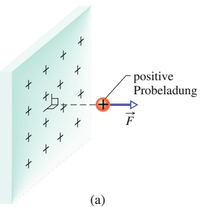

text_image

positive
Probeladung
F
(a)

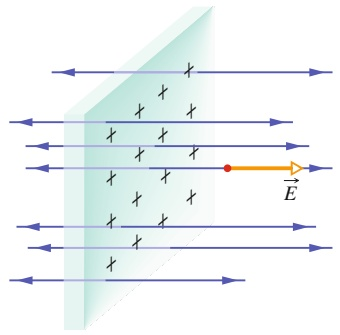

text_image

Diagram illustrating electric field lines and particle interaction with labeled vectors E and X

(b)

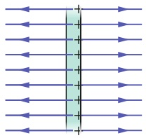

natural_image

Pure diagram of parallel light rays passing through a central vertical line, no text or symbols present

(c)

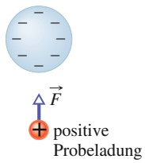

(a)

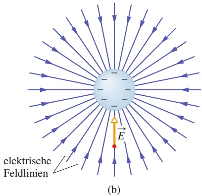

text_image

elektrische
Feldlinien
E
(b)

## Abb. 18.2

(a) Die auf eine positive Probeladung in der Nähe einer homogenen, kugelförmigen Verteilung negativer Ladung wirkende elektrostatische Kraft
(b) Der elektrischen Feldvektor am Ort der Probeladung und die elektrischen Feldlinien im Raum um die Ladungsverteilung. Die Feldlinien enden an der negativen Ladung – ihr Ursprung ist bei entfernten, hier nicht dargestellten positiven Ladungen zu denken.

## Abb. 18.3

(a) Die elektrostatische Kraft $\vec { F }$ auf eine positive Probeladung in der Nä- he einer sehr großen, nichtleitenden Platte, die auf ihrer Vorderseite eine gleichförmig verteilte positive Ladung trägt. (b) Der elektrische Feldvektor $\vec { E }$ am Ort der Probeladung und die elektrischen Feldlinien im Raum nahe der Platte. Die Feldlinien sind von der positiv geladenen Platte weg gerichtet. (c) Seitenansicht von (b).

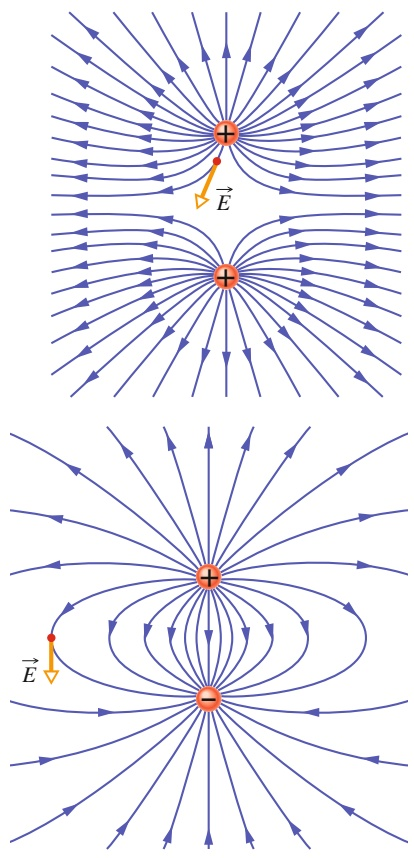

## Abb. 18.4

Feldlinien um zwei gleich große, positive Punktladungen. Die beiden Ladungen stoßen einander ab. (Die Feldlinien enden bei weit entfernten, negativen Ladungen.) Sie können sich das eigentlich dreidimensionale Feldlinienbild vorstellen, indem Sie sich das hier gezeigte ebene Muster um eine Achse gedreht denken, die in der Papierebene liegt und durch die beiden Ladungen verläuft. Man bezeichnet deshalb dieses dreidimensionale Feldlinienmuster sowie auch das elektrische Feld, welches von ihm beschrieben wird, als rotationssymmetrisch um diese Achse. In einem Punkt einer Feldlinie ist der Vektor des elektrischen Felds in diesem Punkt gezeichnet. Beachten Sie dabei, dass dieser Vektor zur Feldlinie in diesem Punkt tangential ist.

## Abb. 18.5

Darstellung der Feldlinien um zwei nah benachbarte Ladungen, eine positive und eine gleich große negative Ladung. Die Ladungen ziehen einander an. Das Feldlinienbild im Raum um die beiden Ladungen ist rotationssymmetrisch um eine Achse, die in der Papierebene liegt und durch die beiden Ladungen verläuft. In einem Punkt einer Feldlinie ist der Vektor des elektrischen Felds in diesem Punkt gezeichnet; er ist tangential zur Feldlinie durch den Punkt.

Abbildung 18.4 zeigt den Feldlinienverlauf in der Umgebung zweier benachbarter positiver Punktladungen, Abb. 18.5 das Feldlinienbild für zwei Ladungen mit gleichem Betrag, aber unterschiedlichen Vorzeichen. Diese Ladungsanordnung bezeichnet man als einen **elektrischen Dipol**. Obwohl wir nur selten quantitativen Gebrauch von Feldlinienbildern machen, so sind sie doch außerordentlich nützlich, um sich die Feldverhältnisse zu veranschaulichen. Man kann förmlich „sehen“, wie die Ladungen in Abb. 18.4 sich abstoßen oder wie sie sich in Abb. 18.5 anziehen.

## 18.2 Das elektrische Feld einer Punktladung

## Lernziele

Nach dem Durcharbeiten dieses Abschnitts sollten Sie in der Lage sein, . . .

• den Vektor $\vec { E }$ des elektrischen Felds an einem Punkt in der Umgebung eines positiv oder negativ geladenen Teilchens zu skizzieren,
• für einen beliebigen Punkt im elektrischen Feld eines geladenen Teilchens den Zusammenhang zwischen der Feldstärke $E ,$ dem Betrag |q| der Ladung und dem Abstand r zwischen gewähltem Punkt und Ladung anzugeben,
• zu verstehen, dass die hier angegebene Gleichung für die elektrische Feldstärke nur für Punktladungen gilt, nicht für ausgedehnte geladene Objekte,
• falls an einem Punkt mehrere elektrische Felder vorhanden sind, die einzelnen Feldvektoren zu skizzieren und das Gesamtfeld durch Vektoraddition (nicht skalare Addition) der einzelnen Felder zu berechnen.

## Schlüsselideen

• Die Feldstärke des elektrischen Felds $\vec { E } ,$ das von einem Teilchen mit der Ladung q erzeugt wird, beträgt in einer Entfernung r von dem Teilchen

$$
E = \frac {1}{4 \pi \varepsilon_ {0}} \frac {| q |}{r ^ {2}}.
$$

• Die Vektoren des elektrischen Felds eines positiv geladenen Teilchens zeigen alle von dem Teilchen weg. Die Vektoren des elektrischen Felds eines negativ geladenen Teilchens zeigen alle auf das Teilchen zu.
Wenn an einem Punkt mehrere elektrische Felder existieren, die von unterschiedlichen geladenen Teilchen erzeugt werden, ergibt sich das Gesamtfeld als Vektorsumme der einzelnen elektrischen Felder: Für elektrische Felder gilt das Superpositionsprinzip.

## 18.2.1 Das elektrische Feld einer Punktladung

Um das elektrische Feld in einem beliebigen Punkt mit dem Abstand r von einer Punktladung $q$ (oder einem geladenen Teilchen) zu bestimmen, denken wir uns eine positive Probeladung $q _ { 0 }$ an diesen Punkt gebracht. Mit dem Coulomb-Gesetz (Gl. 17.4) berechnen wir den Betrag F der elektrostatischen Kraft auf $q _ { 0 }$ zu

$$
F = \frac {1}{4 \pi \varepsilon_ {0}} \frac {| q | | q _ {0} |}{r ^ {2}}. \tag {18.2}
$$

Hat $q$ positives Vorzeichen, so zeigt der Kraftvektor $\vec { F }$ von der Ladung weg, anderenfalls zeigt er direkt zur Ladung hin. Den Betrag des elektrischen Feldvektors erhalten wir aus Gl. 18.1:

$$
E = \frac {F}{q _ {0}} = \frac {1}{4 \pi \varepsilon_ {0}} \frac {| q |}{r ^ {2}}. \tag {18.3}
$$

Feldrichtung und Kraftrichtung sind identisch. Da wir bei unserer Überlegung keine weiteren Annahmen über den Ort der Probeladung $q _ { 0 }$ gemacht haben, ist der Betrag des elektrischen Felds in einem beliebigen Punkt in der Umgebung der Punktladung $q$ durch Gl. 18.3 gegeben. Abbildung 18.6 zeigt das elektrische Feld um eine positive Punktladung in Vektordarstellung (ohne Feldlinien).

Auf einfache Weise erhält man das resultierende elektrische Feld mehrerer Punktladungen: Bringen wir eine positive Probeladung $q _ { 0 }$ in die Nähe von n Punktladungen $q _ { 1 } , q _ { 2 } , \ldots , q _ { n } ,$ so ergibt sich die resultierende Kraft auf die Probeladung nach Gl. 17.7 zu

$$
\vec {F} _ {0} = \vec {F} _ {0 1} + \vec {F} _ {0 2} + \dots + \vec {F} _ {0 n}.
$$

Daraus folgt nach Gl. 18.1 für das resultierende elektrische Feld am Ort der Probeladung

$$
\vec {E} = \frac {\vec {F} _ {0}}{q _ {0}} = \frac {\vec {F} _ {0 1}}{q _ {0}} + \frac {\vec {F} _ {0 2}}{q _ {0}} + \dots + \frac {\vec {F} _ {0 n}}{q _ {0}} = \vec {E} _ {1} + \vec {E} _ {2} + \dots + \vec {E} _ {n}. \tag {18.4}
$$

$\vec { E } _ { \mathrm { i } }$ bezeichnet das elektrische Feld, das die Punktladung i erzeugen würde, wäre sie allein vorhanden. Gleichung 18.4 zeigt uns, dass das Superpositionsprinzip für elektrische Felder genauso gilt wie für elektrostatische Kräfte.

## KONTROLLFRAGE 1

Die Abbildung zeigt ein Proton p und ein Elektron e auf einer x-Achse. Welche Richtung hat das vom Elektron erzeugte Feld (a) im Punkt S, (b) im Punkt R? Welche Richtung hat das resultierende elektrische Feld (c) im Punkt R, (d) im Punkt S?

## KONTROLLFRAGE 2

Die Abbildung zeigt vier Anordnungen von Punktladungen, die vom Ursprung des Koordinatensystems jeweils gleich weit entfernt seien. Ordnen Sie die vier Fälle nach dem Betrag des resultierenden elektrischen Felds im Ursprung.

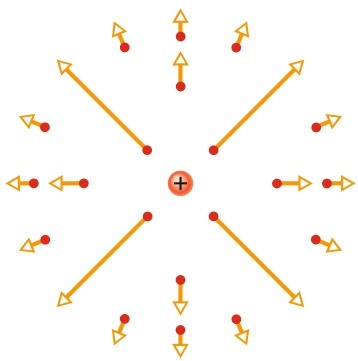

flowchart

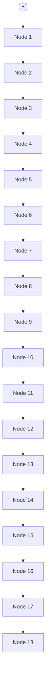

Abb. 18.6

Vektoren des elektrischen Felds an verschiedenen Punkten um eine positive Punktladung.

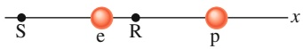

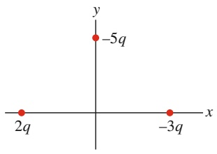

scatter

| Point | X | Y |
| --- | --- | --- |
| 1 | 2q | 0 |
| 2 | -3q | 0 |
| 3 | -5q | -5q |

(a)

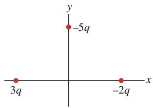

scatter

| X | Y |
| --- | --- |
| -2q | -5q |
| 3q | 0 |

(b)

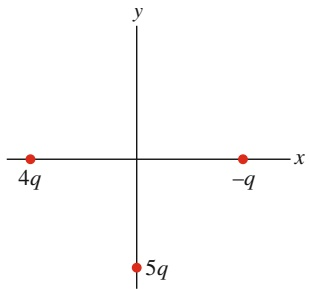

text_image

y
4q
-q
x
5q

(c)

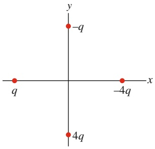

text_image

y
-q
x
q
-4q
4q

(d)

## 18.3Das elektrischeFeldeines Dipols

## Lernziele

Nach dem Durcharbeiten dieses Abschnitts sollten Sie in der Lage sein, . . .

• einen elektrischen Dipol zu zeichnen, seine Ladungen (Beträge und Vorzeichen) anzugeben und Dipolachse und Richtung des elektrischen Dipolmoments zu markieren,
• die Richtung des elektrischen Felds an einem beliebigen Punkt auf der Dipolachse (auch zwischen den Ladungen) anzugeben,
• zu beschreiben, wie die Gleichung für das elektrische Feld eines elektrischen Dipols aus den Gleichungen für das elektrische Feld der beiden Einzelladungen hervorgeht,
die elektrischen Felder eines einzelnen geladenen Teilchens und eines elektrischen Dipols daraufhin zu vergleichen, wie schnell sie mit der Entfernung abnehmen (d. h. anzugeben, welches Feld schneller abnimmt),
• die Beziehung zwischen dem Betrag $p$ des Dipolmoments, dem Abstand d seiner Ladungen und dem Betrag q der Ladungen anzugeben,
• für einen weit entfernten Punkt auf einer Dipolachse die Beziehung zwischen der elektrischen Feldstärke E, dem Abstand z vom Zentrum des Dipols und dem Betragp des Dipolmoments zu kennen.

## Schlüsselideen

• Ein elektrischer Dipol besteht aus zwei Ladungen mit gleichem Betrag $q ,$ aber entgegengesetzten Vorzeichen in einem kleinen Abstand d voneinander.
• Das elektrische Dipolmoment $\vec { p }$ hat den Betrag qd und zeigt von der negativen zur positiven Ladung.
• Der Betrag des elektrischen Felds, das ein elektrischer Dipol an einem entfernten Punkt auf der Dipolachse (die durch beide Teilchen verläuft) erzeugt, berechnet sich aus dem Betragp des Dipolmoments zu

$$
E = \frac {1}{2 \pi \varepsilon_ {0}} \frac {p}{z ^ {3}},
$$

wobei z die Entfernung des betreffenden Punkts vom Zentrum des Dipols ist.

• Aufgrund der $1 / z ^ { 3 }$ -Abhängigkeit von der Entfernung nimmt die Feldstärke eines elektrischen Dipols schneller ab als die Feldstärke der einzelnen Ladungen, die den Dipol bilden (diese nehmen wie $1 / r ^ { 2 }$ ab).

## 18.3.1Das elektrischeFeldeines elektrischen Dipols

Abbildung 18.7a zeigt zwei geladene Teilchen, deren Ladungen den gleichen Betrag, aber entgegengesetzte Vorzeichen haben. Die Teilchen seien in einem Abstand d voneinander fixiert. Wie wir schon bei Abb. 18.5 angemerkt haben, nennt man diese Ladungskonfiguration einen elektrischen Dipol. Wir wollen das elektrische Feld dieses Dipols in einem Punkt P berechnen, der auf der Verbindungslinie der beiden Ladungen, der Dipolachse, liegt und einen Abstandz vom Mittelpunkt des Dipols hat.

Aus Symmetriegründen muss das resultierende elektrische Feld $\vec { E }$ im Punkt P ebenso wie die Felder $\vec { E } _ { ( + ) }$ und $\vec { E } _ { ( - ) } ,$ die von den beiden Dipolladungen im Punkt P erzeugt werden, auf der Dipolachse liegen, die wir deshalb als z-Achse wählen. Wenden wir das auch für elektrische Felder geltende Superpositionsprinzip an, so erhalten wir den BetragE des elektrischen Felds im Punkt P zu

$$
\begin{array}{l} E = E _ {(+)} - E _ {(-)} = \frac {1}{4 \pi \varepsilon_ {0}} \frac {q}{r _ {(+)} ^ {2}} - \frac {1}{4 \pi \varepsilon_ {0}} \frac {q}{r _ {(-)} ^ {2}} \\ = \frac {q}{4 \pi \varepsilon_ {0} \left(z - \frac {1}{2} d\right) ^ {2}} - \frac {q}{4 \pi \varepsilon_ {0} \left(z + \frac {1}{2} d\right) ^ {2}}. \tag {18.5} \\ \end{array}
$$

Diesen Ausdruck können wir auch auf die Form

$$
E = \frac {q}{4 \pi \varepsilon_ {0} z ^ {2}} \left[ \left(1 - \frac {d}{2 z}\right) ^ {- 2} - \left(1 + \frac {d}{2 z}\right) ^ {- 2} \right] \tag {18.6}
$$

bringen. Normalerweise ist man an der elektrischen Wirkung eines Dipols nur in Entfernungen interessiert, die groß sind im Vergleich zu den Abmessungen des Dipols, also für $z \gg d .$ Bei solch großen Entfernungen kann man in Gl. 18. $5   d / 2 z \ll 1$ annehmen und die beiden in den eckigen Klammern stehenden Ausdrücke mithilfe der binomischen Reihe (Anhang D) entwickeln. Man erhält so

$$
\left[ \left(1 - \frac {d}{2 z}\right) ^ {- 2} - \left(1 + \frac {d}{2 z}\right) ^ {- 2} \right] \approx \left[ \left(1 + \frac {2 d}{2 z (1 !)} + \dots\right) - \left(1 - \frac {2 d}{2 z (1 !)} + \dots\right) \right]
$$

und

$$
E = \frac {q}{4 \pi \varepsilon_ {0} z ^ {2}} \left[ \left(1 + \frac {d}{z} + \dots\right) - \left(1 - \frac {d}{z} + \dots\right) \right]. \tag {18.7}
$$

Die weggelassenen Terme der Reihenentwicklungen von Gl. 18.7 enthalten höhere Potenzen von $d / z .$ Da nach unserer Annahme $d / z \ll 1$ gilt, nehmen die Beiträge dieser Terme zur Summe der Reihe rasch ab und wir können sie bei einer Berechnung des elektrischen Felds in großen Entfernungen vom Dipol vernachlässigen. In dieser Näherung erhält Gl. 18.7 die Form

$$
E = \frac {q}{4 \pi \varepsilon_ {0} z ^ {2}} \frac {2 d}{z} = \frac {1}{2 \pi \varepsilon_ {0}} \frac {q d}{z ^ {3}}. \tag {18.8}
$$

Das Produkt $q d ,$ welches die beiden wesentlichen Eigenschaften eines elektrischen Dipols, nämlich den Betrag der beteiligten Ladungen sowie deren Abstand enthält, ist der Betrag $p$ einer vektoriellen Größe $\vec { p } ,$ dem **elektrischen Dipolmoment** des Dipols. Die Einheit des Dipolmoments ist Coulomb mal Meter (C m). Damit wird Gl. 18.8 zu

$$
E = \frac {1}{2 \pi \varepsilon} \frac {p}{z ^ {3}}. \tag {18.9}
$$

Man wählt die Richtung von $\vec { p }$ als die Richtung vom negativen Ende des Dipols zum positiven Ende, wie in Abb. 18.7b dargestellt. Der Dipolmomentvektor $\vec { p }$ gibt die Orientierung des Dipols im Raum an.

Gleichung 18.9 liefert nur das Produkt $p ,$ nicht jedoch die beiden Faktoren q und $d$ separat. Dies bedeutet, dass man aus einer Messung des Dipolfelds an einem weit vom Dipol entfernten Ort nur das Produkt von $q$ und $d$ erhält, nicht jedoch die beiden Faktoren separat. So bliebe das Dipolfeld an weit entfernten Orten unverändert, würde man beispielsweise $q$ verdoppeln und gleichzeitig d halbieren. Man erkennt daraus, dass das Dipolmoment die wesentliche physikalische Eigenschaft eines Dipols ist.

Obwohl Gl. 18.9 streng genommen nur für Punkte anwendbar ist, die auf der Dipolachse liegen und außerdem weit vom Dipol entfernt sind, so zeigt doch eine genauere Untersuchung, dass die Proportionalität zu $1 / r ^ { 3 }$ für alle Punkte des Raums um einen Dipol gilt, sofern sie nur hinreichend weit vom Dipol entfernt sind (r bezeichnet die Entfernung zwischen einem Punkt im Raum und dem Mittelpunkt des Dipols.).

Vergleicht man Abb. 18.7 und das Feldlinienbild von Abb. 18.5, so erkennt man, dass das Dipolfeld $\vec { E }$ in Punkten, die weit vom Dipol entfernt auf der Dipolachse liegen, immer die Orientierung des Dipolmomentvektors $\vec { p }$ hat. Diese Aussage gilt unabhängig davon, ob der Punkt P in Abb. 18.7a oberhalb oder unterhalb des Dipols liegt.

Wie man aus Gl. 18.9 erkennt, nimmt das Dipolfeld um einen Faktor 8 ab, wenn man sich doppelt so weit vom Dipol entfernt, das Feld einer einzelnen Punktladung (Gl. 18.3) dagegen nur um einen Faktor 4. Das Feld eines Dipols nimmt also mit der Entfernung rascher ab als das Feld einer Einzelladung. Eine physikalische Begründung für dieses Verhalten kann man darin sehen, dass ein Dipol aus großer Entfernung betrachtet wie ein Paar von betragsgleichen, entgegengesetzten Ladungen erscheint, die sich fast in demselben Raumpunkt befinden, sodass sich ihre Felder in weit entfernten Punkten fast – aber eben nicht vollständig – auslöschen.

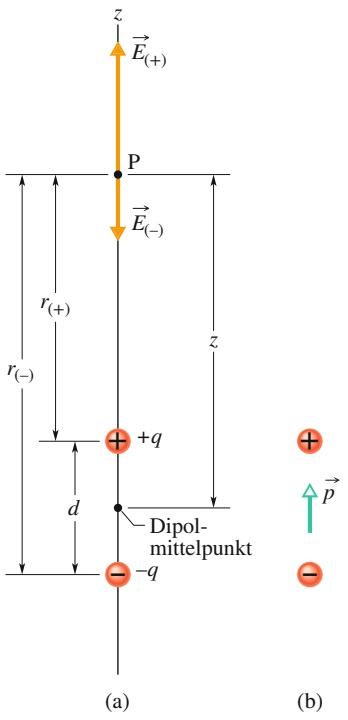

text_image

z
→ E(+)
P
→ E(-)
r(+)
r(-)
r
+q
d
Dipol-
mittelpunkt
-q
(a)
(b)

Abb. 18.7

(a) Ein elektrischer Dipol. Die Feldvektoren $\vec { E } _ { ( + ) }$ und $\vec { E } _ { ( - ) }$ im Punkt P auf der Dipolachse beschreiben die von den beiden Ladungen $+ q$ und −q des Dipols hervorgerufenen elektrischen Felder. Der Abstand zwischen dem Punkt P und der Ladung +q des Dipols sei $r _ { ( + ) } ,$ der Abstand zwischen P und der Ladung $- q$ sei $r _ { ( - }$ ). (b) Das Dipolmoment $\vec { p }$ des Dipols ist ein Vektor, der von der negativen zur positiven Ladung zeigt.

## 18.4 Elektrisches Feld einer linearen Ladungsverteilung

## Lernziele

Nach dem Durcharbeiten dieses Abschnitts sollten Sie in der Lage sein, . . .

• für homogene Ladungsverteilungen die lineare Ladungsdichte λ einer linearen Ladungsverteilung, die Flächenladungsdichte σ einer Ladung auf einer Oberflä- che und die Volumenladungsdichte ρ einer über ein Volumen verteilten Ladung zu berechnen,
das elektrische Feld an einem Punkt in der Nähe einer homogenen linearen Ladungsverteilung zu berechnen, indem Sie die Verteilung in infinitesimale bzw. differenzielle Ladungselemente dq aufspalten und dann die differenziellen elektrischen Feldvektoren an dem betreffenden Punkt aufzuintegrieren,
• zu erläutern, wie man die Berechnung des elektrischen Felds an einem Punkt in der Nähe einer homogenen linearen Ladungsverteilung durch Symmetrieüberlegungen vereinfachen kann.

## Schlüsselideen

• Die Gleichung für das von einem geladenen Teilchen erzeugte elektrische Feld gilt nicht für geladene ausgedehnte Objekte mit kontinuierlichen Ladungsverteilungen.
Um das elektrische Feld eines geladenen ausgedehnten Objekts an einem bestimmten Punkt zu bestimmen, betrachten wir zunächst das elektrische Feld aufgrund eines infinitesimalen bzw. differenziellen Ladungselements dq in dem Objekt, wobei das Element klein genug sein soll, dass wir die Gleichung für geladene Teilchen anwenden können. Anschließend integrieren wir die differenziellen Feldvektoren dE⃗ aller derartigen Ladungselemente.
• Da die einzelnen Feldelemente dE⃗ unterschiedliche Beträge besitzen und in verschiedene Richtungen zeigen, untersuchen wir zuerst, ob die Symmetrie des Systems dazu führt, dass sich gewisse Komponenten der Felder gegenseitig auslö- schen, was die Integration erheblich vereinfachen kann.

## 18.4.1 Das elektrische Feld einer linearen Ladungsverteilung

Wir haben bisher elektrische Felder betrachtet, wie sie von einer einzelnen oder höchstens von einigen wenigen Punktladungen erzeugt werden. Im Folgenden untersuchen wir dagegen elektrische Felder von Ladungsverteilungen, die wir uns als Mengen sehr vieler, eng benachbarter Punktladungen vorstellen, die entlang einer Linie, über eine Oberfläche oder in einem Raumvolumen verteilt sind. Wir betrachten solche makroskopischen Ladungsverteilungen dann als **kontinuierlich**, also nicht mehr aus diskreten Ladungen zusammengesetzt. Mathematisch behandelt man die elektrischen Felder von solchen kontinuierlichen Ladungsverteilungen mit den Mitteln der Infinitesimalrechnung. Im vorliegenden Abschnitt berechnen wir das elektrische Feld einer kontinuierlichen, linearen Ladungsverteilung, im folgenden Abschnitt das Feld einer geladenen Oberfläche. Schließlich werden wir im folgenden Kapitel das elektrische Feld innerhalb einer homogen geladenen Kugel betrachten.

Wenn wir kontinuierliche Ladungsverteilungen betrachten, behandeln wir die Ladung auf einem Körper sinnvollerweise als eine Ladungsdichte und nicht als eine Gesamtladung. So beschreiben wir beispielsweise eine lineare Ladungsverteilung durch Angabe einer linearen Ladungsdichte $\lambda ,$ deren Dimension Ladung pro Einheitslänge ist mit der SI-Einheit Coulomb pro Meter. Tabelle 18.2 fasst die übrigen Ladungsdichten zusammen, die wir verwenden werden.

Abbildung 18.8 zeigt einen dünnen Ring mit Radius $R ,$ der eine homogen verteilte positive lineare Ladungsdichte λ trägt. Der Ring soll beispielsweise aus Plastik oder einem anderen Isolator bestehen, sodass man die Ladungen auf dem Ring als ortsfest annehmen kann. Welches elektrische Feld $\vec { E }$ erzeugt diese ringförmige Ladungsverteilung an einem Punkt P, der in einer Entfernung z von der Ebene des Rings auf dessen Symmetrieachse liegt?

Mit Gl. 18.3 können wir diese Aufgabe offensichtlich nicht lösen. Dennoch lässt sich die Situation auf den Fall in Gl. 18.3 beschriebenen Fall einer Punktladung reduzieren, wenn wir uns den Ring in infinitesimale bzw. differenzielle Ladungselemente unterteilt denken, die alle so klein sind, dass wir sie als Punktladungen behandeln können. Nun summieren (eigentlich: integrieren) wir vektoriell alle Feldbeiträge, die von den differenziellen Ladungselementen im Punkt P erzeugt werden, und erhalten so das resultierende, von der ringförmigen Ladungsverteilung im Punkt P erzeugte Feld.

Jedes differenzielle Ladungselement habe die differenzielle Bogenlänge ds. Mit der linearen Ladungsdichte λ, der Ladung pro Einheitslänge auf dem Ring, kann man die differenzielle Ladung eines Ladungselements in der Form

$$
\mathrm{d} q = \lambda \mathrm{d} s \tag {18.10}
$$

schreiben. Diese differenzielle Ladung erzeugt in der Entfernung r im Punkt P ein differenzielles elektrisches Feld dE⃗. Behandelt man das Ladungselement als Punktladung, so folgt mit den Gln. 18.10 und 18.3 für den Betrag von dE⃗

$$
\mathrm{d} E = \frac {1}{4 \pi \varepsilon_ {0}} \frac {\mathrm{d} q}{r ^ {2}} = \frac {1}{4 \pi \varepsilon_ {0}} \frac {\lambda \mathrm{d} s}{r ^ {2}}. \tag {18.11}
$$

Aus Abb. 18.8 liest man $r ^ { 2 } = z ^ { 2 } + R ^ { 2 }$ ab, woraus mit Gl. 18.11

$$
\mathrm{d} E = \frac {1}{4 \pi \varepsilon_ {0}} \frac {\lambda \mathrm{d} s}{(z ^ {2} + R ^ {2})} \tag {18.12}
$$

folgt. Abbildung 18.8 zeigt, dass $\mathrm { d } \vec { E }$ einen Winkel θ mit der Symmetrieachse des Rings, unserer z-Achse, einschließt. Wir zerlegen den Vektor daher in Komponenten parallel und senkrecht zu dieser Achse.

Jedes Ladungselement des Rings erzeugt im Punkt P einen differenziellen Feldbeitrag d $\vec { \lfloor E \rfloor } ,$ dessen Betrag durch Gl. 18.12 gegeben ist. Die Komponenten aller Vektoren dE⃗ parallel zur Symmetrieachse sind einander in Betrag und Richtung gleich. Die Komponenten senkrecht zur Achse haben alle den gleichen Betrag, zeigen aber in unterschiedliche Richtungen. Jedoch existiert für jede beliebig herausgegriffene senkrechte Komponente eine andere, die exakt entgegengesetzt ist, sodass ihre Vektorsumme null wird. Da dies für jedes beliebige Paar senkrechter Komponenten gilt, löschen sich die Feldbeiträge senkrecht zur Symmetrieachse des Rings aus.

Wir brauchen deshalb nur die Komponenten der Feldbeiträge dE⃗ zu berücksichtigen, die parallel zur Symmetrieachse gerichtet sind, sodass sich der Betrag des resultierenden Felds in P einfach als Summe ihrer Beträge ergibt.

Die Parallelkomponente von $\mathrm { d } \vec { E }$ in Abb. 18.8 hat den Betrag dE cos θ. Damit lesen wir aus der Skizze ab:

$$
\cos \theta = \frac {z}{r} = \frac {z}{\sqrt {z ^ {2} + R ^ {2}}} . \tag {18.13}
$$

Aus den Gln. 18.13 und 18.12 erhalten wir nun für die Parallelkomponente von dE⃗

$$
\mathrm{d} E \cos \theta = \frac {z \lambda}{4 \pi \varepsilon_ {0} (z ^ {2} + R ^ {2}) ^ {3 / 2}} \mathrm{d} s. \tag {18.14}
$$

TABELLE 18.2:

Ladungsdichten.

| Name | Symbol | SI-Einheit |
| --- | --- | --- |
| Ladung | $q$ | C |
| lineare | $\lambda$ | C/m |
| Ladungsdichte |  |  |
| Flächenladungs- dichte | $\sigma$ | $C/m^{2}$ |
| Raumladungs- dichte | $\rho$ | $C/m^{2}$ |

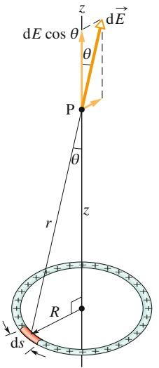

text_image

dE cos θ
θ
P
r
z
R
ds
dE

Abb. 18.8

Eine ringförmige und homogene Verteilung positiver Ladung. Ein differenzielles Längenelement ds des Rings (hier stark vergrößert gezeichnet) trägt die differenzielle Ladung dq. Dieses Ladungselement erzeugt im Punkt P ein elektrisches Feld $\mathrm { d } { \vec { E } } .$ Die Komponente dieses Felds in Richtung der Symmetrieachse des Rings beträgt dE cos θ.

Um nun die von allen Ladungselementen erzeugten Parallelkomponenten dE cos θ zusammenzufassen, integrieren wir Gl. 18.14 über den Umfang des Rings, also von $s = 0$ bis $s = 2 \pi R$ . Da s im Ausdruck von Gl. 18.14 die einzige Variable ist, kann man alle übrigen Größen vor das Integral ziehen:

$$
E = \int \mathrm{d} E \cos \theta = \frac {z \lambda}{4 \pi \varepsilon_ {0} (z ^ {2} + R ^ {2}) ^ {3 / 2}} \int_ {0} ^ {2 \pi R} \mathrm{d} s = \frac {z \lambda (2 \pi R)}{4 \pi \varepsilon_ {0} (z ^ {2} + R ^ {2}) ^ {3 / 2}}. \tag {18.15}
$$

Da λ die Ladung pro Einheitslänge auf dem Ring angibt, ist der Faktor λ(2πR) in Gl. 18.15 identisch mit der Gesamtladung q des Rings. Damit bekommen wir

$$
E = \frac {q z}{4 \pi \varepsilon_ {0} (z ^ {2} + R ^ {2}) ^ {3 / 2}}. \tag {18.16}
$$

Auch bei negativer – statt, wie angenommen, positiver – Ladung des Rings ist der Betrag des elektrischen Felds im Punkt P durch Gl. 18.16 gegeben. Der Feldvektor zeigt nun jedoch zum Ring hin.

Überprüfen wir die Anwendbarkeit von Gl. 18.16 für einen Punkt auf der Ringachse, der so weit vom Ring entfernt ist, dass $z \gg R$ gilt. In diesem Fall kann man den Ausdruck $z ^ { 2 } + R ^ { 2 }$ in Gl. 18.16 durch $z ^ { 2 }$ annähern, und Gl. 18.16 wird zu

$$
E = \frac {1}{4 \pi \varepsilon_ {0}} \frac {q}{z ^ {2}}. \tag {18.17}
$$

Dies ist ein plausibles Ergebnis, da der Ring aus sehr großer Entfernung als Punkt ladung erscheint. Ersetzen wir z in Gl. 18.17 durch $r ,$ so erhalten wir Gl. 18.3, den Ausdruck für den Betrag des elektrischen Felds einer Punktladung.

Als Nächstes überprüfen wir Gl. 18.16 für den Mittelpunkt des Rings, also für $z = 0$ . Aus Gl. 18.16 folgt, dass das Feld in diesem Punkt verschwindet, d. h. $E = 0$ Auch dieses Ergebnis ist plausibel, denn bringen wir eine Probeladung in die Mitte des Rings, so ist die resultierende elektrostatische Kraft auf die Ladung null: Die von jedem einzelnen Ladungselement auf dem Ring verursachte Kraft auf die Probeladung wird kompensiert durch die Kraft des im Ring direkt gegenüberliegenden Ladungselements. Ist aber die resultierende Kraft auf die Probeladung null, so gilt dies nach Gl. 18.1 auch für das elektrische Feld.

## LÖSUNGSSTRATEGIEN

**Strategie 1: Felder linearer Ladungsverteilungen** Hier sind einige nützliche Regeln für die Bestimmung des von einer linearen Ladungsverteilung, die gekrümmt oder geradlinig sein kann, in einem Punkt P erzeugten elektrischen Felds E⃗. Die Vorgehensweise besteht in allen Fällen darin, ein differenzielles Ladungselement dq herauszugreifen, den von ihm erzeugten Feldbeitrag dE⃗ zu bestimmen und schließlich diesen Beitrag über die gesamte Länge der Ladungsverteilung zu integrieren.

• Schritt 1: Bei einer ringförmigen Ladungsverteilung wählen Sie als Länge ds eines differenziellen Ladungselements die Bogenlänge des Kreisbogens. Ist die Ladungsverteilung dagegen geradlinig, so legen Sie eine x-Achse fest, die mit der Ladungsverteilung zusammenfällt, und wählen dx als Länge eines Ladungsele ments. Fertigen Sie eine Zeichnung an und heben Sie darin das gewählte Längenelement hervor.
• Schritt 2: Setzen Sie die Ladung dq eines Ladungselements über eine lineare Ladungsdichte λ in Beziehung zur Länge des Elements: $\mathsf { d } q = \lambda$ ds oder d $. q = \lambda$ dx. Behandeln Sie $\mathrm { d } q$ und λ als positive Größen, auch dann, wenn die betrachtete Ladung negativ ist. (Das Vorzeichen der Ladung behandeln wir im nächsten Schritt.)
• Schritt 3: Berechnen Sie mithilfe von Gl. 18.3 den vom Ladungselement dq im fraglichen Punkt P erzeugten differenziellen Feldbeitrag $\mathrm { d } { \vec { E } } ,$ wobei Sie q in

Gl. 18.3 entweder durch λ ds oder λ dx ersetzen. Zeichnen Sie in Ihrer Skizze im Punkt P den Vektor d $1 \vec { E }$ ein; er ist senkrecht vom Ladungselement dq weg gerichtet, falls die Ladung positiv ist, anderenfalls zeigt er direkt auf das Ladungselement hin.

• Schritt 4: Nutzen Sie eventuell vorhandene Symmetrien zur Vereinfachung des Problems! Liegt beispielsweise der Punkt P auf einer Symmetrieachse der Ladungsverteilung, so zerlegen Sie den vom Ladungselement $\mathrm { d } q$ erzeugten Feldbeitrag $\mathrm { d } \vec { E }$ in Komponenten parallel und senkrecht zu dieser Symmetrieachse. Betrachten Sie dann ein zweites Ladungselement $\mathrm { d } \boldsymbol { q } ^ { \prime } ,$ das bezüglich der Symmetrieachse der Ladungsverteilung symmetrisch zu dq liegt. Zeichnen Sie dann auch den Feldbeitrag $\mathrm { d } \vec { E } ^ { \prime }$ , der von diesem zweiten Ladungselement erzeugt wird, im Punkt P ein und zerlegen Sie ihn in Komponenten. Aus Symmetriegründen finden sich dann zwei Komponenten der beiden Feldbeiträge, die einander kompensieren und deshalb nicht mehr weiter berücksichtigt werden müssen. Wir nennen sie verschwindende Komponenten. Summieren Sie dann die verbleibenden, nichtverschwindenden Komponenten für alle Ladungselemente durch Integration.
• Schritt 5: Für die folgenden vier charakteristischen Typen homogener linearer Ladungsverteilungen sieht Schritt 4 z. B. so aus:

Ring Der Punkt P liegt auf der Symmetrieachse des Rings, wie in Abb. 18.8 dargestellt. Ersetzen Sie $r ^ { 2 }$ im Ausdruck für dE durch $\bar { z ^ { 2 }   +   R ^ { 2 } }$ wie in Gl. 18.12. Drücken Sie die nicht verschwindende Komponente von dE⃗ durch θ aus. Dadurch erscheint cos $\theta$ in der Gleichung. θ ist jedoch für alle Ladungselemente gleich und deshalb keine Variable. Ersetzen Sie dann cos θ nach Gl. 18.13. Integrieren Sie abschließend über s, wobei Sie die Integrationsgrenzen so wählen, dass der gesamte Ring erfasst wird.
Kreisbogen Der Punkt P liegt im Krümmungsmittelpunkt des Bogens, wie in Abb. Ü18.3 im Übungsbuch dargestellt. Drücken Sie die nicht verschwindende Komponente von dE⃗ durch θ aus. Dadurch erscheint entweder sin θ oder cos θ in der Gleichung. Reduzieren Sie die Anzahl der Variablen (noch sind s und θ Variablen), indem Sie ds durch rθ ausdrücken. Integrieren Sie abschlie ßend über θ wie in Beispielaufgabe 18.3 im Übungsbuch vom einen Ende des Kreisbogens zum anderen.
Gerade Linie Der Punkt P liegt, wie in Abb. 18.9a dargestellt, auf einer Verlängerung der Ladungsverteilung. Ersetzen Sie r im Ausdruck für dE durch x. Integrieren Sie über x vom einen Ende der Ladungslinie bis zum anderen.
Gerade Linie Der Punkt P liegt, wie in Abb. 18.9b dargestellt, außerhalb der Ladungsachse in einer Entfernung y. Ersetzten Sie r im Ausdruck für dE durch einen Ausdruck in x und y. Liegt der Punkt P auf der Mittelsenkrechten der Ladungslinie, so leiten Sie einen Ausdruck zur Berechnung der nichtverschwindenden Komponente von dE her. Dadurch tritt entweder sin θ oder cos θ auf. Eliminieren Sie eine der beiden verbleibenden Variablen x und $\theta ,$ nämlich x, indem Sie die jeweilige trigonometrische Funktion durch ihre Definition, d. h. einen Ausdruck in x und $y ,$ ersetzen. Integrieren Sie abschließend über x, vom einen Ende der Ladungslinie zum anderen. Liegt der Punkt P, wie in Abb. 18.9c dargestellt, nicht symmetrisch zur Ladungslinie, so integrieren Sie separat erst die Komponente d $| E _ { x }$ über $x ,$ und dann $\mathrm { d } E _ { y }$ über $y .$ Sind die beiden Komponenten $E _ { x }$ und $E _ { y }$ bekannt, so berechnen Sie daraus in bekannter Weise Betrag und Richtung des Vektors $\vec { E } .$

• Schritt 6: In allen Fällen ist das Ergebnis der Integration je nach Wahl der Reihenfolge der Integrationsgrenzen einmal positiv, einmal negativ. Falls ein negatives Ergebnis auftreten sollte, so vernachlässigen Sie das Vorzeichen. Soll das Ergebnis in Abhängigkeit von der Gesamtladung Q der Ladungsverteilung ausgedrückt werden, so ersetzen Sie λ durch $Q / L$ , wobei L die Länge der Verteilung bezeichnet. Bei einer ringförmigen Ladungsverteilung ist L der Umfang des Rings.

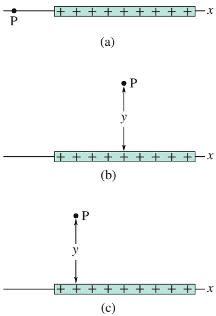

## Abb. 18.9

(a) Der Punkt P liegt auf der Achse einer linearen Ladungsverteilung.
(b) Hier liegt der Punkt P auf der vertikalen Symmetrieachse einer linearen Ladungsverteilung im Abstand y von der Verteilung. (c) Wie (b), nur mit dem Unterschied, dass P nicht auf der vertikalen Symmetrieachse liegt.

## KONTROLLFRAGE 3

Die Abbildung zeigt drei nichtleitende Stäbe. Einer von ihnen ist zu einem halben Kreisring gebogen, die beiden anderen sind gerade. Jeder der Stäbe trägt auf seiner oberen Hälfte eine homogen verteilte Ladung vom Betrag Q, auf der unteren Hälfte eine Ladung mit gleichen Betrag und gleichem oder ungleichem Vorzeichen. Welches ist in jedem der drei Fälle die Richtung des resultierenden elektrischen Felds im Punkt P?

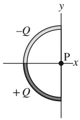

(a)

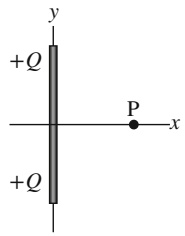

text_image

+Q
+Q
P
x
y

(b)

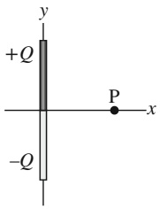

text_image

+Q
-Q
P
x
y

(c)

## 18.5 Das elektrische Feld einer geladenen Scheibe

## Lernziele

Nach dem Durcharbeiten dieses Abschnitts sollten Sie in der Lage sein, . . .

• eine homogen geladene Scheibe zu skizzieren und die Richtung des elektrischen Felds auf der Symmetrieachse für positive und negative Ladungen anzugeben,
mithilfe der Gleichung für das elektrische Feld auf der Mittelachse eines homogen geladenen Rings eine Gleichung für das elektrische Feld auf der Mittelachse einer homogen geladenen Scheibe herzuleiten,
• für Punkte auf der Mittelachse einer homogen geladenen Scheibe die Beziehung zwischen der Oberflächenladungsdichte σ, dem Scheibenradius R und dem Abstand z zwischen Punkt und Scheibe anzugeben.

## Schlüsselideen

• Auf der Mittelachse durch eine homogen geladene Scheibe beträgt die elektrische Feldstärke

$$
E = \frac {\sigma}{2 \varepsilon_ {0}} \left(1 - \frac {z}{\sqrt {z ^ {2} + R ^ {2}}}\right).
$$

Dabei sind z der Abstand des betrachteten Punkts vom Scheibenmittelpunkt, R der Radius und σ die Flächenladungsdichte der Scheibe.

## 18.5.1 Das elektrische Feld einer geladenen Scheibe

Abbildung 18.10 zeigt eine kreisförmige Plastikscheibe vom Radius R, die auf ihrer Oberseite eine positive Ladung mit der homogenen Dichte σ trägt (siehe Tab. 18.2). Welches elektrische Feld erzeugt die Ladung der Scheibe in einem Punkt P, der in einer Entfernung z auf der Mittelachse der Scheibe liegt?

Unser Lösungsansatz ist es, uns die Scheibe in eine sehr große Anzahl konzentrischer, geladener Ringe zerlegt zu denken und das resultierende elektrische Feld im Punkt P durch Summation (Integration) der Feldbeiträge sämtlicher Ringe zu berechnen. Abbildung 18.10 zeigt einen dieser Ringe mit Radius r und differenzieller Breite dr. Die Ladung pro Einheitsfläche ist durch die Ladungsdichte σ gegeben, sodass die Ladung des Rings

$$
\mathrm{d} q = \sigma \mathrm{d} A = \sigma (2 \pi r \mathrm{d} r) \tag {18.18}
$$

beträgt. Dabei bezeichnet dA ein differenzielles Flächenelement des Rings.

Die Aufgabe, das elektrische Feld eines Ladungsrings zu berechnen, haben wir bereits gelöst: Ersetzen wir $q$ in Gl. 18.16 durch dq von Gl. 18.18 sowie R durch $r ,$ so erhalten wir einen Ausdruck für den differenziellen Feldbeitrag $\mathrm { d } E ,$ den die Ladung des Rings im Punkt P erzeugt:

$$
\mathrm{d} E = \frac {z \sigma 2 \pi r \mathrm{d} r}{4 \pi \varepsilon_ {0} (z ^ {2} + r ^ {2}) ^ {3 / 2}}
$$

oder

$$
\mathrm{d} E = \frac {\sigma z}{4 \varepsilon_ {0}} \frac {2 r \mathrm{d} r}{(z ^ {2} + r ^ {2}) ^ {3 / 2}}. \tag {18.19}
$$

Wir erhalten nun E durch Integration von Gl. 18.19 über die gesamte Oberfläche der Scheibe, also durch Integration bezüglich der Variable r in den Grenzen $r = 0$ und $r = R$ . Beachten Sie, dass dabei z eine Konstante ist. Wir erhalten auf diese Weise

$$
E = \int \mathrm{d} E = \frac {\sigma z}{4 \varepsilon_ {0}} \int_ {0} ^ {R} (z ^ {2} + r ^ {2}) ^ {- 3 / 2} 2 r \mathrm{d} r. \tag {18.20}
$$

Zur Berechnung dieses Integrals bringen wir es auf die Form $\int X ^ { m }   \mathrm { d } X ,$ indem wir $\begin{array} { r } { X = ( z ^ { 2 } + r ^ { 2 } ) ,   \stackrel { \circ } { m } = - \frac { 3 } { 2 } } \end{array}$ und folglich $\mathsf { d } X = 2 r$ dr substituieren. Damit nimmt das Integral die Form

$$
\int X ^ {m} \mathrm{d} X = \frac {X ^ {m + 1}}{m + 1}
$$

an, und Gl. 18.20 wird zu

$$
E = \frac {\sigma z}{4 \varepsilon_ {0}} \left[ \frac {(z ^ {2} + r ^ {2}) ^ {- 1 / 2}}{- \frac {1}{2}} \right] _ {0} ^ {R}. \tag {18.21}
$$

Berechnen wir Gl. 18.21 in den Integrationsgrenzen, so erhalten wir nach einigen Umstellungen

$$
E = \frac {\sigma}{2 \varepsilon_ {0}} \left(1 - \frac {z}{\sqrt {z ^ {2} + R ^ {2}}}\right) \tag {18.22}
$$

für den Betrag des elektrischen Felds, das eine kreisförmige geladene Scheibe in einem Punkt ihrer Symmetrieachse erzeugt. (Bei der Ausführung der Integration haben wir $z \geq 0$ angenommen.)

Im Grenzfall $R \to \infty$ bei endlichem Wert von z geht der zweite Term in den Klammern in Gl. 18.22 gegen null und die Gleichung reduziert sich auf

$$
E = \frac {\sigma}{2 \varepsilon_ {0}}. \tag {18.23}
$$

Dieser Ausdruck beschreibt das elektrische Feld einer unendlich ausgedehnten, homogen verteilten Ladung, die auf einer Seite einer nichtleitenden Platte, bei spielsweise einer Plastikplatte, sitzt. Abbildung 18.3 zeigt den Verlauf der elektrischen Feldlinien für eine solche Anordnung.

Man erhält Gl. 18.23 auch, wenn man z in Gl. 18.22 gegen null gehen lässt, wäh rend R endlich bleibt. Physikalisch kann man dies dahingehend interpretieren, dass sich das Feld einer nur endlich ausgedehnten Scheibe in oberflächennahen Punkten dem Feld einer unendlich ausgedehnten Scheibe annähert.

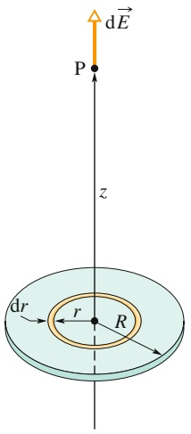

text_image

dE
P
z
dr
r
R

Abb. 18.10

Eine positive Ladung sei homogen über eine Scheibe mit dem Radius R verteilt. Ein herausgegriffener Ring habe einen Radius r sowie eine differenzielle Breite dr in radialer Richtung. Die Ladung auf diesem Ring erzeugt in einem Punkt P auf der Scheibenachse den differenziellen elektrischen Feldbeitrag dE⃗.

## 18.6 Punktladung im elektrischen Feld

## Lernziele

Nach dem Durcharbeiten dieses Abschnitts sollten Sie in der Lage sein, . . .

für ein geladenes Teilchen in einem externen (von anderen Ladungen erzeugten) elektrischen Feld die Beziehung zwischen dem elektrischen Feld E⃗ am Ort des Teilchens, der Teilchenladung und der auf das Teilchen wirkenden elektrostatischen Kraft $\vec { F }$ eine Aussage über die relativen Richtungen von Kraft und Feld zu treffen,
• den Millikan-Versuch zur Bestimmung der Elementarladung zu erläutern,
• das Funktionsprinzip von Tintenstrahldruckern zu erklären.

## Schlüsselideen

• In einem externen elektrischen Feld wirkt auf ein Teilchen mit der Ladung q die elektrostatische Kraft

$$
\vec {F} = q \vec {E}.
$$

• Für positive Ladungen $+ q$ zeigt der Kraftvektor in dieselbe Richtung wie der Feldvektor. Für negative Ladungen −q zeigt der Kraftvektor entgegen der Richtung des Feldvektors (das Minuszeichen in der Gleichung bewirkt die Umkehrung der Richtung im zum Feldvektor).

## 18.6.1 Punktladung im elektrischen Feld

In den vorangegangenen Abschnitten haben wir die erste unserer Fragestellungen bearbeitet: Welches elektrische Feld erzeugt eine vorgegebene Ladungsverteilung im umgebenden Raum? Im Folgenden werden wir uns nun mit der zweiten Fragestellung beschäftigen: Wie verhält sich ein geladenes Teilchen im elektrischen Feld anderer, stationärer oder nur sehr langsam bewegter Ladungen?

Wie wir wissen, wirkt auf das Teilchen eine elektrostatische Kraft, gegeben durch

$$
\vec {F} = q \vec {E}, \tag {18.24}
$$

wobei $q$ die (vorzeichenbehaftete) Ladung des Teilchens bezeichnet. $\vec { E }$ ist ein elektrisches Feld, das andere Ladungen am Ort des betrachteten Teilchens erzeugen. Verwechseln Sie dieses Feld nicht mit dem vom Teilchen selbst erzeugten Feld! Zur Unterscheidung der beiden Felder bezeichnet man das Feld, welches nach Gl. 18.24 auf das Teilchen wirkt, auch als externes Feld. Ein geladenes Teilchen oder ein geladener Körper bleibt durch das von ihm selbst erzeugte Feld unbeeinflusst. In Worten besagt Gl. 18.24 Folgendes:

Die elektrostatische Kraft $\vec { F }$ auf ein geladenes Teilchen, das sich in einem äußeren elektrischen Feld $\vec { E }$ befindet, hat die Richtung des Felds, falls die Ladung des Teilchens positiv ist. Ist die Ladung des Teilchens dagegen negativ, so zeigen Feld und Kraft in entgegengesetzte Richtungen.

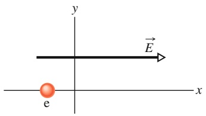

text_image

y
E
x
e

## KONTROLLFRAGE 4

(a) Welche Richtung hat die elektrostatische Kraft auf das in der Abbildung dargestellte Elektron im eingezeichneten elektrischen Feld? (b) In welche Richtung beschleunigt das Elektron, wenn es sich vor seinem Eintritt in das elektrische Feld parallel zu y-Achse bewegte? (c) Wenn sich das Elektron stattdessen anfänglich parallel zur x-Achse nach rechts bewegt hat, wird dann seine Geschwindigkeit beim Eintritt in das elektrische Feld zunehmen, abnehmen oder konstant bleiben?

## Die Messung der Elementarladung

Gleichung 18.24 war die Grundlage einer Messung der Elementarladung e durch den amerikanischen Physiker Robert A. Millikan in den Jahren 1910–1913. In Abb. 18.11 ist die von ihm verwendete Versuchsanordnung schematisch dargestellt. Beim Einsprühen winziger Öltröpfchen in die Kammer A werden einige von ihnen positiv oder negativ aufgeladen. Wir betrachten ein Tröpfchen, das abwärts durch die kleine Öffnung in der Mitte von Platte $\mathrm { P } _ { 1 }$ in die Kammer C driftet, und nehmen an, das Tröpfchen trage eine negative Ladung $q .$

Solange der Schalter S geöffnet ist, hat die Batterie keinen Einfluss auf die Potenzialverhältnisse in der Kammer C. Schließt man den Schalter, sodass nun auch der positive Pol der Batterie mit der Kammer C verbunden ist, so erzeugt die Batterie einen Überschuss positiver Ladung auf der leitenden Platte $\mathrm { P } _ { 1 }$ sowie einen Überschuss negativer Ladung auf der leitenden Platte $\mathrm { P } _ { 2 } .$ In der Kammer $C ,$ zwischen den geladenen Platten, besteht nun ein nach unten gerichtetes elektrisches Feld ${ \vec { E } } .$ Nach Gl. 18.24 übt dieses Feld auf ein geladenes Teilchen eine Kraft aus, die seine Bewegung beeinflusst. Insbesondere wirkt auf ein negativ geladenes Öltröpfchen eine nach oben gerichtete Kraft und das Tröpfchen driftet in Richtung dieser Kraft.

Millikan beobachtete mithilfe eines Mikroskops jeweils ein einzelnes, geladenes Tröpfchen, maß seine Driftgeschwindigkeit sowohl mit als auch ohne äußeres elektrisches Feld und bestimmte so den Einfluss der Ladung des Tröpfchens auf dessen Bewegung. Dabei beobachtete er, dass die Ladungsmenge auf den Tröpfchen in jedem Fall durch eine Beziehung der Form

$$
q = n e \quad \text {fur} \quad n = 0, \pm 1, \pm 2, \pm 3, \dots , \tag {18.25}
$$

gegeben war, wobei sich der Faktor e als eine fundamentale Naturkonstante erwies, die Elementarladung mit dem Betrag $1 { , } 6 0 2 \cdot 1 0 ^ { - 1 9 }   ($ C. Dieses als Millikan-Versuch berühmt gewordene Experiment war der erste überzeugende Beweis dafür, dass die elektrische Ladung quantisiert ist, und Millikan erhielt zusammen mit anderen Physikern für seine Arbeit den Nobelpreis für Physik des Jahrs 1922. Moderne Methoden zur Messung der Elementarladung bedienen sich einer Vielzahl miteinander verflochtener experimenteller Techniken und liefern wesentlich genauere, aber qualitativ gleiche Ergebnisse.

## Tintenstrahldrucker

Der wachsende Bedarf an schnellen Druckern mit hoher Druckqualität hat in den 1980er und 1990er Jahren die Suche nach einer Alternative zu damals üblichen Drucktechniken motiviert, die durch Anschlag einer mit Tinte benetzten Druckmatrize auf das zu bedruckende Papier arbeiteten. Eine dieser Alternativen ist der Aufbau einzelner Buchstaben durch gezieltes Aufsprühen winziger Tintentropfen auf das Papier.

Abbildung 18.12 zeigt die Bewegung eines negativ geladenen Tintentröpfchens zwischen zwei elektrisch leitenden Ablenkplatten, zwischen denen ein nach unten gerichtetes, homogenes elektrisches Feld E⃗ besteht. Nach Gl. 18.24 wird das Tröpfchen nach oben abgelenkt und trifft schließlich auf den Papierbogen, wobei die Stärke der Ablenkung und damit der Ort des Auftreffens auf dem Papier durch die Feldstärke $\vec { E }$ und die Ladung $q$ des Tröpfchens bestimmt wird.

Bei der technischen Realisierung dieses Prinzips hält man das Feld $\vec { E }$ konstant und steuert die Stärke der Ablenkung durch gezielte Ladung des Tröpfchens in einer Ladeeinheit, die das Tröpfchen durchläuft, bevor es die Ablenkplatten erreicht. Diese Ladeeinheit wird durch ein elektronisches Signal angesteuert, welches die Information über das zu druckende Muster enthält.

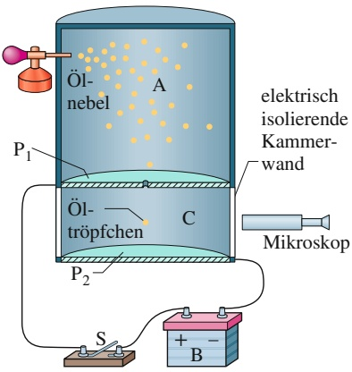

text_image

Öl-
nebel
A
P1
Öl-
tröpfchen
C
P2
elektrisch
isolierende
Kammer-
wand
Mikroskop
S
+
-
B

Abb. 18.11

Millikans Versuchsanordnung zur Messung der Elementarladung e. Driftet ein geladenes Öltröpfchen aus der Kammer A durch die kleine Öffnung in der Platte $\mathrm { P _ { 1 } }$ in den Bereich $C ,$ so kann man die Bewegung des Tröpfchens durch ein elektrisches Feld beeinflussen, welches durch Betätigen des Schalters S ein- oder ausgeschaltet wird. Mithilfe des Mikroskops kann man das Tröpfchen beobachten und seine Bewegung unter dem Einfluss des elektrischen Felds messen.

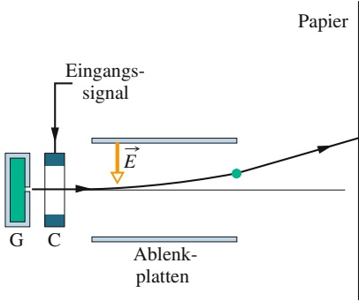

flowchart

Abb. 18.12

So funktioniert ein Tintenstrahldrucker: Tintentröpfchen werden im Zerstäuber G erzeugt und im Bereich C mit Ladung belegt. Ein Spannungssignal des Rechners steuert die Ladungsbelegung der Tröpfchen und legt damit fest, wie stark diese jeweils in einem elektrischen Feld abgelenkt werden und an welchem Punkt des Papiers sie deshalb schließlich auftreffen.

Abb. 18.13

Langzeitbelichtung eines kleinen Drahts, der an einen Hochspannungstransformator angeschlossen ist [Quelle: Chris Collura, www.skychaser.com].

## Elektrischer Durchbruch und Funken

Wenn die elektrische Feldstärke in der Luft einen gewissen kritischen Wert $E _ { \mathrm { k } }$ überschreitet, kommt es zu einem sogenannten elektrischen Durchbruch, bei dem das Feld Elektronen aus den Luftmolekülen herausschlägt. Dadurch wird die Luft leitfähig und die freigesetzten Elektronen werden sofort vom Feld beschleunigt. Auf ihrem Weg kollidieren sie mit Luftmolekülen und regen diese zum Leuchten an. Wir nehmen diese leuchtende Wegstrecken als Funken wahr. Abbildung 18.13 zeigt Funken, die sich über dem nicht isolierten Ende eines stark geladenen elektrischen Kabels bilden.

## 18.7 Ein Dipol in einem elektrischen Feld

## Lernziele

Nach dem Durcharbeiten dieses Abschnitts sollten Sie in der Lage sein, . . .

in einer Skizze eines elektrischen Dipols in einem äußeren elektrischen Feld die Richtung des Felds, die Richtung des Dipolmoments, die Richtung der elektrostatischen Kräfte auf die beiden Enden des Dipols sowie die Richtung anzugeben, in die diese Kräfte den Dipol drehen wollen, und den Betrag der Gesamtkraft auf den Dipol anzugeben,
das Drehmoment auf einen elektrischen Dipol in einem externen elektrischen Feld aus dem Kreuzprodukt des Dipolmomentvektors und des elektrischen Feldvektors in Betrag-Winkel- und Einheitsvektoren-Schreibweise zu berechnen,
• für einen elektrischen Dipol in einem externen elektrischen Feld die Beziehung zwischen der potenziellen Energie des Dipols im Feld und der von einem Drehmoment bei der Drehung des Dipols verrichteten Arbeit anzugeben,
• die potenzielle Energie eines elektrischen Dipols in einem externen elektrischen Feld aus dem Skalarprodukt des Dipolmomentvektors und des elektrischen Feldvektors in Betrag-Winkel- und Einheitsvektoren-Schreibweise zu berechnen,
• für einen elektrischen Dipol in einem externen elektrischen Feld die Winkel anzugeben, bei denen seine potenzielle Energie minimal bzw. maximal wird,
• für einen elektrischen Dipol in einem externen elektrischen Feld die Winkel anzugeben, bei denen das auf ihn wirkende Drehmoment minimal bzw. maximal wird.

## Schlüsselideen

• Das Drehmoment auf einen elektrischen Dipol mit dem Dipolmoment $\vec { p }$ in einem externen elektrischen Feld $\vec { E }$ ist durch das Kreuzprodukt aus Dipolmoment- und Feldvektor gegeben:

$$
\vec {\tau} = \vec {p} \times \vec {E}.
$$

• Mit der Orientierung eines Dipolmoments in einem äußeren elektrischen Feld ist eine potenzielle Energie U verknüpft, die durch das Skalarprodukt aus Dipolmoment- und Feldvektor gegeben ist:

$$
U = - \vec {p} \cdot \vec {E}.
$$

• Wenn sich die Orientierung eines Dipols in einem äußeren elektrischen Feld ändert, verrichtet das elektrische Feld die Arbeit

$$
W = - \Delta U.
$$

Wenn diese $\ddot { \mathrm { A r } }$ nderung der Orientierung von einer äußeren Vorrichtung bewirkt wird, verrichtet diese Vorrichtung die Arbeit $W _ { \mathrm { a } } = - W$

## 18.7.1 Ein Dipol im elektrischen Feld

Wir haben das Dipolmoment $\vec { p }$ eines elektrischen Dipols definiert als einen Vek tor, der vom negativen zum positiven Ende des Dipols zeigt. Wie wir im Folgenden sehen werden, wird das Verhalten eines Dipols in einem homogenen äußeren elektrischen Feld $\vec { E }$ vollständig durch die beiden Vektoren $\vec { E }$ und $\vec { p }$ beschrieben, was bedeutet, dass man keinerlei Einzelheiten über die innere Struktur des Dipols benötigt.

Das Wassermolekül $\left(  H _{2} O  \right)$ bildet einen elektrischen Dipol. Die schwarzen Punkte in Abb. 18.14 deuten den Sauerstoffkern (mit acht Protonen) sowie die beiden Wasserstoffkerne (mit jeweils einem Proton) an. Die Aufenthaltsbereiche der Elektronen sind farbig schattiert.

Die drei Atomkerne im Wassermolekül liegen, bedingt durch die Bindungsgeometrie der beteiligten Atome, nicht auf einer Linie, sondern bilden einen Winkel von etwa 105°. Das Molekül hat deshalb eine „Sauerstoffseite“ und eine „Wasserstoffseite“. Die insgesamt zehn Elektronen des Moleküls zeigen die Tendenz, sich näher beim Sauerstoffkern als bei den beiden Wasserstoffkernen aufzuhalten, wodurch die Sauerstoffseite des Moleküls geringfügig stärker negativ geladen ist als die Wasserstoffseite. Folglich existiert ein elektrisches Dipolmoment $\vec { p } ,$ das parallel zur Symmetrieachse des Moleküls zur Wasserstoffseite gerichtet ist (Abb. 18.14). Ein Wassermolekül verhält sich in einem äußeren elektrischen Feld gerade so, wie man es von dem idealisierten elektrischen Dipol aus Abb. 18.7 erwarten würde.

Um dieses Verhalten kennenzulernen, betrachten wir nun einen solchen idealisierten Dipol in einem homogenen, äußeren elektrischen Feld $\vec { E }$ (Abb. 18.15a). Dabei nehmen wir an, dass der Dipol aus zwei Punktladungen vom Betrag q mit entgegengesetzten Vorzeichen besteht, die im Abstand d voneinander fixiert sind. Der Winkel zwischen dem Dipolmoment $\vec { p }$ und dem Feld $\vec { E }$ sei $\theta .$

Auf jedes der beiden Enden des Dipols wirken elektrostatische Kräfte. Da wir das elektrische Feld als homogen angenommen haben, sind diese Kräfte einander entgegengesetzt gerichtet (Abb. 18.15a) und haben den gleichen Betrag $F = q E .$ Einzig aufgrund der Homogenität des $F e l d s$ ist die resultierende elektrostatische Kraft auf den Dipol null, sodass sich der Massenschwerpunkt des Dipols nicht bewegt. Andererseits erzeugen die Kräfte auf die beiden Enden des Dipols ein resultierendes Drehmoment $\vec { \tau }$ bezüglich einer Achse durch seinen Schwerpunkt. Der Schwerpunkt liegt auf der Verbindungslinie der beiden Ladungen des Dipols in einer Entfernung x vom einen Ende und damit im Abstand $d   -   x$ vom anderen Ende. Mit von Gl. $6 . 2 8   ( \tau = r F$ sin 𝜑) ist der Betrag des resultierenden Drehmoments

$$
\tau = F x \sin \theta + F (d - x) \sin \theta = F d \sin \theta . \tag {18.26}
$$

Wir können den Betrag des Drehmoments $\vec { \tau }$ auch ausdrücken durch die Beträ- ge $E$ des elektrischen Felds und $p = q d$ des Dipolmoments. Dazu ersetzen wir $F$ in Gl. 18.26 durch $q E$ sowie d durch $p / q$ und erhalten

$$
\tau = p E \sin \theta . \tag {18.27}
$$

In Vektorform lautet diese Gleichung

$$
\vec {\tau} = \vec {p} \times \vec {E}. \tag {18.28}
$$

Die Vektoren $\vec { p }$ und $\vec { E }$ sind in Abb. 18.15b markiert. Das auf den Dipol wirkende Drehmoment versucht, den Vektor $\vec { p } \mathrm { ~ - ~ }$ und damit den ganzen Dipol – in Richtung des Felds $\vec { E }$ auszurichten, also den Winkel $\theta$ zu verringern. In der Situation von Abb. 18.15 ist dies eine Drehung im Uhrzeigersinn. Wie wir in Kapitel 6 besprochen haben, kann man ein Drehmoment, das eine Drehung im Uhrzeigersinn verursacht, darstellen, indem man seinem Betrag ein Minuszeichen hinzufügt. In dieser Schreibweise gilt dann für das in Abb. 18.15 wirkende Drehmoment

$$
\tau = - p E \sin \theta . \tag {18.29}
$$

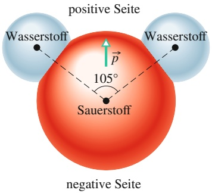

text_image

positive Seite
Wasserstoff
P
105°
Sauerstoff
Wasserstoff
negative Seite

Abb. 18.14

Schematische Darstellung eines Wassermoleküls: Die kleinen schwarzen Punkte repräsentieren die Atomkerne, während die farbigen Flächen die Aufenthaltsbereiche der Elektronen andeuten sollen. Das elektrische Dipolmoment $\vec { p }$ des Moleküls ist von der (negativ geladenen) Seite des Sauerstoffatoms zur (positiv geladenen) Seite der beiden Wasserstoffatome gerichtet.

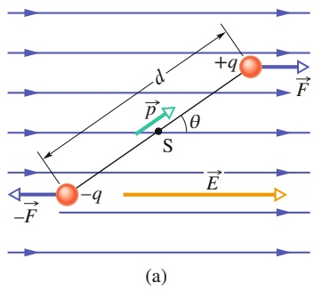

text_image

d
+q
F
p
θ
S
-q
E
(a)

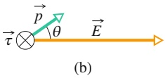

Abb. 18.15

(a) Ein elektrischer Dipol in einem homogenen elektrischen Feld ${ \vec { E } } .$ Der Dipol besteht aus zwei gleich großen, entgegengesetzten Punktladungen, die im Abstand d relativ zueinander fixiert sind. (b) Ein elektrisches Feld E⃗ übt ein Drehmoment τ auf den Dipol aus. Dieses Drehmoment τ ist ein Vektor, der senkrecht zur Papierebene steht und in sie hinein zeigt. (Einen senkrecht in die Papierebene hinein gerichteten Vektor symbolisiert man durch das Zeichen $\otimes - \mathrm { S i e }$ können sich darunter die Federn am Pfeilschaft des von ihnen fortfliegenden Vektorpfeils vorstellen.)

## Potenzielle Energie eines elektrischen Dipols im elektrischen Feld

Mit der Orientierung eines elektrischen Dipols relativ zu einem elektrischen Feld ist eine potenzielle Energie verbunden. Ein Dipol in einem äußeren Feld hat die geringste potenzielle Energie, wenn er sich in seiner Gleichgewichtsorientierung befindet, sein Dipolmoment $\vec { p }$ also parallel zum elektrischen Feld ausgerichtet ist (da in diesem Fall $\vec { \tau } = \vec { p } \times \vec { E } = 0$ gilt). In allen davon abweichenden Orientierungen ist die potenzielle Energie größer. Ein Dipol verhält sich deshalb ähnlich wie ein Pendel: Ein Pendel hat die geringste potenzielle Gravitationsenergie in seiner Gleichgewichtslage, also bei der Auslenkung null. Um ein Pendel oder einen Dipol aus der Gleichgewichtslage zu entfernen, muss Arbeit von außen aufgewendet werden.

In jeder physikalischen Situation, in der eine potenzielle Energie auftritt, ist man in der Wahl derjenigen Systemkonfiguration mit der potenziellen Energie null, also in der Wahl des Nullpunkts der potenziellen Energie, vollkommen frei, da nur den Differenzen potenzieller Energien eine physikalische Bedeutung zukommt. Wie sich herausstellt, nimmt der Ausdruck für die potenzielle Energie eines elektrischen Dipols in einem äußeren elektrischen Feld seine einfachste Form an, wenn man der Orientierung des Dipols senkrecht zur Feldrichtung, also dem Winkel 90° in Abb. 18.15a, die potenzielle Energie null zuordnet. Mithilfe von Gl. 4.1 $( \Delta U = - W )$ kann man nun die potenzielle Energie $U$ des Dipols bei einer beliebigen anderen Orientierung relativ zur Feldrichtung ermitteln, indem man die Arbeit berechnet, die das Feld am Dipol verrichtet, wenn er aus seiner senkrechten Position (90°) in die Position $\theta$ gedreht wird. Unter Verwendung von Gl. 6.39 $\left( W = \int \tau   \mathrm { d } \theta \right)$ und Gl. 18.29 erhält man so die potenzielle Energie U des Dipols bei einem Winkel θ relativ zur Feldrichtung:

$$
U = - W = - \int_ {9 0 ^ {\circ}} ^ {0} \tau \mathrm{d} \theta = \int_ {9 0 ^ {\circ}} ^ {0} p E \sin \theta \mathrm{d} \theta . \tag {18.30}
$$

Ausführen der Integration ergibt

$$
U = - p E \cos \theta \tag {18.31}
$$

und in Vektorform erhalten wir dann

$$
U = - \vec {p} \cdot \vec {E}. \tag {18.32}
$$

Die Gln. 18.31 und 18.32 bedeuten, dass die potenzielle Energie eines Dipols im elektrischen Feld ihren geringsten Wert $U = - p E$ annimmt, wenn die beiden Vektoren $\vec { p }$ und $\vec { E }$ den Winkel $\theta = 0$ einschließen, also dieselbe Richtung haben (parallel sind). Die potenzielle Energie des Dipols ist dagegen am größten $( U = p E )$ bei einem Winkel $\theta = 1 8 0 ^ { \circ }$ , wenn also $\vec { p }$ und $\vec { \cal { E } }$ einander entgegengesetzt (antiparallel) gerichtet sind.

Wird ein Dipol aus einer initialen Orientierung $\theta _ { \mathrm { i } }$ in eine finale Orientierung $\theta _ { \mathrm { f } }$ gedreht, so verrichtet das elektrische Feld an ihm die Arbeit

$$
W = - \Delta U = - (U _ {\mathrm{f}} - U _ {\mathrm{i}}), \tag {18.33}
$$

wobei $U _ { \mathrm { i } }$ und $U _ { \mathrm { f } }$ nach Gl. 18.32 berechnet werden. Wird die Drehung des Dipols durch ein äußeres Drehmoment bewirkt, so ist die vom äußeren Drehmoment am Dipol verrichtete Arbeit $W _ { \mathrm { a } }$ das Negative der vom Feld am Dipol verrichteten Arbeit

$$
W _ {\mathrm{a}} = - W = (U _ {\mathrm{f}} - U _ {\mathrm{i}}). \tag {18.34}
$$

## KONTROLLFRAGE 5

Die Abbildung zeigt vier verschiedene Orientierungen eines Dipols in einem äußeren elektrischen Feld. Ordnen Sie die vier Fälle nach (a) dem Betrag des auf den Dipol wirkenden Drehmoments sowie (b) dem Betrag der potenziellen Energie des Dipols.

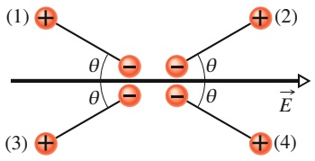

chemical

Diagram of a charged particle interaction with labeled angles θ and energy levels E

## 18.8 Zusammenfassung

**Elektrisches Feld** Ein Ansatz zur Erklärung der elektrostatischen Kraft zwischen zwei Ladungen ist die Annahme, dass jede Ladung ein elektrostatisches Feld im sie umgebenden Raum aufbaut. In diesem Bild wird die auf eine Ladung wirkende elektrostatische Kraft verursacht durch das am Ort der Ladung wirkende elektrische Feld der jeweils anderen Ladung.

**Definition des elektrischen Felds** Das elektrische Feld $\vec { E }$ in einem Raumpunkt ist definiert durch die elektrostatische Kraft ${ \vec { F } } ,$ die auf eine positive Probeladung $q _ { 0 }$ in diesem Punkt wirken würde:

$$
\vec {E} = \frac {\vec {F}}{q _ {0}}. \tag {18.1}
$$

**Elektrische Feldlinien** Elektrische Feldlinien sind ein Mittel zur Veranschaulichung der räumlichen Verteilung von Richtung und Betrag eines elektrischen Felds. Der Vektor des elektrischen Felds ist in jedem Punkt tangential zur Feldlinie durch diesen Punkt. Die Dichte der Feldlinien in einem Raumbereich ist proportional zum Betrag des elektrischen Felds in diesem Bereich. Feldlinien beginnen bei positiven Ladungen und enden bei negativen Ladungen.

**Feld einer Punktladung** Das elektrische Feld $\vec { E }$ einer Punktladung $q$ in einem Raumpunkt mit dem Abstand $r$ von der Ladung ist gegeben durch

$$
E = \frac {1}{4 \pi \varepsilon_ {0}} \frac {| q |}{r ^ {2}}. \tag {18.3}
$$

Dieses Feld ist radial von der Ladung weg gerichtet, wenn die Ladung positives Vorzeichen hat, anderenfalls zeigt es direkt auf die Punktladung.

**Feld eines elektrischen Dipols** Ein elektrischer Dipol besteht aus zwei Ladungen vom gleichen Betrag $q ,$ aber mit entgegengesetztem Vorzeichen, die in einem kleinen Abstand $d$ voneinander fixiert sind. Das **Dipolmoment** $\vec { p }$ eines Dipols hat den Betrag qd, liegt als Vektor auf der Verbindungslinie der beiden Ladungen und zeigt von der negativen zur positiven Ladung. Der Betrag des von einem elektrischen Dipol in einem weit entfernten Punkt auf der

Dipolachse (der Verbindungslinie der beiden Ladungen) erzeugten elektrischen Felds ist gegeben durch

$$
E = \frac {1}{2 \pi \varepsilon_ {0}} \frac {p}{z ^ {3}}. \tag {18.9}
$$

Darin bezeichnet $z$ die Entfernung zwischen dem fragli chen Punkt und dem Mittelpunkt des Dipols.

**Elektrisches Feld einer kontinuierlichen Ladungsverteilung** Beim allgemeinen Verfahren zur Berechnung des elektrischen Felds einer kontinuierlichen Ladungsverteilung denkt man sich die Gesamtladung der Verteilung in differenzielle Ladungselemente zerlegt, behandelt diese als Punktladungen und integriert dann die differenziellen Feldbeiträge der einzelnen Ladungselemente.

**Kraft auf eine Punktladung im elektrischen Feld** Bringt man eine Punktladung $q$ in ein von anderen Ladungen erzeugtes elektrisches Feld $\vec { E } ,$ so wirkt auf die Ladung die elektrostatische Kraft

$$
\vec {F} = q \vec {E}. \tag {18.24}
$$

Diese Kraft hat dieselbe Richtung wie $\vec { E } ,$ wenn die Ladung positiv ist, anderenfalls ist sie antiparallel zur Feldrichtung.

**Dipol im elektrischen Feld** Auf einen elektrischen Dipol mit dem Dipolmoment $\vec { p }$ wirkt in einem elektrischen Feld $\vec { E }$ ein Drehmoment $\vec { \tau } ,$ das gegeben ist durch

$$
\vec {\tau} = \vec {p} \times \vec {E}. \tag {18.28}
$$

Mit der Orientierung des Dipols relativ zur Feldrichtung ist eine potenzielle Energie U verbunden mit

$$
U = - \vec {p} \cdot \vec {E}. \tag {18.32}
$$

Diese potenzielle Energie ist definitionsgemäß null, wenn Dipolmoment $\vec { p }$ und Feld $\vec { E }$ senkrecht aufeinander stehen; sie wird minimal $\left( U = - p E \right)$ , wenn die beiden Vektoren parallel, und maximal $( U = p E )$ , wenn sie einander entgegengesetzt gerichtet sind.

## 18.9 Fragen

**1.** Abbildung 18.F1 zeigt drei elektrische Feldlinien. Welche Richtung hat die elektrostatische Kraft auf eine positive Probeladung (a) im Punkt A, (b) im Punkt B? (c) In welchem Punkt (A oder B) wird die Beschleunigung der Probeladung größer sein, wenn diese losgelassen wird?

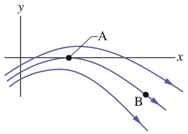

text_image

y
A
x
B

Abb. 18.F1

**2.** Abbildung 18.F2a zeigt zwei geladene Teilchen. (a) In welchem Bereich auf der Verbindungsachse der Teilchen gibt es einen – nicht im Unendlichen liegenden – Punkt, in dem das resultierende elektrische Feld der beiden Ladungen null ist: links von den beiden Teilchen, rechts davon oder zwischen ihnen? (b) Gibt es einen – nicht im Unendlichen liegenden – Punkt außerhalb der Verbindungsachse, in dem das resultierende Feld verschwindet?

Abb. 18.F2

Fragen 2 und 3.

**3.** Abbildung 18.F2b zeigt ein Elektron und zwei Protonen, die in gleichen Abständen auf einer Achse liegen. In welchem Bereich der Achse gibt es einen – nicht im Unendlichen liegenden – Punkt, an welchem das resultierende elektrische Feld null ist: links von allen Teilchen, rechts davon, zwischen den beiden Protonen oder zwischen dem Elektron und dem benachbarten Proton?
**4.** Abbildung 18.F4 zeigt zwei quadratische Anordnungen geladener Teilchen. Die beiden Quadrate, deren Mittelpunkte im Punkt P zusammenfallen, sind gegeneinander gedreht. Die Abstände der Teilchen entlang der Kanten betragen jeweils entweder d oder $d / 2 .$ Ermitteln Sie Betrag und Richtung des effektiven resultierenden Felds im Punkt P.

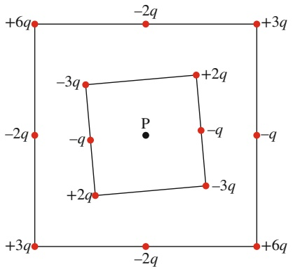

text_image

+6q
-2q
+3q
-3q
+2q
P
-q
-q
-q
+2q
-3q
+3q
-2q
+6q

Abb. 18.F4

**5.** In Abb. 18.F5 sind zwei Teilchen mit der Ladung −q symmetrisch zur y-Achse angeordnet. Jedes der beiden Teilchen erzeugt im Punkt P auf der y-Achse ein elektrisches Feld. (a) Sind die Beträge dieser beiden Felder im Punkt P einander gleich? (b) Zeigen die Felder auf die sie jeweils erzeugende Ladung hin oder von ihr weg? (c) Ist der Betrag des resultierenden elektrischen Felds im Punkt P gleich der Summe der Beträge E der beiden Teilfelder, also gleich 2E? (d) Löschen sich die x-Komponenten der beiden Teilfelder aus oder verstärken sie sich? (e) Löschen sich die y-Komponenten der beiden Teilfelder aus oder verstärken sie sich? (f ) Hat das resultierende Feld im Punkt P die Richtung der sich auslöschenden oder der sich verstärkenden Komponenten? (g) Welche Richtung hat das resultierende Feld?

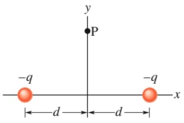

text_image

y
P
-q
-q
x
d
d

Abb. 18.F5

**6.** Drei mit gleichem Krümmungsradius kreisförmig gebogene, nichtleitende Stäbe sind homogen geladen. Stab A hat die Ladung +2Q und spannt einen Winkel von 30° auf, Stab B trägt eine Ladung +6Q und spannt einen Winkel von $9 0 ^ { \circ }$ auf, Stab C schließlich trägt die Ladung +4Q und spannt einen Winkel von 60° auf. Ordnen Sie die Stäbe nach dem Wert ihrer linearen Ladungsdichte.
**7.** Der in Abb. 18.F7a abgebildete, kreisförmig gebogene Plastikstab trägt eine homogen verteilte Ladung +Q und erzeugt in seinem Krümmungsmittelpunkt (dem Ursprung des Koordinatensystems) ein elektrisches Feld vom Betrag E. Wie in den Abb. 18.F7b, c und d dargestellt, fügt man nacheinander weitere zu einem Viertelkreis gebogene und ebenfalls jeweils mit der Ladung +Q geladene Stäbe hinzu, bis ein vollständiger Kreis entstanden ist. Betrachten Sie zusätzlich noch eine weitere Anordnung (e), die sich von (d) nur dadurch unterscheidet, dass der Stab im vierten Quadranten die negative Ladung −Q trägt. Ordnen Sie diese fünf Fälle nach dem Betrag des im Ursprung jeweils erzeugten elektrischen Felds.

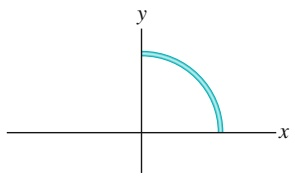

text_image

y
x

(a)

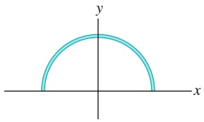

text_image

y
x

(b)

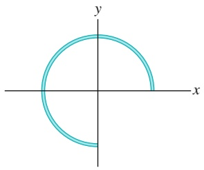

text_image

y
x

(c)

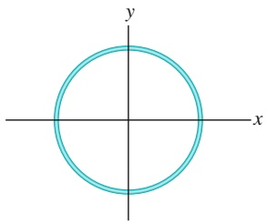

natural_image

Simple geometric diagram showing a circle centered at the origin with x and y axes (no labels or text)

(d)

Abb. 18.F7

**8.** Wie in Abb. 18.F8 dargestellt bewegt sich ein Elektron e durch eine kleine Öffnung in der Platte A hindurch auf die Platte B zu. Ein homogenes elektrisches Feld im Raum zwischen den beiden Platten bremst das Elektron, ohne es abzulenken. (a) Welche Richtung hat das Feld? (b) Vier weitere Teilchen bewegen sich ebenfalls, wie in der Abbildung dargestellt, durch kleine Öffnungen der Platten in den Plattenzwischenraum hinein. Drei von ihnen tragen die Ladun-$\mathrm { g e n }   +   q _ { 1 } , + q _ { 2 }$ und $- q _ { 3 } ,$ Das vierte Teilchen, mit n bezeichnet, ist ein Neutron und verhält sich elektrisch neutral. Wie ändert sich die Teilchengeschwindigkeit in jedem dieser vier Fälle beim Eintritt in das elektrische Feld?

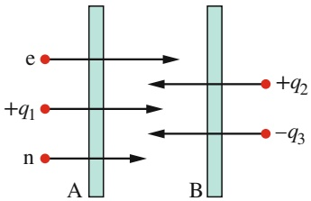

text_image

e
+q₁
n
A
B
+q₂
-q₃

Abb. 18.F8

**9.** Abbildung 18.F9 zeigt die Flugbahn eines negativ geladenen Teilchens 1 durch einen rechteckigen Bereich, in dem ein homogenes elektrisches Feld herrscht. Das Teilchen wird in der Papierebene nach oben abgelenkt. (a) Ist das Feld nach oben, unten, links oder rechts gerichtet? (b) Drei weitere geladene Teilchen nähern sich wie dargestellt dem Feldbereich. Welche von ihnen werden nach oben, welche nach unten abgelenkt?

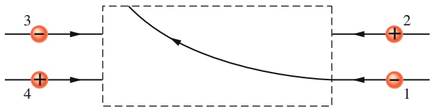

flowchart

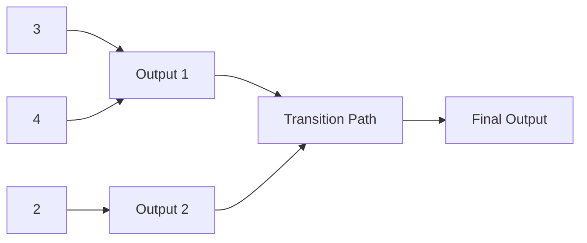

Abb. 18.F9

**10.** (a) Betrachten Sie noch einmal die Situation von Kontrollfrage 5: Ist die vom Feld am Dipol verrichtete Arbeit positiv, negativ oder null, wenn der Dipol von der Orientierung 1 in die Orientierung 2 gedreht wird? (b) Ist die vom Feld am Dipol verrichtete Arbeit größer, kleiner oder die gleiche wie in Frage (a), wenn man den Dipol aus der Orientierung 1 in die Orientierung 4 dreht?
**11.** Vier verschiedene Orientierungen eines elektrischen Dipols in einem elektrischen Feld haben die potenziellen Energien $(1) $- 5 U _ { 0 } ,$ (2) $- 7 U _ { 0 } ,$ (3) $3 U _ { 0 }$$ und (4) $5 U _ { 0 } ,$ wobei $U _ { 0 }$ positiv sei. Ordnen Sie die vier Fälle nach (a) der Grö- ße des Winkels zwischen dem Dipolmoment $\vec { p }$ und dem elektrischen Feld E⃗, (b) dem Betrag des auf den Dipol wirkenden Drehmoments.

**12.** Läuft man an einem trockenen Tag über bestimmte Arten von Teppichen und greift dann nach einem metallenen Türgriff oder – um mehr Spaß zu haben – nach jemandes Nacken, so springt oft ein Funke über. Wie entsteht dieser Funke? (Man kann die Intensität – die Helligkeit und das Geräusch – der Entladung vergrößern, wenn man statt der Hand einen Finger oder einen scharfkantigen Metallgegenstand, beispielsweise einen Schlüssel, verwendet. Ahnen Sie, warum?)
**13.** Abbildung 18.F13 zeigt drei Anordnungen elektrischer Feldlinien. Ein Proton wird jeweils bei Punkt A aus der Ruhe losgelassen und bis Punkt B durch das elektrische Feld beschleunigt. Die Punkte A und B haben in allen drei Anordnungen denselben Abstand voneinander. Ordnen Sie die Anordnungen in absteigender Reihenfolge nach dem Impuls des Protons am Punkt B.

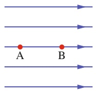

(a)

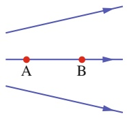

(b)

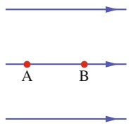

(c)

Abb. 18.F13

**14.** Abbildung 18.F14 zeigt vier Situationen, in denen vier geladene Teilchen in gleichen Abständen links und rechts von einem zentralen Punkt liegen; ihre Ladungen sind angegeben. Ordnen Sie die Situationen in absteigender Reihenfolge nach dem Betrag des resultierenden elektrischen Felds am zentralen Punkt.

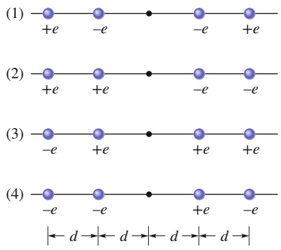

Abb. 18.F14

**15.** Abbildung 18.F15 zeigt zwei identische kreisförmige, nichtleitende Ringe, deren Mittelpunkte auf einer Linie senkrecht zur Ringebene liegen. Die Ringe tragen eine homogen über den gesamten Umfang verteilte Ladung und erzeugen daher jeweils ein elektrisches Feld an allen Punkten auf der Linie. Gegeben sind drei Situationen, in denen die Ladungen auf den Ringen A und B (1) $q _ { 0 }$ und $q _ { 0 } , ( 2 )   -   q _ { 0 }$ und $- q _ { 0 }$ und $( 3 ) - q _ { 0 }$ und $q _ { 0 }$ betragen. Ordnen Sie die Situationen in absteigender Reihenfolge nach der resultierenden elektrischen Feldstärke an dem Punkt (a) $\mathrm { P } _ { 1 }$ auf halber Strecke zwischen den Ringen, (b) $\mathrm { P } _ { 2 }$ im Zentrum von Ring B und (c) $\mathrm { P } _ { 3 }$ rechts von Ring B.

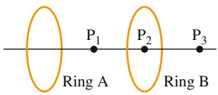

text_image

P₁
Ring A
P₂
Ring B
P₃

Abb. 18.F15

**16.** Abbildung 18.F16 zeigt zwei Scheiben und einen flachen Ring mit jeweils gleicher Ladung Q. Ordnen Sie die Objekte in absteigender Reihenfolge nach der elektrischen Feldstärke an den Punkten P (die immer in derselben vertikalen Höhe liegen).

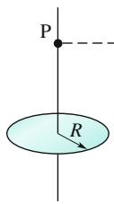

(a)

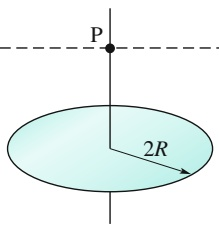

text_image

P
2R

(b)

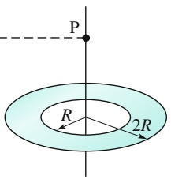

text_image

P
R
2R

(c)

Abb. 18.F16

**17.** Wenn drei elektrische Dipole nebeneinander liegen, spürt jeder von ihnen die elektrischen Felder der beiden anderen; als Folge besitzt das System aus drei Dipolen eine bestimmte potenzielle Energie. Abbildung 18.F17 zeigt zwei mögliche derartige Anordnungen. Die Dipole haben alle denselben Betrag des elektrischen Dipolmoments und die Abstände zwischen benachbarten Dipolen sind gleich. Welcher Anordnung besitzt die größere potenzielle Energie?

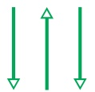

(a)

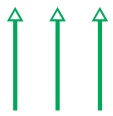

(b)

Abb. 18.F17

**18.** Abbildung 18.F18 zeigt drei Stäbe mit derselben Ladung Q, die gleichförmig über ihre gesamte Länge verteilt ist. Die Stäbe a (Länge L) und b (Länge $L / 2 )$ sind gerade und die Punkte P liegen jeweils auf der Höhe ihrer Mittelpunkte. Stab c (Länge $L / 2 )$ ist zu einem geschlossenen Kreis um Punkt P gebogen. Ordnen Sie die Stäbe in absteigender Reihenfolge nach der elektrischen Feldstärke an den Punkten P.

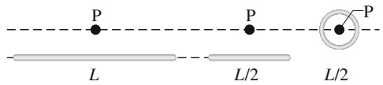

text_image

P
L
P
L/2
L/2
P

(a)

(b)

(c)

Abb. 18.F18

**19.** Abbildung 18.F19 zeigt fünf Protonen, die in einem homogenen elektrischen Feld mit den gezeigten Anfangsgeschwindigkeiten (Betrag und Richtung) gestartet werden. Ordnen Sie die Protonen in absteigender Reihenfolge nach dem Betrag ihrer Beschleunigungen aufgrund des Felds.

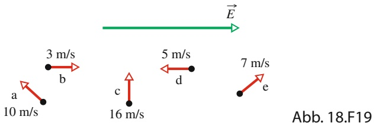

flowchart

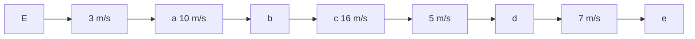

# 19 Der Gaußsche Satz

## 19.1 Das Coulombsche Gesetz in neuem Licht

## Physikalische Motivation

Im vorigen Kapitel haben wir das elektrische Feld an Punkten untersucht, die sich in der Nähe von ausgedehnten geladenen Objekten wie z. B. Stäben befanden. Das Vorgehen war dabei recht mühselig: Wir haben die Ladungsverteilung in infinitesimal kleine Ladungselemente dq aufgeteilt, das Feld dE⃗ für ein einzelnes Ladungselement bestimmt und den Vektor in Komponenten zerlegt. Anschließend haben wir untersucht, ob sich die Feldkomponenten der einzelnen Elemente gegenseitig auslöschen oder aufaddieren. Schließlich haben wir die Beiträge aller Elemente aufsummiert bzw. integriert, wobei wir noch mehrfach die Notation anpassen mussten.

Die Physik ist aber immer auf der Suche nach möglichst einfachen Methoden, um solch eine mühselige Rechnerei vermeiden zu können. Ein besonders mächtiges Werkzeug dafür ist das Ausnutzen von Symmetrien. In diesem Kapitel lernen wir eine sehr schöne Beziehung zwischen der Ladung und dem elektrischen Feld kennen, die es uns erlaubt, in bestimmten symmetrischen Situationen das elektrische Feld eines ausgedehnten geladenen Objekts mit ein paar Zeilen Integralrechnung zu erhalten. Diese Beziehung ist der **Gaußsche Satz**, der von dem deutschen Mathematiker und Physiker Carl Friedrich Gauß formuliert wurde.

## 19.1.1 Das Coulombsche Gesetz in neuem Licht

Möchte man den Schwerpunkt einer Kartoffel bestimmen, so kann man dies entweder experimentell machen oder auf dem Weg über eine mühselige Rechnung, bei der man ein Dreifachintegral numerisch lösen muss. Sollte die Kartoffel jedoch zufällig ein Ellipsoid mit homogener Masseverteilung sein, so könnte man aus Symmetriegründen die Lage des Schwerpunkts ohne Rechnung sofort angeben – ein Beispiel für die Nützlichkeit von Symmetrieüberlegungen. Symmetrien durchziehen alle Bereiche der Physik. Man versucht immer, den Gesetzen der Physik eine Form zu geben, welche die zugrunde liegenden Symmetrien berücksichtigt.

Das Coulombsche Gesetz ist das Grundgesetz der Elektrostatik. In der uns bisher bekannten Form erleichtert es jedoch keineswegs die Arbeit in physikalischen Situationen, die sich durch besondere Symmetrien auszeichnen. Im vorliegenden Kapitel stellen wir eine andere Formulierung des Coulombschen Gesetzes vor, die von dem deutschen Mathematiker und Physiker Carl Friedrich Gauß (1777–1855) hergeleitet wurde. Mit dem **Gaußschen Satz** kann man die Vereinfachungen nutzen, die sich aus der Symmetrie bestimmter physikalischer Situationen ergeben. Im Rahmen der Elektrostatik ist der Gaußsche Satz dem Coulombschen Gesetz vollständig äquivalent. Man kann deshalb die Entscheidung darüber, welches der beiden Gesetze man in einer bestimmten physikalischen Situation anwendet, allein davon abhängig machen, welches Gesetz der jeweiligen Aufgabenstellung angemessener erscheint.

text_image

kugelförmige
Gaußsche
Fläche
?

Abb. 19.1

Eine kugelsymmetrische Gauß- sche Fläche. Haben alle Vektoren des elektrischen Felds außerhalb der Fläche den gleichen Betrag und sind sie in allen Punkten der Flä- che radial nach außen gerichtet, so kann man daraus schließen, dass innerhalb der Fläche eine kugelsymmetrische Verteilung positiver Ladung eingeschlossen sein muss.

Der wesentliche gedankliche Schritt bei der Formulierung des Gaußschen Satzes ist die Konstruktion einer hypothetischen geschlossenen Fläche, der **Gaußschen Fläche**. Diese Fläche kann frei gewählt werden und von beliebiger Gestalt sein. Es ist jedoch am nützlichsten, eine Gaußsche Fläche mit der Symmetrie des zu untersuchenden physikalischen Problems zu wählen. Man wird deshalb in vielen Fällen als Gaußsche Fläche eine Kugel, einen Zylinder oder eine andere symmetrische Form wählen. In jedem Fall muss die Fläche aber geschlossen sein, sodass man klar unterscheiden kann, ob ein Punkt innerhalb, außerhalb oder auf der Fläche liegt.

Sei eine Gaußsche Fläche gewählt, die eine Ladungsverteilung einschließt. Der Gaußsche Satz liefert dann einen Zusammenhang zwischen dem elektrischen Feld an allen Punkten auf einer (geschlossenen) Gaußsche Fläche und der von der Fläche umschlossenen Gesamtladung.

Abbildung 19.1 zeigt eine einfache physikalische Situation, bei der man die Gauß- sche Fläche als eine Kugel wählt. Nehmen wir an, man wüsste, dass in jedem Punkt der Fläche ein elektrisches Feld existiert und dass die Feldvektoren in allen Punkten den gleichen Betrag haben und radial nach außen gerichtet sind. Ohne etwas vom Gaußschen Satz zu wissen, könnte man vermuten, dass die Gaußsche Fläche eine resultierende positive Gesamtladung einschließt. Mit Kenntnis des Gaußschen Satzes kann man auch berechnen, wie viel positive Ladung von der Fläche eingeschlossen wird. Um diese Rechnung durchführen zu können, benötigt man ein Maß dafür, „wie viel“ elektrisches Feld durch die Fläche dringt. Die Frage nach diesem „Wieviel“ führt auf den Begriff des Flusses des elektrischen Felds durch eine Fläche.

## 19.1.2 Der Fluss

Stellen Sie sich nach Abb. 19.2a vor, ein breiter Luftstrom mit der homogenen Geschwindigkeitsverteilung v⃗ treffe auf eine kleine quadratische Drahtschleife mit der Fläche A. Φ bezeichne die Durchströmungsrate (mit der Dimension Volumen pro Zeit) der Luft durch die Schleife. Der Betrag dieser Größe hängt davon ab, unter welchem Winkel die Luftströmung v⃗ auf die Ebene der Schleife trifft. Ist v⃗ senkrecht zur Fläche der Schleife, dann ist die Durchströmungsrate einfach gleich vA.

Liegt v⃗ dagegen parallel zur Ebene der Fläche, so tritt keine Luft durch die Schleife und Φ ist null. Für dazwischenliegende Winkel θ ist der Wert von Φ durch die Komponente von $\vec { \nu }$ senkrecht zur Ebene der Schleife bestimmt (Abb. 19.2b). Da diese Komponente gleich v cos θ ist, kann man für die Durchströmungsrate der Schleife schreiben

$$
\varPhi = (\nu \cos \theta) A. \tag {19.1}
$$

Diese Durchströmungsrate einer Fläche ist ein Beispiel für einen **Fluss** – in diesem Fall einen Volumenfluss. Bevor wir dieses Konzept in der Elektrostatik anwenden, müssen wir noch Gl. 19.1 in Vektorschreibweise formulieren.

Abb. 19.2

(a) Ein homogener Luftstrom trete mit der Geschwindigkeit ⃗v senkrecht durch eine ebene Fläche mit dem Flä- cheninhalt A. (b) Hier ist v cos θ die Komponente der Strömungsgeschwindigkeit ⃗v senkrecht zur Fläche A, wobei θ den Winkel zwischen ⃗v und einer Flächennormalen bezeichnet. (c) Der Oberflächenvektor $\vec { A }$ steht senkrecht auf der Fläche A und schließt mit v⃗ den Winkel θ ein. (d) Die Fläche A im Geschwindigkeitsfeld der Strömung.

Wir definieren dazu einen Flächenvektor $\vec { A }$ als Vektor, der senkrecht auf einer Fläche steht und dessen Betrag gleich dem Inhalt A dieser Fläche ist (in unserem Beispiel also gleich dem Flächeninhalt der Schleife, Abb. 19.2c). Nun können wir Gl. 19.1 als Skalarprodukt des Geschwindigkeitsvektors v⃗ des Luftstroms und des Flächenvektors $\vec { A }$ der Schleife schreiben:

$$
\varPhi = \nu A \cos \theta = \vec {\nu} \cdot \vec {A}. \tag {19.2}
$$

θ bezeichnet hier den Winkel zwischen $\vec { \nu }$ und $\vec { A } .$

Man kann Gl. 19.2 auch in einem allgemeineren und abstrakteren Sinn betrachten. Dazu macht man sich zunächst klar, dass man jedem Punkt des Luftstroms durch die Schleife $A$ einen Geschwindigkeitsvektor zuordnen kann (Abb. 19.2d). Die Gesamtheit aller dieser Vektoren beschreibt ein Geschwindigkeitsfeld, sodass wir Gl. 19.2 als den Fluss des Geschwindigkeitsfelds durch die Schleife auffassen können. In diesem Sinn bedeutet der Begriff Fluss nicht mehr nur konkret die Strömung eines Kontinuums durch eine Fläche, sondern allgemeiner das Skalarprodukt einer Fläche mit einem diese Fläche durchdringenden Feld.

## 19.1.3 Der Fluss eines elektrischen Felds

Zur Definition des Flusses eines elektrischen Felds betrachten wir in Abb. 19.3 eine beliebig gewählte, asymmetrische Gaußsche Fläche in einem inhomogenen elektrischen Feld. Wir denken uns diese Fläche in kleine quadratische Teilflächen mit jeweils dem Flächeninhalt $\Delta A$ zerlegt, wobei jede der Teilflächen klein genug sei, um ihre Krümmung vernachlässigen zu können. Jede dieser Teilflächen werde dargestellt durch einen Flächenvektor $\Delta \vec { A }$ , dessen Betrag gleich dem Flächeninhalt der Fläche $\Delta A$ ist. Jeder dieser Vektoren steht senkrecht auf der Gaußschen Fläche und zeigt vom Inneren der Fläche weg nach außen.

Die quadratischen Teilflächen sollen klein genug sein, um die Stärke des elektrischen Felds $\vec { E }$ als konstant über die Fläche annehmen zu können. Die Vektoren $\Delta \vec { A }$ und $\vec { E }$ schließen dann für jede der Teilflächen einen bestimmten Winkel θ ein. Abbildung 19.3 zeigt eine vergrößerte Darstellung dreier herausgegriffener Teilflä- chen (1, 2 und 3) der Gaußschen Fläche sowie die jeweiligen Winkel $\theta .$

Eine vorläufige Definition des Flusses des elektrischen Felds durch die Gaußsche Fläche aus Abb. 19.3 ist

$$
\varPhi = \sum \vec {E} \cdot \Delta \vec {A}. \tag {19.3}
$$

Der Handlungsanweisung folgend, die durch diese Gleichung ausgedrückt wird, müssen wir für jede einzelne Teilfläche der Gaußschen Fläche das Skalarprodukt der beiden Vektoren $\vec { E }$ und $\Delta \vec { A }$ am Ort der jeweils betrachteten Fläche berechnen und die Ergebnisse über sämtliche Teilflächen algebraisch (also unter Berücksichtigung des Vorzeichens) aufsummieren. Je nach dem Wert des Skalarprodukts für eine bestimmte Teilfläche, der positiv, negativ oder null sein kann, ist der Fluss durch diese Teilfläche positiv, negativ oder null. Flächen vom Typ 1, mit nach innen gerichtetem Feldvektor $\dot { \vec { E } } _ { i }$ , liefern einen negativen Beitrag zu der Summe in Gl. 19.3. Flächen vom Typ 2, mit einem in der Fläche liegenden Vektor $\vec { E } ,$ liefern keinen Beitrag. Flächen vom Typ 3 schließlich, mit nach außen gerichtetem Feldvektor, liefern einen positiven Beitrag zur Summe.

Eine exakte Definition des Flusses eines elektrischen Felds durch eine geschlos sene Fläche erhält man dadurch, dass man sich die Teilflächen in Abb. 19.3 kleiner und kleiner denkt und sie im Grenzfall als infinitesimale bzw. differenzielle Flä- chenelemente dA behandelt. Die Flächenvektoren gehen in diesem Fall ebenfalls gegen ihren differenziellen Grenzwert $\mathrm { d } \vec { A }$ . Die Summe in Gl. 19.3 wird dann zum Integral, und wir erhalten die folgende Definition des elektrischen Flusses:

$$
\varPhi = \oint \vec {E} \cdot \mathrm{d} \vec {A}. \tag {19.4}
$$

text_image

Gaußsche
Fläche
1
2
3
1
Φ < 0
2
3
Φ > 0
ΔA
θ
E
ΔA
θ
E
ΔA
Φ = 0

Abb. 19.3

Eine Gaußsche Fläche von beliebiger Gestalt in einem elektrischen Feld. Man denke sich die gesamte Gaußsche Fläche unterteilt in kleine, quadratische Flächenelemente, jedes mit dem Flächeninhalt $\Delta A .$ Für drei repräsentativ herausgegriffene Flächenelemente 1, 2 und 3 sind die Vektoren $\vec { E }$ des elektrischen Felds sowie die Oberflä- chenvektoren $\Delta \vec { A }$ eingezeichnet.

Der Kreis im Integralzeichen soll darauf hinweisen, dass die Integration über die gesamte geschlossene Fläche auszuführen ist. Der Fluss des elektrischen Felds ist ein Skalar; seine SI-Einheit ist $\mathrm { N } \cdot \mathrm { m } ^ { 2 } / \mathrm { C } .$

Wir können Gl. 19.4 auch wie folgt interpretieren: Erinnern wir uns zunächst daran, dass die Dichte der elektrischen Feldlinien ein Maß für die Stärke des elektrischen Felds $\vec { E }$ ist. Genauer gesagt ist der Betrag E des Felds proportional zur Anzahl der elektrischen Feldlinien pro Einheitsfläche. Damit ist das Skalarprodukt E⃗ ⋅ dA⃗ in Gl. 19.4 proportional zur Anzahl der elektrischen Feldlinien, die durch die Fläche dA⃗ verlaufen. Da die Integration in Gl. 19.4 über eine Gaußsche Fläche ausgeführt wird, kommt man zu folgendem Schluss:

Der elektrische Fluss Φ durch eine Gaußsche Fläche ist proportional zur Anzahl der elektrischen Feldlinien durch diese Fläche.

text_image

y
A
x
E
z

## KONTROLLFRAGE 1

Die Abbildung zeigt eine würfelförmige Gaußsche Fläche in einem homogenen elektrischen Feld ${ \vec { E } } .$ Das Feld hat die Richtung der positiven z-Achse und der Inhalt einer Würfelfläche sei A. Wie groß ist der Fluss des elektrischen Felds durch (a) die vordere Fläche des Würfels (die in der xy-Ebene liegt), (b) die hintere Fläche, (c) die obere Fläche und (d) durch die gesamte Würfeloberfläche (also die vollständige, geschlossene Gaußsche Fläche)?

## 19.2 Der Gaußsche Satz

## Lernziele

Nach dem Durcharbeiten dieses Abschnitts sollten Sie in der Lage sein, . . .

• das Gaußsche Gesetz anzuwenden, um den Nettofluss Φ durch eine geschlossene Fläche mit der von ihr umschlossenen Ladung $q _ { \mathrm { i n n e n } }$ in Beziehung zu setzen,
• Bei einer Gaußschen Fläche das richtige Vorzeichen der eingeschlossenen Ladung aus der Richtung des elektrischen Flusses (in die Fläche hinein oder aus ihr heraus) abzuleiten,
• zu verstehen, warum die Ladung außerhalb einer Gaußschen Fläche nicht zum Netto-Fluss durch die geschlossene Fläche beiträgt,
• den Betrag des elektrischen Felds eines geladenen Teilchens mithilfe des Gauß schen Gesetzes zu ermitteln,
• im Fall einer Punktladung bzw. einer homogen geladenen Kugel eine konzentrische Kugeloberfläche als Gaußsche Fläche zu wählen.

## Schlüsselideen

• Der Gaußsche Satz verbindet den Nettofluss Φ durch eine geschlossene Fläche mit der innerhalb der Fläche befindlichen Nettoladung $q _ { \mathrm { i n n e n } }$

$$
\varepsilon_ {0} \varPhi = q _ {\text {innen}} \quad \text {(Gaußscher Satz)}.
$$

• Der Gaußsche Satz lässt sich auch mithilfe des Integrals über das Skalarprodukt des durch die Gaußsche Fläche tretenden elektrischen Felds und des zugehörigen Flächenvektors schreiben:

$$
\varepsilon_ {0} \oint_ {\substack {\text {Gaußsche} \\ \text {Fläche}}} \vec {E} \cdot \mathrm{d} \vec {A} = q _ {\text {innen}} \quad (\text {Gaußscher Satz}).
$$

## 19.2.1 Der Gaußsche Satz

Der Gaußsche Satz gibt einen Zusammenhang zwischen dem Gesamtfluss Φ eines elektrischen Felds durch die Oberfläche O(V) eines Volumens V und der Gesamtladung in diesem Volumen an. Die Gesamtladung $q _ { \mathrm { i n n e n } }$ ist die gesamte Ladung, die von der Oberfläche O(V) eingeschlossen wird. Die Oberfläche $O ( V )$ ist eine geschlossene Fläche, die im Zusammenhang mit dem Gaußschen Satz auch oft als Gaußsche Fläche bezeichnet wird. Mathematisch ausgedrückt lautet der Gaußsche Satz

$$
\varepsilon_ {0} \varPhi = q _ {\text {innen}}. \tag {19.5}
$$

Setzt man in diesen Zusammenhang Gl. 19.4 ein, die Definition des Flusses, so erhält man

$$
\varepsilon_ {0} \oint \vec {E} \cdot \mathrm{d} \vec {A} = q _ {\text {innen}}. \tag {19.6}
$$

Die Gln. 19.5 und 19.6 gelten nur dann, wenn sich die Ladung im Vakuum oder – was für die meisten praktischen Belange gleichwertig ist – in Luft befindet. In Abschn. 21.6 werden wir diese Formulierung des Gaußschen Satzes so modifizieren, dass er auch für elektrische Felder in Materie gilt.

Die Gesamtladung $q _ { \mathrm { i n n e n } }$ in den Gln. 19.5 und 19.6 ist die algebraische Summe aller eingeschlossenen positiven und negativen Ladungen und kann deshalb positiv, negativ oder null sein. Man berücksichtigt auch das Vorzeichen der eingeschlossenen Ladung, da man aus dem Vorzeichen alleine schon eine Aussage über den resultierenden Fluss durch die Gaußsche Fläche treffen kann: Ist $q _ { \mathrm { i n n e n } }$ positiv, so ist der resultierende Fluss nach außen gerichtet, ist $q _ { \mathrm { i n n e n } }$ dagegen negativ, so ist der resultierende Fluss ins Innere der Gaußschen Fläche gerichtet.

Ladungen außerhalb einer geschlossenen Gaußschen Fläche tragen nicht zu dem Term $q _ { \mathrm { i n n e n } }$ im Gaußschen Satz bei, unabhängig davon, wie groß sie sind oder wie nahe sie an der Gaußschen Fläche liegen. Die genaue Lage oder Verteilung der Ladung innerhalb der Gaußschen Fläche ist ebenfalls ohne Belang für die Aussage des Gaußschen Satzes. Für die rechte Seite von Gl. 19.6 sind allein Betrag und Vorzeichen der eingeschlossenen Gesamtladung von Bedeutung. Dagegen bezeichnet E⃗ auf der linken Seite von Gl. 19.6 das von allen Ladungen erzeugte elektrische Feld, also das Feld der Ladungen innerhalb und außerhalb der Gaußschen Fläche. Diese Aussagen mögen widersprüchlich erscheinen – man erinnere sich jedoch an das Ergebnis aus Beispielaufgabe 19.1 im Übungsbuch: Das elektrische Feld einer Ladung, die sich außerhalb einer Gaußschen Fläche befindet, liefert keinen Beitrag zum resultierenden Fluss durch diese Fläche, da genauso viele Feldlinien dieses Felds durch die geschlossene Fläche ein- wie an anderen Stellen austreten.

Wir wollen diese Überlegungen auf die Ladungsanordnung in Abb. 19.4 anwenden: Die Abbildung zeigt zwei Punktladungen mit gleichem Betrag, aber entgegengesetztem Vorzeichen sowie die Feldlinien des von dieser Ladungsanordnung erzeugten elektrischen Felds im umgebenden Raum. Die Querschnitte von vier Gaußschen Flächen sind farbig schattiert eingezeichnet. Betrachten wir diese vier Flächen im Einzelnen:

1. Fläche $S _ { 1 }$ Das elektrische Feld ist in allen Punkten dieser Fläche nach außen gerichtet. Somit ist der resultierende Fluss des elektrischen Felds durch diese Fläche positiv, und dasselbe gilt nach dem Gaußschen Satz auch für die von $S _ { 1 }$ eingeschlossene Gesamtladung. (Φ in Gl. 19.5 ist positiv, deshalb muss auch $q _ { \mathrm { i n n e n } }$ positiv sein.)
2. Fläche $S _ { 2 }$ In allen Punkten dieser Fläche ist das elektrische Feld nach innen gerichtet. Der Fluss des elektrischen Felds durch diese Fläche ist deshalb negativ und – nach dem Gaußschen Satz – ebenso die eingeschlossene Ladung.
3. Fläche $S _ { 3 }$ Diese Fläche umschließt keine Ladung: $q _ { \mathrm { i n n e n } } = 0 .$ . Der Gaußsche Satz (Gl. 19.5) erfordert deshalb, dass der resultierende Fluss des elektrischen Felds durch diese Fläche null ist. Anschaulich ist dies nachvollziehbar, da sämtliche Feldlinien die Fläche $S _ { 3 }$ vollständig durchdringen: Sie treten oben ein und verlassen die Fläche unten wieder.

text_image

S₁
S₄
S₃
S₂

Abb. 19.4

Zwei gleich große Punktladungen mit entgegengesetzten Vorzeichen zusammen mit den Feldlinien des resultierenden elektrischen Felds beider Ladungen. Die farbigen Flächen seien die Querschnitte von vier ausgewählten Gaußschen Flächen: Die Fläche $S _ { 1 }$ umschließt die positive Ladung, $S _ { 2 }$ die negative. Die Fläche $S _ { 3 }$ schließt keine Ladung ein, die Fläche $S _ { 4 }$ dagegen beide Ladungen, also eine Gesamtladung null.

4. Fläche $S _ { 4 }$ Diese Fläche umschließt ebenfalls eine resultierende Ladung null, da die innerhalb der Fläche vorhandene positiven und negativen Ladungen denselben Betrag besitzen. Nach dem Gaußschen Satz muss der resultierende Fluss des elektrischen Felds durch die Fläche deshalb null sein. Auch dies ist anschaulich $\mathrm { k l a r } ,$ da ebenso viele Feldlinien in die Fläche $S _ { 4 }$ hineinführen wie aus ihr heraus.

Was würde sich an der beschriebenen Situation ändern, wenn man eine große Ladung Q in die unmittelbare Nähe der Fläche $S _ { 4 }$ brächte? Zwar würde sich das Muster der Feldlinien sehr deutlich ändern, doch der resultierende Fluss des elektrischen Felds durch jede der vier Gaußschen Flächen bliebe davon unbeeinflusst. Auch diese Aussage ist intuitiv nachzuvollziehen, da die Feldlinien der neu hinzugefügten Ladung Q alle vier Gaußschen Flächen vollständig durchsetzen und damit in keinem der vier Fälle einen Beitrag zum resultierenden Fluss liefern würden. Der Wert von Q ginge in keiner Weise in den Gaußschen Satz ein, da Q außerhalb aller vier Flächen läge.

## KONTROLLFRAGE 2

Die Abbildung zeigt drei würfelförmige Gaußsche Flächen, die von einem elektrischen Feld durchsetzt werden. Die Pfeile und Zahlen geben jeweils die Richtungen der Feldlinien und die Beträge des elektrischen Flusses (in Einheiten von $\mathrm { N } \cdot \mathrm { m } ^ { 2 } / \mathrm { C } )$ durch die Würfelflächen an. (Die heller gezeichneten Pfeile gelten für verdeckte Flächen.) In welchen Fällen schließt der Würfel (a) eine positive Gesamtladung, (b) eine negative Gesamtladung, (c) die Gesamtladung null ein?

text_image

5
3
7
2
4
7

(1)

text_image

10
3
3
5
4
6

(2)

text_image

2
6
8
7
5
5

(3)

## 19.2.2 Gaußscher Satz und Coulombsches Gesetz

Wenn der Gaußsche Satz und das Coulombsche Gesetz tatsächlich äquivalent sind, so sollten wir eines aus dem anderen ableiten können. Wir wollen hier das Coulombsche Gesetz aus dem Gaußschen Satz sowie einigen Symmetrieannahmen herleiten.

Abbildung 19.5 zeigt eine positive Punktladung $q ,$ die konzentrisch von einer kugelförmigen Gaußschen Fläche mit dem Radius r umschlossen wird. Wir denken uns diese Fläche in differenzielle Flächenelemente mit dem Flächeninhalt dA zerlegt. Nach Definition ist der Flächenvektor d $\vec { \cal M }$ in jedem Punkt senkrecht zur Fläche und nach außen gerichtet. Aufgrund der Kugelsymmetrie ist offensichtlich auch das elektrische Feld $\vec { E }$ der Ladung in jedem Punkt der Fläche senkrecht zu ihr und, da es sich um eine positive Ladung handelt, nach außen gerichtet. Somit ist der Winkel θ zwischen $\vec { E }$ und $\mathrm { d } \vec { A }$ überall null und man kann den Gaußschen Satz (Gl. 19.6) auf die Form

$$
\varepsilon_ {0} \oint \vec {E} \cdot \mathrm{d} \vec {A} = \varepsilon_ {0} \oint E \mathrm{d} A = q _ {\text {innen}} \tag {19.7}
$$

bringen. Dabei ist $q _ { \mathrm { i n n e n } } = q .$ Das elektrische Feld ändert sich nur mit dem Abstand von der Ladung und hat deshalb in jedem Punkt der Kugelfläche denselben Betrag.

Abb. 19.5 Eine kugelsymmetrische Gauß- sche Fläche um eine Punktladung q als Mittelpunkt.

text_image

Gaußsche
Fläche
r
q
E

Das Integral in Gl. 19.7 wird nun über diese Kugelfläche berechnet, sodass man E bei der Integration als eine Konstante betrachten und vor das Integral ziehen kann. Auf diese Weise erhält man

$$
\varepsilon_ {0} E \oint \mathrm{d} A = q. \tag {19.8}
$$

Das verbleibende Integral ist nun einfach die Summe aller differenziellen Flächenelemente dA auf der Kugel und somit gleich 4πr2. Aus Gl. 19.8 folgt damit

$$
\varepsilon_ {0} E (4 \pi r ^ {2}) = q
$$

oder

$$
E = \frac {1}{4 \pi \varepsilon_ {0}} \frac {q}{r ^ {2}}. \tag {19.9}
$$

Dieser Ausdruck ist identisch mit Gl. 18.3, dem Coulombschen Gesetz für das elektrische Feld einer Punktladung. Damit haben wir gezeigt, dass das Coulombsche Gesetz aus dem Gaußschen Satz folgt.

## KONTROLLFRAGE 3

Der Gesamtfluss durch eine kugelförmige Gaußsche Fläche mit dem Radius $r ,$ die ein isoliertes geladenes Teilchen umschließt, sei $\Phi _ { \mathrm { i } }$ . Nehmen Sie an, die Gaußsche Fläche werde (a) vergrößert, (b) in eine würfelförmige Gaußsche Fläche mit der Kantenlänge r oder (c) der Kantenlänge 2r umgewandelt. Ist der Gesamtfluss durch die neue Gaußsche Fläche jeweils größer, kleiner oder gleich $\Phi _ { \mathrm { i } } { } ^ { , } { } ^ { ? }$

## LÖSUNGSSTRATEGIEN

**Strategie 1: Wahl der Gaußschen Fläche** Die Herleitung von Gl. 19.9 aus dem Gaußschen Satz ist eine Aufwärmübung für die Berechnung elektrischer Felder anderer Ladungsverteilungen, sodass es nützlich erscheint, sich die einzelnen Schritte noch einmal genauer anzusehen. Wir gingen von einer positiven Punktladung q aus. Wie wir wissen, verlaufen die Feldlinien des elektrischen Felds der Punktladung in einem kugelsymmetrischen Muster radial nach außen.

Um den Betrag E des elektrischen Felds in einer Entfernung r von der Ladung mithilfe des Gaußschen Satzes (Gl. 19.6) zu bestimmen, mussten wir gedanklich eine geschlossene Gaußsche Fläche um q legen, durch einen Punkt, der einen Abstand r von der Ladung hat. Danach hatten wir durch Integration die Werte E⃗ ⋅ dA⃗ über die gesamte Gaußsche Fläche zu summieren. Um diese Integration so einfach wie möglich zu machen, wählten wir eine kugelförmige Gaußsche Fläche mit der gleichen Symmetrie wie das elektrische Feld. Durch diese Wahl ergaben sich drei Vereinfachungen: (1) Das Skalarprodukt $\vec { E } \cdot \mathrm { d } \vec { A }$ wurde vereinfacht, da der Winkel zwischen $\vec { E }$ und dA⃗ in allen Punkten der Gaußschen Fläche null ist, sodass in jedem Fall ${ \vec { E } } \cdot \mathbf { d } { \vec { A } } = E \mathbf { d } A$ gilt. (2) Der Betrag E des elektrischen Felds war in allen Punkten der kugelförmigen Gaußschen Fläche gleich, sodass E bezüglich der Integration eine Konstante war und vor das Integral gezogen werden konnte. (3) Durch diese Vereinfachungen wurde die Integration sehr leicht durchführbar: Sie reduzierte sich auf die Summation aller differenziellen Flächenelemente der Kugel mit dem bekannten Ergebnis 4πr2.

Machen Sie sich noch einmal klar, dass der Gaußsche Satz nicht von der Gestalt der Gaußschen Fläche abhängt, die man um die Ladung $q _ { \mathrm { i n n e n } }$ legt. Hätten wir jedoch z. B. eine würfelförmige Gaußsche Fläche gewählt, so wären die Vereinfachungen weggefallen und die Integration von $\vec { E } \cdot \mathrm { d } \vec { A }$ über die Würfeloberfläche wäre sehr schwierig geworden. Wir lernen daraus, dass man die Gaußsche Flä- che so wählen sollte, dass die Integration im Gaußschen Satz möglichst einfach wird.

## 19.3 Eigenschaften eines geladenen, isolierten Leiters

## Lernziele

Nach dem Durcharbeiten dieses Abschnitts sollten Sie in der Lage sein, . . .

• die Beziehung zwischen der Flächenladungsdichte σ und der Fläche anzuwenden, über welche die Ladung homogen verteilt ist,
• zu verstehen, dass wenn zusätzliche Ladungen (positive oder negative) auf einen isolierten Leiter aufgebracht werden, diese Ladungen sich auf dessen Oberfläche verteilen und nicht in seinem Inneren,
• den Wert des elektrischen Felds innerhalb eines isolierten Leiters anzugeben,
• für einen Leiter mit Hohlraum, in dem sich ein geladenes Objekt befindet, die Ladung auf der inneren Wand des Hohlraums sowie der äußeren Oberfläche zu bestimmen,
• zu erklären, wie man mit dem Gaußschen Satz die Stärke E des elektrischen Felds in der Nähe einer isolierten leitenden Oberfläche mit einer homogenen Flächenladungsdichte σ berechnen kann,
auf einer homogen geladenen leitenden Oberfläche die Beziehung zwischen der Ladungsdichte σ und der elektrischen Feldstärke E an Punkten in der Nähe des Leiters anzuwenden und die Richtung des Feldvektors anzugeben.

## Schlüsselideen

• Eine zusätzliche Ladung verteilt sich in einem isolierten Leiter ausschließlich auf dessen Oberfläche.
• Das elektrische Feld im Inneren eines geladenen, isolierten Leiters ist null und das äußere Feld steht (in der Nähe des Leiters) senkrecht auf dessen Oberfläche; der Betrag der Feldstärke hängt von der Flächenladungsdichte σ ab:

text_image

Kupfer-
oberfläche
Gaußsche
Fläche

(a)

$$
E = \frac {\sigma}{\varepsilon_ {0}}.
$$

## 19.3.1 Geladene isolierte Leiter

Mithilfe des Gaußschen Satzes lässt sich eine wichtige Aussage über isolierte Leiter beweisen:

text_image

Gaußene Fläche
Kupfer-
oberfläche

(b)

Bringt man eine Überschussladung auf einen isolierten, leitenden Körper, so verteilt sich die Ladung gleichmäßig über die gesamte Oberfläche des Leiters. Kein Anteil der Ladung befindet sich im Inneren des Körpers.

Diese Aussage erscheint plausibel, wenn man bedenkt, dass gleichnamige Ladun gen einander abstoßen: Die überschüssigen Ladungen haben sich so weit wie möglich voneinander entfernt und sich deshalb gleichmäßig über die Oberfläche des Körpers verteilt. Wir wollen diese Vermutung mithilfe des Gaußschen Satzes beweisen.

Abbildung 19.6a zeigt einen Querschnitt durch einen massiven Kupferblock, der von der Umgebung isoliert an einem nichtleitenden Faden hängt und eine Überschussladung q trägt. Wir legen eine Gaußsche Fläche in das Innere des Kupferkörpers, dicht unterhalb seiner Oberfläche.

Das elektrische Feld im Inneren des Körpers muss null sein. Wäre dies nicht der Fall, so würde ein von null verschiedenes elektrisches Feld Kräfte auf die in einem Leiter immer vorhandenen freien Elektronen (die Leitungselektronen) ausüben, sodass ein permanenter elektrischer Strom innerhalb des Körpers flösse – was bedeuten würde, dass sich Ladung innerhalb des Körpers hin- und herbewegten. Offensichtlich beobachtet man keine permanenten Ladungsverschiebungen dieser Art in einem isolierten Leiter, woraus man schließen muss, dass das elektrische Feld tatsächlich null ist.

(a) Ein massives Stück Kupfer hänge elektrisch isoliert an einem Faden und trage eine Ladung q. Eine Gauß- sche Fläche liege vollständig innerhalb des Kupferstücks, unmittelbar an der Innenseite der Kupferoberflä- che. (b) Innerhalb des Kupferstücks befinde sich nun ein Hohlraum. Eine Gaußsche Fläche liege innerhalb des Metalls in unmittelbarer Nä- he der Oberfläche des Hohlraums.

(Wohl tritt ein elektrisches Feld im Inneren eines leitenden Körpers kurzzeitig auf, sobald der Körper geladen wird. Die Überschussladung verteilt sich jedoch sehr rasch so, dass das resultierende elektrische Feld im Inneren des Körpers – also die Vektorsumme der elektrischen Felder sämtlicher Ladungen innerhalb und auf der Oberfläche des Körpers – verschwindet. Ist dieser Zustand erreicht, endet die Ladungsbewegung, da die resultierende Kraft auf jede Ladung des Körpers null ist. Man bezeichnet diesen Zustand als elektrostatisches Gleichgewicht.)

Hat das Feld E⃗ überall innerhalb des Kupferblocks den Wert null, so gilt dies auch für alle Punkte der gewählten Gaußschen Fläche, die, obwohl nahe der Oberfläche, immer noch vollständig innerhalb des Körpers liegt – was bedeutet, dass der Fluss des elektrischen Felds durch die Gaußsche Fläche null ist. Daraus folgt nach dem Gaußschen Satz, dass die Gesamtladung innerhalb der Gaußschen Fläche ebenfalls null sein muss. Da jedoch definitiv eine Überschussladung auf dem Körper vorhanden ist, die nicht innerhalb der Gaußschen Fläche liegen kann, so muss diese Ladung außerhalb der Fläche liegen – was bedeutet, dass sie sich tatsächlich auf der physischen Oberfläche des Körpers befindet.

## 19.3.2 Ein isolierter Leiter mit einem Hohlraum

Abbildung 19.6b zeigt einen isoliert aufgehängten leitenden Körper, der nun jedoch einen vollständig im Inneren liegenden Hohlraum aufweist. Denkt man sich den Körper mit Hohlraum in Abb. 19.6b aus dem Körper ohne Hohlraum in Abb. 19.6a durch Entfernen von elektrisch neutralem Material aus dem Inneren des Körpers hergestellt, so erscheint die Annahme plausibel, dass sich dadurch weder die Ladungsverteilung auf der Oberfläche des Körpers noch das von dieser Ladungsverteilung erzeugte elektrische Feld ändert. Mithilfe des Gaußschen Satzes können wir diese qualitative Argumentation formal beweisen.

Dazu denken wir uns eine Gaußsche Fläche um den Hohlraum gelegt, die unmittelbar an der Grenzfläche zum Hohlraum anliegt, sich jedoch noch vollständig innerhalb des Körpers befindet. Da das elektrische Feld innerhalb des leitenden Körpers null ist, kann es keinen Fluss durch diese Gaußsche Fläche geben. Nach dem Gaußschen Satz ist deshalb auch keine Ladung innerhalb der Gauß- schen Fläche vorhanden, sodass sich insbesondere auch auf der Grenzfläche zwischen Körper und Hohlraum keine Ladung befinden kann. Folglich muss die gesamte Überschussladung des Körpers auch weiterhin, wie im Fall von Abb. 19.6a, auf der äußeren Oberfläche des Körpers sitzen.

## 19.3.3 Der Grenzfall eines nicht existierenden Körpers

Stellen wir uns vor, man könnte die auf der Oberfläche des Körpers vorhandenen Ladungen in ihren Positionen festhalten, beispielsweise durch Einbetten in eine sehr dünne Plastikfolie, und dann den Körper darunter entfernen. Äquivalent dazu könnte man sich vorstellen, der Hohlraum innerhalb des Körpers werde so weit vergrößert, bis er den gesamten Körper einnehmen würde und nur die Oberflä- chenladungen übrig blieben. Das elektrische Feld der Anordnung wäre davon vollständig unbeeinflusst: Es hätte innerhalb der dünnen Schale aus Ladung weiterhin den Wert null und bliebe in allen äußeren Punkten unverändert. Wir erkennen an diesem konstruierten Beispiel, dass allein die Ladungsverteilung das elektrische Feld bestimmt, ganz unabhängig von dem Körper, der die Ladungen trägt. Der leitende Körper bietet den Ladungen lediglich die Möglichkeit, sich zu verteilen und stabil in ihren Endpositionen zu sitzen.

text_image

(a)

text_image

E = 0
A
E
(b)

Abb. 19.7

Perspektivische Ansicht (a) sowie Seitenansicht (b) eines kleinen Bereichs eines ausgedehnten, elektrisch gegen seine Umgebung isolierten Leiters, der eine positive Überschussladung auf seiner Oberfläche trage. Eine zylindrische geschlossene Gaußsche Fläche liege teilweise innerhalb des Leiters und senkrecht zu dessen Oberfläche und umschließe einen kleinen Teil der Oberflächenladung. Elektrische Feldlinien treten durch die außerhalb des Leiters liegende Endfläche des $\mathrm { Z y } -$ linders hindurch, nicht jedoch durch die innen liegende Endfläche. Die außerhalb liegende Endfläche habe den Flächeninhalt A und werde durch den Oberflächenvektor $\vec { A }$ repräsentiert.

## 19.3.4 Das äußere elektrische Feld

Wie wir gesehen haben, sammelt sich die Überschussladung auf einem von der Umgebung isolierten, leitenden Körper vollständig auf dessen äußerer Oberfläche. Die sich innerhalb kurzer Zeit einstellende, zeitlich stabile Ladungsverteilung auf der Oberfläche des Körpers ist jedoch außer im Fall einer Kugel nicht homogen. Anders formuliert ist die Flächenladungsdichte $\sigma$ (Ladung pro Einheitsfläche) bei jedem nicht kugelförmigen Leiter über die Oberfläche veränderlich. Dadurch ist im Allgemeinen die Berechnung des von der Oberflächenladung erzeugten elektrischen Felds eine schwierige Aufgabe.

Mithilfe des Gaußschen Satzes kann man jedoch das elektrische Feld in unmittelbarer Nähe der Oberfläche eines leitenden Körpers auf einfache Weise bestimmen. Dazu greifen wir einen Teil der Oberfläche heraus, der hinreichend klein ist, um seine Krümmung vernachlässigen zu können, d. h., ihn als eben zu betrachten. Wir denken uns nun eine kleine, zylindrische Gaußsche Fläche, die, wie in Abb. 19.7 dargestellt, das herausgegriffene Oberflächenelement schneidet: Die eine der beiden Endflächen des Zylinders liegt vollständig innerhalb des Leiters, die andere vollständig außerhalb, und der Zylinder ist senkrecht zur Leiteroberfläche orientiert.

Das elektrische Feld $\vec { E }$ in der Oberfläche des Leiters und unmittelbar außerhalb von ihr muss ebenfalls senkrecht zur Oberfläche sein; denn wäre es nicht senkrecht, so hätte es eine Komponente parallel zur Oberfläche des Leiters, sodass Kräfte auf die Oberflächenladungen wirken und sie verschieben würden. Eine solche Verschiebung von Ladung wäre jedoch nicht mit unserer Voraussetzung zu vereinbaren, dass elektrostatisches Gleichgewicht besteht. Somit ist $\vec { E }$ senkrecht zur Oberfläche des Leiters.

Nun summieren wir die Beiträge zum Fluss des elektrischen Felds durch die Gaußsche Fläche. Der Fluss durch die innere Endfläche des Zylinders ist null, da das Feld im Inneren des Leiters verschwindet. Der Fluss durch die Zylinderfläche ist ebenfalls null, da innerhalb des Leiters das elektrische Feld verschwindet, außerhalb dagegen parallel zum zylindrischen Teil der Gaußschen Fläche ist. Der einzige von null verschiedene Beitrag zum Gesamtfluss ist daher der Fluss durch die äußere Endfläche des $\mathrm { Z y }$ linders, durch die das Feld senkrecht hindurchtritt. Nehmen wir an, dass der Inhalt A der Endfläche hinreichend klein sei, sodass man den Betrag E des Felds als konstant über die Fläche betrachten kann, so beträgt der Fluss durch diese Endfläche EA. Dies ist auch der Gesamtfluss $\varPhi$ durch die Gaußsche Fläche.

Die von der Gaußschen Fläche eingeschlossene Ladung $q _ { \mathrm { i n n e n } }$ liegt auf der Oberfläche des Leiters innerhalb einer Fläche A. Wenn σ die Ladung pro Flächeneinheit bezeichnet, so ist $q _ { \mathrm { i n n e n } }$ gleich σA. Setzen wir nun σA für $q _ { \mathrm { i n n e n } }$ sowie EA für $\varPhi$ in den Gaußschen Satz (Gl. 19.5) ein, so erhalten wir

$$
\varepsilon_ {0} E A = \sigma A
$$

oder

$$
E = \frac {\sigma}{\varepsilon_ {0}}. \tag {19.10}
$$

Der Betrag des elektrischen Felds in einem Punkt unmittelbar außerhalb eines leitenden Körpers ist proportional zur Flächenladungsdichte an dieser Stelle der Oberfläche des Körpers. Ist die Ladung des Leiters positiv, so ist das elektrische Feld von ihm weg gerichtet und umgekehrt.

Die Feldlinien in Abb. 19.7 enden auf negativen Ladungen, die irgendwo in der Umgebung vorhanden sind. Nähern wir diese Ladungen dem Leiter, so verändert sich die Ladungsdichte auf der Leiteroberfläche und folglich ändert sich auch der Betrag des von der Oberflächenladung erzeugten elektrischen Felds. Der Zusammenhang zwischen σ und E ist jedoch unabhängig davon durch Gl. 19.10 gegeben.

## KONTROLLFRAGE 4

Eine Kugel mit der Ladung −50e befindet sich im Zentrum einer metallenen Kugelschale, die selbst eine Ladung −100e trägt. Wie groß ist die Ladung (a) auf der inneren Oberfläche, (b) auf der äußeren Oberfläche der Kugelschale?

## 19.4 Eine Anwendung des Gaußschen Satzes: Zylindersymmetrie

## Lernziele

Nach dem Durcharbeiten dieses Abschnitts sollten Sie in der Lage sein, . . .

zu erklären, wie man mit dem Gaußschen Gesetz den Betrag des elektrischen Felds außerhalb eines geladenen Drahts oder einer geladenen zylindrischen Oberfläche (etwa eines Plastikstabs) berechnen kann, sofern sie eine homogene lineare Ladungsdichte λ haben,
• die Beziehung zwischen der linearen Ladungsdichte λ auf einer Zylinderoberfläche und der elektrischen Feldstärke E in einem radialen Abstand r von der Zylinderachse anzuwenden,
zu erklären, wie sich das Gaußsche Gesetz nutzen lässt, um das elektrische Feld innerhalb einer zylindrischen nichtleitenden Oberfläche (etwa in einem Plastikstab) zu bestimmen, wenn dort eine homogene Raumladungsdichte ρ herrscht.

## Schlüsselideen

• Das elektrische Feld an einem Punkt in der Nähe einer unendlich langen geradlinigen Ladungsverteilung (oder eines geladenen Zylinderstabs) mit homogener linear Ladungsdichte λ steht senkrecht auf der Gerade bzw. der Zylinderachse und hat die Stärke

$$
E = \frac {\lambda}{2 \pi \varepsilon_ {0} r} \quad \text {(lineare Ladungsverteilung)},
$$

wobei r der senkrechte Abstand zwischen der Zylinderachse und dem betrachteten Punkt ist.

## 19.4.1 Eine Anwendung des Gaußschen Satzes: Zylindersymmetrie

Abbildung 19.8 zeigt einen Abschnitt eines unendlich langen, zylindrischen Plastikstabs, der mit einer homogenen, positiven linearen Ladungsdichte λ geladen ist. Wir wollen einen Ausdruck für den Betrag des elektrischen Felds E⃗ an einem Punkt im Abstand r von der Zylinderachse herleiten.

Die auszuwählende Gaußsche Fläche sollte die Symmetrie des Problems widerspiegeln, also zylindersymmetrisch sein. Wir wählen deshalb als Gaußsche Fläche einen mit dem Stab koaxialen Kreiszylinder mit dem Radius r und der Länge h. Da die Gaußsche Fläche geschlossen sein muss, nehmen wir die beiden Endflächen hinzu.

Stellen Sie sich nun vor, jemand dreht in ihrer Abwesenheit den Plastikstab um seine Längsachse oder kehrt ihn um. Wenn Sie danach wieder auf den Stab blicken, können Sie keinerlei Veränderung feststellen. Aus dieser Symmetrie schließen wir, dass die einzige physikalisch bedeutsame Richtung in der vorliegenden Situation die axiale ist. Dies bedeutet insbesondere, dass der Betrag E des von der Ladung auf dem Stab erzeugten elektrischen Felds in jedem Punkt des zylindrischen Teils der Gaußschen Fläche gleich groß sein muss. Bei einem positiv geladenen Stab ist dieses Feld in jedem Punkt radial nach außen gerichtet.

Der Umfang der Gaußschen Fläche ist 2πr, ihre Höhe ist h und der Flächenin halt A des Zylindermantels ist folglich 2πrh. Daher ist der Fluss des elektrischen

text_image

2πr
Gaußsche
Fläche
h
λ
r
E

Abb. 19.8

Eine Gaußsche Fläche in Form eines geschlossenen Zylinders umschließt einen Abschnitt eines sehr langen, homogen geladenen Kunststoffstabs mit ebenfalls zylindrischem Querschnitt.

Felds durch die Mantelfläche

$$
\Phi = E A \cos \theta = E (2 \pi r h) \cos 0 = E (2 \pi r h).
$$

Der Fluss durch die beiden Endflächen des Zylinders verschwindet, da das radial nach außen gerichtete Feld in jedem Punkt der Endflächen parallel zu diesen ist.

Die von der Gaußschen Fläche eingeschlossene Ladung beträgt λh, sodass der Gaußsche Satz

$$
\varepsilon_ {0} \varPhi = q _ {\mathrm{innen}}
$$

oder

$$
\varepsilon_ {0} E (2 \pi r h) = \lambda h
$$

lautet; daraus ergibt sich

$$
E = \frac {\lambda}{2 \pi \varepsilon_ {0} r} \quad (\text {lineare Ladungsverteilung}). \tag {19.11}
$$

Dies ist der Ausdruck für das elektrische Feld einer unendlich langen, geraden linearen Ladungsverteilung an einem Punkt in einem radialen Abstand r von der Ladungsverteilung. Das Feld ist radial nach außen gerichtet, falls der Stab positiv geladen ist, anderenfalls radial nach innen. Gleichung 19.11 beschreibt näherungsweise auch das Feld einer endlich langen linearen Ladungsverteilung an Punkten, die im Vergleich zur Gesamtlänge der Ladungsverteilung nicht zu nahe an den Endpunkten liegen.

## 19.5 Eine Anwendung des Gaußschen Satzes: Ebene Symmetrie

## Lernziele

Nach dem Durcharbeiten dieses Abschnitts sollten Sie in der Lage sein, . . .

• mit dem Gaußschen Gesetz das elektrische Feld in der Nähe einer großen, flachen nichtleitenden Fläche mit einer homogenen Flächenladungsdichte σ herzuleiten,
• bei Punkten in der Nähe einer großen, flachen nichtleitenden Fläche mit ho mogener Flächenladungsdichte σ die Beziehung zwischen Ladungsdichte und elektrischer Feldstärke anzuwenden und auch die Feldrichtung zu bestimmen,
• bei Punkten in der Nähe von zwei großen, flachen leitenden Flächen mit jeweils homogener Flächenladungsdichte σ die Beziehung zwischen Ladungsdichte und elektrischer Feldstärke anzuwenden und auch hier die Feldrichtung zu bestimmen.

## Schlüsselideen

• Das elektrische Feld einer unendlich ausgedehnten nichtleitenden Fläche mit homogener Flächenladungsdichte σ steht senkrecht auf der die Fläche beschreibenden Ebene und hat den Betrag

$$
E = \frac {\sigma}{2 \varepsilon_ {0}} \quad \text {(nichtleitende Flächenladungsverteilung)}.
$$

• Das elektrische Feld unmittelbar außerhalb der Oberfläche eines isolierten, geladenen Leiters mit der Flächenladungsdichte σ steht senkrecht auf der Oberfläche und hat den Betrag

$$
E = \frac {\sigma}{\varepsilon_ {0}} \quad \text {(Feld außerhalb eines geladenen Leiters)}.
$$

Innerhalb des Leiters ist das elektrische Feld null.