## 19.5.1 Eine Anwendung des Gaußschen Satzes: Ebene Symmetrie

## Nichtleitende Folie

Abbildung 19.9 zeigt einen Ausschnitt aus einer dünnen, unendlich ausgedehnten nichtleitenden Folie mit einer homogenen positiven Flächenladungsdichte σ. Als konkretes Beispiel für eine solche Situation kann man sich ein großes Stück dünner Plastikfolie vorstellen, die auf einer Seite homogen geladen ist. Wir wollen das elektrische Feld $\vec { E }$ in einem Punkt im Abstand r vor der Folie berechnen.

Eine der Situation angemessene Gaußsche Fläche ist ein geschlossener Zylinder mit Endflächen des Flächeninhalts A, der die Folie senkrecht durchdringt wie in Abb. 19.9 dargestellt. Aus Symmetriegründen muss $\vec { E }$ senkrecht zur Folie und damit auch zu den Endflächen des Zylinders sein. Da die Ladung auf der Folie positives Vorzeichen hat, ist das elektrische Feld von der Folie ausgehend nach außen gerichtet und durchsetzt die beiden Endflächen des Gaußschen Zylinders in beiden Fällen in Richtung von der Folie weg. Die Feldlinien schneiden den Zylindermantel nicht, sodass der Feldfluss durch diesen Teil der Gaußschen Fläche null ist. Das Skalarprodukt $\vec { E } \cdot \mathsf { d } \vec { A }$ wird dann einfach zu E dA und der Gaußsche Satz lautet

$$
\varepsilon_ {0} \oint \vec {E} \cdot \mathrm{d} \vec {A} = q _ {\text {innen}}
$$

oder

$$
\varepsilon_ {0} (E A + E A) = \sigma A.
$$

Dabei ist σA die von der Gaußschen Fläche eingeschlossene Ladung. Hieraus folgt

$$
E = \frac {\sigma}{2 \varepsilon_ {0}} \quad (\text {ebene Ladungsverteilung}). \tag {19.12}
$$

Da wir eine unendlich ausgedehnte, ebene Ladungsverteilung mit einer homogenen Flächenladungsdichte betrachtet haben, gilt dieses Ergebnis für einen beliebigen Punkt in einer endlichen Entfernung vor der Fläche. Gleichung 19.12 ist identisch mit Gl. 18.23, welche wir durch Integration von Feldbeiträgen der einzelnen Ladungselemente erhalten hatten. (Sehen Sie sich diese zeitraubende und schwierige Integration noch einmal an und beachten Sie, um wie viel einfacher wir hier dasselbe Ergebnis durch Anwendung des Gaußschen Satzes erhalten konnten. Dies ist ein Grund dafür, weshalb wir hier dem Gaußschen Satz ein ganzes Kapitel gewidmet haben: Zur Berechnung des elektrischen Felds von Ladungsanordnungen mit bestimmten Symmetrien ist es wesentlich einfacher, diesen grundlegenden Zusammenhang anzuwenden, als die Feldbeiträge einzelner Ladungselemente zu integrieren.)

## Zwei leitende Platten

Abbildung 19.10a zeigt einen Schnitt durch eine dünne, unendlich ausgedehnte leitende Platte mit einer positiven Überschussladung. Aus Abschn. 19.3 wissen wir, dass diese Ladung auf der Oberfläche der Platte liegen muss. Da die Platte dünn und sehr groß ist, können wir annehmen, dass sich der bei weitem überwiegende Teil der Ladung auf den beiden großen Flächen der Platte befindet.

Soweit kein äußeres elektrisches Feld auf die Ladung der Platte wirkt, verteilt sie sich gleichmäßig über die beiden Oberflächen und bildet eine homogene Flächenladungsdichte $\sigma _ { 1 }$ . Aus Gl. 19.10 wissen wir, dass eine solche Ladungsverteilung in unmittelbarer Nähe der Oberfläche ein elektrisches Feld vom Betrag $E = \sigma _ { \mathrm { 1 } } / \varepsilon _ { 0 }$ erzeugt. Da es sich um eine positive Ladung handelt, ist das elektrische Feld von der Platte weg gerichtet.

## Abb. 19.9

(a) Perspektivische Ansicht und
(b) Seitenansicht eines kleinen Be-
reichs einer sehr großen, dünnen
Kunststofffolie, die auf ihrer einen
Seite eine Ladung mit der Flächenla-
dungsdichte σ trägt. Eine geschlossene
zylindrische Gaußsche Fläche durch
dringt die Folie und steht senkrecht
auf ihr.

text_image

σ₁
σ₁
→ E →
→ E →
→ + + + + + + + + + + + + + + + + + + + + + + + + + + + + + + + + + + + + + + + + + + + + + + + + + + + + + + + + + + + + + + + + + + + + + + + + + + + + + + + + + + + + + + + + + + + + + + + + + + + +
←
←
←
←
←
←
←
←
←
←
←
←
←
←
←
←
←
←
←
←
←
←
←
←
←
←
←
←
←
←
←
←
←
←
←
←
←
←
←
←
←
←
←
←
←
←
←
←
←
←
←

(a)

text_image

σ₁
σ₁
→ E →
→ E →

(b)

text_image

E=0
+
+
+
+
+
+
+
-
2σ₁
→
→
→
→
→
E=0

(c)

Abb. 19.10

(a) Eine dünne, sehr große leitende Platte mit positiver Überschussladung. (b) Eine identische Platte mit negativer Überschussladung. (c) Die beiden Platten liegen in geringem Abstand parallel zueinander.

Abbildung 19.10b zeigt eine identische Platte, nun mit einer negativen Überschussladung vom gleichen Betrag und mit der gleichen Flächenladungsdichte $\sigma _ { 1 }$ Das Feld zeigt in diesem Fall zur Platte hin.

Wie in Abb. 19.10c dargestellt, werden die beiden Platten einander in geringer Entfernung parallel gegenübergestellt. Bringt man die Platten zusammen, so ziehen sich die ungleichnamigen Ladungen an. Da die Platten leitend sind, sammelt sich die gesamte Ladung jeder Platte auf der innen liegenden Oberfläche der Anordnung. Damit befindet sich nun jeweils die doppelte Ladung auf der Innenflä- che jeder Platte und die Flächenladungsdichte verdoppelt sich folglich von $\sigma _ { 1 }$ auf $\sigma = 2 \sigma _ { 1 }$ . Das elektrische Feld hat daher nach Gl. 19.10 in jedem Punkt zwischen den Platten den Betrag

$$
E = \frac {2 \sigma_ {1}}{\varepsilon_ {0}} = \frac {\sigma}{\varepsilon_ {0}}. \tag {19.13}
$$

Dieses Feld ist von der positiv geladenen Platte zur negativ geladenen hin gerichtet. Da auf den äußeren Oberflächen der Platten keine Ladung zurückbleibt, ist das Feld im Raum links und rechts von den Platten null.

Beim Zusammenbringen der beiden geladenen Platten wird Ladung bewegt, sodass sich die Ladungsverteilung des in Abb. 19.10c dargestellten Systems aus zwei Platten nicht als einfache Summe der Ladungsverteilungen auf den einzelnen Platten nach Abb. 19.10a und b ergibt.

Vielleicht fragen Sie sich, warum wir hier die elektrischen Felder scheinbar unrealistischer Ladungsverteilungen diskutieren, wie beispielsweise einer unendlich langen, linearen Ladungsverteilung, einer unendlich ausgedehnten Flächenladung oder schließlich eines Paars unendlich ausgedehnter geladener Platten. Ein Grund dafür ist sicherlich die Einfachheit, mit der diese Situationen mithilfe des Gauß- schen Satzes analysiert werden können. Noch wichtiger ist jedoch, dass die Ergebnisse aus der Analyse dieser einfach zu behandelnden Aufgaben mit unendlich ausgedehnten Ladungsanordnungen gute Näherungen für die Lösung vieler realer Aufgabenstellungen liefern. So gilt beispielsweise Gl. 19.12 in guter Näherung auch für das Feld einer nur endlich ausgedehnten, nichtleitenden Folie, solange man nur Punkte betrachtet, die hinreichend nahe an der Folie liegen und weit genug von ihren Rändern entfernt sind. Gleichung 19.13 gilt in guter Näherung auch für ein Paar endlich ausgedehnter leitender Platten, solange wir Punkte betrachten, die nicht zu nahe an ihren Rändern liegen.

Das Problem mit den Rändern einer geladenen Folie oder Platte – dem wir hier aus dem Weg gehen – besteht darin, dass in den Randbereichen die ebene Symmetrie nicht mehr gegeben ist, die wir in allen bisherigen Fällen ausnutzen konnten, um Ausdrücke zur Beschreibung des elektrischen Felds herzuleiten. Die Feldlinien sind in diesen Bereichen gekrümmt – man spricht von Kanteneffekten, Randeffekten oder Spitzeneffekten – und es kann sehr schwierig sein, den Feldverlauf algebraisch zu beschreiben.

## 19.6 Eine Anwendung des Gaußschen Satzes: Kugelsymmetrie

## Lernziele

Nach dem Durcharbeiten dieses Abschnitts sollten Sie in der Lage sein, . . .

• zu verstehen, dass eine homogen geladene Kugelschale ein geladenes Teilchen außerhalb der Schale genauso anzieht oder abstößt, als wäre die gesamte Ladung im Mittelpunkt der Schale konzentriert,
• zu verstehen, dass auf ein geladenes Teilchen innerhalb einer homogen gelade nen Schale keine elektrostatischen Kräfte von der Schale wirken,
an einem Punkt außerhalb einer Kugelschale mit homogener Ladung die Beziehung zwischen dem elektrischen Feld $E ,$ der Ladung q der Schale und dem Abstand r vom Kugelmittelpunkt anzuwenden,
• den Betrag der elektrischen Feldstärke an Punkten innerhalb einer homogen geladenen Kugelschale zu kennen,
• Betrag und Richtung des elektrischen Felds innerhalb und außerhalb einer homogenen sphärischen Ladungsverteilung (einer homogen geladenen Kugel) zu bestimmen.

## Schlüsselideen

• Außerhalb einer Kugelschale mit homogener Ladung q ist das von ihr erzeugte elektrische Feld radial gerichtet (ob nach innen oder außen, hängt vom Vorzeichen der Ladung ab) und hat den Betrag

$$
E = \frac {1}{4 \pi \varepsilon_ {0}} \frac {q}{r ^ {2}} \quad \text {(außerhalb einer Kugelschale)},
$$

wobei r den Abstand des Messpunkts vom Kugelmittelpunkt bezeichnet. Das Feld ist identisch mit dem einer Punktladung q im Kugelmittelpunkt.

• In ihrem Inneren ist die Schale feldfrei (E = 0).
• Innerhalb einer homogen geladenen Kugel ist das Feld radial gerichtet und hat den Betrag

$$
E = \frac {1}{4 \pi \varepsilon_ {0}} \frac {q}{R ^ {2}} r \quad \text {(innerhalb geladener Kugel)},
$$

wobei $q$ die Gesamtladung, R den Radius der Kugel und r den radialen Abstand zwischen Kugelmittelpunkt und Messpunkt bezeichnen.

Wir wollen hier den Gaußschen Satz zum Beweis der beiden Kugelschalentheoreme verwenden, die wir in Abschn. 17.1 ohne Beweis angenommen haben:

Eine homogen geladene Kugelschale wirkt auf ein geladenes Teilchen, das sich außerhalb von ihr befindet, als sei die Gesamtladung der Schale in ihrem Zentrum vereinigt.

Die elektrostatische Kraft einer homogen geladenen Kugelschale auf ein geladenes Teilchen in ihrem Inneren ist null.

## 19.6.1 Eine Anwendung des Gaußschen Satzes: Kugelsymmetrie

Abbildung 19.11 zeigt eine geladene Kugelschale mit der Gesamtladung q und dem Radius R sowie zwei konzentrische kugelförmige Gaußsche Flächen $S _ { 1 }$ und $S _ { 2 } .$ Wir gehen wie in Abschn. 19.2 vor und wenden den Gaußschen Satz auf die Fläche $S _ { 2 }$

text_image

S₂
R
q
r
S₁

Abb. 19.11

Querschnitt durch eine dünne, homogen mit einer Gesamtladung q belegte Kugelschale. Die farbigen Linien deuten zwei Gaußsche Flächen $S _ { 1 }$ und $S _ { 2 }$ im Querschnitt an: Fläche $S _ { 2 }$ schließt die geladene Kugelschale ein, $S _ { 1 }$ lediglich das leere Innere der Schale.

Abb. 19.12

Die Punkte sollen eine kugelsymmetrische Ladungsverteilung mit einem Radius R andeuten, deren Volumenladungsdichte $\rho$ ausschließlich eine Funktion des Abstands vom Zentrum der Verteilung ist. Der durch diese Verteilung dargestellte geladene Körper soll ein Nichtleiter sein, sodass man die Ladungen als ortsfest ansehen kann. In (a) ist eine konzentrische, kugelsymmetrische Gaußsche Fläche mit einem Radius $r > R$ eingezeichnet, in (b) gilt dagegen $r < R .$

mit $r > R$ an; wir erhalten auf diese Weise

$$
E = \frac {1}{4 \pi \varepsilon_ {0}} \frac {q}{r ^ {2}}. \tag {19.14}
$$

Dieses Feld ist identisch mit dem Feld einer Punktladung $q$ im Zentrum der Kugel schale. Dies bedeutet insbesondere, dass auch die Kraftwirkung der Kugelschale auf ein geladenes Teilchen außerhalb von ihr mit der Kraftwirkung der Punktladung identisch ist. Damit ist das erste Kugelschalentheorem bewiesen.

Die Anwendung des Gaußschen Satzes auf die Fläche $S _ { 1 }$ mit $r < R$ < R ergibt unmittelbar:

$$
E = 0, \tag {19.15}
$$

da diese Gaußsche Fläche keine Ladung einschließt. Befände sich also ein geladenes Teilchen innerhalb der Kugelschale, so wäre die resultierende elektrostatische Kraft auf ein solches Teilchen null. Damit ist auch das zweite Kugelschalentheorem bewiesen.

Man kann sich jede kugelsymmetrische Ladungsverteilung, wie beispielsweise die in Abb. 19.12 skizzierte Verteilung, aus ineinander geschachtelten, konzentrischen geladenen Kugelschalen aufgebaut denken. Um die beiden Kugelschalentheoreme anwenden zu können, muss die Volumen- oder Raumladungsdichte $\rho$ auf einer herausgegriffenen Schale konstant sein, sie kann jedoch von Schale zu Schale variieren. Betrachtet man also die Ladungsverteilung als Ganze, darf die Raumladungsdichte nur eine Funktion des Abstands r vom Mittelpunkt der Kugelschale sein, wenn man die Kugelschalentheoreme anwenden möchte. Unter diesen Voraussetzungen können wir nun die Wirkung der Ladungsverteilung Schale für Schale betrachten.

In Abb. 19.12a liegt die gesamte Ladung innerhalb einer Gaußschen Fläche mit einem Radius $r > R .$ Das von der Ladungsverteilung auf der Gaußschen Fläche erzeugte elektrische Feld ist identisch mit dem Feld, das eine im Zentrum befindliche Punktladung vom Betrag der Gesamtladung der Ladungsverteilung erzeugen würde, und es gilt Gl. 19.14.

Abbildung 19.12b zeigt eine Gaußsche Fläche mit $r < R$ . Um das elektrische Feld auf dieser Fläche zu bestimmen, denken wir uns zwei unterschiedliche Gruppen geladener Kugelschalen, eine Gruppe innerhalb und eine außerhalb der Gaußschen Fläche. Gleichung 19.15 besagt, dass die außerhalb der Gaußschen Fläche liegende Ladung kein elektrisches Feld auf der Fläche erzeugt. Andererseits schließt man aus Gl. 19.14, dass das von der Ladung innerhalb der Gaußschen Fläche erzeugte elektrische Feld identisch ist mit dem Feld, das dieselbe Ladung erzeugen würde, wäre sie im Mittelpunkt der Fläche konzentriert. Bezeichnen wir diese eingeschlossene Ladung mit $q ^ { \prime } .$ , so erhalten wir Gl. 19.14 in der Form

$$
E = \frac {1}{4 \pi \varepsilon_ {0}} \frac {q ^ {\prime}}{r ^ {2}}. \tag {19.16}
$$

Ist die innerhalb des Radius R eingeschlossene Gesamtladung q homogen verteilt, so ist die innerhalb des Radius r eingeschlossene Ladung $q ^ { \prime }$ (Abb. 19.12b) proportional zu q:

$$
\frac {\text {Ladung innerhalb} r}{\text {Volumen innerhalb} r} = \frac {\text {Gesamtladung}}{\text {Gesamtvolumen}}
$$

oder

$$
\frac {q ^ {\prime}}{\frac {4}{3} \pi r ^ {3}} = \frac {q}{\frac {4}{3} \pi R ^ {3}}. \tag {19.17}
$$

Daraus folgt

$$
q ^ {\prime} = q \frac {r ^ {3}}{R ^ {3}}. \tag {19.18}
$$

Setzen wir diesen Ausdruck in Gl. 19.16 ein, so erhalten wir

$$
E = \left(\frac {q}{4 \pi \varepsilon_ {0} R ^ {3}}\right) r. \tag {19.19}
$$

## KONTROLLFRAGE 5

Die Abbildung zeigt zwei großflächige, parallele nichtleitende Folien mit identischen, positiven, homogenen Flächenladungsdichten sowie eine Kugel mit einer homogenen positiven Raumladungsdichte. Ordnen Sie die vier eingezeichneten Punkte nach dem Betrag des dort herrschenden resultierenden elektrischen Felds.

text_image

1
2 3 + 4
+← d→← d→← d→← d→← d→

## 19.7 Zusammenfassung

**Gaußscher Satz** Der Gaußsche Satz und das Coulombsche Gesetz sind äquivalente Formulierungen zur Beschreibung des Zusammenhangs zwischen einer Ladungsverteilung und dem von ihr erzeugten elektrischen Feld in statischen Situationen, obwohl sie formal verschieden zu sein scheinen. Der Gaußsche Satz lautet:

$$
\varepsilon_ {0} \varPhi = q _ {\mathrm{innen}}. \tag {19.5}
$$

Dabei bezeichnet $q _ { \mathrm { i n n e n } }$ die Gesamtladung innerhalb einer gedachten geschlossenen Fläche, der Gaußschen Flä- che, und Φ ist der Gesamtfluss des elektrischen Felds durch diese Fläche:

$$
\varPhi = \oint \vec {E} \cdot \vec {A}. \tag {19.4}
$$

Man kann das Coulombsche Gesetz unmittelbar aus dem Gaußschen Satz herleiten.

**Anwendungen des Gaußschen Satzes** Mithilfe des Gaußschen Satzes und gegebenenfalls zusätzlichen Symmetrieargumenten lassen sich einige wichtige Aussagen der Elektrostatik herleiten:

1. Eine Überschussladung auf einem leitenden Körper befindet sich ausschließlich auf dessen äußerer Oberfläche.
2. Das elektrische Feld außerhalb eines leitenden Körpers ist hinreichend nahe an seiner Oberfläche senkrecht zu ihr und hat den Betrag

$$
E = \frac {\sigma}{\varepsilon_ {0}}. \tag {19.10}
$$

Innerhalb eines leitenden Körpers gilt $E = 0 .$

3. Das elektrische Feld einer unendlich langen linearen Ladungsverteilung mit einer homogenen, linearen Ladungsdichte λ ist in jedem Punkt senkrecht zur Linie

und hat den Betrag

$$
E = \frac {\lambda}{2 \pi \varepsilon_ {0} r}. \tag {19.11}
$$

r bezeichnet den senkrecht zur Linie gemessenen Abstand des betrachteten Punkts von der Linie.

4. Das elektrische Feld einer unendlich ausgedehnten, nichtleitenden, ebenen Folie mit einer homogenen Flä- chenladungsdichte σ ist senkrecht zur Ebene der Folie und hat den Betrag

$$
E = \frac {\sigma}{2 \varepsilon_ {0}}. \tag {19.12}
$$

5. Das elektrische Feld außerhalb einer geladenen Kugelschale mit dem Radius R und der Gesamtladung q ist in einem beliebigen Punkt, der im Abstand r vom Mittelpunkt der Schale liegt, radial gerichtet und hat den Betrag

$$
E = \frac {1}{4 \pi \varepsilon_ {0}} \frac {q}{r ^ {2}}. \tag {19.14}
$$

(Vom umgebenden Raum her betrachtet wirkt die Ladung der Kugelschale so, als sei sie im Mittelpunkt der Schale konzentriert.) Das Feld innerhalb einer homogen geladenen Kugelschale ist exakt gleich null:

$$
E = 0. \tag {19.15}
$$

6. Das elektrische Feld innerhalb einer homogenen kugelsymmetrischen Ladungsverteilung ist radial gerichtet und hat den Betrag

$$
E = \left(\frac {q}{4 \pi \varepsilon_ {0} R ^ {3}}\right) r. \tag {19.19}
$$

## 19.8 Fragen

**1.** Der Flächenvektor einer Fläche sei $\vec { A } = ( 2 \vec { e } _ { x } + 3 \vec { e } _ { y } ) \mathrm { m } ^ { 2 }$ Wie groß ist der Fluss der elektrischen Felder (a) ${ \vec { E } } =$ $4 \vec { e } _ { x }   \mathrm { N } / \mathrm { C }$ und (b) $\vec { E } = 4 \vec { e } _ { z }$ N/C durch die Fläche?
**2.** Welche Bedeutung hat ∫ dA im Fall (a) eines Quadrats mit der Kantenlänge a, (b) eines Kreises mit dem Radius r und (c) der Mantelfläche eines Kreiszylinders mit dem Radius r und der Höhe h?
**3.** Wie in Abb. 19.F3 dargestellt, umschließe eine Gauß- sche Fläche zwei von insgesamt vier positiv geladenen Teilchen. (a) Welche der Teilchen tragen zum elektrischen Feld im Punkt P der Gaußschen Fläche bei? (b) Welcher resultierende elektrische Fluss durch die Gaußsche Fläche ist grö- ßer (falls es einen größeren gibt): der von den Ladungen q1 und $q _ { 2 }$ oder der von allen vier Teilchen erzeugte Fluss?

text_image

+ q₃
+ q₁
+ q₂
+ q₄
P
Gaußsche
Fläche

Abb. 19.F3

**4.** Abbildung 19.F4 zeigt einen Querschnitt durch eine Anordnung aus einer Metallkugel im Zentrum, zweikonzentrischen metallenen Kugelschalen sowie drei konzentrischen kugelförmigen Gaußschen Flächen mit den Radien R, 2R und 3R. Die homogen verteilten Ladungen der drei Körper seien Q auf der Kugel, 3Q auf der kleineren sowie 5Q auf der größeren Kugelschale. Ordnen Sie die drei Gaußschen Flächen nach dem Betrag des auf ihnen jeweils herrschenden elektrischen Felds.

text_image

Kugelschale
Gaußsche Fläche
R
2R
3R

Abb. 19.F4

**5.** Abbildung 19.F5 zeigt drei Gaußsche Flächen, die jeweils zur Hälfte innerhalb einer ausgedehnten, dicken Metallplatte mit einer homogenen elektrischen Flächenladungsdichte liegen.

Die Fläche $S _ { 1 }$ hat die größte Höhe und die kleinsten quadratischen Endflächen, $S _ { 3 }$ hat die geringste Höhe und die größten quadratischen Endflächen; die Werte für die Flä- che $S _ { 2 }$ liegen jeweils zwischen den beiden Extremwerten. Ordnen Sie die drei Gaußschen Flächen nach (a) dem Betrag der eingeschlossenen Ladung, (b) dem Betrag des elektrischen Felds auf ihren oberen Endflächen, (c) dem resultierenden elektrischen Fluss durch die oberen Endflächen sowie (d) dem elektrischen Fluss durch ihre unteren Endflächen.

Abb. 19.F5

**6.** Abbildung 19.F6 zeigt Querschnitte durch drei homogen geladene Zylinder mit unterschiedlichen Radien und jeweils der Ladung Q. Drei konzentrische zylindrische Gaußsche Flächen sind eingezeichnet, welche die geladenen Zylinder umschließen und alle den gleichen Radius haben. Ordnen Sie die drei Fälle nach dem Betrag des elektrischen Felds auf den Gaußschen Flächen.

text_image

Zylinder
Gaußsche Fläche

(a)

(b)

(c)

Abb. 19.F6

**7.** Drei unendlich ausgedehnte, ebene nichtleitende Folien mit den homogenen Flächenladungsdichten σ, 2σ und 3σ werden wie in Abb. Ü19.6a im Übungsbuch parallel zueinander angeordnet. In welcher Reihenfolge müssen sie stehen, damit das elektrische Feld E⃗ in einem der Zwischenräume den Betrag $E = 0$ und im anderen den Betrag $E =$ $2 \sigma / \varepsilon _ { 0 }$ hat?
**8.** Ein kleiner geladener Ball liegt im Inneren einer Kugelschale aus Metall mit dem Radius R. Betrachten Sie die folgenden drei Situationen, wobei die Gesamtladungen von Ball und Kugelschale, in dieser Reihenfolge, gegeben seien durch $(1) $+ 4 q ,$ $0 ;$ (2) $- 6 q ,$ $+ 1 0 q ;$ (3) $+ 1 6 q , - 1 2 q$$ . Ordnen Sie die drei Fälle nach der Ladung (mit Vorzeichen) (a) auf der inneren Oberfläche der Kugelschale, (b) auf der äußeren Oberfläche der Kugelschale.
**9.** Ordnen Sie die drei Fälle aus Frage 8 nach dem Betrag des elektrischen Felds (a) in der Mitte der Schalenwand, also zwischen innerer und äußerer Oberfläche, (b) in einem Punkt im Abstand 2R vom Mittelpunkt der Kugelschale.
**10.** Abbildung 19.F10 zeigt vier massive Kugeln, deren jede mit einer homogen über das gesamte Volumen verteilten Ladung Q geladen ist. (a) Ordnen Sie die Kugeln nach ihrer Raumladungsdichte. Der eingezeichnete Punkt P habe in jedem der vier Fälle den gleichen Abstand vom Mittelpunkt der Kugel. (b) Ordnen Sie die vier Kugeln nach dem Betrag des elektrischen Felds im Punkt P.

(a)

(b)

(c)

(d)

Abb. 19.F10

**11.** Abbildung 19.F11 zeigt den Querschnitt von zwei Gaußschen Kugeln und zwei Gaußschen Würfeln, in deren gemeinsamen Mittelpunkt sich ein positiv geladenes Teilchen befindet. (a) Ordnen Sie den elektrischen Nettofluss durch die vier Gaußschen Flächen, den größten Wert zuerst. (b) Ordnen Sie die Beträge der elektrische Felder auf den Flächen, den größten Wert zuerst, und geben Sie an, ob die Feldstärken homogen oder variabel auf den jeweiligen Flächen sind.

text_image

+q
a
b
c
d

Abb. 19.F11

**12.** In Abb. 19.F12 wird ein Elektron zwischen zwei unendlich ausgedehnten nichtleitenden Platten freigesetzt. Die Flächen sind horizontal und haben homogene Flächenladungsdichten $\sigma _ { ( + ) }$ und $\sigma _ { ( - ) } .$ Das Elektron wird den drei in der Tabelle angegebenen Situationen (d. h. Flächenladungsdichten und Plattenabständen) ausgesetzt. Ordnen Sie die Situationen nach dem jeweiligen Betrag der Elektronenbeschleunigung, den größten zuerst.

text_image

σ(+)
+ + + + + + +
e
- - - - - - -
σ(-)

Abb. 19.F12

| Situation | $\sigma_{(+)}$ | $\sigma_{(-)}$ | Plattenabstand |
| --- | --- | --- | --- |
| 1 | +4σ | -4σ | d |
| 2 | +7σ | -σ | 4d |
| 3 | +3σ | -5σ | 9d |

**13.** Abbildung 19.F13 zeigt einen Abschnitt von drei langen geladenen Zylindern mit jeweils der gleichen Achse. Der mittlere $\mathrm { Z y }$ linder A trägt eine homogene Ladung $q _ { \mathrm { A } } =$ $+ 3 q _ { 0 }$ . Welche homogenen Ladungen $q _ { \mathrm { B } }$ und $q _ { \mathrm { C } }$ sollten sich auf Zylinder B bzw. C befinden, damit das resultierende elektrische Feld (wenn möglich!) bei (a) Punkt 1, (b) Punkt 2 und (c) Punkt 3 null wird?

text_image

A B C
1
2
3

Abb. 19.F13

**14.** Abbildung 19.F14 zeigt vier Gaußsche Flächen, die in der Mitte identische Zylindermäntel sind, aber jeweils unterschiedliche „Endkappen“ tragen. Die Flächen befinden sich in einem homogenen elektrischen Feld parallel zur $\mathrm { Z y }$ linderachse des jeweiligen Mittelabschnitts. Die Endkappen haben die folgende Gestalt: $S _ { 1 } !$ : konvexe Halbkugeln; $S _ { 2 } ;$ konkave Halbkugeln; $S _ { 3 } ;$ Kegel; $S _ { 4 } ;$ flache Scheiben. Ordnen Sie die vier Flächen in absteigender Reihenfolge nach (a) dem elektrischen Nettofluss durch die Flächen und (b) dem elektrischen Fluss durch die obere Endkappe.

text_image

E
S₁
S₂
S₃
S₄

Abb. 19.F14

**15.** Abbildung 19.F15 zeigt vier Situationen, in denen vier sehr lange homogen geladene Stäbe senkrecht auf der Papierebene stehen (wir sehen also nur die Querschnitte als kleine gelbe Kreise). Die Zahl unter jedem Querschnitt gibt die jeweilige lineare Ladungsdichte in Mikrocoulomb pro Meter an. Die Stäbe stehen entweder im Abstand d oder 2d und die kleinen schwarzen Kreise geben jeweils die Mitte zwischen den inneren Stäben an. Ordnen Sie die vier Situationen in absteigender Reihenfolge nach dem Betrag des resultierenden elektrischen Felds an diesem zentralen Punkt.

text_image

(a)
+3 +2 -2 -3
(b)
+2 -4 -4 +2
(c)
+8 -2 +2 +8
(d)
-6 +5 +5 -6

Abb. 19.F15

# 20 Das elektrische Potenzial

## 20.1 Das elektrische Potenzial

## Physikalische Motivation

Ein Ziel der Physik ist es, die grundlegenden Kräfte in unserer Welt ausfindig zu machen, etwa die in Kapitel 17 eingeführte elektrische Kraft. Dazu gehört auch die Frage, ob eine solche Kraft konservativ ist, d. h., ob es eine zugehörige potenzielle Energie gibt. Dies ist deshalb so interessant, weil man dann den Satz von der Erhaltung der Energie auf abgeschlossene Systeme anwenden kann, in denen diese Kraft wirkt („konservieren“ bedeutet „erhalten“). Dieses extrem nützliche Prinzip erlaubt es uns, die Ergebnisse von physikalischen Messungen zu berechnen, die auf der Grundlage der Kräfte allein äußerst schwierig auszurechnen wären. Physiker und Ingenieure haben tatsächlich in ihren Experimenten gesehen, dass die elektrische Kraft konservativ ist und mit einem elektrischen Potenzial zusammenhängt. In diesem Kapitel wollen wir diese Form der potenziellen Energie zunächst definieren und sie dann auch gleich benutzen.

Als Vorgeschmack kommen wir noch einmal auf eine Situation aus Kapitel 18 zurück: In Abb. 20.1 befindet sich Teilchen 1 mit der positiven Ladung $q _ { 1 }$ am Punkt P in der Nähe von Teilchen 2 mit der positiven Ladung $q _ { 2 } .$ In Kapitel 18 haben wir erklärt, wie Teilchen 2 sein Gegenüber ohne jegliche Berührung zur Seite schubsen kann. Um die (vektorielle) Kraftwirkung zu beschreiben, haben wir eine Vektorgröße definiert, das elektrische Feld, das von Teilchen 2 am Punkt P hervorgerufen wird. Dieses Feld existiert völlig unabhängig davon, ob sich bei P überhaupt ein anderes Teilchen befindet oder nicht. Wenn wir uns entschließen, Teilchen 1 dort auszusetzen, dann hängt die Kraftwirkung auf Teilchen 1 sowohl von dessen Ladung als auch von dem dort vorliegenden Feld ab.

Dies führt uns auf ein weiteres Problem: Wenn wir Teilchen 1 nicht mit Gewalt am Punkt P festhalten, wird es sich von dort fortbewegen und damit kinetische Energie aufnehmen. Energie kann aber nicht wundersam aus dem Nichts entstehen – wo kommt sie also her? Sie stammt aus der elektrischen potenziellen Energie U, die zu der konservativen elektrischen Kraft zwischen Teilchen 1 und Teilchen 2 in Abb. 20.1 gehört. Um diese skalare Größe zu beschreiben, definieren wir ein **elektrisches Potenzial** V (ebenfalls ein Skalar), das am Punkt P von Teilchen 2 hervorgerufen wird. Wie das elektrische Feld existiert auch das Potenzial unabhängig davon, ob sich am Punkt P irgendetwas befindet oder nicht. Wenn wir Teilchen 1 an diese Stelle bringen, hängt die potenzielle Energie des Systems dieser zwei Teilchen sowohl von der Ladung von Teilchen 1 als auch vom Wert des Potenzials an dieser Stelle ab.

In diesem Kapitel wollen wir (1) das elektrische Potenzial definieren, (2) diskutie ren, wie man es für verschiedene Anordnungen von Teilchen und Objekten berechnen kann, und (3) untersuchen, wie das elektrische Potenzial mit der elektrischen potenziellen Energie zusammenhängt.

P

q1

q2

## Abb. 20.1

Die Ladung q1 befindet sich am Punkt P im elektrischen Feld der Ladung q2.

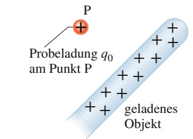

text_image

P
Probeladung q₀
am Punkt P
geladenes
Objekt

(a)

Der Stab erzeugt ein elektrisches Potenzial, welches die potenzielle Energie festlegt.

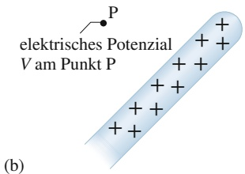

text_image

elektrisches Potenzial
V am Punkt P
(b)

Abb. 20.2

(a) Eine Probeladung wurde aus dem Unendlichen zum Punkt P im elektrischen Feld des Stabs gebracht. (b) Wir

definieren ein elektrisches Potenzial V am Punkt P über die potenzielle Energie der Konfiguration in (a).

## 20.1.1 Elektrisches Potenzial und elektrische potenzielle Energie

Wir möchten jetzt das elektrische Potenzial (oder kurz Potenzial) über die elektrische potenzielle Energie definieren, also ist unsere erste Aufgabe herauszufinden, wie wir diese potenzielle Energie messen können. In Kapitel 4 haben wir die gravitative potenzielle Energie U eines Objekts gemessen, indem wir (1) einer Referenzkonfiguration (z. B. „N. N.“ = Meereshöhe) den Wert $U = 0$ zugewiesen haben und dann (2) die Arbeit W berechnet haben, welche die Gravitationskraft leistet (oder gegen sie geleistet wird), wenn das Objekt über oder unter dieses Niveau bewegt wird. Wir haben dann die (gravitative) potenzielle Energie definiert als

$$
U = - W \quad (\text {potenzielle Energie}). \tag {20.1}
$$

Genauso wollen wir es jetzt auch mit unserer neuen konservativen Kraft machen, der elektrischen Kraft. In Abb. 20.2a möchten wir die potenzielle Energie U finden, welche eine positive Probeladung $q _ { 0 }$ am Punkt P im elektrischen Feld eines geladenen Stabs hat. Als Erstes brauchen wir eine Referenzkonfiguration, für die wir $U = 0$ setzen. Oft ist eine sinnvolle Wahl, hierfür die Situation zu nehmen, bei der die Probeladung unendlich weit vom Stab entfernt ist und nicht mit ihm interagiert. Als Nächstes bringen wir die Probeladung aus dem Unendlichen zum Punkt P, wodurch die Konfiguration in Abb. 20.2a entsteht. Während wir dies tun, berechnen wir die bei dieser Bewegung von der elektrischen Kraft an der Probeladung geleistete Arbeit. Die potenzielle Energie der Endkonfiguration ist durch Gl. 20.1 gegeben, wobei W jetzt die von der elektrischen Kraft geleistete Arbeit ist. Mit dieser Notation betonen wir, dass die Probeladung aus dem Unendlichen kommt. Die Arbeit und damit auch die potenzielle Energie kann sowohl positiv als auch negativ sein, je nach dem Vorzeichen der Ladung auf dem Stab.

Nun definieren wir das elektrische Potenzial V am Punkt P über die geleistete Arbeit und die daraus resultierende potenzielle Energie:

$$
V = \frac {- W _ {\infty}}{q _ {0}} = \frac {U}{q _ {0}} \quad \text {(elektrisches Potenzial).} \tag {20.2}
$$

Dies bedeutet, dass das elektrische Potenzial die elektrische potenzielle Energie pro Ladungseinheit ist, wenn eine positive Probeladung aus dem Unendlichen an den betrachteten Punkt gebracht wird. Dabei erzeugt der Stab dieses Potenzial V am Punkt P völlig unabhängig davon, ob die Probeladung (oder was auch immer) tatsächlich dort ist oder nicht (Abb. 20.2b). Aus Gl. 20.2 sehen wir, dass V eine skalare Größe ist (weder potenzielle Energie noch Ladung besitzen eine Richtung) und sowohl positive als auch negative Werte annehmen kann (weil potenzielle Energie und Ladung Vorzeichen haben). Natürlich kann das Potenzial auch 0 sein.

Indem wir diese Prozedur an beliebigen Punkten wiederholen, finden wir, dass ein elektrisches Potenzial an jedem Punkt im elektrischen Feld des Stabs definiert werden kann. Tatsächlich erzeugt jedes geladene Objekt ein elektrisches Potenzial V an allen Punkten, an denen sein elektrisches Feld wirkt. Wenn wir etwa ein Teilchen mit der Ladung q an einem Punkt platzieren, von dem wir wissen, welches Potenzial V dort herrscht, können wir sofort die (elektrische) potenzielle Energie dieses Systems angeben:

$$
= (\text {Ladung des Teilches}) \left(\frac {\text {elektrische potenzielle Energie}}{\text {Einheitsladung}}\right)
$$

oder

$$
U = q V, \tag {20.3}
$$

wobei q positiv oder negativ sein kann.

## LÖSUNGSSTRATEGIEN

**Strategie 1: Elektrische potenzielle Energie** Das elektrische Potenzial V und die elektrische potenzielle Energie U sind verschiedene Größen und dürfen nicht miteinander verwechselt werden:

Das elektrische Potenzial ist eine Eigenschaft des elektrischen Felds, unabhängig davon, ob eine Probeladung in das Feld gebracht wurde oder nicht.

Die elektrische potenzielle Energie ist die Energie eines geladenen Objekts, das sich in einem externen elektrischen Feld befindet – oder genauer: die Energie des Systems aus Objekt und äußerem elektrischen Feld. Die elektrische potenzielle Energie wird in der Einheit Joule gemessen.

Eine elektrische potenzielle Energie ist einem System geladener Teilchen als Ganzem zugeordnet. Dennoch werden wir Aussagen begegnen (bereits in Beispielaufgabe 20.1 im Übungsbuch), die einem einzelnen Teilchen innerhalb eines Systems eine elektrische potenzielle Energie zuschreiben. So kann man beispielsweise lesen: „Ein Elektron in einem elektrischen Feld hat eine potenzielle Energie von $1 0 ^ { - 7 }$ Aussagen dieser Art sind oft akzeptabel und nicht irreführend, wenn man sich dabei immer der Tatsache bewusst bleibt, dass die elektrostatische Energie eine Eigenschaft des ganzen Systems ist – in diesem Beispiel des Systems aus dem Elektron und den geladenen Teilchen, die das elektrische Feld erzeugen. Machen Sie sich außerdem klar, dass es nur dann sinnvoll ist, einem Teilchen oder einem System einen bestimmten Wert der potenziellen Energie zuzuordnen (in unserem Beispiel $1 0 ^ { - 7 } ]$ J), wenn der Referenzwert der potenziellen Energie bekannt ist.

Die SI-Einheit für das Potenzial folgt direkt aus Gl. 20.2 als Joule pro Coulomb. Hierfür wird oft ein eigener Name verwendet, nämlich Volt (Einheitensymbol V). Es ist also

$$
1 \text {Volt} = 1 \text {Joule pro Coulomb}.
$$

Mit ein bisschen Umformung können wir nun die Einheit des elektrischen Felds, Newton pro Coulomb, in eine gebräuchlichere Form überführen:

$$
\begin{array}{l} 1 \mathrm{N} / \mathrm{C} = \left(1 \frac {\mathrm{N}}{\mathrm{C}}\right) \left(1 \frac {\mathrm{V}}{\mathrm{J} / \mathrm{C}}\right) \left(1 \frac {\mathrm{J}}{\mathrm{N} \cdot \mathrm{m}}\right) \\ = 1 \mathrm{V/m}. \\ \end{array}
$$

Der Umrechnungsfaktor in der mittleren Klammer kommt aus der obigen Defi nition der Einheit Volt, der in der rechten aus der Definition des Joule. Ab jetzt werden wir elektrische Feldstärken in der Regel in Volt pro Meter und nicht mehr in Newton pro Coulomb angeben.

## Bewegung durch ein elektrisches Feld

**Änderung des elektrischen Potenzials** Wenn wir uns durch das elektrische Feld eines geladenen Objekts von einem initialen Startpunkt i zu einem finalen Zielpunkt f bewegen, ändert sich das elektrische Potenzial um

$$
\Delta V = V _ {\mathrm{f}} - V _ {\mathrm{i}}.
$$

Schieben wir ein Teilchen mit Ladung q von i nach f, dann ändert sich die potenzielle Energie des Systems nach Gl. 20.3 um

$$
\Delta U = q \Delta V = q (V _ {\mathrm{f}} - V _ {\mathrm{i}}). \tag {20.4}
$$

Die $\ddot { \mathrm { A } }$ nderung kann positiv oder negativ sein, je nach den Vorzeichen von q und $\Delta V ,$ . Sie kann natürlich auch null sein, wenn sich das Potenzial zwischen i und f gar nicht ändert (wenn beide Punkte denselben Wert des Potenzials besitzen). Weil die elektrische Kraft konservativ ist, ist die Änderung ΔU der potenziellen Energie zwischen i und f für alle Wege zwischen diesen Punkten gleich groß (sie ist also wegunabhängig).

**Ein Feld, das Arbeit leistet** Wir können die Änderung ΔU der potenziellen Energie mit der Arbeit W in Beziehung setzen, die von der elektrischen Kraft geleistet wird, wenn das Teilchen sich von i nach f bewegt, indem wir die für alle konservativen Kräfte gültige Beziehung Gl. 8.1 anwenden:

$$
W = - \Delta U \quad (\text {Arbeit, konservative Kraft}). \tag {20.5}
$$

Als Nächstes beziehen wir diese Arbeit mithilfe von Gl. 20.4 auf die Potenzialänderung:

$$
W = - \Delta U = - q \Delta V = q (V _ {\mathrm{f}} - V _ {\mathrm{i}}). \tag {20.6}
$$

Bis jetzt haben wir Arbeit immer mit einer Kraft verknüpft, hier können wir aber ebenso gut sagen, dass die Arbeit W von dem elektrischen Feld an dem Teilchen verrichtet wird (natürlich deshalb, weil das Feld eine Kraft bewirkt). Diese Arbeit kann positiv, negativ oder null sein. Weil ΔU zwischen zwei beliebigen Punkten wegunabhängig ist, gilt dies ebenso für die von dem Feld geleistete Arbeit W. (Wenn Sie die Arbeit für einen speziellen, sehr komplizierten Weg berechnen sollen, suchen Sie sich einfach einen bequemeren – Sie bekommen immer dasselbe Resultat.)

**Energieerhaltung** Wenn sich ein geladenes Teilchen durch ein elektrisches Feld bewegt und es dabei nur die elektrische Kraftwirkung des Felds spürt, bleibt die mechanische Energie erhalten. Nehmen wir an, wir könnten die elektrische potenzielle Energie allein dem Teilchen zuschreiben. Dann lässt sich die Erhaltung der mechanischen Energie des Teilchens auf dem Weg von i nach f folgendermaßen formulieren:

$$
U _ {\mathrm{i}} + K _ {\mathrm{i}} = U _ {\mathrm{f}} + K _ {\mathrm{f}} \tag {20.7}
$$

oder

$$
\Delta K = - \Delta U. \tag {20.8}
$$

Durch Einsetzen von Gl. 20.4 bekommen wir eine sehr nützliche Gleichung für die kinetische Energie eines Teilchens, das sich durch eine Potenzialdifferenz bewegt:

$$
\Delta K = - q \Delta V = - q (V _ {\mathrm{f}} - V _ {\mathrm{i}}). \tag {20.9}
$$

**Arbeit durch eine äußere Kraft** Wenn außer der elektrischen noch eine weitere Kraft auf das Teilchen einwirkt, nennen wir diese zusätzliche Kraft eine äußere oder externe Kraft. Solch eine äußere Kraft kann Arbeit an dem Teilchen verrichten, aber sie ist nicht notwendigerweise konservativ, weshalb wir ihr im Allgemeinen keine potenzielle Energie (und kein Potenzial) zuschreiben können. Wir berücksichtigen diese externe Arbeit $W _ { \mathrm { e x t } } ,$ indem wir Gl. 20.7 wie folgt modifizieren:

$$
(\text {initiale Energie}) + (\text {Arbeit der externen Kraft}) = (\text {finale Energie})
$$

oder

$$
U _ {\mathrm{i}} + K _ {\mathrm{i}} + W _ {\mathrm{ext}} = U _ {\mathrm{f}} + K _ {\mathrm{f}}. \tag {20.10}
$$

Umstellen und Einsetzen von Gl. 20.4 ergibt

$$
\Delta K = - \Delta U + W _ {\mathrm{ext}} = - q \Delta V + W _ {\mathrm{ext}}. \tag {20.11}
$$

Auch die „externe“ Arbeit kann positiv, negativ oder null sein. Also kann die Energie des Systems zunehmen, abnehmen oder gleich bleiben.

In dem speziellen Fall, dass das Teilchen vor und nach seiner Bewegung ruht, sind die kinetischen Energien in den Gln. 20.10 und 20.11 null und es gilt

$$
W _ {\mathrm{ext}} = q \Delta V \quad (\text {fur} K _ {\mathrm{i}} = K _ {\mathrm{f}})  . \tag {20.12}
$$

In diesem Sonderfall bewirkt die äußere Arbeit $W _ { \mathrm { e x t } }$ eine Bewegung des Teilchens durch die Potenzialdifferenz $\Delta V ,$ ohne dessen kinetische Energie zu verändern.

Vergleichen wir die Gln. 20.6 und 20.12, so sehen wir, dass in diesem Spezialfall die Arbeit der äußeren Kraft das Negative der von dem elektrischen Feld verrichteten Arbeit ist:

$$
W _ {\mathrm{ext}} = - W \quad (\text {fur} K _ {\mathrm{i}} = K _ {\mathrm{f}}). \tag {20.13}
$$

**Elektronenvolt** In der Atom- und Teilchenphysik hätte die Angabe von typischen Energien in SI-Einheiten (also Joule) recht unhandliche Zehnerpotenzen zur Folge. Eine praktischere (aber nicht SI-konforme) Energieeinheit ist in diesen Fällen das Elektronenvolt $( \mathrm { e V } ) ,$ , das als die Arbeit definiert ist, die erforderlich ist, um eine einzelne Elementarladung e (etwa ein Elektron oder Proton) durch eine Potenzialdifferenz $\Delta V$ von genau einem Volt zu bewegen. Aus Gl. 20.6 sehen wir, wie groß diese Arbeit ist:

$$
1 \mathrm{eV} = e \cdot (1 \mathrm{V}) = (1, 6 0 2 \cdot 1 0 ^ {- 1 9} \mathrm{C}) (1 \mathrm{J/C}) = 1, 6 0 2 \cdot 1 0 ^ {- 1 9} \mathrm{J}. \tag {20.14}
$$

## LÖSUNGSSTRATEGIEN

**Strategie 2: Elektrisches Potenzial und Arbeit** Ordnet man innerhalb eines Systems einem einzelnen Teilchen eine potenzielle Energie zu, so verwendet man dabei oft die Formulierung, dass das elektrische Feld Arbeit an dem Teilchen verrichtet. Man meint damit, dass die Kraft, die in dem von den übrigen Teilchen des Systems erzeugten Feld auf das herausgegriffene Teilchen wirkt, Arbeit an dem Teilchen verrichtet.

## KONTROLLFRAGE 1

Ein Proton bewege sich wie in der Abbildung dargestellt in einem homogenen elektrischen Feld von einem Punkt i zu einem Punkt f. (a) Ist die von dem Feld an dem Proton verrichtete Arbeit positiv oder negativ? (b) Nimmt die elektrische potenzielle Energie des Protons während der Bewegung zu oder ab?

## KONTROLLFRAGE 2

Entsprechend der Abbildung in Kontrollfrage 1 werde ein Proton in einem homogenen elektrischen Feld vom Punkt i zum Punkt f verschoben. (a) Ist die von der elektrostatischen Kraft an dem Proton verrichtete Arbeit dabei positiv oder negativ? (b) Bewegt sich das Proton zu einem Punkt höheren oder niedrigeren elektrischen Potenzials?

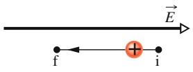

## 20.2 Äquipotenzialflächen

## Lernziele

Nach dem Durcharbeiten dieses Abschnitts sollten Sie in der Lage sein, . . .

• eine Äquipotenzialfläche zu identifizieren und ihre Lage relativ zur Richtung des elektrischen Felds zu beschreiben,
• die Potenzialdifferenz ΔV zwischen zwei Punkten zu berechnen, indem Sie über das Skalarprodukt aus elektrischem Feldvektor $\vec { E }$ und Wegelement d⃗s entlang eines Wegs zwischen den Punkten integrieren,
• die Beziehung zwischen der elektrischen Feldstärke eines homogenen elektri schen Felds und dem Abstand der Äquipotenziallinien bzw. -flächen zu kennen,
• aus einem gegebenen Feldlinienbild die Potenzialdifferenz zwischen zwei Punkten durch grafische Integration zu bestimmen,
• zu erklären, warum es sinnvoll ist, ein Nullpotenzial festzulegen.

## Schlüsselideen

Alle Punkte auf einer Äquipotenzialfläche haben dasselbe elektrische Potenzial. Die Arbeit, die erforderlich ist, um eine Probeladung von einer solchen Fläche zu einer anderen zu bewegen, ist unabhängig sowohl von der jeweiligen Startbzw. Zielposition auf den Flächen als auch von dem gewählten Weg vom Startzum Zielpunkt. Das elektrische Feld steht immer senkrecht auf den Äquipotenzialflächen.
• Die elektrische Potenzialdifferenz zwischen zwei Punkten i und f kann durch Integration über jeden beliebigen Weg von i nach f berechnet werden:

$$
V _ {\mathrm{f}} - V _ {\mathrm{i}} = \int_ {\mathrm{i}} ^ {\mathrm{f}} \vec {E} \cdot \mathrm{d} \vec {s}.
$$

Wenn das Integral für einen gegebenen Weg schwierig zu berechnen ist, können wir einfach einen anderen, geschickteren Weg wählen.

• Mit $V _ { \mathrm { i } } = 0$ bekommen wir für das Potenzial am Punkt f einfach

$$
V _ {\mathrm{f}} = \int_ {\mathrm{i}} ^ {\mathrm{f}} \vec {E} \cdot \mathrm{d} \vec {s}.
$$

• In einem homogenen Feld der Stärke E beträgt die Potenzialdifferenz zwischen einer Äquipotenzialfläche mit höherem Potenzial und einer Äquipotenzialflä- che mit niedrigerem Potenzial im Abstand Δx

$$
\Delta V = - E \Delta x.
$$

## 20.2.1 Äquipotenzialflächen

Eine Gesamtheit von Raumpunkten mit dem gleichen elektrischen Potenzial bildet eine Äquipotenzialfläche. Diese Fläche kann eine rein virtuelle Fläche sein, aber auch mit einer realen, physikalischen Oberfläche zusammenfallen. Ein elektrisches Feld verrichtet an einem geladenen Teilchen, das sich zwischen zwei Punkten i und f auf einer Äquipotenzialfläche bewegt, keine Arbeit W. Dies folgt aus Gl. 20.6, die besagt, dass W für den Fall $V _ { \mathrm { f } } =   V _ { \mathrm { i } }$ gleich null ist. Da die vom Feld verrichtete Arbeit und damit auch die potenzielle Energie und das Potenzial nicht vom Weg abhängen, gilt für jeden beliebigen Weg, der die Punkte i und f miteinander verbindet, $W = 0$ – und dies unabhängig davon, ob der ausgewählte Weg vollständig auf einer Äquipotenzialfläche liegt.

Abbildung 20.3 zeigt eine Schar von Äquipotenzialflächen des elektrischen Felds einer bestimmten Ladungsverteilung. Die Arbeit, die das elektrische Feld an einem Teilchen verrichtet, das einen der Wege I oder II vollständig durchläuft, ist null. Dies folgt daraus, dass Anfangs- und Endpunkt beider Wege jeweils auf derselben Äquipotenzialfläche liegen. Dagegen ist die Arbeit des Felds an einem geladenen Teilchen, das einen der beiden Wege III oder IV durchläuft, von null verschieden, hat aber in beiden Fällen den gleichen Wert, da sowohl die Anfangswerte als auch die Endwerte des Potenzials bei beiden Wegen einander gleich sind. Anschaulich bedeutet dies, dass die Wege III und IV dieselben Äquipotenzialflächen miteinander verbinden.

Aus Symmetriegründen sind die Äquipotenzialflächen der elektrischen Felder einer Punktladung oder im Allgemeinen jeder kugelsymmetrischen Ladungsverteilung Scharen konzentrischer Kugeln. Die Äquipotenzialflächen eines homogenen elektrischen Felds bilden eine Schar von Ebenen senkrecht zu den Feldlinien. Tatsächlich sind die Äquipotenzialflächen eines elektrischen Felds in jedem Punkt

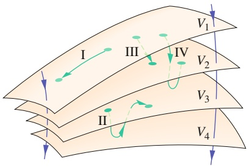

text_image

I
III
IV
V₁
V₂
II
V₃
V₄

Abb. 20.3

Teile von vier Äquipotenzialflä- chen zu den elektrischen Potenzialen $V _ { 1 }   =   1 0 0   \mathrm { V } ,   V _ { 2 }   =   8 0   \mathrm { V } ,$ $V _ { 3 } = 6 0   \mathrm { V }$ und $V _ { 4 } = 4 0   \mathrm { V } .$ . Vier mögliche Bahnkurven einer Probeladung sind eingezeichnet (grün), ebenso zwei elektrische Feldlinien (violett).

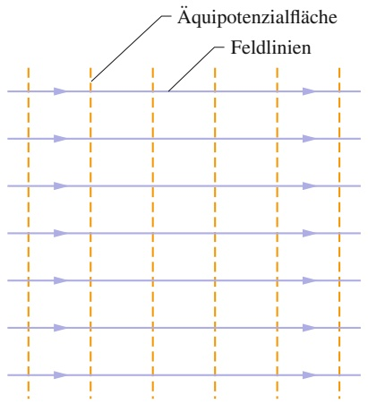

line

| Category | Value |
| --- | --- |
| Row 1 | N/A |
| Row 2 | N/A |
| Row 3 | N/A |
| Row 4 | N/A |
| Row 5 | N/A |
| Row 6 | N/A |
| Row 7 | N/A |
| Row 8 | N/A |
| Row 9 | N/A |
| Row 10 | N/A |
| Row 11 | N/A |
| Row 12 | N/A |
| Row 13 | N/A |
| Row 14 | N/A |
| Row 15 | N/A |
| Row 16 | N/A |
| Row 17 | N/A |
| Row 18 | N/A |
| Row 19 | N/A |
| Row 20 | N/A |
| Row 21 | N/A |
| Row 22 | N/A |
| Row 23 | N/A |
| Row 24 | N/A |
| Row 25 | N/A |
| Row 26 | N/A |
| Row 27 | N/A |
| Row 28 | N/A |
| Row 29 | N/A |
| Row 30 | N/A |
| Row 31 | N/A |
| Row 32 | N/A |
| Row 33 | N/A |
| Row 34 | N/A |
| Row 35 | N/A |
| Row 36 | N/A |
| Row 37 | N/A |
| Row 38 | N/A |
| Row 39 | N/A |
| Row 40 | N/A |
| Row 41 | N/A |
| Row 42 | N/A |
| Row 43 | N/A |
| Row 44 | N/A |
| Row 45 | N/A |
| Row 46 | N/A |
| Row 47 | N/A |
| Row 48 | N/A |
| Row 49 | N/A |
| Row 50 | N/A |

The chart displays multiple parallel lines representing different levels or conditions. The labels 'Äquipotenzialfläche' and 'Feldlinien' indicate specific regions within the data series.

(a)

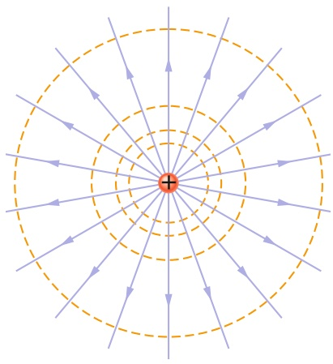

natural_image

Diagram showing radial arrows converging toward a central point, with concentric dashed circles and a solid red cross at the center (no text or symbols)

(b)

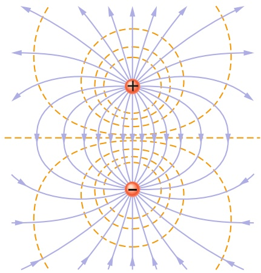

text_image

Diagram illustrating electric field lines around a positive and negative point charge, with dashed lines indicating field direction.

(c)

senkrecht zu den Feldlinien und damit auch senkrecht zum Feldvektor $\vec { E } ,$ der stets tangential an den Feldlinien liegt. Wäre der Feldvektor $\vec { E }$ zu einer beliebigen Äquipotenzialfläche nicht senkrecht, so hätte er eine Komponente tangential zu dieser Fläche, und diese Komponente würde an einem geladenen Teilchen, das sich auf der Fläche bewegt, Arbeit verrichten. Nach Gl. 20.6 ist dies aber nicht möglich, falls es sich tatsächlich um eine Äquipotenzialfläche handelt. Die einzig mögliche Schlussfolgerung ist, dass $\vec { E }$ in jedem Punkt senkrecht auf der Äquipotenzialflä- che stehen muss. Abbildung 20.4 zeigt die elektrischen Feldlinien zusammen mit Querschnitten durch die Äquipotenzialflächen für (a) ein homogenes elektrisches Feld sowie die Felder (b) einer Punktladung und (c) eines elektrischen Dipols.

## Abb. 20.4

Elektrische Feldlinien (violett) und Querschnitte von Äquipotenzialflä- chen (gelb) (a) in einem homogenen Feld, (b) im Feld einer Punktladung und (c) im Feld eines elektrischen Dipols.

## 20.2.2 Die Berechnung des Potenzials aus dem Feld

Man kann die Potenzialdifferenz zwischen zwei beliebigen Punkten i und f in einem elektrischen Feld berechnen, wenn man den elektrischen Feldvektor E⃗ in jedem Punkt eines beliebigen Wegs zwischen den beiden Punkten kennt. Wir bestimmen dazu die Arbeit, die das elektrische Feld an einer positiven Probeladung verrichtet, wenn sie sich vom Startpunkt i zum Zielpunkt f bewegt, und verwenden dann Gl. 20.6.

Betrachten wir ein beliebiges elektrisches Feld, dargestellt durch die Feldlinien in Abb. 20.5, sowie eine positive Probeladung $q _ { 0 } ,$ die sich auf dem eingezeichne ten Weg vom Punkt i zum Punkt f bewegt. In jedem Punkt des Wegs wirkt eine elektrostatische Kraft $q _ { 0 } \vec { E }$ auf die Ladung, während sie sich um eine differenzielle Verschiebung d⃗s bewegt. Aus Kapitel 3 wissen wir, dass die von einer Kraft $\vec { F }$ an einem Teilchen bei einer differenziellen Verschiebung d⃗s verrichtete, differenzielle Arbeit dW durch das Skalarprodukt aus $\vec { F }$ und d⃗s gegeben ist:

$$
\mathrm{d} W = \vec {F} \cdot \mathrm{d} \vec {s}. \tag {20.15}
$$

In der Situation aus Abb. 20.5 ist $\vec { F } = q _ { 0 } \cdot \vec { E }$ und aus Gl. 20.15 folgt somit

$$
\mathrm{d} W = q _ {0} \vec {E} \cdot \mathrm{d} \vec {s}. \tag {20.16}
$$

Um die gesamte Arbeit $W$ zu berechnen, die das Feld an dem Teilchen verrichtet, während es sich vom Punkt i zum Punkt f bewegt, addieren wir durch Integration alle differenziellen Arbeitsbeiträge, die das Feld am Teilchen beim Durchqueren aller differenziellen Wegelemente d⃗s entlang des Gesamtwegs verrichtet:

$$
W = q _ {0} \int_ {\mathrm{i}} ^ {\mathrm{f}} \vec {E} \cdot \mathrm{d} \vec {s}. \tag {20.17}
$$

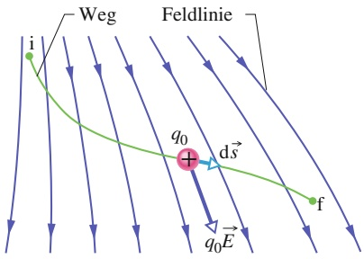

text_image

Weg
Feldlinie
i
q₀
d⃗
+
q₀E
f

Abb. 20.5

Eine Probeladung $q _ { 0 }$ bewegt sich in einem inhomogenen elektrischen Feld auf der eingezeichneten Bahnkurve vom Punkt i zum Punkt f. Während einer differenziellen Verschiebung d⃗s wirkt eine elektrostatische Kraft $\vec { q } _ { 0 } \vec { E }$ auf die Probeladung. Diese Kraft zeigt in Richtung der Feldlinie am Ort der Probeladung.

Setzen wir diese Gesamtarbeit W in Gl. 20.6 ein, so erhalten wir

$$
V _ {\mathrm{f}} - V _ {\mathrm{i}} = - \int_ {\mathrm{i}} ^ {\mathrm{f}} \vec {E} \cdot \mathrm{d} \vec {s}. \tag {20.18}
$$

Mit anderen Worten: Die Potenzialdifferenz $V _ { \mathrm { f } } \mathrm { ~ - ~ } V _ { \mathrm { i } }$ zwischen zwei beliebigen Punkten i und f in einem elektrischen Feld ist gleich dem Negativen des Linienintegrals des Skalarprodukts $\vec { E }$ ⋅ d⃗s zwischen i und f. (Als Linien- oder Wegintegral bezeichnet man ein Integral entlang eines bestimmten Wegs.) Da die elektrostatische Kraft konservativ ist, führt die Integration entlang aller möglichen Wege – seien die entsprechenden Integrale einfach oder schwierig zu berechnen! – zu demselben Ergebnis.

Ist das elektrische Feld in einem gewissen Raumbereich bekannt, so kann man aus Gl. 20.18 die Potenzialdifferenz zwischen zwei beliebigen Punkten innerhalb des Felds berechnen. Wählen wir null als unseren Wert $V _ { \mathrm { i } }$ des Potenzials im Anfangspunkt, so wird Gl. 20.18 zu

$$
V = - \int_ {\mathrm{i}} ^ {\mathrm{f}} \vec {E} \cdot \mathrm{d} \vec {s}, \tag {20.19}
$$

wobei wir den Index f von $V _ { \mathrm { f } }$ weggelassen haben. Gleichung 20.19 gibt den Wert des Potenzials V in einem beliebigen Punkt f im elektrischen Feld relativ zu dem Potenzial null im Punkt i an. Legen wir den Punkt i ins Unendliche, dann liefert uns Gl. 20.19 das Potenzial $V$ an einem beliebigen Punkt f relativ zum Potenzial null im Unendlichen.

Im Sonderfall eines homogenen Felds mit der Feldstärke E beträgt die Potenzialdifferenz zwischen zwei benachbarten (parallelen) Äquipotenzialflächen in einem Abstand $\Delta x$ voneinander

$$
\Delta V = - E \Delta x. \tag {20.20}
$$

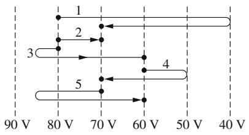

wireframe

| Path | Start Voltage (V) | End Voltage (V) |
| --- | --- | --- |
| 1 | ~82 | ~72 |
| 2 | ~72 | ~68 |
| 3 | ~82 | ~62 |
| 4 | ~62 | ~50 |
| 5 | ~72 | ~62 |

## KONTROLLFRAGE 3

Die Abbildung zeigt eine Schar paralleler Äquipotenzialflächen im Querschnitt sowie fünf verschiedene Wege, entlang derer ein Elektron von Fläche zu Fläche be wegt werde. $( \mathrm { a } )$ Welche Richtung hat das zu der Flächenschar gehörige elektrische Feld? (b) Ist die entlang der Wege verrichtete Arbeit jeweils positiv, negativ oder null? (c) Ordnen Sie die Wege nach dem Betrag der verrichteten Arbeit.

## 20.3 Das Potenzial von Punktladungen

## Lernziele

Nach dem Durcharbeiten dieses Abschnitts sollten Sie in der Lage sein, . . .

• an einem gegebenen Punkt im elektrischen Feld eines geladenen Teilchens die Beziehung zwischen dem elektrischen Potenzial $V ,$ der Ladung q des Teilchens und dem Abstand r zu dem Teilchen anzuwenden,
• aus dem Vorzeichen der Ladung eines Teilchens auf das Vorzeichen des von ihm erzeugten Potenzials zu schließen,
• das elektrische Potenzial außerhalb einer kugelsymmetrischen Ladungsverteilung so zu berechnen, als ob die gesamte Ladung in einem Punkt im Mittelpunkt der Kugel konzentriert wäre,
• das Gesamtpotenzial an einem gegebenen Punkt im Feld mehrerer geladener Teilchen ohne Vektoraddition zu berechnen,
• die Äquipotenziallinien um ein geladenes Teilchen zu zeichnen.

## Schlüsselideen

• Das elektrische Potenzial im Abstand r von einer freien Punktladung ist

$$
V = \frac {1}{4 \pi \varepsilon_ {0}} \frac {q}{r},
$$

wobei V und $q$ dasselbe Vorzeichen tragen.

• Eine Verteilung von n geladenen Teilchen erzeugt zusammen das Potenzial

$$
V = \sum_ {i = 1} ^ {n} V _ {i} = \frac {1}{4 \pi \varepsilon_ {0}} \sum_ {i = 1} ^ {n} \frac {q _ {i}}{r _ {i}}.
$$

Das Potenzial ergibt sich also als normale (skalare) Summe und nicht durch (richtungsabhängige) Vektoraddition.

## 20.3.1 Das Potenzial einer Punktladung

Wir wenden nun Gl. 20.18 zur Herleitung eines Ausdrucks für das elektrische Potenzial im Raum um ein geladenes Teilchen an, wobei wir das Potenzial immer auf einen Wert von null im Unendlichen beziehen. Betrachten wir dazu einen Punkt P im Abstand R von einem ortsfesten Teilchen mit der positiven Ladung q (Abb. 20.6). Um Gl. 20.18 anwenden zu können, denken wir uns eine positive Probeladung $q _ { 0 }$ vom Punkt P ins Unendliche bewegt. Da die Wahl des Wegs, auf dem wir die Ladung bewegen, in einem konservativen Feld keine Rolle spielt, suchen wir uns den einfachsten Weg aus: eine gerade Linie, die von dem Teilchen mit der Ladung $q _ { 0 }$ durch den Punkt P radial ins Unendliche führt.

Zur Berechnung des Integrals auf der rechten Seite von Gl. 20.18 benötigen wir das Skalarprodukt

$$
\vec {E} \cdot \mathrm{d} \vec {s} = E \cos \theta \mathrm{d} s. \tag {20.21}
$$

Das elektrische Feld zeigt nach Abb. 20.6 von der ortsfesten Ladung $q$ ausgehend radial nach außen. Die differenzielle Verschiebung d⃗s der Probeladung ist deshalb auf dem gesamten Weg parallel zu ${ \vec { E } } .$ Deshalb ist der Winkel θ in Gl. 20.21 null und es gilt cos $\theta = 1$ . Da der Weg vollständig in radialer Richtung liegt, ändern wir die Bezeichnung des differenziellen Wegelements ds in dr. Mit den Integrationsgrenzen R und ∞ lautet Gl. 20.18 nun

$$
V _ {\mathrm{f}} - V _ {\mathrm{i}} = - \int_ {R} ^ {\infty} E \mathrm{d} r. \tag {20.22}
$$

Nun setzen wir $V _ { \mathrm { f } } = 0$ (im Unendlichen) und $V _ { \mathrm { i } } = V$ (im Abstand R). Nach Gl. 22.3 gilt für den Betrag des elektrischen Felds am Ort der Probeladung

$$
E = \frac {1}{4 \pi \varepsilon_ {0}} \frac {q}{r ^ {2}}. \tag {20.23}
$$

Damit wird Gl. 20.22 zu

$$
\begin{array}{l} 0 - V = - \frac {q}{4 \pi \varepsilon_ {0}} \int_ {R} ^ {\infty} \frac {1}{r ^ {2}} \mathrm{d} r = \frac {q}{4 \pi \varepsilon_ {0}} \left[ \frac {1}{r} \right] _ {R} ^ {\infty} \\ = - \frac {1}{4 \pi \varepsilon_ {0}} \frac {q}{R}. \tag {20.24} \\ \end{array}
$$

Diese Gleichung lösen wir nach V auf und ersetzen R durch $r ;$ damit erhalten wir

$$
V = \frac {1}{4 \pi \varepsilon_ {0}} \frac {q}{r} \tag {20.25}
$$

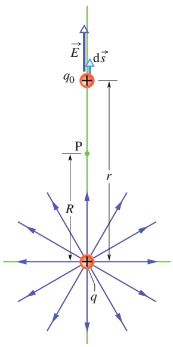

text_image

E
dS
q0
P
r
R
q

Abb. 20.6 Die positive Punktladung q erzeugt im Punkt $\mathrm { P }$ ein elektrisches Feld $\vec { E }$ bzw. ein Potenzial V. Wir bestimmen das Potenzial, indem wir eine Probeladung $q _ { 0 }$ vom Punkt P ins Unendliche verschieben. Im Bild hat $q _ { 0 }$ einen Abstand r von der Punktladung; sie erfährt dort eine differenzielle Verschiebung d⃗s.

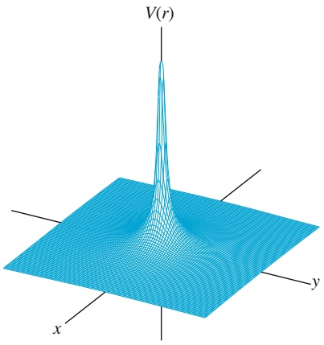

text_image

V(r)
x
y

Abb. 20.7

Ein Computerplot des elektrischen Potenzials V(r) einer positiven Punktladung im Ursprung der xy-Ebene. Dabei ist in vertikaler Richtung über jedem Punkt der Ebene der Wert des Potenzials an diesem Punkt aufgetragen. (Das Gitternetz hilft dabei, die räumliche Struktur des Potenzialverlaufs zu erfassen.) Der nach Gl. 20.25 im Ursprung bei r = 0 zu erwartende unendliche Wert des Potenzials ist natürlich nicht darstellbar.

für das elektrische Potenzial V an allen Punkten in einem radialen Abstand r von einem ortsfesten Teilchen der Ladung q.

Obwohl wir Gl. 20.25 für das Feld eines positiv geladenen Teilchens hergeleitet haben, gilt diese Gleichung natürlich auch für das Feld einer negativen Ladung, wobei q dann eine negative Größe ist. Beachten Sie, dass V immer dasselbe Vorzeichen hat wie q:

Eine positive Ladung erzeugt ein positives elektrisches Potenzial, eine negative Ladung erzeugt ein negatives elektrisches Potenzial.

Abbildung 20.7 zeigt eine mit dem Computer erzeugte Darstellung des durch Gl. 20.25 dargestellten Potenzialverlaufs. Das Potenzial V ist auf der vertikalen Achse aufgetragen; es nimmt mit $r \to 0$ zu. Nach Gl. 20.25 wird der Wert des Potenzials im Punkt $r = 0$ unendlich. Die Darstellung der Abb. 20.7 zeigt in diesem Punkt einen endlichen Wert, die sogenannte Singularität wurde „geglättet“.

Gleichung 20.25 gibt auch den Verlauf des elektrischen Potenzials außerhalb oder auf der äußeren Oberfläche einer beliebigen kugelsymmetrischen Ladungsverteilung an. Man zeigt dies durch Anwendung eines der Kugelschalentheoreme aus Abschn. 17.1 bzw. 19.6: Nach diesen Sätzen kann man die kugelförmige Ladungsverteilung durch eine äquivalente Punktladung im Mittelpunkt der Verteilung ersetzen, deren Betrag gleich der Gesamtladung der Verteilung ist. Nun kann man Gl. 20.25 wie oben herleiten, sofern man innerhalb der Ladungsverteilung liegende Punkte ausschließt.

## LÖSUNGSSTRATEGIEN

**Strategie 3: Bestimmen von Potenzialdifferenzen** Um die Potenzialdifferenz ΔV zwischen zwei beliebigen Punkten im Feld einer isolierten Punktladung zu bestimmen, kann man Gl. 20.25 in jedem der beiden Punkte berechnen und die Ergebnisse voneinander subtrahieren. Der Wert der Potenzialdifferenz ist von der Wahl des Referenzpotenzials unabhängig, da sich dieser Referenzwert bei der Subtraktion heraushebt.

## 20.3.2 Das Potenzial einer Gruppe von Punktladungen

Mithilfe des Superpositionsprinzips können wir das von mehreren Punktladungen an einem bestimmten Punkt erzeugte resultierende elektrische Potenzial bestimmen. Dazu berechnen wir das von jeder Ladung im betrachteten Punkt erzeugte Potenzial separat, wobei die Ladung jeweils mit ihrem Vorzeichen in Gl. 20.25 eingeht. Danach addieren wir alle Potenzialbeiträge. Das resultierende Potenzial einer Gruppe von n Ladungen ergibt sich auf diese Weise zu

$$
V = \sum_ {i = 1} ^ {n} V = \frac {1}{4 \pi \varepsilon_ {0}} \sum_ {i = 1} ^ {n} \frac {q _ {i}}{r _ {i}}. \tag {20.26}
$$

Darin bezeichnen $q _ { i }$ den Betrag der i-ten Ladung und $r _ { i }$ die radiale Entfernung des Punkts von dieser Ladung. Die Summe in Gl. 20.26 ist eine algebraische Summe, keine Vektorsumme von der Art, wie man sie verwendet, wenn man das resultierende elektrische Feld einer Anzahl von Punktladungen berechnet. Dadurch sind Potenzialberechnungen im Allgemeinen wesentlich einfacher als Feldberechnungen: Die Summe einer Reihe skalarer Größen zu bilden, bedeutet einen wesentlich geringeren Aufwand, als mehrere vektorielle Größen unter Berücksichtigung ihrer Richtungen zu addieren.

## KONTROLLFRAGE 4

Die Abbildung zeigt drei Anordnungen jeweils zweier Protonen. Ordnen Sie die drei Fälle nach dem Wert des resultierenden elektrischen Potenzials im Punkt P.

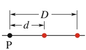

(a)

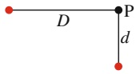

(b)

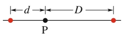

(c)

## 20.4 Das Potenzial eines elektrischen Dipols

## Lernziele

Nach dem Durcharbeiten dieses Abschnitts sollten Sie in der Lage sein, . . .

• das Potenzial V eines elektrischen Dipols in Abhängigkeit vom Betrag p seines Dipolmoments zu berechnen, d. h. des Produkts aus dem Abstand d der Ladungen und ihrem Betrag q,
• für einen elektrischen Dipol die Bereiche anzugeben, in denen das Potenzial positiv, negativ oder null ist,
• die jeweilige Abnahme des Potenzials mit dem Abstand von einer Punktladung und von einem Dipol miteinander zu vergleichen.

## Schlüsselideen

• Im Abstand $r \gg d$ von einem elektrischen Dipol mit Dipolmoment $p = q d$ beträgt dessen elektrisches Potenzial

$$
V = \frac {1}{4 \pi \varepsilon_ {0}} \frac {p \cos \theta}{r}.
$$

Der Winkel θ liegt dabei zwischen dem Dipolvektor $\vec { p }$ und der Verbindungslinie von Dipolmittelpunkt und Messpunkt.

## 20.4.1 Das Potenzial eines elektrischen Dipols

Wir wollen nun Gl. 20.26 anwenden, um das von einem elektrischen Dipol in einem beliebigen Punkt P erzeugte Potenzial zu berechnen (Abb. 20.8a). Die positive Punktladung des Dipols befindet sich im Abstand $r _ { ( + ) }$ vom Punkt P und erzeugt dort einen Potenzialbeitrag $V _ { ( + ) } ,$ die negative Punktladung, im Abstand $r _ { ( - ) }$ vom Punkt P, erzeugt entsprechend einen Beitrag $V _ { ( - ) }$ . Das resultierende Potenzial im

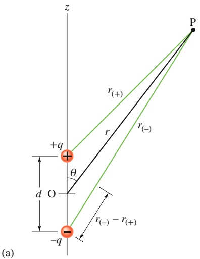

text_image

z
P
r(+)
r
r(-)
+q
θ
d O
r(-)-r(+)
-q
(a)

(b)

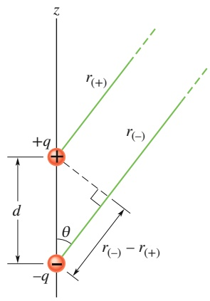

text_image

z
r(+)
+q
r(-)
d
θ
r(-) - r(+)
-q

## Abb. 20.8

(a) Der Punkt P liege in einer Entfernung r vom Mittelpunkt O eines Dipols. Die Strecke OP schließt einen Winkel θ mit der Dipolachse ein.
(b) Liegt der Punkt P weit von dem Dipol entfernt, so sind die Strecken $r _ { ( + ) }$ und $r _ { ( - ) }$ annähernd parallel zur Strecke $r ,$ und die gestrichelt gezeichnete schwarze Strecke steht annähernd senkrecht auf $r _ { ( - ) } .$

Punkt P ist dann nach Gl. 20.26

$$
\begin{array}{l} V = \sum_ {i = 1} ^ {2} V _ {i} = V _ {(+)} + V _ {(-)} = \frac {1}{4 \pi \varepsilon_ {0}} \left(\frac {q}{r _ {(+)}} + \frac {- q}{r _ {(-)}}\right) \\ = \frac {q}{4 \pi \varepsilon_ {0}} \frac {r _ {(-)} - r _ {(+)}}{r _ {(-)} r _ {(+)}}. \tag {20.27} \\ \end{array}
$$

Natürlich vorkommende Dipole – wie beispielsweise zahlreiche Moleküle – sind sehr klein. Deshalb betrachtet man normalerweise nur Punkte, die relativ weit vom jeweiligen Dipol entfernt sind, sodass die Bedingung r ≫ d erfüllt ist (d bezeichnet den Abstand der Ladungen im Dipol). Unter diesen Voraussetzungen kann man nach Abb. 20.8b folgende Näherungen machen:

$$
r _ {(-)} - r _ {(+)} \approx d \cos \theta \quad \text {und} \quad r _ {(-)} r _ {(+)} \approx r ^ {2}.
$$

Setzen wir diese Ausdrücke in Gl. 20.27 ein, so erhalten wir folgende Näherung für das Potenzial $V ;$

$$
V = \frac {q}{4 \pi \varepsilon_ {0}} \frac {d \cos \theta}{r ^ {2}}.
$$

Der Winkel θ wird dabei, wie in Abb. 20.8a dargestellt, relativ zur Dipolachse gemessen. Ersetzt man in diesem Ausdruck qd durch den Betrag des in Abschn. 18.3 definierten Dipolmoments $\vec { p } ,$ so erhält man schließlich

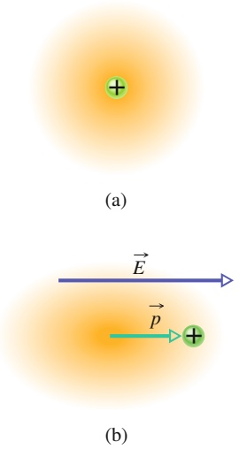

flowchart

$$
V = \frac {1}{4 \pi \varepsilon_ {0}} \frac {p \cos \theta}{r ^ {2}}. \tag {20.28}
$$

Der Vektor $\vec { p }$ ist parallel zur Dipolachse gerichtet und zeigt von der negativen zur positiven Ladung des Dipols. (Der Winkel θ wird somit relativ zur Richtung von $\vec { p }$ gemessen.) Mithilfe dieses Vektors können wir die Orientierung eines Dipols angeben.

## KONTROLLFRAGE 5

Betrachten Sie drei Punkte in identischen, großen Abständen r vom Zentrum des Dipols aus Abb. 20.8: Punkt A liege auf der Dipolachse oberhalb der positiven Ladung, Punkt B auf der Dipolachse unterhalb der negativen Ladung, Punkt C schließlich auf der Mittelsenkrechten zur Verbindungslinie der Ladungen. Ordnen Sie die drei Punkte in absteigender Reihenfolge nach dem dort vorliegenden elektrischen Potenzial.

## Abb. 20.9

(a) Schematische Darstellung eines Atoms, bestehend aus einem positiv geladenen Kern (grün) und den negativ geladenen Elektronen (gelbe Schattierung). Die Ladungsschwerpunkte von positiver und negativer Ladung stimmen überein. (b) Befindet sich das Atom in einem äußeren elektrischen Feld $\vec { E } ,$ so wird der Aufenthaltsbereich der Elektronen gegenüber dem Kern verschoben, sodass die Ladungsschwerpunkte von positiver und negativer Ladung nun nicht mehr übereinstimmen: Das Atom hat ein induziertes Dipolmoment ${ \vec { p } } .$ Die Verformung des Atoms im elektrischen Feld ist hier stark übertrieben dargestellt.

## Das induzierte Dipolmoment

Zahlreiche Moleküle, wie beispielsweise das polare Wassermolekül, haben ein permanentes Dipolmoment. Bei anderen, unpolaren Molekülen – ebenso wie bei jedem isolierten Atom – fallen die Schwerpunkte der positiven und der negativen Ladung zusammen (Abb. 20.9a), sodass kein Dipolmoment vorhanden ist. Bringt man jedoch ein Atom oder ein unpolares Molekül in ein äußeres elektrisches Feld, so werden die Elektronenorbitale unter der Wirkung des Felds verzerrt und die Schwerpunkte von positiver und negativer Ladung voneinander getrennt (Abb. 20.9b). Die Elektronen sind negativ geladen und werden entgegen der Feldrichtung verschoben. Dadurch entsteht ein Dipolmoment $\vec { p }$ in Feldrichtung. Dieses Dipolmoment bezeichnet man als induziertes Dipolmoment und sagt, das Atom oder Molekül werde im Feld polarisiert (es bildet eine positive und eine negative Seite aus). Ist das äußere Feld nicht mehr vorhanden, so verschwinden auch induziertes Dipolmoment und Polarisierung.

## 20.5 Das Potenzial einer kontinuierlichen Ladungsverteilung

## Lernziele

Nach dem Durcharbeiten dieses Abschnitts sollten Sie in der Lage sein, . . .

• das Potenzial einer homogenen Ladungsverteilung in ein oder zwei Dimensionen (entlang einer Linie bzw. auf einer Fläche) dadurch zu berechnen, dass sie die Verteilung in kleine Ladungselemente aufteilen und deren Potenziale aufsummieren bzw. -integrieren.

## Schlüsselideen

Wenn eine Ladung kontinuierlich über ein ausgedehntes Objekt verteilt ist, bestimmt man das davon erzeugte Potenzial, indem man (1) die Ladung in viele kleine Ladungselemente $\mathrm { d } q$ aufteilt, die sich als Punktladungen behandeln lassen, und (2) deren Potenziale aufsummiert bzw. über das gesamte Objekt integriert:

$$
V = \frac {1}{4 \pi \varepsilon_ {0}} \int \frac {\mathrm{d} q}{r}.
$$

• Um das Integral auszuführen, wird dq durch das Produkt aus einer linearen Ladungsdichte λ und einem Längenelement dx bzw. einer Flächenladungsdichte σ und einem Flächenelement dA (z. B. dx dy) ersetzt.
• Wenn die Ladungsverteilung symmetrisch ist, lässt sich die zweidimensionale Integration manchmal auf eine eindimensionale reduzieren.

## 20.5.1 Das Potenzial einer kontinuierlichen Ladungsverteilung

Zur Bestimmung des von einer kontinuierlichen Ladungsverteilung – beispielsweise eines homogen geladenen, dünnen Stabs oder einer geladenen Scheibe – in einem Punkt P erzeugten Potenzials ist die Summation aus Gl. 20.26 nicht angemessen. Vielmehr muss man hier ein differenzielles Ladungselement dq herausgreifen, dessen Potenzialbeitrag dV im Punkt P bestimmen und schließlich über die gesamte Ladungsverteilung integrieren.

Der Nullpunkt des Potenzials soll wieder im Unendlichen liegen. Behandeln wir das differenzielle Ladungselement dq als Punktladung, so können wir mit Gl. 20.25 für den von dq im Punkt P erzeugten Potenzialbeitrag dV schreiben

$$
\mathrm{d} V = \frac {1}{4 \pi \varepsilon_ {0}} \frac {\mathrm{d} q}{r}. \tag {20.29}
$$

r bezeichnet den Abstand zwischen P und dq. Das resultierende Potenzial V im Punkt P ergibt sich dann durch Summation der Beiträge aller Ladungselemente mittels Integration:

$$
V = \int \mathrm{d} V = \frac {1}{4 \pi \varepsilon_ {0}} \int \frac {\mathrm{d} q}{r}. \tag {20.30}
$$

Beachten $\mathrm { S i e } ,$ dass sich die Integration über die gesamte Ladungsverteilung erstreckt. Da das elektrische Potenzial ein Skalar ist, müssen in Gl. 20.30 keine Vektorkomponenten berücksichtigt werden.

Wir betrachten nun zwei spezielle kontinuierliche Ladungsverteilungen genauer: die lineare Ladungsverteilung und die ebene geladene Scheibe.

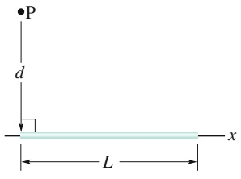

text_image

P
d
L
x

(a)

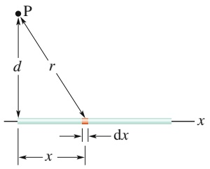

text_image

P
d
r
x
dx
x

(b)

Abb. 20.10

(a) Ein dünner, homogen geladener Stab erzeugt im Punkt P ein elektrisches Potenzial V. (b) Ein differenzielles Ladungselement erzeugt im Punkt P einen differenziellen Potenzialbeitrag dV.

## Das Potenzial einer linearen Ladungsverteilung

Abbildung 20.10a zeigt einen dünnen, nichtleitenden Stab der Länge $L ,$ der mit einer homogenen, linearen Dichte λ positiv geladen ist. Wir wollen das elektrische Potenzial V berechnen, das von der Ladung des Stabs in einem Punkt P in einem senkrecht gemessenen Abstand d vom linken Ende des Stabs hervorgerufen wird.

Dazu betrachten wir ein differenzielles Längenelement dx des Stabs (Abb. 20.10b). Das Längenelement trägt – wie jedes andere herausgegriffene Element des Stabs – eine differenzielle Ladung

$$
\mathrm{d} q = \lambda \mathrm{d} x. \tag {20.31}
$$

Dieses Ladungselement erzeugt am Punkt P im Abstand $r = ( x ^ { 2 } + d ^ { 2 } ) ^ { 1 / 2 }$ einen Potenzialbeitrag dV. Wenn wir das Ladungselement als Punktladung behandeln, können wir mithilfe von Gl. 20.29 für dV schreiben

$$
\mathrm{d} V = \frac {1}{4 \pi \varepsilon_ {0}} \frac {\mathrm{d} q}{r} = \frac {1}{4 \pi \varepsilon_ {0}} \frac {\lambda \mathrm{d} x}{(x ^ {2} + d ^ {2}) ^ {1 / 2}}. \tag {20.32}
$$

Da die Ladung des Stabs positiv ist und wir das Potenzial im Unendlichen zu $V =$ 0 gewählt haben, wissen wir aus Abschn. 20.3, dass der Potenzialbeitrag dV in Gl. 20.32 positiv sein muss.

Das von der Ladung des Stabs im Punkt P erzeugte Gesamtpotenzial V berechnen wir nun durch Integration von Gl. 20.32 entlang der Stablänge in den Grenzen $x = 0$ und $x = L$ . Hierzu benötigen wir das Integral Nr. 17 aus Anhang D. Wir erhalten:

$$
\begin{array}{l} V = \int \mathrm{d} V \\ = \int_ {0} ^ {L} \frac {1}{4 \pi \varepsilon_ {0}} \frac {\lambda}{(x ^ {2} + d ^ {2}) ^ {1 / 2}} \mathrm{d} x \\ = \frac {\lambda}{4 \pi \varepsilon_ {0}} \int_ {0} ^ {L} \frac {\mathrm{d} x}{(x ^ {2} + d ^ {2}) ^ {1 / 2}} \\ = \frac {\lambda}{4 \pi \varepsilon_ {0}} [ \ln (x + (x ^ {2} + d ^ {2}) ^ {1 / 2}) ] _ {0} ^ {L} \\ = \frac {\lambda}{4 \pi \varepsilon_ {0}} [ \ln (L + (L ^ {2} + d ^ {2}) ^ {1 / 2}) - \ln d ]. \\ \end{array}
$$

Mithilfe des allgemeingültigen Zusammenhangs ln $A - \ln B = \ln ( A / B )$ kann man das Ergebnis weiter vereinfachen:

$$
V = \frac {\lambda}{4 \pi \varepsilon_ {0}} \ln \left[ \frac {L + (L ^ {2} + d ^ {2}) ^ {1 / 2}}{d} \right]. \tag {20.33}
$$

Das Gesamtpotenzial V sollte als Summe positiver Beiträge dV ebenfalls positiv sein. Liefert Gl. 20.33 tatsächlich einen positiven Wert für V? Da das Argument des Logarithmus größer als eins ist, ergibt sich als Wert des Logarithmus eine positive Zahl, sodass auch V in der Tat positiv ist.

## Das Potenzial einer geladenen Scheibe

In Abschn. 18.5 haben wir den Betrag des elektrischen Felds auf der Achse einer kreisförmigen Plastikscheibe mit dem Radius R berechnet, die auf einer Seite mit einer homogenen Flächendichte σ geladen war. Hier wollen wir nun einen Ausdruck V(z) für das elektrische Potenzial in einem beliebigen Punkt auf der z-Achse herleiten.

Wir betrachten als differenzielles Flächenelement einen ebenen Kreisring mit dem Radius $R ^ { \prime }$ und einer radialen Breite $\mathrm { d } R ^ { \prime }$ (Abb. 20.11). Dieses Element trägt eine differenzielle Ladung

$$
\mathrm{d} q = \sigma (2 \pi R ^ {\prime}) (\mathrm{d} R ^ {\prime}).
$$

Dabei ist $( 2 \pi R ^ { \prime } ) ( \mathbf { d } R ^ { \prime } )$ der Flächeninhalt der Oberseite des Rings. Alle Teile dieses Ladungselements haben denselben Abstand r von einem herausgegriffenen Punkt P auf der Achse der Scheibe. Mithilfe von Abb. 20.11 und Gl. 20.29 können wir den Beitrag dieses Rings zum elektrischen Potenzial im Punkt P schreiben als

$$
\mathrm{d} V = \frac {1}{4 \pi \varepsilon_ {0}} \frac {\mathrm{d} q}{r} = \frac {1}{4 \pi \varepsilon_ {0}} \frac {\sigma (2 \pi R ^ {\prime}) (\mathrm{d} R ^ {\prime})}{\sqrt {z ^ {2} + R ^ {\prime 2}}} . \tag {20.34}
$$

Das resultierende Potenzial in P erhalten wir nun durch Summation der Beiträge aller differenziellen Ringe, also durch Integration über den Radius der Scheibe in den Grenzen $R ^ { \prime } = 0$ und $R ^ { \prime } = R ;$

$$
V = \int \mathrm{d} V = \frac {\sigma}{2 \varepsilon_ {0}} \int_ {0} ^ {R} \frac {R ^ {\prime} \mathrm{d} R ^ {\prime}}{\sqrt {z ^ {2} + R ^ {\prime 2}}} = \frac {\sigma}{2 \varepsilon_ {0}} \left(\sqrt {z ^ {2} + R ^ {2}} - z\right). \tag {20.35}
$$

Beachten Sie, dass im zweiten Integral von Gl. 20.35 $R ^ { \prime }$ die Integrationsvariable ist und nicht etwa z: Der Abstand z des Punkts P von der Kreisscheibe bleibt bei der Integration über die Fläche der Scheibe konstant. Beachten Sie weiterhin, dass wir bei der Berechnung des Integrals $z \geq 0$ angenommen haben.

## LÖSUNGSSTRATEGIEN

**Strategie 4: Schwierigkeiten bei Potenzialberechnungen** Bei der Berechnung des Potenzials, das von einer linearen oder auch einer anderen kontinuierlichen Ladungsverteilung in einem Punkt P erzeugt wird, kann es bei der Behandlung der Ladungsvorzeichen leicht zu Fehlern kommen. Wir geben hier eine allgemeine Anleitung, wie solche Fehler zu vermeiden sind.

Nehmen wir an, die betrachtete Ladung sei negativ. Sollen nun die Symbole dq und λ implizit negative Größen darstellen, oder sollte man die Vorzeichen explizit schreiben, also − dq und −λ? Sie sind frei, das eine oder das andere zu tun – so lange Sie sich an Ihre selbst gewählte Konvention bei der Schreibweise erinnern, um schließlich das Vorzeichen des berechneten Werts von V korrekt interpretieren zu können.

Hat die gesamte zu betrachtende Ladungsverteilung dasselbe Vorzeichen, so kann man auch von unterschiedlichen Vorzeichen ganz absehen und die Größen dq und λ als Beträge behandeln. Als Ergebnis der Berechnung wird man in diesem Fall den Betrag von V im Punkt P erhalten, dem man dann ein Vorzeichen entsprechend dem Vorzeichen der Ladungsverteilung beifügt. (Legt man den Nullpunkt des Potenzials ins Unendliche, so erzeugt eine positive Ladung immer ein positives Potenzial, eine negative Ladung immer ein negatives Potenzial.)

Vertauschen Sie bei der Berechnung des Potenzials versehentlich die Integrationsgrenzen, so erhalten Sie einen negativen Wert von V. Der Betrag von V ist jedoch korrekt; vernachlässigen Sie das negative Vorzeichen. Bestimmen Sie anschließend das physikalisch sinnvolle Vorzeichen des berechneten Potenzialwerts entsprechend dem Vorzeichen der betrachteten Ladungsverteilung. Beispielsweise hätten wir ein negatives Ergebnis für V in Gl. 20.33 erhalten, wenn wir die Grenzen des Integrals in einer der darüberstehenden Gleichungen vertauscht hätten. In diesem Fall hätten wir das negative Vorzeichen weggelassen und geschlossen, dass das Potenzial positiv sein muss, weil die das Potenzial erzeugende Ladung ebenfalls positiv ist.

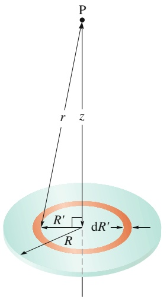

text_image

P
r
z
R'
dR'
R

Abb. 20.11

Eine Kunststoffscheibe vom Radius R ist auf ihrer Oberseite homogen mit der Flächenladungsdichte σ geladen. Wie groß ist das elektrische Potenzial in einem Punkt P auf der Symmetrieachse der Scheibe?

## 20.6 Die Berechnung des elektrischen Felds aus dem elektrischen Potenzial

## Lernziele

Nach dem Durcharbeiten dieses Abschnitts sollten Sie in der Lage sein, . . .

• aus den entlang einer Gerade gegebenen Werten des elektrischen Potenzials das elektrische Feld entlang dieser Gerade zu ermitteln,
• aus dem Graphen des elektrischen Potenzials entlang einer Gerade das elektrische Feld entlang dieser Gerade zu bestimmen,
• in einem homogenen elektrischen Feld die Feldstärke in Beziehung zu Abstand und Potenzialdifferenz von benachbarten Äquipotenziallinien zu setzen,
• die Richtung des elektrischen Felds aus der Richtung abzuleiten, in welcher das Potenzial ab- bzw. zunimmt.

## Schlüsselideen

• Die Komponente des elektrischen Felds $\vec { E }$ in einer beliebigen Richtung ist das Negative der Rate, mit der das Potenzial in dieser Richtung zu- bzw. abnimmt:

$$
E _ {s} = - \frac {\partial V}{\partial s}.
$$

• Die Komponenten von $\vec { E }$ in $x - , y -$ und z-Richtung findet man entsprechend aus

$$
E _ {x} = - \frac {\partial V}{\partial x}, \quad E _ {y} = - \frac {\partial V}{\partial y}, \quad E _ {z} = - \frac {\partial V}{\partial z}.
$$

• Wenn $\vec { E }$ homogen ist, gilt einfach

$$
E = \frac {\Delta V}{\Delta s},
$$

wobei s senkrecht auf den (dann parallelen) Äquipotenzialflächen steht.

• Das elektrische Feld parallel zu einer Äquipotenzialfläche ist immer null.

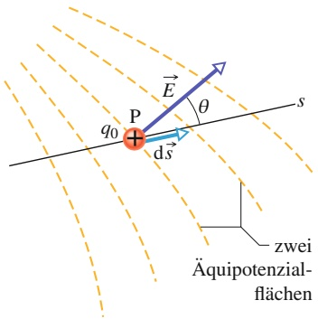

text_image

q0
P
E
θ
d's
s
zwei
Äquipotenzial-
flächen

Abb. 20.12

Ein Probeladung $q _ { 0 }$ bewege sich um eine differenzielle Strecke d⃗s von einer Äquipotenzialfläche auf eine andere. (Der Abstand zwischen den beiden Flächen ist der Deutlichkeit halber stark vergrößert gezeichnet.) Der Verschiebungsvektor d⃗s schließt mit der Richtung des elektrischen Felds $\vec { E }$ einen Winkel θ ein.

## 20.6.1 Die Berechnung des elektrischen Felds aus dem elektrischen Potenzial

In Abschn. 20.2 sahen wir, auf welche Weise man das Potenzial in einem Punkt f ermitteln kann, wenn man das elektrische Feld in jedem Punkt eines Wegs von einem Bezugspunkt i zum Punkt f kennt. Im vorliegenden Abschnitt wollen wir den Weg umgekehrt gehen, das elektrische Feld also aus dem bekannten elektrischen Potenzial bestimmen. Nach Abb. 20.4 ist diese Aufgabe grafisch einfach zu lösen: Kennen wir das Potenzial V in jedem Raumpunkt in der Umgebung einer Ladungsverteilung, so können wir eine Schar von Äquipotenzialflächen zeichnen. Die elektrischen Feldlinien verlaufen nun in jedem Punkt einer jeden Äquipotenzialfläche senkrecht zu dieser und verdeutlichen in ihrer Gesamtheit den räumlichen Verlauf des Felds E⃗. Wir suchen nun das mathematische Äquivalent zu diesem grafischen Verfahren.

Abbildung 20.12 zeigt einen Querschnitt durch eine Schar nahe benachbarter Äquipotenzialflächen; die Potenzialdifferenz zwischen je zwei benachbart liegenden Flächen sei dV. Wie die Abbildung nahelegt, ist das Feld $\vec { E }$ in jedem Punkt P senkrecht zur Äquipotenzialfläche durch diesen Punkt.

Nehmen wir nun an, eine positive Probeladung $q _ { 0 }$ werde um eine differenzielle Strecke d⃗s von einer Fläche auf die unmittelbar benachbarte Fläche verschoben. Nach Gl. 20.7 ist die bei dieser Verschiebung vom Feld an der Ladung verrichtete Arbeit $- q _ { 0 }   \mathsf { d } V .$ Mit Gl. 20.16 sowie unter Beachtung von Abb. 20.12 können wir die von dem Feld verrichtete Arbeit auch durch das Skalarprodukt $( q _ { 0 } \vec { E } )$ ⋅ d⃗s bzw. $q_{0}E(\cos\theta)$ ds ausdrücken. Setzen wir diese beiden Ausdrücke für die Arbeit einander gleich, so erhalten wir

$$
- q _ {0} \mathrm{d} V = q _ {0} E (\cos \theta) \mathrm{d} s \tag {20.36}
$$

oder

$$
E \cos \theta = - \frac {\mathrm{d} V}{\mathrm{d} s}. \tag {20.37}
$$

E cos $\theta$ ist die Komponente des Feldvektors $\vec { E }$ in Richtung von $\mathrm { d } \vec { s } ,$ sodass man Gl. 20.37 auch in der Form

$$
E _ {s} = - \frac {\partial V}{\partial s} \tag {20.38}
$$

schreiben kann. Dabei haben wir E mit einem Index versehen und den Differenzialkoeffizienten als partielle Ableitung geschrieben, um dadurch hervorzuheben, dass Gl. 20.38 lediglich die Änderungen von V entlang einer bestimmten Achse – hier der s-Achse – erfasst und auch nur die Komponente von $\vec { E }$ entlang dieser Achse liefert. Gleichung 20.38 stellt im Wesentlichen die Umkehrung der Aussage von Gl. 20.18 dar und besagt in Worten:

Die Komponente des elektrischen Felds $\vec { E }$ in eine beliebige Raumrichtung ist gleich der negativen Änderungsrate des elektrischen Potenzials mit dem Ort in dieser Raumrichtung.

Nehmen wir als s-Achse jeweils eine der Koordinatenachsen x, y und $z ,$ so ergeben sich die kartesischen Komponenten des elektrischen Felds $\vec { E }$ zu

$$
E _ {x} = - \frac {\partial V}{\partial x}; \quad E _ {y} = - \frac {\partial V}{\partial y}; \quad E _ {z} = - \frac {\partial V}{\partial z}. \tag {20.39}
$$

Kennen wir demnach das Potenzial V in allen Punkten im Raum um eine Ladungsverteilung, kennen wir also die Funktion $V ( x , y , z )$ in diesem Raumbereich, so sind die kartesischen Komponenten des Felds $\vec { E } -$ und damit das Feld selbst – durch die partiellen Ableitungen des Potenzials nach den Koordinaten gegeben.

Für den einfachsten Fall eines homogenen elektrischen Felds $\vec { E }$ wird Gl. 20.38 zu

$$
E = - \frac {\Delta V}{\Delta s}, \tag {20.40}
$$

wobei die Achse s senkrecht zur Schar der $\ddot { \mathrm { A } }$ quipotenzialflächen ist. Die Feldkomponenten in allen zu den Äquipotenzialflächen parallelen Richtungen sind null.

## KONTROLLFRAGE 6

Die Abbildung zeigt drei Paare planparalleler Platten mit dem gleichen Abstand voneinander, die auf den jeweils angegebenen elektrischen Potenzialen liegen. Das elektrische Feld zwischen den Platten ist jeweils homogen und senkrecht zu den Platten. (a) Ordnen Sie die drei Plattenpaare nach dem Betrag des elektrischen Felds. (b) In welchen Fällen ist das elektrische Feld nach rechts gerichtet? (c) Ein Elektron werde in die Mitte zwischen den Platten des Paares (3) gebracht und dort losgelassen. Wird das Elektron an diesem Punkt bleiben, sich mit konstanter Geschwindigkeit nach rechts oder nach links bewegen oder nach rechts oder links beschleunigen?

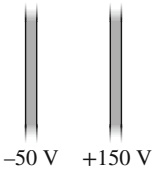

(1)

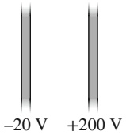

(2)

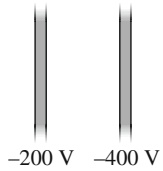

(3)

## 20.7 Die elektrische potenzielle Energie eines Systems von Punktladungen

## Lernziele

Nach dem Durcharbeiten dieses Abschnitts sollten Sie in der Lage sein, . . .

• zu verstehen, warum die gesamte potenzielle Energie eines Systems von geladenen Teilchen gleich der Arbeit ist, die verrichtet wird, wenn die Teilchen aus dem Unendlichen in die betrachtete Anordnung gebracht werden,
• die potenzielle Energie eines Systems von zwei elektrisch geladenen Teilchen zu berechnen,
• zu verstehen, dass die elektrische potenzielle Energie eines Systems von mehr als zwei Ladungen gleich der Summe der potenziellen Energien aller Paare von jeweils zwei Ladungen ist,
• das Prinzip der Energieerhaltung auf ein System elektrisch geladener Teilchen anzuwenden,
• die Fluchtgeschwindigkeit einer Ladung aus einer gegebenen Anordnung von Ladungen zu berechnen, d. h. die kleinste Anfangsgeschwindigkeit, mit der es erst unendlich weit vom restlichen System entfernt zum Stillstand kommt.

## Schlüsselideen

• Die elektrische potenzielle Energie eines Systems aus geladenen Teilchen ist gleich der Arbeit, die benötigt wird, um alle Teilchen aus unendlich großer Entfernung von allen übrigen Teilchen und aus der Ruhe in die betrachtete Anordnung zusammenzubringen. Für zwei Teilchen im Abstand r gilt

$$
U = W = \frac {1}{4 \pi \varepsilon_ {0}} \frac {q _ {1} q _ {2}}{r}.
$$

## 20.7.1 Die elektrische potenzielle Energie eines Systems von Punktladungen

In Abschn. 20.1 haben wir die elektrische potenzielle Energie eines geladenen Teilchens besprochen, an dem eine elektrostatische Kraft Arbeit verrichtet. Wir gingen dabei davon aus, dass die Ladungen, welche die elektrostatische Kraft auf das betrachtete Teilchen ausübten, ortsfest seien, sodass weder die Kraft auf das Teilchen noch das die Kraft vermittelnde elektrische Feld durch die Gegenwart der Probeladung beeinflusst werden konnten. Im vorliegenden Abschnitt nehmen wir einen allgemeineren Standpunkt ein und betrachten die elektrische potenzielle Energie eines Systems von Ladungen in dem elektrischen Feld, das die Ladungen selbst er zeugen.

Als einfaches Beispiel denken wir uns zwei gleichnamig geladene Körper zusammengebracht. Die Arbeit, die man dabei gegen die abstoßende elektrostatische Kraft verrichten muss, wird als elektrische potenzielle Energie des Zweikörper-Systems gespeichert – vorausgesetzt, man bringt die Körper quasistatisch zusammen, also so langsam, dass keine Energie in kinetische Energie umgewandelt wird. Lässt man die beiden Körper danach los, wird die gespeicherte Energie wieder zugänglich und tritt beispielsweise als kinetische Energie der voneinander wegfliegenden Körper in Erscheinung.

Definieren wir nun die elektrische potenzielle Energie eines Systems von Punktladungen, die durch nicht näher spezifizierte Kräfte relativ zueinander in fixen Positionen gehalten werden, wie folgt:

Die elektrische potenzielle Energie eines Systems ortsfester Punktladungen ist gleich der Arbeit, die von außerhalb des Systems aufgebracht werden muss, um die Ladungen aus dem Unendlichen in ihre endlich ausgedehnte Konfiguration zusammenzuführen.

Wir nehmen dabei an, dass die Ladungen sowohl an ihren anfänglichen, unendlich weit voneinander entfernten Orten als auch in ihrer Endkonfiguration unbeweglich sind.

Abbildung 20.13 zeigt zwei Punktladungen $q _ { 1 }$ und $q _ { 2 }$ im Abstand r voneinander. Um die elektrische potenzielle Energie dieses Zweikörper-Systems entsprechend unserer Definition zu bestimmen, stellen wir uns vor, wir setzten das System aus den beiden unendlich weit voneinander entfernten, in Ruhe befindlichen Ladungen zusammen. Bringen wir zunächst die Ladung $q _ { 1 }$ aus dem Unendlichen an ihren Ort, so müssen wir dazu keine Arbeit verrichten, da keine elektrostatische Kraft auf die Ladung $q _ { 1 }$ wirkt. Wenn wir aber nun die zweite Ladung $q _ { 2 }$ aus dem Unendlichen kommend auf ihre Endposition bringen, so müssen wir dazu Arbeit verrichten, da auf die Ladung $q _ { 2 }$ während ihrer Annäherung im Feld der Ladung $q _ { 1 }$ eine elektrostatische Kraft wirkt.

Mit Gl. 20.4 können wir diese Arbeit berechnen, wobei wir die allgemeine Variable $q$ durch $q _ { 2 }$ ersetzen und das Minuszeichen weglassen, um die von außen aufzuwendende Arbeit zu erhalten, nicht die Arbeit des Felds an der Ladung. Diese Arbeit ist dann gleich $q _ { 2 } V ,$ wobei V das Potenzial bezeichnet, das die Ladung $q _ { 1 }$ am jeweiligen Ort der Ladung $q _ { 2 }$ erzeugt. Nach Gl. 20.25 ist dieses Potenzial

$$
V = \frac {1}{4 \pi \varepsilon_ {0}} \frac {q _ {1}}{r}.
$$

Nach unserer Definition erhalten wir schließlich für die elektrostatische potenzielle Energie U des Systems zweier Punktladungen gemäß Abb. 20.13

$$
U = W = q _ {2} V = \frac {1}{4 \pi \varepsilon_ {0}} \frac {q _ {1} q _ {2}}{r}. \tag {20.41}
$$

Haben die beiden Ladungen dasselbe Vorzeichen, so ist die Arbeit, die man gegen ihre elektrostatische Abstoßung verrichten muss, positiv. Wie man aus Gl. 20.41 abliest, ist auch die potenzielle Energie des Systems in diesem Fall positiv. Haben die beiden Ladungen dagegen entgegengesetzte Vorzeichen, so ist eine negative Arbeit gegen die zwischen den Ladungen wirkende, elektrostatische Anziehungskraft zu verrichten, um sie während ihrer quasistatischen Annäherung stets in einer stabilen Entfernung voneinander zu halten. Die elektrische potenzielle Energie des Systems ist dann ebenfalls negativ. Beispielaufgabe 20.6 im Übungsbuch verallgemeinert diese Vorgehensweise auf Systeme aus mehr als zwei Ladungen.

## 20.8 Das Potenzial eines geladenen, isolierten leitenden Körpers

## Lernziele

Nach dem Durcharbeiten dieses Abschnitts sollten Sie in der Lage sein, . . .

zu verstehen, warum eine auf die Oberfläche eines isolierten Leiters (oder mehrerer miteinander verbundener isolierter Leiter) gebrachte zusätzliche Ladung sich gleichmäßig über die Leiteroberfläche verteilt, bis alle Punkte des Leiters dasselbe Potenzial haben,
• Potenzial und elektrisches Feld innerhalb und außerhalb einer isolierten leitfä- higen Kugelschale in Abhängigkeit vom Abstand r vom Mittelpunkt der Kugelschale zu skizzieren,
zu verstehen, dass das elektrische Feld im Inneren einer isolierten leitfähigen Ku gelschale verschwindet und dort überall dasselbe elektrische Potenzial herrscht, während Feld und Potenzial außerhalb der Kugelschale dieselben Werte haben,

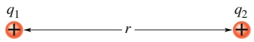

## Abb. 20.13

Zwei positive Ladungen im festen Abstand r.

wie wenn die gesamte Ladung der Kugelschale in ihrem Mittelpunkt konzentriert wäre,

zu verstehen, weshalb für eine isolierte zylindrische leitfähige Schale das Feld im Inneren verschwindet (also überall dasselbe Potenzial herrscht) und warum in ihrem Außenbereich Feld und Potenzial so aussehen wie bei einer homogen geladenen Linie entlang der Längsachse des Zylinders.

## Schlüsselideen

• Eine Überschussladung, die man auf einen elektrischen Leiter aufbringt, wird sich im Gleichgewicht vollständig homogen über die äußere Oberfläche des Leiters ausbreiten.
• Der gesamte Leiter, einschließlich aller Punkte in seinem Inneren, ist auf demselben Potenzial.
• Bringt man einen isolierten Leiter in ein äußeres elektrisches Feld, dann verteilen sich die Leitungselektronen so, dass das von ihnen erzeugte Feld gerade das äußere Feld aufhebt, das sich sonst an dieser Stelle befinden würde.
• Das elektrische Feld steht immer senkrecht auf der Oberfläche eines Leiters.

## 20.8.1 Das Potenzial eines geladenen, isolierten leitenden Körpers

Wir haben in Abschn. 19.3 gesehen, dass für alle Punkte innerhalb eines isolier ten Leiters $\vec { E } = 0$ gilt. Mithilfe des Gaußschen Satzes konnten wir dann zeigen, dass sich eine Überschussladung auf einem isolierten Leiter vollständig auf des sen Oberfläche befindet. (Dies trifft auch dann zu, wenn der leitende Körper einen Hohlraum in seinem Inneren enthält.) Wir wollen hier mithilfe der ersten Aussage eine Erweiterung der zweiten Aussage beweisen:

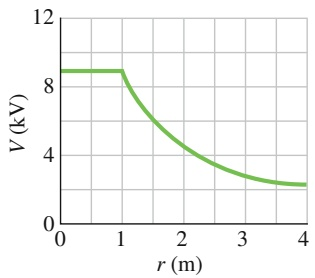

line

| r (m) | V (kV) |
| --- | --- |
| 0 | ~9 |
| 1 | ~9 |
| 2 | ~4.5 |
| 3 | ~3 |
| 4 | ~2.5 |

(a)

Eine Überschussladung auf einem isolierten Leiter verteilt sich so über dessen Oberfläche, dass sämtliche Punkte des Leiters – seien sie auf der Oberfläche des Körpers oder auch in seinem Inneren gelegen – auf das gleiche elektrische Potenzial gebracht werden. Diese Aussage gilt auch dann, wenn der Körper einen Hohlraum enthält, und sogar dann, wenn sich in diesem Hohlraum eine nicht kompensierte Ladung befindet.

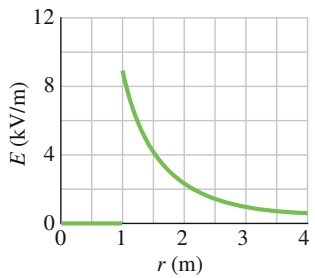

line

| r (m) | E (kV/m) |
| --- | --- |
| 0 | 0 |
| 1 | ~8.7 |
| 2 | ~2.5 |
| 3 | ~1.2 |
| 4 | ~0.6 |

(b)

Der Beweis dieses Satzes folgt unmittelbar aus Gl. 20.18, also

$$
V _ {\mathrm{f}} - V _ {\mathrm{i}} = - \int_ {\mathrm{i}} ^ {\mathrm{f}} \vec {E} \cdot \mathrm{d} \vec {s}.
$$

Da für alle Punkte innerhalb eines Leiters $\vec { E } = 0$ gilt, folgt für alle möglichen Paare von Punkten i und f innerhalb des Leiters unmittelbar $V _ { \mathrm { f } } = V _ { \mathrm { i } } .$

Abbildung 20.14a zeigt die Abhängigkeit des elektrischen Potenzials von der Entfernung zum Mittelpunkt einer isolierten, leitenden Kugelschale mit dem Radius 1,0 m und der Ladung $1 { , } 0   \mu \mathrm { C } .$ In Punkten außerhalb der Kugelschale können wir V(r) mittels Gl. 20.25 berechnen, da die Ladung q nach dem Kugelschalentheorem von äußeren Punkten aus betrachtet so erscheint, als wäre sie im Mittelpunkt der Kugelschale konzentriert. Diese Gleichung gilt bis direkt an die Oberfläche der Kugelschale. Stellen wir uns nun vor, wir bewegten eine Probeladung langsam durch die Schale hindurch – beispielsweise durch ein vernachlässigbar kleines Loch – zum Zentrum der Schale. Auf diesem Weg der Probeladung wird keine äußere $\mathrm { A r } -$ beit verrichtet, da die elektrostatische Kraft auf die Ladung null ist, sobald sie sich innerhalb der Kugelschale befindet. Deshalb hat das elektrische Potenzial in allen Punkten innerhalb der Kugelschale den gleichen Wert wie auf deren Oberfläche, wie man es auch dem Verlauf der Kurve in Abb. 20.14a entnimmt.

Abb. 20.14 (a) Verlauf des elektrischen Potenzials $V ( r )$ innerhalb und außerhalb einer geladenen Kugelschale mit dem Radius 1,0 m. (b) Verlauf der elektrischen Feldstärke $E ( r )$ für dieselbe Kugelschale.

natural_image

Red taxi parked at night with illuminated streetlights and a building in the background (no visible text or symbols)

## Abb. 20.15

Der Funke einer elektrischen Entladung springt in einer Hochspannungshalle auf die Karosserie eines Autos über. Die Person im Wageninneren bleibt dabei unversehrt [Quelle: Sunzi safari/CC-SA-3.0].

Abbildung 20.14b zeigt den Verlauf der elektrischen Feldstärke als Funktion des Abstands vom Mittelpunkt derselben Kugelschale. Beachten Sie, dass in jedem Punkt innerhalb der Kugelschale $E = 0$ gilt. Die Kurve in Abb. 20.14b ergibt sich nach Gl. 20.38 als Ableitung der Kurve in Abb. 20.14a nach der Variable r. (Denken Sie daran, dass die Ableitung einer konstanten Größe null ist!) Umgekehrt erhält man die Kurve in Abb. 20.14a nach Gl. 20.19 aus der Kurve in Abb. 20.14b durch Integration über die Variable r.

Auf nicht kugelsymmetrischen, leitenden Körpern verteilt sich eine Überschussladung nicht gleichmäßig über die Oberfläche. An scharfen Ecken und Kanten kann die Flächenladungsdichte – und damit auch das zu ihr proportionale elektrische Feld – sehr hohe Werte erreichen. Die Feldstärke in der Nähe solcher Punkte kann so hoch sein, dass die umgebende Luft ionisiert wird und eine Koronaentladung entsteht. Golfer, Bergsteiger und Segler kennen dieses Phänomen, das sich an spitz verlaufenden Büschen, Felsnasen oder Mastspitzen zeigt, wenn ein Gewitter im Anzug ist. Solche Koronaentladungen sind – ebenso wie Haare, die zu Berge stehen – oft Vorboten eines Blitzeinschlags. Unter solchen Bedingungen ist es ratsam, sich wenn möglich in eine elektrisch leitende Umhüllung zurückzuziehen, wo das elektrische Feld – wie wir gelernt haben – garantiert null ist. Ein Auto – es sei denn, es hätte eine Plastikkarosserie oder es handelte sich um ein Cabrio – ist zu diesem Zweck geradezu ideal (Abb. 20.15).

Bringt man einen isolierten, leitenden Körper in ein äußeres elektrisches Feld (Abb. 20.16), so nehmen alle Punkte des Körpers das gleiche elektrische Potenzial an, unabhängig davon, ob der Körper eine Überschussladung trägt oder nicht. Die freien Elektronen des Leiters verteilen sich so auf seiner Oberfläche, dass ihr elektrisches Feld das äußere elektrische Feld an jedem Punkt im Inneren des Körpers kompensiert. Die Verteilung der Elektronen bewirkt ebenfalls, dass das elektrische Feld an jedem Punkt der Oberfläche senkrecht zu dieser ist. Könnte man den Körper aus Abb. 20.16 entfernen und dabei die Oberflächenladungen unverändert an ihren Plätzen belassen, so bliebe das elektrische Feld sowohl innerhalb wie auch außerhalb der entstandenen Ladungshülle davon vollständig unbeeinflusst.

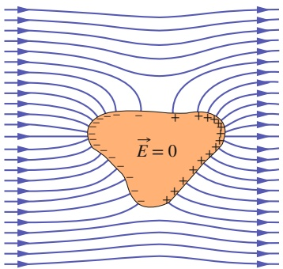

text_image

E = 0

## Abb. 20.16

Ein ungeladener, elektrisch leitender Körper hängt frei in einem äußeren elektrischen Feld. Die frei beweglichen Elektronen im Leiter ordnen sich in der dargestellten Weise an der Oberfläche des Körpers an und bringen dadurch das effektive elektrische Feld im Inneren des Körpers zum Verschwinden. Die Feldlinien des äußeren Felds enden in jedem Punkt senkrecht auf der Oberfläche des Körpers.

## 20.9 Zusammenfassung

**Elektrisches Potenzial** Das elektrische Potenzial V an einem Punkt P im elektrischen Feld eines geladenen Objekts ist

$$
V = - \frac {W _ {\infty}}{q _ {0}} = \frac {U}{q _ {0}}. \tag {20.2}
$$

$W _ { \infty }$ ist die Arbeit, welche die elektrische Kraft an einem positiv geladenen Testteilchen verrichten müsste, um es aus dem Unendlichen an den Punkt P zu bringen, und U die potenzielle Energie des Systems Testteilchen–Objekt.

Die SI-Einheit des Potenzials ist das Volt: 1 Volt = 1 Joule pro Coulomb.

**Elektrische potenzielle Energie** Wenn ein Teilchen der Ladung q an einen Punkt gebracht wird, an dem das elektrische Potenzial eines geladenen Objekts den Wert V hat, dann beträgt die elektrische potenzielle Energie des Systems Teilchen–Objekt

$$
U = q V. \tag {20.3}
$$

Wenn sich das Teilchen durch eine Potenzialdifferenz $\Delta V$ bewegt, ändert sich die elektrische potenzielle Energie um

$$
\Delta U = q \Delta V = q (V _ {\mathrm{f}} - V _ {\mathrm{i}}). \tag {20.4}
$$

Darin bezeichnet W die Arbeit, welche die elektrostatische Kraft im elektrischen Feld an der Ladung längs ihres Wegs von i nach f verrichtet.

**Mechanische Energie** Wenn sich ein Teilchen der Ladung q ohne Einwirkung einer äußeren Kraft durch eine Potenzialdifferenz ΔV bewegt, ist die Änderung seiner kinetischen Energie aufgrund der Erhaltung der mechanischen Energie

$$
\Delta K = - q \Delta V. \tag {20.9}
$$

Wenn bei diesem Prozess eine äußere Kraft auf das Teilchen wirkt und an ihm die Arbeit $W _ { \mathrm { e x t } }$ verrichtet, ist die Änderung seiner kinetischen Energie

$$
\Delta K = - q \Delta V + W _ {\mathrm{ext}}. \tag {20.11}
$$

In dem Sonderfall $\Delta K = 0$ bewirkt die äußere Kraft nur die Bewegung des Teilchens durch die Potenzialdifferenz:

$$
W _ {\mathrm{ext}} = q \Delta V \quad (\text {fur} K _ {\mathrm{i}} = K _ {\mathrm{f}}). \tag {20.12}
$$

**Äquipotenzialflächen** Alle Punkte einer Äquipotenzialfläche haben das gleiche elektrische Potenzial. Die Arbeit, die das elektrische Feld an einer Probeladung verrichtet, wenn sie von einer Äquipotenzialfläche auf eine andere gebracht wird, hängt weder von der Wahl der Ausgangs- und Endpunkte auf den beiden Flächen ab noch von dem Weg, der Anfangs- und Endpunkt miteinander verbindet. Ein elektrisches Feld steht in jedem Punkt senkrecht auf seinen Äquipotenzialflächen.

Berechnung des Potenzials V aus dem Feld $\vec { E }$ Die elektrische Potenzialdifferenz zwischen zwei Punkten i und f ist gegeben durch

$$
V _ {\mathrm{f}} - V _ {\mathrm{i}} = - \int_ {\mathrm{i}} ^ {\mathrm{f}} \vec {E} \cdot \mathrm{d} \vec {s}, \tag {20.18}
$$

wobei die Integration entlang eines beliebigen Wegs ausgeführt wird, der die beiden Punkte miteinander verbindet. Wählen wir $V _ { \mathrm { i } } = 0 ,$ so ergibt sich das Potenzial in dem Punkt f zu

$$
V = - \int_ {\mathrm{i}} ^ {\mathrm{f}} \vec {E} \cdot \mathrm{d} \vec {s}. \tag {20.19}
$$

Im Sonderfall eines homogenen Felds mit der Feldstärke E beträgt die Potenzialdifferenz zwischen zwei benachbarten (parallelen) Äquipotenzialflächen in einem Abstand Δx voneinander

$$
\Delta V = - E \Delta x. \tag {20.20}
$$

**Potenzial einer oder mehrerer Punktladungen** Das von einer einzelnen Punktladung im Abstand r von der Ladung erzeugte elektrische Potenzial ist gegeben durch

$$
V = \frac {1}{4 \pi \varepsilon_ {0}} \frac {q}{r}. \tag {20.25}
$$

V hat das gleiche Vorzeichen wie $q .$ Das von einer Anordnung mehrerer Punktladungen erzeugte elektrische Potenzial ist

$$
V = \sum_ {i = 1} ^ {n} V _ {i} = \frac {1}{4 \pi \varepsilon_ {0}} \sum_ {i = 1} ^ {n} \frac {q _ {i}}{r _ {i}}. \tag {20.26}
$$

**Potenzial eines elektrischen Dipols** Das elektrische Potenzial im Abstand r von einem elektrischen Dipol mit dem Dipolmoment $p   =   q d$ ist für Abstände $r \gg d$ gegeben durch

$$
V = \frac {1}{4 \pi \varepsilon_ {0}} \frac {p \cos \theta}{r ^ {2}}. \tag {20.28}
$$

Der Winkel θ wird in Abb. 20.8 definiert.

**Potenzial einer kontinuierlichen Ladungsverteilung** Für eine kontinuierliche Ladungsverteilung wird die Summe in Gl. 20.26 zu dem Integral

$$
V = \frac {1}{4 \pi \varepsilon_ {0}} \int \frac {\mathrm{d} q}{r} \tag {20.30}
$$

über die gesamte Ladungsverteilung.

Berechnung des Felds $\vec { E }$ aus dem Potenzial V Die Feldkomponente $E _ { s }$ in eine beliebige Richtung s ist gleich dem Negativen der Änderungsrate des elektrischen Potenzials mit der Entfernung in diese Richtung:

$$
E _ {s} = - \frac {\partial V}{\partial s}. \tag {20.38}
$$

Die kartesischen Komponenten von $\vec { E }$ sind demnach gegeben durch

$$
E _ {x} = - \frac {\partial V}{\partial x}, \quad E _ {y} = - \frac {\partial V}{\partial y}, \quad E _ {z} = - \frac {\partial V}{\partial z}. \tag {20.39}
$$

Für ein homogenes Feld vereinfacht sich Gl. 20.38 zu

$$
E = - \frac {\Delta V}{\Delta s}, \tag {20.40}
$$

wenn die Richtung s senkrecht zu den Äquipotenzialflä- chen ist. Die Komponente des elektrischen Felds in jede Richtung parallel zu einer Äquipotenzialfläche ist null.

**Elektrische potenzielle Energie eines Systems von Punktladungen** Die elektrische potenzielle Energie eines Systems von Punktladungen ist gleich der Arbeit, die erforderlich ist, um sämtliche Teilladungen aus dem Unendlichen quasistatisch zu der gegebenen Ladungskonfiguration zusammenzuführen. Insbesondere ist die potenzielle Energie eines Systems aus zwei Punktladungen im Abstand r voneinander

$$
U = W = \frac {1}{4 \pi \varepsilon_ {0}} \frac {q _ {1} q _ {2}}{r}. \tag {20.41}
$$

## 20.10 Fragen

**1.** Abbildung 20.F1 zeigt drei Wege, auf welchen man die positiv geladene Kugel A näher an die ebenfalls positiv geladene, ortsfeste Kugel B heranbringen kann. (a) Bewegt sich die Kugel A dabei auf ein höheres oder niedrigeres elektrisches Potenzial? Ist die Arbeit (b) der (äußeren) Kraft, mit der man die Kugel hält, oder (c) der elektrostatischen Kraft im Feld der Kugel B auf den Wegen jeweils positiv, negativ oder null? (d) Ordnen Sie die drei Fälle nach der Größe der von außen verrichteten Arbeit.

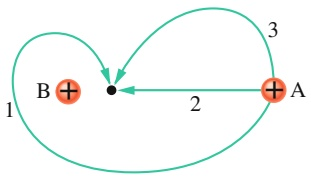

flowchart

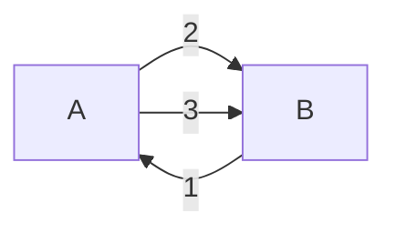

Abb. 20.F1

**2.** Abbildung 20.F2 zeigt vier Paare geladener Teilchen. Der Referenzwert des Potenzials sei $V = 0$ im Unendlichen. Für welche der Paare gibt es (neben dem Unendlichen) einen weiteren Punkt mit dem elektrischen Potenzial null, der auf der Verbindungsachse der Teilchen (a) zwischen ihnen oder (b) rechts von beiden liegt? (c) Ist das effektive elektrische Feld der beiden Teilchen in diesen Punkten – sollten sie denn existieren – null? (d) Gibt es darüber hinaus auch Punkte mit $V = 0 ,$ die nicht auf den Verbindungsachsen der Teilchen liegen (und natürlich auch nicht im Unendlichen)?

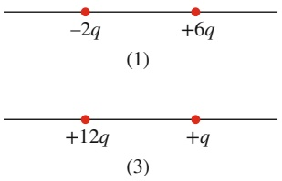

text_image

-2q
+6q
(1)
+12q
+
(q)
(3)

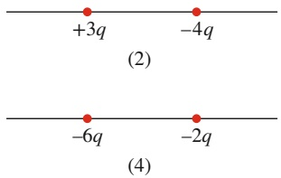

text_image

+3q
-4q
(2)
-6q
-2q
(4)

Abb. 20.F2

Fragen 2 und 8.

**3.** Abbildung 20.F3 zeigt eine quadratische Anordnung geladener Teilchen. Der Abstand benachbarter Teilchen sei d. Wie groß ist das von den Ladungen der Teilchen im zentralen Punkt P erzeugte elektrische Potenzial, wenn man

**Potenzial eines geladenen leitenden Körpers** Bringt man eine Überschussladung auf einen leitenden Körper, so verteilt sich die Ladung im Gleichgewicht ausschließlich über die äußere Oberfläche des Körpers. Die Ladungsverteilung ist dabei so beschaffen, dass sich der gesamte Körper, einschließlich der Punkte im Inneren, auf dem gleichen elektrischen Potenzial befindet.

als Referenzwert des Potenzials $V = 0$ im Unendlichen annimmt?

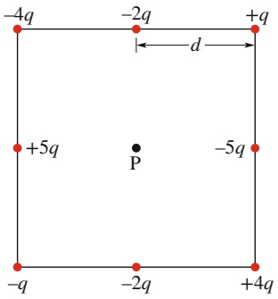

text_image

-4q
-2q
+q
d
+5q
P
-5q
-q
-2q
+4q

Abb. 20.F3

**4.** Abbildung 20.F4 zeigt vier verschiedene Anordnungen geladener Teilchen, wobei der Abstand aller Teilchen vom Koordinatenursprung gleich sei. Ordnen Sie die Ladungskonfigurationen nach dem jeweils im Ursprung erzeugten resultierenden elektrischen Potenzial (mit Vorzeichen). Der Referenzwert des Potenzials im Unendlichen sei $V = 0$

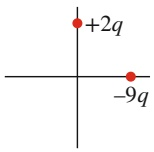

(a)

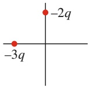

(b)

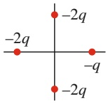

(c)

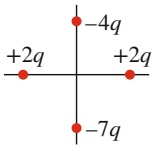

(d)

Abb. 20.F4

**5.** (a) Welches Potenzial erzeugt die Ladung Q an Punkt P im Abstand R in Abb. 20.F5a? Es sei $V = 0$ im Unendlichen. (b) Wie in Abb. 20.F5b dargestellt, soll die gleiche Ladung Q gleichmäßig über einen Kreisbogen mit dem Radius R und einem Öffnungswinkel von $4 0 ^ { \circ }$ verteilt sein. Wie groß ist das Potenzial im Krümmungsmittelpunkt P des Kreisbogens? (c) Nun sei die gleiche Ladung $Q ,$ wie in Abb. 20.F5c dargestellt, gleichmäßig über einen Kreis mit dem Radius R verteilt. Wie groß ist nun das Potenzial im Mittelpunkt P des Kreises? (d) Ordnen Sie die drei Fälle nach dem Betrag des im Punkt P jeweils erzeugten elektrischen Felds.

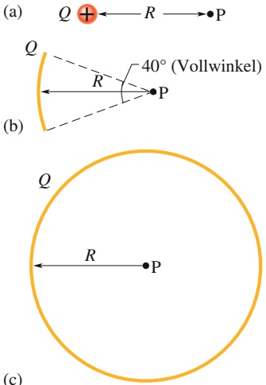

Abb. 20.F5

**6.** In Abb. 20.F6 sind drei Scharen von Querschnitten durch Äquipotenzialflächen dargestellt, die jeweils den gleichen Raumbereich überdecken. (a) Ordnen Sie die drei Fälle nach dem Betrag des elektrischen Felds in diesem Raumbereich. (b) In welchem Fall ist das elektrische Feld in der Papierebene nach unten gerichtet?

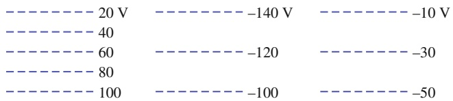

text_image

---- 20 V   ---- -140 V   ---- -10 V
---- 40
---- 60   ---- -120   ---- -30
---- 80
---- 100   ---- -100   ---- -50

(1)

(2)

(3)

## Abb. 20.F6

**7.** In Abb. 20.F7 ist der Verlauf eines elektrischen Potenzials V mit einer Ortskoordinate x dargestellt. (a) Ordnen sie die fünf eingezeichneten Bereiche der Koordinate x nach der jeweiligen Größe der x-Komponente des elektrischen Felds. Welche Richtung hat das elektrische Feld parallel zur x-Achse (b) im Bereich 2, (c) im Bereich 4?

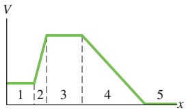

line

| X | V |
| --- | --- |
| 1 | Constant |
| 2 | Increasing |
| 3 | Constant |
| 4 | Decreasing |
| 5 | Constant |

Abb. 20.F7

**8.** Abbildung 20.F2 zeigt vier Paare geladener Teilchen mit jeweils gleichen Abständen. (a) Ordnen Sie die vier Fälle nach ihrer elektrischen potenziellen Energie (mit Vorzeichen). (b) Wird die potenzielle Energie der Paare jeweils größer oder kleiner, wenn man den Abstand zwischen den Teilchen vergrößert?
**9.** Abbildung 20.F9 zeigt eine Anordnung dreier geladener Teilchen. Sind die folgenden Größen positiv, negativ oder null, wenn man die Probeladung +q vom Punkt A zum Punkt D bewegt: (a) die Änderung der elektrischen potenziellen Energie des Dreiteilchen-Systems, (b) die von der resultierenden elektrostatischen Kraft auf die Probeladung verrichtete Arbeit, (c) die von der äußeren Kraft auf die Probeladung verrichtete Arbeit? (d) Wie lauten die Antworten auf die Fragen (a) bis (c), wenn die Probeladung vom Punkt B zum Punkt C bewegt wird?

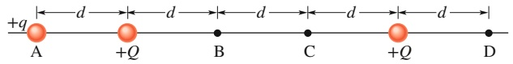

text_image

+q
A +Q B C +Q D

Abb. 20.F9

Fragen 9 und 10.

**10.** Betrachten Sie dieselbe Anordnung wie in Frage 9. Ist die von der äußeren Kraft an der Probeladung verrichtete Arbeit positiv, negativ oder null, falls die Probeladung (a) von A nach B, (b) von A nach C, (c) von B nach D verschoben wird? (d) Ordnen Sie die Verschiebungen (a) bis (c) nach dem Betrag der von der äußeren Kraft an der Probeladung verrichteten Arbeit.
**11.** Abbildung 20.F11 zeigt einen dünnen, homogen geladenen Stab, neben dem in einem Abstand d von dem Stab drei Punkte markiert sind. Ordnen Sie die Punkte in absteigender Reihenfolge nach dem Betrag des dort von dem Stab erzeugten elektrischen Potenzials.

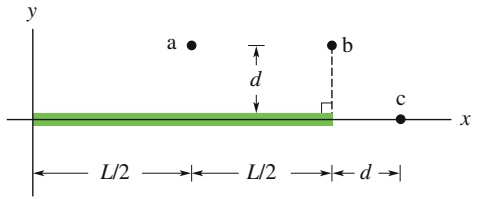

text_image

y
a
b
d
c
x
L/2
L/2
d

Abb. 20.F11

**12.** In Abb. 20.F12 wird ein Teilchen (rot) am Punkt A aus der Ruhe losgelassen, woraufhin es durch ein elektrisches Feld in Richtung von Punkt B beschleunigt wird. Die Potenzialdifferenz zwischen den Punkten A und B beträgt 100 V. Welcher der beiden Punkte hat das höhere Potenzial, wenn das Teilchen (a) ein Elektron, (b) ein Proton und (c) ein Alpha-Teilchen (ein Heliumkern mit je zwei Proto nen und Neutronen) ist? (d) Ordnen Sie die drei Möglich keiten (a) bis (c) in absteigender Reihenfolge nach der kinetischen Energie der Teilchen an Punkt B.

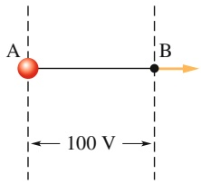

text_image

A
B
100 V

Abb. 20.F12