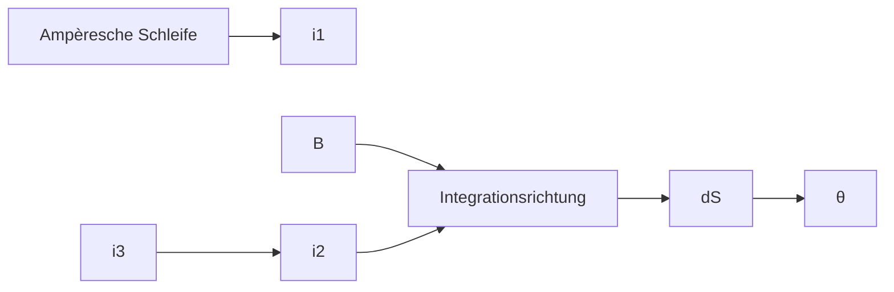
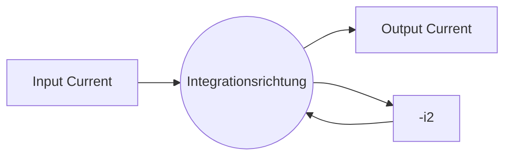

natural_image

Close-up of a wooden rod stirring a large, swirling liquid (no text or symbols visible)

Abb. 25.3

Die Eisenfeilspäne auf der blauen Fläche ordnen sich in konzentrischen Kreisen an, wenn ein Strom durch den Draht in der Mitte fließt. Sie folgen damit den magnetischen Feldlinien, die der Strom erzeugt [Quelle: Richard Megna/Fundamental Photographs].

und in Abb. 25.3 an einem realen Beispiel durch Eisenfeilspäne sichtbar gemacht ist. Der zunehmende Abstand zwischen den Feldlinien in Abb. 25.2 mit wachsendem Abstand von dem Leiter zeigt die 1∕R-Abhängigkeit des Felds, die von Gl. 25.6 vorhergesagt wird. Auch die Längen der beiden eingezeichneten Vektoren B⃗ zeigen diese Abnahme der Feldstärke.

Um die Richtung des Magnetfelds zu bestimmen, das von einem Strom-Längen-Element erzeugt wird, greifen wir auf eine einfache Rechte-Hand-Regel zurück:

**Rechte-Hand-Regel** für das Magnetfeld eines Leiters: Wir greifen das Strom-Längen-Element mit unserer rechten Hand, sodass der Daumen in Stromrichtung zeigt. Unsere Finger zeigen dann automatisch in die Richtung des von diesem Strom erzeugten Magnetfelds.

Die Anwendung dieser Rechte-Hand-Regel auf die Situation aus Abb. 25.2 (Strom in einem langen geraden Draht) ist in Abb. 25.4 zu sehen. Um die Richtung des von dem Strom erzeugten Magnetfelds B⃗ zu bestimmen, legen wir in Gedanken unsere rechte Hand so um den Leiter, dass der Daumen in Stromrichtung zeigt; die gekrümmten Finger zeigen dann die Richtung des Felds an. In der Ansicht aus Abb. 25.2 liegt das Feld $\vec { B }$ an jedem Punkt tangential an den magnetischen Feldlinien an; in der Ansicht aus Abb. 25.4 steht es senkrecht auf der radialen Verbindungslinie zwischen dem betrachteten Punkt und dem Strom.

## Der Beweis von Gleichung 25.6

Zur Illustration der Aufgabe, die wir uns nun vorgenommen haben, betrachten wir Abb. 25.5, die weitgehend Abb. 25.1b entspricht, nur dass der Leiter jetzt gerade und unendlich lang ist: Wir suchen das Feld $\vec { B }$ an einem Punkt P im Abstand R von dem Leiter. Die differenzielle Feldstärke dB, die durch das differenzielle Strom-Längen-Element i ds am Punkt P erzeugt wird, ist gleich

$$
\mathrm{d} B = \frac {\mu_ {0}}{4 \pi} \frac {i \mathrm{d} s \sin \theta}{r ^ {2}}.
$$

Die Richtung von d $\vec { B }$ in Abb. 25.5 ist die des Vektors d⃗s $\times \vec { r } ,$ d. h. senkrecht in die Papierebene hinein.

An jedem Punkt P haben die Beiträge aller Strom-Längen-Elemente des Leiters dieselbe Richtung. Zur Berechnung der Feldstärke, die von allen Strom-Längen-Elementen in der oberen Hälfte des Leiters am Punkt P hervorgerufen wird, müssen wir daher nur Gl. 25.3 von null bis unendlich integrieren.

Nun betrachten wir ein Strom-Längen-Element in der unteren Hälfte des Leiters in Abb. 25.5, das ebenso weit unterhalb von P liegen soll wie d⃗s oberhalb von P.

text_image

B
i

(a)

text_image

B
i

(b)

## Abb. 25.4

Die Rechte-Hand-Regel zur Bestimmung der Richtung des Magnetfelds eines Stroms. (a) Die Situation aus Abb. 25.2 von der Seite gesehen. Das Magnetfeld an einem Punkt links von dem stromführenden Leiter steht senkrecht auf der gestrichelten radialen Linie und zeigt in die Papierebene hinein, in Richtung der Fingerspitzen (durch das × angedeutet). (b) Wenn sich die Stromrichtung umkehrt, ist $\vec { B }$ an demselben Punkt immer noch senkrecht zu der gestrichelten Linie, zeigt nun aber aus der Papierebene heraus (durch den • angedeutet).

text_image

d⃗
s
i
θ
r
R
P
d⃗B

## Abb. 25.5

Die Berechnung des Magnetfelds eines Stroms i in einem langen geraden Leiter. Das von dem Strom-Längen-Element i d⃗s am Punkt P hervorgerufene Feld dB⃗ zeigt in die Papierebene hinein.

Nach Gl. 25.5 besitzt das Magnetfeld dieses Strom-Längen-Elements am Punkt P denselben Betrag und dieselbe Richtung wie das von i d⃗s hervorgerufene. Mit der gleichen Argumentation können wir zeigen, dass die gesamte untere Hälfte des Leiters genau dasselbe Magnetfeld an P erzeugt wie die obere Hälfte. Um das gesamte Magnetfeld zu bekommen, müssen wir daher nur das Resultat unserer Integration mit dem Faktor zwei multiplizieren:

$$
B = 2 \int_ {0} ^ {\infty} \mathrm{d} B = \frac {\mu_ {0} i}{2 \pi} \int_ {0} ^ {\infty} \frac {\sin \theta \mathrm{d} s}{r ^ {2}}. \tag {25.7}
$$

Die Variablen $\theta ,$ s und r in dieser Gleichung sind nicht unabhängig; sie sind durch

$$
r = \sqrt {s ^ {2} + R ^ {2}}
$$

und

$$
\sin \theta = \sin (\pi - \theta) = \frac {R}{\sqrt {s ^ {2} + R ^ {2}}}
$$

miteinander verknüpft. Mit diesen Substitutionen und Integral 19 aus Anhang D bekommen wir aus Gl. 25.7

$$
B = \frac {\mu_ {0} i}{2 \pi} \int_ {0} ^ {\infty} \frac {R \mathrm{d} s}{(s ^ {2} + R ^ {2}) ^ {3 / 2}} = \frac {\mu_ {0} i}{2 \pi R} \left[ \frac {s}{(s ^ {2} + R ^ {2}) ^ {1 / 2}} \right] _ {0} ^ {\infty} = \frac {\mu_ {0} i}{2 \pi R}. \tag {25.8}
$$

Damit haben wir genau die Gleichung erhalten, die wir beweisen wollten. Das Magnetfeld, das nur von der unteren bzw. nur von der oberen Hälfte des unendlich langen Leiters in Abb. 25.5 erzeugt wird, entspricht genau der Hälfte dieses Werts, also:

$$
B _ {\mathrm{o/u}} = \frac {\mu_ {0} i}{4 \pi R}. \tag {25.9}
$$

## Das Magnetfeld eines Stroms in einem Kreisbogen

(a)

(b)

(c)

Abb. 25.6

(a) Ein Leiter in Form eines Kreisbogens um ein Zentrum Z führt einen Strom i. (b) Der Winkel zwischen d⃗s und ⃗r ist an allen Punkten auf dem Kreisbogen 90°. (c) Die Bestimmung der Feldrichtung im Zentrum Z aufgrund des Stroms im Kreisbogen: Das Feld zeigt aus der Papierebene heraus in Richtung der Fingerspitzen, wie durch den grü- nen Punkt am Punkt Z angedeutet.

Um das Magnetfeld eines Stroms in einem gebogenen Leiter zu berechnen, verwenden wir wieder Gl. 25.3 für den Beitrag eines einzelnen Strom-Längen-Elements und integrieren dann, um das Gesamtfeld aus den Beiträgen aller Strom-Längen-Elemente zu ermitteln. Je nach der genauen Form des Leiters kann diese Integration recht schwierig werden; einfach wird sie dann, wenn der Leiter die Form eines Kreisbogens hat und wir uns nur für das Feld in seinem Krümmungsmittelpunkt interessieren.

Abbildung 25.6a zeigt einen derartigen Leiter mit dem Winkel $\varphi$ um das Zen trum Z und einem Radius $R ,$ in dem ein Strom i fließt. Am Punkt Z erzeugt jedes Strom-Längen-Element i d⃗s des Leiters eine Feldstärke dB gemäß Gl. 25.3. Wie Abb. 25.6b zeigt, ist der Winkel θ zwischen den Vektoren d⃗s und ⃗r immer 90°, egal wo sich das Längenelement d⃗s auf dem Kreisbogen befindet; außerdem ist stets $r = R$ . Wir setzen in Gl. 25.3 $r = R$ und $\theta = 9 0 ^ { \circ }$ ein und erhalten so

$$
\mathrm{d} B = \frac {\mu_ {0}}{4 \pi} \frac {i \mathrm{d} s \sin 9 0 ^ {\circ}}{R ^ {2}} = \frac {\mu_ {0}}{4 \pi} \frac {i \mathrm{d} s}{R ^ {2}}. \tag {25.10}
$$

Dies ist die magnetische Feldstärke am Punkt Z aufgrund eines einzelnen Strom-Längen-Elements des Kreisbogens.

Die Anwendung der Rechte-Hand-Regel an einem beliebigen Punkt des Kreis bogens (wie in Abb. 25.6c) zeigt, dass alle differenziellen Felder am Punkt Z in dieselbe Richtung zeigen – in diesem Fall senkrecht aus der Papierebene heraus. Also ist das Gesamtfeld bei $Z$ einfach die Summe bzw. das Integral der Beiträge $\mathrm { d } \vec { B }$ aller Strom-Längen-Elemente. Um die Integrationsvariable zu wechseln, verwenden wir die Identität $\mathrm { d } s = R   \mathrm { d } \varphi$ und erhalten aus Gl. 25.10

$$
B = \int \mathrm{d} B = \int_ {0} ^ {\varphi} \frac {\mu_ {0}}{4 \pi} \frac {i R \mathrm{d} \varphi}{R ^ {2}} = \frac {\mu_ {0} i}{4 \pi R} \int_ {0} ^ {\varphi} \mathrm{d} \varphi .
$$

Die Integration ergibt

$$
B = \frac {\mu_ {0} i \varphi}{4 \pi R} \quad (\text {im Zentrum eines Kreisbogens}). \tag {25.11}
$$

Diese Gleichung gilt nur für das Feld im Krümmungszentrum eines stromführenden Kreisbogens. Beim Einsetzen von Werten in die Gleichung müssen wir darauf achten, 𝜑 im Bogenmaß und nicht in Winkelgrad anzugeben. Zum Beispiel setzen wir für einen Vollkreis $\varphi = 2 \pi$ in Gl. 25.11 ein und erhalten für das Feld in der Mitte eines kreisförmigen Stroms:

$$
B = \frac {\mu_ {0} i 2 \pi}{4 \pi R} = \frac {\mu_ {0} i}{2 R} \quad (\text {im Zentrum eines Vollkreises}). \tag {25.12}
$$

## KONTROLLFRAGE 1

Die Abbildung zeigt drei Stromkreise aus konzentrischen Kreisbögen (Halb- oder Viertelkreise mit den Radien $r ,$ 2r oder 3r) und radialen Abschnitten. In den drei Stromkreisen fließt der gleiche Strom. Ordnen Sie sie in absteigender Reihenfolge nach dem Betrag des Magnetfelds im Zentrum der Kreisbögen.

(a)

(b)

(c)

## LÖSUNGSSTRATEGIEN

**Strategie 1: Rechte-Hand-Regeln** Um Klarheit über die bisher verwendeten Rechte-Hand-Regeln zu bekommen, wollen wir sie kurz gegenüberstellen.

**Rechte-Hand-Regel für Vektorprodukte** Diese Regel hilft dabei, die Richtung eines Vektorprodukts zu bestimmen (vgl. Abb. 6.5c, Abb. 24.2 und Anhang D). Dazu umfassen wir die beiden Vektoren so, dass wir den ersten Vektor mit den Fingern auf den zweiten schieben können (über den kleineren der beiden von den Vektoren eingeschlossenen Winkel). Der ausgestreckte Daumen zeigt dabei in die Richtung des Vektorprodukts der beiden Vektoren. Diese Regel hatten wir in Kapitel 7 verwendet, um die Richtung von Drehmoment- und Drehimpulsvektoren zu bestimmen. In Kapitel 24 haben wir damit die Richtung der Kraft auf einen stromdurchflossenen Leiter in einem Magnetfeld ermittelt.

**Rechte-Hand-Regel für elektrische Leiter** Im Zusammenhang mit Magnetismus sind wir oft in der Situation, ein „gekrümmtes“ und ein „gerades“ Element miteinander in Beziehung zu setzen. Das können wir mit den gekrümmten Fingern und dem geraden (ausgestreckten) Daumen der rechten Hand tun. Ein Beispiel hatten wir bereits in Abschn. 24.7 kennengelernt, als wir den Strom in einer Leiterschleife (gekrümmtes Element) mit dem Normalenvektor n⃗ (gerades Element) der Schleife in Beziehung gesetzt hatten: Wir hatten dazu die Finger unserer rechten Hand in die Richtung des Stroms in der Schleife gekrümmt, der ausgestreckte Daumen zeigte dann die Richtung von $\vec { n }$ an. Dies war gleichzeitig die Richtung des magnetischen Dipolmoments $\vec { \mu }$ der Schleife.

Nun haben wir eine weitere Anwendung dieser zweiten Rechte-Hand-Regel ken nengelernt: Um die Richtung der magnetischen Feldlinien um ein Strom-Längen-Element zu bestimmen, zeigen wir mit dem ausgestreckten Daumen unserer rechten Hand in Richtung des Stroms. Die gekrümmten Finger weisen dann in Richtung der Feldlinien um das stromführende Längenelement.

## 25.2 Die Kraft zwischen parallelen Strömen

## Lernziele

Nach dem Durcharbeiten dieses Abschnitts sollten Sie in der Lage sein, . . .

• im Fall von zwei parallelen bzw. antiparallelen Strömen das Magnetfeld zu berechnen, das der erste Strom am Ort des zweiten erzeugt und die zugehörige magnetische Kraft auf diesen zweiten Strom anzugeben,
• zu verstehen, warum zwei parallele Ströme einander anziehen und zwei anti-parallele Ströme einander abstoßen,
• die Funktionsweise einer elektromagnetischen Kanone zu beschreiben.

## Schlüsselideen

• Parallele stromführende Drähte ziehen einander an, wenn die Ströme in die gleiche Richtung fließen, andernfalls stoßen sie sich ab. Der Betrag der Kraft auf ein Drahtstück der Länge L ist

$$
F _ {\mathrm{ba}} = i _ {\mathrm{b}} L B _ {\mathrm{a}} \sin 9 0 ^ {\circ} = \frac {\mu_ {0} L i _ {\mathrm{a}} i _ {\mathrm{b}}}{2 \pi d};
$$

dabei bezeichnen d den Abstand der Drähte und $i _ { \mathrm { a } }$ und $i _ { \mathrm { b } }$ die Stromstärken in den Drähten.

text_image

a
d
Fba
b
L
L
i_a
i_b
Ba
(erzeugt durch i_a)

Abb. 25.7

Zwei parallele Drähte, die Strö- me in derselben Richtung führen, ziehen einander an. $\vec { B } _ { \mathrm { a } }$ ist das Feld am Ort von Leiter b aufgrund des Stroms in Leiter a. $\vec { \bar { F } } _ { \mathrm { b a } }$ ist die Kraft, die auf Leiter b wirkt, weil durch ihn im Magnetfeld $\vec { B } _ { \mathrm { a } }$ ein Strom fließt.

## 25.2.1 Die Kraft zwischen parallelen Strömen

Zwei lange, parallele, stromdurchflossene Drähte üben eine Kraft aufeinander aus. Abbildung 25.7 zeigt zwei solche Drähte in einem Abstand d voneinander, die die Ströme $i _ { \mathrm { a } }$ und $i _ { \mathrm { b } }$ führen. Wir wollen nun die Kräfte berechnen, die die beiden Drähte aufgrund der Ströme aufeinander ausüben.

Zuerst berechnen wir die Kraft auf Leiter b in Abb. 25.7 aufgrund des Stroms in Leiter a. Der Strom erzeugt ein Magnetfeld d $\begin{array} { r } { \mathrm { 1 } \vec { B } _ { \mathrm { a } } , } \end{array}$ das für die beobachtete Kraft verantwortlich ist. Um die Kraft zu berechnen, brauchen wir die Feldstärke und die Richtung von $\vec { B } _ { \mathrm { a } }$ am Ort des Leiters b. Für die Feldstärke gilt nach Gl. 25.6

$$
B _ {\mathrm{a}} = \frac {\mu_ {0} i _ {\mathrm{a}}}{2 \pi d}. \tag {25.13}
$$

Die Rechte-Hand-Regel sagt uns, dass $\vec { B } _ { \mathrm { a } }$ am Ort von Leiter b nach unten zeigt, wie in Abb. 25.7 dargestellt.

Nachdem wir nun das Feld des Stroms a kennen, können wir die Kraft ausrech nen, die dieses Feld auf Leiter b ausübt. Aus Gl. 24.23 wissen wir, dass die Kraft $\vec { F } _ { \mathrm { b a } }$ auf einen Abschnitt der Länge L eines Leiters b aufgrund eines Felds $\vec { B } _ { \mathrm { a } }$ durch

$$
\vec {F} _ {\mathrm{ba}} = i _ {\mathrm{b}} \vec {L} \times \vec {B} _ {\mathrm{a}} \tag {25.14}
$$

gegeben ist, wobei $\vec { L }$ der Längenvektor des Leiters b ist. In Abb. 25.7 stehen $\vec { L }$ und ${ \vec { B } } _ { \mathrm { a } }$ senkrecht aufeinander, sodass aus Gl. 25.13 folgt

$$
F _ {\mathrm{ba}} = i _ {\mathrm{b}} L B _ {\mathrm{a}} \sin 9 0 ^ {\circ} = \frac {\mu_ {0} L i _ {\mathrm{a}} i _ {\mathrm{b}}}{2 \pi d}. \tag {25.15}
$$

$\vec { F } _ { \mathrm { b a } }$ zeigt in die Richtung des Vektorprodukts $\vec { L } \times \vec { B } _ { \mathrm { a } }$ . Die Rechte-Hand-Regel für Vektorprodukte ergibt, dass $\vec { F } _ { \mathrm { b a } }$ in Abb. 25.7 senkrecht von Leiter b zu Leiter a zeigt.

Allgemein können wir die Kraft auf einen stromführenden Leiter mit folgender Methode finden:

Um die Kraft auf einen stromdurchflossenen Leiter aufgrund eines zweiten stromdurchflossenen Leiters zu finden, berechnen wir zuerst das Feld des zweiten am Ort des ersten Leiters. Danach berechnen wir die Kraft, die dieses Feld auf den Leiter ausübt.

Mit dieser Methode können wir nun auch die Kraft auf Leiter a aufgrund des Stroms in Leiter b berechnen. Wir finden dabei, dass die Kraft senkrecht von Leiter a zu Leiter b zeigt. Mit anderen Worten: Die beiden Drähte ziehen einander an, wenn sie von parallelen Strömen durchflossen werden. Wenn die Ströme in den Drähten in entgegengesetzte Richtungen fließen würden, würden wir feststellen, dass die beiden Drähte einander abstoßen. Es gilt also:

Parallele Ströme ziehen einander an; antiparallele Ströme stoßen einander ab.

Die Kraft zwischen zwei Strömen in parallelen Leitern war übrigens bis 2019 die Grundlage für die Definition der SI-Einheit der Stromstärke, des Ampere. Der 1946 verabschiedeten Definition zufolge war ein Ampere die Stromstärke, die in zwei parallelen, unendlich langen Drähten von vernachlässigbarer Dicke, die in einem Abstand von einem Meter im Vakuum gespannt sind, eine Kraft von $2 \cdot 1 0 ^ { - 7 }$ N/m hervorruft. Heute sind die Einheiten Ampere und Coulomb über den exakt festgelegten Wert der Elementarladung sowie die Einheit Sekunde definiert (siehe Anhang A).

## Die elektromagnetische Kanone

Eine elektromagnetische Kanone (auch im Deutschen oft als Rail Gun oder manchmal auch als Schienenkanone bezeichnet) ist eine Vorrichtung, in der eine magnetische Kraft ein Projektil in sehr kurzer Zeit auf sehr hohe Geschwindigkeit beschleunigt. Das Funktionsprinzip ist in Abb. 25.8a dargestellt. Durch eine der parallelen leitenden Schienen fließt ein sehr großer Strom über eine Schmelzsicherung (z. B. ein dünnes Kupferstück) zu der anderen Schiene und zur Stromquelle zurück. Das abzufeuernde Projektil liegt hinter der Sicherung und kann zwischen den Schienen gleiten. Durch den starken Strom schmilzt und verdampft die Sicherung sofort, wobei ein leitfähiges Gas an der Stelle entsteht, wo sich zuvor die Sicherung befand.

Die Rechte-Hand-Regel aus Abb. 25.4 zeigt, dass der Strom in den Schienen aus Abb. 25.8a ein Magnetfeld erzeugt, das zwischen den Schienen nach unten zeigt. Dieses Feld B⃗ übt eine Kraft $\vec { F }$ auf das stromdurchflossene Gas aus (Abb. 25.8b). Mithilfe von Gl. 25.14 und der Rechte-Hand-Regel für Vektorprodukte erkennen wir, dass diese Kraft $\vec { F }$ entlang der Schienen nach außen (vorne) zeigt. Das Gas wird von dieser Kraft nach außen getrieben und schiebt dabei das Projektil vor sich her. So werden Beschleunigungen von bis zu $5 \cdot 1 0 ^ { 6 } g$ erreicht, sodass das Projektil innerhalb einer Millisekunde auf eine Geschwindigkeit von ca. 10 km/s beschleunigt werden kann.

## KONTROLLFRAGE 2

Die Abbildung zeigt drei lange, gerade, parallele und äquidistante Drähte, in denen identische Ströme entweder in die Papierebene hinein oder aus ihr herausfließen. Ordnen Sie die Drähte in absteigender Reihenfolge nach dem Betrag der Kraft auf sie aufgrund der Ströme in den anderen beiden Drähten.

## 25.3 Das Ampèresche Gesetz

## Lernziele

Nach dem Durcharbeiten dieses Abschnitts sollten Sie in der Lage sein, . . .

• das Ampèresche Gesetz auf einen geschlossenen Weg (eine „Schleife“) anzuwenden, der um einen Strom verläuft,
• mit dem Ampèreschen Gesetz und der Rechte-Hand-Regel das Vorzeichen des umlaufenen Stroms zu bestimmen,

text_image

Geschoss
leitfähige Sicherung
i
i
leitfähige Schienen

(a)

text_image

F
leitfähiges
Gas
i
×
B
i

(b)

## Abb. 25.8

(a) In einer elektromagnetischen Kanone wird ein Strom i erzeugt. Der Strom bewirkt das Schmelzen der leitenden Sicherung. (b) Der Strom erzeugt ein Magnetfeld B⃗ zwischen den Schienen, das eine Kraft F⃗ auf das stromdurchflossene Gas ausübt. Das Gas beschleunigt das Projektil entlang der Schienen.

• für den Fall mehrerer Ströme innerhalb der Ampèreschen Schleife den relevanten Nettostrom anzugeben,
das Ampèresche Gesetz auf einen langen, geraden, stromdurchflossenen Draht anzuwenden, um den Betrag des Magnetfelds innerhalb und außerhalb des Drahts zu bestimmen, und zu verstehen, dass es dabei nur auf den Strom innerhalb der Ampèreschen Schleife ankommt.

## Schlüsselideen

• Das Ampèresche Gesetz lautet

$$
\oint \vec {B} \cdot \mathrm{d} \vec {s} = \mu_ {0} i _ {\mathrm{um}} \quad (\text {Amperèsches Gesetz}).
$$

Das Kurvenintegral in dieser Gleichung wird dabei über einen geschlossenen Weg berechnet, eine sogenannte Ampèresche Schleife. Der Strom i auf der rechten Seite der Gleichung ist der von der Schleife umschlossene Nettostrom.

## 25.3.1 Das Ampèresche Gesetz

Wir können das resultierende elektrische Feld einer beliebigen Ladungsverteilung mithilfe des $1 / R ^ { 2 } .$ -Gesetzes für das differenzielle elektrische Feld dE⃗ aus Gl. 25.2 berechnen. Wenn die Ladungsverteilung kompliziert ist, müssen wir dazu allerdings unter Umständen Computer und numerische Verfahren einsetzen. Wir wissen aber auch, dass wir die Lösung dieser Aufgabe mithilfe des Gaußschen Satzes wesentlich vereinfachen können, wenn die Situation planare, Zylinder- oder Kugelsymmetrie besitzt.

Analog können wir auch das resultierende Magnetfeld einer beliebigen Stromverteilung mithilfe des $1 / R ^ { 2 }$ -Gesetzes für das differenzielle magnetische Feld dB⃗ aus Gl. 25.5 berechnen, aber auch hier müssen wir unter Umständen Computer einsetzen, wenn die Stromverteilung kompliziert ist. Wenn die gegebene Situation Symmetrie besitzt, können wir aber unter Umständen das **Ampèresche Gesetz** anwenden, um das Magnetfeld mit wesentlich weniger Aufwand zu erhalten. Dieses Gesetz, das aus dem Biot-Savartschen Gesetz abgeleitet werden kann, wird üblicherweise André-Marie Ampère (1775–1836) zugeschrieben, nach dem die SI-Einheit des Stroms benannt ist; der schottische Physiker James Clerk Maxwell erweiterte es später und nahm es in seine Grundgleichungen des Elektromagnetismus auf (Kapitel 28).

Das Ampèresche Gesetz lautet

$$
\oint \vec {B} \cdot \mathrm{d} \vec {s} = \mu_ {0} i _ {\mathrm{um}}. \tag {25.16}
$$

flowchart

Abb. 25.9

Das Ampèresche Gesetz auf eine willkürliche Schleife angewendet, die zwei von drei stromdurchflossenen Leitern umschließt. Der Strom $i _ { 2 }$ zeigt in die Papierebene hinein; $i _ { 1 }$ und $i _ { 3 }$ zeigen aus der Papierebene heraus.

Der Kreis an dem Integralzeichen bedeutet, dass das Skalarprodukt $\vec { B } \cdot \mathsf { d } \vec { s }$ entlang einer geschlossenen Schleife zu berechnen ist. Der Strom $i _ { \mathrm { u m } }$ ist der von dieser Schleife umschlossene Strom.

Um die Bedeutung des Skalarprodukts $\vec { B }$ ⋅ d⃗s und des Integrals über diese Grö- ße zu verstehen, wenden wir das Ampèresche Gesetz zunächst auf die Situation in Abb. 25.9 an. Die Abbildung zeigt drei lange Drähte im Querschnitt, die Ströme $i _ { 1 }$ $i _ { 2 }$ und $i _ { 3 }$ fließen entweder in die Papierebene hinein oder aus ihr heraus. Ein willkürlicher Integrationsweg umschließt zwei der Leiter, aber nicht den dritten. Die Richtung der Integration entlang dieser Schleife ist ebenfalls willkürlich gewählt; wie die Pfeile zeigen, soll sie im Gegenuhrzeigersinn ausgeführt werden.

Um das Ampèresche Gesetz anzuwenden, unterteilen wir die Schleife gedanklich in differenzielle Längenelemente d⃗s, die an jeder Stelle tangential an der Schleife liegen und in Integrationsrichtung zeigen. An der Stelle des in der Abbildung gezeigten Längenelements d⃗s soll das resultierende Magnetfeld aufgrund der drei Ströme $\vec { B }$ betragen. Da die Leiter senkrecht auf der Papierebene stehen, müssen die Felder aller drei Ströme an allen Punkten in Abb. 25.9 in der Papierebene liegen; folglich gilt das auch für das resultierende Feld ${ \vec { B } } .$ Wir wissen jedoch nichts über die Richtung von $\vec { B }$ in der Ebene; in der Abbildung ist $\vec { B }$ in einem willkürlichen Winkel θ zu d⃗s eingezeichnet.

Das Skalarprodukt $\vec { B }$ ⋅ d⃗s auf der linken Seite von Gl. 25.16 ist dann gleich B cos $\theta$ ds. Damit lautet das Ampèresche Gesetz

$$
\oint \vec {B} \cdot \mathrm{d} \vec {s} = \oint B \cos \theta \mathrm{d} s = \mu_ {0} i _ {\mathrm{um}}. \tag {25.17}
$$

Wir können das Skalarprodukt $\vec { B } \cdot \mathrm { d } \vec { s }$ nun als Produkt aus einem Längenelement ds der Schleife und der Feldkomponente B cos θ interpretieren, die an der Stelle ds tangential an der Schleife anliegt. Die Integration können wir dann als Summation all dieser Produkte entlang der Schleife auffassen.

Zur Durchführung der Integration brauchen wir die Richtung von $\vec { B }$ nicht zu kennen. Stattdessen nehmen wir willkürlich an, dass $\vec { B }$ (wie in Abb. 25.9) grundsätzlich in Integrationsrichtung zeigt. Mithilfe der folgenden Rechte-Hand-Regel weisen wir dann den einzelnen Strömen, die zu dem umschlossenen Strom $i _ { \mathrm { u m } }$ beitragen, ein Plus- oder Minuszeichen zu:

Wir umschließen den Integrationsweg mit unserer rechten Hand, sodass die Finger in Integrationsrichtung zeigen. Einem Strom, der in die Richtung unseres ausgestreckten Daumens zeigt, weisen wir ein Pluszeichen zu, einem entgegengesetzten Strom ein Minuszeichen.

Dann lösen wir Gl. 25.17 und berechnen die Feldstärke B. Wenn B positiv ist, ist unsere willkürlich zugewiesene Richtung von $\vec { B }$ korrekt. Wenn B negativ ist, ignorieren wir das Minuszeichen und zeichnen $\vec { B }$ in die entgegengesetzte Richtung.

Abbildung 25.10 zeigt die Anwendung der Rechte-Hand-Regel auf die Situation aus Abb. 25.9. Mit der eingezeichneten Integration im Gegenuhrzeigersinn erhalten wir für den umschlossenen Strom

$$
i _ {\mathrm{um}} = i _ {1} - i _ {2}.
$$

(Strom 3 wird nicht von der Schleife umschlossen.) Damit erhalten wir Gl. 25.17 in der Form

$$
\oint B \cos \theta \mathrm{d} s = \mu_ {0} (i _ {1} - i _ {2}). \tag {25.18}
$$

Wir können uns fragen, weshalb der Strom $i _ { 3 }$ auf der rechten Seite von Gl. 25.18 nicht benötigt wird, obwohl er doch zu der Feldstärke B auf der linken Seite beiträgt. Die Antwort ist, dass sich die Beiträge von $i _ { 3 }$ zu B⃗ bei der Integration herausheben, da die Integration in Gl. 25.18 um die komplette geschlossene Schleife erfolgt. Im Gegensatz dazu heben sich die Beiträge der Ströme innerhalb der Schleife nicht heraus.

Wir können die Feldstärke B nicht aus Gl. 25.18 berechnen, da wir für die Situation aus Abb. 25.9 nicht genügend Informationen haben, um das Integral vereinfachen und berechnen zu können. Wir kennen aber das Ergebnis der Integration – es ist gleich $\mu _ { 0 } ( i _ { 1 } - i _ { 2 } )$ , wird also durch den resultierenden Strom durch die Schleife bestimmt.

Als Nächstes wenden wir das Ampèresche Gesetz auf zwei Situationen an, in denen wir durch Ausnutzen der Symmetrie das Integral in Gl. 25.18 vereinfachen und lösen können, sodass sich das Magnetfeld berechnen lässt.

## Das Magnetfeld um einen langen stromführenden Leiter

Abbildung 25.11 zeigt einen langen geraden Leiter, durch den ein Strom i aus der Papierebene herausfließt. Gleichung 25.6 sagt uns, dass die Feldstärke des von i erzeugten Magnetfelds an allen Punkten mit gleichem Abstand r von dem Leiter denselben Wert hat; das Magnetfeld $\vec { B }$ ist also zylindersymmetrisch um den Leiter. Wir legen wie in Abb. 25.11 gezeigt eine kreisförmige Schleife konzentrisch um den Leiter, um das Integral im Ampèreschen Gesetz durch Ausnutzen der Zylindersymmetrie zu vereinfachen. Das Magnetfeld $\vec { B }$ besitzt dann an allen Punkten entlang der Schleife denselben Betrag B. Wir integrieren im Gegenuhrzeigersinn, sodass d⃗s in die in Abb. 25.11 dargestellte Richtung zeigt.

flowchart

Abb. 25.10

Die Rechte-Hand-Regel für das Ampèresche Gesetz zur Bestimmung der Vorzeichen der von der Schleife umschlossenen Ströme. Die Situation entspricht Abb. 25.9.

flowchart

Abb. 25.11

Das Ampèresche Gesetz hilft uns, das Magnetfeld $\vec { B }$ um einen stromdurchflossenen Leiter zu bestimmen. Die Schleife ist kreisförmig und liegt konzentrisch zu dem Leiter und außerhalb von ihm.

Die Größe B cos $\theta$ in Gl. 25.17 können wir vereinfachen, da $\vec { B }$ ebenso wie d⃗s an allen Punkten entlang der Schleife tangential an dieser anliegt. $\vec { B }$ und d⃗s sind also immer entweder parallel oder antiparallel, wobei wir willkürlich eine parallele Ausrichtung annehmen können. Damit ist der Winkel $\theta$ zwischen $\vec { B }$ und d⃗s überall null und es gilt cos $\theta = \cos 0 ^ { \circ } = 1$ . Somit wird aus dem Integral in Gl. 25.17

$$
\oint \vec {B} \cdot \mathrm{d} \vec {s} = \oint B \cos \theta   \mathrm{d} s = B \oint \mathrm{d} s = 2 \pi r B.
$$

Das Integral $\int$ ds beschreibt einfach die Summation aller Längenelemente ds entlang der gesamten kreisförmigen Schleife; es ergibt daher gerade den Umfang 2πr der Schleife.

Die Rechte-Hand-Regel liefert uns ein positives Vorzeichen für den Strom in Abb. 25.11. Damit ist die rechte Seite im Ampèreschen Gesetz gleich $+ \mu _ { 0 } i$ und wir erhalten

$$
2 \pi r B = \mu_ {0} i
$$

oder

$$
B = \frac {\mu_ {0} i}{2 \pi r}. \tag {25.19}
$$

Bis auf eine kleine Änderung in der Bezeichnung der Variablen ist das genau Gl. $2 5 . 6 ,$ die wir zuvor – mit erheblich größerem Aufwand – aus dem Biot-Savartschen Gesetz hergeleitet hatten. Da wir eine positive Feldstärke B erhalten haben, wissen wir außerdem, dass unsere Annahme aus Abb. 25.11 für die Richtung von $\vec { B }$ korrekt war.

## Das Magnetfeld im Inneren eines langen stromführenden Leiters

text_image

B
Draht-
ober-
fläche
ds
r
i
R
Ampèresche
Schleife

Abb. 25.12

Die Anwendung des Ampèreschen Gesetzes zur Bestimmung des Magnetfelds im Inneren eines runden Leiters aufgrund eines Stroms i. Der Strom ist homogen über den Querschnitt des Leiters verteilt und zeigt aus der Papierebene heraus. Die kreisförmige Integrationsschleife verläuft im Inneren des Leiters.

Abbildung 25.12 zeigt den Querschnitt eines langen geraden Leiters mit dem Radius R, in dem ein Strom i aus der Papierebene herausfließt. Da der Strom homogen über die Querschnittsfläche verteilt ist, muss das von ihm erzeugte Magnetfeld B⃗ zylindersymmetrisch sein. Um das Magnetfeld in dem Leiter zu berechnen, verwenden wir deshalb wieder eine konzentrisch angeordnete kreisförmige Schleife, nur dieses Mal mit einem Radius $r < R$ (Abb. 25.12). Die Symmetrie führt uns wieder zu der Schlussfolgerung, dass $\vec { B }$ tangential an der Schleife anliegt, sodass wir aus der linken Seite des Ampèreschen Gesetzes auch hier

$$
\oint \vec {B} \cdot \mathrm{d} \vec {s} = B \oint \mathrm{d} s = 2 \pi r B \tag {25.20}
$$

erhalten.

Um die rechte Seite des Ampèreschen Gesetzes auszuwerten, müssen wir beachten, dass der von der Schleife umschlossene Strom $i _ { \mathrm { u m } }$ nun proportional zur Fläche der Schleife ist:

$$
i _ {\mathrm{um}} = i \frac {\pi r ^ {2}}{\pi R ^ {2}}. \tag {25.21}
$$

Die Rechte-Hand-Regel sagt uns, dass $i _ { \mathrm { u m } }$ ein positives Vorzeichen erhält. Damit bekommen wir aus dem Ampèreschen Gesetz

$$
2 \pi r B = \mu_ {0} i \frac {\pi r ^ {2}}{\pi R ^ {2}}
$$

oder

$$
B = \left(\frac {\mu_ {0} i}{2 \pi R ^ {2}}\right) r. \tag {25.22}
$$

Innerhalb des Leiters ist die Feldstärke also proportional zu $r ;$ sie ist im Zentrum null und wird an der Oberfläche des Leiters (für $r = R )$ maximal. Die Gln. 25.19 und 25.22 ergeben für $r = R$ dasselbe Resultat; die Ausdrücke für die Feldstärke im Leiter und außerhalb des Leiters stimmen an seiner Oberfläche also überein.

## KONTROLLFRAGE 3

Die Abbildung zeigt drei gleiche Ströme i (zwei von ihnen parallel, der dritte anti-parallel) und vier Schleifen. Ordnen Sie die Schleifen in absteigender Reihenfolge nach dem Wert des Integrals ∮ ${ \vec { B } } \cdot \mathsf { d } { \vec { s } } .$

## 25.4 Zylinder- und Ringspulen

## Lernziele

Nach dem Durcharbeiten dieses Abschnitts sollten Sie in der Lage sein, . . .

• ein Solenoid (eine Zylinderspule) und ein Toroid (eine Ringspule) sowie die jeweiligen magnetischen Feldlinien zu beschreiben,
• zu erklären, wie man mit dem Ampèreschen Gesetz das Magnetfeld im Inneren einer Zylinderspule berechnet,
• die Beziehung zwischen dem Magnetfeld B im Inneren einer Zylinderspule, der Stromstärke i und ihrer Windungszahl n (pro Längeneinheit) anzuwenden,
• zu erklären, wie man mit dem Ampèreschen Gesetz das Magnetfeld im Inneren einer Ringspule berechnet,
• die Beziehung zwischen dem Magnetfeld B im Inneren einer Ringspule, der Stromstärke $i ,$ ihrem Radius r und ihrer (absoluten) Windungszahl N anzuwenden.

## Schlüsselideen

• Im Inneren einer langen, von einem Strom i durchflossenen Zylinderspule beträgt das Magnetfeld B (an Punkten, die nicht zu nahe an den Enden der Spule liegen)

$$
B = \mu_ {0} i n \quad \text {(ideale Zylinderspule)},
$$

wobei n die Anzahl der Windungen pro Längeneinheit angibt.

• Im Inneren einer von einem Strom i durchflossenen Ringspule beträgt das Magnetfeld

$$
B = \frac {\mu_ {0} i N}{2 \pi} \frac {1}{r} \quad (\text {Ringspule}),
$$

wobei r den Abstand zwischen dem Messpunkt und dem Mittelpunkt der Spule bezeichnet.

## 25.4.1 Zylinder- und Ringspulen

## Das Magnetfeld einer Zylinderspule

Wir wenden uns nun einer anderen Situation zu, in der das Ampèresche Gesetz nützlich ist. Es handelt sich dabei um das Magnetfeld im Inneren einer langen, spiralförmig gewickelten Spule. Eine solche Spule nennen wir **Zylinderspule** oder **Solenoid** (Abb. 25.13). Wir nehmen im Folgenden an, dass die Länge der Zylinder spule viel größer ist als ihr Durchmesser.

text_image

i
a
b
c
i
d

natural_image

Purple helical coil diagram with current direction arrows (no text or symbols)

Abb. 25.13

Eine Zylinderspule, in der ein Strom i fließt.

## Abb. 25.14

Ein Längsschnitt durch eine „gestreck-$\mathbf { t e } ^ { a }$ Zylinderspule. Gezeigt sind die rückwärtigen Teile von fünf Windungen zusammen mit dem Magnetfeld, das der durch sie fließende Strom erzeugt. Um jede Windung verlaufen in ihrer unmittelbaren Nähe kreisförmige magnetische Feldlinien. In der Nähe der Zylinderachse addieren sich die Beiträge vieler Windungen zu einem Gesamtfeld, das entlang der Zylinderachse zeigt. Die dicht zusammenliegenden Feldlinien in diesem Gebiet zeigen, dass das Feld hier sehr stark ist. Außerhalb der Spule sind die Abstände zwischen den Feldlinien groß; hier ist das Feld schwach.

text_image

•P₂
•P₁

## Abb. 25.15

Magnetfeldlinien einer realen $\mathrm { Z y } -$ linderspule mit endlicher Länge. An Punkten wie $\mathrm { P } _ { 1 }$ im Inneren der Spule ist das Feld stark und annähernd homogen; an Punkten wie $\mathrm { P } _ { 2 }$ außerhalb der Spule ist das Feld schwach.

text_image

d
h
c
i
B
a
b

## Abb. 25.16

Die Anwendung des Ampèreschen Gesetzes auf einen Abschnitt einer idealen Zylinderspule, in der ein Strom i fließt. Der Integrationsweg ist das Rechteck abcda.

flowchart

This diagram illustrates a magnetic field or current flow pattern, showing multiple parallel loops with alternating positive and negative values, indicating periodic or quasi-periodic interactions.

Abbildung 25.14 zeigt einen Ausschnitt aus einer „gestreckten“ Zylinderspule. Das Gesamtfeld der Zylinderspule ist die vektorielle Summe der Felder, die durch die einzelnen Windungen der Spule verursacht werden. Für Punkte in der unmittelbaren Umgebung einer Windung verhält sich der Leiter fast wie ein gerader Leiter, sodass die Feldlinien von B dort nahezu konzentrische Kreise sind. Aus Abb. 25.14 können wir schon erahnen, dass die Felder einander zwischen den Windungen aufheben. Außerdem sehen wir, dass das Feld im Inneren der Zylinderspule und hinreichend weit von den Windungen entfernt näherungsweise parallel zur Zylinderachse ist. Im Grenzfall einer idealen Zylinderspule, die unendlich lang ist und aus dicht gepackten Windungen eines Leiters mit quadratischem Querschnitt besteht, ist das Feld im Inneren der Spule homogen und parallel zur Zylinderachse.

An Punkten oberhalb der Zylinderspule wie z. B. P in Abb. 25.14 trifft das nach links gerichtete Feld, das von den oberen Abschnitten der Windungen verursacht wird (durch ⊙ markiert), auf das nach rechts gerichtete Feld, das von den unteren Abschnitten der Windungen erzeugt wird (durch ⊗ markiert). Die beiden Beiträge gleichen einander in einer idealen Zylinderspule exakt, in einer realen immerhin noch annähernd aus. Die Näherung, dass das Feld außerhalb der Spule null ist, ist für eine reale Zylinderspule immer dann sehr gut erfüllt, wenn ihre Länge viel grö- ßer ist als ihr Durchmesser und wir keine Punkte in der Nähe der Spulenenden be trachten. Die Richtung des Magnetfelds entlang der Zylinderachse wird durch eine Rechte-Hand-Regel beschrieben: Wir fassen die $\mathrm { Z y }$ linderspule mit unserer rechten Hand, sodass unsere Finger der Richtung des Stroms in den Windungen folgen. Dann zeigt unser ausgestreckter Daumen in die Richtung des Magnetfelds in der Spule.

Abbildung 25.15 zeigt die Feldlinien des Magnetfelds $\vec { B }$ in einer realen Zylinder spule. Die Abstände der Linien im Inneren der Spule zeigen, dass das Feld dort sehr stark und näherungsweise homogen ist. Das äußere Feld ist sehr schwach.

Nun wenden wir das Ampèresche Gesetz

$$
\oint \vec {B} \cdot \mathrm{d} \vec {s} = \mu_ {0} i _ {\mathrm{um}} \tag {25.23}
$$

auf die ideale Zylinderspule aus Abb. 25.16 an. Wir benutzen die rechteckige Schleife abcda und verwenden die Tatsache, dass das Feld im Inneren der Spule homogen ist und außerhalb der Spule verschwindet. Wir schreiben das Integral ∮ B⃗ ⋅ d⃗s dazu als Summe von vier Integralen für die einzelnen Teilwege:

$$
\oint \vec {B} \cdot \mathrm{d} \vec {s} = \int_ {\mathrm{a}} ^ {\mathrm{b}} \vec {B} \cdot \mathrm{d} \vec {s} + \int_ {\mathrm{b}} ^ {\mathrm{c}} \vec {B} \cdot \mathrm{d} \vec {s} + \int_ {\mathrm{c}} ^ {\mathrm{d}} \vec {B} \cdot \mathrm{d} \vec {s} + \int_ {\mathrm{d}} ^ {\mathrm{a}} \vec {B} \cdot \mathrm{d} \vec {s}. \tag {25.24}
$$

Das erste Integral auf der rechten Seite von Gl. 25.24 ist gleich $B h ,$ wobei $B$ die Feldstärke des homogenen Felds $\vec { B }$ im Inneren der Spule und h die (willkürliche) Länge des Segments ab ist. Das zweite und das vierte Integral sind null, da das Feld $\vec { B }$ für jedes Längenelement d⃗s dieser Abschnitte entweder senkrecht auf dem Längenelement steht oder null ist, das Skalarprodukt ${ \vec { B } }   .$ d⃗s also überall null ist. Das dritte Integral wird über einen Abschnitt berechnet, der vollständig außerhalb der Spule liegt (wo B⃗ überall null ist); es ist deshalb ebenfalls null. Somit ist das Integral $\oint \vec { B }$ ⋅ d⃗s entlang des geschlossenen rechteckigen Wegs in Abb. 25.16 gleich Bh.

Der von der Schleife in Abb. 25.16 umschlossene Gesamtstrom $i _ { \mathrm { u m } }$ im Sinn des Ampèreschen Gesetzes ist nicht gleich dem Strom i durch die Windungen der Spule, da die Windungen mehrmals durch die Fläche der Schleife hindurchtreten. Wenn n die Zahl der Windungen der Zylinderspule pro Längeneinheit bezeichnet, umschließt die Schleife nh Windungen der Spule und demzufolge ist

$$
i _ {\mathrm{um}} = i n h.
$$

Das Ampèresche Gesetz liefert uns dann

$$
B h = \mu_ {0} i n h
$$

oder

$$
B = \mu_ {0} i n \quad (\text {ideale Zylinderspule}). \tag {25.25}
$$

Obwohl wir Gl. 25.25 für eine unendlich lange ideale Zylinderspule hergeleitet haben, gilt sie in guter Näherung auch für reale Zylinderspulen, solange wir sie nur auf Punkte im Inneren der Spule anwenden, die weit genug von deren Enden entfernt sind. Gleichung 25.25 steht im Einklang mit dem experimentellen Befund, dass die Feldstärke im Inneren einer Zylinderspule nicht von Durchmesser oder Länge der Spule abhängt und dass B über den Querschnitt der Spule homogen ist. Somit ist eine Zylinderspule eine geeignete Vorrichtung, um ein definiertes homogenes Magnetfeld für Experimente zu erzeugen, genau wie ein Plattenkondensator ein geeignetes Mittel ist, um ein definiertes homogenes elektrisches Feld zu erzeugen.

## Das Magnetfeld einer Ringspule

Abbildung 25.17a zeigt eine **Ringspule** (ein Toroid), die wir uns als Zylinderspule denken können, deren Enden zu einem schwimmringähnlichen Gebilde namens Torus zusammengebogen sind. Welches Magnetfeld entsteht in ihrem Inneren, d. h. im Inneren des Schwimmrings? Auch das können wir unter Ausnutzung der Symmetrie des Systems mithilfe des Ampèreschen Gesetzes herausfinden.

Aus der Symmetrie des Systems erkennen wir, dass die magnetischen Feldlinien konzentrische Kreise innerhalb des Torus bilden; ihre Richtung ist in Abb. 25.17b gezeigt. Wir wählen einen konzentrischen Kreis mit Radius r als Schleife, entlang derer wir im Uhrzeigersinn integrieren. Das Ampèresche Gesetz (Gl. 25.16) ergibt in diesem Fall

$$
B \cdot 2 \pi r = \mu_ {0} i N,
$$

wobei i der Strom in der Ringspule ist (der für die von der Schleife umschlossenen Windungen positiv gezählt wird) und N die Gesamtzahl der Windungen bezeichnet. Damit ist für die Ringspule

$$
B = \frac {\mu_ {0} i N}{2 \pi} \frac {1}{r}. \tag {25.26}
$$

Im Gegensatz zur Zylinderspule ist das Magnetfeld über den Querschnitt einer Ringspule nicht homogen. Mithilfe des Ampèreschen Gesetzes können wir leicht zeigen, dass außerhalb einer idealen Ringspule B = 0 ist (als ob die Ringspule aus einer idealen Zylinderspule zurechtgebogen worden sei).

Die Richtung des Magnetfelds innerhalb der Ringspule folgt erneut aus der Rechte-Hand-Regel: Wir greifen die Spule mit unserer rechten Hand, sodass die Fingerspitzen der Richtung des Stroms in den Windungen der Spule folgen; der ausgestreckte Daumen zeigt dann wieder in Richtung des Magnetfelds im Inneren der Spule.

text_image

(a)
Ampèresche
Schleife
i
r
B
(b)

Abb. 25.17

(a) Eine Ringspule, in der ein Strom i fließt. (b) Ein horizontaler Schnitt durch die Ringspule. Das Magnetfeld im Inneren (in der schwimmringförmigen Röhre) können wir mithilfe des Ampèreschen Gesetzes bestimmen.

## 25.5 Eine stromführende Spule als magnetischer Dipol

## Lernziele

Nach dem Durcharbeiten dieses Abschnitts sollten Sie in der Lage sein, . . .

• die magnetischen Feldlinien einer flachen stromdurchflossenen Spule zu skizzieren,
• für eine stromdurchflossene Spule die Beziehung zwischen dem Betrag $\mu$ ihres Dipolmoments, dem Strom $i ,$ der Windungszahl N und der Querschnittsflä- che A anzuwenden,
• an einem Punkt auf der Spulenlängsachse die Beziehung zwischen dem Betrag B des Magnetfelds, dem magnetischen Moment $\mu$ und dem Abstand z vom Mittelpunkt der Spule anzuwenden.

## Schlüsselideen

• Das Magnetfeld einer stromdurchflossenen Spule (die sich als magnetischer Di pol auffassen lässt) an einem Punkt P auf der Längsachse der Spule im Abstand z von ihrem Mittelpunkt ist parallel zu dieser Achse und gleich

$$
\vec {B} (z) = \frac {\mu_ {0}}{2 \pi} \frac {\vec {\mu}}{z ^ {3}},
$$

wobei $\vec { \mu }$ das magnetische Dipolmoment der Spule ist. Diese Gleichung gilt nur, solange z viel größer als die Abmessungen der Spule ist.

## 25.5.1 Eine stromführende Spule als magnetischer Dipol

Bisher haben wir die Magnetfelder des Stroms in einem langen geraden Leiter, einer Zylinderspule und einer Ringspule betrachtet. Jetzt wenden wir uns dem Feld einer einfachen stromdurchflossenen Spule zu. Wir hatten in Abschn. 24.8 gesehen, dass eine solche Spule sich wie ein magnetischer Dipol verhält, d. h., auf sie wirkt ein Drehmoment $\vec { \tau } ,$ wenn wir sie in ein äußeres Magnetfeld $\vec { B }$ bringen:

$$
\vec {\tau} = \vec {\mu} \times \vec {B}. \tag {25.27}
$$

Dabei ist $\vec { \mu }$ das magnetische Dipolmoment der Spule, das durch NiA gegeben ist, wenn N die Zahl der Windungen der Spule, i der Strom in jeder Windung und A die von jeder Windung umschlossene Fläche sind.

Wir erinnern uns, dass die Richtung von $\vec { \mu }$ durch die Rechte-Hand-Regel gegeben ist: Wir fassen die Spule so mit unserer rechten Hand, dass die Finger sich entlang der Richtung des Stroms in den Windungen krümmen. Der ausgestreckte rechte Daumen zeigt dann in die Richtung des magnetischen Dipolmoments $\vec { \mu } .$

## Das Magnetfeld einer Spule

Nun wenden wir uns einem anderen Aspekt des magnetischen Dipols „Spule“ zu. Wir fragen uns, welches Magnetfeld dieser Dipol an einem Punkt im Raum erzeugt. Diese Fragestellung enthält nicht genügend $\mathrm { S y }$ mmetrie, um das Ampèresche Gesetz sinnvoll einsetzen zu können, also müssen wir es mit dem Biot-Savartschen Gesetz versuchen. Der Einfachheit halber betrachten wir zunächst nur eine Spule mit einer einzigen kreisförmigen Windung und beschränken uns auf Punkte entlang ihrer zentralen Achse, die wir als z-Achse wählen. Wir werden zeigen, dass für die Feldstärke des Magnetfelds an diesen Punkten

$$
B (z) = \frac {\mu_ {0} i R ^ {2}}{2 (R ^ {2} + z ^ {2}) ^ {3 / 2}} \tag {25.28}
$$

gilt, wobei $R$ der Radius der Windung ist und $z$ der Abstand des betrachteten Punkts vom Mittelpunkt der Spule. Das Feld $\vec { B }$ zeigt in dieselbe Richtung wie der magnetische Dipol $\vec { \mu }$ der Spule.

Für axiale Punkte in großer Entfernung von der Spule gilt in Gl. $2 5 . 2 8   z \gg R .$ Mit dieser Näherung vereinfacht sich die Gleichung zu

$$
B (z) \approx \frac {\mu_ {0} i R ^ {2}}{2 z ^ {3}}.
$$

Wenn wir nun $A = \pi R ^ { 2 }$ einsetzen und unser Ergebnis auf Spulen mit N Windungen verallgemeinern, ergibt sich

$$
B (z) = \frac {\mu_ {0}}{2 \pi} \frac {N i A}{z ^ {3}}.
$$

Da außerdem $\vec { B }$ und $\vec { \mu }$ in dieselbe Richtung zeigen, können wir die Gleichung auch in Vektorschreibweise schreiben und die Identität $\mu = N i A$ substituieren; das ergibt schließlich

$$
\vec {B} (z) = \frac {\mu_ {0}}{2 \pi} \frac {\vec {\mu}}{z ^ {3}}. \tag {25.29}
$$

Damit kennen wir zwei Folgen der Tatsache, dass eine stromdurchflossene Spule sich wie ein magnetischer Dipol verhält: (1) Auf sie wirkt ein Drehmoment $\vec { \tau } ,$ wenn sie in ein äußeres Magnetfeld $\vec { B }$ gebracht wird. (2) Sie erzeugt ihr eigenes Magnetfeld, das für Punkte auf der zentralen Achse der Spule durch Gl. 25.29 gegeben ist.

Abbildung 25.18 zeigt das Magnetfeld einer Stromschleife. Die eine Seite der Schleife wirkt als Nordpol (sie zeigt in die Richtung von $\vec { \mu } ) ,$ , die andere als Südpol (durch den schattiert eingezeichneten Magneten in Abb. 25.18 angedeutet).

## KONTROLLFRAGE 4

Die Abbildung zeigt vier Anordnungen von kreisförmigen Schleifen mit Radius r bzw. $2 r ,$ die auf vertikalen Achsen zentriert sind und identische Ströme in den gezeigten Richtungen führen. Ordnen Sie die Anordnungen in absteigender Reihenfolge nach der magnetischen Feldstärke an dem Punkt in der Mitte zwischen den Schleifen auf der zentralen Achse.

(a)

natural_image

Pure diagram of two elliptical loops with directional arrows and a central dot, no text or symbols present

(b)

natural_image

Two identical elliptical loops with directional arrows, centered vertically (no text or symbols)

(c)

(d)

## Der Beweis von Gl. 25.28

Abbildung 25.19 zeigt die rückwärtige Hälfte einer kreisförmigen Schleife mit Radius R, in der ein Strom i fließt. Wir betrachten einen Punkt P auf der zentralen Achse der Schleife in einem Abstand z von ihrem Mittelpunkt. Wir wenden das Biot-Savartsche Gesetz auf ein differenzielles Längenelement ds auf der linken Seite der Schleife an. Der Längenvektor d⃗s zeigt senkrecht aus der Papierebene heraus; der Winkel θ zwischen d⃗s und ⃗r in Abb. 25.19 ist 90°. Die von diesen beiden Vektoren aufgespannte Ebene steht senkrecht auf der Papierebene. Aus dem Biot-Savartschen Gesetz (und mithilfe der Rechte-Hand-Regel) folgt, dass das von dem Strom in diesem Längenelement erzeugte differenzielle Feld dB⃗ am Punkt P senkrecht auf dieser Ebene und au $\mathrm { ~ f ~ } \vec { r }$ steht und wie in Abb. 25.19 gezeigt in der Ebene der Zeichnung liegt.

Nun wollen wir $\mathrm { d } \vec { B }$ in zwei Komponenten zerlegen: $\mathrm { d } B _ { \parallel }$ parallel zur Achse der Schleife und $\mathrm { d } B _ { \perp }$ senkrecht zu dieser Achse. Aus Symmetriegründen muss die

text_image

N
↑
μ
S
i
i
B

Abb. 25.18

Eine stromdurchflossene Schleife erzeugt ein Magnetfeld ähnlich dem eines Stabmagneten; es besitzt wie dieses einen Nord- und einen Südpol. Das magnetische Dipolmoment $\vec { \mu }$ der Schleife wird durch eine Rechte-Hand-Regel bestimmt; es zeigt vom Süd- zum Nordpol und damit in dieselbe Richtung wie das Magnetfeld der Schleife.

text_image

d B
α
P
d B⊥
d B∥
r
z
d s
α
R

Abb. 25.19

Eine Stromschleife mit Radius R. Die Schleifenebene steht senkrecht auf der Papierebene; nur die rückwärtige Hälfte der Schleife ist gezeigt. Wir benutzen das Biot-Savartsche Gesetz, um das Magnetfeld am Punkt P auf der zentralen Achse der Schleife zu bestimmen.

Vektorsumme aller senkrechten Komponenten aufgrund aller Längenelemente ds der Schleife null sein. Damit bleiben nur die Komponenten parallel zur Achse der Schleife übrig:

$$
B = \int \mathrm{d} B _ {| |}.
$$

Das Biot-Savartsche Gesetz (Gl. 25.3) zeigt, dass das Magnetfeld des Längenelements d⃗s in Abb. 25.19 im Abstand r gleich

$$
\mathrm{d} B = \frac {\mu_ {0}}{4 \pi} \frac {i \mathrm{d} s \sin 9 0 ^ {\circ}}{r ^ {2}}
$$

ist. Außerdem gilt

$$
\mathrm{d} B _ {| |} = \mathrm{d} B \cos \alpha .
$$

Durch Kombination dieser beiden Beziehungen erhalten wir

$$
\mathrm{d} B _ {| |} = \frac {\mu_ {0} i \cos \alpha \mathrm{d} s}{4 \pi r ^ {2}}. \tag {25.30}
$$

Abbildung 25.19 zeigt, dass r und α nicht unabhängig, sondern miteinander ver knüpft sind. Wenn wir beide durch die Variable z ausdrücken, den Abstand zwischen der Mitte der Schleife und dem Punkt P, dann gelten die Beziehungen

$$
r = \sqrt {R ^ {2} + z ^ {2}} \tag {25.31}
$$

und

$$
\cos \alpha = \frac {R}{r} = \frac {R}{\sqrt {R ^ {2} + z ^ {2}}} . \tag {25.32}
$$

Nun setzen wir die Gln. 25.31 und 25.32 in Gl. 25.30 ein und erhalten so

$$
\mathrm{d} B _ {| |} = \frac {\mu_ {0} i R}{4 \pi (R ^ {2} + z ^ {2}) ^ {3 / 2}} \mathrm{d} s.
$$

Bei der Integration über die geschlossene Schleife haben i, R und z an allen Punkten denselben Wert, daher ist

$$
\begin{array}{l} B = \int \mathrm{d} B _ {| |} \\ = \frac {\mu_ {0} i R}{4 \pi (R ^ {2} + z ^ {2}) ^ {3 / 2}} \int \mathrm{d} s \\ \end{array}
$$

oder – da ∫ ds einfach den Umfang 2πR der Schleife ergibt –

$$
B (z) = \frac {\mu_ {0} i R ^ {2}}{2 (R ^ {2} + z ^ {2}) ^ {3 / 2}}.
$$

Damit haben wir Gl. 25.28 wie geplant erhalten und somit bewiesen.

## 25.6 Zusammenfassung

**Das Biot-Savartsche Gesetz** Das Magnetfeld eines stromdurchflossenen Leiters kann mithilfe des Biot-Savartschen Gesetzes bestimmt werden. Es besagt, dass der Feldbeitrag dB⃗ eines Strom-Längen-Elements i d⃗s an einem Punkt P im Abstand r von dem Strom-Längen-Element durch

$$
\mathrm{d} \vec {B} = \frac {\mu_ {0}}{4 \pi} \frac {i \mathrm{d} \vec {s} \times \vec {r}}{r ^ {3}} \tag {25.5}
$$

gegeben ist. Dabei ist ⃗r ein Vektor, der von dem Strom-Längen-Element zu P zeigt. Die Konstante $\mu _ { 0 } ,$ die magnetische Feldkonstante (oder Vakuumpermeabilität), hat den Wert 4π ⋅ $1 0 ^ { - 7 }   \mathrm { T } \cdot \mathrm { m } / \mathrm { A } \approx 1 { , } 2 6 \cdot 1 0 ^ { \frac { 1 } { - 6 } }   \mathrm { T } \cdot \mathrm { m } / \mathrm { A } { . }$

**Das Magnetfeld eines langen geraden Leiters** Für einen langen geraden Leiter, durch den ein Strom i fließt, liefert das Biot-Savartsche Gesetz für das Magnetfeld in einer Entfernung R

$$
B = \frac {\mu_ {0} i}{2 \pi R}. \tag {25.6}
$$

**Das Magnetfeld eines Kreisbogens** Die Feldstärke im Zentrum eines kreisförmigen Bogens mit Radius R und Zentrumswinkel $\varphi ,$ durch den ein Strom i fließt, ist

$$
B = \frac {\mu_ {0} i \varphi}{4 \pi R}. \tag {25.11}
$$

**Die Kräfte zwischen stromdurchflossenen Leitern** Parallele Leiter, in denen Ströme in dieselbe Richtung fließen, ziehen einander an, wohingegen parallele Leiter, in denen Ströme in entgegengesetzte Richtungen fließen, einander abstoßen. Der Betrag der Kraft auf eine Länge L eines der Leiter ist

$$
F _ {\mathrm{ba}} = i _ {\mathrm{b}} L B _ {\mathrm{a}} \sin 9 0 ^ {\circ} = \frac {\mu_ {0} L i _ {\mathrm{a}} i _ {\mathrm{b}}}{2 \pi d}, \tag {25.15}
$$

wobei d der Abstand der Leiter und $i _ { \mathrm { a } }$ und $i _ { \mathrm { b } }$ die Ströme in diesen sind.

## 25.7 Fragen

**1.** Abbildung 25.F1 zeigt vier Anordnungen, in denen lange parallele Drähte an den Ecken identischer Quadrate identische Ströme entweder in die Papierebene hineinoder aus ihr herausführen. Ordnen Sie die Anordnungen in absteigender Reihenfolge nach der Feldstärke des Magnetfelds in ihrem Mittelpunkt.

(a)

(b)

(c)

(d)

Abb. 25.F1

**Das Ampèresche Gesetz** Das Ampèresche Gesetz besagt

$$
\oint \vec {B} \cdot \mathrm{d} \vec {s} = \mu_ {0} i _ {\mathrm{um}}. \tag {25.16}
$$

Das Linienintegral in dieser Gleichung wird entlang einer geschlossenen Schleife berechnet. Der Strom $i _ { \mathrm { u m } }$ ist der Gesamtstrom, der von der Schleife umschlossen wird. Für manche Stromverteilungen ist Gl. 25.16 einfacher auszuwerten als Gl. 25.5, wenn das Magnetfeld berechnet werden soll.

**Die Felder von Zylinder- und Ringspulen** Im Inneren einer langen Zylinderspule, durch die ein Strom i fließt, herrscht an Punkten nicht zu nahe an den Enden der Spule eine Feldstärke

$$
B = \mu_ {0} i n, \tag {25.25}
$$

wobei n die Zahl der Windungen der $\mathrm { Z y l }$ inderspule pro Längeneinheit ist. Im Inneren einer Ringspule herrscht die Feldstärke

$$
B = \frac {\mu_ {0} i N}{2 \pi} \frac {1}{r}, \tag {25.26}
$$

wobei r der Abstand vom Zentrum der Ringspule bis zu dem betrachteten Punkt ist.

**Das Feld eines magnetischen Dipols** Eine stromdurchflossene Spule wirkt als magnetischer Dipol. An einem Punkt P in einem Abstand z entlang der zentralen Achse der Spule ist das Feld der Spule parallel zur Achse und besitzt die Feldstärke

$$
\vec {B} (z) = \frac {\mu_ {0}}{2 \pi} \frac {\vec {\mu}}{z ^ {3}}, \tag {25.29}
$$

wobei $1 \vec { \mu }$ das magnetische Dipolmoment der Spule ist. Diese Gleichung gilt nur, solange z viel größer ist als die Abmessungen der Spule.

**2.** Abbildung 25.F2 zeigt die Querschnitte zweier langer gerader Leiter; in dem linken fließt ein Strom $i _ { 1 }$ aus der Papierebene heraus. Das resultierende Magnetfeld aufgrund der beiden Ströme an Punkt P ist null. (a) Zeigt der Strom $i _ { 2 }$ im rechten Leiter aus der Papierebene heraus oder in sie hinein? (b) Ist $i _ { 2 }$ größer oder kleiner als $i _ { 1 }$ oder gleich groß?

Abb. 25.F2

**3.** Abbildung 25.F3 zeigt drei Stromkreise, die jeweils aus zwei konzentrischen Kreisen mit Radius r und $R > r$ sowie zwei geraden radialen Verbindungsstücken bestehen. In allen Kreisen fließt derselbe Strom, und der Winkel zwischen den beiden radialen Abschnitten ist immer gleich groß. Ordnen Sie die Kreise in absteigender Reihenfolge nach der magnetischen Feldstärke im Zentrum.

(a)

(b)

(c)

## Abb. 25.F3

**4.** Abbildung 25.F4 zeigt vier Anordnungen, in denen in äquidistanten, langen parallelen Leitern gleiche Ströme entweder in die Papierebene hinein- oder aus ihr herausfließen. Ordnen Sie die Anordnungen in absteigender Reihenfolge nach der Kraft auf den zentralen Leiter aufgrund der Ströme in den anderen Drähten.

text_image

(a)
(b)
(c)
(d)

Abb. 25.F4

**5.** Abbildung 25.F5 zeigt drei Anordnungen von jeweils drei langen parallelen Leitern, die gleiche Ströme entweder in die Papierebene hinein- oder aus ihr herausführen. (a) Ordnen Sie die Anordnungen in absteigender Reihenfolge nach der Kraft auf den Leiter, in dem der Strom aus der Papierebene herausfließt, aufgrund der Ströme in den anderen Drähten. (b) Ist der Winkel zwischen der resultierenden Kraft auf diesen Leiter und der gestrichelten Linie in Anordnung 3 größer oder kleiner als oder gleich 45°?

(1)

(2)

(3)

## Abb. 25.F5

**6.** Abbildung 25.F6 zeigt ein homogenes Magnetfeld $\vec { B }$ und vier gleich lange gerade Strecken. Ordnen Sie diese Strecken in absteigender Reihenfolge nach dem Wert des Integrals ∫ B⃗ ⋅ d⃗s entlang dieser Strecken.

line

| Line | Description |
| --- | --- |
| a | Horizontal line segment |
| b | Overlapping diagonal line segment |
| c | Vertical line segment |
| d | Overlapping diagonal line segment |

**7.** Abbildung 25.F7a zeigt vier konzentrische geschlossene Schleifen um einen Leiter, in dem ein Strom aus der Papierebene herausfließt. Der Strom ist homogen über den Querschnitt des Leiters verteilt. Ordnen Sie die Schleifen in absteigender Reihenfolge nach dem Wert des Integrals ∫ $\vec { B }$ ⋅ d⃗s entlang ihres Umfangs.

text_image

a
b
c
d

(a)

text_image

a
b
c
d

(b)

## Abb. 25.F7

Fragen 7 und 8.

**8.** Abbildung 25.F7b zeigt vier konzentrische kreisförmige Schleifen (a–d, orange) sowie vier lange kreisförmige Leiter (im Querschnitt, blau), die ebenfalls konzentrisch zu den Schleifen liegen. Drei dieser Leiter sind Hohlzylinder; der zentrale ist ein Vollzylinder. In den Leitern fließen die Strö- me (mit zunehmendem Radius): 4 A aus der Papierebene heraus; 9 A in die Papierebene hinein; 5 A aus der Papierebene heraus; 3 A in die Papierebene hinein. Ordnen Sie die Schleifen in absteigender Reihenfolge nach dem Wert des Integrals ∮ $\vec { B }$ ⋅ d⃗s entlang ihres Umfangs.
**9.** Abbildung 25.F9 zeigt vier identische Ströme i und fünf Schleifen, die sie umschließen. Ordnen Sie die Schleifen in absteigender Reihenfolge nach dem Wert des Integrals ∮ B⃗ ⋅d⃗s, wenn die Integration in der gezeigten Richtung vorgenommen wird.

text_image

(a)
(b)
(c)
(d)
(e)

Abb. 25.F9

**10.** Die Tabelle zeigt für sechs ideale Zylinderspulen die Zahl n ihrer Windungen pro Längeneinheit und den Strom i in ihnen. Das Ziel ist, mehrere von ihnen konzentrisch so anzuordnen, dass das Feld auf der zentralen Achse verschwindet. Ist dies mit (a) zwei, (b) drei, (c) vier und (d) fünf Spulen möglich? Falls ja, geben Sie die benutzten Spulen und die Richtung der Ströme in ihnen an.

| Zylinderspule | 1 | 2 | 3 | 4 | 5 | 6 |
| --- | --- | --- | --- | --- | --- | --- |
| n | 5 | 4 | 3 | 2 | 10 | 8 |
| i | 5 | 3 | 7 | 6 | 2 | 3 |

**11.** Abbildung 25.F11 zeigt eine Momentaufnahme der Geschwindigkeitsvektoren von vier Elektronen in der Nä- he eines Drahts, durch den ein Strom i fließt. Die vier Geschwindigkeiten haben den gleichen Betrag; Geschwindigkeit ${ \vec { \nu } } _ { 2 }$ zeigt in die Papierebene hinein. Die Elektronen 1 und 2 haben den gleichen Abstand vom Draht, ebenso die Elektronen 3 und 4. Ordnen Sie die Elektronen in absteigender Reihenfolge nach dem Betrag der magnetischen Kraft, die aufgrund des Stroms i auf sie einwirkt.

text_image

i
v₁
× v₂
v₃
v₄

Abb. 25.F11

**12.** Abbildung 25.F12 zeigt die Beträge B des Magnetfelds innerhalb und außerhalb von vier Drähten (a, b, c und d) als Funktion des radialen Abstands r von dem jeweiligen Draht. Durch jeden Strom fließt ein homogen über den Drahtquerschnitt verteilter Strom; Abschnitte, in denen zwei Kurven übereinstimmen, sind mit doppelten Bezeichnungen versehen (z. B. „a, b“). Ordnen Sie die Drähte in absteigender Reihenfolge nach (a) ihrem Radius, (b) dem Betrag des Magnetfelds auf ihrer Oberfläche und (c) der Stromstärke. (d) Ist die Stromdichte in Draht a größer als, kleiner als oder genauso groß wie in Draht c?

line

| Series | Trend Description |
| --- | --- |
| a | Steep increase followed by a gradual decline |
| b | Sharp initial rise followed by a moderate decline |
| c | Moderate increase followed by a steady decrease |
| d | Gradual decline after an initial peak |

Abb. 25.F12

# 26 Induktion und Induktivität

## 26.1 Das Faradaysche Gesetz und die Lenzsche Regel

## Physikalische Motivation

In Kapitel 25 hatten wir uns mit der Tatsache beschäftigt, dass ein elektrischer Strom ein magnetisches Feld erzeugt. Das war für die Physiker des frühen 19. Jahrhunderts, die dieses Phänomen entdeckten, eine große Überraschung. Vielleicht noch überraschender war jedoch die Entdeckung des umgekehrten Effekts: Ein magnetisches Feld kann ein elektrisches Feld hervorrufen oder „induzieren“, welches dann einen Strom antreibt. Diese zweite Verbindung zwischen magnetischem und elektrischem Feld wird heute das Faradaysche Induktionsgesetz genannt.

Die Beobachtungen von Michael Faraday und anderen Wissenschaftlern, die zu diesem Gesetz geführt haben, waren zunächst reine Grundlagenforschung. Heute sind seine Anwendungen jedoch buchstäblich allgegenwärtig. Nur ein Beispiel: Die Funktion der E-Gitarre, die die Rockmusik revolutioniert und modernere Stile wie Punk oder Metal überhaupt erst möglich gemacht hat, beruht auf elektromagnetischer Induktion. Sie ist auch die Grundlage von elektromagnetischen Generatoren und Motoren. Induktionsöfen findet man heute nicht nur in den Gießereien der Metallindustrie, sondern auch in immer mehr Küchenzeilen in ganz normalen Haushalten.

Bevor wir uns jedoch den Anwendungen zuwenden, müssen wir zuerst einige Grundlagen legen.

## 26.1.1 Zwei symmetrische Situationen

In Abschn. 24.7 hatten wir gesehen, dass wenn wir eine geschlossene Leiterschleife in ein Magnetfeld bringen und einen Strom durch sie hindurchfließen lassen, magnetische Kräfte ein Drehmoment auf die Schleife ausüben und versuchen, sie zu drehen:

$$
\text {Stromschleife} + \text {Magnetfeld} \Rightarrow \text {Drehmoment}. \tag {26.1}
$$

Was wird wohl passieren, wenn wir keinen Strom durch die Schleife leiten, sondern sie von Hand drehen? Wird dann vielleicht in Umkehrung von Gl. 26.1 ein Strom in der Schleife fließen? Gilt also entsprechend

$$
\text {Drehmoment} + \text {Magnetfeld} \Rightarrow \text {Strom}? \tag {26.2}
$$

Die Antwort ist ja – es entsteht ein Strom. Die Situationen in Gl. 26.1 und Gl. 26.2 sind symmetrisch. Das physikalische Gesetz hinter Gl. 26.2 heißt Faradaysches Induktionsgesetz. Während Gl. 26.1 die Grundlage des Elektromotors ist, stellt Gl. 26.2 bzw. das Faradaysche Gesetz die Grundlage des elektrischen Generators dar. Dieses Kapitel ist dem Faradayschen Induktionsgesetz und dem Prozess der Induktion gewidmet.

## 26.1.2 Zwei Experimente

Um unsere eingehende Diskussion des Faradayschen Induktionsgesetzes vorzubereiten, betrachten wir zunächst zwei einfache Experimente.

## Leiterschleife und Stabmagnet

text_image

Diagram illustrating magnetic field lines around a conductor with labeled N and S poles, showing current direction and coil path

Abb. 26.1

Ein Amperemeter registriert in der Leiterschleife einen Strom, wenn der Magnet relativ zu der Schleife bewegt wird.

Abbildung 26.1 zeigt eine Leiterschleife, die mit einem empfindlichen Amperemeter verbunden ist. Da keine Batterie oder sonstige Spannungsquelle vorhanden ist, fließt in der Schleife kein Strom. Während wir jedoch einen Stabmagneten in die Nähe der Schleife bringen, messen wir plötzlich einen Strom, der wieder aufhört, sobald der Magnet ruht, sich also relativ zu der Schleife nicht mehr bewegt. Wenn wir den Magneten wieder entfernen, messen wir wieder einen Strom, dieses Mal aber in umgekehrter Richtung. Würden wir das Experiment wiederholen und verfeinern, könnten wir Folgendes herausfinden:

1. Ein Strom tritt immer dann auf, wenn der Magnet sich relativ zu der Leiterschleife bewegt; er hört auf, wenn die Relativbewegung endet.
2. Eine schnellere Bewegung erzeugt einen größeren Strom.
3. Wenn eine Bewegung des magnetischen Nordpols auf die Schleife zu einen Strom im Uhrzeigersinn bewirkt, dann bewirkt eine Bewegung des magnetischen Nordpols von der Schleife weg einen Strom im Gegenuhrzeigersinn. Bewegungen des magnetischen Südpols relativ zu der Schleife erzeugen entsprechend Ströme in entgegengesetzten Richtungen.

Den Strom in der Schleife nennen wir einen **induzierten Strom**. Die Arbeit, die wir pro Ladungseinheit verrichten müssen, um diesen Strom zu erzeugen, nennen wir **induzierte Spannung**, und den Prozess der Stromerzeugung auf diesem Weg nennen wir **Induktion**.

## Zwei Leiterschleifen

text_image

Electrical circuit diagram with ammeter, switch, and power source labeled S

Abb. 26.2

Das Amperemeter registriert in dem Moment einen Strom in der linken Schleife, in dem der Schalter S geschlossen (um den Strom in der rechten Schleife einzuschalten) oder geöffnet (um den Strom in der rechten Schleife auszuschalten) wird. Dabei bewegt sich keine der beiden Schleifen.

Für dieses Experiment benutzen wir die Anordnung aus Abb. 26.2, in der die beiden Schleifen dicht beieinander stehen, einander aber nicht berühren. Wenn wir den Schalter S schließen, um den Strom in der rechten Schleife einzuschalten, zeigt das Amperemeter plötzlich für einen kurzen Moment einen Strom – einen induzierten Strom – in der linken Schleife an, der aber schon nach kurzer Zeit wieder abebbt. Wenn wir den Schalter danach wieder öffnen (den Strom in der rechten Schleife also abschalten), fließt wieder für einen kurzen Moment ein Strom in der linken Schleife, nun aber in entgegengesetzter Richtung. Zusammengefasst bedeutet das: Wir beobachten immer dann einen induzierten Strom (und folglich eine induzierte Spannung) in der linken Schleife, wenn sich der Strom in der rechten Schleife ändert (wie beim Ein- oder Ausschalten), aber nicht, wenn er konstant bleibt (selbst wenn er groß ist).

Die induzierte Spannung und der induzierte Strom in diesen Experimenten hängen offensichtlich damit zusammen, dass sich etwas verändert – aber was? Faraday fand die Antwort.

## 26.1.3 Das Faradaysche Induktionsgesetz

Faraday erkannte, dass eine Spannung und ein Strom in einer Leiterschleife induziert werden, wenn sich die „Menge“ des Magnetfelds ändert, die durch die Schleife hindurchtritt (wie in unseren beiden Experimenten). Er erkannte weiter, dass diese „Menge“ des Magnetfelds mit den Feldlinien zusammenhängen musste, die durch die Schleife traten. In seiner modernen Formulierung lautet das **Faradaysche Induktionsgesetz**:

In der Leiterschleife auf der linken Seite von Abb. 26.1 bzw. 26.2 wird eine Spannung induziert, wenn sich die Zahl der magnetischen Feldlinien ändert, die durch die Schleife hindurchtreten.

Es kommt dabei nicht auf die absolute $\mathrm { ,   Z a h i ^ { a } }$ der Feldlinien an, die durch die Schleife hindurchtreten; die induzierte Spannung und der induzierte Strom hängen nur von der Geschwindigkeit ab, mit der sich diese $\mathrm { ,   Z a h i ^ { a } }$ ändert.

In unserem ersten Experiment (Abb. 26.1) entspringen die Feldlinien am Nordpol des Magneten und laufen auseinander. Wenn wir den Magneten näher an die Schleife bringen, treten damit immer mehr Feldlinien durch die Schleife hindurch. Diese Zunahme bringt die Elektronen in der Schleife offensichtlich dazu, sich zu bewegen (der induzierte Strom) und die dafür notwendige Energie pro Ladung aufzubringen (die induzierte Spannung). Wenn der Magnet sich nicht mehr bewegt, ändert sich die Zahl der durch die Schleife hindurchtretenden Feldlinien nicht mehr und der induzierte Strom und die induzierte Spannung verschwinden.

Solange der Schalter geöffnet ist, gibt es in unserem zweiten Experiment (Abb. 26.2) gar keine Feldlinien (es fließt kein Strom in der rechten Schleife). Wenn wir den Strom einschalten, baut der ansteigende Strom ein Magnetfeld um diese Schleife auf. Dabei ändert sich die Zahl der Feldlinien, die durch die benachbarte linke Schleife hindurchtreten. Wie im ersten Experiment bewirkt diese Zunahme der Feldlinien einen induzierten Strom und eine induzierte Spannung in der linken Schleife. Sobald der Strom in der rechten Schleife einen stationären Zustand und seinen Maximalwert erreicht, ändert sich die Zahl der Feldlinien durch die linke Schleife nicht mehr und der induzierte Strom und die induzierte Spannung verschwinden wieder.

Das Faradaysche Gesetz erklärt nicht, warum in diesen Experimenten ein Strom und eine Spannung induziert werden.

## Eine quantitative Behandlung

Um mit dem Faradayschen Gesetz arbeiten zu können, brauchen wir einen Weg, die durch eine Leiterschleife hindurchtretende „Menge“ des Magnetfelds zu quantifizieren und zu berechnen. In Kapitel 19 mussten wir in einer ähnlichen Situation die „Menge“ eines elektrischen Felds berechnen, die durch eine Oberfläche hindurchtritt, und hatten zu diesem Zweck einen elektrischen Fluss $\varPhi _ { E } = \int \vec { E } \cdot \mathbf { d } \vec { A }$ definiert. Jetzt definieren wir den magnetischen Fluss: Dazu denken wir uns eine Schleife, die eine Fläche A umschließt und die wir in ein Magnetfeld $\vec { B }$ bringen. Dann ist der magnetische Fluss durch die Schleife gleich

$$
\varPhi_ {B} = \int \vec {B} \cdot \mathrm{d} \vec {A}. \tag {26.3}
$$

Wie in Kapitel 19 bezeichnet $\mathrm { d } \vec { A }$ einen Vektor mit dem Betrag $\mathbf { d } A ,$ der senkrecht auf dem differenziellen Flächenelement dA steht. Als Spezialfall von Gl. 26.3 betrachten wir den Fall, dass die Schleife in einer Ebene liegt und das Magnetfeld senkrecht auf dieser Ebene steht. Dann können wir das Skalarprodukt aus Gl. 26.3 als $B   \mathrm { d } A$ cos $0 ^ { \circ } = B   \mathsf { d } A$ schreiben. Das verbleibende Integral ∫ dA ergibt einfach die Fläche der Schleife. Aus Gl. 26.3 wird somit

$$
\Phi_ {B} = B A. \tag {26.4}
$$

Aus den Gln. 26.3 und 26.4 sehen wir, dass die SI-Einheit des magnetischen Flusses Tesla mal Quadratmeter ist. Sie hat die eigene Bezeichnung Weber (abgekürzt Wb):

$$
1 \mathrm{Weber} = 1 \mathrm{Wb} = 1 \mathrm{T} \cdot \mathrm{m} ^ {2}. \tag {26.5}
$$

Mithilfe des magnetischen Flusses können wir das Faradaysche Gesetz nun in einer quantitativen und gleichzeitig praktischeren Weise formulieren:

Die in einer Leiterschleife induzierte Spannung  ist gleich der zeitlichen Änderung des magnetischen Flusses durch die Schleife.

Wie wir im nächsten Abschnitt sehen werden, wirkt die induzierte Spannung der auslösenden Flussänderung stets entgegen; die mathematische Formulierung des Faradayschen Induktionsgesetzes lautet daher

$$
\mathcal {E} = - \frac {\mathrm{d} \varPhi_ {B}}{\mathrm{d} t}, \tag {26.6}
$$

wobei das Minuszeichen diese entgegengesetzte Richtung anzeigt. Wenn wir nur am Betrag der induzierten Spannung interessiert sind, werden wir dieses Minuszeichen oft auch ignorieren.

Wenn wir den magnetischen Fluss durch eine Spule aus N Windungen verändern, wird in jeder einzelnen Windung eine Spannung gemäß dem Faradayschen Gesetz induziert; die gesamte in der Spule induzierte Spannung ergibt sich als Summe dieser Einzelbeiträge. Wenn die Spule eng gewickelt (dicht gepackt) ist, sodass durch alle Windungen derselbe magnetische Fluss hindurchtritt, gilt für die induzierte Gesamtspannung

$$
\mathcal {E} = - N \frac {\mathrm{d} \varPhi_ {B}}{\mathrm{d} t}. \tag {26.7}
$$

Wir können den magnetischen Fluss durch eine Spule grundsätzlich auf verschiedene Arten ändern:

1. Indem wir die Feldstärke des Magnetfelds innerhalb der Spule ändern;
2. Indem wir die Fläche der Spule oder den Anteil ihrer Fläche, der von dem Magnetfeld durchdrungen wird, ändern (z. B. können wir die Spule vergrößern oder sie in das Feld hineinschieben bzw. aus ihm herausziehen);
3. Indem wir den Winkel zwischen der Richtung des Magnetfelds $\vec { B }$ und der Fläche der Spule ändern (z. B. indem wir die Spule drehen, sodass das Feld, das zuerst senkrecht auf ihr stand, nun parallel zur Ebene der Spule anliegt).

## KONTROLLFRAGE 1

Die Skizze zeigt die Feldstärke B(t) eines homogenen Magnetfelds, das überall senkrecht auf einer Leiterschleife steht. Ordnen Sie die fünf gekennzeichneten Zeitintervalle in absteigender Reihenfolge nach der Größe der jeweils in der Schleife induzierten Spannung.

line

| Time (t) | B |
| --- | --- |
| a | 0 |
| b | 0 |
| c | Peak |
| d | Peak |
| e | 0 |

## 26.1.4 Die Lenzsche Regel

Schon bald nachdem Faraday sein Induktionsgesetz aufgestellt hatte, entwickelte Heinrich Friedrich Lenz eine Regel – heute als **Lenzsche Regel** bekannt –, um die Richtung des induzierten Stroms in einer Schleife vorherzusagen:

Ein induzierter Strom ist so gerichtet, dass das von ihm erzeugte Magnetfeld der Änderung des magnetischen Flusses entgegenwirkt, die den Strom hervorruft.

Die Richtung der induzierten Spannung ist dieselbe wie die des induzierten Stroms. Um ein Gefühl für die Lenzsche Regel zu entwickeln, wollen wir sie auf zwei unterschiedliche, aber äquivalente Weisen auf die in Abb. 26.3 dargestellte Situation anwenden.

text_image

S
i
μ
N
N
S

In der Abbildung wird der Nordpol eines Magneten auf eine Leiterschleife zu bewegt. Wir können die Situation auf zwei Weisen analysieren:

1. Hemmung der Bewegung des Pols. Die Annäherung des magnetischen Nordpols in Abb. 26.3 vergrößert den magnetischen Fluss durch die Schleife und induziert damit einen Strom in ihr. Aus Abb. 25.18 wissen wir, dass die Schleife dann wie ein magnetischer Dipol mit einem Nord- und einem Südpol wirkt, wobei das magnetische Dipolmoment vom Süd- zum Nordpol zeigt. Um dem Anstieg des magnetischen Flusses aufgrund des sich nähernden magnetischen Nordpols entgegenzuwirken, muss der Nordpol des Dipolmoments der Schleife (und damit $\vec { \mu }$ selbst) dem Magneten entgegen zeigen und ihn abstoßen. Die Rechte-Hand-Regel für $\vec { \mu }$ aus Abb. 25.18 zeigt uns, dass der induzierte Strom in der Schleife demzufolge im Gegenuhrzeigersinn fließen muss.

Wenn wir anschließend den Magneten wieder entfernen, wird wieder ein Strom in der Schleife induziert. Dieses Mal wird die Schleife aber ihren Südpol in Richtung des Magneten richten, um ihn anzuziehen und so seine Entfernung zu erschweren. Der induzierte Strom fließt nun also im Uhrzeigersinn.

2. Hemmung der Änderung des magnetischen Flusses. Solange der Magnet in Abb. 26.3 weit von der Schleife entfernt ist, tritt kein magnetischer Fluss durch sie hindurch. Wenn der Nordpol des Magneten sich dann mit seinem nach links zeigenden Magnetfeld der Schleife nähert, nimmt der Fluss durch die Schleife zu. Um dieser Zunahme entgegenzuwirken, muss der induzierte Strom i ein eigenes, nach rechts gerichtetes Magnetfeld erzeugen, wie in Abb. 26.4a gezeigt. Der nach rechts gerichtete Fluss des Felds $\vec { B } _ { i }$ wirkt dann dem nach links gerichteten, ansteigenden Fluss des Felds $\vec { B }$ entgegen. Die Rechte-Hand-Regel aus Abb. 25.18 zeigt uns, dass der induzierte Strom in Abb. 26.4a hierzu im Gegenuhrzeigersinn fließen muss.

Der Fluss von $\vec { B } _ { i }$ wirkt immer der Änderung des Flusses von $\vec { B }$ entgegen, das bedeutet aber keineswegs, dass ${ \vec { B } } _ { i }$ immer auch $\vec { B }$ entgegengerichtet ist. Wenn wir nämlich als Nächstes den Magneten von der Schleife entfernen, dann ist der Fluss von $\vec { B }$ immer noch nach links gerichtet, aber er nimmt nun ab. Jetzt muss der Fluss von $\vec { B } _ { i }$ in der Schleife ebenfalls nach links zeigen, um der Abnahme von $\varPhi _ { B }$ entgegenzuwirken, wie Abb. 26.4b zeigt. ${ \vec { B } } _ { i }$ und $\vec { B }$ zeigen jetzt in dieselbe Richtung.

Die Abb. 26.4c und d zeigen die Situationen, in denen sich der Südpol des Magneten auf die Schleife zu bzw. von ihr weg bewegt.

## Abb. 26.3

Die Lenzsche Regel in Aktion. Wenn der Magnet auf die Schleife zu bewegt wird, induziert er in der Schleife einen Strom. Der induzierte Strom erzeugt sein eigenes Magnetfeld, dessen Dipolmoment so orientiert ist, dass es der Bewegung des Magneten entgegenwirkt. Der induzierte Strom muss folglich wie gezeigt im Gegenuhrzeigersinn fließen.

## Abb. 26.4

Der in einer Schleife induzierte Strom ist so gerichtet, dass das Magnetfeld ${ \vec { B } } _ { i } ^ { - }$ des Stroms der Änderung des Magnetfelds entgegenwirkt, die den Strom induziert. Einem zunehmenden Feld B⃗ ist das Feld ${ \vec { B } } _ { i }$ stets entgegen gerichtet (a, c), während es im Fall eines abnehmenden Felds $\vec { B }$ in dieselbe Richtung wie dieses zeigt (b, d). Die Rechte-Hand-Regel gibt uns die Richtung des induzierten Stroms, wenn wir die Richtung des von ihm induzierten Felds kennen.

natural_image

White electric guitar with F490F6 model and visible fretboard, placed against a blue textured background (no text or symbols)

Abb. 26.5

Eine Fender Stratocaster besitzt drei Gruppen von jeweils sechs elektrischen Abnehmern (im Körper der Gitarre). Mit einem Umschalter (unten) kann der Musiker auswählen, welche Gruppe von Abnehmern die Signale an den Verstärker und dann zu den Lautsprechern schickt [Quelle: Zlajo007/CC-AS-3.0].

text_image

Gitarrensaite aus Metall
N
S
N
Magnetkern
Spule
zum
Verstärker
S

Abb. 26.6

Eine Seitenansicht eines elektrischen Abnehmers in einer E-Gitarre. Wenn die Saite (die als Magnet wirkt) in Schwingungen versetzt wird, bewirkt sie eine periodische Variation des magnetischen Flusses, die einen Strom in der Spule induziert.

## Die E-Gitarre

Abbildung 26.5 zeigt eine Fender Stratocaster, die legendäre E-Gitarre, die Jimi Hendrix und viele andere Musiker verwendeten. Für den Klang einer akustischen Gitarre ist die akustische Resonanz verantwortlich, die von den schwingenden Saiten im hohlen Körper des Instruments aufgebaut wird. Eine elektrische Gitarre besitzt keinen Resonanzkörper, es gibt folglich auch keine (akustische) Resonanz. Hier werden die Schwingungen der Metallsaiten von elektromagnetischen Abnehmern aufgenommen und an den Verstärker weitergegeben.

Das Konstruktionsprinzip eines solchen Abnehmers ist in Abb. 26.6 gezeigt. Die Leitung zum Verstärker ist im Abnehmer zu einer Spule um einen kleinen Magneten gewickelt. Das Feld dieses Magneten erzeugt in dem direkt darüberliegenden Abschnitt der Saite ebenfalls einen schwachen Magneten mit einem Nordund einem Südpol, der sein eigenes schwaches Magnetfeld besitzt. Wenn die Saite schwingt, verändert ihre Bewegung relativ zu dem (unbeweglichen) Abnehmer den magnetischen Fluss durch die Spule und induziert einen Strom in ihr. Wenn die Saite vor- und zurückschwingt, ändert der induzierte Strom seine Richtung mit der gleichen Frequenz wie die schwingende Saite und leitet so diese Frequenz an den Verstärker und die Lautsprecher weiter.

An einer Stratocaster gibt es drei Gruppen solcher Abnehmer in der Nähe des unteren Endes der Gitarre (im Gitarren-„Körper“). Die Gruppe ganz am unteren Ende nimmt die hohen Schwingungsfrequenzen am besten auf; die Gruppe weiter in der Mitte reagiert besser auf die tiefen Frequenzen. Über einen Umschalter kann der Musiker jederzeit entscheiden, welche Gruppe(n) von Abnehmern zum Einsatz kommt bzw. kommen.

Um eine noch weitergehende Kontrolle über seine Musik zu bekommen, wickelte Hendrix oft sogar die Spulen in den Abnehmern neu und änderte die Zahl der Windungen. Dadurch veränderte er die in den Spulen induzierten Spannungen und damit deren relative Empfindlichkeit für die Schwingungen der Saiten. Aber auch ohne derartige Eingriffe bietet die elektrische Gitarre ganz offensichtlich weitaus vielfältigere Möglichkeiten als eine akustische Gitarre, den erzeugten Klang zu beeinflussen.

## KONTROLLFRAGE 2

Die Abbildung zeigt drei identische kreisförmige Leiterschleifen in Magnetfeldern, deren Feldstärke mit identischen Geschwindigkeiten entweder zu- (Bezeichnung $\mathbf { , } \mathbf { , } \mathbf { Z } \mathbf { u } ^ { \alpha } \mathbf { ) }$ oder abnimmt (Bezeichnung „ab“). Punkte bzw. Kreuze zeigen entgegengesetzte Richtungen des Magnetfelds an (aus der Papierebene heraus bzw. in sie hinein). Die gestrichelte Linie teilt die Schleifen jeweils in zwei gleich große Hälften. Ordnen Sie die drei Schleifen in absteigender Reihenfolge nach dem in ihnen induzierten Strom.

## 26.2 Induktion und Energietransfer

## Lernziele

Nach dem Durcharbeiten dieses Abschnitts sollten Sie in der Lage sein, . . .

• die Energiedissipationsrate (Umwandlung von elektrischer in thermische Energie) für eine Leiterschleife zu berechnen, die in ein magnetisches Feld hineingeschoben oder aus ihm herausgezogen wird,
• die Beziehung zwischen induzierter Stromstärke und Energiedissipationsrate anzuwenden,
• Wirbelströme zu beschreiben.

## Schlüsselideen

• Wenn ein veränderlicher magnetischer Fluss einen Strom induziert, wird Energie auf diesen Strom übertragen. Diese Energie kann anschließend in andere Formen umgewandelt werden, z. B. in Wärme.

## 26.2.1 Induktion und Energietransfer

Unabhängig davon, ob wir den Magneten in Abb. 26.1 auf die Schleife zu oder von ihr weg bewegen, stets tritt nach der Lenzschen Regel eine magnetische Kraft auf, die der Bewegung entgegenwirkt, sodass wir für die Bewegung des Magneten Arbeit verrichten müssen. Gleichzeitig wird in der Schleife Wärmeenergie produziert, da das Material der Schleife dem induzierten Strom einen elektrischen Widerstand entgegensetzt. Die Energie, die wir beim Bewegen des Magneten an dem geschlossenen Gesamtsystem Schleife und Magnet verrichten, endet so schließ- lich als Wärmeenergie. (Für den Moment vernachlässigen wir die Energie, die in Form elektromagnetischer Wellen von der Schleife abgestrahlt wird.) Je schneller wir den Magneten bewegen, desto schneller verrichten wir Arbeit, und desto schneller wird die Arbeit in Wärmeenergie in der Schleife umgewandelt; d. h., die Leistung der Umwandlung steigt.

Ganz gleich, auf welche Weise ein Strom in einer Schleife induziert wird, wegen des elektrischen Widerstands der Schleife wird bei der Induktion immer Energie in Wärmeenergie umgewandelt (es sei denn, die Schleife wäre supraleitend). Beispielsweise wird durch das Schließen des Schalters S in Abb. 26.2 kurzzeitig ein Strom in der Schleife auf der linken Seite induziert und dabei Energie aus der Batterie in Wärmeenergie umgewandelt.

Abbildung 26.7 zeigt eine andere Situation. Eine rechteckige Schleife der Breite L befindet sich zum Teil in einem homogenen äußeren Magnetfeld, das senkrecht in die Ebene der Schleife hineinzeigt. (Das Feld kann z.B. durch einen großen Elektromagneten erzeugt werden.) Die gestrichelten Linien in Abb. 26.7 zeigen die ange nommenen Grenzen des Magnetfelds; das graduelle Abfallen des Felds an diesen Grenzen wollen wir vernachlässigen. Wir wollen nun die Schleife mit einer konstanten Geschwindigkeit v nach rechts aus dem Magnetfeld herausziehen.

Die Situation in Abb. 26.7 unterscheidet sich nicht entscheidend von der in Abb. 26.1. In beiden Fällen bewegen sich eine geschlossene Leiterschleife und ein Magnetfeld relativ zueinander, und in beiden Fällen ändert sich der Fluss des magnetischen Felds durch die Schleife. Zwar ändert sich der magnetische Fluss in Abb. 26.1, weil das Magnetfeld B⃗ sich ändert, während sich in Abb. 26.7 die Fläche der Schleife ändert, die von dem Magnetfeld durchdrungen wird; dieser Unterschied ist aber nicht bedeutsam. Der für uns wichtige Unterschied ist, dass die Anordnung aus Abb. 26.7 unsere Berechnungen einfacher macht. Wir wollen jetzt die mechanische Leistung berechnen, die wir erbringen, während wir die Schleife mit konstanter Geschwindigkeit aus dem Magnetfeld ziehen.

Wir werden sehen, dass wir eine konstante Kraft $\vec { F }$ ausüben müssen, um die Schleife mit konstanter Geschwindigkeit v aus dem Magnetfeld zu ziehen, da ei-

text_image

x
F₂
B
i
L
F₁
F₃
b
v

Abb. 26.7

Eine geschlossene Leiterschleife wird mit konstanter Geschwindigkeit v aus einem Magnetfeld gezogen. Solange die Schleife sich bewegt, wird in ihr ein Strom i im Uhrzeigersinn induziert, sodass auf die noch im Magnetfeld befindlichen Schleifenabschnitte die Kräfte $\vec { F } _ { 1 } , \vec { F } _ { 2 }$ und $\vec { F } _ { 3 }$ wirken.

ne magnetische Kraft mit gleichem Betrag in entgegengesetzter Richtung auf die Schleife wirkt und unsere Arbeit behindert. Gleichung 3.46 liefert uns dann für die Leistung, die wir erbringen müssen,

$$
P = F \nu . \tag {26.8}
$$

Hierbei ist $F$ die Kraft, mit der wir an der Schleife ziehen (müssen). Wir wollen nun nach einem Ausdruck suchen, der $P$ auf die Feldstärke B des Magnetfelds und die Eigenschaften der Schleife zurückführt (d. h. auf ihre Breite L und ihren elektrischen Widerstand R).

Während wir die Schleife in Abb. 26.7 nach rechts bewegen, reduziert sich die Fläche der Schleife, die sich innerhalb des Magnetfelds befindet. Damit verringert sich auch der magnetische Fluss durch sie und nach der Lenzschen Regel wird ein Strom in der Schleife induziert. Dieser Strom verursacht die Kraft, gegen die wir Arbeit verrichten müssen.

Um den Strom zu erhalten, wenden wir zunächst das Faradaysche Gesetz an. Wenn wir die Länge der Schleife, die sich noch im Bereich des Magnetfelds befindet, mit x bezeichnen, dann ist Lx die zugehörige Fläche. Aus Gl. 26.4 erhalten wir für den magnetischen Fluss durch diesen Teil der Schleife

$$
\Phi_ {B} = B A = B L x. \tag {26.9}
$$

Wenn x abnimmt, nimmt folglich auch der magnetische Fluss ab. Das Faradaysche Gesetz besagt, dass dabei eine Spannung in der Schleife induziert wird. Wir ignorieren das Minuszeichen in Gl. 26.6, setzen Gl. 26.9 dort ein und erhalten für den Betrag der Spannung

$$
\mathcal {E} = \frac {\mathrm{d} \varPhi_ {B}}{\mathrm{d} t} = \frac {\mathrm{d}}{\mathrm{d} t} B L x = B L \frac {\mathrm{d} x}{\mathrm{d} t} = B L \nu , \tag {26.10}
$$

text_image

i
E
R
i

Abb. 26.8

Ein Ersatzschaltbild für die Schleife aus Abb. 26.7 während ihrer Bewegung.

wobei wir für dx∕dt die Geschwindigkeit v eingesetzt haben, mit der wir die Schleife aus dem Feld ziehen.

Abbildung 26.8 zeigt ein Ersatzschaltbild für die Schleife: Die induzierte Spannung $\varepsilon$ ist auf der linken Seite angegeben; auf der rechten Seite repräsentiert R den gesamten Leitungswiderstand der Schleife. Die Richtung des induzierten Stroms i erhalten wir mit einer Rechte-Hand-Regel wie in Abb. 26.4; die induzierte Spannung $\varepsilon$ muss in dieselbe Richtung zeigen.

Um den Betrag des induzierten Stroms zu bestimmen, können wir nicht einfach die Kirchhoffsche Maschenregel verwenden, da wir – wie wir in Abschn. 26.3 noch sehen werden – für einen induzierten Strom keine Potenzialdifferenz definieren können. Wir können aber wie in Beispielaufgabe 26.2 im Übungsbuch die Gleichung $i = \mathcal { E } / R$ verwenden. Damit wird aus Gl. 26.10

$$
i = \frac {B L \nu}{R}. \tag {26.11}
$$

Da dieser Strom durch drei Abschnitte im Bereich des Magnetfelds fließt, wirkt auf jeden dieser Abschnitte eine Kraft seitwärts (Index s). Aus Gl. 24.23 wissen wir, dass eine solche Kraft allgemein durch

$$
\vec {F} _ {\mathrm{s}} = i \vec {L} \times \vec {B} \tag {26.12}
$$

gegeben ist. In Abb. 26.7 sind diese Kräfte als $\vec { F } _ { 1 } , \vec { F } _ { 2 }$ und $\vec { F } _ { 3 }$ bezeichnet. Aus Symmetriegründen müssen die Kräfte $\vec { F } _ { 2 }$ und $\vec { F } _ { 3 }$ aber gleich groß sein und sich daher aufheben. Es bleibt daher nur ${ \vec { F } } _ { 1 }$ übrig, und diese Kraft ist es, gegen die wir die Schleife aus dem Feld ziehen müssen; es gilt also $\vec { F } = \vec { F } _ { 1 }$

Aus Gl. 26.12 erhalten wir den Betrag von ${ \vec { F } } _ { 1 } ,$ und da der Winkel zwischen $\vec { B }$ und dem Längenvektor $\vec { L }$ für das linke Schleifensegment $9 0 ^ { \circ }$ beträgt, gilt

$$
F = F _ {1} = i L B \sin 9 0 ^ {\circ} = i L B. \tag {26.13}
$$

Nun setzen wir Gl. 26.11 für i in diese Gleichung ein und bekommen so

$$
F = \frac {B ^ {2} L ^ {2} \nu}{R}. \tag {26.14}
$$

Da B, L und R Konstanten sind, ist die Geschwindigkeit v der Schleife genau dann konstant, wenn auch die Kraft F konstant ist, mit der wir an der Schleife ziehen.

Jetzt setzen wir Gl. 26.14 in Gl. 26.8 ein, um die mechanische Leistung zu erhalten, während wir die Schleife aus dem Feld ziehen:

$$
P = F \nu = \frac {B ^ {2} L ^ {2} \nu^ {2}}{R}. \tag {26.15}
$$

Zum Schluss unserer Analyse berechnen wir noch, wie schnell die Wärmeenergie sich in der Schleife aufbaut, wenn sie mit konstanter Geschwindigkeit aus dem Feld gezogen wird. Nach Gl. 22.22 gilt für die Leistung

$$
P = i ^ {2} R. \tag {26.16}
$$

Hier setzen wir unseren Strom aus Gl. 26.11 ein und erhalten das Ergebnis

$$
P = \left(\frac {B L \nu}{R}\right) ^ {2} R = \frac {B ^ {2} L ^ {2} \nu^ {2}}{R}, \tag {26.17}
$$

also genau das Resultat, das wir auch für unsere mechanische Leistung erhalten haben (Gl. 26.15). Die mechanische Arbeit, die wir leisten, wird somit direkt in thermische Energie in der Schleife umgewandelt.

## Wirbelströme

Nun ersetzen wir die Leiterschleife aus Abb. 26.7 durch eine leitfähige Platte. Wenn wir diese Platte wie zuvor die Schleife aus dem Magnetfeld bewegen (Abb. 26.9a), induziert die Relativbewegung zwischen Feld und Leiter wieder einen Strom in Letzterem. Wir beobachten also wieder eine Kraft, gegen die wir die Platte aus dem Feld ziehen müssen, und müssen wieder aufgrund des induzierten Stroms Arbeit leisten. In der Platte folgen die Leitungselektronen, die den induzierten Strom bilden, jedoch nicht wie in der Leiterschleife einem vorgegebenen Pfad, sondern wirbeln wie in einem Wasserstrudel im Kreis. Einen solchen Strom nennen wir Wirbelstrom; wir können ihn wie in Abb. 26.9a so darstellen, als ob er einem festgelegten Weg folgen würde.

Wie bei der Leiterschleife aus Abb. 26.7 bewirkt der in der Platte induzierte Strom die Dissipation der mechanischen Energie als Wärmeenergie in der Platte. Die Dissipation wird bei der Anordnung in Abb. 26.9b noch deutlicher: Hier kann die Platte frei um ihre Aufhängung schwingen und bewegt sich dabei durch den Bereich eines Magnetfelds. Jedes Mal, wenn die Platte in das Feld ein- oder aus ihm austritt, werden in ihr Wirbelströme induziert und ein Teil ihrer mechanischen Energie wird in Wärmeenergie verwandelt. Nach einigen Schwingungen ist ihre gesamte mechanische Energie in Wärmeenergie umgewandelt und die Platte hängt unbewegt an ihrer Aufhängung.

## KONTROLLFRAGE 3

Die Abbildung zeigt vier Stromschleifen mit Seitenlängen von L bzw. 2L. Sie wer den alle mit identischer konstanter Geschwindigkeit durch den Bereich eines ho mogenen Magnetfelds (das aus der Papierebene herauszeigt) bewegt. Ordnen Sie die vier Schleifen in absteigender Reihenfolge nach dem Maximalwert der in ihnen beim Durchgang durch das Feld induzierten Spannung.

text_image

Wirbel-
strom-
schleife
B

(a)

text_image

Aufhängung
B

(b)

## Abb. 26.9

(a) Wenn wir eine Leiterplatte aus einem Magnetfeld herausziehen, werden in der Platte Wirbelströme induziert. (b) Eine Leiterplatte kann wie ein Pendel um eine Aufhängung in den Wirkungsbereich eines Magnetfelds schwingen. Bei jedem Ein- und Austritt in das bzw. aus dem Feld werden Wirbelströme in der Platte induziert.

text_image

a b
c d
B

## 26.3 Induzierte elektrische Felder

## Lernziele

Nach dem Durcharbeiten dieses Abschnitts sollten Sie in der Lage sein, . . .

• zu verstehen, dass ein veränderliches Magnetfeld immer ein elektrisches Feld induziert, egal ob es eine Leiterschleife gibt oder nicht,
mithilfe des Faradayschen Gesetzes den Zusammenhang zwischen dem auf einem geschlossenen Pfad (egal ob sich auf ihm ein Leiter befindet oder nicht) induzierten elektrischen Feld $\vec { E }$ und der zeitlichen Änderung $\mathsf { d } \varPhi / \mathsf { d } t$ des von dem Pfad umschlossenen magnetischen Flusses anzugeben,
• zu verstehen, dass man einem induzierten elektrischen Feld kein elektrisches Potenzial zuordnen kann.

## Schlüsselideen

• Ein veränderlicher magnetischer Fluss induziert auch dann eine Spannung, wenn die ihn umgebende Schleife keine reale Leiterschleife ist, sondern nur eine gedachte Linie. Das sich ändernde magnetische Feld induziert an jedem Punkt einer solchen imaginären Schleife ein elektrisches Feld $\vec { E }$ mit einer zugehörigen induzierten Spannung

$$
\mathcal {E} = \oint \vec {E} \cdot \mathrm{d} \vec {s}.
$$

• Mithilfe des induzierten elektrischen Felds erhalten wir das Faradaysche Gesetz in seiner allgemeinsten Form:

$$
\oint \vec {E} \cdot \mathrm{d} \vec {s} = - \frac {\mathrm{d} \varPhi_ {B}}{\mathrm{d} t} \quad \text {(Faradaysches Gesetz)}.
$$

Abb. 26.10

(a) Wenn das magnetische Feld mit konstanter Geschwindigkeit zunimmt, wird ein konstanter Strom in dem Kupferring induziert. (b) Das induzierte elektrische Feld (hier an vier Punkten gezeigt) existiert auch dann noch, wenn der Kupferring entfernt wird. (c) Eine vollständige Darstellung des induzierten elektrischen Felds durch Feldlinien. (d) Vier ähnliche geschlossene Wege, die gleiche Flächen umschließen. In den Wegen 1 und 2, die vollständig im Bereich des veränderlichen Magnetfelds liegen, wird dieselbe Spannung induziert. In Weg 3 wird eine geringere Spannung induziert, da er nur teilweise im Bereich des veränderlichen Magnetfelds liegt. Im Weg 4 wird gar keine Spannung induziert, da er komplett außerhalb des Bereichs des Magnetfelds liegt.

Ein zeitlich veränderliches Magnetfeld induziert ein elektrisches Feld ${ \vec { E } } .$

## 26.3.1 Induzierte elektrische Felder

Wir bringen nun wie in Abb. 26.10a gezeigt einen Kupferring mit dem Radius r in ein homogenes äußeres Magnetfeld. Das Feld erfüllt – unter Vernachlässigung des graduellen Abklingens am Rand – ein zylindrisches Volumen mit dem Radius R. Nun erhöhen wir die Feldstärke dieses Felds mit konstanter Geschwindigkeit, indem wir beispielsweise den Strom in dem Elektromagneten, der das Feld erzeugt, in geeigneter Weise erhöhen. Der magnetische Fluss durch den Ring nimmt dann stetig zu und daher muss nach dem Faradayschen Gesetz eine Spannung und in deren Folge ein Strom in dem Ring induziert werden. Aus der Lenzschen Regel können wir ableiten, dass der induzierte Strom in Abb. 26.10a im Gegenuhrzeigersinn fließt.

Wenn in dem Kupferring ein Strom fließt, muss um ihn herum ein elektrisches Feld existieren, das die Leitungselektronen in Bewegung versetzt. Dieses Feld muss durch den sich ändernden magnetischen Fluss hervorgerufen worden sein. Dieses sogenannte **induzierte elektrische Feld** $\vec { E }$ ist ebenso real wie ein elektrisches Feld aufgrund von statischen Ladungen; wie jedes andere elektrische Feld übt es auf eine Ladung $q _ { 0 }$ eine Kraft $q _ { 0 } \vec { E }$ aus.

Durch diese Argumentation gelangen wir zu einer sehr nützlichen und hilfreichen Neuformulierung des Faradayschen Induktionsgesetzes:

Ein zeitlich veränderliches Magnetfeld erzeugt ein elektrisches Feld.

Das Verblüffende an dieser Aussage ist, dass das elektrische Feld auch dann induziert wird, wenn es gar keinen Kupferring gibt, in dem Leitungselektronen fließen können!

Um diese Gedanken zu präzisieren, betrachten wir Abb. 26.10b, die genau Abb. 26.10a entspricht, nur dass der Kupferring durch eine hypothetische kreisförmige Bahn mit Radius $r$ ersetzt wurde. Wie zuvor nehmen wir an, dass das Magnetfeld $\vec { B }$ mit einer konstanten Geschwindigkeit d $1 B / \mathrm { d }$ t zunimmt. Das an verschiedenen Punkten entlang der Kreisbahn induzierte elektrische Feld muss aus Symmetriegründen1) wie in Abb. 26.10b gezeigt tangential an dem Kreis anliegen. Damit ist die Kreisbahn selbst eine Feldlinie des elektrischen Felds. Die gezeichnete Bahn mit dem Radius r ist durch nichts vor anderen möglichen Bahnen ausgezeichnet, folglich müssen die von dem veränderlichen Magnetfeld induzierten elektrischen Feldlinien wie in Abb. 26.10c dargestellt konzentrische Kreise sein.

Solange das Magnetfeld zunimmt, existiert das durch die konzentrischen elektri schen Feldlinien in Abb. 26.10c dargestellte elektrische Feld. Wenn das Magnetfeld konstant bleibt, gibt es kein induziertes elektrisches Feld und folglich auch keine elektrischen Feldlinien mehr. Wenn das Magnetfeld anschließend wieder abnimmt, entsprechen die elektrischen Feldlinien immer noch den konzentrischen Kreisen aus Abb. 26.10c, nur zeigen sie nun in die entgegengesetzte Richtung.

All diese Fakten stecken in der simplen Aussage „Ein zeitlich veränderliches Magnetfeld erzeugt ein elektrisches Feld“.

## Eine Neuformulierung des Faradayschen Gesetzes

Wir betrachten ein Teilchen mit Ladung $q _ { 0 } ,$ das sich auf der Kreisbahn aus Abb. 26.10b bewegt. Das induzierte elektrische Feld verrichtet an ihm pro Umlauf die Arbeit $W = \mathcal { E } q _ { 0 } ,$ wenn  die induzierte Spannung ist (die Arbeit pro Ladungs einheit für einen Umlauf der Testladung). Wir können die verrichtete Arbeit auch als

$$
W = \int \vec {F} \cdot \mathrm{d} \vec {s} = (q _ {0} E) (2 \pi r) \tag {26.18}
$$

schreiben, wobei $q _ { 0 } E$ der Betrag der auf das Teilchen wirkenden Kraft ist und 2πr die Wegstrecke, entlang derer die Kraft wirkt. Die beiden Ausdrücke für W setzen wir gleich und eliminieren $q _ { 0 } ;$ so erhalten wir

$$
\mathcal {E} = 2 \pi r E. \tag {26.19}
$$

Wir können Gl. 26.18 auch allgemeiner formulieren, sodass sie uns die Arbeit angibt, die wir an einem Teilchen mit der Ladung $q _ { 0 }$ verrichten müssen, um es entlang eines beliebigen geschlossenen Wegs zu bewegen:

$$
W = \oint \vec {F} \cdot \mathrm{d} \vec {s} = q _ {0} \oint \vec {E} \cdot \mathrm{d} \vec {s}. \tag {26.20}
$$

1) Symmetrieargumente würden auch radiale anstelle von tangentialen Feldlinien von E⃗ entlang der Kreisbahn erlauben; radiale Feldlinien würden aber das Vorhandensein freier Ladungen implizieren, die symmetrisch um die Symmetrieachse verteilt sein müssten und auf denen die Feldlinien beginnen oder enden könnten; in dem hier diskutierten Fall existieren aber keine solchen Ladungen.

(Der Kreis an dem Integralzeichen zeigt an, dass wir entlang eines geschlossenen Wegs integrieren.) Wir setzen $W = \mathcal { E } q _ { 0 }$ ein und finden so

$$
\mathcal {E} = \oint \vec {E} \cdot \mathrm{d} \vec {s}. \tag {26.21}
$$

Diese Gleichung reduziert sich auf Gl. 26.19, wenn wir sie für den speziellen Fall von Abb. 26.10b auswerten.

Mithilfe von Gl. 26.21 können wir den Begriff der induzierten Spannung verallgemeinern. Bisher hatten wir unter einer induzierten Spannung die Arbeit pro Ladungseinheit verstanden, die nötig ist, um einen Strom aufgrund eines veränderlichen magnetischen Flusses fließen zu lassen oder um ein geladenes Teilchen in einem veränderlichen magnetischen Fluss entlang eines geschlossenen Pfads zu bewegen. Nach Abb. 26.10b und Gl. 26.21 kann eine induzierte Spannung aber auch unabhängig von einem Strom oder geladenen Teilchen existieren: Eine induzierte Spannung ist demnach die Summe bzw. das Integral der Größe $\vec { E } \cdot \mathrm { d } \vec { s }$ über einen geschlossenen $\operatorname { w e g } ; \vec { E }$ ist dabei das elektrische Feld, das von einem veränderlichen magnetischen Fluss induziert wird und d⃗s ist ein differenzielles Längenelement entlang des geschlossenen Wegs.

Wenn wir Gl. 26.21 mit dem Faradayschen Gesetz aus Gl. 26.6 $( \mathcal { E } = -   \mathrm { d } \varPhi _ { B } / \mathrm { d } t )$ kombinieren, gelangen wir zu einer neuen Formulierung für das Faradaysche Gesetz:

$$
\oint \vec {E} \cdot \mathrm{d} \vec {s} = - \frac {\mathrm{d} \varPhi_ {B}}{\mathrm{d} t} \quad (\text {Faradaysches Gesetz}). \tag {26.22}
$$

Diese Gleichung besagt einfach, dass ein veränderliches magnetisches Feld ein elektrisches Feld induziert. Das veränderliche magnetische Feld erscheint auf der rechten Seite, das induzierte elektrische Feld auf der linken Seite der Gleichung.

Das Faradaysche Gesetz in der Form von Gl. 26.22 kann auf jeden beliebigen geschlossenen Weg in einem veränderlichen magnetischen Fluss angewendet werden. In Abb. 26.10d sind vier solcher Wege gezeigt, die alle dieselbe Form besitzen und dieselbe Fläche umschließen, aber an unterschiedlichen Stellen in dem veränderlichen Magnetfeld liegen. Für die Wege 1 und 2 sind die induzierten Spannungen $\mathcal { E } ( = \oint \vec { E } \cdot \vec { \mathbf { d } s } )$ gleich groß, weil beide Wege komplett innerhalb des Magnetfelds liegen und daher die jeweiligen Beträge von d $\varPhi _ { B } / \mathrm { d } t$ gleich groß sind. Dies gilt, obwohl die elektrischen Feldvektoren entlang der Wege unterschiedlich sind, wie die elektrischen Feldlinien in der Abbildung zeigen. Für Weg 3 ist die induzierte Spannung geringer, weil der eingeschlossene Fluss $\varPhi _ { B }$ (und damit auch $\mathrm { d } \varPhi _ { B } / \mathrm { d } t )$ kleiner ist, und für Weg 4 wird gar keine Spannung induziert, obwohl das elektrische Feld nicht an allen Punkten des Wegs verschwindet.

## Eine neue Sicht auf das elektrische Potenzial

Induzierte elektrische Felder werden nicht durch statische elektrische Ladungen verursacht, sondern durch veränderliche Magnetfelder. Obwohl elektrische Felder unabhängig von ihrem Ursprung die gleichen Kräfte auf elektrische Ladungen ausüben, gibt es doch einen bedeutsamen Unterschied zwischen ihnen. Das offensichtlichste Zeichen für diesen Unterschied ist die Form der elektrischen Feldlinien, die bei induzierten elektrischen Feldern wie in Abb. 26.10c geschlossene Schleifen bilden. Feldlinien aufgrund statischer Ladungen beginnen dagegen stets auf positiven und enden auf negativen Ladungen.

Wir können den Unterschied zwischen elektrischen Feldern aufgrund statischer Ladungen und induzierter elektrischer Felder auch formaler fassen:

Das elektrische Potenzial hat nur für elektrische Felder eine Bedeutung, die von statischen Ladungen hervorgerufen werden; für elektrische Felder, die auf Induktion zurückzuführen sind, ist es bedeutungslos.

Diese Aussage können wir verstehen, wenn wir ein geladenes Teilchen betrachten, das einen vollen Umlauf entlang der Kreisbahn aus Abb. 26.10b zurücklegt. Es startet an einem beliebigen Punkt und hat nach seiner Rückkehr an denselben Punkt eine Spannung von z. B. 5 V durchlaufen; d. $\mathrm { h } ,$ an ihm wurde eine Arbeit von 5 J/C verrichtet. Es sollte sich nun an einem Punkt mit einem um 5 V höheren Potenzial befinden. Das ist aber unmöglich, weil es sich wieder an seinem Ausgangspunkt befindet, der nicht zwei verschiedene elektrische Potenziale besitzen kann. Wir müssen daraus schließen, dass das elektrische Potenzial für induzierte elektrische Felder keine Bedeutung besitzt.

Dieses Resultat können wir auch auf formalem Weg erhalten. Dazu erinnern wir uns an Gl. 20.18, mit der wir die Potenzialdifferenz zwischen zwei Punkten i und f in einem elektrischen Feld $\vec { E }$ wie folgt definiert hatten:

$$
V _ {\mathrm{f}} - V _ {\mathrm{i}} = \int_ {\mathrm{i}} ^ {\mathrm{f}} \vec {E} \cdot \mathrm{d} \vec {s}. \tag {26.23}
$$

In Kapitel 20 waren wir dem Faradayschen Induktionsgesetz noch nicht begegnet; alle elektrischen Felder, die wir für die Herleitung von Gl. 20.18 verwendet hatten, gingen daher auf statische Ladungen zurück. Wenn nun in Gl. 26.23 i und f denselben Punkt bezeichnen, dann erfolgt die Integration entlang eines geschlossenen Wegs. $V _ { \mathrm { i } }$ und $V _ { \mathrm { f } }$ sind dann identisch, und aus Gl. 26.23 wird:

$$
\oint \vec {E} \cdot \mathrm{d} \vec {s} = 0. \tag {26.24}
$$

Sobald in dem Bereich des Integrals jedoch ein zeitlich veränderlicher magnetischer Fluss existiert, ist das Integral nicht null, sondern gleich $- \mathsf { d } \varPhi _ { B } / \mathsf { d } t$ (siehe Gl. 26.22). Damit gelangen wir zu einem Widerspruch, wenn wir versuchen, einem induzierten elektrischen Feld ein elektrisches Potenzial zuzuordnen. Wir müssen daraus schließen, dass ein elektrisches Potenzial in einem induzierten elektrischen Feld keine Bedeutung haben kann.

## KONTROLLFRAGE 4

Die Abbildung zeigt fünf mit Buchstaben bezeichnete gleich große Gebiete, in de nen ein homogenes Magnetfeld entweder in die Papierebene hinein oder aus der Papierebene heraus (wie in Gebiet a) zeigt. In allen fünf Gebieten nimmt das Feld mit der gleichen Geschwindigkeit zu. Außerdem sind vier nummerierte geschlossene Wege gezeigt, entlang derer das Integral ∮ $\vec { E }$ ⋅d⃗s die unten angegebenen Werte (in willkürlichen Einheiten) annimmt. In welchen der Gebiete b bis e zeigt das Feld in die Papierebene hinein, in welchen zeigt es aus der Papierebene heraus?

| Weg | 1 | 2 | 3 | 4 |
| --- | --- | --- | --- | --- |
| $\oint \vec{E} \cdot \mathrm{d}\vec{s}$ | 1 | 2 | 3 | 0 |

## 26.4 Induktivität

## Lernziele

Nach dem Durcharbeiten dieses Abschnitts sollten Sie in der Lage sein, . . .

• eine Induktivität als solche zu erkennen,
• für eine Induktivität (das Bauelement!) die Beziehung zwischen ihrer Induktivität (der physikalischen Größe!) $L ,$ dem Gesamtfluss NΦ und der Stromstärke i anzuwenden,
• für eine Spule die Beziehung zwischen der Induktivität pro Längeneinheit $L / l ,$ ihrer Querschnittsfläche $A$ und ihrer Windungszahl pro Längeneinheit n anzuwenden.

text_image

1
3
b
a
c
d
2
e
4

## Schlüsselideen

Eine Induktivität ist einerseits ein Bauteil, mit dessen Hilfe sich in einem vorgegebenen Gebiet ein definiertes magnetisches Feld erzeugen lässt. Wenn ein Strom i durch die N Windungen einer solchen Induktivität fließt, tritt ein magnetischer Fluss $\Phi _ { B }$ durch diese Windungen. Eine Induktivität L ist andererseits die physikalische Größe, die dieses Bauteil charakterisiert; für sie gilt

$$
L = \frac {N \Phi_ {B}}{i} \quad \text {(Definition der Induktivität)}.
$$

• Die SI-Einheit der Induktivität ist das Henry (H); es gilt $1   \mathrm { H } = 1   \mathrm { T } \cdot \mathrm { m } ^ { 2 } / \mathrm { A }$
• Die Induktivität pro Längeneinheit einer langen Spule mit der Querschnittsflä- che A und n Windungen pro Längeneinheit beträgt in der Nähe ihrer Mittelachse

$$
\frac {L}{l} = \mu_ {0} n ^ {2} A \qquad (\text {Spule}).
$$

## 26.4.1 Induktivität

In Kapitel 21 hatten wir festgestellt, dass wir einen Kondensator verwenden können, um ein elektrisches Feld zu erzeugen; als Prototyp eines Kondensators hatten wir anschließend den Plattenkondensator betrachtet. Entsprechend können wir eine **Induktivität** (Symbol ) verwenden, um ein definiertes Magnetfeld zu erzeugen. Als Prototyp einer Induktivität verwenden wir eine lange Zylinderspule (ein Solenoid) bzw. genauer gesagt einen kleinen Ausschnitt aus der Mitte einer solchen Zylinderspule.

Wenn in den Windungen einer Zylinderspule ein Strom i fließt, entsteht in ihrem Inneren ein magnetischer Fluss $\varPhi _ { B } ,$ Die **Induktivität**2) einer solchen Zylinderspule ist dann

$$
L = \frac {N \Phi_ {B}}{i} \quad (\text {Definition der Induktivität}), \tag {26.25}
$$

wobei N die Zahl ihrer Windungen angibt. Man spricht davon, dass die Windun gen der Zylinderspule von diesem gemeinsamen magnetischen Fluss verkettet wer den und bezeichnet die Größe N $[ \varPhi _ { B }$ als magnetischen Verkettungsfluss oder Induk tionsfluss. Die Induktivität L ist somit ein Maß für den Verkettungsfluss, den die Zylinderspule pro Stromeinheit erzeugt. Es handelt sich bei diesem Verkettungsfluss jedoch nicht um eine neue physikalische Größe, sondern nur um den gewöhn lichen magnetischen Fluss für den Spezialfall der Querschnittsfläche einer Spule.

Da die SI-Einheit des magnetischen Flusses Tesla mal Quadratmeter ist, ist die Einheit der Induktivität folglich Tesla mal Quadratmeter pro Ampere $( \mathrm { T } \cdot \mathrm { m } ^ { 2 } / \mathrm { A } )$ Wir bezeichnen diese Einheit auch als Henry (H), nach Joseph Henry, dem Mitentdecker des Induktionsgesetzes und Zeitgenossen Faradays:

$$
1 \text {Henry} = 1 \mathrm{H} = 1 \mathrm{T} \cdot \mathrm{m} ^ {2} / \mathrm{A}. \tag {26.26}
$$

Für den gesamten Rest des Kapitels gehen wir immer davon aus, dass sich keine magnetischen Substanzen wie Eisen in der Nähe einer Induktivität befinden, da sie das von der Induktivität erzeugte Magnetfeld verzerren würden.

## Die Induktivität einer Zylinderspule

Wir betrachten eine lange Zylinderspule mit der Querschnittsfläche A. Wie groß ist ihre Induktivität pro Längeneinheit in der Nähe der Mitte?

2) Im Deutschen wird sowohl das Bauelement, z. B. eine Spule, als auch die charakteristische Größe L als Induktivität bezeichnet – ähnlich wie ein Kondensator häufig als eine „Kapazität“ genannt wird. Verwechslungen dürften jedoch aufgrund des Kontextes weitgehend ausgeschlossen sein.