## 28.8 Ferromagnetismus

## Lernziele

Nach dem Durcharbeiten dieses Abschnitts sollten Sie in der Lage sein, . . .

• zu verstehen, dass der Ferromagnetismus von einer quantenmechanischen Wechselwirkung mit der Bezeichnung „Austauschkopplung“ verursacht wird,
• zu erklären, warum der Ferromagnetismus verschwindet, wenn die Temperatur die Curie-Temperatur des betrachteten Materials übersteigt,
• die Beziehung zwischen der Magnetisierung einer ferromagnetischen Probe und dem magnetischen Moment ihrer Atome anzuwenden,
• die magnetische Orientierungsenergie einer ferromagnetischen Probe bei gegebener Temperatur und gegebenem Magnetfeld mit der Energie der thermischen Bewegung zu vergleichen,
• einen Rowland-Ring zu beschreiben und zu skizzieren,
• magnetische Domänen als solche zu erkennen,
• die relative Orientierung von äußerem Feld und magnetischem Dipolmoment einer ferromagnetischen Probe anzugeben,
• die Bewegung einer ferromagnetischen Probe in einem inhomogenen Magnetfeld zu verstehen,
• Drehmoment und Orientierungsenergie eines ferromagnetischen Objekts in einem homogenen Magnetfeld zu berechnen,
• zu erklären, was man unter dem Begriff Hysterese versteht und was eine Hystereseschleife ist,
• die natürliche Magnetisierung von Magnetitbrocken zu erklären.

## Schlüsselideen

Die magnetischen Dipolmomente in einem ferromagnetischen Material können durch ein externes magnetisches Feld ausgerichtet werden. Wird das äußere Feld entfernt, bleiben sie innerhalb sogenannter Domänen zumindest teilweise einheitlich ausgerichtet.
• Die Ausrichtung verschwindet, wenn die Temperatur die Curie-Konstante des betrachteten Materials übersteigt.
• In einem inhomogenen äußeren Feld wird ein ferromagnetisches Material in Gebiete mit großer magnetischer Feldstärke hineingezogen.

## 28.8.1 Ferromagnetismus

Wenn wir im Alltag von Magnetismus sprechen, haben wir fast immer ein Bild von einem Stabmagneten oder einem Haftmagneten (vielleicht an einer Kühlschranktür) vor unserem geistigen Auge. Wir denken also an eine ferromagnetische Sub stanz mit einem starken, permanenten magnetischen Dipolmoment und nicht an diamagnetische oder paramagnetische Substanzen mit ihrem schwachen, temporären Magnetismus.

Eisen, Cobalt, Nickel, Gadolinium und einige weitere Metalle sowie Legierungen zeigen Ferromagnetismus. Die Ursache dafür ist ein quantenphysikalischer Effekt, der alsAustauschkopplung bezeichnet wird und der eine Wechselwirkung der Elektronenspins eines Atoms mit denen benachbarter Atome bewirkt. Das Ergebnis ist eine Ausrichtung der magnetischen Dipolmomente der verschiedenen Atome anstelle der zufälligen Orientierung der Dipolmomente, die wir in einer paramagnetischen Probe vorgefunden hatten. Diese immer vorhandene Ausrichtung gibt den ferromagnetischen Materialien ihren permanenten Magnetismus.

Wenn die Temperatur eines ferromagnetischen Materials über einen kritischen Wert, die sogenannte Curie-Temperatur, erhöht wird, verliert die Austauschkopplung ihre Wirkung. Die meisten Substanzen werden dann einfach paramagnetisch, d. h., die magnetischen Dipolmomente tendieren immer noch dazu, sich im exter-

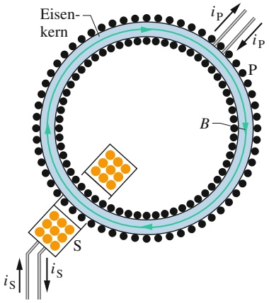

text_image

Eisen-
kern
iP
iP
P
B
S
iS
iS

Abb. 28.14

Ein Rowland-Ring. Ein Strom fließt durch die Primärspule P, in deren Kern sich das zu untersuchende ferromagnetische Material (hier Eisen) befindet, das durch den Strom magnetisiert wird. (Die Windungen der Spule sind hier als Punkte eingezeichnet.) Die Stärke der Magnetisierung des Spulenkerns bestimmt das Gesamtmagnetfeld B⃗ in der Spule P, das mithilfe der Sekundärspule S gemessen wird.

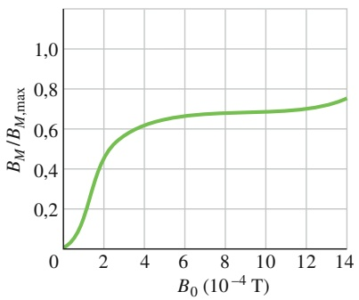

line

| B0 (10^-4 T) | BM/BM,max |
| --- | --- |
| 0 | 0 |
| ~1 | ~0.25 |
| ~2 | ~0.5 |
| ~4 | ~0.63 |
| ~6 | ~0.67 |
| ~8 | ~0.69 |
| ~10 | ~0.7 |
| ~12 | ~0.72 |
| 14 | ~0.76 |

Abb. 28.15

Eine Magnetisierungskurve für eine ferromagnetische Substanz im Spulenkern des Rowland-Rings aus Abb. 28.14. Der Wert 1,0 auf der vertikalen Achse entspricht einer vollständigen Ausrichtung der atomaren Dipole (Sättigung) in der Probe.

nen Feld auszurichten, nur sehr viel schwächer als unterhalb der Curie-Temperatur und die thermische Bewegung kann die Ausrichtung nun leichter stören. Die Curie-Temperatur für Eisen beträgt 1043 K $( = 7 7 0 ^ { \circ } C )$ .

Die Magnetisierung einer ferromagnetischen Substanz wie z. B. Eisen kann mit einem Rowland-Ring untersucht werden (Abb. 28.14). Man formt das Material dabei zu einem dünnen Torus mit kreisförmigem Querschnitt. Um den Torus wird eine Primärspule P mit n Windungen pro Längeneinheit gewickelt, die einen Strom $i _ { \mathrm { P } }$ führt (die Spule ist im Prinzip ein langes Solenoid, das zu einem Kreis gebogen ist). Ohne den Eisenkern wäre die Feldstärke im Inneren der Spule nach Gl. 25.25

$$
B _ {0} = \mu_ {0} i _ {\mathrm{P}} n. \tag {28.34}
$$

Mit dem Eisenkern finden wir in der Spule ein stärkeres, in der Regel sogar deutlich stärkeres Magnetfeld als $B _ { 0 }$ . Wir schreiben die Stärke dieses Felds als

$$
B = B _ {0} + B _ {M}, \tag {28.35}
$$

wobei $B _ { M }$ die zusätzliche Feldstärke ist, die von dem Eisenkern hervorgerufen wird. Dieser zusätzliche Beitrag entsteht durch die Ausrichtung der magnetischen Dipolmomente der Eisenatome, die von dem äußeren Feld mithilfe der Austauschkopplung hervorgerufen wird; er ist proportional zur Magnetisierung M des Eisens. Der Beitrag $B _ { M }$ ist also proportional zum magnetischen Dipolmoment des Eisens pro Volumeneinheit. Um $B _ { M }$ zu bestimmen, messen wir B mithilfe einer Sekundärspule S, berechnen aus Gl. 28.34 $B _ { 0 }$ und erhalten $B _ { M }$ gemäß Gl. 28.35 aus der Differenz beider Werte.

Abbildung 28.15 zeigt die Magnetisierungskurve einer ferromagnetischen Substanz in einem Rowland-Ring: Aufgetragen ist das Verhältnis $B _ { M } / B _ { M , \operatorname* { m a x } }$ gegen $B _ { 0 } ,$ wobei $B _ { M , \operatorname* { m a x } }$ der Maximalwert von $B _ { M }$ (entsprechend der Sättigung) ist. Die Kurve entspricht der in Abb. 28.13 für eine paramagnetische Probe gezeigten; beide Kurven illustrieren, wie stark das äußere Feld die magnetischen Dipolmomente der Atome in der Probe ausrichten kann.

Bei dem ferromagnetischen Material aus Abb. 28.15 sind die Dipolmomente bei einem Feld von $1 \cdot \bar { 1 0 } ^ { - 3 \cdot \prime }$ T zu etwa 70 % ausgerichtet. Wenn wir $B _ { 0 }$ auf 1 T erhöhen würden, wäre die Ausrichtung praktisch vollständig (eine Feldstärke $B _ { 0 } = 1$ T und damit die Sättigung ist in der Praxis allerdings schon recht schwierig zu erreichen).

## Magnetische Domänen

Die Austauschkopplung bewirkt bei Temperaturen unterhalb der Curie-Temperatur eine Ausrichtung benachbarter magnetischer Dipole in einer ferromagnetischen Substanz. Warum erreicht ein solches Material dann nicht ganz von selbst und ohne äußeres Feld $B _ { 0 }$ die Sättigung? Mit anderen Worten, warum ist nicht jedes Stück Eisen wie z. B. ein Nagel immer ein starker Magnet?

Um das zu verstehen, betrachten wir eine einkristalline Probe eines ferromagnetischen Materials, d. h. eine Probe, in der sich die regelmäßige Anordnung der Atome – das Kristallgitter – ohne Störung oder Unregelmäßigkeit durch das gesamte Volumen der Probe erstreckt. Ein solcher Kristall besteht normalerweise aus einer Anzahl von magnetischen Domänen. Damit bezeichnen wir Bereiche, in denen die Ausrichtung der atomaren Dipole praktisch perfekt ist. Die Domänen untereinander sind jedoch nicht ausgerichtet. Für den gesamten Kristall bedeutet das, dass die magnetischen Momente der Domänen sich weitgehend gegenseitig aufheben.

Abbildung 28.16 zeigt eine vergrößerte Fotografie derartiger Domänen an der Oberfläche eines Nickel-Einkristalls. Sie wurden sichtbar gemacht, indem eine kolloidale Suspension von fein verteiltem Eisenoxid auf die Oberfläche des Kristalls aufgesprüht wurde. An den Grenzen der Domänen ändert sich die Ausrichtung der atomaren Dipole beim Übergang von der einen zur anderen Domäne; an diesen Stellen existieren sehr starke, eng lokalisierte und sehr inhomogene Magnetfelder. Zu diesen Domänengrenzen werden die suspendierten Eisenoxidteilchen hingezogen, die daher die Grenzen als weiße Linien sichtbar machen (in Abb. 28.16 sind jedoch nicht alle Domänengrenzen zu sehen). Obwohl innerhalb der Domä- nen praktisch alle atomaren Dipole wie durch die Pfeile angedeutet ausgerichtet sind, kann die Probe als Ganzes trotzdem ein sehr geringes resultierendes magnetisches Moment besitzen.

Das Eisen, das wir normalerweise in der Hand haben, ist kein Einkristall, sondern besteht aus vielen winzigen Kristallen, die zufällig zueinander orientiert sind; man spricht von einem polykristallinen Material. Jeder der winzigen Kristalle in einer solchen Probe besteht wiederum aus magnetischen Domänen mit zufälliger Ausrichtung zueinander wie in Abb. 28.16. Wenn wir eine solche Probe magnetisieren, indem wir sie in ein äußeres Magnetfeld mit allmählich ansteigender Feldstärke bringen, dann bewirken wir zweierlei Effekte, die insgesamt eine Magnetisierungskurve der Form von Abb. 28.15 erzeugen. Der erste dieser Effekte ist, dass die Domänen, die zufällig parallel zum äußeren Feld orientiert sind, auf Kosten der benachbarten Domänen wachsen. Der zweite Effekt ist, dass sich die Dipole von Domänen, die nicht parallel zum äußeren Feld ausgerichtet sind, geschlossen in Richtung des äußeren Felds umorientieren können.

Die Austauschkopplung und die Domänenumorientierung bewirken gemeinsam folgendes Ergebnis:

Eine ferromagnetische Substanz entwickelt in einem äußeren Magnetfeld $\vec { B } _ { \mathrm { e x t } }$ ein starkes magnetisches Dipolmoment in Richtung von $\vec { B } _ { \mathrm { e x t } } ,$ das zu einem erheblichen Teil auch nach dem Abschalten von $\vec { B } _ { \mathrm { e x t } } ^ { - }$ erhalten bleibt. Wenn das Feld inhomogen ist, wird die ferromagnetische Substanz aus dem Bereich kleinerer Feldstärke zum Bereich größerer Feldstärke hingezogen.

Die Umorientierung magnetischer Domänen kann man sogar hörbar machen: Dazu holen wir unseren alten Kassettenrekorder vom Dachboden, schalten ihn auf Wiedergabe, ohne eine Kassette einzulegen, und drehen die Lautstärke auf maximal. Dann bringen wir einen starken Magneten in die Nähe des (ferromagnetischen) Tonkopfs. Das Magnetfeld bewirkt eine plötzliche Umorientierung der Domänen im Tonkopf, wodurch sich das Magnetfeld in einer Spule um den Tonkopf ändert. Dadurch werden Ströme in der Spule induziert, die verstärkt und an den Lautsprecher geleitet werden, der ein pfeifendes Geräusch von sich gibt.

## Hysterese

Wenn wir an eine ferromagnetische Substanz ein Magnetfeld $B _ { 0 }$ anlegen und dann wieder entfernen, geht die Magnetisierung nicht auf demselben Weg wie beim Aufmagnetisieren zurück. Abbildung 28.17 zeigt die Auftragung von $B _ { M }$ gegen $B _ { 0 }$ für einen Rowland-Ring während der folgenden Schritte: (1) Beginnend mit einem unmagnetisierten Stück Eisen (Punkt a) wird der Strom in der Spule erhöht, bis die Feldstärke $B _ { 0 } \: ( = n i \mu _ { 0 } )$ dem Punkt b entspricht. Daraufhin wird der Strom in der Spule (und damit die Feldstärke $B _ { 0 } )$ bis auf null reduziert (Punkt c) und schließlich umgekehrt, bis die Feldstärke Punkt d entspricht. Zuletzt wird der Strom wieder bis auf null reduziert (Punkt e) und nochmals umgekehrt, bis die Feldstärke wieder den Punkt b erreicht.

Die Eigenschaft, dass die Magnetisierung wie in Abb. 28.17 beim Entfernen eines Magnetfelds nicht entlang derselben Kurve zum Anfangspunkt zurückkehrt, der sie beim Einschalten des Felds gefolgt war, nennt man **Hysterese**. Die Kurve bcdeb heißt entsprechend Hystereseschleife. An den Punkten c und e ist das Eisen magnetisiert, obwohl in den Windungen der Spule kein Strom fließt; hier haben wir die für ferromagnetische Substanzen typische permanente Magnetisierung vorliegen.

Das Auftreten der Hysterese können wir mithilfe des Konzepts der magnetischen Domänen verstehen. Offensichtlich sind die Verschiebungen der Domänengrenzen und die Umorientierung der Richtung der Domänen nicht vollständig reversibel. Wenn das äußere Feld $B _ { 0 }$ erhöht und anschließend wieder reduziert wird, kehren die Domänen nicht vollständig in ihren Ausgangszustand zurück, sondern behalten eine Art „Erinnerung“ an ihre Orientierung im Magnetfeld. Dieses Erinnerungsvermögen ist die Grundlage der Datenspeicherung auf magnetischen Medien wie Tonbändern, Magnetstreifen oder Computerfestplatten.

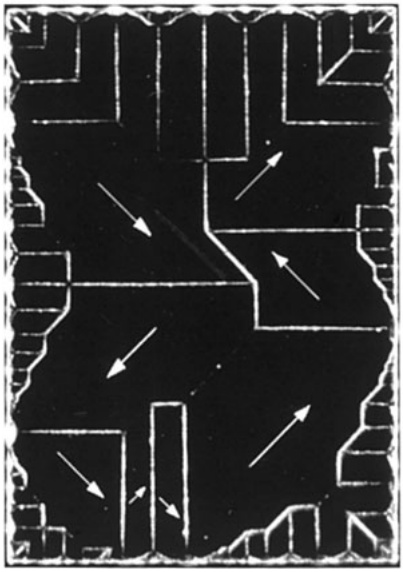

natural_image

Abstract black-and-white maze pattern with white directional arrows (no text or symbols)

Abb. 28.16

Eine Fotografie der Domänengrenzen an der Oberfläche eines Nickel-Einkristalls. Die eingezeichneten weißen Pfeile zeigen die Orientierungen der magnetischen Dipole in den verschiedenen Domänen und damit die Orientierung der resultierenden magnetischen Dipole der Domänen. Der Kristall als Ganzes ist nicht magnetisiert, wenn die Vektorsumme der magnetischen Dipole aller Domänen (annähernd) null ergibt [Quelle: Ralph W. DeBlois].

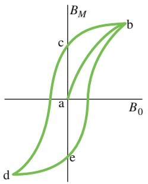

text_image

B_M
c
b
a
B_0
d
e

Abb. 28.17

Eine Magnetisierungskurve (ab) einer ferromagnetischen Probe und die zugehörige Hystereseschleife (bcdeb).

Eine Speicherung der Orientierung von Domänen kommt auch in der Natur vor. Wenn Blitze im Boden einschlagen und hohe Ströme durch die Erde schicken, dann entstehen um diese Ströme starke Magnetfelder, die ferromagnetische Materialien (z. B. Magnetit) in der Nähe magnetisieren können. Aufgrund der Hysterese bleibt ein Teil dieser Magnetisierung auch nach dem Blitz (nachdem die Ströme abgeklungen sind) erhalten. Bruchstücke derartiger magnetisierter Steine können dann später als Magnetitklumpen an der Erdoberfläche auftauchen.

## 28.9 Zusammenfassung

**Gaußscher Satz für Magnetfelder** Die einfachsten magnetischen Systeme sind magnetische Dipole. Magnetische Monopole existieren – soweit wir heute wissen – nicht. Der Gaußsche Satz für Magnetfelder besagt, dass der magnetische Fluss durch eine beliebige geschlossene Gaußsche Flä- che verschwindet:

$$
\varPhi_ {B} = \oint \vec {B} \cdot \mathrm{d} \vec {A} = 0. \tag {28.1}
$$

Das ist eine andere Formulierung für die Tatsache, dass keine magnetischen Monopole existieren.

**Ampère-Maxwellsches Gesetz** Ein veränderlicher elektrischer Fluss induziert ein Magnetfeld $\vec { B } .$ Das Maxwellsche Induktionsgesetz stellt einen Zusammenhang zwischen der Änderung des elektrischen Flusses $\Phi _ { E }$ durch eine Leiterschleife und dem dadurch induzierten Magnetfeld $\vec { B }$ entlang dieser Schleife her:

$$
\oint \vec {B} \cdot \mathrm{d} \vec {s} = \mu_ {0} \varepsilon_ {0} \frac {\mathrm{d} \varPhi_ {E}}{\mathrm{d} t}. \tag {28.3}
$$

Das Ampèresche Gesetz beschreibt $\oint \vec { B }   \cdot   \mathrm { d } \vec { s } ~ = ~ \mu _ { 0 } i _ { \mathrm { u m } }$ (Gl. 28.4) das Magnetfeld, das ein von einer Leiterschleife eingeschlossener Strom in dieser induziert. Beide Beziehungen können zu einer einzigen Gleichung zusammengefasst werden, welche man das Ampère-Maxwellsche Gesetz nennt:

$$
\oint \vec {B} \cdot \mathrm{d} \vec {s} = \mu_ {0} \varepsilon_ {0} \frac {\mathrm{d} \varPhi_ {E}}{\mathrm{d} t} + \mu_ {0} i _ {\mathrm{um}}. \tag {28.5}
$$

**Verschiebungsstrom** Der fiktive Verschiebungsstrom, der durch ein zeitlich veränderliches elektrisches Feld verursacht wird, ist definiert als

$$
i _ {\mathrm{V}} = \varepsilon_ {0} \frac {\mathrm{d} \varPhi_ {E}}{\mathrm{d} t}. \tag {28.6}
$$

Damit wird aus Gl. 28.5

$$
\oint \vec {B} \cdot \mathrm{d} \vec {s} = \mu_ {0} i _ {\mathrm{V,um}} + \mu_ {0} i _ {\mathrm{um}}, \tag {28.7}
$$

wobei $i _ { \mathrm { V , u m } }$ der Verschiebungsstrom ist, der von der Inte grationsschleife umschlossen wird. Das Konzept des Verschiebungsstroms erlaubt es uns, an der Vorstellung eines kontinuierlichen Stroms auch durch einen Kondensator festzuhalten. Mit dem Verschiebungsstrom ist jedoch kein Ladungstransport verbunden.

**Integrale Maxwell-Gleichungen** In integraler Form lauten die Maxwell-Gleichungen für das elektrische und magnetische Feld (vgl. Tab. 28.1)

$$
\oint \vec {E} \cdot \mathrm{d} \vec {A} = \frac {q _ {\text {innen}}}{\varepsilon_ {0}}, \tag {28.14a}
$$

$$
\oint \vec {B} \cdot \mathrm{d} \vec {A} = 0, \tag {28.14b}
$$

$$
\oint \vec {E} \cdot \mathrm{d} \vec {s} + \frac {\mathrm{d} \varPhi_ {B}}{\mathrm{d} t} = 0, \tag {28.14c}
$$

$$
\oint \vec {B} \cdot \mathrm{d} \vec {s} - \mu_ {0} \varepsilon_ {0} \frac {\mathrm{d} \varPhi_ {E}}{\mathrm{d} t} = \mu_ {0} i _ {\mathrm{um}}. \tag {28.14d}
$$

**Differenzielle Maxwell-Gleichungen** Für viele Anwendungen und speziell auch für die numerische Behandlung auf modernen Computern ist die integrale Form der Maxwell-Gleichungen weniger geeignet und man verwendet sie lieber in ihrer differenziellen Form

$$
\mathrm{div} \vec {E} = \frac {\rho}{\varepsilon_ {0}}, \tag {28.15a}
$$

$$
\mathrm{div} \vec {B} = 0, \tag {28.15b}
$$

$$
\mathrm{rot} \vec {E} + \frac {\partial \vec {B}}{\partial t} = 0, \tag {28.15c}
$$

$$
\mathrm{rot} \vec {B} - \mu_ {0} \varepsilon_ {0} \frac {\partial \vec {E}}{\partial t} = \mu_ {0} \vec {j}. \tag {28.15d}
$$

Hierbei sind $\rho$ die elektrische Ladungsdichte und $\vec { j }$ die elektrische Stromdichte. Die differenziellen Maxwell-Gleichungen bilden ein System gekoppelter, partieller Differenzialgleichungen. Das Konzept der partiellen Ableitungen besagt, dass bei der Ableitung einer Funktion $F ( x , y , z , t )$ von mehreren Variablen beispielsweise nach x alle anderen

Variablen festgehalten, d. h. als konstant betrachtet werden (vgl. Anhang D):

$$
\frac {\partial F}{\partial x} \equiv \left. \frac {\partial F}{\partial x} \right| _ {y, z, t = \text {const.}}.
$$

In partiellen Differenzialgleichungen treten partielle Ableitungen nach verschiedenen Variablen auf, $\mathrm { z .   B . } ~ \partial F / \partial t$ und $\partial F / \partial x$ usw. Weiterhin werden die Vektorableitungen Divergenz (div) und Rotation (rot) verwendet; vgl. ebenfalls Anhang D.

**Erdmagnetfeld** Das Erdmagnetfeld kann näherungsweise als magnetisches Dipolfeld beschrieben werden, wobei die Dipolachse einen Winkel von 11,5° mit der Achse der Erdrotation einschließt und der Südpol des magnetischen Dipols auf der Nordhalbkugel der Erde liegt. Die Richtung des lokalen Magnetfelds wird an einem beliebigen Punkt der Erdoberfläche durch die Deklination (den Winkel rechts oder links von der Nordrichtung) und die Inklination (den Winkel zur Horizontalen) beschrieben.

**Magnetisches Spindipolmoment** Ein Elektron besitzt einen intrinsischen Drehimpuls, den Spindrehimpuls oder kurz Spin ${ \vec { S } } ,$ mit dem ein intrinsisches magnetisches Spinmoment $\vec { \mu } _ { s }$ verbunden ist:

$$
\vec {\mu} _ {s} = - \frac {e}{m} \vec {S}. \tag {28.16}
$$

Der Spin $\vec { S }$ selbst ist nicht komplett messbar, sondern es können nur sein Betrag sowie eine Komponente bezüglich einer beliebigen Koordinatenachse gemessen werden. Die Komponente $S _ { z }$ bezüglich einer gewählten z-Achse kann nur die Werte

$$
S _ {z} = m _ {s} \frac {h}{2 \pi} \quad \text {mit} \quad m _ {s} = \pm \frac {1}{2} \tag {28.17}
$$

annehmen, wobei $h \; = \; 6 { , } 6 3   { \cdot }   1 0 ^ { - 3 4 }   \mathrm { J } \cdot \mathrm { s }$ die Plancksche Konstante ist. Ebenso kann das magnetische Spinmoment selbst nicht gemessen werden, sondern nur sein Betrag und seine Komponente bezüglich einer Achse. Auch hier ist die z-Komponente auf die Werte

$$
\mu_ {s, z} = \pm \frac {e h}{4 \pi m} = \pm \mu_ {\mathrm{B}}, \tag {28.16,28.18}
$$

beschränkt, wobei $\mu _ { \mathrm { B } }$ das Bohrsche Magneton ist:

$$
\mu_ {\mathrm{B}} = \frac {e h}{4 \pi m} = 9, 2 7 \cdot 1 0 ^ {- 2 4}   \mathrm{J/T}  . \tag {28.19}
$$

Die potenzielle Energie U eines Spins mit dem magnetischen Moment $\vec { \mu } _ { s }$ in einem Magnetfeld $\vec { B } _ { \mathrm { e x t } }$ ist

$$
U = - \vec {\mu} _ {s} \cdot \vec {B} _ {\mathrm{ext}} = - \mu_ {s, z} B _ {\mathrm{ext}}. \tag {28.21}
$$

**Magnetisches Bahndipolmoment** Ein Elektron in einem Atom besitzt noch einen weiteren Drehimpuls, den Bahndrehimpuls $\vec { L } _ { \mathrm { B a h n } } ,$ , mit dem ein magnetisches Bahnmoment $\vec { \mu } _ { \mathrm { B a h n } }$ verbunden ist:

$$
\vec {\mu} _ {\mathrm{Bahn}} = - \frac {e}{2 m} \vec {L} _ {\mathrm{Bahn}}. \tag {28.22}
$$

Auch der Bahndrehimpuls ist nur bezüglich einer Achse messbar und seine Komponente bezüglich dieser Achse ist gequantelt und auf die Werte

$$
L _ {\mathrm{Bahn}, z} = m _ {l} \frac {h}{2 \pi} \tag {28.23}
$$

mit $m _ { l } = 0 , \pm 1 , \pm 2 , \pm m _ { \mathrm { m a x } }$ beschränkt. Damit kann der Betrag des magnetischen Bahnmoments die Werte

$$
\mu_ {\mathrm{Bahn}, z} = - m _ {l} \frac {e h}{4 \pi m} = - m _ {l} \mu_ {\mathrm{B}}, \tag {28.24,28.25}
$$

annehmen. Die potenzielle Energie U des magnetischen Bahnmoments in einem Magnetfeld $B _ { \mathrm { e x t } }$ ist

$$
U = - \vec {\mu} _ {\mathrm{Bahn}} \cdot \vec {B} _ {\mathrm{ext}} = - \mu_ {\mathrm{Bahn}, z} B _ {\mathrm{ext}}. \tag {28.26}
$$

**Diamagnetismus** Diamagnetische Substanzen zeigen kein magnetisches Verhalten, bis sie in ein äußeres Magnetfeld $\vec { B } _ { \mathrm { e x t } }$ gebracht werden, wo sie ein magnetisches Dipolmoment entwickeln, das $\vec { B } _ { \mathrm { e x t } }$ entgegengesetzt ist. Wenn das Feld inhomogen ist, wird die Probe von dem Bereich größerer Feldstärke abgestoßen.

**Paramagnetismus** Jedes Atom in einer paramagnetischen Substanz besitzt ein permanentes magnetisches Dipolmoment $\vec { \mu } ,$ die einzelnen Dipole sind jedoch zufällig orientiert und die Substanz als Ganzes besitzt kein magnetisches Moment. Ein externes Magnetfeld $\vec { B } _ { \mathrm { e x t } }$ kann die Dipolmomente der Atome zumindest teilweise ausrichten, wodurch die Probe ein resultierendes magnetisches Dipolmoment in Richtung von $\vec { B } _ { \mathrm { e x t } }$ erhält. Wenn das Feld $\vec { B } _ { \mathrm { e x t } }$ inhomogen ist, wird die Probe von dem Bereich grö- ßerer Feldstärke angezogen.

Die Ausrichtung der atomaren Dipolmomente ist umso stärker, je stärker das äußere Feld $\vec { B } _ { \mathrm { e x t } }$ ist, und wird umso geringer, je höher die Temperatur T ist. Das Ausmaß der Ausrichtung der Dipolmomente in einer Probe mit dem Volumen V wird durch die Magnetisierung M⃗ beschrieben, deren Betrag durch

$$
M = \frac {\text {gemessenes magnetisches Moment}}{V} \tag {28.32}
$$

gegeben ist. Die vollständige Ausrichtung aller magnetischen Dipolmomente in der Probe, als Sättigung bezeichnet, entspricht einem maximalen Wert der Magnetisierung $M _ { \operatorname* { m a x } } = \bar { N } \mu / V$ . Für kleine Werte von $B _ { \mathrm { e x t } } / T$ gilt das Curiesche Gesetz

$$
M = C \frac {B _ {\mathrm{ext}}}{T}, \tag {28.33}
$$

wobei C die Curie-Konstante ist.

**Ferromagnetismus** In einer ferromagnetischen Substanz sind auch in Abwesenheit eines äußeren Magnetfelds einige der atomaren magnetischen Dipole parallel ausgerichtet, sodass in einer Probe Bereiche (Domänen) mit einer starken permanenten Magnetisierung existieren. Für die Ausrichtung der atomaren magnetischen Dipole ist ein quantenphysikalischer Effekt, die Austauschkopplung, verantwortlich. Ein äußeres Magnetfeld $\vec { B } _ { \mathrm { e x t } }$ kann die magnetischen Momente dieser Domänen ausrichten und so für

## 28.10 Fragen

**1.** Ein Elektron in einem äußeren Magnetfeld $\vec { B } _ { \mathrm { e x t } }$ hat seinen Spindrehimpuls $S _ { z }$ antiparallel zu $\vec { B } _ { \mathrm { e x t } }$ eingestellt. Wird Energie frei oder muss dem Elektron Energie zugeführt werden, wenn der Spin umklappt und sich parallel zu $\vec { B } _ { \mathrm { e x t } }$ einstellt?
**2.** Abbildung 28.F2a zeigt die beiden entgegengesetzten Spinorientierungen für ein Elektron in einem äußeren Magnetfeld $\vec { B } _ { \mathrm { e x t } }$ . Abbildung 28.F2b gibt dazu drei Varianten für die Auftragung der potenziellen Energie dieser Orientierungen gegen die Feldstärke von $\vec { B } _ { \mathrm { e x t } }$ . Bei den Möglichkeiten b und c schneiden sich die Linien, bei Möglichkeit a sind beide Linien parallel. Welche Variante ist richtig?

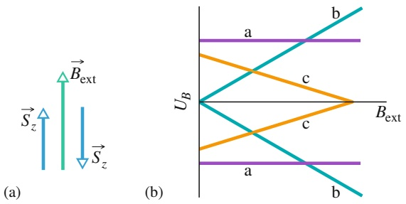

Abb. 28.F2

**3.** Abbildung 28.F3 zeigt drei Ringstrommodelle für ein Elektron, das in einem Magnetfeld im Gegenuhrzeigersinn kreist. In den Fällen 1 und 2 sind die Magnetfelder inhomogen, in Fall 3 ist es homogen. In welche Richtung (nach oben oder nach unten oder sind sie null) zeigen in jedem der drei Fälle (a) das magnetische Dipolmoment der Schleife und (b) die magnetische Kraft auf die Schleife?

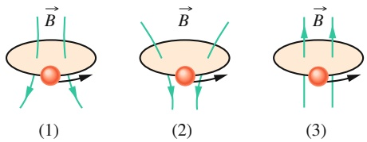

Abb. 28.F3

Fragen 3, 5 und 6.

**4.** Nimmt der Betrag der resultierenden Kraft auf die Schleife aus Abb. 28.11a und b zu, ab oder bleibt sie gleich, wenn (a) die Feldstärke von $\vec { B } _ { \mathrm { e x t } }$ oder (b) die Divergenz von $\vec { B } _ { \mathrm { e x t } }$ erhöht wird?

die gesamte Probe ein starkes magnetisches Moment parallel zu $\vec { B } _ { \mathrm { e x t } }$ erzeugen. Dieses magnetische Moment kann teilweise weiterbestehen, nachdem $\vec { B } _ { \mathrm { e x t } }$ entfernt wurde. Wenn $\vec { B } _ { \mathrm { e x t } }$ inhomogen ist, wird eine ferromagnetische Probe von dem Bereich größerer Feldstärke angezogen. Die Austauschkopplung verschwindet, wenn eine Probe über ihre Curie-Temperatur hinaus erhitzt wird; die Probe ist dann nur noch paramagnetisch.

**5.** Ersetzen sie die Stromschleifen aus Frage 3 durch diamagnetische Kugeln. In welche Richtung (nach oben oder nach unten oder sind sie null) zeigen in jedem der drei Fälle (a) das magnetische Dipolmoment der Kugel und (b) die magnetische Kraft auf die Kugel?
**6.** Ersetzen sie die Stromschleifen aus Frage 3 durch paramagnetische Kugeln. In welche Richtung (nach oben oder nach unten oder sind sie null) zeigen in jedem der drei Fälle (a) das magnetische Dipolmoment der Kugel und (b) die magnetische Kraft auf die Kugel?
**7.** Abbildung 28.F7 zeigt die magnetischen Dipole in einer diamagnetischen Substanz für drei verschiedene Situationen. (Der Einfachheit halber sei angenommen, dass die Dipole nur in der Papierebene entweder nach oben oder nach unten zeigen können.) Die Situationen unterscheiden sich durch die Feldstärke des angelegten Felds. (a) Zeigt das jeweils angelegte Feld nach oben oder nach unten? Ordnen Sie die drei Situationen in absteigender Reihenfolge (b) nach der Feldstärke des angelegten Felds und (c) nach der Magnetisierung der Probe.

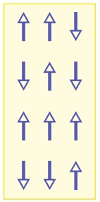

text_image

Diagram showing nine directional arrows arranged in a 3x3 grid, each with an upward arrow and one downward arrow.

(1)

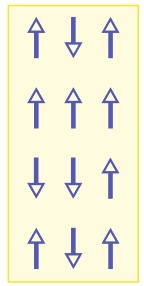

text_image

Grid of eight directional symbols (up, down, up, down, up, down, up) arranged in three rows and three columns.

(2)

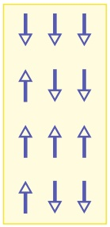

text_image

Grid of directional arrows in blue, arranged in 3 rows and 5 columns

(3)

Abb. 28.F7

**8.** Abbildung 28.F8 zeigt jeweils einen elektrischen Feldvektor und eine Feldlinie eines induzierten magnetischen Felds. Nimmt die Feldstärke von E⃗ in den beiden Fällen zu oder ab?

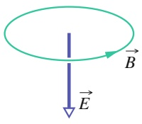

(a)

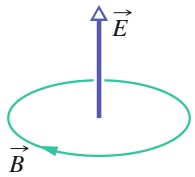

(b)

Abb. 28.F8

**9.** Abbildung 28.F9 zeigt einen Plattenkondensator und einen Strom in den Anschlussleitungen, der den Kondensator entlädt. Zeigen (a) das elektrische Feld E⃗ und (b) der Verschiebungsstrom zwischen den Platten nach rechts oder nach links? (c) Zeigt das Magnetfeld im Punkt P in die Seite oder aus der Seite heraus?

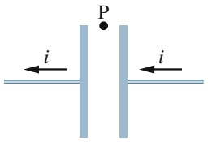

text_image

P
i
i

Abb. 28.F9

**10.** Ein Plattenkondensator mit rechteckigen Platten wird entladen. Eine rechteckige Schleife mit den Abmessungen L mal 2L ist zentriert zwischen den Platten mit den Maßen 2L mal 4L angebracht. Welcher Bruchteil des Verschiebungsstroms wird von der Schleife umschlossen, wenn dieser homogen verteilt ist?
**11.** Abbildung 28.F11a zeigt einen Kondensator mit runden Platten beim Laden. Punkt a (in der Nähe einer der Anschlussleitungen) und Punkt b (im Zwischenraum zwischen den Kondensatorplatten) sind gleich weit von der zentralen Achse entfernt, dasselbe gilt für die Punkte c (etwas weiter von der Zuleitung entfernt als a) und d (zwischen den Kondensatorplatten, aber außerhalb). In Abb. 28.F11b zeigt eine der Kurven den Verlauf der Feldstärke des Magnetfelds innerhalb und außerhalb der Zuleitung als Funktion des Abstands r von der zentralen Achse. Die andere Kurve zeigt den Verlauf der Feldstärke des Magnetfelds innerhalb und außerhalb des Kondensators als Funktion des Abstands r von der zentralen Achse. Welcher der drei Punkte auf den Kurven entspricht welchem der vier Punkte in Abb. 28.F11a?

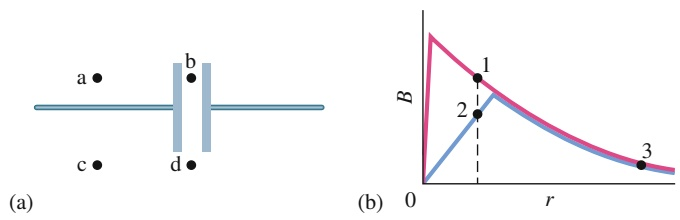

Abb. 28.F11

**12.** Abbildung 28.F12 zeigt eine Draufsicht auf einen quadratischen Plattenkondensator. Zwischen den Platten befinden sich die vier mit a–d markierten Schleifen. Der Kondensator wird entladen. (a) Ordnen Sie die Schleifen in absteigender Reihenfolge nach dem Betrag des Integrals $\vec { \oint _ { \mathrm { S c h l e i f e } } B \cdot d \vec { s } }$ (vernachlässigen Sie Randeffekte). (b) Entlang welcher Schleife(n) ist der Winkel zwischen B⃗ und d⃗s konstant (oder ist dies nirgendwo der Fall), sodass ihr Skalarprodukt einfach berechnet werden kann? (c) Entlang welcher Schleife ist B konstant (wenn überhaupt)?

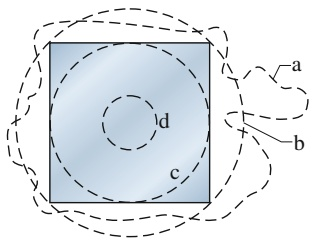

text_image

a
b
c
d

Abb. 28.F12

**13.** Abbildung 28.F13 stellt drei rechteckige Materialproben eines ferromagnetischen Materials dar. Die magnetischen Dipole der Domänen (hellblau) wurden durch ein sehr starkes äußeres Feld $B _ { 0 }$ aus der Papierebene heraus ausgerichtet. In jeder Probe gibt es einen kleinen Bereich (weiß), in dem das magnetische Feld in die Papierebene hineinzeigt. Probe 1 ist ein (idealer) Kristall. Die anderen beiden Proben enthalten Versetzungen, d. h. linienartige Kristalldefekte; Domänen können sich nur schwer über solche Versetzungen hinweg ausdehnen. Das äußere Feld wird jetzt umgedreht und sein Betrag wird moderat gehalten. Diese Veränderung bewirkt, dass sich der „Inselbereich“ausdehnt. (a) Ordnen Sie die drei Proben in absteigender Reihenfolge nach dem Ausmaß dieses Wachstums. Ferromagnetische Materialien, in denen sich die magnetischen Dipole leicht ändern lassen, nennt man magnetisch weich; solche, bei denen dies starke äußere Felder erfordert, magnetisch hart. (b) Welche der drei Proben ist magnetisch am härtesten?

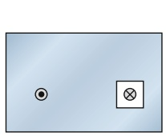

(1)

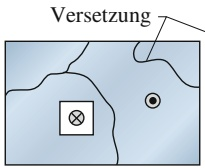

(2)

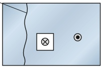

(3)

Abb. 28.F13

**14.** Abbildung 28.F14 zeigt vier Stahlstäbe, von denen drei Permanentmagnete sind. Ein Magnetpol ist angegeben. Experimentell finden wir heraus, dass die Enden a und d einander anziehen, c und f einander abstoßen und e und h sowie a und h einander jeweils anziehen. (a) Welche Stabenden sind magnetische Nordpole? (b) Welcher Stab ist kein Magnet?

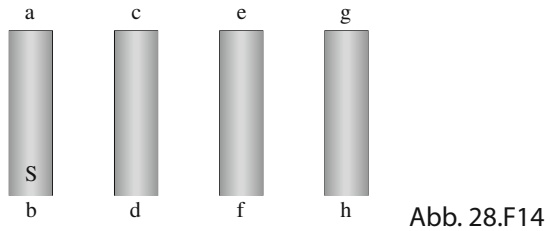

text_image

a
c
e
g
S
b
d
f
h
Abb. 28.F14

# 29 Elektromagnetische Wellen

## 29.1 Elektromagnetische Wellen

## Physikalische Motivation

Unser Informationszeitalter basiert fast komplett auf der Physik elektromagnetischer Wellen. Ob wir wollen oder nicht, wir alle sind heute über Fernsehen, Mobilfunk und das Internet global vernetzt. Und egal, ob wir wollen oder nicht, wir alle sind beständig von den elektromagnetischen Signalen der mannigfachen Sendestationen umgeben.

Das Ausmaß der heutigen Vernetzung von informationsverarbeitenden Geräten hätten sich vor 40 Jahren nicht einmal die visionären Pioniere der Informationstechnik träumen lassen. Die Herausforderung für ihre heutigen Nachfolger besteht darin, sich vorzustellen, wie die elektromagnetisch vernetzte Welt in 40 Jahren aussehen könnte. Der Ausgangspunkt dafür ist ein fundiertes Verständnis der zugrunde liegenden Physik der elektromagnetischen Wellen, die in so vielfältigen Formen auftreten, dass man manchmal poetisch vom Maxwellschen Regenbogen spricht.

## 29.1.1 Maxwells Regenbogen

James Clerk Maxwells bedeutendste Leistung war sicherlich, dass er zeigen konnte, dass ein Lichtstrahl eine sich ausbreitende Welle elektrischer und magnetischer Felder ist – eine **elektromagnetische Welle**. Die Optik, die sich mit dem sichtbaren Licht befasst, ist aus diesem Grund ein Teilgebiet der Theorie des Elektromagnetismus. In diesem Kapitel schließen wir die Diskussion rein elektrischer und magnetischer Phänomene ab und leiten zu den Grundlagen der Optik über.

Zu Maxwells Zeit, gegen Mitte des 19. Jahrhunderts, waren die einzigen bekann ten elektromagnetischen Wellen sichtbares, infrarotes und ultraviolettes Licht. An geregt durch Maxwells Arbeiten entdeckte dann jedoch Heinrich Hertz die Radio wellen und wies nach, dass diese sich mit derselben Geschwindigkeit ausbreiten wie sichtbares Licht.

Inzwischen kennen wir ein breites Spektrum elektromagnetischer Wellen, das von einem phantasievollen Autor einmal als „Maxwells Regenbogen“ bezeichnet wurde. Überlegen wir einmal, in welchem Ausmaß uns elektromagnetische Wellen alltäglich umgeben! Die Strahlung der dominanten Quelle, unserer Sonne, gehört zu den Rahmenbedingungen, in denen sich der Mensch entwickelte und denen er sich anpasste. Ständig durchdringen uns Radio- und Fernsehsignale. Mikrowellen von Radarsystemen und Mobilfunkmasten gehören ebenso zu unserer Umwelt wie die Strahlung von Glühlampen und Blitzen, von heißen Motorblöcken in Kraftfahrzeugen, aus Röntgengeräten und von radioaktiven Substanzen tief im Inneren der Erde. Außerdem sind wir ständig der kosmischen Strahlung von Sternen, anderen Objekten unserer Galaxis und von entfernteren Galaxien ausgesetzt. Auch wir selbst senden elektromagnetische Wellen ins All: Fernsehsignale, die seit den 1950er Jahren auf der Erde ausgestrahlt werden, haben inzwischen jeglicher technisch ausgerüsteten Zivilisation, die auf irgendeinem Planeten eines der vielleicht 400 sonnennächsten Sterne leben mag, Nachricht (in allerdings sehr schwachen Signalen) von der Menschheit gebracht.

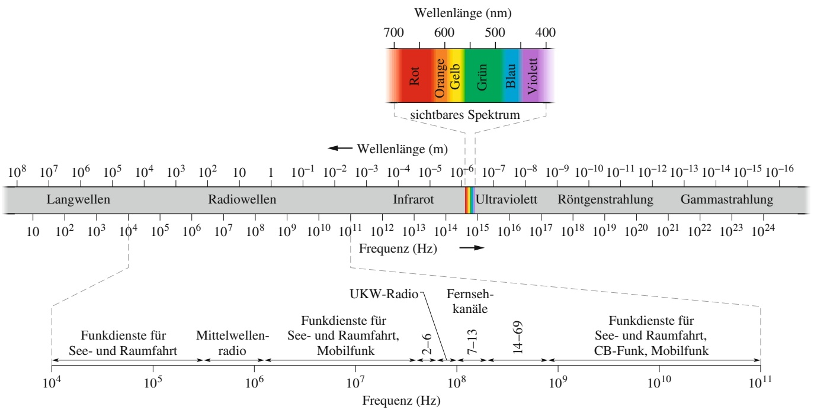

spectrogram

| Band | Frequency Range (Hz) |
| --- | --- |
| Rot | 10^8 ~ 10^9 |
| Orange | 10^7 ~ 10^8 |
| Gelb | 10^6 ~ 10^7 |
| Grün | 10^5 ~ 10^6 |
| Blau | 10^4 ~ 10^5 |
| Violet | 10^3 ~ 10^4 |

Abb. 29.1 Das elektromagnetische Spektrum.

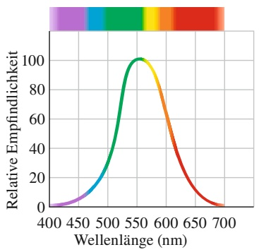

line

| Wellenlänge (nm) | Relative Empfindlichkeit |
| --- | --- |
| 400 | ~1 |
| 450 | ~8 |
| 500 | ~35 |
| 550 | 100 |
| 600 | ~65 |
| 650 | ~15 |
| 700 | ~2 |

Abb. 29.2 Die relative Empfindlichkeit eines normalen menschlichen Auges auf elektromagnetische Wellen verschiedener Wellenlänge. Der Spektralbereich, für den unser visuelles System empfindlich ist, nennen wir sichtbares Licht.

Die Wellenlänge der Strahlung ändert sich in Abb. 29.1 mit jedem Strich der Skaleneinteilung um eine Zehnerpotenz (Entsprechendes gilt für die Frequenzskala). Die Skala ist unendlich: Die Wellenlänge elektromagnetischer Strahlung ist weder nach oben noch nach unten begrenzt.

Für einige Bereiche des elektromagnetischen Spektrums in Abb. 29.1 gibt es allgemein vertraute Namen, zum Beispiel „Röntgenstrahlung“ und „Radiowellen“. Grob festgelegt ist die Ausdehnung dieser Regionen durch die Arbeitsbereiche spezieller Strahlungsquellen und Nachweisgeräte. Bezeichnungen für andere Spektralbereiche haben sich durch die kommerzielle Anwendung der Wellen (etwa für Fernsehkanäle, UKW- oder Mittelwellenradio) eingebürgert. Das elektromagnetische Spektrum hat keine Lücke; alle elektromagnetischen Wellen breiten sich ungeachtet ihres Spektralbereichs im freien Raum (d. h. im Vakuum) mit derselben Geschwindigkeit c aus.

Natürlich interessieren wir uns insbesondere für den sichtbaren Bereich des Spektrums. In Abb. 29.2 sehen Sie, wie empfindlich unser Auge für die zugehö- rigen Wellenlängen ist. Die Mitte des Bereichs liegt ungefähr bei 555 nm; diese Wellenlänge ruft den Farbeindruck „gelbgrün“ hervor.

Die Grenzen des sichtbaren Spektralbereichs lassen sich nicht exakt festlegen, weil sich die Empfindlichkeitskurve des Auges sowohl im Infraroten als auch im Ultravioletten asymptotisch der Null nähert. Man kann daher nur willkürliche Grenzen setzen, etwa dort, wo die Empfindlichkeit jeweils auf 1 % ihres Maximalwerts abgesunken ist. Die zugehörigen Werte liegen bei ungefähr 430 nm bzw. 690 nm. Trotzdem können wir aber auch etwas jenseits dieser Grenzen noch Licht sehen, wenn es nur intensiv genug ist.

## 29.1.2 Die Ausbreitung elektromagnetischer Wellen: Eine qualitative Betrachtung

Manche elektromagnetischen Wellen wie z. B. Röntgen- und Gammastrahlen oder sichtbares Licht werden von Quellen in der Größe von Atomen oder sogar Atomkernen ausgesendet (emittiert). Derartige Prozesse muss man zwingend quantenphysikalisch beschreiben. Zuerst wollen wir uns jedoch ansehen, auf welche Weise sonstige elektromagnetische Wellen erzeugt werden können. Um die Diskussion zu vereinfachen, beschränken wir uns auf Fälle, in denen die Quelle der Strahlung (der emittierten Wellen) makroskopische und einigermaßen handliche Abmessungen hat, was uns zu Wellenlängen in der Größenordnung λ ≈ 1 m führt.

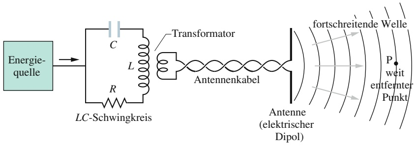

flowchart

Die Skizze in Abb. 29.3 zeigt eine typische Anordnung zur Erzeugung von elektromagnetischen Wellen. Ihr Kernstück ist ein LC-Schwingkreis mit der Kreisfrequenz $\left[ \omega   =   1 / \sqrt { L C } . \right.$ . Ladungen und Ströme in diesem Kreis ändern sich wie in Abb. 27.1 dargestellt periodisch (sinusförmig) mit dieser Frequenz. Um die Energieverluste durch Wärme sowie die emittierte elektromagnetische Welle auszugleichen, ist eine äußere Energiequelle (etwa ein Wechselstromgenerator) erforderlich.

In Abb. 29.3 ist der Schwingkreis über einen Transformator und ein Antennenkabel mit einer Antenne verbunden. Eine Antenne besteht im einfachsten Fall aus zwei dünnen leitfähigen Stäben. Der sinusförmig variierende Strom im Schwingkreis bewirkt eine sinusförmige Oszillation der Ladung (mit der Kreisfrequenz ω des Schwingkreises) entlang der Antennenstäbe, wodurch wiederum in den Stä- ben ein in Stärke und Richtung sinusförmig variierender Strom fließt. Die Antenne verhält sich daher wie ein elektrischer Dipol, dessen Dipolmoment in Betrag und Richtung sinusförmig über die Länge der Stäbe variiert.

Weil sein Dipolmoment permanent Betrag und Richtung ändert, ändert auch das von dem Dipol erzeugte elektrische Feld ständig seine Feldstärke und Richtung; weil der Strom variiert, ändert auch das von ihm hervorgerufene Magnetfeld seine Feldstärke und Richtung. Die Änderungen des elektrischen und des magnetischen Felds treten aber nicht überall sofort (d. h. nicht überall im Raum gleich zeitig) auf, sondern sie breiten sich ausgehend von der Antenne mit der Lichtgeschwindigkeit c nach außen aus. Die schwingenden Felder bilden gemeinsam eine elektromagnetische Welle, die sich von der Antenne aus mit c ausbreitet; dabei ist die Kreisfrequenz ω dieser Welle gleich der des LC-Schwingkreises.

Abbildung 29.4 zeigt die zeitlichen Änderungen des elektrischen Felds $\vec { E }$ und des Magnetfelds ${ \vec { B } } ,$ während eine Wellenlänge der elektromagnetischen Welle an dem von der Antenne entfernten Punkt P aus Abb. 29.3 vorbeizieht. In allen Abbildungsteilen bewegt sich die Welle aus der Papierebene heraus auf den Betrachter zu. (Den Punkt P wählen wir so weit von der Quelle entfernt, dass wir die in Abb. 29.3 erkennbare Krümmung der Wellenfront vernachlässigen können. Man spricht dann von einer ebenen Welle, was die Diskussion wesentlich vereinfacht.) Abbildung 29.4 zeigt einige wichtige Merkmale, die stets gelten, egal wie die Welle erzeugt wurde:

1. Das elektrische Feld $\vec { E }$ und das magnetisches Feld $\vec { B }$ stehen stets senkrecht zur Ausbreitungsrichtung der Welle. Elektromagnetische Wellen sind folglich transversal (vgl. Kapitel 12).
2. Das elektrische Feld steht stets senkrecht auf dem magnetischen Feld.
3. Die Ausbreitungsrichtung der Welle ist immer durch das Vektorprodukt $\vec { E } \times \vec { B }$ gegeben.
4. Beide Felder schwingen stets sinusförmig (wie die in Kapitel 12 besprochenen transversalen Wellen), mit derselben Frequenz und in Phase.

## Abb. 29.3

Anordnung zur Erzeugung elektromagnetischer Wellen im Kurzwellenbereich des Spektrums. Ein LC-Schwingkreis lässt in der Antenne einen sinusförmig oszillierenden Strom schwingen, der die Welle hervorbringt. P ist ein entfernter Punkt, in dem sich die vorbeiziehende Welle mit einem Detektor beobachten lässt.

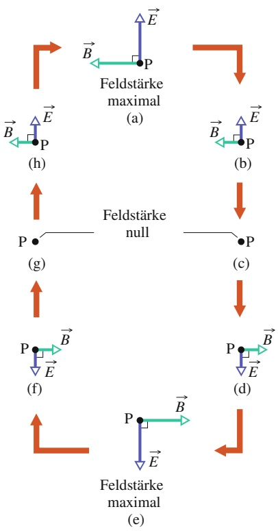

flowchart

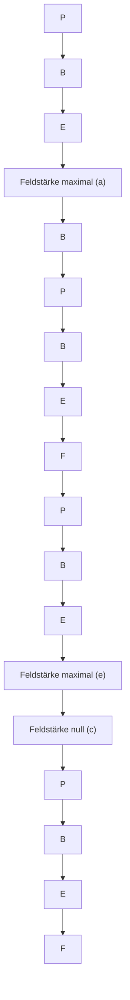

## Abb. 29.4

Die Variationen von elektrischem Feld $\vec { E }$ und Magnetfeld B⃗ an einem weit von der Antenne entfernten Punkt P (Abb. 29.3), während eine Wellenlänge der elektromagnetischen Welle vorbeizieht. Im gezeigten Fall läuft die Welle aus der Papierebene heraus auf den Betrachter zu. Stärke und Richtung der beiden Felder schwingen sinusförmig. Beachten Sie, dass die Felder stets senkrecht aufeinander und zur Ausbreitungsrichtung der Welle stehen.

Im Einklang mit diesen Eigenschaften können wir Folgendes vereinbaren: Die elektromagnetische Welle soll sich in die positive x-Richtung auf P zubewegen, das elektrische Feld in Abb. 29.4 soll parallel zur y-Achse und das magnetische Feld folglich parallel zur z-Achse schwingen (wir beziehen uns natürlich auf ein rechtshändiges Koordinatensystem). Damit können wir das elektrische und das magnetische Feld als Sinusfunktionen der Position x (entlang der Ausbreitungsrichtung der Welle) und der Zeit t formulieren:

$$
E = E _ {\mathrm{m}} \sin (k x - \omega t), \tag {29.1}
$$

$$
B = B _ {\mathrm{m}} \sin (k x - \omega t). \tag {29.2}
$$

$E _ { \mathrm { m } }$ und $B _ { \mathrm { m } }$ sind die jeweiligen Amplituden der Felder, ω und k sind (wie in Kapitel 12) die Kreisfrequenz bzw. die Wellenzahl der Welle. Aus diesen Gleichungen können wir ablesen, dass die beiden Felder nicht nur gemeinsam eine elektromagnetische Welle bilden, sondern dass auch jedes Feld für sich eine Welle ist: Gl. 29.1 gibt die elektrische Komponente der Welle an, Gl. 29.2 die magnetische Komponente. Wie später ausführlich begründet werden soll, können die beiden Komponenten nicht unabhängig voneinander existieren.

Aus Gl. 12.12 wissen wir, dass die Ausbreitungsgeschwindigkeit der Welle gleich ω∕k ist. Weil es sich um eine elektromagnetische Welle handelt, bezeichnen wir ihre Geschwindigkeit aber nicht mit v, sondern mit c, dem Symbol für die Lichtgeschwindigkeit. Im nächsten Abschnitt werden wir sehen, dass

$$
c = \frac {1}{\sqrt {\mu_ {0} \varepsilon_ {0}}} \tag {29.3}
$$

gilt, was ungefähr $^ { 3 , 0 \cdot 1 0 ^ { 8 } }$ m/s ergibt. Mit anderen Worten:

Alle elektromagnetischen Wellen, auch das sichtbare Licht, breiten sich im Vakuum mit derselben Geschwindigkeit aus: der Lichtgeschwindigkeit c.

Außerdem werden wir dort den folgenden Zusammenhang zwischen der Ausbreitungsgeschwindigkeit c der Welle und den Amplituden des elektrischen bzw. magnetischen Felds kennenlernen:

$$
\frac {E _ {\mathrm{m}}}{B _ {\mathrm{m}}} = c \quad (\text {Verhältnis der Amplituden}). \tag {29.4}
$$

Wenn wir Gl. 29.1 durch Gl. 29.2 teilen und dann Gl. 29.4 einsetzen, stellen wir fest, dass das Verhältnis der Feldstärken der beiden Felder einer elektromagnetischen Welle konstant ist; es gilt zu jedem Zeitpunkt und an jedem Ort

$$
\frac {E}{B} = c \quad (\text {Verhältnis der Beträge}). \tag {29.5}
$$

Eine elektromagnetische Welle können wir wie in Abb. 29.5a durch einen Strahl darstellen (eine Linie, die in die Ausbreitungsrichtung der Welle zeigt), durch Wellenfronten (gedachte Flächen gleicher elektrischer Feldstärke) oder durch beides. Die beiden in Abb. 29.5a eingezeichneten Wellenfronten sind eine Wellenlänge λ $( = 2 \pi / k )$ voneinander entfernt. Wellen, die sich in ungefähr der gleichen Richtung ausbreiten (etwa in einem Laserstrahl), bilden ein Strahlenbündel, das ebenfalls als Strahl dargestellt werden kann.

Eine alternative Darstellung sehen Sie in Abb. 29.5b, die einen „Schnappschuss der Vektoren des elektrischen und des magnetischen Felds zu einem bestimmten Zeitpunkt zeigt. Die Pfeilspitzen der Vektoren beschreiben eine Kurve, die gerade die durch die Gln. 29.1 und 29.2 gegebenen sinusförmigen Schwingungen nachzeichnet. Die Komponenten $\vec { E }$ und $\vec { B }$ schwingen in Phase; sie stehen senkrecht aufeinander und auf der Ausbreitungsrichtung der Welle.

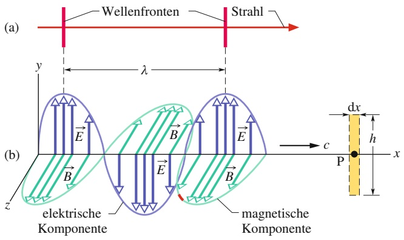

text_image

(a)
Wellenfronten
Strahl
y
λ
(b)
elektrische Komponente
B
E
B
E
B
magnetische Komponente
c
dx
h
P
x
z

Bei der Interpretation von Abb. 29.5 ist eine gewisse Vorsicht geboten. Wie Sie sich erinnern werden, hatten wir in Kapitel 12 ähnliche Darstellungen von transversalen Seilwellen betrachtet; diese hatten die reale Bewegung von Seilabschnit ten während des Vorbeilaufens der Welle dargestellt. Abbildung 29.5b ist dagegen abstrakter: In dem gezeigten Moment haben das elektrische und das magnetische Feld in jedem Punkt der x-Achse jeweils eine bestimmte Feldstärke und eine bestimmte Richtung (stets senkrecht zur x-Achse). Um diese vektoriellen Größen anschaulich zu machen, zeichnen wir in jedem Punkt zwei Pfeile; zu verschiedenen Punkten auf der Achse gehören dann verschieden lange Pfeile, die sämtlich von der x-Achse weg zeigen (wie die Dornen vom Stiel einer Rose). Diese Pfeile bedeuten aber nur entsprechende Werte der Feldstärke an den betreffenden Punkten; weder sie noch die Sinuskurven stellen irgendeine reale Bewegung dar und die Pfeile verbinden auch keine Punkte außerhalb der x-Achse mit dieser Achse.

Zeichnungen wie Abb. 29.5 helfen uns, eine in Wirklichkeit sehr komplizierte Situation zu veranschaulichen. Betrachten wir zunächst das Magnetfeld. Durch seine sinusförmige Oszillation induziert es (gemäß dem Faradayschen Induktionsgesetz) ein senkrecht zu ihm gerichtetes elektrisches Feld, das sich ebenfalls sinusförmig ändert. Diese Oszillation des elektrischen Felds bewirkt ihrerseits (gemäß dem Maxwellschen Induktionsgesetz) ein wiederum auf ihm stehendes magnetisches Feld, das gleichfalls sinusförmig schwingt, und so weiter. Beide Felder induzieren einander ständig gegenseitig, und die resultierende sinusförmige Änderung der Felder bewegt sich in Form einer Welle – der elektromagnetischen Welle – fort. Ohne diesen wirklich bemerkenswerten Effekt könnten wir nichts sehen, ja nicht einmal existieren, da die Temperatur der Erde nur durch die unablässige Einstrahlung elektromagnetischer Wellen von der Sonne aufrechterhalten wird.

## Licht: Eine ungewöhnliche Welle

Alle Wellen, die wir in den Kapiteln 12 und 13 besprochen haben, sind an ein Medium (etwas Stoffliches) gebunden, durch das oder entlang dessen sie sich fortpflanzen: ein Seil, die Luft, den Erdboden. Elektromagnetische Wellen (wir wollen sie jetzt kurz Lichtwellen oder Licht nennen) jedoch sind insofern ungewöhnlich, als sie sich auch ohne jedes Medium ausbreiten können. Sie bewegen sich durch Luft oder Glas ebenso wie durch den leeren Raum zwischen der Erde und einem Stern.

Die Spezielle Relativitätstheorie, die Albert Einstein im Jahr 1905 veröffentlichte, beruht unter anderem darauf, dass die Lichtgeschwindigkeit eine ganz besondere Eigenschaft hat: Sie hat immer denselben Wert, ungeachtet des Bezugssystems, von dem aus man sie misst. Sendet man einen Lichtstrahl entlang einer Achse aus, so messen mehrere Beobachter, die sich mit verschiedenen Geschwindigkeiten in unterschiedliche Richtungen entlang dieser Achse bewegen, alle dieselbe Geschwindigkeit des Lichts. Dieses Ergebnis ist überraschend und unterscheidet sich völlig von dem Resultat, das man bei der Beobachtung jeder anderen Welle er-

## Abb. 29.5

(a) Eine elektromagnetische Welle, dargestellt durch einen Strahl und zwei Wellenfronten; die Wellenfronten sind eine Wellenlänge λ voneinander entfernt. (b) Dieselbe Welle, dargestellt als „Schnappschuss“ des elektrischen und des magnetischen Felds, E⃗ und ${ \vec { B } } ,$ an Punkten der x-Achse, entlang derer sich die Welle mit der Geschwindigkeit c ausbreitet. In Punkt P ändern sich die Felder beim Durchgang der Welle wie in Abb. 29.4 gezeigt. Die elektrische Komponente der Welle umfasst nur die elektrischen Felder, die magnetische Komponente nur die Magnetfelder. Das gestrichelte Rechteck in P wird auch in Abb. 29.6 verwendet.

halten hätte. Die Geschwindigkeit des Beobachters relativ zur Welle hätte in diesen Fällen das Messergebnis beeinflusst.

Die Einheit Meter ist heute so definiert, dass die Lichtgeschwindigkeit (die Geschwindigkeit elektromagnetischer Wellen) im Vakuum exakt den Wert

$$
c = 2 9 9 7 9 2 4 5 8 \mathrm{m/s}
$$

hat. Dieser Wert kann als Standard benutzt werden. Wenn Sie also die Zeit mes sen, die ein Lichtpuls benötigt, um von einem Punkt zu einem anderen zu gelangen, dann messen Sie in Wirklichkeit nicht die Lichtgeschwindigkeit, sondern die Entfernung zwischen den beiden Punkten.

## 29.1.3 Die Ausbreitung elektromagnetischer Wellen: Eine quantitative Betrachtung

Wir wollen nun die Gln. 29.3 und 29.4 herleiten und, was noch wichtiger ist, die gegenseitige Induktion von elektrischem und magnetischem Feld genauer untersuchen, ohne die es keine elektromagnetische Welle und folglich kein Licht gäbe.

## Gleichung 29.4 und das induzierte elektrische Feld

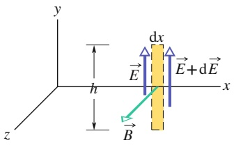

text_image

y
h
dx
E
E+dE
x
z
B

Abb. 29.6

Wenn die elektromagnetische Welle von links kommend den Punkt P in Abb. 29.5 passiert, wird durch die sinusförmige Änderung des Magnetfelds B⃗ über dem Rechteck um P ein elektrisches Feld entlang dieses Rechtecks induziert. Im gezeigten Augenblick nimmt die Feldstärke von B⃗ ab, daher ist die elektrische Feldstärke auf der rechten Seite des Rechtecks größer als auf der linken.

In Abb. 29.6 liegt das gestrichelte Rechteck mit den Seitenlängen dx und h am Punkt P auf der x-Achse und in der xy-Ebene (siehe Abb. 29.5b, rechts). Wenn die elektromagnetische Welle von links kommend dieses Rechteck durchläuft, ändert sich der magnetische Fluss $\Phi _ { B }$ durch das Rechteck; gemäß dem Faradayschen Induktionsgesetz wird daher über der Fläche des Rechtecks ein elektrisches Feld induziert. Wir bezeichnen das an den beiden längeren Seiten des Rechtecks induzierte Feld mit $\vec { E }$ bzw. $\vec { E } + \mathsf { d } \vec { E } ;$ dabei handelt es sich gerade um die elektrische Komponente der elektromagnetischen Welle.

Betrachten wir diese Felder in dem Moment, in dem der in Abb. 29.5b unten rot markierte Abschnitt der magnetischen Komponente durch das Rechteck tritt. Das magnetische Feld zeigt dann in positive z-Richtung und sein Betrag nimmt ab (der als nächstes ankommende grüne Pfeil ist kürzer als der aktuelle). Weil die Magnetfeldstärke abnimmt, nimmt auch der magnetische Fluss $\varPhi _ { B }$ durch das Rechteck ab. Das Faradaysche Gesetz verlangt, dass die induzierten elektrischen Felder genau entgegengesetzt der Flussänderung gerichtet sind. Es entsteht also ein Magnetfeld ${ \vec { B } } ,$ das in die positive z-Richtung zeigt.

Wir können uns die Begrenzung des Rechtecks als Leiterschleife vorstellen; gemäß der Lenzschen Regel würden wir dann erwarten, dass in dieser Schleife ein Strom im Gegenuhrzeigersinn induziert würde. Natürlich existiert diese Leiterschleife hier nicht wirklich, aber anhand dieser Überlegung können wir nachvollziehen, dass die elektrischen Feldvektoren $\vec { E }$ und $\vec { E } + \vec { \mathsf { d } E }$ tatsächlich so gerichtet sind, wie Abb. 29.6 zeigt, dass also der Betrag von $\vec { E } + \mathrm { d } \vec { E }$ größer ist als der von $\vec { E } .$ Anders wäre nicht zu erklären, dass das induzierte Feld insgesamt im Gegenuhrzeigersinn um das Rechteck herum wirkt.

Wir wollen nun das Faradaysche Induktionsgesetz

$$
\oint \vec {E} \cdot \mathrm{d} \vec {s} = - \frac {\mathrm{d} \varPhi_ {B}}{\mathrm{d} t} \tag {29.6}
$$

entgegen dem Uhrzeigersinn um das Rechteck in Abb. 29.6 herum anwenden. Die beiden kürzeren Rechteckseiten (oben und unten) liefern keinen Beitrag zu dem Integral, weil dort $\vec { E }$ und d⃗s senkrecht aufeinander stehen. Der Wert des Integrals ist dann

$$
\oint \vec {E} \cdot \mathrm{d} \vec {s} = (E + \mathrm{d} E) h - E h = h \mathrm{d} E. \tag {29.7}
$$

Der Fluss $\Phi _ { B }$ durch das Rechteck ist

$$
\varPhi_ {B} = (B) (h \mathrm{d} x), \tag {29.8}
$$

wobei B der Betrag von $\vec { B }$ innerhalb des Rechtecks ist und h dx dessen Fläche. Die Ableitung von Gl. 29.8 nach t liefert

$$
\frac {\mathrm{d} \varPhi_ {B}}{\mathrm{d} t} = h \mathrm{d} x \frac {\mathrm{d} B}{\mathrm{d} t}. \tag {29.9}
$$

Nun setzen wir die Gln. 29.7 und 29.9 in Gl. 29.6 ein und erhalten so

$$
h \mathrm{d} E = - h \mathrm{d} x \frac {\mathrm{d} B}{\mathrm{d} t}
$$

oder

$$
\frac {\mathrm{d} E}{\mathrm{d} x} = - \frac {\mathrm{d} B}{\mathrm{d} t}. \tag {29.10}
$$

In Wirklichkeit hängen sowohl B als auch E von zwei Variablen ab, dem Ort x und der Zeit t (siehe die Gln. 29.1 und 29.2). Bei der Bildung von $\mathrm { d } E / \mathrm { d } \mathfrak { x }$ müssen wir aber t als konstant annehmen, weil Abb. 29.6 eine Momentaufnahme zeigt. Entsprechend nehmen wir für die Ableitung dB∕dt x als konstant an, da wir die zeitliche Änderung von B an einem bestimmten Ort – dem Punkt P in Abb. 29.5b – betrachten. Es handelt sich also in beiden Fällen um partielle Ableitungen (siehe Anhang D), sodass wir Gl. 29.10 korrekt wie folgt schreiben müssen:

$$
\frac {\partial E}{\partial x} = - \frac {\partial B}{\partial t}. \tag {29.11}
$$

Das Minuszeichen in dieser Gleichung ist notwendig und wichtig: Über dem Rechteck in Abb. 29.6 nimmt die Feldstärke $E$ mit steigendem x zu, die Feldstärke B hingegen nimmt mit steigendem t ab.

Aus Gl. 29.1 erhalten wir damit

$$
\frac {\partial E}{\partial x} = k E _ {\mathrm{m}} \cos (k x - \omega t)
$$

und aus Gl. 29.2

$$
\frac {\partial B}{\partial t} = - \omega B _ {\mathrm{m}} \cos (k x - \omega t).
$$

Somit wird Gl. 29.11 zu

$$
k E _ {\mathrm{m}} \cos (k x - \omega t) = \omega B _ {\mathrm{m}} \cos (k x - \omega t). \tag {29.12}
$$

Das Verhältnis $\omega / k$ gibt bekanntlich die Ausbreitungsgeschwindigkeit einer Welle an, die wir in diesem Fall mit c bezeichnen. Gleichung 29.12 wird damit zu Gl. 29.4,

$$
\frac {E _ {\mathrm{m}}}{B _ {\mathrm{m}}} = c. \tag {29.13}
$$

## Gleichung 29.3 und das induzierte magnetische Feld

Abbildung 29.7 zeigt wieder ein gestricheltes Rechteck an dem Punkt P aus Abb. 29.5, das nun aber in der xz-Ebene liegt. Passiert die elektromagnetische Welle dieses Rechteck von links kommend, so ändert sich der elektrische Fluss $\Phi _ { E }$ in dem Rechteck. Nach dem Maxwellschen Induktionsgesetz wird daher im Bereich des Rechtecks ein Magnetfeld induziert, bei dem es sich gerade um die magnetische Komponente der elektromagnetischen Welle handelt.

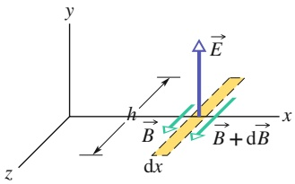

text_image

y
h
E
B
dx
B + dB
x
z

## Abb. 29.7

Durch die sinusförmige Änderung des elektrischen Felds beim Durchgang durch dieses Rechteck an dem (hier nicht eingezeichneten) Punkt P aus Abb. 29.5b wird über der Fläche des Rechtecks ein Magnetfeld induziert. Der gezeigte Moment entspricht dem aus Abb. 29.6: Die elektrische Feldstärke nimmt ab und die Feldstärke des induzierten Magnetfelds ist auf der rechten Seite des Rechtecks größer als auf der linken.

Wie wir aus Abb. 29.5 ablesen können, ist in dem Moment, in dem das Magnetfeld in Abb. 29.6 „aufgenommen“ wurde, das elektrische Feld durch das Rechteck in Abb. 29.7 wie angegeben gerichtet. Wir erinnern uns, dass die Feldstärke des Magnetfelds in Abb. 29.6 in diesem Moment abnahm. Da beide Felder in Phase sein müssen, muss dasselbe in diesem Moment auch für das elektrische Feld in Abb. 29.7 gelten; folglich nimmt auch der elektrische Fluss $\Phi _ { E }$ durch das Rechteck ab. Mit denselben Argumenten, die wir bereits auf Abb. 29.6 abgewendet haben, können wir nun begründen, dass die Änderung des Flusses $\Phi _ { E }$ ein Magnetfeld induziert. Die Vektoren $\vec { B }$ und $\vec { B } + \mathrm { d } \vec { B }$ sind dabei so gerichtet wie in Abb. 29.7 angegeben (wobei die Feldstärke von $B + \mathrm { d } { \vec { B } }$ wieder größer ist als die von $\vec { B } )$

Wir wollen nun das Maxwellsche Induktionsgesetz

$$
\oint \vec {B} \cdot \mathrm{d} \vec {s} = \mu_ {0} \varepsilon_ {0} \frac {\mathrm{d} \varPhi_ {E}}{\mathrm{d} t} \tag {29.14}
$$

anwenden und dabei gegen den Uhrzeigersinn entlang der Begrenzung des Rechtecks aus Abb. 29.7 integrieren. Nur die langen Seiten des Rechtecks tragen zu dem Integral bei; für seinen Wert erhalten wir folglich

$$
\oint \vec {B} \cdot \mathrm{d} \vec {s} = - (B + \mathrm{d} B) h + B h = - h \mathrm{d} B. \tag {29.15}
$$

Der Fluss $\Phi _ { E }$ durch das Rechteck ist gleich

$$
\varPhi_ {E} = (E) (h \mathrm{d} x), \tag {29.16}
$$

mit E als mittlerem Betrag von $\vec { E }$ innerhalb des Rechtecks. Die Ableitung von Gl. 29.16 nach t liefert

$$
\frac {\mathrm{d} \varPhi_ {E}}{\mathrm{d} t} = h \mathrm{d} x \frac {\mathrm{d} E}{\mathrm{d} t}.
$$

Setzen wir dies sowie Gl. 29.15 in Gl. 29.14 ein, so erhalten wir

$$
- h \mathrm{d} B = \mu_ {0} \varepsilon_ {0} \left(h \mathrm{d} x \frac {\mathrm{d} E}{\mathrm{d} t}\right)
$$

oder über partielle Ableitungen formuliert, wie wir sie bereits in Gl. 29.11 verwendet hatten,

$$
- \frac {\partial B}{\partial x} = \mu_ {0} \varepsilon_ {0} \frac {\partial E}{\partial t}. \tag {29.17}
$$

Auch hier ist das Minuszeichen notwendig, denn im Rechteck aus Abb. 29.7 nimmt B am Punkt P mit steigendem x zu, E hingegen nimmt dort mit steigendem t ab.

Wir setzen nun die Gln. 29.1 und 29.2 in Gl. 29.17 ein und erhalten

$$
- k B _ {\mathrm{m}} \cos (k x - \omega t) = - \mu_ {0} \varepsilon_ {0} \omega E _ {\mathrm{m}} \cos (k x - \omega t),
$$

was wir in auch der Form

$$
\frac {E _ {\mathrm{m}}}{B _ {\mathrm{m}}} = \frac {1}{\mu_ {0} \varepsilon_ {0} (\omega / k)} = \frac {1}{\mu_ {0} \varepsilon_ {0} c}
$$

schreiben können. Wenn wir dies mit Gl. 29.13 verknüpfen, erhalten wir für die Ausbreitungsgeschwindigkeit der Welle

$$
c = \frac {1}{\sqrt {\mu_ {0} \varepsilon_ {0}}}, \tag {29.18}
$$

also gerade Gl. 29.3.

## KONTROLLFRAGE 1

Die Abbildung zeigt das Magnetfeld $\vec { B }$ durch das Rechteck aus Abb. 29.6 zu einem anderen Zeitpunkt; B⃗ liegt in der xz-Ebene parallel zur z-Achse und sein Betrag nimmt gerade zu. (a) Zeichnen Sie in Teil (1) der Abbildung die induzierten elektrischen Felder ein. Geben Sie die Richtungen und die relativen Beträge an (wie in Abb. 29.6). (b) Zeichnen Sie in Teil $( 2 )$ für den gleichen Zeitpunkt das elektrische Feld der elektromagnetischen Welle sowie die induzierten magnetischen Felder ein (wieder unter Angabe der Richtungen und relativen Beträge wie in Abb. 29.7).

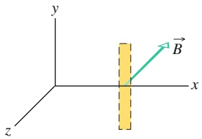

text_image

y
B
x
z

(1)

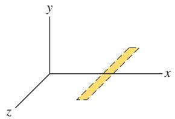

natural_image

3D coordinate system with x, y, z axes and a shaded diagonal line (no text or symbols)

(2)

## 29.2 Energietransport und Poynting-Vektor

## Lernziele

Nach dem Durcharbeiten dieses Abschnitts sollten Sie in der Lage sein, . . .

• zu verstehen, dass eine elektromagnetische Welle Energie transportiert,
einzusehen, dass die Energietransportrate einer elektromagnetischen Welle pro Flächeneinheit durch den Poynting-Vektor $\vec { S }$ gegeben ist, der sich aus dem Vektorprodukt $\vec { E } \times \vec { B }$ von elektrischem und magnetischem Feldvektor ergibt,
• die Ausbreitungsrichtung (und damit die Richtung des Energietransports) einer elektromagnetischen Welle zu bestimmen, indem Sie das Vektorprodukt für den Poynting-Vektor berechnen,
• die momentane Energieflussrate S einer elektromagnetischen Welle als Funktion der momentanen elektrischen Feldstärke E zu berechnen,
• den Zusammenhang zwischen Effektivwert $E _ { \mathrm { e f f } }$ und Amplitude $E _ { \mathrm { m } }$ der elektrischen Feldkomponente anzugeben,
• den Zusammenhang zwischen der Intensität I einer elektromagnetischen Welle und der von ihr transportierten Energie anzugeben,
• die Beziehungen zwischen der Intensität I einer elektromagnetischen Welle und dem Effektivwert $E _ { \mathrm { e f f } }$ bzw. der Amplitude $E _ { \mathrm { m } }$ der elektrischen Feldkomponente anzuwenden,
• die Beziehung zwischen der mittleren Leistung $P _ { \mathrm { g e m } } ,$ der Energieübertragung ΔE und der für die Übertragung benötigten Zeit Δt anzuwenden sowie mit der Beziehung zwischen der momentanen Leistung $P$ und der Energieübertragungsrate d $1 E / \mathrm { d } t$ umzugehen,
• eine isotrope Punktlichtquelle zu erkennen,
• die Beziehung zwischen der Emissionsleistung P, dem Abstand r zu einem Messpunkt und der dort gemessenen Intensität I für eine isotrope Punktlichtquelle anzuwenden,
• mithilfe der Energieerhaltung zu erklären, warum die Intensität einer isotropen Punktlichtquelle wie $1 / r ^ { 2 }$ mit dem Abstand abnimmt.

## Schlüsselideen

• Die Rate, mit der eine elektromagnetische Welle Energie durch eine Fläche transportiert, ist durch den Poynting-Vektor $\vec { S }$ gegeben:

$$
\vec {S} = \frac {1}{\mu_ {0}} \vec {E} \times \vec {B}.
$$

$\vec { S }$ (und damit auch die Richtung der Wellenausbreitung sowie des damit verbundenen Energietransports) steht sowohl auf $\cdot \vec { E }$ als auch auf $\vec { B }$ senkrecht.

• Die zeitlich gemittelte Energietransportrate pro Flächeneinheit ist $S _ { \mathrm { g e m } } ,$ diese Größe nennt man die Intensität I der Welle. Für sie gilt

$$
I = \frac {1}{c \mu_ {0}} E _ {\mathrm{eff}} ^ {2}.
$$

Dabei ist $E _ { \mathrm { e f f } } = E _ { \mathrm { m } } / \sqrt { 2 } .$

• Eine Punktquelle elektromagnetischer Wellen emittiert die Wellen isotrop, d. h. mit gleicher Intensität in alle Richtungen. Die Intensität der Wellen im Abstand r von einer Punktquelle mit der Strahlungsleistung $P _ { \mathrm { s } }$ beträgt

$$
I = \frac {P _ {\mathrm{S}}}{4 \pi r ^ {2}}.
$$

## 29.2.1 Energietransport und Poynting-Vektor

Elektromagnetische Wellen können Energie transportieren und auf ein Objekt übertragen, auf das sie treffen – das wird Ihnen spätestens klar, wenn Sie in der Sonne liegen. Die Rate des Energietransports pro Flächeneinheit für eine solche Welle wird durch einen Vektor $\vec { S }$ beschrieben, dessen Eigenschaften der Physiker John Henry Poynting (1852–1914) als erster untersuchte. Dieser **Poynting-Vektor** ist als

$$
\vec {S} = \frac {1}{\mu_ {0}} \vec {E} \times \vec {B} \quad (\text {Poynting - Vektor}) \tag {29.19}
$$

definiert und sein Betrag S hängt mit der momentanen Rate des Energietransports (der Strahlungsleistung) pro Flächeneinheit gemäß

$$
S = \frac {\text {Energie / Zeit}}{\text {Fläche}} = \frac {\text {Leistung}}{\text {Fläche}} \tag {29.20}
$$

zusammen. Daraus können wir ablesen, dass die SI-Einheit von S Watt pro Quadratmeter $( \mathbf { W } / \mathbf { m } ^ { 2 } )$ ist.

Die Richtung des Poynting-Vektors $\vec { S }$ einer elektromagnetischen Welle an einem beliebigen Punkt gibt die Ausbreitungsrichtung der Welle und die Richtung des Energietransports an diesem Punkt an.

Da $\vec { E }$ und $\vec { B }$ bei allen elektromagnetischen Wellen senkrecht aufeinander stehen, ist der Betrag von $\vec { E } \times \vec { B }$ einfach gleich EB. Der Betrag von $\vec { S }$ ist somit

$$
S = \frac {1}{\mu_ {0}} E B, \tag {29.21}
$$

wobei $S ,$ E und B die jeweiligen Momentanwerte bezeichnen. E und B hängen so eng miteinander zusammen, dass wir uns nur mit einem von beiden beschäftigen müssen. Wir wählen $E ,$ hauptsächlich deswegen, weil die meisten Instrumente zur Beobachtung elektromagnetischer Wellen die elektrische Feldkomponente erfassen, nicht die magnetische. Wir verwenden $B = E / c$ aus Gl. 29.5 und können Gl. 29.21 so in der Form

$$
S = \frac {1}{c \mu_ {0}} E ^ {2} \tag {29.22}
$$

schreiben; $S$ gibt hier die momentane Rate des Energieflusses (die Momentanleistung) an.

Wenn wir $E = E _ { \mathrm { m } } \sin ( k x - \omega t )$ in Gl. 29.22 einsetzen, können wir die Rate des Energietransports als Funktion der Zeit ausdrücken; in der Praxis erweist sich aber der mittlere Energietransport pro Zeiteinheit als praktischere Größe. Um ihn zu berechnen, müssen wir $S _ { \mathrm { g e m } }$ bestimmen, den zeitlichen Mittelwert von $S ,$ der auch als **Intensität** oder **Bestrahlungsstärke** I der Welle bezeichnet wird. Aus Gl. 29.20 folgt

$$
I = S _ {\mathrm{gem}} = \left(\frac {\text {Energie / Zeit}}{\text {Fläche}}\right) _ {\mathrm{gem}} = \left(\frac {\text {Leistung}}{\text {Fläche}}\right) _ {\mathrm{gem}}, \tag {29.23}
$$

woraus mit Gl. 29.22 folgt

$$
I = S _ {\mathrm{gem}} = \frac {1}{c \mu_ {0}} [ E ^ {2} ] _ {\mathrm{gem}} = \frac {1}{c \mu_ {0}} \left[ E _ {\mathrm{m}} ^ {2} \sin^ {2} (k x - \omega t) \right] _ {\mathrm{gem}}. \tag {29.24}
$$

Der Mittelwert von sin2 θ über einen ganzen Schwingungszyklus ist für jede winkelabhängige Variable $\theta$ gleich $1 / 2$ (siehe Abb. 27.14). Wir definieren eine neue Größe $E _ { \mathrm { e f f } } ,$ den quadratisch gemittelten Wert der elektrischen Feldstärke,

$$
E _ {\mathrm{eff}} = \frac {E _ {\mathrm{m}}}{\sqrt {2}}, \tag {29.25}
$$

und erhalten Gl. 29.24 so in der Form

$$
I = \frac {1}{c \mu_ {0}} E _ {\mathrm{eff}} ^ {2}. \tag {29.26}
$$

Man könnte nun aus der Beziehung $E = c B$ (mit einem sehr großen Faktor c) schließen, dass die Energie des elektrischen Felds viel größer sein muss als die des magnetischen Felds – diese Folgerung ist aber falsch; beide Energien sind exakt gleich groß. Um dies nachvollziehen zu können, gehen wir von Gl. 21.23 aus, die die Energiedichte u $\begin{array} { r } { ( = \frac { 1 } { 2 } \varepsilon _ { 0 } E ^ { 2 } ) } \end{array}$ innerhalb eines elektrischen Felds angibt. Hier setzen wir nun $c B$ für $E$ ein; das ergibt

$$
u _ {E} = \frac {1}{2} \varepsilon_ {0} E ^ {2} = \frac {1}{2} \varepsilon_ {0} (c B) ^ {2}.
$$

Anschließend substituieren wir c mithilfe von Gl. 29.3 und erhalten so

$$
u _ {E} = \frac {1}{2} \varepsilon_ {0} \frac {1}{\mu_ {0} \varepsilon_ {0}} B ^ {2} = \frac {B ^ {2}}{2 \mu_ {0}}.
$$

Gleichung 26.49 entnehmen wir aber, dass $B ^ { 2 } / 2 \mu _ { 0 }$ gerade gleich der Energiedichte $u _ { B }$ eines Magnetfelds $\vec { B }$ ist. Wir sehen also, dass in einer elektromagnetischen Welle immer und überall $u _ { E } = u _ { B }$ gilt.

## Die Abhängigkeit der Intensität vom Abstand

Der Zusammenhang zwischen der Intensität einer elektromagnetischen Strahlung und dem Abstand von ihrer Quelle ist häufig komplex, insbesondere dann, wenn die Welle in einer bestimmten Richtung abgestrahlt wird (wie etwa der Lichtstrahl eines Filmvorführgeräts). Manchmal können wir die Lichtquelle aber in guter Nä- herung als Punktquelle betrachten, welche die Strahlung isotrop (mit gleicher Intensität in alle Raumrichtungen) emittiert. Abbildung 29.8 zeigt Querschnitte der Kugelwellenfronten, die zu einem gegebenen Zeitpunkt von einer solchen isotropen Punktquelle Q ausgehen.

Nehmen wir an, die Energie der Wellen bleibe im Verlauf ihrer Ausbreitung von einer solchen Quelle aus erhalten. Außerdem denken wir uns wie in Abb. 29.8 gezeigt eine Kugel mit dem Radius r um die Quelle herum. Die gesamte von der Quelle abgestrahlte Energie muss diese Kugel durchlaufen. Die Rate, mit der die Strahlung Energie durch die Kugelfläche transportiert, muss folglich gleich der Rate sein, mit der die Quelle Energie abstrahlt, also gleich ihrer Leistung $P _ { \mathrm { Q } }$ . Für die Intensität I auf der Kugelfläche gilt dann

$$
I = \frac {\text {Leistung}}{\text {Fläche}} = \frac {P _ {\mathrm{Q}}}{4 \pi r ^ {2}} \tag {29.27}
$$

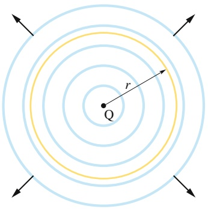

text_image

r
Q

Abb. 29.8

Eine Punktquelle Q sendet elektromagnetische Wellen gleichmäßig in alle Raumrichtungen aus. Die Kugelwellenfronten laufen durch eine gedachte Kugel mit dem Radius r und dem Mittelpunkt am Ort von Q.

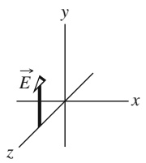

$( 4 \pi r ^ { 2 }$ ist die Fläche der Kugel). Gleichung 29.27 besagt, dass die Intensität der von einer isotropen Punktquelle abgegebenen elektromagnetischen Strahlung mit dem Quadrat des Abstands r von der Quelle abnimmt.

## KONTROLLFRAGE 2

Die Zeichnung zeigt das elektrische Feld einer elektromagnetischen Welle an einem gegebenen Punkt zu einem bestimmten Zeitpunkt. Die Welle transportiert Energie in negative z-Richtung. Geben Sie die Richtung des Magnetfelds der Welle an diesem Punkt und zu diesem Zeitpunkt an.

## 29.3 Der Strahlungsdruck

## Lernziele

Nach dem Durcharbeiten dieses Abschnitts sollten Sie in der Lage sein, . . .

• Kraft und Druck voneinander zu unterscheiden,
• zu verstehen, dass eine elektromagnetische Welle Impuls transportiert und daher eine Kraft bzw. einen Druck auf einen Körper ausüben kann,
• für einen homogenen elektromagnetischen Strahl, der senkrecht auf eine Fläche auftrifft, sowohl für den Fall vollständiger Absorption als auch für vollständige Reflexion die Beziehung zwischen dem Flächeninhalt, der Strahlungsintensität und der ausgeübten Kraft anzuwenden,
• für einen homogenen elektromagnetischen Strahl, der senkrecht auf eine Fläche trifft, sowohl im Fall vollständiger Absorption als auch für vollständige Reflexion die Beziehung zwischen der Strahlungsintensität und dem ausgeübten Druck anzuwenden.

## Schlüsselideen

• Wenn elektromagnetische Strahlung auf eine Oberfläche trifft, übt sie eine Kraft und einen Druck auf diese aus.
• Wenn die Strahlung vollständig von der Fläche absorbiert wird, beträgt die Kraft

$$
F = \frac {I A}{c} \quad \text {(vollständige Absorption)},
$$

wenn I die Strahlungsintensität und A die Fläche (bzw. deren senkrechte Projektion auf die Strahlungsrichtung) ist.

• Wenn die Strahlung vollständig von der Fläche reflektiert wird, beträgt die Kraft

$$
F = \frac {2 I A}{c} \quad \text {(vollständige Reflexion)}.
$$

• Der Strahlungsdruck $p _ { S }$ ist die Kraft pro Flächeneinheit; sie beträgt

$$
p _ {\mathrm{S}} = \frac {I}{c} \quad (\text {vollständige Absorption})
$$

bzw.

$$
p _ {\mathrm{S}} = \frac {2 I}{c} \quad \text {(vollständige Reflexion)}.
$$

## 29.3.1 Der Strahlungsdruck

Elektromagnetische Wellen besitzen sowohl einen Impuls als auch eine Energie. Licht, das auf einen Gegenstand fällt, übt auf diesen folglich einen Druck aus, den **Strahlungsdruck**. Dieser Druck muss allerdings sehr schwach sein, denn Sie spü- ren ihn nicht, wenn Sie beispielsweise vom Blitzlicht eines Fotoapparats beleuchtet werden.

Wir wollen nun einen Ausdruck für den Strahlungsdruck herleiten. Dazu stellen wir uns vor, dass elektromagnetische Strahlung (zum Beispiel Licht) für eine

Zeit Δt auf ein Objekt trifft. Dieses Objekt soll frei beweglich sein und die Strahlung vollständig **absorbieren** (aufnehmen). Während des Intervalls $\Delta t$ überträgt die Strahlung eine Energie $\Delta U$ auf den Gegenstand. Wie Maxwell zeigen konnte, wird auch ein Impuls übertragen. Der Betrag $\Delta p$ der Impulsänderung hängt dabei wie folgt mit dem Betrag der Energieänderung $\Delta U$ zusammen (vollständige Absorption der Strahlung vorausgesetzt):

$$
\Delta p = \frac {\Delta U}{c}, \tag {29.28}
$$

wobei c die Lichtgeschwindigkeit ist. Die Richtung der Impulsänderung entspricht der Richtung des einfallenden (auf das Objekt treffenden) Strahls.

Anstatt sie zu absorbieren, kann der Gegenstand die Strahlung auch **reflektieren** (in einer anderen Richtung wieder abgeben). Erfolgt die Reflexion exakt entgegen der Richtung des einfallenden Strahls, so ist der Betrag der Impulsänderung doppelt so groß wie in Gl. 29.28 angegeben, also

$$
\Delta p = \frac {2 \Delta U}{c}. \tag {29.29}
$$

Um diesen Sachverhalt zu veranschaulichen, überlegen wir uns eine Analogie: Die Impulsänderung, die ein Gegenstand beim Aufprall eines vollständig elastischen Tennisballs erfährt, ist doppelt so groß wie die beim Aufprall eines vollständig inelastischen Lehmklumpens mit derselben Masse und Geschwindigkeit (und zwar deshalb, weil der zurückprallende Tennisball nach dem Zusammenstoß im Gegensatz zu dem Lehmklumpen einen Impuls entgegen seiner ursprünglichen Flugrichtung besitzt). Wird die einfallende Strahlung zum Teil absorbiert und zum Teil reflektiert, so liegt die Impulsänderung zwischen $\Delta U / c$ und $2 \Delta U / c$

Das zweite Newtonsche Gesetz (Abschn. 5.3) verknüpft eine Impulsänderung mit einer Kraft

$$
F = \frac {\Delta p}{\Delta t}. \tag {29.30}
$$

Um die von einer Strahlung ausgeübte Kraft mithilfe ihrer Intensität I auszudrü- cken, stellen wir uns vor, die Strahlung werde von einer senkrecht zu ihrer Ausbreitungsrichtung stehenden ebenen Oberfläche aufgefangen. In dem Zeitintervall Δt empfängt diese Fläche die Energie

$$
\Delta U = I A \Delta t. \tag {29.31}
$$

Wenn sie diese Energie vollständig absorbiert, gilt nach Gl. 29.28 $\Delta p = I A \Delta t / c ;$ für den Betrag der auf die Fläche A ausgeübten Kraft erhalten wir in diesem Fall aus Gl. 29.30

$$
F = \frac {I A}{c} \quad (\text {vollständige Absorption}). \tag {29.32}
$$

Wird die Energie hingegen vollständig in Richtung des einfallenden Strahls reflektiert, so ist laut Gl. 29.29 $\Delta p = 2 I A \Delta t / c$ und Gl. 29.30 liefert

$$
F = \frac {2 I A}{c} \quad (\text {vollständige Reflexion}). \tag {29.33}
$$

Bei teilweiser Absorption bzw. Reflexion liegt der Betrag der auf A ausgeübten Kraft irgendwo zwischen $I A / c$ und $2 I A / c$

Die Kraft, die eine Strahlung pro Flächeneinheit auf ein Objekt ausübt, heißt Strahlungsdruck $p _ { S }$ . Für die durch die Gln. 29.32 und 29.33 beschriebenen Situationen können wir den Strahlungsdruck berechnen, indem wir jeweils beide Seiten durch A dividieren; das ergibt

$$
p _ {S} = \frac {I}{c} \quad (\text {vollständige Absorption}) \tag {29.34}
$$

bzw.

$$
p _ {S} = \frac {2 I}{c} \quad (\text {vollständige Reflexion}). \tag {29.35}
$$

Achten Sie darauf, dass Sie das Symbol $p _ { S }$ für den Strahlungsdruck nicht mit dem Symbol p für den Impuls verwechseln. Die SI-Einheit des Strahlungsdrucks ist dieselbe wie die des Drucks einer Flüssigkeit in Kapitel 10, also Newton pro Quadratmeter $( \mathrm { N } / \mathrm { m } ^ { 2 } )$ oder Pascal (Pa).

Durch die Entwicklung der Lasertechnik können Forscher inzwischen mit viel größeren Strahlungsdrücken experimentieren, als sie etwa beim Auslösen eines fotografischen Blitzlichts ausgeübt werden. Der Grund dafür ist, dass sich ein Laserstrahl (im Gegensatz zum Lichtstrahl eines Glühfadens) sehr stark fokussieren lässt, bis auf einen Durchmesser von wenigen Wellenlängen. Ein derart winziger Lichtfleck bedeutet einen entsprechend gigantischen Strahlungsdruck, da die bestrahlte Fläche ja im Nenner steht.

## KONTROLLFRAGE 3

Licht fällt mit gleichmäßiger Intensität senkrecht auf eine vollständig absorbieren de Fläche, welche vollkommen ausgeleuchtet wird. Nun wird die Fläche verkleinert. Nehmen (a) der Strahlungsdruck und (b) die von der Strahlung auf die Fläche ausgeübte Kraft zu, ab oder bleibt einer bzw. bleiben beide gleich?

## 29.4 Polarisation

## Lernziele

Nach dem Durcharbeiten dieses Abschnitts sollten Sie in der Lage sein, . . .

• polarisiertes und unpolarisiertes Licht zu unterscheiden,
• für einen Lichtstrahl, der sich frontal auf Sie zubewegt, die charakteristischen Eigenschaften von polarisiertem und unpolarisiertem Licht zu skizzieren,
• zu erklären, wie ein Polarisationsfilter funktioniert und welche Feldkomponente absorbiert bzw. transmittiert wird,
• die Polarisationsrichtung von Licht relativ zur Richtung des Polarisationsfilters, aus dem das Licht austritt, zu bestimmen,
• für Licht, das senkrecht auf einen Polarisationsfilter trifft, die Halbierungs-Regel und die Kosinusquadrat-Regel anzuwenden und beide zu unterscheiden,
• zwischen einem Polarisator und einem Analysator zu differenzieren,
• zu erklären, was gekreuzte Polarisationsfilter sind,
• die transmittierte Intensität von Licht und dessen Polarisation nach dem Durchgang durch ein System von Polarisationsfiltern zu bestimmen.

## Schlüsselideen

• Elektromagnetische Wellen nennt man polarisiert, wenn ihre elektrischen Feldvektoren alle in derselben Ebene (der sogenannten Schwingungsebene) schwingen. Licht aus gewöhnlichen Lichtquellen ist nicht polarisiert (unpolarisiert).
Wenn ein Polarisationsfilter in den Weg eines Lichtstrahls gestellt wird, können ihn nur diejenigen elektrischen Feldkomponenten passieren, die parallel zur Po larisationsrichtung des Filters liegen; Komponenten senkrecht dazu werden absorbiert. Das hinter einem Polarisationsfilter austretende Licht ist parallel zur Polarisationsrichtung des Filters polarisiert.
• Wenn das auf ein Polarisationsfilter auftreffende Licht unpolarisiert ist, ist die transmittierte (durchgelassene) Intensität I halb so groß wie die ursprüngliche Intensität $I _ { 0 } ;$

$$
I = \frac {1}{2} I _ {0} \quad \text {(Halbierungs - Regel)}.
$$

• War das eintretende Licht bereits polarisiert, dann hängt die transmittierte Intensität von dem Winkel θ zwischen der Polarisationsrichtung des einfallenden Lichts und der Polarisationsrichtung des Filters ab:

$$
I = I _ {0} \cos^ {2} \theta \quad (\text {Kosinusquadrat - Regel}).
$$

## 29.4.1 Polarisation

Wir haben bereits gesehen, dass der elektrische und der magnetische Feldvektor in einer elektromagnetischen Welle immer senkrecht aufeinander (sowie auf der Ausbreitungsrichtung der Welle) stehen. Die Frage ist nun, ob wir auch über die konkrete Lage dieser beiden Vektoren im Raum etwas aussagen können. Die allgemeine Antwort darauf ist nein – in der Regel schwingen die Feldvektoren in den verschiedenen Wellenzügen eines Lichtstrahls statistisch verteilt in beliebigen Ebenen um die Ausbreitungsrichtung der Welle. Es gibt jedoch Ausnahmen, in denen die elektrischen Feldvektoren tatsächlich eine bevorzugte Richtung im Raum einnehmen (und die Vektoren des Magnetfelds natürlich immer senkrecht dazu). Mit solchen Wellen bzw. Strahlen wollen wir uns im Folgenden befassen.

Abbildung 29.9a zeigt eine elektromagnetische Welle, deren elektrisches Feld parallel zur vertikalen Achse (der y-Achse) schwingt. Die Ebene, in der die elektrischen Feldvektoren liegen, nennt man **Schwingungsebene** der Welle; die Welle heißt **linear polarisiert** (in diesem Fall in y-Richtung). Den Polarisationszustand der Welle können wir veranschaulichen, indem wir der ankommenden Welle frontal entgegenblicken und die beobachtete Schwingungsrichtung des elektrischen Felds wie in Abb. 29.9b kennzeichnen. Der senkrechte Doppelpfeil in dieser Abbildung zeigt an, dass das elektrische Feld der Welle vertikal oszilliert (abwechselnd in positive und negative y-Richtung zeigt), während die Welle vorbeiläuft.

## Polarisiertes Licht

Elektromagnetische Wellen, die z. B. von einem Fernsehsender abgestrahlt werden, sind alle gleichermaßen polarisiert. Für elektromagnetische Wellen aus einer gewöhnlichen Lichtquelle (etwa der Sonne oder einer Glühlampe) gilt dies hingegen nicht: Sie sind **zufällig polarisiert** oder **unpolarisiert**. Das elektrische Feld steht dann zwar immer noch senkrecht auf der Ausbreitungsrichtung der Welle, kann seine Richtung abgesehen davon aber in zufälliger Weise „wählen“ (wobei das Magnetfeld aber ebenfalls immer senkrecht auf dem elektrischen Feld steht, egal wohin dieses zeigt). Wollen wir die Schwingungen des Feldvektors in einem bestimmten Zeitraum nun ähnlich darstellen wie in Abb. 29.9b, so ergibt sich nicht einfach ein Doppelpfeil, sondern ein Büschel unterschiedlich gerichteter solcher Pfeile (Abb. 29.10a).

Prinzipiell können wir das Durcheinander vereinfachen, indem wir jedes elektrische Feld aus Abb. 29.10a in seine y- und z-Komponente teilen. Wenn die Welle vorbeizieht, schwingt dann die Gesamtheit der y-Komponenten parallel zur y-Achse und die Gesamtheit der z-Komponenten parallel zur z-Achse. Das unpolarisierte Licht lässt sich nun als Paar von Doppelpfeilen darstellen (Abb. 29.10b): Der Doppelpfeil entlang der y-Achse steht für die Schwingungen der Gesamtheit aller y-Komponenten des elektrischen Felds, analog gilt dies für den Doppelpfeil entlang der z-Achse. Im Grunde haben wir das unpolarisierte Licht damit als Überlagerung zweier polarisierter Wellen ausgedrückt, deren Schwingungsebenen senkrecht aufeinander stehen (eine enthält die y-Achse, die andere die z-Achse). Eine Begründung für dieses Vorgehen ist natürlich die augenfällige Vereinfachung der Situation in Abb. 29.10b im Vergleich zu Abb. 29.10a.

Ähnlich können wir auch **teilweise polarisiertes** Licht darstellen, in dem die Schwingungen des Felds weder völlig zufällig wie in Abb. 29.10a noch völlig parallel zu einer bestimmten Achse wie in Abb. 29.9b erfolgen. Wir müssen dazu lediglich

## Abb. 29.10

(a) Unpolarisiertes Licht besteht aus Wellen, deren elektrische Felder in zufällige Richtungen zeigen. Die hier dargestellten Wellen bewegen sich alle entlang der gleichen Achse (aus der Papierebene heraus) und haben gleiche Amplituden E. (b) Eine andere Darstellungsweise für unpolarisiertes Licht: Die Strahlung ist eine Überlagerung zweier polarisierter Wellen, deren Schwingungsebenen senkrecht aufeinander stehen.

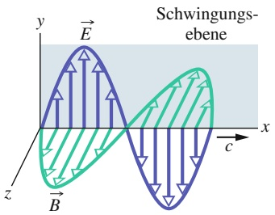

contour

| Feature | Description |
| --- | --- |
| X-axis | x (horizontal) |
| Y-axis | y (vertical) |
| Waveform | Sinusoidal wave with vertical arrows indicating direction of flow |
| Region | Schwingungsebene |
| Boundary | Horizontal line separating the two waves |
| Color | Blue to Green |

(a)

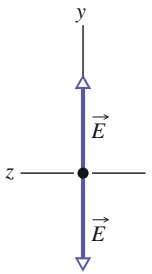

text_image

y
→
E
z
→
E

(b)

## Abb. 29.9

- (a) Schwingungsebene einer polarisierten elektromagnetischen Welle.
- (b) Um die Polarisation zu veranschaulichen, schauen wir der ankommenden Welle frontal entgegen. Die Schwingungsrichtungen des elektrischen Feldvektors können wir dann mit einem Doppelpfeil angeben.

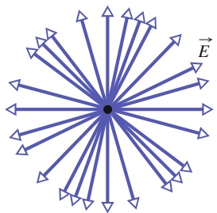

text_image

Diagram showing a central point with radiating arrows labeled E, likely representing energy or field distribution in physics or materials science.

(a)

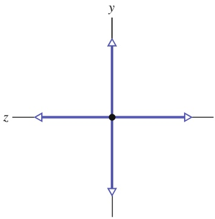

text_image

y
z

(b)

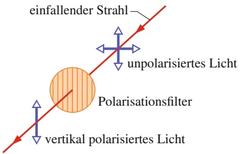

flowchart

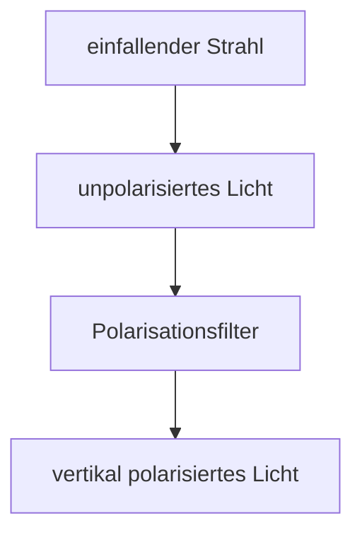

Abb. 29.11

Beim Durchgang durch ein Polarisationsfilter wird unpolarisiertes Licht polarisiert. Die Polarisationsrichtung des transmittierten Lichts ist parallel zur Polarisationsrichtung des Filters, die hier durch senkrechte Linien angedeutet ist.

einen der beiden senkrecht aufeinander stehenden Doppelpfeile länger zeichnen als den anderen.

Um unpolarisiertes sichtbares Licht in polarisiertes zu verwandeln, schickt man es durch eine polarisierende Schicht, ein **Polarisationsfilter** (Abb. 29.11). Diese in der Fotografie meist kurz Polfilter, manchmal auch Polaroidfilter genannten Folien wurden 1932 von Edwin Land noch während seines Chemiestudiums in Harvard erfunden. Ein Polaroidfilter besteht aus bestimmten länglichen Molekülen, die in einen Kunststoff eingebettet sind. Bei der Herstellung streckt man die Folie, wodurch die Moleküle in parallelen Reihen angeordnet werden (wie die Reihen auf einem gepflügten Feld). Schickt man nun Licht durch eine solche Folie, so können nur die elektrischen Feldkomponenten passieren, die in einer ausgewählten Richtung schwingen; Komponenten, die senkrecht dazu schwingen, werden von den Molekülen absorbiert und verschwinden aus dem Lichtstrahl.

Auf die Art der Moleküle wollen wir hier nicht näher eingehen. Wir ordnen der Folie hier lediglich eine Polarisationsrichtung zu, in der die elektrische Feldkomponente durchgelassen wird:

Ein Polarisationsfilter lässt die elektrische Feldkomponente parallel zu seiner Polarisationsrichtung durch, die Komponente senkrecht zu dieser wird absorbiert.

Das elektrische Feld eines Lichtstrahls enthält nach dem Durchgang durch ein po larisierendes Filter demzufolge nur noch die Komponenten, die parallel zur Polarisationsrichtung der Folie schwingen; das Licht ist in dieser Richtung (linear) polarisiert. In Abb. 29.11 werden die vertikalen Komponenten des elektrischen Felds durchgelassen (transmittiert), die horizontalen Komponenten dagegen absorbiert. Die durchgelassene Welle ist dann vertikal polarisiert.

## Die Intensität des transmittierten polarisierten Lichts

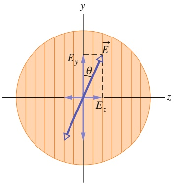

text_image

y
E_y
θ
E_z
z

Abb. 29.12

Polarisiertes Licht vor dem Eintritt in ein Polarisationsfilter. Das elektrische Feld $\vec { E }$ im Winkel θ zur Polarisationsebene des Filters kann in die Komponenten $\vec { E } _ { y }$ (parallel zur Polarisationsrichtung des Filters) und $\vec { E } _ { z }$ (senkrecht dazu) zerlegt werden. Die Komponente $\vec { \bar { E } } _ { y }$ wird von dem Filter durchgelassen, $\vec { E } _ { z }$ wird absorbiert.

Als Nächstes wollen wir nun die Intensität des polarisierten Lichts hinter einem Polarisationsfilter untersuchen. Dabei gehen wir von unpolarisiertem Licht aus, das wir wie in Abb. 29.10b gezeigt in eine $y -$ und eine z-Komponente trennen können. Die y-Achse richten wir parallel zur Polarisationsrichtung des Filters aus. In diesem Fall werden nur die y-Komponenten des elektrischen Felds von dem Filter durchgelassen; die z-Komponenten werden absorbiert. Wenn die ursprüngliche Welle vollkommen zufällig polarisiert war, dann ist die Summe aller y-Komponenten gleich der Summe aller z-Komponenten (vgl. Abb. 29.10b). Durch die Absorption aller z-Komponenten geht also die halbe Intensität des einfallenden Lichts verloren; die Intensität I des transmittierten polarisierten Lichts ist folglich

$$
I = \frac {1}{2} I _ {0}. \tag {29.36}
$$

Diese Halbierungs-Regel können wir nur anwenden, wenn das einfallende Licht tatsächlich vollkommen zufällig polarisiert ist.

Jetzt nehmen wir an, auf ein Polarisationsfilter falle bereits polarisiertes Licht. Abbildung 29.12 zeigt ein Polarisationsfilter in der Papierebene und das elektrische Feld $\vec { E }$ einer polarisierten Lichtwelle, die sich auf das Filter zubewegt (es hat also noch keine Absorption stattgefunden). Relativ zur Polarisationsrichtung des Filters können wir $\vec { E }$ der einfallenden Strahlung wieder in zwei Komponenten zerlegen, eine parallele $( \vec { E } _ { y } )$ , die von dem Filter durchgelassen wird, und eine senkrechte $( \vec { E } _ { z } )$ , die absorbiert wird. Der Winkel zwischen $\vec { E }$ und der Polarisationsrichtung des Filters sei θ. Für die transmittierte parallele Komponente gilt dann

$$
E _ {y} = E \cos \theta . \tag {29.37}
$$

Wie wir aus Gl. 29.26 wissen, ist die Intensität einer elektromagnetischen Welle (beispielsweise unserer Lichtwelle) proportional zum Quadrat der elektrischen Feldstärke. In unserem Fall ist die Intensität I der durchgelassenen Welle also proportional zu $E _ { y } ^ { 2 }$ , während die Intensität $I _ { 0 }$ der ursprünglichen Welle proportional zu $E ^ { 2 }$ war. Gleichung 29.37 können wir deshalb auch als $I / I _ { 0 } = \cos ^ { 2 } \theta$ oder

$$
I = I _ {0} \cos^ {2} \theta \tag {29.38}
$$

schreiben.

Diese Kosinusquadrat-Regel können wir nur anwenden, wenn das einfallende Licht bereits polarisiert ist. Die Intensität der transmittierten Strahlung wird in diesem Fall maximal und gleich der einfallenden Intensität $I _ { 0 } ,$ wenn die Polarisationsrichtung des einfallenden Lichts parallel zur Polarisationsebene des Filters ist (d. h., wenn $\theta$ in Gl. 29.38 gleich $0 ^ { \circ }$ oder 180° ist). I ist null, wenn die einfallende Welle senkrecht zur Polarisationsrichtung des Filters polarisiert ist $( \theta = 9 0 ^ { \circ } )$ ).

In Abb. 29.13 sehen Sie eine Anordnung, in der ursprünglich unpolarisiertes Licht nacheinander durch zwei Polarisationsfilter $\mathrm { P } _ { 1 }$ und $\mathrm { P } _ { 2 }$ geschickt wird. (Das erste Filter in einer solchen Anordnung bezeichnet man als Polarisator, das zweite als Analysator). Die Polarisationsrichtung von $\mathrm { P } _ { 1 }$ ist vertikal; das Licht, das von $\mathrm { P } _ { 1 }$ nach $\mathrm { P } _ { 2 }$ durchgelassen wird, ist folglich vertikal polarisiert. Ist die Polarisationsrichtung von $\mathrm { P } _ { 2 }$ ebenfalls vertikal, so gelangt das gesamte von $\mathrm { P } _ { 1 }$ transmittierte Licht auch durch $\mathrm { P } _ { 2 }$ . Ist die Polarisationsrichtung von $\mathrm { P } _ { 2 }$ dagegen horizontal, so wird überhaupt kein Licht, das durch $\mathrm { P } _ { 1 }$ gelangt ist, von $\mathrm { P } _ { 2 }$ durchgelassen. Zu demselben Schluss gelangen wir auch, wenn wir nur die relative Orientierung der beiden Filter betrachten: Sind die Polarisationsrichtungen parallel, dann gelangt alles Licht, das von $\mathrm { P } _ { 1 }$ durchgelassen wurde, auch durch $\mathrm { P } _ { 2 } .$ Stehen die Richtungen senkrecht aufeinander (man spricht von gekreuzten Filtern), so gelangt gar kein Licht durch $\mathrm { P } _ { 2 } .$ . Beide Extreme werden in Abb. 29.14 anhand von polarisierten Gläsern illustriert.

Schließen die beiden Polarisationsrichtungen in Abb. 29.13 einen Winkel zwischen $0 ^ { \circ }$ und 90° ein, so gelangt ein Teil des von $\mathrm { P } _ { 1 }$ durchgelassenen Lichts auch durch $\mathrm { P } _ { 2 } ,$ wobei die Intensität des transmittierten Lichtstrahls durch Gl. 29.38 gegeben ist.

Die Verwendung von Polarisationsfiltern ist eine Möglichkeit, Licht zu polarisieren. Andere Möglichkeiten sind die Polarisation durch Reflexion (Abschn. 29.7) oder durch Streuung an Atomen oder Molekülen. Licht, das auf ein Objekt trifft – beispielsweise auf ein Molekül –, wird gestreut, d. h. in viele (manchmal sogar zufällige) Richtungen wieder abgestrahlt. Ein allgemein vertrautes Beispiel ist die Streuung des Sonnenlichts an den Molekülen der Atmosphäre, wodurch das diffuse Leuchten des Taghimmels entsteht.

Obwohl das Sonnenlicht selbst unpolarisiert ist, kommt ein erheblicher Teil des Himmelslichts zumindest teilweise polarisiert auf der Erde an, was verschiedene praktische Anwendungen ermöglicht. Bienen orientieren sich an der Polarisation des Himmelslichts, um zu ihrem Stock zu finden. Die Wikinger entwickelten ein Verfahren, um in der Polarnacht (wenn die Sonne auch am Tag nicht über den Horizont steigt) durch die Nordsee navigieren zu können: Sie hatten einen Kristall entdeckt, den man heute Cordierit nennt und der seine Farbe ändert, wenn man ihn in polarisiertem Licht dreht. Wenn die Seefahrer durch einen solchen Kristall schauten und ihn dabei um die Sichtachse drehten, konnten sie die Position der hinter dem Horizont versteckten Sonne bestimmen und so die Himmelsrichtungen ermitteln.

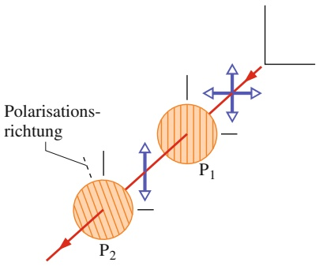

text_image

Polarisations-
richtung
P₁
P₂

Abb. 29.13

Das durch das Filter $\mathrm { P } _ { 1 }$ transmittierte Licht ist vertikal polarisiert, wie der senkrechte Doppelpfeil anzeigt. Wie viel von diesem Licht auch durch $\mathrm { P } _ { 2 }$ gelangt, hängt von dem Winkel zwischen den Polarisationsrichtungen von $\mathrm { P _ { 1 } }$ und $\mathrm { P } _ { 2 }$ ab (angedeutet durch die Linien in den Kreisen und durch die gestrichelte Linie an $\mathrm { P } _ { 2 } )$

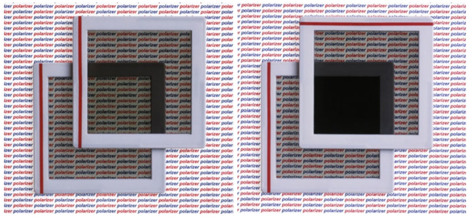

(a)

(b)

Abb. 29.14

Wenn die Polarisationsrichtungen zweier übereinander liegender polarisierter Gläser gleich sind, wird Licht durchgelassen (a); wenn aber die Polarisationsrichtungen gekreuzt sind, gelangt kein Licht hindurch [Quelle: Richard Megna/Fundamental Photographs].

## KONTROLLFRAGE 4

Die Abbildung zeigt vier Paare von Polarisationsfiltern (jeweils von vorn gesehen). Jedes Paar soll in den Weg eines anfangs unpolarisierten Lichtstrahls gebracht werden (wie die drei Filter aus Abb. 29.15). Die Polarisationsrichtung jedes Filters (angegeben durch die gestrichelten Linien) bezieht sich auf die horizontale x- oder die vertikale y-Achse. Ordnen Sie die Paare in absteigender Reihenfolge nach dem Anteil der durchgelassenen Intensität des ursprünglichen Strahls.

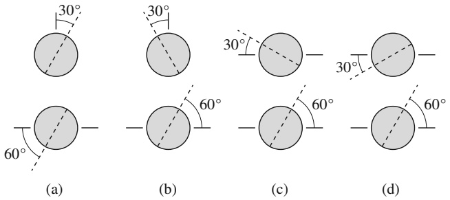

text_image

30°
30°
30°
30°
60°
(a)
(b)
(c)
60°
60°
(d)

## 29.5 Reflexion und Brechung

## Lernziele

Nach dem Durcharbeiten dieses Abschnitts sollten Sie in der Lage sein, . . .

• anhand einer Skizze zu zeigen, wie ein Lichtstrahl an einer Grenzfläche reflektiert wird, und insbesondere den ein- und ausfallenden Strahl, die Normale (das Einfallslot), den Einfalls- und den Reflexionswinkel anzugeben,
• den Zusammenhang zwischen Einfalls- und Reflexionswinkel bei der Reflexion anzugeben,
anhand einer Skizze zu zeigen, wie ein Lichtstrahl an einer Grenzfläche gebrochen wird, und insbesondere den einfallenden und den gebrochenen Strahl, die Normale (das Einfallslot), den Einfalls- und den Brechungswinkel anzugeben,
• das Snelliussche Brechungsgesetz auf die Brechung von Licht anzuwenden, um die Beziehung zwischen den Brechungsindizes und den Winkeln auf beiden Seiten der Grenzfläche zu bestimmen,
• auf einer Skizze mit einer Linie in Richtung des ungebeugten Strahls zu zeigen, wie Licht beim Übergang in ein Material mit größerem, kleinerem oder gleichem Brechungsindex gebrochen wird (zur Normalen hin, von der Normalen weg oder gar nicht),
• zu verstehen, dass Brechung immer nur an einer Grenzfläche und nie im Inneren eines Material auftritt,
• den Begriff Dispersion zu erläutern,
• bei der Brechung eines Strahls aus rotem und blauem Licht (oder auch anderen Farben) anzugeben, welche Farbe stärker gebrochen wird bzw. den größeren Brechungswinkel hat, und zwar beim Übergang entweder in ein Material mit größerem oder mit kleinerem Brechungsindex,
• zu beschreiben, wie ein Regenbogen entsteht.

## Schlüsselideen

• Die geometrische Optik ist eine genäherte Behandlung der Ausbreitung von Licht, bei der Lichtwellen durch geradlinige Strahlen beschrieben werden.
Wenn ein solcher Lichtstrahl auf eine Grenzfläche zwischen zwei transparenten Medien trifft, entstehen in der Regel ein reflektierter und ein gebrochener Strahl, die beide in der Einfallsebene liegen. Der Reflexionswinkel ist gleich dem Einfallswinkel und der Brechungswinkel hängt mit dem Einfallswinkel über das Snelliussche Brechungsgesetz

$$
n _ {2} \sin \theta_ {2} = n _ {1} \sin \theta_ {1}
$$

zusammen, wobei $n _ { 1 }$ und $n _ { 2 }$ die jeweiligen Brechungsindizes bezeichnen.

## 29.5.1 Reflexion und Brechung

Licht breitet sich im Raum aus, wenn es sich von seiner Quelle wegbewegt. Oft können wir seine Ausbreitung durch eine gerade Linie (einen „Strahl“) wie in Abb. 29.5a beschreiben. Untersucht man die Eigenschaften von Lichtwellen in dieser Näherung, so spricht man von geometrischer Optik (Strahlenoptik). In den verbleibenden Abschnitten dieses Kapitels sowie in Kapitel 30 werden wir uns mit der geometrischen Optik des sichtbaren Lichts befassen.

Das Foto in Abb. 29.15a zeigt Lichtwellen, die sich annähernd geradlinig ausbreiten. Ein dünner Lichtstrahl, der einfallende Strahl, trifft von links oben kom mend auf eine ebene Glasfläche. Ein Teil des Strahls wird an dieser Fläche nach rechts oben **reflektiert**, er bewegt sich weiter, als ob der ursprüngliche Strahl an der Fläche „abgeprallt“ wäre. Der andere Teil dringt in den gläsernen Körper ein und läuft nach rechts unten weiter. Weil Licht sich auf diese Weise in und durch Glas ausbreiten kann, können wir durch Glas hindurchsehen; Glas ist durchsichtig oder transparent. (In diesem Kapitel werden wir nur transparente Medien untersuchen.)

Der Durchgang von Licht durch eine Oberfläche – eine Grenzfläche, die zwei Medien voneinander trennt – heißt **Brechung**; das Licht wird an der Fläche gebrochen. Wenn der Lichtstrahl nicht senkrecht auf die Grenzfläche fällt, ändert er durch die Brechung seine Richtung, er „knickt ab“. Abbildung 29.15a können Sie entnehmen, dass der Strahl nur beim Durchgang durch die Grenzfläche abknickt und sich innerhalb der Medien auf beiden Seiten der Grenzfläche geradlinig ausbreitet.

Abbildung 29.15b stellt die Situation aus Abb. 29.15a schematisch dar. Die Licht strahlen sind durch gerade Linien wiedergegeben, die als einfallender Strahl, reflektierter Strahl und gebrochener Strahl bezeichnet sind (jeweils mit den zugehörigen Wellenfronten). Die Winkel werden bezüglich der Flächennormalen bzw. dem **Ein-**

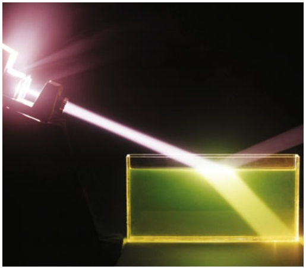

natural_image

Close-up of a glowing yellow liquid with a white light beam against a dark background, no text or symbols visible.

(a)

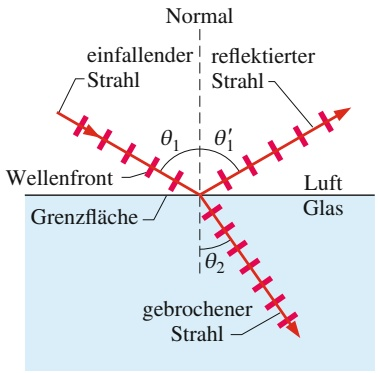

text_image

Normal
einfallender
strahl
reflektierter
strahl
θ₁
θ'₁
Wellenfront
Grenzfläche
Luft
Glas
θ₂
gebrochener
strahl

(b)

## Abb. 29.15

(a) Ein einfallender Lichtstrahl wird an einer horizontalen Wasseroberfläche sowohl reflektiert als auch gebrochen. (b) Schematische Darstellung der Situation mit Angabe des Einfallswinkels $( \theta _ { 1 } ) ,$ des Reflexionswinkels $( \theta _ { 1 } ^ { \prime } )$ und des Brechungswinkels $( \theta _ { 2 } )$ [Quelle: 1974 FP/Fundamental Photographs].

TABELLE 29.1: Brechungsindizes einiger Medien.a)

| Medium | Index | Medium | Index |
| --- | --- | --- | --- |
| Vakuum | 1 (exakt) | typisches Kronglas | 1,52 |
| Luft (0°C, 1013 hPa) | 1,000 29 | Natriumchlorid | 1,54 |
| Wasser (20°C) | 1,33 | Polystyrol | 1,55 |
| Aceton | 1,36 | Schwefelkohlenstoff | 1,63 |
| Ethanol | 1,36 | Schwerflintglas | 1,65 |
| Zuckerlösung (30%) | 1,38 | Saphir | 1,77 |
| Quarzglas | 1,46 | Schwerstflintglas | 1,89 |
| Zuckerlösung (80%) | 1,49 | Diamant | 2,42 |

a) Für Licht der gelben Natrium-Linie (589 nm).

**fallslot** angegeben, einer im Punkt der Reflexion bzw. Brechung senkrecht auf der Grenzfläche stehenden Gerade. Wir bezeichnen hier $\theta _ { 1 }$ als **Einfallswinkel**, $\theta _ { 1 } ^ { \prime }$ als **Reflexionswinkel** und $\theta _ { 2 }$ als **Brechungswinkel**, gemessen bezüglich der Normalen. Die Ebene, die den einfallenden Strahl und die Normale enthält, heißt Einfalls ebene (in Abb. 29.15b ist dies die Papierebene).

Wie Experimente zeigen, gelten für Reflexion und Brechung zwei Gesetze:

1. Reflexionsgesetz: Der reflektierte Strahl verläuft in der Einfallsebene; der Reflexionswinkel ist gleich dem Einfallswinkel. Bezogen auf Abb. 29.15b bedeutet das

$$
\theta_ {1} ^ {\prime} = \theta_ {1} \quad (\text {Reflexionsgesetz}). \tag {29.39}
$$

(Von jetzt an werden wir den Strich, der bisher den Reflexionswinkel kennzeichnete, weglassen.)

2. Brechungsgesetz: Der gebrochene Strahl liegt in der Einfallsebene; zwischen dem Brechungswinkel $\theta _ { 2 }$ und dem Einfallswinkel $\theta _ { 1 }$ besteht der Zusammenhang

$$
n _ {2} \sin \theta_ {2} = n _ {1} \sin \theta_ {1} \quad (\text {Snelliussches Brechungsgesetz}). \tag {29.40}
$$

In dieser Gleichung, dem **Snelliusschen Gesetz**, sind $n _ { 1 }$ und $n _ { 2 }$ dimensionslose Konstanten, die **Brechungsindizes** der beiden Medien. In Kapitel 31 werden wir das Snelliussche Gesetz herleiten. Wie wir dort zeigen werden, ist der Brechungsindex eines Mediums gleich $c / \nu ,$ wenn v die Lichtgeschwindigkeit in dem betreffenden Medium und c die Lichtgeschwindigkeit im Vakuum ist.

Tabelle 29.1 zeigt die Werte einiger typischer Brechungsindizes. Definitionsgemäß ist n für das Vakuum exakt gleich 1; für Luft liegt n sehr nahe bei 1,0 (näherungsweise werden wir n für Luft oft gleich 1 setzen). Da die Lichtgeschwindigkeit in einem Medium immer kleiner als im Vakuum ist, können Brechungsindizes nie kleiner als 1 sein.

Wir können Gl. 29.40 so umstellen, dass sich der Brechungswinkel $\theta _ { 2 }$ unmittelbar mit dem Einfallswinkel $\theta _ { 1 }$ vergleichen lässt; sie lautet dann

$$
\sin \theta_ {2} = \frac {n _ {1}}{n _ {2}} \sin \theta_ {1}. \tag {29.41}
$$

Wie wir sehen, hängt der relative Wert von $\theta _ { 2 }$ von dem Verhältnis der beiden Brechungsindizes ab. Dabei unterscheiden wir drei Fälle:

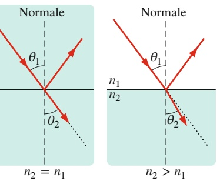

text_image

Normale
θ₁
θ₂
n₂ = n₁
Normale
θ₁
n₁/n₂
θ₂
n₂ > n₁

(a)

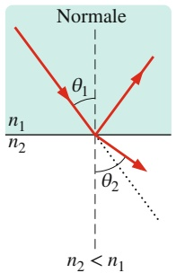

text_image

Normale
θ₁
n₁/n₂
θ₂
n₂ < n₁

(c)

Abb. 29.16

Brechung eines Lichtstrahls beim Übergang vom Medium mit dem Brechungsindex $n _ { 1 }$ ins Medium mit dem Brechungsindex $n _ { 2 } .$ (a) Für $n _ { 2 } = n _ { 1 }$ knickt der Strahl nicht ab (gepunktete Linie). (b) Für $n _ { 2 } > n _ { 1 }$ knickt der Strahl zur Normalen hin ab. (c) Für $n _ { 2 } < n _ { 1 }$ knickt der Strahl von der Normalen weg ab.

1. $n _ { 2 }   =   n _ { 1 } { : }$ In diesem Fall ist $\theta _ { 2 }   =   \theta _ { 1 }$ und der einfallende Strahl knickt beim Durchgang durch die Grenzfläche nicht ab. Der gebrochene Strahl breitet sich weiter in der Richtung des einfallenden Strahls aus (Abb. 29.16a).
2. $n _ { 2 } > n _ { 1 } { : }$ In diesem Fall ist $\theta _ { 2 } < \theta _ { 1 }$ und der Strahl knickt beim Durchgang durch die Grenzfläche von der Richtung des einfallenden Strahls weg und zur Normalen hin ab (Abb. 29.16b).
3. $n _ { 2 } < n _ { 1 } ;$ In diesem Fall ist $\theta _ { 2 } > \theta _ { 1 }$ und der Strahl knickt beim Durchgang durch die Grenzfläche von der Richtung des einfallenden Strahls und von der Normalen weg ab (Abb. 29.16c).

Ein gebrochener Strahl kann niemals so stark abknicken, dass er auf der gleichen Seite der Normalen zu liegen kommt wie der einfallende Strahl.

## Dispersion

Der Brechungsindex n von Licht in einem Medium hängt von der Wellenlänge des Lichts ab (außer im Vakuum). Das hat eine interessante Konsequenz: Wenn ein aus verschiedenen Wellenlängen bestehender Lichtstrahl auf eine Grenzfläche trifft, wird jede Wellenlänge unter einem anderen Winkel gebrochen. Diese spektrale Aufspaltung des Lichts an einer Grenzfläche nennt man **(chromatische) Dispersion** (chromatisch bezieht sich auf die Farben der einzelnen Wellenlängen und Dispersion bedeutet Aufspaltung). Die schematischen Darstellungen in Abb. 29.15 und 29.16 zeigen keine Dispersion, weil der einfallende Lichtstrahl jeweils monochromatisch (nur eine einzige Wellenlänge enthaltend) angenommen wurde.

Allgemein ist der Brechungsindex in einem gegebenen Medium für kleine Wellenlängen (z. B. blaues oder UV-Licht) stets größer als für größere Wellenlängen (z. B. rotes oder infrarotes Licht). Abbildung 29.17 zeigt die Abhängigkeit des Brechungsindex von der Wellenlänge am Beispiel von Quarzglas. Wenn also ein Lichtstrahl, der rotes und blaues Licht enthält, an einer Grenzfläche zwischen Luft und Quarzglas gebrochen wird, so knickt die blaue Komponente stärker ab als die rote.

Weißes Licht enthält alle (oder fast alle) Farben des sichtbaren Spektrums in nahezu gleicher Intensität; die Sinneszellen in unseren Augen bzw. die nachgeschaltete Verarbeitung der Reize aus diesen Zellen im Gehirn sorgen dafür, dass wir seine Farbe als Weiß wahrnehmen und nicht als eine Mischfarbe. Abbildung 29.18a zeigt einen weißen Lichtstrahl, der aus Luft auf eine Glasfläche fällt; nur die blaue und die rote Komponente sind explizit dargestellt. (Weil dieses Buch auf weißem Papier gedruckt wurde, stellen wir einen weißen Lichtstrahl grau dar; monochromatische Strahlen zeichnen wir stets rot.) Da der blaue Teilstrahl stärker abknickt als der rote, ist der Brechungswinkel $\theta _ { \mathrm { 2 b } }$ für die blaue Komponente kleiner als der Brechungswinkel $\theta _ { 2 \mathrm { r } }$ für die rote. (Denken Sie daran, dass wir alle Winkel bezüglich der Normalen messen!) In Abb. 29.18b tritt ein weißer Lichtstrahl aus einem Glaskörper in die Luft aus; wieder knickt der blaue Teilstrahl stärker ab als der rote, aber nun ist $\theta _ { \mathrm { 2 b } }$ größer als $\theta _ { 2 \mathrm { r } }$

Um die Aufspaltung in die einzelnen Farben noch zu verstärken, kann man ein massives Glasprisma mit dreiseitiger Grundfläche verwenden (Abb. 29.19a). Beim Durchgang durch ein solches Prisma wird ein Lichtstrahl zweimal gebrochen. So findet eine erste Dispersion an der ersten Grenzfläche (links in Abb. 29.19a und b) und eine weitere Dispersion an der zweiten Grenzfläche statt.

Ein (fast) alltägliches und immer wieder bezauberndes Beispiel für chromatische Dispersion ist der Regenbogen. Fällt Sonnenlicht auf seinem Weg zur Erde auf einen Regentropfen, so wird ein Teil des Lichts in den Tropfen hineingebrochen, an

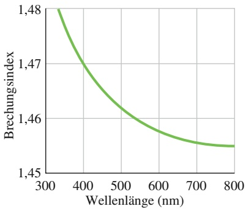

line

| Wellenlänge (nm) | Brechungsindex |
| --- | --- |
| 300 | ~1.480 |
| 400 | ~1.470 |
| 500 | ~1.462 |
| 600 | ~1.458 |
| 700 | ~1.456 |
| 800 | ~1.455 |

Abb. 29.17 Der Brechungsindex von Quarzglas als Funktion der Wellenlänge.

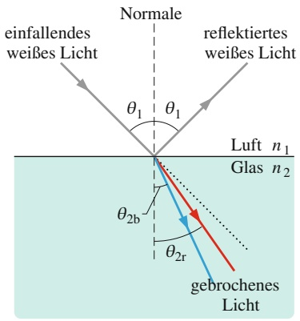

text_image

einfallendes
weißes Licht
Normale
reflektiertes
weißes Licht
θ₁ θ₁
Luft n₁
Glas n₂
θ₂b
θ₂r
gebrochenes
Licht

(a)

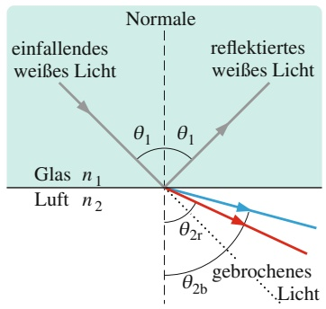

text_image

Normale
einfallendes weißes Licht
reflektiertes weißes Licht
θ1 θ1
Glas n1
Luft n2
θ2r
gebrochenes
Licht

(b)

Abb. 29.18 Die (chromatische) Dispersion von Licht. Der blaue Teilstrahl knickt stärker ab als der rote. (a) Beim Eintritt in das Glas aus der Luft ist der Brechungswinkel des blauen Teilstrahls kleiner. (b) Beim Eintritt in die Luft aus dem Glas ist der Brechungswinkel des blauen Teilstrahls größer.

Abb. 29.19

(a) Ein dreiseitiges Prisma spaltet Licht in seine Farbkomponenten auf [Quelle: Mmaxer/Shutterstock]. (b) Die chromatische Dispersion an der ersten Grenzflä- che wird beim Durchgang durch die zweite Grenzfläche verstärkt.

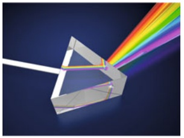

natural_image

Diagram of light passing through a prism with rainbow emission beams (no text or symbols)

(a)

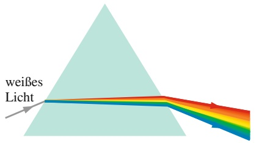

text_image

weißes
Licht

(b)

natural_image

Scenic mountain landscape with a rainbow arching over forested slopes under a cloudy sky (no text or symbols visible)

(a)

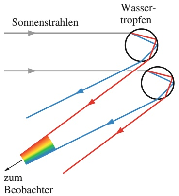

flowchart

(b)

Abb. 29.20

(a) Ein Regenbogen in freier Wildbahn [Quelle: bogdan ionescu/Shutterstock]. (b) So entsteht ein Regenbogen: Die Sonne steht am Horizont (die Sonnenstrahlen verlaufen waagerecht).

Eingezeichnet sind die Verläufe der roten und blauen Teilstrahlen bei der Brechung an zwei Tropfen. Viele weitere Tropfen steuern noch mehr rotes, blaues und andersfarbiges Licht bei.

der Innenfläche des Tropfens reflektiert und beim Austritt aus dem Tropfen erneut gebrochen (Abb. 29.20). Wie bei einem Prisma spaltet die erste Brechung das weiße Licht in die Farbanteile auf und die zweite Brechung verstärkt diese Aufspaltung.

Der sichtbare Regenbogen entsteht durch die Brechung an vielen Wassertropfen: Der rote Anteil stammt von Tropfen, die sich etwas höher in der Atmosphäre befinden, der blaue Anteil von Tropfen, die sich weiter unten befinden, und die restlichen Farben entstehen dazwischen. Alle Tropfen, an denen Sie die Brechungseffekte beobachten können, befinden sich unter einem Winkel von etwa $4 2 ^ { \circ }$ bezüglich eines Punkts, der aus Ihrer Sicht der Sonne genau gegenüberliegt. Fällt starker Regen und wird die Regenwand hell beleuchtet, dann können Sie einen Kreisbogen sehen (der rote Anteil liegt außen, der blaue innen). Jeder Beobachter sieht seinen eigenen Regenbogen; andere Beobachter registrieren das an anderen Tropfen gebrochene Licht.

## KONTROLLFRAGE 5

Welche dieser Brechungssituationen ist (sind) physikalisch möglich?

## Doppelbrechung

Bisher haben wir immer angenommen, dass Substanzen und Materialien durch einen skalaren Brechungsindex (d. h. eine Zahl) n charakterisiert werden können. Dies ist jedoch nicht immer der Fall. Es gibt auch Systeme, in denen der Brechungsindex von der Ausbreitungsrichtung ⃗k des eingestrahlten Lichts abhängt, genauer gesagt von der Orientierung seiner elektrischen Feldkomponente $\vec { E }$ (d. h. seiner Polarisation). Man bezeichnet solche Medien als **optisch anisotrop**. Anstelle eines skalaren Brechungsindex n muss man für solche Medien im Allgemeinen einen **Brechungsindextensor** angeben, d. h. eine $3 \times 3 - \mathrm{Max}$ deren Elemente die Brechungsindizes für die Lichtausbreitung in die jeweiligen Raumrichtungen sind.

Optische Anisotropie kommt in der Natur recht häufig vor. So sind z. B. die meisten Kristalle optisch anisotrop, da die Atome oder Ionen in dem Kristall räumlich periodisch angeordnet sind. Den Aufbau des Gesamtkristalls kann man sich als Aneinanderreihung von Elementarzellen vorstellen, die je nach Materialsystem geometrisch unterschiedlich aufgebaut sind. Wenn man nun verschiedene Achsen durch einen Kristall legt, findet man entlang dieser Achsen unterschiedliche Anordnungen der Atome (Ionen). Speziell ausgezeichnet sind die sogenannten Kristallachsen oder kristallografischen Hauptachsen. Diese entsprechen Richtungen hoher Symmetrie, entlang derer man eine reguläre periodische Anordnung der Atome (Ionen) findet. Aufgrund der strukturellen Anisotropie der Kristalle sind häufig nicht nur die optischen Eigenschaften, sondern auch die Wärme- und die elektrische Leitfähigkeit, die elastischen Eigenschaften und vieles mehr richtungsabhängig.

Kubische Kristalle sind optisch isotrop, aber alle anderen Kristalltypen zeigen eine mehr oder weniger ausgeprägte optische Anisotropie. Ein bekanntes, stark anisotropes System ist der Kalkspat oder Calcit (Calciumcarbonat, $\mathrm { C a C O } _ { 3 } )$ , der aus Kristallen mit hexagonaler Symmetrie besteht. In solchen Kristallen existiert eine Ebene, nennen wir sie $x y .$ Ebene, in der die x- und die y-Richtung optisch äquivalent sind. Die dazu senkrechte z-Achse bezeichnet man als die **optische Achse** des uniaxialen Kristalls.

Fällt das Licht parallel zur optischen Achse des Kristalls ein, steht der $\vec { E } _ { 2 }$ Vektor senkrecht auf der optischen Achse. Dieses Licht breitet sich in dem Kristall gleichförmig aus, d. h. unabhängig von seiner Polarisation. Man bezeichnet den entsprechenden Lichtstrahl als den **ordentlichen** Strahl. Im Kalkspat kann man ihm den Brechungsindex $n _ { \mathrm { o } } \approx 1$ ,66 zuordnen. Im Gegensatz dazu breitet sich Licht, dessen E⃗-Vektor parallel zur optischen Achse des Kristalls liegt, mit einer effektiven Geschwindigkeit aus, die dem **außerordentlichen** Brechungsindex $n _ { \mathrm { a } } \approx 1 { , } 5$ entspricht.

Wenn nun unpolarisiertes Licht auf einen Kalkspatkristall trifft, dann wird es aufgrund der polarisationsabhängigen Brechungsindizes in zwei Teilstrahlen aufgespalten, den ordentlichen und den außerordentlichen Strahl, die senkrecht zueinander polarisiert sind. Falls die Einfallsrichtung nicht parallel zur optischen Achse ist, breiten sich die beiden Teilstrahlen in unterschiedliche Richtungen aus. Es kommt also zu einer räumlichen Auftrennung des Strahls, wobei der ordentliche Strahl dem Snelliusschen Gesetz (Gl. 29.40) gehorcht, der außerordentliche Strahl jedoch nicht. Die Folge zeigt Abb. 29.21: Einen Gegenstand, der sich unter einem Kalkspatkristall befindet, sieht man durch diesen als Doppelbild. Dieser Effekt ist als **Doppelbrechung** bekannt. Wenn das Licht senkrecht zur optischen Achse des Kalkspats einfällt, dann breiten sich ordentlicher und außerordentlicher Strahl zwar in die gleiche Richtung aus, aber mit unterschiedlichen Geschwindigkeiten. Es kommt daher bei dem austretenden Strahl zu einer Phasendifferenz zwischen den verschiedenen Polarisationskomponenten, die von der Kristalldicke und der Wellenlänge des Lichts abhängt.

Neben schönen physikalischen Demonstrationen hat die Doppelbrechung auch eine ganze Reihe praktischer Anwendungen, z. B. in optischen Filtern, Polarisatoren usw. oder auch in der Werkstoffprüfung. Hierbei misst man die lokale Doppelbrechung von Materialien, die im perfekten Zustand optisch isotrop sind, und kann aus den Ergebnissen auf innere Spannungen in den Proben schließen.

text_image

HEALTHY
EATING

Abb. 29.21

Doppelbrechung im Kalkspat [Quelle: de.wikipedia.org/wiki/Doppelbrechung, Foto von Adrian Pingstone].

## 29.6 Totalreflexion

## Lernziele

Nach dem Durcharbeiten dieses Abschnitts sollten Sie in der Lage sein, . . .

die Entstehung der Totalreflexion anhand einer Skizze zu erklären und insbesondere Einfalls- und Grenzwinkel sowie das Verhältnis der Brechungswinkel auf beiden Seiten der Grenzfläche anzugeben,
• den Brechungswinkel für den kritischen Einfallswinkel anzugeben,
• den Grenzwinkel der Totalreflexion für ein gegebenes Paar von Brechungsindizes zu berechnen.

## Schlüsselideen

• Eine Welle, die auf die Grenzfläche zu einem Medium mit kleinerem Brechungsindex trifft, wird totalreflektiert, wenn ihr Einfallswinkel größer ist als der Grenzwinkel (kritische Einfallswinkel)

$$
\theta_ {\mathrm{krit}} = \sin^ {- 1} \frac {n _ {2}}{n _ {1}} \quad \text {(Grenzwinkel der Totalreflexion)}.
$$

text_image

a b c d e f g
Grenzfall
θkrit
Luft
Glas
S

(a)

natural_image

Transparent glass case with a central object and radiating light beams against a dark background (no text or symbols visible)

(b)

## Abb. 29.22

(a) Totalreflexion tritt auf, wenn Lichtstrahlen aus einer Punktquelle S in einem optisch dichteren Medium (hier Glas) unter einem Winkel auf die Grenzfläche zu einem optisch weniger dichten Medium (hier Luft) Luft fallen, der größer ist als der Grenzwinkel $\theta _ { \mathrm { k r i t } } ,$ Bei Lichteinfall im Grenzwinkel verläuft der gebrochene Strahl exakt an der Grenzfläche. (b) Eine Lichtquelle in einem Wassertank [Quelle: Ken Kay/Fundamental Photographs].

natural_image

Close-up of a flexible LED cable with glowing red light, no text or symbols visible

Abb. 29.23

Licht, das in das eine Ende eines Bündels von optischen Fasern einfällt, wird durch Totalreflexion weitgehend verlustfrei durch die Fasern geleitet und tritt am anderen Ende des Bündels wieder aus [Quelle: Hustvedt/CC-SA-3.0].

## 29.6.1 Totalreflexion

Abbildung 29.22a zeigt monochromatische Lichtstrahlen, die von einer in Glas eingebetteten Punktquelle S ausgehen und auf die Grenzfläche zwischen Glas und Luft fallen. Strahl a ist senkrecht zu dieser Grenzfläche, er wird daran teilweise reflektiert, teilweise bewegt er sich ohne Richtungsänderung in der Luft weiter.

Für die Strahlen a bis e nimmt der Einfallswinkel auf die Grenzfläche kontinuierlich zu; an der Fläche findet stets sowohl Reflexion als auch Brechung statt (mit Ausnahme von Strahl a), wobei der Brechungswinkel mit zunehmendem Einfallswinkel ebenfalls zunimmt. Bei Strahl e ist ein Brechungswinkel von $9 0 ^ { \circ }$ erreicht, das bedeutet, der gebrochene Strahl verläuft exakt an der Grenzfläche. Der zu dieser Situation gehörende Einfallswinkel ist der sogenannte **Grenzwinkel** $\theta _ { \mathrm { k r i t } }$ . Wird der Einfallswinkel größer als $\theta _ { \mathrm { k r i t } }$ (wie für die Strahlen f und ${ \mathfrak { g } } ) ,$ gibt es überhaupt keinen gebrochenen Strahl mehr: Das Licht wird vollständig reflektiert. Man nennt diesen Effekt **Totalreflexion**.

Zur Berechnung von $\theta _ { \mathrm { k r i t } }$ verwenden wir Gl. 29.40. Willkürlich ordnen wir den Index 1 dem Medium Glas zu und den Index 2 der Luft. Wir setzen $\theta _ { \mathrm { k r i t } }$ für $\theta _ { 1 }$ und 90° für $\theta _ { 2 }$ ein und erhalten so

$$
n _ {1} \sin \theta_ {\mathrm{krit}} = n _ {2} \sin 9 0 ^ {\circ},
$$

woraus für den Grenzwinkel folgt

$$
\theta_ {\mathrm{krit}} = \sin^ {- 1} \frac {n _ {2}}{n _ {1}} \quad (\text {Grenzwinkel der Totalreflexion}). \tag {29.42}
$$

Da der Sinus eines Winkels niemals größer als 1 werden kann, muss $n _ { 2 }$ in dieser Gleichung stets kleiner als $n _ { 1 }$ sein. Diese Einschränkung bedeutet, dass Totalreflexion nur dann auftreten kann, wenn Licht aus einem Medium mit größerem Brechungsindex (einem „optisch dichteren“ Medium) in ein Medium mit kleinerem Brechungsindex fällt. Befände sich die Quelle S in Abb. 29.21a oder b in der Luft über dem Glas bzw. Wasser, so würden alle Strahlen, die auf die Grenzfläche zwischen Luft und Glas fielen, sowohl reflektiert als auch gebrochen.

Die Totalreflexion wird in der Medizintechnik und der Informationstechnik vielfältig angewendet. So kann ein Arzt nach einem Magengeschwür suchen, indem er zwei dünne Bündel optischer Fasern (Abb. 29.23) durch die Speiseröhre in den Magen des Patienten führt. Lichtstrahlen, die auf das äußere Ende eines solchen Bündels fallen, werden innerhalb der Fasern totalreflektiert; selbst wenn das Bündel auf seinem Weg mehrfach gekrümmt werden muss, tritt ein großer Teil der Lichtstrahlen an seinem anderen Ende wieder aus und beleuchtet das Innere des Magens. Das an den Strukturen im Inneren reflektierte Licht wird dann auf analoge Weise durch das zweite Faserbündel nach außen geleitet, wo der Arzt das Bild auf einem Monitor betrachten kann. Eine andere Anwendung der Totalreflexion sind Glasfaserkabel, die auf demselben Prinzip beruhen und die das physische Grundgerüst des Internets bilden.