## 29.7 Polarisation durch Reflexion

## Lernziele

Nach dem Durcharbeiten dieses Abschnitts sollten Sie in der Lage sein, . . .

• anhand einer Skizze zu erklären, wie unpolarisiertes Licht durch Reflexion an einer Grenzfläche polarisiert werden kann,
• den Brewster-Winkel zu identifizieren,
• die Beziehung zwischen dem Brewster-Winkel und den Brechungsindizes auf beiden Seiten einer Grenzfläche anzuwenden,
• die Funktionsweise von polarisierenden Sonnenbrillen zu erklären.

## Schlüsselideen

• Eine reflektierte Lichtwelle ist vollständig polarisiert, wenn sie im Brewster-Winkel

$$
\theta_ {\mathrm{B}} = \tan^ {- 1} \frac {n _ {2}}{n _ {1}} \qquad (\text {Brewster - Winkel})
$$

auf die reflektierende Grenzfläche trifft.

## 29.7.1 Polarisation durch Reflexion

Stellen Sie sich vor, Sie betrachten eine sonnenbeschienene Wasseroberfläche durch ein Polarisationsfilter (etwa ein Glas einer entsprechenden Sonnenbrille). Wenn Sie das Filter um Ihre Sichtlinie drehen, verändert sich die Helligkeit der Lichtreflexe auf dem Wasser: Licht, das an einer nichtmetallischen Oberfläche reflektiert wurde, ist vollständig oder teilweise polarisiert.

Abbildung 29.24 zeigt einen unpolarisierten Lichtstrahl, der auf die Oberfläche einer Glasplatte fällt. Wir zerlegen die elektrischen Feldvektoren des Lichts in jeweils zwei Komponenten. Die senkrechten Komponenten stehen senkrecht auf der Einfallsebene (in Abb. 29.24 die Papierebene) und sind in der Abbildung als Punkte (Pfeilspitzen, von oben gesehen) dargestellt. Die parallelen Komponenten sind parallel zur Einfallsebene (Papierebene) ausgerichtet und als Doppelpfeile abgebildet. Beide Komponenten sind gleich groß, weil das Licht nicht polarisiert ist.

Im Allgemeinen enthält auch ein reflektierter Lichtstrahl beide Komponenten, die jetzt aber unterschiedliche Beträge haben. Das reflektierte Licht ist also teilweise polarisiert – die elektrischen Felder oszillieren in einer bestimmten Richtung mit größeren Amplituden als in allen anderen Richtungen. Fällt das Licht jedoch unter einem bestimmten Winkel, dem Brewster-Winkel $\theta _ { \mathrm { B } } ,$ auf die Oberfläche, so enthält der reflektierte Strahl ausschließlich senkrechte Komponenten (Abb. 29.24). Das bedeutet, dass dieser Strahl bezüglich der Einfallsebene vollständig senkrecht polarisiert ist. Die parallelen Komponenten des einfallenden Strahls verschwinden nicht, sondern werden (gemeinsam mit einem Teil der senkrechten Komponenten) in das Glas hinein gebrochen.

Durch Reflexion an Glas, Wasser und anderen dielektrischen Medien (Abschn. 21.5) kann Licht teilweise oder vollständig polarisiert werden. Wenn sich Sonnenlicht an einer solchen Fläche spiegelt, sehen Sie einen hell glänzenden Fleck. Ist die Oberfläche wie in Abb. 29.24 horizontal ausgerichtet, dann ist das reflektierte Licht vollständig oder teilweise horizontal polarisiert. Um solche Lichtreflexe zu unterdrücken, werden polarisierende Gläser so in Sonnenbrillen eingebaut, dass die Polarisationsrichtung senkrecht orientiert ist. Auch in der Fotografie werden sogenannte Polfilter eingesetzt, um störende Reflexe zu minimieren.

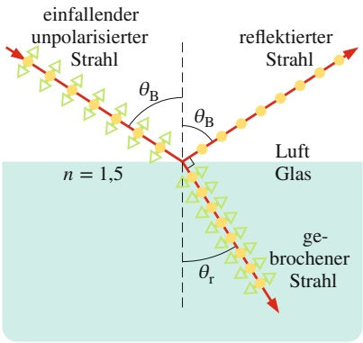

text_image

einfallender
unpolarisierter
Strahl
reflektierter
Strahl
θB
θB
n = 1,5
Luft
Glas
ge-
brochener
Strahl
θr

Komponente senkrecht zur Seite Komponente parallel zur Seite

## Abb. 29.24

Ein unpolarisierter Lichtstrahl fällt aus Luft im Brewster-Winkel $\theta _ { \mathrm { B } }$ auf die Oberfläche einer Glasplatte. Die elektrischen Feldvektoren entlang des Strahls sind hier in zwei Komponenten zerlegt, senkrecht zur Papierebene (bzw. Einfalls-, Reflexions- und Brechungsebene) und parallel zu ihr. Das reflektierte Lichtbündel enthält nur noch Komponenten senkrecht zur Papierebene und ist daher in dieser Richtung polarisiert. Das gebrochene Lichtbündel enthält die parallel zur Papierebene orientierten Komponenten des ursprünglichen Strahls und zusätzlich schwächere senkrechte Komponenten; es ist teilweise polarisiert.

## Das Brewstersche Gesetz

Wie das Experiment zeigt, sind der reflektierte und der gebrochene Strahl senkrecht zueinander polarisiert, wenn das Licht unter dem Brewster-Winkel $\theta _ { \mathrm { B } }$ zur

Normalen einfällt. In Abb. 29.24 ist $\theta _ { \mathrm { B } }$ der Reflexionswinkel und $\theta _ { \mathrm { r } }$ der Brechungswinkel und es gilt

$$
\theta_ {\mathrm{B}} + \theta_ {\mathrm{r}} = 9 0 ^ {\circ}. \tag {29.43}
$$

Aus Gl. 29.40 erhalten wir eine weitere Beziehung zwischen beiden Winkeln. Wir ordnen den Index 1 in dieser Gleichung willkürlich dem Material zu, durch das sich der einfallende und der reflektierte Strahl bewegen; dadurch erhalten wir

$$
n _ {1} \sin \theta_ {\mathrm{B}} = n _ {2} \sin \theta_ {\mathrm{r}}.
$$

Durch Verknüpfen der beiden Gleichungen ergibt sich

$$
n _ {1} \sin \theta_ {\mathrm{B}} = n _ {2} \sin (9 0 ^ {\circ} - \theta_ {\mathrm{B}}) = n _ {2} \cos \theta_ {\mathrm{B}}.
$$

Dies liefert uns für den **Brewster-Winkel**

$$
\theta_ {\mathrm{B}} = \tan^ {- 1} \frac {n _ {2}}{n _ {1}}. \tag {29.44}
$$

(Beachten Sie, dass die Indizes in Gl. 29.44 nicht willkürlich zu wählen sind, sondern sich unserer obigen Entscheidung gemäß auf die verschiedenen Materialien beziehen.) Wenn sich der einfallende und der reflektierte Strahl in Luft ausbreiten, können wir $n _ { 1 }$ näherungsweise gleich 1 setzen und der Einfachheit halber n anstelle von $n _ { 2 }$ schreiben. Diese vereinfachte Form von Gl. 29.44,

$$
\theta_ {\mathrm{B}} = \tan^ {- 1} n, \tag {29.45}
$$

nennt man **Brewstersches Gesetz**. Gesetz und Winkel sind nach Sir David Brewster benannt, der beide 1812 experimentell entdeckte.

## 29.8 Zusammenfassung

**Elektromagnetische Wellen** Eine elektromagnetische Welle besteht aus oszillierenden elektrischen und magnetischen Feldern. Die möglichen Frequenzen elektromagnetischer Wellen bilden ein Spektrum, zu dem als kleiner Ausschnitt das sichtbare Licht zählt. Zu einer elektromagnetischen Welle, die sich entlang einer x-Achse ausbreitet, gehören ein elektrisches Feld $\vec { E }$ und ein Magnetfeld ${ \vec { B } } ,$ deren Feldstärken gemäß

$$
E = E _ {\mathrm{m}} \sin (k x - \omega t) \tag {29.1}
$$

und

$$
B = B _ {\mathrm{m}} \sin (k x - \omega t) \tag {29.2}
$$

von $x _ { \perp }$ und t abhängen, wobei $E _ { \mathrm { m } }$ und $B _ { \mathrm { m } }$ die Amplituden von $\vec { E }$ bzw. $\vec { B }$ sind. Elektrisches Feld und Magnetfeld induzieren einander wechselseitig. Jede elektromagnetische Welle breitet sich im Vakuum mit der Geschwindigkeit

$$
c = \frac {E}{B} = \frac {1}{\sqrt {\mu_ {0} \varepsilon_ {0}}}, \tag {29.4,29.5}
$$

aus, wobei $E$ und $B$ die zum selben Zeitpunkt gemessenen Feldstärken sind.

**Energiefluss** Die Rate, mit der eine elektromagnetische Welle Energie pro Flächeneinheit transportiert, ist durch den Poynting-Vektor $\vec { S }$ gegeben:

$$
\vec {S} = \frac {1}{\mu_ {0}} \vec {E} \times \vec {B}. \tag {29.19}
$$

Die Richtung von $\vec { S }$ (und damit die Ausbreitungsrichtung der Welle und die Richtung des Energietransports) steht senkrecht auf den Richtungen von sowohl E⃗ als auch B⃗ . Die zeitlich gemittelte Rate $S _ { \mathrm { g e m } }$ des Energietransports pro Flä- cheneinheit ist die Intensität

$$
I = \frac {1}{c \mu_ {0}} E _ {\mathrm{eff}} ^ {2} \tag {29.26}
$$

der Welle, wobei $E _ { \mathrm { e f f } } = E _ { \mathrm { m } } / \sqrt { 2 }$ ist. Eine Punktquelle elektromagnetischer Strahlung sendet die Wellen isotrop aus, also mit gleicher Intensität in alle Raumrichtungen. Die Intensität der Wellen in einem Abstand r von einer Punktquelle mit der Leistung $P _ { \mathrm { Q } }$ ist

$$
I = \frac {P _ {\mathrm{Q}}}{4 \pi r ^ {2}}. \tag {29.27}
$$

**Strahlungsdruck** Elektromagnetische Strahlung, die auf eine Fläche fällt, übt auf diese eine Kraft und einen Druck aus. Wird die Strahlung vollständig von der Oberfläche absorbiert, so beträgt die Kraft

$$
F = \frac {I A}{c}, \tag {29.32}
$$

wenn I die Intensität der Strahlung ist und A der Inhalt der Fläche senkrecht zur Ausbreitungsrichtung der Strahlung. Wird die Strahlung vollständig in der Einfallsrichtung reflektiert, so ist die ausgeübte Kraft

$$
F = \frac {2 I A}{c}. \tag {29.33}
$$

Der Strahlungsdruck $p _ { S }$ ist gleich der pro Flächeneinheit ausgeübten Kraft, also

$$
p _ {\mathrm{S}} = \frac {I}{c} \tag {29.34}
$$

bei vollständiger Absorption und

$$
p _ {\mathrm{S}} = \frac {2 I}{c} \tag {29.35}
$$

bei vollständiger Reflexion der einfallenden Strahlung.

**Polarisation** Elektromagnetische Wellen heißen **polarisiert**, wenn ihre elektrischen Feldvektoren alle in einer Ebene, der **Polarisationsebene**, schwingen. Licht aus gewöhnlichen Quellen ist nicht polarisiert, also **unpolarisiert** oder zufällig polarisiert.

Wenn das elektrische Feld in einer festen Richtung schwingt, ist das Licht **linear polarisiert**. Wenn der Feldvektor auf einem Kreis um die Ausbreitungsrichtung rotiert, heißt das Licht **zirkular polarisiert**. Beschreibt die Spitze des Feldvektors eine Ellipse, nennt man das Licht **elliptisch polarisiert**.

**Polarisationsfilter** Bringt man ein Polarisationsfilter in den Weg eines Lichtstrahls, so werden nur diejenigen Komponenten des elektrischen Felds durchgelassen (transmittiert), die parallel zur **Polarisationsrichtung** des Filters schwingen; Komponenten senkrecht zur Polarisationsrichtung des Filters werden absorbiert. Licht, das durch ein Polarisationsfilter gefallen ist, ist deshalb parallel zur Polarisationsrichtung des Filters polarisiert.

Wenn der Lichtstrahl vor dem Eintritt in das Filter unpolarisiert war, ist die durchgelassene Intensität I halb so groß wie die ursprüngliche Intensität $I _ { 0 } ;$

$$
I = \frac {1}{2} I _ {0}. \tag {29.36}
$$

War der Lichtstrahl bereits vor Eintritt in das Filter pola risiert, so hängt die durchgelassene Intensität vom Winkel $\theta$ zwischen der Polarisationsrichtung des ursprünglichen Lichts und der Polarisationsrichtung des Filters ab:

$$
I = I _ {0} \cos^ {2} \theta . \tag {29.38}
$$

**Geometrische Optik** Die geometrische Optik (oder Strahlenoptik) beschreibt optische Phänomene, indem sie die Lichtwellen als gerade Lichtstrahlen behandelt.

**Reflexion und Brechung** Fällt Licht auf die Grenzfläche zwischen zwei transparenten Medien, so treten im Allgemeinen ein **reflektierter** und ein **gebrochener** Strahl auf. Beide Strahlen verlaufen in der Einfallsebene. Der **Reflexionswinkel** ist gleich dem Einfallswinkel, und der **Brechungswinkel** hängt mit dem Einfallwinkel über die Beziehung

$$
n _ {2} \sin \theta_ {2} = n _ {1} \sin \theta_ {1} \tag {29.40}
$$

zusammen, wobei $n _ { 1 }$ und $n _ { 2 }$ die Brechungsindizes der Medien sind, in denen sich der einfallende bzw. der gebrochene Strahl ausbreiten.

**Totalreflexion** Wenn Licht aus einem Medium mit höhe rem Brechungsindex in ein Medium mit niedrigerem Brechungsindex fällt, tritt an der Grenzfläche **Totalreflexion** auf, falls der Einfallswinkel größer ist als der **Grenzwinkel**

$$
\theta_ {\mathrm{krit}} = \sin^ {- 1} \frac {n _ {2}}{n _ {1}}. \tag {29.42}
$$

**Polarisation durch Reflexion** Eine einfallende Welle wird vollständig **polarisiert** (wobei die elektrischen Feldvektoren $\vec { E }$ senkrecht zur Einfallsebene orientiert sind), wenn sie unter dem **Brewster-Winkel**

$$
\theta_ {\mathrm{B}} = \tan^ {- 1} \frac {n _ {2}}{n _ {1}} \tag {29.44}
$$

auf eine nichtmetallische Grenzfläche trifft.

**Doppelbrechung** In optisch anisotropen Materialien hängt der Brechungsindex von der Orientierung der elektrischen Feldkomponente $\vec { E }$ des eingestrahlten Lichts ab. Anstelle eines skalaren Brechungsindex muss man in solchen Medien im Allgemeinen einen Brechungsindextensor verwenden, d. h. eine $3 \times 3 - \mathrm{Max}$ die als Einträge die Brechungsindizes für die Lichtausbreitung in die jeweiligen Richtungen enthält. Wenn unpolarisiertes Licht auf optisch anisotrope Materialien auftrifft, kann es zur Doppelbrechung kommen. Hierbei wird das Licht aufgrund der unterschiedlichen Brechungsindizes in zwei Teilstrahlen aufgespalten, die man als den ordentlichen und den außerordentlichen Strahl bezeichnet.

## 29.9 Fragen

**1.** Das Magnetfeld einer Lichtwelle schwinge parallel zur y-Achse und sei durch $B _ { y } = B _ { \mathrm { m } }$ sin(kz−ωt) gegeben. (a) In welcher Richtung breitet sich die Welle aus? (b) Parallel zu welcher Achse schwingt der zugehörige elektrische Feldvektor?
**2.** Abbildung 29.F2 zeigt eine Momentaufnahme des elektrischen und des magnetischen Felds einer elektromagnetischen Welle. Bewegt sich die Welle in die Papierebene hinein oder aus ihr heraus?

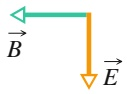

Abb. 29.F2

**3.** In Abb. 29.F3 fällt ein Lichtstrahl auf ein Polarisationsfilter, dessen Polarisationsrichtung parallel zur y-Achse liegt. Wir drehen das Filter nun um $4 0 ^ { \circ }$ im Uhrzeigersinn um die angegebene Ausbreitungsrichtung des Strahls. Wird der durchgelassene Teil der Intensität des ursprünglichen Strahls bei dieser Drehung kleiner, größer oder bleibt er gleich, wenn das Licht anfangs (a) unpolarisiert, (b) parallel zur x-Achse polarisiert und (c) parallel zur y-Achse polarisiert ist?

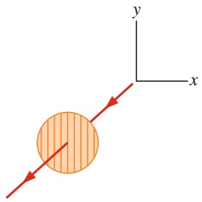

text_image

y
x

Abb. 29.F3

**4.** Gehen Sie in Abb. Ü29.1a im Übungsbuch von Licht aus, das parallel zur x-Achse polarisiert ist. Das Verhältnis zwischen der Intensität hinter der Anordnung $( I _ { 3 } )$ zur Intensität vor der Anordnung $( I _ { 0 } )$ ist $I _ { 3 } / I _ { 0 } = A$ cosn θ. Geben Sie A, n und θ an, wenn die Polarisationsrichtung des ersten Filters im Vergleich zu Abb. 29.15a um (a) $6 0 ^ { \circ }$ gegen den Uhrzeigersinn und (b) $9 0 ^ { \circ }$ im Uhrzeigersinn gedreht wird.
**5.** Wir wollen das mittlere Polarisationsfilter in Abb. Ü29.1a im Übungsbuch drehen, beginnend bei $\theta = 0$ (Polarisationsrichtung parallel zur y-Achse) und endend bei $\theta = 9 0 ^ { \circ }$ (Polarisationsrichtung parallel zur x-Achse). Welche der drei in Abb. 29.F5 gezeigten Kurven gibt den Verlauf der Intensität $I _ { 3 }$ hinter der Anordnung am besten wieder, während diese Drehung vorgenommen wird?

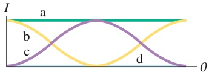

line

| Curve | Description |
| --- | --- |
| a | Constant horizontal line at maximum value |
| b | Sigmoidal curve starting from zero, peaking at center |
| c | Sigmoidal curve crossing the axis |
| d | Sigmoidal curve starting from zero, reaching a peak at center |

Abb. 29.F5

**6.** Abbildung 29.F6 zeigt die mehrfache Reflexion eines Lichtstrahls in einem Gang mit gläsernen Wänden, die alle entweder parallel zueinander sind oder senkrecht aufeinander stehen. Der Einfallswinkel bei Punkt a sei 30°. Geben Sie die Reflexionswinkel an den Punkten b, c, d, e und f an!

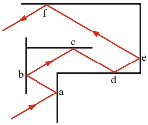

text_image

f
c
b
d
e
a

Abb. 29.F6

**7.** In Abb. 29.F7 sehen Sie einen monochromatischen Lichtstrahl, der durch drei Medien a, b und c verläuft. Ordnen Sie die Medien in absteigender Reihenfolge nach ihrem Brechungsindex.

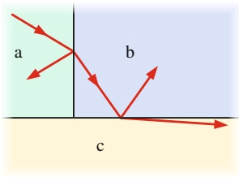

text_image

a
b
c

Abb. 29.F7

**8.** In Abb. 29.F8 fällt ein Lichtstrahl aus einem Medium a nacheinander durch drei Schichten anderer Medien und dann wieder in a, wobei alle auftretenden Grenzflächen parallel sind. Das Bild zeigt die gebrochenen Strahlen (aber nicht die reflektierten). Ordnen Sie die Medien in absteigender Reihenfolge nach ihrem Brechungsindex.

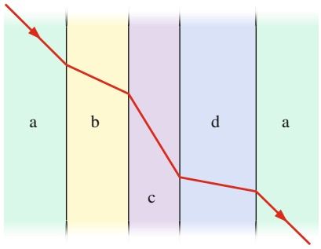

text_image

a
b
c
d
a

Abb. 29.F8

**9.** Jede Skizze in Abb. 29.F9 zeigt einen Lichtstrahl, der an der Grenzfläche zwischen zwei Medien gebrochen wird. Der einfallende Strahl (grau) enthält eine blaue und eine rote Komponente. Für jedes Medium ist ein gerundeter Wert des Brechungsindex (für sichtbares Licht) angegeben. Welche Zeichnungen zeigen physikalisch mögliche Situationen?

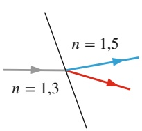

text_image

n = 1,3
n = 1,5

(a)

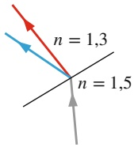

(b)

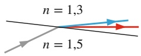

(c)

Abb. 29.F9

**10.** (a) Abbildung 29.F10a zeigt einen Sonnenstrahl, der unmittelbar an einem senkrechten Stab vorbei in ein Wasserbecken fällt. Endet der Strahl eher in der Umgebung von Punkt A oder von Punkt B? (b) Trifft die rote oder die blaue Komponente des Sonnenlichts näher zum Stab hin auf? (c) In Abb. 29.F10b ist ein dünner Gegenstand (etwa eine zweischneidige Rasierklinge) zu sehen, der in flachem Wasser schwimmt und senkrecht von oben beleuchtet wird. Die Gravitation zieht den Gegenstand nach unten, und infolge der Kohäsion krümmt sich die Wasseroberfläche. Wo befindet sich der Rand des Schattens – näher bei Punkt A, Punkt B oder Punkt C? (Rechts von der Schattenkante treffen besonders viele Lichtstrahlen auf. Sie bilden ein helles Muster, eine Kaustik.)

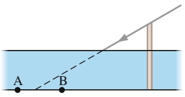

text_image

A
B

(a)

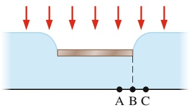

text_image

A B C

(b)

## Abb. 29.F10

**11.** In Abb. 29.20 sehen Sie Sonnenstrahlen, die einen primären Regenbogen erzeugen (wobei in jedem Tropfen genau eine Reflexion stattfindet). Gelegentlich entsteht oberhalb des primären Bogens ein zweiter, schwächerer Regenbogen, weil die Lichtstrahlen wie in Abb. 29.F11 angedeutet in jedem Regentropfen zweimal reflektiert werden (Farben sind hier nicht angegeben). Welcher Lichtstrahl ist rot – Strahl a oder Strahl b?

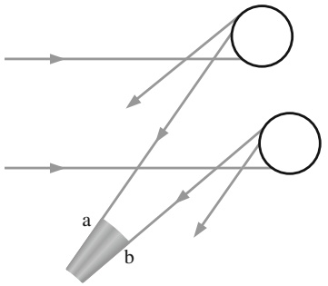

text_image

a
b

Abb. 29.F11

**12.** Abbildung 29.F12 zeigt vier waagerechte Schichten verschiedener Medien; darüber und darunter befindet sich Luft. Für jedes Medium ist der Brechungsindex angegeben. Von links fallen die eingezeichneten Lichtstrahlen auf die Schichten. In welcher Schicht (geben Sie den Brechungsindex an) könnte das Licht so eingefangen werden, dass es nach vielen Reflexionen an der rechten Seite nahezu verlustfrei wieder austritt?

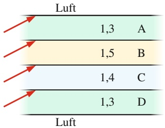

text_image

Luft
1,3 A
1,5 B
1,4 C
1,3 D
Luft

Abb. 29.F12

**13.** In Abb. 29.F13 wird unpolarisiertes Licht durch ein System aus fünf Polarisationsfiltern geschickt. Deren Polarisationsrichtungen, gegen den Uhrzeigersinn von der positiven y-Achse aus gemessen, sind: 35° für Filter 1, 0° für Filter $2 , 0 ^ { \circ }$ für Filter 3, 110° für Filter 4 und 45° für Filter 5. Nun wird Filter 3 um 180° gegen den Uhrzeigersinn um die Strahlachse gedreht. Bei welchem Winkel (gemessen gegen den Uhrzeigersinn von der (+y)-Achse) ist die Lichttransmission des Systems null?

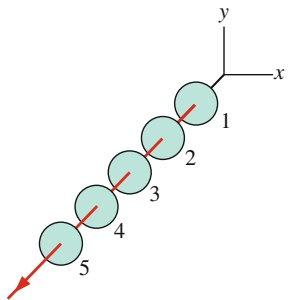

text_image

y
x
1
2
3
4
5

Abb. 29.F13

**14.** Die Skizze ganz links in Abb. 29.F14 zeigt die Totalreflexion von Licht in einem Material mit dem Brechungsin dex $n _ { 1 }$ , das sich in Luft befindet. Ein Lichtstrahl, der von irgendwo in der schattierten linken Fläche auf Punkt A trifft, wird dort vollständig reflektiert und landet irgendwo in der rechten schattierten Teilfläche. Die beiden anderen Skizzen zeigen dieselbe Situation für Materialien mit den Brechungsindizes $n _ { 2 }$ bzw. $n _ { 3 } ,$ Ordnen Sie die Brechungsindizes der Materialien in absteigender Reihenfolge.

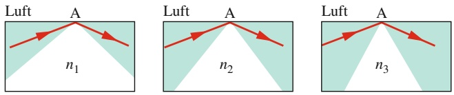

Abb. 29.F14

# 30 Abbildungen

## 30.1 Bilder und ebene Spiegel

## Physikalische Motivation

Schon seit ihren Anfängen beschäftigt sich die Physik damit, die grundlegenden Gesetze der Lichtausbreitung zu untersuchen, etwa das Brechungsgesetz. Neben der Erforschung der physikalischen Grundlagen ging es dabei schon immer auch darum, diese Gesetze anzuwenden, und eine der wichtigsten Anwendungen ist wohl die Erzeugung von optischen Abbildungen. Als 1824 einer staunenden Öffentlichkeit die ersten Fotografien vorgestellt wurden, waren sie Sensationen. Heute können wir uns vor Bildern kaum mehr retten. Die Unterhaltungsindustrie hängt zu einem großen Teil von der Produktion und Verbreitung von Bildern über Fernsehen, Computer und Kinoleinwände ab. Satellitenbilder entscheiden über die Strategie in militärischen Konflikten und erlauben die Überwachung von wichtigen Umweltdaten. Videokameras erhöhen die Sicherheit auf öffentlichen Plätzen, bedrohen aber gleichzeitig auch unsere Privatsphäre. Physiologen und Mediziningenieure arbeiten daran, die Bildgebung von Organen wie dem Augapfel oder der Hirnhaut zu perfektionieren und haben bereits erreicht, dass Blinde durch elektrische Stimulation der Sehrinde wieder optische Informationen aus ihrer Umwelt aufnehmen können.

Unser erster Schritt in diesem Kapitel ist die Definition und Klassifikation von optischen Abbildungen. Anschließend untersuchen wir die verschiedenen Wege, wie sich optische Bilder erzeugen lassen.

## 30.1.1 Zwei Arten von Bildern

Damit Sie beispielsweise einen Pinguin sehen können, muss die Pupille Ihres Auges Lichtstrahlen auffangen, die von dem Vogel zurückgeworfen werden, und auf die Netzhaut an der Rückseite Ihres Augapfels lenken. Ihr visuelles System – von der Netzhaut bis zur Sehrinde im hinteren Teil des Gehirns – verarbeitet die Information vollautomatisch, ohne dass Sie sich dessen bewusst werden. Kanten, Orientierungen, Texturen, Formen und Farben werden identifiziert und zu einem **Bild** zusammengefügt, zu einer aus den Lichtstrahlen abgeleiteten Reproduktion: Sie erkennen einen Pinguin – und zwar in der Richtung, aus der das Licht kommt, und im richtigen Abstand.

Das visuelle System verarbeitet Informationen auch, wenn die Lichtstrahlen nicht direkt von dem betrachteten Gegenstand ausgehen, sondern etwa an einem Spiegel in Richtung des Auges reflektiert wurden oder durch Linsen (z. B. ein Fernglas) gebündelt wurden. In diesen Fällen „sehen“ Sie den Pinguin zwar noch in der Richtung, aus der das reflektierte oder gebrochene Licht kommt; der Abstand, in dem Sie den Vogel wahrnehmen, kann sich von seiner tatsächlichen Entfernung stark unterscheiden.

Abb. 30.1

(a) Ein Lichtstrahl, der aus geringer Höhe über dem Horizont kommt, wird an der erwärmten Luft über einer Straße gebrochen (ohne dabei die Oberfläche der Straße zu erreichen). Einem Beobachter scheint es, als ob das Licht an einer Wasserfläche reflektiert worden sei. (b) Ein Lichtstrahl knickt an einer imaginären Grenze zwischen warmer und wärmerer Luft nach oben ab (übertrieben dargestellt). (c) Die unteren Enden der Wellenfronten bewegen sich in der wärmeren Luft schneller; daher verschieben sich die Wellenfronten, und der zugehörige Strahl knickt ab. (d) Ein Lichtstrahl knickt an einer imaginären Grenze zwischen wärmerer und warmer Luft nach oben ab.

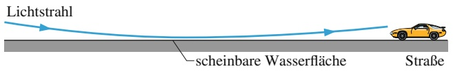

text_image

Lichtstrahl
scheinbare Wasserfläche
Straße

(a)

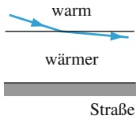

(b)

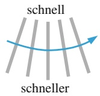

(c)

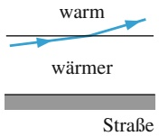

(d)

Nehmen wir an, das Licht sei von einem normalen, ebenen Spiegel (auch Planspiegel genannt) zu Ihnen reflektiert worden. Der Pinguin scheint sich dann hinter dem Spiegel zu befinden, was natürlich nicht stimmt. Sie sehen ein **virtuelles Bild**, das streng genommen nur in Ihrem Gehirn existiert, von Ihnen aber an der beobachteten Position wahrgenommen wird.

Ein **reelles Bild** hingegen entsteht tatsächlich auf einer Fläche, etwa einem Stück Pappe oder einer Kinoleinwand. Sie können reelle Bilder sehen (sonst ginge niemand ins Kino), und die Existenz des Bilds hängt außerdem nicht davon ab, ob es einen Betrachter gibt, in dessen Gehirn die Information verarbeitet wird.

In diesem Kapitel wollen wir untersuchen, wie virtuelle und reelle Bilder durch Reflexion (zum Beispiel an Spiegeln) und durch Brechung (zum Beispiel an Linsen) entstehen. Außerdem lernen wir Kriterien kennen, anhand derer wir die beiden Arten von Bildern eindeutiger unterscheiden können. Zunächst betrachten wir aber ein virtuelles Bild, das gelegentlich auf natürliche Weise entsteht.

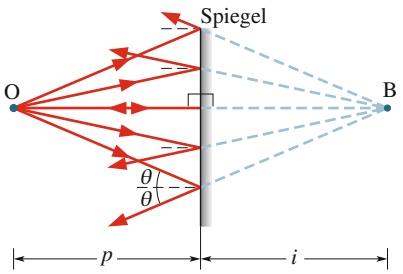

text_image

Spiegel
O
θ/θ
p
i
B

Abb. 30.2

Eine Punktlichtquelle O (das Objekt) befindet sich in einem senkrechten Abstand p vor einem ebenen Spiegel. Lichtstrahlen, die den Spiegel von O ausgehend erreichen, werden reflektiert. Wenn einige davon Ihr Auge erreichen, dann nehmen Sie eine Punktquelle B hinter dem Spiegel im senkrechten Abstand i von der Spiegelfläche wahr. Diese Quelle B ist ein virtuelles Bild des Objekts O.

## Eine Fata Morgana

Wenn man bei Sonnenschein Auto fährt, bemerkt man manchmal in einiger Entfernung eine Wasserfläche, die auf dem Asphalt zu liegen scheint, aber niemals zu erreichen ist. Es handelt sich um eine Fata Morgana (eine Luftspiegelung), gebildet von den Lichtstrahlen, die flach über dem Horizont auf den Betrachter zulaufen (Abb. 30.1a). Unmittelbar über der sonnenbeschienenen Straße erwärmt sich die Luft stärker als in den höher liegenden Schichten. Lichtstrahlen, die sich in Rich tung der Straße ausbreiten, treten in immer wärmere Luft ein; je wärmer aber die Luft ist, desto schneller breitet sich das Licht darin aus und desto kleiner wird der Brechungsindex des Mediums. Schräg von oben kommende Strahlen treffen deshalb auf Schichten, deren Brechungsindex immer kleiner wird, und knicken geringfügig zur Waagerechten hin ab (Abb. 30.1b).

Ein Strahl, der in der Waagerechten angelangt ist, knickt noch weiter ab: Jetzt befinden sich die unteren Enden der Wellenfronten in wärmerer Luft und bewegen sich deshalb ein klein wenig schneller als die oberen Enden (Abb. 30.1c). Dadurch biegt sich der Strahl wieder nach oben, wobei er Schichten mit immer größerem Brechungsindex erreicht und folglich immer weiter aufwärts abbiegt (Abb. 30.1d).

Wenn solche Lichtstrahlen auf Ihr Auge fallen, dann nimmt das visuelle System an, ihr Ursprung liege genau auf ihrer rückwärtigen Verlängerung, also auf der Oberfläche der Straße. Ist das Licht dann noch bläulich (es kommt ja vom Himmel), dann erscheint auch die Fata Morgana bläulich, und Ihr Gehirn schließt auf Wasser. Turbulenzen in der erwärmten Luft erzeugen zusätzlich ein Flirren wie von einer bewegten Wasseroberfläche, was die Illusion nahezu perfekt macht. In Wirklichkeit sehen Sie natürlich keine Wasserfläche, sondern ein virtuelles Bild des unteren Teils des Himmels.

## 30.1.2 Ebene Spiegel

Unter einem **Spiegel** verstehen wir eine Fläche, die einen Lichtstrahl in einer Rich tung zurückwirft, also weder in viele Raumrichtungen streut noch absorbiert. Eine glänzende Metallfläche wirkt als Spiegel, eine Betonwand nicht. In diesem Ab schnitt untersuchen wir, welche Bilder an einem **ebenen Spiegel** (also einer glatten reflektierenden Fläche, auch **Planspiegel** genannt) entstehen können.

Abbildung 30.2 zeigt eine Punktquelle O, die wir das Objekt nennen wollen, im senkrechten Abstand p vor einem ebenen Spiegel. Das auf den Spiegel fallende Licht ist durch Strahlen dargestellt, die von O ausgehen; das reflektierte Licht ist durch Strahlen dargestellt, die vom Spiegel ausgehen. Verlängern wir die reflektierten Strahlen rückwärts (hinter den Spiegel), so stellen wir fest, dass sie sich in einem Punkt schneiden, dessen senkrechter Abstand vom Spiegel gleich i ist.

Wenn Sie in den Spiegel in Abb. 30.2 schauen, fallen einige der reflektierten Strahlen in Ihr Auge. Ihr visuelles System interpretiert diese Information so, als ob sich im Schnittpunkt der verlängerten Strahlen eine Lichtquelle befände. Diese punktförmige Quelle ist das Bild B des Objekts O. Es handelt sich um ein virtuelles Bild, weil die Lichtstrahlen nicht tatsächlich durch den Schnittpunkt verlaufen (wie Sie noch sehen werden, verlaufen die Strahlen bei einem reellen Bild wirklich durch diesen Punkt).

Abbildung 30.3 zeigt zwei Strahlen, die aus den vielen in Abb. 30.2 dargestellten Strahlen ausgewählt wurden. Einer von ihnen fällt senkrecht auf den Punkt b, der andere unter einem beliebigen Einfallswinkel θ auf den Punkt a; die Verlängerungen beider Strahlen sind gestrichelt eingezeichnet. Die beiden rechtwinkligen Dreiecke aOb und aBb haben eine Seite gemeinsam und drei gleiche Winkel, folglich sind sie kongruent (deckungsgleich). Ihre waagerechten Seiten sind demnach gleich lang:

$$
\overline {{\mathrm{Bb}}} = \overline {{\mathrm{Ob}}} . \tag {30.1}
$$

Bb und $\overline { { \mathrm { O b } } }$ sind die Abstände zwischen dem Spiegel und dem Bild bzw. dem Objekt. Gleichung 30.1 besagt also, dass wir das Bild ebenso weit hinter dem Spiegel wahrnehmen, wie das Objekt sich vor dem Spiegel befindet. Wir wollen vereinbaren, die Objektweite p als positive Größe und die Bildweite i virtueller Bilder (wie hier) als negative Größe zu betrachten. Gleichung 30.1 wird damit zu $| i | = p$ oder

$$
i = - p. \tag {30.2}
$$

Nur Strahlen, die eng beieinander liegen, können nach einer Reflexion das Auge eines Beobachters erreichen. In der in Abb. 30.4 gezeigten Anordnung spielt nur ein kleiner Ausschnitt aus der Spiegelfläche (kleiner als die Pupille) in der Umgebung von Punkt a eine Rolle für die Wahrnehmung des Bilds. Um diesen Ausschnitt zu finden, können Sie ein Auge schließen und auf das Spiegelbild eines kleinen Objekts schauen, etwa einer Bleistiftspitze. Dann bewegen Sie Ihre Fingerspitze über den Spiegel, bis Sie das Bild nicht mehr sehen können. Lediglich der Bereich des Spiegels, den Sie jetzt antippen, erzeugt das Bild, das Sie wahrnehmen.

## Ausgedehnte Objekte

Abbildung 30.5 zeigt ein ausgedehntes (d. h. nicht punktförmiges) Objekt, das durch einen aufrechten Pfeil im senkrechten Abstand p vor einem ebenen Spiegel dargestellt ist. Jeder kleine Ausschnitt aus dem Objekt, der dem Spiegel zugewandt ist, wirkt genau wie die in den Abb. 30.2 und 30.3 betrachtete Punktquelle O. Wenn das reflektierte Licht Ihr Auge erreicht, so sehen Sie ein virtuelles Bild B, das sich aus vielen einzelnen Bildpunkten zusammensetzt und sich im Abstand i hinter dem Spiegel zu befinden scheint. Die Beziehung zwischen den Entfernungen i und $p$ ist durch Gl. 30.2 gegeben.

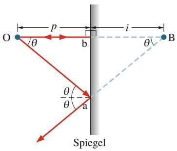

text_image

O
θ
p
b
i
θ
B
θ
θ
a
Spiegel

Abb. 30.3

Zwei der Strahlen aus Abb. 30.2. Strahl Oa schließt einen beliebigen Winkel θ mit der Normalen auf der Spiegelflä- che ein, Strahl Ob fällt senkrecht auf den Spiegel.

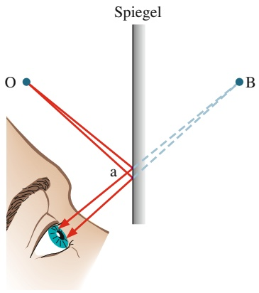

text_image

Spiegel
O
a
B

Abb. 30.4

Nur ein eng begrenztes Strahlenbündel erreicht nach der Reflexion Ihr Auge. Der daran beteiligte Ausschnitt aus der Spiegelfläche ist sehr klein.

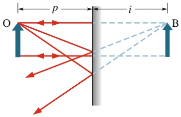

text_image

p
i
O
B

Abb. 30.5

Ein ausgedehntes Objekt O und sein virtuelles Bild B in einem ebenen Spiegel.

natural_image

Group of people standing under arched wooden columns in a spacious corridor (no visible text or symbols)

Abb. 30.6

Spiegelkabinett auf dem Berg Petrin in Prag [Quelle: Carmelo Bayarcal/ CC-SA-3.0].

(a)

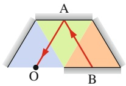

(b)

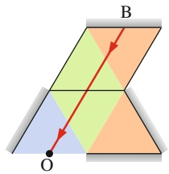

text_image

B
O

(c)

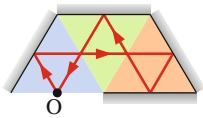

Vor Ihnen scheint ein gerader Korridor zu liegen.

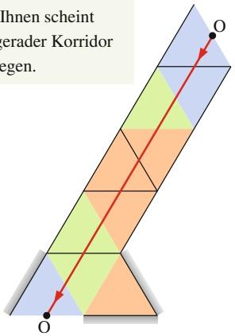

text_image

Ihnen scheint
gerader Korridor
egen.
O
O

(d)

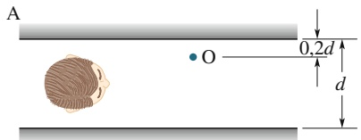

text_image

A
O
0,2d
d

B

Um die Position des Bilds eines ausgedehnten Objekts zu ermitteln, gehen wir ebenso vor wie beim punktförmigen Objekt in Abb. 30.2: Wir zeichnen einige Strahlen, die von der Spitze des Objekts auf den Spiegel fallen, zeichnen dazu die reflektierten Strahlen, verlängern diese nach hinten und bestimmen ihren Schnitt punkt. Für das untere Ende des Pfeils verfahren wir ebenso. Wie Abb. 30.5 zeigt, erhalten wir ein virtuelles Bild B, das ebenso orientiert ist wie das Objekt O und auch ebenso lang ist (gemessen parallel zum Spiegel).

## Im Spiegelkabinett

In einem Spiegelkabinett sind alle Wände vom Boden bis zur Decke mit Spiegeln bedeckt. Wenn Sie durch die Gänge wandern, sehen sie in fast allen Richtungen ein höchst verwirrendes Gewirr von Reflexionen. In manchen Richtungen meinen Sie jedoch einen geraden Weg zu erkennen, der Ihnen einen Weg durch das Labyrinth zu weisen scheint (Abb. 30.6). Wenn Sie einem solchen Weg allerdings folgen, werden Sie schnell feststellen, dass Sie einer Illusion aufgesessen sind (spätestens, wenn Sie mit der Nase unsanft an einen Spiegel stoßen).

Abbildung 30.7a zeigt den Grundriss eines einfachen Spiegelkabinetts aus drei gleichseitigen Dreiecken, die der Übersichtlichkeit halber unterschiedlich eingefärbt sind. Alle Wände sind mit vertikalen Spiegeln ausgekleidet. Sie stehen am Punkt O in der Mitte des Eingangs und schauen in das Kabinett. In den meisten Richtungen sehen Sie eine verwirrende Vielfalt von Bildern. In der in Abb. 30.7a markierten Blickrichtung geschieht jedoch etwas Merkwürdiges: Der Strahl von Spiegel B wird in der Mitte von Spiegel A auf Sie zu reflektiert. (Die Reflexion gehorcht dem Reflexionsgesetz: Einfalls- und Reflexionswinkel sind beide gleich 30°.)

Um einen Sinn in das Gesehen zu bringen, verlängert Ihr Gehirn unbewusst den Strahl nach hinten. Er scheint daher von einem Punkt hinter Spiegel A zu kommen. Also sehen Sie ein virtuelles Bild von B hinter A, und zwar genauso weit dahinter wie B tatsächlich von A entfernt ist (Abb. 30.7b). Wenn Sie also in diese Richtung ins Spiegelkabinett blicken, sehen Sie B am Ende eines geraden Flurs aus vier hintereinanderliegenden Dreiecken.

Das ist aber noch nicht alles. B ist ja selbst ebenfalls ein Spiegel und reflektiert den dort ankommenden Strahl. Und dieser kommt von Punkt O – also von Ihnen! Was Sie tatsächlich sehen, ist also ein virtuelles Bild (im Halbprofil – erkennen Sie, warum?) Ihrer selbst am Ende eines neun Dreiecke langen Flurs (Abb. 30.7d).

## Abb. 30.7

(a) Im Spiegelkabinett: Ein Strahl von Spiegel B erreicht Sie bei O nach Reflexion an Spiegel A. (b) Spiegel B scheint hinter A zu stehen. (c) Der Strahl, den Sie sehen, kommt von Ihnen. (d) Sie sehen ein virtuelles Bild von sich selbst am Ende eines langen Flurs. (Finden Sie einen zweiten scheinbaren Flur, der von O ausgeht?).

## KONTROLLFRAGE 1

Das Bild zeigt ein System aus zwei (unendlich langen) parallelen Spiegeln A und B im Abstand d voneinander. Eine Kerze steht im Punkt O in einem Abstand von 0,2d von Spiegel A; ihre Position ist eingezeichnet. Jeder Spiegel erzeugt ein erstes (am nächsten wirkendes) Bild der Kerze, dann ein zweites (dessen Objekt das erste Bild des jeweils gegenüberliegenden Spiegels ist), ein drittes und so fort; wahrscheinlich sehen Sie Hunderte von Kerzen. In welchem Abstand hinter dem Spiegel erscheinen das erste, zweite und dritte Bild in Spiegel A?

## 30.2 Kugelspiegel

## Lernziele

Nach dem Durcharbeiten dieses Abschnitts sollten Sie in der Lage sein, . . .

• konkave und konvexe Kugelspiegel voneinander zu unterscheiden,
den Strahlengang bei der Reflexion von parallel einfallenden Lichtstrahlen an konkaven und konvexen Spiegeln zu skizzieren und dabei den Brennpunkt anzugeben sowie zu erklären, welche Bilder reell und welche virtuell sind,
• einen reellen Brennpunkt von einem virtuellen zu unterscheiden und anzugeben, welcher Typ bei welchem Spiegel vorliegt und welches Vorzeichen die Brennweite jeweils hat,
• den Zusammenhang zwischen der Brennweite eines Kugelspiegels und seinem Radius anzugeben,
• zu erklären, was „innerhalb der Brennweite“ und „außerhalb der Brennweite“bedeutet,
• die Reflexionen von mindestens zwei Strahlen an einem konkaven Spiegel zu skizzieren, wenn das Objekt (a) innerhalb und (b) außerhalb der Brennweite steht, und daraus das Bild zu konstruieren sowie Typ und Orientierung des Bilds anzugeben,
• Ort und Orientierung eines reellen und eines virtuellen Bilds an einem konkaven Spiegel anzugeben,
• für ein Objekt vor einem konvexen Spiegel die Reflexion von mindestens zwei Strahlen zu skizzieren, daraus das Bild zu konstruieren und Typ und Orientierung des Bilds anzugeben,
• zu wissen, welche Arten von Spiegeln reelle und virtuelle Bilder erzeugen können und welche Spiegel ausschließlich virtuelle Bilder erzeugen,
• das Vorzeichen der Bildweite i für reelle und virtuelle Bilder anzugeben,
• die Beziehung zwischen Brennweite f , Objektweite p und Bildweite i für konvexe, konkave und ebene Spiegel anzuwenden,
• die Beziehungen zwischen Lateralvergrößerung (Abbildungsmaßstab) m, Bildhöhe h′, Objekthöhe h, Bildweite i und Objektweite p anzuwenden.

## Schlüsselideen

• Ein Kugelspiegel hat die Form eines Ausschnitts aus einer Kugeloberfläche. Er kann konkav (der Krümmungsradius r ist positiv), konvex (r ist negativ) oder im Grenzfall eben sein (flach, r ist unendlich).
• Wenn parallele Strahlen auf einem (sphärischen) konkaven Spiegel parallel zu dessen optischer Achse auftreffen, treffen sich die reflektierten Strahlen in einem gemeinsamen Punkt, dem (reellen) Brennpunkt F, der sich in einem Abstand f , der Brennweite, von dem Spiegel befindet; f ist dann positiv. Werden diese Strahlen auf einen (sphärischen) konvexen Spiegel gelenkt, treffen sich die rückseitigen Verlängerungen der reflektierten Strahlen in einem (virtuellen) Brennpunkt F; die Brennweite f ist dann negativ.
• Ein konkaver Spiegel kann ein reelles Bild erzeugen (wenn das Objekt außerhalb der Brennweite steht) oder ein virtuelles Bild (Objekt steht innerhalb der Brennweite).
• Ein konvexer Spiegel kann nur virtuelle Bilder erzeugen.
• Die sogenannte Spiegelgleichung verbindet Objektweite p, Brennweite f und Krümmungsradius r mit der Bildweite i:

$$
\frac {1}{p} + \frac {1}{i} = \frac {1}{f} = \frac {2}{r}.
$$

• Der Betrag der Lateralvergrößerung (des Abbildungsmaßstabs) m bei der Abbildung eines Objekts ist das Verhältnis aus Bildhöhe h′ und Objekthöhe h:

$$
| m | = \frac {h ^ {\prime}}{h}.
$$

Für die Objektweite p und die Bildweite i gilt

$$
m = - \frac {i}{p}.
$$

## 30.2.1 Kugelspiegel

Von der Bildentstehung am ebenen Spiegel wollen wir uns nun der Bildentstehung an gekrümmten Spiegeln zuwenden, insbesondere an Kugelspiegeln, bei denen es sich um Ausschnitte aus Kugelflächen handelt. Dabei ist ein ebener Spiegel ein Kugelspiegel mit einem unendlich großen Krümmungsradius.

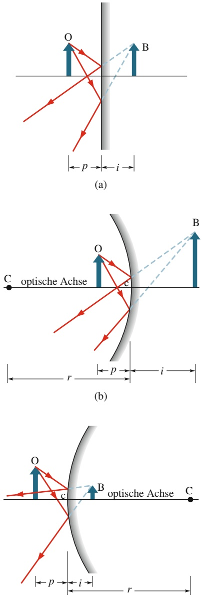

(c)

Abb. 30.8

(a) An einem ebenen Spiegel entsteht ein virtuelles Bild B eines Objekts O. (b) Wird der Spiegel nach innen gewölbt (konkav), so rückt das Bild vom Spiegel weg und wird größer.
(c) Wird der Spiegel nach außen gewölbt (konvex), so rückt das Bild an den Spiegel heran und wird kleiner.

## Wie ein Kugelspiegel entsteht

Wir gehen von einem ebenen Spiegel aus (Abb. 30.8a), dessen reflektierende Fläche nach links zeigt. Davor befinden sich ein Objekt O und ein (nicht eingezeichneter) Beobachter. Einen **konkaven** (nach innen gewölbten) Spiegel erhalten wir nun, indem wir die obere und die untere Kante des ebenen Spiegels zu uns hinbiegen, wie Sie in Abb. 30.8b sehen. Auf die Eigenschaften des Spiegels und der daran entstehenden Abbildung hat dies folgende Auswirkungen:

1. Der Krümmungsmittelpunkt C (der Mittelpunkt der Kugel, deren Ausschnitt der Spiegel ist) lag im Fall des ebenen Spiegels unendlich weit entfernt. Jetzt ist er näher herangerückt, befindet sich aber noch vor dem Spiegel.
2. Das Bildfeld (der abgebildete Teil der Umgebung) ist im Vergleich zum ebenen Spiegel kleiner geworden.
3. Beim ebenen Spiegel entstand die Abbildung genauso weit hinter dem Spiegel, wie sich das Objekt vor dem Spiegel befand. Beim konkaven Spiegel entsteht die Abbildung weiter hinten, d. h., |i| ist größer.
4. Die Abbildung am ebenen Spiegel ist so groß wie das Original. Am konkaven Spiegel entsteht eine vergrößerte Abbildung. Man verwendet solche Spiegel deshalb gezielt zur Vergrößerung (etwa als Rasierspiegel oder Zahnarztspiegel).

Einen **konvexen** (nach außen gewölbten) Spiegel erhalten wir, indem wir die obere und die untere Kante des ebenen Spiegels von uns wegbiegen (Abb. 30.8c). Dies bewirkt Folgendes:

1. Der Krümmungsmittelpunkt liegt jetzt hinter dem Spiegel.
2. Das Bildfeld wird größer.
3. Das Bild rückt näher an den Spiegel heran.
4. Das Bild ist kleiner als das Original.

Konvexe Spiegel verwendet man zum Beispiel zur Überwachung von Verkaufsräumen oder bei Außenspiegeln von Fahrzeugen, weil sie das Bildfeld im Vergleich zu einem ebenen Spiegel vergrößern.

## Die Brennpunkte von Kugelspiegeln

An einem ebenen Spiegel ist die Bildweite i stets gleich der Objektweite p. Bevor wir untersuchen, wie sich diese beiden Abstände im Fall gekrümmter Spiegel verhalten, betrachten wir die Reflexion des Lichts von einem Objekt O in unendlicher Entfernung von einem Kugelspiegel auf dessen optischer Achse. Die optische Achse verläuft durch den Krümmungsmittelpunkt C und den Scheitelpunkt des Spiegels c. Aufgrund des großen Abstands zwischen Objekt und Spiegel können wir annehmen, dass die von dem Objekt ausgehenden Wellen den Spiegel im Bereich der optischen Achse als ebene Wellen erreichen; die zugehörigen Lichtstrahlen verlaufen in diesem Fall alle parallel.

In Abb. 30.9a sehen Sie solche parallelen Strahlen, die auf einen konkaven Spiegel treffen. In der Umgebung der optischen Achse werden sie durch einen gemeinsamen Punkt F reflektiert (zwei dieser Strahlen sind eingezeichnet). Auf einem Stück Pappe, das wir im Punkt F festhalten, entsteht eine punktförmige Abbildung des unendlich weit entfernten Objekts O (unabhängig von der Form dieses Objekts). F ist der **Brennpunkt** oder **Fokus** des Spiegels, sein Abstand vom Mittelpunkt c des Spiegels ist die **Brennweite** $f .$

Tauschen wir nun den konkaven Spiegel gegen einen konvexen aus. Die parallelen Strahlen werden jetzt nicht mehr durch einen gemeinsamen Punkt reflektiert, sondern sie laufen auseinander (Abb. 30.9b). Für den Beobachter scheinen diese Strahlen von einer Punktquelle hinter dem Spiegel auszugehen. Die Position dieser Quelle ist der Schnittpunkt aller rückwärtigen Verlängerungen der reflektierten Strahlen (F in Abb. 30.9b). Auch hier bezeichnet man F als Brennpunkt des Spiegels und $f$ als seine Brennweite. Wenn wir aber ein Stück Pappe in diesen Brennpunkt halten, erscheint kein Bild des Objekts $\mathrm { O } ;$ die Brennpunkte des konkaven und des konvexen Spiegels unterscheiden sich also grundsätzlich.

Um diesen Unterschied kenntlich zu machen, bezeichnet man den wirklichen Brennpunkt des konkaven Spiegels als reellen Brennpunkt, den wahrgenommenen Brennpunkt des konvexen Spiegels als virtuellen Brennpunkt. Außerdem vereinbart man die Brennweite $f$ des konkaven Spiegels als positive, diejenige des kon vexen Spiegels als negative Größe. Für beide Spiegeltypen gilt folgende Beziehung zwischen der Brennweite $f$ und dem Krümmungsradius $r ;$

$$
f = \frac {1}{2} r. \tag {30.3}
$$

Entsprechend der getroffenen Vorzeichenvereinbarung für die Brennweiten ist $r$ bei konkaven Spiegeln positiv, bei konvexen negativ.

## 30.2.2 Abbildungen an Kugelspiegeln

Nachdem wir den Brennpunkt des Kugelspiegels definiert haben, können wir nun einen Zusammenhang zwischen der Bildweite i und der Objektweite $p$ für konkave und konvexe Spiegel suchen. Dazu positionieren wir ein ausgedehntes Objekt O zunächst innerhalb der Brennweite eines konkaven Spiegels, also zwischen dem Brennpunkt F und der Spiegelfläche (Abb. 30.10a). Ein Beobachter sieht im Spiegel ein virtuelles Bild von $\mathrm { O } ;$ es erscheint hinter dem Spiegel in der gleichen Orientierung wie das Objekt.

Nun ziehen wir das Objekt vom Spiegel weg bis zum Brennpunkt. Dabei rückt das Bild immer weiter nach hinten, bis es im Unendlichen entsteht (Abb. 30.10b) und vom Betrachter nicht mehr wahrgenommen werden kann: Weder die reflek tierten Strahlen selbst noch ihre rückwärtigen Verlängerungen treffen sich in einem gemeinsamen Punkt, wo ein Bild von O entstehen könnte.

Nach dem Durchgang durch den Brennpunkt befindet sich das Objekt außerhalb der Brennweite (weiter vom Spiegel entfernt als F). Die reflektierten Strahlen treffen sich jetzt in der Weise, dass vor dem Spiegel ein umgekehrtes Bild des Objekts

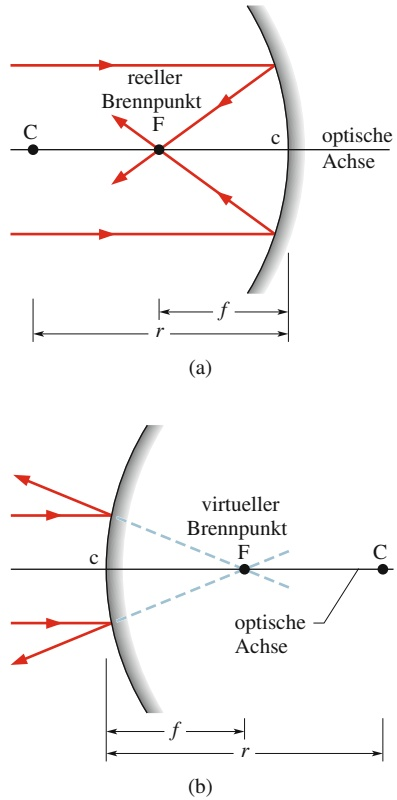

## Abb. 30.9

(a) An einem konkaven Spiegel werden parallele Strahlen in Achsennähe durch einen reellen Brennpunkt F reflektiert, der auf der gleichen Seite des Spiegels liegt wie das Objekt.
(b) An einem konvexen Spiegel werden parallele Strahlen in Achsennähe so reflektiert, dass sie von einem virtuellen Brennpunkt F auf der dem Objekt abgewandten Seite des Spiegels auszugehen scheinen.

## Abb. 30.10

(a) Objekt O innerhalb der Brennweite eines konkaven Spiegels und sein virtuelles Bild B. (b) Objekt im Brennpunkt F. (c) Objekt außerhalb der Brennweite und sein reelles Bild B.

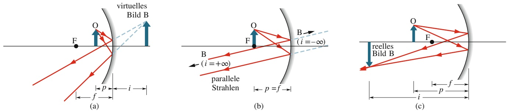

entsteht (Abb. 30.10c). Je weiter das Objekt vom Brennpunkt aus nach außen rückt, desto näher rückt das Bild vom Unendlichen kommend heran. Sie können das Bild mithilfe einer Pappe auffangen (man sagt auch, das Bild wird von dem Spiegel auf die Pappe „fokussiert“; den Brennpunkt bezeichnet man wie bereits gesagt auch als Fokus). Es handelt sich folglich um ein reelles Bild: Die reflektierten Strahlen kreuzen sich tatsächlich, unabhängig davon, ob ein Beobachter Notiz davon nimmt. Die Bildweite i eines reellen Bilds ist stets positiv, diejenige eines virtuellen Bilds hingegen negativ. Außerdem halten wir fest:

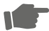

Reelle Bilder entstehen auf der Seite des Spiegels, auf der sich auch das Objekt befindet; virtuelle Bilder entstehen auf der anderen Seite.

Wie wir in Abschn. 30.6 beweisen werden, gilt zwischen der Objektweite $p ,$ der Bildweite i und der Brennweite $f$ eines Kugelspiegels (so lange die betrachteten Strahlen nur kleine Winkel mit der optischen Achse einschließen, d. h. weitgehend parallel zu dieser verlaufen) die einfache Beziehung

$$
\frac {1}{p} + \frac {1}{i} = \frac {1}{f}. \tag {30.4}
$$

In Abbildungen wie Abb. 30.10 gehen wir stets von solchen kleinen Winkeln aus, auch wenn wir sie der Klarheit halber oft übertrieben groß darstellen. So lange diese Bedingung erfüllt ist, gilt Gl. 30.4 für alle konkaven, konvexen und ebenen Spiegel. An konvexen und ebenen Spiegeln entstehen unabhängig von der Lage des Objekts auf der Achse ausschließlich virtuelle Bilder. Wie Abb. 30.8c zeigt, befindet sich das Bild bei einem konvexen Spiegel stets auf der vom Objekt abgewandten Seite des Spiegels (vom Objekt aus gesehen also hinter dem Spiegel) und hat dieselbe Orientierung wie das Objekt.

Die Größe eines Objekts oder Bilds, senkrecht zur optischen Achse gemessen, wird als Höhe bezeichnet. Sind h die Höhe des Objekts und $h ^ { \prime }$ die Höhe des Bilds, so nennt man das Verhältnis $h ^ { \prime } / h = m$ die Lateralvergrößerung (oder den Ab**bildungsmaßstab**) des Spiegels. Vereinbarungsgemäß ist die Lateralvergrößerung positiv, wenn die Orientierung des Bilds der des Objekts entspricht, und negativ, wenn das Bild im Vergleich zum Objekt umgekehrt erscheint; es gilt

$$
| m | = \frac {h ^ {\prime}}{h} \tag {30.5}
$$

oder (wie wir in Kürze beweisen werden)

$$
m = - \frac {i}{p}. \tag {30.6}
$$

Für einen ebenen Spiegel ist $i = - p$ und folglich $m = + 1$ . Der Maßstab von 1 bedeutet, dass der Spiegel das Objekt in Originalgröße abbildet; das Pluszeichen besagt, dass das Bild aufrecht erscheint. Für den konkaven Spiegel in Abb. 30.10c ist $m \approx - 1 { , } 5 .$

Die Gln. 30.3–30.6 gelten für ebene Spiegel und Kugelspiegel beliebiger Krümmung. Neben diesen Gleichungen enthielten die vorangegangenen Abschnitte sehr viele Informationen, die Sie in Tab. 30.1 ordnen sollen, um sich die zukünftige Ar beit zu erleichtern. Unter „Bildort“ tragen Sie ein, ob sich das Bild auf der gleichen oder auf der entgegengesetzten Seite des Spiegels befindet wie das Objekt. Unter „Bildart“ vermerken Sie, ob es sich um ein reelles oder ein virtuelles Bild handelt. Zu „Bildorientierung“ gehört, ob ein aufrechtes oder ein umgekehrtes Bild entsteht. Abschließend tragen Sie die Vorzeichen von $f ,$ r und m ein (±, wenn das Vorzeichen nicht eindeutig bestimmt ist).

TABELLE 30.1:

Abbildungen an Spiegeln.

<table><tr><td rowspan="2">Spiegeltyp</td><td rowspan="2">Position des Objekts</td><td colspan="3">Bild</td><td colspan="3">Vorzeichen</td></tr><tr><td>Ort</td><td>Art</td><td>Orientierung</td><td>von  $f$ </td><td>von  $r$ </td><td>von  $m$ </td></tr><tr><td>eben</td><td>beliebig</td><td></td><td></td><td></td><td></td><td></td><td></td></tr><tr><td rowspan="2">konkav</td><td>innerhalb von F</td><td></td><td></td><td></td><td></td><td></td><td></td></tr><tr><td>außerhalb von F</td><td></td><td></td><td></td><td></td><td></td><td></td></tr><tr><td>konvex</td><td>beliebig</td><td></td><td></td><td></td><td></td><td></td><td></td></tr></table>

## Bildkonstruktion mithilfe von ausgewählten Strahlen

In Abb. 30.11a und b sehen Sie ein Objekt O vor einem konkaven Spiegel. Um den Bildpunkt eines beliebigen, außerhalb der Achse liegenden Objektpunkts zu bestimmen, zeichnen wir ein Strahlenverlaufsdiagramm. Dazu greifen wir auf (mindestens) zwei der folgenden vier **Hauptstrahlen** zurück:

1. Parallelstrahlen fallen parallel zur optischen Achse ein und werden durch den Brennpunkt F reflektiert (Strahl 1 in Abb. 30.11a und c).
2. Brennpunktstrahlen verlaufen beim Einfall durch den Brennpunkt und werden parallel zur optischen Achse reflektiert (Strahl 2 in Abb. 30.11a und c).
3. Mittelpunktstrahlen verlaufen durch den Krümmungsmittelpunkt und werden in sich selbst reflektiert (Strahl 3 in Abb. 30.11b und d).
4. Scheitelpunktstrahlen treffen im Scheitelpunkt (Schnittpunkt c zwischen Spie gel und Achse) auf und werden symmetrisch bezüglich der optischen Achse reflektiert (Strahl 4 in Abb. 30.11b und d).

Der gesuchte Bildpunkt liegt stets auf dem Schnittpunkt zweier dieser Hauptstrahlen. Das Bild des ganzen Objekts rekonstruieren Sie, indem Sie zwei oder mehr Bildpunkte außerhalb der Achse bestimmen. Handelt es sich um einen konvexen Spiegel, müssen Sie die Beschreibung der Hauptstrahlen geeignet abwandeln, wie in Abb. 30.11c und d gezeigt ist.

## Abb. 30.11

(a, b) Vier Hauptstrahlen, mit deren Hilfe man das Bild eines Objekts vor einem konkaven Spiegel konstruieren kann. Im hier gezeigten Fall entsteht ein reelles, umgekehrtes, verkleinertes Bild. (c, d) Vier ähnliche Strahlen an einem konvexen Spiegel. An konvexen Spiegeln entstehen ausschließlich virtuelle, aufrechte, verkleinerte Bilder. In (c) fällt Strahl 2 in Richtung des Brennpunkts ein, in (d) fällt Strahl 3 in Richtung des Krümmungsmittelpunkts C ein.

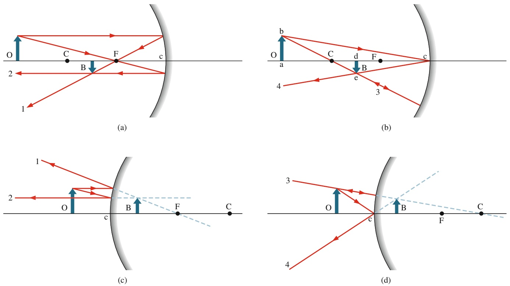

## Der Beweis von Gl. 30.6

Wir sind nun in der Lage, Gl. 30.6 $( m = - i / p )$ herzuleiten, die Gleichung für die Lateralvergrößerung eines gespiegelten Objekts. Dazu betrachten wir Strahl 4 in Abb. 30.11b. Er wird in Punkt c so reflektiert, dass einfallender und reflektierter Strahl gleiche Winkel mit der optischen Achse einschließen.

Die beiden rechtwinkligen Dreiecke abc und dec sind ähnlich (ihre Innenwinkel sind gleich) und wir können daher schreiben

$$
\frac {\overline {{\mathrm{de}}}}{\overline {{\mathrm{ab}}}} = \frac {\overline {{\mathrm{cd}}}}{\overline {{\mathrm{ca}}}}.
$$

Die Größe auf der linken Seite entspricht (abgesehen vom Vorzeichen) gerade der Lateralvergrößerung m des Spiegels. Vereinbarungsgemäß soll ein umgekehrtes Bild durch eine negative Vergrößerung ausgedrückt werden, also −m. Weil aber außerdem cd $= i$ und ${ \overline { { \mathtt { c a } } } } = p$ ist, erhalten wir für die Lateralvergrößerung

$$
m = - \frac {i}{p}, \tag {30.7}
$$

was wir beweisen wollten.

## KONTROLLFRAGE 2

Eine Fledermaus, die auf der optischen Achse eines Kugelspiegels schläft, erscheint um den Faktor $m = - 4$ vergrößert. Ist das Bild (a) reell oder virtuell, (b) aufrecht oder umgekehrt und erscheint es (c) auf der gleichen Seite des Spiegels wie die Fledermaus oder auf der anderen?

## 30.3 Sphärische brechende Flächen

## Lernziele

Nach dem Durcharbeiten dieses Abschnitts sollten Sie in der Lage sein, . . .

zu erkennen, dass die Brechung von Strahlen an einer sphärischen Oberfläche reelle und virtuelle Bilder eines Objekts erzeugen kann, abhängig von den Bre chungsindizes auf beiden Seiten, dem Krümmungsradius r und der Frage, ob das Objekt vor einer konkaven oder einer konvexen Fläche steht,
• für ein punktförmiges Objekt auf der optischen Achse einer sphärischen brechenden Oberfläche für alle sechs möglichen Situationen den Strahlengang des gebrochenen Strahls zu skizzieren und anzugeben, welche Bilder reell und welche virtuell sind,
• anzugeben, was für eine Art von Bild auf der Objektseite und was für eine Art von Bild auf der anderen Seite einer sphärischen brechenden Oberfläche entsteht,
• für eine sphärische brechende Oberfläche die Beziehung zwischen den beiden Brechungsindizes, der Objektweite $p ,$ der Bildweite i und dem Krümmungsradius r anzuwenden,
• das Vorzeichen des Krümmungsradius r anzugeben, wenn ein Objekt vor einer konkaven oder konvexen brechenden Oberfläche steht.

## Schlüsselideen

• Eine sphärische brechende Oberfläche kann ein Bild erzeugen.
• Objektweite $p ,$ Bildweite i und Krümmungsradius r der Fläche hängen über

$$
\frac {n _ {1}}{p} + \frac {n _ {2}}{i} = \frac {n _ {2} - n _ {1}}{r}
$$

zusammen, wobei $n _ { 1 }$ der Brechungsindex des Materials auf der Objektseite und $n _ { 2 }$ derjenige des Materials auf der anderen Seite ist.

• Wenn sich das Objekt vor einer konvexen Fläche befindet, ist r positiv, für eine konkave Fläche ist r negativ.
• Bilder auf der Objektseite der brechenden Fläche sind virtuell, Bilder auf der gegenüberliegenden Seite reell.

## 30.3.1 Sphärische brechende Flächen

Bisher haben wir die Bildentstehung durch Reflexion an Spiegeln behandelt. Jetzt wenden wir uns der Entstehung von Bildern durch Brechung an Grenzflächen zwischen transparenten Materialien – zum Beispiel Luft und Glas – zu. Dabei wollen wir uns wieder auf Kugelflächen (mit dem Krümmungsradius r und dem Krümmungsmittelpunkt C) beschränken. Das Licht wird von einem Objekt O emittiert, welches sich in einem Medium mit dem Brechungsindex $n _ { 1 }$ befindet; durch die sphärische Fläche wird es in ein Medium mit dem Brechungsindex $n _ { 2 }$ hinein gebrochen.

Unsere Frage lautet nun: Bilden die Lichtstrahlen nach der Brechung ein reelles Bild (das unabhängig vom Beobachter existiert) oder ein virtuelles Bild (das nur von einem Beobachter wahrgenommen werden kann)? Die Antwort hängt vom Verhältnis der beiden Brechungsindizes $n _ { 1 }$ und $n _ { 2 }$ sowie von der Geometrie der Situation ab.

Abbildung 30.12 zeigt die sechs möglichen Anordnungen. Das Medium mit dem größeren Brechungsindex ist in den Zeichnungen farbig hinterlegt und das Objekt O befindet sich stets links von der Grenzfläche in dem Medium mit dem Brechungsindex $n _ { 1 } .$ Der Verlauf eines ausgewählten Strahls bei der Brechung ist jeweils eingezeichnet. (Dieser Strahl und ein weiterer, der durch die optische Achse verläuft, genügen, um die Position und Orientierung des Bilds zu ermitteln.)

An jedem Punkt, an dem ein Strahl auf die Grenzfläche trifft und gebrochen wird, verläuft die Normale zur brechenden Fläche radial durch den Krümmungsmittelpunkt C. Tritt der Strahl in ein Medium mit größerem Brechungsindex (ein „optisch dichteres“ Medium) ein, so knickt er zur Normalen hin ab; tritt er in ein Medium mit kleinerem Brechungsindex ein, so knickt er von der Normalen weg ab. Wenn der gebrochene Strahl anschließend auf die optische Achse zuläuft, entsteht auf dieser Achse ein reelles Bild. Zeigt der gebrochene Strahl dagegen von der optischen Achse weg, so kann kein reelles Bild entstehen; die rückwärtige Verlängerung des Strahls kann sich aber mit den Verlängerungen anderer (nicht gezeigter) gebrochener Strahlen in einem virtuellen Bild treffen, vorausgesetzt, es ist ein Beobachter vorhanden, der einige dieser Strahlen wahrnimmt (ähnlich wie beim Spiegel).

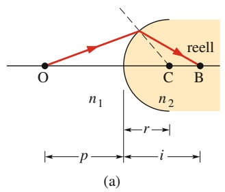

text_image

O
C
B
reell
n₁
n₂
r
p
i
(a)

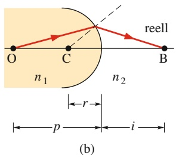

text_image

O
C
B
n₁
n₂
reell
r
p
i
(b)

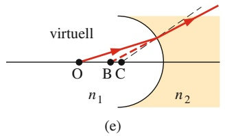

text_image

virtuell
O B C
n₁ n₂
(e)

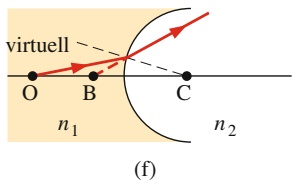

text_image

virtuell
O B C
n₁ n₂
(f)

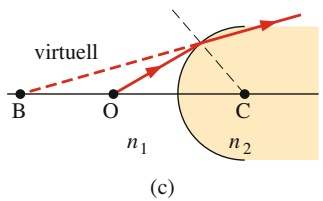

text_image

virtuell
B O C
n₁ n₂
(c)

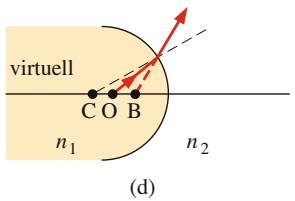

text_image

virtuell
C O B
n₁
n₂
(d)

## Abb. 30.12

Sechs mögliche Situationen der Bildentstehung durch Brechung an einer sphärischen Fläche mit dem Radius r und dem Krümmungsmittelpunkt C. Die Grenzfläche trennt zwei Medien mit den Brechungsindizes $n _ { 1 }$ und $n _ { 2 }$ . Das punktförmige Objekt O befindet sich stets in dem Medium mit $n _ { 1 }$ links von der Grenzfläche. Das Material mit dem größeren Brechungsindex ist farbig unterlegt (es könnte sich z. B. um Glas handeln, das andere Material könnte dann Luft sein). In (a) und (b) entstehen reelle Bilder, in den anderen Situationen virtuelle.

Reelle Bilder B (mit der Bildweite i) entstehen in Abb. 30.12 in den Fällen a und b: Durch die Brechung werden die Strahlen zur optischen Achse hin umgelenkt. In den Fällen c und d entstehen virtuelle Bilder, weil die Strahlen von der optischen Achse weggelenkt werden. In allen vier Situationen sind die Bilder reell, wenn sich das Objekt relativ weit von der brechenden Fläche entfernt befindet, und virtuell, wenn es der brechenden Fläche zu nahekommt. Die Fälle e und f zeigen Situationen, in denen die Strahlen ungeachtet der Objektweite stets von der optischen Achse weggelenkt werden und deshalb ausschließlich virtuelle Bilder entstehen können.

Der wichtigste Unterschied zur Bildentstehung an Spiegeln ist:

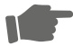

Reelle Bilder entstehen hier auf der Seite einer brechenden Fläche, die vom Objekt abgewandt ist; virtuelle Bilder entstehen auf der dem Objekt zugewandten Seite der Fläche.

Wie wir in Abschn. 30.6 zeigen werden, gilt für Strahlen unter kleinen Winkeln zur optischen Achse die Linsengleichung

$$
\frac {n _ {1}}{p} + \frac {n _ {2}}{i} = \frac {n _ {2} - n _ {1}}{r}. \tag {30.8}
$$

Wie bei Spiegeln zählen wir die Objektweite positiv und die Bildweite entweder positiv (für reelle Bilder) oder negativ (für virtuelle Bilder). Damit das Vorzeichen auf beiden Seiten von Gl. 30.8 gleich ist, müssen wir folgende Regel für das Vorzeichen des Krümmungsradius r beachten:

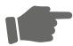

Befindet sich das Objekt vor einer konvexen brechenden Fläche, so ist der Krümmungsradius r positiv; befindet es sich vor einer konkaven Fläche, ist r negativ.

Beachten Sie, dass die Vorzeichenvereinbarung für Spiegel genau umgekehrt war!

## KONTROLLFRAGE 3

Eine Biene schwebt vor der sphärisch-konkaven brechenden Fläche einer Glasfigur. (a) Welche der allgemeinen Situationen aus Abb. 30.12 liegt hier vor? (b) Entsteht ein reelles oder ein virtuelles Bild, und entsteht das Bild auf der Seite der Fläche, die der Biene zugewandt ist?

## 30.4 Dünne Linsen

## Lernziele

Nach dem Durcharbeiten dieses Abschnitts sollten Sie in der Lage sein, . . .

• Sammel- und Zerstreuungslinsen voneinander zu unterscheiden,
• den Strahlengang für parallel zur optischen Achse in Sammel- und Zerstreuungslinsen einfallende Strahlen zu skizzieren, die Lage der Brennpunkte anzugeben und zu ermitteln, ob diese reell oder virtuell sind,
• einen reellen von einem virtuellen Brennpunkt zu unterscheiden, zu bestimmen, welcher Typ bei welcher Linse unter welchen Bedingungen auftritt, und das Vorzeichen der jeweiligen Brennweite anzugeben,
• für ein Objekt innerhalb bzw. außerhalb der Brennweite einer Sammellinse mindestens zwei Strahlen zu skizzieren, daraus das Bild zu konstruieren und jeweils Typ und Orientierung des Bilds anzugeben,
• für eine Sammellinse Ort und Orientierung eines reellen und eines virtuellen Bilds zu ermitteln,
• für ein Objekt vor einer Zerstreuungslinse mindestens zwei Strahlen zu skizzieren, daraus das Bild zu konstruieren und Typ und Orientierung des Bilds anzugeben,

• zu verstehen, welche Art von Linse sowohl reelle als auch virtuelle Bilder erzeugen kann und welche ausschließlich virtuelle Bilder erzeugt,
• das Vorzeichen der Bildweite i eines reellen und eines virtuellen Bilds anzugeben,
• die Beziehung zwischen Brennweite f , Objektweite p und Bildweite i sowohl für Sammel- als auch für Zerstreuungslinsen anzuwenden,
• die Beziehung zwischen Lateralvergrößerung (Abbildungsmaßstab) m, Bildhö- he $h ^ { \prime } ,$ Objekthöhe h, Bildweite i und Objektweite p anzuwenden,
• die Brennweite einer von Luft umgebenen Linse mithilfe der Linsenschleiferformel mit ihrem Brechungsindex und den Krümmungsradien der beiden Flächen der Linse in Beziehung zu setzen,
• für ein zweilinsiges System mit einem Objekt vor Linse 1 zuerst das von Linse 1 erzeugte Bild zu finden und dies dann als Objekt vor Linse 2 aufzufassen,
• die Gesamtvergrößerung eines zweilinsigen Systems aus den Vergrößerungen der Einzellinsen zu berechnen.

## Schlüsselideen

• Dieser Abschnitt untersucht vorwiegend dünne Linsen mit symmetrischen sphärischen Oberflächen.
Wenn parallele Strahlen parallel zur optischen Achse auf eine Sammellinse treffen, laufen die gebrochenen Strahlen in einem gemeinsamen reellen Brennpunkt F zusammen, dessen Abstand zur Linse die (positive) Brennweite f ist. Bei einer Zerstreuungslinse schneiden sich die rückwärtigen Verlängerungen der gebrochenen Strahlen in einem virtuellen Brennpunkt F, die Brennweite f ist dann negativ.
• Eine Sammellinse kann ein reelles Bild (wenn das Objekt außerhalb der Brenn weite steht) oder ein virtuelles Bild (Objekt innerhalb der Brennweite) erzeugen.
• Eine Zerstreuungslinse erzeugt immer ein virtuelles Bild.
• Wenn ein Objekt vor einer Linse steht, gilt für Objektweite $p ,$ Bildweite i, Brennweite $f ,$ Brechungsindex n und Krümmungsradien $r _ { 1 }$ und $r _ { 2 }$ die Linsenschleiferformel

$$
\frac {1}{p} + \frac {1}{i} = \frac {1}{f} = (n - 1) \left(\frac {1}{r _ {1}} - \frac {1}{r _ {2}}\right).
$$

• Der Betrag der Lateralvergrößerung (des Abbildungsmaßstabs) m eines Objekts ist das Verhältnis aus Bildhöhe $h ^ { \prime }$ und Objekthöhe h:

$$
| m | = \frac {h ^ {\prime}}{h}.
$$

Mit Objektweite p und Bildweite i gilt die Beziehung

$$
m = - \frac {i}{p}.
$$

• Für ein System von Linsen mit gleicher optischer Achse ist das von der ersten Linse erzeugte Bild das Objekt der zweiten Linse (und entsprechend bei mehr als zwei Linsen). Die Gesamtvergrößerung ist das Produkt der Vergrößerungen der Einzellinsen.

## 30.4.1 Dünne Linsen

Als **Linse** bezeichnen wir ein Objekt aus einem transparenten Material, das zwei brechende Flächen mit einer gemeinsamen optischen Achse besitzt. Die gemeinsame Achse ist die optische Achse der Linse. Ist eine Linse von Luft umgeben, so werden die Lichtstrahlen beim Eintritt aus der Luft in die Linse gebrochen, durchlaufen die Linse und werden beim Austritt in die Luft ein zweites Mal gebrochen. Jede der Brechungen kann gegebenenfalls die Ausbreitungsrichtung eines Strahls ändern.

Werden parallel in die Linse einfallende Strahlen so gebrochen, dass sie hinter der Linse auf einen gemeinsamen Punkt zulaufen, so spricht man von einer **Sammellinse**; werden sie so gebrochen, dass sie hinter der Linse auseinanderstreben, so handelt es sich um eine **Zerstreuungslinse**. Beide Arten von Linsen können Bilder eines davor befindlichen Objekts erzeugen.

Wir wollen uns hier auf den Spezialfall **dünner Linsen** beschränken. Man versteht darunter Linsen, bei denen die Dicke des dicksten Teils viel kleiner ist als die Objektweite $p ,$ die Bildweite i und die Krümmungsradien $r _ { 1 }$ und $r _ { 2 }$ der beiden brechenden Flächen. Außerdem betrachten wir nur Strahlen, die kleine Winkel mit der optischen Achse einschließen (diese Winkel sind in den Abbildungen übertrieben groß dargestellt). Wie wir in Abschn. 30.6 beweisen werden, gilt für solche Strahlen (wie bei Spiegeln) die folgende Beziehung zwischen der Brennweite f der dünnen Linse, der Bildweite i und der Objektweite $p ;$

$$
\frac {1}{f} = \frac {1}{p} + \frac {1}{i}. \tag {30.9}
$$

Wir werden auch beweisen, dass die Brennweite $f$ einer dünnen, von Luft umgebenen Linse mit dem Brechungsindex n durch die Linsenschleiferformel

$$
\frac {1}{f} = (n - 1) \left(\frac {1}{r _ {1}} - \frac {1}{r _ {2}}\right) \tag {30.10}
$$

gegeben ist. $r _ { 1 }$ ist hier der Krümmungsradius der brechenden Fläche, die dem Objekt zugewandt ist; $r _ { 2 }$ gehört zu der anderen brechenden Fläche. Für die Vorzeichen dieser Radien gelten die in Abschn. 30.3 besprochenen Konventionen für die Radien sphärischer brechender Flächen. Befindet sich die Linse nicht in Luft, sondern in einem Medium mit dem Brechungsindex $n _ { \mathrm { M e d i u m } }$ (zum Beispiel Öl), müssen wir in Gl. 30.10 nur n durch $n / n _ { \mathrm { M e d i u m } }$ ersetzen. Behalten Sie dabei immer die Grundlage der Gln. 30.9 und 30.10 im Auge:

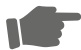

Bilder entstehen an Linsen infolge der Brechung und Ablenkung von Lichtstrahlen. Zur Brechung kommt es aber nur, wenn sich der Brechungsindex der Linse von dem des umgebenden Mediums unterscheidet.

In Abb. 30.13a sehen Sie eine dünne Linse mit konvexen brechenden Flächen. Lichtstrahlen, die parallel zur optischen Achse auf die Linse fallen, werden zweimal gebrochen, wie in Abb. 30.13b vergrößert gezeigt. Durch diese zweifache Brechung laufen alle gebrochenen Strahlen aufeinander zu; sie schneiden sich in einem Punkt $\mathrm { F } _ { 2 }$ im Abstand $f$ vom Mittelpunkt der Linse. Es handelt sich also um eine Sammellinse mit einem reellen Brennpunkt in $\mathrm { F } _ { 2 }$ (reell, weil die gebrochenen Strahlen tatsächlich durch ihn hindurch laufen) und der zugehörigen Brennweite $f .$ Fallen Lichtstrahlen parallel zur optischen Achse von der anderen Seite her auf die Linse, so finden wir hier einen zweiten reellen Brennpunkt $\mathrm { F } _ { 1 }$ . Bei dünnen Linsen sind $\mathrm { F } _ { 1 }$ und $\mathrm { F } _ { 2 }$ gleich weit von der Linse entfernt.

Die Brennpunkte von Sammellinsen sind reell; die zugehörigen Brennweiten nehmen wir deshalb als positiv an, wie wir es auch für den reellen Brennpunkt des konkaven Spiegels gehalten haben. Vorzeichenregeln in der Optik können jedoch tückisch sein, weshalb wir unsere Vereinbarung an Gl. 30.10 überprüfen wollen. Die linke Seite dieser Gleichung ist positiv, wenn $f$ positiv ist. Von der rechten Seite betrachten wir jeden einzelnen Term: Der Brechungsindex n von Glas (und beliebigen anderen Materialien) ist immer größer als $^ { 1 , }$ also ist $( n - 1 )$ immer positiv. Die Lichtquelle (das Objekt) befindet sich links, also der konvexen linken Seiten der Linse zugewandt; der Krümmungsradius $r _ { 1 }$ dieser Fläche muss der Vorzeichenregel für brechende Flächen gemäß positiv sein. Außerdem zeigt die konkave rechte Seite der Linse zum Objekt, deren Krümmungsradius $r _ { 2 }$ der Regel folgend negativ sein muss. Der Term $( 1 / r _ { \mathrm { 1 } }   -   1 / r _ { 2 } )$ ist dann positiv, die rechte Seite von Gl. 30.10 ist positiv und alle Vorzeichen sind konsistent.

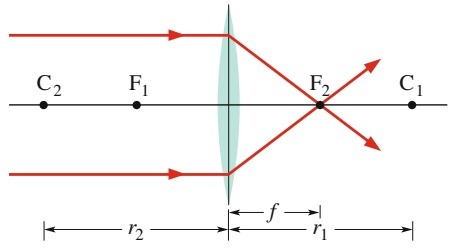

text_image

C₂ F₁ F₂ C₁
r₂ f r₁

(a)

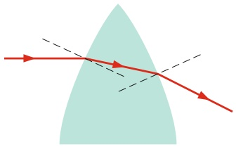

natural_image

Diagram showing light rays passing through a curved surface with dashed lines indicating paths (no text or symbols)

(b)

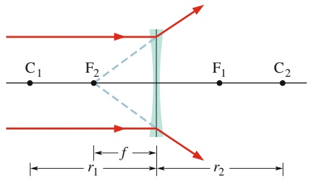

text_image

C₁ F₂ F₁ C₂
r₁ f r₂

(c)

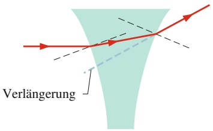

text_image

Verlängerung

(d)

In Abb. 30.13c sehen Sie eine dünne Linse mit konkaven Seitenflächen. Strahlen, die parallel zur optischen Achse durch die Linse fallen, werden zweimal gebrochen, wie die vergrößerte Darstellung in Abb. 30.13d zeigt. Hinter der Linse streben die Strahlen auseinander; sie treffen sich niemals in einem gemeinsamen Punkt, folglich handelt es sich um eine Zerstreuungslinse. Die rückwärtigen Verlängerungen der gebrochenen Strahlen schneiden sich jedoch in einem Punkt $\mathrm { F } _ { 2 } ,$ dessen Entfernung vom Linsenmittelpunkt gleich f ist. Die Linse besitzt also einen virtuellen Brennpunkt in $\mathrm { F } _ { 2 } .$ . (Wenn Ihr Auge einige der gebrochenen Strahlen auffängt, dann nehmen Sie einen hellen Fleck in $\mathrm { F } _ { 2 }$ wahr, der die Lichtquelle zu sein scheint.) Ein zweiter virtueller Brennpunkt befindet sich auf der anderen Seite der Linse in $\mathbb { F } _ { 1 } ,$ wobei $\mathrm { F } _ { 1 }$ und $\mathrm { F } _ { 2 }$ für dünne Linsen symmetrisch zur Linsenmitte liegen. Weil die Brennpunkte von Zerstreuungslinsen virtuell sind, nehmen wir die zugehörigen Brennweiten f als negativ an.

## Abbildungen an dünnen Linsen

Wir wollen uns nun überlegen, welche Arten von Bildern an dünnen Sammelund Zerstreuungslinsen entstehen. In Abb. 30.14a ist ein Objekt O außerhalb der Brennweite (hinter $\mathrm { F _ { 1 } ) }$ einer Sammellinse zu sehen. Die beiden eingezeichneten Strahlen liefern ein reelles, umgekehrtes Bild B auf der vom Objekt abgewandten Seite der Linse.

Befindet sich das Objekt zwischen Linse und $\mathrm { F } _ { 1 }$ (Abb. 30.14b), dann entsteht ein aufrechtes, virtuelles Bild B auf der gleichen Seite der Linse wie das Objekt. Eine

## Abb. 30.13

(a) Lichtstrahlen, die parallel zur optischen Achse auf eine Sammellinse fallen, treffen sich hinter der Linse in einem Brennpunkt $\mathrm { F _ { 2 } } .$ In Wirklichkeit ist die Linse dünner, als sie hier dargestellt wurde, etwa so dünn wie die senkrecht durch sie gezeichnete Linie. Wir nehmen deshalb an, dass die Brechung ausschließlich an dieser Linie erfolgt. (b) Vergrößerung des oberen Teils von (a). Die Flächennormalen sind gestrichelt gezeichnet. An beiden Grenzflächen wird der Strahl nach unten (zur optischen Achse hin) gebrochen. (c) Eine Zerstreuungslinse bewirkt, dass parallel zur Achse einfallende Strahlen auseinanderstreben. Die Verlängerungen der gebrochenen Strahlen verlaufen durch den virtuellen Brennpunkt $\mathrm { F _ { 2 } } .$ (d) Vergrößerung des oberen Teils von (c). An beiden Grenzflächen wird der Strahl nach oben (von der optischen Achse weg) gebrochen.

## Abb. 30.14

(a) An einer Sammellinse entsteht ein reelles, umgekehrtes Bild B, wenn das Objekt O sich hinter dem Brennpunkt $\mathrm { F _ { 1 } }$ befindet. (b) Wenn O sich zwischen Brennpunkt und Linse befindet, ist das Bild B virtuell und aufrecht. (c) Zerstreuungslinsen erzeugen stets virtuelle, aufrechte Bilder, unabhängig von der Position des Objekts O relativ zum Brennpunkt.

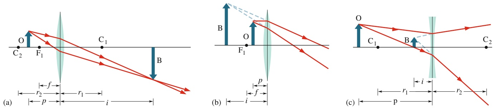

TABELLE 30.2: Abbildungen an dünnen Linsen.

<table><tr><td rowspan="2">Linsentyp</td><td rowspan="2">Position des Objekts</td><td colspan="3">Bild</td><td colspan="3">Vorzeichen</td></tr><tr><td>Ort</td><td>Art</td><td>Orientierung</td><td>von  $f$ </td><td>von  $r$ </td><td>von  $m$ </td></tr><tr><td rowspan="2">Sammellinse</td><td>innerhalb von F</td><td></td><td></td><td></td><td></td><td></td><td></td></tr><tr><td>außerhalb von F</td><td></td><td></td><td></td><td></td><td></td><td></td></tr><tr><td>Zerstreuungslinse</td><td>beliebig</td><td></td><td></td><td></td><td></td><td></td><td></td></tr></table>

Sammellinse kann also sowohl reelle als auch virtuelle Bilder erzeugen, je nachdem, wo sich das Objekt relativ zum Brennpunkt befindet.

Abbildung 30.15c zeigt ein Objekt O vor einer Zerstreuungslinse. Hier entsteht ein aufrechtes, virtuelles Bild auf der gleichen Seite der Linse wie das Objekt, egal wo sich O relativ zu dem virtuellen Brennpunkt befindet.

Wir können nun die Bildweite i als positiv annehmen, wenn das Bild reell ist, und als negativ, wenn es sich um ein virtuelles Bild handelt (analog zu unserer Vereinbarung bei Spiegeln). Linsen erzeugen sowohl reelle als auch virtuelle Bilder, aber verglichen mit Spiegeln jeweils auf der anderen Seite:

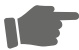

Reelle Bilder entstehen bei dünnen Linsen auf der Seite der Linse, die vom Objekt abgewandt ist; virtuelle Bilder entstehen auf der dem Objekt zugewandten Seite der Linse.

Die Lateralvergrößerung m von Sammel- und Zerstreuungslinsen ist durch die auch für Spiegel gültigen Gln. 30.5 und 30.6 gegeben.

Sie haben in diesem Abschnitt sehr viele Einzelheiten über Abbildungen an dünnen Linsen erfahren. Um sich die Arbeit zu erleichtern, sollten Sie diese Fakten in Tab. 30.2 zusammentragen und ordnen. Berücksichtigt wurden hier nur dünne, symmetrische Linsen (symmetrische Linsen haben zwei konkave oder zwei konvexe Flächen – sie sind bikonkav oder bikonvex). Unter „Bildort“ tragen Sie ein, ob sich das Bild auf der gleichen oder auf der entgegengesetzten Seite der Linse befindet wie das Objekt. Unter „Bildart“ vermerken Sie, ob es sich um ein reelles oder ein virtuelles Bild handelt. Die „Bildorientierung“ gibt an, ob ein aufrechtes oder ein umgekehrtes Bild entsteht. Abschließend tragen Sie die Vorzeichen von $f ,$ und m ein.

## LÖSUNGSSTRATEGIEN

**Strategie 1: Vorzeichenregeln bei Spiegeln und Linsen** Vorsicht: Ein konvexer Spiegel hat eine negative Brennweite, eine konvexe Linse hat eine positive Brennweite. Umgekehrt hat ein konkaver Spiegel eine positive Brennweite f , für eine konkave Linse ist f hingegen negativ. Die Vorzeichenregeln für Linsen und Spiegel werden häufig verwechselt!

## Bildkonstruktion für ausgedehnte Objekte mithilfe von ausgewählten Strahlen

Abbildung 30.15a zeigt ein Objekt O außerhalb der Brennweite (hinter $\mathrm { F _ { 1 } ) }$ einer Sammellinse. Um die Bildpunkte zu Objektpunkten zu finden, die nicht auf der optischen Achse liegen (zum Beispiel die Pfeilspitze in Abb. 30.15a), zeichnen wir ein Strahlenverlaufsdiagramm mithilfe von mindestens zwei der drei Hauptstrahlen. Diese besonderen Strahlen sind:

1. Der Parallelstrahl; er fällt parallel zur optischen Achse der Linse ein und wird durch den Brennpunkt $\mathrm { F } _ { 2 }$ gebrochen (Strahl 1 in Abb. 30.15a).

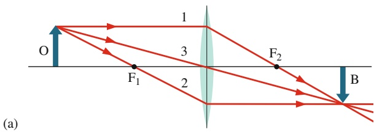

text_image

O
F₁
1
3
2
F₂
B
(a)

## Abb. 30.15

Das an einer dünnen Linse entstehende Bild konstruieren wir mithilfe der drei Hauptstrahlen. Hier befindet sich das Objekt (a) außerhalb und (b) innerhalb der Brennweite einer Sammellinse sowie (c) in beliebigem Abstand vor einer Zerstreuungslinse.

text_image

B
O
F₁
F₂
(b)
1
2
3

text_image

O
F₂ B
1
2
F₁
3
(c)

2. Der Brennpunktstrahl; er verläuft beim Einfall durch den Brennpunkt $\mathrm { F } _ { 1 }$ und wird parallel zur optischen Achse gebrochen (Strahl 2 in Abb. 30.15a).
3. Der Mittelpunktstrahl; er ist beim Einfall auf den Mittelpunkt der Linse gerichtet und ändert seine Richtung durch die Brechung nicht, da er die beiden brechenden Flächen in einer Region durchquert, wo sie nahezu parallel sind (Strahl 3 in Abb. 30.15a).

Der Bildpunkt entsteht dort, wo die Strahlen einander nach dem Durchgang durch die Linse schneiden. Durch die Konstruktion mehrerer Bildpunkte lässt sich das ganze Bild des ausgedehnten Objekts aufbauen.

Abbildung 30.15b zeigt, wie man die Hauptstrahlen verlängern muss, um das Bild eines sich innerhalb der Brennweite (vor $\mathrm { F _ { 1 } ) }$ befindlichen Objekts an einer Sammellinse zu konstruieren. Die oben angegebene Beschreibung des Brennpunktstrahls muss dazu etwas modifiziert werden: es handelt sich jetzt um den Strahl, dessen rückwärtige Verlängerung durch $\mathrm { F } _ { 1 }$ verläuft.

Auch zur Konstruktion eines Bilds an einer Zerstreuungslinse müssen die Beschreibungen der Hauptstrahlen geändert werden (unabhängig von der Position des Objekts). In Abb. 30.15c schneiden sich z. B. Strahl 3 und die rückwärtigen Verlängerungen der Strahlen 1 und 2.

## Systeme aus zwei Linsen

Wir betrachten ein Objekt $\mathrm { O } ,$ das sich vor einem System aus zwei Linsen mit einer gemeinsamen optischen Achse befindet (einige Beispiele für derartige Anordnungen zeigt Abb. 30.16). Um das Bild zu konstruieren, das von diesem Linsensystem erzeugt wird (das also an der hinteren Linse entsteht), gehen wir schrittweise vor. Linse 1 liege dabei näher am Objekt, Linse 2 sei weiter entfernt.

1. Es sei $p _ { 1 }$ der Abstand des Objekts O von der Linse 1. Die zu dieser Linse gehörige Bildweite $i _ { 1 } ,$ , an der das Bild $\mathrm { B _ { 1 } }$ entsteht, erhalten wir entweder durch Anwendung von Gl. 30.9 oder durch die Konstruktion von Strahlen; das obere Teilbild von Abb. 30.16a liefert hierfür ein Beispiel.
2. Nun vergessen wir Linse 1 und behandeln das im ersten Schritt gefundene Bild $\mathrm { I _ { 1 } }$ als Objekt für Linse 2. Liegt dieses neue Objekt hinter Linse $2 ,$ so setzen wir die zugehörige Objektweite $p _ { 2 }$ als negativ an. (Dies ist eine Ausnahme von der allgemeinen Vereinbarung, dass Objektweiten stets positiv sind; die Ausnahme kommt zustande, weil sich das Objekt hier auf der Seite der Linse befindet, die von der Lichtquelle abgewandt ist.) Ansonsten ist $p _ { 2 }$ wie üblich positiv. Die Bildweite $i _ { 2 }$ des von Linse 2 erzeugten Bilds $\mathrm { B } _ { 2 }$ ermitteln wir durch Anwendung von Gl. 30.9 oder durch die Konstruktion von Strahlen. Das untere Teilbild von Abb. 30.16a liefert hierfür ein Beispiel.

Abb. 30.16

Verschiedene Skizzen (nicht maß- stabsgerecht) von zweilinsigen Systemen, bei denen ein Objekt links von Linse 1 sitzt. In Lösungsschritt 1

betrachten wir nur Linse 1 und ignorieren Linse 2 (gestrichelt dargestellt). In Schritt 2 betrachten wir Linse 2 und ignorieren Linse 1 (gar nicht mehr dargestellt). Wir möchten das finale Abbild finden, d. h. das von Linse 2 erzeugte Bild.

Analog können wir vorgehen, wenn das System aus mehr als zwei Linsen besteht oder wenn eine der Linsen gegen einen Spiegel ausgetauscht wird.

Die von einem System aus zwei Linsen insgesamt gelieferte Lateralvergrößerung ergibt sich als Produkt der Lateralvergrößerungen $m _ { 1 }$ und $m _ { 2 }$ der beiden einzelnen Linsen, es gilt also

$$
M = m _ {1} m _ {2}. \tag {30.11}
$$

## KONTROLLFRAGE 4

An einer dünnen, symmetrischen Linse entsteht mit einer Lateralvergrößerung von +0,2 ein Bild eines Fingerabdrucks; das Original befindet sich dabei 1,0 cm weiter von der Linse entfernt als der Brennpunkt. Was für ein Bild entsteht (Art, Orientierung)? Um was für eine Linse handelt es sich?

## 30.5 Optische Instrumente

## Lernziele

Nach dem Durcharbeiten dieses Abschnitts sollten Sie in der Lage sein, . . .

• den Nahpunkt Ihres visuellen Systems zu bestimmen,
• mithilfe einer Skizze die Funktion einer einfachen Lupe zu erklären,
• zu erklären, was die Winkelvergrößerung ist,
• die Winkelvergrößerung eines Objekts im Brennpunkt einer einfachen Lupe zu bestimmen,
• anhand einer Skizze die Funktion eines Mikroskops zu erklären,
• zu verstehen, dass sich die Gesamtvergrößerung eines Mikroskops aus der Late ralvergrößerung des Objektivs und der Winkelvergrößerung des Okulars ergibt,
• die Gesamtvergrößerung eines Mikroskops zu berechnen,
• mithilfe einer Skizze die Funktion eines Linsenfernrohrs zu erklären,
• die Winkelvergrößerung eines Linsenfernrohrs zu berechnen.

## Schlüsselideen

• Die Winkelvergrößerung einer einfachen Lupe beträgt

$$
m _ {\theta} \approx \frac {2 5 \mathrm{cm}}{f},
$$

wobei f die Brennweite der Linse ist und 25 cm einen Referenzwert für den Nahpunkt des Auges darstellt.

• Die Gesamtvergrößerung M eines Mikroskops ist

$$
M = m m _ {\theta} = - \frac {s}{f _ {\mathrm{Ob}}} \frac {2 5 \mathrm{cm}}{f _ {\mathrm{Ok}}}.
$$

Dabei sind m die Lateralvergrößerung des Objektivs, $m _ { \theta }$ die Winkelvergrößerung des Okulars, s die Tubuslänge, $f _ { \mathrm { O b } }$ die Objektivbrennweite und $f _ { \mathrm { O k } }$ die Okularbrennweite.

• Die Winkelvergrößerung eines Linsenfernrohrs ist

$$
m _ {\theta} = - \frac {f _ {\mathrm{Ob}}}{f _ {\mathrm{Ok}}}.
$$

## 30.5.1 Optische Instrumente

Das menschliche Auge ist ein bemerkenswertes Sinnesorgan. Wir können seine Fä- higkeiten durch verschiedene optische Instrumente sogar noch steigern oder erweitern – etwa durch Brillen, Vergrößerungsgläser, Mikroskope oder Fernrohre. Viele Geräte ermöglichen die Wahrnehmung von Signalen jenseits des sichtbaren Spektrums wie beispielsweise satellitengestützte Infrarotkameras oder Röntgenmikroskope.

Unsere Gleichungen für Berechnungen an Spiegeln und dünnen Linsen können für kompliziertere optische Instrumente höchstens näherungsweise verwendet werden. Typische Labormikroskope enthalten Linsen, die alles andere als „dünn“sind. In den meisten optischen Geräten finden sich aus mehreren Komponenten zusammengesetzte Linsensysteme und/oder Linsen, deren Grenzflächen nicht sphärisch sind (Fotografen kennen diese unter dem Begriff asphärische Linsen). Im Folgenden wollen wir drei optische Instrumente besprechen und dabei der Einfachheit halber annehmen, dass die Formeln für dünne Linsen überall gelten.

## Die Lupe

Ein normales menschliches Auge kann auf der Netzhaut (an der Rückseite des Auges) ein scharfes Bild eines Gegenstands erzeugen, wenn sich das Objekt irgendwo zwischen dem Unendlichen und dem sogenannten Nahpunkt $\mathrm { P _ { n } }$ befindet. Bringt man das Objekt noch näher an das Auge heran, verschwimmt das wahrgenommene Bild. Die Lage des Nahpunkts hängt in der Regel vom Alter des Menschen ab: Jeder hat schon Menschen erlebt, die der Meinung waren, ohne Brille auskommen zu können, die Zeitung aber auf Armeslänge entfernt halten mussten, um sie lesen zu können. Um Ihren eigenen Nahpunkt zu finden, sollten Sie gegebenenfalls Ihre Brille absetzen oder Ihre Kontaktlinsen entfernen, ein Auge schließen und diese Buchseite so nahe an das geöffnete Auge bringen, dass Sie die Schrift gerade noch scharf erkennen können. Um einen allgemein einsetzbaren Wert für den Nahpunkt zu erhalten, wollen wir vereinbaren, dass sich der Nahpunkt 25 cm vom Auge entfernt befindet (das ist etwas mehr als der typische Wert für einen 20-Jährigen).

In Abb. 30.17a befindet sich ein Objekt im Nahpunkt $\mathrm { P _ { n } }$ eines Auges. Die Größe des Bilds auf der Netzhaut hängt von dem Winkel θ ab, den das Objekt im Blickfeld überstreicht. Je näher das Objekt dem Auge kommt (Abb. 30.17b), desto größer wird θ und desto mehr Details des Objekts können Sie im Prinzip unterscheiden. Da sich das Objekt jetzt aber näher am Auge befindet als der Nahpunkt, können Sie es nicht mehr fokussieren: Sie sehen kein scharfes Bild mehr.

Um dieses Problem zu beheben, können Sie durch eine Sammellinse auf O blicken. Diese Linse muss so positioniert sein, dass sich O gerade innerhalb der Brennweite $f$ der Linse (also von Ihnen aus gesehen vor $\mathrm { F _ { 1 } ) }$ befindet. Sie sehen dann das virtuelle Bild von O, das die Linse erzeugt. Es ist weiter vom Auge entfernt als der Nahpunkt, sodass Sie ein scharfes Bild erhalten können.

Der Winkel $\theta ^ { \prime } ,$ den das virtuelle Bild überstreicht, ist außerdem größer als der Winkel $\theta ,$ den das Objekt selbst maximal überstreichen kann (wenn Sie es noch scharf sehen). Die Winkelvergrößerung $m _ { \theta }$ (nicht zu verwechseln mit der Lateralvergrößerung m!) ist das Verhältnis

$$
m _ {\theta} = \theta^ {\prime} / \theta .
$$

Die Winkelvergrößerung einer einfachen Lupe ist also das Verhältnis des Winkels, den das an der Linse entstehende Bild überstreicht, zum Winkel, den das Objekt überstreicht, wenn es sich im Nahpunkt des Beobachters befindet.

Aus Abb. 30.17 erhalten wir unter der Annahme, dass sich O im Brennpunkt der Linse befindet und bei kleinen Winkeln näherungsweise tan $\theta = \theta$ und tan $\theta ^ { \prime } = \theta ^ { \prime }$ gilt,

$$
\theta \approx h / 25 \mathrm{cm}
$$

und

$$
\theta^ {\prime} \approx h / f.
$$

Daraus ergibt sich für die Winkelvergrößerung der Lupe

$$
m _ {\theta} \approx 2 5 \mathrm{cm/f}. \tag {30.12}
$$

## Das Mikroskop

Abbildung 30.18 zeigt eine schematische Darstellung eines aus dünnen Linsen bestehenden Mikroskops: Das Objektiv mit der Brennweite $f _ { \mathrm { O b } }$ liegt auf der Seite des beobachteten Objekts, das Okular mit der Brennweite $f _ { \mathrm { O k } }$ liegt auf der Seite des Beobachters. Mit einem Mikroskop betrachtet man kleine Objekte, die sehr nahe an das Objektiv gebracht werden.

text_image

Objektiv
F1
F2
F1'
B
B'
Okular
parallele Strahlen
zum weit entfernten, virtuellen Bild
fOb → fOb ← s → fOk

Das Objekt O befindet sich außerhalb der Brennweite der Objektivlinse (vom Betrachter aus gesehen unmittelbar hinter dem Brennpunkt $\mathrm { F } _ { 1 } ,$ sodass wir den Abstand $p$ zwischen Objekt und Linse näherungsweise gleich $f _ { \mathrm { O b } }$ setzen können). Der Abstand zwischen den Linsen wird dann so lange verändert, bis das vom Objektiv erzeugte vergrößerte, umgekehrte, reelle Bild gerade innerhalb der Brennweite des Okulars (vor $\mathrm { F _ { 1 } } ^ { \prime } )$ entsteht. In Wirklichkeit ist die Tubuslänge s groß gegen $f _ { \mathrm { O b } }$ , sodass wir den Abstand i zwischen Objektiv und Bild B gleich s setzen können.

Mit unseren Näherungen für $p$ und i liefert Gl. 30.6 für die Lateralvergrößerung des Objektivs

$$
m = - \frac {i}{p} = - \frac {s}{f _ {\mathrm{Ob}}} . \tag {30.13}
$$

Weil sich das Bild B vom Betrachter aus gesehen vor dem Brennpunkt $\mathrm { { F _ { 1 } } ^ { \prime } }$ des Okulars befindet, wirkt das Okular wie eine Lupe: Es erzeugt ein virtuelles, umgekehrtes Bild $\mathrm { B ^ { \prime } } _ { 1 }$ , das der Beobachter betrachten kann. Die Vergrößerung des Mikroskops insgesamt ergibt sich als Produkt aus der Lateralvergrößerung m des Objektivs (Gl. 30.13) und der Winkelvergrößerung $m _ { \theta }$ des Okulars (Gl. 30.12):

$$
M = m m _ {\theta} = - \frac {s}{f _ {\mathrm{Ob}}} \frac {2 5 \mathrm{cm}}{f _ {\mathrm{Ok}}} . \tag {30.14}
$$

## Das Linsenfernrohr (Refraktor)

Es gibt verschiedene Arten von Fernrohren. Hier wollen wir ein einfaches Linsenfernrohr beschreiben, das nur aus Objektiv und Okular besteht. In Abb. 30.19 sind beide als einzelne Linsen dargestellt, in der Praxis hingegen handelt es sich dabei jedoch (wie auch bei den meisten Mikroskopen) häufig um zusammengesetzte Linsensysteme.

Die Linsen von Mikroskop und Fernrohr sind prinzipiell ähnlich angeordnet. Mit einem Fernrohr will man allerdings große, weit entfernte Objekte wie Galaxien,

## Abb. 30.18

Ein Mikroskop mit dünnen Linsen (nicht maßstabsgetreu). Das Objektiv erzeugt ein reelles Bild B des Objekts $\bigcirc$ unmittelbar vor dem Brennpunkt $\mathrm { { F _ { 1 } } ^ { \prime } }$ des Okulars. Dieses Bild fungiert dann als Objekt des Okulars: Es entsteht das endgültige (für den Betrachter sichtbare) virtuelle Bild B′. Die Brennweiten $f _ { \mathrm { O b } }$ und $f _ { \mathrm { O k } }$ gehören zur Objektiv- bzw. zur Okularlinse; s ist die Tubuslänge.

Abb. 30.19

(a) Ein Refraktor mit dünnen Linsen. Das Objektiv erzeugt ein reelles Bild B einer weit entfernt liegenden Lichtquelle (des Objekts), von der aus nahezu parallele Strahlen auf die Linse treffen. (Ein Ende des Objekts soll auf der optischen Achse liegen.) Das Bild B entsteht am gemeinsamen Brennpunkt $( \mathrm { F } _ { 2 } , { \mathrm { F } _ { 1 } } ^ { \prime } )$ und wirkt als Objekt für das Okular. Dieses erzeugt das endgültige virtuelle Bild $\mathrm { B ^ { \prime } }$ in großer Entfernung vom Beobachter. Die Brennweite des Objektivs ist $f _ { \mathrm { O b } } ,$ die des Okulars $f _ { \mathrm { O k ^ { * } } } \left( \mathsf { b } \right)$ Das Bild B mit der Höhe $h ^ { \prime }$ überstreicht einen Winkel $\theta _ { \mathrm { o b } }$ (vom Objektiv aus gesehen) bzw. einen Winkel $\theta _ { \mathrm { O k } }$ (vom Okular aus gesehen).

Sterne oder Planeten beobachten, mit einem Mikroskop hingegen kleine, nahelie gende Objekte. Dieser Unterschied der Einsatzzwecke macht es erforderlich, dass bei einem Fernrohr (Abb. 30.19) der zweite Brennpunkt des Objektivs $\mathrm { F } _ { 2 }$ und der erste Brennpunkt des Okulars $\mathrm { F _ { 1 } } ^ { \prime }$ zusammenfallen, während sie beim Mikroskop (Abb. 30.18) durch die Tubuslänge s voneinander getrennt sind.

In Abb. 30.18a treffen parallele, von einem weit entfernten Objekt ausgehende Strahlen auf das Objektiv. Sie schließen mit der Achse des Fernrohrs einen Winkel $\theta _ { \mathrm { O b } }$ ein und erzeugen ein reelles umgekehrtes Bild im gemeinsamen Brennpunkt $( \widehat { \mathrm { F } _ { 2 } , \mathrm { F } _ { 1 } { ' } } )$ der beiden Linsen. Dieses Bild B wirkt seinerseits als Objekt für das Okular, durch welches der Beobachter ein entferntes, nach wie vor umgekehrtes virtuelles Bild $\mathrm { B ^ { \prime } }$ sieht. Die Strahlen, die das Bild definieren, schließen mit der Achse einen Winkel $\theta _ { \mathrm { O k } }$ ein.

Die Winkelvergrößerung $m _ { \theta }$ des Fernrohrs ist gleich $\theta _ { \mathrm { O k } } / \theta _ { \mathrm { O b } }$ . Nach Abb. 30.18b können wir für Strahlen nahe der optischen Achse $\theta _ { \mathrm { O b } }   =   h ^ { \prime } / f _ { \mathrm { O b } }$ und $\theta _ { \mathrm { O k } } \approx$ $h ^ { \prime } / f _ { \mathrm { O k } }$ schreiben; für die Winkelvergrößerung ergibt sich damit

$$
m _ {\theta} = - \frac {f _ {\mathrm{Ob}}}{f _ {\mathrm{Ok}}} . \tag {30.15}
$$

Das Minuszeichen zeigt, dass ein umgekehrtes Bild $\mathrm { B ^ { \prime } }$ entsteht. In Worten besagt Gl. 30.15: Die Winkelvergrößerung eines Fernrohrs gibt das Verhältnis des Winkels an, den das beobachtbare Bild überstreicht, zu dem Winkel, den das Objekt überstreicht, wenn man es ohne Fernrohr betrachtet.

Die Vergrößerung ist nur eine (relativ leicht optimierbare) Kenngröße eines astronomischen Fernrohrs. Eine zweite ist die Lichtstärke – sie bestimmt die erreichbare Bildhelligkeit und nimmt mit steigendem Durchmesser des Objektivs zu. Besonders bei der Beobachtung schwach leuchtender Objekte (wie z. B. sehr weit entfernter Galaxien) ist man auf lichtstarke Fernrohre angewiesen. Wichtig ist weiterhin das Auflösungsvermögen; darunter versteht man die Fähigkeit eines Fernrohrs, zwei dicht nebeneinander liegende Objekte (beispielsweise Sterne) zu unterscheiden. Das Gesichtsfeld von Fernrohren wird auf die Art der beobachteten Objekte ausgerichtet: Für eng umgrenzte, ortsfeste Ziele (etwa Galaxien) genügt ein kleines Gesichtsfeld, zur Verfolgung von schnell bewegten Zielen (etwa Meteoren) benötigt man ein großes Gesichtsfeld.

Bei der Konstruktion eines Fernrohrs sind die Unterschiede zwischen idealen dünnen Linsen, wie wir sie hier betrachtet haben, und realen Linsen zu berücksichtigen. Die an realen sphärischen Linsen entstehenden Bilder sind nicht völlig scharf, sondern mit einem Formfehler behaftet, der sphärischen Aberration. Da außerdem die Beugung des Lichts an den beiden Grenzflächen einer realen Linse wellenlängenabhängig erfolgt (verschiedene Farben also nicht in exakt dem gleichen Punkt fokussiert werden), tritt als weiterer Abbildungsfehler die chromatische Aberration auf.

Natürlich können wir die Gesichtspunkte, die bei der Konstruktion eines astronomischen Fernrohrs beachtet werden müssen, hier nicht erschöpfend abhandeln. Für jedes andere optische Hochleistungsinstrument wäre eine ähnlich lange Reihe von Parametern zu diskutieren.

## 30.6 Drei Herleitungen

## 30.6.1 Die Gleichung für den Kugelspiegel (Gl. 30.4)

Abbildung 30.20 zeigt ein punktförmiges Objekt O auf der optischen Achse eines konkaven Kugelspiegels außerhalb des Krümmungsmittelpunkts C. Ein von O ausgehender Strahl, der mit der Achse einen Winkel α einschließt, wird im Punkt a am Spiegel reflektiert und schneidet die Achse danach in B. Ein zweiter Strahl verläuft von O aus auf der optischen Achse und wird im Punkt c ebenfalls durch B reflektiert. B ist folglich das Bild von $\mathrm { O } ,$ und zwar ein reelles Bild, denn es verlaufen tatsächlich reflektierte Strahlen durch diesen Punkt. Wir wollen nun die Bildweite i berechnen.

Ein hierfür nützlicher trigonometrischer Satz besagt, dass ein Außenwinkel eines Dreiecks gleich der Summe der beiden gegenüberliegenden Innenwinkel ist. Wir wenden den Satz auf die Dreiecke OaC und OaB in Abb. 30.20 an und erhalten so

$$
\beta = \alpha + \theta \quad \text {und} \quad \gamma = \alpha + 2 \theta.
$$

Wir fassen beide Gleichungen so zusammen, dass wir dabei θ eliminieren; das liefert uns

$$
\alpha + \gamma = 2 \beta . \tag {30.16}
$$

In Bogenmaß gilt für die Winkel $\alpha , \beta$ und $\gamma$

$$
\alpha \approx \frac {\widehat {\mathrm{ac}}}{\overline {{\mathrm{cO}}}} = \frac {\widehat {\mathrm{ac}}}{p}, \quad \beta = \frac {\widehat {\mathrm{ac}}}{\overline {{\mathrm{cC}}}} = \frac {\widehat {\mathrm{ac}}}{r} \quad \text {und} \quad \gamma \approx \frac {\widehat {\mathrm{ac}}}{\overline {{\mathrm{cB}}}} = \frac {\widehat {\mathrm{ac}}}{i}. \tag {30.17}
$$

Von diesen Beziehungen ist nur die Gleichung für $\beta$ exakt: Der Krümmungsmittelpunkt des Bogens ac liegt in C. Die angegebenen Näherungen für α und $\gamma$ sind hinreichend gut, sofern die Winkel klein sind (wenn es sich also um Strahlen handelt, die nahezu parallel zur optischen Achse verlaufen). Wir setzen Gl. $3 0 . \underline { { 1 7 } }$ in Gl. 30.16 ein, substituieren mithilfe von Gl. 30.3 r durch 2 f und kürzen ac. So gelangen wir wie gewünscht zu Gl. 30.4.

## 30.6.2 Die Linsengleichung (Gl. 30.8)

In Abb. 30.21 fällt ein vom Objekt O ausgehender Lichtstrahl auf den Punkt a einer sphärischen brechenden Fläche. Für die Brechung gilt Gl. 29.40,

$$
n _ {1} \sin \theta_ {1} = n _ {2} \sin \theta_ {2}.
$$

Wenn α klein ist, sind auch $\theta _ { 1 }$ und $\theta _ { 2 }$ klein, und wir können den Sinus beider Winkel durch den entsprechenden Winkel selbst (im Bogenmaß!) ersetzen; das ergibt

$$
n _ {1} \theta_ {1} \approx n _ {2} \theta_ {2}. \tag {30.18}
$$

Nun wenden wir den Zusammenhang, dass ein Außenwinkel eines Dreiecks gleich der Summe der beiden gegenüberliegenden Innenwinkel ist, auf die Dreiecke COa und BCa an. Wir erhalten so

$$
\theta_ {1} = \alpha + \beta \quad \text {und} \quad \beta = \theta_ {2} + \gamma . \tag {30.19}
$$

Damit können wir $\theta _ { 1 }$ und $\theta _ { 2 }$ aus Gl. 30.18 eliminieren:

$$
n _ {1} \alpha + n _ {2} \gamma = (n _ {2} - n _ {1}) \beta . \tag {30.20}
$$

In Bogenmaß gilt also

$$
\alpha \approx \frac {\widehat {\mathrm{ac}}}{p}, \quad \beta = \frac {\widehat {\mathrm{ac}}}{r}, \quad \gamma \approx \frac {\widehat {\mathrm{ac}}}{i}. \tag {30.21}
$$

text_image

O
C
B
Achse
c
Spiegel
α
β
θ
γ
a
i
r
p

Abb. 30.20

Ein konkaver Kugelspiegel erzeugt einen reellen Bildpunkt in B durch Reflexion von Strahlen, die vom Objektpunkt O ausgehen.

text_image

O
c
C
Achse
B
n₁
n₂ > n₁
θ₁
a
θ₂
γ
α
p
r
i

Abb. 30.21

Durch Brechung an einer sphä- risch-konvexen Grenzfläche zwischen zwei Medien entsteht ein Bildpunkt B des Objektpunkts O.

Von diesen Beziehungen ist nur die Gleichung für $\beta$ exakt; die Gleichungen für α und $\gamma$ sind Näherungen, weil weder B noch O Mittelpunkt des Kreises sind, zu dem der Bogen ac gehört. So lange α aber hinreichend klein ist (was für achsennahe Strahlen gilt), ist die Näherung gut. Wir setzen nun Gl. 30.21 in Gl. 30.20 ein und erhalten wie beabsichtigt Gl. 30.8.

## 30.6.3 Die Gleichungen für dünne Linsen (Gln. 30.9 und 30.10)

Wir betrachten die Brechung an beiden Grenzflächen der Linse nacheinander, wobei das von der ersten Grenzfläche erzeugte Bild als Objekt für die zweite Brechung dient.

Zunächst betrachten wir die dicke Glas- $- , \mathrm { I }$ inse“ mit der Länge L in Abb. 30.22a. Ihre linke Fläche hat den Krümmungsradius $r ^ { \prime } ,$ die rechte den Radius $r ^ { \prime \prime }$ . Nahe der linken Fläche befinde sich der Objektpunkt $\mathrm { O ^ { \prime } }$ . Ein Strahl, der von $\mathrm { O ^ { \prime } }$ ausgehend auf der optischen Achse verläuft, wird an keiner der beiden Grenzflächen abgelenkt.

Ein zweiter Strahl geht von $\mathrm { O ^ { \prime } }$ in einem Winkel α zur optischen Achse aus. Er trifft die linke Fläche im Punkt ${ \mathsf { a } } ^ { \prime } ,$ wird gebrochen und schneidet die rechte Fläche in ${ \mathsf { a } } ^ { \prime \prime }$ . Nach der zweiten Brechung kreuzt der Strahl in $\mathbb { B } ^ { \prime \prime }$ die optische Achse. $\mathbb { B } ^ { \prime \prime }$ ist der Bildpunkt zu $\mathrm { O ^ { \prime } }$ , weil sich dort zwei vom Objekt ausgehende gebrochene Strahlen treffen.

In Abb. 30.22b können Sie erkennen, dass die zuerst erreichte (linke) Fläche außerdem ein virtuelles Bild von $\mathrm { O ^ { \prime } }$ in $\mathsf { B } ^ { \prime }$ erzeugt. Um die Position von $\mathrm { B ^ { \prime } }$ zu bestimmen, verwenden wir Gl. 30.8:

$$
\frac {n _ {1}}{p} + \frac {n _ {2}}{i} = \frac {n _ {2} - n _ {1}}{r}.
$$

Wir setzen $n _ { \mathrm { 1 } }   =   1 ~ \mathrm { ( L u f t ) }$ und $n _ { 2 }   =   n$ (Glas) ein; die Bildweite ist negativ (in Abb. 30.22b ist $i = - i ^ { \prime } )$ . So ergibt sich

$$
\frac {1}{p ^ {\prime}} - \frac {n}{i ^ {\prime}} = \frac {n - 1}{r ^ {\prime}}. \tag {30.22}
$$

text_image

O' c' C' C'' c'' B''
a'
Achse
Luft
Glas n
p' r' L
r'' i''

(a)

Abb. 30.22

Nach der Brechung an zwei sphärischen Grenzflächen dieser „Linse“ treffen sich zwei von dem Objektpunkt $\mathrm { O ^ { \prime } }$ ausgehende Strahlen in einem reellen Bildpunkt $\mathbf { B } ^ { \prime \prime } .$ Dem Objekt sind eine konvexe (links) und eine konkave Fläche (rechts) zugewandt. Der Strahl, der die Flä- chen in $\mathsf { a } ^ { \prime }$ bzw. $a ^ { i j }$ schneidet, soll in Wirklichkeit nahe der optischen Achse verlaufen. (b) Linke und (c) rechte Seite der „Linse“ einzeln dargestellt.

text_image

B'
O'
α
c'
C'
a'
p'
r'
Glas
n2=n
(b)
i'
O''
c'
C''
a''
n2=1,0
n1=n
Glas
Luft
B''
c''
r''
i''
p''
L
i'

(c)

Hier ist $i ^ { \prime }$ positiv, denn wir haben das zu einem virtuellen Bild gehörende Minuszeichen bereits eingeführt.

Abbildung 30.22c zeigt die Situation an der zweiten (rechten) Fläche. Ein Beob achter in $\mathbf { a } ^ { \prime \prime } ,$ der nichts von der Existenz der ersten Fläche weiß, hält den Punkt $\mathrm { B ^ { \prime } }$ in Abb. 30.22b für den Ursprung des auf $\mathsf { a } ^ { \prime \prime }$ treffenden Strahls, wobei er annehmen müsste, dass der zwischen $\mathrm { B ^ { \prime } }$ und der „Linse“ liegende Raum mit Glas ausgefüllt ist. Das an der ersten Grenzfläche entstandene (virtuelle) Bild $\mathrm { B ^ { \prime } }$ dient folglich als reelles Objekt $\mathrm { O ^ { \prime \prime } }$ für die Brechung an der zweiten Grenzfläche. Der Abstand zwischen diesem Objekt und der zweiten Fläche beträgt

$$
p ^ {\prime \prime} = i ^ {\prime} + L. \tag {30.23}
$$

Um Gl. 30.8 auf die zweite Fläche anwenden zu können, müssen wir $n _ { 1 } = n$ und $n _ { 2 } = 1$ setzen, weil das Objekt nun von Glas „umgeben“ ist. Wir setzen Gl. 30.23 in Gl. 30.8 ein und erhalten so

$$
\frac {n}{i ^ {\prime} + L} + \frac {1}{i ^ {\prime \prime}} = \frac {1 - n}{r ^ {\prime \prime}}. \tag {30.24}
$$

Nun wollen wir annehmen, die Dicke L der „Linse“ in Abb. 30.22a sei so gering, dass wir sie verglichen mit den anderen linearen Dimensionen $( p ^ { \prime } ,   i ^ { \prime } ,   p ^ { \prime \prime } ,   i ^ { \prime \prime } ,   r ^ { \prime }$ und $r ^ { \prime \prime } )$ vernachlässigen können. Diese Näherung dünner Linsen findet bei allen folgenden Überlegungen Anwendung. In Gl. 30.24 setzen wir $L = 0$ und ordnen die rechte Seite um:

$$
\frac {n}{i ^ {\prime}} + \frac {1}{i ^ {\prime \prime}} = - \frac {n - 1}{r ^ {\prime \prime}}. \tag {30.25}
$$

Die Addition von Gl. 30.22 zu Gl. 30.25 liefert

$$
\frac {1}{p ^ {\prime}} + \frac {1}{i ^ {\prime \prime}} = (n - 1) \left(\frac {1}{r ^ {\prime}} - \frac {1}{r ^ {\prime \prime}}\right).
$$

Wir nennen die ursprüngliche Objektweite jetzt schlicht $p$ und die endgültige Bildweite i. Damit erhalten wir

$$
\frac {1}{p} + \frac {1}{i} = (n - 1) \left(\frac {1}{r ^ {\prime}} - \frac {1}{r ^ {\prime \prime}}\right). \tag {30.26}
$$

Abgesehen von einer kleinen formalen Änderung entspricht dies gerade den Gln. 30.9 und 30.10, die wir herleiten wollten.

## 30.7 Zusammenfassung

**Reelle und virtuelle Bilder** Unter einem **Bild** verstehen wir eine Kopie eines **Objekts**, die durch Lichtstrahlen entsteht. Ein **reelles** Bild existiert unabhängig von einem Beobachter und kann auf einer Fläche aufgefangen werden. Ein **virtuelles** Bild existiert nur im visuellen System des Beobachters.

**Bildentstehung** Kugelspiegel, sphärische brechende Flä- chen und dünne Linsen erzeugen durch Ablenkung der von einer Lichtquelle (einem Objekt) ausgehenden Lichtstrahlen Abbildungen dieser Lichtquelle. Das Bild entsteht dort, wo sich die Strahlen nach der Brechung oder Reflexion wieder treffen (reelles Bild) bzw. wo sich die rückwärtigen Ver längerungen dieser Strahlen treffen (virtuelles Bild). Handelt es sich um Strahlen, die hinreichend nahe der optischen Achse des Spiegels, der brechenden Fläche oder der dünnen Linse verlaufen, können wir folgende Beziehungen zwischen der (positiven) **Objektweite** $p$ und der (für reelle Bilder positiven, aber für virtuelle Bilder negativen) **Bildweite** i angeben:

1. Kugelspiegel

$$
\frac {1}{p} + \frac {1}{i} = \frac {1}{f} = \frac {2}{r}, \tag {30.3,30.4}
$$

mit $f$ als Brennweite und r als Krümmungsradius des Spiegels. Ein Spezialfall ist der **ebene Spiegel** mit $r \to \infty$ und folglich $p = - i .$ Reelle Bilder entstehen auf der dem Objekt zugewandten Seite des Spiegels, virtuelle auf der vom Objekt abgewandten Seite.

2. Sphärische brechende Fläche

$$
\frac {n _ {1}}{p} + \frac {n _ {2}}{i} = \frac {n _ {2} - n _ {1}}{r} \tag {30.8}
$$

mit $n _ { 1 }$ als Brechungsindex des Mediums, von dem das Objekt umgeben ist, und $n _ { 2 }$ als Brechungsindex des Mediums auf der anderen Seite der brechenden Fläche; r ist der Krümmungsradius der Fläche. Ist dem Objekt eine konvexe brechende Fläche zugewandt, so ist r positiv; ist diese Fläche konkav, so ist r negativ. Reelle Bilder entstehen auf der vom Objekt abgewandten Seite der brechenden Fläche, virtuelle Bilder auf der dem Objekt zugewandten Seite.

## 3. Dünne Linse

$$
\frac {1}{p} + \frac {1}{i} = \frac {1}{f} = (n - 1) \left(\frac {1}{r _ {1}} - \frac {1}{r _ {2}}\right), \tag {30.9,30.10}
$$

mit $f$ als Brennweite der Linse, $n _ { 1 }$ als Brechungsindex des Linsenmaterials und $r _ { 1 }$ bzw. $r _ { 2 }$ als Krümmungsradien der beiden (sphärischen) Außenflächen der Linse. Zu einer konvexen Fläche, die dem Objekt zugewandt ist, gehört ein positiver Krümmungsradius, zu einer konkaven Fläche gehört ein negativer Krümmungsradius. Reelle Bilder entstehen auf der vom Objekt abgewandten Seite der Linse („hinter“ der Linse), virtuelle Bilder entstehen auf der dem Objekt zugewandten Seite $\scriptstyle { \left( , { \mathrm { v o r } } ^ { \omega } \right. }$ der Linse).

**Lateralvergrößerung** Die Lateralvergrößerung (der $\mathrm { A b } \cdot$ bildungsmaßstab) m von einem Kugelspiegel und einer dünnen Linse ist

$$
m = - \frac {i}{p} \tag {30.6}
$$

## 30.8 Fragen

**1.** Seeungeheuer, Wassermänner und Meerjungfrauen wurden oft vom Ufer oder von einem niedrigen Schiffsdeck aus „gesichtet“. An einem solchen tief gelegenen Punkt können Lichtstrahlen auf einen Beobachter treffen, die von einem schwimmenden Objekt (etwa einem Stück Treibholz oder einem Delfin) ausgehend über dem Wasser leicht nach unten gebrochen werden. Einen solchen Strahl sehen Sie in Abb. 30.F1a (das Ausmaß der Brechung wurde hier übertrieben). Für den Beobachter scheint das Objekt weiter aus dem Wasser zu ragen, als es tatsächlich der Fall ist. Wenn das Bild außerdem infolge von Turbulenzen in der Luft verschwimmt, so kann es durchaus einem der genannten Fabelwesen ähneln. Abbildung 30.F1b zeigt verschiedene angenommene Zusammenhänge zwischen der Lufttemperatur und der Höhe über der Wasseroberfläche. Welcher Zusammenhang erklärt die in Abb. 30.F1a erklärte Brechung am besten?

mit dem Betrag

$$
| m | = \frac {h ^ {\prime}}{h}, \tag {30.5}
$$

wobei $h$ die Objekt- und $h ^ { \prime }$ die Bildhöhe sind, jeweils senkrecht zur optischen Achse gemessen.

**Optische Instrumente** Drei optische Instrumente, mit denen die Leistungsfähigkeit des menschlichen Auges erweitert werden kann, sind

1. die **Lupe** mit der Winkelvergrößerung

$$
m _ {\theta} = \frac {2 5 \mathrm{cm}}{f} \tag {30.12}
$$

( f ist die Brennweite der verwendeten Sammellinse),

2. das **Mikroskop** mit der Gesamtvergrößerung

$$
M = m m _ {\theta} = - \frac {s}{f _ {\mathrm{Ob}}} \frac {2 5 \mathrm{cm}}{f _ {\mathrm{Ok}}} \tag {30.14}
$$

(m ist die Lateralvergrößerung des Objektivs, $m _ { \theta }$ ist die Winkelvergrößerung des Okulars, s ist die Tubuslänge, $f _ { \mathrm { O b } }$ und $f _ { \mathrm { O k } }$ sind die Brennweiten des Objektivs bzw. des Okulars) und

3. das **Linsenfernrohr** (der Refraktor) mit der Winkelvergrößerung

$$
m _ {\theta} = - \frac {f _ {\mathrm{Ob}}}{f _ {\mathrm{Ok}}}  . \tag {30.15}
$$

natural_image

Illustration of a person standing at a water body with a red arrow indicating direction (no text or symbols present)

(a)

line

| Kategorie | Höhe |
| --- | --- |
| a | N/A |
| b | N/A |
| c | N/A |
| d | N/A |

(b)

Abb. 30.F1

**2.** In Abb. 30.F2 sehen Sie einen Fisch und seinen Jäger. (a) Sieht der Fischer seine Beute eher an Punkt a oder an Punkt b? (b) Sieht der Fisch die Augen des Fischers eher an Punkt c oder an Punkt d?

text_image

a
b
c
d

Abb. 30.F2