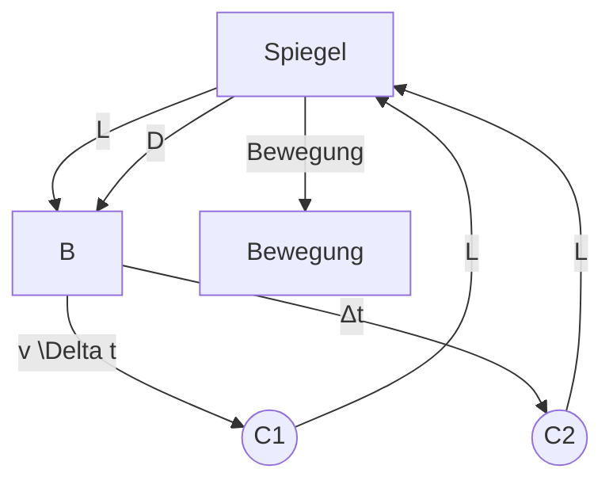

Benachbarte Zeiger gehören zu Elementarwellen, die von benachbarten Abschnitten des Spalts ausgehen. Die Zeiger wurden fortlaufend (Ende an Spitze) aneinandergereiht. Da die Phasendifferenz der Elementarwellen null ist, ist auch der Winkel zwischen benachbarten Zeigern null. Die Amplitude $E _ { \theta }$ in $\mathrm { P } _ { 0 }$ ergibt sich als Vektorsumme all dieser Zeiger. Wie sich herausstellt, ist $E _ { \theta }$ für $\theta = 0$ (also den hier beschriebenen Fall) am größten. Wir nennen diesen Maximalwert $E _ { \mathrm { m } }$

Wir betrachten nun einen Punkt P unter einem kleinen, aber von null verschiedenen Winkel θ zur Bezugsachse. Ein Blick auf Gl. 32.4 zeigt, dass die Phasendifferenz $\Delta \varphi$ der Elementarwellen aus benachbarten Abschnitten dann nicht mehr null ist. In Abb. 32.6b ist das zugehörige Zeigerdiagramm dargestellt; wieder wurden die Zeiger fortlaufend angeordnet, aber der Winkel $\Delta \varphi$ zwischen aneinanderstoßenden Zeigern ist ungleich null. Auch hier ergibt sich die Amplitude $E _ { \theta }$ als Vektorsumme aller Zeiger, wir erhalten jedoch einen kleineren Wert als für $\theta = 0$ (Abb. 32.6a). Die Intensität des Lichts ist in P demnach geringer als in $\mathbf { P } _ { 0 } .$

Je größer wir nun θ wählen, desto größer wird auch der Winkel $\Delta \varphi$ zwischen benachbarten Zeigern. Die Kette der Zeiger krümmt sich daher immer stärker und schließt sich schließlich zum Kreis (Abb. 32.6c). In diesem Fall ist die resultierende Amplitude $E _ { \theta }$ null und der Punkt auf dem Schirm folglich dunkel: Wir haben den ersten dunklen Streifen, das erste Minimum des Beugungsmusters erreicht. Die Phasendifferenz zwischen dem ersten und dem letzten Zeiger ist gleich 2π rad, d. h., der Weglängenunterschied zwischen dem von der oberen und dem von der unteren Kante ausgehenden Strahl entspricht gerade einer Wellenlänge – wir erinnern uns, dass das genau unsere Bedingung für das Auftreten des ersten Beugungsminimums war.

Vergrößern wir θ über diesen Punkt hinaus, so nimmt $\Delta \varphi$ noch weiter zu. Die Zeigerkette bildet nun eine Spirale (Abb. 32.6d), die sich immer stärker zusammenzieht. Die Amplitude nimmt dabei wieder zu und erreicht bei der in Abb. 32.6d dargestellten Anordnung einen maximalen Wert, der dem ersten Nebenmaximum im Beugungsmuster entspricht.

Wenn θ weiter zunimmt, nimmt $E _ { \theta }$ wieder ab (die Spirale schrumpft); die Intensität in dem zugehörigen Punkt ist kleiner als am ersten Nebenmaximum. Das zweite Minimum ist erreicht, wenn die Spitze des letzten Zeigers wieder mit dem Ende des ersten Zeigers zusammentrifft.

Dieses qualitative Verfahren zur Lokalisierung der Maxima und Minima im Beugungsmuster ließe sich beliebig fortsetzen. Statt dies zu tun, wollen wir nun jedoch eine quantitative Methode kennenlernen.

## KONTROLLFRAGE 2

Die Abbildung zeigt zwei Zeigerdiagramme analog zu Abb. 32.6 (die Kurven sind hier glatter, weil mehr Zeiger verwendet wurden). Sie gehören zu zwei Punkten auf entgegengesetzten Seiten eines Maximums in einem Beugungsmuster. (a) Um welches Maximum handelt es sich? (b) Welcher Wert von m (siehe Gl. 32.3) gehört ungefähr zu diesem Maximum?

## 32.2.2 Intensitäten bei der Beugung am Einzelspalt: Eine quantitative Betrachtung

Gleichung 32.3 liefert uns die Minima im Beugungsmuster eines Einzelspalts auf einem Beobachtungsschirm C als Funktion des in Abb. 32.4a eingezeichneten Winkels θ. Wir wollen nun einen Ausdruck für die Intensität $I ( \theta )$ in Abhängigkeit von diesem Winkel herleiten. Wie weiter unten bewiesen werden soll, ist gilt für die Intensität

$$
I (\theta) = I _ {\mathrm{m}} \left(\frac {\sin \alpha}{\alpha}\right) ^ {2} \tag {32.5}
$$

line

| \(\theta (\)Grad) | Relative Intensität |
| --- | --- |
| 20 | ~0.68 |
| 15 | ~0.83 |
| 10 | ~0.94 |
| 5 | ~0.99 |
| 0 | 1.0 |
| 5 | ~0.99 |
| 10 | ~0.94 |
| 15 | ~0.83 |
| 20 | ~0.68 |

(a)

line

| \(\theta (\)Grad) | Relative Intensität |
| --- | --- |
| -20 | ~0.05 |
| -15 | ~0.08 |
| -10 | ~0.05 |
| -5 | ~0.45 |
| 0 | 1.0 |
| 5 | ~0.45 |
| 10 | ~0.05 |
| 15 | ~0.08 |
| 20 | ~0.05 |

(b)

line

| \(\theta (\)Grad) | Relative Intensität |
| --- | --- |
| -20 | ~0.01 |
| -15 | ~0.03 |
| -10 | ~0.08 |
| -5 | ~0.01 |
| 0 | 1.0 |
| 5 | ~0.01 |
| 10 | ~0.08 |
| 15 | ~0.03 |
| 20 | ~0.01 |

(c)

Abb. 32.7

Relative Intensitäten bei der Beugung am Einzelspalt für drei Werte des Verhältnisses $a / \lambda$ . Das Hauptmaximum wird umso schmaler, je breiter der Spalt ist.

text_image

α
α
φ
R
R
Eθ
Em
φ
Em

Abb. 32.8

Die Konstruktion zur Berechnung der Intensitäten bei der Beugung am Einzelspalt. Die gezeigte Situation entspricht Abb. 32.7b.

mit

$$
\alpha = \frac {1}{2} \varphi = \frac {\pi a}{\lambda} \sin \theta . \tag {32.6}
$$

Die Hilfsgröße α ist einfach eine praktische Verbindung zwischen dem Winkel θ, anhand dessen wir die Position eines Punkts auf dem Beobachtungsschirm festlegen, und der Intensität $I _ { \mathrm { m } }$ des Lichts in diesem Punkt. Der Maximalwert $I _ { \mathrm { m } }$ der Intensität $I ( \theta )$ in diesem Muster entspricht dem Hauptmaximum (mit $\theta = 0 ) ;$ 𝜑 ist die Phasendifferenz (im Bogenmaß) zwischen Strahlen, die von der oberen bzw. der unteren Kante des Spalts mit der Breite a ausgehen.

Nach Gl. 32.5 gilt für die Intensitätsminima

$$
\alpha = m \pi \quad \text {mit} \quad m = 1, 2, 3, \dots \tag {32.7}
$$

Setzen wir dies in Gl. 32.6 ein, so erhalten wir als Bedingung für Minima im Beugungsmuster

$$
m \pi = \frac {\pi a}{\lambda} \sin \theta \quad \text {mit} \quad m = 1, 2, 3, \dots
$$

oder

$$
a \sin \theta = m \lambda \quad \text {mit} \quad m = 1, 2, 3, \dots \tag {32.8}
$$

Dieser Ausdruck entspricht exakt der zuvor hergeleiteten Gl. 32.3.

Abbildung 32.7 zeigt Intensitäten von Beugungsmustern an Einzelspalten, die mithilfe der Gln. 32.5 und 32.6 berechnet wurden, für Spalte mit den Breiten $\alpha = \lambda _ { i }$ $\alpha = 5 \lambda$ und $a = 1 0 \lambda$ . Man erkennt, dass die Breite des Hauptmaximums (des mittleren Maximums der gezeigten Kurven) mit zunehmender Spaltbreite (relativ zur Wellenlänge) abnimmt; das Ausmaß der Beugung wird also umso geringer, je breiter die Öffnung ist. Gleichzeitig wird auch das zweite Nebenmaximum schmaler und weniger intensiv. Wenn die Spaltbreite groß gegen die Wellenlänge des einstrahlenden Lichts ist, verschwindet das zweite Nebenmaximum und wir können nicht mehr von Beugung am Einzelspalt sprechen. (Stattdessen beobachten wir dann Beugungsmuster, die an den Kanten der Öffnung entstehen wie an der Rasierklinge in Abb. 32.2.)

## Herleitung der Gln. 32.5 und 32.6

Der aus Zeigern zusammengesetzte Bogen in Abb. 32.8 stellt die Elementarwellen dar, die einen beliebigen Punkt P auf dem Beobachtungsschirm in Abb. 32.4 erreichen; der zu P gehörende Winkel θ ist klein, aber von null verschieden. Die Ampli tude $E _ { \theta }$ der Resultierenden in P ergibt sich als Vektorsumme der Zeiger. Wenn wir den Spalt in Abb. 32.4 in infinitesimale Abschnitte mit der Breite Δx teilen, nähert sich die Anordnung der Zeiger in Abb. 32.8 einem Kreisbogen an, dessen Radius wir wie in der Abbildung mit R bezeichnen. Die Länge des Bogens muss gleich $E _ { \mathrm { m } }$ sein, der Amplitude in der Mitte des Beugungsmusters: Würden wir den Bogen „gerade biegen“, so ergäbe sich die Anordnung aus Abb. 32.6a (in Abb. 32.8 ganz unten angedeutet).

Der Winkel 𝜑 im unteren Teil von Abb. 32.8 gibt die Phasendifferenz zwischen den (infinitesimalen) Zeigern ganz links und ganz rechts in dem Bogen $E _ { \mathrm { m } }$ an. Aus geometrischen Überlegungen folgt, dass 𝜑 gleichzeitig dem Winkel zwischen den mit R bezeichneten Radien entspricht. Die gestrichelte Linie teilt 𝜑 in zwei gleiche Teile, wodurch zwei kongruente Dreiecke entstehen. Für jedes von ihnen gilt

$$
\sin \frac {1}{2} \varphi = \frac {E _ {\theta}}{2 R}. \tag {32.9}
$$

Im Bogenmaß entspricht dies (unter der Annahme, dass $E _ { \mathrm { m } }$ ein Kreisbogen ist) einem Winkel

$$
\varphi = \frac {E _ {\mathrm{m}}}{R}.
$$

Das lösen wir nach R auf und setzen den Ausdruck in Gl. 32.9 ein; so erhalten wir

$$
E _ {\theta} = \frac {E _ {\mathrm{m}}}{\frac {1}{2} \varphi} \sin \left(\frac {1}{2} \varphi\right). \tag {32.10}
$$

Aus Abschn. 29.2 wissen wir, dass die Intensität einer elektromagnetischen Welle proportional zum Quadrat der Amplitude ihres elektrischen Felds ist. In unserem Fall bedeutet das, dass die maximale Intensität $I _ { \mathrm { m } }$ (im Hauptmaximum) proportional zu $E _ { \mathrm { m } } ^ { 2 }$ ist und die Intensität $I ( \theta )$ bei einem Winkel θ proportional zu $\overline { { E _ { \theta ^ { \prime } } ^ { 2 } } }$ Wir können also schreiben

$$
\frac {I (\theta)}{I _ {\mathrm{m}}} = \frac {E _ {\theta} ^ {2}}{E _ {\mathrm{m}} ^ {2}}. \tag {32.11}
$$

Hier setzen wir $E _ { \theta }$ aus Gl. 32.10 sowie $\begin{array} { r } { \alpha = \frac { 1 } { 2 } \varphi . } \end{array}$ ein und erhalten für die Intensität als Funktion von θ

$$
I (\theta) = I _ {\mathrm{m}} \left(\frac {\sin \alpha}{\alpha}\right) ^ {2}.
$$

Damit haben wir Gl. 32.5 hergeleitet.

Jetzt wollen wir noch den Zusammenhang zwischen α und θ nachprüfen, also Gl. 32.6. Die Phasendifferenz 𝜑 zwischen zwei Strahlen, die von der oberen bzw. von der unteren Kante des Spalts ausgehen, lässt sich mithilfe von Gl. 32.4 als

$$
\varphi = \left(\frac {2 \pi}{\lambda}\right) (a \sin \theta)
$$

schreiben, wobei a die Summe aller Breiten Δx unserer infinitesimalen Abschnitte ist. Mit $\varphi = 2 \alpha$ geht diese Gleichung unmittelbar in Gl. 32.6 über.

## KONTROLLFRAGE 3

Ein Einzelspalt wird separat mit Licht der Wellenlängen 650 nm und 430 nm be leuchtet. Die Abbildung zeigt für beide Beugungsmuster die Intensität I als Funktion des Winkels θ. Anschließend wird der Spalt mit Licht beleuchtet, das beide angegebenen Wellenlängen enthält. Welche Farbe erkennt man im zugehörigen Beugungsmuster unter den Winkeln (a) A und (b) B?

line

| \(\theta\) | I (Solid Line) | I (Dotted Line) |
| --- | --- | --- |
| 0 | High | High |
| A | ~0 | ~0.2 |
| B | ~0.1 | ~0 |

## 32.3 Beugung an einer kreisrunden Öffnung

## Lernziele

Nach dem Durcharbeiten dieses Abschnitts sollten Sie in der Lage sein, . . .

• das Beugungsmuster hinter einer kleinen kreisförmigen Öffnung oder einem runden Hindernis zu beschreiben und zu skizzieren,
bei der Beugung an einer kleinen kreisförmigen Öffnung oder einem entsprechenden Hindernis die Beziehungen zwischen dem Winkel θ zum ersten Minimum, der Lichtwellenlänge λ, dem Durchmesser d von Öffnung bzw. Hindernis, der Distanz D zum Beobachtungsschirm und dem Abstand y zwischen dem Minimum und der Mitte des Beugungsmusters anzuwenden,

• anhand der Beugungsmuster von Punktobjekten zu erklären, wie Beugungseffekte die visuelle Auflösung von Objekten begrenzen,
• das Rayleigh-Kriterium für die Auflösbarkeit von zwei benachbarten Punktobjekten zu verstehen,
• die Beziehungen zwischen dem Winkel $\theta _ { \mathrm { R } }$ im Rayleigh-Kriterium, der Wellenlänge λ, dem Durchmesser d der Öffnung (z. B. des Pupillendurchmessers), dem Winkel θ, unter dem zwei Punktobjekte aus der Ferne gesehen werden, und dem Abstand L zu diesen Objekten anzuwenden.

## Schlüsselideen

• Die Beugung an einer kreisförmigen Öffnung oder Linse mit Durchmesser d erzeugt ein zentrales Maximum und konzentrische Maxima und Minima. Der Winkel θ zum ersten Minimum erfüllt die Bedingung

$$
\sin \theta = 1, 2 2 \frac {\lambda}{d}.
$$

Das Rayleigh-Kriterium besagt, dass zwei Objekte gerade noch getrennt wahrgenommen („aufgelöst“) werden können, wenn das zentrale Beugungsmaxi mum des einen sich im ersten Minimum des anderen befindet. Ihr Winkelabstand muss dafür mindestens

$$
\theta_ {\mathrm{R}} = 1, 2 2 \frac {\lambda}{d} \qquad (\text {Rayleigh - Kriterium})
$$

sein, worin d der Durchmesser der Öffnung ist, die das Licht passieren muss.

## 32.3.1 Beugung an einer kreisrunden Öffnung

natural_image

Concentric red and black rings on a dark background, no text or symbols present

Abb. 32.9

Ein an einer kreisrunden Öffnung entstandenes Beugungsmuster: zu erkennen sind ein Hauptmaximum und mehrere ringförmige Nebenmaxima.

Letztere erscheinen normalerweise nur sehr schwach; damit sie hier besser sichtbar werden, wurde das Foto überbelichtet [Quelle: Jearl Walker].

Wir wenden uns nun der Beugung an einer kreisrunden Öffnung zu, etwa einer Linse, die von einer Blende eingefasst ist und durch die Licht fällt. In Abb. 32.9 sehen Sie das Bild einer weit entfernten Punktquelle (beispielsweise eines Sterns) auf einem fotografischen Film, der sich in der Brennebene einer Sammellinse befindet. Vom Standpunkt der geometrischen Optik aus betrachtet, sollte das Bild punktförmig sein. Das ist offensichtlich nicht der Fall: Wir erkennen eine Scheibe, umgeben von Ringen, deren Helligkeit von innen nach außen abnimmt. Ein Vergleich mit Abb. 32.1 lässt keinen Zweifel: Wir haben es mit einer Beugungserscheinung zu tun. Gebeugt wird das Licht hier allerdings nicht an einem rechteckigen Spalt, sondern an einer kreisrunden Öffnung mit dem Durchmesser d.

Die mathematische Analyse eines derartigen Musters ist kompliziert. Sie liefert als Position des ersten Beugungsminimums an einer kreisrunden Öffnung

$$
\sin \theta = 1, 2 2 \frac {\lambda}{d}, \tag {32.12}
$$

wobei d der Durchmesser der Öffnung ist und θ den Winkel zwischen der Bezugsachse und einem beliebigen Punkt des (ringförmigen) Minimums angibt. Vergleichen Sie diesen Ausdruck mit Gl. 32.1,

$$
\sin \theta = \frac {\lambda}{a}, \tag {32.13}
$$

für die Position des ersten Minimums im Beugungsmuster an einem langen, engen Spalt mit der Breite a. Der Unterschied liegt im Wesentlichen in dem Faktor 1,22; er kommt durch die Kreisform der Öffnung zustande.

## Optische Auflösbarkeit

Wir haben gesehen, dass die durch Linsen erzeugten Abbildungen Beugungsmuster sind. Von Bedeutung ist diese Tatsache beispielsweise, wenn es darum geht, zwei weit entfernte, punktförmige Objekte mit kleinem Winkelabstand aufzulö- sen, d. h. separat wahrnehmbar abzubilden.

natural_image

Circular glowing orange-yellow object against a dark background, resembling a glowing red-orange magnet or flame (no text or symbols visible)

natural_image

Illustration of a red-orange peak on a gray surface with circular patterns (no text or symbols)

(a)

natural_image

Abstract glowing orange-yellow shape against dark background, resembling a stylized heart or starburst (no text or symbols)

natural_image

Illustration of a red, bimodal peak on a gray surface with concentric circular patterns (no text or symbols)

(b)

natural_image

Two glowing yellow circular shapes against a dark background, resembling a stylized letter or symbol (no text or symbols present)

natural_image

Illustration of two orange conical spikes on a gray surface with ripple patterns (no text or symbols)

(c)

Betrachten Sie dazu in Abb. 32.10 die Abbildungen zweier eng benachbarter Objekte (z. B. Sterne) mit den zugehörigen Intensitätsverteilungen. In Abb. 32.10a verhindert die Beugung, dass die Objekte getrennt wahrgenommen werden: Die Beugungsmuster, insbesondere deren Hauptmaxima, überlagern einander so stark, dass man im Ergebnis nicht unterscheiden kann, ob es sich um ein Objekt oder mehrere handelt. In Abb. 32.10b sind die Objekte gerade eben aufgelöst, in Abb. 32.10c erkennt man die Objekte eindeutig als zwei separate Einheiten.

In Abb. 32.10b ist der Winkelabstand zwischen den Punktquellen so groß, dass das Hauptmaximum des Beugungsmusters einer Quelle mit dem ersten Minimum der anderen Quelle zusammenfällt. Diese Bedingung nennt man das **Rayleigh-Kriterium der Auflösbarkeit**. Aus Gl. 32.12 folgt für zwei Objekte, die diesem Kriterium gemäß gerade eben getrennt wahrgenommen werden können, ein Winkelabstand $\theta _ { \mathrm { R } }$ von

$$
\theta_ {\mathrm{R}} = \sin^ {- 1} \frac {1 , 2 2 \lambda}{d}.
$$

Da die hier beteiligten Winkel klein sind, können wir sin $\theta _ { \mathrm { R } }$ durch $\theta _ { \mathrm { R } }$ (im Bogenmaß) ersetzen; mit dieser Näherung folgt

$$
\theta_ {\mathrm{R}} = 1, 2 2 \frac {\lambda}{d}. \tag {32.14}
$$

Das Rayleigh-Kriterium ist nur eine Näherung, denn die Auflösbarkeit hängt von vielen Faktoren ab: von der relativen Helligkeit der Quellen und ihrer Umgebung, von Turbulenzen in der Luft zwischen Objekt und Betrachter und nicht zuletzt von der Leistungsfähigkeit des visuellen Systems des Betrachters. Experimente zeigen, dass der kleinste Winkelabstand, bei dem eine Person zwei Objekte noch getrennt wahrnimmt, in der Regel etwas größer ist als der von Gl. 32.14 gegebene Wert. Soweit es unsere folgenden Berechnungen betrifft, wollen wir Gl. 32.14 jedoch als präzises Kriterium ansehen: Ist der Winkelabstand θ zwischen den Objekten grö- ßer als $\theta _ { \mathrm { R } } ,$ so können die Objekte aufgelöst werden, ansonsten nicht.

Mithilfe des Rayleigh-Kriteriums lassen sich die Farben in den Gemälden der sogenannten Pointillisten erklären. Diese malten ihre Bilder nicht mit den üblichen Pinselstrichen, sondern setzten ihre Motive aus unzähligen farbigen Pünktchen zusammen. Wenn Sie in einem Museum aus geringer Entfernung auf ein solches Bild schauen, ist der Winkelabstand θ zwischen benachbarten Farbpunkten größer als $\theta _ { \mathrm { R } }$ und Sie nehmen die Punkte getrennt voneinander wahr; ihre Farbigkeit entspricht dem vom Maler (oder der Malerin) ausgewählten Pigment. Wenn Sie aber

## Abb. 32.10

Oben: Die von einer Sammellinse erzeugten Abbildungen zweier Punktquellen (Sterne). Unten: Die zugehö- rigen Intensitätsverteilungen. (a) Der Winkelabstand der Objekte ist so gering, dass sie nicht getrennt wahrgenommen werden können. (b) Die Objekte sind gerade eben unterscheidbar. (c) Die Objekte sind getrennt wahrnehmbar. In (b) ist das Rayleigh-Kriterium genau erfüllt: Das Hauptmaximum des einen Beugungsmusters fällt mit dem ersten Minimum des anderen zusammen [Quelle: Jearl Walker].

natural_image

Microscopic view of blood cells with red blood cells and orange cytoplasm (no text or symbols visible)

Abb. 32.11

Ein Falschfarbenbild einer Vene mit roten Blutkörperchen; aufgenommen mit einem Rasterelektronenmikroskop [Quelle: Scott Camazine/Alamy Stock Photo].

weiter zurückgehen, werden die Winkelabstände der einzelnen Punkte irgendwann kleiner als $\theta _ { \mathrm { R } }$ und Sie nehmen anstelle einzelner Punkte Flächen in Farbtönen wahr, die Ihr visuelles System aus den Farben der vorhandenen Punkte „mischt“, wobei möglicherweise Farbtöne zustande kommen, die nirgendwo im Bild verwendet wurden! Der „Schöpfer“ des Bilds – zumindest, soweit es die farbige Gestaltung betrifft – ist also nicht nur der Maler, sondern vor allem Ihre Wahrnehmung.

Wenn wir Objekte durch eine Linse betrachten und dabei eine optimale Auflösung erreichen wollen, müssen wir dafür sorgen, dass wir die Beugungseffekte möglichst gering halten. Gemäß Gl. 32.14 verringert sich die Ausdehnung des Beugungsmusters mit zunehmendem Durchmesser der Linse oder mit abnehmender Wellenlänge des einstrahlenden Lichts.

Aus diesem Grund verwendet man für die Mikroskopie häufig ultraviolettes Licht. Dessen kurze Wellenlängen erlauben die Beobachtung von Details, die man durch ein mit sichtbarem Licht arbeitendes Mikroskop nicht erkennen könnte. In Kapitel 34 werden wir sehen, dass sich auch Elektronenstrahlen unter bestimmten Bedingungen wellenähnlich verhalten. Man erreicht in Elektronenmikroskopen Wellenlängen im Bereich des $1 0 ^ { - 5 }$ -Fachen der Wellenlängen von sichtbarem Licht. Daher kann man mit dem Elektronenmikroskopwinzigste Strukturen untersuchen (siehe Abb. 32.11), die in einem optischen Mikroskop durch Beugungseffekte verschwimmen würden.

## KONTROLLFRAGE 4

Stellen Sie sich zwei rote Punkte in einiger Entfernung vor, die Sie aufgrund der Beugungseffekte an der Pupille Ihrer Augen gerade noch getrennt wahrnehmen können. Nun wird die Umgebungshelligkeit erhöht, sodass der Durchmesser der Pupille abnimmt. Können Sie die Punkte jetzt besser auflösen oder überhaupt nicht mehr? Berücksichtigen Sie ausschließlich die Beugung. (Überprüfen Sie Ihre Antwort mit einem entsprechenden Experiment.)

## 32.4 Beugung am Doppelspalt

## Lernziele

Nach dem Durcharbeiten dieses Abschnitts sollten Sie in der Lage sein, . . .

• in einer Skizze eines Doppelspaltexperiments zu erklären, wie die Beugung an den beiden Spalten das Doppelspalt-Interferenzmuster verändert, und die Einhüllende des Beugungsmusters sowie das Haupt- und die Nebenmaxima dieser Einhüllenden zu identifizieren,
• für einen gegebenen Punkt in einem Doppelspalt-Beugungsmuster die Lichtintensität I in Abhängigkeit von der Intensität $I _ { \mathrm { m } }$ in der Mitte des Musters zu berechnen,
• in der Intensitätsgleichung für ein Doppelspalt-Beugungsmuster anzugeben, welcher Anteil auf die Interferenz zwischen den zwei Spalten zurückgeht und welcher Anteil der Beugung an den Spalten entspricht,
für die Beugung am Doppelspalt die Beziehung zwischen dem Verhältnis d∕a und den Positionen der Minima im Einzelspalt-Beugungsmuster anzuwenden und dann die Anzahl der Doppelspaltmaxima im zentralen Peak und den Seitenpeaks der Umhüllenden des Beugungsmusters zu bestimmen.

## Schlüsselideen

• Wellen, die durch zwei benachbarte Spalte treten, erfahren eine Kombination aus Doppelspaltinterferenz und Beugung an den Einzelspalten.
• Für identische Spalte mit der Breite a und dem Mitte-zu-Mitte-Abstand d variiert die Intensität im Beugungsmuster mit dem Winkel θ von der zentralen

Achse gemäß

$$
I (\theta) = I _ {\mathrm{m}} (\cos^ {2} \beta) \left(\frac {\sin \alpha}{\alpha}\right) ^ {2} \qquad \text {(Doppelspalt)}.
$$

Dabei sind $I _ { \mathrm { m } }$ die Intensität in der Mitte des Musters,

$$
\beta = \left(\frac {\pi d}{\lambda}\right) \sin \theta
$$

und

$$
\alpha = \left(\frac {\pi a}{\lambda}\right) \sin \theta .
$$

## 32.4.1 Beugung am Doppelspalt

Bei der Besprechung von Doppelspaltexperimenten in Kapitel 31 sind wir implizit stets davon ausgegangen, dass die Spaltbreite klein ist verglichen mit der Wellenlänge des einstrahlenden Lichts, dass also $\alpha \ll \lambda$ gilt. In diesen Fällen nimmt das Hauptmaximum des von jedem Spalt einzeln erzeugten Beugungsmusters den gesamten Beobachtungsschirm ein. Durch die Interferenz der von den beiden Spalten ausgehenden Wellen entsteht ein Muster aus nahezu gleich intensiven Streifen (vgl. Abb. 31.9).

In der Praxis arbeitet man häufig mit sichtbarem Licht und die Bedingung $\alpha \ll \lambda$ ist nicht erfüllt. Wenn die Spalte relativ breit sind, entstehen am Doppelspalt In terferenzmuster aus Streifen verschiedener Helligkeit: Die Intensitäten der Interferenzstreifen werden durch die Beugung des Lichts an jedem einzelnen Spalt beeinflusst (siehe dazu unsere Diskussion in Kapitel 31).

Betrachten wir dazu ein Beispiel. In Abb. 32.12a sehen Sie das Interferenzmuster zweier unendlich schmaler Spalte (mit $\alpha \ll \lambda )$ ; alle hellen Streifen sind gleich intensiv. Abbildung 32.12b zeigt das Beugungsmuster eines Einzelspalts endlicher Breite; man erkennt ein breites Hauptmaximum und schwächere Nebenmaxima bei $\pm 1 7 ^ { \circ }$ . In Abb. 32.12c schließlich ist das Interferenzmuster zweier Spalte mit endlicher Breite dargestellt: Die Kurve aus Abb. 32.12b bildet die Hüllkurve für die

line

| \(\theta (\)Grad) | Relative Intensität |
| --- | --- |
| -20 | ~1.0 |
| -19 | ~-1.0 |
| -18 | ~1.0 |
| -17 | ~-1.0 |
| -16 | ~1.0 |
| -15 | ~-1.0 |
| -14 | ~1.0 |
| -13 | ~-1.0 |
| -12 | ~1.0 |
| -11 | ~-1.0 |
| -10 | ~1.0 |
| -9 | ~-1.0 |
| -8 | ~1.0 |
| -7 | ~-1.0 |
| -6 | ~1.0 |
| -5 | ~-1.0 |
| -4 | ~1.0 |
| -3 | ~-1.0 |
| -2 | ~1.0 |
| -1 | ~-1.0 |
| 0 | 0.0 |
| 1 | ~-1.0 |
| 2 | ~1.0 |
| 3 | ~-1.0 |
| 4 | ~1.0 |
| 5 | ~-1.0 |
| 6 | ~1.0 |
| 7 | ~-1.0 |
| 8 | ~1.0 |
| 9 | ~-1.0 |
| 10 | ~1.0 |
| 11 | ~-1.0 |
| 12 | ~1.0 |
| 13 | ~-1.0 |
| 14 | ~1.0 |
| 15 | ~-1.0 |
| 16 | ~1.0 |
| 17 | ~-1.0 |
| 18 | ~1.0 |
| 19 | ~-1.0 |
| 20 | ~1.0 |

(a)

line

| \(\theta (\)Grad) | Relative Intensität |
| --- | --- |
| -20 | ~0.1 |
| -15 | ~0.2 |
| -10 | ~0.1 |
| -5 | ~0.8 |
| 0 | 1.0 |
| 5 | ~0.8 |
| 10 | ~0.1 |
| 15 | ~0.2 |
| 20 | ~0.1 |

(b)

line

| \(\theta (\)Grad) | Relative Intensität |
| --- | --- |
| -20 | ~0.05 |
| -18 | ~0.15 |
| -16 | ~0.15 |
| -14 | ~0.15 |
| -12 | ~0.15 |
| -10 | ~0.15 |
| -9 | ~0.25 |
| -8 | ~0.35 |
| -7 | ~0.55 |
| -6 | ~0.75 |
| -5 | ~0.95 |
| -4 | ~1.05 |
| -3 | ~1.05 |
| -2 | ~1.05 |
| -1 | ~1.05 |
| 0 | 1.0 |
| 1 | ~1.05 |
| 2 | ~1.05 |
| 3 | ~1.05 |
| 4 | ~1.05 |
| 5 | ~0.95 |
| 6 | ~0.75 |
| 7 | ~0.55 |
| 8 | ~0.35 |
| 9 | ~0.25 |
| 10 | ~0.15 |
| 12 | ~0.15 |
| 14 | ~0.15 |
| 16 | ~0.15 |
| 18 | ~0.15 |
| 20 | ~0.05 |

(c)

## Abb. 32.12

(a) Intensitätsverteilung bei der Interferenz an zwei unendlich schmalen Spalten. (b) Intensitätsverteilung bei der Beugung an einem einzelnen Spalt der endlichen Breite a. (c) Intensitätsverteilung bei der Interferenz an zwei Spalten mit der endlichen Breite $^ { a . }$ Die Verteilung aus (b) begrenzt als Hüllkurve die Intensität der Streifen aus (a). Die ersten Minima des Musters aus (b) sorgen dafür, dass die Interferenzstreifen bei etwa $\pm 1 2 ^ { \circ }$ in (c) verschwinden.

Abb. 32.13 (a) Interferenzmuster eines realen Doppelspaltsystems; vergleichen Sie mit Abb. 32.12c. (b) Beugungsmuster eines realen Einzelspalts; vergleichen Sie mit Abb. 32.12b [Quelle: Jearl Walker].

Intensitätsverteilung aus Abb. 32.12a. Offensichtlich ändern sich nicht die Positionen der Streifen, sondern nur ihre Intensitäten.

Abbildung 32.13a zeigt ein reales Muster, in dem sowohl die Interferenz am Doppelspalt als auch die Einflüsse der Beugung zu erkennen sind. Wenn man einen Spalt abdeckt, so erscheint das in Abb. 32.13b gezeigte Beugungsmuster. Beachten Sie die Beziehungen zwischen den Abb. 32.13a und 32.12c bzw. 32.13b und 32.12b. Berücksichtigen Sie bei Ihrem Vergleich, dass die Fotos in Abb. 32.13 absichtlich überbelichtet wurden, um die intensitätsschwachen Nebenmaxima sichtbar zu machen, und dass Abb. 32.13 im Gegensatz zu Abb. 32.12 auch die zweiten Nebenmaxima enthält.

Die Intensitätsverteilung des Interferenzmusters an einem Doppelspalt ist bei Einbeziehung der Beugungseffekte durch

$$
I (\theta) = I _ {\mathrm{m}} (\cos^ {2} \beta) \left(\frac {\sin \alpha}{\alpha}\right) ^ {2} \tag {32.15}
$$

mit

$$
\beta = \frac {\pi d}{\lambda} \sin \theta \tag {32.16}
$$

und

$$
\alpha = \frac {\pi a}{\lambda} \sin \theta \tag {32.17}
$$

gegeben; dabei ist d der Abstand zwischen den Spalten und a ist die Spaltbreite. Die rechte Seite von Gl. 32.15 ist das Produkt aus der Intensität $I _ { \mathrm { m } }$ und zwei zusätzlichen Faktoren: Der erste ist der Interferenzterm $\cos ^ { 2 } \beta ,$ der durch die Interferenz an zwei Spalten im Abstand $d$ entsteht (siehe die Gln. 32.16 und 32.17), der zweite der Beugungsterm [(sin α) ${ \mathrm { ~  ~ } } ) / \alpha ] ^ { 2 }$ aufgrund der Beugung an einem Einzelspalt der Breite a (siehe die Gln. 32.5 und 32.6).

Beide Faktoren wollen wir näher betrachten. Wenn in Gl. 32.17 $\alpha \rightarrow 0$ geht, so gilt ebenfalls $\alpha \to 0$ und (sin $\alpha ) / \alpha \rightarrow 1$ . Dadurch reduziert sich Gl. 32.15 wie erwartet auf die Beschreibung der Intensitätsverteilung bei der Interferenz an zwei unendlich schmalen Spalten im Abstand d. Wenn wir hingegen in Gl. 32.16 $d = 0$ setzen, entspricht das physikalisch einer Verschmelzung der beiden Spalte zu einem Einzelspalt der Breite $a .$ In Gl. 32.16 wird dann $\beta = 0$ und $\cos ^ { 2 } \beta = 1 ,$ , und Gl. 32.15 beschreibt die Situation richtig als Beugung am Einzelspalt der Breite a.

Das durch Gl. 32.15 beschriebene und in Abb. 32.13a dargestellte Doppelspaltmuster illustriert die Verknüpfung von Beugung und Interferenz. Beide Effekte entstehen durch Superposition, d. h. Überlagerung von Elementarwellen unterschiedlicher Phase in einem bestimmten Punkt. Gehen diese Elementarwellen von einer kleinen Zahl von Quellen aus – wie im Falle des Doppelspaltversuchs mit $a \ll \lambda - ,$ so nennen wir das Phänomen Interferenz; treffen die Elementarwellen in einer gemeinsamen Wellenfront ein – wie beim Versuch am Einzelspalt –, so sprechen wir von Beugung. Diese begriffliche Unterscheidung ist willkürlich (und wird auch nicht immer exakt befolgt), vereinfacht aber die Diskussion. Wir dürfen dabei jedoch nicht vergessen, dass es sich in beiden Fällen um Auswirkungen der Überlagerung von Wellen handelt und dass Interferenz und Beugung in der Regel gemeinsam auftreten (wie in Abb. 32.13a).

## KONTROLLFRAGE 5

Nehmen wir an, in dem zuvor beschriebenen Versuch wird Licht mit einer Wellenlänge von 550 nm verwendet. Nehmen dann (a) die Breite des Hauptmaximums der Beugungskurve und (b) die Anzahl der hellen Interferenzstreifen innerhalb dieses Maximums zu, ab oder bleiben sie gleich?

## 32.5 Beugungsgitter

## Lernziele

Nach dem Durcharbeiten dieses Abschnitts sollten Sie in der Lage sein, . . .

• ein Beugungsgitter zu beschreiben und das von ihm erzeugte Interferenzmuster für monochromatisches Licht zu skizzieren,
• die Interferenzmuster von Beugungsgitter und Doppelspalt zu vergleichen,
• die Begriffe „Linie“ und „Ordnung“ im Zusammenhang mit Beugungsgittern zu verstehen,
• für ein Beugungsgitter die Beziehung zwischen der Ordnung m und der Weglängendifferenz von Strahlen anzugeben, die zu einem hellen Streifen im Beugungsmuster führen,
• für ein Beugungsgitter die Beziehung zwischen dem Spaltabstand d, dem Winkel θ zu einem hellen Streifen, der Ordnung m dieses Streifens und der Wellenlänge λ des Lichts anzugeben,
• zu verstehen, dass und warum es für ein gegebenes Beugungsgitter eine maximale Ordnung gibt,
• die Herleitung der Gleichung für die halbe Breite einer Linie im Beugungsmuster eines Beugungsgitters zu erklären,
• die halbe Breite einer Linie bei einem gegebenen Beugungswinkel an einem Beugungsgitter zu berechnen,
• zu erklären, inwiefern eine große Zahl von Spalten in einem Beugungsgitter von Vorteil ist,
• die Funktionsweise eines Gitterspektrometers zu erläutern.

## Schlüsselideen

Ein Beugungsgitter ist eine Anordnung einer großen Zahl von gleichartigen „Spalten“, durch die eine einfallende Welle in ihre spektralen Komponenten (d. h. ihre einzelnen Wellenlängen) zerlegt werden kann, indem ihre jeweiligen Beugungsmaxima getrennt werden. Beugung an N Spalten ergibt Maxima (Linien) bei Winkeln θ, die die Bedingung

$$
d \sin \theta = m \lambda , \quad m = 0, 1, 2, \dots \tag {Maxima}
$$

erfüllen.

• Die halbe Breite $\Delta \theta _ { 1 / 2 }$ einer Linie ist der Winkel von ihrer Mitte bis zu dem Punkt, an dem die Intensität verschwindet; für sie gilt

$$
\Delta \theta_ {1 / 2} = \frac {\lambda}{N d \cos \theta}.
$$

text_image

λ
d
P
C

Abb. 32.14

Ein idealisiertes Beugungsgitter aus fünf Spalten. Auf dem weit entfernten Beobachtungsschirm C entsteht ein Interferenzmuster.

line

| Peak Label | Intensity Level |
| --- | --- |
| 3 | High |
| 2 | High |
| 1 | High |
| 0 | Low |
| 1 | High |
| 2 | High |
| 3 | High |

(a)

(b)

Abb. 32.15

(a) An einem Beugungsgitter mit sehr vielen Öffnungen oder Rillen entsteht eine Intensitätsverteilung mit schmalen Maxima, die hier mit dem zugehö- rigen Wert von m bezeichnet wurden. (b) Das auf dem Schirm erscheinende Muster besteht aus dünnen, hier entsprechend zu (a) beschrifteten Linien. Eingezeichnet sind die Linien nullter, erster, zweiter und dritter Ordnung.

text_image

zum Punkt P
auf dem
Beobachtungsschirm
Weglängen-
unterschied
benachbarter
Strahlen
θ
θ
θ
d

## 32.5.1 Beugungsgitter

Eines der nützlichsten Hilfsmittel zur Untersuchung von Licht und dessen Absorption oder Emission durch verschiedenste Objekte ist das **Beugungsgitter**. Die Anordnung ähnelt dem in Abb. 31.9 gezeigten Doppelspalt – allerdings ist die Anzahl N der Öffnungen (Striche) viel größer (sie kann in der Größenordnung von mehreren Tausend pro Millimeter liegen). Das in Abb. 32.14 gezeigte idealisierte Gitter besteht aus nur fünf Spalten. Beleuchtet man es mit monochromatischem Licht, so entsteht ein Muster aus schmalen Interferenzstreifen, aus deren Lage sich die Wellenlänge des Lichts bestimmen lässt. (Es gibt viele verschiedene Formen von Beugungsgittern. Anstelle von parallelen Öffnungen kann man in eine undurchsichtige Fläche auch parallele Rillen einritzen, an denen das Licht gestreut wird und zur Interferenz kommt.)

Wir wollen uns vorstellen, dass wir eine Anordnung von Spalten mit monochromatischem Licht beleuchten und dabei die Spaltanzahl allmählich von 2 auf eine große Zahl N erhöhen. Die für den Doppelspalt typische Intensitätsverteilung (Abb. 32.12c) wird dabei zunächst immer komplizierter und geht schließlich in die in Abb. 32.15a dargestellte Funktion über. Abbildung 32.15b zeigt das Interferenzmuster bei Verwendung von monochromatischem rotem Licht – etwa aus einem Helium-Neon-Laser. Die Maxima sind jetzt sehr schmal, man nennt sie Linien; zwischen ihnen liegen relativ breite dunkle Bereiche.

Um die Lage der hellen Streifen auf dem Beobachtungsschirm zu ermitteln, gehen wir in gewohnter Weise vor. Dabei nehmen wir an, die Entfernung zwischen Gitter und Schirm sei so groß, dass die in einem Punkt P auf dem Schirm eintreffenden Strahlen näherungsweise parallel sind (siehe Abb. 32.16). Dann behandeln wir nebeneinander liegende Spalte paarweise so, wie es weiter oben für die Interferenz am Doppelspalt vorgeführt wurde. Den Abstand d zwischen zwei Gitterstrichen nennt man Gitterkonstante. (Liegen N Striche innerhalb einer Gesamtbreite w des Gitters, so gilt $d = w / N )$ . Wieder ist der Weglängenunterschied zwischen benachbarten Strahlen gleich d sin θ (Abb. 32.16) mit θ als Winkel zwischen der Bezugsachse (bzw. der Achse des Beugungsmusters) und dem Punkt P. In P befindet sich eine Interferenzlinie (ein Maximum), wenn der Weglängenunterschied zwischen benachbarten Strahlen ein ganzzahliges Vielfaches der Wellenlänge λ ist:

$$
d \sin \theta = m \lambda \quad \text {mit} \quad m = 0, 1, 2, \dots \tag {32.18}
$$

Jede Zahl m gehört zu einer bestimmten Linie, weshalb man die Ordnung m wie in Abb. 32.15 zur Bezeichnung des Musters verwenden kann. Man spricht dann von Linien nullter, erster, zweiter usw. Ordnung; die Linie nullter Ordnung ist das Hauptmaximum mit $m = 0 .$

Wenn wir Gl. 32.18 in der Form $\theta = \sin ^ { - 1 } ( m \lambda / d )$ schreiben, wird deutlich, dass der Winkel zwischen der Bezugsachse und einer beliebigen Interferenzlinie für ein gegebenes Beugungsgitter von der Wellenlänge des eingestrahlten Lichts abhängt. Wenn ein Gitter mit Licht unbekannter Wellenlänge bestrahlt wird, können wir λ daher mithilfe von Gl. 32.18 aus den Positionen der Linien höherer Ordnung berechnen. Diese Methode lässt sich ebenso zur Unterscheidung und Identifikation verschiedener in einem Strahl enthaltener Wellenlängen verwenden. Mit der Doppelspaltanordnung, wie wir sie in Abschn. 31.2 besprochen haben, ist dies nicht möglich, obwohl dieselben Gleichungen und Beziehungen gelten. Hier überlagern sich die von verschiedenen Wellenlängen erzeugten hellen Streifen nämlich zu stark, um einzeln analysiert werden zu können.

## Abb. 32.16

Strahlen, die von den Strichen (Spalten) eines Beugungsgitters zu einem entfernten Punkt P verlaufen, sind näherungsweise parallel. Der Weglängenunterschied zwischen zwei benachbarten Strahlen beträgt d sin $\theta ,$ wobei θ in der Skizze angegeben ist. (Das Gitter erstreckt sich senkrecht zur Papierebene).

## Linienbreiten am Beugungsgitter

Die Fähigkeit eines Gitters, Linien zu verschiedenen Wellenlängen des eingestrahlten Lichts getrennt abbilden (auflösen) zu können, hängt von der Breite dieser Linien ab. Wir wollen im Folgenden einen Ausdruck für die halbe Breite der mittleren Linie (derjenigen mit $m = 0 )$ herleiten und daraus eine entsprechende Beziehung für die Linien höherer Ordnung entwickeln. Die halbe Breite der zentralen Linie messen wir als den Winkel $\Delta \theta _ { 1 / 2 }$ von der Mitte der Linie $( \theta = 0 )$ nach außen zum Beginn des dunklen Bereichs des ersten Minimums (siehe Abb. 32.17). In einem solchen Minimum löschen die von einem Gitter mit N Strichen ausgehenden N Strahlen einander aus. (Die tatsächliche Linienbreite beträgt natürlich $2 \Delta \theta _ { 1 / 2 } ,$ zum Vergleich von Linienbreiten zieht man aber gewöhnlich den Wert $\Delta \theta _ { 1 / 2 }$ heran.)

In Abschn. 32.1 haben wir uns bereits mit dem gegenseitigen Auslöschen sehr vieler Strahlen (bei der Beugung am Einzelspalt) beschäftigt. Dabei erhielten wir Gl. 32.3, die wir aufgrund der Ähnlichkeiten beider Situationen auch jetzt zum Auffinden des ersten Minimums verwenden können. Gleichung 32.3 zufolge tritt das erste Minimum dort auf, wo der Weglängenunterschied zwischen dem von der oberen und dem von der unteren Kante des Spalts ausgehenden Strahl gleich λ ist. Im Falle der Beugung am Einzelspalt war dieser Unterschied gleich a sin θ. Für ein Gitter mit N Strichen und der Gitterkonstante d beträgt die Entfernung zwischen dem oberen und dem unteren Strich Nd (Abb. 32.18), der Weglängenunterschied zwischen dem Strahl vom oberen und dem vom unteren Strich ist deshalb Nd sin $\Delta \theta _ { 1 / 2 ^ { \circ } }$ Folglich erscheint das erste Minimum bei

$$
N d \sin \Delta \theta_ {1 / 2} = \lambda . \tag {32.19}
$$

Weil $\Delta \theta _ { 1 / 2 }$ klein ist, können wir sin $\Delta \theta _ { 1 / 2 } = \Delta \theta _ { 1 / 2 }$ setzen (im Bogenmaß). Damit liefert uns Gl. 32.19 für die halbe Breite der mittleren Linie

$$
\Delta \theta_ {1 / 2} = \frac {\lambda}{N d}. \tag {32.20}
$$

Ohne Beweis stellen wir fest, dass die halbe Breite einer beliebigen anderen Linie von deren Position relativ zur Bezugssache abhängt und durch

$$
\Delta \theta_ {1 / 2} = \frac {\lambda}{N d \cos \theta} \tag {32.21}
$$

gegeben ist. In Worten bedeutet das, dass die Linienbreite für Licht einer bestimmten Wellenlänge λ abnimmt, wenn die Anzahl N der Gitterstriche zunimmt (bei konstantem Abstand d der Striche). Man kann mit einem Gitter die verschiedenen in einem Lichtstrahl enthaltenen Wellenlängen demzufolge umso besser auftrennen, je mehr Striche das Gitter enthält: Die Linien werden mit steigendem N schmaler und das Ausmaß ihrer Überlagerung nimmt ab.

## Eine Anwendung von Beugungsgittern

Beugungsgitter benutzt man häufig, um herauszufinden, welche Wellenlängen das Licht einer bestimmten Quelle – einer Flamme, einer Glühlampe, eines Sterns – enthält. In Abb. 32.19 sehen Sie das Schema eines einfachen Gitterspektrografen. Das von der Quelle Q ausgesendete Licht wird durch die Linse $\mathrm { L } _ { 1 }$ auf einen vertikalen Spalt $S _ { 1 }$ fokussiert, der sich in der Brennebene der Linse $\mathrm { L } _ { 2 }$ befindet. Aus dem Rohr $C ,$ dem Kollimator, tritt das Licht als ebene Welle aus; es fällt senkrecht auf das Gitter G und wird gebeugt, wobei das Maximum nullter Ordnung $( m = 0 )$ bei $\theta = 0$ entsteht, also auf der Bezugsachse des Gitters.

Das Beugungsmuster, das auf einem Beobachtungsschirm entstünde, beobach tet man durch ein Fernrohr T, das man im gewünschten Winkel θ zur Achse des Gitters ausrichten kann. Die Fernrohrlinse $\mathrm { L } _ { 3 }$ fokussiert das unter dem Winkel θ (sowie unter geringfügig kleineren und größeren Winkeln) gebeugte Licht in eine Brennebene $\widetilde { \mathrm { F F } ^ { \prime } }$ innerhalb des Fernrohrs. Durch das Okular O sieht man dieses Bild vergrößert.

line

| \(\theta\) | Intensität |
| --- | --- |
| \(0{}^{\circ}\) | Peak Value |

Abb. 32.17

Die halbe Breite $\Delta \theta _ { 1 / 2 }$ der mittleren Linie messen wir von der Mitte der Linie nach außen bis zum Beginn des benachbarten Minimums in einem Diagramm von I als Funktion von θ wie in Abb. 32.16a.

text_image

Strahl von
oberer
Kante
zum ersten
Minimum
Δθ₁/₂
Nd
Strahl von
unterer
Kante
Weglängen-
unterschied
Δθ₁/₂

Abb. 32.18

Der Abstand zwischen dem obersten und dem untersten Strich eines Gitters mit N Strichen ist gleich Nd. Folglich ist der Weglängenunterschied zwischen dem Strahl von dem oberen und dem von dem unteren Strich gleich Nd sin $\Delta \theta _ { 1 / 2 } ,$ wenn $\Delta \theta _ { 1 / 2 }$ der Winkel bis zum ersten Minimum ist. (Der Übersichtlichkeit halber sind die Winkel hier übertrieben groß dargestellt.)

text_image

F'
O
F
T
L3
θ
θ
G
L2
C
Q1
L1
Q

Abb. 32.19

Ein einfacher Gitterspektrograf zur Spektralanalyse der Lichtquelle Q.

Durch Variation des Winkels θ kann man nun das gesamte Muster betrachten. Die Maxima jeder Ordnung (mit Ausnahme der nullten) werden entsprechend der im Licht vorhandenen Wellenlängen (Farben) aufgespalten. Anhand von Gl. 32.18 lässt sich dann feststellen, um welche Wellenlängen es sich handelt. Während wir das Fernrohr horizontal in dem zu einem Maximum bestimmter Ordnung m gehörenden Winkelbereich drehen, sehen wir für jede im Spektrum der Quelle enthaltene Farbe eine vertikale Linie (vorausgesetzt, die Quelle emittiert diskrete Wellenlängen). Dabei nimmt die beobachtete Wellenlänge mit $\theta \; \mathbf { z u } ,$

Eine Wasserstofflampe, die gasförmigen Wasserstoff enthält, emittiert zum Beispiel vier diskrete Wellenlängen im sichtbaren Bereich. Wir empfinden das gemischte Licht als weiß. Blicken wir jedoch durch einen Gitterspektrografen, so können wir die vier zu den einzelnen Wellenlängen gehörenden Emissionslinien separat und in mehreren Ordnungen beobachten. Abbildung 32.20 zeigt drei dieser Ordnungen. In der Mitte des Musters $( m = 0 )$ liegen die vier Linien übereinander, sodass bei $\theta = 0$ eine einzige helle weiße Linie erscheint. Erst in den höheren Ordnungen spaltet das Spektrum auf.

Der Klarheit halber wurde in Abb. 32.20 die dritte Ordnung weggelassen, denn sie überlappt mit den Linien zweiter und vierter Ordnung. Außerdem fehlt die rote Linie vierter Ordnung, die an dem gezeigten Gitter nicht entsteht: Wenn wir Gl. 32.18 für die rote Linie mit $m = 4$ lösen wollen, so ergibt sich für sin θ ein Wert größer als 1. Man sagt, die vierte Ordnung an diesem Gitter sei unvollständig. Dieses Problem ließe sich durch Verwendung eines Gitters mit größerem d beheben, an dem die Linien weniger stark aufspalten als in Abb. 32.20 gezeigt. Abbildung 32.21 zeigt die Emissionslinien von Cadmium im sichtbaren Spektralbereich.

text_image

m = 0
m = 1
m = 2
m = 4

## Abb. 32.20

Sichtbare Emissionslinien von Wasserstoff in nullter, erster, zweiter und vierter Ordnung. Beachten Sie, dass der Abstand zwischen den Linien mit dem Winkel zunimmt. (Gleichzeitig nimmt die Intensität der Linien ab und die Breite nimmt zu, was hier nicht gezeigt wird.)

text_image

Cd
Hg
Na

Abb. 32.21

Emissionslinien von Cadmium, Quecksilber und Natrium im sichtbaren Spektralbereich in einem Gitterspektrografen [Quelle: Herbertweidner].

## KONTROLLFRAGE 6

Die Abbildung zeigt Linien verschiedener Ordnung, die bei Bestrahlung eines Beugungsgitters mit monochromatischem rotem Licht entstanden sind. (a) Befindet sich die Mitte des Musters rechts oder links des gezeigten Ausschnitts? (b) Werden die halben Breiten der Linien in diesen Ordnungen kleiner, größer oder bleiben sie gleich, wenn das rote Licht durch grünes ersetzt wird?

## 32.6 Beugungsgitter: Dispersion und Auflösungsvermögen

## Lernziele

Nach dem Durcharbeiten dieses Abschnitts sollten Sie in der Lage sein, . . .

• Dispersion als Aufspaltung der Beugungslinien von Licht mit unterschiedlichen Wellenlängen zu verstehen,
• die Beziehung zwischen der Dispersion D, der Wellenlängendifferenz Δλ, dem Winkelabstand Δθ, dem Spaltabstand d, der Ordnung m und dem zu dieser Ordnung gehörenden Winkel θ anzuwenden,
• die Auswirkungen einer Veränderung des Spaltabstands auf die Dispersion eines Beugungsgitters zu kennen,
• die Beziehung zwischen dem Auflösungsvermögen R, der Wellenlängendifferenz $\Delta \lambda ,$ der mittleren Wellenlänge $\lambda _ { \mathrm { g e m } } ,$ der Anzahl N der Spalte (bzw. Striche) im Gitter und der Ordnung m der Linien anzuwenden,
• zu wissen, wie sich das Auflösungsvermögen R ändert, wenn die Anzahl N der Spalte (bzw. Striche) im Gitter erhöht wird.

## Schlüsselideen

• Die Dispersion D eines Beugungsgitters ist ein Maß für den Winkelabstand Δθ zweier Linien, deren Wellenlängen sich um Δλ unterscheiden. Für eine Linie der Ordnung m mit dem Beugungswinkel θ ist die Dispersion

$$
D = \frac {\Delta \theta}{\Delta \lambda} = \frac {m}{d \cos \theta} \qquad (\text {Dispersion}).
$$

• Das Auflösungsvermögen R eines Beugungsgitters ist ein Maß für seine Fähig keit, die Emissionslinien von zwei nah benachbarten Wellenlängen noch getrennt darzustellen. Für zwei Wellenlängen, die sich um Δλ unterscheiden und deren Mittelwert $\lambda _ { \mathrm { g e m } }$ ist, gilt

$$
R = \frac {\lambda_ {\mathrm{gem}}}{\Delta \lambda} = N m \quad \text {(Auflösungsvermögen)}.
$$

## 32.6.1 Dispersion

Mit einem Gitterspektrografen will man auch nahe beieinander liegende Wellenlängenkomponenten des eingestrahlten Lichts einzeln erkennen können. Dies wird umso einfacher, je deutlicher die Beugungslinien örtlich voneinander getrennt sind. Die Fähigkeit eines Gitters, Beugungslinien aufzuspalten, bezeichnet man als **Winkeldispersion** $D$ und definiert

$$
D = \frac {\Delta \theta}{\Delta \lambda}. \tag {32.22}
$$

Hier gibt $\Delta \theta$ den Winkelabstand zweier Linien an, deren Wellenlängen sich um Δλ unterscheiden. Je größer D ist, desto größer ist der Abstand zwischen zwei Linien mit gegebenem Unterschied Δλ der Wellenlänge. Wie wir weiter unten herleiten werden, ist die Dispersion eines Gitters für den Winkel θ

$$
D = \frac {m}{d \cos \theta}. \tag {32.23}
$$

Um eine hohe Dispersion zu erzielen, müssen wir demnach ein Gitter mit mög lichst geringem Abstand d zwischen den Strichen wählen und bei einer möglichst hohen Ordnung m arbeiten. Dagegen hängt die Dispersion nicht von der Anzahl N der Gitterstriche ab. Die SI-Einheit für D ist Grad (oder Radiant) pro Meter.

natural_image

Close-up of a reflective CD or DVD disc with rainbow diffraction pattern (no text or symbols visible)

Abb. 32.22

Die feinen, nur 0,5 μm breiten Rillen auf einer Compact Disc wirken als Beugungsgitter. Beleuchtet man die CD mit weißem Licht, so überlagern sich die Beugungsmuster zu farbigen Streifen [Quelle: Spike Mafford/Getty Images].

## 32.6.2 Auflösungsvermögen

Zwei nahe beieinander liegende Beugungslinien kann man gut voneinander unterscheiden (auflösen), wenn jede einzelne Linie möglichst schmal ist. Die entsprechende Kenngröße des Gitters ist das **Auflösungsvermögen** $R ,$ definiert als

$$
R = \frac {\lambda_ {\mathrm{gem}}}{\Delta \lambda}. \tag {32.24}
$$

In dieser Gleichung ist $\lambda _ { \mathrm { g e m } }$ die mittlere Wellenlänge zweier Emissionslinien, die gerade noch als getrennt wahrgenommen werden, und Δλ ist der Unterschied zwischen den Wellenlängen dieser Linien. Je größer R ist, desto kleiner darf der Abstand zwischen zwei Linien sein, die gerade noch aufgelöst werden sollen. (Machen Sie sich an dieser Stelle den Unterschied zwischen Auflösungsvermögen und Winkeldispersion klar! Beide Parameter gemeinsam bestimmen, wie gut sich einzelne Linien in einem Gitterspektrografen voneinander unterscheiden lassen.) Für das Auflösungsvermögen eines Gitters gilt

$$
R = N m . \tag {32.25}
$$

Ein gutes Auflösungsvermögen haben folglich Gitter mit einer möglichst hohen Anzahl N von Strichen.

## 32.6.3 Die Herleitung von Gl. 32.23

Wir gehen von Gl. 32.18 für die Position der Linien im Beugungsmuster eines Gitters aus,

$$
d \sin \theta = m \lambda .
$$

Nun betrachten wir $\theta$ und λ als Variable und differenzieren die Gleichung; das liefert uns

$$
d \cos \theta \mathrm{d} \theta = m \mathrm{d} \lambda .
$$

Für hinreichend kleine Winkel können wir die Differenziale näherungsweise als Differenzen schreiben:

$$
d \cos \theta \Delta \theta = m \Delta \lambda \tag {32.26}
$$

oder

$$
\frac {\Delta \theta}{\Delta \lambda} = \frac {m}{d \cos \theta}.
$$

Das Verhältnis auf der linken Seite ist gerade die Definition von D (siehe Gl. 32.22). Wir haben damit wie gewünscht Gl. 32.23 hergeleitet.

## 32.6.4 Die Herleitung von Gl. 32.25

Wir gehen von Gl. 32.26 aus, die wir aus der Beziehung für die Position der Linien im Beugungsmuster eines Gitters (Gl. 32.18) hergeleitet hatten. Δλ ist der (kleine) Unterschied der Wellenlängen zweier gebeugter Wellen und $\Delta \theta$ ist der Winkelab stand zwischen den entsprechenden Linien im Beugungsmuster. Nun nehmen wir an, Δθ sei der kleinste Winkel, der die Auflösung der beiden Linien noch zulässt. Dann muss gemäß dem Rayleigh-Kriterium $\Delta \theta$ gleich der halben Breite $\Delta \theta _ { 1 / 2 }$ der Linien sein, für die nach Gl. 32.21 gilt

$$
\Delta \theta_ {1 / 2} = \frac {\lambda}{N d \cos \theta}.
$$

Wir setzen $\Delta \theta _ { 1 / 2 }$ aus dieser Beziehung für Δθ in Gl. 32.26 ein und erhalten so

$$
\frac {\lambda}{N} = m \Delta \lambda ,
$$

woraus unmittelbar folgt

$$
R = \frac {\lambda}{\Delta \lambda} = N m.
$$

Dies ist gerade Gl. 32.25, die wir herleiten wollten.

## 32.6.5 Ein Vergleich zwischen Dispersion und Auflösungsvermögen

Achten Sie darauf, sorgfältig zwischen Dispersion und Auflösungsvermögen eines Gitters zu unterscheiden. Tabelle 32.1 zeigt einige Kenngrößen dreier Beugungsgitter. Sie alle werden mit Licht der Wellenlänge $\lambda = 5 8 9$ nm beleuchtet und das Beugungsmuster erster Ordnung (m = 1 in Gl. 32.18) wird analysiert. Prüfen Sie nach, dass aus den Gln. 32.23 bzw. 32.25 tatsächlich die angegebenen Werte für D und R folgen. (Bei der Berechnung von D müssen Sie die Einheit rad/min Grad∕μm umrechnen.)

TABELLE 32.1: Kenngrößen dreier Beugungsgittera).

| Gitter | N | d (nm) | θ (°) | D (°/μm) | R |
| --- | --- | --- | --- | --- | --- |
| A | 10 000 | 2540 | 13,4 | 23,2 | 10 000 |
| B | 20 000 | 2540 | 13,4 | 23,2 | 20 000 |
| C | 10 000 | 1370 | 25,5 | 46,3 | 10 000 |

a) Angaben für $\lambda = 5 8 9$ nm und $m = 1$

Unter den in Tab. 32.1 angegebenen Bedingungen haben die Gitter A und B dieselbe Dispersion, A und C hingegen dasselbe Auflösungsvermögen.

Abbildung 32.23 zeigt die Intensitätsverteilungen (auch Linienformen genannt), die sich im Beugungsmuster der drei Gitter für zwei Linien mit den Wellenlängen λ1 $\lambda _ { 1 }$ und $\lambda _ { 2 }$ ergeben $( \lambda _ { 1 }$ und $\lambda _ { 2 }$ liegen in unmittelbarer Nachbarschaft von $\lambda   =   589    nm$ . Gitter B hat das beste Auflösungsvermögen und erzeugt deshalb die schmalsten Linien. Man könnte mit diesem Gitter auch Linien unterscheiden, deren Wellenlängen viel näher beieinander liegen als im hier gezeigten Fall. Die Winkeldispersion ist für das Gitter C am größten, die Linien haben dort den größten Abstand voneinander.

## 32.7 Röntgenbeugung

## Lernziele

Nach dem Durcharbeiten dieses Abschnitts sollten Sie in der Lage sein, . . .

• den Bereich der Röntgenstrahlen innerhalb des elektromagnetischen Spektrums einzuordnen,
• eine Elementarzelle in einem Kristall zu definieren,
• Kristallebenen und deren Abstände zu definieren,
• die Streuung von zwei Strahlen an benachbarten Ebenen zu skizzieren und die für die Berechnungen benötigten Winkel einzutragen,
• für die Röntgenstreuung an einem Kristall die Beziehung zwischen dem Abstand d der Kristallebenen, dem Streuwinkel θ, der Ordnung m der Intensitätsmaxima und der Wellenlänge λ der Röntgenstrahlen anzuwenden,

## Abb. 32.23

Die Intensitätsverteilungen der Beugungsmuster, wenn aus zwei Wellenlängen bestehendes Licht durch die in Tab. 32.1 beschriebenen Gitter fällt. Gitter B hat das beste Auflösungsvermögen, Gitter C die höchste Winkeldispersion.

• anhand einer Skizze der Elementarzelle zu demonstrieren, wie sich der Abstand der Kristallebenen durch Röntgenbeugung bestimmen lässt.

## Schlüsselideen

• Richtet man Röntgenstrahlen auf einen Kristall, erfahren sie Bragg-Streuung. Diese lässt sich am leichtesten veranschaulichen, wenn man sich vorstellt, dass die Atome in dem Kristall in parallelen Ebenen angeordnet sind.
• Für Röntgenstrahlen der Wellenlänge λ, die an Kristallebenen in einem Abstand d voneinander gestreut werden, ist der Winkel θ zu den Maxima der Streuintensität durch

$$
2 d \sin \theta = m \lambda \quad m = 1, 2, 3, \dots \qquad (\text {Braggsches Gesetz})
$$

gegeben.

## 32.7.1 Röntgenbeugung

text_image

C
F → T
Röntgenstrahlung
W
V

Abb. 32.24

Röntgenstrahlung entsteht, wenn Elektronen nach dem Austritt aus einem beheizten Draht F durch eine Potenzialdifferenz V beschleunigt werden und auf ein metallisches Ziel T treffen. Das Austrittsfenster W in der evakuierten Kammer C ist für Röntgenstrahlung durchlässig.

Röntgenstrahlung ist ein Teil des elektromagnetischen Spektrums. Ihre Wellenlänge liegt in der Größenordnung von wenigen Nanometern und darunter (vergleichen Sie dies mit der mittleren Wellenlänge von sichtbarem Licht im Bereich von 550 nm!). Abbildung 32.24 zeigt die Entstehung von Röntgenstrahlung schematisch: Elektronen, die aus einem beheizten Draht F ausgetreten sind, werden durch eine Potenzialdifferenz V beschleunigt und treffen auf ein metallisches Ziel T.

Wellenlängen im Bereich der Röntgenstrahlung lassen sich durch optische Beugungsgitter nicht mehr voneinander trennen. Für $\lambda   =   1   \mathring { \mathrm { A } }   =   0 { , } 1$ nm und d = 3000 nm liefert Gl. 32.18 beispielsweise für die Winkelposition des Maximums erster Ordnung

$$
\theta = \sin^ {- 1} \frac {m \lambda}{d} = \sin^ {- 1} \frac {1 \cdot 0 , 1 \mathrm{nm}}{3 0 0 0 \mathrm{nm}} = 0, 0 0 1 9 ^ {\circ}.
$$

Das bedeutet, das Maximum erster Ordnung liegt so nahe am (zentralen) Maximum nullter Ordnung, dass keine Auswertung erfolgen kann. Wünschenswert wä- ren hier Gitter mit $d \approx \lambda ;$ da aber die Wellenlängen der Röntgenstrahlung im Bereich der Atomdurchmesser liegen, kann man derartige Beugungsgitter zumindest nicht mechanisch herstellen.

Im Jahr 1912 kam der deutsche Physiker Max von Laue auf die Idee, einen kristallinen Festkörper, in dem die Atome eine regelmäßige Anordnung bilden, als dreidimensionales „Beugungsgitter“ für Röntgenstrahlung zu verwenden. Betrachten wir dazu als Beispiel Natriumchlorid: Der NaCl-Kristall entsteht durch eine Aneinanderreihung sehr vieler Elementarzellen, bestimmter Grundmuster aus Natrium- und Chlor-Ionen. Zu jeder Elementarzelle von NaCl gehören vier Natriumund vier Chlor-Ionen. Einen Querschnitt durch einen NaCl-Kristall sehen Sie in Abb. 32.25a; die Elementarzelle, ein Würfel mit der Kantenlänge $a _ { 0 } ,$ ist farbig hervorgehoben.

Ein Röntgenstrahl, der auf einen solchen Kristall trifft, wird an den Ionen gestreut, d. h. in alle Raumrichtungen abgelenkt. In manchen Richtungen findet eine destruktive Interferenz der gestreuten Wellen statt, dort treten Minima der Intensität auf; analog beobachtet man Intensitätsmaxima in den Raumrichtungen, in denen die gestreuten Wellen konstruktiv interferieren. Dieser Prozess der Streuung und Interferenz kann als eine Form der Beugung bezeichnet werden. Sie unterscheidet sich allerdings grundlegend von der zuvor besprochenen Beugung von Licht an einer Kante oder einem Spalt.

Die Beugung von Röntgenstrahlung an Kristallen ist mathematisch nicht leicht zu beschreiben. Ein Ergebnis der Analyse ist: Die Maxima befinden sich an den räumlichen Positionen, wo man sie unter der Annahme erwarten würde, dass die

chemical

Crystal lattice structure diagram showing Na⁺ and Cl⁻ ions with lattice parameters a₀ and a₀↑

(a)

text_image

einfallende
Röntgen-
strahlen
3 2 1
θ θ
d
θ θ
d
θ θ

(b)

text_image

Strahl 2
Strahl 1
θ θ
θ θ
d
d sin θ
d sin θ
θ θ

(c)

text_image

d
d
θ
θ
θ
θ

(d)

## Abb. 32.25

(a) Kubische Struktur eines Natriumchlorid-Kristalls. Eingezeichnet sind die Natrium- und die Chlor-Ionen, die Elementarzelle ist schattiert. (b) Einfallende Röntgenstrahlung wird an der in (a) dargestellten Struktur gebeugt. Das Ergebnis dieses Prozesses ist das gleiche, als wenn die Strahlung an einer Schar paralleler Ebenen gebeugt würde. Der Einfallswinkel ist dabei gleich dem Reflexionswinkel, wobei die Winkel relativ zur Fläche selbst (nicht zu ihrer Normalen, wie ansonsten in der Optik üblich) gemessen werden. (c) Der Weglängenunterschied zwischen Wellen, die an zwei benachbarten Ebenen reflektiert wurden, beträgt 2d sin θ. (d) Die Röntgenstrahlung fällt hier unter einem anderen Winkel bezüglich der Kristallstruktur ein als in (b). Die Reflexion findet deshalb an einer anderen Schar paralleler Ebenen statt.

Strahlen von einer Schar paralleler reflektierender Ebenen (den Kristallebenen) zurückgeworfen werden, die sich durch den gesamten Kristall erstrecken und regel mäßige Anordnungen von Atomen enthalten. (In Wirklichkeit werden die Röntgenstrahlen nicht reflektiert. Wir verwenden die gedachten Ebenen nur, um uns die Analyse des tatsächlichen Beugungsvorgangs zu erleichtern.)

Abbildung 32.25b zeigt drei Vertreter einer solchen Schar von Kristallebenen. Der Abstand zwischen ihnen beträgt jeweils d. Die Strahlen 1, 2 und 3 sollen an der ersten, zweiten bzw. dritten Ebene „reflektiert“ werden. Der Einfallswinkel und der Reflexionswinkel sind überall mit θ bezeichnet. Im Gegensatz zur sonst in der Optik gültigen Festlegung werden die Winkel hier relativ zur reflektierenden Flä- che angegeben, nicht relativ zur Normalen auf dieser Fläche. In Abb. 32.25b ist der Abstand zwischen den Ebenen zufällig gerade genau so groß wie die Kantenlänge $a _ { 0 }$ der Elementarzelle.

Eine Seitenansicht der Reflexion an zwei benachbarten Ebenen ist in Abb. 32.25c dargestellt. Die Wellen 1 und 2 erreichen den Kristall in Phase. Die Reflexion selbst kann keine Phasendifferenz hervorrufen, da wir sie nur als Hilfsmittel verwendet haben, um die Maxima im Beugungsmuster der Röntgenstrahlung am Kristall erklären zu können. Im Unterschied zu Lichtstrahlen werden Röntgenstrahlen beim Eintritt in den Kristall nicht gebrochen; wir definieren für diese Situation auch keinen Brechungsindex. Die relative Phase der Wellen 1 und 2 beim Austritt aus dem Kristall wird also ausschließlich vom Weglängenunterschied bestimmt. Damit die Wellen den Kristall in Phase verlassen, muss der Weglängenunterschied ein ganzzahliges Vielfaches der Wellenlänge λ der Röntgenstrahlung sein.

Wir zeichnen in Abb. 32.25c senkrechte Linien ein und finden einen Weglängenunterschied von 2d sin θ. Er gilt für jedes Paar benachbarter Ebenen aus der in Abb. 32.25b dargestellten Ebenenschar gleichermaßen. Als Kriterium für die Intensitätsmaxima bei der Beugung von Röntgenstrahlung ergibt sich damit das **Braggsche Gesetz**

$$
2 d \sin \theta = m \lambda \quad \text {mit} \quad m = 1, 2, 3, \dots , \tag {32.27}
$$

mit m als Ordnung des jeweiligen Maximums. Benannt wurde das Gesetz nach dem britischen Physiker William L. Bragg, der es als Erster herleitete. (Für die Anwendung der Röntgenstrahlung zur Untersuchung von Kristallstrukturen wurde Bragg 1915 gemeinsam mit seinem Vater William H. Bragg mit dem Nobelpreis für Physik geehrt.) Der Einfalls- und Reflexionswinkel in Gl. 32.27 wird als Braggscher Winkel bezeichnet.

text_image

2a₀
a₀
5d
d

Abb. 32.26

Eine Ebenenschar, die durch die in Abb. 32.25a gezeigte Kristallstruktur verläuft und die Beziehung zwischen der Kantenlänge $\alpha _ { 0 }$ der Elementarzelle und dem Abstand d zwischen den Kristallebenen verdeutlicht.

Für jeden Winkel, unter dem die Röntgenstrahlung auf den Kristall trifft, gibt es eine Schar von Ebenen, für die das Braggsche Gesetz erfüllt und eine Reflexion möglich ist. Die Kristallstruktur in Abb. 32.25d ist genauso ausgerichtet wie die aus Abb. 32.25a, nur fällt die Strahlung jetzt aus einer anderen Richtung ein als in Abb. 32.25b. Um die Beugung der Röntgenstrahlung mithilfe des Braggschen Gesetzes erklären zu können, muss man jetzt eine andere Schar reflektierender Ebenen mit anderem Abstand d und anderem Braggschen Winkel θ heranziehen.

Abbildung 32.26 veranschaulicht, wie der Abstand d zwischen den Ebenen mit der Kantenlänge $a _ { 0 }$ der Elementarzelle zusammenhängt. Für die hier gezeigte Schar von Ebenen liefert der Satz des Pythagoras

$$
5 d = \sqrt {\frac {5}{4}} a _ {0}
$$

oder

$$
d = \frac {a _ {0}}{\sqrt {2 0}} = 0, 2 2 3 6 a _ {0}. \tag {32.28}
$$

Mithilfe dieser oder ähnlicher Beziehungen kann man die Dimensionen der Ele mentarzelle eines Kristallgitters (auch für andere Gittertypen als das Natriumchlo rid-Gitter) berechnen, wenn man den Abstand zwischen den Kristallebenen mittels Röntgenbeugung experimentell bestimmt hat.

Die Röntgenbeugung ist ein leistungsfähiges Hilfsmittel zur Untersuchung von Röntgenspektren und Kristallstrukturen. Zur Aufnahme eines Röntgenspektrums wählt man eine bestimmte Schar von Kristallebenen mit bekanntem Abstand d. An diesen Ebenen wird Strahlung verschiedener Wellenlängen unter unterschiedlichen Winkeln „reflektiert“. Mit einem Detektor, der diese Winkel registriert und unterscheidet, lässt sich das Wellenlängenspektrum der auf den Kristall treffenden Röntgenstrahlung ermitteln. Wenn die Kristallstruktur selbst Gegenstand der Untersuchung ist, arbeitet man mit monochromatischer Röntgenstrahlung. So kann man den Abstand der Ebenen verschiedener Ebenenscharen feststellen und daraus die Abmessungen der Elementarzelle berechnen.

## 32.8 Zusammenfassung

**Beugung** Treffen Wellen auf eine Kante, eine Öffnung oder ein Hindernis, deren Dimensionen in der Größenordnung der Wellenlänge liegen, so werden sie auf ihrem weiteren Weg im Raum aufgeweitet und es kommt zur Interferenz. Diesen Effekt nennt man Beugung.

**Beugung am Einzelspalt** Beim **Durchgang** durch einen langen, schmalen Spalt der Breite a erzeugen Wellen auf einem Beobachtungsschirm ein **Beugungsmuster**, das aus einem Hauptmaximum und mehreren Nebenmaxima besteht; jeweils zwei Maxima sind durch ein Minimum voneinander getrennt. Die Minima treten bei Winkeln θ relativ zur Bezugsachse auf, für die die Beziehung

$$
a \sin \theta = m \lambda \quad \text {mit} \quad m = 1, 2, 3, \dots \tag {32.3}
$$

gilt. Die Intensität des Beugungsmusters bei einem beliebigen Winkel θ ist

$$
I (\theta) = I _ {\mathrm{m}} \left(\frac {\sin \alpha}{\alpha}\right) ^ {2} \tag {32.5}
$$

mit

$$
\alpha = \frac {\pi a}{\lambda} \sin \theta . \tag {32.6}
$$

$I _ { \mathrm { m } }$ ist dabei die Intensität in der Mitte des Musters.

**Beugung an einer kreisrunden Öffnung** Beugungsmuster, die an einer kreisrunden Öffnung oder einer Linse mit dem Durchmesser d entstehen, besitzen ein zentrales Hauptmaximum und mehrere konzentrisch angeordnete Nebenmaxima und Minima. Die Position des ersten Minimums liegt unter einem Winkel θ relativ zur Achse des Musters, für den

$$
\sin \theta = 1, 2 2 \frac {\lambda}{d} \tag {32.12}
$$

gilt.

**Rayleigh-Kriterium** Das Rayleigh-Kriterium besagt, dass zwei eng benachbarte Objekte gerade noch getrennt wahrgenommen (aufgelöst) werden, wenn das Hauptmaximum des Beugungsmusters des einen Objekts mit dem ersten Minimum des Beugungsmusters des anderen Objekts zusammenfällt. Der Winkelabstand der Objekte muss dann mindestens gleich

$$
\theta_ {\mathrm{R}} = 1, 2 2 \frac {\lambda}{d} \tag {32.14}
$$

sein; d ist der Durchmesser der Öffnung, durch welche das Licht fällt.

**Beugung am Doppelspalt** Beim Durchgang von Wellen durch zwei Spalte mit der Breite a, die in einem Abstand d nebeneinander angeordnet sind, entsteht ein Beugungsmuster. Die Intensität I des Musters bei einem Winkel θ berechnet sich zu

$$
I (\theta) = I _ {\mathrm{m}} (\cos^ {2} \beta) \left(\frac {\sin \alpha}{\alpha}\right) ^ {2} \tag {32.15}
$$

mit $\beta = ( \pi d / \lambda )$ sin $\theta ;$ α ist wie oben für den Einzelspalt angegeben definiert.

**Beugung an vielen Spalten** Bei der Beugung von Wellen an einem System aus N Spalten entstehen Muster, deren Maxima (Linien) sich bei Winkeln θ mit

$$
d \sin \theta = m \lambda \quad \text {mit} \quad m = 0, 1, 2, \dots \tag {32.18}
$$

befinden. Die halbe Breite der Linien beträgt

$$
\Delta \theta_ {1 / 2} = \frac {\lambda}{N d \cos \theta}. \tag {32.21}
$$

**Beugungsgitter** Unter einem Beugungsgitter versteht man eine Anordnung paralleler „Spalte“, mit deren Hilfe man eine einfallende Welle in ihre Wellenlängenkomponenten zerlegen kann, indem man die einzelnen Beugungslinien auftrennt und darstellt. Die Kenngrößen eines Gitters sind seine Winkeldispersion D und sein Auflösungsvermögen R:

$$
D = \frac {\Delta \theta}{\Delta \lambda} = \frac {m}{d \cos \theta}, \tag {32.22,32.23}
$$

$$
R = \frac {\lambda_ {\mathrm{gem}}}{\Delta \lambda} = N m. \tag {32.24,32.25}
$$

**Röntgenbeugung** Die regelmäßige Anordnung von Atomen in einem Kristall kann als dreidimensionales Beugungsgitter für sehr kurzwellige Strahlung (Röntgenstrahlung) wirken. Um die Situation zu analysieren, kann man gedachte Scharen paralleler Ebenen mit dem Abstand d voneinander durch die Atomlagen konstruieren. Beugungsmaxima infolge konstruktiver Interferenz entstehen, wenn der Einfallswinkel der Welle, gemessen von den Ebenen aus, und die Wellenlänge λ der Strahlung das **Braggsche Gesetz** erfüllen:

$$
2 d \sin \theta = m \lambda \quad \text {mit} \quad m = 1, 2, 3, \dots \tag {32.27}
$$

## 32.9 Fragen

**1.** Licht mit der Frequenz f fällt auf einen langen, schmalen Spalt; dabei entsteht ein Beugungsmuster. (a) Die Frequenz wird auf 1,3 f erhöht – dehnt sich hierdurch das Beugungsmuster aus oder schrumpft es zusammen? (b) Wie verändert sich die Ausdehnung des Musters, wenn die ganze Anordnung in klares Wasser getaucht wird?
**2.** Wir betrachten ein Beugungsexperiment am Einzelspalt mit Licht der Wellenlänge λ. Was sieht man an einem Punkt des Beobachtungsschirms, an dem die Wellen von der oberen und von der unteren Kante des Spalts mit einem Weglängenunterschied von (a) 5λ und (b) 4,5λ eintreffen?
**3.** Stellen Sie sich vor, Sie sprechen zu einer Person, die direkt vor Ihnen steht. Wann nimmt die Person Ihre Stimme lauter wahr: Wenn Sie ein Megafon vor Ihren Mund halten oder wenn Sie mit gleicher Lautstärke ohne Megafon sprechen?
**4.** In Abb. 32.F4 sehen Sie vier verschiedene rechteckige Öffnungen einer Quelle von Schall- oder Lichtwellen. Die Seitenlängen betragen L oder 2L; L sei dreimal so groß wie die jeweils eingestrahlte Wellenlänge. Ordnen Sie die Öffnungen in absteigender Reihenfolge nach dem Ausmaß der Verbreiterung der Wellen aufgrund von Beugungseffekten (a) nach links und rechts und (b) nach oben und unten.

(1)

(2)

(3)

(4)

Abb. 32.F4

**5.** Wir betrachten wieder ein Beugungsexperiment am Einzelspalt. Die beiden von der oberen und unteren Kante des Spalts ausgehenden Strahlen treffen mit einem Weglängenunterschied von 4,0 Wellenlängen an einem bestimmten Punkt des Beobachtungsschirms ein. Die Situation soll in einem Zeigerdiagramm analog zu Abb. 32.6 dargestellt werden. Wie viele einander überlagernde Kreise bildet die Zeigerkette?
**6.** In abgedunkelter Umgebung, etwa bei Nacht, sehen viele Menschen Ringe (sogenannte entoptische Halos) um helle Lampen (z. B. Straßenlaternen). Es handelt sich dabei um die ersten Nebenmaxima von Beugungsmustern, die an kleinen Strukturen vermutlich in der Hornhaut oder der Linse des Auges entstehen. (Die Hauptmaxima dieser Muster sind dem Bild der Lampe überlagert.) (a) Wird der Durchmesser eines solchen Rings größer oder kleiner, wenn man die entsprechende Lampe von blauem auf rotes Licht umschaltet? (b) Eine Lampe emittiere weißes Licht. Erscheint die Außenkante des Rings dann rot oder blau?

**7.** Abbildung 32.F7 zeigt Beugungsmuster aus zwei Doppelspaltexperimenten. Eingezeichnet wurden jeweils die hellen Streifen, die innerhalb des mittleren Maximums der Beugungshüllkurve liegen; die verwendeten Wellenlängen sind identisch. Ist (a) die Spaltbreite $a ,$ (b) der Abstand d der Spalte und (c) das Verhältnis $d / a$ in Experiment B grö- ßer als, kleiner als oder ebenso groß wie in Experiment A?

A

B

Abb. 32.F7

**8.** Abbildung 32.F8 zeigt eine rote und eine grüne Linie gleicher Ordnung aus dem Beugungsmuster eines Gitters. Stellen Sie sich vor, wir vergrößern die Anzahl der Gitterstriche, indem wir ein Klebeband entfernen, das zuvor die Hälfte der Striche verdeckte. Werden dadurch (a) die halben Breiten der Linien und (b) der Abstand zwischen den Linien kleiner, größer oder bleiben sie gleich? (c) Verschieben sich die Linien? Wenn ja, in welche Richtung?

Abb. 32.F8

Fragen 8 und 9.

**9.** Betrachten Sie noch einmal die Situation in Frage 8 und Abb. 32.F8. Was geschieht (a) mit den halben Breiten der Linien und (b) mit dem Abstand zwischen den Linien, wenn der Abstand zwischen den Gitterstrichen vergrößert wird? (c) Verschieben sich hierdurch die Linien? Wenn ja, in welche Richtung?
**10.** (a) Abbildung 32.F10a zeigt zwei Beugungsmuster, die mit Licht identischer Wellenlänge an zwei Gittern A und B entstanden sind. Die Linien gehören jeweils zur gleichen Ordnung und erscheinen unter gleichen Winkeln θ. Welches Gitter hat mehr Striche? (b) In Abb. 32.F10b sehen Sie Beugungslinien zweier verschiedener Ordnungen, die beim Einstrahlen von Licht mit zwei Wellenlängenkomponenten auf ein einzelnes Beugungsgitter entstanden sind. Beide Wellenlängen liegen im roten Bereich des sichtbaren Spektrums. Zu welchem Linienpaar, dem rechten oder dem linken, gehört der größere Wert von m? Befindet sich die Mitte des Beugungsmusters links oder rechts von (c) Abb. 32.F10a und (d) Abb. 32.F10b?

(a)

(b)

Abb. 32.F10

**11.** (a) Ein Beugungsgitter wird mit Licht bestrahlt, das zwei Komponenten mit nahe beieinander liegenden Wellenlängen enthält. Die mittlere Wellenlänge der Komponenten wird nun langsam erhöht. Nimmt dadurch die

kleinstmögliche Wellenlängendifferenz Δλ, bei der man die beiden Komponenten noch auflösen kann, zu, ab oder bleibt sie gleich? (b) Ist Δλ in einem bestimmten Wellenlängenbereich (beispielsweise um 500 nm) in der ersten oder in der dritten Ordnung größer?
**12.** Abbildung 32.F12 zeigt drei Messkurven von Doppelspalt-Interferenzversuchen, bei denen jeweils der Parameter $\beta$ gegen den Winkel θ aufgetragen wurde. Die verwendete Wellenlänge war 500 nm. Die Spaltabstände sind in den drei Experimenten unterschiedlich. Ordnen Sie die Experimente in absteigender Reihenfolge (a) nach den Spaltabständen und (b) nach der Gesamtzahl der Maxima im Interferenzmuster.

line

| \(\pi/2\) | Curve A \((\beta)\) | Curve B \((\beta)\) | Curve C \((\beta)\) |
| --- | --- | --- | --- |
| 0 | 0 | 0 | 0 |
| \(\pi/2\) | ~High | ~Medium-High | ~Low-Medium |

(rad)

Abb. 32.F12

**13.** Abbildung 32.F13 zeigt die Messkurven von drei Versuchen zur Beugung am Einzelspalt mit Licht der Wellenlänge 500 nm. Ordnen Sie die Experimente in absteigender Reihenfolge (a) nach der Spaltbreite und (b) nach der Gesamtzahl der Minima im Beugungsmuster.

line

| X | A | B | C |
| --- | --- | --- | --- |
| 0 | 0 | 0 | 0 |
| \(\pi/2\) | ~High | ~Medium-High | ~Low |

(rad)

Abb. 32.F13

**14.** Sie verwenden drei unterschiedliche Anordnungen, um zwei eng benachbarte kleine Objekte zu beobachten, die beide gleich weit von Ihnen entfernt sind (viel weiter als ihre Abmessungen und ihr Abstand voneinander). Der Winkel, den die Objekte jeweils in Ihrem Gesichtsfeld einnehmen, und die Entfernungen zu Ihnen betragen in den drei Fällen (1) 2𝜑 und R, (2) 2𝜑 und 2R und (3) $\varphi / 2$ und $R / 2 .$ (a) Ordnen Sie die Anordnungen in absteigender Reihenfolge nach dem Abstand, in dem Sie die Objekte sehen. Können Sie die beiden Objekte (b) in Aufbau 1 und (c) in Aufbau 3 getrennt wahrnehmen, wenn Sie sie in Versuch 2 so gerade noch auflösen können?
**15.** Für ein Beugungsgitter beträgt das Verhältnis $\lambda / a$ (also Wellenlänge zu Gitterabstand) 1/3,5. Geben Sie ohne Rechnung an, welche Ordnungen (außer der nullten) im Beugungsmuster zu sehen sind.

# 33 Relativitätstheorie

## 33.1 Gleichzeitigkeit und Zeitdilatation

## Physikalische Motivation

Gegenstand der **Relativitätstheorie** sind zum großen Teil Messungen an physika lischen **Ereignissen:** Wo und wann geschieht etwas, und wie weit sind zwei Ereignisse räumlich oder zeitlich voneinander entfernt? Die Theorie beschreibt außer dem die Übertragung solcher und anderer Messungen zwischen Bezugssystemen, die sich relativ zueinander bewegen (daher die Bezeichnung Relativitätstheorie). Wir hatten solche Situationen bereits in den Abschnitten 1.11 und 1.12 diskutiert.

Bis zum Jahr 1905 meinten die Physiker, gut über bewegte Bezugssysteme und die erwähnten Transformationen zwischen ihnen Bescheid zu wissen, und betrachteten die Arbeit mit diesen Zusammenhängen als Routine. Dann legte Albert Einstein (Abb. 33.1) seine **Spezielle Relativitätstheorie** vor. Das Adjektiv speziell bedeutet hier, dass sich die Theorie ausschließlich mit **inertialen Bezugssystemen** beschäftigt, also Bezugssystemen, in denen die Newtonschen Gesetze gelten. Solche Bezugssysteme bewegen sich relativ zueinander nur mit konstanter Geschwindigkeit, d. h., sie dürfen nicht beschleunigt sein. (Den anspruchsvolleren Fall beschleunigter Bezugssysteme behandelt Einsteins Allgemeine Relativitätstheorie, die wir hier nicht diskutieren werden. Wenn wir im Folgenden von Relativitätstheorie sprechen, setzen wir stets inertiale Bezugssysteme voraus.)

Ausgehend von zwei täuschend einfach erscheinenden Postulaten verblüffte Einstein die Naturwissenschaftler seiner Zeit, indem er zeigte, dass die althergebrach ten Auffassungen der Relativität schlicht falsch waren – ungeachtet dessen, dass man sich im Lauf der Jahrhunderte dermaßen an sie gewöhnt hatte, dass niemand sie mehr ernsthaft infrage stellte. Der gesunde Menschenverstand orientiert sich aber an alltäglich vorkommenden, vergleichsweise langsamen Bewegungen. Einsteins Theorie, die – wie sich herausstellen sollte – für alle Geschwindigkeitsbereiche korrekte Ergebnisse liefert, sagt etliche Effekte voraus, die auf den ersten Blick seltsam erscheinen, weil sie sich der Alltagserfahrung entziehen.

Einstein zeigte, wie Raum und Zeit miteinander verknüpft sind: Welche Zeit zwischen zwei Ereignissen vergeht, hängt von der räumlich-zeitlichen Entfernung der Ereignisse ab und umgekehrt. Beobachter, die sich relativ zueinander bewegen, nehmen diese Verknüpfung außerdem unterschiedlich wahr. Daraus folgt beispielsweise, dass die Zeit nicht mit einer festgelegten Geschwindigkeit vergeht: Das Universum wird nicht von einer Art riesiger mechanischer Pendeluhr dirigiert, die ihren Takt ewig und unveränderlich einhält. Stattdessen kann die Zeit unterschiedlich schnell ablaufen, und verantwortlich dafür sind Relativbewegungen. Vor 1905 hätte man solche Ideen als Spinnerei abgetan. Inzwischen sind Naturwissenschaftler und Ingenieure von der Gültigkeit der Einsteinschen Theorie überzeugt, weil die Erfahrungen mit der Speziellen Relativitätstheorie ihre Denkweise verändert haben.

Die Spezielle Relativitätstheorie steht in dem Ruf, äußerst kompliziert zu sein. Zu Unrecht, soweit es die Mathematik betrifft (zumindest in dem Rahmen, den wir hier behandeln werden); zu Recht insofern, als wir stets sehr genau darauf achten müssen, wer an einem Ereignis welche Messung vornimmt und wie er das bewerkstelligt. Und Sie dürfen sich nicht wundern, wenn Ergebnisse gelegentlich Ihrer Erfahrung widersprechen sollten.

natural_image

Portrait of a man with mustache and formal attire (no visible text or symbols)

Abb. 33.1

Albert Einstein zu Beginn des 20. Jahrhunderts. Als er seine Spezielle Relativitätstheorie veröffentlichte, arbeitete er im Berner Patentbüro [Quelle: Corbis-Bettmann].

## 33.1.1 Die Postulate

Zunächst sollen die beiden Postulate erläutert werden, auf die sich Einsteins Relativitätstheorie gründet:

1. Das Relativitätspostulat: Die Gesetze der Physik gelten für Beobachter in allen Inertialsystemen gleichermaßen. Kein Bezugssystem ist gegenüber einem anderen bevorzugt.

Galilei ging davon aus, dass die Gesetze der Mechanik in allen inertialen Bezugssystemen gelten. (Eine wichtige Folge ist das erste Newtonsche Bewegungsgesetz.) Einstein erweiterte diese Idee auf alle physikalischen Gesetze, insbesondere diejenigen der Optik und des Elektromagnetismus. Das Postulat sagt nicht aus, dass Beobachter in beliebigen Inertialsystemen für alle physikalischen Größen dieselben Werte messen; tatsächlich stimmen diese Werte in der Praxis sehr oft nicht überein. Ausgesagt wird lediglich, dass die physikalischen Beziehungen, die diese Größen miteinander verknüpfen, in allen inertialen Bezugssystemen gleich sind.

2. Das Postulat der konstanten Lichtgeschwindigkeit: Im Vakuum breitet sich Licht in allen Richtungen und in allen inertialen Bezugssystemen mit derselben Geschwindigkeit c aus.

Wir können diesen Satz auch folgendermaßen formulieren: In der Natur gibt es eine Höchstgeschwindigkeit c, die in allen Raumrichtungen und in allen inertialen Bezugssystemen gleich ist. Mit dieser Geschwindigkeit breiten sich außer Licht auch alle anderen masselosen Teilchen aus (etwa die Gluonen, welche die Quarks in Proton und Neutron zusammenhalten). Kein Träger von Energie oder Information kann diese Geschwindigkeit überschreiten; massebehaftete Teilchen können c nicht einmal erreichen, gleichgültig, wie sehr oder wie lange sie beschleunigt werden.

Beide Postulate wurden in einer Vielzahl von Experimenten nachgeprüft und bislang wurde kein Fall gefunden, in dem sie verletzt waren.

## Die größtmögliche Geschwindigkeit

1964 zeigte W. Bertozzi experimentell, dass sich Elektronen nicht über eine bestimmte Geschwindigkeit hinaus beschleunigen lassen. Bertozzi beschleunigte Elektronen auf mehrere Geschwindigkeiten (siehe Abb. 33.2); durch ein davon unabhängiges Verfahren ermittelte er gleichzeitig ihre kinetische Energie. Er stellte fest, dass die kinetische Energie eines Elektrons umso mehr zunahm, je mehr Kraft darauf ausgeübt wurde, ohne dass dabei jedoch seine Geschwindigkeit noch merklich zunahm. Inzwischen wurden Elektronen mindestens auf das 0,999 999 999 95-Fache der Lichtgeschwindigkeit beschleunigt, was dem Wert von c tatsächlich sehr nahe kommt, ihn aber eben nicht exakt erreicht.

Definitionsgemäß ist der Zahlenwert der Lichtgeschwindigkeit gleich

$$
c = 2 9 9   7 9 2   4 5 8 \mathrm{m/s}. \tag {33.1}
$$

line

| Geschwindigkeit (10^8 m/s) | kinetische Energie (MeV) |
| --- | --- |
| ~2.5 | ~0.6 |
| ~2.7 | ~1.1 |
| ~2.8 | ~1.7 |
| 3 | ~4.4 |

Abb. 33.2

Die gemessene kinetische Energie eines Elektrons als Funktion seiner gemessenen Geschwindigkeit. Wie viel Energie man einem Elektron (oder einem beliebigen anderen massebehafteten Teilchen) auch immer zuführt, niemals erreicht oder überschreitet seine Geschwindigkeit den Grenzwert c. (Die durch die Punkte gelegte grüne Kurve veranschaulicht die Vorhersage von Einsteins Spezieller Relativitätstheorie.)

In diesem Buch haben wir bisher meist mit dem Näherungswert $c = 3 { , } 0 \cdot 1 0 ^ { 8 }$ m/s gearbeitet; für das aktuelle Kapitel wollen wir den etwas genaueren Zahlenwert $\tilde { c } = 2 { , } 9 9 8 \cdot 1 0 ^ { 8 }$ m/s verwenden. Vielleicht geben Sie die Zahl gleich in den Speicher Ihres Taschenrechners ein (falls nicht bereits geschehen), denn wir werden sie häufiger benötigen.

## Überprüfung des Postulats der Lichtgeschwindigkeit

Wenn die Lichtgeschwindigkeit in allen inertialen Bezugssystemen gleich ist, so sollte sich Licht, das von einer bewegten Quelle emittiert wird, gleich schnell im Raum ausbreiten wie von einer im Laborsystem ruhenden Quelle ausgesendetes Licht. Diese Behauptung wurde in einem hochpräzisen Experiment nachgeprüft. Als $_ { r ^ { \mathrm { I } } }$ ichtquelle“ verwendete man das neutrale Pion π0, ein instabiles, kurzlebiges Teilchen, das durch Stoßprozesse in einem Teilchenbeschleuniger erzeugt werden kann. Es zerfällt in zwei Gammaquanten gemäß der Gleichung

$$
\pi^ {0} \rightarrow \gamma + \gamma . \tag {33.2}
$$

Gammastrahlen bilden den höchstfrequenten Teil des elektromagnetischen Spek trums und sind deshalb – ebenso wie sichtbares Licht – vom Postulat der Lichtgeschwindigkeit betroffen.

Physiker am CERN, der Europäischen Organisation für Kernforschung in Genf, erzeugten 1964 einen Strahl von Pionen, die sich mit dem 0,999 75-Fachen der Lichtgeschwindigkeit bezüglich des Labors fortbewegten. Die Experimentatoren bestimmten nun die Geschwindigkeit der von diesen sehr schnell bewegten Quellen emittierten Gammaquanten und stellten fest, dass diese ebenso groß war wie die Geschwindigkeit von Gammaquanten, die von im Laborsystem ruhenden Pionen ausgesendet werden.

## 33.1.2 Die Messung von Ereignissen

Ein **Ereignis** im physikalischen Sinn ist ein Vorfall, dem ein Beobachter drei Ortsund eine Zeitkoordinate zuordnen kann. Beispiele für physikalische Ereignisse sind das An- und Ausschalten einer Lichtquelle, der Zusammenstoß zweier Teilchen, der Durchgang eines Lichtpulses durch einen bestimmten Punkt im Raum, eine Explosion und das Zusammentreffen der Spitze eines Uhrzeigers mit einer Markierung auf dem Zifferblatt. Ein Beobachter, der sich in einem bestimmten inertialen Bezugssystem befindet, kann einem Ereignis A beispielsweise die in Tab. 33.1 angegebenen Koordinaten zuordnen. Wir bezeichnen sie als Raumzeit-Koordinaten, weil in der Relativitätstheorie Raum und Zeit miteinander verknüpft sind. Das Koordinatensystem ist ein Teil des Bezugssystems, in dem sich der Beobachter aufhält.

Ein gegebenes Ereignis kann von beliebig vielen Beobachtern registriert werden; dabei kann sich jeder Beobachter in einem anderen Inertialsystem befinden. Die Raumzeit-Koordinaten ein und desselben Ereignisses werden in der Regel von jedem Beobachter anders angegeben. Beachten Sie dabei, dass ein Ereignis nicht zu einem Bezugssystem „gehört“. Ein Ereignis ist nichts weiter als ein Vorfall, der von jedem denkbaren Bezugssystem aus betrachtet werden kann und dem Raumzeit-Koordinaten zugeordnet werden können.

In der Praxis kann die Zuordnung solcher Koordinaten durchaus kompliziert sein. Angenommen, um exakt 09:00 Uhr MEZ platzt 1 km rechts von Ihnen ein Ballon und 2 km links von Ihnen explodiert ein Feuerwerkskörper. Keines der beiden Ereignisse registrieren Sie genau um 09:00 Uhr, denn von keinem der Ereignisse hat Sie zu diesem Zeitpunkt Licht erreicht. Das von dem Feuerwerkskörper ausgehende Licht muss einen weiteren Weg zurücklegen; sie erfahren von diesem Ereignis deshalb später als vom Platzen des Ballons. Um die tatsächlichen Zeitpunkte zu ermitteln, zu denen die Ereignisse stattfanden, müssen Sie die jeweiligen Laufzeiten des Lichts berechnen und von den zugehörigen Ankunftszeiten abziehen.

TABELLE 33.1: Raumzeit-Koordinaten eines Ereignisses A.

| Koordinate | Wert |
| --- | --- |
| x | 3,58 m |
| y | 1,29 m |
| z | 0 m |
| t | 34,5 s |

text_image

y
A
z
x

Abb. 33.3

Eine Ebene eines dreidimensionalen Gitters aus Messstäben und Uhren, mit dessen Hilfe ein Beobachter einem Ereignis – etwa einem Lichtblitz in Punkt A – Raumzeit-Koordinaten zuordnen kann. Die Ortskoordinaten sind ungefähr x = 3,7 Stablängen, y = 1,2 Stablängen, $z = 0 ,$ Die Zeitkoordinate ist im Moment des Blitzes an der Uhr abzulesen, die A am nächsten liegt.

In anspruchsvolleren Situationen kann dieses Verfahren sehr mühsam sein. Wir benötigen eine einfachere Methode, die das Problem der Laufzeit des Lichts zwischen Ereignis und Beobachter automatisch eliminiert. Ein Ansatz hierzu ist die Konstruktion eines gedachten Gitters, bestehend aus Messstäben (Linealen) und Uhren, das sich durch das gesamte Bezugssystem des Beobachters erstreckt und sich starr mit diesem bewegt. Diese Konstruktion mag etwas künstlich erscheinen – sie erspart uns aber Verwirrung und Rechenaufwand und sie erlaubt die einfache Bestimmung von Raum-, Zeit- und Raumzeit-Koordinaten, wie im Folgenden gezeigt werden soll.

1. Raumkoordinaten. Wir stellen uns vor, auf dem Koordinatensystem des Beob achters liege eine dicht gepackte dreidimensionale Anordnung von Messstäben in der Weise, dass die Stäbe jeweils parallel zu den Achsen verlaufen (Abb. 33.3). Mithilfe der Stäbe können wir die Koordinaten auf den Achsen ablesen. Das Er eignis bestehe beispielsweise im Anschalten einer kleinen Glühlampe. Um den Ort des Ereignisses festzustellen, zählen wir lediglich die Messstäbe, die in allen drei Raumrichtungen zwischen dem Koordinatenursprung und der Position der Glühlampe liegen.

2. Zeitkoordinate. Wir denken uns hierfür in jedem Kreuzungspunkt der Messstä be unseres Gitters eine kleine Uhr, die ein Beobachter im Schein des Lichts ablesen kann, das die Uhr vom Ereignis ausgehend erreicht. Abbildung 33.3 zeigt eine Ebene in dem so entstehenden Dickicht aus Stäben und Uhren.

Nun müssen wir für eine geeignete Synchronisation aller Uhren sorgen. Es genügt nicht, identische Uhren zu wählen, sie alle auf die gleiche Zeit einzustellen und dann an ihren jeweiligen Positionen zu befestigen – z. B. könnte es ja sein, dass sich die Ganggeschwindigkeit der Uhren bereits durch diese Bewegung ändert (was in der Tat der Fall ist). Das bedeutet, wir können die Uhren erst dann synchronisieren, wenn sie am gewünschten Ort angekommen sind.

Gäbe es ein Verfahren, Signale unendlich schnell zu übertragen, dann wäre eine solche Synchronisation nicht schwierig. Kein Signal kann jedoch diese Eigenschaft haben. Die größte physikalisch mögliche Geschwindigkeit c hat Licht (wobei diese Bezeichnung hier stellvertretend für das gesamte elektromagnetische Spektrum stehen soll), daher verwenden wir Lichtwellen für die Übertragung der für die Synchronisation erforderlichen Signale.

Eine der vielen Möglichkeiten, die beschriebene Anordnung von Uhren mithilfe von Lichtsignalen zu synchronisieren, ist die folgende: Der Beobachter bittet viele Helfer, sich bei je einer Uhr aufzustellen, wobei sein eigener Standpunkt zum Ursprung des Koordinatensystems erklärt wird. Wenn die Uhr im Ursprung $t = 0$ anzeigt, sendet der Beobachter einen Lichtpuls aus. Sobald der Puls eine der anderen Uhren erreicht, wird diese vom dort wartenden Helfer auf die Zeit $t = r / c$ gestellt; r ist der Abstand zwischen dem Ursprung und der betreffenden Uhr. Wurde für alle Uhren in dieser Weise verfahren, so ist die Synchronisation erfolgt.

3. Raumzeit-Koordinaten. Um einem Ereignis Raumzeit-Koordinaten zuzuordnen, muss der Beobachter nun lediglich die Uhr ablesen, die dem Ereignis am nächsten steht, und die räumliche Position anhand der nächstliegenden Mess stäbe ermitteln. Der zeitliche und räumliche Abstand zweier Ereignisse kann durch Subtraktion der zugehörigen Messwerte festgestellt werden. So umgehen wir die problematische Berechnung der Laufzeiten der Signale, die ein Beobachter von den Ereignissen empfängt.

## 33.1.3 Die Relativität der Gleichzeitigkeit

Nehmen wir an, ein Beobachter (Sam) registriert zwei voneinander unabhängige Ereignisse (Ereignis Rot und Ereignis Blau) gleichzeitig. Eine andere Beobachterin (Sally), die sich relativ zu Sam mit konstanter Geschwindigkeit v⃗ bewegt, zeichnet die Ereignisse ebenfalls auf. Nimmt auch Sally Rot und Blau als gleichzeitig wahr?

Die Antwort lautet in der Regel nein:

Zwei relativ zueinander bewegte Beobachter sind sich im Allgemeinen nicht einig darüber, ob zwei Ereignisse gleichzeitig stattfinden oder nicht. Nimmt ein Beobachter die Ereignisse gleichzeitig wahr, so trifft das für den anderen in der Regel nicht zu.

Wir können nicht behaupten, einer der Beobachter habe Recht, der andere nicht. Beide Beobachtungen sind gleichermaßen gültig, und es gibt keinen Grund, eine gegenüber der anderen zu bevorzugen.

Ein Ergebnis von Einsteins Theorie ist also, dass zwei widersprüchliche Aussagen über ein und denselben realen Vorgang gleichermaßen korrekt sein können. Das mag auf den ersten Blick seltsam erscheinen. Sicherlich erinnern Sie sich aber daran, dass wir bereits in Kapitel 13 diskutiert hatten, wie sich Bewegung auf das Ergebnis einer Messung auswirken kann, ohne uns dabei jedoch Gedanken über die widersprüchlichen Resultate zu machen: Die Frequenz, die ein Beobachter für eine Schallwelle misst, hängt von der Bewegung des Beobachters relativ zur Schallquelle ab; wir bezeichnen dies als Doppler-Effekt. Zwei Beobachter, die sich relativ zueinander bewegen, können demnach gleichzeitig verschiedene Frequenzen derselben Welle messen – und beide Ergebnisse sind richtig.

Wir können nun folgenden Schluss ziehen:

Die Gleichzeitigkeit von Ereignissen ist niemals absolut, sondern stets relativ, denn sie hängt von der Bewegung des Beobachters ab.

Ist die Relativgeschwindigkeit zweier Beobachter sehr viel kleiner als die Lichtgeschwindigkeit, so weichen die von beiden gemessenen Zeitkoordinaten eines Ereignisses so wenig voneinander ab, dass man den Unterschied nicht feststellen kann. Dies deckt sich mit unserer Alltagserfahrung, und deshalb ist die Relativität der Gleichzeitigkeit etwas Ungewohntes für uns.

## Mehr zur Gleichzeitigkeit

Wir wollen die Relativität der Gleichzeitigkeit nun an einem Beispiel erläutern, das auf den Relativitätspostulaten fußt und nicht unmittelbar mit Messstäben oder Uhren zu tun hat. In Abb. 33.4 sehen Sie zwei lange Raumschiffe, Sally und Sam, die als inertiale Bezugssysteme für die beiden Beobachter Sally und Sam dienen sollen. Die Beobachter stehen jeweils in der Mitte ihres Raumschiffs; die Flugkörper entfernen sich entlang der gemeinsamen x-Achse voneinander, wobei die Geschwindigkeit von Sally relativ zu Sam gleich v⃗ ist. Abbildung 33.4a zeigt den Moment, in dem die Beobachter einander gerade genau gegenüberstehen.

text_image

→
v
B'      ♀ Sally      R'
Ereignis Blau      Sam      R
Ereignis Rot

(a)

text_image

v
B
C
R
Sam registriert beide Ereignisse

(c)

text_image

Sally registriert Ereignis Rot
→
B
Q
R

(b)

text_image

Sally registriert Ereignis Blau
→
v
B
O
R

(d)

## Abb. 33.4

Die Raumschiffe von Sally und Sam und die Abfolge der Ereignisse aus Sams Sicht. Sallys Schiff bewegt sich mit der Geschwindigkeit ν⃗ nach rechts. (a) Das Ereignis Rot erfolgt am Ort (R, R′), das Ereignis Blau in (B, B′). Beide Ereignisse senden eine Lichtwelle aus. (b) Sally registriert die Wellenfront von Rot. (c) Sam registriert gleichzeitig die Wellenfronten von Rot und Blau. (d) Sally registriert die Wellenfront von Blau.

Jetzt werden die Schiffe von zwei großen Meteoriten getroffen, wobei – nicht unbedingt gleichzeitig – ein roter Blitz (Ereignis Rot) und ein blauer Blitz (Ereignis Blau) aufleuchten. Die Positionen des Auftreffens, (R, R′) und (B, B′), bleiben auch nach den Ereignissen sichtbar.

Nehmen wir an, die von den beiden Ereignissen ausgehenden Wellenfronten erreichen Sam zur gleichen Zeit (Abb. 33.4c). Sam stellt außerdem durch Nachmessen fest, dass er sich im Augenblick der beiden Ereignisse tatsächlich exakt zwischen den Markierungen R und B auf seinem Schiff befand. Er kann dann Folgendes aussagen:

1. (Sam): „Das Licht von Ereignis Rot und das Licht von Ereignis Blau sind gleichzeitig bei mir eingetroffen. Aus den Markierungen der Einschläge habe ich entnommen, dass ich mich genau zwischen den beiden Quellen befand, als mich das Licht erreichte. Daraus schließe ich, dass Rot und Blau gleichzeitig stattgefunden haben.“

Bei der Betrachtung von Abb. 33.4 stellen wir fest, dass sich die Wellenfront des Ereignisses Rot auf Sally zu ausbreitet, während die des Ereignisses Blau sich in gleicher Richtung bewegt wie Sally. Die Wellenfront von Rot erreicht Sally deswegen eher als die Wellenfront von Blau, und die Beobachterin fasst zusammen:

2. (Sally): „Das Licht von Ereignis Rot erreichte mich eher als das Licht von Ereignis Blau. Aus den Markierungen der Einschläge habe ich entnommen, dass ich mich zu diesem Zeitpunkt genau zwischen den beiden Quellen befand. Folglich fand Ereignis Rot vor Ereignis Blau statt.“

Die Berichte stimmen offensichtlich nicht überein. Trotzdem sind beide richtig.

Führen Sie sich noch einmal vor Augen, dass vom Ort jedes Ereignisses nur jeweils eine Wellenfront ausgesendet wird und dass sich diese Wellenfronten in beiden Bezugssystemen mit derselben Geschwindigkeit c ausbreiten, wie es das Postulat der Lichtgeschwindigkeit fordert.

Die Meteoriten hätten die Raumschiffe auch so treffen können, dass Sally die Einschläge gleichzeitig wahrgenommen hätte. In diesem Fall wäre Sams Urteil gewesen, dass die Ereignisse nacheinander erfolgt seien.

## 33.1.4 Die Relativität der Zeit

Wenn relativ zueinander bewegte Beobachter das Zeitintervall (die zeitliche Entfernung) zwischen zwei Ereignissen messen, erhalten sie im Allgemeinen verschie dene Resultate. Der Grund dafür ist, dass der räumlich-zeitliche Abstand zwischen Ereignissen die gemessenen Zeitintervalle beeinflussen kann.

Das Zeitintervall zwischen zwei Ereignissen hängt von der räumlichen und zeitlichen Entfernung ab, in der die Ereignisse erfolgen. Das bedeutet, dass das räumliche und das zeitliche Intervall zwischen Ereignissen miteinander verknüpft sind.

In diesem Abschnitt wollen wir die Verknüpfung von Raum und Zeit anhand eines Beispiels diskutieren. Dieses Beispiel unterliegt allerdings einer wesentlichen Einschränkung: Einer der beiden Beobachter nimmt die beiden Ereignisse am gleichen Ort wahr. Erst in Abschn. 33.7 werden wir auch allgemeinere Beispiele besprechen.

In Abb. 33.5a sehen Sie die Anordnung eines Experiments, das Sally in einem bezüglich des nächsten Bahnhofs mit der konstanten Geschwindigkeit ⃗v fahrenden Zug ausführt. Ein Lichtpuls verlässt die Quelle B (Ereignis 1) senkrecht nach oben, wird an einem Spiegel nach unten reflektiert und am Ort der Quelle wieder registriert (Ereignis 2). Zwischen den Ereignissen vergeht Sallys Messung zufolge das Zeitintervall $\Delta t _ { 0 } ,$ das wie folgt mit dem Abstand zwischen Quelle und Spiegel zusammenhängt:

$$
\Delta t _ {0} = \frac {2 D}{c}. \tag {33.3}
$$

text_image

Spiegel
M
D
Ereig-
nis 1
B
Ereig-
nis 2

(a)

flowchart

Sam

(b)

Beide Ereignisse finden in Sallys Bezugssystem am gleichen Ort statt. Um das Zeitintervall zu messen, benötigt Sally nur eine einzige Uhr in C. In Abb. 33.5a ist diese Uhr zweimal dargestellt, einmal zu Beginn und einmal am Ende des Intervalls.

Betrachten wir nun, welche Ergebnisse Sam erhält, der seine Messungen beim Vorbeifahren des Zugs vom Bahnsteig aus vornimmt. Die Anordnung des Experiments bewegt sich mit dem Zug; Sam sieht den Weg des Lichts deswegen so wie in Abb. 33.5b gezeigt und in seinem Bezugssystem finden die beiden Ereignisse an verschiedenen Orten statt. Um das Zeitintervall zwischen den Ereignissen zu messen, benötigt Sam folglich zwei synchronisierte Uhren $C _ { 1 }$ und $C _ { 2 }$ an den Orten von Ereignis 1 bzw. 2. Einsteins Postulat von der Lichtgeschwindigkeit zufolge bewegt sich das Licht für Sam und für Sally gleich schnell, nämlich mit der Geschwindig keit c. Zwischen den Ereignissen vergeht für Sam daher das Zeitintervall

$$
\Delta t = \frac {2 L}{c} \tag {33.4}
$$

mit

$$
L = \sqrt {\left(\frac {1}{2} \nu \Delta t\right) ^ {2} + D ^ {2}}. \tag {33.5}
$$

Mithilfe von Gl. 33.3 können wir dies auch in der Form

$$
L = \sqrt {\left(\frac {1}{2} \nu \Delta t\right) ^ {2} + \left(\frac {1}{2} c \Delta t _ {0}\right) ^ {2}} \tag {33.6}
$$

schreiben. Setzen wir L in Gln. 33.4 und 33.6 gleich und lösen nach Δt auf, so ergibt sich

$$
\Delta t = \frac {\Delta t _ {0}}{\sqrt {1 - (\nu / c) ^ {2}}} . \tag {33.7}
$$

Gleichung 33.7 gibt das Verhältnis zwischen dem von Sam (Δt) und dem von Sally $( \Delta t _ { 0 } )$ gemessenen Zeitintervall an. Weil v kleiner als c sein muss, ist der Nenner in Gl. 33.7 stets kleiner als 1, und folglich ist Δt größer als $\Delta t _ { 0 } ;$ Aus Sams Sicht vergeht zwischen den Ereignissen mehr Zeit als aus Sallys Sicht. Sam und Sally messen das Zeitintervall zwischen den beiden gleichen Ereignissen, aber infolge ihrer Bewegung relativ zueinander erhalten sie unterschiedliche Ergebnisse. Wir schließen

## Abb. 33.5

(a) Sally misst im fahrenden Zug das Zeitintervall $\Delta t _ { 0 }$ zwischen den Ereig nissen 1 und 2 mithilfe einer einzigen im Zug befindlichen Uhr C. Diese ist zweimal abgebildet, je einmal für Ereignis 1 bzw. 2. (b) Sam beobachtet die Ereignisse vom Bahnsteig aus. Er benötigt zwei synchronisierte Uhren $C _ { 1 }$ (für Ereignis 1) und $C _ { 2 }$ (für Ereignis 2), um das Zeitintervall festzustellen, und sein Resultat ist Δt.

daraus, dass sich durch eine Relativbewegung die Geschwindigkeit ändern kann, mit der die Zeit zwischen zwei Ereignissen vergeht. Die Ursache dieses Phänomens ist, dass die Lichtgeschwindigkeit für beide Beobachter gleich groß ist.

Zur Unterscheidung der Messungen von Sam und Sally führen wir die folgenden Begriffe ein:

Finden zwei Ereignisse in einem inertialen Bezugssystem an demselben Ort statt, so nennt man das in demselben Bezugssystem gemessene Zeitintervall zwischen ihnen das **Eigenzeitintervall** oder die **Eigenzeit**. Misst man dieses Intervall von einem beliebigen anderen Bezugssystem aus, so erhält man stets einen größeren Wert.

Das bedeutet, Sally misst im obigen Beispiel ein Eigenzeitintervall; folglich ist das von Sam gemessene Intervall länger. Den Betrag, um den ein gemessenes Zeitintervall vom zugehörigen Eigenzeitintervall abweicht, nennt man **Zeitdilatation** (Zeitdehnung).

Das dimensionslose Verhältnis v∕c in Gl. 33.7 wird oft als **Geschwindigkeitsparameter** $\beta$ bezeichnet und der Kehrwert der Quadratwurzel in dieser Gleichung wird zu dem sogenannten **Lorentz-Faktor** γ zusammengefasst:

$$
\gamma = \frac {1}{\sqrt {1 - \beta^ {2}}} = \frac {1}{\sqrt {1 - (\nu / c) ^ {2}}} . \tag {33.8}
$$

Damit lautet Gl. 33.7 für die Zeitdilatation („Zeitdehnung“)

$$
\Delta t = \gamma \Delta t _ {0}. \tag {33.9}
$$

line

| \(\beta\) | \(\gamma\) |
| --- | --- |
| 0 | ~1 |
| 0.2 | ~1 |
| 0.4 | ~1 |
| 0.6 | ~1 |
| 0.8 | ~1 |
| 0.9 | ~2 |
| 1.0 | >10 |

Abb. 33.6

Der Lorentz-Faktor γ als Funktion des Geschwindigkeitsparameters $\beta = \nu / c$ (fällt Ihnen die Ähnlichkeit zu Abb. 33.2 auf?).

Der Geschwindigkeitsparameter $\cdot \beta$ ist stets kleiner als 1; γ hingegen ist stets größer als 1, sofern v größer als null ist. Die Differenz zwischen $\gamma$ und 1 wird aber erst für $\nu > 0 ,$ 1c relevant; in der Regel lässt sich die klassische Theorie der Relativität für $\nu < 0 ,$ ,1c noch sinnvoll anwenden. Erst wenn v größer wird, müssen wir mit der Speziellen Relativitätstheorie arbeiten. Wie das Diagramm in Abb. 33.6 zeigt, nimmt der Betrag von γ für $\cdot \beta \rightarrow 1$ (also $\nu \to c )$ schnell zu. Je schneller sich also Sally relativ zu Sam bewegt, umso größer wird das von Sam gemessene Zeitintervall. Ist die Relativgeschwindigkeit hinreichend hoch, so empfindet Sam das Intervall als „unendlich lang“.

Vielleicht fragen Sie sich nun, wie Sally die Abweichung der beiden Messungen voneinander kommentiert. Dass Sam einen größeren Wert erhalten hat, wird Sally nicht überraschen – aus ihrer Sicht hat Sam seine Uhren $C _ { 1 }$ und $C _ { 2 }$ (allen gegenteiligen Beteuerungen zum Trotz) nicht korrekt synchronisiert. Wie Sie sich erinnern werden, herrscht unter Beobachtern, die sich relativ zueinander bewegen, keine Einigkeit über die Gleichzeitigkeit von Ereignissen. Sam ist der Meinung, seine Uhren hätten im Moment von Ereignis 1 beide dieselbe Zeit angezeigt. Sally dagegen vertritt die Auffassung, Sam habe die Uhr $C _ { 2 }$ während der Synchronisation fälschlicherweise vorgestellt. Die von Sam an $C _ { 2 }$ für Ereignis 2 abgelesene Zeitkoordinate ist in Sallys Augen zu groß, weshalb Sam ein zu langes Zeitintervall erhalten musste.

## Experimentelle Nachweise der Zeitdilatation

1. Mikroskopische Uhren. Myonen (subatomare Teilchen, die mit dem Elektron verwandt sind) sind instabil – sie zerfallen kurze Zeit nach ihrer Entstehung, d. h., sie wandeln sich in andere Teilchen um. Als Lebensdauer eines Myons bezeichnet man das Zeitintervall zwischen seiner Erzeugung (Ereignis 1) und seinem Zerfall (Ereignis 2). Die mittlere Lebensdauer von Myonen beträgt $\mathrm { 2 , } 2 0 0   \mu \mathrm { s } ,$ gemessen an stationären Myonen mit stationären Uhren (z. B. in einem Labor). Es handelt sich dabei um das Eigenzeitintervall, denn die Er eignisse 1 und 2 finden am gleichen Ort – am Ort des Myons selbst – statt.

Wir nennen dieses Intervall deshalb $\Delta t _ { 0 }$ und bezeichnen das Bezugssystem, in welchem es gemessen wurde, als Ruhesystem des Myons.

Wenn man dagegen die Lebensdauer eines bewegten (durch das Labor fliegenden) Myons mit einer im Labor stationären Uhr misst, erhält man aufgrund der Zeitdilatation eine längere mittlere Lebensdauer. Um diese Vorhersage nachzu prüfen, wurde die mittlere Lebensdauer von Myonen, die sich relativ zur Labor uhr mit einer Geschwindigkeit von 0,9994c bewegten, experimentell bestimmt. Aus Gl. 33.8 erhalten wir mit $\beta = 0 { , } 9 9 9 4$ den Lorentz-Faktor

$$
\begin{array}{l} \gamma = \frac {1}{\sqrt {1 - \beta^ {2}}} = \frac {1}{\sqrt {1 - (0 , 9 9 9 4) ^ {2}}} \\ = 2 8, 8 7. \\ \end{array}
$$

Gleichung 33.9 liefert dann für die mittlere Lebensdauer

$$
\Delta t = \gamma \Delta t _ {0} \cdot 2 8, 8 7 \cdot 2, 2 0 0 \mu \mathrm{s} = 6 3, 5 1 \mu \mathrm{s}.
$$

Der gemessene Wert stimmte innerhalb der experimentellen Fehlergrenzen des Experiments mit diesem Resultat überein.

2. Makroskopische Uhren. Im Oktober 1977 führten Joseph Hafele und Richard Keating ein Experiment aus, das sehr arbeitsaufwändig klingt. Sie luden vier tragbare Atomuhren in Maschinen öffentlicher Fluglinien und ließen sie je zweimal um die Welt fliegen, einmal in jeder Richtung. Ihr erklärtes Ziel war die Überprüfung von Einsteins Relativitätstheorie mit makroskopischen Uhren. Wie oben gezeigt wurde, gab es bereits Beweise für die Richtigkeit der Theorie im mikroskopischen Maßstab. Es erschien ihnen jedoch überzeugender, den Nachweis auch mit einer „richtigen“ Uhr zu führen. Die zugehörigen Messungen rückten erst nach der Erfindung hochpräziser moderner Atomuhren in den Bereich des Möglichen. Hafele und Keating bestätigten die Vorhersagen der Theorie innerhalb eines Toleranzbereichs von 10 %. (In diesem Experiment spielt auch die Allgemeine Relativitätstheorie eine Rolle. Sie beschreibt den Einfluss der auf eine Uhr wirkenden Gravitationskraft auf die Geschwindigkeit, mit der die Zeit an dieser Uhr vergeht.)

Einige Jahre später wiederholten Physiker von der Universität Maryland das Experiment mit noch höherer Genauigkeit. Sie ließen ein Flugzeug mit einer Atomuhr 15 Stunden lang Runden über der Chesapeake Bay fliegen und erhielten Werte für die Zeitdilatation, die um weniger als ein Prozent von den theoretischen Vorhersagen abwichen. Beim Transport von Atomuhren (z. B. zur Kalibrierung) wird heutzutage immer die Auswirkung der Bewegung auf die an gezeigte Zeit berücksichtigt.

## KONTROLLFRAGE 1

Stellen Sie sich vor, Sie stehen neben den Bahngleisen, als plötzlich ein relativistischer Güterwagen an Ihnen vorbeifährt (siehe Abbildung). Im Inneren des Güterwagens schießt jemand einen Laserpuls von der Frontseite in Richtung Rückseite und misst dessen Geschwindigkeit. (a) Würden Sie, außerhalb des Güterwagens stehend, eine größere, kleinere oder die gleiche Geschwindigkeit des Pulses messen wie die Person im Wagen? (b) Misst der Mann im Wagen als Flugzeit ein Eigenzeitintervall? (c) Ist der Zusammenhang zwischen seinem Messwert und Ihrem Messwert durch Gl. 33.9 gegeben?

text_image

Diagram showing a person standing next to a cart with a truck, labeled with velocity vector v and directional arrows.

## 33.2 Die Relativität der Länge

## Lernziele

Nach dem Durcharbeiten dieses Abschnitts sollten Sie in der Lage sein, . . .

• zu verstehen, dass Messungen der Länge eines Objekts aufgrund der Verknüp fung von räumlichen und zeitlichen Abständen in zwei relativ zueinander be wegten Bezugssystemen unterschiedliche Ergebnisse liefern können,
• die Bedingung zu kennen, unter der eine gemessene Länge eine Eigenlänge ist,
• zu verstehen, dass wenn eine in einem Bezugssystem gemessene Länge eine Eigenlänge ist, diese Länge in einem anderen, relativ zum ersten (in Richtung dieser Länge) bewegten System kleiner ist,
• die Beziehung zwischen verkürzter Länge L, Eigenlänge $L _ { 0 }$ und Relativgeschwindigkeit v zweier Bezugssysteme anzuwenden.

## Schlüsselideen

Die Länge $L _ { 0 }$ eines Objekts, die ein Beobachter in einem Inertialsystem misst, in welchem das Objekt ruht, nennt man seine **Eigenlänge**. Beobachter in anderen Bezugssystemen, die sich relativ zum ersten in Richtung dieser Länge bewegen, werden immer eine kürzere Länge für dieses Objekt messen. Dieser Effekt wird als Längenkontraktion bezeichnet.
• Wenn die Relativgeschwindigkeit zwischen zwei Bezugssystemen v beträgt, hängen verkürzte (kontrahierte) Länge L und Eigenlänge $L _ { 0 }$ gemäß

$$
L = L _ {0} \sqrt {1 - \beta^ {2}} = \frac {L _ {0}}{\gamma}
$$

zusammen. Dabei sind $\beta = \nu / c$ der Geschwindigkeitsparameter und $\gamma = ( 1 -$ $\beta ^ { 2 } ) ^ { - 1 / 2 }$ der Lorentz-Faktor.

## 33.2.1 Die Relativität der Länge

Möchten Sie die Länge eines relativ zu Ihnen ruhenden Stabs feststellen, so kön nen Sie ohne Eile die Positionen der beiden Enden nacheinander auf einem hinreichend langen, ruhenden Lineal abtragen und die Werte anschließend voneinander abziehen. Bewegt sich der Stab jedoch relativ zu Ihnen, so müssen Sie entweder die Endpunkte gleichzeitig (in Ihrem Bezugssystem) markieren, oder Ihr Ergebnis kann nicht tatsächlich als „Länge des Stabs“ bezeichnet werden. Abbildung 33.7 zeigt als Beispiel, wie schwierig es sein kann, die Länge eines watschelnden Pinguins zu messen: Wenn Sie die Vorder- und die Rückseite der Kontur zu verschiedenen Zeitpunkten aufzeichnen, erhalten Sie einen offensichtlich unsinnigen Wert. Da aber Gleichzeitigkeit, wie wir bereits wissen, relativ ist und in die Längenmessung einfließt, sollte auch die Länge relativ sein. Das trifft in der Tat zu.

Es sei $L _ { 0 }$ die Länge eines Stabs, die Sie unter stationären Bedingungen gemessen haben (der Stab und Sie befanden sich im gleichen Bezugssystem, dem Ruhesystem des Stabs). Dann ist L die Länge, die Sie im Falle einer Bewegung des Stabs relativ zu Ihnen mit der Geschwindigkeit v (in Längsrichtung des Stabs) erhalten, sofern

Abb. 33.7

Wenn Sie die Länge eines watschelnden Pinguins vom Vorderende seiner Füße bis zur Schwanzspitze messen wollen, müssen Sie beide Punkte (in Ihrem Bezugssystem) simultan markieren (a), nicht nacheinander (b).

text_image

Position
bei t₀
xA(t₀) xB(t₀)

(a)

text_image

Position
bei t₁
xₐ(t₀)
xₑ(t₁)

(b)

Sie die Positionen beider Enden gleichzeitig notieren:

$$
L = L _ {0} \sqrt {1 - \beta^ {2}} = \frac {L _ {0}}{\gamma}. \tag {33.10}
$$

Wenn v größer als null ist, also eine Relativbewegung stattfindet, ist der Lorentz-Faktor γ stets größer als 1 und L ist kleiner als $L _ { 0 } .$ Wir bezeichnen diesen Effekt deshalb als **Längenkontraktion** („Längenverkürzung“). Da $\gamma$ mit steigender Geschwindigkeit v zunimmt, nimmt auch die Längenkontraktion mit v zu.

Die Länge $L _ { 0 }$ eines Objekts, gemessen in dessen Ruhesystem, ist die Eigen**länge** oder Ruhelänge. Misst man die Länge des gleichen Objekts von einem Bezugssystem aus, das sich relativ zur Richtung der Längsausdehnung des Objekts bewegt, so erhält man stets einen kleineren Wert als $L _ { 0 }$

Vorsicht: Die Längenkontraktion macht sich nur in Richtung der Relativbewegung bemerkbar! Unter einer „Länge“ verstehen wir in diesem Zusammenhang auch nicht nur die Abmessung eines einzelnen Objekts (etwa eines Stabs oder eines Kreises), sondern auch einen Abstand zwischen zwei Objekten im gleichen Bezugssystem (etwa zwischen der Sonne und einem nahe gelegenen Stern, die, zumindest näherungsweise, relativ zueinander ruhen).

Schrumpft ein bewegtes Objekt tatsächlich zusammen? Die Realität gründet sich auf Erfahrung und auf Messungen: Sind die Resultate konsistent und lässt sich kein Fehler finden, so ist für uns $\mathbf { , } \mathbf { r e a l } ^ { \alpha } ,$ was wir sehen und messen. In dieser Hinsicht schrumpft ein bewegtes Objekt wirklich, obwohl man eigentlich exakter sagen muss: Wir messen tatsächlich, dass es schrumpft, wobei die Bewegung die Messung und damit die Realität beeinflusst.

Sie messen die Längenkontraktion eines relativ zu Ihnen bewegten Stabs. Was hält ein Beobachter, der sich gemeinsam mit dem Stab bewegt, von Ihrem Ergebnis? Für ihn erhalten Sie ein falsches Ergebnis, weil Sie die Enden des Stabs nicht exakt gleichzeitig abgetragen haben. (Wie Sie sich erinnern, herrscht unter relativ zueinander bewegten Beobachtern keine Einigkeit über die Gleichzeitigkeit von Ereignissen.) Der Beobachter wird behaupten, Sie hätten zuerst die Position des vorderen Endes aufgezeichnet und dann, einen winzigen Moment später, die des hinteren Endes. Folglich müssen Sie eine Länge erhalten, die kleiner ist als die Eigenlänge des Stabs.

## Herleitung von Gl. 33.10

Die Längenkontraktion ist eine direkte Folge der Zeitdilatation. Betrachten wir wieder Sally und Sam. Wieder sitzt Sally in einem Zug und fährt an Sam vorbei, der auf dem Bahnsteig steht. Beide wollen die Länge des Bahnsteigs messen. Mit dem Maßband ermittelt Sam die Eigenlänge $L _ { 0 } ,$ weil er sich relativ zum Bahnsteig nicht bewegt. Sam registriert außerdem, dass Sally (im Zug) die Zeit $\Delta t = L _ { 0 } / \nu$ benötigt (wenn v die Geschwindigkeit des Zugs ist), um den Bahnsteig zu passieren. Für Sam ist demnach

$$
L _ {0} = \nu \Delta t. \tag {33.11}
$$

Dabei ist $\Delta t$ kein Eigenzeitintervall, weil die beiden Ereignisse, welche die Länge des Intervalls festlegen (das Passieren des Anfangs und des Endes des Bahnsteigs), an zwei verschiedenen Orten stattfinden. Sam muss daher zwei synchronisierte Uhren verwenden, um Δt zu messen.

Aus Sallys Sicht hingegen bewegt sich der Bahnsteig am Zug vorbei. In ihrem Bezugssystem finden die von Sam gemessenen Ereignisse am gleichen Ort statt, weswegen sie eine einzige stationäre Uhr verwenden kann. Sie misst folglich $\Delta t _ { 0 } ,$ das Eigenzeitintervall. Die Länge L des Bahnsteigs ist für sie gegeben durch

$$
L = \nu \Delta t _ {0}. \tag {33.12}
$$

Nun teilen wir Gl. 33.12 durch Gl. 33.11 und verwenden Gl. 33.9 für die Zeitdilatation; das ergibt

$$
\frac {L}{L _ {0}} = \frac {\nu \Delta t _ {0}}{\nu \Delta t} = \frac {1}{\gamma}
$$

oder

$$
L = \frac {L _ {0}}{\gamma}. \tag {33.13}
$$

Dies entspricht genau Gl. 33.10 für die Längenkontraktion.

## KONTROLLFRAGE 2

In Beispielaufgabe 33.3 im Übungsbuch misst Sally die Zeit, die das Raumschiff zum Vorbeiflug benötigt. Nehmen wir an, Sam hätte diese Zeit auch gemessen. (a) Wer von beiden erhält eine Eigenzeit? (b) Wer misst den kleineren Wert?

## 33.3 Die Lorentz-Transformation

## Lernziele

Nach dem Durcharbeiten dieses Abschnitts sollten Sie in der Lage sein, . . .

• die Galilei-Transformation auf Bezugssysteme in relativer Bewegung anzuwenden, um den Ort eines Ereignisses vom einen Bezugssystem in das andere zu transformieren,
zu verstehen, dass die Galilei-Transformationen eine zulässige Näherung für kleine Relativgeschwindigkeiten sind, aber nur die Lorentz-Transformatio nen für alle physikalisch möglichen Geschwindigkeiten bis hinauf zur Lichtgeschwindigkeit korrekte Ergebnisse liefern,
• die Lorentz-Transformationen für räumliche und zeitliche Abstände von Ereignissen aus Sicht zweier Bezugssysteme mit der Relativgeschwindigkeit v anzuwenden,
• die Gleichung für Zeitdilatation und Längenkontraktion aus den Lorentz-Transformationen herzuleiten,
• mithilfe der Lorentz-Transformationen zu zeigen, dass wenn zwei Ereignisse in einem Bezugssystem gleichzeitig an verschiedenen Orten stattfinden, sie in keinem anderen, relativ zum ersten bewegten Bezugssystem gleichzeitig geschehen können.

## Schlüsselideen

Die Gleichungen der Lorentz-Transformationen geben den Zusammenhang zwischen den Raumzeit-Koordinaten eines einzelnen Ereignisses aus Sicht von Beobachtern in zwei unterschiedlichen inertialen Bezugssystemen S und $\mathsf { S } ^ { \prime }$ an, wenn sich $\mathsf { S } ^ { \prime }$ und S mit der Geschwindigkeit v gegeneinander bewegen (aus Sicht von S bewege sich $\mathsf { S } ^ { \prime }$ in die positive x-Richtung). Es gilt

$$
\begin{array}{l} x ^ {\prime} = \gamma (x - \nu t), \\ y ^ {\prime} = y, \\ z ^ {\prime} = z, \\ t ^ {\prime} = \gamma (t - \nu x / c ^ {2}). \\ \end{array}
$$

## 33.3.1 Die Lorentz-Transformation

Abbildung 33.8 zeigt ein inertiales Bezugssystem $\mathsf { S } ^ { \prime } ,$ das sich relativ zu einem zweiten Inertialsystem S mit der Geschwindigkeit v in positiver Richtung der gemeinsamen horizontalen Achse (x′ bzw. x) bewegt. Ein Beobachter in S registriert zu