einem bestimmten Ereignis die Raumzeit-Koordinaten x, $y , z ,$ t; ein Beobachter in $\mathsf { S } ^ { \prime }$ ordnet demselben Ereignis die Koordinaten $x ^ { \prime } ,   y ^ { \prime } ,   z ^ { \prime } ,   \dot { t ^ { \prime } }$ zu. Welche Beziehung besteht zwischen den beiden Koordinatensätzen?

Wir behaupten vorläufig, dass die senkrecht zur Bewegungsrichtung liegenden Koordinaten y und z von der Bewegung nicht beeinflusst werden (dies wird später noch zu beweisen sein); es gilt also $y = y ^ { \prime }$ und $z = z ^ { \prime }$ . Damit beschäftigen uns nur noch die Beziehungen zwischen x und $x ^ { \prime }$ sowie zwischen t und $t ^ { \prime } ,$

## Die Galilei-Transformation

Bevor Einstein seine Spezielle Relativitätstheorie veröffentlicht hatte, ging man von folgendem Zusammenhang zwischen den vier genannten Koordinaten aus:

$$
\begin{array}{l} x ^ {\prime} = x - \nu t, \\ x ^ {\prime} = x - \nu t. \end{array} \tag {33.14}
$$

$$
t ^ {\prime} = t.
$$

Diese Gleichungen der Galilei-Transformation wurden hier unter der Annahme formuliert, dass die Koordinatenursprünge von S und $\mathsf { S } ^ { \prime }$ zum Zeitpunkt $t = 0$ zusammenfallen. Mithilfe von Abb. 33.8 können Sie die erste Gleichung sofort nachprüfen. Die zweite Gleichung sagt im Prinzip aus, dass die Zeit für Beobachter in beiden Systemen gleich schnell vergeht – ein Fakt, der für einen Physiker vor Einstein zu selbstverständlich war, als dass es hätte erwähnt werden müssen. Solange die Geschwindigkeit v viel kleiner als c ist, liefern die Gl. 33.14 im Wesentlichen korrekte Ergebnisse.

## Die Lorentz-Transformation

Ohne es hier beweisen zu wollen, halten wir fest, dass sich die korrekten, also bei beliebigen Geschwindigkeiten bis hin zu c gültigen Transformationsgleichungen aus den Relativitätspostulaten herleiten lassen. Die Gleichungen der Lorentz-Transformation1) lauten

$$
x ^ {\prime} = \gamma (x - \nu t),
$$

$$
y ^ {\prime} = y, \tag {33.15}
$$

$$
z ^ {\prime} = z,
$$

$$
t ^ {\prime} = \gamma (t - \nu x / c ^ {2}).
$$

(Wieder wurde bei der Formulierung angenommen, dass die Koordinatenursprünge von S und $\mathsf { S } ^ { \prime }$ zum Zeitpunkt $t = 0$ zusammenfallen.) Wie Sie bemerken, treten in der ersten und in der letzten Gleichung sowohl die Ortskoordinate x als auch die Zeitkoordinate t auf. Diese Verknüpfung von Raum und Zeit, eine der zentralen Aussagen von Einsteins Theorie, wurde von Einsteins Zeitgenossen lange angezweifelt.

Formal fordern wir, dass die relativistischen Gleichungen in die gewohnten klassischen Beziehungen übergehen, wenn wir c gegen Unendlich gehen lassen. Anders ausgedrückt: Wenn die Lichtgeschwindigkeit unendlich wäre, wären im Vergleich dazu alle anderen Geschwindigkeiten „klein“ und die klassischen Gleichungen wä- ren ohne Einschränkung anwendbar. Geht in Gl. 33.15 $c \to \infty$ , so geht $\gamma \rightarrow 1$ und die Beziehungen in der ersten und in der letzten Zeile reduzieren sich auf die Galilei-Transformation aus Gl. 33.14 – überzeugen Sie sich selbst!

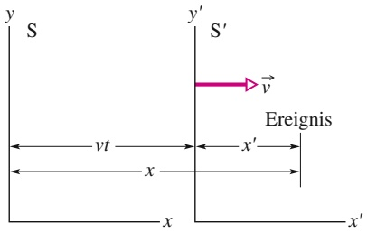

text_image

y
S
y'
S'
→ v
vt
x
x'
Ereignis
x

Abb. 33.8

Zwei inertiale Bezugssysteme; System $\mathsf { S } ^ { \prime }$ bewegt sich relativ zu System S mit der Geschwindigkeit ⃗v.

<small>1) Vielleicht fragen Sie sich, warum man Gl. 33.15 nicht als Einstein-Transformation und γ nicht als Einstein-Faktor bezeichnet. Tatsächlich hatte Hendrik A. Lorentz diese Gleichungen schon vor Einstein hergeleitet, aber es dabei versäumt, den letzten Schritt zu vollziehen – ihre Interpretation als den wahren Zusammenhang zwischen Raum und Zeit in der Natur. Erst durch die von Einstein vorgenommene Deutung wurde diese Transformation zum Kern der Relativitätstheorie.</small>

Die angegebene Form von Gl. 33.15 ist besonders nützlich, wenn aus gegebenen Werten für x und t die Koordinaten $x ^ { \prime }$ und $t ^ { \prime }$ berechnet werden sollen. Manchmal will man umgekehrt vorgehen. Dazu müssen wir die Gleichungen nach x und t auflösen:

$$
x = \gamma (x ^ {\prime} + \nu t ^ {\prime}) \quad \text {und} \quad t = \gamma (t ^ {\prime} + \nu x ^ {\prime} / c ^ {2}). \tag {33.16}
$$

Ein Vergleich der Gln. 33.15 und 33.16 zeigt, dass sich der jeweils andere Satz von Koordinaten ergibt, wenn man gestrichene und ungestrichene Größen vertauscht sowie das Vorzeichen der Relativgeschwindigkeit v umkehrt.

Die Gln. 33.15 und 33.16 geben die Raumzeit-Koordinaten desselben Ereignisses an, nur eben aus Sicht zweier verschiedener Beobachter. Es kommt auch vor, dass man sich nicht für die Koordinaten eines einzelnen Ereignisses interessiert, sondern für die Differenz der Koordinaten zweier Ereignisse, die wir mit den Indizes 1 und 2 bezeichnen wollen. Gefragt sind dann die Beziehungen

$$
\Delta x = x _ {2} - x _ {1} \quad \text {und} \quad \Delta t = t _ {2} - t _ {1},
$$

gemessen von einem Beobachter in S, sowie

$$
\Delta x ^ {\prime} = x _ {2} ^ {\prime} - x _ {1} ^ {\prime} \quad \text {und} \quad \Delta t ^ {\prime} = t _ {2} ^ {\prime} - t _ {1} ^ {\prime},
$$

gemessen von einem Beobachter in $\mathsf { S } ^ { \prime } .$

In Tab. 33.2 finden Sie die Lorentz-Gleichungen in Differenzenform zur Analyse von Ereignispaaren. Sie ergeben sich einfach durch Einsetzen von Differenzgrößen wie $\Delta x$ oder $\Delta x ^ { \prime }$ für die entsprechenden Variablen in die Gln. 33.15 und 33.16.

Wenn Sie Zahlenwerte für diese Differenzen einsetzen wollen, müssen Sie die Koordinaten der Ereignisse 1 und 2 in den beiden Bezugssystemen sorgfältig auseinanderhalten. Achten Sie auch darauf, eventuell vorkommende negative Vorzeichen der Differenzen mit zu übernehmen.

TABELLE 33.2: Die Gleichungen der Lorentz-Transformation für Ereignispaare.a)

<table><tr><td colspan="2">S&#x27; nach S</td><td colspan="2">S nach S&#x27;</td></tr><tr><td>1.</td><td> $\Delta x = \gamma(\Delta x' + \nu\Delta t')$ </td><td>1&#x27;.</td><td> $\Delta x' = \gamma(\Delta x - \nu\Delta t)$ </td></tr><tr><td>2.</td><td> $\Delta t = \gamma(\Delta t' + \nu\Delta x'/c^2)$ </td><td>2&#x27;.</td><td> $\Delta t' = \gamma(\Delta t - \nu\Delta x/c^2)$ </td></tr><tr><td></td><td colspan="3"> $\gamma = \frac{1}{\sqrt{1-(\nu/c)^2}} = \frac{1}{\sqrt{1-\beta^2}}$ </td></tr></table>

a) Das Bezugssystem $\mathsf { S } ^ { \prime }$ bewegt sich relativ zum Bezugssystem S mit der Geschwindigkeit v.

## KONTROLLFRAGE 3

Die Abbildung zeigt drei Situationen, in denen sich ein blaues und ein grünes Bezugssystem relativ zueinander in der gemeinsamen x- bzw. $x ^ { \prime } .$ -Richtung bewegen, wie der an einem der Systeme eingezeichnete Geschwindigkeitsvektor angibt. Nehmen wir an, in allen Fällen ruhe das blaue Bezugssystem. Ist v in den Gleichungen aus Tab. 33.2 dann jeweils positiv oder negativ?

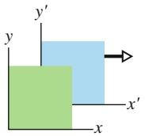

(a)

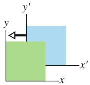

(b)

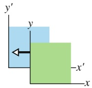

(c)

## 33.3.2 Einige Folgen aus den Lorentz-Gleichungen

Mithilfe der in Tab. 33.2 angegebenen Transformationsgleichungen wollen wir jetzt einige der Schlussfolgerungen untermauern, die wir weiter oben bereits mit qualitativen Argumenten aus den Relativitätspostulaten gezogen haben.

## Gleichzeitigkeit

Betrachten wir Gl. 2 in Tab. 33.2,

$$
\Delta t = \gamma \left(\Delta t ^ {\prime} + \frac {\nu \Delta x ^ {\prime}}{c ^ {2}}\right). \tag {33.17}
$$

Wenn die beiden betrachteten Ereignisse an verschiedenen Orten im Bezugssystem $S ^ { \prime }   ( \mathrm { A b b . }   3 3 . 8 )$ stattfinden, ist $\Delta x ^ { \prime }$ hier ungleich null. Selbst wenn die Ereignisse in $\mathsf { S } ^ { \prime }$ gleichzeitig ablaufen $( \Delta t ^ { \prime } = 0 ) ,$ , gilt dies nicht für das Bezugssystem ${ \sf S } .$ (Dies steht im Einklang mit unserer Schlussfolgerung aus Abschn. 33.4.) Das Zeitintervall zwischen den Ereignissen in S ist dann

$$
\Delta t = \gamma \frac {\nu \Delta x ^ {\prime}}{c ^ {2}}.
$$

## Zeitdilatation

Nehmen wir nun an, die beiden Ereignisse finden in $\mathsf { S } ^ { \prime }$ am gleichen Ort statt $( \Delta x ^ { \prime } = 0 )$ , aber zu verschiedenen Zeiten $( \Delta t ^ { \prime } \neq 0 )$ . Gleichung 33.17 wird dann zu

$$
\Delta t = \gamma \Delta t ^ {\prime}, \tag {33.18}
$$

einer Beziehung für die Zeitdilatation. Da die beiden Ereignisse in $\mathsf { S } ^ { \prime }$ am gleichen Ort ablaufen, darf das Zeitintervall $\Delta t ^ { \prime }$ zwischen ihnen mit einer einzigen, ebenfalls an diesem Ort befindlichen Uhr gemessen werden. Es handelt sich dann um ein Eigenzeitintervall, das wir mit $\Delta t _ { 0 }$ bezeichnen können, und aus Gl. 33.18 wird

$$
\Delta t = \gamma \Delta t _ {0},
$$

also genau zu Gl. 33.9, die wir oben für die Zeitdilatation erhalten hatten.

## Längenkontraktion

Abschließend betrachten wir Gl. $1 ^ { \prime }$ aus Tab. 33.2,

$$
\Delta x ^ {\prime} = \gamma (\Delta x - \nu \Delta t). \tag {33.19}
$$

Liegt ein im System $\mathsf { S } ^ { \prime }$ ruhender Stab parallel zu den Achsen x und $x ^ { \prime }$ in Abb. 33.8, so kann ein Beobachter in $\mathsf { S } ^ { \prime }$ seine Länge ohne Weiteres messen. Dazu kann er beispielsweise die Koordinaten der Endpunkte des Stabs voneinander subtrahieren. Der Wert, den er dabei für $\Delta x ^ { \prime }$ erhält, ist die Eigenlänge $L _ { 0 }$ des Stabs.

Nehmen wir nun $\mathbf { a n } ,$ der Stab bewege sich im System S. Die Differenz $\Delta x$ kann nur dann als Länge $L$ des Stabs in $\mathsf { S }$ bezeichnet werden, wenn die Messung der Koordinaten der Endpunkte simultan vorgenommen wird (wenn also $\Delta t = 0$ ist). Setzen wir in Gl. 33.19 $\Delta x ^ { \prime } = L _ { 0 } ,   \Delta x = L$ und $\Delta t = 0 ,$ , so ergibt sich

$$
L = \frac {L _ {0}}{\gamma}. \tag {33.20}
$$

Das ist exakt Gl. 33.10, die wir oben für die Längenkontraktion gefunden hatten.

## 33.4 Die Relativität der Geschwindigkeiten

## Lernziele

Nach dem Durcharbeiten dieses Abschnitts sollten Sie in der Lage sein, . . .

• anhand einer Skizze zu erklären, wie man relativistisch korrekt die Geschwindigkeit eines Teilchens relativ zu zwei Bezugssystemen misst, die sich relativ zueinander bewegen,
• die Beziehung für die relativistische Geschwindigkeitstransformation zwischen zwei Bezugssystemen, die sich relativ zueinander bewegen, anzuwenden.

## Schlüsselideen

Wenn ein Teilchen sich mit der Geschwindigkeit $u ^ { \prime }$ in die positive $x ^ { \prime } .$ Richtung eines Inertialsystems $\mathsf { S } ^ { \prime }$ bewegt, das sich seinerseits mit der Geschwindigkeit v parallel zur x-Richtung eines zweiten Inertialsystems S bewegt, dann misst man im System S die Teilchengeschwindigkeit

$$
u = \frac {u ^ {\prime} + \nu}{1 + u ^ {\prime} \nu / c ^ {2}}.
$$

## 33.4.1 Die Relativität der Geschwindigkeiten

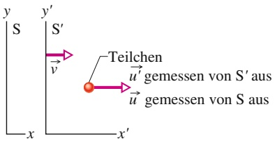

flowchart

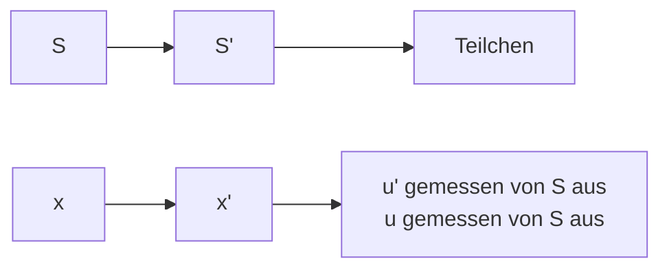

Abb. 33.9

Das Bezugssystem $\mathsf { S } ^ { \prime }$ bewegt sich mit der Geschwindigkeit ⃗v relativ zu dem Bezugssystem ${ \sf S } .$ Ein Teilchen bewegt sich gemessen von $\mathsf { S } ^ { \prime }$ aus mit der Geschwindigkeit $\vec { u } ^ { \prime } ,$ gemessen von S aus mit der Geschwindigkeit u⃗.

Mithilfe der Lorentz-Transformation wollen wir nun die Geschwindigkeiten vergleichen, die zwei Beobachter in verschiedenen Bezugssystemen (S und $S ^ { \prime } )$ für ein und dasselbe bewegte Teilchen messen. Das System $\bar { S ^ { \prime } }$ bewege sich relativ zu $\mathsf { S }$ mit der Geschwindigkeit v.

Während sich das Teilchen mit konstanter Geschwindigkeit parallel zu den Achsen x und $x ^ { \prime }$ in Abb. 33.9 fortbewegt, sende es zwei Signale aus. Jeder der beiden Beobachter misst den räumlichen und den zeitlichen Abstand dieser Ereignisse. Der Zusammenhang zwischen den insgesamt vier Messwerten ist gegeben durch die Gln. 1 und 2 aus Tab. 33.2:

$$
\Delta x = \gamma (\Delta x ^ {\prime} + \nu \Delta t ^ {\prime})
$$

und

$$
\Delta t = \gamma \left(\Delta t ^ {\prime} + \frac {\nu \Delta x ^ {\prime}}{c ^ {2}}\right).
$$

Wir teilen die obere Gleichung durch die untere und erhalten so

$$
\frac {\Delta x}{\Delta t} = \frac {\Delta x ^ {\prime} + \nu \Delta t ^ {\prime}}{\Delta t ^ {\prime} + \nu \Delta x ^ {\prime} / c ^ {2}}.
$$

Auf der rechten Seite dieser Beziehung teilen wir Zähler und Nenner durch $\Delta t ^ { \prime } ;$ das ergibt

$$
\frac {\Delta x}{\Delta t} = \frac {\Delta x ^ {\prime} / \Delta t ^ {\prime} + \nu}{1 + \nu (\Delta x ^ {\prime} / \Delta t ^ {\prime}) / c ^ {2}}.
$$

Wenn die Differenzen in Ableitungen übergehen, ist $\Delta x / \Delta t = u$ (die in S gemessene Geschwindigkeit des Teilchens) und $\Delta x ^ { \prime } / \Delta t ^ { \prime } = u ^ { \prime }$ (die in $\mathsf { S } ^ { \prime }$ gemessene Geschwindigkeit). Für die relativistische Transformation der Geschwindigkeit ergibt sich somit

$$
u = \frac {u ^ {\prime} + \nu}{1 + u ^ {\prime} \nu / c ^ {2}}. \tag {33.21}
$$

Wenn wir formal $c \rightarrow$ ∞ gehen lassen, so reduziert sich dieser Ausdruck auf die klassische (Galilei-)Transformation der Geschwindigkeit:

$$
u = u ^ {\prime} + \nu . \tag {33.22}
$$

Mit anderen Worten: Gleichung 33.21 gilt für beliebige physikalisch mögliche Geschwindigkeiten, während Gl. 33.22 eine geeignete Näherung für Geschwindigkeiten ist, die viel kleiner als c sind.

## 33.5 Der Doppler-Effekt für Lichtwellen

## Lernziele

Nach dem Durcharbeiten dieses Abschnitts sollten Sie in der Lage sein, . . .

• zu verstehen, dass die Frequenz von Licht aus Sicht eines Bezugssystems, in welchem die Lichtquelle ruht, die Eigenfrequenz ist,
• bei zu- bzw. abnehmendem Abstand zwischen Quelle und Detektor anzugeben, ob die gemessene Frequenz höher oder niedriger als die Eigenfrequenz liegt, zu verstehen, dass die Frequenzänderung mit steigender Relativgeschwindigkeit zunimmt, und mit den Begriffen Blau- und Rotverschiebung umzugehen,
• zu verstehen, was eine Radialgeschwindigkeit ist,
• bei zu- bzw. abnehmendem Abstand zwischen Quelle und Detektor die Beziehungen zwischen Eigenfrequenz $f _ { 0 } ,$ gemessener Frequenz f und Radialgeschwindigkeit v anzuwenden,
• zwischen den Gleichungen für die Frequenzverschiebung und die Wellenlängenänderung hin- und herzuwechseln,
• für Radialgeschwindigkeiten, die viel kleiner als die Lichtgeschwindigkeit sind, die Näherungslösung für Wellenlängenänderung $\Delta \lambda ,$ Eigenwellenlänge $\lambda _ { 0 }$ und Radialgeschwindigkeit v anzuwenden,
• zu wissen, dass es bei Licht (anders als bei Schall) selbst dann eine Frequenzverschiebung gibt, wenn die Quelle sich senkrecht zur Verbindungslinie von Quelle und Detektor bewegt (dies liegt an der Zeitdilatation),
• die Beziehung für den transversalen Doppler-Effekt anzuwenden, indem Sie gemessene Frequenz $f ,$ Eigenfrequenz $f _ { 0 }$ und Relativgeschwindigkeit v zueinander in Beziehung setzen.

## Schlüsselideen

• Wenn sich eine Lichtquelle und ein Lichtdetektor relativ zueinander bewegen, ist die im Ruhesystem der Quelle gemessene Wellenlänge die Eigenwellenlänge $\lambda _ { 0 }$ . Die gemessene Wellenlänge λ kann sowohl länger (Rotverschiebung) als auch kürzer (Blauverschiebung) sein, je nachdem ob der Abstand zwischen Quelle und Detektor zu- oder abnimmt.

• Wenn der Abstand zunimmt, hängen die Wellenlängen gemäß

$$
\lambda = \lambda_ {0} \sqrt {\frac {1 + \beta}{1 - \beta}}
$$

zusammen, wobei $\beta = \nu / c$ ist und v die relative radiale Geschwindigkeit entlang der Verbindungslinie von Quelle und Detektor bezeichnet. Wenn der Abstand abnimmt, muss man die Vorzeichen vor dem $\beta$ jeweils umkehren.

• Für Geschwindigkeiten, die viel kleiner als c sind, gilt für den Betrag der Doppler-Verschiebung $\Delta \lambda = \lambda - \lambda _ { 0 }$ der Wellenlängen näherungsweise

$$
\nu = \frac {| \Delta \lambda |}{\lambda_ {0}} c \quad (\nu \ll c).
$$

• Wenn die relative Bewegung der Lichtquelle senkrecht auf der Verbindungslinie von Quelle und Detektor steht, hängt die gemessene Frequenz $f$ mit der Eigenfrequenz $f _ { 0 }$ gemäß

$$
f = f _ {0} \sqrt {1 - \beta^ {2}}
$$

zusammen. Dieser transversale Doppler-Effekt wird von der Zeitdilatation verursacht.

## 33.5.1 Der Doppler-Effekt für Lichtwellen

In Abschn. 13.7 hatten wir den Doppler-Effekt (eine Verschiebung der gemessenen Wellenlänge) für Schallwellen in Luft besprochen. In diesem Fall hing der Doppler-Effekt von zwei Geschwindigkeiten ab, derjenigen der Quelle und derjenigen des Detektors jeweils bezüglich des Trägermediums der Welle (Luft).

Anders gestaltet sich die Situation bei Lichtwellen (und allen anderen elektromagnetischen Wellen): Wie wir wissen, benötigen diese Wellen kein Ausbreitungsmedium, sie können sich sogar im Vakuum ausbreiten. Der Doppler-Effekt für Lichtwellen hängt deshalb nur von einer Geschwindigkeit ab, nämlich der Geschwindigkeit $\vec { \nu }$ der Quelle relativ zum Detektor, gemessen von einem beliebigen der beiden Bezugssysteme aus. Es sei $f _ { 0 }$ die **Eigenfrequenz** der Quelle – die Frequenz, die ein Beobachter im Ruhesystem der Quelle misst. Ein Beobachter, der sich mit der Geschwindigkeit $\vec { \nu }$ relativ zu diesem Ruhesystem bewegt, messe die Frequenz $f .$ Wenn v⃗ direkt von der Quelle weg gerichtet ist, gilt

$$
f = f _ {0} \sqrt {\frac {1 - \beta}{1 + \beta}} \tag {33.23}
$$

mit $\beta = \nu / c$ . Wenn v⃗ hingegen direkt auf die Quelle gerichtet ist, müssen wir die Vorzeichen vor $\beta$ im Zähler und im Nenner von Gl. 33.23 umkehren.

Da man bei Licht oft die Wellenlänge statt der Frequenz misst, schreiben wir Gl. 33.23 um, indem wir $f$ durch $c / \lambda$ und $f _ { 0 }$ durch $c / \lambda _ { 0 }$ ersetzen, wobei λ die gemessene Wellenlänge und $\lambda _ { 0 }$ die Eigenwellenlänge bezeichnen soll. Wir kürzen c auf beiden Seiten heraus und erhalten für den Fall, dass Quelle und Detektor sich voneinander entfernen,

$$
\lambda = \lambda_ {0} \sqrt {\frac {1 + \beta}{1 - \beta}}. \tag {33.24}
$$

Wenn v⃗ direkt auf die Quelle zu gerichtet ist, müssen wir in den Gln. 33.23 und 33.24 lediglich überall das Vorzeichen von $\beta$ umkehren.

Wenn der Abstand zwischen Quelle und Detektor zunimmt, erkennen wir aus Gl. 33.24 (eine Addition im Zähler und eine Subtraktion im Nenner), dass die gemessene Wellenlänge größer ist als die Eigenwellenlänge. Solch eine Doppler-Verschiebung nennt man eine Rotverschiebung, was aber nicht bedeutet, dass irgendwelche „roten“ Wellenlängen im Spiel wären – es bedeutet lediglich, dass die Wellenlänge zunimmt (die roten Farbtöne bilden das langwellige Ende des sichtbaren Spektrums). Entsprechend spricht man bei kleiner werdendem Abstand zwischen Quelle und Detektor, wenn λ kleiner als $\lambda _ { 0 }$ ist, von einer Blauverschiebung.

## Der Doppler-Effekt bei niedrigen Geschwindigkeiten

Für niedrige Geschwindigkeiten (also $\beta \ll 1 )$ kann Gl. 33.23 in eine Potenzreihe in $\beta$ entwickelt werden. Näherungsweise gilt dann

$$
f = f _ {0} \left(1 - \beta + \frac {1}{2} \beta^ {2}\right). \tag {33.25}
$$

In der entsprechenden, bei geringer Geschwindigkeit gültigen Gleichung für den Doppler-Effekt des Schalls (oder beliebiger anderer nicht elektromagnetischer Wellen) treten die ersten beiden Terme ebenfalls auf, der Koeffizient des dritten Terms ist jedoch ein anderer. Die relativistische Natur des Doppler-Effekts für Lichtquellen und -detektoren äußert sich folglich nur im $\beta ^ { 2 }$ -Term.

Radarmessgeräte, wie sie die Polizei zur Messung der Geschwindigkeit von Fahr zeugen verwendet, nutzen den Doppler-Effekt bei Mikrowellen aus. Eine Quelle in nerhalb der Radareinheit emittiert einen Mikrowellenstrahl mit einer bestimmten (Eigen-)Frequenz $f _ { 0 }$ entlang der Straße. Auf ein Fahrzeug, das sich auf die Quelle zubewegt, trifft dieser Strahl mit einer entsprechend dem Doppler-Effekt infolge der Relativbewegung von Auto und Sender erhöhten Frequenz. Der Strahl wird an dem Fahrzeug reflektiert; aufgrund der Relativbewegung ist die Frequenz des Strahls, der schließlich wieder am Detektor eintrifft, nochmals nach oben verschoben. Das Messgerät vergleicht die Frequenz des empfangenen Signals mit $f _ { 0 }$ und berechnet aus der Differenz die Geschwindigkeit v des Fahrzeugs.

## Der Doppler-Effekt in der Astronomie

Aus den Daten astronomischer Beobachtungen von Sternen, Galaxien und anderen Lichtquellen kann man berechnen, wie schnell sich diese Objekte direkt von uns weg- oder auf uns zubewegen. Dazu misst man die Doppler-Verschiebung des auf der Erde eintreffenden Lichts. Von einem relativ zur Erde ruhenden Stern würden wir Licht mit einer bestimmten Eigenfrequenz $f _ { 0 }$ empfangen. Bewegt sich der Stern jedoch von der Erde weg oder auf sie zu, so empfangen wir Licht mit der Frequenz $f ,$ welche infolge des Doppler-Effekts relativ zu $f _ { 0 }$ verschoben ist. Diese Doppler-Verschiebung wird ausschließlich von der Radialbewegung des Objekts bezüglich der Erde (in direkter Linie auf sie zu oder von ihr weg) verursacht. Das bedeutet, eine derartige Messung berücksichtigt lediglich die radiale Komponente der Bewegung des Sterns relativ zur Erde.

Nehmen wir an, die Radialgeschwindigkeit v einer Lichtquelle sei hinreichend klein $( \beta$ ist hinreichend klein), sodass wir den $\beta ^ { 2 } \text {-} \mathrm { T e r m }$ in Gl. 33.25 vernachlässigen können. Außerdem wollen wir den β-Term explizit mit einem ±-Zeichen versehen: Das Minuszeichen steht für die radiale Bewegung von der Erde weg, das Pluszeichen die radiale Bewegung auf sie zu. Gleichung 33.25 wird somit zu

$$
f = f _ {0} (1 \pm \beta). \tag {33.26}
$$

In der Astronomie charakterisiert man Lichtwellen in der Regel nicht durch ihre Frequenz, sondern durch ihre Wellenlänge. Wir ersetzen also $f$ durch $c / \lambda$ und $f _ { 0 }$ durch $c / \lambda _ { 0 } ; \lambda$ ist die gemessene Wellenlänge, $\lambda _ { 0 }$ die **Eigenwellenlänge**. In Gl. 33.26 setzen wir noch $\beta = \nu / c$ ein. Wir erhalten dann

$$
\frac {c}{\lambda} = \frac {c}{\lambda_ {0}} \left(1 \pm \frac {\nu}{c}\right)
$$

und daraus

$$
\nu = \pm \frac {\lambda - \lambda_ {0}}{\lambda} c.
$$

Üblicherweise schreibt man diesen Ausdruck in der Form

$$
\nu = \frac {\Delta \lambda}{\lambda} c \tag {33.27}
$$

mit $\Delta \lambda = | \lambda - \lambda _ { 0 } |$ als Doppler-Verschiebung der Wellenlänge der Lichtquelle.

## KONTROLLFRAGE 4

Die Abbildung zeigt eine Quelle, die Licht mit der Eigenfrequenz $f _ { 0 }$ emittiert, während sie sich mit der Geschwindigkeit $c / 4$ (gemessen vom Bezugssystem S aus) nach rechts bewegt. Ein Detektor (links) misst die Frequenz $f$ des emittierten Lichts mit $f > f _ { 0 ^ { \cdot } } ( { \mathsf { a } } )$ Bewegt sich der Detektor nach rechts oder nach links? (b) Ist die Geschwindigkeit des Detektors, gemessen vom Bezugssystem S aus, größer als, kleiner als oder gleich $c / 4 ?$

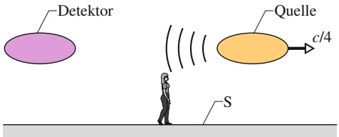

text_image

Detektor
Quelle
c/4
S

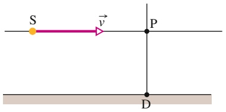

text_image

S
v
P
D

Abb. 33.10

Eine Lichtquelle S bewegt sich mit der Geschwindigkeit ⃗v an einem Detektor D vorbei. Die Spezielle Relativitätstheorie sagt einen transversalen Doppler-Effekt voraus, der in dem Moment wirkt, wo die Quelle Punkt P passiert (dort steht ihre Bewegungsrichtung senkrecht auf der Verbindungslinie zwischen P und D). Die klassische Theorie erfasst diesen Effekt nicht.

## Der transversale Doppler-Effekt

Bisher – sowohl hier als auch in Kapitel 13 – haben wir den Doppler-Effekt nur für den Fall diskutiert, dass sich Quelle und Detektor direkt aufeinander zu oder voneinander wegbewegen. Abbildung 33.10 zeigt eine prinzipiell andere Anordnung: Eine Strahlungsquelle S bewegt sich am Detektor D vorbei. In Punkt P ist die Geschwindigkeit von S senkrecht zur Verbindungslinie zwischen D und S gerichtet; in diesem Moment bewegt sich S weder auf D zu noch davon weg. Emittiert die Quelle Schallwellen der Frequenz $f _ { 0 } ,$ so empfängt der Detektor Wellen exakt dieser Frequenz (ohne Doppler-Verschiebung), vorausgesetzt, diese wurden genau in P abgestrahlt. Sendet die Quelle hingegen Lichtwellen aus, so macht sich der **transversale Doppler-Effekt** bemerkbar. Lichtwellen, die in P mit der Frequenz $f _ { 0 }$ emittiert wurden, kommen dann mit der Frequenz

$$
f = f _ {0} \sqrt {1 - \beta^ {2}} \tag {33.28}
$$

am Detektor D an.

Bei kleinen Geschwindigkeiten (also $\beta \ll 1 )$ kann Gl. 33.28 in eine Potenzreihe in $\beta$ entwickelt werden, und es gilt näherungsweise

$$
f = f _ {0} \left(1 - \frac {1}{2} \beta^ {2}\right). \tag {33.29}
$$

Der erste Term entspricht unseren Erwartungen für Schallwellen; der relativistische Effekt für Lichtquellen und -detektoren mit niedriger Relativgeschwindigkeit kommt auch hier ausschließlich durch den $\beta ^ { 2 } \cdot$ Term zum Ausdruck.

Im Prinzip kann ein Radarmessgerät der Polizei auch die Geschwindigkeit eines Autos messen, das sich senkrecht zur Ausbreitungsrichtung des Messstrahls bewegt. Auch für ein sehr schnelles Auto ist $\beta$ jedoch klein; der relativistische Term $\beta ^ { 2 } / 2$ in Gl. 33.29 wird dann extrem klein. Daher gilt $f \approx f _ { 0 } ,$ und das Messgerät ermittelt eine Geschwindigkeit von null. Der Polizist versucht das Messgerät deshalb stets entlang der Bewegungsrichtung des Fahrzeugs (der Straße) auszurichten, um dessen tatsächliche Geschwindigkeit zu ermitteln. Jede Abweichung von der idealen Richtung wirkt zugunsten des Autofahrers, denn sie führt zu einer kleineren gemessenen Geschwindigkeit.

Anhand des transversalen Doppler-Effekts können wir ein weiteres Mal die Zeitdilatation überprüfen. Wir formulieren Gl. 33.28 dazu nicht als Funktion von $f ,$ sondern von $T ,$ der Schwingungsperiode des emittierten Lichts. Wegen $T = 1 / f$ ist dann

$$
T = \frac {T _ {0}}{\sqrt {1 - \beta^ {2}}} = \gamma T _ {0} \tag {33.30}
$$

mit $T _ { 0 } = 1 / f _ { 0 }$ als der **Eigenperiode** der Quelle. Wie ein Vergleich mit Gl. 33.9 zeigt, gibt Gl. 33.30 einfach die Zeitdilatation an, weil eine Schwingungsperiode eine Zeitspanne ist.

## Das Navigationssystem GPS

Die Satelliten des GPS-Ortungssystems senden ständig Radiosignale auf einer festen, durch hochpräzise Atomuhren geregelten Frequenz. Ein Empfänger beispielsweise in einem Flugzeug registriert ein solches Signal auf einer infolge des Doppler-Effekts gegenüber dem Ausgangswert verschobenen Frequenz. Werden nun Signale von mehreren GPS-Satelliten gleichzeitig empfangen, kann der Detektor die Richtung jedes einzelnen Senders sowie die Bewegungsrichtungen aller Sender ermitteln. Aus der Doppler-Verschiebung des Signals berechnet der Detektor schließlich die Geschwindigkeit des Flugzeugs.

Die Funktionsweise dieses Verfahrens wollen wir an einem Beispiel mit gerundeten Zahlenwerten erläutern. Relativ zum Erdmittelpunkt bewege sich ein GPS-Satellit mit einer Geschwindigkeit von $^ { 1 , 0   \cdot   1 0 ^ { 4 } }$ m/s. Der zugehörige Wert von $\beta$ ist ungefähr $^ { 3 , 0 \cdot 1 0 ^ { - 5 } . }$ . Für den Relativitätsterm $\beta ^ { 2 } / 2$ in Gl. 33.25 und Gl. 33.29 erhalten wir damit $4 \mathrm { , } 5 \cdot 1 0 ^ { - 1 0 }$ . Die relativistischen Effekte machen in anderen Worten gerade $4 { , } 5 / 1 0 ^ { 1 0 }$ der Doppler-Verschiebung des Signals aus – ein so geringer Wert scheint kaum erwähnenswert zu sein.

Wie wir jetzt zeigen werden, täuscht dieser Eindruck. Die Atomuhren an Bord der Satelliten sind so präzise, dass die Frequenz des Signals maximal um $2 / 1 0 ^ { 1 2 }$ abweicht. Gleichung 33.29 entnehmen wir, dass $\beta$ (und damit v) von der Quadratwurzel aus $f / f _ { 0 }$ abhängt. Die Frequenzvariation des Senders um $2 \cdot 1 0 ^ { - 1 2 }$ verursacht demnach eine Abweichung von

$$
\sqrt {2 \cdot 1 0 ^ {- 1 2}} = 1, 4 \cdot 1 0 ^ {- 6}
$$

des Messwerts für die Geschwindigkeit v des Flugzeugs relativ zum Satelliten.

Die Relativgeschwindigkeit v entsteht vorrangig durch die schnelle Bewegung des Satelliten mit $1 , 0 \cdot 1 0 ^ { 4 }   \mathrm { m / s }$ . Das bedeutet, $\nu$ (und folglich die Geschwindigkeit des Flugzeugs) kann mit einer Genauigkeit von ungefähr

$$
(1, 4 \cdot 1 0 ^ {- 6}) (1, 0 \cdot 1 0 ^ {4} \mathrm{m/s}) = 1, 4 \mathrm{cm/s}
$$

ermittelt werden. Nehmen wir $\mathbf { a n } ,$ das Flugzeug fliege eine Stunde (3600 s) lang. Kennt man die Geschwindigkeit auf rund 1,4 cm/s genau, lässt sich die Position am Ende der Flugzeit auf

$$
(0, 0 1 4) (3 6 0 0 \mathrm{s}) = 5 0 \mathrm{m}
$$

genau vorhersagen. Für die moderne Navigation ist dieser Toleranzbereich akzeptabel.

Ohne Berücksichtigung relativistischer Effekte könnte die Geschwindigkeit des Flugzeugs auf höchstens 21 cm/s genau bestimmt werden. Der Variationsbereich der Position am Ende einer Flugstunde wäre dann mindestens 760 m groß!

## 33.6 Impuls und Energie

## Lernziele

Nach dem Durcharbeiten dieses Abschnitts sollten Sie in der Lage sein, . . .

zu verstehen, dass die klassischen Ausdrücke für Impuls und kinetische Energie gute Näherungen für langsame Geschwindigkeiten darstellen, während die relativistischen Ausdrücke für alle physikalisch möglichen Geschwindigkeiten korrekte Ergebnisse liefern,
• die relativistische Beziehung zwischen Impuls, Masse und Relativgeschwindigkeit anzuwenden,
• zu verstehen, dass ein Objekt eine Ruheenergie besitzt, die unmittelbar mit seiner Masse verknüpft ist,
• die Beziehungen zwischen Gesamtenergie, Ruheenergie, kinetischer Energie, Impuls, Masse, Geschwindigkeit, Geschwindigkeitsparameter $\beta$ und Lorentz-Faktor γ anzuwenden,
• die kinetische Energie gegen das Verhältnis $\nu / c$ (Geschwindigkeit zu Lichtgeschwindigkeit) aufzutragen, und zwar sowohl für den klassischen wie für den relativistischen Ausdruck der kinetischen Energie,
• die Beziehung zwischen dem Q-Wert einer chemischen oder Kernreaktion und der Änderung der Ruheenergie anzuwenden,
• zu verstehen, wie das Vorzeichen von $Q$ einer chemischen oder Kernreaktion bestimmt, ob Energie freigesetzt oder absorbiert wird.

## Schlüsselideen

• Die folgenden Definitionen von linearem Impuls $\vec { p } ,$ kinetischer Energie K und Gesamtenergie $E$ eines Teilchens der Masse m gelten für jede physikalisch mögliche Geschwindigkeit:

$$
\vec {p} = \gamma m \vec {\nu} \quad (\text {Impuls})
$$

$$
K = m c ^ {2} (\gamma - 1) \quad \text {(kinetische Energie)}
$$

$$
E = m c ^ {2} + K = \gamma m c ^ {2} \quad (\text {Gesamtenergie})
$$

Hierbei sind $\gamma$ der Lorentz-Faktor für die Bewegung des Teilchens und $m c ^ { 2 }$ die mit der Masse des Teilchens verbundene Ruheenergie.

• Diese Gleichungen führen auf die Beziehungen

$$
(p c) ^ {2} = K ^ {2} + 2 K m c ^ {2} \quad \text {und} \quad E ^ {2} = (p c) ^ {2} + (m c ^ {2}) ^ {2}.
$$

• Wenn ein System von Teilchen eine chemische oder nukleare Reaktion eingeht, ist der Q-Wert der Reaktion das Negative der Änderung der Gesamtruhemasse des Systems:

$$
Q = M _ {\mathrm{i}} c ^ {2} - M _ {\mathrm{f}} c ^ {2} = - \Delta M c ^ {2}.
$$

Dabei sind $M _ { \mathrm { i } }$ die anfängliche (initiale) Gesamtmasse des Systems vor der Reaktion und $M _ { \mathrm { f } }$ die finale Gesamtmasse nach der Reaktion.

## 33.6.1 Eine neue Sicht auf den Impuls

Betrachten wir folgende Situation: Mehrere Beobachter – jeder in einem eigenen Inertialsystem – verfolgen einen isolierten Zusammenstoß zweier Teilchen. In der klassischen Mechanik stellen alle Beobachter fest, dass bei diesem Prozess der Impuls erhalten bleibt (obwohl sie unterschiedliche Geschwindigkeiten der kollidierenden Teilchen messen). In allen Fällen ist der Gesamtimpuls des Teilchensystems nach dem Stoß gleich dem Gesamtimpuls des Systems vor dem Stoß.

Wie ist die Situation relativistisch zu beschreiben? Wenn wir den Impuls $\vec { p }$ eines Teilchens wie gehabt als Produkt mv⃗ aus Masse und Geschwindigkeit definieren, dann gilt, wie wir feststellen werden, der Impulserhaltungssatz nicht mehr, sobald die Beobachter sich in verschiedenen Inertialsystemen befinden. Wir stehen nun vor der Wahl, entweder den Impulserhaltungssatz zu verwerfen oder den Impuls eines Teilchens auf eine Weise neu zu definieren, die die Gültigkeit des Satzes rettet. Dieser letzte Weg führt tatsächlich zum Erfolg.

Ein Teilchen bewege sich mit der konstanten Geschwindigkeit v in positiver x-Richtung. Klassisch ist der Betrag seines Impulses

$$
p = m \nu = m \frac {\Delta x}{\Delta t} \tag {33.31}
$$

mit Δx als der im Zeitraum Δt zurückgelegten Strecke. Um einen Ausdruck für einen relativistischen Impuls zu erhalten, definieren wir

$$
p = m \frac {\Delta x}{\Delta t _ {0}}.
$$

Wieder ist $\Delta x$ die Strecke, die das von einem Beobachter verfolgte Teilchen zurücklegt. Die Zeit $\Delta t _ { 0 : }$ , die das Teilchen für die Strecke $\Delta x$ benötigt, wird jetzt aber nicht von diesem Beobachter selbst gemessen, sondern von einem zweiten, sich mit dem Teilchen bewegenden Beobachter, relativ zu dem das Teilchen ruht. Der zweite Beobachter misst folglich eine Eigenzeit.

Mithilfe der Gleichung für die Zeitdilatation (Gl. 33.9) erhalten wir

$$
p = m \frac {\Delta x}{\Delta t _ {0}} = m \frac {\Delta x}{\Delta t} \frac {\Delta t}{\Delta t _ {0}} = m \frac {\Delta x}{\Delta t} \gamma .
$$

Weil $\Delta x / \Delta t$ gerade der Geschwindigkeit v des Teilchens entspricht, ist

$$
p = \gamma m \nu . \tag {33.32}
$$

Beachten Sie, dass der Unterschied zwischen dieser Beziehung und der klassischen Definition (Gl. 33.31) ausschließlich im Lorentz-Faktor besteht! Dieser Unterschied aber ist entscheidend: Im Gegensatz zum klassischen Impuls wird der relativistische Impuls unendlich groß, wenn v sich c nähert.

In Vektorschreibweise lautet Gl. 33.32 verallgemeinert

$$
\vec {p} = \gamma m \vec {\nu}. \tag {33.33}
$$

Dies ist eine für alle physikalisch möglichen Geschwindigkeiten gültige Definition des Impulses. Für Geschwindigkeiten, die viel kleiner als c sind, reduziert sie sich auf die klassische Definition des Impulses: $\vec { p } = m \vec { \nu } .$

## 33.6.2 Eine neue Sicht auf die Energie

## Die relativistische Energie

Lange Zeit gingen die Naturwissenschaftler davon aus, dass Masse und Energie in chemischen Reaktionen unabhängig voneinander erhalten bleiben. 1905 zeigte Albert Einstein in seiner Speziellen Relativitätstheorie, dass die Masse eines Körpers nichts anderes als dessen mit einem konstanten Faktor multiplizierte Energie ist. Der Energieerhaltungssatz umfasst also im Grunde die Erhaltung von Masse und Energie.

In einer chemischen Reaktion (einer Wechselwirkung zwischen Atomen oder Molekülen) wird nur ein äußerst geringer Teil der Masse des Systems in andere Energieformen umgewandelt (oder umgekehrt), sodass man die Massenänderung auch mit den genauesten Laborwaagen nicht messen kann. In der Tat scheint es daher so, als sei die Erhaltung der Masse von der Erhaltung der Energie unabhängig. In Kernreaktionen hingegen (einer Wechselwirkung zwischen Atomkernen oder Elementarteilchen) wird häufig Millionen Mal mehr Energie freigesetzt als in chemischen Reaktionen und die Massenänderung lässt sich problemlos ermitteln. Die korrekte Berücksichtigung von Masse-Energie-Umwandlungen ist bei der Untersuchung von Kernreaktionen unerlässlich.

Für die Umrechnung zwischen der Masse m eines Objekts und dem Energieäquivalent dieser Masse gilt die Formel

$$
E _ {0} = m c ^ {2}. \tag {33.34}
$$

Dies ist (abgesehen vielleicht vom Index 0) die bekannteste Gleichung der Naturwissenschaften überhaupt. Die mit der Masse eines Objekts verknüpfte Energie wird **Ruheenergie** genannt, womit ausgedrückt werden soll, dass das Objekt auch dann die Energie $E _ { 0 }$ besitzt, wenn es ruht – allein aufgrund seiner Masse. (Wenn Sie sich über dieses Buch hinausgehend mit der Relativitätstheorie beschäftigen, werden Sie feststellen, dass die Beziehung zwischen Masse und Energie nach wie vor diskutiert wird und selbst über die grundsätzliche Aussage von Gl. 33.34 nicht immer Einigkeit herrscht.)

Tabelle 33.3 zeigt die Ruheenergien verschiedener Objekte. Die Ruheenergie einer kleinen Münze (etwa eines Eurocent-Stücks) ist enorm – die äquivalente Menge an elektrischer Energie würde in Deutschland viele Millionen Euro kosten. Andererseits entspricht beispielsweise die Jahresproduktion an elektrischer Energie in den USA einer Masse von nur wenigen hundert Kilogramm Materie (Feldsteine, Ziegel oder irgendetwas anderem).

In der Praxis rechnet man mit Gl. 33.34 häufig nicht in SI-Einheiten – diese sind zu groß und deshalb unbequem. Massen gibt man in der Regel in atomaren Mas-

TABELLE 33.3: Energieäquivalente einiger Objekte.

| Objekt | Masse (kg) | Energieäquivalent (J) | Umrechnung |
| --- | --- | --- | --- |
| Elektron | $9,11 \cdot 10^{-31}$ | $8,19 \cdot 10^{-14}$ | (= 511 keV) |
| Proton | $1,67 \cdot 10^{-27}$ | $1,50 \cdot 10^{-10}$ | (= 938 MeV) |
| Uranatom | $3,95 \cdot 10^{-25}$ | $3,55 \cdot 10^{-8}$ | (= 225 GeV) |
| Staubkorn | $1 \cdot 10^{-13}$ | $1 \cdot 10^{4}$ | (= 2 kcal) |
| Eurocent-Stück | $2,3 \cdot 10^{-3}$ | $2,1 \cdot 10^{14}$ | (= 58 Mio. kWh) |

seneinheiten an,

$$
1 \mathrm{u} = 1, 6 6 \cdot 1 0 ^ {- 2 7} \mathrm{kg}, \tag {33.35}
$$

und Energien werden in Elektronenvolt (eV) oder Vielfachen davon (keV, MeV) gemessen:

$$
1 \mathrm{eV} = 1, 6 0 \cdot 1 0 ^ {- 1 9} \mathrm{J}. \tag {33.36}
$$

In den Einheiten der Gln. 33.35 und 33.36 gilt

$$
\begin{array}{l} c ^ {2} = 9, 3 1 5 \cdot 1 0 ^ {8} \mathrm{eV/u} = 9, 3 1 5 \cdot 1 0 ^ {5} \mathrm{keV/u} \\ = 9 3 1, 5 \mathrm{MeV/u}. \tag {33.37} \\ \end{array}
$$

## Die Gesamtenergie

Gleichung 33.34 gibt die Ruheenergie $E _ { 0 }$ eines Objekts an, die nur von dessen Masse m bestimmt wird und nicht davon abhängt, ob das Objekt ruht oder sich bewegt. Im letzteren Fall besitzt das Objekt zusätzlich eine kinetische Energie K. Unter der Annahme, dass die potenzielle Energie null ist, ergibt sich die Gesamtenergie E als Summe aus der Ruheenergie und der kinetischen Energie:

$$
E = E _ {0} + K = m c ^ {2} + K. \tag {33.38}
$$

Eine alternative Formulierung (die wir hier ohne Beweis angeben wollen) ist

$$
E = \gamma m c ^ {2} \tag {33.39}
$$

mit γ als dem Lorentz-Faktor der Bewegung des Objekts.

Seit Kapitel 3 haben wir zahlreiche Situationen diskutiert, in denen sich die Gesamtenergie eines Teilchens oder Teilchensystems aus dem einen oder anderen Grund änderte. Die Ruheenergie haben wir dabei bisher nicht berücksichtigt, weil ihre Änderung in den besprochenen Fällen entweder null oder vernachlässigbar klein war. Der Satz von der Erhaltung der Gesamtenergie gilt aber auch dann, wenn die Änderung der Ruheenergie signifikant wird; ungeachtet derartiger Effekte gilt der in Abschn. 4.5 formulierte Satz deshalb weiterhin:

Die Gesamtenergie eines isolierten Systems ändert sich nicht.

Wenn beispielsweise die gesamte Ruheenergie zweier miteinander wechselwirkender Teilchen in einem isolierten System abnimmt, dann muss in diesem System die Energie einer anderen Energieform zunehmen, weil die Gesamtenergie konstant bleiben muss.

Für Systeme, in denen chemische Reaktionen oder Kernreaktionen stattfinden, gibt man die Änderung der gesamten Ruheenergie im Verlauf dieser Reaktionen häufig mithilfe des Q-Werts an. Er ergibt sich aus der Beziehung

$$
\binom{\text {Anfangswert (i) der}}{\text {Gesamtruheenergie}} = \binom{\text {Endwert (f) der}}{\text {Gesamtruheenergie}} + Q
$$

oder

$$
E _ {0 \mathrm{i}} = E _ {0 \mathrm{f}} + Q. \tag {33.40}
$$

Mithilfe von Gl. 33.34 $( E _ { 0 } = m c ^ { 2 } )$ können wir diese Beziehung auch für die Gesamtmassen des Systems vor und nach der Reaktion als

$$
M _ {\mathrm{i}} c ^ {2} = M _ {\mathrm{f}} c ^ {2} + Q
$$

oder

$$
Q = M _ {\mathrm{i}} c ^ {2} - M _ {\mathrm{f}} c ^ {2} = - \Delta M c ^ {2} \tag {33.41}
$$

formulieren, wobei $\Delta M = M _ { \mathrm { f } } - M _ { \mathrm { i } }$ die Massenänderung des Systems im Verlauf der Reaktion angibt.

Wird während einer Reaktion beispielsweise Ruheenergie der Ausgangsstoffe in kinetische Energie der Produkte umgewandelt, so nimmt die Gesamt-Ruheenergie $E _ { 0 }$ (und die Gesamtmasse $M )$ ab; Q ist dann positiv. Erfordert eine Reaktion hingegen, dass Energie einer anderen Form in Ruheenergie umgewandelt wird, so nimmt die Gesamtruheenergie $E _ { 0 }$ (und die Gesamtmasse M) des Systems zu und Q ist negativ.

Betrachten wir dies anhand eines Beispiels. Zwei Wasserstoffkerne verschmelzen in einer Fusionsreaktion unter Aussendung zweier Teilchen zu einem neuen Kern. Die Gesamtruheenergie (und Gesamtmasse) dieses Kerns und der beiden Teilchen ist geringer als die Gesamtruheenergie (und Gesamtmasse) der ursprünglich vorhandenen Wasserstoffkerne. Der Q-Wert der Fusion ist folglich positiv, die Reaktion setzt also Energie frei (Ruheenergie wird abgegeben). Diese Tatsache ist für uns Menschen von erheblicher Bedeutung: Eine derartige Fusion ist Teil des Energiehaushalts der Sonne, eines Prozesses also, als dessen Ergebnis Sonnenenergie zur Erde gelangt und das Leben ermöglicht.

## Die kinetische Energie

Nach Kapitel 3 ist die kinetische Energie K eines Objekts der Masse $m ,$ das sich mit einer Geschwindigkeit v weit unterhalb von c bewegt,

$$
K = \frac {1}{2} m v ^ {2}. \tag {33.42}
$$

Diese klassische Näherung liefert aber nur im angegebenen Geschwindigkeitsbereich vernünftige Ergebnisse.

Wir wollen nun einen Ausdruck für die kinetische Energie entwickeln, der für alle physikalisch möglichen Geschwindigkeiten bis hin zu c gilt. Dazu lösen wir Gl. 33.38 nach K auf und substituieren E aus Gl. 33.39. So erhalten wir

$$
\begin{array}{l} K = E - m c ^ {2} = \gamma m c ^ {2} - m c ^ {2} \\ = m c ^ {2} (\gamma - 1) \tag {33.43} \\ \end{array}
$$

mit $\gamma = 1 / \sqrt { 1 - ( \nu / c ) ^ { 2 } }$ als Lorentz-Faktor der Bewegung des Objekts.

In Abb. 33.11 ist die kinetische Energie eines Elektrons als Funktion von $\nu / c$ aufgetragen, berechnet einmal mit der allgemeingültigen Definition (Gl. 33.43) und einmal mit der klassischen Näherung (Gl. 33.42). Sie sehen, dass die Graphen im linken Teil des Diagramms deckungsgleich sind – bisher hatten wir nur kinetische Energien in diesem Bereich von $\nu / c$ (also bei niedrigen Geschwindigkeiten) berechnet. Offensichtlich war unsere Anwendung der klassischen Beziehung Gl. 33.42 hier berechtigt. Im rechten Teil des Diagramms jedoch, bei Geschwindigkeiten nahe $c ,$ weichen die Graphen deutlich voneinander ab. Die Kurve für die klassisch berechnete kinetische Energie steigt nur mäßig an, während v∕c sich dem Wert 1,0 nähert; der Anstieg der Kurve für die relativistisch berechnete kinetische Energie ist hingegen dramatisch, denn für $\nu / c \to 1 { , } 0$ gilt jetzt $K \to \infty$ Liegt die Geschwindigkeit eines Objekts nahe bei c, sind wir also gezwungen, bei der Berechnung seiner kinetischen Energie Gl. 33.43 heranzuziehen.

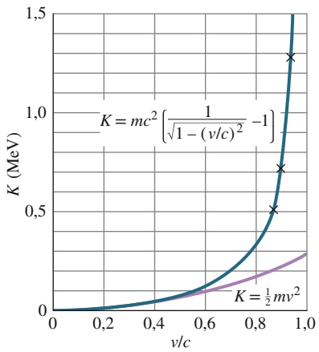

line

| v/c | K (MeV) (Solid Blue Line) | K (MeV) (Dashed Purple Line) |
| --- | --- | --- |
| 0.2 | ~0.02 | ~0.01 |
| 0.4 | ~0.08 | ~0.06 |
| 0.6 | ~0.25 | ~0.15 |
| 0.8 | ~0.65 | ~0.25 |
| 0.9 | ~1.3 | ~0.35 |

Abb. 33.11

Die kinetische Energie eines Elektrons als Funktion von $\nu / c ,$ berechnet einmal mit der klassischen (Gl. 33.42) und einmal mit der relativistischen Beziehung (Gl. 33.43); v ist die Geschwindigkeit des Elektrons, c ist die Lichtgeschwindigkeit. Bei kleinen Geschwindigkeiten fallen die Kurven zusammen, bei hohen Geschwindigkeiten weichen sie dagegen deutlich voneinander ab. Experimentelle Daten (×) bei hohen Geschwindigkeiten reproduzieren die relativistische, nicht die klassische Gleichung.

Aus Abb. 33.11 können wir auch entnehmen, welche Arbeit wir an einem Objekt verrichten müssen, um seine Geschwindigkeit beispielsweise um 1 % zu erhöhen. Die erforderliche Arbeit W ist gleich der damit verbundenen Änderung ΔK der kinetischen Energie des Objekts. Findet die Änderung bei kleiner Geschwindigkeit (links in Abb. 33.11) statt, muss mäßig viel Arbeit geleistet werden. Findet die Änderung hingegen bei hoher Geschwindigkeit (rechts in Abb. 33.11) statt, so kann die erforderliche Arbeit enorme Ausmaße erreichen, weil die kinetische Energie K hier außerordentlich schnell mit der Geschwindigkeit v zunimmt. Um ein Objekt auf die Geschwindigkeit c zu beschleunigen, müsste man dann im Prinzip eine unendlich große Arbeit leisten. Dies ist unmöglich.

Zur Angabe der kinetischen Energie von Elektronen, Protonen oder anderen Teilchen verwendet man den Zahlenwert mit der Einheit Elektronenvolt (oder einem Vielfachen davon) oft als eine Art Präfix. Unter einem 20-MeV-Elektron verstehen wir ein Elektron mit einer kinetischen Energie von 20 MeV.

## Kinetische Energie und Impuls

In der klassischen Mechanik ist der Impuls p eines Teilchens gleich mv, seine kinetische Energie K ist (1/2) mv2. Setzen wir diese Beziehungen in v gleich, so können wir eine direkte Beziehung zwischen Impuls und kinetischer Energie angeben:

$$
p ^ {2} = 2 K m. \tag {33.44}
$$

In der Relativitätstheorie erhalten wir eine ähnliche Beziehung, wenn wir die relativistischen Definitionen des Impulses (Gl. 33.32) und der kinetischen Energie (Gl. 33.43) in v gleichsetzen. Nach einigen Umformungsschritten ergibt sich

$$
(p c) ^ {2} = K ^ {2} + 2 K m c ^ {2}. \tag {33.45}
$$

Mithilfe von Gl. 33.38 erhalten wir daraus eine Beziehung zwischen dem Impuls p und der Gesamtenergie E eines Teilchens:

$$
E ^ {2} = (p c) ^ {2} + (m c ^ {2}) ^ {2}. \tag {33.46}
$$

Das in Abb. 33.12 dargestellte rechtwinklige Dreieck kann als Gedankenstütze für diese nützlichen Zusammenhänge dienen. In ihm gelten

$$
\sin \theta = \beta \quad \text {und} \quad \cos \theta = 1 / \gamma . \tag {33.47}
$$

Aus Gl. 33.46 folgt, dass das Produkt pc dieselbe Dimension wie die Energie E haben muss; die Einheit des Impulses ist folglich eine Energieeinheit dividiert durch c. In der Teilchenphysik gibt man den Impuls daher häufig in den Einheiten MeV∕c oder $\mathrm { G e V } / c$ an.

## KONTROLLFRAGE 5

Sind (a) die kinetische Energie und (b) die Gesamtenergie eines 1-GeV-Elektrons größer als, kleiner als oder gleich den entsprechenden Werten eines 1-GeV-Protons?

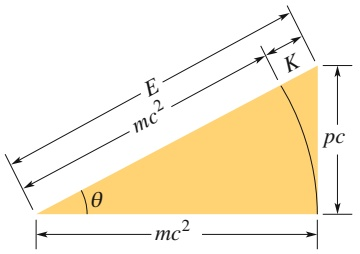

text_image

E
mc²
K
pc
θ
mc²

Abb. 33.12

Eine Gedankenstütze für die relativistischen Beziehungen zwischen der Gesamtenergie E, der Ruheenergie $m c ^ { 2 }$ , der kinetischen Energie K und dem Impuls $p .$

## 33.7 Zusammenfassung

**Zwei Postulate** Die Grundlage der von Einstein entwickelten **Speziellen Relativitätstheorie** bilden die Postulate

1. Die Gesetze der Physik gelten für Beobachter in allen Inertialsystemen gleichermaßen. Kein Bezugssystem ist gegenüber den anderen bevorzugt.
2. Im Vakuum breitet sich Licht in allen Richtungen und in allen inertialen Bezugssystemen mit derselben $\mathbf { G e } -$ schwindigkeit c aus.

Die Lichtgeschwindigkeit c im Vakuum ist die höchste physikalisch mögliche Geschwindigkeit. Kein Träger von Energie oder Information kann sie überschreiten.

**Koordinaten eines Ereignisses** Ein physikalisches **Ereignis** wird durch drei Raumkoordinaten und eine Zeitkoordinate festgelegt. Eine Aufgabe der Speziellen Relativitätstheorie besteht darin, einen Zusammenhang zwischen den Raum- und Zeitkoordinaten herzustellen, die relativ zueinander gleichförmig bewegte Beobachter für ein und dasselbe Ereignis messen.

**Gleichzeitige Ereignisse** Unter Beobachtern, die sich relativ zueinander bewegen, herrscht keine Einigkeit über die Gleichzeitigkeit von Ereignissen. Nimmt einer der Beobachter zwei an verschiedenen Orten ablaufende Ereignisse gleichzeitig wahr, so gilt dies für den anderen nicht und umgekehrt. Gleichzeitigkeit ist niemals absolut, sondern sie bezieht sich stets auf einen Beobachter und dessen Bewegungszustand. Die Relativität der Gleichzeitigkeit ist eine direkte Folge davon, dass c die Obergrenze der physikalisch möglichen Geschwindigkeiten bildet.

**Zeitdilatation** Finden zwei Ereignisse nacheinander am gleichen Ort eines inertialen Bezugssystems statt, so kann man das Zeitintervall zwischen ihnen mit einer einzigen Uhr am Ort des Ereignisses messen. Man erhält auf diese Weise das **Eigenzeitintervall** $\Delta t _ { 0 }$ . Beobachter in Bezugssystemen, die sich relativ zu diesem System mit der Geschwindigkeit v bewegen, messen stets eine Zeitspanne größer als $\Delta t _ { 0 } ,$ und zwar

$$
\begin{array}{l} \Delta t = \frac {\Delta t _ {0}}{\sqrt {1 - (\nu / c) ^ {2}}} \\ = \frac {\Delta t _ {0}}{\sqrt {1 - \beta^ {2}}} \\ = \gamma \Delta t _ {0}. \tag {33.7-33.9} \\ \end{array}
$$

Dabei sin<u>d</u> $\beta = \nu / c$ der Geschwindigkeitsparameter und $\gamma = 1 / \sqrt { 1 - \beta ^ { 2 } }$ der **Lorentz-Faktor**. Eine wichtige Konsequenz der Zeitdilatation ist, dass bewegte Uhren für einen ruhenden Beobachter stets nachgehen.

**Längenkontraktion** Die Länge $L _ { 0 }$ eines Objekts, gemessen von einem Beobachter, in dessen Bezugssystem das Objekt ruht, ist die **Eigenlänge**. Beobachter in Bezugssystemen, die sich relativ zum ersten System mit der Geschwindigkeit v bewegen, messen stets eine geringere Länge als $L _ { 0 } ,$ und zwar

$$
L = L _ {0} \sqrt {1 - \beta^ {2}} = \frac {L _ {0}}{\gamma}. \tag {33.10}
$$

Die Lorentz-Transformation Die Gleichungen der Lorentz-Transformation geben die Beziehung zwischen den Raumzeit-Koordinaten eines einzelnen Ereignisses an, die von zwei Bezugssystemen S und $\mathsf { S } ^ { \prime }$ aus beobachtet werden. Dabei bewegen sich S und $\mathsf { S } ^ { \prime }$ mit der Geschwindigkeit v entlang der gemeinsamen $x -$ bzw. $x ^ { \prime } .$ -Richtung relativ zueinander. Die Zusammenhänge zwischen den gestrichenen und den ungestrichenen Koordinaten lauten

$$
x ^ {\prime} = \gamma (x - \nu t),
$$

$$
y ^ {\prime} = y, \tag {33.15}
$$

$$
z ^ {\prime} = z,
$$

$$
t ^ {\prime} = \gamma (t - \nu x / c ^ {2}).
$$

**Die Relativität der Geschwindigkeiten** Ein Teilchen bewege sich mit der Geschwindigkeit $u ^ { \prime }$ in positiver $x ^ { \prime } .$ -Richtung in einem inertialen Bezugssystem $\mathsf { S } ^ { \prime } ,$ welches sich seinerseits mit der Geschwindigkeit v parallel zur x-Richtung eines zweiten Bezugssystems S bewege. Die Geschwindigkeit u des Teilchens, gemessen in ${ \sf S } ,$ ist dann

$$
u = \frac {u ^ {\prime} + \nu}{1 + u ^ {\prime} \nu / c ^ {2}}. \tag {33.21}
$$

**Der relativistische Doppler-Effekt** Eine Lichtquelle, die elektromagnetische Wellen mit der Frequenz $f _ { 0 }$ aussendet, entfernt sich mit der relativen radialen Geschwindigkeit v (und dem Geschwindigkeitsparameter $\beta = \nu / c )$ von einem Detektor. Die vom Detektor gemessene Frequenz f der dort eintreffenden Wellen ist dann

$$
f = f _ {0} \sqrt {\frac {1 - \beta}{1 + \beta}}. \tag {33.23}
$$

Bewegt sich die Quelle direkt auf den Detektor zu, so kehren sich die Vorzeichen in Gl. 33.23 um.

In der Astronomie misst man den Doppler-Effekt auf die Wellenlänge. Bei Geschwindigkeiten, die klein gegen c sind, führt Gl. 33.23 zu

$$
\nu = \frac {\Delta \lambda}{\lambda} c \tag {33.27}
$$

mit Δλ als Doppler-Verschiebung der Wellenlänge (Betrag der Änderung der Wellenlänge) infolge der Bewegung.

**Der transversale Doppler-Effekt** Bewegt sich die Lichtquelle relativ zum Detektor senkrecht zur Verbindungslinie zwischen Detektor und Quelle, so registriert der Detektor die Frequenz:

$$
f = f _ {0} \sqrt {1 - \beta^ {2}}. \tag {33.28}
$$

Die Ursache für diesen transversalen Doppler- $. E \mathit { f f e k t }$ ist die Zeitdilatation.

**Energie und Impuls** Folgende Definitionen des linearen Impulses $\vec { p } ,$ der kinetischen Energie K und der Gesamtenergie $E$ eines Teilchens der Masse m gelten bei allen physikalisch möglichen Geschwindigkeiten:

$$
\vec {p} = \gamma m \vec {\nu}, \tag {33.33}
$$

$$
E = m c ^ {2} + K = \gamma m c ^ {2}, \tag {33.38,33.39}
$$

$$
K = m c ^ {2} (\gamma - 1). \tag {33.43}
$$

Dabei sind γ der Lorentz-Faktor für die Bewegung des Teilchens und $i _ { m c ^ { 2 } }$ die mit der Teilchenmasse m verknüpfte **Ruheenergie**. Aus diesen Gleichungen folgen die Beziehungen

$$
(p c) ^ {2} = K ^ {2} + 2 K m c ^ {2} \tag {33.45}
$$

## 33.8 Fragen

**1.** Raumschiff A in Abb. 33.F1 sendet einen Laserpuls in Richtung des entgegenkommenden Raumschiffs B, während der Aufklärer C schnell davonfliegt. Alle angegebenen Geschwindigkeiten wurden vom gleichen Bezugssystem aus gemessen. Ordnen Sie die Raumschiffe in absteigender Reihenfolge nach der Geschwindigkeit, die jedes von ihnen für den Laserpuls misst.

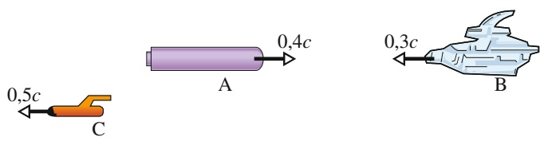

text_image

0,5c
C
A
0,4c
0,3c
B

Abb. 33.F1

Fragen 1 und 7.

**2.** Abbildung 33.F2a zeigt zwei Uhren in einem ruhenden Bezugssystem S, in dem sie synchronisiert sind, und eine weitere Uhr im bewegten System $\mathsf { S } ^ { \prime } .$ Wenn sich die Uhren $C _ { 1 }$ und $C ^ { \prime }$ aneinander vorbeibewegen, stehen beide auf null. Wir betrachten nun den Moment, in dem sich $C ^ { \prime }$ an $C _ { 2 }$ vorbeibewegt. (a) Auf welcher der beiden Uhren ist weniger Zeit vergangen? (b) Welche Uhr misst eine Eigenzeit?

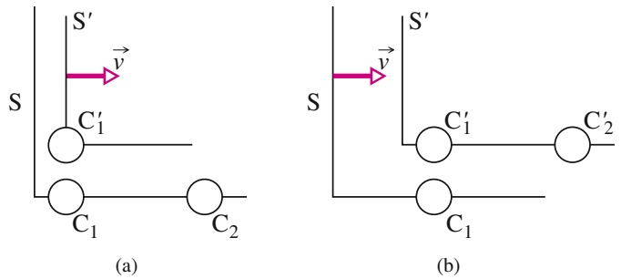

Abb. 33.F2

Fragen 2 und 3.

**3.** Abbildung 33.F2b zeigt zwei Uhren im ruhenden Bezugssystem $\check { \mathsf { S } ^ { \prime } } ,$ in dem sie synchronisiert sind, und eine weitere Uhr im bewegten System S. Wenn sich die Uhren $C _ { 1 }$ und $C ^ { \prime }$ aneinander vorbeibewegen, stehen beide auf null.

und

$$
E ^ {2} = (p c) ^ {2} + (m c ^ {2}) ^ {2}. \tag {33.46}
$$

Findet zwischen den Teilchen eines Systems eine chemische oder nukleare Reaktion statt, ist der Q-Wert der Reaktion gleich dem Negativen der Änderung der Gesamtruheenergie des Systems

$$
\begin{array}{l} Q = M _ {\mathrm{i}} c ^ {2} - M _ {\mathrm{f}} c ^ {2} \\ = - \Delta M c ^ {2}, \tag {33.41} \\ \end{array}
$$

mit $M _ { \mathrm { i } }$ als Gesamtmasse des Systems vor der Reaktion und $M _ { \mathrm { f } }$ als Gesamtmasse des Systems danach.

Wir betrachten den Moment, in dem sich $C _ { 1 }$ an $\mathrm { C ^ { \prime } }$ vorbeibewegt. (a) Auf welcher der beiden Uhren ist weniger Zeit vergangen? (b) Welche Uhr misst eine Eigenzeit?

**4.** Sam fliegt mit einem Raumschiff von der Venus zum Mars und passiert Sally, die sich auf einem Beobachtungsposten auf der Erde befindet, mit einer relativen Geschwindigkeit von 0,5c. (a) Wer misst ein Eigenzeitintervall für die Dauer des gesamten Flugs: Sam, Sally oder keiner von beiden? (b) Unterwegs sendet Sam einen Lichtpuls in Richtung Mars aus. Sam und Sally ermitteln die Flugzeit des Pulses. Wer misst eine Eigenzeit?
**5.** In Abb. 33.F5 sehen Sie ein Raumschiff mit eigenem (an Bord befindlichem) Bezugssystem S′. Es fliegt an einem Beobachter im Bezugssystem S vorbei. Ein Proton wird mit nahezu Lichtgeschwindigkeit vom Bug des Raumschiffs in Richtung Heck abgeschossen. (a) Ist der räumliche Abstand $\Delta x ^ { \prime }$ zwischen dem Abschussort und dem Auftreffort des Protons eine positive oder eine negative Größe? (b) Ist der zeitliche Abstand Δt zwischen den beiden Ereignissen positiv oder negativ?

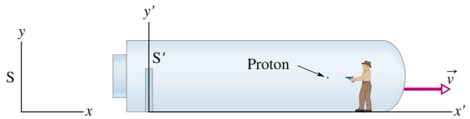

text_image

y
S
x
y'
S'
Proton
v
x'

Abb. 33.F5

**6.** (a) Wir betrachten noch einmal Abb. 33.8. Ein Beobachter im Bezugssystem $\mathsf { S } ^ { \prime }$ registriert zwei Ereignisse am gleichen Ort $x ^ { \prime } ,$ aber zu verschiedenen Zeitpunkten. Ist es möglich, dass ein Beobachter in S ebenfalls den gleichen Ort für die Ereignisse misst? (b) Wenn zwei Ereignisse aus der Sicht eines Beobachters gleichzeitig am gleichen Ort stattfinden, werden sie dann auch von allen anderen Beob achtern als gleichzeitig empfunden und (c) am gleichen Ort gemessen?

**7.** Die Raumschiffe A und B in Abb. 33.F1 bewegen sich direkt aufeinander zu. Alle angegebenen Geschwindigkeiten wurden von ein und demselben Bezugssystem aus gemessen. Ist die Geschwindigkeit von A relativ zu B kleiner als, größer als oder gleich 0,7c?
**8.** Abbildung 33.F8 zeigt eins von vier Raumschiffen bei einem Wettflug: Jedes der Raumschiffe, das die Startlinie überquert, setzt eine kleinere Fähre aus, die auf die Ziellinie zurast. Stellen Sie sich vor, Sie wären der Schiedsrichter und befänden sich relativ zu Start und Ziel in Ruhe. Die Geschwindigkeiten $\nu _ { \mathrm { R } }$ der Raumschiffe (relativ zu Ihnen) und die Geschwindigkeiten $\nu _ { \mathrm { F } }$ der Fähren relativ zum jeweiligen Raumschiff sind (1) 0,70c, 0,40c; (2) 0,40c, 0,70c; (3) 0,20c, 0,90c und (4) 0,50c, 0,60c.
(a) Ordnen Sie die Fähren ohne schriftliche Rechnung in absteigender Reihenfolge nach ihrer Geschwindigkeit relativ zu Ihnen. (b) Ordnen Sie die Fähren ohne explizite Berechnung in absteigender Reihenfolge nach der Entfernung, die ihre Piloten zwischen Start und Ziel messen (beginnend mit dem größten Wert). (c) Jedes Raumschiff sendet seiner Fähre ein Signal mit einer bestimmten Frequenz $f _ { 0 } ,$ gemessen an Bord des Raumschiffs. Ordnen Sie, wiederum ohne Rechnung, die Fähren in absteigender Reihenfolge nach der Frequenz des empfangenen Signals.

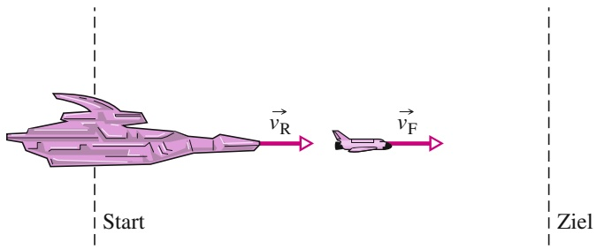

flowchart

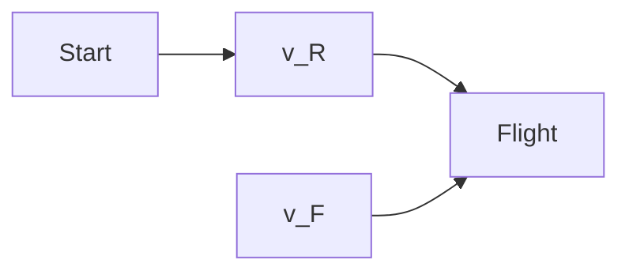

Abb. 33.F8

**9.** An Bord eines der in Frage 8 beschriebenen Raumschiffe empfangen Sie Signale, die von Ihrer Fähre ausgesendet werden. Dabei bewegt sich die Fähre einmal direkt auf das Raumschiff $\mathbf { Z } \mathbf { u } ,$ einmal direkt davon weg. Beide Signale haben die Eigenfrequenz $f _ { 0 } .$ . Für die Geschwindigkeit und die Richtung der Fähre relativ zu Ihnen sind gegeben: (a) 0,3c auf Sie zu, (b) 0,6c auf Sie zu, (c) 0,3c von Ihnen weg, (d) 0,6c von Ihnen weg. Ordnen Sie die Situationen nach der Frequenz, die Sie von der Fähre empfangen (beginnend mit dem größten Wert).
**10.** Drei Teilchen haben folgende Ruheenergien und Gesamtenergien, angegeben in Vielfachen der Größe A: (1) A, 2A; (2) A, 3A und (3) 3A, 4A. Ordnen Sie die Teilchen in absteigender Reihenfolge nach (a) ihrer Masse, (b) ihrer kinetischen Energie, (c) ihrem Lorentz-Faktor und (d) ihrer Geschwindigkeit, jeweils ohne schriftliche Rechnung.
**11.** Bezugssystem $S ^ { \prime }$ bewegt sich an Bezugssystem S mit der Geschwindigkeit v in Richtung der parallelen $x ^ { \prime } -$ und x-Achsen vorbei, wie in Abb. 33.8 dargestellt. Ein Beobachter, der mit Bezugssystem $S ^ { \prime }$ mitreist, wartet 25 s auf seiner Armbanduhr ab. Das entsprechende Zeitintervall $\Delta t$ soll von einem Beobachter in Bezugssystem $\mathsf { S }$ gemessen werden. Welche der Kurven in Abb. 33.F11 beschreibt Δt (vertikale Achse des Graphen) als Funktion des Geschwindigkeitsparameters $\beta$ am besten?

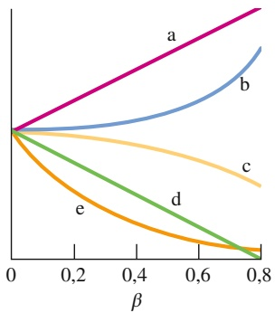

line

| \(\beta\) | a | b | c | d | e |
| --- | --- | --- | --- | --- | --- |
| 0 | 0 | 0 | 0 | 0 | 0 |
| 0.2 | ~0.35 | ~0.15 | ~0.15 | ~0.15 | ~0.15 |
| 0.4 | ~0.65 | ~0.35 | ~0.15 | ~0.15 | ~0.15 |
| 0.6 | ~0.95 | ~0.65 | ~0.15 | ~0.15 | ~0.15 |
| 0.8 | >1.2 | ~1.0 | ~0.15 | ~0.15 | ~0.15 |

Abb. 33.F11

**12.** Das Gitter aus Messstäben und Uhren in Abb. 33.F12 ist wie das aus Abb. 33.3 angelegt. Die Uhren auf der x-Achse sind (Mitte zu Mitte) genau 1 Lichtsekunde voneinander entfernt, ebenso die Uhren auf der y-Achse. Alle Uhren wurden synchronisiert wie in Abschn. 33.1 beschrieben. Wenn das anfängliche Synchronisationssignal für $t = 0$ vom Ursprung aus bei (a) Uhr A, (b) Uhr B und (c) Uhr C ankommt, welche Startzeit wird dann auf diesen Uhren eingestellt? Ein Ereignis geschieht bei Uhr A, wenn diese 10 s anzeigt. (d) Wie lange braucht das Signal von diesem Ereignis, um zu einem Beobachter im Ursprung zu gelangen? (e) Welche Zeit schreibt der Beobachter diesem Ereignis zu?

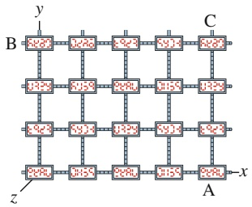

text_image

y
B 1-20 1-20 1-20 1-20 1-20 1-20 1-20 1-20 1-20 1-20 1-20 1-20 1-20 1-20 1-20 1-20 1-20 1-20 1-20 1-20 1-2
C
1-20 1-20 1-20 1-20 1-20 1-20 1-20 1-20 1-20 1-20 1-20 1-20 1-20 1-20
z
A x

Abb. 33.F12

**13.** Abbildung 33.F13 zeigt das Dreieck aus Abb. 33.12 für sechs Teilchen; die Strecken 2 und 4 haben die gleiche Län-${ \mathfrak { g e } } .$ Ordnen Sie die Teilchen in absteigender Reihenfolge nach (a) ihrer Masse, (b) ihrem Impulsbetrag und (c) ihrem Lorentz-Faktor. (d) Geben Sie an, welche zwei Teilchen die gleiche Gesamtenergie haben. (e) Ordnen Sie die drei Teilchen mit der geringsten Masse in absteigender Reihenfolge nach ihrer kinetischen Energie.

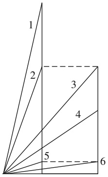

text_image

1
2
3
4
5
6

Abb. 33.F13

# 34 Photonen und Materiewellen

## 34.1 Das Photon: Teilchen des Lichts

## Physikalische Motivation

Unsere Diskussion der Speziellen Relativitätstheorie Einsteins führte uns in eine Welt weit jenseits der Alltagserfahrungen – in die Welt von Gegenständen, die sich mit nahezu Lichtgeschwindigkeit bewegen. Neben anderen überraschenden Schlussfolgerungen besagt die Relativitätstheorie beispielsweise, dass der Gang einer Uhr von ihrer Geschwindigkeit relativ zu einem Beobachter abhängt: Je grö- ßer diese Relativgeschwindigkeit ist, umso langsamer geht aus Sicht des Beobachters diese Uhr. Diese und andere Vorhersagen haben bisher allen experimentellen Überprüfungen standgehalten, und die Spezielle Relativitätstheorie hat uns zu einem tieferen und besseren Verständnis der Natur von Raum und Zeit geführt.

Nun betreten wir eine zweite Welt jenseits unserer Alltagserfahrung – die subatomare Welt. Wieder werden wir eine Fülle von Überraschungen erleben, die Physiker trotz ihrer oft seltsam anmutenden Konsequenzen Schritt für Schritt zu einem tieferen und besseren Verständnis der Realität geführt haben.

Die **Quantenphysik**, wie unser neues Thema heißt, beantwortet Fragen wie: Weshalb leuchten Sterne? Weshalb lassen sich die chemischen Elemente in ein Periodensystem einordnen? Wie arbeiten Transistoren und andere mikroelektronische Bauteile? Weshalb ist Kupfer elektrisch leitend, Glas aber nicht? Die Quantenphysik ist die Grundlage der gesamten Chemie einschließlich der Bioche mie – wir müssen also die Quantenphysik verstehen, wenn wir das Leben verstehen wollen.

Einige der Vorhersagen der Quantenphysik erscheinen selbst den Physikern und den Philosophen, die sich mit ihren Grundlagen beschäftigen, außerordentlich bizarr. Trotzdem hat sich die Theorie in bisher jedem Experiment als richtig erwie sen, und ständig offenbaren sich noch seltsamere Aspekte der Quantenphysik. Die Quantenwelt ist wie ein Vergnügungspark, voll wilder Fahrten, die Ihnen Ihre von Kindheit an vertrauten und vernünftig erscheinenden Ansichten über die Welt gehörig durcheinanderrütteln werden. Wir beginnen unsere Erkundung des Quantenparks mit dem Photon.

## 34.1.1 Das Photon: Teilchen des Lichts

Die **Quantenphysik** (man spricht auch von Quantentheorie) beschäftigt sich hauptsächlich mit der Mikrowelt. Dort stellt sich in vielen Fällen heraus, dass bestimmte Größen nur in ganzzahligen Vielfachen von bestimmten kleinsten Beträgen (elementaren Einheiten) auftreten können. In solchen Fällen sagt man, diese Größen seien quantisiert oder gequantelt. Die elementare Einheit einer solchen Größe wird auch als **Quant** dieser Größe bezeichnet.

In einem gewissen Sinn ist auch eine Währung wie der Euro quantisiert, denn die Münze mit dem kleinsten Wert ist der Cent oder die 0,01-Euro-Münze. Die

Werte aller anderen Münzen und Scheine sind dadurch eingeschränkt, dass es sich immer um ganzzahlige Vielfache dieser kleinsten Menge handelt. Mit anderen Worten, das Geldquant ist 0,01  und alle größeren Geldbeträge sind von der Form n(0,01 ), wobei n eine positive ganze Zahl ist. Einen Betrag von $0 { , } 7 5 5   \in { }$ 75,5 ⋅ (0,01 ) können Sie nicht bar bezahlen.

Im Jahr 1905 schlug Einstein vor, dass die elektromagnetische Strahlung (oder einfacher Licht) quantisiert ist und nur in Vielfachen einer zunächst „Lichtquant genannten kleinsten Einheit vorkommt. Heute heißen die Lichtquanten meist **Photonen**. Ein solcher Vorschlag sollte Ihnen merkwürdig erscheinen, denn in den vergangenen Kapiteln haben wir ausgiebig darüber diskutiert, dass es sich bei der klas sischen Vorstellung von Licht um eine sinusförmige Welle mit einer Wellenlänge λ, einer Frequenz $f$ und einer Geschwindigkeit c handelt, die über die Beziehung

$$
f = \frac {c}{\lambda} \tag {34.1}
$$

zusammenhängen.

Außerdem haben wir in Kapitel 29 argumentiert, dass es sich bei der klassischen Lichtwelle um eine Kombination aus elektrischen und magnetischen Feldern handelt, die mit derselben Frequenz $f$ oszillieren. Wie kann eine solche Welle aus elementaren Einheiten – Lichtquanten – bestehen? Was ist ein Photon?

Das Konzept eines Lichtquants oder Photons stellte sich als weitaus subtiler und geheimnisvoller heraus, als es Einstein zunächst vorschwebte. Im Grunde genommen ist es immer noch nicht ganz verstanden. In diesem Buch werden wir nur einige der grundlegenden Aspekte des Photons diskutieren.

Nach Einsteins Vorstellungen hat das Quant einer Lichtwelle der Frequenz $f$ die Energie

$$
E = h f \quad (\text {Energie eines Photons}). \tag {34.2}
$$

Das **Plancksche Wirkungsquantum** (oder die **Plancksche Konstante**) h hat den Wert

$$
h = 6, 6 3 \cdot 1 0 ^ {- 3 4} \mathrm{J} \cdot \mathrm{s} = 4, 1 4 \cdot 1 0 ^ {- 1 5} \mathrm{eV} \cdot \mathrm{s}. \tag {34.3}
$$

Die minimale Energie, die eine Lichtwelle der Frequenz f haben kann, beträgt $h f -$ die Energie eines einzelnen Photons. Wenn die Welle eine größere Energie besitzt, muss ihre Gesamtenergie ein ganzzahliges Vielfaches von $h f$ sein, ähnlich wie in unserem vorherigen Beispiel bei der Währung. Licht kann keine Energie von 0,6hf oder 75,5hf haben.

Außerdem erklärte Einstein, dass und wie Licht von den Atomen in einem Gegenstand (Materie) absorbiert oder emittiert wird. Absorbiert ein Atom Licht einer Frequenz $f ,$ so wird die Energie $h f$ eines Photons von dem Licht auf das Atom übertragen. Bei dieser Photonenabsorption verschwindet das Photon, es wurde von dem Atom absorbiert. Wird Licht der Frequenz f von einem Atom emittiert, wird die Energie $h f$ von dem Atom auf das Licht übertragen. Bei dieser Photonenemission entsteht plötzlich ein Photon und man sagt, das Atom habe das Photon emittiert.

Bei großen Gegenständen aus vielen Atomen können auch sehr viele Photonen absorbiert (beispielsweise in einer Sonnenbrille) oder emittiert werden (beispielsweise von einer Lampe). Trotzdem wird bei jedem Einzelereignis einer Photonenabsorption oder -emission immer nur die Energie eines einzelnen Photons übertragen.

Wenn wir in den vergangenen Kapiteln Beispiele für eine Absorption oder Emission von Licht diskutiert haben, war immer so viel Licht beteiligt, dass wir die Quantenphysik nicht benötigten und mit der klassischen Physik auskamen. Doch seit den 1980er Jahren ist die Technologie so ausgereift, dass Experimente mit einzelnen Photonen ausgeführt werden können und auch praktische Anwendung finden. Seitdem gehört die Quantenphysik zum alltäglichen Ingenieursgeschäft, besonders im Bereich der Optoelektronik.

## KONTROLLFRAGE 1

Ordnen Sie die folgenden Strahlungen in absteigender Reihenfolge nach den zugehörigen Photonenenergien: (a) das gelbe Licht einer Natriumdampflampe, (b) ein von einem radioaktiven Kern emittierter Gammastrahl, (c) die von einer Antenne eines Radiosenders emittierte Radiowelle, (d) ein Mikrowellenstrahl eines Flughafenradars.

## 34.2 Der photoelektrische Effekt

## Lernziele

Nach dem Durcharbeiten dieses Abschnitts sollten Sie in der Lage sein, . . .

• einen Versuchsaufbau zum photoelektrischen Effekt in einer einfachen Skizze darzustellen, welche das einfallende Licht, die Metallplatte, die emittierten Elektronen (Photoelektronen) und den Kollektor enthält,
• die Probleme zu erklären, die Physiker mit dem photoelektrischen Effekt vor Einsteins Erklärung des Effekts hatten, und anzugeben, worin die historische Bedeutung seiner Hypothese besteht,
• den Zusammenhang zwischen dem Stopppotenzial $V _ { \mathsf { s t o p } }$ und der maximalen kinetischen Energie $K _ { \mathrm { m a x } }$ der entkommenden Photoelektronen anzugeben,
• beim Photoeffekt die Beziehungen zwischen Frequenz und Wellenlänge des einfallenden Lichts, der maximalen kinetischen Energie $K _ { \mathrm { m a x } }$ der Photoelektronen, der Austrittsarbeit Φ und dem Stopppotenzial $V _ { \mathrm { s t o p } }$ anzuwenden,
• für einen Versuchsaufbau zum photoelektrischen Effekt das Stopppotenzial $V _ { \mathrm { s t o p } }$ gegen die Lichtfrequenz aufzutragen und auf diese Weise die Grenzfrequenz $f _ { 0 }$ zu bestimmen sowie die Steigung der Kurve mit dem Planckschen Wirkungsquantum h und der Elementarladung e in Beziehung zu setzen.

## Schlüsselideen

Wenn Licht mit ausreichend hoher Frequenz auf eine Metalloberfläche trifft, können die Elektronen des Metalls durch Absorption der Photonen genug Energie aufnehmen, um das Metall zu verlassen. Dies nennt man den photoelektrischen Effekt (Photoeffekt).
• Die Energieerhaltungsgleichung für einen solchen Absorptionsvorgang lautet

$$
h f = K _ {\mathrm{max}} + \varPhi ,
$$

wobei $h f$ die absorbierte Photonenenergie ist und $K _ { \mathrm { m a x } }$ die maximale kinetische Energie der freigesetzten Elektronen. Die Austrittsarbeit Φ ist die Energie, die mindestens erforderlich ist, um ein durch elektrische Kräfte im Metallverband gebundenes Elektron aus dem Metall herauszuschlagen.

• Für $h f = \varPhi$ können die Elektronen gerade eben entkommen, haben aber keine kinetische Energie; die zugehörige Lichtfrequenz ist die Grenzfrequenz $f _ { 0 } .$

• Für $h f < \varPhi$ können keine Elektronen aus dem Metall entkommen; es tritt kein photoelektrischer Effekt auf.

## 34.2.1 Der photoelektrische Effekt

Trifft ein Lichtstrahl mit einer hinreichend kleinen Wellenlänge auf eine glatte Metalloberfläche, so verlassen Elektronen diese Oberfläche (das Licht schlägt die Elektronen aus der Oberfläche heraus). Dieser **photoelektrische Effekt** (oder Pho toeffekt) wird in vielen Geräten wie z. B. Fernsehkameras, Camcordern oder Nachtsichtgeräten ausgenutzt. Einstein begründete sein Photonenkonzept mit der Erklä- rung dieses Effekts, der sich ohne die Quantenphysik nicht verstehen lässt.

Wir wollen nun zwei Experimente zum photoelektrischen Effekt untersuchen, die beide die Apparatur aus Abb. 34.1 verwenden. Hier trifft Licht der Frequenz f auf eine Metallplatte M und löst dort Elektronen heraus. Zwischen der Metallplat-

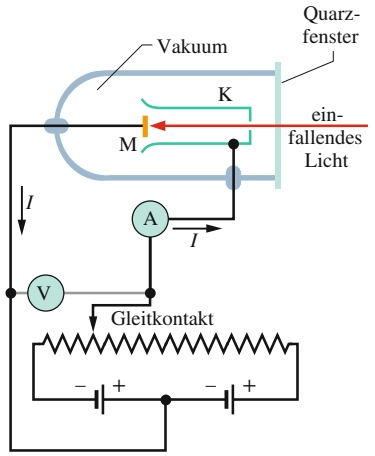

flowchart

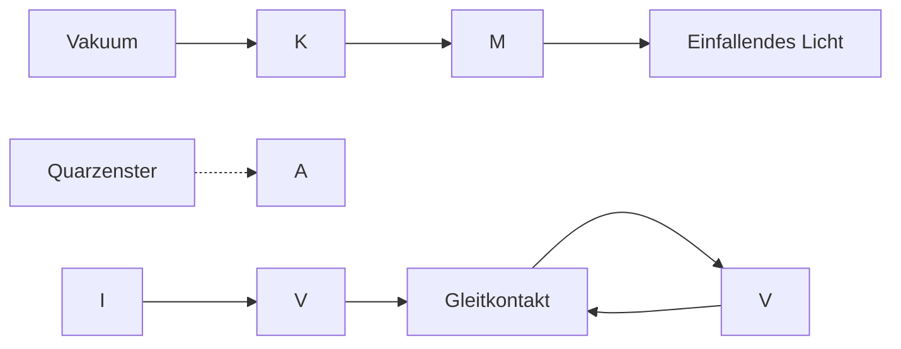

Abb. 34.1

Eine Apparatur zur Untersuchung des photoelektrischen Effekts. Das einfallende Licht trifft auf eine Metallplatte M und schlägt dort Elektronen heraus, die von einem Kollektor K aufgesammelt werden. In dem Stromkreis bewegen sich die Elektronen entgegen der üblichen Stromrichtung. Die Batterien und der verstellbare Widerstand dienen zur Anpassung der elektrischen Potenzialdifferenz zwischen M und K.

te M und einem Kollektor K zur Aufnahme dieser sogenannten **Photoelektronen** wird eine Potenzialdifferenz V aufrechterhalten. In dieser Anordnung entsteht ein **photoelektrischer Strom** $I ,$ der mit einem Amperemeter A gemessen wird.

## Das erste photoelektrische Experiment

Wir stellen zunächst mithilfe des Gleitkontakts in Abb. 34.1 die Potenzialdiffer enz $V$ so ein, dass der Kollektor K relativ zur Metallplatte M schwach negativ geladen ist. Diese Potenzialdifferenz dient zum Abbremsen der herausgeschlagenen Elektronen. Anschließend verändern wir V bis zu einem gewissen Wert $V _ { \mathrm { s t o p } }$ (manchmal **Stopppotenzial** genannt), bei dem die Anzeige des Amperemeters gerade auf null sinkt. Bei $V = V _ { \mathrm { s t o p } }$ werden auch die energiereichsten der aus dem Metall herausgelösten Elektronen wieder zurückgelenkt, bevor sie den Kollektor erreichen. Für die kinetische Energie $K _ { \mathrm { m a x } }$ dieser energiereichsten Elektronen gilt

$$
K _ {\max} = e V _ {\text {stop}}, \tag {34.4}
$$

wobei e die Elektronenladung ist.

Experimentell findet man nun, dass $K _ { \mathrm { m a x } }$ für Licht einer gegebenen Frequenz nicht von der Intensität der Lichtquelle abhängt. Die maximale kinetische Energie der herausgeschlagenen Elektronen hat immer denselben Wert, unabhängig davon, ob es sich um eine blendend helle oder kaum wahrnehmbar schwache Lichtquelle handelt (oder eine beliebige Intensität dazwischen).

Dieses experimentelle Ergebnis lässt sich im Rahmen der klassischen Physik nicht erklären. Klassisch handelt es sich bei dem einfallenden Licht um eine sinusförmige elektromagnetische Welle. Ein Elektron in der Metallplatte sollte durch die oszillierende elektrische Kraft des elektrischen Felds ebenfalls zu Schwingungen angeregt werden. Ist die Amplitude der Elektronenschwingung groß genug, sollte sich das Elektron von der Metalloberfläche lösen können und so aus dem Metall herausgeschlagen werden. Wenn wir die Amplitude der Welle bzw. des oszillierenden elektrischen Felds erhöhen, sollte das Elektron einen stärkeren „Stoß“ bekommen. Das ist jedoch nicht, was wir beobachten! Bei einer gegebenen Frequenz übertragen die intensiven wie auch die schwachen Lichtstrahlen den herausgeschlagenen Elektronen exakt denselben maximalen Stoß.

Dieses Ergebnis klingt jedoch natürlich, wenn wir an Photonen denken. In diesem Fall entspricht die von dem einfallenden Licht auf ein Elektron übertragene Energie der Energie eines einzelnen Photons. Wenn wir die Lichtintensität erhö- hen, erhöhen wir die Anzahl der Photonen in dem Licht. Die Photonenenergie (Gl. 34.2) bleibt dabei jedoch unverändert, da sich die Frequenz nicht geändert hat. Damit bleibt auch die auf ein Elektron übertragene und teilweise in dessen kinetische Energie umgewandelte Energie unverändert.

## Das zweite photoelektrische Experiment

Nun verändern wir die Frequenz f des einfallenden Lichts und messen das zugehörige Potenzial $V _ { \mathrm { s t o p } } .$ In Abb. 34.2 ist $V _ { \mathrm { s t o p } }$ gegen die Frequenz f aufgetragen. Zunächst fällt auf, dass der photoelektrische Effekt unterhalb einer bestimmten Frequenz $f _ { 0 }$ (der **Grenzfrequenz**) nicht auftritt. Äquivalent können wir auch von einer **Grenzwellenlänge** $\lambda _ { 0 } = c / f _ { 0 }$ sprechen, oberhalb derer der Effekt nicht beobachtet wird. Dies gilt unabhängig von der Intensität des einfallenden Lichts.

Auch dieses Verhalten ist im Rahmen der klassischen Physik rätselhaft. Stellt man sich Licht als elektromagnetische Welle vor, würde man erwarten, dass unabhängig von der Frequenz immer Elektronen herausgeschlagen werden können, wenn nur die Lichtintensität und damit die Energie des Lichts genügend groß sind. Das ist jedoch nicht, was wir beobachten! Unterhalb der Frequenz $f _ { 0 }$ tritt der pho toelektrische Effekt überhaupt nicht auf, gleichgültig wie hell die Lichtquelle ist.

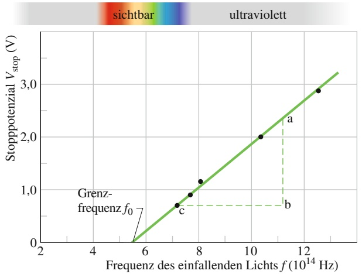

line

| Freqenz des einfallenden Lichts f (10^14 Hz) | Stoppotenzial Vstop (V) |
| --- | --- |
| ~7.2 | ~0.7 |
| ~7.6 | ~0.9 |
| ~8.0 | ~1.15 |
| ~10.4 | 2.0 |
| ~12.6 | ~2.9 |

## Abb. 34.2

Das Potenzial $V _ { \mathrm { s t o p } }$ als Funktion der Frequenz $f$ des einfallenden Lichts für eine Natriumprobe M in der $\mathrm { A } \mathrm { p } \mathrm { - }$ paratur von Abb. 34.1. (Die Daten stammen von R.A. Millikan aus dem Jahr 1916.)

Das Vorhandensein einer Grenzfrequenz ist jedoch genau, was man bei einer Energieübertragung durch diskrete Photonen erwarten würde. Die Elektronen werden durch elektrische Kräfte in dem Metall festgehalten. (Anderenfalls würden sie schon aufgrund der Schwerkraft aus der Probe herausfallen.) Um der Metallplatte entfliehen zu können, benötigen die Elektronen eine bestimmte Mindestenergie $\varPhi .$ Sie ist eine Materialeigenschaft der Probe und wird als **Austrittsarbeit** bezeichnet. Wenn die von einem Photon auf das Elektron übertragene Energie $h f$ größer ist als die Austrittsarbeit, also $h f > \varPhi$ gilt, kann das Elektron der Platte entkommen. Ist die übertragene Energie kleiner als die Austrittsarbeit $( h f < \varPhi )$ , bleibt das Elektron in dem Metall. Genau das zeigt Abb. 34.2.

## Die photoelektrische Gleichung

Einstein hat die Ergebnisse solcher photoelektrischer Experimente in der **photoelektrischen Gleichung** zusammengefasst:

$$
h f = K _ {\max} + \Phi \quad (\text {photoelektrische Gleichung}). \tag {34.5}
$$

Diese Gleichung ist eine direkte Konsequenz der Energieerhaltung bei der Absorp tion eines einzelnen Photons in einem Material mit der Austrittsarbeit Φ. Die Energie $h f$ eines Photons wird auf ein einzelnes Elektron in der Probe übertragen. Soll das Elektron aus dem Material herausgelöst werden, muss es mindestens die Energie Φ aufnehmen. Was das Elektron an zusätzlicher Energie $( h f - \phi )$ von dem Photon mitbekommt, behält es in Form von kinetischer Energie K. Im günstigsten Fall kann das Elektron der Oberfläche entkommen, ohne bei diesem Prozess weitere kinetische Energie zu verlieren. In diesem Fall hat das Elektron außerhalb der Probe die maximal mögliche Energie $K _ { \mathrm { m a x } } .$

Wir ersetzen in Gl. 34.5 die maximale kinetische Energie $K _ { \mathrm { m a x } }$ mithilfe von Gl. 34.4 und formen etwas um; so erhalten wir die Beziehung

$$
V _ {\mathrm{stop}} = \left(\frac {h}{e}\right) f - \frac {\Phi}{e}. \tag {34.6}
$$

Die Verhältnisse $( h / e )$ und $( \varPhi / e )$ sind Konstanten. Wenn wir das gemessene Potenzial $V _ { \mathrm { s t o p } }$ gegen die Frequenz $f$ des einfallenden Lichts auftragen, erwarten wir demzufolge eine gerade Linie, genau wie in Abb. 34.2. Die Steigung dieser Geraden sollte gleich $h / e$ sein. Zur Überprüfung messen wir die Strecken $\mathrm { , } \mathrm { a b } ^ { \prime }$ und ‚bc in Abb. 34.2 aus und finden

$$
\begin{array}{l} \frac {h}{e} = \frac {\mathrm{ab}}{\mathrm{bc}} = \frac {2 , 3 5 \mathrm{V} - 0 , 7 2 \mathrm{V}}{(1 1 , 2 \cdot 1 0 ^ {1 4} - 7 , 2 \cdot 1 0 ^ {1 4}) \mathrm{Hz}} \\ = 4, 1 \cdot 1 0 ^ {- 1 5} \mathrm{V} \cdot \mathrm{s}. \\ \end{array}
$$

Wir multiplizieren dieses Ergebnis mit der Elementarladung e und erhalten

$$
h = (4, 1 \cdot 1 0 ^ {- 1 5} \mathrm{V} \cdot \mathrm{s}) (1, 6 \cdot 1 0 ^ {- 1 9} \mathrm{C}) = 6, 6 \cdot 1 0 ^ {- 3 4} \mathrm{J} \cdot \mathrm{s},
$$

in Übereinstimmung mit Messwerten, die auf anderen Wegen erhalten wurden.

Eine Nebenbemerkung: Eine Erklärung des photoelektrischen Effekts erfordert sicherlich die Quantenphysik. Für viele Jahre galt die Erklärung Einsteins auch als zwingendes Argument für die Existenz von Photonen. Im Jahr 1969 fand man jedoch eine alternative Erklärung, die zwar auf der Quantenphysik basiert, aber ohne das Konzept der Photonen auskommt. Licht ist zwar in Form von Photonen quantisiert, doch die Einsteinsche Erklärung des photoelektrischen Effekts ist kein zwingender Beweis dafür.

## KONTROLLFRAGE 2

Die Abbildung zeigt Messkurven von der Art der in Abb. 34.2 gezeigten. Als Me tallproben wurden Caesium, Kalium, Natrium und Lithium verwendet. (a) Ordnen Sie die Proben in absteigender Reihenfolge nach ihrer Austrittsarbeit. (b) Ordnen Sie die Geraden in absteigender Reihenfolge nach dem Wert, den sie für h liefern.

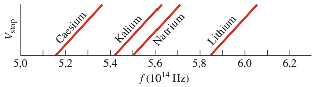

line

| Species | f (10^14 Hz) range | Vstop (range) |
| --- | --- | --- |
| Caesium | 5.15~5.35 | 0~>6 |
| Kalium | 5.4~5.65 | 0~>6 |
| Natrium | 5.5~5.7 | 0~>6 |
| Lithium | 5.85~6.05 | 0~>6 |

## 34.3 Photonenimpuls, Compton-Verschiebung und Lichtinterferenz

## Lernziele

Nach dem Durcharbeiten dieses Abschnitts sollten Sie in der Lage sein, . . .

• die Beziehungen zwischen Impuls, Energie, Frequenz und Wellenlänge eines Photons anzuwenden,
• die wesentlichen Aspekte eines Experiments zur Untersuchung der Compton-Streuung zu skizzieren,
• die historische Bedeutung des Compton-Effekts zu verstehen,
• anzugeben, welche der folgenden Größen im gestreuten Röntgenstrahl mit dem Compton-Streuwinkel 𝜑 zu- oder abnehmen: kinetische Energie, Impuls und Wellenlänge,
• zu beschreiben, wie bei der Compton-Streuung die Erhaltung von Impuls und kinetischer Energie auf die Gleichung für die Wellenlängenverschiebung Δλ führt,
• die Beziehungen zwischen den Wellenlängen von einfallendem und gestreutem Strahl, der Wellenlängenverschiebung Δλ, dem Streuwinkel 𝜑 der Röntgenphotonen und der finalen Werte von Energie und Impuls der Elektronen anzuwenden (beim Impuls nach Betrag und Winkel),
• die Standardversion, die Ein-Photon-Version und die Weitwinkelversion des Doppelspaltexperiments im Photonenbild zu erklären.

## Schlüsselideen

• Obwohl es masselos ist, hat das Photon einen Impuls, der mit seiner Energie E, Frequenz $f$ und Wellenlänge λ wie folgt zusammenhängt:

$$
p = \frac {h f}{c} = \frac {h}{\lambda}.
$$

• Bei der Compton-Streuung werden Röntgenstrahlen wie Teilchen (Photonen) an schwach in einem Target gebundenen Elektronen gestreut.

• Bei dieser Streuung werden Energie und Impuls auf ein Elektron des Targets übertragen.
• Die daraus resultierende Zunahme der Photonenwellenlänge, die Compton-Verschiebung, ist

$$
\Delta \lambda = \frac {h}{m _ {\mathrm{e}} c} (1 - \cos \varphi),
$$

wobei $m _ { \mathrm { e } }$ die Elektronenmasse ist und $\varphi$ der Winkel, um den das Photon aus seiner Einfallsrichtung herausgestreut wird.

• Photonen: Wenn Licht mit Materie wechselwirkt, ist die Wechselwirkung teil chenartig, geschieht an einem Punkt im Raum und es werden Energie und Impuls übertragen.
• Welle: Wenn ein einzelnes Photon von einer Quelle emittiert wird, interpretieren wir seine Bewegung als die Ausbreitung einer Wahrscheinlichkeitswelle.
• Welle: Wenn viele Photonen von einer Quelle emittiert oder absorbiert werden, interpretieren wir sie alle gemeinsam als klassische elektromagnetische bzw. Lichtwelle.

## 34.3.1 Photonen besitzen einen Impuls

Im Jahr 1916 erweiterte Einstein sein Konzept der Lichtquanten (Photonen), indem er für ein Lichtquant einen Impuls postulierte. Für ein Photon der Energie hf gilt für den Betrag dieses Impulses

$$
p = \frac {h f}{c} = \frac {h}{\lambda} \quad (\text {Photonenimpuls}), \tag {34.7}
$$

wobei wir $f$ mithilfe von Gl. 34.1 $\left( f = c / \lambda \right)$ ersetzt haben. Bei der Wechselwirkung zwischen einem Photon und Materie werden daher Energie und Impuls übertragen, als ob es sich um einen Stoß zwischen einem Photon und einem Materieteilchen im klassischen Sinn handelte (wie in Kapitel 5).

Im Jahr 1923 führte Arthur Compton von der Washington University in St. Louis ein Experiment durch, das die Möglichkeit einer Impuls- und Energieübertragung durch Photonen untermauerte. Bei diesem Experiment trafen Röntgenstrahlen der Wellenlänge λ wie in Abb. 34.3 auf eine Kohlenstoffprobe. Röntgenstrahlung ist eine Form von elektromagnetischer Strahlung mit großen Frequenzen, also kleinen Wellenlängen. Compton maß die Wellenlängen und Intensitäten der Röntgenstrahlen, die unter verschiedenen Winkeln von der Kohlenstoffprobe gestreut wurden.

Abbildung 34.4 gibt seine Ergebnisse wieder. Obwohl im einfallenden Röntgenstrahl nur eine einzige Wellenlänge (λ = 71,1 pm) vertreten ist, erkennt man bei den gestreuten Röntgenstrahlen ein breites Spektrum an Wellenlängen mit zwei ausgeprägten Intensitätsmaxima. Ein Maximum liegt bei der Wellenlänge λ der einfallenden Strahlung, das zweite Maximum bei einer Wellenlänge $\lambda ^ { \prime } ,$ , die um eine Wellenlängendifferenz Δλ (die sogenannte **Compton-Verschiebung**) größer ist. Der Wert der Compton-Verschiebung hängt von dem Winkel ab, unter dem die Röntgenstrahlen gestreut werden.

Auch die Ergebnisse in Abb. 34.4 sind im Rahmen der klassischen Physik ein Rätsel. Klassisch sollte es sich bei dem einfallenden Röntgenstrahl um eine sinusförmig oszillierende elektromagnetische Welle handeln. Ein Elektron in der Kohlenstoffprobe sollte durch die oszillierende elektrische Kraft des elektrischen Felds ebenfalls in Schwingung geraten. Außerdem sollte die Frequenz, mit der das Elektron schwingt, gleich der Frequenz der einfallenden Strahlung sein. Und das Elektron sollte wie eine winzige Antenne selbst Strahlung mit derselben Frequenz aussenden. Die gestreuten Röntgenstrahlen sollten daher dieselbe Frequenz und damit auch dieselbe Wellenlänge haben wie die einfallende Strahlung – das ist aber nicht der Fall.

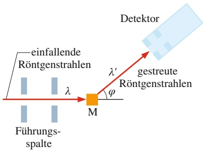

flowchart

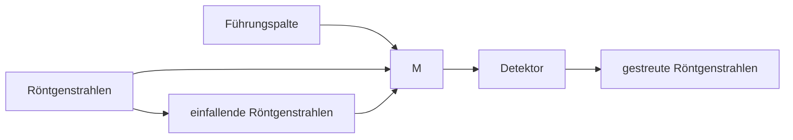

## Abb. 34.3

Der Aufbau von Comptons Experiment. Ein Röntgenstrahl der Wellenlänge λ = 71,1 pm trifft auf ein Kohlenstoff-Target M. Die gestreuten Röntgenstrahlen werden unter verschiedenen Winkeln 𝜑 zum einfallenden Strahl beobachtet. Der Detektor misst sowohl die Intensität als auch die Wellenlänge der gestreuten Röntgenstrahlen.

Abb. 34.4 Comptons Ergebnisse für vier verschiedene Streuwinkel 𝜑. Man beachte, dass die Compton-Verschiebung Δλ mit zunehmendem Winkel größer wird.

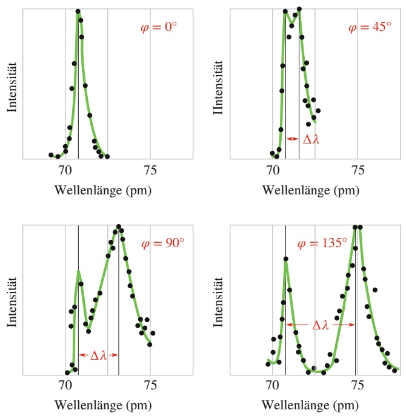

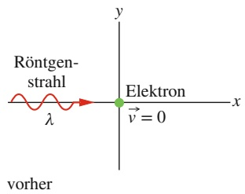

line

| Feature | Description |
| --- | --- |
| X-axis | x (horizontal) |
| Y-axis | y (vertical) |
| Function | Röntgenstrahl (red line) |
| Vector | Elektron (green dot) |
| Condition | v = 0 (voltage vector) |
| Note | vorher |

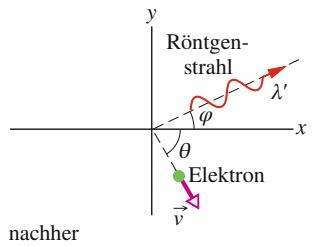

text_image

Röntgen-
strahl
φ
λ'
x
θ
Elektron
v
nachher

Abb. 34.5

Ein Röntgenstrahl der Wellenlänge λ wechselwirkt mit einem ruhenden freien Elektron. Der Röntgenstrahl wird unter einem Winkel 𝜑 gestreut und hat nun die größere Wellenlänge $\lambda ^ { \prime } .$ Das Elektron bewegt sich mit der Geschwindigkeit v in die Richtung θ.

Compton interpretierte die Streuung von Röntgenstrahlen am Kohlenstoff als Energie- und Impulsübertragung (vermittelt durch Photonen) zwischen dem einfallenden Röntgenstrahl und locker gebundenen Elektronen im Kohlenstoff. Wir wollen nun, zunächst konzeptuell und später quantitativ, untersuchen, wie diese quantenmechanische Interpretation die Ergebnisse Comptons erklären kann.

Wir nehmen an, ein einzelnes Photon der Energie $E = h f$ sei an der Wechselwirkung zwischen dem einfallenden Röntgenstrahl und dem ruhenden Elektron beteiligt. Im Allgemeinen wird sich die Ausbreitungsrichtung des Röntgenstrahls ändern (der Röntgenstrahl wird gestreut) und das Elektron erleidet einen Rückstoß. Dem Elektron wurde also ein gewisser Betrag an kinetischer Energie übertragen. Bei diesem einzelnen Prozess ist die Energie erhalten. Die Energie des gestreuten Photons $( E ^ { \prime } = h f ^ { \prime } )$ muss daher kleiner sein als die des einfallenden Photons. Also müssen die gestreuten Röntgenstrahlen eine kleinere Frequenz $f ^ { \prime }$ und damit eine größere Wellenlänge $\lambda ^ { \prime }$ als die einfallenden Röntgenstrahlen haben. Genau das zeigen die in Abb. 34.4 dargestellten experimentellen Ergebnisse von Compton.

Für eine quantitative Behandlung dieser Streuung wenden wir zunächst die Energieerhaltung an. Abbildung 34.5 zeigt einen $_ { p } \mathrm { Z }$ usammenstoß“ zwischen einem Röntgenstrahl und einem zunächst ruhenden freien Elektron in der Probe. Nach dem Stoß bewegt sich ein Röntgenstrahl mit der Wellenlänge $\lambda ^ { \prime }$ in die durch den Winkel $\varphi$ gekennzeichnete Richtung und das Elektron bewegt sich in die Richtung θ. Die Energieerhaltung erfordert dann

$$
h f = h f ^ {\prime} + K,
$$

wobei $h f$ die Energie des einfallenden Röntgenphotons ist, $h f ^ { \prime }$ die Energie des gestreuten Röntgenphotons und K die kinetische Energie des zurückgestoßenen Elektrons. Da der Rückstoß des Elektrons mit nahezu Lichtgeschwindigkeit erfolgen kann, müssen wir für die kinetische Energie des Elektrons den relativistischen Ausdruck aus Gl. 33.43 verwenden:

$$
K = m c ^ {2} (\gamma - 1).
$$

Hierbei sind m die Elektronenmasse und γ der Lorentz-Faktor:

$$
\gamma = \frac {1}{\sqrt {1 - (\nu / c) ^ {2}}}.
$$

Wir setzen den obigen Ausdruck für K in die Gleichung für die Energieerhaltung ein; das ergibt

$$
h f = h f ^ {\prime} + m c ^ {2} (\gamma - 1).
$$

Außerdem ersetzen wir noch f durch $c / \lambda$ und $f ^ { \prime }$ durch $c / \lambda ^ { \prime }$ und erhalten eine neue Form der Gleichung für die Energieerhaltung:

$$
\frac {h}{\lambda} = \frac {h}{\lambda^ {\prime}} + m c (\gamma - 1). \tag {34.8}
$$

Nun wenden wir auch die Impulserhaltung auf die Streuung zwischen Röntgenstrahl und Elektron in Abb. 34.5 an. Nach Gl. 34.7 ist der Impulsbetrag des einfallenden Photons gleich $h / \lambda$ und der des gestreuten Photons gleich $\bar { h / \lambda ^ { \prime } }$ . Nach Gl. 33.32 ist der Impulsbetrag des gestreuten Elektrons gleich $\gamma m \nu .$ Da wir es hier mit einer zweidimensionalen Situation zu tun haben, formulieren wir die Bedingungen für die Impulserhaltung entlang der x- und y-Achse getrennt:

$$
\frac {h}{\lambda} = \frac {h}{\lambda^ {\prime}} \cos \varphi + \gamma m \nu \cos \theta \quad (x \text {-Achse}) \tag {34.9}
$$

und

$$
0 = \frac {h}{\lambda^ {\prime}} \sin \varphi + \gamma m \nu \sin \theta \quad (y - A c h s e). \tag {34.10}
$$

Wir wollen die Compton-Verschiebung $\Delta \lambda   =   \lambda ^ { \prime } - \lambda$ der gestreuten Röntgenstrahlen bestimmen. Von den fünf Stoßparametern $( \lambda , \lambda ^ { \prime } , \nu ,$ 𝜑 und θ), die in den Gln. 34.8–34.10 auftauchen, eliminieren wir v und $\theta ,$ die sich auf das gestreute Elektron beziehen. Einige (kompliziertere) Umformungen führen auf die folgende Gleichung für die Compton-Verschiebung als Funktion des Streuwinkels 𝜑:

$$
\Delta \lambda = \frac {h}{m c} (1 - \cos \varphi) \quad \text {(Compton - Verschiebung)}  . \tag {34.11}
$$

Diese Gleichung stimmt genau mit den experimentellen Ergebnissen von Compton überein.

Die Größe $h / m c$ in Gl. 34.11 ist eine Konstante, die man als Compton-Wel**lenlänge** bezeichnet. Ihr Wert hängt von der Masse m des Teilchens ab, an dem die Röntgenstrahlen gestreut werden. Im vorliegenden Fall handelt es sich um ein locker gebundenes Elektron, daher setzen wir für m die Elektronenmasse ein und erhalten so die Compton-Wellenlänge für die Compton-Streuung an einem Elektron.

## Eine offene Frage

Wir müssen noch eine Erklärung für das Maximum bei der einfallenden Wellenlän-$\mathrm { g e }   \lambda   ( = 7 1 , 1   \mathrm { p m } )$ in Abb. 34.4 finden. Dieses Maximum beruht nicht auf der Wechselwirkung zwischen den Röntgenstrahlen und den locker gebundenen Elektronen in der Probe, sondern auf der Wechselwirkung zwischen den Röntgenstrahlen und den fest gebundenen Elektronen in den Kohlenstoffatomen der Probe. Praktisch handelt es sich dabei um einen Stoß zwischen einem Röntgenstrahl und einem ganzen Kohlenstoffatom. Ersetzen wir m in Gl. 34.11 durch die Masse eines Kohlenstoffatoms (das ungefähr 22 000-mal schwerer ist als ein Elektron), wird Δλ offensichtlich um den Faktor 22 000 kleiner als die Compton-Verschiebung für ein Elektron. Das ist zu klein für einen Nachweis. Die bei solchen Stößen gestreuten Röntgenstrahlen haben in der Praxis daher dieselbe Wellenlänge wie die einfallenden Röntgenstrahlen.

## KONTROLLFRAGE 3

Vergleichen Sie die Compton-Streuung für Röntgenstrahlen $( \lambda \approx 2 0   \mathrm { p m } )$ für einen festen Streuwinkel mit der von sichtbarem Licht $( \lambda   \approx   5 0 0   \mathrm { n m } )$ . In welchem Fall findet man die größere (a) Compton-Verschiebung, (b) relative Wellenlängenverschiebung, (c) relative Energieänderung der Photonen und (d) Energieübertragung auf das Elektron?

## 34.3.2 Licht als Wahrscheinlichkeitswelle

Eines der grundlegenden Rätsel in der Physik besteht darin, wie sich Licht in der klassischen Physik als Welle verhalten kann (die sich über ein vergleichsweise großes Gebiet verteilt), während es in der Quantenphysik in Form von diskreten Photonen emittiert und absorbiert wird (die an bestimmten Orten entstehen und verschwinden). Das Doppelspaltexperiment aus Abschn. 31.2 steht im Zentrum dieser Problematik. Wir wollen nun drei verschiedene Versionen dieses Experiments diskutieren.

## Das Standardexperiment

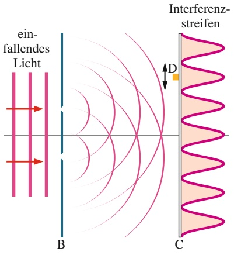

text_image

ein-
fallendes
Licht
B
Interferenz-
streifen
D
C

Abb. 34.6

Licht trifft auf einen Schirm B mit zwei parallelen Spalten. Hinter den beiden Spalten wird das Licht gebeugt und breitet sich über einen großen Bereich aus. Die beiden Beugungswellen überlagern sich bei dem Schirm C und bilden ein Interferenzmuster. Ein kleiner Photonendetektor D in der Ebene von C zeigt jedes auftreffende Photon durch ein scharfes Klicken an.

Abbildung 34.6 zeigt den Aufbau des Originalexperiments von Thomas Young aus dem Jahr 1801 schematisch (siehe auch Abb. 31.6). Licht scheint auf einen Schirm B, in dem sich zwei enge, parallele Spalte befinden. Hinter den Spalten breiten sich zwei gebeugte Lichtwellen aus und überlagern sich in der Ebene von Schirm C. Dort entsteht durch Interferenz das Muster von abwechselnden Intensitätsmaxima und -minima. In Abschn. 31.2 haben wir das Vorhandensein dieser Interferenzstreifen als zwingenden Beweis für die Wellennatur des Lichts gedeutet.

Nun stellen wir einen winzigen Photonendetektor D in der Ebene von Schirm C auf. Der Detektor bestehe aus einem photoelektrischen Bauteil, das bei jeder Absorption eines Photons ein scharfes Klicken von sich gibt. Bei dem vorliegenden Experiment würden wir feststellen, dass der Detektor eine zeitlich zufällige Folge von Klicktönen von sich gibt. Jeder dieser Töne signalisiert die Absorption eines Photons, also eine Energieübertragung von der Lichtwelle auf den Schirm.

Würden wir den Detektor langsam entlang des Schirms verschieben, wie in Abb. 34.6 durch die schwarzen Pfeile angedeutet, würde die Klickrate zu- bzw. abnehmen, je nachdem ob wir uns gerade bei einem Maximum oder einem Minimum der Interferenzstreifen befinden.

Dieses Gedankenexperiment zeigt uns Folgendes: Wir können nicht vorhersagen, wann ein Photon an einem bestimmten Punkt des Schirms C nachgewiesen wird. Die Photonen treffen mehr oder weniger zufällig zu bestimmten Zeiten bei bestimmten Punkten auf den Schirm. Wir können jedoch die jeweilige Wahrscheinlichkeit vorhersagen, mit der ein Photon an einem bestimmten Punkt in einem vorgegebenen Zeitintervall auf dem Schirm auftreffen wird: Diese Wahrscheinlichkeit ist proportional zur Intensität des einfallenden Lichts an diesen Punkt.

In Abschn. 29.2 hatten wir gesehen, dass die Intensität I einer Lichtwelle an je dem Punkt proportional zum Quadrat der Amplitude $E _ { \mathrm { m } }$ des oszillierenden elektrischen Feldvektors der Welle an diesem Punkt ist. Das bedeutet:

Die Wahrscheinlichkeit (pro Zeitintervall), mit der ein Photon in einem kleinen Volumen um einen gegebenen Punkt in einer Lichtwelle nachgewiesen wird, ist proportional zum Quadrat der Amplitude des elektrischen Feldvektors der Welle an diesem Punkt.

Wir sind damit zu einer probabilistischen Beschreibung (einer Wahrscheinlich keitsbeschreibung) einer Lichtwelle gelangt – eine neue Sichtweise auf die Natur des Lichts. Es handelt sich bei Licht nicht nur um eine elektromagnetische Welle, sondern auch um eine **Wahrscheinlichkeitswelle**. Jedem Punkt in einer Lichtwelle können wir eine numerische Wahrscheinlichkeit zuordnen, in einer kleinen Umgebung dieser Stelle pro Zeitintervall ein Photon nachzuweisen.

## Das Experiment mit einzelnen Photonen

Eine Variante des Doppelspaltexperiments mit einzelnen Photonen wurde zuerst von G.I. Taylor im Jahr 1909 durchgeführt und seitdem mehrmals wiederholt.

Im Gegensatz zur Standardversion ist bei diesem Experiment die Lichtquelle so schwach, dass die Photonen nur einzeln und in zufälligen Zeitabständen emittiert werden. Erstaunlicherweise entstehen trotzdem wieder die gewohnten Interferenzstreifen auf dem Schirm C, sofern das Experiment lange genug läuft (mehrere Monate in Taylors ersten Experimenten).

Welche Erklärung können wir für das Ergebnis dieses Doppelspaltexperiments mit einzelnen Photonen anbieten? Bevor man das Ergebnis überhaupt betrachtet, ist man geneigt, Fragen der folgenden Art zu stellen: Wenn sich die Photonen einzeln durch die Apparatur bewegen, durch welchen der beiden Spalte in Schirm B tritt ein gegebenes Photon hindurch? Woher „weiß“ ein bestimmtes Photon überhaupt, dass es einen zweiten Spalt gibt, sodass Interferenz erst möglich wird? Kann ein einzelnes Photon irgendwie durch beide Spalte hindurchtreten und anschlie ßend mit sich selbst interferieren?

Wir sollten nicht vergessen, dass wir nur die Wechselwirkung von Photonen mit Materie wahrnehmen – wir können Photonen nie ohne eine solche Wechselwirkung mit Materie, beispielsweise in einem Detektor oder auf einem Schirm, nachweisen. In dem Experiment von Abb. 34.6 wissen wir daher nur, dass die Photonen in der Lichtquelle entstehen und an dem Schirm wieder verschwinden. Wir können nicht beobachten, wo das Photon zwischen Quelle und Schirm ist oder was es macht. Da sich jedoch auf dem Schirm schließlich ein Interferenzmuster aufbaut, können wir vermuten, dass sich jedes einzelne Photon von der Quelle zum Detektor als Welle ausbreitet, die den Raum zwischen den Gegenständen ausfüllt und schließlich in einer Photonenabsorption, also mit einer Energie- und Impulsübertragung an einem bestimmten Punkt auf dem Schirm, wieder verschwindet.

Für ein gegebenes Photon können wir nicht vorhersagen, wo dieser Energieübertrag stattfinden wird (wo ein Photon nachgewiesen wird). Wir können jedoch vorhersagen, mit welcher Wahrscheinlichkeit eine Energieübertragung an einem bestimmten Punkt auf dem Schirm stattfinden wird. Eine Energieübertragung durch die Absorption von Photonen wird bevorzugt in solchen Bereichen des Schirms auftreten, wo sich die hellen Interferenzstreifen aufbauen. Umgekehrt wird in den Bereichen, wo sich auf dem Schirm die dunklen Interferenzstreifen befinden, eine Energieübertragung seltener nachgewiesen (d. h., dort werden Photonen seltener absorbiert). In diesem Sinn können wir davon sprechen, dass es sich bei der Welle, die sich zwischen Quelle und Schirm ausbreitet, um eine Wahrscheinlichkeitswelle handelt, die auf dem Schirm ein Muster von „Wahrscheinlichkeitsstreifen“erzeugt.

## Das Experiment mit einzelnen Photonen bei großen Winkeln

In der Vergangenheit haben Physiker immer wieder versucht, das Doppelspalt experiment mit einzelnen Photonen dadurch zu erklären, dass kleine Pakete von klassischen Lichtwellen durch die beiden Spalte treten. Diese kleinen Pakete könnte man dann als Photonen definieren. Doch eine solche Erklärung und eine solche Definition werden durch neuere Experimente ausgeschlossen. Abbildung 34.7 zeigt die Versuchsanordnung eines dieser Experimente, über das erstmals 1992 von Ming Lai und Jean-Claude Diels von der University of New Mexico berichtet wurde. Die Quelle S enthält Moleküle, die in größeren Zeitabständen Photonen emittieren. Zwei Spiegel $M _ { 1 }$ und $M _ { 2 }$ reflektieren das von der Quelle in zwei verschiedene Richtungen 1 und 2 emittierte Licht. Der Winkel θ zwischen diesen beiden Richtungen liegt nahe bei 180°. Diese Anordnung unterscheidet sich daher von den üblichen Doppelspaltexperimenten, bei denen die beiden Wege zu den beiden Spalten sehr nahe beieinander liegen.

Nachdem sie an den Spiegeln $M _ { 1 }$ und $M _ { 2 }$ reflektiert wurden, treffen sich die beiden Lichtstrahlen wieder an dem Strahlteiler B. (Ein Strahlteiler ist eine optische Vorrichtung, beispielsweise ein halbdurchlässiger Spiegel, welche die Hälfte des auftreffenden Lichts durchlässt und die andere Hälfte reflektiert.) Auf der rechten Seite des Strahlteilers in Abb. 34.7 trifft die entlang Weg 2 laufende und von B re flektierte Lichtwelle wieder auf die zweite Lichtwelle, die entlang Weg 1 lief und von B durchgelassen wurde. Diese beiden Lichtwellen erreichen den Detektor D (ein Photomultiplier oder Photovervielfacher, der selbst einzelne Photonen nachweisen kann) und interferieren dort.

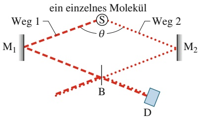

text_image

ein einzelnes Molekül
Weg 1
S
θ
Weg 2
M₁
B
M₂
D

Abb. 34.7

Das Licht einer einzelnen Photonenemission aus der Quelle S breitet sich über zwei weit voneinander entfernte Wege aus und interferiert schließlich am Detektor D, nachdem es von einem Strahlteiler B wieder zusammengeführt wurde. (Aus Lai, M. und Diels J.-C. (1992). Journal of the Optical Society of America B, 9: 2290–2294.)

Der Detektor misst eine zeitlich zufällige Folge von elektronischen Impulsen, einen für jedes nachgewiesene Photon. Die Position des Strahlteilers wird nun langsam nach rechts bzw. links verschoben (bei dem zitierten Experiment betrug der maximale Abstand zwischen den Positionen der Strahlteiler nur ungefähr 50 μm), und die Signale des Detektors werden aufgezeichnet. Durch die Verschiebung des Strahlteilers verändern sich die Weglängen 1 und 2, was zu einem Gangunterschied zwischen den am Detektor ankommenden Lichtwellen führt. Das Detektorsignal zeigt dabei deutliche Interferenzmaxima und -minima.

Dieses Experiment lässt sich mit der traditionellen Begriffsbildung nur schwer verstehen. Wenn beispielsweise ein Molekül in der Quelle ein einzelnes Photon emittiert, wie gelangt dieses Photon in Abb. 34.7 zu dem Detektor – über Weg 1 oder Weg 2 (oder entlang irgendeines anderen Wegs)? Wie kann es sich gleichzeitig entlang beider Wege ausbreiten? Die Antwort im Rahmen der Quantenmechanik lautet: Wir nehmen an, dass sich bei der Emission eines Photons von einem Molekül aus eine Wahrscheinlichkeitswelle in alle Richtungen ausbreitet. Bei dem Experiment werden zwei dieser Richtungen, fast gegenüberliegend, ausgewählt. Die Wahrscheinlichkeitswelle breitet sich also entlang beider Wege aus.

Mit den folgenden Annahmen können wir also alle drei Versionen des Doppelspaltexperiments interpretieren: (1) Licht wird von einer Quelle in Form von Photonen erzeugt, (2) Licht wird an einem Detektor in Form von Photonen absorbiert und (3) zwischen Quelle und Detektor breitet sich Licht als Wahrscheinlichkeitswelle aus.

## 34.4 Die Geburtsstunde der Quantenphysik

## Lernziele

Nach dem Durcharbeiten dieses Abschnitts sollten Sie in der Lage sein, . . .

• die Definition eines idealen schwarzen Körpers sowie sein Emissionsspektrum zu beschreiben,
• zu verstehen, warum die Strahlung des schwarzen Körpers vor Plancks Arbeit ein Problem für die Physik darstellte, und zu erklären, wie Planck und Einstein dieses Problem lösten,
• das Plancksche Strahlungsgesetz für eine gegebene Wellenlänge und Temperatur anzuwenden.

## Schlüsselideen

• In Abschn. 14.6 hatten wir einen idealen schwarzen Körper bzw. schwarzen Strahler als einen Körper mit maximalem Abstrahlvermögen definiert, dessen Wärmestrahlung nur von seiner Temperatur abhängt.
• Das Plancksche Strahlungsgesetz geht davon aus, dass atomare Oszillatoren die thermische Strahlung erzeugen, es lautet

$$
u (f) \mathrm{d} f = \frac {8 \pi f ^ {2}}{c ^ {3}} \frac {h f}{\mathrm{e} ^ {h f / (k _ {\mathrm{B}} T)} - 1} \mathrm{d} f,
$$

wobei f die Frequenz der Strahlung ist, h das Plancksche Wirkungsquantum, k die Boltzmann-Konstante und $T$ die absolute (also in Kelvin angegebene) Temperatur der strahlenden Fläche.

• Das Plancksche Strahlungsgesetz war der erste Hinweis darauf, dass die von atomaren Oszillatoren abgegebenen Energien quantisiert sein müssen.

## 34.4.1 Die Geburtsstunde der Quantenphysik

Bereits fünf Jahre vor Einsteins Erklärung des photoelektrischen Effekts durch die Quantisierung des Lichtfelds in Photonen postulierte Max Planck bei der Berechnung des Spektrums der Strahlung schwarzer Körper eine quantisierte Strahlungsenergie. Plancks Arbeit entstand vor dem Hintergrund, dass die zu diesem Zeitpunkt existierenden Theorien nicht in der Lage waren, das experimentell gemessene Emissionsspektrum eines schwarzen Körpers im gesamten Wellenlängenbereich korrekt zu berechnen. Die bereits in Abschn. 14.6 diskutierte Wärmestrahlung des schwarzen Körpers zeigt ein Spektrum, das bei kleinen und großen Wellenlängen jeweils gegen Null geht und dazwischen ein Maximum zeigt, das mit steigenden Temperaturen immer ausgeprägter wird und zu kleineren Wellenlängen verschoben wird, siehe Abb. 34.8.

Theoretische Analysen auf der Basis der klassischen Physik können die experi mentell gemessenen Spektren nicht vollständig erklären. Unter der Annahme, dass die Schwarzkörperstrahlung durch thermisch oszillierende elektrische Ladungen der den Körper aufbauenden Moleküle zustande kommt, leiteten die englischen Physiker Lord John William S. Rayleigh und James Jeans das nach ihnen benannte **Rayleigh-Jeans-Gesetz** her:

$$
u (f) \mathrm{d} f = \frac {8 \pi f ^ {2}}{c ^ {3}} k _ {\mathrm{B}} T \mathrm{d} f. \tag {34.12}
$$

Hier ist $u ( f )$ u( f ) die Energiedichte der Strahlung im Frequenzintervall d $f .$ Wie wir in Abb. 34.9 sehen, kann das Rayleigh-Jeans-Gesetz das korrekte Spektrum nur im Bereich großer Wellenlängen $\dot { \lambda } = c / f$ reproduzieren.

Auch das von dem Physiker Wilhelm Wien (1864–1928) empirisch gefundene **Wiensche Strahlungsgesetz**

$$
u (f) \mathrm{d} f = \frac {8 \pi f ^ {2}}{c ^ {3}} h f \mathrm{e} ^ {- h f / (k _ {\mathrm{B}} T)} \mathrm{d} f \tag {34.13}
$$

weicht deutlich vom Experiment ab. Wie Abb. 34.9 zeigt, stimmt es für kleine Wellenlängen gut mit dem Experiment überein, bei großen Wellenlängen liefert es jedoch systematisch zu niedrige Werte.

Diese Problematik konnte Planck durch sein berühmtes Strahlungsgesetz

$$
u (f) \mathrm{d} f = \frac {8 \pi f ^ {2}}{c ^ {3}} \frac {h f}{\mathrm{e} ^ {h f / (k _ {\mathrm{B}} T)} - 1} \mathrm{d} f \quad \text {(Plancksches Strahlungsgesetz)} \tag {34.14}
$$

zufriedenstellend lösen. Wie sich mit etwas Mathematik zeigen lässt, erhält man das **Plancksche Strahlungsgesetz**, indem man die mittlere thermische Energie $k _ { \mathrm { B } } T$ in Gl. 34.12 durch die mittlere Energie

$$
\overline {{E}} = \frac {h f}{\mathrm{e} ^ {h f / (k _ {\mathrm{B}} T)} - 1} \tag {34.15}
$$

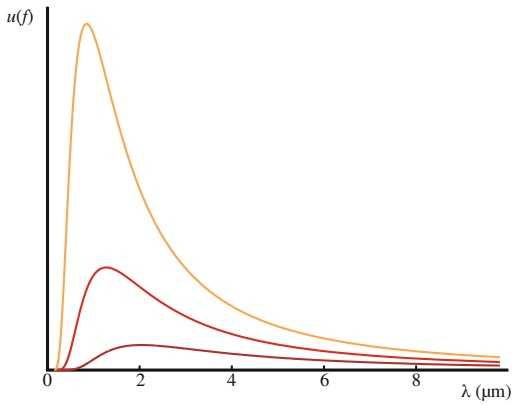

line

| \(\lambda (\mu m)\) | Orange Line (u(f)) | Red Line (u(f)) | Dark Red Line (u(f)) |
| --- | --- | --- | --- |
| 0 | 0 | 0 | 0 |
| ~1.2 | Peak | Peak | — |
| 2 | ~0.4 | ~0.3 | ~0.1 |
| 4 | ~0.15 | ~0.1 | ~0.05 |
| 6 | ~0.08 | ~0.05 | ~0.03 |
| 8 | ~0.05 | ~0.03 | ~0.02 |
| 10 | ~0.03 | ~0.02 | ~0.01 |

## Abb. 34.8

Spektrum der Schwarzkörperstrahlung für T = 2500 K (untere Kurve), T = 4000 K (mittlere Kurve) und T = 6000 K (obere Kurve).

## Abb. 34.9

Spektrum der Schwarzkörperstrahlung für T = 4000 K (rot) gemäß dem Planckschen Strahlungsgesetz. Die lang gestrichelte Kurve zeigt die Vorhersage des Rayleigh-Jeans-Gesetzes und die gepunktete Kurve illustriert den Verlauf der Kurve nach dem Wienschen Strahlungsgesetz.

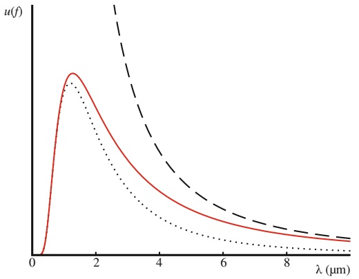

line

| \(\lambda (\mu m)\) | Solid Line (u(f)) | Dotted Line (u(f)) | Dashed Line (u(f)) |
| --- | --- | --- | --- |
| 0 | 0 | 0 | — |
| ~1.2 | Peak | Peak | — |
| 2 | ~0.6 | ~0.4 | ~0.9 |
| 4 | ~0.25 | ~0.15 | ~0.35 |
| 6 | ~0.15 | ~0.08 | ~0.18 |
| 8 | ~0.1 | ~0.05 | ~0.12 |

eines Ensembles harmonischer Oszillatoren mit der quantisierten Energie

$$
E _ {n} = n h f, \quad n = 0, 1, 2, \dots \tag {34.16}
$$

ersetzt. Diese **Energiequantisierung** wurde von Planck ad hoc eingeführt. Sie erwies sich später im Rahmen einer quantenmechanischen Analyse als die korrekte Energierelation für einen harmonischen Quantenoszillator.

Das Plancksche Strahlungsgesetz erklärt nicht nur die experimentellen Messungen mit großer Genauigkeit, sondern es enthält auch die anderen Strahlungsformeln als Grenzfälle. Für $\begin{array} { r } { h f \gg k _ { \mathrm { B } } T , } \end{array}$ , d. h. für große Energien, ist $\mathrm { e } ^ { h f / ( k _ { \mathrm { B } } T ) } \gg \stackrel { \circ } { 1 }$ und man kann den Summanden −1 im Nenner von Gl. 34.14 vernachlässigen; man gelangt so zu Gl. 34.13. In dem entgegengesetzten Grenzfall, $\begin{array} { r } { h f \ll k _ { \mathrm { B } } T , } \end{array}$ kann man die Exponentialfunktion in eine Taylorreihe entwickeln:

$$
\mathrm{e} ^ {\hbar f / (k _ {\mathrm{B}} T)} \approx 1 + \frac {h f}{k _ {\mathrm{B}} T}. \tag {34.17}
$$

Damit reduziert sich Gl. 34.14 auf das Rayleigh-Jeans-Gesetz (Gl. 34.12).

## 34.5 Elektronen und Materiewellen

## Lernziele

Nach dem Durcharbeiten dieses Abschnitts sollten Sie in der Lage sein, . . .

• zu verstehen, dass Elektronen (ebenso wie Protonen und alle anderen Elementarteilchen) Materiewellen sind,
• sowohl für relativistische als auch für nichtrelativistische Teilchen die Beziehungen zwischen De-Broglie-Wellenlänge, Impuls, Geschwindigkeit und kinetischer Energie anzuwenden,
• ein Doppelspalt-Interferenzmuster zu beschreiben, das mit Materiewellen wie z. B. Elektronen erzeugt wurde,
• die Gleichungen für optische Interferenz am Doppelspalt (Abschn. 31.2) und optische Beugung (Abschn. 32.1) auf Materiewellen zu übertragen.

## Schlüsselideen

• Ein sich bewegendes Teilchen wie etwa ein Elektron kann als eine sich ausbreitende Materiewelle beschrieben werden.
• Die Wellenlänge der Materiewelle eines Teilchens ist die De-Broglie-Wellenlänge $\lambda = h / p ,$ wobei p der Impuls des Teilchens ist.
• Teilchenbild: Die Wechselwirkung eines Elektrons mit Materie erfolgt teilchenartig; sie geschieht an einem spezifischen Punkt im Raum und es werden Energie und Impuls übertragen.
• Wellenbild: Wir interpretieren die Bewegung eines Elektrons im Raum als die Ausbreitung einer Wahrscheinlichkeitswelle.