## 34.5.1 Elektronen und Materiewellen

Im Jahr 1924 kam der junge französische Physiker Louis de Broglie aus Symmetrieüberlegungen auf eine interessante Idee: Ein Lichtstrahl ist eine Welle, die jedoch nur an lokalisierten Punkten (durch Photonen) Energie und Impuls an Materie überträgt. Weshalb kann ein Teilchenstrahl nicht dieselben Eigenschaften haben? Weshalb kann beispielsweise ein Elektron – oder auch jedes andere Teilchen – nicht ebenfalls eine **Materiewelle** sein, die jedoch nur an lokalisierten Punkten Energie und Impuls mit anderer Materie austauscht?

Aus dieser Überlegung heraus schlug de Broglie vor, dass Gl. 34.7 $( p = h / \lambda )$ nicht nur für Photonen, sondern auch für Elektronen gelten solle. In Abschn. 34.3 hatten wir mithilfe dieser Gleichung jedem Photon einer Lichtwelle der Wellenlänge λ den Impuls $p$ zugeschrieben. Nun verwenden wir dieselbe Gleichung in der Form

$$
\lambda = \frac {h}{p} \quad (\text {De - Broglie - Wellenlänge}), \tag {34.18}
$$

um einem Teilchen mit dem Impuls $p$ eine Wellenlänge λ zuzuschreiben. Die nach dieser Gleichung berechnete Wellenlänge bezeichnet man als die **De-Broglie-Wellenlänge** eines Teilchens mit dem Impuls $p .$ De Broglies Vorhersage der Existenz von Materiewellen wurde 1927 von Clinton J. Davisson und Lester H. Germer von den Bell Telephone Laboratories sowie von George P. Thomson von der University of Aberdeen, Schottland, experimentell bestätigt.

Abbildung 34.10 zeigt einen fotografischen „Beweis“ der Existenz von Materiewellen aus einem etwas jüngeren Experiment. Bei diesem Experiment entstand das

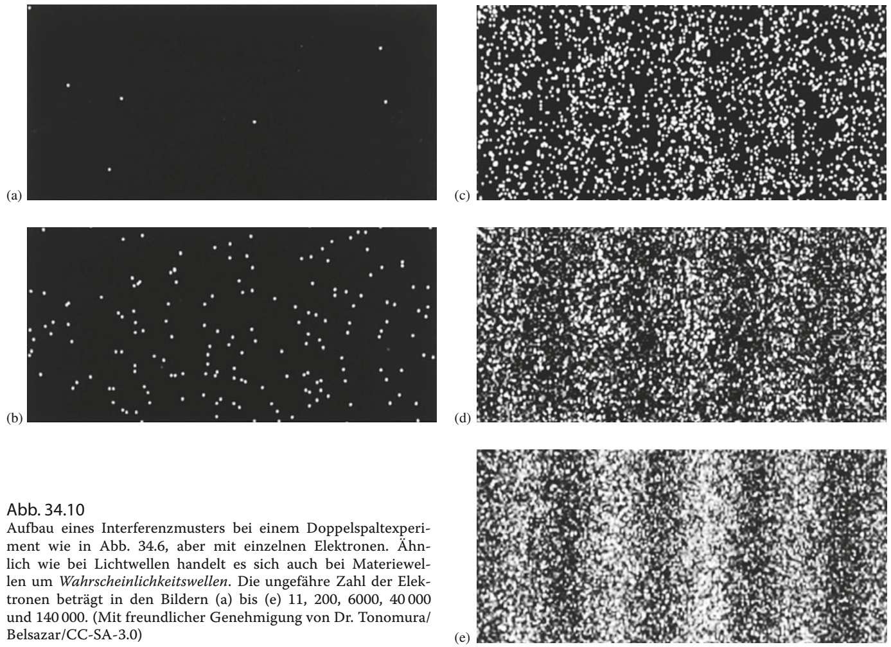

Interferenzmuster, nachdem die Elektronen einzeln durch eine Doppelspaltapparatur getreten waren. Der experimentelle Aufbau war vergleichbar mit den bisher betrachteten Apparaturen zum Nachweis der optischen Interferenz, außer dass der Nachweisschirm eher einem gewöhnlichen Fernsehbildschirm entsprach. Wenn ein Elektron auf diesen Schirm traf, erzeugte es einen kurzen Lichtblitz, dessen Position aufgezeichnet wurde.

Die ersten Elektronen (die oberen beiden Bilder) zeigen keine interessante Struktur und scheinen an zufälligen Stellen auf den Schirm zu treffen. Nachdem jedoch mehrere Tausend Elektronen durch die Apparatur getreten sind, wird auf dem Schirm ein Muster erkennbar. Es werden Streifen sichtbar, wo viele Elektronen auf den Schirm getroffen sind, und Streifen, wo nur wenige den Schirm erreicht haben. Das Muster entspricht vollkommen dem, was wir bei der Interferenz einer Welle erwarten würden. Wir können daher schließen, dassjedes einzelne Elektron als Materiewelle durch die Apparatur getreten ist und anschließend der Teil der Welle, der durch den einen Spalt getreten ist, mit dem Teil, der durch den anderen Spalt getreten ist, interferiert hat. Diese Interferenz bestimmte dann die Wahrscheinlichkeit, mit der sich ein Elektron an einem bestimmten Punkt an dem Schirm materialisierte und dort auf den Schirm traf. Viele Elektronen materialisierten in den Bereichen der hellen Streifen und nur wenige Elektronen in den Bereichen der dunklen Streifen; so entstand insgesamt das charakteristische Muster einer optischen Interferenz.

Ähnliche Interferenzerscheinungen wurden bei Protonen, Neutronen und verschiedenen Atomen nachgewiesen. Im Jahr 1994 wurde ein entsprechendes Experiment mit Iodmolekülen $\mathrm { I } _ { 2 }$ durchgeführt, die nicht nur 500 000-mal schwerer sind als Elektronen, sondern auch wesentlich komplexer. Im Jahr 1999 konnte der Effekt sogar mit den noch komplexeren Fullerenen (oder Buckyballs) $C _ { 6 0 }$ und $C _ { 7 0 }$ nachgewiesen werden. (Fullerene sind fußballartige Moleküle aus Kohlenstoffatomen; 60 Kohlenstoffatome in $C _ { 6 0 }$ und 70 in $\mathbb { C } _ { 7 0 ^ { \circ } } )$ Offensichtlich breiten sich kleine Objekte wie Elektronen, Protonen, Atome und Moleküle in Form von Materiewellen aus. Doch wenn wir immer größere und komplexere Gegenstände betrachten, muss es einen Punkt geben, an dem wir einen Gegenstand nicht länger als Welle ansehen dürfen. An diesem Punkt kommen wir wieder in die uns vertraute Nicht-Quantenwelt mit ihrer Physik, wie wir sie in den früheren Kapiteln dieses Buchs behandelt haben. Kurz: Ein Elektron ist eine Materiewelle, die mit sich selbst interferieren kann, aber eine Katze ist keine Materiewelle und kann auch nicht mit sich selbst interferieren.

Die Wellennatur von Teilchen und Atomen wird mittlerweile in den meisten wissenschaftlichen und technischen Bereichen als selbstverständlich angenommen. So wird beispielsweise die Beugung von Elektronen und Neutronen bei der Untersuchung des atomaren Aufbaus von Festkörpern und Flüssigkeiten eingesetzt, und mithilfe von Elektronenbeugung kann man mittlerweile atomare Strukturen in den Oberflächen von Festkörpern erkennen.

Abbildung 34.11a zeigt eine Anordnung, mit deren Hilfe sich die Streuung von Röntgen- und Elektronenstrahlen an Kristallen nachweisen lässt. Dabei trifft ein Photonen- bzw. Elektronenstrahl auf eine Probe aus pulverisierten kleinen Aluminiumkristallen. Die Röntgenstrahlen haben eine bestimmte Wellenlänge λ und die Elektronen haben eine kinetische Energie, die zu einer De-Broglie-Wellenlänge von λ führt. Die Streuung der Röntgen- oder Elektronenstrahlen an den Kristallen erzeugt auf einer fotografischen Platte ein kreisförmiges Beugungs- bzw. Interferenzmuster. Abbildung 34.11b zeigt dieses Muster für die Streuung von Röntgenstrahlen und Abb. 34.11c zeigt das entsprechende Muster für Elektronenstrahlen. Beide Muster sind grundsätzlich gleich – sowohl Röntgenstrahlen als auch Elektronen sind Wellen.

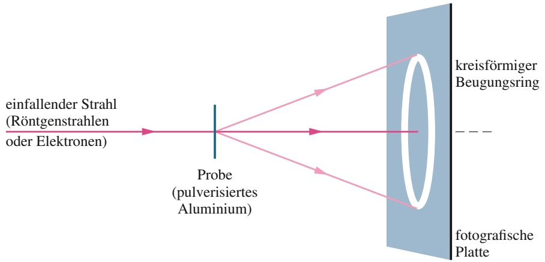

flowchart

(a)

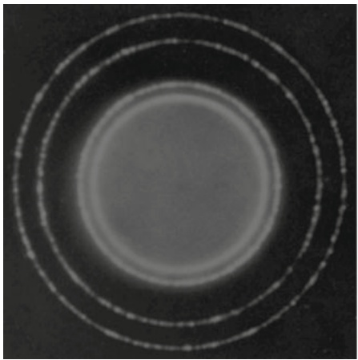

natural_image

Circular gradient pattern with concentric rings and a central bright center (no text or symbols)

(b)

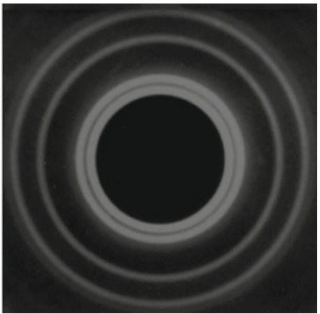

natural_image

Concentric circular pattern with a central dark circle, resembling a diffraction or interference effect (no text or symbols)

(c)

## Abb. 34.11

(a) Eine experimentelle Anordnung zum Nachweis des Wellencharakters eines einfallenden Strahls mithilfe von Beugungserscheinungen. Die Beugungsmuster eines einfallenden (b) Röntgenstrahls (Lichtwelle) und (c) Elektronenstrahls (Materiewelle). Die Geometrie beider Beugungsmuster ist grundsätzlich gleich [Quelle für Teil (b) und (c): chemgapedia/Wiley].

## Wellen und Teilchen

Die Wellennatur der Materie wird durch die Abb. 34.10 und 34.11 überzeugend nahegelegt, doch es gibt mindestens ebenso viele Experimente, die den Teilchencharakter der Materie aufzeigen. Stellen Sie sich eine sogenannte Blasenkammeraufnahme vor, mit der man früher Elementarteilchen sichtbar gemacht hat. Man sah dort geradlinige oder gekrümmte (wenn die Teilchen geladen waren und sich in einem Magnetfeld befanden) Spuren. Diese Spuren – Ketten von winzigen Bläschen in flüssigem Wasserstoff – zeigen an, dass an diesen Stellen ein Teilchen vorbeigeflogen ist. Wo aber befindet sich die Welle?

Um die Situation nicht komplizierter zu machen als nötig, lassen wir das Magnetfeld abgeschaltet, sodass die Blasenkette eine gerade Linie bildet. Wir können uns jede Blase als einen Nachweispunkt für das fliegende Elektron vorstellen. Wenn sich eine Materiewelle zwischen den Nachweispunkten I und F in Abb. 34.12 ausbreitet, so überstreicht sie alle möglichen Wege zwischen ihnen, von denen einige angedeutet sind.

Im Allgemeinen gibt es zu jedem Weg (abgesehen von der geraden Verbindungslinie) zwischen I und F einen benachbarten Weg mit der Eigenschaft, dass sich die Materiewellen entlang dieser beiden Wege durch Interferenz gegenseitig aufheben. Das gilt jedoch nicht für die gerade Verbindungslinie zwischen I und F. In diesem Fall verstärken die Materiewellen entlang der benachbarten Wege die Welle entlang des direkten Wegs. Sie können sich die Blasen entlang der Teilchenspur als eine Folge von Nachweispunkten vorstellen, an denen die Materiewelle konstruktiv interferiert.

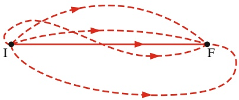

flowchart

## Abb. 34.12

Einige der vielen Verbindungswege zwischen zwei Teilchennachweispunkten I und F. Nur Materiewellen, die Wegen in unmittelbarer Nachbarschaft der geraden Verbindungslinie zwischen diesen Punkten folgen, interferieren konstruktiv. Für alle anderen möglichen Wege interferieren die Wellen zu benachbarten Wegen destruktiv. In diesem Sinne hinterlässt eine Materiewelle eine gerade Spur.

## KONTROLLFRAGE 4

Ein Elektron und ein Proton haben (a) dieselbe kinetische Energie, (b) denselben Impuls und (c) dieselbe Geschwindigkeit. Welches Teilchen hat jeweils die kürzere De-Broglie-Wellenlänge?

## 34.6 Die Schrödinger-Gleichung

## Lernziele

Nach dem Durcharbeiten dieses Abschnitts sollten Sie in der Lage sein, . . .

• zu verstehen, dass Materiewellen Lösungen der Schrödinger-Gleichung sind,
• die Schrödinger-Gleichung für ein nichtrelativistisches Teilchen, das sich entlang der x-Achse bewegt, aufzustellen und die allgemeine Lösung für den räumlichen Anteil der Wellenfunktion aufzuschreiben,
• für ein nichtrelativistisches Teilchen die Beziehungen zwischen Wellenzahl, Energie, potenzieller Energie, kinetischer Energie, Impuls und De-Broglie-Wellenlänge anzuwenden,
• zu einer gegebenen räumlichen Lösung der Schrödinger-Gleichung die volle zeitabhängige Lösung zu bestimmen,
• zu einer gegebenen komplexen Zahl deren komplex Konjugierte anzugeben,
• zu einer gegebenen Wellenfunktion die Wahrscheinlichkeitsdichte an einem gegebenen Ort zu einer gegebenen Zeit zu berechnen.

## Schlüsselideen

• Eine Materiewelle (etwa eines Elektrons) wird durch eine Wellenfunktion $\Psi ( x , y , z , t )$ beschrieben, die sich in einen ortsabhängigen Anteil $\psi ( x , y , z )$ und einen zeitabhängigen Anteil $\mathrm { e } ^ { - \mathrm { i } \omega t }$ zerlegen lässt, wobei ω die (Kreis-)Frequenz der Welle ist.
Für ein nichtrelativistisches Teilchen der Masse m, das sich mit der Energie E und der potenziellen Energie U entlang der x-Achse bewegt, lässt sich der ortsabhängige Anteil der Wellenfunktion durch Lösen der Schrödinger-Gleichung

$$
\frac {\mathrm{d} ^ {2} \psi}{\mathrm{d} x ^ {2}} + k ^ {2} \psi = 0
$$

bestimmen, wobei k die Wellenzahl ist.

• Ein Teilchen hat keinen spezifischen Aufenthaltsort, solange dieser nicht explizit gemessen wurde.
• Die Wahrscheinlichkeit, ein Teilchen in einem kleinen Volumen um einen gegebenen Punkt anzutreffen, ist proportional zur Wahrscheinlichkeitsdichte $| \dot { \psi } | ^ { 2 }$ der zugehörigen Materiewelle an diesem Punkt.

## 34.6.1 Die Schrödinger-Gleichung

Alle bisher behandelten Wellen, sei es eine Welle auf einem Seil, eine Schallwelle oder eine Lichtwelle, werden durch irgendeine Größe beschrieben, deren Wert sich räumlich und zeitlich wellenartig verändert. Bei Lichtwellen ist diese Größe die elektrische Feldstärke der Welle, $\vec { E } ( x , y , z , t )$ . Ihr gemessener Wert hängt von dem Raum- und Zeitpunkt ab, an dem die Messung erfolgt.

Doch durch welche Größe sollen wir eine Materiewelle beschreiben? Von die ser Größe, die wir als **Wellenfunktion** $\Psi ( x , y , z , t )$ bezeichnen, steht zu erwarten, dass sie komplizierter ist als die entsprechende Größe für eine Lichtwelle; denn eine Materiewelle transportiert nicht nur Energie und Impuls wie eine Lichtwelle, sondern auch Masse und (oft) Ladung. Es zeigt sich, dass $\Psi$ (der griechische Groß- buchstabe Psi) meist eine Funktion ist, die im mathematischen Sinne komplex ist. Mehr über komplexe Zahlen erfahren Sie in Ihrem Mathematik-Lehrbuch.

In allen Fällen, die wir in diesem Buch behandeln werden, lassen sich die Raumund Zeitvariablen separieren, d. $\mathrm { h } _ { \star } ,$ die Wellenfunktion $\Psi$ kann in der Form

$$
\Psi (x, y, z, t) = \psi (x, y, z) \mathrm{e} ^ {- \mathrm{i} \omega t} \tag {34.19}
$$

geschrieben werden, wobei $\omega = 2 \pi f$ die Kreisfrequenz der Materiewelle ist (wenn keine Verwechslungsgefahr besteht, wird $\omega$ oft einfach als Frequenz bezeichnet). Die Funktion $\psi$ (der griechische Kleinbuchstabe psi) stellt nur den ortsabhängigen Teil der vollständigen, zeitabhängigen Wellenfunktion $\Psi$ dar. Wir werden es im Folgenden fast ausschließlich mit $\psi$ zu tun haben. Es stellen sich an dieser Stelle sofort zwei Fragen: Was hat man unter der Wellenfunktion zu verstehen und wie können wir sie berechnen?

Was hat man unter der Wellenfunktion zu verstehen? Die Antwort hängt damit zusammen, dass es sich bei der Materiewelle, wie bei einer Lichtwelle, um eine Wahrscheinlichkeitswelle handelt. Angenommen, eine Materiewelle erreicht einen kleinen Teilchendetektor; dann ist die Wahrscheinlichkeit, mit der ein Teilchen in einem bestimmten Zeitintervall von diesem Detektor nachgewiesen wird, proportional zu dem Betragsquadrat

$$
| \psi | ^ {2} = \psi \psi^ {*}
$$

der Wellenfunktion am Ort des Detektors. In der Mathematik der komplexen $\mathrm { Z a h } \cdot$ len bezeichnet $\psi ^ { * }$ die zu $\psi$ konjugiert komplexe Funktion, die wir erhalten, indem wir überall in $\psi$ die imaginäre Einheit i durch −i ersetzen.

Physikalisch wird $| \psi | ^ { 2 }$ als **Wahrscheinlichkeitsdichte** (d. h. als Wahrscheinlich | |keit pro Volumeneinheit) interpretiert. Mathematisch nicht ganz rigoros ausgedrückt können wir sagen:

Die Wahrscheinlichkeit (pro Zeiteinheit), ein Teilchen in einem kleinen Volumen um einen gegebenen Punkt in einer Materiewelle nachzuweisen, ist proportional zu dem Wert von $| \psi | ^ { 2 }$ an diesem Punkt.

Wie kann man die Wellenfunktion bestimmen? Schallwellen und Wellen auf einem Seil werden durch die Gleichungen der Newtonschen Mechanik beschrieben, Lichtwellen durch die Maxwellschen Gleichungen. Ganz analog werden Materiewellen durch die **Schrödinger-Gleichung** beschrieben, die 1926 von dem österreichischen Physiker Erwin Schrödinger aufgestellt wurde.

Die sogenannte zeitabhängige Schrödinger-Gleichung ist eine Differenzialgleichung für die Wellenfunktion $\Psi ( x , y , z , t )$ . Durch die Separation von Raum- und Zeitvariablen (Gl. 34.19) erhalten wir die stationäre Schrödinger-Gleichung für die Wellenfunktion $\psi ( x , y , z )$ . Wenn wir im Folgenden von der Schrödinger-Gleichung sprechen, ist implizit immer die stationäre Schrödinger-Gleichung gemeint.

In vielen physikalischen Situationen, die wir untersuchen werden, handelt es sich um ein Teilchen, das sich entlang der x-Richtung ausbreitet. Dabei wirken Kräfte auf das Teilchen, die wir dadurch beschreiben können, dass wir dem Teilchen eine potenzielle Energie $U ( x )$ zuschreiben. In diesem speziellen Fall hat die (stationäre) Schrödinger-Gleichung die Form

$$
\frac {\mathrm{d} ^ {2} \psi}{\mathrm{d} x ^ {2}} + \frac {8 \pi^ {2} m}{h ^ {2}} [ E - U (x) ] \psi = 0 \quad \text {(eindimensionale stationäre Schrödinger - Gleichung).} \tag {34.20}
$$

Hierbei ist $E$ die gesamte mechanische Energie (potenzielle plus kinetische Ener-$\mathrm { g i e ) }$ des Teilchens. (Bei dieser nichtrelativistischen Gleichung berücksichtigen wir keine Massenenergie.) Wir können die Schrödinger-Gleichung nicht aus fundamentaleren Prinzipien herleiten; sie ist das fundamentale Prinzip.

Wenn $U ( x )$ in Gl. 34.20 verschwindet, beschreibt diese Gleichung ein freies Teil**chen**, also ein Teilchen, auf das keine resultierenden Kräfte wirken. Die Gesamtenergie des Teilchens besteht in diesem Fall nur aus kinetischer Energie und daher ist $E$ in Gl. 34.19 gleich $( 1 / 2 ) m \nu ^ { 2 }$ . In diesem Fall vereinfacht sich die Schrödinger-Gleichung zu

$$
\frac {\mathrm{d} ^ {2} \psi}{\mathrm{d} x ^ {2}} + \frac {8 \pi^ {2} m}{h ^ {2}} \left(\frac {m v ^ {2}}{2}\right) \psi = 0,
$$

was wir auch als

$$
\frac {\mathrm{d} ^ {2} \psi}{\mathrm{d} x ^ {2}} + \left(2 \pi \frac {p}{h}\right) ^ {2} \psi = 0
$$

schreiben können; dabei haben wir lediglich mv durch den Impuls $p$ ersetzt und die einzelnen Terme umgeschrieben.

Nach Gl. 34.18 entspricht $p / h$ in dieser Gleichung $1 / \lambda$ , wobei λ die De-Broglie-Wellenlänge des Teilchens ist. Weiterhin ist $2 \pi / \lambda$ die Wellenzahl $k ,$ die wir in Gl. 12.5 definiert hatten. Mit diesen Ersetzungen wird aus der obigen Gleichung

$$
\frac {\mathrm{d} ^ {2} \psi}{\mathrm{d} x ^ {2}} + k ^ {2} \psi = 0 \quad \text {(Schrödinger - Gleichung, freies Teilchen)}.\tag {34.21}
$$

Die allgemeinste Lösung dieser Gleichung hat die Form

$$
\psi (x) = A \mathrm{e} ^ {\mathrm{i} k x} + B \mathrm{e} ^ {- \mathrm{i} k x} \tag {34.22}
$$

mit zwei beliebigen Konstanten A und B. Dass es sich hierbei tatsächlich um eine Lösung von Gl. 34.21 handelt, sieht man sofort, wenn man die Wellenfunktion $\psi$ und ihre zweite Ableitung in die obige Gleichung einsetzt.

Die zeitabhängige Wellenfunktion $\Psi$ für ein freies Teilchen in einer Dimension erhalten wir, indem wir Gl. 34.22 in Gl. 34.19 einsetzen:

$$
\begin{array}{l} \Psi (x, t) = \psi (x) \mathrm{e} ^ {- \mathrm{i} \omega t} = (A \mathrm{e} ^ {\mathrm{i} k x} + B \mathrm{e} ^ {- \mathrm{i} k x}) \mathrm{e} ^ {- \mathrm{i} \omega t} \\ = A \mathrm{e} ^ {\mathrm{i} (k x - \omega t)} + B \mathrm{e} ^ {- \mathrm{i} (k x + \omega t)}. \tag {34.23} \\ \end{array}
$$

## Die Wahrscheinlichkeitsdichte $| \psi | ^ { 2 }$

In Abschn. 12.1 hatten wir gesehen, dass jede Funktion der Form $F ( k x \pm \omega t )$ eine sich ausbreitende Welle beschreibt. Das gilt für Exponentialfunktionen wie in Gl. 34.23 ebenso wie für die sinusförmigen Funktionen, mit denen wir die Wellen auf einem Seil beschrieben hatten. Tatsächlich hängen diese beiden Darstellungen von Funktionen in der Welt der komplexen Zahlen eng zusammen; es gelten

$$
\mathrm{e} ^ {\mathrm{i} \theta} = \cos \theta + \mathrm{i} \sin \theta \quad \text {und} \quad \mathrm{e} ^ {- \mathrm{i} \theta} = \cos \theta - \mathrm{i} \sin \theta ,
$$

wobei θ ein beliebiger Winkel ist.

Der erste Term auf der rechten Seite von Gl. 34.23 beschreibt daher eine Welle, die sich in die positive x-Richtung ausbreitet, und der zweite Term eine Welle, die sich in die negative x-Richtung ausbreitet. Wollen wir ein Teilchen beschreiben, das sich in die positive x-Richtung bewegt, können wir in der allgemeinen Lösung (Gl. 34.23 bzw. Gl. 34.22) die freie Konstante $B$ gleich null setzen. Gleichzeitig bezeichnen wir die Konstante A mit $\psi _ { 0 } .$ Damit wird aus Gl. 34.22

$$
\psi (x) = \psi_ {0} \mathrm{e} ^ {\mathrm{i} k x}. \tag {34.24}
$$

Die Wahrscheinlichkeitsdichte erhalten wir aus dem Quadrat des Absolutbetrags von ψ(x):

$$
| \psi | ^ {2} = | \psi_ {0} \mathrm{e} ^ {\mathrm{i} k x} | ^ {2} = (\psi_ {0}) ^ {2} | \mathrm{e} ^ {\mathrm{i} k x} | ^ {2}.
$$

Mit

$$
| \mathrm{e} ^ {\mathrm{i} k x} | ^ {2} = (\mathrm{e} ^ {\mathrm{i} k x}) (\mathrm{e} ^ {\mathrm{i} k x}) ^ {*} = \mathrm{e} ^ {\mathrm{i} k x} \mathrm{e} ^ {- \mathrm{i} k x} = \mathrm{e} ^ {\mathrm{i} k x - \mathrm{i} k x} = \mathrm{e} ^ {0} = 1
$$

folgt sofort

$$
| \psi | ^ {2} = \left(\psi_ {0} ^ {2}\right) (1) ^ {2} = \psi_ {0} ^ {2}.
$$

Abbildung 34.13 zeigt die Wahrscheinlichkeitsdichte $| \psi | ^ { 2 }$ eines freien Teilchens | |als Funktion von x: eine gerade Linie parallel zur x-Achse von −∞ bis +∞. Die Wahrscheinlichkeitsdichte $| \psi | ^ { 2 }$ ist für alle x-Werte dieselbe, das Teilchen kann | |also mit derselben Wahrscheinlichkeit an jedem Punkt der x-Achse beobachtet werden. Es gibt keinen Anhaltspunkt, über den wir irgendeinen wahrscheinlichsten Ort für das Teilchen vorhersagen können. Alle Orte sind gleich wahrscheinlich.

Was das bedeutet, werden wir im nächsten Abschnitt sehen.

## 34.7 Die Heisenbergsche Unschärferelation

## Lernziele

Nach dem Durcharbeiten dieses Abschnitts sollten Sie in der Lage sein, . . .

• die Heisenbergsche Unschärferelation beispielsweise auf ein Elektron anzuwenden, das sich entlang der x-Achse bewegt, und ihre Bedeutung zu erklären.

## Schlüsselideen

Die probabilistische Natur der Quantenphysik setzt der Messung von Ort und Impuls eines Teilchens eine fundamentale Grenze. Es ist nicht möglich, die Position und den Impuls eines Teilchens gleichzeitig mit beliebiger Genauigkeit zu bestimmen oder anzugeben. Die Mindestwerte für die Unsicherheit in den Komponenten dieser Größen sind

$$
\Delta x \cdot \Delta p _ {x} \geq \hbar , \quad \Delta y \cdot \Delta p _ {y} \geq \hbar , \quad \Delta z \cdot \Delta p _ {z} \geq \hbar.
$$

## 34.7.1 Die Heisenbergsche Unschärferelation

Die in Abb. 34.13 zum Ausdruck gebrachte Unmöglichkeit, die Position eines freien Teilchens vorherzusagen, ist ein erstes Beispiel für die **Heisenbergsche Unschärferelation**, die von dem deutschen Physiker Werner Heisenberg im Jahr 1927 formuliert wurde. Sie besagt, dass wir einem Teilchen nicht gleichzeitig mit beliebiger Genauigkeit einen $\operatorname { O r t } { \vec { \vec { r } } }$ und einen Impuls $\vec { p }$ zuschreiben können.

Ausgedrückt durch die Komponenten von $\vec { r }$ und $\vec { p }$ liefern die Heisenbergschen Relationen die folgenden Schranken (die Konstante $\hbar = h / 2 \pi$ wird $\mathrm { h - q u e r } ^ { a }$ ausgesprochen):

$$
\Delta x \cdot \Delta p _ {x} \geq \hbar ,
$$

$$
\Delta y \cdot \Delta p _ {y} \geq \hbar , \quad \text {(Heisenbergsche Unschärferelation)} \tag {34.25}
$$

$$
\Delta z \cdot \Delta p _ {z} \geq \hbar .
$$

In diesem Fall bezeichnen beispielsweise $\Delta x$ und $\Delta p _ { x }$ die Unsicherheiten in den Messungen der x-Komponenten von $\vec { r }$ und $\vec { p } .$ Selbst mit den besten Messinstrumenten, die jemals technisch möglich sein werden, werden die Produkte aus den Ortsungenauigkeiten und den Impulsungenauigkeiten in Gl. 34.25 immer größer gleich ℏ sein; sie können prinzipiell niemals kleiner sein.

Bei dem Teilchen, dessen Wahrscheinlichkeitsdichte in Abb. 34.13 aufgetragen ist, handelt es sich um ein freies Teilchen. Es unterliegt keiner Kraft, daher muss sein Impuls $\vec { p }$ konstant sein. Wir sind davon ausgegangen – ohne dass wir es besonders betont hätten –, dass wir $\vec { p }$ mit absoluter Genauigkeit bestimmen können, d. h., wir haben implizit $\Delta p _ { x } = \Delta p _ { y } = \Delta p _ { z } = 0$ angenommen. Nach Gl. 34.25 impliziert diese Annahme $\Delta x \to \infty , \dot { \Delta } y \to$ ∞ und $\Delta z \to \infty$ . Bei diesen unendlich großen Unsicherheiten kann über den Ort des Teilchens keinerlei Aussage getroffen werden – genau das bringt Abb. 34.13 zum Ausdruck.

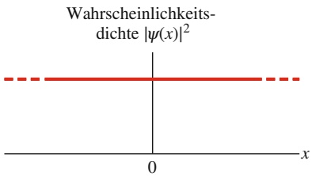

line

| < 0 | N/A |
| --- | --- |
| 0 | N/A |
| > 0 | N/A |

Abb. 34.13

Wahrscheinlichkeitsdichte $| \psi | ^ { 2 }$ eines | |freien Teilchens, das sich in die positive x-Richtung bewegt. Da $| \psi | ^ { 2 } ]$ für | |alle Werte von x denselben konstanten Wert hat, kann das Teilchen mit derselben Wahrscheinlichkeit an jedem Punkt auf der x-Achse nachgewiesen werden.

Man darf in diesem Fall aber nicht denken, dass sich das Teilchen in Wirklichkeit doch an einem wohldefinierten Ort befindet, der uns aus irgendwelchen Gründen aber verborgen bleibt. Vielmehr verliert der Begriff $\mathrm { { } _ { v } O r t }$ des Teilchens“ jegliche Bedeutung, wenn der Impuls eines Teilchens mit absoluter Sicherheit bekannt ist. Das Teilchen in Abb. 34.13 kann mit gleicher Wahrscheinlichkeit überall auf der x-Achse sein.

## 34.8 Reflexion an einer Potenzialschwelle

## Lernziele

Nach dem Durcharbeiten dieses Abschnitts sollten Sie in der Lage sein, . . .

• die allgemeine Wellenfunktion als Lösung der Schrödinger-Gleichung eines Elektrons in einem Gebiet mit konstanter potenzieller Energie (also z. B. auch null) zu formulieren,
• eine Potenzialschwelle für ein Elektron einschließlich ihrer Höhe $U _ { 0 }$ schematisch zu skizzieren,
• die Wahrscheinlichkeitsamplituden (Koeffizienten) der Wellenfunktionen von Elektronen in zwei benachbarten Gebieten zu bestimmen, indem Sie die Werte und Steigungen der Funktionen an der Grenze zwischen den Gebieten anpassen,
• die Reflexions- und Transmissionskoeffizienten für Elektronen zu bestimmen, die auf eine Potenzialschwelle treffen, wenn die einfallenden Elektronen keine potenzielle Energie haben $( U = 0 )$ und ihre mechanische Energie $E$ größer ist als die Schwellenhöhe $U _ { 0 } ,$
• zu verstehen, dass Elektronen wegen ihrer Welleneigenschaften an einer Potenzialschwelle reflektiert werden können, selbst wenn sie mehr als genug Energie besitzen, um die Schwelle zu überwinden,
die Reflexions- und Transmissionskoeffizienten mithilfe der Wahrscheinlichkeiten für die Reflexion bzw. Transmission eines Elektrons oder die mittlere Zahl der tatsächlich reflektierten bzw. durchgelassenen Elektronen zu erklären.

## Schlüsselideen

• Ein Teilchen kann an einer Grenzfläche reflektiert werden, wenn sich dort seine potenzielle Energie ändert, selbst wenn dies klassisch unmöglich wäre (weil es genügend Energie besitzt, um die Schwelle zu überwinden).
• Der Reflexionskoeffizient R gibt die Wahrscheinlichkeit für die Reflexion eines individuellen Teilchens an der Grenzfläche an.
• Für einen Strahl aus einer sehr großen Zahl von Teilchen gibt R auch die relative Häufigkeit der tatsächlich reflektierten Teilchen an.
• Der Transmissionskoeffizient T gibt die Wahrscheinlichkeit für die Transmission durch die Grenzfläche an; es gilt

$$
T = 1 - R.
$$

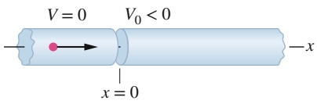

text_image

V = 0
V₀ < 0
x = 0
x

Abb. 34.14

Ein Elektron (roter Punkt) nä- hert sich einem Gebiet mit negativem elektrischem Potenzial $V _ { 0 } .$

## 34.8.1 Reflexion an einer Potenzialschwelle

Im Folgenden erhalten Sie einen kurzen Vorgeschmack auf das, was Sie in einer vertieften quantenphysikalischen Diskussion erwarten würde. Abbildung 34.14 zeigt einen Strahl aus sehr vielen nichtrelativistischen Elektronen, jeweils mit der Gesamtenergie $E ,$ die entlang der x-Achse durch eine enge Röhre geschickt werden. Anfänglich befinden sie sich in Gebiet 1, in dem ihre potenzielle Energie $U = 0$ ist, aber bei $x = 0$ gelangen sie in ein Gebiet mit dem negativen elektrischen Potenzial $V _ { 0 } .$ . Solch einen Übergang nennt man eine Potenzialschwelle oder auch Potenzialbarriere. Die Schwelle hat eine $\mathrm { H } \ddot { \mathrm { o } } \mathrm { h } \mathrm { e } ^ { \alpha } U _ { 0 } ,$ dies ist die potenzielle Energie, die ein Elektron hat, wenn es die Grenzfläche bei $x = 0$ durchschritten hat. Abbildung 34.15 zeigt die potenzielle Energie als Funktion von x (rufen Sie sich wieder ins Gedächtnis, dass $U = q V$ ist – hier ist das Potenzial $V _ { 0 }$ negativ, die Elektronenladung q ebenfalls, also ist die potenzielle Energie $U _ { 0 }$ positiv).

Betrachten wir zunächst die Situation $E > U _ { 0 }$ . Klassisch sollten alle Elektronen die Grenzfläche passieren – sie haben ganz sicher genügend Energie dafür. Wir haben diese Art von Bewegungen ausführlich in den Kapiteln 18–20 diskutiert, als wir Elektronen durch elektrische Potenziale fliegen ließen, wobei sich dabei ihre potenziellen und kinetischen Energien verändert hatten. Wir hatten dort einfach die Energieerhaltung ausgenutzt und beachtet, dass bei zunehmender potenzieller Energie die kinetische Energie um denselben Betrag abnimmt und somit auch die Geschwindigkeit kleiner wird. Es war für uns selbstverständlich, dass die Elektronen die Grenze passieren, wenn sie ausreichend Energie dafür besitzen. Wenn wir jedoch die Schrödinger-Gleichung anwenden, erleben wir eine Überraschung: da Elektronen Materiewellen sind und keine winzigen kleinen Kügelchen, werden doch einige von ihnen an der Grenzfläche reflektiert. Lassen Sie uns ausrechnen, welcher Bruchteil R der einlaufenden Elektronen reflektiert wird.

In Gebiet 1 mit $U = 0$ ist die Wellenzahl (vgl. Gl. 34.36)

$$
k _ {1} = \frac {2 \pi \sqrt {2 m E}}{h} \tag {34.26}
$$

und Gl. 34.22 liefert uns die allgemeine ortsabhängige Lösung der Schrödinger-Gleichung

$$
\psi_ {1} (x) = A \mathrm{e} ^ {\mathrm{i} k _ {1} x} + B \mathrm{e} ^ {- \mathrm{i} k _ {1} x} \quad \text {(Gebiet 1)}. \tag {34.27}
$$

In Gebiet 2 mit der potenziellen Energie $U = U _ { 0 }$ ist die Wellenzahl

$$
k _ {2} = \frac {2 \pi \sqrt {2 m (E - U _ {0})}}{h} \tag {34.28}
$$

und die allgemeine ortsabhängige Lösung der Schrödinger-Gleichung lautet

$$
\psi_ {2} (x) = C \mathrm{e} ^ {\mathrm{i} k _ {2} x} + D \mathrm{e} ^ {- \mathrm{i} k _ {2} x} \quad \text {(Gebiet 2)}. \tag {34.29}
$$

Dabei werden sich die Koeffizienten A, B bzw. $C , D$ im Allgemeinen voneinander unterscheiden (ebenso wie $k _ { 1 }$ und $k _ { 2 } )$ .

Die Terme mit positiven Exponenten entsprechen Teilchen, die sich in x-Richtung bewegen bzw. ausbreiten, Teilchen mit negativen Exponenten bewegen sich in (−x)-Richtung. Da sich allerdings rechts von Abb. 34.14 bzw. 34.15 keine Elektronenquelle befindet, müssen sich alle Elektronen von links nach rechts bewegen; folglich muss $B = D = 0$ sein und die Lösung in Gebiet 2 ist einfach

$$
\psi_ {2} (x) = C \mathrm{e} ^ {\mathrm{i} k _ {2} x} \qquad (\text {Gebiet 2}). \tag {34.30}
$$

Als Nächstes müssen wir sicherstellen, dass sich unsere Lösungen an der Grenzfläche „gut benehmen“. Das heißt, sie müssen bei $x = 0$ sowohl im Funktionswert als auch in der ersten Ableitung (der Steigung) übereinstimmen. Solche Forderungen nennt man **Randbedingungen**. Als erstes setzen wir $x = 0$ in die Gln. 34.27 und 34.30 ein und setzen die Ausdrücke dann gleich. Dies liefert unsere erste Randbedingung:

$$
A + B = C. \tag {34.31}
$$

Wenn Gl. 34.31 erfüllt ist, haben die Funktionen bei $x = 0$ denselben Wert.

Nun leiten wir die Gln. 34.27 und 34.30 nach x ab, setzen wiederum $x = 0$ ein und setzen die erhaltenen Ausdrücke gleich. Wir finden so

$$
A k _ {1} + B k _ {1} = C k _ {2}. \tag {34.32}
$$

Wenn Gl. 34.31 erfüllt ist, stimmen auch die Steigungen bei $x = 0$ überein.

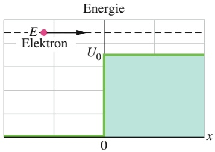

area

| Position (x) | Energy Level |
| --- | --- |
| < 0 | 0 |
| 0 | 0 |
| > 0 | U0 |

Abb. 34.15

Die Energie der Elektronen aus Abb. 34.14 als Funktion der Ortsvariable x. Schwarz gestrichelt ist die Energie E eines Elektrons aufgetragen, die potenzielle Energie (und insbesondere ihren Sprung um $U _ { 0 }$ bei $x = 0 )$ zeigt die grüne Kurve.

Wir möchten die Wahrscheinlichkeit dafür bestimmen, dass ein Elektron an der Schwelle bzw. Barriere reflektiert wird. Erinnern Sie sich daran, dass die Wahrscheinlichkeitsdichte proportional zu $| \psi | ^ { 2 }$ ist. Hier bilden wir jetzt das Verhältnis | |aus der Wahrscheinlichkeitsdichte im reflektierten Strahl (die proportional zu $| B | ^ { 2 }$ ist) und derjenigen des einfallenden Strahls (die proportional zu $\lceil A \rceil ^ { 2 }$ | |ist) und definieren so den **Reflexionskoeffizienten**

$$
R = \frac {| B | ^ {2}}{| A | ^ {2}}. \tag {34.33}
$$

R ist ein Maß für die Wahrscheinlichkeit einer Reflexion und damit auch für den Anteil (d. h. die relative Häufigkeit) der reflektierten Elektronen, wenn eine große Zahl von ihnen einläuft. Der **Transmissionskoeffizient** (die Transmissions- bzw. Durchlasswahrscheinlichkeit) ist dann einfach die komplementäre Wahrscheinlichkeit

$$
T = 1 - R. \tag {34.34}
$$

Nehmen wir beispielsweise an, es sei $R = 0 { , } 0 1 0$ . Das würde bedeuten, dass von 10 000 auf die Schwelle zufliegenden Elektronen im Mittel 100 reflektiert werden. Wir können jedoch niemals sagen, welche 100 Elektronen dies sein werden (oder ob ein einzelnes herausgegriffenes Elektron reflektiert wird oder nicht). Wir haben immer nur die Wahrscheinlichkeit. Ein einzelnes Elektron wird also mit einer Wahrscheinlichkeit von 1,0 % reflektiert und dringt mit einer Wahrscheinlichkeit von 99 % in Gebiet 2 ein. Die Wellennatur des Elektrons erlaubt uns keine klareren Aussagen.

Um R für gegebene Werte von E und $U _ { S }$ zu berechnen, lösen wir erst die Gln. 34.31 und 34.32 nach B als Funktion von A auf (indem wir C eliminieren) und setzten dann das Ergebnis in Gl. 34.33 ein. Schließlich ersetzen wir noch mithilfe der Gln. 34.26 und 34.28 die Werte für $k _ { 1 }$ und $k _ { 2 }$ . Und tatsächlich: R ist nicht einfach null (und T nicht einfach 1), wie es unsere (klassische) Intuition unzutreffenderweise erwartet hätte.

## 34.9 Der Tunneleffekt

## Lernziele

Nach dem Durcharbeiten dieses Abschnitts sollten Sie in der Lage sein, . . .

• eine Potenzialbarriere für ein Elektron zu skizzieren und die Höhe $U _ { 0 }$ der Barriere und deren Breite L einzutragen,
• zu verstehen, welche Energie klassisch erforderlich ist, damit ein Teilchen die Potenzialbarriere passieren kann,
• den Transmissionskoeffizienten für den Tunneleffekt anzugeben,
• den Transmissionskoeffizienten T für den Tunneleffekt aus der Teilchenenergie $E ,$ der Teilchenmasse m und der Höhe $U _ { 0 }$ und Breite L der Barriere zu berechnen,
• einen Transmissionskoeffizienten durch die Wahrscheinlichkeit für das Tunneln eines Teilchens oder die relative Häufigkeit der tatsächlich tunnelnden Teilchen zu erklären,
• in einem Experiment zum Tunneleffekt die Wahrscheinlichkeitsdichte vor, innerhalb und hinter der Potenzialbarriere zu beschreiben,
• zu beschreiben, wie ein Raster-Tunnelmikroskop funktioniert.

## Schlüsselideen

• Eine Potenzialbarriere ist ein Gebiet, in dem ein durchziehendes Teilchen eine um den Wert $U _ { 0 }$ erhöhte potenzielle Energie besitzt.
• Das Teilchen kann passieren, wenn seine Gesamtenergie $E > U _ { 0 }$ ist.

Klassisch betrachtet kann es die Barriere für $E < U _ { 0 }$ nicht überwinden, quantenmechanisch existiert jedoch eine gewisse (meist sehr kleine) Wahrscheinlichkeit dafür, dass dies trotzdem geschieht; man bezeichnet dieses Phänomen als den Tunneleffekt.
• Für ein Teilchen mit Masse m vor einer Barriere mit der Breite L ist der Tunnel-Transmissionskoeffizient

$$
T \approx \mathrm{e} ^ {- 2 k L}
$$

mit

$$
k = \sqrt {\frac {8 \pi^ {2} m (U _ {0} - E)}{h ^ {2}}}.
$$

## 34.9.1 Der Tunneleffekt

Wir ersetzen nun die Potenzialschwelle aus Abb. 34.14 durch eine Potenzialbarriere, bei der nur in einem Gebiet mit endlicher Dicke bzw. Breite L das elektrische Potenzial den Wert $V _ { 0 } ( < 0 )$ besitzt und die Höhe der Barriere $U _ { 0 } ( = q V )$ ist, wie in Abb. 34.16 gezeigt. Rechts von der Barriere befindet sich das Gebiet 3 mit $V = 0 ,$ Wie zuvor schicken wir einen Strahl aus sehr vielen nichtrelativistischen Elektronen, jedes mit der Gesamtenergie $E ,$ auf die Barriere zu. Wenn wieder $E > U _ { 0 }$ ist, wird die Situation insofern komplizierter als in Abschn. 34.8, als es nun zwei Möglichkeiten für die Elektronen gibt, an einer Grenzfläche reflektiert zu werden, nämlich bei $x = 0$ und $x = L$

Anstelle dieser Komplikation wollen wir aber die Situation $E < U _ { 0 }$ betrachten – die Energie der Elektronen soll also klassisch gesehen zu klein sein, um auch nur die erste Schwelle zu überwinden. Dazu müsste nämlich ihre kinetische Energie $K = E - U _ { 0 }$ in Gebiet 2 negativ werden, was offensichtlich unsinnig ist, weil die kinetische Energie immer positiv sein muss (es gibt keine Möglichkeit, den Ausdruck $m \nu ^ { 2 }$ negativ zu machen). Daher ist Gebiet 2 für ein Elektron mit $E < U _ { 0 }$ klassisch gesehen absolut unerreichbar.

Stellen Sie sich dazu als Beispiel vor, dass Sie eine Murmel mehrmals über eine Tischplatte schießen, auf der irgendwo in ihrer Bahn ein dickes Buch oder ein anderes unüberwindliches Hindernis liegt – Sie wären vermutlich sehr erstaunt, die Murmel irgendwann tatsächlich auf der anderen Seite des Buchs auftauchen zu sehen. Eine Murmel tut so etwas nicht. Etwas sehr Ähnliches passiert aber mit Elektronen und anderen leichten Teilchen. Dieses Phänomen bezeichnet man als

## Tunneleffekt.

In Abb. 34.17a sehen Sie ein Elektron mit einer Gesamtenergie $E ,$ das sich parallel zur x-Achse auf eine **Potenzialbarriere** der Höhe $U _ { 0 }$ und der Breite L zubewegt. Da $E < U _ { 0 }$ ist, würde das Elektron klassisch betrachtet von der Potenzialschwelle reflektiert werden und wieder in die Richtung zurücklaufen, aus der es gekommen ist. Im Rahmen der Quantenmechanik ist das Elektron jedoch eine Materiewelle, und es besteht eine nicht verschwindende Wahrscheinlichkeit, dass es durch die Barriere „hindurchschlüpft“ und auf der anderen Seite wieder auftaucht. In der Abbildung besteht also eine gewisse Wahrscheinlichkeit, dass sich das Elektron auf der anderen Seite der Barriere nach rechts weiterbewegt.

Die Wellenfunktion ψ(x) für das Elektron erhält man, indem man die Schrö- dinger-Gleichung (Gl. 34.20) für die drei Bereiche in Abb. 34.17a getrennt löst: (1) auf der linken Seite der Potenzialbarriere, (2) innerhalb der Potenzialbarriere und (3) rechts der Potenzialbarriere. Die freien Konstanten in der Lösung können (und müssen) dann so gewählt werden, dass die Werte von $\psi ( x )$ und ihrer ersten Ableitung nach x an den Stellen $x = 0$ und $x = L$ glatt ineinander übergehen (keine Sprünge und keine Knicke). Das Betragsquadrat von $\psi ( x )$ liefert dann die Wahr scheinlichkeitsdichte.

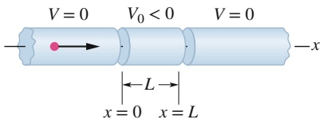

text_image

V = 0
V₀ < 0
V = 0
-x
L
x = 0 x = L

Abb. 34.16

Ein Elektron (roter Punkt) fliegt in einer engen Röhre auf ein negatives elektrisches Potenzial $V _ { 0 }$ im Bereich zwischen $x = 0$ und $x = L$ zu.

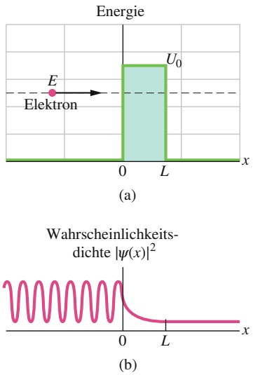

Abb. 34.17

(a) Eine Potenzialbarriere der Höhe $U _ { 0 }$ und der Breite L. Ein Elektron mit der Energie E nähert sich dem Hindernis von links. (b) Die Wahrscheinlichkeitsdichte $| \psi | ^ { 2 }$ der Materiewelle des | |Elektrons zeigt das Tunneln des Elektrons durch die Potenzialschwelle. Die Kurve links von der Potenzialschwelle entspricht einer stehenden Welle, die sich aus der Superposition der einfallenden und der reflektierten Welle ergibt.

Abbildung 34.17b zeigt das Ergebnis. Die oszillierende Kurve links von der Potenzialschwelle $( x < 0 )$ entsteht aus der Überlagerung der einlaufenden und der reflektierten Materiewelle (die eine kleinere Amplitude als die einlaufende Welle hat). Diese Oszillationen entstehen durch Interferenz der beiden in entgegengesetzte Richtungen laufenden Wellen, was zu einer stehenden Welle führt.

Innerhalb der Potenzialschwelle $( 0 < x < L )$ fällt die Wahrscheinlichkeitsdichte als Funktion von x exponentiell ab. Ist L nicht zu groß, ist die Wahrscheinlichkeitsdichte allerdings bei $x = L$ noch nicht ganz auf null abgefallen.

Auf der rechten Seite der Potenzialschwelle von Abb. 34.17 $( x > L )$ beschreibt der Graph für die Wahrscheinlichkeitsdichte eine durch die Barriere hindurchgetretene Welle mit einer kleinen konstanten Amplitude. In diesem Bereich kann das Elektron also mit einer kleinen Wahrscheinlichkeit nachgewiesen werden. (Vergleichen Sie diesen Teil der Abbildung mit Abb. 34.13 für ein freies Teilchen.)

Wir können der einlaufenden Materiewelle und der Potenzialschwelle in Abb. 34.17a einen Transmissionskoeffizienten (oder auch Durchlasskoeffizienten) T zuordnen. Dieser Koeffizient gibt die Wahrscheinlichkeit an, mit der ein Elek tron durch die Barriere hindurchtritt – also Tunneln auftritt. Ist beispielsweise $T = 0 { , } 0 2 0 { , }$ , dann werden von 1000 auf die Barriere zufliegenden Elektronen im Mittel 20 hindurchtunneln und 980 reflektiert werden.

Der **Transmissionskoeffizient** T ist näherungsweise durch

$$
T \approx \mathrm{e} ^ {- 2 k L} \tag {34.35}
$$

mit

$$
k = \sqrt {\frac {8 \pi^ {2} m (U _ {0} - E)}{h ^ {2}}} \tag {34.36}
$$

gegeben.

Wegen der exponentiellen Form von Gl. 34.35 hängt der Wert von T sehr empfindlich von den drei dort auftretenden Variablen ab: der Teilchenmasse m, der Schwellendicke L und der Energiedifferenz $U _ { 0 } - E$

Der Tunneleffekt wird mittlerweile in vielen technischen Anwendungen ausgenutzt, unter anderem bei der Tunneldiode, bei der ein Elektronenstrom (die Elektronen tunneln durch ein bestimmtes Bauteil) schnell ein- oder ausgeschaltet wird, indem man die Höhe der Potenzialschwelle verändert. Da dies sehr rasch geschehen kann (innerhalb von 5 ps), eignet sich dieses Bauteil für Anwendungen, bei denen sehr schnelle Reaktionszeiten erforderlich sind. Im Jahr 1973 teilten sich drei „Tunnelbauer“ den Nobelpreis für Physik: Leo Esaki (für Tunneleffekte in Halbleitern), Ivar Giaever (für Tunneleffekte in Supraleitern) und Brian Josephson (für den Josephson-Kontakt, ebenfalls auf dem Tunneleffekt basierend, mit dessen Hilfe außerordentlich schnelle Schaltvorgänge möglich werden). Im Jahr 1986 wurde der Nobelpreis für Physik an Gerd Binnig und Heinrich Rohrer verliehen, die eine weitere Anwendung des Tunneleffekts entwickelt hatten: das Raster-Tunnelmikroskop (Scanning Tunneling Microscope, STM).

## KONTROLLFRAGE 5

Wie verhält sich die Wellenlänge der durchgetunnelten Welle zur Wellenlänge der einfallenden Welle in Abb. 34.17b: Ist sie größer, kleiner oder gleich groß?

## Das Raster-Tunnelmikroskop

Mithilfe eines Raster-Tunnelmikroskops lassen sich detaillierte Karten von Oberflächen anfertigen, auf denen Strukturen von atomarer Größenordnung sichtbar sind und deren Auflösung wesentlich größer ist als die eines optischen oder Elektronenmikroskops. Ein Beispiel ist in Abb. 34.18 gezeigt, wo die einzelnen Atome auf einer Siliciumoberfläche deutlich zu erkennen sind.

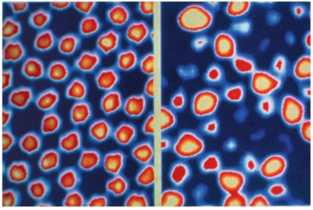

natural_image

Microscopic view of cellular structures with red and blue staining (no text or symbols)

Abb. 34.18

Ein Muster aus Siliciumatomen, aufgenommen mit einem Raster-Tunnelmikroskop [Quelle: IBM Research/ Science Source].

Abbildung 34.19 zeigt das Funktionsprinzip eines Raster-Tunnelmikroskops. Eine winzige Metallspitze am Kreuzungspunkt dreier senkrecht aufeinander stehender Quarzstäbe wird sehr nahe an die zu untersuchende Oberfläche gebracht. Zwischen Spitze und Oberfläche wird eine kleine Spannung von etwa 10 mV angelegt.

Quarzkristalle haben eine interessante Eigenschaft, die man als Piezoelektrizität bezeichnet: Wenn man an eine Quarzprobe eine elektrische Spannung anlegt, verändern sich ihre Abmessungen ein wenig. Dadurch kann man die Länge der drei Stäbe aus Abb. 34.19 sehr gleichmäßig um winzige Beträge verändern und so mit der Metallspitze die Oberfläche abtasten. Die Metallspitze fährt die Oberfläche dabei rasterförmig (daher der Name) in x- und y-Richtung ab und kann gleichzeitig ihren Abstand zur Oberfläche (in z-Richtung) verändern.

Der schmale Spalt zwischen der Oberfläche und der Metallspitze bildet eine Potenzialschwelle ähnlich der aus Abb. 34.17a. Wenn die Spitze sich nahe genug an der Oberfläche befindet, tunneln Elektronen aus der Probe durch die Barriere auf die Metallspitze und erzeugen einen Tunnelstrom.

Gewöhnlich versucht man, die vertikale Position der Spitze über eine elektronische Rückkopplung so zu regeln, dass der Tunnelstrom konstant bleibt, während die Spitze die Oberfläche abtastet. Damit bleibt aber auch der Abstand zwischen Spitze und Oberfläche konstant. Das Ergebnis ist eine Karte der unterschiedlichen vertikalen Positionen der Spitze (wie in Abb. 34.18) und damit der Kontur der Oberfläche als Funktion der Position in der xy-Ebene.

Raster-Tunnelmikroskope sind mittlerweile kommerziell erhältlich und werden in Forschungslaboratorien auf der ganzen Welt eingesetzt.

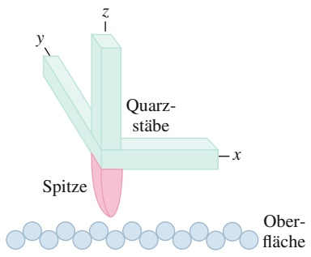

text_image

y
z
Quarz-
stäbe
x
Spitze
Ober-
fläche

Abb. 34.19

Das Prinzip eines Raster-Tunnelmikroskops. Drei Quarzstäbe steuern eine außerordentlich dünne, leitende Metallspitze über eine Oberfläche und sorgen gleichzeitig dafür, dass der Abstand zwischen Oberfläche und Spitze konstant bleibt. Dabei bewegt sich die Spitze auf und $\mathbf { a } \mathbf { b } ,$ um sich den Konturen der Oberfläche anzupassen. Diese Bewegung wird aufgezeichnet und liefert schließlich eine Karte der Oberfläche wie die in Abb. 34.18 gezeigte.

## 34.10 Zusammenfassung

**Lichtquanten – Photonen** Eine elektromagnetische Welle (Licht) ist quantisiert; die Quanten bezeichnet man als Photonen. Für eine Lichtwelle mit der Frequenz $f ,$ der Wellenlänge λ, der Energie $E$ und dem Impuls $p$ gelten

$$
E = h f \quad (\text {Photonenenergie}) \tag {34.2}
$$

und

$$
p = \frac {h f}{c} = \frac {h}{\lambda} \quad (\text {Photonenimpuls}). \tag {34.7}
$$

**Photoelektrischer Effekt** Wenn Licht genügend hoher Frequenz auf eine saubere Metalloberfläche trifft, werden durch die Wechselwirkung mit Photonen Elektronen aus der Oberfläche herausgeschlagen. Die Energiebilanz ergibt

$$
h f = K _ {\mathrm{max}} + \varPhi , \tag {34.5}
$$

wobei $h f$ die Photonenenergie ist, $K _ { \mathrm { m a x } }$ die kinetische Energie der energiereichsten herausgeschlagenen Elektronen und $\varPhi$ die **Austrittsarbeit**.

**Compton-Effekt** Bei der Streuung von Röntgenstrahlen an locker gebundenen Elektronen in einer Probe haben einige der gestreuten Röntgenstrahlen eine längere Wellenlänge als die einfallenden Strahlen. Diese **Compton-Verschiebung** der Wellenlänge beträgt:

$$
\Delta \lambda = \frac {h}{m c} (1 - \cos \varphi), \tag {34.11}
$$

wobei $\varphi$ der Streuwinkel der Röntgenstrahlen ist.

**Lichtwellen und Photonen** Bei der Wechselwirkung zwischen Licht und Materie werden durch Photonen Energie und Impuls übertragen. Bei der Ausbreitung von Licht interpretieren wir die Lichtwelle jedoch als **Wahrscheinlichkeitswelle**. Die Wahrscheinlichkeit (pro Zeiteinheit), ein Photon nachzuweisen, ist proportional zu $E _ { \mathrm { m ^ { \prime } } } ^ { 2 }$ wobei $E _ { \mathrm { m } }$ die Amplitude des elektrischen Felds der Lichtwelle am Ort des Detektors ist.

**Strahlung schwarzer Körper** Zur theoretischen Modellierung der Strahlung schwarzer Körper liefert die Rechnung auf der Basis der klassischen Physik das Rayleigh-Jeans-Gesetz

$$
u (f) \mathrm{d} f = \frac {8 \pi f ^ {2}}{c ^ {3}} k _ {\mathrm{B}} T \mathrm{d} f, \tag {34.12}
$$

wobei $u ( f )$ die Energiedichte in dem Intervall d f ist. Da dies nur im Bereich großer Wellenlängen $\lambda   =   c / f$ mit dem Experiment übereinstimmt, postulierte Wien das spä- ter nach ihm benannte, empirisch verbesserte Strahlungsgesetz

$$
u (f) \mathrm{d} f = \frac {8 \pi f ^ {2}}{c ^ {3}} h f \mathrm{e} ^ {- h f / (k _ {\mathrm{B}} T)} \mathrm{d} f. \tag {34.13}
$$

Es beschreibt zwar das Verhalten bei kleinen Wellenlängen und im Bereich des Maximums korrekt, weicht aber bei großen Wellenlängen vom experimentellen Spektrum ab.

**Plancksches Strahlungsgesetz** Auf der Basis des Postulats quantisierter Energien

$$
E _ {n} = n h f, \quad n = 0, 1, 2, \dots \tag {34.16}
$$

erhielt Planck das Strahlungsgesetz

$$
u (f) \mathrm{d} f = \frac {8 \pi f ^ {2}}{c ^ {3}} \frac {h f}{\mathrm{e} ^ {h f / (k _ {\mathrm{B}} T)} - 1} \mathrm{d} f,
$$

(34.14)

das nicht nur hervorragend mit den Experimenten übereinstimmt, sondern auch das Rayleigh-Jeans-Gesetz und das Wiensche Strahlungsgesetz als Grenzfälle enthält.

**Materiewellen** Ein Teilchen wie z. B. ein Elektron oder Proton lässt sich durch eine Materiewelle beschreiben. Seine Wellenlänge (**De-Broglie-Wellenlänge**) ist $\lambda   =   h / p ,$ wobei p der Impuls des Teilchens ist.

**Die Wellenfunktion** Eine Materiewelle wird durch ihre Wellenfunktion $\Psi ( x , y , z , t )$ beschrieben. Diese Wellenfunktion lässt sich in einen ortsabhängigen Teil $\psi ( x ,   y ,   z )$ und einen zeitabhängigen Teil $\mathrm { e } ^ { - \mathrm { i } \omega t }$ aufspalten. Für ein Teilchen der Masse m, das sich mit der Gesamtenergie $E$ entlang der x-Achse durch ein Gebiet bewegt, in dem seine potenzielle Energie $U ( x )$ ist, erhält man $\psi ( x )$ als Lösung der vereinfachten **Schrödinger-Gleichung**

$$
\frac {\mathrm{d} ^ {2} \psi}{\mathrm{d} x ^ {2}} + \frac {8 \pi^ {2} m}{h ^ {2}} [ E - U (x) ] \psi = 0. \tag {34.20}
$$

Genau wie eine Lichtwelle ist auch eine Materiewelle eine Wahrscheinlichkeitswelle. Die Wahrscheinlichkeit, mit der ein Teilchendetektor ein Teilchen in einem bestimmten Zeitintervall nachweist, ist proportional zu $| \psi | ^ { 2 }$ . Die-| |se Größe bezeichnet man auch als **Wahrscheinlichkeitsdichte**.

Für ein freies Teilchen $\left( U ( x ) = 0 \right)$ , das sich in eine Richtung entlang der x-Achse bewegt, ist $| \psi | ^ { 2 }$ für alle Orte x konstant.

**Die Heisenbergsche Unschärferelation** Aus der probabilistischen Natur der Quantenphysik folgt eine wichtige Einschränkung für die Messung von Ort und Impuls eines Teilchens. Es ist nicht möglich, den Ort $\vec { r }$ eines Teilchens und seinen Impuls $\vec { p }$ gleichzeitig mit beliebiger Genauigkeit anzugeben. Die Unsicherheiten in den Komponenten dieser Größen unterliegen folgenden Schranken:

$$
\Delta x \cdot \Delta p _ {x} \geq \hbar ,
$$

$$
\Delta z \cdot \Delta p _ {z} \geq \hbar . \tag {34.25}
$$

**Potenzialschwelle** Als Potenzialschwelle wird ein Gebiet bezeichnet, in dem die potenzielle Energie eines Teilchens auf Kosten seiner kinetischen Energie um $U _ { 0 }$ zunimmt. Klassisch gesehen wird ein Teilchen, dessen anfängliche kinetische Energie größer als $U _ { 0 }$ ist, beim Übergang in dieses Gebiet niemals reflektiert. Aufgrund der quantenphysikalischen Wellennatur aller Teilchen gibt es jedoch einen Reflexionskoeffizienten $R > 0$ , der eine endliche Wahrscheinlichkeit für eine Reflexion liefert. Die Transmissionswahrscheinlichkeit ist $T = 1 - R$

**Tunneleffekt** Nach den Gesetzen der klassischen Physik wird ein einfallendes Teilchen von einer Potenzialschwelle, deren Höhe größer als die kinetische Energie des Teilchens ist, zwingend reflektiert. Nach den Gesetzen der Quantenphysik kann das Teilchen jedoch mit einer gewissen Wahrscheinlichkeit durch diese Barriere hindurchtunneln. Die Wahrscheinlichkeit, mit der ein Teilchen der Masse m und der Energie E durch eine Potenzialschwelle der Höhe $U _ { 0 }$ und der Dicke L hindurchtunnelt, ist durch den Transmissionskoeffizienten

$$
T \approx \mathrm{e} ^ {- 2 k L} \tag {34.35}
$$

mit

$$
k = \sqrt {\frac {8 \pi^ {2} m (U _ {0} - E)}{h ^ {2}}} \tag {34.36}
$$

gegeben.

## 34.11 Fragen

**1.** Vergleichen Sie die elektromagnetischen Wellen eines Mikrowellenherds und eines Röntgenapparats. Welche dieser Wellen hat die größere (a) Wellenlänge, (b) Frequenz und (c) Photonenenergie?
**2.** Welche der folgenden Behauptungen zum photoelektrischen Effekt sind wahr und welche falsch? (a) Je größer die Frequenz des einfallenden Lichts, desto größer ist das Stopppotenzial. (b) Je größer die Intensität des einfallenden Lichts, desto größer ist die Grenzfrequenz. (c) Je größer die Austrittsarbeit aus der Probe, desto größer ist das Stopppotenzial. (d) Je größer die Austrittsarbeit aus der Probe, desto größer ist die Grenzfrequenz. (e) Je größer die Frequenz des einfallenden Lichts, desto größer ist die maximale kinetische Energie der Elektronen. (f ) Je größer die Energie der Photonen, desto kleiner ist das Stopppotenzial.
**3.** Für welches Metall, Kalium oder Natrium, ist die maximale kinetische Energie der herausgelösten Elektronen nach der Abbildung zu Kontrollfrage 2 bei gegebener Frequenz für das einfallende Licht größer?
**4.** Welche der folgenden Größen (wenn überhaupt eine) hängen beim photoelektrischen Effekt für eine gegebene Probe und eine feste Frequenz des einfallenden Lichts von der Intensität des Lichtstrahls ab: (a) die maximale kinetische Energie der Elektronen, (b) der maximale photoelektrische Strom, (c) das Stopppotenzial, (d) die Grenzfrequenz?
**5.** Wenn auf eine isolierte Metallplatte ultraviolettes Licht trifft, werden von dieser Platte für eine Weile Elektronen emittiert. Weshalb hört diese Emission schließlich auf?
**6.** Eine Metallplatte wird mit Licht einer bestimmten Frequenz bestrahlt. Welche der folgenden Größen haben einen Einfluss darauf, ob Elektronen aus dem Metall herausgelöst werden: (a) die Lichtintensität, (b) die Zeitdauer der Lichteinstrahlung, (c) die thermische Leitfähigkeit der Platte, (d) die Fläche der Platte, (e) das Material der Platte?
**7.** Bei einem Experiment zum Compton-Effekt wird ein Röntgenphoton in Vorwärtsrichtung (𝜑 = 0 in Abb. 34.3) gestreut. Welche Energie nimmt das Elektron bei dieser Wechselwirkung auf?
**8.** Nach Gl. 34.11 ist die Compton-Verschiebung für Röntgenstrahlen und für sichtbares Licht gleich. Weshalb kann die Compton-Verschiebung trotzdem für Röntgenstrahlen vergleichsweise leicht, für sichtbares Licht aber nur sehr schwer gemessen werden?
**9.** Photon A besitzt die doppelte Energie wie Photon B. (a) Ist der Impuls von A kleiner, größer oder gleich dem Impuls von B? (b) Ist die Wellenlänge von A kleiner, größer oder gleich der Wellenlänge von B?
**10.** Photon A stammt aus einer Ultraviolettlampe und Photon B von einem Fernsehsender. Welches Photon hat

(a) die größere Wellenlänge, (b) die größere Energie, (c) die größere Frequenz und (d) den größeren Impuls?

**11.** Die Daten in Abb. 34.4 entstammen einem Experiment, bei dem Röntgenstrahlen auf eine Kohlenstoffprobe gelenkt wurden. In welcher Hinsicht, falls überhaupt, würden sich diese Daten qualitativ von Daten unterscheiden, die an einer Schwefelprobe statt an Kohlenstoff gewonnen wurden?
**12.** Ein Elektron und ein Proton haben dieselbe kinetische Energie. Welches Teilchen hat die größere De-Broglie-Wellenlänge?
**13.** (a) Wie verändert sich die De-Broglie-Wellenlänge, wenn Sie die kinetische Energie eines nichtrelativistischen Teilchens verdoppeln? (b) Wie verändert sich die De-Broglie-Wellenlänge, wenn Sie stattdessen die Geschwindig keit des Teilchens verdoppeln?
**14.** Die folgenden nichtrelativistischen Teilchen sollen alle dieselbe kinetische Energie haben. Ordnen Sie die Teilchen in absteigender Reihenfolge nach ihrer De-Broglie-Wellenlänge: Elektron, Alpha-Teilchen, Neutron.
**15.** Abbildung 34.F15 zeigt vier Situationen, bei denen sich ein Elektron durch ein Feld bewegt. Es bewegt sich (a) entgegengesetzt zum elektrischen Feld, (b) in die gleiche Richtung wie das elektrische Feld, (c) in die gleiche Richtung wie das magnetische Feld, (d) senkrecht zum magnetischen Feld. Nimmt die De-Broglie-Wellenlänge in den einzelnen Situationen zu, ab oder bleibt sie gleich?

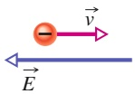

(a)

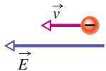

(b)

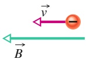

(c)

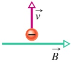

(d)

## Abb. 34.F15

**16.** Ein Proton und ein Deuteron mit einer kinetischen Energie von jeweils 3 MeV nähern sich einer Potenzialschwelle der Höhe $U _ { 0 } = 1 0$ MeV. Welches der beiden Teilchen wird mit größerer Wahrscheinlichkeit hindurchtunneln? (Ein Deuteron ist doppelt so schwer wie ein Proton.)
**17.** Was hat den größeren Einfluss auf den Transmissionskoeffizienten T für ein Elektron, das durch eine Potenzialschwelle tunnelt: (a) die Anhebung der Potenzialhöhe um 1 % oder (b) die Verringerung der kinetischen Energie des Elektrons um 1 %?
**18.** Weshalb sind die Werte der Minima von $| \psi | ^ { 2 }$ auf der linken Seite in Abb. 34.17b größer als null?
**19.** Angenommen, die Potenzialschwelle in Abb. 34.17a sei unendlich hoch. (a) Welchen Wert würden Sie für den Transmissionskoeffizienten für Elektronen durch diese Barriere erwarten? (b) Entspricht Gl. 34.35 Ihrem Resultat?

**20.** In der Tabelle finden Sie Relativwerte für drei verschiedene Experimente zum Tunneleffekt von Abb. 34.17. Ordnen Sie die Experimente in absteigender Reihenfolge nach der Wahrscheinlichkeit, mit der ein Elektron durch die Barriere hindurchtunnelt.

|  | Elektronenenergie | Potenzialhöhe | Potenzialbreite |
| --- | --- | --- | --- |
| (a) | E | 5E | L |
| (b) | E | 17E | L/2 |
| (c) | E | 2E | 2L |

# 35 Mehr über Materiewellen

## 35.1 Die Energie eines Elektrons in einer Elektronenfalle

## Physikalische Motivation

Zu Beginn des zwanzigsten Jahrhunderts war nichts darüber bekannt, wo sich die Elektronen in einem Atom befinden, welche Bewegungsform sie haben, wie Atome Licht emittieren oder absorbieren können, oder auch nur, weshalb Atome überhaupt stabil sind. Ohne dieses Wissen kann man aber unmöglich verstehen, wie sich Atome zu Molekülen oder zu einem Kristallgitter in einem Festkörper zusammenfinden. Dementsprechend waren die Grundlagen der Chemie – einschließlich der Biochemie, der Grundlage des Lebens – mehr oder weniger rätselhaft.

In den 1920er Jahren fanden all diese Fragen (und noch viele mehr) durch die Entwicklung der Quantenmechanik eine Antwort. Die Grundannahme der Quantenmechanik besteht darin, dass Elektronen, Protonen und andere Teilchen sich am besten als Materiewellen darstellen lassen, deren Verhalten durch die Schrö- dinger-Gleichung bestimmt wird. Obwohl die Quantenmechanik auch für schwere Teilchen gilt, gibt es keinen Grund Fußbälle, Autos, Planeten oder ähnliche Gegenstände quantentheoretisch zu behandeln. Für solche schweren, langsamen Gegenstände sind die Vorhersagen der Newtonschen Physik und der Quantenphysik identisch.

Bevor wir jedoch den Formalismus der Quantenphysik auf das Problem des Atomaufbaus anwenden können, müssen wir anhand von einfacheren Beispielen einige Einsichten in das Wesen der Quantenmechanik gewinnen. Diese „Übungsaufgaben“ mögen etwas künstlich erscheinen, aber sie bilden eine gute Grundlage für das Verständnis einer realen Situation, die wir in Abschn. 35.5 untersuchen wollen: die Struktur des Wasserstoffatoms.

## 35.1.1 Seil- und Materiewellen

In Kapitel 12 hatten wir gesehen, dass es zwei Arten von Wellen auf einem gespannten Seil gibt: laufende Wellen und stehende Wellen. Auf einem (im Prinzip) unendlich langen Seil kann sich eine Welle von praktisch jeder Frequenz ausbreiten. Wenn das gespannte Seil jedoch eine endliche Länge besitzt, weil es beispielsweise an beiden Enden fest eingespannt ist, können wir auf diesem Seil nur stehende Wellen mit definierten, diskreten Frequenzen erzeugen. Mit anderen Worten: Wenn eine Welle auf ein endliches Raumgebiet beschränkt ist, werden die möglichen Bewegungsformen der Welle quantisiert. Es gibt nur noch diskrete Zustände für die Welle, die jeweils eine scharf definierte Frequenz haben.

Diese Beobachtung trifft für sämtliche Arten von Wellen zu, einschließlich Mate riewellen. Für Materiewellen ist es jedoch sinnvoller, statt von der Frequenz f der Welle von der Energie E des zugehörigen Teilchens zu sprechen. Bei den folgenden Überlegungen beziehen wir uns zwar meist auf die Materiewellen eines Elektrons, sie treffen aber grundsätzlich für jede Form von Materiewelle in einem begrenzten Raumgebiet zu.

Betrachten Sie die Materiewelle eines Elektrons, das sich ohne Einfluss einer äußeren Kraft in die positive x-Richtung bewegt – ein freies Teilchen. Die Energie eines solchen Elektrons kann jeden beliebigen Wert annehmen, ebenso wie die sich ausbreitende Welle auf einem unendlich langen Seil jede beliebige Frequenz haben kann.

Betrachten Sie nun die Materiewelle eines Elektrons in einem Atom, beispielsweise des Valenzelektrons (des am schwächsten gebundenen Elektrons) in einem Natriumatom. Dieses Elektron wird durch die anziehende Coulomb-Kraft zwischen ihm und dem positiv geladenen Atomkern im Atomverband gehalten: Es ist kein freies Teilchen. Es kann demzufolge nur in bestimmten Zuständen existieren, von denen jeder eine diskrete Energie E besitzt. Das klingt sehr nach den diskreten Zuständen der quantisierten Frequenzen auf einem gespannten Seil endlicher Länge. Für Materiewellen gilt ebenso wie für alle anderen Wellenarten die folgende Feststellung, die manchmal als Einschlussprinzip bezeichnet wird:

Eine Welle in einem endlichen Raumgebiet ist quantisiert, d. h., es gibt einen diskreten Satz von Zuständen mit diskreten Energien. Die Welle kann nur diese Energien haben.

## 35.1.2 Eindimensionale Elektronenfallen

Wir untersuchen zunächst die Materiewelle eines Elektrons, das sich nur in einem endlichen Raumbereich aufhalten kann, analog zu den stehenden Wellen auf einem in x-Richtung zwischen zwei Punkten gespannten Seil. Da die Enden fixiert sind, müssen die beiden Endpunkte des Seils Knotenpunkte sein, an denen sich das Seil nicht bewegt. Es kann noch weitere Knoten geben, aber diese beiden müssen immer vorhanden sein, wie Abb. 12.20 verdeutlicht.

Die Zustände bzw. die diskreten Wellenformen, in denen das Seil schwingen kann, erhält man aus der Bedingung, dass die Seillänge L ein ganzzahliges Vielfaches der halben Wellenlänge sein muss. Die Schwingungsmoden n des Seils erfüllen also die Bedingung

$$
L = \frac {n \lambda}{2} \quad \text {fur} \quad n = 1, 2, 3, \dots \tag {35.1}
$$

Jeder Wert von n entspricht einem Zustand des schwingenden Seils. In der Sprache der Quantenphysik bezeichnen wir die ganze Zahl n in dieser Bedingung als **Quantenzahl**.

Für jeden nach Gl. 35.1 erlaubten Zustand des Seils ist die transversale Auslenkung des Seils an der Stelle x durch

$$
y _ {n} (x) = A \sin \left(\frac {n \pi}{L} x\right) \quad \text {fur} \quad n = 1, 2, 3, \dots \tag {35.2}
$$

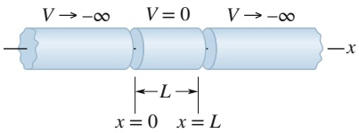

text_image

V → -∞ V = 0 V → -∞
← L →
x = 0 x = L
-x

Abb. 35.1

Das Prinzip einer idealisierten Elektronenfalle, in der ein Elektron auf dem mittleren Zylinder „gefangen“ist. Die beiden jeweils zu einer Seite unendlich langen Zylinder haben (im Idealfall) ein unendlich hohes negatives Potenzial, der Zylinder in der Mitte hat das Potenzial null.

gegeben, wobei die Quantenzahl n das Schwingungsmuster festlegt und A von dem Beobachtungszeitpunkt abhängt. (Gl. 35.2 ist eine Kurzfassung von Gl. 12.55.) Offensichtlich sind die Punkte $x = 0$ und $x = L$ für alle Werte von n und für jeden Zeitpunkt Knotenpunkte (mit der Auslenkung null), wie es auch sein muss. In Abb. 12.19 sind Momentaufnahmen von Seilwellen zu diesen Zuständen für $n = 2 ,$ 3 und 4 wiedergegeben.

Nun wenden wir uns den Materiewellen zu. Unser erstes Problem besteht darin, wie man diese Situation, dass ein Elektron auf der x-Achse in einem endlichen Streckenbereich „eingesperrt“ ist, physikalisch realisieren kann. Abbildung 35.1 zeigt eine solche eindimensionale Elektronenfalle. Sie besteht aus zwei sich jeweils nach einer Seite ins Unendliche erstreckenden Zylindern, von denen jeder ein elektrisches Potenzial von $V \to - \infty$ hat. Zwischen diesen Zylindern befindet sich ein Zylinder der Länge L mit dem elektrischen Potenzial null. Auf diesen mittleren Zylinder setzen wir ein einzelnes Elektron, das dort gefangen ist.

Die Elektronenfalle von Abb. 35.1 lässt sich zwar rechnerisch leicht behandeln, ist aber nicht sehr praktisch. In einem Labor verwendet man vom Aufbau her etwas kompliziertere Elektronenfallen, die aber im Prinzip den gleichen Effekt haben. An der Universität von Washington wurde beispielsweise ein einzelnes Elektron über mehrere Monate in einer solchen Falle gehalten, wodurch die Wissenschaftler sehr genaue Messungen der Elektroneneigenschaften vornehmen konnten.

## Berechnung der quantisierten Energien

Abbildung 35.2 zeigt die potenzielle Energie des Elektrons als Funktion seiner Position auf der x-Achse für die idealisierte Falle aus Abb. 35.1. Für ein Elektron auf dem mittleren Zylinder verschwindet die potenzielle Energie $U ( = - e V )$ , weil das Potenzial V null ist. Könnte das Elektron diesen Bereich verlassen, wäre seine potenzielle Energie positiv und unendlich, weil dort $V \to - \infty$ gilt. Die Potenzialform in Abb. 35.2 bezeichnen wir als **unendlich hohes Kastenpotenzial** (oder auch **unendlich hohen – oder tiefen – Potenzialtopf**), weil das Elektron in einem solchen Potenzial wie in einem Kasten oder Topf gefangen ist. Nähert sich das Elektron in Abb. 35.1 einem der beiden Zylinderenden, wird seine Bewegung durch eine praktisch unendliche Kraft umgelenkt. Da sich das Elektron zusätzlich auch nur entlang einer einzigen Achse bewegen kann, bezeichnet man dieses Potenzial auch als eindimensionales unendlich hohes Kastenpotenzial.

Genau wie eine stehende Welle auf einem endlich langen gespannten Seil muss auch die Materiewelle des Elektrons in dem Kastenpotenzial Knoten bei $x = 0$ und $x = L$ haben. Und auch Gl. 35.1 gilt für Materiewellen, wenn wir λ als die De-Broglie-Wellenlänge des Elektrons interpretieren.

Die De-Broglie-Wellenlänge λ hatten wir in Gl. 34.18 als $\lambda = h / p$ definiert, wobei p der Betrag des Elektronenimpulses ist. Dieser Betrag <u>hängt</u> mit der kinetischen Energie K und der Masse m des Elektrons über $p = { \sqrt { 2 m K } }$ zusammen. Für ein Elektron auf dem mittleren Zylinder in Abb. 35.1, wo $U = 0$ gilt, ist die gesamte mechanische Energie gleich seiner kinetischen Energie. Damit gilt für die De-Broglie-Wellenlänge dieses Elektrons

$$
\lambda = \frac {h}{p} = \frac {h}{\sqrt {2 m E}}. \tag {35.3}
$$

Wir setzen diese Gleichung in Gl. 35.1 ein und lösen nach der Energie E auf. Wir erhalten die Energie E als Funktion der Quantenzahl n:

$$
E _ {n} = \left(\frac {h ^ {2}}{8 m L ^ {2}}\right) n ^ {2} \quad \text {fur} \quad n = 1, 2, 3, \dots \tag {35.4}
$$

Die ganze Zahl n ist die Quantenzahl für den Zustand des Elektrons in der Elektronenfalle.

Aus Gl. 35.4 lernen wir etwas sehr Wichtiges: Da das Elektron in der Falle fest sitzt, kann es nur die durch obige Gleichung gegebenen Energien besitzen. Es kann keine Energie haben, die beispielsweise in der Mitte zwischen den Werten für $n = 1$ und $n = 2$ liegt. Weshalb diese Einschränkung? Weil es sich bei einem Elektron um eine Materiewelle handelt. Wäre ein Elektron ein klassisches Teilchen, könnte seine Energie auch innerhalb der Falle jeden Wert annehmen.

Abbildung 35.3 zeigt die fünf niedrigsten erlaubten Energiewerte für ein Elektron in einem unendlich hohen Kastenpotenzial mit $L = 1 0 0$ pm (das entspricht ungefähr der Größe eines typischen Atoms). Diese Energiewerte bezeichnet man auch als Energieniveaus, und in Abb. 35.3 sind sie als „Leitersprossen“ in einer Energieniveaudarstellung bzw. einem Energieniveauschema eingezeichnet. Die Energie ist vertikal aufgetragen; die horizontale Achse hat keine Bedeutung.

Den Quantenzustand mit der niedrigsten nach Gl. 35.4 erlaubten Energie $E _ { 1 }$ zur Quantenzahl $n = 1$ bezeichnet man als Grundzustand des Elektrons. Ein Elektron hält sich nach Möglichkeit in diesem niedrigsten Energiezustand auf. Alle anderen Quantenzustände mit höheren Energien (zu den Quantenzahlen $n = 2$ oder hö- her) bezeichnet man als angeregte Zustände. Der Zustand mit der Energie $E _ { 2 }$ zur Quantenzahl $n = 2$ ist der erste angeregte Zustand, weil es sich um den ersten der angeregten Zustände handelt, wenn man die Leiter der Energieniveaus nach oben klettert. Entsprechend bezeichnet man den Zustand zur Energie $E _ { 3 }$ als den zweiten angeregten Zustand.

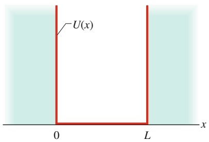

text_image

U(x)
0 L x

Abb. 35.2

Die potenzielle elektrische Energie U(x) eines Elektrons auf dem mittleren Zylinder in Abb. 35.1. Für $0 < x < L$ ist U = 0 und für x < 0 bzw. x > L gilt $U \to \infty .$

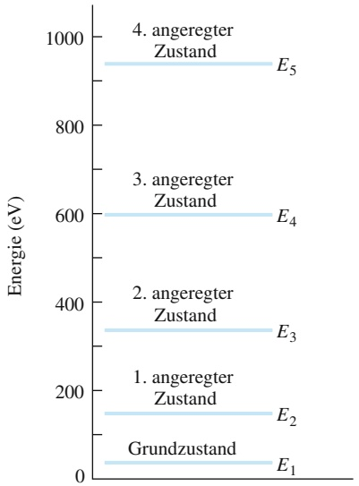

line

| State | Energy Level (eV) |
| --- | --- |
| 1. angeregter Zustand | ~150 |
| 2. angeregter Zustand | ~340 |
| 3. angeregter Zustand | ~600 |
| 4. angeregter Zustand | ~950 |
| Grundzustand | ~30 |

Abb. 35.3

Einige der nach Gl. 35.4 erlaubten Energien eines Elektrons in dem unendlich hohen Kastenpotenzial aus Abb. 35.2. Im vorliegenden Fall ist die Breite $L = 1 0 0   \mathrm { p m }$ . Diese Art der Darstellung von erlaubten Energien bezeichnet man als Energieniveauschema oder Energieniveaudarstellung.

## Übergänge zwischen Zuständen

Ein gebundenes Elektron hält sich nach Möglichkeit in dem Zustand der niedrigsten erlaubten Energie auf, d. h. im Grundzustand. In einen angeregten Zustand (mit einer höheren Energie) kann es nur wechseln, wenn eine äußere Quelle die dafür notwendige Energie zur Verfügung stellt. Sei $E _ { \mathrm { t i e f } }$ die Anfangsenergie des Elektrons und $E _ { \mathrm { h o c h } }$ die Energie eines höheren Energieniveaus, dann ist die für den Zustandswechsel des Elektrons notwendige Energie

$$
\Delta E = E _ {\mathrm{hoch}} - E _ {\mathrm{tief}}. \tag {35.5}
$$

Wenn diese Energie auf ein Elektron übertragen wird, macht es einen Quantensprung (oder auch Quantenübergang) von dem niedrigeren in den höheren $\mathbf { Z u } \cdot$ stand. Man sagt in diesem Fall auch, dass das Elektron von dem tieferen in den höheren Zustand angeregt wird. Abbildung 35.4a zeigt einen Quantensprung vom Grundzustand (Energieniveau $E _ { 1 } )$ in den dritten angeregten Zustand (Energieniveau $E _ { 4 } )$ . Wie man in der Abbildung erkennt, muss der Zustand von einem Energieniveau zu einem anderen Energieniveau erfolgen, er kann dabei aber ein oder mehrere dazwischenliegende Energieniveaus überspringen.

Eine Möglichkeit, einem Elektron die für einen Quantensprung notwendige Energie zu übertragen, ist die Absorption eines Photons. Eine solche Absorption und der entsprechende Quantensprung können jedoch nur auftreten, wenn die folgende Bedingung erfüllt ist:

Damit ein gebundenes Elektron ein Photon absorbieren kann, muss die Energie $h f$ des Photons gleich der Energiedifferenz $\Delta E$ zwischen dem Anfangsniveau des Elektrons und einem höheren Niveau sein.

Bei der Anregung eines Elektrons durch Absorption eines Photons muss daher im Potenzialtopf gelten

$$
h f = \Delta E = E _ {\mathrm{hoch}} - E _ {\mathrm{tief}}. \tag {35.6}
$$

Ohne äußere Einflüsse bleibt ein Elektron nie lange in einem angeregten Zustand, sondern fällt bald auf ein tieferes Energieniveau zurück. In den Abb. 35.4b bis d sind einige Möglichkeiten angegeben, wie ein Elektron vom dritten angeregten $\mathrm { Z u - }$ stand in den Grundzustand zurückgelangen kann. Das Elektron kann entweder direkt (Abb. 35.4b) oder in mehreren kürzeren Sprüngen über dazwischenliegende Energieniveaus (Abb. 35.4c und d) in den Grundzustand zurückspringen.

Abb. 35.4

(a) Die Anregung eines Elektrons in einem Kastenpotenzial von seinem Grundzustand in den dritten angeregten Zustand. (b)–(d) Drei von vier Möglichkeiten, wie das Elektron in seinen Grundzustand zurückkehren kann (Welche Möglichkeit fehlt?).

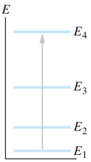

text_image

E
E₄
E₃
E₂
E₁

(a)

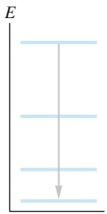

(b)

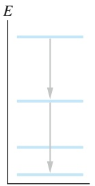

(c)

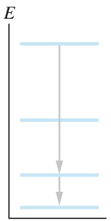

(d)

Um bei der Rückkehr in einen tieferen Zustand seine überschüssige Energie abzugeben, kann ein Elektron ein Photon emittieren; man spricht in diesem Zusammenhang von spontaner Emission oder Lumineszenz bzw. Fluoreszenz. Auch für diesen Vorgang gilt die entsprechende Bedingung für die Energie:

Wenn ein gebundenes Elektron ein Photon emittiert, muss dessen Energie hf gleich der Energiedifferenz ΔE zwischen dem anfänglichen Energieniveau des Elektrons und seinem niedrigeren Endniveau sein.

Gleichung 35.6 gilt daher sowohl für die Absorption als auch für die Emission von Licht durch ein gebundenes Elektron. Das absorbierte oder emittierte Licht kann immer nur bestimmte Werte von $h f$ und damit auch nur bestimmte Werte der Frequenz f und der Wellenlänge λ besitzen.

Anmerkung: Obwohl Gl. 35.6 und unsere Anmerkungen zur Photonenabsorption und -emission für alle physikalischen (tatsächlich existierenden) Elektronenfallen zutreffen, gelten sie streng genommen nicht für eindimensionale (nicht wirklich existierende) Elektronenfallen. Der Grund hängt damit zusammen, dass bei einer Photonenabsorption bzw. -emission auch der Drehimpuls erhalten bleiben muss. In diesem Buch werden wir diese Komplikation allerdings unberücksichtigt lassen und Gl. 35.6 auch auf eindimensionale Elektronenfallen anwenden.

## KONTROLLFRAGE 1

Ordnen Sie die folgenden Paare von Quantenzuständen eines Elektrons in einem unendlich hohen Kastenpotenzial in absteigender Reihenfolge nach den Energiedifferenzen zwischen ihnen: (a) $n = 3$ und n = 1, (b) n = 5 und n = 4, (c) n = 4 und $n = 3$

## 35.2 Die Wellenfunktionen eines Elektrons in einem Kastenpotenzial

## Lernziele

Nach dem Durcharbeiten dieses Abschnitts sollten Sie in der Lage sein, . . .

• die Wellenfunktion eines Elektrons in einem eindimensionalen unendlichen Po tenzialtopf als Funktion seiner Position und der Quantenzahl n zu formulieren,
• zu verstehen, was eine Wahrscheinlichkeitsdichte ist,
die Wahrscheinlichkeitsdichte eines Elektrons in einem eindimensionalen unendlichen Potenzialtopf für einen gegebenen Zustand als Funktion seiner Position anzugeben, zu verstehen, dass die Wahrscheinlichkeitsdichte außerhalb des Potenzialtopfs null ist, und die Wahrscheinlichkeit dafür zu berechnen, das Elektron zwischen zwei gegebenen Positionen innerhalb des Topfs anzutreffen,
• das Korrespondenzprinzip zu erläutern,
• eine gegebene Wellenfunktion zu normieren und zu verstehen, inwiefern dieser Vorgang mit der Aufenthaltswahrscheinlichkeit des Teilchens zusammenhängt,
• zu verstehen, dass die niedrigste erlaubte Energie (die Nullpunktsenergie) eines Elektrons in einem Potenzialtopf nicht null ist.

## Schlüsselideen

• Die Wellenfunktionen eines Elektrons in einem unendlichen, eindimensionalen Potenzialtopf der Länge L entlang der x-Achse haben die Form

$$
\psi_ {n} (x) = \sqrt {\frac {2}{L}} \sin \left(\frac {n \pi}{L} x\right) \quad \text {mit} \quad n = 1, 2, 3, \dots ,
$$

wobei n die Quantenzahl ist.

• Das Produkt $\psi _ { n } ^ { 2 } ( x )$ dx gibt die Wahrscheinlichkeit an, das Elektron im Intervall zwischen den Koordinaten x und x + dx anzutreffen.

• Wenn die Wahrscheinlichkeitsdichte eines Elektrons über die gesamte x-Achse integriert wird, muss die resultierende Wahrscheinlichkeit immer 1 sein (irgendwo muss es sein!), also

$$
\int_ {- \infty} ^ {\infty} \psi_ {n} ^ {2} (x) \mathrm{d} x = 1.
$$

## 35.2.1 Die Wellenfunktionen eines Elektrons in einem Kastenpotenzial

Wenn wir die Schrödinger-Gleichung für ein Elektron in einem eindimensionalen unendlich hohen Kastenpotenzial der Breite L lösen, erhalten wir die Wellenfunktionen

$$
\psi_ {n} (x) = A \sin \left(\frac {n \pi}{L} x\right) \quad \mathrm{mit} \quad n = 1, 2, 3, \dots ; \tag {35.7}
$$

dies gilt für den Bereich $0 < x < L$ (außerhalb dieses Bereichs ist die Wellenfunktion null). Die Konstante A (die Amplitude der Wellenfunktion) werden wir noch berechnen.

Die Wellenfunktionen $\psi _ { n } ( x )$ haben also dieselbe Form wie die Auslenkungsfunktionen $y _ { n } ( x )$ einer stehenden Welle auf einem zwischen zwei festen Punkten gespannten Seil (siehe Gl. 35.2). In diesem Sinn können wir uns ein Elektron in einem eindimensionalen unendlich hohen Kastenpotenzial als eine stehende Materiewelle vorstellen.

## Die Nachweiswahrscheinlichkeit

Die Wellenfunktion $\psi _ { n } ( x )$ kann direkt weder nachgewiesen noch in irgendeiner Form gemessen werden – wir können nicht in ein Kastenpotenzial hineinschauen und die Welle beobachten, wie wir eine Wasserwelle in einer Badewanne beob achten können. Wir können lediglich einen Detektor in das Potenzial bringen und versuchen, das Elektron nachzuweisen. Im Augenblick des Nachweises materialisiert sich das Elektron am Nachweispunkt, irgendwo auf der x-Achse innerhalb des Kastenpotenzials.

Würden wir diese Nachweisprozedur an sehr vielen gleichartigen Systemen an verschiedenen Positionen innerhalb des Kastenpotenzials wiederholen, würden wir eine Abhängigkeit der Nachweiswahrscheinlichkeit für das Elektron von dessen Position finden. Diese Abhängigkeit wird durch die Wahrscheinlichkeitsdichte $\psi _ { n } ^ { 2 } ( x )$ beschrieben. In Abschn. 34.6 hatten wir festgestellt, dass die Wahrscheinlichkeit, ein Teilchen in einem infinitesimalen Volumen um einen bestimmten Punkt anzutreffen, im Allgemeinen proportional zu $| \psi _ { n } ^ { 2 } |$ ist. Im vorliegenden Fall | |ist das Elektron in einem eindimensionalen Kastenpotenzial gefangen und wir interessieren uns nur für den Nachweis des Elektrons entlang der x-Achse. Die Wahrscheinlichkeitsdichte $\psi _ { n } ^ { 2 } ( x )$ ist daher eine Wahrscheinlichkeit pro Länge entlang der x-Achse. (Wir können die Betragsstriche hier weglassen, weil $\psi _ { n }$ in Gl. 35.7 eine reelle Größe ist, keine komplexe.) Die Wahrscheinlichkeit $p ( x ) ,$ , ein Elektron in einem Intervall der Breite dx um den Punkt x innerhalb des Kastens nachzuweisen, ist somit

$$
\begin{array}{l} \left( \begin{array}{c} \text {Nachweiswahrscheinlichkeit} p (x) \\ \text {innerhalb des Intervalls} \\ \text {der Breite} \mathrm{d} x \text {um den Punkt} x \end{array} \right) \\ = \binom{\text {Wahrscheinlichkeitsdichte} \psi_ {n} ^ {2} (x)}{\text {am Punkt} x} (\text {Breite}   \mathrm{d} x)  , \\ \end{array}
$$

bzw.

$$
p (x) = \psi_ {n} ^ {2} (x) \mathrm{d} x. \tag {35.8}
$$

Nach Gl. 35.7 ist die Wahrscheinlichkeitsdichte $\psi _ { n } ^ { 2 } ( x )$ für ein Elektron im Kastenpotenzial

$$
\psi_ {n} ^ {2} (x) = A ^ {2} \sin^ {2} \left(\frac {n \pi}{L} x\right) \quad \text {fur} \quad n = 1, 2, 3, \dots , \tag {35.9}
$$

wieder für den Bereich $0 \leq x \leq L$ (außerhalb dieses Bereichs ist die Wahrscheinlichkeitsdichte genau wie die Wellenfunktion null). Abbildung 35.5 zeigt die Funktion $\psi _ { n } ^ { 2 } ( x )$ für $n = 1 , 2 , 3$ und 15 für ein Elektron in einem unendlich hohen Kastenpotenzial der Breite $L = 1 0 0$ pm.

Zur Berechnung der Wahrscheinlichkeit, mit der man das Elektron in einem endlichen Bereich des Kastens – beispielsweise zwischen den Punkten $x _ { 1 }$ und $x _ { 2 } -$ nachweisen kann, muss man $p ( x )$ über diesen Bereich integrieren. Aus den Gln. 35.8 und 35.9 folgt

$$
= \int_ {x _ {1}} ^ {x _ {2}} p (x) = \int_ {x _ {1}} ^ {x _ {2}} A ^ {2} \sin^ {2} \left(\frac {n \pi}{L} x\right) \mathrm{d} x. \tag {35.10}
$$

Im Rahmen der klassischen Physik würden wir erwarten, dass das Elektron an jedem Punkt des Kastens mit derselben Wahrscheinlichkeit anzutreffen ist. Aus Abb. 35.5 wird deutlich, dass das nicht der Fall ist. Betrachten wir als Beispiel den Zustand mit $n = 2$ . Aus der Abbildung oder Gl. 35.9 wird deutlich, dass das Elektron am wahrscheinlichsten in der Nähe von $x = 2 5$ pm und $x = 7 5$ pm zu finden ist. Die Wahrscheinlichkeit für einen Nachweis in der Nähe von $x = 0 , x = 5 0$ p m und $x = 1 0 0$ pm ist fast null.

Wenn wir jedoch in Abb. 35.5 den Fall $n = 1 5$ betrachten, so wird deutlich, dass mit wachsendem n die Nachweiswahrscheinlichkeit immer gleichmäßiger über den Kasten verteilt ist. Dieses Ergebnis ist ein Spezialfall eines allgemeinen Prinzips, des sogenannten **Korrespondenzprinzips**:

Bei hinreichend hohen Quantenzahlen gehen die Vorhersagen der Quantenmechanik in die Vorhersagen der klassischen Physik über.

Dieses Prinzip wurde von dem dänischen Physiker Niels Bohr formuliert und es gilt für alle quantenphysikalischen Vorhersagen. Es sollte Sie an ein ähnliches Prinzip aus der Speziellen Relativitätstheorie erinnern: Wenn die Teilchengeschwindigkeiten hinreichend klein sind, gehen die Vorhersagen der Speziellen Relativitätstheorie in die Vorhersagen der klassischen Physik über.

## KONTROLLFRAGE 2

Die Abbildung zeigt drei unendlich hohe Kastenpotenziale mit den Breiten $L ,$ 2L und 3L, die jeweils ein Elektron im Zustand $n = 1 0$ enthalten. Ordnen Sie die Kästen in absteigender Reihenfolge nach (a) der Anzahl der Maxima der Wahrschein lichkeitsdichte des Elektrons und (b) der Energie des Elektrons.

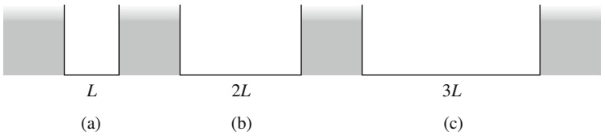

text_image

L
(a)
2L
(b)
3L
(c)

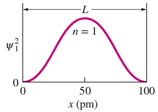

contour

| x (pm) | \(\psi_{1}^{2}\) |
| --- | --- |
| 0 | 0 |
| ~50 | ~peak |
| 100 | 0 |

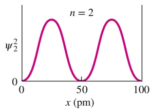

line

| x (pm) | \(\psi^{2}_{2}\) |
| --- | --- |
| 0 | 0 |
| ~25 | ~peak |
| 50 | 0 |
| ~75 | ~peak |
| 100 | 0 |

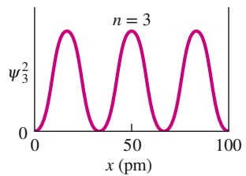

line

| x (pm) | \(\psi^{2}_{3}\) |
| --- | --- |
| 0 | 0 |
| ~15 | ~peak |
| ~35 | 0 |
| ~50 | ~peak |
| ~65 | 0 |
| ~85 | ~peak |
| 100 | 0 |

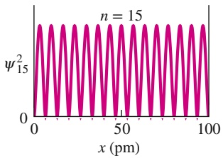

line

| x (pm) | \(\psi^{2}_{15}\) |
| --- | --- |
| 0 | 0 |
| ~5 | ~1.0 |
| ~10 | 0 |
| ~15 | ~1.0 |
| ~20 | 0 |
| ~25 | ~1.0 |
| ~30 | 0 |
| ~35 | ~1.0 |
| ~40 | 0 |
| ~45 | ~1.0 |
| ~50 | 0 |
| ~55 | ~1.0 |
| ~60 | 0 |
| ~65 | ~1.0 |
| ~70 | 0 |
| ~75 | ~1.0 |
| ~80 | 0 |
| ~85 | ~1.0 |
| ~90 | 0 |
| ~95 | ~1.0 |
| 100 | 0 |

## Abb. 35.5

Die Wahrscheinlichkeitsdichte $\psi _ { n } ^ { 2 } ( x )$ für vier Zustände eines Elektrons in einem eindimensionalen unendlich hohen Kastenpotenzial. Die zugehö- rigen Quantenzahlen sind $n = \bar { 1 } , 2 , 3$ und 15. Mit der größten Wahrscheinlichkeit findet man das Elektron an den Stellen, an denen $\psi _ { n } ^ { 2 } ( x )$ maximal ist, und mit der kleinsten Wahrscheinlichkeit an den Stellen, wo $\psi _ { n } ^ { 2 } ( x )$ am kleinsten ist.

## Die Normierung der Wellenfunktion

Das Produkt $\psi _ { n } ^ { 2 } ( x )$ dx entspricht der Wahrscheinlichkeit, ein Elektron innerhalb des unendlich hohen Kastenpotenzials in dem Intervall zwischen x und $x +$ dx nachzuweisen. Wir wissen aber, dass sich das Elektron irgendwo in dem Kasten befinden muss, also muss

$$
\int_ {- \infty} ^ {+ \infty} \psi_ {n} ^ {2} (x) \mathrm{d} x = 1 \qquad (\text {Normierungsbedingung}) \tag {35.11}
$$

sein, denn die Wahrscheinlichkeit 1 (oder 100 %) entspricht einer absoluten Sicherheit. Obwohl das Integral sich formal über die gesamte x-Achse erstreckt, trägt nur der Bereich von $x = 0$ bis $x = L$ zu seinem Wert und damit zur Wahrscheinlichkeit bei. Grafisch entspricht das Integral in Gl. 35.11 der Fläche unter den Kurven in Abb. 35.5.

In Beispielaufgabe 35.3 im Übungsbuch sehen Sie, dass wir für die Amplitude in Gl. 35.9 den Ausdruck $A = \sqrt { 2 / L }$ erhalten, wenn wir Gl. 35.9 in die Normierungsbedingung einsetzen und nach A auflösen. Die Amplitude einer Wellenfunktion mithilfe von Gl. 35.11 zu berechnen, bezeichnet man als **Normierung** der Wellenfunktion; sie lässt sich auf alle eindimensionalen Wellenfunktionen anwenden.

## Die Nullpunktsenergie

Der Wert $n = 1$ in Gl. 35.4 definiert den Zustand niedrigster Energie – den Grundzustand – für ein Elektron in einem unendlich hohen Kastenpotenzial. In diesem Zustand befindet sich das Elektron, solange ihm keine Energie zugeführt wird, die es in einen angeregten Zustand anhebt.

Damit stellt sich sofort die Frage, warum wir nicht auch den Fall $n = 0$ zu den Möglichkeiten in Gl. 35.4 hinzuzählen dürfen. Für $n = 0$ erhielten wir tatsächlich die Energie null für den Grundzustand. Allerdings erhalten wir für $n = 0$ aus Gl. 35.9 auch sofort $\psi _ { n } ^ { 2 } ( x ) = 0$ für alle x. Das können wir nur so interpretieren, dass sich in diesem Fall kein Elektron in dem Kasten befindet. Wenn wir nun aber wissen, dass ein Elektron in dem Kasten enthalten sein muss, ist $n = 0$ keine erlaubte Quantenzahl.

Dies ist eine wichtige Schlussfolgerung aus der Quantenphysik: Systeme mit einem endlichen Volumen können keinen Zustand mit der Energie null haben. Es muss immer eine bestimmte Minimalenergie, die sogenannte **Nullpunktsenergie**, vorhanden sein.

Wir können die Nullpunktsenergie so klein machen, wie wir wollen, indem wir das Kastenpotenzial breiter machen und so L in Gl. 35.4 vergrößern. Nur im Grenz fall $L \to \infty$ geht die Nullpunktsenergie gegen null. In diesem Grenzfall wird das Elektron zu einem freien Teilchen, das entlang der x-Achse keinen Einschränkungen mehr unterliegt. Seine Energie ist nichtquantisiert; sie kann jeden Wert annehmen, einschließlich null. Ein Teilchen in einem begrenzten Gebiet muss dagegen eine Nullpunktsenergie haben und kann niemals vollkommen in Ruhe sein.

## KONTROLLFRAGE 3

In einem unendlich hohen Kastenpotenzial mit einer gegebenen Breite befindet sich (a) ein Elektron, (b) ein Proton, (c) ein Deuteron und (d) ein Alpha-Teilchen. Ordnen Sie die Teilchen in absteigender Reihenfolge nach ihrer Nullpunktsenergie. Die Masse der Teilchen nimmt in der angegebenen Reihenfolge zu.

## 35.3 Das eindimensionale endliche Kastenpotenzial

## Lernziele

Nach dem Durcharbeiten dieses Abschnitts sollten Sie in der Lage sein, . . .

• einen endlichen eindimensionalen Potenzialtopf zu skizzieren und seine Länge und Höhe anzugeben,
• das Energieniveauschema eines Elektrons in einem endlichen Potenzialtopf zu skizzieren, das nichtquantisierte Gebiet anzugeben und die Energien und De-Broglie-Wellenlängen mit denen eines unendlichen Potenzialtopfs gleicher Länge zu vergleichen,
• zu erklären, wie (im Prinzip) die Wellenfunktionen der erlaubten Zustände eines Elektrons in einem endlichen Potenzialtopf bestimmt werden,
• die Wahrscheinlichkeitsdichte eines Elektrons in einem endlichen Potenzialtopf mit gegebener Quantenzahl n als Funktion seiner Position innerhalb des Topfs und im Bereich der Wände zu skizzieren,
• zu verstehen, dass ein im Potenzialtopf gefangenes Elektron nur in den erlaubten Zuständen existieren kann, und den Zusammenhang zwischen den Energien der Zustände und der kinetischen Energie des Elektrons anzugeben,
• die Energie zu berechnen, die ein Elektron absorbieren oder emittieren muss, damit es zwischen erlaubten Zuständen oder zwischen einem erlaubten Zustand und dem nichtquantisierten Bereich hin- und herwechseln kann,
• für einen durch Licht ausgelösten Quantensprung die Beziehung zwischen der Energieänderung und der Frequenz und Wellenlänge des Photons anzuwenden,
für einen erlaubten Zustand in einem endlichen Potenzialtopf zu berechnen, welche Energie das Elektron mindestens braucht, um aus dem Topf entkommen zu können, bzw. welche kinetische Energie ein entkommenes Elektron besitzt, auf das mehr als diese Mindestenergie übertragen wurde,
die Emissions- und Absorptionsspektren eines Elektrons in einem eindimensionalen endlichen Potenzialtopf zu verstehen, einschließlich der Übergänge, die dem Entkommen aus dem bzw. dem Hineinfallen in den Topf entsprechen.

## Schlüsselideen

• Die Wellenfunktion eines Elektrons in einem endlichen eindimensionalen Potenzialtopf erstreckt sich in die Wände hinein, wobei die Wellenfunktion dort exponentiell mit der Eindringtiefe abnimmt.
• Verglichen mit den Zuständen in einem unendlichen Potenzialtopf gleicher Größe haben die Zustände in einem endlichen Topf eine begrenzte Anzahl, längere De-Broglie-Wellenlängen und niedrigere Energien.

## 35.3.1 Ein Elektron in einem endlichen Kastenpotenzial

Ein unendlich hohes Kastenpotenzial ist eine Idealisierung. Abbildung 35.6 zeigt ein realistisches Kastenpotenzial, bei dem die potenzielle Energie eines Elektrons außerhalb des Kastens nicht unendlich groß ist, sondern einen endlichen positiven Wert $U _ { 0 }$ hat, den man auch als die **Potenzialtiefe** (oder, je nach Standpunkt, Potenzialhöhe) bezeichnet. Die Analogie zwischen Wellen auf einem gespannten Seil und Materiewellen gilt für endliche Kastenpotenziale nicht mehr, da die Materiewellen bei den Stellen $x = 0$ und $x = L$ keine Knotenpunkte mehr haben müssen (und auch nicht haben, wie wir sehen werden).

Wenn wir die Wellenfunktionen zu den Quantenzuständen eines Elektrons in dem endlichen Kastenpotenzial von Abb. 35.6 bestimmen wollen, müssen wir von der Schrödinger-Gleichung ausgehen, der Grundgleichung der Quantenmechanik. Nach Abschn. 34.6 ist die Schrödinger-Gleichung für die eindimensionale Bewegung eines Teilchens in einem Potenzial $U ( x )$ durch Gl. 34.20 gegeben:

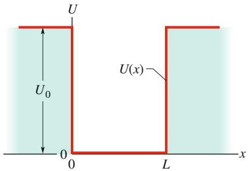

text_image

U
U₀
0
0
L
x
U(x)

Abb. 35.6

Ein endliches Kastenpotenzial. Die Potenzialtiefe ist $U _ { 0 }$ und die Breite ist L. Wie bei dem unendlich hohen Kastenpotenzial aus Abb. 35.2 soll sich das eingefangene Elektron nur in x-Richtung bewegen können.

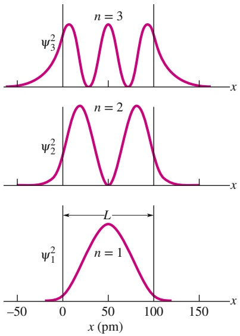

Abb. 35.7

Drei Wahrscheinlichkeitsdichten $\psi _ { n } ^ { 2 } ( x )$ für ein Elektron in einem endlichen Kastenpotenzial der Tiefe $U _ { 0 } = 4 5 0   \mathrm { e V }$ und der Breite L = 100 pm.

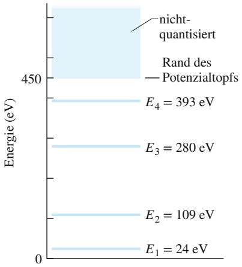

line

| Energy Level | Value (eV) |
| --- | --- |
| E1 | 24 |
| E2 | 109 |
| E3 | 280 |
| E4 | 393 |

Abb. 35.8

Ein Elektron in dem vorgegebenen endlichen Kastenpotenzial mit $U _ { 0 } = 4 5 0   \mathrm { e V }$ und $L = 1 0 0$ pm kann nur in den Zuständen mit den Quantenzahlen $n = 1 , 2 , 3$ oder 4 vorliegen.

Hat das Elektron eine Energie von 450 eV oder mehr, ist es nicht mehr in dem Kasten gefangen und seine Energie ist nicht mehr quantisiert.

$$
\frac {\mathrm{d} ^ {2} \psi}{\mathrm{d} x ^ {2}} + \frac {8 \pi^ {2} m}{h ^ {2}} [ E - U (x) ] \psi = 0. \tag {35.12}
$$

An dieser Stelle wollen wir nur das Ergebnis dieser Gleichung für bestimmte numerische Werte von $U _ { 0 }$ und L diskutieren. Abbildung 35.7 zeigt drei mögliche Wahrscheinlichkeitsdichten $\psi _ { n } ^ { 2 } ( x )$ für ein Kastenpotenzial mit $U _ { 0 } = 4 5 0   \mathrm { e V }$ und $L = 1 0 0   \mathrm { p m } .$

Alle drei Wahrscheinlichkeitsdichten $\psi _ { n } ^ { 2 } ( x )$ in Abb. 35.7 erfüllen die Normierungsbedingung der Gl. 35.11; die Flächen unter den Wahrscheinlichkeitsdichten sind also alle 1.

Wenn Sie Abb. 35.7 für das endliche Kastenpotenzial mit Abb. 35.5 für ein unendliches Kastenpotenzial vergleichen, bemerken Sie einen wichtigen Unterschied: Bei dem endlichen Kastenpotenzial kann die Materiewelle des Elektrons in die Wände des Kastens eindringen, also in einen Bereich, in dem das Elektron sich nach der Newtonschen Mechanik nicht aufhalten darf. Dieses Eindringen in die Wände sollte jedoch nicht überraschen, denn in Abschn. 34.9 haben wir bereits gesehen, dass ein Elektron durch eine Potenzialbarriere hindurchtunneln kann. Das „Hineintunneln“ in die Wände einer endlichen Potenzialwand ist ein ähnliches Phänomen. Aus den drei Kurven für $\psi ^ { 2 }$ in Abb. 35.7 wird deutlich, dass dieses Eindringen mit wachsenden Quantenzahlen n zunimmt.

Da ein Elektron in die Wände eines endlichen Potenzials eindringt, ist die Wellenlänge λ zu einem gegebenen Quantenzustand in einem endlichen Potenzialkasten größer, als wenn das Elektron in einem unendlichen Potenzialkasten gefangen wäre. Nach Gl. 35.3 ist daher die Energie E eines Elektrons für einen bestimmten Zustand im endlichen Potenzialkasten kleiner als im unendlichen Potenzialkasten.

Mit diesen Informationen können wir die Energieniveaus für ein Elektron in einem endlichen Kastenpotenzial näherungsweise bestimmen. Als Beispiel betrachten wir die Energieniveaus zu den Kurven in Abb. 35.7, die zu einem Kastenpotenzial der Breite $L = 1 0 0$ pm und der Tiefe $U _ { 0 } = 4 5 0   \mathrm { e V }$ gehören. Die entsprechenden Energieniveaus zu dem unendlichen Kastenpotenzial findet man in Abb. 35.3. $\mathrm { Z u - }$ nächst entfernen wir in Abb. 35.3 den gesamten Bereich oberhalb von 450 eV. Die drei verbliebenen Energieniveaus verschieben wir etwas nach unten, das Niveau zu n = 4 am meisten, denn das Eindringen der Materiewelle in die Wände ist für $n = 4$ am größten. Als Ergebnis erhalten wir eine Näherung für die Energieniveaus des endlichen Kastens. Die tatsächlichen Niveaus sind in Abb. 35.8 gezeigt.

In diesem Bild hat ein Elektron mit einer Energie größer als $U _ { 0 }   ( = 4 5 0   \mathrm { e V } )$ zu viel Energie, um in dem endlichen Kasten gefangen zu sein. Seine Bewegung ist daher auch nicht auf ein endliches Gebiet eingeschränkt und seine Energie nichtquantisiert, also nicht nur auf einen diskreten Satz von Werten eingeschränkt. Um diesen nichtquantisierten Teil in der Energieniveaudarstellung erreichen und frei sein zu können, muss ein gefangenes Elektron irgendwoher eine ausreichende Menge an Energie erhalten, sodass seine mechanische Energie größer als 450 eV wird.

## 35.4 Zwei- und dreidimensionale Elektronenfallen

## Lernziele

Nach dem Durcharbeiten dieses Abschnitts sollten Sie in der Lage sein, . . .

• Nanokristallite hinsichtlich ihrer Eigenschaft als Elektronenfallen zu diskutieren und zu erklären, wie deren Schwellenwellenlänge ihre Farbe bestimmen kann,
• Herstellung und Eigenschaften von Quantenpunkten und Quantenpferchen zu verstehen,
• die Gleichungen für die Wellenfunktion und Wahrscheinlichkeitsdichte eines Elektrons in einem unendlichen Potenzialtopf in zwei oder drei Dimensionen zu formulieren und aus ihnen die Aufenthaltswahrscheinlichkeit des Elektrons in einem gegebenen Bereich um den Topf zu berechnen,

die erlaubten Energien eines Elektrons in einem unendlichen zwei- bzw. dreidi mensionalen Potenzialtopf zu berechnen und das Energieniveauschema zu skiz zieren, einschließlich der Beschriftungen für die Quantenzahlen, den Grundzu stand und einige angeregte Zustände,
• zu erklären, was entartete Zustände sind,
die Energie zu berechnen, die ein Elektron absorbieren oder emittieren muss, um zwischen den erlaubten Zuständen in einer zwei- oder dreidimensionalen Elektronenfalle hin- und herzuwechseln,
• bei Quantensprüngen unter Beteiligung von Licht die Beziehungen zwischen Energieänderung, Frequenz und Wellenlänge der Photonen anzuwenden.

## Schlüsselideen

• Die quantisierten Energien eines Elektrons in einem zweidimensionalen unendlichen Potenzialtopf in Form eines Rechtecks sind

$$
E _ {n _ {x}, n _ {y}} = \frac {h ^ {2}}{8 m _ {\mathrm{e}}} \left(\frac {n _ {x} ^ {2}}{L _ {x} ^ {2}} + \frac {n _ {y} ^ {2}}{L _ {y} ^ {2}}\right).
$$

Dabei sind $n _ { x }$ die Quantenzahl für die Topfbreite $L _ { x }$ und $n _ { y }$ diejenige für die Topfbreite $L _ { y } .$

• Die Wellenfunktionen für ein Elektron in einem zweidimensionalen Potenzialtopf sind

$$
\psi_ {n _ {x}, n _ {y}} (x) = \sqrt {\frac {2}{L _ {x}}} \sin \left(\frac {n _ {x} \pi}{L _ {x}} x\right) \sqrt {\frac {2}{L _ {y}}} \sin \left(\frac {n _ {y} \pi}{L _ {y}} y\right).
$$

## 35.4.1 Elektronenfallen in der Praxis

Im Folgenden wollen wir einige Arten von Elektronenfallen beschreiben, die prak tisch realisierbar und realisiert sind und teilweise bereits Anwendungen finden.

## Nanokristallite

Der vermutlich direkteste Weg, Potenzialbarrieren für Elektronen im Labor zu realisieren, besteht in der Herstellung einer Halbleiterprobe in Form eines Pulvers aus sehr kleinen (Abmessungen im Nanometerbereich) Kristallen mit möglichst homogener Größe. Solche Nanokristallite wirken für die in ihnen gefangenen Elektronen wie ein Kastenpotenzial.

Nach Gl. 35.4, $E _ { n } = ( h ^ { 2 } / 8 m L ^ { 2 } ) n ^ { 2 }$ , können wir die Energie des niedrigsten Quantenzustands eines Elektrons in einem unendlich hohen Kastenpotenzial erhöhen, indem wir die Breite L des Kastens verkleinern. Je kleiner ein solcher Nanokristall ist, desto höher liegen die erlaubten Energieniveaus und desto größer sind auch die Energien der Photonen, die von einem darin gefangenen Elektron absorbiert werden können.

Wenn Sonnenlicht auf ein nanokristallines Pulver fällt, können die Kristallite al le Photonen absorbieren, deren Energie oberhalb einer bestimmten Grenzenergie $E _ { G } \: ( = h f _ { G } )$ bzw. deren Wellenlänge unterhalb einer bestimmten Grenzwellenlän-$\mathrm { g e }   \lambda _ { \mathrm { G } }$ liegt. Dabei ist

$$
\lambda_ {\mathrm{G}} = \frac {c}{f _ {\mathrm{G}}} = \frac {c h}{E _ {\mathrm{G}}} . \tag {35.13}
$$

Nicht absorbiertes Licht wird gestreut, daher streut unser Pulver aus Nanokristalliten alle Wellenlängen oberhalb von $\lambda _ { \mathrm { G } } .$

natural_image

Close-up of colorful powder on a blue surface, including red and yellow powders in clear glass containers (no text or symbols visible)

Abb. 35.9

Mehrere Proben des pulverisierten Halbleiters Cadmiumselenid, die sich nur in der Größe ihrer Kristalle unterscheiden. Jeder Nanokristall bildet eine Elektronenfalle. Das rote Pulver enthält die größten Kristalle und besitzt dementsprechend die kleinsten Abstände zwischen den Energieniveaus und eine niedrigere Energieschwelle für die Lichtabsorption [Quelle: ©1992 Scientific American].

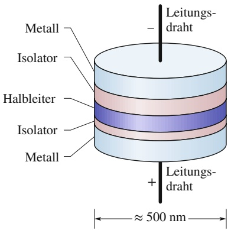

text_image

Leitungs-
draht
Metall
Isolator
Halbleiter
Isolator
Metall
+ Leitungs-
draht
≈ 500 nm

Abb. 35.10

Ein Quantenpunkt oder „künstliches Atom“. Eine mittlere Schicht aus Halbleitermaterial (violett) bildet einen Potenzialkasten, in dem die Elektronen gefangen sind.

Wir sehen das Pulver in dem Licht, das zu unseren Augen zurückgestreut wird. Indem man die Größe der Nanokristallite in einer Probe verändert, kann man folg lich auch die Wellenlänge des von dieser Probe gestreuten Lichts und damit die Farbe der Probe ändern.

In Abb. 35.9 erkennt man mehrere Proben des Halbleiters Cadmiumselenid, jeweils als nanokristallines Pulver. Das rote Pulver streut Licht am langwelligen Ende des Spektrums. Das gelbe Pulver unterscheidet sich von dem roten nur in der Grö- ße der Nanokristallite. Es enthält die kleineren Kristallite, daher ist seine Grenzenergie $E _ { \mathrm { G } }$ größer und nach Gl. 35.13 die zugehörige Grenzwellenlänge kürzer. Die Farbe dieses Pulvers entspricht daher einer kürzeren Wellenlänge – im vorliegenden Fall gelb. Die beeindruckenden Farbunterschiede zwischen den Proben sind gleichzeitig ein überzeugendes Indiz für die Quantisierung der Energien von eingefangenen Elektronen und die Abhängigkeit dieser Energien von der Größe der Elektronenfalle.

## Quantenschichten, Quantendrähte und Quantenpunkte

Die modernen Methoden der Halbleiterepitaxie machen es möglich, komplizierte Halbleiterstrukturen dadurch aufzubauen, dass man eine Atomlage nach der anderen auf einen Substrat genannten Untergrund aufbringt. Dabei ist es möglich, die Zusammensetzung des Materials von einer Atomlage zur nächsten zu ändern. Auf diese Weise kann man einige wenige Atomlagen mit einer speziellen Zusammensetzung zwischen Atomlagen einer anderen Zusammensetzung einbauen – quasi ein Nano-Sandwich.

Beispielsweise kann man mit einem Material beginnen, in dem die minimale Energie der Elektronen relativ hoch ist, und darauf eine Schicht eines zweiten Materials mit etwas kleinerer Elektronenenergie auftragen. Wenn man anschließend eine weitere Schicht des ersten Materials aufbringt, hat man für die Elektronen effektiv eine Potenzialbarriere geschaffen. Innerhalb der Atomlage können sich die Elektronen ungestört bewegen, aber in der Richtung senkrecht zu den Atomlagen, d. h. in der Wachstumsrichtung der Struktur, existiert ein eindimensionaler Potenzialtopf für die Elektronen. Solche Strukturen bezeichnet man als Halbleiter-Quantenschichten. Sie haben in der Optoelektronik große Bedeutung, da viele Halbleiterlaser und Leuchtdioden auf solchen Strukturen basieren.

Bei Quantenschichten ist die Elektronenbewegung nur in einer Richtung eingeschränkt, d. h., in den restlichen beiden Raumdimensionen können sich die Elek tronen frei bewegen. Daher bezeichnet man diese Quantenschichten oft als „zweidimensionale Strukturen“.

Die Einschränkung der Freiheitsgrade für die Elektronenbewegung ist aber kei neswegs auf Quantenschichten beschränkt. Beispielsweise kann man aus Quantenschichten lange dünne Streifen herausätzen, sodass eine freie Bewegung der Elektronen nur noch in einer Richtung möglich ist; die entstehenden Strukturen bezeichnet man entsprechend als Quantendrähte. Durch geeignete Wachstumsprozesse kann man solche quasi-eindimensionalen Systeme auch direkt herstellen.

Noch weiter geht man bei den sogenannten Quantenpunkten. Hier wird die freie Bewegung der Elektronen komplett unterdrückt, indem man beispielsweise einen kleinen Ausschnitt aus einer Quantenschicht freiätzt. Unter geeigneten Bedingungen wachsen solche Quantenpunkte auch von allein; man spricht dann von sogenannten selbstorganisierten Quantenpunkten.

Neben diesen Strukturen, die ausschließlich aus verschiedenen Halbleitermate rialien bestehen, gibt es noch viele andere Arten von Systemen, in denen die Elek tronenbeweglichkeit auf die eine oder andere Art eingeschränkt wird. Ein Beispiel ist in Abb. 35.10a dargestellt. Auch hier handelt es sich um einen Quantenpunkt, allerdings wurde hier die violett dargestellte dünne Halbleiterschicht zwischen zwei isolierende Schichten gebracht, von denen eine sehr viel dünner als die andere ist. An den Enden werden Metallkappen mit Leitungsdrähten angebracht. Die Materialien sind so gewählt, dass die potenzielle Energie eines Elektrons in der mittleren Schicht kleiner als in den beiden nichtleitenden Schichten ist, womit die mittlere Halbleiterschicht wie ein Potenzialkasten wirkt. Abbildung 35.10b zeigt einen realen Quantenpunkt. Der Kasten, in dem die einzelnen Elektronen gefangen sind, entspricht dem violetten Bereich.

Die untere nichtleitende Schicht ist (im Gegensatz zur oberen Schicht) so dünn, dass Elektronen durch sie hindurchtunneln können, wenn eine entsprechende Spannung zwischen den Metallkappen angelegt wird. Auf diese Weise lässt sich die Anzahl der Elektronen innerhalb des Kastens verändern. Eine solche Anordnung verhält sich daher wie ein künstliches Atom, bei dem die Anzahl der Elektronen gezielt eingestellt werden kann. Quantenpunkte lassen sich in Form von zweidimensionalen Gittern anordnen und könnten in dieser Form die Grundlage für sehr schnelle Computersysteme mit einer großen Speicherkapazität werden.

## Quantenpferche

Wenn ein Raster-Tunnelmikroskop (wie in Abschn. 34.9 beschrieben) eine Oberfläche abtastet, übt seine Spitze eine schwache Kraft auf isolierte Atome aus, die sich auf der ansonsten glatten Oberfläche befinden. Wenn man die Position der Spitze vorsichtig verändert, können solche Atome über die Oberfläche „gezogen“und an einen anderen Ort gebracht werden. Mit dieser Technik gelang es Wissenschaftlern am IBM-Forschungszentrum Almaden (Silicon Valley, Kalifornien), Eisenatome auf einer sorgsam präparierten Kupferoberfläche zu verschieben und zu einem Kreis anzuordnen, den sie **Quantenpferch** (**quantum corral**) nannten.

In einem solchen Quantenpferch können ebenfalls Elektronen eingefangen werden, die sich ansonsten frei über die Kupferoberfläche bewegen würden, aber das „Gatter“ der Eisenatome nicht überwinden können.

## 35.4.2 Die theoretische Analyse zwei- und dreidimensionaler Potenzialtöpfe

Im nächsten Abschnitt werden wir das Wasserstoffatom in Analogie zu einem dreidimensionalen endlichen Potenzialtopf behandeln. Als Vorbereitung wollen wir nun unsere Untersuchung des unendlich hohen Kastenpotenzials bzw. Potenzialtopfs auf zwei und drei Dimensionen ausdehnen.

## Ein rechteckiger Potenzialtopf

Abbildung 35.11 zeigt die rechteckige Fläche, auf der ein Elektron in einer zweidimensionalen Ausführung des unendlich hohen Kastenpotenzials aus Abb. 35.2 gefangen gehalten wird. Die Seitenlängen der Fläche seien $L _ { x }$ und $L _ { y } .$ Ein solches Potenzial bezeichnet man als rechteckigen Potenzialtopf. Es kann sich beispielsweise auf der Oberfläche eines Körpers befinden, wobei das Elektron irgendwie an der Bewegung parallel zur z-Achse und damit am Verlassen der Oberfläche gehindert wird. Entlang jeder der Seiten des Rechtecks muss man sich eine unendlich hohe Potenzialwand vorstellen (ähnlich wie U(x) in Abb. 35.2), die das Elektron innerhalb des Rechtecks gefangen hält.

Die Lösung der Schrödinger-Gleichung für den rechteckigen Potenzialtopf aus Abb. 35.11 zeigt, dass die Materiewelle des Elektrons nun bezüglich beider Richtungen in das Rechteck passen muss, ebenso wie vorher die Materiewelle des Elektrons in den eindimensionalen Potenzialtopf passen musste. Das bedeutet, dass die Welle nun sowohl bezüglich der Breite $L _ { x }$ als auch bezüglich der Breite $L _ { y }$ quantisiert ist. $n _ { x }$ sei die Quantenzahl bezüglich der Breite $L _ { x }$ und $n _ { y }$ die Quantenzahl bezüglich der Breite $L _ { y } .$ Wie bei dem eindimensionalen Kastenpotenzial können auch hier die Quantenzahlen nur positive ganze Zahlen sein.

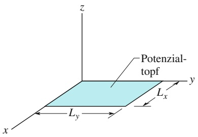

text_image

Potenzial-topf
Lx
Ly
x
y
z

Abb. 35.11

Ein rechteckiger Potenzialtopf – ein zweidimensionales Analogon zu dem unendlich hohen Kastenpotenzial aus Abb. 35.2 – mit den Seitenlängen $L _ { x }$ und $L _ { y } .$

Die Energie des Elektrons hängt nun von beiden Quantenzahlen ab und ist gleich der Summe aus den beiden Energien, die das Elektron hätte, wenn es nur entlang der x-Achse oder nur entlang der y-Achse gefangen wäre. Nach Gl. 35.4 können wir dafür schreiben

$$
E _ {n _ {x}, n _ {y}} = \left(\frac {h ^ {2}}{8 m L _ {x} ^ {2}}\right) n _ {x} ^ {2} + \left(\frac {h ^ {2}}{8 m L _ {y} ^ {2}}\right) n _ {y} ^ {2} = \frac {h ^ {2}}{8 m} \left(\frac {n _ {x} ^ {2}}{L _ {x} ^ {2}} + \frac {n _ {y} ^ {2}}{L _ {y} ^ {2}}\right). (3 5. 1 4)
$$

Die Anregung eines Elektrons durch Photonenabsorption oder auch das Zurückspringen des Elektrons in ein tieferes Niveau durch Photonenemission unterliegen denselben Bedingungen wie im eindimensionalen Fall. Der einzige wesentliche Unterschied für den zweidimensionalen Potenzialtopf besteht darin, dass die Energie eines gegebenen Zustands nun von zwei Quantenzahlen $( n _ { x }$ und $n _ { y } )$ abhängt. Im Allgemeinen haben verschiedene Zustände (zu unterschiedlichen Werten von $n _ { x }$ und $n _ { y } )$ auch verschiedene Energien. In manchen Fällen können verschiedene $\mathrm { Z u - }$ stände jedoch dieselben Energien haben. Solche Zustände (und die zugehörigen Energieniveaus) bezeichnet man als entartet. In eindimensionalen Potenzialtöpfen können solche entarteten Zustände nicht auftreten.

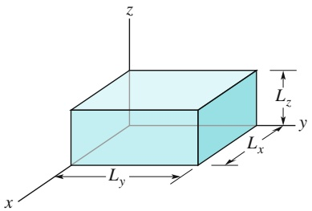

text_image

z
Lz
y
Lx
Ly
x

Abb. 35.12

Ein quaderförmiger Kasten – ein dreidimensionales Analogon zu dem unendlich hohen Kastenpotenzial aus Abb. 35.2 – mit den Kantenlängen $L _ { x } , L _ { y }$ und $L _ { z } .$

## Der dreidimensionale rechteckige Potenzialtopf

Ein Elektron kann auch in einem dreidimensionalen unendlich hohen Potenzialtopf gefangen sein. Wenn ein solcher Kasten die in Abb. 35.12 gezeigte Form besitzt, dann folgt aus der Schrödinger-Gleichung für die Energie des Elektrons

$$
E _ {n _ {x}, n _ {y}, n _ {z}} = \frac {h ^ {2}}{8 m} \left(\frac {n _ {x} ^ {2}}{L _ {x} ^ {2}} + \frac {n _ {y} ^ {2}}{L _ {y} ^ {2}} + \frac {n _ {z} ^ {2}}{L _ {z} ^ {2}}\right). \tag {35.15}
$$

Hierbei ist $n _ { z }$ eine dritte Quantenzahl, welche die Wellenfunktion in z-Richtung charakterisiert, die nun an die Kastenbreite $L _ { z }$ angepasst sein muss.

## KONTROLLFRAGE 4

Was ist in der Notation von Gl. 35.14 die Grundzustandsenergie eines Elektrons in einem rechteckigen Potenzialtopf: $E _ { 0 , 0 } , E _ { 1 , 0 } , E _ { 0 , 1 }$ oder $E _ { 1 , 1 ^ { \frac { 7 } { } } }$

## 35.5 Das Wasserstoffatom

## Lernziele

Nach dem Durcharbeiten dieses Abschnitts sollten Sie in der Lage sein, . . .

• das Bohrsche Modell des Wasserstoffatoms zu verstehen und zu erklären, wie Bohr die quantisierten Radien und Energien herleitete,
• zu einer gegebenen Quantenzahl n im Bohr-Modell den Bahnradius des Elek trons, seine kinetische, potenzielle und Gesamtenergie, seine Bahnperiode und -frequenz sowie seinen Impuls und seinen Drehimpuls zu berechnen,
• die Unterschiede zwischen Bohrs und Schrödingers Beschreibung des Wasserstoffatoms zu erläutern, insbesondere im Hinblick auf die erlaubten Werte des Drehimpulses,
• die Beziehung zwischen den quantisierten Energien $E _ { n }$ und der Quantenzahl n für das Wasserstoffatom anzuwenden,
• für einen gegebenen Übergang im Wasserstoffatom (entweder zwischen zwei quantisierten Zuständen oder zwischen einem quantisierten und einem nichtquantisierten Zustand) die Energieänderung zu berechnen, sowie – falls dabei

Licht im Spiel ist – die zugehörige Energie, Frequenz und Wellenlänge und den Impuls des Photons zu bestimmen,

das Energieniveauschema des Wasserstoffs zu skizzieren, den Grundzustand und einige angeregte Zustände anzugeben und den nichtquantisierten Bereich sowie die Paschen-, Balmer- und Lyman-Serie einschließlich der Seriengrenzen zu bezeichnen,
• für jede Spektralserie die Übergänge mit den größten und kleinsten Wellenlängen, die Seriengrenzen und die Ionisierungsenergie anzugeben,
• alle Quantenzahlen eines Atoms aufzuführen und ihre erlaubten Werte anzugeben,
• zu einer gegebenen normierten Wellenfunktion die radiale Wahrscheinlichkeitsdichte P(r) zu berechnen und die Wahrscheinlichkeit anzugeben, das Elektron in einem gegebenen Intervall von Radien anzutreffen,
• die radiale Wahrscheinlichkeitsdichte des Grundzustands des Wasserstoffatoms als Funktion der radialen Entfernung r aufzutragen und darin den Bohrschen Radius a anzugeben,
• zu verifizieren, dass eine gegebene normierte Wasserstoff-Wellenfunktion die Schrödinger-Gleichung erfüllt,
• zwischen (Haupt-)Schalen und Unterschalen in einem Atom zu unterscheiden,
• die Punktwolkendarstellung einer Wahrscheinlichkeitsdichte zu erklären.

## Schlüsselideen

• Das Bohrsche Modell des Wasserstoffatoms sagte die Energieniveaus für dieses Atom erfolgreich voraus und erklärte dessen Emissions- und Absorptionsspektrum. In fast jeder anderen Hinsicht ist es jedoch nicht korrekt.

• Das Bohr-Modell ist ein Planetenmodell, in dem das Elektron das zentrale Proton mit einem Drehimpuls L umkreist, der gemäß

$$
L = n \hbar \quad \text { mit } \quad n = 1, 2, 3, \dots
$$

quantisiert ist; dabei ist n eine Quantenzahl. Der Wert L = 0 ist fälschlicherweise ausgeschlossen.

• Die Schrödinger-Gleichung liefert die korrekten Werte für L und die quantisierten Energien:

$$
E _ {n} = \frac {m e ^ {4}}{8 \varepsilon_ {0} ^ {2} h ^ {2}} \frac {1}{n ^ {2}} = - \frac {1 3 , 6 0 \mathrm{eV}}{n ^ {2}} \quad \text {mit} \quad n = 1, 2, 3, \dots
$$

• Das Atom (bzw. genauer das Elektron im Atom) kann seine Energie nur in Sprüngen zwischen diesen erlaubten Energiewerten ändern.

• Erfolgt die Energieänderung (der Quantensprung) durch Absorption (Energie des Atoms nimmt zu) oder Emission (Energie des Atoms nimmt ab) eines Photons, führt diese Beschränkung der Energieänderungen auf die Bedingung

$$
\frac {1}{\lambda} = R \left(\frac {1}{n _ {\text {unten}} ^ {2}} - \frac {1}{n _ {\text {oben}} ^ {2}}\right)
$$

für die Lichtwellenlänge; dabei ist die Rydberg-Konstante

$$
R = \frac {m e ^ {4}}{8 \varepsilon_ {0} ^ {2} h ^ {3} c} = 1, 0 9 7 3 7 3 \cdot 1 0 ^ {7} \mathrm{m} ^ {- 1}.
$$

Die radiale Wahrscheinlichkeitsdichte P(r) für einen Zustand im Wasserstoffatom ist so definiert, dass P(r) dr die Wahrscheinlichkeit dafür angibt, das Elek tron irgendwo im Bereich zwischen einer Kugelschale mit Radius r und einer mit Radius r + dr um den Atomkern anzutreffen.

• Die Normierung erfordert

$$
\int_ {0} ^ {\infty} P (r) \mathrm{d} r = 1.
$$

• Die Wahrscheinlichkeit, das Elektron irgendwo zwischen zwei gegebenen Radien $r _ { 1 }$ und $r _ { 2 }$ zu finden, beträgt

$$
P (\text {Detektion zwischen} r _ {1} \text {und} r _ {2}) = \int_ {r _ {1}} ^ {r _ {2}} P (r) \mathrm{d} r.
$$

## 35.5.1 Das Wasserstoffatom als Elektronenfalle

Nachdem wir uns mit künstlichen und fiktiven Elektronenfallen beschäftigt haben, wenden wir uns nun natürlichen Fallen zu – den Atomen. In diesem Kapitel steht das einfachste Beispiel, das Wasserstoffatom, im Mittelpunkt. Dieses Atom besteht aus einem einzigen Elektron, das elektrisch an ein Proton gebunden ist, welches der einzige Bestandteil des Atomkerns im Zentrum des Atoms ist. Wir wollen uns an dieser Stelle nicht weiter mit dem Atomkern befassen, sondern ausschließlich die Tatsache berücksichtigen, dass das negativ geladene Elektron durch die Coulomb-Kraft von dem positiv geladenen Proton angezogen wird. Da die Protonenmasse wesentlich größer als die Elektronenmasse ist, können wir in guter Näherung davon ausgehen, dass das Proton fixiert ist und dass sich das Elektron in seiner Nä- he befinden muss, d. h., dass das Elektron gebunden ist. Dies bedeutet, dass die Elektronenenergie E und daher auch jegliche Veränderung $\Delta E$ seiner Energie gequantelt sein muss. In diesem Kapitel wollen wir die quantisierten Energien des Elektrons in einem Wasserstoffatom berechnen.

Bevor wir jedoch den Wellenansatz anwenden, den wir bereits von unendlichen und endlichen Potenzialtöpfen kennen, wollen wir uns kurz dem historischen Hintergrund widmen und einen Blick auf die Zeit werfen, als die Quantenphysik noch in den Kinderschuhen steckte – die Zeit also, in der Physiker erst nach und nach entdeckten, dass Atome quantisierte Systeme sind.

## 35.5.2 Das Bohrsche Atommodell

Zu Beginn des 20. Jahrhunderts hatten Wissenschaftler erkannt, dass Materie aus winzigen Teilen besteht, die man Atome nannte. Ein Wasserstoffatom trägt beispielsweise eine positive Ladung +e in seinem Zentrum und eine negative Ladung $- e$ (ein Elektron) außerhalb des Zentrums. Allerdings konnte niemand erklären, warum die starke elektrische Anziehung zwischen dem Elektron und der positiven Ladung nicht dazu führte, dass das Elektron in den Kern stürzte.

Einen Hinweis auf die Antwort auf diese Frage lieferte die Beobachtung, dass ein Wasserstoffatom nicht einfach beliebige Wellenlängen von Licht aussenden und absorbieren kann, sondern z. B. im Bereich des sichtbaren Spektrums nur vier scharf definierte Wellenlängen. Johann Balmer fand (letztlich durch Raten und Ausprobieren) die folgende Gleichung für diese Wellenlängen:

$$
\frac {1}{\lambda} = R \left(\frac {1}{2 ^ {2}} - \frac {1}{n ^ {2}}\right) \quad \text {mit} \quad n = 3, 4, 5 \text {oder} 6 \tag {35.16}
$$

und einer Konstante R. Allerdings wusste weder Balmer noch irgendein anderer Wissenschaftler, warum die sichtbare Emission und Absorption durch ein Was serstoffatom auf die vier Wellenlängen beschränkt war, die durch diese Formel angegeben wurden. Warum kann ein Wasserstoffatom nicht Licht beliebiger Wellenlängen im sichtbaren Bereich aussenden und absorbieren?