

text_image

Atomkern
kreisförmige Bahn
Elektron

(a)

(b)

contour

| r (pm) | U (eV) |
| --- | --- |
| 0 | -13 |
| ~100 | -13 |
| ~200 | -13 |
| ~300 | -13 |
| ~400 | -13 |
| ~500 | -13 |
| ~600 | -13 |

(c)

Diese Frage konnte bis 1913 niemand beantworten. Als Niels Bohr in diesem Jahr auf Balmers Gleichung stieß, erkannte er jedoch, dass er sie herleiten konnte, indem er einige gewagte (und zu diesem Zeitpunkt völlig unbegründete) Hypo thesen aufstellte: (1) Das Elektron in einem Wasserstoffatom umkreist den Kern ähnlich wie die Erde die Sonne (Abb. 35.13a). (2) Der Betrag des Drehimpulses $\vec { L }$ des Elektrons in seiner Umlaufbahn ist auf die Werte

$$
L = n \hbar \quad \text {mit} \quad n = 1, 2, 3, \dots \tag {35.17}
$$

beschränkt, mit ℏ (gelesen $\mathrm{h}-\mathrm{q} \mathrm{u} \mathrm{e}^{\alpha}=h /(2 \pi)$ und einer Quantenzahl n.

## Im Bohr-Modell ist der Bahnradius quantisiert

Betrachten wir die Bahnbewegung des Elektrons im Bohrschen Modell. Die Zentripetalkraft, die das Elektron in einer Umlaufbahn mit dem Radius r hält, ist die Coulomb-Kraft. Wie in Kapitel 20 diskutiert, ist ihr Betrag

$$
F = k \frac {| q _ {1} | | q _ {2} |}{r ^ {2}}
$$

mit $k = 1 / ( 4 \pi \varepsilon _ { 0 } ) .$ . Hierbei ist $q _ { 1 }$ die Ladung −e des Elektrons und $q _ { 2 }$ ist die Ladung +e des Kerns (des Protons). Die Beschleunigung des Elektrons ist die Zentripetalbeschleunigung mit dem Betrag $a = \nu ^ { 2 } / r ,$ wenn v die Geschwindigkeit des Elektrons ist. Sowohl die Kraft $\vec { F }$ als auch die Beschleunigung a⃗ sind radial nach innen (negative Richtung auf einer radialen Achse) auf den Kern gerichtet (Abb. 35.13b). Daher können wir das zweite Newtonsche Gesetz $( F = m a )$ für eine radiale Koordinate in der Form

$$
- \frac {1}{4 \pi \varepsilon_ {0}} \frac {e ^ {2}}{r ^ {2}} = m \left(- \frac {\nu^ {2}}{r}\right) \tag {35.18}
$$

schreiben, wobei m die Elektronenmasse ist.

## Abb. 35.13

(a) Die kreisförmige Bahn des Elektrons im Bohrschen Modell des Was serstoffatoms. (b) Das Elektron wird durch die Coulomb-Kraft $\vec { F }$ vom Proton angezogen. (c) Die potenzielle Energie U eines Wasserstoffatoms als Funktion des Abstands r zwischen dem Elektron und dem zentralen Proton. Die Kurve wurde zweimal gezeichnet (einmal links und einmal rechts), um die dreidimensionale kugelsymmetrische Falle zu verdeutlichen, in der das Elektron sitzt.

Nun führen wir über Bohrs Hypothese aus Gl. 35.17 die Quantisierung ein. Der Betrag l des Drehimpulses eines einzelnen Teilchens mit der Masse m und der Geschwindigkeit $\nu ,$ das sich auf einer Kreisbahn mit dem Radius r bewegt, ist $l =$ rmv sin 𝜑, wobei $\varphi$ (der Winkel zwischen ⃗r und v⃗) gleich $9 0 ^ { \circ }$ ist. Wenn wir L in Gl. 35.17 durch rmv sin $9 0 ^ { \circ }$ ersetzen, erhalten wir

$$
r m \nu = n \hbar
$$

oder

$$
v = \frac {n \hbar}{r m}. \tag {35.19}
$$

Das setzen wir in Gl. 35.18 ein, ersetzen ℏ durch $h / ( 2 \pi )$ und stellen etwas um; damit erhalten wir

$$
r = \frac {h ^ {2} \varepsilon_ {0}}{\pi m e ^ {2}} n ^ {2} \quad \text {fur} \quad n = 1, 2, 3, \dots \tag {35.20}
$$

Das schreiben wir in der Form

$$
r = a n ^ {2} \tag {35.21}
$$

mit $n = 1 , 2 , 3 , \ldots$ und einer Konstante

$$
a = \frac {h ^ {2} \varepsilon_ {0}}{\pi m e ^ {2}} = 5, 2 9 1 7 7 2 \cdot 1 0 ^ {- 1 1} \mathrm{m} \approx 5 2, 9 2 \mathrm{pm}. \tag {35.22}
$$

Diese drei Gleichungen zeigen, dass der Radius r der Umlaufbahn des Elektrons im Bohrschen Modell des Wasserstoffatoms quantisiert und der kleinste Radius $( { \mathrm { f i r ~ } } n = 1 )$ durch a gegeben ist; dieser Radius wird **Bohrscher Radius** genannt. Dem Bohrschen Modell zufolge kann die Entfernung des Elektrons vom Kern nicht kleiner als a werden. Dies liefert dann auch den Grund dafür, dass die Anziehung zwischen dem Elektron und dem Kern nicht dazu führt, dass das Elektron in den Kern stürzt.

## Die Quantisierung der Bahnenergie

Wir wollen nun ermitteln, welche Energie das Wasserstoffatom im Bohrschen Modell hat. Das Elektron besitzt die kinetische Energie $K = ( 1 / 2 ) m \nu ^ { 2 }$ und das System Elektron–Kern eine potenzielle elektrische Energie $U = q _ { 1 } q _ { 2 } / ( 4 \pi \varepsilon _ { 0 } r )$ (Gl. 20.41). Hier sollen $q _ { 1 }$ die Ladung −e des Elektrons und $q _ { 2 }$ die Ladung +e des Kerns sein. Daraus folgt, dass die mechanische Energie insgesamt

$$
\begin{array}{l} E = K + U \\ = \frac {1}{2} m v ^ {2} + \left(- \frac {1}{4 \pi \varepsilon_ {0}} \frac {e ^ {2}}{r}\right) \tag {35.23} \\ \end{array}
$$

beträgt. Nun lösen wir Gl. 35.18 nach $m \nu ^ { 2 }$ auf und setzen das Ergebnis in Gl. 35.23 ein; das ergibt

$$
E = \frac {1}{8 \pi \varepsilon_ {0}} \frac {e ^ {2}}{r}. \tag {35.24}
$$

Ersetzen von r mithilfe von Gl. 35.20 liefert

$$
E _ {n} = - \frac {m e ^ {4}}{8 \varepsilon_ {0} ^ {2} h ^ {2}} \frac {1}{n ^ {2}} \quad \text {mit} \quad n = 1, 2, 3, \dots , \tag {35.25}
$$

wobei der Index n an E anzeigt, dass die Energie quantisiert ist. Einsetzen der Werte der Konstanten in Gl. 35.25 liefert schließlich

$$
E _ {n} = - \frac {2 , 1 8 0 \cdot 1 0 ^ {- 1 8} \mathrm{J}}{n ^ {2}} = - \frac {1 3 , 6 1 \mathrm{eV}}{n ^ {2}} \quad \text {mit} \quad n = 1, 2, 3, \dots \tag {35.26}
$$

Dieser Gleichung entnehmen wir die Quantisierung der Energie – sie ist auf diskrete Werte $E _ { n }$ beschränkt, die durch die Quantenzahl $n$ definiert sind. Da wir davon ausgehen, dass der Kern räumlich fixiert ist und sich nur das Elektron (um den Kern) bewegt, können wir die Energien aus Gl. 35.26 entweder dem Atom insgesamt oder dem Elektron allein zuschreiben.

## Energieänderungen

Die Energie eines Wasserstoffatoms (oder äquivalent die seines Elektrons) ändert sich, wenn das Atom Licht aussendet oder absorbiert. Bei Anregung eines Elektrons durch Absorption eines Photons gilt Gl. 35.6:

$$
h f = \Delta E = E _ {\mathrm{hoch}} - E _ {\mathrm{tief}}. \tag {35.27}
$$

Um wieder auf Balmers Gleichung (Gl. 35.16) zurückzukommen, nehmen wir drei Veränderungen an Gl. 35.27 vor. Auf der linken Seite ersetzen wir $f$ durch $c / \lambda$ und auf der rechten Seite verwenden wir zweimal Gl. 35.26, um die Energieterme zu ersetzen. Durch eine einfache Umstellung erhalten wir dann

$$
\frac {1}{\lambda} = - \frac {m e ^ {4}}{8 \varepsilon_ {0} ^ {2} h ^ {3} c} \left(\frac {1}{n _ {\mathrm{hoch}} ^ {2}} - \frac {1}{n _ {\mathrm{tief}} ^ {2}}\right) \tag {35.28}
$$

oder

$$
\frac {1}{\lambda} = R \left(\frac {1}{n _ {\text {tief}} ^ {2}} - \frac {1}{n _ {\text {hoch}} ^ {2}}\right), \tag {35.29}
$$

wobei wir die Rydberg-Konstante

$$
R = \frac {m e ^ {4}}{8 \varepsilon_ {0} ^ {2} h ^ {3} c} = 1, 0 9 7 3 7 3 \cdot 1 0 ^ {7} \mathrm{m} ^ {- 1} \tag {35.30}
$$

eingeführt haben.

Wenn wir in Gl. 35.29 $n _ { \mathrm { t i e f } }$ durch 2 ersetzen und $n _ { \mathrm { h o c h } }$ auf die Werte 3, 4, 5 und 6 beschränken, erhalten wir gerade Balmers Formel, Gl. 35.16. Diese Entsprechung war für Bohr ein großer Triumph und ebnete den Weg für die Quantenphysik der Atome.

Bohrs Erfolg war jedoch nur von kurzer Dauer. Zwar gibt das Bohrsche Modell die korrekten Emissions- und Absorptionswellenlängen für das Wasserstoffatom an, aber es ist insofern nicht korrekt, als das Elektron in Wirklichkeit den Kern nicht umkreist wie ein Planet die Sonne. Daher gelang es auch nicht, das Bohrsche Modell auf Atome anzuwenden, die komplizierter als Wasserstoff sind. Dieser Misserfolg lässt sich darauf zurückführen, dass ein Elektron in einem Atom in Wirklichkeit eine Materiewelle ist, die in einem anziehenden Potenzial lokalisiert ist. Um die daraus resultierende quantisierte Energie zu ermitteln, muss man die Schrödinger-Gleichung auf das Elektron anwenden.

## 35.5.3 Die Schrödinger-Gleichung und das Wasserstoffatom

Das auf das Elektron im Wasserstoffatom wirkende elektrische Potenzial ist

$$
U (r) = \frac {- e ^ {2}}{4 \pi \varepsilon_ {0} r}. \tag {35.31}
$$

Es handelt sich hierbei um ein dreidimensionales Potenzial, das etwas komplizierter als die bereits diskutierten Potenzialtöpfe ist. Beispielsweise hat das Potenzial in Gl. 35.31 keine scharf definierten „Wände“, sondern die Wandtiefe (bzw. Po tenzialhöhe) variiert kontinuierlich als Funktion der radialen Entfernung r. Abbil dung 35.13c zeigt die grafische Darstellung des Wasserstoffpotenzials, die der Realität wahrscheinlich am ehesten entspricht. Doch auch diese Darstellung erfordert ein gewisses Maß an Interpretation.

Man kann die Schrödinger-Gleichung auf ein Elektron anwenden, das in dem durch Gl. 35.31 gegebenen Potenzial gebunden ist. Die dabei auftretenden sogenannten Kugelflächenfunktionen $Y _ { l , m } ( \theta , \varphi )$ sowie die assoziierten Laguerre-Poly nome findet man in Büchern über Quantenmechanik, in Tabellensammlungen von mathematischen Funktionen in der Physik oder in Mathematikprogrammen.

Das Ergebnis dieser Analyse ist, dass die Energien quantisiert sind und ihre er laubten Werte mit denen aus Gl. 35.26 für das (physikalisch nicht korrekte) Bohr sche Modell übereinstimmen. Daher werden auch die aufgrund von Lichtemission oder -absorption auftretenden Energieveränderungen ΔE korrekt durch Gl. 35.27 und die entsprechenden Wellenlängen durch Gl. 35.29 beschrieben. Im Folgenden wollen wir diese Ergebnisse etwas genauer betrachten.

## Energieniveaus und Spektren des Wasserstoffatoms

Abbildung 35.14 zeigt die Energieniveaus zu den unterschiedlichen Werten von n in Gl. 35.26. Das niedrigste Niveau für $n = 1$ ist der Grundzustand des Wasserstoffs. Höhere Niveaus entsprechen angeregten Zuständen, genau wie wir es von den einfacheren Potenzialfallen kennen. Es lassen sich jedoch einige Unterschiede feststellen: (1) Die Energieniveaus haben nun keine positiven Werte, wie wir sie vorher z. B. in Abb. 35.3 und 35.8 gewählt hatten, sondern negative. (2) Die höheren Niveaus liegen zunehmend dichter beisammen. (3) Die Energie für den höchsten Wert von n, $n = \infty ,$ , ist jetzt $E _ { \infty } = 0$ . Wenn die Energie größer wird als $E _ { \infty } = 0 ,$ sind Elektron und Proton nicht mehr aneinander gebunden (das Wasserstoffatom ist dann ionisiert, das Elektron ist frei). Der Bereich in Abb. 35.14 mit $E > 0$ entspricht dem nichtquantisierten Bereich des endlichen Topfs aus Abb. 35.8.

Der Zustand des Wasserstoffatoms kann zwischen den quantisierten Energieniveaus hin- und herspringen, indem Licht der durch Gl. 35.29 spezifizierten Wellenlängen emittiert oder absorbiert wird. Diese Wellenlängen werden aufgrund der $\mathrm { A r t } _ { i }$ wie sie in einem Spektroskop erscheinen, als Linien bezeichnet. Ein Wasserstoffatom hat demzufolge Absorptions- und Emissionslinien. Eine Sammlung solcher Linien nennt man das **Spektrum** des Wasserstoffatoms.

bar

| Energy Level (eV) | State / Feature |
| --- | --- |
| 0 | N/A |
| -1.5 | N/A |
| -2.8 | Balmer-Serie |
| -3.0 | Paschen-Serie |
| -3.3 | Serien-grenze |
| -13.5 | Lyman-Serie |

Abb. 35.14 Grafische Darstellung von Gl. 35.26 mit einigen der Energieniveaus des Wasserstoffatoms. Die Übergänge sind in Serien eingeteilt, die nach verschiedenen Wissenschaftlern benannt sind.

Die Wasserstofflinien werden nach den Niveaus, aus denen die Sprünge nach oben beginnen bzw. in denen die Sprünge nach unten enden, in Serien eingeteilt. So heißen z. B. die Emissions- und Absorptionslinien für alle möglichen Sprünge aus dem bzw. in das Niveau mit $n = 1$ Lyman-Serie, benannt nach Theodore Lyman, der diese Linien zuerst untersucht hat. Das untere Niveau der Lyman-Serie ist demnach stets das mit $n = 1$ , das der Balmer-Serie ist das Niveau mit $n = 2$ und das der Paschen-Serie das mit $n = 3 .$

Vier Linien der Balmer-Serie liegen im sichtbaren Bereich; bei ihnen handelt es sich um die Linien, die Balmer untersuchte. Sie sind in Abb. 35.14 mit Pfeilen entsprechend ihrer Farben dargestellt. Der kürzeste dieser Pfeile repräsentiert den kürzesten Sprung in der Serie, zwischen den Niveaus $n = 3$ und $n = 2$ . Diesem Sprung entsprechen daher die geringste Veränderung der Elektronenergie und die kleinste emittierte Photonenenergie innerhalb der Serie; das zugehörige Licht ist rot. Der nächste Sprung in der Serie, zwischen $n = 4$ und $n = 2$ ist weiter, die Photonenenergie ist größer, die Wellenlänge des emittierten Lichts kürzer und das Licht erscheint grün. Der dritte, vierte und fünfte Pfeil repräsentieren noch größere Sprünge und demzufolge noch kürzere Wellenlängen. Bei dem fünften Sprung liegt das zugehörige Licht im Ultravioletten und ist daher nicht sichtbar.

Die Grenze einer Serie ist die Linie, die durch den Sprung zwischen dem Grundzustandsniveau und dem Grenzniveau mit der Quantenzahl $n = \infty$ entsteht. Somit ist die Seriengrenze die kürzeste Wellenlänge in der Serie. Abbildung 35.15 zeigt eine spektroskopische Aufnahme der Balmer-Emissionslinien; die Seriengrenze ist durch ein kleines Dreieck markiert.

Bei einem Sprung nach oben in den nichtquantisierten Bereich der Energie ist die Elektronenenergie nicht mehr durch Gl. 35.26 gegeben, da das Elektron nicht mehr im Atom gebunden ist. Das Wasserstoffatom ist dann ionisiert, was bedeutet, dass das Elektron sich so weit entfernt hat, dass die Coulomb-Anziehung des Kerns vernachlässigt werden kann. Das Atom kann ionisiert werden, indem es Wellenlängen absorbiert, die kleiner als die Seriengrenze sind. Das freie Elektron hat dann nur noch eine kinetische Energie $K = ( 1 / 2 ) m \nu ^ { 2 }$ (wenn man von einer nichtrelativistischen Situation ausgeht).

## Die Quantenzahlen des Wasserstoffatoms

Obwohl sich die Energien des Wasserstoffatoms durch eine einzige Quantenzahl n kennzeichnen lassen, erfordern die Wellenfunktionen zur Charakterisierung der Zustände insgesamt drei Quantenzahlen, entsprechend der drei Dimensionen, in denen sich das Elektron bewegen kann. Diese drei Quantenzahlen sind zusammen mit ihren Bezeichnungen und ihren möglichen Werten in Tab. 35.1 angegeben.

Jeder Satz von Quantenzahlen $( n , l , m _ { l } )$ identifiziert die Wellenfunktion zu einem bestimmten Quantenzustand eindeutig. Die Quantenzahl $n ,$ die sogenannte **Hauptquantenzahl**, tritt schon in Gl. 35.26 für die Energie des Zustands auf. Die **Bahndrehimpulsquantenzahl** l ist ein Maß für den Betrag des Bahndrehimpulses des entsprechenden Quantenzustands. Die **magnetische Quantenzahl** $m _ { l }$ beschreibt die Orientierung des Drehimpulsvektors im Raum relativ zu einer Bezugsachse. Die in Tab. 35.1 angegebenen Einschränkungen für die Werte der Quantenzahlen des Wasserstoffatoms sind nicht willkürlich, sondern ergeben sich aus der Lösung der Schrödinger-Gleichung. Für den Grundzustand $n = 1$ finden wir die Einschränkungen $l = 0$ und $m _ { l } = 0$ . Das Wasserstoffatom hat in seinem Grundzustand also einen Drehimpuls von null.

line

| Wavelength \((\lambda)\) (nm) | Band Description |
| --- | --- |
| 656.3 | Rot |
| 486.1 | Blau |
| 430.0 | Violet |
| 410.2 | Violet |
| 397.0 | Nahes Ultraviolet |
| 388.9 | Nahes Ultraviolet |
| 364.6 | Nahes Ultraviolet |

Abb. 35.15 Das Spektrum der Emissionslinien der Balmer-Serie beim Wasserstoffatom. Während in Abb. 35.14 nur vier Übergänge dieser Serie sowie der Grenzübergang eingezeichnet sind, erkennt man in diesem Bild mehr als ein Dutzend Linien. Man beachte, wie diese Linien zur Seriengrenze (durch ein Dreieck markiert) hin immer enger beieinander liegen.

TABELLE 35.1: Die Quantenzahlen des Wasserstoffatoms.

| Symbol | Name | mögliche Werte |
| --- | --- | --- |
| n | Hauptquantenzahl | 1, 2, 3, ... |
| l | Bahndrehimpulsquantenzahl | 0, 1, 2, ..., n - 1 |
| ml | magnetische Quantenzahl | -l, -(l - 1), ..., +(l - 1), +l |

## KONTROLLFRAGE 5

Betrachten Sie die Quantenzustände des Wasserstoffatoms zur Hauptquantenzahl $n = 5$ . Welche Werte sind für l möglich? (b) Ein Teil dieser Quantenzustände des Wasserstoffatoms zu $n = 5$ habe die Quantenzahl $l = 3$ . Wie viele Werte sind für $m _ { l }$ in dieser Gruppe möglich?

## Die Grundzustandswellenfunktion des Wasserstoffatoms

Die Wellenfunktion des Grundzustands des Wasserstoffatoms erhält man als (normierte) Lösung der dreidimensionalen Schrödinger-Gleichung. Sie lautet

$$
\psi (r) = \frac {1}{\sqrt {\pi} a ^ {3 / 2}} \mathrm{e} ^ {- r / a} \quad \text {(Grundzustandswellenfunktion)}.\tag {35.32}
$$

Hierbei ist a wieder der Bohrsche Radius, der ungefähr dem effektiven Radius eines Wasserstoffatoms entspricht und damit auch in anderen Situationen eine nützliche Längeneinheit zum Vergleich atomarer Abmessungen ist.

Wie alle Wellenfunktionen besitzt auch diese keine unmittelbare physikalische Bedeutung, wohl aber $\psi ^ { 2 } ( r ) ,$ die Wahrscheinlichkeitsdichte – Wahrscheinlichkeit pro Volumen – für den Nachweis des Elektrons.1) Insbesondere ist $\psi ^ { 2 } ( r )   \mathrm { d } V$ die Wahrscheinlichkeit, das Elektron in einem (infinitesimalen) Volumenelement dV um einen Punkt im Abstand r vom Atomkern anzutreffen:

$$
\left( \begin{array}{c} \text {Nachweiswahrscheinlichkeit} \\ \text {innerhalb des Volumens d} V \\ \text {im Abstand} r \end{array} \right) = \binom{\text {Wahrscheinlichkeitsdichte}}{\psi^ {2} (r) \text {im Abstand} r} (\text {Volumen d} V). \tag {35.33}
$$

Da $\psi ^ { 2 } ( r )$ nur vom Radius r abhängt, ist es sinnvoll, als Volumenelement dV das Volumen zwischen zwei konzentrischen Kugelschalen mit den Radien r und $r   +   \mathrm { d } r$ zu wählen. Wir setzen daher

$$
\mathrm{d} V = (4 \pi r ^ {2}) \mathrm{d} r, \tag {35.34}
$$

wobei $4 \pi r ^ { 2 }$ die Fläche der inneren Kugelschale und $\mathrm { d } \boldsymbol { r }$ der radiale Abstand zwischen den beiden Kugelschalen sind. Aus den Gln. 35.32–35.34 erhalten wir dann

$$
\begin{array}{l} \left( \begin{array}{c} \text {Nachweiswahrscheinlichkeit} \\ \text {innerhalb des Volumens d} V \\ \text {im Abstand} r \end{array} \right) = \psi^ {2} (r)   \mathrm{d} V \\ = \frac {4}{a ^ {3}} \mathrm{e} ^ {- 2 r / a} r ^ {2} \mathrm{d} r. \tag {35.35} \\ \end{array}
$$

Statt mit der Wahrscheinlichkeitsdichte $\psi ^ { 2 } ( r )$ (Wahrscheinlichkeit pro Volumen) zu rechnen, ist es zur Beschreibung der Nachweiswahrscheinlichkeit bequemer, mit einer **radialen Wahrscheinlichkeitsdichte** $P ( r )$ (Wahrscheinlichkeit pro Län-$\mathtt { g e } )$ zu arbeiten. $P ( r )$ ist eine lineare Wahrscheinlichkeitsdichte; mit ihr gilt

$$
\begin{array}{l} \binom{\text {radiale Wahrscheinlichkeits - }}{\text {dichte} P (r) \text {im Abstand} r} \binom{\text {radiale}}{\text {Breite} \mathrm{d} r} \\ = \left( \begin{array}{c} \text {Wahrscheinlichkeitsdichte} \\ (\text {pro Volumen}) \psi^ {2} (r) \\ \text {im Abstand} r \end{array} \right) (\text {Volumen} \mathrm{d} V) \\ \end{array}
$$

1) In dem allgemeineren Fall komplexwertiger Wellenfunktionen ist die Wahrscheinlichkeitsdichte durch |ψ(r)|2 gegeben, also durch das Betragsquadrat der Wellenfunktion.

oder

$$
P (r) \mathrm{d} r = \psi^ {2} (r) \mathrm{d} V. \tag {35.36}
$$

Wir ersetzen $\psi ^ { 2 } ( r )$ dV nach Gl. 35.35 und erhalten so

$$
P (r) = \frac {4}{a ^ {3}} r ^ {2} \mathrm{e} ^ {- 2 r / a} \quad \text {(radiale Wahrscheinlichkeitsdichte für den Grundzustand des Wasserstoffatoms).} \tag {35.37}
$$

Diese Funktion ist in Abb. 35.16 dargestellt. Aufgrund der Normierung ist die Flä- che unter der Kurve gleich eins:

$$
\int_ {0} ^ {\infty} P (r) \mathrm{d} r = 1. \tag {35.38}
$$

Diese Gleichung drückt nur aus, dass sich das Elektron irgendwo zwischen dem Atomkern und dem Rand des Universums befinden muss.

Das Dreieck auf der horizontalen Achse von Abb. 35.16 markiert den Bohrschen Radius. Nach dieser Abbildung ist ein Elektron im Grundzustand des Wasserstoffatoms mit der größten Wahrscheinlichkeit in ungefähr dieser Entfernung vom Atomkern anzutreffen.

Abbildung 35.16 steht in krassem Widerspruch zu dem populären Bild, wonach sich die Elektronen in Atomen auf wohldefinierten Bahnen bewegen wie die Planeten um die Sonne. Dieses Bild ist falsch! Wir können über die Position des Elektrons im Grundzustand des Wasserstoffatoms nicht mehr wissen, als Abb. 35.16 zeigt. Die Frage kann also nicht lauten $_ { p } \mathrm { W }$ ann befindet sich das Elektron an einem bestimmten $\mathrm { O r t ? } _ { , } ^ { \omega }$ sondern nur „Mit welcher Wahrscheinlichkeit können wir das Elektron in einem kleinen Volumen um einem bestimmten Punkt nachweisen?“Die Darstellung in Abb. 35.17 soll diese probabilistische Natur der Wellenfunktion verdeutlichen und gleichzeitig eine nützliche Vorstellung vom Grundzustand des Wasserstoffatoms geben. Stellen Sie sich das Atom in diesem Zustand eher wie eine verschwommene Hülle vor, ohne scharfe Ränder und ohne irgendeinen Hinweis auf irgendwelche Elektronenbahnen.

Es ist zu Beginn oft nicht leicht, sich Elementarteilchen in dieser probabilisti schen Weise vorzustellen. Die Schwierigkeit liegt meist darin, unsere gewohnte Vorstellung von einem Elektron als einer winzigen Kugel aufzugeben, die sich zu bestimmten Zeitpunkten an bestimmten Raumpunkten befindet und einer wohldefinierten Bahn folgt. Elektronen und andere Elementarteilchen verhalten sich eben nicht nach diesen naiven Vorstellungen.

Die Energie des Grundzustands beträgt $E _ { 1 } = - 1 3 { , } 6   \mathrm { e V }$ . Wir können diesen Wert entweder aus Gl. 35.26 für $n = 1$ berechnen, oder indem wir die Schrödinger-Gleichung für das Wasserstoffatom lösen und den kleinsten gefundenen Wert der Energie auswählen. Auf diesem Weg erhalten wir praktischerweise auch gleich die zughörige Wellenfunktion des Grundzustands.

Tatsächlich kann man Lösungen der Schrödinger-Gleichung für beliebige Energien finden, also z. B. auch für $E = - 1 1 { , } 6   \mathrm { e V }$ oder $- 1 4 ,   3   \mathrm { e V }$ . Man könnte daraus schließen, die Energien des Wasserstoffatoms seien nicht quantisiert, was jedoch der Erfahrung widerspricht. Des Rätsels Lösung ist, dass solche Lösungen der Schrödinger-Gleichung physikalisch nicht sinnvoll sind, da sie für $r \rightarrow$ ∞ immer größere Werte liefern. Bei diesen „Wellenfunktionen“ wäre das Elektron mit der größten Wahrscheinlichkeit unendlich weit vom Atomkern entfernt – eine unsinnige Aussage, da dann erstens kein Wasserstoffatom mehr vorhanden wäre und diese Wellenfunktionen zweitens nicht mehr normierbar wären (und deshalb gleich mehreren Anforderungen an Wellenfunktionen nicht genügten). Um physikalisch sinnvolle Lösungen zu erhalten, muss man den Lösungen der Schrö- dinger-Gleichung noch sogenannte **Randbedingungen** auferlegen: Wir lassen nur Lösungen der Schrödinger-Gleichung zu, für die $\psi ( r )   \to   0$ für $r \to \infty$ gilt.

line

| Radius (pm) | radiale Wahrscheinlichkeitsdichte \((10^{-3}\) \(pm^{-1})\) |
| --- | --- |
| 0 | 0 |
| ~25 | ~6.5 |
| ~50 | 10 |
| ~75 | ~8.5 |
| ~100 | ~6.5 |
| ~125 | ~4.5 |
| ~150 | ~3.0 |
| ~175 | ~2.0 |
| ~200 | ~1.2 |
| ~225 | ~0.8 |
| 250 | 0 |

Abb. 35.16

Die radiale Wahrscheinlichkeitsdichte P(r) für den Grundzustand des Wasserstoffatoms. Das Dreieck markiert den Bohrschen Radius und der Ursprung entspricht dem Atommittelpunkt.

scatter

| Series | X (range) | Y (range) |
| --- | --- | --- |
| Blue | 0~100 | 0~100 |
| Red | ~35 | ~35 |

Abb. 35.17

Die Dichte der blauen Punkte in dieser Darstellung repräsentiert die $\mathrm { W a h r - }$ scheinlichkeitsdichte $\psi ^ { 2 } ( r ) - \mathrm { n i c h t }$ die radiale Wahrscheinlichkeitsdichte $P ( r )$ – für den Grundzustand des Wasserstoffatoms. Die Punktdichte nimmt exponentiell mit dem Abstand vom Kern (roter Punkt) ab. Eine solche Darstellung vermittelt eine Vorstellung von der „Elektronenwolke“ eines Atoms.

TABELLE 35.2: Quantenzahlen der Zustände mit $n = 2$ im Wasserstoffatom.

| n | l | $m_{l}$ |
| --- | --- | --- |
| 2 | 0 | 0 |
| 2 | 1 | +1 |
| 2 | 1 | 0 |
| 2 | 1 | -1 |

scatter

| Series | X (range) | Y (range) |
| --- | --- | --- |
| Blue points | -10~10 | -10~10 |
| Red point | 1 | 1 |

Abb. 35.18

Die Dichte der blauen Punkte in dieser Darstellung entspricht der Wahrscheinlichkeitsdichte $\psi ^ { 2 } ( r )$ für den Zustand mit $n = 2 ,   l = 0$ und $m _ { l } = 0$ des Wasserstoffatoms. Die Verteilung ist kugelsymmetrisch um den Atomkern. Die kreisförmige Lücke in der Punktdichte entspricht einer Kugeloberfläche, auf der $\psi ^ { 2 } ( r ) = 0$ ist.

text_image

z
θ
r
P
y
φ
x

Abb. 35.19

Die Beziehungen zwischen den kartesischen Koordinaten $x ,   y$ und z und den Kugelkoordinaten $r ,$ θ und 𝜑. Kugelkoordinaten eignen sich besonders für die Analyse von kugelsymmetrischen Systemen wie beispielsweise dem Wasserstoffatom.

Die Wahrscheinlichkeitsdichten $\psi ^ { 2 } ( r , \theta )$ für die Zustände mit $n = 2$ und im Wasserstoffatom. (a) Darstellung für $m _ { l } = 0 . \left( \mathsf { b } \right)$ Darstellung für $m _ { l } = \pm 1$ . Die Wahrscheinlichkeitsdichte ist in allen Fällen rotationssymmetrisch um die z-Achse.

Abb. 35.20

Das bedeutet im Umkehrschluss, dass wir nur gebundene Elektronen betrachten. Mit dieser Einschränkung gibt es nur noch eine endliche Zahl von Lösungen der Schrödinger-Gleichung, die den quantisierten Energien aus Gl. 35.25 entsprechen.

## Die Zustände mit $n = 2$ im Wasserstoffatom

Wenn wir die in Tab. 35.1 aufgeführten Bedingungen für die Zustände des Wasserstoffatoms auf die Hauptquantenzahl $n = 2$ anwenden, so finden wir insgesamt vier Zustände. Die erlaubten Quantenzahlen sind in Tab. 35.2 aufgeführt. Wir betrachten zunächst den Zustand mit $n = 2$ und $l = m _ { l } = 0$ . Die zugehörige Wahr scheinlichkeitsdichte ist in Abb. 35.18 skizziert. Die Verteilung der Punkte in dieser Darstellung ist ebenso wie in Abb. 35.17 kugelsymmetrisch. In Kugelkoordinaten (Abb. 35.19) hängt die Wahrscheinlichkeitsdichte daher nur von der Radialkoordinate r und nicht von den Winkelkoordinaten θ und 𝜑 ab.

Es zeigt sich, dass alle Zustände mit der Quantenzahl $l = 0$ durch kugelsym metrische Wellenfunktionen dargestellt werden. Das ist auch vernünftig, denn die Quantenzahl l ist ein Maß für den Drehimpuls dieses Zustands. Für $l = 0$ verschwindet der Drehimpuls und daher ist es nur folgerichtig, dass auch die Wahrscheinlichkeitsdichte eines solchen Zustands keine Vorzugsachse besitzt.

Abbildung 35.20 zeigt Darstellungen der Wahrscheinlichkeitsdichten für die drei Zustände mit $n = 2$ und $l = 1$ . Die Wahrscheinlichkeitsdichten der Zustände mit $m _ { l } = \pm 1$ sind identisch; sie sind zwar rotationssymmetrisch um die z-Achse, aber nicht kugelsymmetrisch. Die Wahrscheinlichkeitsdichten für diese drei Zustände sind daher sowohl Funktionen von r als auch der Winkelkoordinate θ.

Ein kleines Rätsel: Welche Eigenschaft des Wasserstoffatoms bestimmt die in Abb. 35.20 so offensichtliche Symmetrieachse der Wahrscheinlichkeitsdichten? Die Antwort lautet: Überhaupt keine!

Die Lösung dieses Rätsels hängt damit zusammen, dass alle drei Zustände in Abb. 35.20 dieselbe Energie haben. Die Energie eines Zustands hängt nach Gl. 35.25 nämlich nur von der Hauptquantenzahl n ab, nicht aber von l und $m _ { l }$ Tatsächlich kann man bei einem isolierten Wasserstoffatom experimentell überhaupt nicht zwischen den drei Zuständen in Abb. 35.20 unterscheiden.

Die Summe der drei Wahrscheinlichkeitsdichten zu $n = 2$ und $l = 1$ ist eine ku gelsymmetrische Wahrscheinlichkeitsdichte ohne Vorzugsachse. Man kann sich vorstellen, dass das Elektron jeweils ein Drittel seiner Zeit in jedem der drei Zustände in Abb. 35.20 verbringt. Man fasst diese drei unabhängigen Zustände daher zu einer kugelsymmetrischen **Unterschale** zusammen, die durch die Quantenzahlen $n = 2$ und l = 1 definiert ist. Die einzelnen Zustände offenbaren ihre eigenständige Existenz erst, wenn sich das Wasserstoffatom in einem äußeren elektrischen oder magnetischen Feld befindet, das die Symmetrie der Umgebung aufhebt. Dann haben die drei Zustände zu den Quantenzahlen $n = 2$ und $l = 1$ auch verschiedene Energien und die Richtung des äußeren Felds definiert die Richtung der Symmetrieachse.

(a)

(b)

Der Zustand mit den Quantenzahlen $n = 2$ und $l = 0 ,$ dessen Wahrscheinlichkeitsdichte in Abb. 35.18 wiedergegeben ist, hat ebenfalls dieselbe Energie wie die drei Zustände aus Abb. 35.20. Insgesamt können wir uns alle vier Zustände, deren Quantenzahlen in Tab. 35.2 angegeben sind, als eine kugelsymmetrische **Schale** (oder auch **Hauptschale**) vorstellen, die durch die Quantenzahl n gekennzeichnet ist. Die Bedeutung von Schalen und Unterschalen wird sich erst in Kapitel 36 erschließen, wenn wir Atome mit mehr als einem Elektron behandeln.

Wir runden unser Bild des Wasserstoffatoms durch Betrachtung von Abb. 35.21 ab. Sie zeigt eine Darstellung der radialen Wahrscheinlichkeitsdichte für einen $\mathrm { Z u - }$ stand des Wasserstoffatoms mit einer vergleichsweise hohen Hauptquantenzahl $( n = 4 5 )$ und der höchsten dafür nach Tab. 35.1 erlaubten Drehimpulsquantenzahl $( l = n - 1 = 4 4 )$ . Die Wahrscheinlichkeitsdichte bildet hier einen Ring, der symmetrisch zur z-Achse ist und weitgehend in der xy-Ebene liegt. Der mittlere Radius des Rings ist $n ^ { 2 } a ,$ wobei a wieder der Bohrsche Radius ist. Dieser mittlere Radius ist folglich mehr als 2000-mal so groß wie der effektive Radius des Wasserstoffatoms in seinem Grundzustand. tatsächlich erinnert Abb. 35.21 an die Elektronenbahnen der klassischen Physik. Wir sehen hier ein weiteres Beispiel für das Bohrsche Korrespondenzprinzip: Für große Quantenzahlen gehen die Vorhersagen der Quantenphysik in die Vorhersagen der klassischen Physik über. Stellen Sie sich eine Darstellung wie in Abb. 35.21 für wirklich große Werte von n und l vor, beispielsweise $n = 1 0 0 0$ und $l = 9 9 9$

text_image

r=n²a
x
y

Abb. 35.21

Die radiale Wahrscheinlichkeitsdich-$P ( r )$ für das Wasserstoffatom in einem Quantenzustand mit einer vergleichsweise großen Hauptquantenzahl (n = 45) und Drehimpulsquantenzahl $( l = n - 1 = 4 4 )$ . Die Punkte liegen in der Nähe der xy-Ebene und der Ring erinnert schon mehr an eine klassische Elektronenbahn.

## 35.6 Zusammenfassung

**Wellen in endlichen Gebieten** Wenn eine Welle – egal ob es sich um eine Seil- oder eine Materiewelle handelt – auf ein endliches Raumgebiet beschränkt ist, ist eine Quantisierung die Folge, d. h. die Existenz diskreter Zustände mit diskreten Energien.

**Ein Elektron in einem unendlich hohen Kastenpotenzial** Wenn sich ein Elektron in einem unendlich hohen Kastenpotenzial befindet, kann die Materiewelle des gefangenen Elektrons nur in diskreten Zuständen vorliegen. Für einen eindimensionalen Potenzialtopf sind die Energien dieser Quantenzustände

$$
E _ {n} = \left(\frac {h ^ {2}}{8 m L ^ {2}}\right) n ^ {2} \quad \text { für } \quad n = 1, 2, 3, \dots , \tag {35.4}
$$

wobei L die Breite des Potenzialtopfs ist und n eine **Quantenzahl**. Wenn das Elektron von einem Zustand in einen anderen Zustand wechselt, muss sich seine Energie um den Betrag

$$
\Delta E = E _ {\mathrm{hoch}} - E _ {\mathrm{tief}} \tag {35.5}
$$

ändern, wenn $E _ { \mathrm { h o c h } }$ die höhere und $E _ { \mathrm { t i e f } }$ die niedrigere Energie ist. Erfolgt der Übergang durch Photonenabsorption oder -emission, gilt für die Energie der Photonen

$$
h f = \Delta E = E _ {\mathrm{hoch}} - E _ {\mathrm{tief}}. \tag {35.6}
$$

Die **Wellenfunktionen** zu den Quantenzuständen sind

$$
\psi_ {n} (x) = A \sin \left(\frac {n \pi}{L} x\right) \quad \text {mit} \quad n = 1, 2, 3, \dots \tag {35.7}
$$

Die Wahrscheinlichkeitsdichte $\psi _ { n } ^ { 2 } ( x )$ eines erlaubten $\mathbf { Z u } \cdot$ stands hat folgende physikalische Bedeutung: $\psi _ { n } ^ { 2 } ( x )$ dx ist die Wahrscheinlichkeit, das Elektron in dem Intervall zwischen x und x + dx nachzuweisen. Für ein Elektron in einem unendlich hohen Kastenpotenzial sind die Wahrscheinlichkeitsdichten

$$
\psi_ {n} ^ {2} (x) = A ^ {2} \sin^ {2} \left(\frac {n \pi}{L} x\right) \quad \text {mit} \quad n = 1, 2, 3, \dots \tag {35.9}
$$

Für große Quantenzahlen n geht das Verhalten des Elektrons in das klassische Verhalten über, d. h., es befindet sich mit gleicher Wahrscheinlichkeit in allen Teilen des Potenzialtopfs. Dies ist ein Beispiel für das **Korrespondenzprinzip:** Bei genügend großen Quantenzahlen gehen die Vorhersagen der Quantenphysik in die Vorhersagen der klassischen Physik über.

**Normierung und Nullpunktsenergie** Die Amplitude $A ^ { 2 }$ in Gl. 35.9 kann aus der Normierungsbedingung berechnet werden:

$$
\int_ {- \infty} ^ {+ \infty} \psi_ {n} ^ {2} (x) \mathrm{d} x = 1. \tag {35.11}
$$

Sie besagt, dass sich das Elektron mit Sicherheit (d. h. mit Wahrscheinlichkeit 1) irgendwo befindet.

Gleichung 35.4 können wir entnehmen, dass die niedrigste erlaubte Energie des Elektrons nicht null ist, sondern der Quantenzahl $n = 1$ entspricht. Diese niedrigste Energie bezeichnet man als die Nullpunktsenergie des Elektrons in dem Potenzialtopf.

**Ein Elektron in einem endlichen Potenzialtopf** In einem endlichen Potenzialtopf ist die potenzielle Energie eines Elektrons um einen endlichen Betrag $U _ { 0 }$ kleiner als außerhalb. Die Wellenfunktion des Elektrons in einem solchen Potenzialtopf dringt auch in dessen Wände ein.

**Zwei- und dreidimensionale Elektronenfallen** Die quantisierten Energien eines Elektrons in einem zweidimensionalen unendlich tiefen rechteckigen Potenzialtopf sind

$$
E _ {n _ {x}, n _ {y}} = \frac {h ^ {2}}{8 m} \left(\frac {n _ {x} ^ {2}}{L _ {x} ^ {2}} + \frac {n _ {y} ^ {2}}{L _ {y} ^ {2}}\right), \tag {35.14}
$$

wobei $n _ { x }$ und $n _ { y }$ Quantenzahlen sind, die sich aus der Forderung ergeben, dass die Materiewelle des Elektrons in die Breite $L _ { x }$ bzw. $L _ { y }$ des rechteckigen Kastens passen muss. Entsprechend sind die Energien für ein Elektron in einem dreidimensionalen unendlich tiefen Potenzialkasten der Kantenlängen $L _ { x } , L _ { y }$ x, Ly und $L _ { z }$

$$
E _ {n _ {x}, n _ {y}, n _ {z}} = \frac {h ^ {2}}{8 m} \left(\frac {n _ {x} ^ {2}}{L _ {x} ^ {2}} + \frac {n _ {y} ^ {2}}{L _ {y} ^ {2}} + \frac {n _ {z} ^ {2}}{L _ {z} ^ {2}}\right). \tag {35.15}
$$

$n _ { z }$ ist eine weitere Quantenzahl, die sich aus der Forderung ergibt, dass die Wellenfunktion auch in z-Richtung in das Potenzial der Breite $L _ { z }$ passen muss.

**Das Wasserstoffatom** Die potenzielle Energie des Wasserstoffatoms ist

$$
U = - \frac {1}{4 \pi \varepsilon_ {0}} \frac {e ^ {2}}{r}. \tag {35.23}
$$

Aus der dreidimensionalen Form der Schrödinger-Gleichung lassen sich die Energien der Quantenzustände des

Wasserstoffatoms berechnen:

$$
\psi_ {2 1 0} (r, \theta) = \frac {1}{4 \sqrt {2 \pi}} a ^ {- 3 / 2} \frac {r}{a} \mathrm{e} ^ {- r / (2 a)} \cos \theta ,
$$

$$
\psi_ {2 1 + 1} (r, \theta , \varphi) = \frac {1}{8 \sqrt {\pi}} a ^ {- 3 / 2} \frac {r}{a} \mathrm{e} ^ {- r / (2 a)} (\sin \theta) \mathrm{e} ^ {+ \mathrm{i} \varphi}, \tag {35.26}
$$

$$
\psi_ {2 1 - 1} (r, \theta , \varphi) = \frac {1}{8 \sqrt {\pi}} a ^ {- 3 / 2} \frac {r}{a} \mathrm{e} ^ {- r / (2 a)} (\sin \theta) \mathrm{e} ^ {- \mathrm{i} \varphi}.
$$

wobei n die Hauptquantenzahl ist. Zur vollständigen Beschreibung der Quantenzustände erfordert das Wasserstoffatom drei Quantenzahlen, deren Bezeichnungen und erlaubten Werte in Tab. 35.1 angeführt sind.

Die **radiale Wahrscheinlichkeitsdichte** $P ( r )$ eines Zustands des Wasserstoffatoms ist so definiert, dass P(r) dr gleich der Wahrscheinlichkeit ist, mit der ein Elektron zwischen zwei konzentrischen Kugelschalen um den Atomkern mit Radius r bzw. $r + \mathrm { d } r$ nachgewiesen wird. Für den Grundzustand des Wasserstoffatoms ist

$$
P (r) = \frac {4}{a ^ {3}} r ^ {2} \mathrm{e} ^ {- 2 r / a}, \tag {35.37}
$$

wobei a der **Bohrsche Radius** ist $( a   =   5 2 { , } 9   \mathrm { p m } )$ . Abbildung 35.16 zeigt $P ( r )$ für den Grundzustand.

Die Abb. 35.18 und 35.20 zeigen die Wahrscheinlichkeitsdichten (nicht die radialen Wahrscheinlichkeitsdichten) der vier Zustände des Wasserstoffatoms mit $n = 2 .$ Die Darstellung in Abb. 35.18 $( n = 2 , l = 0 , m _ { l } = 0 )$ ist kugelsymmetrisch. Die Darstellungen in Abb. 35.20 $( n = 2 ,$ $l   =   1 , m _ { l }   =   0 , \pm 1 )$ sind symmetrisch zur z-Achse; ihre Summe ist ebenfalls kugelsymmetrisch.

Alle vier Zustände mit n = 2 haben dieselbe Energie. Zu sammengenommen kann man sie als eine **Schale** auffassen, in diesem Fall die Schale mit $n = 2$ . Die drei Zustände aus Abb. 35.20 kann man zusammen als **Unterschale** mit n = 2 und l = 1 ansehen. Experimentell lassen sich die vier Zustände mit n = 2 nicht unterscheiden, solange sich das Wasserstoffatom nicht in einem elektrischen oder magnetischen Feld befindet, das eine Symmetrieachse auszeichnet.

## 35.7 Fragen

**1.** Angenommen, Sie verdoppeln die Breite eines eindimensionalen unendlichen Kastenpotenzials. (a) Wird die Grundzustandsenergie des Elektrons mit dem Faktor 4, 2, 1/2, 1/4 oder einer anderen Zahl multipliziert? (b) Werden die Energien der höheren Zustände mit demselben Faktor multipliziert oder mit einem anderen, der von ihrer Quantenzahl abhängt?
**2.** Drei Elektronen befinden sich in drei verschiedenen eindimensionalen unendlich tiefen Potenzialtöpfen der Breiten (a) 50 pm, (b) 200 pm und (c) 100 pm. Ordnen Sie die Elektronen in absteigender Reihenfolge nach ihren Grundzustandsenergien.

**3.** Wenn Sie die idealisierte Falle aus Abb. 35.1 für ein Positron verwenden wollen, müssen Sie dann (a) die Geometrie der Falle verändern, (b) das elektrische Potenzial des mittleren Zylinders oder (c) das elektrische Potenzial der beiden sich jeweils nach unendlich erstreckenden Zylinder? (Ein Positron hat dieselbe Masse wie ein Elektron, trägt aber eine positive Ladung.)

**4.** Ein Elektron befinde sich in einem eindimensionalen unendlich tiefen Potenzialtopf in dem Zustand mit der Quantenzahl $n = 1 7$ . Wie viele Punkte (a) verschwindender Nachweiswahrscheinlichkeit und (b) maximaler Nachweiswahrscheinlichkeit hat die zugehörige Materiewelle?

**5.** Abbildung 35.F5 zeigt drei unendlich hohe Kastenpotenziale entlang der x-Achse. Bestimmen Sie ohne explizite Rechnung die Wellenfunktion der Grundzustände in jedem Potenzial.

Abb. 35.F5

**6.** In Abb. 35.F6 sind die niedrigsten Energieniveaus (in Elektronenvolt) für fünf verschiedene, unendlich hohe eindimensionale Kastenpotenziale angegeben, in denen jeweils ein Elektron gefangen ist. In den Potenzialen B, $\mathbb { C } , \mathbb { D }$ und E befinden sich die Elektronen im Grundzustand. Das Elektron in Potenzial A wurde in den vierten angeregten Zustand (bei 25 eV) gehoben und kann nun durch Emission von einem oder mehreren Photonen wieder in den Grundzustand zurückkehren. Welche der bei diesen verschiedenen Möglichkeiten emittierten Photonenenergien passt zu einer Absorptionsenergie (aus dem Grundzustand) der anderen vier Elektronen? Geben Sie die zugehörigen Quantenzahlen an.

scatter

| Category | Energy Level 1 (eV) | Energy Level 2 (eV) | Energy Level 3 (eV) | Energy Level 4 (eV) | Energy Level 5 (eV) |
| --- | --- | --- | --- | --- | --- |
| A | 1 | 4 | 9 | 16 | 25 |
| B | 2 | 8 | 19 | — | — |
| C | 4 | — | 16 | — | — |
| D | 3 | — | 12 | — | 27 |
| E | 5 | — | — | — | 20 |

Abb. 35.F6

**7.** Ist die Grundzustandsenergie für ein Proton in einem eindimensionalen unendlich hohen Kastenpotenzial grö- ßer, kleiner oder gleich der Grundzustandsenergie eines Elektrons in demselben Potenzial?
**8.** Ein Proton und ein Elektron befinden sich in gleichen eindimensionalen unendlich hohen Kastenpotenzialen. Jedes der Teilchen sei in seinem Grundzustand. Ist die Nachweiswahrscheinlichkeit für das Proton in der Mitte des Potenzials größer, kleiner oder gleich der Nachweiswahrscheinlichkeit für das Elektron?
**9.** Sie wollen das endliche Kastenpotenzial aus Abb. 35.6 so verändern, dass es für das Elektron mehr als drei diskrete Quantenzustände innerhalb des Potenzials gibt. Müssen Sie dazu das Potenzial (a) breiter oder enger, (b) tiefer oder flacher machen?
**10.** Ein endlicher Potenzialtopf sei tief genug, damit sich darin ein Elektron im Zustand mit der Quantenzahl $n = 4$ befinden kann. Wie viele Punkte hat die Materiewelle des Elektrons in diesem Zustand mit (a) einer Nachweiswahrscheinlichkeit null und (b) maximaler Nachweiswahrscheinlichkeit?

**11.** Ordnen Sie die drei Quantenzustände aus Abb. 35.7 in absteigender Reihenfolge nach den De-Broglie-Wellenlängen des Elektrons.
**12.** Ein Elektron in einem endlichen Kastenpotenzial wie in Abb. 35.6 befinde sich in seinem Grundzustand. Sind (a) seine De-Broglie-Wellenlänge, (b) der Betrag seines Impulses und (c) seine Energie größer, kleiner oder gleich den entsprechenden Größen in einem gleich breiten, aber unendlich hohen Kastenpotenzial wie in Abb. 35.2?
**13.** Die Tabelle enthält die Quantenzahlen von fünf fikti ven Zuständen im Wasserstoffatom. Welche dieser Zustände kann es nicht geben?

|  | n | l | $m_{l}$ |
| --- | --- | --- | --- |
| (a) | 3 | 2 | 0 |
| (b) | 2 | 3 | 1 |
| (c) | 4 | 3 | -4 |
| (d) | 5 | 5 | 0 |
| (e) | 5 | 3 | -2 |

**14.** Im Jahr 1996 gelang es Physikern erstmals, in einem Beschleunigerlabor Antiwasserstoffatome herzustellen. Diese Atome bestehen aus einem Positron im elektrischen Feld eines Antiprotons. Ein Positron hat dieselbe Masse wie ein Elektron, aber entgegengesetzte Ladung. Ein Antiproton hat dieselbe Masse wie ein Proton, aber ebenfalls die entgegengesetzte Ladung. Was würden Sie für das Spektrum von Antiwasserstoff erwarten? Ist es das gleiche Spektrum wie das von Wasserstoff oder unterscheidet es sich?
**15.** (a) In der Energieniveaudarstellung für das Wasserstoffatom (Abb. 35.14) erkennt man, dass die Photonenenergie für die zweite Spektrallinie der Lyman-Serie gleich der Summe der Photonenenergien zweier anderer Linien ist. Um welche Linien handelt es sich? (b) Die Photonenenergie der zweiten Linie der Lyman-Serie ist auch gleich der Differenz der Photonenenergien zweier anderer Linien. Um welche Linien handelt es sich in diesem Fall?
**16.** Ein Wasserstoffatom befinde sich in seinem dritten angeregten Zustand. In welchen Zustand (geben Sie die Quantenzahl n an) sollte das Elektron springen, damit (a) das emittierte Licht eine möglichst große Wellenlänge hat, (b) das emittierte Licht eine möglichst kleine Wellenlänge hat und (c) das absorbierte Licht eine möglichst große Wellenlänge hat?
**17.** Ein Elektron ist in einem eindimensionalen unendlichen Potenzialtopf der Breite L gefangen und wird aus dem Grundzustand in den ersten angeregten Zustand angeregt. Welchen Einfluss hat die Anregung auf die Wahrscheinlichkeit, das Elektron (a) in der Mitte des Potenzialtopfs bzw. (b) in der Nähe der Wand innerhalb eines gegebenen kleinen Abschnitts der x-Achse zu detektieren (wird die Wahrscheinlichkeit größer, kleiner oder bleibt sie gleich)?

# 36 Atome

## 36.1 Eigenschaften von Atomen

## Physikalische Motivation

Noch zu Beginn des zwanzigsten Jahrhunderts glaubten viele bedeutende Wissenschaftler nicht einmal an die Existenz von Atomen. Heutzutage weiß praktisch jeder, dass es Atome gibt und dass sie die Bausteine der materiellen Welt bilden. Wir können heute sogar einzelne Atome ertasten und sie umherschieben oder in einem „Quantenpferch“ einsperren (Abschn. 35.4). Wir können sogar das Licht einzelner Atome fotografieren.

## 36.1.1 Eigenschaften von Atomen

Haben Sie manchmal das Gefühl, die moderne Atomphysik habe nichts mehr mit dem Alltag zu tun? Dann überlegen Sie sich einmal, wie die folgenden grundlegenden Eigenschaften von Atomen (deren wir uns oft kaum bewusst sind) unser Leben in dieser Welt beeinflussen:

• Atome sind stabil. Nahezu alle Atome in unserer Umgebung existieren unverändert seit Milliarden von Jahren. Wie sähe unsere Welt aus, wenn sich Atome ständig verändern würden – vielleicht im Abstand weniger Wochen oder Jahre?
• Atome können Verbindungen eingehen. Atome verbinden sich zu stabilen Molekülen oder zu Kristallgittern in Festkörpern. Ein Atom besteht zum größten Teil aus leerem Raum, und doch können Sie auf dem Fußboden stehen (der aus Atomen besteht) ohne hindurchzufallen.

Diese Eigenschaften der Atome lassen sich genauso mithilfe der Quantenphysik erklären wie die folgenden, weniger offensichtlichen drei Eigenschaften.

## Der Atomaufbau folgt einer Systematik

Abbildung 36.1 zeigt ein Beispiel für eine periodische Eigenschaft der chemischen Elemente als Funktion ihrer Stellung im Periodensystem (Umschlagseite vorne). Aufgetragen ist hier die **Ionisierungsenergie** der Elemente als Funktion ihrer Ordnungszahl. Die Ionisierungsenergie ist die zum Herauslösen des am schwächsten gebundenen Elektrons aus einem neutralen Atom notwendige Energie. Die auffallenden Ähnlichkeiten in den chemischen und physikalischen Eigenschaften der Elemente in jeder senkrechten Spalte des Periodensystems sind ein deutlicher Hinweis darauf, dass der Aufbau der Atome einer Systematik folgt.

Im Periodensystem sind die Elemente in sieben horizontalen **Perioden** angeordnet. Abgesehen von der ersten beginnt jede dieser Perioden auf der linken Seite mit einem sehr reaktionsfreudigen Alkalimetall (Lithium, Natrium, Kalium usw.) und endet auf der rechten Seite mit einem chemisch trägen Edelgas (Neon, Argon,

Abb. 36.1 Die Ionisierungsenergien der chemischen Elemente als Funktion ihrer Ordnungszahl. Deutlich erkennbar ist die Regelmäßigkeit über die sechs ersten Perioden des Periodensystems. Die Anzahl der Elemente in jeder dieser Perioden ist ebenfalls angegeben.

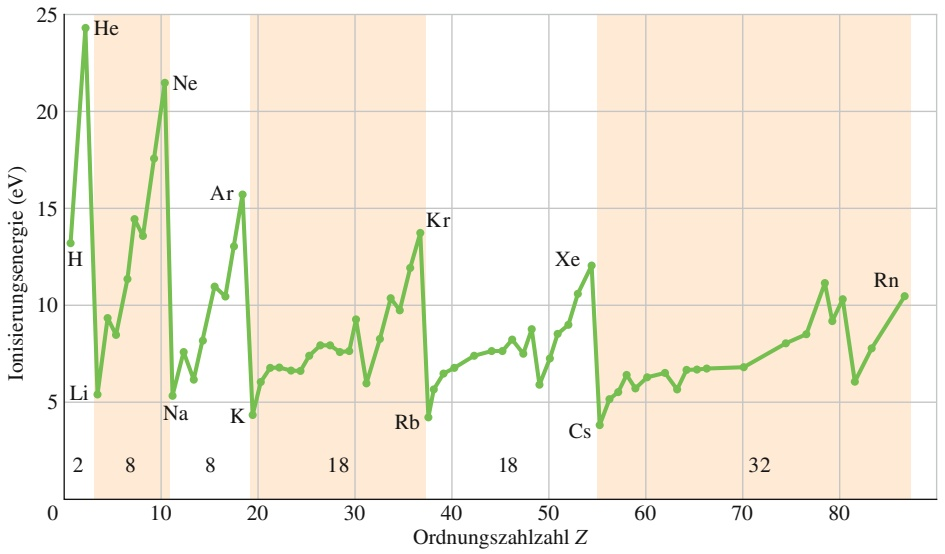

line

| Element | Z | Ionisierungsergie (eV) |
| --- | --- | --- |
| H | ~2 | ~13.5 |
| He | ~4 | ~24.5 |
| Li | ~5 | ~5.5 |
| Ne | ~10 | ~21.5 |
| Na | ~11 | ~5.5 |
| Ar | ~18 | ~16 |
| K | ~20 | ~4.5 |
| Kr | ~37 | ~14 |
| Rb | ~38 | ~4.5 |
| Cs | ~55 | ~4 |
| Xe | ~56 | ~12 |
| Rn | ~85 | ~10.5 |

Krypton usw.). Mithilfe der Quantenmechanik lassen sich die chemischen Eigenschaften dieser Elemente verstehen. Die Anzahl der Elemente in den sieben Perioden sind

2, 8, 8, 18, 18, 32 und 32 .

Die Quantenmechanik kann auch diese Zahlen erklären.

## Atome emittieren und absorbieren Licht

Wir haben bereits gesehen, dass Atome nur in diskreten Quantenzuständen mit wohldefinierten Energien existieren können. Zwischen den verschiedenen Zuständen können Übergänge stattfinden, bei denen Licht emittiert (bei einem Übergang in ein tieferes Energieniveau $E _ { \mathrm { t i e f } } )$ oder absorbiert (bei einem Übergang in ein hö- heres Energieniveau $E _ { \mathrm { h o c h } } )$ wird. In Abschn. 35.1 hatten wir bereits diskutiert, dass für die Energien der absorbierten bzw. emittierten Photonen gilt

$$
h f = E _ {\mathrm{hoch}} - E _ {\mathrm{tief}}. \tag {36.1}
$$

Die Aufgabe, die Frequenzen des von den Atomen emittierten oder absorbierten Lichts zu erklären, reduziert sich daher darauf, die Energien der erlaubten Quantenzustände in einem Atom zu bestimmen. Mithilfe der Quantenmechanik können wir diese Energien berechnen.

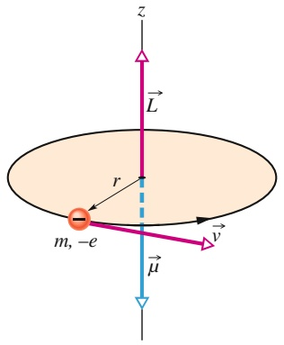

text_image

z
L
r
m, -e
v
μ

Abb. 36.2

Ein klassisches Modell eines Teilchens der Masse m und der Ladung −e, das sich mit der Geschwindigkeit v auf einem Kreis mit Radius r bewegt. Ein solches Teilchen hat einen Drehimpuls $\vec { L } = \vec { r } \times \vec { p } ,$ wobei ⃗p der Impuls m⃗v ist. Die Bewegung dieses Teilchens entspricht einer geschlossenen Stromschleife mit dem zugehörigen magnetischen Moment μ⃗, dessen Richtung zu L⃗ entgegengesetzt ist.

## Atome haben einen Drehimpuls und ein magnetisches Moment

Abbildung 36.2 zeigt ein negativ geladenes Teilchen auf einer Kreisbahn um einen festen Mittelpunkt. Wie wir bereits in Abschn. 28.5 besprochen hatten, besitzt ein solches Teilchen neben dem Bahndrehimpuls $\vec { L }$ auch ein magnetisches Dipolmoment $\vec { \mu } ,$ da seine Bahn einer winzigen Stromschleife entspricht. (Der Einfachheit halber haben wir hier den in Kapitel 28 verwendeten Index „Bahn“ weggelassen.) In Abb. 36.2 erkennt man, dass sowohl L⃗ als auch $\vec { \mu }$ senkrecht auf der Bahnebene stehen, aber in entgegengesetzte Richtungen zeigen, weil die Ladung negativ ist.

Das in Abb. 36.2 dargestellte Modell ist rein klassisch und kann daher ein Elektron in einem Atom nicht korrekt wiedergeben. Das Modell starrer Kreisbahnen wurde in der Quantenmechanik durch das Modell der Wahrscheinlichkeitsdichten ersetzt. Trotzdem gilt auch in der Quantenmechanik, dass ein Zustand eines Elektrons in einem Atom im Allgemeinen einen Bahndrehimpuls $\vec { L }$ und dann auch ein magnetisches Dipolmoment $\vec { \mu }$ besitzt, die in entgegengesetzte Richtungen zeigen. (Man spricht daher auch von einer Kopplung der beiden Vektorgrößen.)

## Das Einstein-de-Haas-Experiment

Bereits 1915, lange vor der Entdeckung der Quantenmechanik, führten Albert Ein stein und der niederländische Physiker Wander J. de Haas ein einfaches Experi ment durch, mit dem die Kopplung zwischen dem Drehimpuls und dem magnetischen Moment einzelner Atome nachgewiesen werden sollte.

Einstein und de Haas befestigten wie in Abb. 36.3a gezeigt einen Eisenzylinder an einem dünnen Faden. Dieser Zylinder wurde in eine Spule gebracht, die den Zylinder nicht berührte. Zu Beginn zeigten die magnetischen Dipolmomente $\vec { \mu }$ der Atome in dem Zylinder in unterschiedliche, zufällige Richtungen, sodass sich ihre magnetischen Effekte gegenseitig aufhoben (Abb. 36.3a). Dann wurde jedoch ein Spulenstrom eingeschaltet und es bildete sich ein magnetisches Feld B⃗ parallel zur Zylinderachse (Abb. 36.3b). Das hatte zur Folge, dass sich die magnetischen Dipolmomente der Atome in dem Zylinder parallel zu diesem Feld ausrichteten. Wenn die Drehimpulse $\vec { L }$ der einzelnen Atome mit ihren magnetischen Momenten $\vec { \mu }$ gekoppelt sind, sollte diese Ausrichtung der atomaren magnetischen Momente gleichzeitig zu einer Ausrichtung der Drehimpulse führen, und zwar entgegen dem äußeren Magnetfeld.

Auf den Zylinder wirkten keine äußeren Drehmomente, daher muss sein Gesamtdrehimpuls seinen ursprünglichen Wert (null) behalten. Da sich jedoch aufgrund des Magnetfelds B⃗ alle atomaren Drehimpulse antiparallel zu $\vec { B }$ ausrichten, übertragen sie dem Zylinder als Ganzem einen Drehimpuls $\vec { L } _ { \mathrm { g e s } }$ (in Abb. 36.3b nach unten gerichtet). Damit der Gesamtdrehimpuls des Zylinders null bleibt, muss der Zylinder um seine Mittelachse zu rotieren beginnen, sodass sein makroskopischer Drehimpuls $\vec { L } _ { \mathrm { r o t } }$ (in Abb. 36.3b nach oben gerichtet) den Drehimpuls $\vec { L } _ { \mathrm { g e s } }$ der atomaren Momente ausgleicht.

Ohne die Schnur würde sich der Zylinder solange drehen, wie das Magnetfeld eingeschaltet ist. Die Verdrillung der Schnur erzeugt jedoch ein Drehmoment, das die Rotation des Zylinders kurz stoppt und ihn schließlich in eine harmonische Drehschwingung versetzt.

Die Beobachtung der Zylinderrotation bestätigte die Vermutung, dass der Drehimpuls und das magnetische Dipolmoment eines Atoms entgegengesetzt gekoppelt sind. Außerdem zeigt dieses Experiment deutlich, dass der Drehimpuls einzelner Quantenzustände der Atome zu einer sichtbaren Rotation eines makroskopischen Gegenstands führen kann.

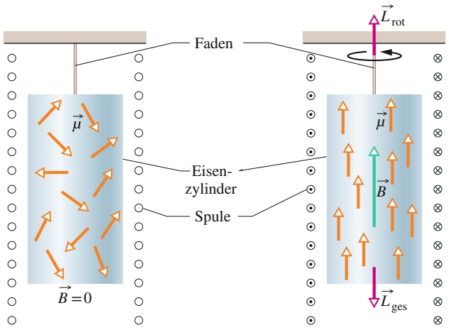

text_image

Faden
Eisen-
zylinder
Spule
B=0
L_rot
μ
B
L_ges

(a)

(b)

## Abb. 36.3

Die Anordnung des Einstein-de-Haas-Experiments. (a) Zu Beginn verschwindet das magnetische Feld in dem Eisenzylinder und die magnetischen Dipolmomentvektoren μ⃗ der Atome zeigen in beliebige, unterschiedliche Richtungen. Die Drehimpulsvektoren der Atome (nicht dargestellt) zeigen entgegen der magnetischen Momente und haben daher ebenfalls zufällige Richtungen. (b) Wenn ein Magnetfeld B⃗ entlang der Zylinderachse angelegt wird, richten sich die magnetischen Momente parallel zu B⃗ aus. Damit ändern sich auch die Vektoren der atomaren Drehimpulse und zeigen entgegen der Richtung des Magnetfelds. Wenn keine äußeren Drehmomente auf den $\mathrm { Z y } _ { 1 }$ linder wirken, bleibt sein Drehimpuls erhalten und er muss daher als Ganzes zu rotieren beginnen.

## 36.1.2 Der Elektronenspin

Wie wir schon in Abschn. 28.5 gesehen hatten, besitzt ein Elektron (egal ob frei oder gebunden) einen intrinsischen Drehimpuls ${ \vec { S } } ,$ den man als Spin oder Spin**drehimpuls** bezeichnet. (Intrinsisch bedeutet so viel wie „eingebaut“, es handelt sich also bei $\vec { S }$ um eine fundamentale Eigenschaft eines Elektrons, vergleichbar mit seiner Masse und seiner elektrischen Ladung.) Im nächsten Abschnitt werden wir sehen, dass der Betrag von $\vec { S }$ quantisiert ist und von einer Spinquantenzahl s abhängt, die für Elektronen (ebenso wie für Protonen und Neutronen) immer den Wert $1 / 2$ hat. Zusätzlich ist auch die Komponente von S⃗ bezüglich einer Bezugsachse quantisiert und hängt von einer **magnetischen Spinquantenzahl** $m _ { s }$ ab, die nur die Werte +1∕2 und $- 1 / 2$ annehmen kann.

Es waren zwei niederländische Wissenschaftler, George Uhlenbeck und Samuel Goudsmit, die auf der Grundlage ihrer Untersuchungen von Atomspektren im Rahmen ihrer Doktorarbeiten erstmals den Elektronenspin postulierten. Die quantenmechanische Grundlage für den Elektronenspin wurde einige Jahre spä- ter durch den englischen Physiker Paul A.M. Dirac gelegt, der im Jahr 1929 eine relativistische Quantentheorie des Elektrons aufstellte.

Es liegt nahe, beim Elektronenspin an die Eigendrehung eines winzigen Teilchens um seine Achse zu denken. Dieses klassische Modell kann jedoch ebenso wie die klassischen Vorstellungen der Elektronenbahnen nicht aufrechterhalten werden. In der Quantenmechanik stellt man sich den Spin am besten als eine messbare, intrinsische Eigenschaft des Elektrons vor. Es gibt einfach kein klassisches Modell für den Spin.

Tabelle 36.1 ist eine Erweiterung von Tab. 35.1. Sie zeigt die vier Quantenzahlen $n ,   l ,   m _ { l }$ und $m _ { s } ,$ die den Zustand eines Elektrons in einem Wasserstoffatom vollständig festlegen. (Da für alle Elektronen $s = 1 / 2$ gilt, ist die Quantenzahl s nicht gesondert aufgeführt.) Dieselben Quantenzahlen charakterisieren auch die erlaubten Zustände eines Elektrons in einem Mehrelektronenatom.

TABELLE 36.1: Quantenzahlen und Zustände von Elektronen in einem Atom.

| Quantenzahl | Symbol | Erlaubte Werte | Hat zu tun mit |
| --- | --- | --- | --- |
| Hauptquantenzahl | n | 1, 2, 3, ... | Abstand vom Kern |
| Bahndrehimpulsquantenzahl | l | 0, 1, 2, ..., (n-1) | Bahndrehimpuls |
| magnetische Quantenzahl | ml | 0, ±1, ±2, ..., ±l | z-Komponente des Bahndrehimpulses |
| magnetische Spinquantenzahl | ms | ±1/2 | z-Komponente des Spins |

Alle Zustände mit demselben Wert für n bilden eine Schale.

Es gibt $2 n ^ { 2 }$ Zustände in einer Schale.

Alle Zustände mit denselben Werten für n und l bilden eine Unterschale.

Alle Zustände in einer Unterschale haben dieselbe Energie.

Es gibt 2(2l + 1) Zustände in einer Unterschale.

## 36.1.3 Drehimpulse und magnetische Momente

Jeder Quantenzustand eines Elektrons in einem Atom hat einen Bahndrehimpuls (der auch null sein kann) und ein damit zusammenhängendes magnetisches Dipolmoment. Jedes Elektron, ob in einem Atom oder frei, besitzt zusätzlich einen Spin, der ebenfalls mit einem magnetischen Dipolmoment verknüpft ist. Wir wollen diese Größen nun untersuchen, zunächst unabhängig voneinander, anschließend gemeinsam.

## Bahndrehimpuls und Magnetismus

Der Betrag des **Bahndrehimpulses** $\vec { L }$ eines Elektrons in einem Atom ist quantisiert, d. h., er kann nur bestimmte diskrete Werte annehmen. Diese Werte sind

$$
L = \sqrt {l (l + 1)} \hbar , \tag {36.2}
$$

wobei l die Bahndrehimpulsquantenzahl ist (und $\hbar = h / 2 \pi )$ . Nach Tab. 36.1 muss l entweder null sein oder eine positive ganze Zahl kleiner als $n ;$ für einen Zustand mit $n = 3$ sind beispielsweise nur die Werte $l = 2 ,   l = 1$ und $l = 0$ erlaubt.

Wie wir in Abschn. 28.5 gesehen hatten, ist mit dem Bahndrehimpuls $\vec { L }$ eines Elektrons in einem Atom ein magnetischer Dipol verknüpft. Dieser magnetische Dipol besitzt ein **magnetisches Dipolmoment** $\vec { \mu } _ { \mathrm { B a h n } } ,$ der mit dem Bahndrehim puls gemäß Gl. 28.22 zusammenhängt:

$$
\vec {\mu} _ {\mathrm{Bahn}} = - \frac {e}{2 m} \vec {L}. \tag {36.3}
$$

Das Minuszeichen bedeutet, dass $\vec { \mu } _ { \mathrm { B a h n } }$ und $\vec { L }$ entgegengesetzt gerichtet sind. Da der Betrag von $\vec { L }$ quantisiert ist (Gl. 36.2), muss der Betrag von $\vec { \mu } _ { \mathrm { B a h n } }$ ebenfalls quantisiert sein:

$$
\mu_ {\mathrm{Bahn}} = \frac {e}{2 m} \sqrt {l (l + 1)} \hbar . \tag {36.4}
$$

Weder $\vec { \mu } _ { \mathrm { B a h n } }$ noch $\vec { L }$ können direkt gemessen werden. Wir können jedoch die Komponenten dieser Vektoren bezüglich einer vorgegebenen Achse messen. Wenn sich das Atom beispielsweise in einem Magnetfeld $\vec { B }$ befindet und die z-Richtung entlang der magnetischen Feldlinien verläuft, dann können wir die z-Komponenten von $\vec { \mu } _ { \mathrm { B a h n } }$ und $\vec { L }$ bezüglich dieser Achse messen.

Die Komponente $\mu _ { \mathrm { B a h n } , z }$ des magnetischen Dipolmoments ist quantisiert und durch

$$
\mu_ {\mathrm{Bahn}, z} = - m _ {l} \mu_ {\mathrm{B}} \tag {36.5}
$$

gegeben. Hierbei ist $m _ { l }$ die magnetische Quantenzahl aus Tab. 36.1 und $\mu _ { \mathrm { B } }$ ist das **Bohrsche Magneton**

$$
\mu_ {\mathrm{B}} = \frac {e h}{4 \pi m} = \frac {e \hbar}{2 m} = 9, 2 7 4 \cdot 1 0 ^ {- 2 4} \mathrm{J/T} \quad (\text {Bohrsches Magneton}) \tag {36.6}
$$

(m ist die Elektronenmasse).

Die Komponente $L _ { z }$ des Bahndrehimpulses ist ebenfalls quantisiert und auf die Werte

$$
L _ {z} = m _ {l} \hbar \tag {36.7}
$$

beschränkt.

Abbildung 36.4 zeigt die fünf quantisierten Komponenten $L _ { z }$ des Bahndrehimpulses für ein Elektron mit $l = 2$ und außerdem die zugehörigen Richtungen des Bahndrehimpulses $\vec { L } .$ . Dieses Bild ist streng genommen nicht ganz korrekt, denn $\vec { L }$ selbst können wir nicht messen; eine grafische Darstellung wie in Abb. 36.4 kann daher bestenfalls als Vorstellungshilfe dienen. Wir können diese Vorstellung trotzdem noch einen Schritt weitertreiben und durch

$$
\cos \theta = \frac {L _ {z}}{L} \tag {36.8}
$$

einen Winkel $\theta$ definieren, den wir als halbklassischen Winkel zwischen dem Vektor $\vec { L }$ und der z-Achse bezeichnen. Dieser Winkel entspringt einer klassischen Vorstellung von einer Vektorgröße, von der man gemäß der Quantentheorie immer nur den Betrag und eine Komponente messen kann.

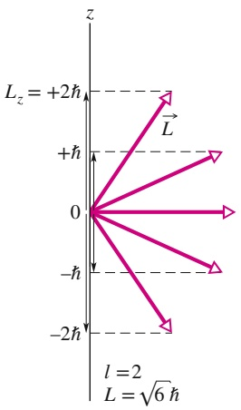

text_image

L_z = +2ħ
+ħ
0
-ħ
-2ħ
l = 2
L = √6ħ

Abb. 36.4

Die erlaubten Werte von $L _ { z }$ für ein Elektron in einem Zustand mit $l = 2 .$ Zu jedem Bahndrehimpulsvektor L⃗ in dieser Abbildung gehört ein Vektor, der in die entgegengesetzte Richtung zeigt und den Betrag und die Richtung des magnetischen Dipolmoments $\vec { \mu } _ { \mathrm { B a h n } }$ angibt.

## Der Spin und sein magnetisches Moment

Der Betrag S des Spins $\vec { S }$ kann für ein Elektron, ganz gleich ob frei oder gebunden, nur den Wert

$$
\begin{array}{l} S = \sqrt {s (s + 1)} \hbar \\ = \sqrt {\left(\frac {1}{2}\right) \left(\frac {1}{2} + 1\right)} \hbar = 0, 8 6 6 \hbar , \tag {36.9} \\ \end{array}
$$

annehmen, wobei $s \; ( = 1 / 2 )$ die Spinquantenzahl des Elektrons ist.

Wie schon in Abschn. 28.5 diskutiert, ist der Spin eines Elektrons immer mit einem intrinsischen magnetischen Dipol verknüpft. Dieser magnetische Dipol besitzt ein magnetisches Dipolmoment $\vec { \mu } _ { s } ,$ das über Gl. 28.16 mit dem Spin zusammenhängt:

$$
\vec {\mu} _ {s} = - \frac {e}{m} \vec {S}. \tag {36.10}
$$

Das Minuszeichen zeigt auch hier die entgegengesetzten Richtungen von $\vec { \mu }$ und $\vec { S }$ an. Da der Betrag des Spins $\vec { S }$ quantisiert ist (Gl. 36.9), muss auch der Betrag von $\vec { \mu } _ { s }$ quantisiert sein:

$$
\mu_ {s} = \frac {e}{m} \sqrt {s (s + 1)} \hbar . \tag {36.11}
$$

Weder $\vec { S }$ noch $\vec { \mu } _ { s }$ können direkt gemessen werden. Wir können jedoch jeweils eine Komponente entlang einer gegebenen Achse – beispielsweise einer z-Achse – messen. Die Komponente $S _ { z }$ des Spins ist quantisiert und auf die Werte

$$
S _ {z} = m _ {s} \hbar \tag {36.12}
$$

beschränkt, wobei $m _ { s }$ die magnetische Spinquantenzahl aus Tab. 36.1 ist. Sie kann nur die beiden Werte $m _ { s } = + 1 / 2$ (der Spin des Elektrons zeigt nach oben, daher spricht man auch von einem Spin-up-Zustand) oder $m _ { s } = - 1 / 2$ (der Spin zeigt nach unten, der sogenannte Spin-down-Zustand) annehmen.

Die Komponenten $\mu _ { s , z }$ des mit dem Spin verknüpften magnetischen Dipolmoments sind ebenfalls quantisiert und auf die Werte

$$
\mu_ {s, z} = - 2 m _ {s} \mu_ {\mathrm{B}} \tag {36.13}
$$

beschränkt.

Abb. 36.5 Erlaubte Werte für und für ein Elektron.

Abbildung 36.5 zeigt die beiden möglichen Quantenwerte der z-Komponente $S _ { z }$ des Elektronenspins und die zugehörige (halbklassische) Orientierung des Vektors $\vec { S }$ sowie die Komponenten $\mu _ { s , z }$ des magnetischen Dipolmoments und die zugehö- rige Orientierung von $\vec { \mu } _ { s }$ .

## Bahndrehimpuls und Spin

Für ein Atom mit mehr als einem Elektron definieren wir den Gesamtdrehimpuls $\vec { J }$ als Vektorsumme aller Drehimpulse – sowohl der Bahn- als auch der Spindrehimpulse – aller einzelnen Elektronen. Die Anzahl der Elektronen (und die Anzahl der Protonen) in einem neutralen Atom bezeichnet man als die **Ordnungszahl** Z (oder auch **Kernladungszahl**). Für ein neutrales Atom gilt daher

$$
\vec {J} = (\vec {L} _ {1} + \vec {L} _ {2} + \vec {L} _ {3} + \dots + \vec {L} _ {Z}) + (\vec {S} _ {1} + \vec {S} _ {2} + \vec {S} _ {3} + \dots + \vec {S} _ {Z}). \tag {36.14}
$$

Entsprechend ist auch das gesamte magnetische Dipolmoment eines Mehrelektronenatoms gleich der Vektorsumme der Dipolmomente (sowohl aufgrund der

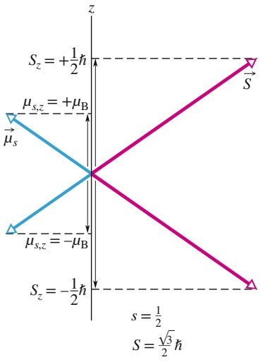

text_image

z
Sz = +1/2ħ
μs,z = +μB
μs
μs,z = -μB
Sz = -1/2ħ
s = 1/2
S = √3/2ħ

Bahn- als auch der Spindrehimpulse) der einzelnen Elektronen. Wegen des zusätzlichen Faktors 2 in Gl. 36.13 hat das resultierende magnetische Dipolmoment eines Atoms jedoch nicht die Richtung $\begin{array} { r } { \operatorname { v o n } - \vec { J } , } \end{array}$ , sondern steht unter einem bestimmten Winkel zu diesem Vektor. Das **effektive magnetische Dipolmoment** $\vec { \mu } _ { \mathrm { e f f } }$ eines Atoms ist gleich der Komponente der Vektorsumme der einzelnen magnetischen Dipolmomente in Richtung von −⃗J (Abb. 36.6).

Wie wir im nächsten Abschnitt sehen werden, gibt es in typischen Atomen eine große Zahl von Elektronen, für die die Summe der Bahndrehimpuls- und der Spinvektoren null ist. In solchen Fällen beruhen $\vec { J }$ und $\vec { \mu } _ { \mathrm { e f f } }$ auf einer überschaubaren Zahl von Elektronen, oft sogar nur auf einem einzelnen Valenzelektron.

## KONTROLLFRAGE 1

Ein Elektron befindet sich in einem Zustand, in dem der Betrag seines Bahndrehimpulses $\vec { L }$ den Wert $2 { \sqrt { 3 } } \hbar$ hat. Wie viele Projektionen des Bahndrehimpulses auf die z-Achse sind in diesem Fall möglich?

## 36.2 Das Stern-Gerlach-Experiment

## Lernziele

Nach dem Durcharbeiten dieses Abschnitts sollten Sie in der Lage sein, . . .

• das Stern-Gerlach-Experiment zu skizzieren und zu erklären, welche Art von Atomen benötigt wird, welches Ergebnis zu erwarten ist, was man tatsächlich misst und worin die Bedeutung dieses Experiments liegt,
• die Beziehung zwischen dem magnetischen Feldgradienten und der Kraft auf ein Atom in einem Stern-Gerlach-Experiment anzuwenden.

## Schlüsselideen

• Das Stern-Gerlach-Experiment demonstriert, dass das magnetische Moment von Silberatomen quantisiert ist. Es liefert den experimentellen Beweis dafür, dass magnetische Momente auf atomarem Niveau quantisiert sind.
• Auf ein Atom mit einem magnetischen Dipolmoment wirkt in einem inhomogenen magnetischen Feld eine Kraft. Wenn sich das Feld in z-Richtung mit der Rate d $| B / \mathrm { d } z |$ ändert, hängt die Kraft entlang der z-Achse gemäß

$$
F _ {z} = \mu_ {z} \frac {\mathrm{d} B}{\mathrm{d} z}.
$$

mit der z-Komponente $\mu _ { z }$ des Dipolmoments zusammen.

## 36.2.1 Das Stern-Gerlach-Experiment

Im Jahr 1922 demonstrierten Otto Stern und Walther Gerlach experimentell, dass das magnetische Moment von Silberatomen quantisiert ist. Im Stern-Gerlach Experiment, wie man es heute nennt, wird Silber in einem Ofen verdampft, aus dem ein Teil des gasförmigen Silbers durch einen schmalen Schlitz in der Ofenwand in eine evakuierte Röhre entweichen kann. Ein Teil der dort angekommenen Atome tritt anschließend durch einen zweiten engen Schlitz und bildet einen scharf gebündelten Atomstrahl (Abb. 36.7), der zwischen den Polen eines Elektromagneten hindurchtritt und schließlich zum Nachweis auf eine Glasplatte trifft, auf der sich die Silberatome ablagern.

Solange der Magnet abgeschaltet ist, sammeln sich die Silberatome in einem kleinen Fleck auf der Glasplatte. Wird der Magnet jedoch eingeschaltet, verteilen sich die Silberatome in vertikaler Richtung. Da Silberatome ein magnetisches Dipolmoment besitzen, werden sie bei ihrem Durchtritt durch den Magneten von den vertikalen Magnetkräften beeinflusst und dadurch nach oben oder unten abgelenkt. Aus der Verteilung der Silberatome auf der Glasplatte kann man auf die Ablenkung schließen, die die Atome im Magnetfeld erfahren haben. Als Stern und Gerlach das Silbermuster auf ihrer Nachweisplatte untersuchten, fanden sie eine Überraschung. Bevor wir jedoch auf diese Überraschung eingehen und ihre Bedeutung für die Quantentheorie diskutieren, wollen wir die Art der ablenkenden Magnetkräfte untersuchen.

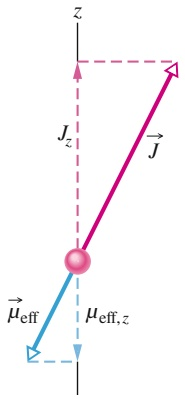

text_image

z
Jz
J
μeff
μeff,z

Abb. 36.6

Ein klassisches Modell für den Gesamtdrehimpuls ⃗J und das effektive magnetische Moment $\vec { \mu } _ { \mathrm { e f f } } .$

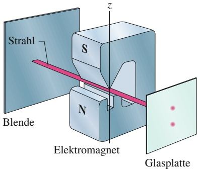

text_image

Strahl
Blende
S
N
Elektromagnet
Glasplatte
z

Abb. 36.7

Der Aufbau des Stern-Gerlach-Experiments.

## Die Ablenkung der Silberatome im Magnetfeld

Wir haben bisher noch nicht untersucht, von welcher Art die Kräfte sind, die die Silberatome in einem Stern-Gerlach-Experiment ablenken. Es handelt sich dabei nicht um das Magnetfeld selbst, das auf bewegte Ladungen wirkt und sie nach Gl. 24.2 $( \vec { F } = q \vec { \nu } \times \vec { B } )$ ablenkt. Der Grund ist einfach: Ein Silberatom ist elektrisch neutral (seine Gesamtladung q ist null) und daher ist die resultierende Kraft nach dieser Gleichung null.

Die im vorliegenden Fall gesuchte magnetische Kraft beruht auf einer Wechselwirkung zwischen dem Magnetfeld $\vec { B }$ des Elektromagneten und dem magnetischen Dipol eines einzelnen Silberatoms. Einen solchen Ausdruck für die Kraft können wir aus der potenziellen Energie $U$ eines Dipols in einem Magnetfeld ableiten. Nach Gl. 24.33 gilt

$$
U = - \vec {\mu} \cdot \vec {B}, \tag {36.15}
$$

wobei $\vec { \mu }$ das magnetische Dipolmoment eines Silberatoms ist. In Abb. 36.7 zeigt die positive z-Achse vertikal nach oben und stimmt mit der Richtung des Magnetfelds $\vec { B }$ überein. Daher können wir Gl. 36.15 auch durch die Komponente $\mu _ { z }$ des magnetischen Dipolmoments entlang des Magnetfelds $\vec { B }$ ausdrücken:

$$
U = - \mu_ {z} B. \tag {36.16}
$$

Wir wenden Gl. 4.19 $( F = -   \mathrm { d } U / \mathrm { d } x )$ auf die z-Achse in Abb. 36.7 an und erhalten so

$$
F _ {z} = - \frac {\mathrm{d} U}{\mathrm{d} z} = \mu_ {z} \frac {\mathrm{d} B}{\mathrm{d} z}. \tag {36.17}
$$

Genau danach haben wir gesucht: eine Gleichung für die magnetische Kraft, die ein Silberatom bei seinem Durchtritt durch ein Magnetfeld ablenkt.

Der Ausdruck $\mathsf { d } B / \mathsf { d } z$ in Gl. 36.17 ist der Gradient des Magnetfelds entlang der z-Achse. Würde sich das Magnetfeld entlang dieser Achse nicht ändern (wenn das Magnetfeld also homogen wäre), wäre $\mathrm { d } B / \mathrm { d } z = 0$ und das Silberatom würde zwischen den Magnetpolen nicht abgelenkt. Im Stern-Gerlach-Experiment sind die Magnetpole daher so geformt, dass der Gradient $\mathrm { d } B / \mathrm { d }$ z möglichst groß wird. Die Silberatome werden dadurch zwischen den Polen so stark wie möglich abgelenkt und diese Ablenkung wird auf der Glasplatte sichtbar.

Nach den Gesetzen der klassischen Physik sollten die Werte der z-Komponenten der magnetischen Dipolmomente der Silberatome in Abb. 36.7 kontinuierlich von $- \mu$ (das Dipolmoment $i \vec { \mu }$ zeigt nach unten) bis $+ \mu$ (das Dipolmoment $\vec { \mu }$ zeigt nach oben) variieren. Daher sollten nach Gl. 36.17 auch die Kräfte auf die Silberatome einen kontinuierlichen Bereich überdecken und die Auslenkungen der Atome entsprechend alle Werte zwischen einer größten Auslenkung nach unten bis zu einer größten Auslenkung nach oben annehmen. Man sollte also erwarten, dass die $\mathrm { A t o - }$ me auf der Glasplatte gleichmäßig entlang einer vertikalen Linie verteilt sind. Das ist jedoch nicht das beobachtete Ergebnis.

## Eine experimentelle Überraschung

Stern und Gerlach stellten fest, dass sich die Silberatome an zwei Punkten auf der Glasplatte sammelten. Der eine Punkt befand sich etwas oberhalb der Mitte (also der Stelle, wo sie bei abgeschaltetem Magnetfeld aufgetroffen waren), der zweite Punkt befand sich im selben Abstand unterhalb dieser Mitte. Abbildung 36.8 zeigt das Resultat einer modernen Version des Stern-Gerlach-Experiments, in dem sich dieser Effekt deutlich erkennen lässt. In diesem Fall wird ein Strahl Caesiumatome (magnetische Dipole wie die Silberatome im ursprünglichen Stern-Gerlach-Experiment) durch ein Magnetfeld mit einem sehr großen Gradienten dB∕dz gelenkt. Das Feld kann ein- und ausgeschaltet werden und ein Detektor wird vertikal durch den Strahl verschoben.

Bei abgeschaltetem Magnetfeld wird der Strahl natürlich nicht abgelenkt und der Detektor zeichnet eine Verteilung mit einem mittleren Maximum auf (blaue Kurve in Abb. 36.8). Dann wird das Magnetfeld eingeschaltet. Der ursprüngliche Strahl spaltet sich nun in zwei Teilstrahlen auf, die nach oben bzw. nach unten abgelenkt werden. Wenn nun der Detektor vertikal verschoben wird, entsteht die orange Kurve mit den beiden Maxima in Abb. 36.8.

## Die Interpretation der Ergebnisse

Im ursprünglichen Stern-Gerlach-Experiment bildeten sich auf der Glasplatte zwei winzige Silberflecken und keine durchgehende vertikale Linie aus Silber, wie man nach der klassischen Physik erwartet hätte. Das bedeutet, die Komponente $\mu _ { z }$ in ${ \vec { B } } .$ -Richtung (z-Achse) kann nicht jeden beliebigen Wert zwischen $- \mu$ und +μ annehmen, wie es die klassische Physik vorhersagt, sondern nur zwei diskrete Werte, die den beiden Flecken auf der Glasplatte entsprechen. Das ursprüngliche Stern-Gerlach-Experiment bewies somit, dass $\mu _ { z }$ (und damit auch $( \vec { \mu } )$ quantisiert ist. Und da der Drehimpuls eines Atoms mit $\vec { \mu }$ zusammenhängt, bedeutet dieses Ergebnis weiter, dass auch der Drehimpuls und seine Komponente $L _ { z }$ quantisiert sind.

Im Rahmen der Quantenmechanik können wir das Stern-Gerlach-Experiment noch umfassender deuten. Wir wissen heute, dass Silberatome aus vielen Elektronen bestehen, von denen jedes ein magnetisches Spinmoment und ein magnetisches Bahnmoment besitzt. Wir wissen weiter, dass sich die meisten dieser Spin- und Bahnmomente gegenseitig aufheben, mit Ausnahme der Momente eines einzelnen Elektrons mit verschwindendem Bahndrehimpuls $( l = 0 )$ . Das Gesamtdipolmoment $\vec { \mu }$ des Silberatoms besteht daher nur aus dem magnetischen Spinmoment dieses einen Elektrons. Nach Gl. 36.13 kann $\mu _ { z }$ daher nur zwei Werte entlang der z-Achse in Abb. 36.7 annehmen, entsprechend der Quantenzahl $m _ { s } = + 1 / 2$ (der Spin des Elektrons zeigt nach oben) bzw. der Quantenzahl $m _ { s } = - 1 / 2$ (der Elektronenspin zeigt nach unten). Mit diesen beiden Möglichkeiten folgt aus Gl. 36.13

$$
\mu_ {s, z} = - 2 \left(+ \frac {1}{2}\right) \mu_ {\mathrm{B}} = - \mu_ {\mathrm{B}} \quad \text {oder} \quad \mu_ {s, z} = - 2 \left(- \frac {1}{2}\right) \mu_ {\mathrm{B}} = + \mu_ {\mathrm{B}}. \tag {36.18}
$$

Wir setzen diese Ausdrücke für $\mu _ { z }$ in Gl. 36.17 ein und erhalten so die Komponente $F _ { z }$ der magnetischen Kraft, die die Silberatome bei ihrem Durchtritt durch das magnetische Feld ablenkt. Sie kann nur zwei Werte annehmen,

$$
F _ {z} = - \mu_ {\mathrm{B}} \left(\frac {\mathrm{d} B}{\mathrm{d} z}\right) \quad \text {und} \quad F _ {z} = + \mu_ {\mathrm{B}} \left(\frac {\mathrm{d} B}{\mathrm{d} z}\right), \tag {36.19}
$$

die den beiden Silberflecken auf der Glasplatte entsprechen.

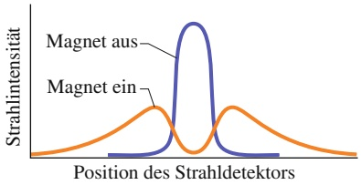

line

| Position des Strahldetektors | Magnet aus (Intensity) | Magnet ein (Intensity) |
| --- | --- | --- |
| Left side | Low | Moderate |
| Center | High | Low |
| Right side | Low | Moderate |

## Abb. 36.8

Das Ergebnis einer modernen Version des Stern-Gerlach-Experiments mit Caesiumatomen. Bei abgeschaltetem Magnetfeld gibt es nur einen einzigen Strahl. Bei eingeschaltetem Magnetfeld spaltet sich dieser Strahl in zwei Teilstrahlen auf, die der parallelen bzw. antiparallelen Orientierung der magnetischen Momente der Caesiumatome relativ zum äußeren Magnetfeld entsprechen.

## 36.3 Kernspinresonanz

## Lernziele

Nach dem Durcharbeiten dieses Abschnitts sollten Sie in der Lage sein, . . .

für ein Proton in einem Magnetfeld den Feldvektor und den Vektor des magnetischen Moments des Protons in den beiden möglichen Energiezuständen zu skizzieren und die Bezeichnungen „Spin up“ und „Spin down“ zuzuweisen,
• die Energiedifferenz zwischen den beiden Spinzuständen eines Protons in einem Magnetfeld zu berechnen und die Frequenz und Wellenlänge eines Photons anzugeben, das einen Übergang zwischen den Zuständen bewirken kann,
• zu erklären, wie man ein Kernspinresonanzspektrum erhält.

## Schlüsselideen

• Ein Proton hat einen intrinsischen Spindrehimpuls $\vec { S }$ und ein intrinsisches magnetisches Spindipolmoment $\vec { \mu } _ { S } ,$ die in dieselbe Richtung zeigen (da das Proton positiv geladen ist).
• Das magnetische Dipolmoment $i \vec { \mu }$ eines Protons in einem Magnetfeld $\vec { B }$ hat zwei Möglichkeiten, sich relativ zur Feldachse zu orientieren: „Spin up“ $( \mu _ { z }$ zeigt in B⃗-Richtung) und „Spin down“ $( \mu _ { z }$ zeigt in die entgegengesetzte Richtung).
• Anders als bei einem Elektron ist für das positiv geladene Proton „Spin up“ der Zustand mit der geringeren Energie; die Energiedifferenz zwischen den beiden Orientierungen beträgt $2 \mu _ { z } B .$
• Die für einen Übergang zwischen den beiden Spinzuständen („Umklappen des Spins“) erforderliche Energie ist

$$
h f = 2 m _ {z} B.
$$

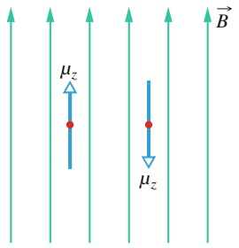

text_image

μz
μz
B

(a)

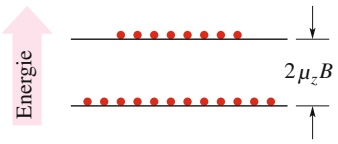

text_image

Energie
2μzB

(b)

## Abb. 36.9

(a) Ein Proton (roter Punkt), dessen Spinkomponente in Richtung eines Magnetfelds den Wert $\hbar / 2$ hat, kann in diesem Magnetfeld zwei quantisierte Orientierungen einnehmen. Wenn Gl. 36.20 erfüllt ist, kann ein Proton von der einen in die andere Orientierung umklappen. (b) Gewöhnlich befinden sich mehr Protonen im niedrigeren Energiezustand als im höheren.

• Das resultierende Feld ist die Vektorsumme aus einem äußeren Feld, das von der Umgebung (z. B. der Messapparatur) erzeugt wird, und einem inneren Feld, das von den Atomen und Kernen in der Nachbarschaft des Protons erzeugt wird.
• In Kernspinresonanzspektren wird das Umklappen von Spins zwischen den möglichen Spinzuständen als Funktion der magnetischen Feldstärke registriert, wodurch sich Substanzen hochspezifisch nachweisen lassen.

## 36.3.1 Kernspinresonanz

Wir hatten in Abschn. 28.5 bereits kurz erwähnt, dass auch ein Proton einen intrinsischen Spin $\vec { S }$ und damit zusammenhängend ein magnetisches Dipolmoment $\vec { \mu }$ besitzt. Spin und Dipolmoment zeigen in dieselbe Richtung (weil das Proton positiv geladen ist). Befindet sich ein Proton in einem konstanten äußeren Magnetfeld $\breve { B }$ parallel zur z-Achse, kann $\vec { \mu }$ nur zwei mögliche Orientierungen einnehmen: $\mu _ { z }$ kann entweder parallel oder antiparallel zu $\vec { B }$ liegen, wie in Abb. 36.9a zeigt. Aus Gl. 24.33 $( U ( \vec { \theta } ) = - \vec { \mu } \cdot \vec { B } )$ wissen wir, dass sich die Energien dieser beiden Orientierungen um einen Betrag $2 \mu _ { z } B$ unterscheiden. Diese Energie ist notwendig, um einen magnetischen Dipol in einem konstanten Magnetfeld umzuklappen. Der niedrigere Energiezustand entspricht der Konstellation, bei der $\mu _ { z }$ parallel zu $\vec { B }$ liegt, bei dem höheren Energiezustand ist $\mu _ { z }$ antiparallel zu ${ \vec { B } } .$

Wir bringen einen Tropfen Wasser in ein konstantes Magnetfeld $\vec { B }$ . Für jedes der Protonen im Wasserstoff der Wassermoleküle ist $\mu _ { z }$ entweder parallel oder anti-parallel zu ${ \vec { B } } .$ Nun überlagern wir dem konstanten Magnetfeld noch ein alternie rendes Magnetfeld einer bestimmten Frequenz $f .$ Die Protonen können jetzt aus dem niedrigeren Energiezustand in den höheren Energiezustand springen, indem sie die Richtung ihres magnetischen Moments umkehren. Diesen Prozess bezeich net man als Umklappen des Spins (denn die Umkehr des magnetischen Dipolmoments erfordert auch die Umkehr des Spins). Die für ein derartiges Umklappen notwendige Frequenz $f$ ergibt sich aus

$$
h f = 2 \mu_ {z} B. \tag {36.20}
$$

Diese Bedingung bezeichnet man als **Kernspinresonanz** (oder **magnetische Kernresonanz**). Damit ein alternierendes elektromagnetisches Feld den Spin der Protonen in einem magnetischen Feld umkehren kann, muss die Energie der zugehörigen Photonen $h f$ gleich der Energiedifferenz $2 \mu _ { z } B$ zwischen den beiden möglichen Orientierungen von $\mu _ { z }$ (und damit des Protonenspins) in dem Feld sein.

Wenn sich ein Proton einmal in dem höheren Energiezustand befindet, kann es durch die Emission eines Photons derselben Energie $\bar { h } f$ (Gl. 36.20) wieder in den unteren Zustand zurückkehren. Gewöhnlich befinden sich mehr Protonen in dem niedrigeren Energiezustand als in dem höheren (vgl. Abb. 36.9b). Einem angelegten alternierenden elektromagnetischen Feld wird daher messbar Energie entzogen.

Bei dem konstanten Magnetfeld B⃗ in Gl. 36.20 handelt es sich in Wirklichkeit nicht nur um das angelegte äußere Feld $\vec { B } _ { \mathrm { e x t } } ,$ in das der Wassertropfen gebracht wird, sondern dieses äußere Feld wird noch durch die schwachen lokalen internen Magnetfelder $\vec { B } _ { \mathrm { l o k a l } }$ aufgrund der magnetischen Momente der Atome und Kerne in der Nähe eines gegebenen Protons modifiziert. Wir schreiben Gl. 36.20 daher in der Form

$$
h f = 2 \mu_ {z} (B _ {\mathrm{ext}} + B _ {\mathrm{lokal}}). \tag {36.21}
$$

Üblicherweise hält man die Frequenz $f$ der elektromagnetischen Feldstärkeoszillationen konstant und variiert stattdessen $B _ { \mathrm { e x t } }$ in Gl. 36.21, bis man ein Absorptionsmaximum beobachtet und daher die Bedingung der magnetischen Resonanz erfüllt ist.

Die Kernspinresonanz ist die Grundlage einer sehr hilfreichen Analysemethode zur Identifikation chemischer Verbindungen. Abbildung 36.10 zeigt das **Kernspinresonanz-** oder **NMR-Spektrum** (NMR = nuclear magnetic resonance) von Ethanol mit der chemischen Formel $\mathrm{CH_{3}{-}CH_{2}{-}OH}$ . Die unterschiedlichen Resonanzmaxima entsprechen dem Umklappen der Spinorientierungen der verschiedenen Protonen in dem Molekül. Sie treten bei unterschiedlichen Werten von $B _ { \mathrm { e x t } }$ auf, weil sich die lokalen Umgebungen der sechs Protonen innerhalb eines Ethanolmoleküls voneinander unterscheiden. Das Spektrum in Abb. 36.10 ist für Ethanol charakteristisch.

Eine Anwendung der Kernspinresonanz in der Medizin ist die **Kernspinresonanztomografie** (MRT = magnetic resonance tomography) oder NMR-Tomografie, die in der medizinischen Diagnostik mit großem Erfolg eingesetzt wird. Die Protonen in den verschiedenen Körpergeweben befinden sich in sehr unterschiedlichen lokalen magnetischen Umgebungen. Wenn man nun einen Körper (oder einen Körperteil) in ein starkes äußeres Magnetfeld bringt, können diese Unterschiede mithilfe der Kernspinresonanz nachgewiesen und die gemessenen Daten von einem Computer zu einem Bild verarbeitet werden, das in mancher Hinsicht einer Röntgenaufnahme gleicht, jedoch oft andere Kontraste verdeutlicht. Abbildung 36.11 zeigt beispielsweise einen mit diesem Verfahren erzeugten Querschnitt durch einen menschlichen Kopf.

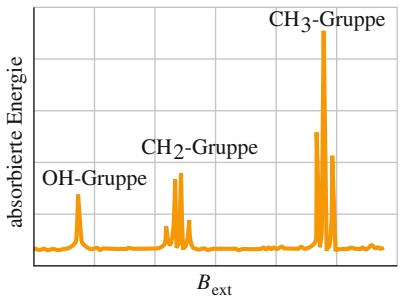

spectrogram

| Kategorie | Absorbierte Energie |
| --- | --- |
| OH-Gruppe | ~15% |
| CH2-Gruppe | ~20% |
| CH3-Gruppe | ~95% |

Abb. 36.10

Das NMR-Spektrum von Ethanol. Die Spektrallinien entsprechen den unterschiedlichen Absorptionsenergien für das Umklappen der verschiedenen Protonen. Die drei Liniengruppen gehören zu den Protonen in der OH-, $\mathrm { C H _ { 2 } } \cdot$ und $\mathrm { C H } _ { 3 } .$ -Gruppe des Ethanolmoleküls. Die dargestellte horizontale Achse umfasst weniger als $1 0 ^ { - 4 }   \mathrm { T }$

## Abb. 36.11

Ein mithilfe der Kernspinresonanz erzeugtes Querschnittsbild eines menschlichen Kopfs wird digital gespeichert und kann so vom Arzt auf einem Tablet begutachtet und ausgewertet werden [Quelle: Hero Images/Getty Images].

natural_image

Medical professional examining a patient's brain scan on a tablet, no visible text or symbols

## 36.4 Das Pauli-Prinzip

## Lernziele

Nach dem Durcharbeiten dieses Abschnitts sollten Sie in der Lage sein, . . .

• das Pauli-Prinzip zu verstehen,
• zu erklären, wie man mehrere Elektronen unter Beachtung des Pauli-Prinzips und der Existenz entarteter Zustände in ein-, zwei- und dreidimensionalen Fallen platzieren kann, und die Begriffe „unbesetzte“, „teilweise besetzte“ und „voll besetzte Niveaus“ zu erläutern,
• ein Energieniveauschema für ein System aus vielen Elektronen in ein-, zwei- und dreidimensionalen Fallen zu zeichnen.

## Schlüsselideen

• Für Elektronen in Atomen und anderen Fallen gilt das Pauli-Prinzip, nach dem keine zwei Elektronen in einer Falle in allen Quantenzahlen übereinstimmen dürfen.

## 36.4.1 Das Pauli-Prinzip

In Kapitel 35 hatten wir verschiedene Elektronenfallen untersucht, angefangen bei fiktiven eindimensionalen Kastenpotenzialen bis hin zu dem realen dreidimensionalen Potenzial des Wasserstoffatoms. In allen dort behandelten Beispielen befand sich immer nur ein einzelnes Elektron in dem betrachteten Potenzial. Wenn wir uns jedoch mit Potenzialen beschäftigen, in denen sich mehr als ein Elektron be findet (was in den folgenden zwei Abschnitten der Fall sein wird), dann müssen wir uns zunächst mit einem Prinzip vertraut machen, das für jedes Teilchen gilt, dessen Spinquantenzahl s nicht null oder ganzzahlig ist. Dieses Prinzip gilt daher nicht nur für Elektronen, sondern auch für Protonen und Neutronen, für die jeweils s = 1∕2 ist. Benannt ist dieses **Pauli-Prinzip** nach Wolfgang Pauli, der es im Jahr 1925 formulierte. Für Elektronen lautet es:

Keine zwei Elektronen in derselben Elektronenfalle können denselben Satz von Quantenzahlen haben.

Wie wir in Abschn. 36.5 sehen werden, folgt aus diesem Prinzip, dass keine zwei Elektronen in einem Atom dieselben Werte für die vier Quantenzahlen $n ,   l ,$ $m _ { l }$ und $m _ { s }$ haben können (da ohnehin alle Elektronen denselben $\operatorname { \mathbb { W } e r t } s = 1 / 2$ für die Spinquantenzahl besitzen). Mit anderen Worten, die Quantenzahlen von je zwei Elektronen in einem Atom müssen sich in mindestens einem dieser vier Werte unterscheiden. Ohne dieses Prinzip würden die Atome in sich zusammenfallen und die uns vertraute Welt könnte in dieser Form nicht existieren.

## 36.4.2 Mehrere Elektronen in kastenförmigen Potenzialtöpfen

Bevor wir unsere Diskussion von Mehrelektronenatomen beginnen, betrachten wir zur Vorbereitung zwei Elektronen in den kastenförmigen Potenzialen aus Kapitel 35. Wir werden die dort gefundenen Quantenzahlen verwenden, allerdings werden wir noch den Spin der beiden Elektronen berücksichtigen. Dazu nehmen wir an, die Elektronenfalle befinde sich zusätzlich noch in einem konstanten Magnetfeld. Dann kann nach Gl. 36.12 der Spin eines Elektrons entweder $\mathrm { { \mathfrak { p } } u p } ^ { \alpha }$ $( m _ { s }   =   + 1 / 2 )$ oder „down $( m _ { s }   =   - 1 / 2 )$ sein. (Wir denken uns dieses Magnetfeld als so schwach, dass wir die damit verbundenen potenziellen Energien der Elektronen vernachlässigen können.)

Da sich nun zwei Elektronen in einer Falle befinden, müssen wir das Pauli-Prinzip berücksichtigen. Die beiden Elektronen können also nicht dieselben Werte für ihre Quantenzahlen haben.

1. Eindimensionaler Potenzialtopf. In dem eindimensionalen Kastenpotenzial aus Abb. 35.2 genügt eine Quantenzahl n, um die Wellenfunktion des Elektrons an die Potenzialbreite L anzupassen. Jedes Elektron in diesem Potenzial muss daher einen definierten Wert für n haben; außerdem kann seine Quantenzahl $m _ { s }$ die $\mathrm { W e r t e + 1 / 2 }$ oder $- 1 / 2$ annehmen. Wenn die beiden Elektronen unterschiedliche Werte für n haben, können die Werte für $m _ { s }$ beliebig sein. Sind die beiden Werte für n jedoch gleich, müssen sich die Orientierungen der beiden Spins unterscheiden.
2. Rechteckiger zweidimensionaler Potenzialtopf. Die Anpassung der Wellenfunktion eines Elektrons an die Kantenlängen $L _ { x }$ und $L _ { y }$ des rechteckigen Potenzialtopfs aus Abb. 35.11 implizierte zwei Quantenzahlen $n _ { x }$ und $n _ { y } .$ Für jedes Elektron in diesem Potenzial nehmen diese beiden Quantenzahlen daher definierte Werte an, außerdem können die Quantenzahlen $m _ { s }$ wieder +1 $/ 2$ oder $- 1 / 2$ sein. Insgesamt schreiben wir nun einem Elektron drei Quantenzahlen zu. Nach dem Pauli-Prinzip müssen sich die Quantenzahlen der beiden Elektronen in diesem Potenzial in mindestens einem dieser drei Werte unterscheiden.
3. Dreidimensionaler kastenförmiger Potenzialtopf. In dem dreidimensionalen Potenzial aus Abb. 35.12 werden die Wellenfunktionen durch drei Quantenzahlen $n _ { x } ,   n _ { y }$ und $n _ { z }$ charakterisiert. Diese Quantenzahlen ergeben sich aus der Forderung, dass die Wellenfunktion nun bezüglich aller drei Kantenlängen $L _ { x } ,$ $L _ { y }$ und $L _ { z }$ die richtigen Nullstellen haben muss. Neben diesen drei Quantenzahlen kann die Quantenzahl $m _ { s }$ eines Elektrons noch die Werte $+ 1 / 2$ und $- 1 / 2$ annehmen. Insgesamt gibt es daher vier Quantenzahlen. Nach dem Pauli-Prinzip müssen sich die Zustände zweier Elektronen in diesem Potenzial hinsichtlich mindestens einer dieser vier Quantenzahlen unterscheiden.

Nun stellen wir uns vor, wir füllen die Potenziale in obiger Liste nach und nach mit weiteren Elektronen auf. Die ersten Elektronen gehen jeweils in den niedrigsten Energiezustand – man sagt auch, sie besetzen diesen Zustand. Doch irgendwann verbietet das Pauli-Prinzip die Besetzung dieses niedrigsten Energieniveaus mit weiteren Elektronen, sodass die nächsthöheren Niveaus besetzt werden müssen. Wenn ein Energieniveau wegen des Pauli-Prinzips nicht weiter besetzt werden kann, sagt man auch, dieses Niveau sei **voll** oder **voll besetzt**. Demgegenüber bezeichnet man ein Niveau, das von noch keinem Elektron besetzt ist, als **leer** oder **unbesetzt**. Anderenfalls spricht man von einem **teilweise besetzten** Niveau. Die Elektronenkonfiguration eines Systems aus mehreren gefangenen Elektronen besteht in einer Auflistung (oder einer Zeichnung) sämtlicher besetzter Energieniveaus bzw. sämtlicher Quantenzahlen der Elektronen.

## Die Gesamtenergie

Meist ist man daran interessiert, die Gesamtenergie eines Systems aus zwei oder mehr Elektronen zu berechnen. Wie findet man die Gesamtenergie für eine beliebige Elektronenkonfiguration in einem Kastenpotenzial?

Der Einfachheit halber nehmen wir an, es gäbe keine elektrische Wechselwirkung zwischen den Elektronen; wir vernachlässigen also die potenzielle elektrische Energie von Elektronenpaaren. In diesem Fall erhält man die Gesamtenergie einer Elektronenkonfiguration, indem man die Energien der einzelnen Elektronen wie in Kapitel 35 berechnet und diese Energien schließlich addiert. (Dies führen wir in Beispielaufgabe 36.2 im Übungsbuch für ein System aus sieben Elektronen in einem zweidimensionalen rechteckigen Potenzialtopf durch.)

Einen guten Überblick über die Energiewerte eines gegebenen Elektronensystems erhält man auch durch Energieniveaudarstellungen für ein ganzes System. Der Zustand mit der niedrigsten Energie $E _ { \mathrm { G } }$ entspricht dem Grundzustand des Systems. Der nächsthöhere Energiewert $E _ { \mathrm { a 1 } }$ entspricht dem ersten angeregten Zustand, noch eine Stufe höher erhält man den zweiten angeregten Zustand $E _ { \mathrm { a 2 } }$ usw.

## 36.5 Der Aufbau des Periodensystems

## Lernziele

Nach dem Durcharbeiten dieses Abschnitts sollten Sie in der Lage sein, . . .

• zu verstehen, dass alle Zustände in einer Unterschale dieselbe Energie haben, die im Wesentlichen von der Hauptquantenzahl n und nur zu einem kleinen Teil von der Quantenzahl l abhängt,
• die symbolischen Bezeichnungen für die verschiedenen Werte der Bahndrehimpulsquantenzahl zu kennen,
• das Auffüllen der Schalen und Unterschalen der Atome beim Aufbau des Periodensystems zu erklären (unter Vernachlässigung von Elektron-Elektron-Wechselwirkungen),
• die Besonderheiten der Edelgase im Vergleich zu den anderen chemischen Ele menten anzugeben, insbesondere im Hinblick auf Reaktivität, Gesamtdrehimpuls und Ionisierungsenergie,
• bei Übergängen zwischen atomaren Energieniveaus durch Emission oder Absorption von Licht die Beziehung zwischen Energiedifferenz und Frequenz bzw. Wellenlänge des Lichts anzuwenden.

## Schlüsselideen

• Im Periodensystem der Elemente sind die verschiedenen chemischen Elemente nach ihrer Ordnungszahl Z geordnet, wobei Z die Anzahl der Protonen im Atomkern angibt. Für ein neutrales Atom entspricht Z auch der Elektronenzahl.
• Zustände mit gleicher Quantenzahl n bilden eine Schale.
• Zustände mit gleichen Werten in den Quantenzahlen n und l bilden jeweils eine Unterschale.
Geschlossene Schalen und Unterschalen enthalten die maximale durch das Pauli-Prinzip erlaubte Zahl von Elektronen. Der Gesamtdrehimpuls und das magnetische Gesamtmoment solcher geschlossener Schalen sind immer null.

## 36.5.1 Der Aufbau des Periodensystems

Die vier Quantenzahlen aus Tab. 36.1 charakterisieren die Zustände jedes einzelnen Elektrons in einem Atom. Die Wellenfunktionen dieser Zustände sind in Mehrelektronensystemen jedoch nicht dieselben wie die Wellenfunktionen der entsprechenden Zustände beim Wasserstoffatom, weil die potenzielle Energie eines Elektrons in einem Mehrelektronensystem nicht mehr nur von der Ladung und dem Ort des Atomkerns abhängt, sondern auch von den Ladungen und Orten aller anderen Elektronen in dem Atom. Die Schrödinger-Gleichung für Mehrelektronensysteme lässt sich – zumindest näherungsweise – mithilfe eines Computers numerisch lösen.

In Abschn. 35.5 hatten wir kurz erwähnt, dass alle Zustände mit denselben Werten für die Quantenzahlen n und l eine Unterschale bilden. Für einen gegebenen Wert von l gibt es $2 l + 1$ mögliche Werte für die magnetische Quantenzahl $m _ { l } ,$ daher existieren insgesamt $2 ( 2 l + 1 )$ Zustände in einer Unterschale. Es zeigt sich, dass alle Zustände in einer gegebenen Unterschale dieselbe Energie haben. Der Wert dieser Energie hängt in erster Linie von n und nur zu einem geringeren Teil von l ab.

Aus historischen Gründen werden die Unterschalen für verschiedene Werte von l symbolisch durch Buchstaben gekennzeichnet:

$$
\begin{array}{c c c c c c c} l = 0 & 1 & 2 & 3 & 4 & 5 & \ldots \\ \text {s} & \text {p} & \text {d} & \text {f} & \text {g} & \text {h} & \ldots \end{array}
$$

Beispielsweise wird die Unterschale mit $n = 3$ und $l = 2$ auch als 3d-Unterschale bezeichnet.

Wenn wir in einem Mehrelektronenatom die einzelnen Elektronen gewissen Zuständen zuordnen, müssen wir das Pauli-Prinzip aus Abschn. 36.4 berücksichtigen: In einem Atom können keine zwei Elektronen dieselben Werte für die Quantenzahlen $n , l , m _ { l }$ und $m _ { s }$ annehmen. Ohne dieses Prinzip würden alle Elektronen in einem Atom das niedrigste Energieniveau besetzen, und eine Chemie von Atomen und Molekülen oder gar eine Biochemie könnte es nicht geben. Wir wollen nun anhand einiger Beispielatome untersuchen, wie das Pauli-Prinzip den Aufbau des Periodensystems beeinflusst.

## Neon

Das Neonatom besitzt zehn Elektronen. Nur zwei davon passen in die Unterschale zur niedrigsten Energie, die 1s-Unterschale. Diese beiden Elektronen haben die Quantenzahlen $n = 1 ,   l = 0$ und $m _ { l } = 0 ,$ , eines von ihnen hat die Quantenzahl $m _ { s } = + 1 / 2 ,$ , das andere $m _ { s } = - 1 / 2$ . Die 1s-Unterschale besteht nach Tab. 36.1 aus genau $2 ( 2 l + 1 ) = 2$ Zuständen. Diese Unterschale enthält somit bereits die nach dem Pauli-Prinzip erlaubte maximale Anzahl von Elektronen, daher sagt man auch, sie sei **abgeschlossen**.

Zwei der verbliebenen acht Elektronen besetzen die nächste Unterschale, die 2s-Unterschale, die damit ebenfalls voll ist. Die letzten sechs Elektronen füllen die 2p-Unterschale, die mit $l = 1$ gerade $2 ( 2 l + 1 ) = 6$ Zustände enthält und damit ebenfalls abgeschlossen ist.

In einer geschlossenen Unterschale sind alle erlaubten z-Projektionen des Bahndrehimpulsvektors $\vec { L }$ auch vorhanden, wie man aus Abb. 36.4 ersehen kann. Diese Projektionen heben sich innerhalb einer Unterschale gegenseitig auf: Für jede positive Projektion gibt es eine entsprechende negative Projektion desselben Betrags. Ganz entsprechend heben sich auch die z-Projektionen des Spins gegenseitig auf. Eine abgeschlossene Unterschale besitzt daher keinen Drehimpuls und kein magnetisches Moment. Außerdem ist die Wahrscheinlichkeitsdichte kugelsymmetrisch. Damit besitzt Neon mit seinen drei abgeschlossenen Unterschalen (1s, 2s und 2p) keine „losen“ Elektronen, die eine chemische Reaktion mit anderen Atomen unterstützen würden. Ebenso wie alle anderen **Edelgase**, welche die ganz rechte Spalte des Periodensystems bilden, zählt Neon zu den chemisch extrem trä- gen Elementen.

## Natrium

Unmittelbar nach Neon folgt mit elf Elektronen Natrium im Periodensystem. Zehn dieser Elektronen bilden einen abgeschlossenen, neonartigen Atomrumpf, der, wie wir gesehen haben, einen verschwindenden Drehimpuls besitzt. Das verbleibende Elektron befindet sich zum größten Teil außerhalb dieses trägen Atomrumpfs in der energetisch nächstniedrigen 3s-Unterschale. Dieses sogenannte **Valenzelektron** von Natrium besetzt einen Zustand mit $l = 0$ (also einen s-Zustand). Der Drehimpuls und das magnetische Dipolmoment von Natrium beruhen ausschließ- lich auf dem Spin dieses einzelnen Elektrons.

Natrium verbindet sich sehr leicht mit anderen Atomen, die „einen Platz frei haben“, den das nur locker gebundene Valenzelektron einnehmen kann. Wie alle anderen **Alkalimetalle**, welche die ganz linke Spalte im Periodensystem bilden, ist auch Natrium chemisch sehr aktiv.

## Chlor

Das Chloratom besitzt 17 Elektronen. Zehn davon befinden sich in einem abgeschlossenen, neonartigen Atomrumpf, es verbleiben also noch sieben Elektronen. Zwei von ihnen füllen die 3s-Unterschale. Die restlichen fünf Elektronen besetzen die Zustände der 3p-Unterschale, welche die nächstniedrige Energie haben. Diese Unterschale zur Quantenzahl $l = 1$ kann $2 ( 2 l + 1 ) = 6$ Elektronen aufnehmen. Es gibt also einen freien Platz – ein $\mathrm { L o c h } ^ { a } -$ in dieser Unterschale.

Chlor reagiert sehr leicht mit Atomen mit einem Valenzelektron, das dieses Loch füllen kann. Beispielsweise ist Natriumchlorid (NaCl) eine sehr stabile Verbindung. Chlor zählt zu den chemisch sehr aktiven **Halogenen**, welche die 17. bzw. VIIA-Spalte des Periodensystems bilden.

## Eisen

Die Konfiguration der 26 Elektronen in einem Eisenatom lässt sich folgendermaßen darstellen:

$$
\underbrace {1 \mathrm{s} ^ {2} 2 \mathrm{s} ^ {2} 2 \mathrm{p} ^ {6} 3 \mathrm{s} ^ {2} 3 \mathrm{p} ^ {6}} _ {\text {}} 3 \mathrm{d} ^ {6} 4 \mathrm{s} ^ {2}.
$$

Die Unterschalen sind, wie allgemein üblich, nach ihrer numerischen Reihenfolge aufgelistet, wobei der Hochindex die Anzahl der Elektronen in jeder Unterschale angibt. Tabelle 36.1 können wir entnehmen, dass eine s-Unterschale 2 Elektronen aufnehmen kann, eine p-Unterschale 6 Elektronen und eine d-Unterschale 10 Elektronen. Die ersten 18 Elektronen bilden die fünf abgeschlossenen Unterschalen, die durch die Klammer markiert wurden, womit noch 8 Elektronen übrig bleiben. Von diesen acht Elektronen besetzen sechs die 3d-Unterschale und die verbleibenden zwei befinden sich in der 4s-Unterschale.

Die letzten beiden Elektronen füllen also nicht die 3d-Unterschale weiter auf (die insgesamt 10 Elektronen aufnehmen könnte). Die $3 \mathrm { d } ^ { 6 } 4 \mathrm { s } ^ { 2 } .$ -Konfiguration entspricht einem Zustand mit geringerer Gesamtenergie des Atoms als die $\mathsf { \Gamma } _ { \mathrm { 3 d } ^ { 8 } } .$ Konfiguration. Ein Eisenatom, dessen 8 Elektronen (statt 6) sich in der 3d-Unterschale befänden, würde sehr rasch in die $3 \mathsf { d } ^ { 6 } 4 \mathsf { s } ^ { 2 } .$ -Konfiguration übergehen und dabei elektromagnetische Strahlung emittieren. Wichtig ist an dieser Stelle, dass die Zustände (abgesehen von den einfachsten Elementen) offenbar nicht immer nach der scheinbar „logischen“ Reihenfolge aufgefüllt werden, sondern stets nach der energetisch günstigsten.

## 36.6 Röntgenstrahlung

## Lernziele

Nach dem Durcharbeiten dieses Abschnitts sollten Sie in der Lage sein, . . .

• anzugeben, wo die Röntgenstrahlen im elektromagnetischen Spektrum angesiedelt sind,
• zu erklären, wie Röntgenstrahlen in einem Labor oder einer Arztpraxis erzeugt werden,
• zwischen einem kontinuierlichen und einem charakteristischen Röntgenspektrum zu unterscheiden,
• in einem kontinuierlichen Röntgenspektrum das Zustandekommen einer Grenzwellenlänge $\lambda _ { \mathrm { m i n } }$ zu erklären,
• zu verstehen, dass bei einem Stoß zwischen einem Elektron und einem Atom Energie und Impuls erhalten bleiben,
• die Beziehung zwischen der Grenzwellenlänge $\lambda _ { \mathrm { m i n } }$ und der kinetischen Energie $K _ { 0 }$ der einfallenden Elektronen anzuwenden,
• ein Energieniveauschema für Löcher in inneren Schalen zu zeichnen und die Übergänge zu markieren, die Röntgenstrahlen erzeugen,
• für einen gegebenen Übergang aus einem oder in ein Loch die Wellenlänge der abgegebenen Röntgenstrahlung auszurechnen,
• die Bedeutung von Moseleys Arbeit für das Verständnis des Periodensystems zu erklären,
• ein Moseley-Diagramm zu skizzieren,
• die Auswirkungen von Abschirmeffekten in Atomen mit vielen Elektronen zu beschreiben,
• die Beziehung zwischen der Frequenz von emittierten $\mathrm { K } _ { \alpha }$ -Röntgenstrahlen und der Ordnungszahl Z der emittierenden Atome anzuwenden.

## Schlüsselideen

• Wenn ein Strahl von hochenergetischen Elektronen auf einen Festkörper trifft, können die Elektronen ihre Energie durch Streuung an den Atomen abgeben und dabei ein kontinuierliches Spektrum von Röntgenstrahlen aussenden.
• Die kürzeste Wellenlänge in einem solchen Spektrum ist die Grenzwellenlänge $\lambda _ { \mathrm { m i n } }$ , die dann emittiert wird, wenn ein einfallendes Elektron seine gesamte kinetische Energie $K _ { 0 }$ in einer einzigen Kollision verliert:

$$
\lambda_ {\mathrm{min}} = \frac {h c}{K _ {0}}.
$$

Das charakteristische Röntgenspektrum entsteht, wenn einfallende Elektronen gebundene Elektronen aus den inneren Schalen der Zielatome herausschlagen. Die dabei dort entstehenden „Löcher“ werden von Elektronen aus höheren Niveaus aufgefüllt, wobei Röntgenstrahlung entsprechend der großen Energiedifferenz zwischen beiden Niveaus emittiert wird.

In einem Moseley-Diagramm wird die Quadratwurzel der charakteristischen Emissionsfrequenzen gegen die Ordnungszahl Z der emittierenden Atome aufgetragen. Die sich ergebende Gerade zeigt, dass die Position eines Elements im Periodensystem durch Z und nicht durch die Atommasse bestimmt wird.

## 36.6.1 Röntgenstrahlen und Ordnungszahlen

Wenn ein Festkörper wie Molybdän, Kupfer oder Wolfram mit Elektronen bestrahlt wird, deren kinetische Energie im Bereich einiger Kiloelektronenvolt (keV) liegt, geht von diesem Festkörper eine elektromagnetische Strahlung aus: **Röntgenstrahlen**. Die medizinische und technische Nützlichkeit von Röntgenstrahlen ist allgemein bekannt. Uns soll hier jedoch interessieren, was wir aus diesen Strah-

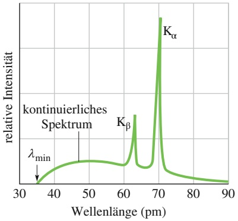

line

| Wellenlänge (pm) | Relative Intensität |
| --- | --- |
| ~35 | \(\lambda min\) |
| ~48 | Kontinuierliches Spektrum |
| ~62 | \(K\beta\) |
| ~70 | \(K\alpha\) |

Abb. 36.12

Die Wellenlängenverteilung von Röntgenstrahlung, die bei der Bestrahlung einer Molybdänprobe mit 35-keV-Elektronen erzeugt werden. Die scharfen Peaks und das kontinuierliche Spektrum entstehen durch unterschiedliche Mechanismen.

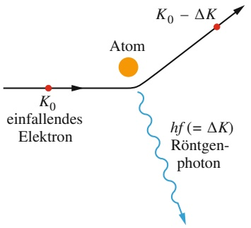

other

| Element | Energy Level |
| --- | --- |
| Atom | N/A |
| Röntgen-photon | N/A |
| K0 einfallendes Elektron | N/A |
| \(K0 - \Delta K\) | N/A |

Abb. 36.13

Ein Elektron mit der kinetischen Energie $K _ { 0 }$ wird an einem Atom in der Probe gestreut und erzeugt dabei ein Röntgenphoton. Das Elektron verliert bei diesem Prozess einen Teil seiner Energie. Auf diese Weise entsteht das kontinuierliche Röntgenspektrum.

len über den Aufbau der Atome lernen können, die Röntgenstrahlen emittieren oder absorbieren. Abbildung 36.12 zeigt das Wellenlängenspektrum von Röntgenstrahlen, das bei der Bestrahlung von Molybdän mit einem 35-keV-Elektronenstrahl erzeugt wurde. Man erkennt ein breites, kontinuierliches Strahlungsspektrum sowie zwei scharfe Spitzen („Peaks“) bei wohldefinierten Wellenlängen. Das kontinuierliche Spektrum und die Peaks haben unterschiedliche Ursachen, die wir im Folgenden getrennt untersuchen wollen.

## Das kontinuierliche Röntgenspektrum

Zunächst wollen wir das kontinuierliche Röntgenspektrum aus Abb. 36.13 verstehen und lassen daher die beiden Peaks für den Augenblick beiseite. Ein Elektron mit einer anfänglichen kinetischen Energie $K _ { 0 }$ werde an einem Atom in der Probe gestreut, wie in Abb. 36.13 dargestellt. Das Elektron verliert dabei eine bestimmte Menge an kinetischer Energie $\Delta K ,$ die in Form eines Röntgenphotons abgestrahlt wird. (Eine sehr geringe Energiemenge wird auch auf das gestreute Atom übertragen, doch wegen der vergleichsweise großen Masse des Atoms können wir diesen Betrag vernachlässigen.)

Das gestreute Elektron in Abb. 36.13 besitzt nun eine geringere Energie als $K _ { 0 }$ und kann an einem zweiten Atom streuen, wobei es wiederum ein Photon erzeugt und einen Teil seiner Energie verliert. Dieses Photon besitzt im Allgemeinen eine andere Energie als das bei der ersten Streuung erzeugte Photon. Das Elektron kann mehrfach streuen, bis es schließlich praktisch zur Ruhe kommt. Alle bei diesem Prozess erzeugten Photonen sind Teil des kontinuierlichen Röntgenspektrums.

Auffallend in Abb. 36.12 ist die scharfe **Grenzwellenlänge** $\lambda _ { \mathrm { m i n } } ,$ unterhalb de rer es kein kontinuierliches Spektrum mehr gibt. Diese minimale Wellenlänge entspricht einem Prozess, bei dem das auftreffende Elektron seine gesamte Energie $K _ { 0 }$ bei einem Frontalzusammenstoß mit einem Atom verliert. Praktisch die gesamte Energie erscheint nun als Photon, dessen Wellenlänge – die kleinstmögliche Wellenlänge – sich aus der Bedingung

$$
K _ {0} = h f = \frac {h c}{\lambda_ {\min}}
$$

bzw.

$$
\lambda_ {\min} = \frac {h c}{K _ {0}} \quad (\text {Grenzwellenlänge}) \tag {36.22}
$$

ergibt. Diese Grenzwellenlänge hat nichts mit dem Material der bestrahlten Probe zu tun. Wenn wir beispielsweise (bei gleicher Elektronenenergie) die Molybdänprobe durch eine Kupferprobe ersetzen, ändern sich sämtliche Eigenschaften des Röntgenspektrums in Abb. 36.12 – außer der Grenzwellenlänge.

## KONTROLLFRAGE 2

Wird die Grenzwellenlänge $\lambda _ { \mathrm { m i n } }$ des kontinuierlichen Teils des Röntgenspektrums größer, kleiner oder bleibt sie unverändert, wenn Sie (a) die kinetische Energie des Elektronenstrahls erhöhen, (b) den Elektronenstrahl auf eine dünne Folie statt auf eine dicke Probe lenken oder (c) die Probe durch ein Element mit einer höheren Ordnungszahl ersetzen?

## Das charakteristische Röntgenspektrum

Nun wenden wir unsere Aufmerksamkeit den beiden Peaks mit der Bezeichnung $\mathrm { K } _ { \alpha }$ und $\mathrm { K } _ { \beta }$ in Abb. 36.12 zu. Diese (und andere Peaks jenseits des in Abb. 36.12 wiedergegebenen Wellenlängenbereichs) bilden das **charakteristische Röntgenspektrum** der Probe.

Der Prozess, bei dem diese Peaks entstehen, besteht aus zwei Schritten: (1) Ein energiereiches Elektron trifft auf ein Atom in der Probe und schlägt dort ein Elektron aus einer der tiefer liegenden Schalen (mit kleinem n) heraus. Wenn sich dieses Elektron vorher in der Schale mit $n = 1$ befand (die aus historischen Gründen K-Schale genannt wird), bleibt dort ein freier Platz – ein Loch. (2) Eines der Elektronen aus den höheren Schalen springt in die K-Schale und füllt das dort entstandene Loch. Dabei emittiert das Atom ein charakteristisches Röntgenphoton. Springt beispielsweise das Elektron aus der Schale mit $n = 2$ (der L-Schale) in die K-Schale, handelt es sich bei der emittierten Strahlung um die $\mathrm { K } _ { \alpha }$ -Linie in Abb. 36.12. Springt das Elektron aus der Schale mit $n = 3$ (der M-Schale), erzeugt es eine $\mathrm{K_{\beta} - Lini_{i}}$ , und so weiter. Das so entstandene Loch in der L- oder M-Schale wird anschließend von einem Elektron aus einer weiter außen liegenden Schale besetzt.

Bei der Untersuchung des Röntgenspektrums ist es einfacher, von dem tief in der Elektronenwolke des Atoms erzeugten Loch auszugehen, als die ganzen Ände rungen in den Quantenzahlen der Elektronen aufzuzeichnen, die dieses Loch wie der auffüllen. Genau das ist in Abb. 36.14 geschehen. Es handelt sich hierbei um die Energieniveaudarstellung für Molybdän, also das Element, auf das sich auch Abb. 36.12 bezieht. Die Grundlinie $( E = 0 )$ entspricht dem neutralen Atom in seinem Grundzustand. Das mit dem Buchstaben K gekennzeichnete Niveau (bei $E = 2 0   \mathrm { k e V } )$ entspricht der Energie des Molybdänatoms mit einem Loch in der K-Schale. Entsprechend bezieht sich das Niveau mit dem Buchstaben L (bei $E =$ 2,7 keV) auf das Atom mit einem Loch in seiner L-Schale, und so weiter.

Die Übergänge $\mathrm { K } _ { \alpha }$ und $\mathrm { K } _ { \beta }$ in Abb. 36.14 erzeugen die beiden Röntgenpeaks in Abb. 36.12. Beispielsweise entsteht die $\operatorname { K } _ { \alpha } \operatorname { - L i n i e } ,$ wenn ein Elektron aus der L-Schale ein Loch in der K-Schale füllt. In Abb. 36.14 wurde dieser Übergang als Sprung eines Lochs aus der K-Schale in die L-Schale dargestellt.

## Die Nummerierung der Elemente

Im Jahr 1913 untersuchte der britische Physiker Henry G.J. Moseley die charakteristischen Röntgenspektren von allen Elementen, die ihm zur Verfügung standen – insgesamt 38 – indem er sie in einer eigens dafür konstruierten Vakuumröhre mit Elektronen bombardierte. Mithilfe eines kleinen Wagens, den er über ein Seilsystem steuern konnte, schob er die einzelnen Proben in den Elektronenstrahl. Die Wellenlängen der emittierten Röntgenstrahlen bestimmte er mit der in Abschn. 32.7 beschriebenen Methode der Kristallbeugung.

Moseley suchte in diesen Spektren nach Regelmäßigkeiten (die er auch fand) zwischen den verschiedenen Elementen des Periodensystems. Als er die Wurzel aus der Frequenz $f$ einer bestimmten Spektrallinie (z. B. der $\mathrm { K } _ { \alpha }$ -Linie) gegen die Position des betreffenden Elements im Periodensystem auftrug (man bezeichnet diese Auftragung heute als **Moseley-Diagramm**), erhielt er eine Gerade. In Abb. 36.15 ist ein Teil seiner sehr umfangreichen Daten in dieser Form wiedergegeben. Mo seleys Schlussfolgerung daraus war:

Wir haben hier einen Beweis vor uns, dass es in einem Atom eine fundamentale Größe gibt, die von einem Element zum nächsten in gleichmäßigen Schritten zunimmt. Bei dieser Größe kann es sich nur um die Ladung des zentralen Atomkerns handeln.

Dank der Arbeit von Moseley wurde das charakteristische Röntgenspektrum ein allgemein anerkannter „Fingerabdruck“ für ein chemisches Element, mit dessen Hilfe auch einige offene Probleme bezüglich des Periodensystems geklärt werden konnten. Vor dieser Zeit (1913) wurde die Position eines Elements im Periodensystem nach dem Atomgewicht festgelegt. In manchen Fällen stellte man jedoch fest, dass die daraus resultierende Reihenfolge nicht zu den chemischen Eigenschaften der Elemente passte. Moseley zeigte nun, dass die eigentliche Grundlage für die Nummerierung der Elemente ihre Kernladung (d. h. die Ordnungszahl Z) war.

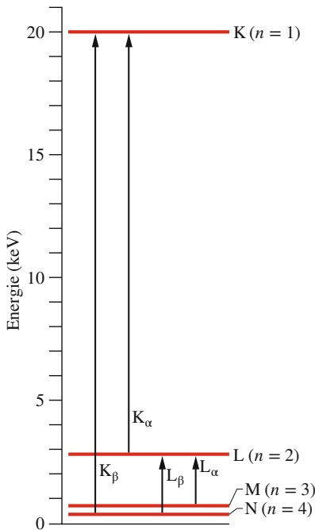

line

| State | Energy Level (keV) |
| --- | --- |
| K (n = 1) | 20 |
| L (n = 2) | ~3 |
| M (n = 3) | ~1 |
| N (n = 4) | ~0.5 |
| \(K\beta\) | ~19.5 |
| \(K\alpha\) | ~19.5 |
| \(L\beta\) | ~2.5 |
| \(L\alpha\) | ~2.5 |

Abb. 36.14 Eine vereinfachte Energieniveaudarstellung für Molybdän, in dem die Übergänge eingezeichnet wurden, zu denen einige der charakteristischen Röntgenlinien dieses Elements gehören. Jede horizontale Linie entspricht der Energie des Atoms mit einem Loch (einem herausgeschlagenen Elektron) in der angegebenen Schale.

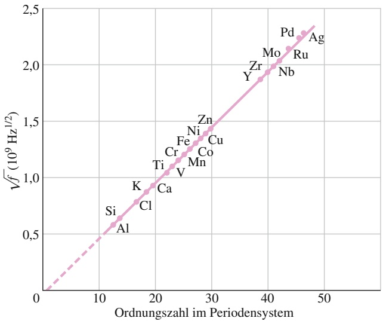

scatter

| Element | Ordnungszahl im Periodensystem | Vf (10^9 Hz^1/2) |
| --- | --- | --- |
| Al | ~13 | ~0.6 |
| Si | ~13 | ~0.65 |
| K | ~17 | ~0.85 |
| Cl | ~18 | ~0.8 |
| Ca | ~20 | ~0.95 |
| Ti | ~22 | ~1.05 |
| V | ~23 | ~1.1 |
| Cr | ~24 | ~1.15 |
| Mn | ~26 | ~1.2 |
| Fe | ~26 | ~1.3 |
| Co | ~27 | ~1.35 |
| Ni | ~27 | ~1.4 |
| Cu | ~29 | ~1.45 |
| Zn | ~29 | ~1.5 |
| Y | ~38 | ~1.9 |
| Zr | ~39 | ~1.95 |
| Mo | ~40 | ~2.0 |
| Nb | ~41 | ~2.05 |
| Ru | ~43 | ~2.15 |
| Pd | ~45 | ~2.25 |
| Ag | ~46 | ~2.3 |

Abb. 36.15

Ein Moseley-Diagramm für die $\mathrm { K } _ { \alpha ^ { \circ } }$ -Linie des charakteristischen Röntgenspektrums von 21 Elementen. Die Frequenz wurde aus den gemessenen Wellenlängen berechnet.

Im Jahr 1913 enthielt das Periodensystem noch einige offene Felder, und gleichzeitig gab es eine überraschend große Anzahl von Kandidaten für neue Elemente. Mit dem Röntgenspektrum hatte man einen überzeugenden Test für solche Kandidaten. Die sogenannten Lanthanoide, auch als Seltenerdmetalle bezeichnet, waren nur ungenügend klassifiziert, weil ihre sehr ähnlichen chemischen Eigenschaften eine solche Klassifikation äußerst schwierig machten. Nachdem die Ergebnisse von Moseleys Arbeit einmal bekannt waren, konnte man auch diesen Elementen ihren Platz im Periodensystem zuordnen. Auch später noch wurde die Identität mancher Elemente jenseits von Uran erst eindeutig geklärt, nachdem sie in ausreichend großen Mengen hergestellt werden konnten, um eine Analyse ihrer Röntgenspektren zu ermöglichen.

Der Grund, weshalb das charakteristische Röntgenspektrum diese beeindruckende Regelmäßigkeit zwischen den Elementen aufweist, während das optische Spektrum im sichtbaren Bereich (oder in dessen Umgebung) diese Regelmäßigkeiten nicht zeigt, ist leicht einzusehen: Der Schlüssel zur Identifikation eines chemischen Elements ist seine Kernladungszahl. Gold beispielsweise hat eine Kernla dungszahl von +79e (d. h. Z = 79), und nur deshalb hat es auch die Eigenschaften von Gold. Quecksilber trägt eine Elementarladung mehr, Platin eine Elementarladung weniger. Die für die Erzeugung des Röntgenspektrums entscheidenden K-Elektronen befinden sich sehr nahe am Atomkern und ihre Energie hängt aus diesem Grund empfindlich von der Kernladungszahl ab – sie sind deshalb ausgesprochen gute Messsonden für die Kernladungszahl. Das optische Spektrum entsteht dagegen durch Übergänge der äußeren Elektronen, die durch die anderen Elektronen im Atom ziemlich gut vom Atomkern abgeschirmt sind und deren Energien daher nur wenig durch die Kernladung beeinflusst werden.

## Die Erklärung des Moseley-Diagramms

Mithilfe der Daten von Moseley, von denen ein kleiner Teil in dem Moseley-Diagramm in Abb. 36.15 wiedergegeben ist, konnte man den chemischen Elementen direkt ihren Platz im Periodensystem zuordnen. Das wäre sogar ohne eine theoretische Erklärung dieser Daten möglich gewesen. Doch auch eine solche Erklärung gibt es natürlich.

Nach Gl. 35.26 gilt für die Energieniveaus im Wasserstoffatom

$$
E _ {n} = - \frac {m e ^ {4}}{8 \in_ {0} ^ {2} h ^ {2}} \frac {1}{n ^ {2}} = - \frac {1 3 , 6 \mathrm{eV}}{n ^ {2}} \quad \text {mit} \quad n = 1, 2, 3, \dots \tag {36.23}
$$