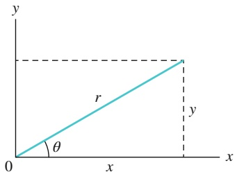
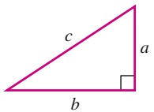
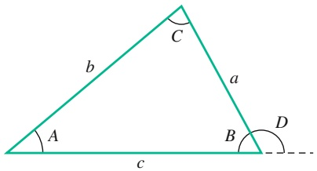
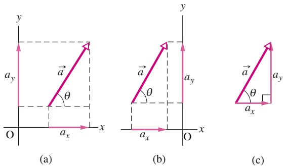
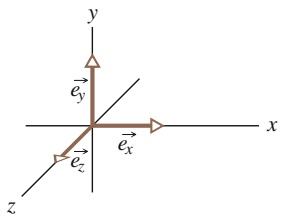
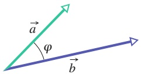
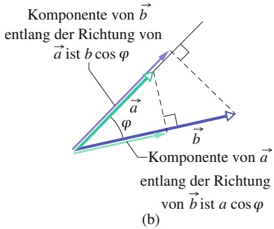

## Anhang

A Das Internationale Einheitensystem (SI)
B Astronomische Daten
C Umrechnungsfaktoren
D Mathematische Formeln
E Eigenschaften der Elemente
F Antworten auf die Kontrollfragen und Fragen
G Stichwortverzeichnis

## Das Internationale Einheitensystem (SI)

Am 16. November 2018 wurde von der Generalkonferenz für Maße und Gewichte (Conférence Générale des Poids et Mesures, CGPM) in Versailles bei Paris eine Revision des Internationalen Einheitensystems beschlossen, das im Mai 2019 in Kraft trat. Mit dieser Revision wurden alle sieben Basiseinheiten auf Naturkonstanten zurückgeführt, denen feste Zahlenwerte zugewiesen wurden. Insbesondere die Definition des Kilogramms basiert nun nicht mehr auf dem „Urkilogramm“, einem Zylinder aus Platin und Iridium mit möglicherweise schwankenden Materialeigenschaften. Die dem neuen SI-System zugrundeliegenden Naturkonstanten sind in der folgenden Tabelle mit ihren exakten Werten aufgeführt.

| Elementare Naturkonstante | Wert (exakt) |
| --- | --- |
| Frequenz des Hyperfeinstrukturübergangs des Grundzustands im Cs-133-Atom | $\Delta\nu_{Cs} = 9\,192\,631\,770\,\frac{1}{s}$ |
| Lichtgeschwindigkeit im Vakuum | $c = 299\,792\,458\,\frac{m}{s}$ |
| Plancksches Wirkungsquantum | $h = 6,626\,070\,15 \cdot 10^{-34}\,\frac{kg\,m^{2}}{s}$ |
| Elementarladung | $e = 1,602\,176\,634 \cdot 10^{-19}\,As$ |
| Boltzmann-Konstante | $k = 1,380\,649 \cdot 10^{-23}\,\frac{kg\,m^{2}}{s^{2}\,K}$ |
| Avogadro-Konstante | $N_{A} = 6,022\,140\,76 \cdot 10^{23}\,\frac{1}{mol}$ |
| photometrisches Strahlungsäquivalent einer monochromatischen Strahlung der Frequenz 540 THz | $K_{cd}(540 \cdot 10^{12}\,Hz) = 683\,\frac{lm}{W} = 683\,\frac{cd\,sr\,s^{3}}{kg\,m^{2}}$ |

## SI-Basiseinheiten

Die folgende Tabelle fasst die aus diesen Naturkonstanten abgeleiteten neuen Definitionen der SI-Basiseinheiten zusammen. Weitergehende Informationen und Erläuterungen findet man im Buch „The New International System of Units (SI)“, E.O. Göbel, U. Siegner, Wiley-VCH, Weinheim, 2019.

| Größe | Name | Symbol | Definition |
| --- | --- | --- | --- |
| Zeit | Sekunde | s | Eine Sekunde ist definiert als Kehrwert der Frequenz des Hyperfeinstrukturübergangs des Grundzustands im Cs-133-Atom:$1\mathrm{\;s} = \frac{9\,192\,631\,770}{\Delta\nu_{\mathrm{{Cs}}}}$. |
| Länge | Meter | m | Ein Meter ist der 299 792 348-te Teil des Wegs, den Licht in einer Sekunde im Vakuum zurücklegt:$1\,\mathrm{m} = \left(\frac{c}{299\,792\,458}\right)\,\mathrm{s}$. |
| Masse | Kilogramm | kg | Ein Kilogramm ist definiert in Bezug auf die Planck-Konstante als $1\,\mathrm{kg} = \left(\frac{h}{6,626\,070\,15 \cdot 10^{-34}}\right)\,\frac{\mathrm{s}}{\mathrm{m}^{2}}$. |
| Stromstärke | Ampere | A | Ein Ampere ist die Stromstärke, bei der in einer Sekunde $1/1,602\,176\,634 \cdot 10^{-19} (\approx 6,241\,510 \cdot 10^{18})$ Elementarladungen transportiert werden:$1\,\mathrm{A} = \left(\frac{e}{1,602\,176\,634 \cdot 10^{-19}}\right)\,\frac{1}{\mathrm{s}}$. |
| thermodynamische Temperatur | Kelvin | K | Ein Kelvin ist definiert in Bezug auf die Boltzmann-Konstante als $1\,\mathrm{K} = \left(\frac{1,380\,649 \cdot 10^{-23}}{k}\right)\,\frac{\mathrm{kg}\,\mathrm{m}^{2}}{\mathrm{s}^{2}}$. |
| Stoffmenge | Mol | mol | Ein Mol ist definiert als Kehrwert der Avogadro-Konstanten, das heißt: $1\,\mathrm{mol} = 6,022\,140\,76 \cdot 10^{23}\,\frac{1}{N_{\mathrm{A}}}$. |
| Lichtstärke | Candela | cd | Ein Candela ist definiert in Bezug auf das photometrische Strahlungsäquivalent einer monochromatischen Strahlung der Frequenz 540 THz als$1\,\mathrm{cd} = \frac{K_{\mathrm{cd}}}{683}\,\frac{\mathrm{kg}\,\mathrm{m}^{2}}{\mathrm{s}^{3}\mathrm{sr}}$. |

Abgeleitete SI-Einheiten

<table><tr><td>Größe</td><td>Einheit</td><td colspan="2">Symbol</td></tr><tr><td>Fläche</td><td>Quadratmeter</td><td> $m^2$ </td><td></td></tr><tr><td>Volumen</td><td>Kubikmeter</td><td> $m^3$ </td><td></td></tr><tr><td>Frequenz</td><td>Hertz</td><td>Hz</td><td>=  $s^{-1}$ </td></tr><tr><td>Dichte</td><td>Kilogramm pro Kubikmeter</td><td> $kg/m^3$ </td><td></td></tr><tr><td>Geschwindigkeit</td><td>Meter pro Sekunde</td><td>m/s</td><td></td></tr><tr><td>Winkelgeschwindigkeit</td><td>Radiant pro Sekunde</td><td>rad/s</td><td></td></tr><tr><td>Beschleunigung</td><td>Meter pro Quadratsekunde</td><td> $m/s^2$ </td><td></td></tr><tr><td>Winkelbeschleunigung</td><td>Radiant pro Quadratsekunde</td><td> $rad/s^2$ </td><td></td></tr><tr><td>Kraft</td><td>Newton</td><td>N</td><td>=  $kg \cdot m/s^2$ </td></tr><tr><td>Druck</td><td>Pascal</td><td>Pa</td><td>=  $N/m^2$ </td></tr><tr><td>Arbeit, Energie, Wärmemenge</td><td>Joule</td><td>J</td><td>= N·m = W·s</td></tr><tr><td>Leistung</td><td>Watt</td><td>W</td><td>= J/s</td></tr><tr><td>elektrische Ladung</td><td>Coulomb</td><td>C</td><td>= A·s</td></tr><tr><td>elektrische Spannung (Potenzialdifferenz)</td><td>Volt</td><td>V</td><td>= W/A</td></tr><tr><td>elektrische Feldstärke</td><td>Volt pro Meter (Newton pro Coulomb)</td><td>V/m</td><td>= N/C</td></tr><tr><td>elektrischer Widerstand</td><td>Ohm</td><td>Ω</td><td>= V/A</td></tr><tr><td>Kapazität</td><td>Farad</td><td>F</td><td>= A·s/V</td></tr><tr><td>magnetischer Fluss</td><td>Weber</td><td>Wb</td><td>= V·s</td></tr><tr><td>Induktivität</td><td>Henry</td><td>H</td><td>= V·s/A</td></tr><tr><td>magnetische Induktion (Flussdichte)</td><td>Tesla</td><td>T</td><td>=  $Wb/m^2$ </td></tr><tr><td>Entropie</td><td>Joule pro Kelvin</td><td>J/K</td><td></td></tr><tr><td>spezifische Wärme</td><td>Joule pro Kilogramm und Kelvin</td><td>J/(kg·K)</td><td></td></tr><tr><td>Wärmeleitfähigkeit</td><td>Watt pro Meter und Kelvin</td><td>W/(m·K)</td><td></td></tr><tr><td>Strahlungsintensität</td><td>Watt pro Steradiant</td><td>W/sr</td><td></td></tr></table>

Ergänzende SI-Einheiten

| Menge | Einheit | Symbol |
| --- | --- | --- |
| ebener Winkel | Radiant | rad |
| Raumwinkel | Steradiant | sr |

## B Astronomische Daten

Entfernungen von der Erde

| Objekt | Entfernung |
| --- | --- |
| $Mond^{a)}$ | $3,82 \cdot 10^{8} \text{ m}$ |
| $Sonne^{a)}$ | $1,50 \cdot 10^{11} \text{ m}$ |
| erdnächster Stern (Proxima Centauri) | $4,04 \cdot 10^{16} \text{ m}$ |
| Zentrum der Milchstraße | $2,5 \cdot 10^{20} \text{ m}$ |
| Andromeda-Galaxie | $2,4 \cdot 10^{22} \text{ m}$ |
| Rand des beobachtbaren Universums | $\approx 4 \cdot 10^{27} \text{ m}$ |

a) Mittlere Entfernung

Sonne, Erde und Erdmond

| Eigenschaft | Einheit | Sonne | Erde | Mond |
| --- | --- | --- | --- | --- |
| Masse | kg | $1,99 \cdot 10^{30}$ | $5,98 \cdot 10^{24}$ | $7,36 \cdot 10^{22}$ |
| mittlerer Radius | m | $6,96 \cdot 10^{8}$ | $6,37 \cdot 10^{6}$ | $1,74 \cdot 10^{6}$ |
| mittlere Dichte | kg/m3 | 1410 | 5520 | 3340 |
| Fallbeschleunigung an der Oberfläche | m/s2 | 274 | 9,81 | 1,67 |
| Fluchtgeschwindigkeit | km/s | 618 | 11,2 | 2,38 |
| Rotationsperiodea) | — | 37 d (Pol)b), 26 d (Äquator)b) | 23 h 56 min | 27,3 d |
| Strahlungsleistungc) | W | $3,90 \cdot 10^{26}$ |  |  |

a) Relativ zu weit entfernten Sternen gemessen.

b) Die Sonne (ein Gasball) rotiert nicht als starrer Körper.

c) Unmittelbar oberhalb der Erdatmosphäre trifft die Sonnenenergie mit einer Rate von 1340 W/m2 ein (senkrechter Einfall vorausgesetzt).

Eigenschaften der Planeten

|  | Merkur | Venus | Erde | Mars | Jupiter | Saturn | Uranus | Neptun | Pluto$^{a)}$ |
| --- | --- | --- | --- | --- | --- | --- | --- | --- | --- |
| mittlere Entfernung von der Sonne, $10^{6}$ km | 57,9 | 108 | 150 | 228 | 778 | 1430 | 2870 | 4500 | 5900 |
| Umlaufperiode, a | 0,241 | 0,615 | 1,00 | 1,88 | 11,9 | 29,5 | 84,0 | 165 | 248 |
| Rotationsperiode$^{b)}$, d | 58,7 | -243$^{3}$ | 0,997 | 1,03 | 0,409 | 0,426 | -0,451$^{c)}$ | 0,658 | 6,39 |
| Bahngeschwindigkeit, km/s | 47,9 | 35,0 | 29,8 | 24,1 | 13,1 | 9,64 | 6,81 | 5,43 | 4,74 |
| Neigung der Achse gegen die Bahn | &lt; 28° | ≈ 3° | 23,4° | 25,0° | 3,08° | 26,7° | 97,9° | 29,6° | 57,5° |
| Neigung der Bahn gegen die Erdbahn | 7,00° | 3,39° | — | 1,85° | 1,30° | 2,49° | 0,77° | 1,77° | 17,2° |
| Exzentrizität der Bahn | 0,206 | 0,0068 | 0,0167 | 0,0934 | 0,0485 | 0,0556 | 0,0472 | 0,0086 | 0,250 |
| Äquatordurchmesser, km | 4880 | 12 100 | 12 800 | 6790 | 143 000 | 120 000 | 51 800 | 49 500 | 2300 |
| Masse (Erde = 1) | 0,0558 | 0,815 | 1,000 | 0,107 | 318 | 95,1 | 14,5 | 17,2 | 0,002 |
| Dichte (Wasser = 1) | 5,60 | 5,20 | 5,52 | 3,95 | 1,31 | 0,704 | 1,21 | 1,67 | 2,03 |
| Wert von g | 3,78 | 8,60 | 9,78 | 3,72 | 22,9 | 9,05 | 7,77 | 11,0 | 0,5 |
| an der Oberfläche$^{d)}$, m/s$^{2}$ |  |  |  |  |  |  |  |  |  |
| Fluchtgeschwindigkeit, km/s | 4,3 | 10,3 | 11,2 | 5,0 | 59,5 | 35,6 | 21,2 | 23,6 | 1,1 |
| Bekannte Satellitene$^{e)}$ | 0 | 0 | 1 | 2 | 79$^{f)}$ | 62$^{f)}$ | 27$^{f)}$ | 14$^{f)}$ | 5 |

a) Seit dem Beschluss der Generalversammlung der Internationalen Astronomischen Union vom 24. August 2006 wird Pluto als Zwerg planet eingestuft. Lediglich im US-Bundesstaat Illinois, der Heimat des Entdeckers von Pluto, Clyde Tombaugh, gilt Pluto nach einem Senatsbeschluss vom 26. Februar 2009 weiterhin als Planet (Anm. des Verlags).

b) Gemessen relativ zu weit entfernten Sternen.

c) Venus und Uranus rotieren entgegengesetzt zu ihrer Bahnbewegung.

d) Gravitationsbeschleunigung gemessen am Äquator des Planeten.

e) Quelle: [https://solarsystem.nasa.gov](https://solarsystem.nasa.gov), letzter Zugriff am 07.02.2019 (Anm. des Verlags).

f ) Zusätzlich Ringsysteme.

SI-Einheiten sind fett gedruckt.

Zeit

|  | a | d | h | min | s |
| --- | --- | --- | --- | --- | --- |
| 1 Jahr = | 1 | 365,25 | $8,766 \cdot 10^{3}$ | $5,259 \cdot 10^{5}$ | $3,156 \cdot 10^{7}$ |
| 1 Tag = | $2,738 \cdot 10^{-3}$ | 1 | 24 | 1440 | $8,640 \cdot 10^{4}$ |
| 1 Stunde = | $1,141 \cdot 10^{-4}$ | $4,167 \cdot 10^{-2}$ | 1 | 60 | 3600 |
| 1 Minute = | $1,901 \cdot 10^{-6}$ | $6,944 \cdot 10^{-4}$ | $1,667 \cdot 10^{-2}$ | 1 | 60 |
| 1 Sekunde = | $3,169 \cdot 10^{-8}$ | $1,157 \cdot 10^{-5}$ | $2,778 \cdot 10^{-4}$ | $1,667 \cdot 10^{-2}$ | 1 |

Ebener Winkel

|  | ° | ' | " | rad | U |
| --- | --- | --- | --- | --- | --- |
| 1 Grad = | 1 | 60 | 3600 | $1,745 \cdot 10^{-2}$ | $2,778 \cdot 10^{-3}$ |
| 1 Bogenminute = | $1,667 \cdot 10^{-2}$ | 1 | 60 | $2,909 \cdot 10^{-4}$ | $4,630 \cdot 10^{-5}$ |
| 1 Bogensekunde = | $2,778 \cdot 10^{-4}$ | $1,667 \cdot 10^{-2}$ | 1 | $4,848 \cdot 10^{-6}$ | $7,716 \cdot 10^{-7}$ |
| 1 Radiant = | 57,30 | 3438 | $2,063 \cdot 10^{5}$ | 1 | 0,1592 |
| 1 Umdrehung = | 360 | $2,16 \cdot 10^{4}$ | $1,296 \cdot 10^{6}$ | 6,283 | 1 |

## Raumwinkel

$$
1 \text {Vollkugel} = 4 \pi \{\text {Steradiant} \} = 1 2, 5 7 \{\text {Steradiant} \}
$$

## Länge

$$
\begin{array}{r l} 1 \mathbf {m} & = 1 0 0 \mathrm{cm} = 1 0 ^ {- 3} \mathrm{km} = 3 9, 3 7 \mathrm{in} = 3, 2 8 1 \mathrm{ft} \\ & = 6, 2 1 4 \cdot 1 0 ^ {- 4} \mathrm{mi} \end{array}
$$

$$
1 \mathrm{km} = 1 0 0 0 \mathrm{m} = 1 0 ^ {5} \mathrm{cm} = 0, 6 2 1 4 \mathrm{mi}
$$

$$
1 \AA = 10^{-10} \mathbf{m}
$$

$$
1 \text {Fermi} = 1 0 ^ {- 1 5} \mathbf {m}
$$

$$
1 \text {Bohrscher Radius} = 5, 2 9 2 \cdot 1 0 ^ {- 1 1} \mathbf {m}
$$

$$
1 \text {Seemeile} = 1 8 5 2 \mathbf {m}
$$

$$
1 \text {Lichtjahr} = 9, 4 6 0 \cdot 1 0 ^ {1 2} \mathrm{km}
$$

$$
1 \text {Parsec} = 3, 0 8 4 \cdot 1 0 ^ {1 3} \text {km}
$$

$$
1 \text {in} = 2, 5 4 0 \mathrm{cm}
$$

$$
1 \mathrm{ft} = 3 0, 4 8 \mathrm{cm}
$$

$$
1 \mathrm{mi} = 1 6 0 9 \mathbf {m}
$$

$$
1 \text { yard } = 3 \text { ft }
$$

## Fläche

$$
1 \mathrm{m} ^ {2} = 1 0 0 0 0 \mathrm{cm} ^ {2} = 1 0, 7 6 \mathrm{ft} ^ {2} = 1 5 5 0 \mathrm{in} ^ {2}
$$

$$
1 \mathrm{km} ^ {2} = 1 0 0 \mathrm{ha} = 1 0 ^ {6} \mathbf {m} ^ {2}
$$

$$
1 \text {barn} = 1 0 ^ {- 2 8} \mathbf {m} ^ {2}
$$

## Volumen

$$
1 \mathrm{m} ^ {3} = 1 0 ^ {6} \mathrm{cm} ^ {3} = 1 0 0 0 \mathrm{L} = 3 5, 3 1 \mathrm{ft} ^ {3}
$$

$$
1 \mathrm{L} = 1 0 0 0 \mathrm{cm} ^ {3}
$$

## Masse

$$
1 \mathrm{kg} = 1 0 0 0 \mathrm{g} = 6, 0 2 2 \cdot 1 0 ^ {2 6} \mathrm{u} = 3 5, 2 7 \mathrm{oz} = 2, 2 0 5 \mathrm{lb}
$$

$$
1 \mathrm{t} = 1 0 0 0 \mathrm{kg}
$$

$$
1 \mathrm{u} = 1, 6 6 1 \cdot 1 0 ^ {- 2 7} \mathrm{kg}
$$

## Dichte

$$
1 \mathrm{kg} / \mathrm{m} ^ {3} = 1 0 ^ {- 3} \mathrm{g} / \mathrm{cm} ^ {3}
$$

## Geschwindigkeit

$$
1 \mathrm{km/h} = 2 7, 7 8 \mathrm{cm/s} = 0, 2 7 7 8 \mathrm{m/s} = 0, 6 2 1 4 \mathrm{mi/h}
$$

$$
1 \mathrm{m/s} = 3, 6 \mathrm{km/h}
$$

$$
1 \text {Knoten} = 1 \mathrm{nmi/h}
$$

## Kraft

$$
1 \mathrm{N} = 10^5 \mathrm{dyn}
$$

## Druck

$$
1 \mathrm{Pa} = 9, 8 6 9 \cdot 1 0 ^ {- 6} \mathrm{atm} = 7, 5 0 1 \cdot 1 0 ^ {- 3} \mathrm{mmHg}
$$

$$
(\text {für} g = 9, 8 0 6 6 5 \mathrm{m/s} ^2)
$$

$$
1 \mathrm{Torr} = 1 \mathrm{mmHg}
$$

$$
1 \mathrm{bar} = 1 0 0 0 \mathrm{mbar} = 0, 1 \mathrm{MPa}
$$

## Leistung

$$
1 \mathrm{W} = 3, 4 1 3 \mathrm{Btu/h} = 0, 2 3 8 9 \mathrm{cal/s}
$$

$$
1 \mathrm{kW} = 1 0 0 0 \mathrm{W}
$$

$$
1 \mathrm{PS} = 7 3 5 \mathbf {W}
$$

## Magnetfeld

$$
1 \mathrm{Gau} \beta = 1 0 ^ {- 4} \mathrm{T}
$$

$$
1 \mathrm{T} = 1 \mathrm{Wb/m} ^2
$$

## Magnetischer Fluss

$$
1 \mathrm{Wb} = 10^8 \text{Maxwell}
$$

Energie, Arbeit,Wärme

|  | J | cal | kW·h | eV | MeV | kg | u | Btu | erg |
| --- | --- | --- | --- | --- | --- | --- | --- | --- | --- |
| 1 Joule = | 1 | 0,2389 | $2,778 \cdot 10^{-7}$ | $6,242 \cdot 10^{18}$ | $6,242 \cdot 10^{12}$ | $1,113 \cdot 10^{-17}$ | $6,702 \cdot 10^9$ | $9,481 \cdot 10^{-4}$ | $10^7$ |
| 1 Kalorie = | 4,186 | 1 | $1,163 \cdot 10^{-6}$ | $2,613 \cdot 10^{19}$ | $2,613 \cdot 10^{13}$ | $4,660 \cdot 10^{-17}$ | $2,806 \cdot 10^{10}$ | $3,969 \cdot 10^{-3}$ | $4,168 \cdot 10^7$ |
| 1 Kilowattstunde = | $3,600 \cdot 10^6$ | $8,600 \cdot 10^5$ | 1 | $2,247 \cdot 10^{25}$ | $2,247 \cdot 10^{19}$ | $4,007 \cdot 10^{-11}$ | $2,413 \cdot 10^{16}$ | 3413 | $3,600 \cdot 10^{13}$ |
| 1 Elektronenvolt = | $1,602 \cdot 10^{-19}$ | $3,827 \cdot 10^{-20}$ | $4,450 \cdot 10^{-26}$ | 1 | $10^{-6}$ | $1,783 \cdot 10^{-36}$ | $1,074 \cdot 10^{-9}$ | $1,519 \cdot 10^{-22}$ | $1,602 \cdot 10^{-12}$ |
| 1 Megaelektronenvolt = | $1,602 \cdot 10^{-13}$ | $3,827 \cdot 10^{-14}$ | $4,450 \cdot 10^{-20}$ | $10^6$ | 1 | $1,783 \cdot 10^{-30}$ | $1,074 \cdot 10^{-3}$ | $1,519 \cdot 10^{-16}$ | $1,602 \cdot 10^{-6}$ |
| 1 Kilogramma) = | $8,987 \cdot 10^{16}$ | $2,146 \cdot 10^{16}$ | $2,497 \cdot 10^{10}$ | $5,610 \cdot 10^{35}$ | $5,610 \cdot 10^{29}$ | 1 | $6,022 \cdot 10^{26}$ | $8,521 \cdot 10^{13}$ | $8,987 \cdot 10^{23}$ |
| 1 atomare Masseneinheita) | $1,492 \cdot 10^{-10}$ | $3,564 \cdot 10^{-11}$ | $4,146 \cdot 10^{-17}$ | $9,320 \cdot 10^8$ | 932,0 | $1,661 \cdot 10^{-27}$ | 1 | $1,415 \cdot 10^{-13}$ | $1,492 \cdot 10^{-3}$ |
| 1 british thermal unit = | 1055 | 252,0 | $2,930 \cdot 10^{-4}$ | $6,585 \cdot 10^{21}$ | $6,585 \cdot 10^{15}$ | $1,174 \cdot 10^{-14}$ | $7,070 \cdot 10^{12}$ | 1 | $1,055 \cdot 10^{10}$ |
| 1 erg = | $10^{-7}$ | $2,389 \cdot 10^{-8}$ | $2,778 \cdot 10^{-14}$ | $6,242 \cdot 10^{11}$ | $6,242 \cdot 10^5$ | $1,113 \cdot 10^{-24}$ | 670,2 | $9,481 \cdot 10^{-11}$ | 1 |

dievollständigineineangegebeneEnergieeinheitumgewandeltwürde. umdieEnergie,diefreigesetztwürde,wenneinKilogrammbzw.eineatomareMasseneinheit(1u)einerSubstanzvollständiginEnergieumgewandeltwürde,bzw.umdieMasse, a)DieseGrößensindkeineEnergie-,sondernMasseneinheiten.DieAngabenfolgenderrelativistischenBeziehungzwischenMasseundEnergieE=mc2.Eshandeltsichfolglich

## Geometrie

• Kreis mit dem Radius r:

$$
\text {Umfang} = 2 \pi r
$$

$$
\text {Fläche} = \pi r ^ {2}
$$

• Kugel mit dem Radius r:

$$
\begin{array}{l} \text {Oberfläche} = 4 \pi r ^ {2} \\ \text {Volumen} = \frac {4}{3} \pi r ^ {3} \\ \end{array}
$$

• Gerader Kreiszylinder mit dem Radius r und der Höhe h:

$$
\text {Oberfläche} = 2 \pi r ^ {2} + 2 \pi r h
$$

$$
\text {Volumen} = \pi r ^ {2} h
$$

• Dreieck mit der Basis a und der Höhe h:

$$
\text {Fläche} = \frac {1}{2} a h
$$

## Quadratische Gleichung

• Für $a x ^ { 2 } + b x + c = 0 \; \mathrm { g i l t }$

$$
x = \frac {- b \pm \sqrt {b ^ {2} - 4 a c}}{2 a}.
$$

## Trigonometrische Funktionen des Winkels θ

$$
\sin \theta = \frac {y}{r}, \quad \cos \theta = \frac {x}{r}, \quad \tan \theta = \frac {y}{x}
$$

$$
\sec \theta = \frac {r}{x}, \quad \csc \theta = \frac {r}{y}, \quad \cot \theta = \frac {x}{y}
$$

text_image

y
r
θ
0
x
y
x

## Satz des Pythagoras

Für das abgebildete rechtwinklige Dreieck gilt

$$
a ^ {2} + b ^ {2} = c ^ {2}.
$$

## Dreiecke

Den Winkeln A, B, C liegen die Seiten a, b, c gegenüber. D ist ein Außenwinkel (Ergänzungswinkel von B zu 180°). Dann gilt:

$$
A + B + C = 1 8 0 ^ {\circ},
$$

$$
\frac {\sin A}{a} = \frac {\sin B}{b} = \frac {\sin C}{c},
$$

$$
c ^ {2} = a ^ {2} + b ^ {2} - 2 a b \cos C,
$$

$$
D = A + C.
$$

text_image

b
C
a
A
B
D
c

## Mathematische Zeichen und Symbole

Symbol    Bedeutung
=       ist gleich
≈       ungefähr gleich, rund
~       in der Größenordnung von
≠       ungleich
≡       identisch, definiert als
&gt;       größer als (≫ viel größer als, groß gegen)
&lt;       kleiner als (≪ viel kleiner als, klein gegen)
≥       größer als oder gleich (nicht kleiner als)
≤       kleiner als oder gleich (nicht größer als)
±       plus oder minus
→       geht gegen (Grenzübergang)
∞       über alle Grenzen, unendlich
∝       proportional zu
∑       Summenzeichen
x_gem     mittlerer (gemittelter) Wert von x

## Trigonometrische Gleichungen

$$
\sin (90^\circ - \theta) = \cos \theta
$$

$$
\cos (90^\circ - \theta) = \sin \theta
$$

$$
\frac {\sin \theta}{\cos \theta} = \tan \theta
$$

$$
\sin^ {2} \theta + \cos^ {2} \theta = 1
$$

$$
\sin 2 \theta = 2 \sin \theta \cos \theta
$$

$$
\cos 2 \theta = \cos^ {2} \theta - \sin^ {2} \theta = 2 \cos^ {2} \theta - 1 = 1 - 2 \sin^ {2} \theta
$$

$$
\sin (\alpha \pm \beta) = \sin \alpha \cos \beta \pm \cos \alpha \sin \beta
$$

$$
\cos (\alpha \pm \beta) = \cos \alpha \cos \beta \mp \sin \alpha \sin \beta
$$

$$
\tan (\alpha \pm \beta) = \frac {\tan \alpha \pm \tan \beta}{1 \mp \tan \alpha \tan \beta}
$$

$$
\sin \alpha \pm \sin \beta = 2 \sin \frac {1}{2} (\alpha \pm \beta) \cos \frac {1}{2} (\alpha \mp \beta)
$$

$$
\cos \alpha + \cos \beta = 2 \cos \frac {1}{2} (\alpha + \beta) \cos \frac {1}{2} (\alpha - \beta)
$$

$$
\cos \alpha - \cos \beta = - 2 \sin \frac {1}{2} (\alpha + \beta) \sin \frac {1}{2} (\alpha - \beta)
$$

## Binomische Reihe

$$
(1 + x) ^ {n} = 1 + \frac {n x}{1 !} + \frac {n (n - 1) x ^ {2}}{2 !} + \dots \quad (x ^ {2} <   1)
$$

## Potenzreihenentwicklung von $\mathsf { e } ^ { x }$

$$
\mathrm{e} ^ {x} = 1 + x + \frac {x ^ {2}}{2 !} + \frac {x ^ {3}}{3 !} + \dots
$$

## Potenzreihenentwicklung von $\mathsf { I n } ( 1 + x )$

$$
\ln (1 + x) = x - \frac {1}{2} x ^ {2} + \frac {1}{3} x ^ {3} - \dots \quad (| x | <   1)
$$

## Potenzreihenentwicklung trigonometrischer Funktionen (θ in rad)

$$
\sin \theta = \theta - \frac {\theta^ {3}}{3 !} + \frac {\theta^ {5}}{5 !} - \dots
$$

$$
\cos \theta = 1 - \frac {\theta^ {2}}{2 !} + \frac {\theta^ {4}}{4 !} - \dots
$$

$$
\tan \theta = \theta + \frac {\theta^ {3}}{3} + 2 \frac {\theta^ {5}}{1 5} + \dots
$$

## Cramersche Regel

Das lineare Gleichungssystem

$$
a _ {1} x + b _ {1} y = c _ {1} \quad \text {und} \quad a _ {2} x + b _ {2} y = c _ {2}
$$

mit den beiden Unbekannten x und y hat die Lösungen

$$
x = \frac {\left| \begin{array}{c c} c _ {1} & b _ {1} \\ c _ {2} & b _ {2} \end{array} \right|}{\left| \begin{array}{c c} a _ {1} & b _ {1} \\ a _ {2} & b _ {2} \end{array} \right|} = \frac {c _ {1} b _ {2} - c _ {2} b _ {1}}{a _ {1} b _ {2} - a _ {2} b _ {1}}
$$

und

$$
y = \frac {\left| \begin{array}{c c} a _ {1} & c _ {1} \\ a _ {2} & c _ {2} \end{array} \right|}{\left| \begin{array}{c c} a _ {1} & b _ {1} \\ a _ {2} & b _ {2} \end{array} \right|} = \frac {a _ {1} c _ {2} - a _ {2} c _ {1}}{a _ {1} b _ {2} - a _ {2} b _ {1}}.
$$

## Ableitungen und Integrale

Im Folgenden stehen u und v für beliebige Funktionen der Variable x; a und m sind Konstanten. Zu jedem unbestimmten Integral ist eine beliebige Integrationskonstante zu addieren. Eine ausführlichere Übersicht finden Sie etwa in Bronstein, Semendjajew, Musiol, Mühlig, Taschenbuch der Mathematik.

## Ableitungen

1. ${ \frac { \mathrm { d } x } { \mathrm { d } x } } = 1$

2. ${ \frac { \operatorname { d } } { \operatorname { d }   x } } ( a u ) = a { \frac { \operatorname { d }   u } { \operatorname { d }   x } }$

3. ${ \frac { \operatorname { d } } { \operatorname { d }   x } } ( u + \nu ) = { \frac { \operatorname { d }   u } { \operatorname { d }   x } } + { \frac { \operatorname { d }   \nu } { \operatorname { d }   x } }$

4. ${ \frac { \mathrm { d } } { \mathrm { d } x } } x ^ { m } = m x ^ { m - 1 }$

5. ${ \frac { \operatorname { d } } { \operatorname { d }   x } } \ln x = { \frac { 1 } { x } }$

6. ${ \frac { \operatorname { d } } { \operatorname { d }   x } } ( u \nu ) = u { \frac { \operatorname { d }   \nu } { \operatorname { d }   x } } + \nu { \frac { \operatorname { d }   u } { \operatorname { d }   x } }$

7. ${ \frac { \operatorname { d } } { \operatorname { d }   x } } \mathbf { e } ^ { x } = \mathbf { e } ^ { x }$

8. $\frac{\mathrm{d}}{\mathrm{d}x}\sin x = \cos x$

9. $\frac{\mathrm{d}}{\mathrm{d}x}\cos x = -\sin x$

10. $\frac{\mathrm{d}}{\mathrm{d}x}\tan x = \sec^{2}x$

11. ${ \frac { \operatorname { d } } { \operatorname { d }   x } } \cot x = - \csc ^ { 2 } x$

12. $\frac{\mathrm{d}}{\mathrm{d}x}\sec x = \tan x\sec x$

13. $\frac{\mathrm{d}}{\mathrm{d}x}\csc x = -\cot x\csc x$

14. ${ \frac { \mathrm { d } } { \mathrm { d } x } } \mathbf { e } ^ { u } = \mathbf { e } ^ { u } { \frac { \mathrm { d } u } { \mathrm { d } x } }$

15. $\frac{\mathrm{d}}{\mathrm{d}x}\sin u = \cos u\frac{\mathrm{d}u}{\mathrm{d}x}$

16. $\frac{\mathrm{d}}{\mathrm{d}x}\cos u = -\sin u\frac{\mathrm{d}u}{\mathrm{d}x}$

## Integrale

1. $\int \mathrm { d } x = x$
2. $\int a u   \mathrm{d}x = a \int u   \mathrm{d}x$
3. $\int ( u + \nu )   \mathrm{d}x = \int u   \mathrm{d}x + \int \nu   \mathrm{d}x$
4. $\int x^{m}   \mathrm{d}x = \frac{x^{m + 1}}{m + 1} (m \neq - 1)$
5. $\int { \frac { \mathrm { d } x } { x } } = \ln | x |$
6. $\int u { \frac { \mathrm { d } \nu } { \mathrm { d } x } }   \mathrm { d } x = u \nu - \int \nu { \frac { \mathrm { d } u } { \mathrm { d } x } }   \mathrm { d } x .$
7. $\int \mathrm { e } ^ { x }   \mathrm { d } x = \mathrm { e } ^ { x }$
8. $\int \sin x   dx = -\cos x$
9. $\int \cos x   dx = \sin x$
10. $\int \tan x   dx = \ln |\sec x|$
11. $\int \sin ^ { 2 } x   \mathrm{d}x = \frac { 1 } { 2 } x - \frac { 1 } { 4 } \sin 2 x$
12. $\int \mathrm{e}^{-ax}   \mathrm{d}x = -\frac{1}{a} \mathrm{e}^{-ax}$
13. $\int x \mathrm{e}^{-ax}   \mathrm{d}x = -\frac{1}{a^2} (ax + 1) \mathrm{e}^{-ax}$
15. $\int_{0}^{\infty} x^{n} \mathrm{e}^{-ax}   \mathrm{d}x = \frac{n!}{a^{n+1}}$
17. $\int \frac{\mathrm{d}x}{\sqrt{x^{2} + a^{2}}} = \ln\left( x + \sqrt{x^{2} + a^{2}} \right)$
18. $\int { \frac { x   \mathrm { d } x } { ( x ^ { 2 } + a ^ { 2 } ) ^ { 3 / 2 } } } = - { \frac { 1 } { ( x ^ { 2 } + a ^ { 2 } ) ^ { 1 / 2 } } }$
19. $\int \frac{\mathrm{d}x}{(x^2 + a^2)^{3/2}} = \frac{x}{a^2(x^2 + a^2)^{1/2}}$
20. $\int_{0}^{\infty} x^{2n+1} \mathrm{e}^{-ax^2}   \mathrm{d}x = \frac{n!}{2a^{n+1}} (a > 0)$
21. $\int { \frac { x   \mathrm { d } x } { x + a } } = x - a \ln ( x + a )$

14. $\int x^{2} \mathrm{e}^{-ax}   \mathrm{d}x = -\frac{1}{a^{3}} (a^{2}x^{2} + 2ax + 2)\mathrm{e}^{-ax}$

16. $\int_{0}^{\infty} x^{2n} \mathrm{e}^{-ax^2}   \mathrm{d}x = \frac{1 \cdot 3 \cdot 5 \cdot \ldots \cdot (2n-1)}{2^{n+1}a^n} \sqrt{\frac{\pi}{a}}$

## Vektoren

Die Vektorsumme ⃗s ist die Summe der Vektoren ${ \vec { a } } { \vec { b } } .$

$$
\vec {s} = \vec {a} + \vec {b} \tag {D.1}
$$

Die Reihenfolge bei der Vektoraddition ist beliebig (Kommutativgesetz)

$$
\vec {a} + \vec {b} = \vec {b} + \vec {a}. \tag {D.2}
$$

Es gilt das Assoziativgesetz

$$
(\vec {a} + \vec {b}) + \vec {c} = \vec {a} + (\vec {b} + \vec {c}). \tag {D.3}
$$

Der Vektor $- \vec { b }$ besitzt den gleichen Betrag wie $\vec { b } ,$ er weist jedoch in die entgegengesetzte Richtung

$$
\vec {b} + (- \vec {b}) = 0.
$$

Die Differenz zwischen zwei Vektoren ist (siehe unten)

$$
\vec {d} = \vec {a} - \vec {b} = \vec {a} + (- \vec {b}). \tag {D.4}
$$

Geometrisch können wir die beiden Komponenten von a⃗ in Abb. D.1a anhand des angegebenen rechtwinkligen Dreiecks ermitteln:

$$
a _ {x} = a \cos \theta \quad \text {und} \quad a _ {y} = a \sin \theta , \tag {D.5}
$$

wobei a der Betrag von $\vec { a }$ ist und θ der Winkel zwischen dem Vektor a⃗ und der positiven Richtung der x-Achse. Wie Abb.D.1c zeigt, bilden a⃗ und seine x- bzw. y-Komponente ein rechtwinkliges Dreieck.

## Abb. D.1

(a) Die Komponenten $a _ { x }$ und $\alpha _ { y }$ des zweidimensionalen Vektors ${ \vec { a } } .$ (b) Die Komponenten bleiben unverändert, wenn der Vektor verschoben wird, solange Betrag und Orientierung des Vektors beibehalten werden. (c) Die Komponenten bilden die Schenkel eines rechtwinkligen Dreiecks, dessen Hypotenuse den Betrag des Vektors angibt.

## Betrag-Winkel-Schreibweise:

$$
a = \sqrt {a _ {x} ^ {2} + a _ {y} ^ {2}} \quad \text {und} \quad \tan \theta = \frac {a _ {y}}{a _ {x}} \tag {D.6}
$$

Im allgemeineren, dreidimensionalen Fall benötigen wir einen Betrag und zwei Winkel (z. B. a, θ und $\varphi )$ oder drei Komponenten $( a _ { x } , a _ { y }$ und $\left. a _ { z } \right) _ { 1 }$ , um einen Vektor zu spezifizieren.

Ein **Einheitsvektor** ist ein Vektor, dessen Betrag gleich 1 ist und der in eine bestimmte Richtung zeigt. Ein solcher Einheitsvektor besitzt weder Dimension noch Einheit. Seine einzige Aufgabe ist es, irgendwohin zu weisen, d. h. eine Richtung anzugeben. Die Einheitsvektoren, welche (in drei Dimensionen) die positive Richtung auf der $x - , y -$ und z-Achse anzeigen, werden mit $\vec { e } _ { x } ,   \vec { e } _ { y }$ und $\vec { e } _ { z }$ bezeichnet (Abb. D.2).

text_image

y
→
e_y
x
→
e_x
z
→
e_z

Abb. D.2

Die Einheitsvektoren $\vec { e } _ { x } , \vec { e } _ { j }$ und $\vec { e } _ { z }$ definieren die Richtungen eines rechtshändigen Koordinatensystems.

Es gilt

$$
\vec {a} = a _ {x} \vec {e} _ {x} + a _ {y} \vec {e} _ {y} + a _ {z} \vec {e} _ {z} \tag {D.7}
$$

und

$$
\vec {b} = b _ {x} \vec {e} _ {x} + b _ {y} \vec {e} _ {y} + b _ {z} \vec {e} _ {z} \tag {D.8}
$$

Die Größen $\vec { a _ { x } e _ { x } } ,   \vec { a _ { y } e _ { y } }$ und $a _ { z } \vec { e } _ { z }$ sind die Vektorkomponenten von a⃗. Die Größen $a _ { x }$ und $\alpha _ { y }$ sind die skalaren Komponenten von a⃗ (oder einfach nur Komponenten).

Die **Vektoraddition**

$$
\vec {r} = \vec {a} + \vec {b} \tag {D.9}
$$

entspricht in Komponentenschreibweise

$$
r _ {x} = a _ {x} + b _ {x}, \tag {D.10}
$$

$$
r _ {y} = a _ {y} + b _ {y}, \tag {D.11}
$$

$$
r _ {z} = a _ {z} + b _ {z}. \tag {D.12}
$$

Die **Vektorsubtraktion** (vgl. Gl. D.4)

$$
\vec {d} = \vec {a} - \vec {b}
$$

kann auch als Addition $\vec { d } = \vec { a } + ( - \vec { b } )$ geschrieben werden. Dies ist in Komponentenschreibweise

$$
d _ {x} = a _ {x} - b _ {x}, \quad d _ {y} = a _ {y} - b _ {y} \quad \text {und} \quad d _ {z} = a _ {z} - b _ {z}
$$

und

$$
\vec {d} = d _ {x} \vec {e} _ {x} + d _ {y} \vec {e} _ {y} + d _ {z} \vec {e} _ {z}.
$$

Wenn wir einen Vektor $\vec { a }$ **mit einem Skalar** s multiplizie**ren**, erhalten wir einen neuen Vektor. Sein Betrag ist gleich dem Produkt des Betrags von $\vec { \alpha }$ und des Absolutwerts von s. Ist s positiv, so entspricht seine Richtung der Richtung von a⃗. Ist s negativ, so zeigt der neue Vektor in die entgegengesetzte Richtung. Um a⃗ durch s zu dividieren, multiplizieren wir a⃗ mit $1 / s$

Das **Skalarprodukt** von zwei Vektoren a⃗ und $\vec { b }$ (Abb. D.3a) wird mit ${ \vec { a } } \cdot { \vec { b } }$ bezeichnet und ist definiert als

$$
\vec {a} \cdot \vec {b} = a b \cos \varphi , \tag {D.13}
$$

wobei a der Betrag von a⃗, b der Betrag von $\vec { b }$ und $\varphi$ der Winkel zwischen beiden Vektoren ist (vgl. Gl. D.6).

(a)

text_image

Komponente von b
entlang der Richtung von
a ist b cos φ
a
φ
b
Komponente von a
entlang der Richtung
von b ist a cos φ
(b)

Abb. D.3

(a) Zwei Vektoren a⃗ und ⃗b bilden einen Winkel 𝜑. (b) Jeder Vektor besitzt eine Komponente entlang der Richtung des anderen Vektors.

Das Kommutativgesetz gilt auch für das Skalarprodukt, d. h., es ist

$$
\vec {a} \cdot \vec {b} = \vec {b} \cdot \vec {a}.
$$

Einheitsvektoren-Schreibweise des Skalarprodukts

$$
\vec {a} \cdot \vec {b} = (a _ {x} \vec {e} _ {x} + a _ {y} \vec {e} _ {y} + a _ {z} \vec {e} _ {z}) \cdot (b _ {x} \vec {e} _ {x} + b _ {y} \vec {e} _ {y} + b _ {z} \vec {e} _ {z}). \tag {D.14}
$$

Ausmultiplizieren ergibt

$$
\vec {a} \cdot \vec {b} = a _ {x} b _ {x} + a _ {y} b _ {y} + a _ {z} b _ {z}. \tag {D.15}
$$

Das **Vektorprodukt (Kreuzprodukt)** von a⃗ und $\vec { b }$ wird als $\vec { a } \times \vec { b }$ bezeichnet. Der Betrag ist durch

$$
c = a b \sin \varphi \tag {D.16}
$$

gegeben ist, wobei 𝜑 der kleinere der beiden Winkel zwischen $\vec { a }$ und ⃗b ist. (Für das Vektorprodukt müssen Sie den kleineren der beiden Winkel zwischen den Vektoren wählen, da sich sin 𝜑 und sin $( 3 6 0 ^ { \circ } - \varphi )$ in ihrem Vorzeichen

Die Reihenfolge ist wichtig:

$$
\vec {b} \times \vec {a} = - (\vec {a} \times \vec {b}). \tag {D.17}
$$

Mit anderen Worten, das Kommutativgesetz gilt für das Kreuzprodukt nicht.

Einheitsvektoren-Schreibweise des Vektorprodukts

$$
\vec {a} \times \vec {b} = (a _ {x} \vec {e} _ {x} + a _ {y} \vec {e} _ {y} + a _ {z} \vec {e} _ {z}) \times (b _ {x} \vec {e} _ {x} + b _ {y} \vec {e} _ {y} + b _ {z} \vec {e} _ {z}). \tag {D.18}
$$

## Rechenregeln für Produkte von Vektoren

Es seien $\vec { e } _ { x } , \; \vec { e } _ { y }$ und $\vec { e } _ { z }$ Einheitsvektoren in $x - , y -$ bzw. z-Richtung. Dann gilt:

$$
\begin{array}{l} \vec {e} _ {x} \cdot \vec {e} _ {x} = \vec {e} _ {y} \cdot \vec {e} _ {y} = \vec {e} _ {z} \cdot \vec {e} _ {z} = 1, \\ \vec {e} _ {x} \cdot \vec {e} _ {y} = \vec {e} _ {y} \cdot \vec {e} _ {z} = \vec {e} _ {z} \cdot \vec {e} _ {x} = 0, \\ \vec {e} _ {x} \times \vec {e} _ {x} = \vec {e} _ {y} \times \vec {e} _ {y} = \vec {e} _ {z} \times \vec {e} _ {z} = 0, \\ \vec {e} _ {x} \times \vec {e} _ {y} = \vec {e} _ {z}, \quad \vec {e} _ {y} \times \vec {e} _ {z} = \vec {e} _ {x}, \quad \vec {e} _ {z} \times \vec {e} _ {x} = \vec {e} _ {y}. \\ \end{array}
$$

Jeder Vektor ⃗a mit den Komponenten $a _ { x } , a _ { y }$ und $a _ { z }$ entlang der $x - , y -$ bzw. $z - A _ { 1 }$ chse kann in der Form

$$
\vec {a} = a _ {x} \vec {e} _ {x} + a _ {y} \vec {e} _ {y} + a _ {z} \vec {e} _ {z}
$$

geschrieben werden.

Die Vektoren $\vec { a } , \vec { b }$ und ⃗c seien beliebige Vektoren mit den Beträgen $a , b$ bzw. c. Dann gelten die Beziehungen

$$
\vec {a} \times (\vec {b} + \vec {c}) = (\vec {a} \times \vec {b}) + (\vec {a} \times \vec {c})
$$

und

$$
(s \vec {a}) \times \vec {b} = \vec {a} \times (s \vec {b}) = s (\vec {a} \times \vec {b})
$$

(dabei ist s ein Skalar).

Es sei $\theta$ der kleinere der beiden Winkel, den die Vektoren a⃗ und ⃗b miteinander einschließen. Dann gelten

$$
\vec {a} \cdot \vec {b} = \vec {b} \cdot \vec {a} = a _ {x} b _ {x} + a _ {y} b _ {y} + a _ {z} b _ {z} = a b \cos \theta
$$

sowie

$$
\begin{array}{l} \vec {a} \times \vec {b} = - \vec {b} \times \vec {a} = \left| \begin{array}{c c c} \vec {e} _ {x} & \vec {e} _ {y} & \vec {e} _ {z} \\ a _ {x} & a _ {y} & a _ {z} \\ b _ {x} & b _ {y} & b _ {z} \end{array} \right| \\ = \vec {e} _ {x} \left| \begin{array}{c c} a _ {y} & a _ {z} \\ b _ {y} & b _ {z} \end{array} \right| - \vec {e} _ {y} \left| \begin{array}{c c} a _ {x} & a _ {z} \\ b _ {x} & b _ {z} \end{array} \right| + \vec {e} _ {z} \left| \begin{array}{c c} a _ {x} & a _ {y} \\ b _ {x} & b _ {y} \end{array} \right| \\ = (a _ {y} b _ {z} - b _ {y} a _ {z}) \vec {e} _ {x} + (a _ {z} b _ {x} - b _ {z} a _ {x}) \vec {e} _ {y} \\ + (a _ {x} b _ {y} - b _ {x} a _ {y}) \vec {e} _ {z}, \\ \end{array}
$$

$$
\begin{array}{l} | \vec {a} \times \vec {b} | = a b \sin \theta , \\ \vec {a} \cdot (\vec {b} \times \vec {c}) = \vec {b} \cdot (\vec {c} \times \vec {a}) = \vec {c} \cdot (\vec {a} \times \vec {b}), \\ \vec {a} \times (\vec {b} \times \vec {c}) = (\vec {a} \cdot \vec {c}) \vec {b} - (\vec {a} \cdot \vec {b}) \vec {c}. \\ \end{array}
$$

Soweit nicht anders vermerkt, sind die physikalischen Eigenschaften für einen Druck von 1 atm (0,1 MPa) angegeben.

| $Element^{a)}$ | Symbol | Ordnungs- zahl Z | Molare Mas- se$^{b)}$(g/mol) | $Dichte^{c)}$(g/cm$^{3}$ bei 20°C) | Schmelzpunkt (°C) | Siedepunkt (°C) | Spezifische Wärme [J/(g·K) bei 25°C] |
| --- | --- | --- | --- | --- | --- | --- | --- |
| Actinium | Ac | 89 | (227) | 10,06 | 1323 | (3473) | 0,092 |
| Aluminium | Al | 13 | 26,9815 | 2,699 | 660 | 2450 | 0,900 |
| Americium | Am | 95 | (243) | 13,67 | 1541 | — | — |
| Antimon | Sb | 51 | 121,75 | 6,691 | 630,5 | (1380) | 0,205 |
| Argon | Ar | 18 | 39,948 | $1,6626 \cdot 10^{-3}$ | -189,4 | -185,8 | 0,523 |
| Arsen | As | 33 | 74,9216 | 5,78 | 817 (28 atm) | 613 | 0,331 |
| Astat | At | 85 | (210) | — | (302) | — | — |
| Barium | Ba | 56 | 137,34 | 3,594 | 729 | 1640 | 0,205 |
| Berkelium | Bk | 97 | (247) | 14,79 | — | — | — |
| Beryllium | Be | 4 | 9,0122 | 1,848 | 1287 | 2770 | 1,83 |
| Bismut | Bi | 83 | 208,980 | 9,747 | 271,37 | 1560 | 0,122 |
| Blei | Pb | 82 | 207,19 | 11,35 | 327,45 | 1725 | 0,129 |
| Bohrium | Bh | 107 | 262,12 | — | — | — | — |
| Bor | B | 5 | 10,811 | 2,34 | 2030 | — | 1,11 |
| Brom | Br | 35 | 79,909 | 3,12 (flüssig) | -7,2 | 58 | 0,293 |
| Cadmium | Cd | 48 | 112,40 | 8,65 | 321,03 | 765 | 0,226 |
| Caesium | Cs | 55 | 132,905 | 1,873 | 28,40 | 690 | 0,243 |
| Calcium | Ca | 20 | 40,08 | 1,55 | 838 | 1440 | 0,624 |
| Californium | Cf | 98 | (251) | — | — | — | — |
| Cer | Ce | 58 | 140,12 | 6,768 | 804 | 3470 | 0,188 |
| Chlor | Cl | 17 | 35,453 | $3,214 \cdot 10^{-3}$ (0°C) | -101 | -34,7 | 0,486 |
| Chrom | Cr | 24 | 51,996 | 7,19 | 1857 | 2665 | 0,448 |
| Cobalt | Co | 27 | 58,9332 | 8,85 | 1495 | 2900 | 0,423 |
| Copernicium | Cn | 112 | (285) | — | — | — | — |
| Curium | Cm | 96 | (247) | 13,3 | — | — | — |
| Darmstadtium | Ds | 110 | (281) | — | — | — | — |
| Dubnium | Db | 105 | 262,114 | — | — | — | — |
| Dysprosium | Dy | 66 | 162,50 | 8,55 | 1409 | 2330 | 0,172 |
| Einsteinium | Es | 99 | (254) | — | — | — | — |
| Eisen | Fe | 26 | 55,847 | 7,874 | 1536,5 | 3000 | 0,447 |
| Erbium | Er | 68 | 167,26 | 9,15 | 1522 | 2630 | 0,167 |
| Europium | Eu | 63 | 151,96 | 5,243 | 817 | 1490 | 0,163 |
| Fermium | Fm | 100 | (237) | — | — | — | — |
| Flerovium | Fl | 114 | (289) | — | — | — | — |
| Fluor | F | 9 | 18,9984 | $1,696 \cdot 10^{-3}$ (0°C) | -219,6 | -188,2 | 0,753 |
| Francium | Fr | 87 | (223) | — | (27) | — | — |
| Gadolinium | Gd | 64 | 157,25 | 7,90 | 1312 | 2730 | 0,234 |
| Gallium | Ga | 31 | 69,72 | 5,907 | 29,75 | 2237 | 0,377 |
| Germanium | Ge | 32 | 72,59 | 5,323 | 937,25 | 2830 | 0,322 |
| Gold | Au | 79 | 196,967 | 19,32 | 1064,43 | 2970 | 0,131 |
| Hafnium | Hf | 72 | 178,49 | 13,31 | 2227 | 5400 | 0,144 |
| Hassium | Hs | 108 | (265) | — | — | — | — |
| Helium | He | 2 | 4,0026 | $0,1664 \cdot 10^{-3}$ | -269,7 | -268,9 | 5,23 |
| Holmium | Ho | 67 | 164,930 | 8,79 | 1470 | 2330 | 0,165 |

a) In geänderter und aktualisierter Form übernommen aus Emsley J. (1998). The Elements. 3. Aufl., Oxford: Clarendon Press. Aktuellste Werte finden Sie unter www.webelements.com.

b) In Klammern gesetzte molare Massen gehören zum längstlebigen Isotop des radioaktiven Elements. Schmelzpunkte und Siedepunkte in Klammern sind nicht exakt bekannt.

c) Die Angaben für Gase gelten für deren normalen molekularen Zustand, etwa $\mathrm{H_2,He,O_2,}$ Ne usw. Die spezifischen Wärmekapazitäten der Gase sind für konstanten Druck angegeben.

| Indium | In | 49 | 114,82 | 7,31 | 156,634 | 2000 | 0,233 |
| --- | --- | --- | --- | --- | --- | --- | --- |
| Iod | I | 53 | 126,9044 | 4,93 | 113,7 | 183 | 0,218 |
| Iridium | Ir | 77 | 192,2 | 22,5 | 2447 | (5300) | 0,130 |
| Kalium | K | 19 | 39,102 | 0,862 | 63,20 | 760 | 0,758 |
| Kohlenstoff | C | 6 | 12,011 15 | 2,26 | 3727 | 4830 | 0,691 |
| Krypton | Kr | 36 | 83,80 | $3,488 \cdot 10^{-3}$ | -157,37 | -152 | 0,247 |
| Kupfer | Cu | 29 | 63,54 | 8,96 | 1083,40 | 2595 | 0,385 |
| Lanthan | La | 57 | 138,91 | 6,189 | 920 | 3470 | 0,195 |
| Lawrencium | Lr | 103 | (257) | — | — | — | — |
| Lithium | Li | 3 | 6,939 | 0,534 | 180,55 | 1300 | 3,58 |
| Livermorium | Lv | 116 | (293) | — | — | — | — |
| Lutetium | Lu | 71 | 174,97 | 9,849 | 1663 | 1930 | 0,155 |
| Magnesium | Mg | 12 | 24,312 | 1,738 | 650 | 1107 | 1,03 |
| Mangan | Mn | 25 | 54,9380 | 7,44 | 1244 | 2150 | 0,481 |
| Meitnerium | Mt | 109 | (266) | — | — | — | — |
| Mendelevium | Md | 101 | (256) | — | — | — | — |
| Molybdän | Mo | 42 | 95,94 | 10,22 | 2617 | 5560 | 0,251 |
| Moscovium | Mc | 115 | (288) | — | — | — | — |
| Natrium | Na | 11 | 22,9898 | 0,9712 | 97,85 | 892 | 1,23 |
| Neodym | Nd | 60 | 144,24 | 7,007 | 1016 | 3180 | 0,188 |
| Neon | Ne | 10 | 20,183 | $0,8387 \cdot 10^{-3}$ | -248,597 | -246,0 | 1,03 |
| Neptunium | Np | 93 | (237) | 20,25 | 637 | — | 1,26 |
| Nickel | Ni | 28 | 58,71 | 8,902 | 1453 | 2730 | 0,444 |
| Nihonium | Nh | 113 | (284) | — | — | — | — |
| Niob | Nb | 41 | 92,906 | 8,57 | 2468 | 4927 | 0,264 |
| Nobelium | No | 102 | (255) | — | — | — | — |
| Oganesson | Og | 118 | (294) | — | — | — | — |
| Osmium | Os | 76 | 190,2 | 22,59 | 3027 | 5500 | 0,130 |
| Palladium | Pd | 46 | 106,4 | 12,02 | 1552 | 3980 | 0,243 |
| Phosphor | P | 15 | 30,9738 | 1,83 | 44,25 | 280 | 0,741 |
| Platin | Pt | 78 | 195,09 | 21,45 | 1769 | 4530 | 0,134 |
| Plutonium | Pu | 94 | (244) | 19,8 | 640 | 3235 | 0,130 |
| Polonium | Po | 84 | (210) | 9,32 | 254 | — | — |
| Praseodym | Pr | 59 | 140,907 | 6,773 | 931 | 3020 | 0,197 |
| Promethium | Pm | 61 | (145) | 7,22 | (1027) | — | — |
| Protactinium | Pa | 91 | (231) | 15,37 (geschätzt) | (1230) | — | — |
| Quecksilber | Hg | 80 | 200,59 | 13,55 | -38,87 | 357 | 0,138 |
| Radium | Ra | 88 | (226) | 5,0 | 700 | — | — |
| Radon | Rn | 86 | (222) | $9,96 \cdot 10^{-3}$ (0°C) | (-71) | -61,8 | 0,092 |
| Rhenium | Re | 75 | 186,2 | 21,02 | 3180 | 5900 | 0,134 |
| Rhodium | Rh | 45 | 102,905 | 12,41 | 1963 | 4500 | 0,243 |
| Roentgenium | Rg | 111 | (280) | — | — | — | — |
| Rubidium | Rb | 37 | 85,47 | 1,532 | 39,49 | 688 | 0,364 |
| Ruthenium | Ru | 44 | 101,107 | 12,37 | 2250 | 4900 | 0,239 |
| Rutherfordium | Rf | 104 | 261,11 | — | — | — | — |
| Samarium | Sm | 62 | 150,35 | 7,52 | 1072 | 1630 | 0,197 |
| Sauerstoff | O | 8 | 15,9994 | $1,3318 \cdot 10^{-3}$ | -218,80 | -183,0 | 0,913 |
| Scandium | Sc | 21 | 44,956 | 2,99 | 1539 | 2730 | 0,569 |
| Schwefel | S | 16 | 32,064 | 2,07 | 119,0 | 444,6 | 0,707 |
| Seaborgium | Sg | 106 | 263,118 | — | — | — | — |
| Selen | Se | 34 | 78,96 | 4,79 | 221 | 685 | 0,318 |
| Silber | Ag | 47 | 107,870 | 10,49 | 960,8 | 2210 | 0,234 |
| Silicium | Si | 14 | 28,086 | 2,33 | 1412 | 2680 | 0,712 |
| Stickstoff | N | 7 | 14,0067 | $1,1649 \cdot 10^{-3}$ | -210 | -195,8 | 1,03 |
| Strontium | Sr | 38 | 87,62 | 2,54 | 768 | 1380 | 0,737 |
| Tantal | Ta | 73 | 180,948 | 16,6 | 3014 | 5425 | 0,138 |
| Technetium | Tc | 43 | (99) | 11,46 | 2200 | — | 0,209 |
| Tellur | Te | 52 | 127,60 | 6,24 | 449,5 | 990 | 0,201 |
| Tenness | Ts | 117 | (294) | — | — | — | — |
| Terbium | Tb | 65 | 158,924 | 8,229 | 1357 | 2530 | 0,180 |
| Thallium | Tl | 81 | 204,37 | 11,85 | 304 | 1457 | 0,130 |
| Thorium | Th | 90 | (232) | 11,72 | 1755 | (3850) | 0,117 |
| Thulium | Tm | 69 | 168,934 | 9,32 | 1545 | 1720 | 0,159 |
| Titan | Ti | 22 | 47,90 | 4,54 | 1670 | 3260 | 0,523 |
| Uran | U | 92 | (238) | 18,95 | 1132 | 3818 | 0,117 |
| Vanadium | V | 23 | 50,942 | 6,11 | 1902 | 3400 | 0,490 |
| Wasserstoff | H | 1 | 1,007 97 | $0,08375 \cdot 10^{-3}$ | -259,19 | -252,7 | 14,4 |
| Wolfram | W | 74 | 183,85 | 19,3 | 3380 | 5930 | 0,134 |
| Xenon | Xe | 54 | 131,30 | $5,495 \cdot 10^{-3}$ | -111,79 | -108 | 0,159 |
| Ytterbium | Yb | 70 | 173,04 | 6,965 | 824 | 1530 | 0,155 |
| Yttrium | Y | 39 | 88,905 | 4,469 | 1526 | 3030 | 0,297 |
| Zink | Zn | 30 | 65,37 | 7,133 | 419,58 | 906 | 0,389 |
| Zinn | Sn | 50 | 118,69 | 7,2984 | 231,868 | 2270 | 0,226 |
| Zirconium | Zr | 40 | 91,22 | 6,506 | 1852 | 3580 | 0,276 |

## Kapitel 1

**Kontrollfragen. 1.** (b) und (c) **2.** null (Verschiebung bei gesamter Fahrt ist null) **3.** (siehe Strategie 5) (a) plus; (b) minus; (c) minus; (d) plus 4. 1 und 4 $\bar { ( a = \mathrm { d } ^ { 2 } x / \mathrm { d } t ^ { 2 } }$ muss eine Konstante sein) **5.** (a) plus (Verschiebung die y-Achse aufwärts); (b) minus (Verschiebung die y-Achse abwärts); (c) $$a   =   - g   =   - 9 { , } 8   \mathsf { m } / \mathsf { s } ^ { 2 }$ $\mathbf { 6 . } \mathrm { ~ ( a ) ~ } ( 8 \vec { e } _ { x }   -   6 \vec { e } _ { y } )   \mathsf { m } ;$ (b)$ ) ja, die xy-Ebene (keine z-Komponente) **7.** (v⃗ zeigt in Richtung der Tangente an die Bahnkurve und beginnt an der Bahnkurve) (a) erster Quadrant; (b) dritter **8.** (zweite Ableitung nach der Zeit bilden) (1) und (3) $a _ { x }$ und $\alpha _ { y }$ sind konstant, also ist a⃗ konstant; (2) und (4) $\alpha _ { y }$ ist konstant, $a _ { x }$ aber nicht, also ist auch a⃗ nicht konstant **9.** 4 m/s3, −2 m/s, 3 m $\mathbf { 1 0 . ( a ) }   \nu _ { x }$ ist konstant; (b) $\nu _ { y }$ ist anfangs positiv, läuft durch null und wird zunehmend negativ; (c) überall $a _ { x }   =   0 ;$ (d) überall $a _ { y } = - g \; { \bf 1 1 . } \; ( \mathrm { a } ) \; - ( 4 \; \mathrm { m } / \mathrm { s } ) \vec { e } _ { x } ;   ( \mathrm { b } ) \; - ( 8 \; \mathrm { m } / \mathrm { s } ^ { 2 } ) \vec { e } _ { y }$ **12.** (a) 0, Entfernung ändert sich nicht; (b) +70 km/h; Entfernung nimmt $\mathrm{zu};(\mathrm{c})+80\mathrm{km}/\mathrm{h},$ Entfernung nimmt ab **13.** (a) bis (c) Betrag nimmt zu

**Fragen. 1.** (a) negativ; (b) positiv; (c) ja; (d) positiv; (e) konstant **2.** (a) alle gleich; (b) 4, 1 und 2 gleichauf, 3 **3.** (a) negativ; (b) positiv; (c) null; (d) negativ; (e) zweimal **4.** in die negative Richtung; (b) in die positive Richtung; (c) 3 und $5 ;$ (d) 2 und 6 gleichauf, dann 3 und 5 gleichauf, dann 1 und 4 gleichauf (null) **5.** (a) 2, 3; (b) 1, 3; (c) 4 **6.** a und c **7.** (a) 9,81 $\mathrm { m } / \mathrm { s } ^ { 2 } ;$ (b) nach unten; (c) nach oben; (d) 2 m/s; (e) er nimmt ab **8.** 1 und 2 gleichauf, dann 3; **9.** 60 km/h; **10.** $x \: = \: t ^ { 2 }$ und $x   =   8 ( t   -   2 )   +   ( 1 { , } 5 ) ( t   -   2 ) ^ { 2 }$ **11.** gleich $\mathbf { 1 2 . ( a ) }   ( 7   \mathrm { m } ) \vec { e } _ { x } + ( 1   \mathrm { m } ) \vec { e } _ { y } + ( - 2   \mathrm { m } ) \vec { e } _ { z } ; ( \mathrm { b } )   ( 5   \mathrm { m } ) \vec { e } _ { x } + ( - 3   \mathrm { m } ) \vec { e } _ { y } +$ $(1   m )\vec{e}_{z};( c )(-2   m )\vec{e}_{x}$ **15.** (a) alle zugleich; (b) 1 und 2 gleichauf (Rakete wird nach oben geschossen), dann 3 und 4 gleichauf (Rakete wird in den Boden geschossen!) **16.** (a) 0; (b) 350 km/h; (c) 350 km/h; (d) gleich lang (keine Änderung bei der Vertikalbewegung) **17.** (a) weniger; (b) keine Antwort möglich; (c) gleich; (d) keine Antwort möglich **18.** (a) alle gleich; (b) alle gleich; (c) 3, 2, 1; (d) 3; 2; 1 **19.** (a) 2; (b) 3; (c) 1; (d) 2; (e) 3; (f ) 1 **20.** 2, dann 1 und 4 gleichauf, dann 3 **21.** (a) ja; (b) nein; (c) ja **22.** (a) C, B, A; (b) A, B, C **23.** (a) 90° und 270°; (b) 0° und 180°; (c) 90° und 270° **24.** (a) nein; (b) gleich groß **25.** am Maximum **26.** kleiner

## Kapitel 2

**Kontrollfragen. 1.** (c), (d) und $\left( \mathrm{e} \right) (\vec{F}_1$ und $\vec { F } _ { 2 }$ müssen Spitze an Start gezeichnet werden, $\vec { F } _ { \mathrm { e f f } }$ wird von der Spitze des einen Pfeils bis zum Start des anderen gemessen) **2.** (a) und (b) 2 N, nach links (in jeder Situation ist die Beschleunigung null) **3.** (a) und (b) 1, 4, 3, 2 **4.** (a) gleich; (b) grö- ßer (Beschleunigung nach oben, resultierende Kraft auf den Körper zeigt nach oben) **5.** (a) gleich; (b) größer; (c) kleiner **6.** (a) nehmen zu; (b) ja; (c) gleich; (d) ja **7.** (a) F sin θ;

(b) nimmt zu **8.** 0 (weil jetzt $\alpha = - g )$ **9.** (a) null (der Block bewegt sich nicht über den Boden); (b) 5 N; (c) nein; (d) ja; (e) 8 N **10.** (a) gleich, 10 N; (b) nimmt ab; (c) nimmt ab (weil N abnimmt) **11.** größer $( \nu _ { \mathrm { t } }$ hängt von $\sqrt { R }$ ab, siehe Beispielaufgabe) **12.** (a⃗ zeigt zum Mittelpunkt der Kreisbahn) (a) a⃗ nach unten, $\vec { N }$ nach oben; (b) a⃗ und $\vec { N }$ nach oben **13.** (a) $4 R _ { 1 } ; \left( \mathsf { b } \right) 4 R _ { 1 }$

**Fragen. 1.** (a) 5; (b) 7; (c) $( 2   \mathrm { N } ) \vec { e } _ { x } ;   ( \mathrm { d } )   - ( 6   \mathrm { N } ) \vec { e } _ { y } ;$ (e) vierter; (f ) vierter **2.** (a) 2 und 3; (b) 2 **3.** (a) 2 und 4; (b) 2 und 4 **4.** vergrößern **5.** (a) 2, 3, 4; (b) 1, 3, 4; (c) 1, +y; 2, +x; 3, vierter Quadrant; 4, dritter Quadrant **6.** 1: Kurve a und e; 2: Kurve b und d; 3: Kurve b und f; 4: Kurve c und d **7.** (a) weniger; (b) größer **8.** (a) nimmt vom Anfangswert mg aus zu; (b) fällt von mg auf null (danach wird der Block angehoben) **9.** (a) 20 kg; (b) 18 kg; (c) 10 kg; (d) alle gleichauf; (e) 3, 2, 1 **10.** (a) 17 kg; (b) 12 kg; (c) 10 kg; (d) alle gleich; (e) $\vec { F } ,   \vec { F } _ { 2 1 } ,   \vec { F } _ { 3 2 }$ **11.** (a) 4 oder 5; (b) 2; (c) 1; (d) 4 oder 5; (e) 3; (f ) 6; (g) 3 und 6; 1,2 und 5; (h) 3 und 6; (i) 1,2 und 5 **13.** a, dann b, c und d gleichauf **14.** d, c, b, a (null) **15.** (a) $F _ { 1 } , F _ { 2 } , F _ { 3 } ; ( \mathsf { b } )$ alle gleichauf **16.** (a) nach rechts (entgegen Bewegungsrichtung der Tasse); (b) nach links (Reaktionsprinzip); (c) verringert; (d) nach links (Reaktionskraft zu e), bzw.: Tasse bewegt sich relativ zum Tablett nach rechts); (e) nach rechts (entgegen Bewegungsrichtung des Tabletts); (f ) erhöht (Tasse würde ohne Tablett im Fußboden-Bezugssystem ruhen); (g) im Bezugssystem des bremsenden Körpers ja **17.** (a) gleich; (b) nimmt zu; (c) nimmt zu; (d) nein **18.** (a) nach oben; (b) horizontal auf Sie zu; (c) bleibt gleich; (d) nimmt zu; (e) nimmt zu **19.** (a) nimmt ab; (b) nimmt ab; (c) nimmt zu; (d) nimmt zu; (e) nimmt zu **20.** (a) nimmt ab; (b) nimmt ab; (c) nimmt ab; (d) nimmt ab; (e) nimmt ab **21.** (a) die Masse m des Blocks; (b) gleich (Kräftepaar nach dem dritten newtonschen Gesetz); (c) die Reibungskraft auf die Platte wirkt in Richtung der Kraft, die auf den Block in entgegengesetzter Richtung; (d) die Masse M der Platte **23.** 4, 3, dann 1, 2 und 5 gleichauf **24.** (a) alle gleich; (b) alle gleich; (c) 2, 3, 1 **25.** Als der Fallschirm sich öffnete, übte er aufgrund seines Luftwiderstands eine große, nach oben gerichtete Kraft auf den Springer aus, die diesen plötzlich abbremste. Um den Kürbis halten zu können, hätte er ihn ebenso stark abbremsen müssen, aber das überstieg seine Kraft. Aus der Sicht des Springers nahm das scheinbare Gewicht des Kürbisses plötzlich zu, woraufhin er ihm nach unten aus den Händen rutschte. Aus der Sicht des Kürbisses riss die plötzlich auftretende Kraft auf den Springer diesen nach oben von ihm weg. **26.** Die Reibungskraft ist anfangs parallel zur Rampe nach oben gerichtet und ihr Betrag sinkt mit zunehmender Kraft F von mg sin θ auf null. Danach ist die Reibungskraft parallel zur Rampe nach unten gerichtet und ihr Betrag nimmt mit zunehmender Kraft $F$ bis auf ihren Maximalwert $f _ { \mathrm { s , m a x } }$ zu. Anschließend wirkt eine Gleitreibungskraft parallel zur Rampe nach unten, deren konstanter Betrag $f _ { \mathrm { k } }$ kleiner ist als $f _ { \mathrm { s , m a x } } , 2 7$ . Die Reibungskraft ist anfangs parallel zur Rampe nach oben gerichtet und ihr Betrag nimmt mit zunehmender Kraft F ausgehend von mg sin θ bis auf ihren Maximalwert $f _ { \mathrm { s , m a x } }$ zu. Anschließend wirkt eine Gleitreibungskraft parallel zur Rampe nach oben, deren konstanter Betrag $f _ { \mathrm { k } }$ kleiner ist als $f_{s, max }.\ 28.\ (a)\ 5-10\  m / s ^2;$ (b) 0 bis $5   \mathrm { m } / \mathrm { s } ^ { 2 }$ **29.** Auf der geringeren Höhe war die Dichte der Luft so groß, dass die Kugeln durch den Luftwiderstand deutlich abgebremst wurden. Die Maschine flog direkt in sie hinein. **30.** (a) nimmt zu; (b) nimmt zu; (c) nimmt ab; (d) nimmt ab; (e) nimmt ab

## Kapitel 3

**Kontrollfragen. 1.** (a) nimmt ab; (b) gleich; (c) negativ, null **2.** d, c, b, a **3.** (a) gleich; (b) kleiner **4.** (a) positiv; (b) negativ; (c) null **5.** null

**Fragen. 1.** alle gleichauf **2.** (a) positiv; (b) negativ; (c) negativ **3.** (a) positiv; (b) null; (c) negativ; (d) negativ; (e) null; (f ) positiv **4.** (a) 3 m; (b) 3 m; (c) 0 und 6 m; (d) −x **5.** (a) A, B, C; (b) C, B, A; (c) C, B, A; (d) A, b; B, c; C, a **6.** b (positive Arbeit), a (keine Arbeit), c (negative Arbeit), d (noch negativere Arbeit) **7.** alle gleichauf **9.** c, d, dann a und b gleichauf, dann f, e **10.** (a) A; (b) B **11.** (a) bis (d) 3, 2, 1 **13.** B, C, A **14.** (a) $\mathrm { A }   \rightarrow \vec { F } _ { 2 } ,   \mathrm { B }   \rightarrow \vec { F } _ { 1 } , \mathrm { C }   \rightarrow \vec { F } _ { 3 } ,   \mathrm { D }   \rightarrow \vec { F } _ { 4 } ;$ (b) E zu A und D, F zu B und C; G und H sind unsinnig, weil K nicht negativ werden kann **15.** e bis h **16.** 2, 3, 1

## Kapitel 4

**Kontrollfragen. 1.** nein (betrachten Sie den Umlauf in der kleineren Schleife) **2.** 3, 1, 2 (siehe Gl. 4.6) **3.** (a) alle gleich; (b) alle gleich **4.** (a) CD, AB, BC (null) (betrachten Sie den Betrag der Steigungen); (b) positive x-Richtung **5.** alle gleich

**Fragen. 1.** (a) 12 J; (b) −2 J **3.** (a) alle gleichauf; (b) alle gleichauf **5.** (a) 4; (b) er kehrt zum Anfang zurück und beginnt von vorne; (c) 1; (d) 1 **6.** (a) AB, CD, dann BC und DE gleichauf (Kraft null); (b) 5 J; (c) 5 J; (d) 6 J; (e) FG; (f ) DE **7.** (a) fL; (b) 0-mal; (c) 5-mal; (d) 5-mal; (e) b, Mitte; c, rechts; d, links **9.** (a) wird größer; (b) wird kleiner; (c) wird kleiner; (d) konstant in AB und BC, wird kleiner in CD **10.** (a) 3, 2, 1; (b) 1, 2, 3 **11.** +30 J **12.** (b) +30 J **13.** 2, 3, 1 **14.** alle gleich **15.** −40 J

## Kapitel 5

**Kontrollfragen. 1.** (a) Ursprung; (b) vierter Quadrant; (c) auf der y-Achse unterhalb des Ursprungs; (d) Ursprung; (e) dritter Quadrant; (f ) Ursprung **2.** (a) bis (c) im Schwerpunkt, unverändert im Ursprung (es handelt sich um innere Kräfte des Systems, deshalb kann sich der Schwerpunkt nicht bewegen) **3.** (Betrachten Sie die Steigungen und Gl. 5.19) (a) 1, 3, dann 2 und 4 gleichauf (Kraft ist null); (b) 3 **4.** (a) unverändert; (b) unverändert (siehe Gl. 5.27);

(c) nimmt ab (Gl. 5.31) **5.** (a) null; (b) positiv $( p _ { y }$ anfänglich negativ, am Ende positiv) (c) +y **6.** (Keine resultierende äußere Kraft; P⃗ erhalten) (a) 0; (b) nein; (c) −x **7.** (a) 500 km/h; (b) 2600 km/h; (c) 1600 km/h **8.** (a) ja; (b) nein (resultierende Kraft wirkt entlang y) **9.** (a) 10 kg ⋅ m/s; (b) 14 kg ⋅ m/s; (c) 6 kg ⋅ m/s **10.** (a) 4 kg ⋅ m/s; (b) 8 kg ⋅ m/s; (c) 3 J **11.** (a) 2 kg ⋅ m/s (Impuls entlang x erhalten); (b) 3 kg ⋅ m/s (Impuls entlang y erhalten)

**Fragen 1.** (a) 2 N nach rechts; (b) 2 N nach rechts; (c) > 2 N nach rechts **2.** (a) ac, cd, bc; (b) bc; (c) bd und ad **3.** b, c, a **4.** alle gleichauf **5.** (a) x ja, y nein; (b) x ja, y nein; (c) x nein, y ja **6.** d, c, a, b (null) **7.** (a) c, weil die kinetische Energie nicht negativ werden kann; d, weil die kinetische Gesamtenergie nicht zunehmen kann; (b) a; (c) b **8.** (a) vorwärts; (b) er ruht; (c) rückwärts **9.** (a) einer ruhte; (b) 2; (c) 5; (d) gleich **10.** a, c, e, f: Summe der Impulse nach der Explosion ist nicht gleich der Summe der Impulse vor der Explosion **11.** (a) C; (b) B; (c) 3 **12.** (a) positiv; (b) negativ; (c) 2 und 3

## Kapitel 6

**Kontrollfragen. 1.** (b) und (c) 2. (a) und (d) $( \alpha = \mathrm { d } ^ { 2 } \theta / \mathrm { d } t ^ { 2 }$ muss konstant sein) **3.** (a) ja; (b) nein; (c) ja; (d) ja **4.** alle gleich **5.** 1, 2, 4, 3 (siehe Gl. 6.23) **6.** 1 und 3 gleichauf, dann 4, dann 2 und 5 gleichauf (null) (siehe Gl. 6.28) **7.** (a) in der Skizze nach unten $( \tau _ { \mathrm { e f f } } = 0 )$ ; (b) kleiner (betrachten Sie die Hebelarme)

**Fragen. 1.** (a) positiv; (b) null; (c) negativ; (d) negativ **2.** (a) Uhrzeigersinn; (b) Gegenuhrzeigersinn; (c) ja; (d) positiv; (e) konstant **3.** Drehwinkel sind im Allgemeinen nicht kommutativ **4.** a und c **5.** (a) c, a, dann b und d gleichauf; (b) b, dann a und c gleichauf, dann d **7.** 3, 1, 2 **8.** steigen **9.** 90°, dann 70° und 110° gleichauf **10.** $\vec { F } _ { 5 } ,   \vec { F } _ { 4 } ,   \vec { F } _ { 2 } ,   \vec { F } _ { 1 } ,   \vec { F } _ { 3 }$ **11.** (a) verringern; (b) im Uhrzeigersinn; (c) gegen Uhrzeigersinn **13.** (a) 1: Gegenuhrzeigersinn (positiv), 2: Gegenuhrzeigersinn (positiv), 3: bei θ = 0; (b) 1: vorher, 2: bei t = 0, 3: nachher; (c) 1: positiv, 2: negativ, 3: positiv **14.** alle gleichauf **15.** c, a, b **16.** (a) 1 und 2 gleichauf, dann 3; (b) 1 und 3 gleichauf, dann 2 (c) 2, 1, 3 **17.** kleiner

## Kapitel 7

**Kontrollfragen. 1.** (a) gleich groß; (b) kleiner **2.** eine geringere Höhe (betrachten Sie die Umwandlung von kinetischer Energie der Rotation in potenzielle Energie der Gravitation) **3.** (zeichnen Sie die Vektoren, wenden Sie die Rechte-Hand-Regel an) (a) ±z; (b) +y; (c) −x **4.** (siehe Gl. 7.29) (a) 1 und 3 gleichauf, dann 2 und 4 gleichauf, dann 5 (null); (b) 2 und 3 **5.** (siehe Gln. 7.21 und 7.14) (a) 3, 1, dann 2 und 4 gleichauf (null); (b) 3 **6.** (a) alle gleichauf (τ gleich, t gleich, also auch ΔL gleich); (b) Kugel, Scheibe, Reifen (in umgekehrter Reihenfolge von I) **7.** (a) nimmt ab; (b) gleich $\left( \tau _ { \mathrm { e f f } } = 0 , \right.$ also L erhalten); (c) nimmt zu

**Fragen. 1.** (a) die gleiche; (b) Quader; (c) Quader **3.** (a) 0,5L; (b) L **4.** (a) 0° oder 180°; (b) 90° **5.** b, dann c und d gleichauf, dann a und e gleichauf (null) **7.** a, dann b und c gleichauf, dann e, d (null) **9.** (a) gleich; (b) größer; (c) kleiner; (d) gleich, kleiner, größer **10.** (a) 4, 6, 7, 1, dann 2, 3 und 5 gleichauf (null) **11.** (a) 1, 2, 3 (null); (b) 1 und 2 gleichauf, dann 3; (c) 1 und 3 gleichauf, dann 2 **12.** (a) 5 und 6; (b) 1 und 4 gleichauf, dann die restlichen gleichauf **13.** (a) 3, 1, 2; (b) 3, 1, 2 **14.** (a) es rotiert auf der Stelle; (b) es rollt in Richtung der Kraft; (c) es rollt von der Kraft weg **15.** (a) 3; (b) 1; (c) 2; (d) 4 **16.** D, B, dann A und C gleichauf **17.** (a) gleich; (b) gleich **18.** (a) gleichzeig; (b) der Holzzylinder gewinnt

## Kapitel 8

**Kontrollfragen. 1.** c, e, f **2.** direkt unterhalb des Spießes (Drehmoment auf den Apfel infolge von $\vec { F } _ { \mathrm { G } }$ bezüglich des Spießes ist null) **3.** (a) nein; (b) in den Angriffspunkt von $\vec { F } _ { 1 : }$ senkrecht zur Papierebene; (c) 45 N **4.** (a) in C (um Kräfte aus der Drehmomentgleichung zu eliminieren); (b) plus; (c) minus; (d) gleich **5.** d **6.** (a) gleich; (b) B; (c) B

**Fragen. 1.** (a) ja; (b) ja; (c) ja; (d) nein **2.** (a) 1, 2, 3 (null), 4, 5, 6; (b) 6, 5, 4, 3, 2, 1 **3.** a und c (Kräfte und Drehmomente ausgeglichen) **5.** $m _ { 2 } = 1 2$ kg, $m _ { 3 } = 3$ kg, $m _ { 4 } = 1$ k g **6.** (a) gleich; (b) kleiner; (c) kleiner; (d) gleich **7.** (a) 15 N (Lösungsschlüssel: Rolle, an der das Gewicht von 10 N hängt); (b) 10 N **9.** A, dann B und C gleichauf **11.** (a) 1 und 3 gleichauf, dann 2; (b) alle gleichauf; (c) 1 und 3 gleichauf, dann 2 (null) **12.** (a) bei C (um Kräfte aus der Drehmomentgleichung zu eliminieren); (b) +; (c) −; (d) gleich groß **13.** nimmt zu

## Kapitel 9

**Kontrollfragen. 1.** alle gleichauf **2.** (a) 1, dann 2 und 4 gleichauf, dann 3; (b) näher an d **3.** negative y-Richtung **4.** (a) größer; (b) negativ **5.** (a) 2; (b) 1 **6.**(a) Weg 1 – verringertes (negativeres) E ergibt verringertes a; (b) kleiner – verringertes a ergibt verringertes T

**Fragen. 1.** (a) dazwischen, näher am schwereren Teilchen; (b) nein; (c) nein (abgesehen vom Unendlichen) 2. $. G m ^ { 2 } / r ^ { 2 }$ nach oben 3. $3 G M ^ { 2 } / d ^ { 2 }$ , nach links 5. (a) 1 und 2 gleichauf, dann 3 und 4 gleichauf; (b) 1, 2, 3, 4 **6.** b, d und f gleichauf, dann e, c, a 7. U ∕4 **8.** 1, dann 2 und 4 gleichauf, 3 **9.** (a) alle gleichauf; (b) alle gleichauf **10.** B, A, C **11.** (a) bis (d) null **13.** (a) c, b, a; (b) a, b, c **14.** b und c gleichauf, dann a (null) **15.** ja, im zweiten Quadranten, näher an der y-Achse, wobei der Abstand von der Masse abhängt **16.** (a) positive y-Richtung; (b) ja, rotiert im Gegenuhrzeigersinn, bis sie auf B zeigt

## Kapitel 10

**Kontrollfragen. 1.** alle gleichauf **2.** (a) alle gleichauf (die Gravitationskraft auf den Pinguin ist dieselbe); (b) $0 \mathrm { , } 9 5 \rho _ { 0 } \mathrm { , }$ $\rho _ { 0 } , 1 , 1 \rho _ { 0 }   { \bf 3 } .   1 3   \mathrm { c m } ^ { 3 } / \mathrm { s }$ , nach außen 4. (a) alle gleichauf; (b) 1, dann 2 und 3 gleichauf, dann 4 (größerer Rohrdurchmesser = langsamere Strömung); (c) 4, 3, 2, 1 (je größer der Durchmesser und je tiefer das Rohr, desto größer der Druck)

**Fragen. 1.** e, dann b und d gleichauf, dann a und c gleichauf **2.** b, dann a und d gleichauf (null), dann c **3.** (a) 2; (b) 1: kleiner, 3: gleich, 4: größer **4.** a, b, c **5.** (a) bewegt sich nach unten; (b) bewegt sich nach unten **7.** alle gleichauf **9.** (a) sinkt; (b) sinkt; (c) bleibt gleich **11.** (a) 1 und 4; (b) 2; (c) 3 **12.** c, b, a **13.** B, C, A

## Kapitel 11

**Kontrollfragen. 1.** (skizzieren Sie x als Funktion von t) $(a) $- x _ { \mathrm { m } } ;$ (b) $+ x _ { \mathrm { m } } ;$ (c) $0 \; \mathbf { 2 }$$ . a (F muss die in der Gl. 11.8 angegebene Form haben, also F ∝ −x sein) **3.** (a) 5 J; (b) 2 J; (c) 5 J **4.** alle gleichauf (in Gl. 11.25 ist I ∝ m, also kürzt sich m raus) **5.** 1,2, 3 (es zählt das Verhältnis m∕b, k hingegen nicht)

**Fragen. 1.** c **3.** (a) 2; (b) positiv; (c) zwischen 0 und $+ x _ { \mathrm { m } }$ **4.** a und b **5.** (a) in der Nähe von $- x _ { \mathrm { m } } ; ( \mathsf { b } )$ in der Nähe von $+ x _ { \mathrm { m } } ;$ (c) zwischen $- x _ { \mathrm { m } }$ und 0; (d) zwischen $- x _ { \mathrm { m } }$ und $0 ; ( \mathrm { e } )$ nimmt ab; (f ) nimmt zu **6.** (a) −π bzw. −180°; $( \mathsf { b } ) - \pi / 2$ bzw. −90°; (c) +π∕2 bzw. +90° **7.** (a) π rad; (b) π rad; (c) π∕2 rad **9.** (a) ändert sich; (b) ändert sich; (c) $x = \pm x _ { \mathrm { m } } ;$ (d) würde eher rutschen **10.** (a) größer; (b) gleich; (c) gleich; (d) grö- ßer; (e) größer **11.** b (unendliche Periode, oszilliert nicht), c, a **13.** ein System: k = 1500 N/m, m = 500 kg; anderes System: k = 1200 N/m, m = 400 kg; gleiches Verhältnis $k / m = 3$ für beide Systeme erzeugt Resonanz **14.** (a) zwischen D und E; (b) zwischen 3π∕2 rad und 2π rad **16.** (a) alle gleichauf; (b) 3, dann 1 und 2 gleichauf; (c) 1, 2, 3 (null); (d) 1, 2, 3 (null); (e) 1, 3, 2 **17.** (a) A, B, C; (b) C, B, A

## Kapitel 12

**Kontrollfragen. 1.** a, 2; b, 3; c, 1 (vergleichen Sie mit der Phase in Gl. 12.2, siehe dann Gl. 12.5) **2.** (a) 2, 3, 1 (siehe Gl. 12.12); (b) 3, dann 1 und 2 gleichauf (ermitteln Sie die Amplitude von dy∕dt) **3.** (a) bleibt gleich (unabhängig von f ); (b) wird kleiner $( \lambda = \nu / f ) ;$ (c) wird größer; (d) wird größer **4.** (a) wird größer; (b) wird größer; (c) wird größer **5.** 0,20 und 0,80 gleichauf, dann 0,60, dann 0,45 **6.** (a) 1; (b) 3; (c) 2 **7.** (a) 75 Hz; (b) 525 Hz

**Fragen. 1.** 7d **2.** a nach oben; b nach oben; c nach unten; d nach unten; e nach unten; f nach unten; g nach oben; h nach oben **3.** (a) $\pi / 2$ rad und 0,25 Wellenlänge; (b) π rad und 0,5 Wellenlänge; (c) 3π∕2 rad und 0,75 Wellenlängen; (d) 2π rad und 1,0 Wellenlänge; (e) 3T∕4; (f ) T∕2 **4.** (a) 1, 4, 2, 3; (b) 1, 4, 2, 3 **5.** (a) 4; (b) 4; (c) 3 **6.** teilweise (mit Tendenz zu vollständig destruktiv) **7.** (a) und (d) gleichauf, dann (b) und (c) gleichauf **8.** (a) 8; (b) Bauch; (c) größer; (d) kleiner **9.** (d) **12.** (a) 0, 0,2 Wellenlängen, 0,5 Wellenlängen (null); (b) $4 P _ { \mathrm { g e m , 1 } }$ **13.** c, a, b

## Kapitel 13

**Kontrollfragen. 1.** beginnt abzunehmen (Beispiel: Bewegen Sie gedanklich die Kurven in Abb. 13.6 nach rechts am Punkt x = 42 m vorbei) **2.** (a) 0, vollständig konstruktiv; (b) 4λ, vollständig konstruktiv **3.** (a) 1 und 2 gleichauf, dann 3 (siehe Gl. 13.28); (b) 3, dann 1 und 2 gleichauf (siehe Gl. 13.26) **4.** die zweite Mode (siehe Gln. 13.35 und 13.37) **5.** (a) größer; (b) kleiner; (c) keine Aussage; (d) keine Aussage; (e) größer; (f ) kleiner

**Fragen. 1.** Puls entlang Weg 2 **3.** (a) 2,0 Wellenlängen; (b) 1,5 Wellenlängen; (c) vollständig konstruktiv, vollständig destruktiv **5.** (a) genau außer Phase; (b) genau außer Phase **7.** (a) eins; (b) in der neunten Mode **8.** (a) größer; (b) kleiner **9.** 150 Hz und 450 Hz **10.** alle ungeraden Harmonischen **11.** d (Grundschwingung) **12.** d, e, b, c, a **13.** (a) 3, dann 1 und 2 gleichauf; (b) 1, dann 2 und 3 gleichauf; (c) 3, 2, 1 **14.** 0, 0,2 Wellenlängen, 0,5 Wellenlängen; (b) $4 P _ { \mathrm { g e m , 1 } }$ 15. C, dann A und B gleichauf **16.** (a) vier; (b) ein Bauch **17.** E, A, D, C, B **18.** entweder 505, 507, 508 Hz oder 501, 503, 508 Hz

## Kapitel 14

**Kontrollfragen. 1.** (a) alle gleichauf; (b) 50° X, 50° Y, 50° W **2.** (a) 2 und 3 gleichauf, dann 1, dann 4; (b) 3, 2, dann 1 und 4 gleichauf (siehe Gln. 14.9 und 14.10); die Flächenänderung sei proportional zur Anfangsfläche) **3.** A (siehe Gl. 14.14) **4.** c und e (die von einem Zyklus in Uhrzeigerrichtung eingeschlossene Fläche ist maximal) **5.** (a) alle gleichauf $( \Delta E _ { \mathrm { i n t } }$ hängt von i und f ab, nicht aber vom Weg); (b) 4, 3, 2, 1 (vergleichen Sie die Flächen unter den Kurven); (c) 4, 3, 2, 1 (siehe Gl. 14.21) **6.** (a) null (geschlossener Kreis); (b) negativ $( W _ { \mathrm { e f f } }$ ist negativ, siehe Gl. 14.21) **7.** b und d gleichauf, dann a, dann c $( P _ { \mathrm { L } }$ identisch, siehe Gl. 14.27)

**Fragen. 1.** 25° S, 25° U, 25° R 2. c, dann die restlichen gleichauf **3.** A und B gleichauf, dann $C ,$ dann D 4. B, dann A und C gleichauf **5.** (a) beide im Uhrzeigersinn; (b) beide im Uhrzeigersinn **6.** (a) alle gleich; (b) alle gleich **7.** c, a, b **9.** Kugel, Halbkugel, Würfel **10.** (a) größer; (b) 1, 2, 3; (c) 1, 3, 2; (d) 1, 2, 3; (e) 2, 3, 1 **11.** (a) am Gefrierpunkt; (b) gefriert nicht; (c) schmilzt teilweise **12.** (a) f, weil die Temperatur nicht bis zum Schmelzpunkt ansteigen und dann abfallen kann; (b) b und c am Schmelzpunkt, d darüber, e darunter; (c) in b erstarrt die Flüssigkeit teilweise und es schmilzt kein Eis, in c erstarrt keine Flüssigkeit und es schmilzt kein Eis, in d erstarrt keine Flüssigkeit und das Eis schmilzt vollständig und in e erstarrt die Flüssigkeit vollständig und es schmilzt kein Eis **13.** c, b, a

## Kapitel 15

**Kontrollfragen. 1.** alle außer c **2.** (a) alle gleichauf; (b) 3, 2, 1 **3.** Gas A **4.** 5 (größte Änderung von $T ) ,$ dann gleichauf 1, 2, 3 und 4 5. 1, 2, 3 $\left( Q _ { 3 } = 0 , Q _ { 2 } \right.$ fließt in Arbeit $W _ { 2 } ,$ aber $Q _ { 1 }$ fließt in die größere Arbeit $W _ { 1 }$ und erhöht die Temperatur des Gases)

**Fragen. 1.** nimmt zu, aber auf weniger als das Doppelte **3.** a und c gleichauf, dann b, dann d **5.** 1–4 **6.** d, dann a und b gleichauf, dann c **7.** 20 J **8.** bei konstantem Volumen **9.** (a) 3; (b) 1; (c) 4; (d) 2; (e) ja **10.** (a) bleibt gleich; (b) nimmt zu; (c) nimmt ab; (d) nimmt zu **11.** (a) 1, 2, 3, 4; (b) 1, 2, 3 **12.** −4 J **13.** (a) 0; (b) 0; (c) negativ; (d) positiv **14.** (a) 0; (b) 0; (c) negativ; (d) positiv **15.** (a) 0; (b) 0; (c) negativ (d) positiv

## Kapitel 16

**Kontrollfragen. 1.** a, b, c **2.** kleiner (Q ist kleiner) **3.** c, b, a **4.** a, d, c, b **5.** b

**Fragen. 1.** unverändert **2.** 9 und −8, 8 und −5, 5 und −3 sowie 3 und −2 **3.** b, a, c, d **5.** gleich **6.** c, a, b **7.** (a) gleich; (b) größer; (c) kleiner **9.** (a) gleich; (b) größer; (c) kleiner **10.** länger als das Alter des Universums **11.** (a) 0; (b) 0,25; (c) 0,50 **12.** a und c gleichauf, dann b und d gleichauf **13.** A: erster, B: erster und zweiter, C: zweiter, D: keiner

## Kapitel 17

**Kontrollfragen. 1.** C und D ziehen einander an, B und D ziehen einander an **2.** (a) nach links; (b) nach links; (c) nach links **3.** (a) a, c, b; (b) kleiner **4.** −15e (die Nettoladung von −30e wird gleichmäßig geteilt)

**Fragen. 1.** nein, nur für geladene Teilchen, geladene teilchenähnliche Objekte und gleichmäßig geladene Kugelschalen (einschließlich Vollkugeln) **3.** a und b **4.** (a) dazwischen; (b) positiv; (c) instabil 5 $\bar { \circ } .   2 q ^ { 2 } / 4 \pi \varepsilon _ { 0 } r ^ { 2 }$ , in der Papierebene nach oben **6.** a und b gleichauf, dann b und c gleichauf **7.** (a) gleich; (b) kleiner; (c) kompensieren sich; (d) verstärken sich; (e) der sich verstärkenden Komponenten; (f ) positive y-Richtung; (g) negative y-Richtung; (h) positive x-Richtung; (i) negative x-Richtung **8.** (a) neutral; (b) negativ **9.** (a) nicht zwingend; (b) zwingend **11.** nein (Person und Gegenstand teilen sich die Ladung) **12.** 3, 1, 2, 4 (null) **13.** (a) 3, 1, 2; (b) alle gleich **14.** b und c gleichauf, dann a (null) **15.** $2 k ^ { 2 } q ^ { 2 } / r ^ { 2 }$ , nach oben **16.** (a) +4e; (b) −2e nach oben; (c) −3e nach oben; (d) −12e nach oben **17.** (a) 1–3: +x, 4: −x; (b) 1 und 2 gleichauf, dann 3 und 4 gleichauf

## Kapitel 18

**Kontrollfragen. 1.** (a) nach rechts; (b) nach links; (c) nach links; (d) nach rechts (p und e haben vom Betrag her gleiche Ladungen; p ist weiter entfernt) **2.** alle gleichauf **3.** (a) nach +y; (b) nach +x; (c) nach −y **4.** (a) nach links; (b) nach links; (c) nimmt ab **5.** (a) alle gleichauf; (b) 1 und 3 gleichauf, dann 2 und 4 gleichauf

**Fragen. 1.** (a) nach +x; (b) nach unten und nach rechts; (c) A **2.** (a) links; (b) nein **3.** Es gibt zwei Punkte, einen links von den Teilchen und einen zwischen den Protonen. $4 .   q / 4 \pi \varepsilon _ { 0 } d ^ { 2 }$ , nach links 5. (a) ja; (b) hin; (c) nein (die Feldvektoren verlaufen nicht entlang derselben Linie); (d) lö- schen sich aus; (e) verstärken sich; (f ) der sich verstärkenden Komponenten; (g) nach −y **7.** e, b, dann a und c gleichauf, dann d (null) **8.** (a) nach rechts; (b) $+ q _ { 1 }$ und $- q _ { 3 } ;$ nimmt zu, $+ q _ { 2 } ;$ nimmt ab, n: bleibt gleich 9. (a) nach unten; (b) 2 und 4 nach unten, 3 nach oben **10.** (a) positiv; (b) gleich **11.** (a) 4, 3, 1, 2; (b) 3, dann 1 und 4 gleichauf, dann 2 **13.** a, b, c **14.** 2, 4, 3, 1 (null) **15.** (a) 3, dann 1 und 2 gleichauf (null); (b) alle gleich; (c) 1 und 2 gleichauf, dann 3 **16.** a, b, c **17.** b **18.** a, b, c **19.** alle gleich

## Kapitel 19

**Kontrollfragen. 1.** (a) +EA; (b) −EA; (c) 0; (d) 0 **2.** (a) 2; (b) 3; (c) 1 **3.** (a) gleich; (b) gleich; (c) gleich **4.** (a) +50e; (b) −150e **5.** 3 und 4 gleichauf, dann 2, dann 1

**Fragen. 1.** (a) 8 N ⋅ $\mathrm { m ^ { 2 } / C ; }$ (b) 0 **3.** (a) alle vier; (b) keiner (alle gleich) **4.** alle gleich **5.** (a) $\mathsf { S } _ { 3 } , \mathsf { S } _ { 2 } , \mathsf { S } _ { 1 } ;$ (b) alle gleichauf; (c) $\mathsf { S } _ { 3 } , \mathsf { S } _ { 2 } , \mathsf { S } _ { 1 } ;$ (d) alle gleich (null) **6.** alle gleich $7 .   2 \sigma , \sigma ,$ 3σ oder 3σ, σ, 2σ **8.** (a) 2, 1, 3; (b) alle gleich (+4q) **9.** (a) alle gleichauf $( E = 0 ) ;$ (b) alle gleichauf 10. (a) a, b, c, d; (b) a und b gleichauf, dann c, d **11.** (a) alle gleich; (b) a (homogen), b (variabel), c (homogen), d (variabel) **12.** alle gleich **13.** (a) unmöglich; $\left( \mathsf{b} \right) - 3 q_{0} ; \left( \mathsf{c} \right)$ unmöglich **14.** (a) alle gleich (null); (b) alle gleich **15.** a, c, dann b und d gleichauf (null)

## Kapitel 20

**Kontrollfragen. 1.** (a) negativ; (b) nimmt zu **2.** (a) positiv; (b) zu einem Punkt höheren Potenzials **3.** (a) nach rechts; (b) 1, 2, 3, 5 positiv; 4 negativ; (c) 3, dann 1, 2 und 5 gleichauf, dann 4 **4.** alle gleichauf **5.** a, c (null), b **6.** (a) 2, dann 1 und 3 gleichauf; (b) $3 ;$ (c) beschleunigt nach links

**Fragen. 1.** (a) höher; (b) positiv; (c) negativ; (d) alle gleichauf **2.** (a) 1 und 2; (b) keines; (c) nein; (d) 1 und 2: ja, 3 und 4: nein $\mathbf { 3 } . - 4 q / 4 \pi \varepsilon _ { 0 } d   \mathbf { 4 }$ **.** b, dann a, c und d gleichauf **5.** (a) bis (c) $Q / 4 \pi \varepsilon_{0} R ; \mathrm{(d)} \mathrm{a}, \mathrm{b}, \mathrm{c} \in \mathrm{(a)}$ 1, dann 2 und 3 gleichauf; (b) 3 **7.** (a) 2, 4, dann 1, 3 und 5 gleichauf (mit E = 0); (b) negative x-Richtung; (c) positive x-Richtung **8.** (a) 3 und 4 gleichauf, dann 1 und 2 gleichauf; (b) 1 und 2: größer; 3 und 4: kleiner **9.** (a) bis (d) null **10.** (a) positiv; (b) positiv; (c) negativ; (d) alle gleich **11.** a, b, c **12.** (a) B; (b) A; (c) A; (d) Alpha-Teilchen, dann Elektron und Proton gleichauf

## Kapitel 21

**Kontrollfragen. 1.** (a) bleibt gleich; (b) bleibt gleich **2.** (a) nimmt ab; (b) nimmt zu; (c) nimmt ab **3.** (a) V, $q / 2 ;   ( \mathsf { b } )$ V∕2, q 4. (a) $q _ { 0 } = q _ { 1 } + q _ { 3 4 } ;$ (b) gleich (Reihenschaltung!) **5.** (a) konstant; (b) bis (d) nimmt zu; (e) konstant (gleiche Potenzialdifferenz bei gleichem Plattenabstand) **6.** (a) bleibt gleich; (b) nimmt ab; (c) nimmt zu

**Fragen. 1.** a zu 2, b zu 1, c zu 3 2. (a) V∕3; (b) $C V / 3 ;$ (c) $C V / 3$ (nicht CV) 3. a Reihe, b parallel, c parallel **4.** (a) nein; (b) ja; (c) alle gleich **5.** (a) C∕3; (b) 3C; (c) parallel **6.** Parallelschaltung, nur $C _ { 1 }$ , nur $C _ { 2 } ,$ Reihenschaltung **7.** (a) gleich; (b) gleich; (c) größer; (d) größer **8.** (a) kleiner; (b) kleiner; (c) kleiner; (d) kleiner **9.** (a) 2; (b) 3; (c) 1 **11.** (a) nimmt zu; (b) nimmt zu; (c) nimmt ab; (d) nimmt ab; (e) bleibt gleich, nimmt zu, nimmt zu, nimmt zu **13.** (a) nimmt zu; (b) bleibt gleich; (c) nimmt zu; (d) nimmt zu; (e) nimmt zu; (f ) nimmt zu

## Kapitel 22

**Kontrollfragen. 1.** 8 A, nach rechts **2.** (a) bis (c) nach rechts **3.** a und c gleichauf, dann b **4.** Bauelement 2 **5.** (a) und (b) gleichauf, dann (d), dann (c)

**Fragen. 1.** a, b und c gleichauf, dann d (null) **2.** a, b und c gleichauf, dann d **3.** b, a, c **5.** A, B, C gleichauf, dann $\mathbf { A } + \mathbf { B }$ und B + C gleichauf; dann A + B + C **6.** (a) bis (d) oben/unten, vorne/hinten, links/rechts **7.** (a) bis (c) 1 und 2 gleich auf, dann 3 **9.** C, A, B **11.** (a) alle gleich; (b) $\mathrm { B } , \mathrm { C } , \mathrm { A } ; ( \mathrm { c } )   \mathrm { B } , \mathrm { C } ,$ A **12.** (a) B, A, C; (b) B, A, C **13.** (a) C, B, A; (b) alle gleich; (c) A, B, C; (d) alle gleich **14.** (a) a und c gleichauf, dann b (null); (b) a, b, c; (c) a und b gleichauf, dann c

## Kapitel 23

**Kontrollfragen. 1.** (a) nach rechts; (b) alle gleichauf; (c) b, dann a und c gleichauf; (d) b, dann a und c gleichauf **2.** (a) alle gleichauf; (b) $R _ { 1 } ,   R _ { 2 } ,   R _ { 3 }     \mathbf { 3 } .$ (a) kleiner; (b) grö- ßer; (c) gleich **4.** (a) V∕2, i; (b) V, i∕2 **5.** (a) 1, 2, 4, 3; (b) 4, dann 1 und 2 gleichauf, dann 3

**Fragen. 1.** 3, 4, 1, 2 **2.** (a) in Reihe; (b) parallel; (c) parallel **3.** (a) nein; (b) ja; (c) alle gleichauf **5.** parallel, $R _ { 2 } , R _ { 1 } ,$ in Reihe **6.** 2,0 A **7.** (a) gleich; (b) gleich; (c) kleiner; (d) grö- ßer **8.** 60 μC **9.** (a) kleiner; (b) kleiner; (c) größer **10.** (a) alle gleich; (b) 1, 3, 2 **11.** c, b, a **12.** (a) b und d gleichauf, dann a, c und e gleichauf; (b) b, d, dann a, c und e gleichauf; (c) +x **13.** (a) 3R; (b) R/3; (c) bleibt gleich **14.** (a) parallel; (b) in Reihe **15.** 1: c, 2: a, 3: d, 4: b

## Kapitel 24

**Kontrollfragen. 1.** $\left( \mathrm { a } \right) + z ; \left( \mathrm { b } \right) - x ; \left( \mathrm { c } \right) \vec { F } _ { B } = 0   2 . \left( \mathrm { a } \right) 2 ,$ dann 1 und 3 gleichauf (null); (b) 4 **3.** (a) +z und −z gleichauf, dann +y und −y gleichauf, dann +x und −x gleichauf (null); (b) +y **4.** (a) Elektron; (b) im Uhrzeigersinn **5.** −y **6.** (a) alle gleichauf; (b) 1 und 4 gleichauf, dann 2 und 3 gleichauf

**Fragen. 1.** (a) nein, v⃗ und $\vec { F } _ { B }$ müssen senkrecht aufeinander stehen; (b) ja; (c) nein, B⃗ und $\vec { F } _ { B }$ müssen senkrecht aufeinander stehen **3.** (a) ${ \vec { F } } _ { E } ;$ (b) $\vec { F } _ { B }$ **4.** 2, 5, 6, 9, 10 **5.** (a) negativ; (b) gleich; (c) gleich; (d) ein Halbkreis **6.** in die Seite hinein: a, d, e; aus der Seite heraus: b, c, f; das Teilchen ist negativ geladen **7.** (a) ${ \vec { B } } _ { 1 } ;$ (b) $B _ { 1 }$ in die Papierebene hinein, $B _ { 2 }$ aus ihr heraus; (c) kleiner **8.** 1: i, 2: e, 3: c, 4: a, 5: g, 6: j, 7: d, 8: b, 9: h, 10: f, 11: k **9.** (a) 1: 180°, 2: 270°, 3: 90°, 4: 0°, 5: 315°, 6: 225°, 7: 135°, 8: 45°; (b) 1 und 2 gleichauf, dann 3 und 4 gleichauf; (c) 8, dann 5 und 6 gleichauf, dann 7 **10.** (a) positiv; (b) 2 → 1 und 2 → 4 gleich, dann 2 → 3 **11.** (a) 3 und 4 gleichauf, dann 1 und 2 gleichauf (null); (b) 4 (unter der plausiblen Annahme, dass der Strom nach rechts aus der nach links gerichteten Bewegung der Elektronen in dem Draht resultiert) **12.** (a) +z und −z gleichauf, dann +y und −y gleichauf, dann +x und −x gleichauf (null); (b) +y **13.** (a) obere Platte; (b) untere Platte; (c) aus der Seite heraus **14.** (a) alle gleich; (b) alle gleich; (c) 3, 2, 1

## Kapitel 25

**Kontrollfragen. 1.** a, c, b **2.** b, c, a **3.** d, dann a und c gleichauf, dann b **4.** d, a, dann gleichauf b und c (null)

**Fragen. 1.** c, d, dann a und b gleichauf 3. c, a, b 5. (a) 1, 3, 2; (b) kleiner **7.** c und d gleichauf, dann b, dann a **8.** b, a, d, c (null) **9.** d, dann a und e gleichauf, dann b, dann c **11.** 1, dann 3 und 4 gleichauf, dann 2 (null) **12.** (a) c, a, d, b; (b) a, c, b, d; (c) a und c gleichauf, dann b und d gleichauf; (d) größer

## Kapitel 26

**Kontrollfragen. 1.** b, dann d und e gleichauf, dann a und c gleichauf (null) **2.** a und b gleichauf, dann c (null) **3.** c und d gleichauf, dann a und b gleichauf **4.** b heraus; c heraus; d hinein; e hinein **5.** d und e **6.** (a) 2, 3, 1 (null); (b) 2, 3, 1 **7.** a und b gleichauf, dann c

**Fragen. 1.** (a) alle gleichauf (null); (b) 2, dann 1 und 3 gleichauf (null) **2.** heraus **3.** (a) hinein; (b) im Gegenuhrzeigersinn; (c) im größeren **5.** c, a, b **6.** c und d gleichauf, dann b, dann a **7.** c, b, a **8.** (a) alle gleich (null); (b) 1 und 2 gleichauf, dann 3; (c) alle gleich (null) **9.** (a) größer; (b) gleich groß; (c) gleich groß; (d) gleich groß (null) **10.** 2: a, 4: b, 1: c, 3: d **11.** 1 und 3 gleichauf (Uhrzeigersinn), dann 2 und 5 (null), dann 4 und 6 gleichauf (Gegenuhrzeigersinn) **12.** (a) 2, 1, 3; (b) 2, 1, 3; (c) 1: Gegenuhrzeigersinn, 2: Uhrzeigersinn, 3: Gegenuhrzeigersinn **13.** b **14.** (a) und (b) 1 und 2 gleichauf, dann 3 und 4 gleichauf

## Kapitel 27

**Kontrollfragen. 1.** (a) $T / 2 ;$ (b) T; (c) $T / 2 ;$ (d) T∕4 **2.** (a) 5 V; (b) 150 μJ **3.** (a) bleibt gleich; (b) bleibt gleich **4.** (a) C, B, A; (b) 1: A, 2: B, 3: S, 4: C; (c) A **5.** (a) bleibt gleich; (b) nimmt zu **6.** (a) bleibt gleich; (b) nimmt ab **7.** (a) 1: eilt nach, 2: eilt voran, 3: in Phase; (b) 3 $( \omega _ { \mathrm { a } } = \omega \; \mathrm { f i r } \; X _ { L } = X _ { C } )$ **8.** (a) erhöhen (Stromkreis ist vorwiegend kapazitiv; C ist zu erhöhen, damit $X _ { C }$ abnimmt und die Resonanz für das

Maximum $P _ { \mathrm { m i t } }$ näher liegt); (b) sie nähert sich **9.** (a) größer; (b) aufwärts

**Fragen. 1.** (a) $T / 4 ;$ (b) $T / 4 ;$ (c) T∕2 (siehe Abb. 27.2); (d) T∕2 (siehe Gl. 27.24) 2. (a) $0 \pm n 2 \pi ,$ (c) $\pi / 2 \pm n 2 \pi ,$ (e) π ± n2π, (g) 3π∕2 ± n2π **3.** b, a, c **4.** (a) kleiner; (b) grö- ßer **5.** (a) 3, 1, 2; (b) 2, dann 1 und 3 gleichauf **7.** a: Spule, b: Wirkwiderstand, c: Kondensator **8.** (a) 1 und 4; (b) 2 und 3 **9.** (a) eilt voran; (b) kapazitiv; (c) kleiner **10.** (a) kleiner; (b) gleich; (c) größer **11.** (a) nach rechts, größer $( X _ { L }$ nimmt zu, näher an Resonanz); (b) nach rechts, größer $( X _ { C }$ nimmt ab, näher an Resonanz); (c) nach rechts, grö- ßer $( \omega _ { \mathrm { a } } / \omega$ nimmt zu, näher an Resonanz) **12.** (a) positiv; (b) kleiner (um $X _ { L }$ zu verringern und der Resonanz näherzukommen); (c) abnehmen (um $X _ { C }$ zu vergrößern und so der Resonanz näherzukommen) **13.** c, b, a **14.** (a) Induktivität; (b) kleiner

## Kapitel 28

**Kontrollfragen. 1.** d, b, c, a (null) **2.** a, c, b, d (null) **3.** b, c und d gleichauf, dann a **4.** (a) 2; (b) 1 **5.** (a) weg; (b) weg; (c) kleiner

**Fragen. 1.** muss zugeführt werden **2.** b **3.** (a) alle nach unten; (b) 1 nach oben, 2 nach unten, 3 null **4.** (a) nimmt zu; (b) nimmt zu **5.** (a) 1 nach oben, 2 nach oben, 3 nach unten; (b) 1 nach unten, 2 nach oben, 3 null **6.** (a) 1 nach unten, 2 nach unten, 3 nach oben; (b) 1 nach oben, 2 nach unten, 3 null **7.** (a) 1 nach oben, 2 nach oben, 3 nach unten; (b) und (c) 2, dann 1 und 3 gleichauf **8.** (a) nimmt ab; (b) nimmt zu **9.** (a) nach rechts; (b) nach links; (c) hinein **11.** 1: a, 2: b, 3: c und d **12.** (a) a und b gleichauf, dann c, dann d; (b) nirgendwo (weil die Platte nicht kreisförmig ist, liegt B⃗ nicht tangential an einer kreisförmigen Schleife); (c) nirgendwo **13.** (a) 1, 3, 2; (b) 2 **14.** (a) a, c, f; (b) gh

## Kapitel 29

**Kontrollfragen. 1.** (a) (siehe Abb. 29.5) – auf der rechten Seite des Rechtecks zeigt E⃗ in negative y-Richtung; auf der linken Seite ist E⃗ + dE⃗ größer und zeigt in die gleiche Richtung; (b) E⃗ zeigt nach unten – Auf der rechten Seite zeigt B⃗ in negative z-Richtung; auf der linken Seite ist $\vec { B } + \mathrm { d } \vec { B }$ grö- ßer und zeigt in die gleiche Richtung. **2.** positive x-Richtung **3.** (a) bleibt gleich; (b) nimmt ab **4.** a, d, b, c (null) **5.** a

**Fragen. 1.** (a) positive z-Richtung; (b) x **2.** in die Papierebene hinein **3.** (a) bleibt gleich; (b) größer; (c) kleiner **4.** (a) und (b) A = 1, n = 4 und θ = 30° **5.** c **6.** b: 30°, c: 60°, d: 60°; e: 30°; f: 60° **7.** a, b, c **8.** d, b, a, c **9.** keine **11.** b **12.** B **13.** 20° und 90° **14.** $n _ { 3 } , n _ { 2 } , n _ { \mathrm { 1 } }$

## Kapitel 30

**Kontrollfragen. 1.** 0,2d, 1,8d, 2,2d **2.** (a) reell; (b) umgekehrt; (c) auf der gleichen Seite **3.** (a) e; (b) virtuell, ja **4.** virtuell (wie Objekt); Zerstreuungslinse

**Fragen. 1.** c **2.** (a) a; (b) c **3.** (a) a und c; (b) dreimal; (c) sich selbst **4.** (a) aus dem Unendlichen bis in den Brennpunkt; (b) wird stetig kleiner **5.** konvex **6.** d (unendlich), dann a und b gleichauf, dann c **7.** (a) wird kleiner; (b) wird größer; (c) wird größer **9.** (a) alle außer Nr. 2; (b) für Nr. 1, 3, 4: rechts, umgekehrt; für Nr. 5 und 6: links, gleich **11.** (a) $\mathrm { B } _ { 2 }$ und $\mathsf { B } _ { 3 } ;   ( \mathsf { b } ) \; \mathsf { B } _ { 1 }$ und $\mathsf{B}_{4};   (c)   \mathsf{B}_{1};   (d)   \mathsf{B}_{1};   (e)   \mathsf{B}_{4}$ **12.** 1: konkav; 2: konvex; 3: plan **13.** 1: Sammellinse, 2: Zerstreuungslinse **15.** (a) x; (b) nein; (c) nein; (d) Ihre Blickrichtung

## Kapitel 31

**Kontrollfragen. 1.** b (kleinstes n), c, a **2.** (a) das obere; (b) recht hell, Phasendifferenz beträgt 2,1 Wellenlängen **3.** (a) 3λ, 3; (b) 2,5λ, 2,5 **4.** a und d gleichauf (Amplitude der resultierenden Welle ist $4 E _ { 0 } )$ , dann b und c gleichauf (Amplitude der resultierenden Welle ist $2 E _ { 0 } )$ **5.** (a) 1 und 4; (b) 1 und 4

**Fragen. 1.** a, c, b **2.** (a) Wellenberg; (b) Wellental **3.** (a) 300 nm; (b) exakt gegenphasig **4.** (a) 2d; (b) (ungerade Zahl) mal $\lambda / 2 ;   ( \mathrm { c } )     \lambda / 4     5 .     ( \mathrm { a } )$ mittlerer Zustand, nä- her am Maximum, m = 2; (b) Minimum, m = 3; (c) mittlerer Zustand, näher am Maximum, m = 2; (d) Maximum, m = 1 **6.** (a) nimmt zu; (b) 1λ **7.** (a) bis (c) nimmt ab; (d) blau **9.** (a) Maximum; (b) Minimum; (c) abwechselnd **11.** (a) 0,5 Wellenlängen; (b) 1 Wellenlänge **12.** (a) nein; (b) 2 ⋅ 0 = 0 (c) 2L **13.** b: 3 und 5, c: 1 und 4, d: 2 **14.** c, d **15.** c

## Kapitel 32

**Kontrollfragen. 1.** (a) wird größer; (b) wird größer **2.** (a) zweites Nebenmaximum; (b) 2,5 **3.** (a) rot; (b) violett **4.** schlechter auflösbar **5.** (a) nimmt zu; (b) bleibt gleich **6.** (a) links; (b) kleiner

**Fragen. 1.** (a) schrumpft; (b) schrumpft **2.** (a) m = 5 (Minimum); (b) (ungefähres) Maximum zwischen den Minima zu m = 4 und m = 5 **3.** mit dem Megaphon (Öffnung grö- ßer, weniger Beugung) **4.** (a) 1 und 3 gleichauf, dann 2 und 4 gleichauf; (b) 1 und 2 gleichauf, dann 3 und 4 gleichauf **5.** vier **6.** (a) größer; (b) rot **7.** (a) kleiner; (b) größer; (c) grö- ßer **8.** (a) kleiner; (b) gleich; (c) unverändert **9.** (a) nimmt ab; (b) nimmt ab; (c) ja, nach rechts **10.** (a) A; (b) zum linken; (c) links; (d) rechts **11.** (a) nimmt zu; (b) in der ersten Ordnung **12.** (a) A, B, C; (b) A, B, C **13.** (a) A, B, C; (b) A, B, C **14.** (a) 1 und 2 gleich, dann 3; (b) ja; (c) nein **15.** Die nächsten drei Ordnungen mit m = 1, 2, 3, für die sin θ < 1,0 ist (für die höheren Ordnungen wäre sin θ > 1,0 erforderlich)

## Kapitel 33

**Kontrollfragen. 1.** (a) gleich (Postulat der Lichtgeschwindigkeit); (b) nein (Start und Ende des Fluges sind räumlich getrennt); (c) nein (seine Messung liefert keine Eigenzeit) **2.** (a) Sally; (b) Sally **3.** (a) positiv; (b) negativ; (c) positiv **4.** (a) nach rechts; (b) größer **5.** (a) gleich; (b) kleiner

**Fragen. 1.** alle gleichauf (Geschwindigkeit des Pulses ist immer c) $2.\left(  a  \right) C_{1}^{'} ;\left(  b  \right) C_{1}^{'} 3.\left(  a  \right) C_{1}^{'} ;\left(  b  \right) C_{1}^{'} 4.\left(  a  \right)$ Sam; (b) niemand **5.** (a) negativ; (b) positiv **7.** kleiner **8.** (a) 3, dann 1 und 2 gleichauf, dann 4; (b) 4, dann 1 und 2 gleichauf, dann 3; (c) 1, 4, 2, 3 **9.** b, a, c, d **10.** (a) 3, dann 1 und 2 gleichauf; (b) 2, dann 1 und 3 gleichauf; (c) 2, 1, 3; (d) 2, 1, 3 **11.** b **12.** (a) 4 s; (b) 3 s; (c) 5 s; (d) 4 s; (e) 10 s **13.** (a) 3, 4 und 6 gleichauf, dann 1, 2 und 5 gleichauf; (b) 1, dann 2 und 3 gleichauf, $4 ,$ dann 5 und 6 gleichauf; (c) 1, 2, 3, 4, 5, 6; (d) 2 und 4; (e) 1, 2, 5

## Kapitel 34

**Kontrollfragen. 1.** b, a, d, c **2.** (a) Lithium, Natrium, Kalium, Caesium; (b) alle gleichauf **3.** (a) beide gleich, (b) bis (d) bei Röntgenstrahlen **4.** (a) Proton; (b) gleich; (c) Proton **5.** gleich

**Fragen. 1.** (a) Mikrowellen; (b) Röntgenstrahlung; (c) Röntgenstrahlung **3.** Kalium **4.** nur b **5.** Auf der Platte baut sich eine positive Ladung auf, die eine weitere Emission von Elektronen verhindert. **6.** nur e **7.** keine **9.** (a) grö- ßer; (b) kleiner **11.** kein wesentlicher Unterschied **12.** Elektron **13.** (a) nimmt um den Faktor $1 / \sqrt { 2 }$ ab; (b) nimmt um den Faktor 1/2 ab **14.** Elektron, Neutron, Alpha-Teilchen **15.** (a) nimmt ab; (b) nimmt zu; (c) bleibt gleich; (d) bleibt gleich **17.** a **18.** Die Amplitude der reflektierten Welle ist kleiner als die der einfallenden Welle. **19.** (a) null; (b) ja **20.** alle gleich

## Kapitel 35

**Kontrollfragen. 1.** b, a, c **2.** (a) alle drei gleichauf; (b) a, b, c **3.** a, b, c, d $4 .   E _ { 1 , 1 }$ (weder $n _ { x }$ noch $n _ { y }$ können null werden) **5.** (a) 5; (b) 7

**Fragen. 1.** (a) 1/4; (b) mit demselben **2.** a, c, b **3.** c **4.** (a) 18; (b) 17 **5.** (a) √1∕L sin(π∕2L)x; (b) $\sqrt { 4 / L }$ sin(2π∕L)x; (c) $\sqrt { 2 / L }$ cos(π∕L)x **6.** 12 eV (4 → 2 in A stimmt mit 1 → 2 in C überein), 9 eV (5 → 4 in A stimmt mit 1 → 3 in D überein), 24 eV (5 → 1 in A stimmt mit 1 → 3 in D überein), 15 eV (4 → 1 in A stimmt mit 1 → 2 in E überein) **7.** kleiner **8.** gleich **9.** (a) breiter; (b) tiefer **10.** (a) 3; (b) 4 **11.** n = 1, n = 2, n = 3 **12.** (a) größer; (b) kleiner, (c) kleiner **13.** b, c und d **15.** (a) erste Linie der Lyman-Serie und erste Linie der Balmer-Serie; (b) Lyman-Seriengrenze minus Paschen-Seriengrenze **16.** (a) n = 3; (b) n = 1; (c) n = 5 **17.** (a) nimmt ab; (b) nimmt zu

## Kapitel 36

**Kontrollfragen. 1.** 7 **2.** (a) kleiner; (b) unverändert; (c) unverändert **3.** kleiner **4.** A, C, B

**Fragen. 1.** 0, 2 und 3 **2.** gleich viele (10) **3.** 6p **4.** 2, −1, 0 und 1 **5.** (a) 2, 8; (b) 5, 50 **6.** (a) Brom; (b) Rubidium; (c) Wasserstoff **7.** (a) n; (b) n und l **8.** alle korrekt

**9.** a, c, e, f **10.** (a) Rubidium; (b) Krypton **11.** (a) bleibt gleich, (b) nimmt ab, (c) nimmt ab **12.** (a) 2; (b) 3 **13.** a und b **14.** Außer seiner quantisierten Energie besitzt ein Heliumatom auch (unquantisierte) kinetische Energie, seine Gesamtenergie kann daher durchaus 20,66 eV betragen. **15.** (a) 1, 2, 3; (b) −z-Richtung

## Kapitel 37

**Kontrollfragen. 1.** (a) größer; (b) gleich **2.** Frankfurt: Metall, Zürich: keines davon, Wien: Halbleiter **3.** a, b und c **4.** b

**Fragen. 1.** 4 **2.** 8 **3.** von (b) und (c) **4.** viel kleiner **5.** (a) überall im Gitter; (b) in jeder Si-Si-Bindung; (c) in einem Silicium-Ionenrumpf an einer Gitterposition **7.** b und d **8.** 4s2 und 4p2 **9.** +4e **11.** keine **13.** (a) rechts nach links; (b) Sperrrichtung **15.** a, b und c

## Abbildungen

– an Spiegeln, 736

– dünne Linsen, 743

– Kugelspiegel, 735

Abbildungsmaßstab, 736

abgeschlossenes System, 95, 98

– Energieerhaltung, 106

– Entropie, 397, 401

– Impulserhaltung, 125

Ableitung, 5, 6

– partielle, 491

absoluter Druck, 237

absoluter Nullpunkt, 333, 929

## Absorption

– Atome, 896

– Photonen, 838

– Potenzialtopf, 880

– Strahlung, 711

– und Emission, 917

Abwärtstransformator, 666

Achse, feste, 144

adiabatische Expansion, ideales Gas, 385

adiabatischer Prozess, 352

Aggregatzustand, 346

Aktion ist gleich Reaktion, 48

Aktionsprinzip, 40

Akzeptor, 934

Alkalimetalle, 910

allgemeine Gaskonstante, 365

Allgemeine Relativitätstheorie, 225, 807

– Zeitdilatation, 815

Ampere (Einheit), 524

Ampère-Maxwellsches Gesetz, 674

Amperemeter, 558

Ampèresches Gesetz, 600

– Zylinderspule, 604

Amplitude, 256, 282, 642

– exponentiell abnehmende, 649

Amplitudenresonanzfunktion, 272

Analysator, 715

angeregter Zustand, 870

Anheben/Absenken, 75

Antenne, 701

antreibende Kreisfrequenz, 651

Anzahldichte, 372

Äquipotenzialfläche, 480

– Berechnung des Felds, 490

Äquivalenz von Masse und Energie, 829

Äquivalenzprinzip, 225

Arbeit, 70

– äußere Kraft, 102

– bei konstantem Druck/Volumen, 367

– Carnot-Maschine, 404

– Definition, 407

– elektrisches Feld, 478

– Federkraft, 78

– Gravitationskraft, 75

– ideales Gas, 366

– Rotation, 160

– und elektrisches Potenzial, 479

– und kinetische Energie, 72, 82

– und potenzielle Energie, 89

– und Reibung, 102

– und Wärme, 343, 348

Arbeitssubstanz, 403

archimedisches Prinzip, 242, 243

Atmosphäre (Einheit), 235

Atome, 421

– Drehimpuls, 896

– Eigenschaften, 895

Atommodell, Bohrsches, 882

Auflösungsvermögen, 750, 790

– Gitterspektrograf, 800, 801

Auftrieb, 242

Aufwärtstransformator, 666

Ausbreitungsgeschwindigkeit, 283

– Huygenssches Prinzip, 759

Ausbreitungsrichtung, elektromagnetische Wellen, 701, 708

Auslenkung, 77, 256, 281

– Addition, 293, 297

– Schallwellen, 312

äußere Kraft, 41, 102

äußeres Drehmoment, 180, 182

Austauschkopplung, 691

Austrittsarbeit, 841

Avogadro-Konstante, 364

axiale Vektoren, 147

Azimutalkraft, 60

Bahndrehimpuls, 684

– Elektronen, 899

Bahndrehimpulsquantenzahl, 887, 890

Bahnkurve, 17

– Kreisbewegung, 25

– Wurfbewegung, 20

Balmer-Serie, 887

Bandlücke, 925

Bandstruktur, 926

Barometer, 238

Batterie, 500, 546

– elektrische Leistung, 537

Bäuche, 299, 302

Bernoulli-Gleichung, 248

Berührungspunkt, 169

Beschleunigung, 6, 151

– bei veränderlicher Masse, 134

– harmonische Schwingung, 258

– konstante, 9, 11

– Relativbewegung, 28

– Vorzeichen, 8

– Wellengleichung, 291

– Zentripetal-, 24, 57

– zweites Newtonsches Gesetz, 40

Beschleunigungsamplitude, 258

Besetzungswahrscheinlichkeit, 928

Besetzungszahlinversion, 919, 940

Bestrahlungsstärke, 709

Beugung, 762

– am Einzelspalt, 782

– an kreisrunder Öffnung, 790

– Doppelspaltversuch, 793

– Wellentheorie des Lichts, 781

Beugungsgitter, 796

Beugungsmuster, 781

– Beugung am Einzelspalt, 784

– Beugung an kreisrunder Öffnung, 790

Beugungsterm, 794

Bewegung, 1

– durch ein elektrisches Feld, 477

– Leiterschleife, 619

– Leitungselektronen, 535

– Moleküle, 383

Bewegungsgleichungen, 11

– linear und Rotation, 148

Bezugspunkt

– Drehimpuls, 176

– Drehmoment, 180

– elektrisches Potenzial, 482

Bezugssystem, 26, 28

– Inertialsystem, 38

– Lorentz-Transformation, 818

Bild, 729

Bildkonstruktion, 737, 744

Bildweite, 734

Bimetallstreifen, 339

Biot-Savartsches Gesetz, 594

– Spule, 606

Bogenmaß, 144, 150

Bohrscher Radius, 884

Bohrsches Atommodell, 882

Bohrsches Magneton, 683, 899

Boltzmann-Konstante, 366

– Definition des Kelvin, 335

Boltzmannsche Entropiegleichung, 414

Braggsches Gesetz, 803

Brechung, 717

– sphärische brechende Flächen, 739

Brechungsgesetz, 718

– Huygenssches Prinzip, 758

Brechungsindex, 718, 759, 771

Brechungsindextensor, 720

Brennpunkt, 221, 735

Brennpunktstrahlen, 737, 745

Brennweite, 735

– Kugelspiegel, 735

– Vorzeichen, 744

Brewstersches Gesetz, 724

Brewster-Winkel, 723

Carnot-Kältemaschine, 408

Carnot-Maschine, 403

Celsius-Skala, 337

charakteristisches Röntgenspektrum, 912

chemische Bindung, 385

chemisches Potenzial, 391

Chladnische Klangfiguren, 303

Compton-Verschiebung, 843

Compton-Wellenlänge, 845

Cooper-Paar, 540

Coriolis-Kraft, 60

Coulomb (Einheit), 424

Coulomb-Gesetz, 423

Curiesches Gesetz, 690

Curie-Temperatur, 692

Dämpfung, 270

– RLC-Kreis, 648

Dauerstrom, 540

De-Broglie-Wellenlänge, 851

– Potenzialtopf, 869

Defibrillation, 512

Dehnung, 201

Deklination, 679

destruktive Interferenz, 295, 315

Dezibel (Einheit), 317

Diamagnetismus, 686, 687

Dichte, 234

Dielektrikum, 514, 516

– und Gaußscher Satz, 517

dielektrische Verschiebung, 519

Dielektrizitätszahl, 514

Differenzialgleichung, 678

– Entladen eines Kondensators, 562

– Laden eines Kondensators, 560

– LC-Kreis, 646

– reibungsfreie Schwingung, 645

– RL-Kreis, 633

– Schrödinger-Gleichung, 855

Diffusionsstrom, 936

Dimension, 11, 41, 286

Diode, 937

Dipol

– elektrischer, 436

– magnetischer, 606, 672

Dipolmoment

– elektrisches, 439, 486

– magnetisches, 588

– permanentes, 486

direkte Halbleiter, 932

Dispersion, 719

– Gitterspektrograf, 799, 801

Domänen, magnetische, 692

Donator, 934

Doppelbrechung, 720

Doppelspaltversuch, 763

– Beugung, 793

– einzelne Quanten, 846

– Photonen, 846

Doppler-Effekt, 324, 811

– relativistischer, 824

– transversaler, 826

Doppler-Verschiebung, 825

Dotieren, 538

Dotierung, 933

Drain, 941

Drehachse, siehe Rotationsachse

Drehimpuls, 176

– Atome, 896

– Erhaltungssatz, 182

– Kreisel, 185

– Spin, siehe Spin

– starrer Körper, 179

– Wasserstoffatom, 883

Drehmoment, 157

– Dipol im elektrischen Feld, 449

– Erhaltung des Drehimpulses, 182

– erweiterte Definition, 174

– Gleichgewicht, 192

– Kreisel, 185

– Leiterschleife, 585

– Pendel, 265

– Vorzeichen, 197

Drehwinkel, 145, 150

Driftgeschwindigkeit, 527, 535

drittes Newtonsches Gesetz, 48

– Stoßprozesse, 122

Druck, 234

– absoluter, 237

– ideales Gas, 368

– Messung, 238

– Schallwellen, 311

Druckamplitude, 312

Druckfestigkeit, 201, 202

dünne Linsen, 742

Durchlassrichtung, 937

Durchschlagsfestigkeit, 514

durchschnittliche Leistung, 83, 107

– Seilwellen, 290

Durchschnittsbeschleunigung, 6, 18

Durchschnittsgeschwindigkeit, 3, 16

– Moleküle, 376

Durchströmungsrate, 456

ebene Symmetrie, 467

ebene Welle, 701

ebener Spiegel, 731

Edelgase, 909

effektive Ladung, 420

effektive Querschnittsfläche, 54

Effektivwert, 663, 665

E-Gitarre, 618

Eigenfrequenz, 824

Eigenlänge, 817

Eigenwellenlänge, 825

Eigenzeit, 814

Einfallslot, 718

Einfallswinkel, 718

Einheiten, 4

Einheitsvektoren-Schreibweise, 15, 17, 19

Einstein-de-Haas-Experiment, 897

Einstein-Ring, 227

Eisenkern, 666

elastische potenzielle Energie, 93

– Seilwellen, 288

elastischer Stoß

– bewegtes Objekt, 131

– ruhendes Objekt, 129

Elastizitätsmodul, 201, 202

Elastizitätstheorie, 200

elektrische Energiedichte, 513

elektrische Feldkonstante, 424

elektrische Feldlinien, 434

– Äquipotenzialflächen, 481

– elektrischer Fluss, 458

elektrische Feldstärke, 434

– Kugelschale, 494

elektrische Ladung, 420

– Erhaltungssatz, 428, 527

– Gaußscher Satz, 458

– Kondensator, 500

– kontinuierliche Verteilung, 487

– Quantisierung, 426

– und Potenzial, 476

elektrische Leistung

– im Wechselstromkreis, 662

– in Stromkreisen, 537

– Spannungsquelle, 553

elektrische Leitfähigkeit, 530, 927

elektrische potenzielle Energie, 476, 492, 511

– LC-Kreis, 647

elektrische Spannung

– Definition, 547

– Induktion, 614

– Selbstinduktion, 628

elektrische Stromstärke, 527

elektrischer Dipol

– Drehmoment, 449

– Feldverteilung, 438

– im elektrischen Feld, 449

– Potenzial, 485

elektrischer Durchbruch, 448

elektrischer Fluss, 457

elektrischer Strom, 523

– Drehmoment auf, 585

– Kraft zwischen parallelen Strömen, 598

– Magnetfeld, 593

– magnetische Kraft, 583

elektrischer Widerstand, 529

– Parallelschaltung, 556, 557

– Reihenschaltung, 551, 557

elektrisches Dipolmoment, 439, 486

elektrisches Feld, 434

– Arbeit, 478

– Berechnung, 490

– Dipol, 438

– elektromagnetische Wellen, 701

– gespeicherte Energie, 511

– induziertes, 622

– Kondensator, 503

– Punktladung, 437

– und Potenzialänderung, 491

elektrisches Potenzial, 476

– Änderung, 477

– Berechnung, 481, 489

– Dipol, 485

– und Induktion, 624

– Vorzeichen, 484

Elektrodynamik, 677

Elektromagnet, 567

elektromagnetische Kanone, 599

elektromagnetische Schwingungen, 641

– gedämpfte, 648

elektromagnetische Wellen, 279, 699

– Ausbreitungsrichtung, 701

– Erzeugung, 701

– Schwingungsebene, 713

Elektromagnetismus, 677

Elektromotor, 585

– Faradaysches Induktionsgesetz, 613

Elektronen, 421

– Entdeckung, 572

– freie, 926

– Magnetismus, 682

– Materiewellen, 851

– Photoeffekt, 839

– Ringstrommodell, 684

– Spin, 898

Elektronenfalle, 868, 877

– Pauli-Prinzip, 906

– Wasserstoffatom als, 882

Elektronenmikroskop

– Auflösungsvermögen, 792

Elektronenvolt (Einheit), 479

Elektroschocktherapie, 512

elektrostatische Konstante, 423

elektrostatische Kraft, 423, 446

elektrostatisches Gleichgewicht, 463

elektrostatisches Kräftediagramm, 426

Elementarladung, 426

– Messung, 447

Elementarwellen, 758

– Beugung am Einzelspalt, 783

Elementarzelle, 802, 923

Ellipse, 221, 223, 224

Emission

– Atome, 896

– induzierte, 917
– Photonen, 838
– Potenzialtopf, 880
– spontane, 917
Emissionsgrad, 357
Endgeschwindigkeit, 55
Energie, 69
– Fermi-Energie, 926
– Gleichverteilungssatz, 383
– harmonische Schwingung, 261
– kinetische, 69
– potenzielle, 90
– Quantisierung, 850, 869
– Relativitätstheorie, 829
Energiebänder, 925
Energiedichte
– elektrische, 513
– Magnetfeld, 634
Energieniveauschema, 869, 887
– kristalline Festkörper, 924
Entladestrom, 562
Entropie, 397
– als Zustandsfunktion, 400
– Änderung, 398
– Carnot-Maschine, 405
– statistische Interpretation, 411
– und Wahrscheinlichkeit, 414
Erdbeschleunigung, 8, 12, 212
– Messung mit Pendel, 267
– Wurfbewegung, 21
Erdmagnetismus, 679
Erdmittelpunkt, 215
Erdoberfläche, Gravitationskraft, 212
Ereignisse, 809
– Gleichzeitigkeit, 811
– Lorentz-Transformation, 820
Ergodenhypothese, 371
Erhaltungssatz der elektrischen Ladung, 428, 527
Erhaltungssatz der Energie
– elastischer Stoß, 129
– elektrisches Potenzial, 478
– Lenzsche Regel, 616
– Mechanik, 96, 97, 105
– Relativitätstheorie, 830
Erhaltungssatz des Drehimpulses, 182
Erhaltungssatz des Impulses, 125
– Stoßprozesse, 131
Ersatzkapazität, 507, 509
Ersatzkondensator, 507, 509
Ersatzwiderstand
– Parallelschaltung, 556
– Reihenschaltung, 551
erster Hauptsatz der Thermodynamik, 351, 400
erstes Newtonsches Gesetz, 37
erzwungene Schwingungen, 271
Expansion
– adiabatische, 385
– freie, 353, 387
– isotherme, 399
Exzentrizität, 221, 224

Fahrenheit-Skala, 337

Fallbeschleunigung, 214

Fallschirmspringen, 56, 123

Farad (Einheit), 500

Faradaysches Induktionsgesetz, 613, 614, 624
– elektromagnetische Wellen, 704
– Gegeninduktion, 636
– Selbstinduktion, 628
– Transformator, 666
Fata Morgana, 730
Federkonstante, 259
Federkraft, 77
– potenzielle Energie, 94
Feld, 433
Feldeffekttransistor (FET), 941
Feldlinien, siehe elektrische Feldlinien, magnetische Feldlinien
Feldstrom, 937
Fermi-Dirac-Statistik, 928
Fermi-Energie, 926
– Berechnung, 929
Fermi-Geschwindigkeit, 926
Fermi-Kante, 928
Fermi-Niveau, 926
Fernrohr, 749
Ferromagnetismus, 686, 691
feste Achse, 144
Festkörper
– Elastizitätstheorie, 200
– kristalline, 802, 923
Feuerwerk, 118
Fixpunkt der Temperaturskala, 335
Flächenladungsdichte, 444, 464, 467
Flächensatz, 222
Flächenvektor, 457
Fledermäuse, 327
Fließgleichgewicht, 355
Fluchtgeschwindigkeit, 219
Flugbahn, 20
Fluide, 54, 233
– bewegte, 245
– ideale, 245
– Konvektion, 356
– ruhende, 236
– scheinbares Gewicht in, 244
Fluss, 456
Flüssigkeiten, 234
Flussröhre, 247
Fokus, 735
fortlaufende Wellen, 281
Foucaultsches Pendel, 61, 273
freie Expansion, 353, 387
freier Fall, 12
– mit Reibung, 55
freies Teilchen, 855, 868
Freiheitsgrade, 383, 878
Frequenz, 255, 283
– Doppler-Effekt, 324
– Schwebung, 322
– und Brechung, 760
– Wechselstrom, 650
Fullerene, 852
Funken, 448

Galilei-Transformation, 819

Galilieische Monde, 267

Ganghöhe, 578

Gangunterschied, 295

– Beugung am Einzelspalt, 784, 786
– Doppelspaltversuch, 764
– Michelson-Interferometer, 776

Gase, 234
– reale, 389
Gasgesetz, ideales, 365
Gaskonstante, allgemeine, 365
Gastheorie, kinetische, 363, 368
Gasthermometer, 335
Gate, 941
Gaußsche Fläche, 456, 461
Gaußscher Satz, 455, 458
– Kondensator, 503
– Magnetfelder, 671
– und Dielektrika, 517
gedämpfte Schwingungen, 269
– RLC-Kreis, 648
Gegeninduktion, 635
Gegenkraft, 48
gekreuzte Felder, 572
geneigte Ebene, 171
Generator, 653
geometrische Optik, 717
Gesamtarbeit, 73
– Federkraft, 78
Gesamtenergie, 105
Gesamtkraft, 37
Geschwindigkeit, 150
– Bernoulli-Gleichung, 249
– Bezugssystem, 27
– Doppler-Effekt, 324
– Fermi-, 926
– Gasmoleküle, 368
– harmonische Schwingung, 258
– Präzessions-, 186
– quadratisch gemittelte, 369, 374
– Regentropfen, 56
– Relativität, 822
– Rollbewegung, 167
– und Reibung, 51
– veränderliche, 18
– Verteilungsfunktion, 374
– wahrscheinlichste, 376
– Wellen, 283, 286
Geschwindigkeitsamplitude, 258
Geschwindigkeitsparameter, 814
Gewicht, 44
Gitter (Festkörper), 200, 923
Gitterkonstante, 796
Gitterspektrograf, 797
– Auflösungsvermögen, 800
gleichförmige Kreisbewegung, 24, 57
– und harmonische Schwingung, 268
Gleichgewicht, 191
– elektrostatisches, 463
– Fließgleichgewicht, 355
– Hall-Effekt, 575
– indifferentes, 101
– instabiles, 101, 192
– labiles, 101
– stabiles, 101
– thermodynamisches, 334, 400
– unterbestimmte Strukturen, 198
Gleichgewichtspunkte, 100
gleichmäßig beschleunigte Bewegung, 10
Gleichrichterdiode, 937
Gleichstrom, 650
Gleichverteilungssatz der Energie, 383
Gleichzeitigkeit, Relativität der, 810
Gleitreibung, 171
Gleitreibungskoeffizient, 53

Gleitreibungskraft, 51, 65

Gravitation

– Erdbeschleunigung, siehe Erdbeschleunigung

– potenzielle Energie, 217

Gravitationsbeschleunigung, 13

Gravitationsgesetz

– Allgemeine Relativitätstheorie, 225

– Newtonsches, 208, 423

Gravitationskonstante, 208, 423

Gravitationskraft, 43

– Erdoberfläche, 212

– Gleichgewicht, 194

– potenzielle Energie, 93

– Superpositionsprinzip, 210

– und Auftrieb, 244

– und Reibung, 51

– verrichtete Arbeit, 75

Gravitationslinseneffekt, 226

Gravizentrum, 194

Grenzfrequenz, Photoeffekt, 840

Grenzwellenlänge, Röntgenspektrum, 912

Grenzwinkel der Totalreflexion, 722

Grundschwingung, 303

Grundzustand, 870

– Wasserstoffatom, 888

Haftreibung, 171

Haftreibungskoeffizient, 53

Haftreibungskraft, 51

Halbachse, 221, 222

Halbierungs-Regel, 714

Halbleiter, 422, 538, 924, 930

Halbleiter-Gleichrichter, 937

Halbleiter-Injektionslaser, 940

Halbwertsbreite, 797

Hall-Effekt, 575

Halogene, 910

Harmonische, 303, 320

harmonische Schwingungen, 255

– Energie, 261

– gedämpfte, 269

– und Kreisbewegung, 268

Härte, Feder, 78

Hauptmaximum, 765, 781

Hauptquantenzahl, 885, 887, 890

Hauptsatz der Thermodynamik

– erster, 351, 400

– nullter, 333

– zweiter, 401

Hauptschale, 891

Hauptstrahlen, 737, 744

Hebelarm, 185

Hebelwaage, 45

Heisenbergsche Unschärferelation, 857

Helium-Neon-Laser, 919

Helix, 578

Henry (Einheit), 626

Hertz (Einheit), 256

Himmelslicht, 715

Hochspannungsleitung, 665

Hochtemperatur-Supraleiter, 540

homogene Körper, 115

homogenes Feld, 435

Hookesches Gesetz, 76, 216

horizontale Bewegung, 21, 22

Hörschwelle, 318

Hufeisenmagnet, 571

Hüllkurve, Interferenzmuster, 793

Huygenssches Prinzip, 758

hydraulische Presse, 240

hydraulische Spannung, 200, 202

hydrostatischer Druck, 236

Hysterese, 693

ideale Fluide, 245

– Bernoulli-Gleichung, 248

ideale Spannungsquelle, 547

ideales Gas

– adiabatische Expansion, 385

– Wärmekapazität, 378

ideales Gasgesetz, 365

Impedanz, 659

Impedanzanpassung, 667

Impuls, 120

– Erhaltungssatz, 125

– Photonen, 843

– Relativitätstheorie, 828, 832

– Strahlungsdruck, 711

Impulsübertrag, 123

indifferentes Gleichgewicht, 101

indirekte Halbleiter, 932

Induktion, 614

– elektrische Felder, 622

– elektromagnetische Wellen, 704

– Magnetfelder, 673

Induktivität, 626

induzierte Emission, 917

induziertes Dipolmoment, 486

inelastischer Stoß, 127

Inertialsystem, 38, 59

– Lorentz-Transformation, 818

inhomogenes Magnetfeld, 685

– Diamagnetismus, 687

– Stern-Gerlach-Experiment, 902

Inklination, 679

inkohärent, 767

inkompressibel, 234

– Pascalsches Prinzip, 240

inkompressible Strömung, 246

Innenwiderstand, 547, 550

innere Energie, 105

– Gase, 378

instabiles Gleichgewicht, 101, 192

Integral, 11

– Arbeit, 81

integrierte Schaltkreise, 942

Intensität, 709

– Beugung am Einzelspalt, 786, 787

– Doppelspaltversuch, 767

– Photoeffekt, 840

– polarisiertes Licht, 714

– Schall, 317

Interferenz, 294, 757

– an dünnen Schichten, 771, 773, 775

– Beugung am Einzelspalt, 782

– Schallwellen, 314

Interferenzmuster, 763

– Hüllkurve, 793

Interferenzterm, 794

Interferometer, 776

Ionen, 422

Ionisierungsenergie, 895

irreversibel, 397, 401

isobar, 388

isochor, 388

Isolatoren, 421, 924

isoliertes System, 95

– Impulserhaltung, 126

isotherm, 366

isotherme Expansion, 399

Jo-Jo, 173

Joule, 70

Joule (Einheit), 343

Jupiter, 267

Kalorie (Einheit), 343

Kältemaschine, 408

Kammerton A, 323

Kapazität, 500

– Berechnung, 502

– isolierte Kugel, 505

kapazitive Zeitkonstante, 561, 630

kapazitiver Widerstand, 654

Kastenpotenzial, 869, 875

– Wellenfunktion, 872

Kathodenstrahlröhre, 572

Kelvin (Einheit), 333

Keplersche Gesetze, 221

Kernfusion, 831

Kernladungszahl, 900

Kernspinresonanz (NMR), 904

Kernspinresonanztomografie, 905

Kilowattstunde (Einheit), 84

kinetische Energie, 69

– elastischer Stoß, 129

– mechanische Schwingung, 645

– Photoeffekt, 840

– relativistische Elektronen, 808

– Relativitätstheorie, 831

– Rollbewegung, 170

– Rotation, 152, 160

– Satelliten, 224

– Seilwellen, 288

kinetische Gastheorie, 363, 368

kinetische Translationsenergie, 371

Kirchhoffsche Regeln, 549, 555

Klimaanlage, 408

Knoten, 299, 302

Knotenregel, 555

Kohärenz, 767

– Laserlicht, 916

Kohäsionsdruck, 389

Kollimator, 797

Kommutator, 585

Kompass, 571

kompressibel, 234

Kompressionsmodul, 202, 308

Kondensator, 499

– Aufladen, 501, 560

– Entladen, 561

– LC-Kreis, 642

– mit Dielektrikum, 514

– Parallelschaltung, 507

– Reihenschaltung, 508

Konfigurationen, 412

konkav, 734

konservative Kraft, 90

– Potenzialkurve, 99

konstante Beschleunigung, 9, 11

konstante Winkelbeschleunigung, 148

konstruktive Interferenz, 295, 315

Kontaktspannung, 937

kontinuierliche Ladungsverteilung, 487

kontinuierliches Röntgenspektrum, 912

Kontinuitätsgleichung, 247

Konvektion, 356

konvex, 734

Koordinaten, Raumzeit-, 809

Koordinatensystem, 27

– Steinerscher Satz, 155

– Teilchensysteme, 114

Koronaentladung, 495

Korrespondenzprinzip, 873

Kosinusquadrat-Regel, 715

Kovolumen, 389

Kraft, 36

– (nicht)konservative, 90

– analytische Bestimmung, 99

– elektrostatische, 423, 446

– harmonische Schwingung, 259

– konstante, 72

– magnetische, 569, 583

– Rollbewegung, 170

– und Arbeit, 70

– und Druck, 234

– und potenzielle Energie, 219

– veränderliche, 77, 80

– Wellengleichung, 291

– zwischen parallelen Strömen, 598

Kräftediagramm, 41, 211

– elektrostatisches, 426

Kräftegleichgewicht, 193

Kraft-Gegenkraft-Paar, 48

Kraftstoß, 123

Kreisbahn, 150

– geladene Teilchen, 577

– Ringstrommodell, 684

– Satelliten, 224

– Zyklotron und Synchrotron, 581

Kreisbewegung

– gleichförmige, 24, 57

– und harmonische Schwingung, 268

Kreisbogen, Magnetfeld, 596

Kreisfrequenz, 257, 283

– antreibende, 651

– LC-Kreis, 644, 646

– natürliche, 652

– RLC-Kreis, 649

Kreisprozess, 350, 353

– Carnot-Maschine, 403

Kristallebenen, 803

kristalline Festkörper, 802, 923

kritische Temperatur, 390, 539

kritisches Magnetfeld, 540

Krümmung des Raums, 226

Krümmungsmittelpunkt, 734

Kugelkondensator, 505

Kugelschalentheorem, 209, 214, 424

– Gaußscher Satz, 470

Kugelspiegel, 734

– Abbildungen, 735

Kugelsymmetrie, 469

– Ladungsverteilung, 484

Kugelwellen, 709

Kurzschluss, 561

labiles Gleichgewicht, 101

Ladung, elektrische, siehe elektrische Ladung

Ladungsdichte, 441

Ladungselement, 441

Ladungserhaltung, 428

Ladungsschwingung, 646

Ladungsträger, 525

– Kreisbahn, 577

Ladungsträgerdichte, 528, 924

Ladungstransport, 523

Ladungsverteilung, lineare, 440, 442

laminare Strömung, 245, 250

Längenausdehnungskoeffizient, 340

Längenkontraktion, 817

Längenmessung, 810

Laser, 916

– Halbleiter-Injektionslaser, 940

Lastinduktivität, 655

Lastkapazität, 653

Lastwiderstand, 652

latente Wärme, 346

Lateralvergrößerung, 736

– dünne Linsen, 744

LC-Kreise, 641

Leistung, 83

– elektrische, siehe elektrische Leistung

– Seilwellen, 290

– und Energieerhaltung, 107

Leistungsfaktor, 663, 665

Leiter, 421

– geladene isolierte, 462, 494

– Magnetfeld, 594

– Magnetfeld im Inneren, 602

– Ohmsches Gesetz, 533

– Rechte-Hand-Regeln, 597

Leiterschleife

– Ampèresches Gesetz, 600

– Bewegung, 619

– Drehmoment auf, 585

– Induktion, 613

– Magnetfeld, 596

– und Stabmagnet, 614

– Verschiebungsstrom, 676

Leitfähigkeit, elektrische, 530, 927

Leitungsband, 930

Leitungselektronen, 422, 524, 926

– Wechselstrom, 651

Lenzsche Regel, 616

– Selbstinduktion, 628

Leuchtdiode (LED), 939

Licht, 703

– Doppler-Effekt, 824

– Laser-, 916

– Photonen, siehe Photonen

– polarisiertes, 713

Lichtgeschwindigkeit, 279, 702

– Konstanz, 808

linear polarisiert, 713

lineare Geschwindigkeitsfunktion, 9

lineare Ladungsverteilung, 440, 442

– Potenzial, 488

– Zylindersymmetrie, 465

linearer harmonischer Oszillator, 259

– Energie, 261

linearer Impuls, siehe Impuls

Linienbreite am Beugungsgitter, 797

Liniendiagramm, 660

Linienintegral, 482

Linsen, 741

Linsenfernrohr, 749

Linsengleichung, 740, 751

Linsenschleiferformel, 742

Linsensysteme, 745

Löcher, 913, 931

Longitudinalwelle, 281

– Schall, 307

Lorentz-Faktor, 814

Lorentz-Transformation, 818, 819

Loschmidt-Zahl, 364

Luftwiderstand, 23

Lupe, 747

Lyman-Serie, 887

Mach-Zahl, 329

Magnete, 679

Magnetfeld, 567, 701

– Definition, 568

– Energiedichte, 634

– Energiespeicherung im, 633

– in einem Leiter, 602

– inhomogenes, 685, 902

– kritisches, 540

– Spule, 606

– um einen Strom, 593, 601

– zeitlich veränderliches, 623

magnetische Domänen, 692

magnetische Feldlinien, 571

– Induktionsgesetz, 615

– um geraden Leiter, 594

– Zylinderspule, 604

magnetische Kernresonanz (NMR), 905

magnetische Kraft, 569

– auf einen Leiter, 583

magnetische Materialien, 686

magnetische Monopole, 672

magnetische potenzielle Energie, 588, 633

– LC-Kreis, 647

magnetische Quantenzahl, 684, 887

magnetische Spinquantenzahl, 898, 900

magnetischer Dipol, 606, 672

magnetischer Fluss, 615

– Gaußscher Satz, 672

– induzierte elektrische Felder, 622

– Lenzsche Regel, 617

– zeitlich veränderlicher, 625

magnetisches Dipolmoment, 588

– Atome, 897, 899

– Bahn-, 684

– Ferromagnetismus, 693

– Spin-, 682

Magnetisierung, 690

Magnetisierungskurve, 690, 692, 693

Magnetisierungsstrom, 666

Magnetismus von Elektronen, 682

Magnetometer, 679

Majoritätsladungsträger, 934

Makrozustände, 413

Maschenregel, 548

– Selbstinduktion, 630

Masse, 39

– Äquivalenz von Masse und Energie, 829

– veränderliche, 133

– Wellengleichung, 291

masselos, 46

Massenelement, 155, 180

Massenflussrate, 248

Massepunkt, 118, 136

Materiewellen, 280, 851

– und Seilwellen, 867

Maxwell-Gleichungen, 677

Maxwellsche Geschwindigkeitsverteilung, 375

– Leitungselektronen, 535

Maxwellsches Induktionsgesetz, 673

– elektromagnetische Wellen, 705

Mechanik, Newtonsche, 36

mechanische Energie, 95

mechanische Wellen, 279

Meißner-Ochsenfeld-Effekt, 540

Messung von Längen und Zeiten, 810

Metalle, 924, 926

Michelson-Interferometer, 776

Mikroskop, 749

Mikrozustände, 412

Millikan-Versuch, 447

Millimeter Quecksilbersäule (Einheit), 235

Minoritätsladungsträger, 934

Minuszeichen, 13

Mittelpunktstrahlen, 737, 745

mittlere freie Weglänge, 372

mittlere Winkelbeschleunigung, 146

mittlere Winkelgeschwindigkeit, 145

Modenzahl, 321

Mol (Einheit), 345

molare Wärmekapazität, 345

– ideales Gas, 378

– konstanter Druck, 381

– konstantes Volumen, 379

Molmasse, 364

momentane Beschleunigung, 6, 18

momentane Geschwindigkeit, 5, 16

momentane Leistung, 83, 107

momentane Winkelbeschleunigung, 146

momentane Winkelgeschwindigkeit, 146

Momentanwerte, 642, 663

Moseley-Diagramm, 913

MOSFET, 941

Multimeter, 559

Multiplizität einer Konfiguration, 413

musikalische Töne, 319

Myonen, Lebensdauer, 815

Nachweiswahrscheinlichkeit, 872

Nahpunkt, 748

Nanokristallite, 877

natürliche Kreisfrequenz, 652

Navigationssystem, 826

n-dotierte Halbleiter, 933

Nebenmaximum, 765, 781

neutrales Gleichgewicht, 101

Neutronen, Spin, 683

Neutronenstern, 184

Newtonsche Mechanik, 36

Newtonsches Gravitationsgesetz, 208, 423

nicht starrer Körper, 136

– Elastizitätstheorie, 200

Nichtinertialsystem, 38

nichtkonservative Kraft, 90

Nichtleiter, 421, 924

– Bandstruktur, 925

nichtviskose Strömung, 246

Normalkraft, 45, 47

– und Reibung, 51

Normierung, Wellenfunktion, 874

Nullpunkt, absoluter, siehe absoluter Nullpunkt

Nullpunktsenergie, 874

nullter Hauptsatz der Thermodynamik, 333

Oberschwingung, 303

Objekt, 731

– ausgedehntes, 731

Objektiv, 749, 750

Objektweite, 734

Ohm (Einheit), 529

Ohmscher Widerstand, 533

– Energiedissipation, 537

Ohmsches Gesetz, 533

Okular, 749, 750

Optik, 699

– geometrische, 717

optische Achse, 721, 734

optische Instrumente, 747

Ordnungszahl, 895, 900

Ort, 2, 150

Ortsvektor, 15

Oszillator

– linearer harmonischer, 259

– mechanischer und elektrischer, 644

Paarbildung und Paarvernichtung, 428

Parabelbahn, siehe Wurfparabel parallele Strömen, Kraft zwischen, 598

Parallelschaltung

– Kondensatoren, 507

– Widerstände, 556, 557

Parallelstrahlen, 737, 744

Paramagnetismus, 686, 689

partielle Ableitung, 491

Pascal (Einheit), 235

Pascalsches Prinzip, 240

Pauli-Prinzip, 906

p-dotierte Halbleiter, 934

Pendel, 265

– Energieerhaltung, 96

– Foucaultsches, 273

– physikalisches, 266

– Torsions-, siehe Torsionspendel

Periode, 256, 283

– linearer harmonischer Oszillator, 260

– physikalisches Pendel, 266

Periodensystem, 896

– Aufbau, 908

permanentes Dipolmoment, 486

– Paramagnetismus, 689

Permanentmagnet, 571

Permittivität, 514

Pferdestärke (Einheit), 84

Phase (Wärmelehre), siehe

Aggregatzustand

Phase (Wellen), 282, 285

Phasendifferenz

– bei Reflexion, 772

– Beugung am Einzelspalt, 786

– Brechung, 760

– Doppelspaltversuch, 764

Phasenkoexistenzgebiet, 392

Phasenkonstante (Phasenwinkel), 257, 259

– im Wechselstromkreis, 656

– Interferenz, 294

– LC-Kreis, 647

– Reihen-RLC-Kreis, 660

– Zeiger, 298

Phasenübergang, 391

Phasenverschiebung, 294, 315

Photodiode, 940

Photoeffekt, 839

photoelektrische Gleichung, 841

Photonen, 838

– Doppelspaltversuch, 846

– Impuls, 843

physikalisches Pendel, 266

Piezoelektrizität, 863

Plancksches Strahlungsgesetz, 849

Plancksches Wirkungsquantum, 682, 838

Planeten, 221

Planspiegel, 731

Plattenkondensator, 500, 503

– Induktion, 673

pn-Übergang, 936

Pointillisten, 791

Poissonscher Fleck, 782

polare Dielektrika, 516

Polarisation durch Reflexion, 723

Polarisationsfilter, 714

Polarisator, 715

polarisiertes Licht, 713

Polarisierung, 486

Polarlicht, 579

Polschuh, 571

polykristallines Material, 693

Postulat der konstanten

Lichtgeschwindigkeit, 808

Potenzial

– chemisches, 391

Potenzial, elektrisches, siehe elektrisches Potenzial

Potenzialdifferenz, 484, 501

– elektrischer Widerstand, 529

– Hall-Effekt, 575

– im Stromkreis, 552

– Kondensator, 503

– Ohmsches Gesetz, 533

– Selbstinduktion, 629

Potenzialkurve, 99

Potenzialschwelle

– Tunneleffekt, 861

Potenzialtiefe, 875

Potenzialtopf, 101, 869, 879

Pauli-Prinzip, 907

potenzielle Energie

– Berechnung, 92

– Dipol im elektrischen Feld, 450

– elektrische, 476, 492, 511

– Gravitation, 217

– magnetische, 588

– mechanische Schwingung, 645

– Satelliten, 224

– und Arbeit, 89

– und Kraft, 219

Poynting-Vektor, 708

Presse, hydraulische, 240

Primärwicklung, 666

Prinzipschaltbild, 500

Probeladung, 434

– elektrisches Potenzial, 476, 481

Projektil, 20

Protonen, Spin, 683

Punktladung, 437

– elektrisches Potenzial, 483

– Gaußscher Satz, 459
– im elektrischen Feld, 446
Punktquelle, 709, 731
pV-Diagramm, 349
– Carnot-Maschine, 404
– Entropieänderung, 401

quadratisch gemittelte Geschwindigkeit, 369, 374

Quantenelektrodynamik, 683

Quantenpferch, 879

Quantenphysik, 837

– Gastheorie, 384, 389

– Geburtsstunde, 849

Quantenpunkte, 878

Quantenschichten, 878

Quantensprung, 870

Quantenzahlen, 868, 885, 887

– im Periodensystem, 909

– magnetische, siehe magnetische Quantenzahl

– Pauli-Prinzip, 907

– Spin, 898

Quantisierung

– Bahnenergie, 884

– Bohrsches Atommodell, 884

– elektrische Ladung, 426

– Energie, 850, 869

– Spin, 682

Quecksilberbarometer, 238

Quecksilberthermometer, 335

Querschnittsfläche, effektive, 54

radiale Komponente, 157

radiale Wahrscheinlichkeitsdichte, 888

Radiant, 152

radioaktiver Zerfall, Ladungserhaltung, 428

Rakete, 133

Raketengleichungen, 135

Rampe, 49

Randbedingungen, 859

Raster-Tunnelmikroskop, 862

Raumladungsdichte, 470

Raumladungszone, 936

räumliche Symmetrie, 116

Raumschiff, Lenkung, 184

Raumzeit, 226

Raumzeit-Koordinaten, 809

Rayleigh-Jeans-Gesetz, 849

Rayleigh-Kriterium der Auflösbarkeit, 791

RC-Kreise, 560

Reaktionsprinzip, 48

reale Gase, 389

reale Spannungsquelle, 547

Rechte-Hand-Regel, 147, 569, 595

– Ampèresches Gesetz, 601

– Überblick, 597

reelles Bild, 730, 736

– brechende Flächen, 740

– dünne Linsen, 744

Referenzkonfiguration, 93

Reflexion, 717

– Polarisation durch, 723

– Potenzialschwelle, 858

– stehende Seilwellen, 301

– Strahlung, 711

Reflexionsgesetz, 718, 732

Reflexionskoeffizient, 860

Regenbogen, 720
Reibung, 51
– Elektrizität, 420
– freier Fall, 55
– gedämpfte harmonische Schwingungen, 270

– Rollbewegung, 170

– und Arbeit, 102

reibungsfreie Oberfläche, 36

Reibungskraft, 46

– Eislaufen, 137

– Jo-Jo, 173

Reichweite, Wurfbewegung, 23

Reihenentwicklung, 439

Reihen-RLC-Kreis, 648, 658

Reihenschaltung

– Kondensatoren, 508

– Widerstände, 551, 557

Relativbewegung, 26, 28

Relativität der Geschwindigkeit, 822

Relativität der Gleichzeitigkeit, 810

Relativität der Länge, 816

Relativität der Zeit, 812

Relativitätspostulat, 808

Relativitätstheorie

– Allgemeine, 225, 815

– Spezielle, siehe Spezielle

Relativitätstheorie

Resonanz, 271, 302

– RLC-Kreis, 652, 660, 661

– Zyklotron, 581

Resonanzfrequenz, 302

– musikalische Töne, 320

Resonanzkurve, 661

resultierende Arbeit, siehe Gesamtarbeit

resultierende Kraft, 37

reversibel, 399

Riesenrad, 58

Ringspule, 605

Ringstrommodell, 684

RLC-Kreise, 648

RL-Kreise, 630

Rollbewegung, 167

– kinetische Energie, 170

Röntgenspektrum, 804

– charakteristisches, 912

– kontinuierliches, 912

Röntgenstrahlung, 802

– Compton-Verschiebung, 844

– und Ordnungszahl, 911

Rotation

– Arbeit, 160

– Jo-Jo, 173

– kinetische Energie, 152, 160

– konstante Winkelbeschleunigung, 148

– Moleküle, 383

– Rollbewegung, 167

– starrer Körper, 180

– und Translation, 181

– zweites Newtonsches Gesetz, 158

Rotationsachse, 144

– Erde, 213

– Gleichgewicht, 196

– Trägheitsmoment, 154

Rotationsschwingung, 263

Rowland-Ring, 692

Rückstellkraft, 77, 262

Rückstoß, 844

Ruheenergie, 829

Ruhelänge, 817

ruhende Fluide, 236

Ruhezustand, 77

Rydberg-Konstante, 885

Sammellinse, 742

– Auflösungsvermögen, 791

Satelliten, 221, 224

Satelliten-Navigationssystem, 826

Schale, 891

Schall

– Doppler-Effekt, 824

Schallgeschwindigkeit, 308, 309

– Doppler-Effekt, 324

– und Molekülgeschwindigkeit, 370

Schallintensität, 317

Schallpegel, 318

Schallwellen, 307

– Ausbreitung, 311

– Interferenz, 314

scheinbares Gewicht, 45

– in Fluiden, 244

Scheinkräfte, 40, 60

Scheinwiderstand, 659

Scheitelpunktstrahlen, 737

Scheitelwert, 643

Scherspannung, 200

Scherung, 202

Schienenkanone, 599

Schmelzwärme, 346

Schmetterlingsflügel, 775

Schraubenbahn, 578

Schrödinger-Gleichung, 855

– Wasserstoffatom, 885

Schubkraft, 135

Schubmodul, 202

schwarzer Körper, 357, 849

Schwebung, 322

schwere Masse, 44

– Newtonsches Gravitationsgesetz, 208

Schwerelosigkeit, 58

Schwerkraft, siehe Gravitationskraft

Schwerpunkt, 113

– Gleichgewicht, 194

– inelastischer Stoß, 128

– Rollbewegung, 170

schwimmen und schweben, 244

Schwingkreis

– LC-Kreis, 644

Schwingungen, 255

– elektromagnetische, 641

– erzwungene, 271

– Moleküle, 383

Schwingungsdauer, 256

Schwingungsebene, elektromagnetische Wellen, 713

Schwingungsmode, 302, 303

– musikalische Töne, 319

Schwungrad, 184

Seifenblasen, 771, 775

Seilwellen, 280

– Geschwindigkeit, 287

– Phasenverschiebung durch Reflexion, 772

– stehende, 301

– und Materiewellen, 867

Sekundärwicklung, 666

Selbstinduktion, 628

Singularität, 484

sinusförmige Welle, 282

skalare Felder, 433

Snelliussches Brechungsgesetz, 718

Solenoid, 603

Sonnensystem, 223

Source, 941

Spannung

– elektrische, siehe elektrische Spannung

– mechanische, 46, 200, 289

Spannungsquelle, 545, 546

– elektrische Leistung, 553

Spannungsregel, 549

Spektralanalyse, Gitterspektrograf, 798

Spektrum, 700

– Kernspinresonanz (NMR), 905

– Schwarzkörperstrahlung, 849

– Wasserstoffatom, 886

Sperrrichtung, 937

Spezielle Relativitätstheorie

– Lichtgeschwindigkeit, 703

– Postulate, 808

spezifische Wärme, 344

spezifischer Widerstand, 530, 924

– Halbleiter, 932

– Ohmsches Gesetz, 534

– Temperaturabhängigkeit, 531

sphärische brechende Flächen, 739

Spiegel, 731

Spiegelkabinett, 732

Spin, 682

– Elektronen, 898

– Kernspinresonanz (NMR), 904

Spinquantenzahl, 898, 900

spontane Emission, 917

Spule

– als Dipol, 606

– LC-Kreis, 642

– Magnetfeld, 606

stabiles Gleichgewicht, 101

Stabmagnet, 571, 671

– und Leiterschleife, 614

starrer Körper, 136, 144

– Drehimpuls, 179

– Rotation, 180

statische Elektrizität, 420

statisches Gleichgewicht, 191

– Beispiele, 196

– Wasser, 236

statistische Mechanik, 412

Stefan-Boltzmann-Konstante, 357

stehende Welle, 299

Steifigkeit, Feder, 78

Steigung, 3

Steinerscher Satz, 154

Stern-Gerlach-Experiment, 901

Stirling-Maschine, 406

Stirling-Näherung, 414

Stoffmenge, 363

Stopppotenzial, 840

Stoßprozesse, 122

– Compton-Verschiebung, 844

– Leitungselektronen, 535

– zweidimensionale, 132

Stoßserien, 124

Stoßzeit, 123

Strahl, 308, 702

Strahlenoptik, 717

Strahlteiler, 776

Strahlungsdruck, 710

Strahlungsenergie, 357

Strahlungsgesetze, 849

Streckgrenze, 201, 202

streifender Stoß, 132

Stromamplitude, 658

Stromdichte, 526, 530

Stromkreis, 500

– elektrische Leistung, 537

– Ersatzkondensatoren, 510

– Gegeninduktion, 635

– systematische Analyse, 557

– unverzweigter, 548

– verzweigter, 555

Strom-Längen-Element, 594, 596

Stromrichtung, 525

– und Magnetfeld, 595

Stromschwingung, 646

Strömung, 245

Strömungswiderstand, 54

Summationsvariable, 115

Superpositionsprinzip, 37

– Drehmoment, 158

– Gravitation, 210

– stehende Wellen, 300

– Wellen, 293

Supraleitung, 539

Symmetrie

– Dipolfeld, 438

– Gaußscher Satz, 460

– räumliche, 116

Synchronisation von Uhren, 810

Synchrotron, 582

tangentiale Komponente, 157

Teekannen-Effekt, 252

Teilchen und Wellen, 853

Teilchensysteme

– Drehimpuls, 179

– Impuls, 121

Temperatur, 333

– Definition, 334

– kritische, 390, 539

– und mittlere Translationsenergie, 372

– und Wärme, 343

Temperaturdifferenz, 338

Temperaturkoeffizient des spezifischen

Widerstands, 532, 924

Halbleiter, 538, 932

Tesla (Einheit), 570

thermische Energie, siehe Wärmeenergie

thermische Expansion, 339

thermischer Widerstand, 355

Thermodynamik

– erster Hauptsatz, 351, 400

– nullter Hauptsatz, 333

– zweiter Hauptsatz, 401

thermodynamischer Prozess, 348

– spontaner, 397

thermodynamisches Gleichgewicht, 334, 400

Thermometer, 335

Thermoskop, 334

Tintenstrahldrucker, 447

Töne, musikalische, 319

Toroid, 605

Torr (Einheit), 235

Torsionskonstante, 263

Torsionspendel, 263

Totalreflexion, 722

träge Masse, 40

Trägheitsmoment, 153

– Berechnung, 154

– Erhaltung des Drehimpulses, 183

– Rollbewegung, 170

Trägheitsprinzip, 37

Trajektorie, 22

Transformator, 666

Transistor, 941

Translation

– Rollbewegung, 167

– und Rotation, 181

Translationsbewegung von Molekülen, 383

Transmissionskoeffizient, 860, 862

transversaler Doppler-Effekt, 826

Transversalwelle, 280

Tripelpunkt von Wasser, 335

TS-Diagramm, 404

Tunneleffekt, 861

Überdruck, 237

Übergangsebene, 936

Überschallgeschwindigkeit, 328

Überschussladung, 462, 494

Übersetzungsverhältnis, 667

Uhren, Synchronisation, 810

Ultraschall, 327

Umkehrpunkte, 99

Umlaufbahn, 57, 221, 224

Umlaufzeit, 222

Umwandlungswärme, 346

unpolare Dielektrika, 516

unpolarisiert, 713

Unschärferelation, 857

unterbestimmte Strukturen, 198

Unterschale, 890, 909

unverzweigter Stromkreis, 548

Urkilogramm, 37

U-Rohr-Manometer, 239

Valenzband, 930

Valenzelektronen, 910, 926

Van-Allen-Strahlungsgürtel, 579

Van-der-Waals-Gleichung, 389

Vektor, 41, 956

– Darstellung als Zeiger, 297

– elektrisches Dipolmoment, 486

– Flächenvektor, 457

– Geschwindigkeit, 5

– Gleichgewichtsgleichungen, 193

– Kreisbeschleunigung, 26

– Ortsvektor, 15

– Schwerpunkt, 115

– Verschiebung, 2

– Winkelgrößen, 146

Vektoraddition, 38, 956, 957

Vektorfeld, 434

Vektorprodukt, 175, 957

– Magnetfeld, 568

– Rechte-Hand-Regel, 597

veränderliche Masse, 133

Verbundplatte, 355

Verdampfungswärme, 346

Verkettungsfluss, 627

Verschiebung, 2, 15

– differenzielle, 483

– und Arbeit, 72

Verschiebungsstrom, 676

vertikale Bewegung, 21, 22

verzweigter Stromkreis, 555

Verzweigungsregel, 555

virtuelles Bild, 730, 736

– brechende Flächen, 740

– dünne Linsen, 744

vollständig inelastischer Stoß, 128

Volt (Einheit), 477

Voltmeter, 558

Volumenausdehnungskoeffizient, 341

Volumenflussrate, 248

Vorzeichen

– Arbeit, 73, 79

– Beschleunigung, 8

– Brennweite, 744

– Drehmoment, 197

– Drehwinkel, 145

– elektrische Ladung, 420, 489

– elektrisches Potenzial, 484

– Ladungsträger, 525

– Vektorprodukt, 569

Wahrscheinlichkeit und Entropie, 414

Wahrscheinlichkeitsdichte, 855, 856, 872

– radiale, 888

Wahrscheinlichkeitsverteilung, Molekülgeschwindigkeit, 375

Wahrscheinlichkeitswellen, 846

wahrscheinlichste Geschwindigkeit, 376

wahrscheinlichste Konfiguration, 413

Wärme, 343

– Definition, 407

– und Arbeit, 343, 348

Wärmeausdehnung, 339

Wärmebad, 348

– zweiter Hauptsatz, 406

Wärmeenergie, 90, 103, 343

– Carnot-Maschine, 403

– RLC-Kreis, 648

– und Entropieänderung, 398

– und Induktion, 619

Wärmeisolierung, 355

Wärmekapazität, 344

– ideales Gas, 378

Wärmekraftmaschine

– Wirkungsgrad, 405

Wärmeleitfähigkeit, 355

Wärmeleitung, 354

Wärmestrahlung, 357

Wärmeübertragung, 354

Wasser

– permanentes Dipolmoment, 486

– Tripelpunkt, 335

– Wärmeausdehnung, 341

Wasserstoffatom, 882

– Schrödinger-Gleichung, 885

– Wellenfunktion, 888

Wasserwellen, 762

Watt (Einheit), 84

Weber (Einheit), 615

Wechselschalter, 632

Wechselstrom, 650

Wechselstromgenerator, 651

Wechselwirkungsgesetz, 48

Weglänge, mittlere freie, 372

Weglängendifferenz, siehe Gangunterschied

Wegunabhängigkeit, 91

– Gravitationskraft, 218

Wellen

– elektromagnetische, 279, 699

– Geschwindigkeit, 283, 286

– Materie-, 280, 851

– mechanische, 279

– Schall, 307

– stehende, 299

– Superpositionsprinzip, 293

– und Teilchen, 853

– Wahrscheinlichkeitswellen, 846

– Wasser-, 762

Wellenfront, 308, 702

– Doppler-Effekt, 325

– Huygenssches Prinzip, 758

Wellenfunktion, 854

– Kastenpotenzial, 872

– Normierung, 874

– Wasserstoffatom, 888

Wellengleichung, 290

Wellenlänge, 282

– Compton-, 845

– De-Broglie-, 851

– elektromagnetische Welle, 700

– Huygenssches Prinzip, 758

Wellenpuls, 301

– Reflexion, 772

Wellentheorie des Lichts, 781

Wellenzahl, 283

Widerstand, thermischer, 355

Widerstandskoeffizient, 54

Widerstandsregel, 549

Wiensches Strahlungsgesetz, 849

Windungen, 604

Windungszahl, 605, 627

Winkelamplitude, 266

Winkelbeschleunigung, 146, 151

Winkeldispersion, 799

Winkelgeschwindigkeit, 59, 145, 150

– Rollbewegung, 168

Winkelposition, 144

Winkelrichtgröße, 263

Winkelvergrößerung, 750

wirbelfreie Strömung, 246

Wirbelstrom, 621

Wirkungsgrad, 405

– reale Maschinen, 410

Wirkungsquantum, Plancksches, siehe Plancksches Wirkungsquantum

Wirkwiderstand, 643, 652

Wurfbewegung, 20

Wurfparabel, 22

– Schwerpunktbewegung, 118

Youngscher Modul, 201

Zeiger, 297

– Addition, 770, 786

Zeigerdiagramm

– Beugung am Einzelspalt, 786

– RLC-Kreis, 653, 660

Zeitdilatation, 814, 821

– experimentelle Nachweise, 814

Zeitintervalle

– Messung, 810

Zeitintervalle, Relativität, 812

Zeitkonstante, 561, 630, 641

Zentrifugalkraft, 60

Zentripetalbeschleunigung, 24, 57

– Erde, 213

Zentripetalkraft, 57, 58

– Bohrsches Atommodell, 883

Zerstreuungslinse, 742

Zugfestigkeit, 201, 202

Zugspannung, 46, 200

– Seilwellen, 291

Zustand (Quanten), 867, 869

Zustandsdichte, 927

Zustandsgleichung

– Van-der-Waals-, 389

Zustandsgleichung, ideale Gase, 366

Zustandsgrößen, 398

zweiter Hauptsatz der Thermodynamik, 401

zweites Newtonsches Gesetz, 40

– Arbeit, 72

– Impulsformulierung, 120

– Kreisbewegung, 58

– Rollbewegung, 171

– Rotation, 158

– Seilwellen, 287

– Strahlungsdruck, 711

– Teilchensysteme, 117

– Winkelschreibweise, 177

Zyklotron, 581

Zylinderkondensator, 504

Zylinderspule, 603

– Induktivität, 626

Zylindersymmetrie, 465