# Physik für Studierende

MinerU 4.0.12 Advanced；FULL 视图保留页眉、页脚、页码和边栏。

Peter Streitenberger Eckard Specht

## Stroppe PHYSIK

für Studierende der Naturund Ingenieurwissenschaften

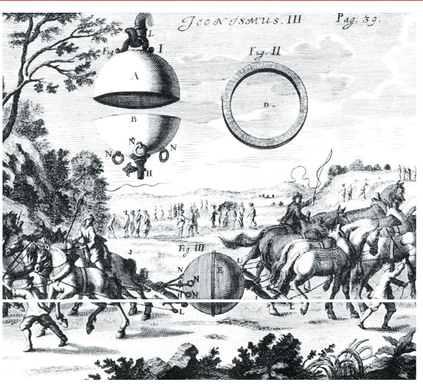

<details>
<summary>text_image</summary>

Jeongismus. III
Pag. 39.
Fig. II
A
B
N
H
Fig. III
E
U
N
H
L
</details>

17., aktualisierte Auflage

HANSER

---


---

Physikalische Konstanten (2018 CODATA recommended values)

| Atomare Masseneinheit | u | = 1,660 539 066 60(50) · $10^{-27}$ kg |
| --- | --- | --- |
| Atomare Masseneinheit (Energieäquivalent) | $u c_{0}^{2}$ | = 931,494 102 42(28) MeV |
| AVOGADRO-Konstante | $N_{\text{A}}$ | = 6,022 140 76···$10^{23}$ mol$^{-1}$ *) |
| BOHRscher Radius | $a_{\text{H}}$ | = 0,529 177 210 903(80) · $10^{-10}$ m |
| BOHRsches Magneton | $\mu_{\text{B}}$ | = 9,274 010 0783(28) · $10^{-24}$ J · T$^{-1}$ |
| BOLTZMANN-Konstante | k | = 1,380 649···$10^{-23}$ J · K$^{-1}$ *) |
| COMPTON-Wellenlänge des Elektrons | $\lambda_{\text{C}}$ | = 2,426 310 238 67(73) · $10^{-12}$ m |
| Elektrische Elementarladung | e | = 1,602 176 634···$10^{-19}$ C *) |
| Elektrische Feldkonstante | $\varepsilon_{0}$ | = 8,854 187 8128(13) · $10^{-12}$ F · m$^{-1}$ |
| Elektronenradius | $r_{\text{e}}$ | = 2,817 940 3262(13) · $10^{-15}$ m |
| Fallbeschleunigung (Normwert) | $g_{\text{n}}$ | = 9,806 65 m · s$^{-2}$ *) |
| FARADAY-Konstante | F | = 96 485,332 12... C · mol$^{-1}$ *) |
| Feinstrukturkonstante | $\alpha$ | = 7,297 352 5693(11) · $10^{-3}$ |
| Frequenz des Hyperfeinstrukturübergangs | $f_{\text{Cs}}$ | = 9 192 631 770... s$^{-1}$ *) |
| Gaskonstante (molare) | R | = 8,314 462 618... J · mol$^{-1}$ · K$^{-1}$ *) |
| Gravitationskonstante | $\gamma$ | = 6,674 30(15) · $10^{-11}$ m$^{3}$ · kg$^{-1}$ · s$^{-2}$ |
| JOSEPHSON-Konstante | $K_{\text{J}}$ | = 4,835 978 484···$10^{14}$ Hz · V$^{-1}$ *) |
| Kernmagneton | $\mu_{\text{N}}$ | = 5,050 783 7461(15) · $10^{-27}$ J · T$^{-1}$ |
| Lichtgeschwindigkeit im Vakuum | $c_{0}$ | = 299 792 458 m · s$^{-1}$ *) |
| LOSCHMIDT-Konstante | $N_{\text{L}}$ | = 2,686 780 111···$10^{25}$ m$^{-3}$ *) |
| Magnetische Feldkonstante | $\mu_{0}$ | = 12,566 370 6212(19) · $10^{-7}$ H · m$^{-1}$ |
| Magnetisches Flussquantum | $\Phi_{0}$ | = 2,067 833 848···$10^{-15}$ Wb *) |
| Molares Normvolumen des idealen Gases | $V_{\text{m0}}$ | = 0,022 413 969 54... m$^{3}$ · mol$^{-1}$ *) |
| Normalluftdruck | $p_{0}$ | = 101 325 Pa *) |
| PLANCKsches Drehimpulsquantum | $\hbar$ | = 1,054 571 817···$10^{-34}$ J · s *) |
| PLANCKsches Wirkungsquantum | h | = 6,626 070 15···$10^{-34}$ J · s *) |
| Quanten-HALL-Widerstand | $R_{\text{H0}}$ | = 25 812,807 45... Ω *) |
| Ruhmasse des Elektrons | $m_{\text{e}}$ | = 9,109 383 7015(28) · $10^{-31}$ kg |
| Ruhmasse des Neutrons | $m_{\text{n}}$ | = 1,674 927 498 04(95) · $10^{-27}$ kg |
| Ruhmasse des Protons | $m_{\text{p}}$ | = 1,672 621 923 69(51) · $10^{-27}$ kg |
| RYDBERG-Frequenz | $R_{\text{H}} c_{0}$ | = 3,289 841 960 2508(64) · $10^{15}$ Hz |
| RYDBERG-Konstante | $R_{\text{H}}$ | = 10 973 731,568 160(21) m$^{-1}$ |
| Spezifische Ladung des Elektrons | $e/m_{\text{e}}$ | = -1,758 820 010 76(53) · $10^{11}$ C · kg$^{-1}$ |
| Spezifische Ladung des Protons | $e/m_{\text{p}}$ | = 9,578 833 1560(29) · $10^{7}$ C · kg$^{-1}$ |
| STEFAN-BOLTZMANN-Konstante | $\sigma$ | = 5,670 374 419···$10^{-8}$ W · m$^{-2}$ · K$^{-4}$ *) |
| Wellenwiderstand des Vakuums | $Z_{0}$ | = 376,730 313 668(57) Ω |
| WIEN-Konstante | b | = 2,897 771 955···$10^{-3}$ m · K *) |

Hinweis: Die letzten beiden Ziffern in runden Klammern geben jeweils die Standardabweichung der betreffenden Größe an; sie bezieht sich auf die letzten beiden, vor der Klammer stehenden Dezimalen. Z. B. ist die magnetische Feldkonstante zu lesen als $\mu _ { 0 } = ( 1 2 { , } 5 6 6   3 7 0   6 2 1 2 { \pm } 0 { , } 0 0 0   0 0 0   0 0 1 9 ) { \cdot } 1 0 ^ { - 7 }   \mathrm { H }   { \cdot }   \mathrm { m } ^ { - 1 }$

∗) Exakte Konstante.

---

Stroppe/Streitenberger/Specht

PHYSIK


## Bleiben Sie auf dem Laufenden!

Hanser Newsletter informieren Sie regelmäßig über neue Bücher und Termine aus den verschiedenen Bereichen der Technik. Profitieren Sie auch von Gewinnspielen und exklusiven Leseproben. Gleich anmelden unter

**www.hanser-fachbuch.de/newsletter**

---


---

Heribert Stroppe Peter Streitenberger Eckard Specht

# PHYSIK

# für Studierende der Natur- und Ingenieurwissenschaften

Ein Lehrbuch zum Gebrauch neben Vorlesungen mit 371 Bildern, 25 Tabellen, 245 durchgerechneten Beispielen und 145 Aufgaben mit Lösungen

17., aktualisierte Auflage

HANSER

---

## Die Autoren:

Prof. Dr. sc. nat. Dr.-Ing. Heribert Stroppe

Ordinarius für Technische Physik i. R.,

Wissenschaftlicher Leiter des Institute of High Technologies and Education e.V. Magdeburg

Dr. rer. nat. habil. Peter Streitenberger

Institut für Physik der Otto-von-Guericke-Universität Magdeburg

Dr. rer. nat. Eckard Specht

Institut für Physik der Otto-von-Guericke-Universität Magdeburg


FSC

www.fsc.org

MIX

Papier aus verantwor-

tungsvollen Quellen

FSC° C016439

Alle in diesem Werk enthaltenen Informationen, Verfahren und Darstellungen wurden zum Zeitpunkt der Veröffentlichung nach bestem Wissen zusammengestellt. Dennoch sind Fehler nicht ganz auszuschließen. Aus diesem Grund sind die im vorliegenden Werk enthaltenen Informationen für Autor:innen, Herausgeber:innen und Verlag mit keiner Verpflichtung oder Garantie irgendeiner Art verbunden. Autor:innen, Herausgeber:innen und Verlag übernehmen infolgedessen keine Verantwortung und werden keine daraus folgende oder sonstige Haftung übernehmen, die auf irgendeine Weise aus der Benutzung dieser Informationen – oder Teilen davon – entsteht. Ebenso wenig übernehmen Autor:innen, Herausgeber:innen und Verlag die Gewähr dafür, dass die beschriebenen Verfahren usw. frei von Schutzrechten Dritter sind. Die Wiedergabe von Gebrauchsnamen, Handelsnamen, Warenbezeichnungen usw. in diesem Werk berechtigt also auch ohne besondere Kennzeichnung nicht zu der Annahme, dass solche Namen im Sinne der Warenzeichen- und Markenschutz-Gesetzgebung als frei zu betrachten wären und daher von jedermann benützt werden dürften.

Die endgültige Entscheidung über die Eignung der Informationen für die vorgesehene Verwendung in einer bestimmten Anwendung liegt in der alleinigen Verantwortung des Nutzers.

Bibliografische Information der Deutschen Nationalbibliothek:

Die Deutsche Nationalbibliothek verzeichnet diese Publikation in der Deutschen Nationalbibliografie; detaillierte bibliografische Daten sind im Internet unter http://dnb.d-nb.de abrufbar.

Dieses Werk ist urheberrechtlich geschützt.

Alle Rechte, auch die der Übersetzung, des Nachdruckes und der Vervielfältigung des Werkes, oder Teilen daraus, vorbehalten. Kein Teil des Werkes darf ohne schriftliche Einwilligung des Verlages in irgendeiner Form (Fotokopie, Mikrofilm oder einem anderen Verfahren), auch nicht für Zwecke der Unterrichtsgestaltung – mit Ausnahme der in den §§ 53, 54 UrhG genannten Sonderfälle –, reproduziert oder unter Verwendung elektronischer Systeme verarbeitet, vervielfältigt oder verbreitet werden.

© 2023 Carl Hanser Verlag GmbH & Co. KG, München

www.hanser-fachbuch.de

Lektorat: Dipl.-Ing. Natalia Silakova-Herzberg

Coverkonzept: Marc Müller-Bremer, www.rebranding.de, München

Einbandbild: Otto von Guerickes Versuch mit den Magdeburger Halbkugeln aus Caspar Schott, Technica curiosa,

Nürnberg 1664 (Archiv der Otto-von-Guericke-Gesellschaft Magdeburg e. V.)

Satz: Eckard Specht, Magdeburg

Bildbearbeitung: Michael Specht, Katja Neumann, Magdeburg

Druck und Bindung: Hubert & Co. GmbH & Co. KG BuchPartner, Göttingen

Printed in Germany

Print-ISBN: 978-3-446-47679-0

E-Book-ISBN: 978-3-446-47829-9

---

Für

---


---

# Vorwort

Seit seinem Erscheinen im Jahre 1974 hat das Lehrbuch zunehmende Verbreitung gefunden, nicht nur unter Studierenden der Ingenieurwissenschaften, für die es ursprünglich gedacht war, sondern auch bei Studienanfängerinnen und Studienanfängern der Physik und anderer Naturwissenschaften. Das von Anfang an verfolgte und über Jahre hinweg beibehaltene Konzept, das ganze umfangreiche Gebiet in einem einzigen Band wiederzugeben, hat sich somit stets aufs Neue bewährt.

Die Menge an neuen physikalischen Erkenntnissen wächst von Tag zu Tag in stürmischer Weise an. Dies zwingt zu einer Form des Lehrbuchs, wie sie einer Anfängervorlesung wohl am besten gerecht wird: Die Abschnitte über die „klassische“ Physik bringen die Herleitungen bis ins Einzelne; an ihnen sollen sich die Leser die erforderliche Gewandtheit im Rechnen sowie in der mathematischen Formulierung physikalischer Zusammenhänge aneignen. Später, hauptsächlich im Kapitel „Quanten“ sowie bei neueren Anwendungen der Physik, muss mehr und mehr dazu übergegangen werden, das physikalische Phänomen zu beschreiben und zu erklä- ren.

Neben der reinen Wissensvermittlung soll das Buch aber noch einem anderen Zweck dienen: Es soll bei den jungen Studierenden, auch wenn sie die Physik nur als Grundlagenfach belegen (müssen), zugleich ein wenig die Liebe zum Gegenstand wecken. Deshalb sind trotz der gebotenen Kürze manche Probleme der Physik angesprochen, die nicht unmittelbar zum Stoff einer Grundlagenvorlesung gehören, aber üblicherweise allgemeines Interesse finden.

Die Durcharbeitung des in betont knapper Form gehaltenen Stoffes erfordert die intensive Mitarbeit der Leser. Wer also das Buch wirklich zum Lernen und nicht nur zum Nachschlagen benutzen will, wird viel „mitrechnen“ müssen. Dies bezieht sich nicht nur auf die zu den einzelnen Abschnitten aufgenommenen Übungsbeispiele und Aufgaben; diese möglichst ohne Zuhilfenahme der Lösungen zu meistern, sei jedem Studierenden dringend angeraten. Zahlreiche zusätzliche Beispiele und Aufgaben unterschiedlichen Schwierigkeitsgrades mit meist praxisorientiertem Inhalt zu allen behandelten Stoffgebieten enthält unser einbändiges Übungsbuch „PHYSIK – Beispiele und Aufgaben“.

Das Verständnis ist ein allgemeines Problem beim Erlernen der Physik. Das Lesen mag einfach erscheinen, aber das tiefere Verstehen der Zusammenhänge erfordert mehr als nur Lesen und Auswendiglernen, es erfordert Nachdenken; es gibt bei ernsthaftem Studium keine Möglichkeit, Letzteres zu umgehen. Die Studierenden sollen aber wissen, dass die Schwierigkeiten, mit denen erfahrungsgemäß jeder anfänglich zu kämpfen hat, in der Natur der Sache liegen, und dass sie sich um das Verständnis der Dinge ebenso bemühen müssen, wie es vor ihnen auch alle großen Geister einmal getan haben. Der Lohn der Mühe wird sich dann bald im Erfolgs-

---

8

Vorwort

erlebnis und „Leistungsglück“ einstellen und Ansporn fur ein weiteres erfolgreiches Studium sein.

Trotz vieler Hinweise wurde mit der Erweiterung der Stoffinhalte bewusst zurückhaltend umgegangen. Dies gilt auch für die vorliegende 17. Auflage. Auch wenn die vorgenommenen Änderungen und Ergänzungen nicht so umfangreich ausgefallen sind wie bei der 16. Auflage, so sind auch diesmal wichtige Gebiete betroffen. Die Revision des Internationalen Einheitensystems (SI) ist abgeschlossen, was eine Aktualisierung der Darstellung an vielen Stellen erforderlich machte. Inhaltliche Ergänzungen betreffen beispielsweise auch die Abschnitte über die spezielle Relativitätstheorie, wo durch einfache Herleitungen von wichtigen Schlussfolgerun gen ein besseres Verständnis angestrebt wird.

Wir danken den Herren Prof. Dr. W. HERMS (Magdeburg) und Prof. Dr. J. HÖHN (Wien) für wertvolle Hinweise. Weiterhin sind wir Frau U. KRUSE für das Zeichnen der Bilder und Herrn DR. M. SPECHT (Berlin) für deren digitale Bearbeitung zu Dank verpflichtet.

Dem Verlag sei für die seit Erscheinen des Buches stets gute Zusammenarbeit gedankt, insbesondere seiner Lektorin Frau Natalia Silakova.

Magdeburg, im Juli 2023

Die Autoren

## Hinweise

Gleichungen, Bilder, Tabellen, Beispiele und Aufgaben werden innerhalb eines Hauptabschnittes (Einer-Nummerierung) fortlaufend gezählt (z. B. Bild 3.10 = 10. Bild im Abschnitt 3, oder (14.5) = Gleichung (5) in Abschnitt 14 oder Beispiel 31.1/2 = zweites der Beispiele 31.1 usw.). Die Lösungen zu den Aufgaben befinden sich unter der entsprechenden Aufgaben-Nummer auf den Seiten 629 bis 634.

Vektoren sind im Text durch fettgedruckte Buchstaben, in den Bildern zur besseren Unterscheidung durch normale Buchstaben mit einem Pfeil darüber gekennzeichnet.

Aus didaktischen und historischen Gründen verwenden wir in der Benennung und/oder in den Formelzeichen physikalischer Größen in einigen Fällen sowohl die Größenbenennung nach DIN als auch die im physikalischen Schrifttum (noch) häufiger vorkommende Benennung, z. B. „Dielektrizitätskonstante“ und nach DIN „Permittivität“, „Verschiebungsdichte“ und „elektrischer Fluss“, „Flächenladungsdichte“ und „Ladungsbedeckung“, oder Stromdichte j statt nach DIN J, magnetische Spannung $U _ { \mathrm { m } }$ statt $V _ { \mathrm { m } }$ u. a. Im Übrigen unterliegen sowohl die Größenbenennungen als auch die Formelzeichen erfahrungsgemäß häufigen Veränderungen, und die Empfehlungen sind in verschiedenen Fachgebieten nicht einheitlich.

---

## Inhaltsverzeichnis

## I Einführung

## 1 Was ist „Physik“? Wege physikalischer Erkenntnisgewinnung 20

## 2 Physikalische Größen, Einheiten, Dimensionen, Gleichungen 22

2.1 Größen, Einheiten, Dimensionen . . 22
2.2 Physikalische Gleichungen . 24
2.3 Das SI-Einheitensystem . . . . . 25

## II Teilchen

Mechanik der Punktmasse und des starren Körpers. Stoffe

## 3 Kinematik der Punktmasse 28

3.1 Raum, Zeit, Bezugssystem . . . . . 28
3.2 Die gleichförmige Bewegung . . . 30
3.3 Die gleichmäßig beschleunigte Bewegung . . 31
3.4 Freier Fall. Senkrechter Wurf . 34
3.5 Allgemeine Definition von Geschwindigkeit und Beschleunigung. Ungleichmäßig beschleunigte Bewegung . . . . 36
3.6 Geschwindigkeit und Beschleunigung als Vektoren. Zusammengesetzte Bewegungen (Superposition) 39
3.7 Die gleichförmige Kreisbewegung . . . 41
3.8 Die ungleichförmige Kreisbewegung . 45
3.9 Bewegung auf beliebig krummliniger Bahn . 47

## 4 Dynamik der Punktmasse . 49

4.1 Der Kraftbegriff in der Physik. Zusammensetzung und Zerlegung von Kräften. Statisches Gleichgewicht . . . 49
4.2 Das Trägheitsgesetz (1. NEWTONsches Axiom) 51
4.3 Das Grundgesetz der Dynamik (2. NEWTONsches Axiom) . . . . . . . . .
4.4 Träge und schwere Masse. Gewichtskraft. Radialkraft . 53
4.5 Kraftstoß. Impuls (Bewegungsgröße) . 55
4.6 Lösung der Bewegungsgleichung für konstante Kraft. Die Wurfbewegung . . 58

---

10

Inhaltsverzeichnis

4.7 Das Wechselwirkungsgesetz (3. NEWTONsches Axiom) 61
4.8 Reibungskräfte 62

## 5 Bewegte Bezugssysteme . 66

5.1 Geradlinig beschleunigte Bezugssysteme. Trägheitskräfte . . . . . . . . 66
5.2 Gleichförmig rotierende Bezugssysteme. Zentrifugalkraft, CORIOLIS-Kraft . . 69
5.3 Inertialsysteme. Relativitätsprinzip der klassischen Mechanik . . . . . . . . . . . . . . 72

## 6 Grundzüge der speziellen Relativitätstheorie. 74

6.1 Konstanz der Lichtgeschwindigkeit. Die LORENTZ-Transformation . . . . . . . . . 74
6.2 Folgerungen aus der LORENTZ-Transformation . . . . . 78
6.3 Relativistische Bewegungsgleichung 80

## 7 Arbeit und Energie . 82

7.1 Arbeit . . . . . . . 82
7.2 Leistung. Wirkung . . . . . . 86
7.3 Der Energiebegriff. Potenzielle und kinetische Energie . . . . 87
7.4 Das Gesetz von der Erhaltung der Energie (Energiesatz) 88
7.5 Äquivalenz von Masse und Energie . . . 90

## 8 Gravitation . . 93

8.1 Die KEPLERschen Gesetze der Planetenbewegung und das Gravitationsgesetz . . . . 93
8.2 Arbeit gegen die Schwerkraft. Kosmische Geschwindigkeiten . . . . . . . . . . . . . . 96

## 9 Dynamik der Punktmassen-Systeme 98

9.1 Impulserhaltungssatz. Massenmittelpunkt . 98
9.2 Die Gesetze des Stoßes . . . 100
9.3 Raketenantrieb . . . . . . . 105

## 10 Statik des starren Körpers . 107

10.1 Freiheitsgrade des starren Körpers . . . . 107
10.2 Kräfte am starren Körper. Drehmoment. Gleichgewichtsbedingungen . . . . . . 107
10.3 Kräftepaar . . . . . . . . . . . . . . . . 112
10.4 Der Schwerpunkt . . . . . . . 112
10.5 Arten des Gleichgewichts . . . . 115

## 11 Dynamik des starren Körpers . 116

11.1 Bewegung eines frei beweglichen Körpers bei Einwirkung einer Kraft. . . . . . . 116
11.2 Kinetische Energie der Drehbewegung. Massenträgheitsmoment . . . . . . . . . . 116
11.3 Arbeit und Leistung bei der Drehbewegung. Grundgesetz der Dynamik . . . . 119
11.4 Der Drehimpuls (Drall). Drehimpulserhaltungssatz . . . . . . . . . . . 121
11.5 Kreiselbewegungen. Freie Achsen . . . . . . 123
11.6 Bewegung des symmetrischen Kreisels . . . . 125

---

Inhaltsverzeichnis

11

## 12 Die Zustandsformen der Stoffe. . . . 128

12.1 Einteilung der Stoffe. Aggregatzustände . . . 128
12.2 Der kristalline Aufbau der Festkörper . 129
12.3 Bindungsarten . . . . . 132

## III Kontinua

Mechanik der deformierbaren Medien

## 13 Der deformierbare feste Körper . . 134

13.1 Elastische Verformung. HOOKEsches Gesetz . . . . . 134
13.2 Querkontraktion. Kompressibilität . . 136
13.3 Elastisches Verhalten bei Scherbeanspruchung . . . . . 137
13.4 Der einachsige Spannungszustand . . . . 138
13.5 Dreiachsiger Spannungs- und Dehnungszustand . . 139
13.6 Zusammenhang zwischen Schubmodul, Elastizitätsmodul und POISSONscher Querkontraktionszahl . . . . 140
13.7 Plastische Verformung. Spannungs-Dehnungs-Diagramm . . . . . 141
13.8 Härte fester Körper . . . . . . . . . 143

## 14 Ruhende Flüssigkeiten und Gase . 144

14.1 Druck in Flüssigkeiten (hydrostatischer Druck) . . . . 144
14.2 Schweredruck. Auftrieb. Schwimmstabilität . . . 145
14.3 Druck in Gasen. Zusammenhang zwischen Druck, Volumen und Dichte . . . 149
14.4 Schweredruck in Gasen. Barometrische Höhenformel . . . . . . . . . . 150
14.5 Erscheinungen an Grenzflächen. Kohäsion und Adhäsion . . . . . . . . . . . . . . . . . . 152
14.6 Spezifische Oberflächenenergie, Oberflächenspannung . . . . . . . . . . . . . 152
14.7 Benetzung und Kapillarwirkung . 154

## 15 Strömende Flüssigkeiten und Gase (Strömungsmechanik) . . . . 156

15.1 Das Strömungsfeld. Kennzeichnung und Einteilung von Strömungen . . . . . . 156
15.2 Strömungen idealer Flüssigkeiten und Gase. Kontinuitätsgleichung . . . . . . . . 158
15.3 Die BERNOULLIsche Gleichung. Druckmessung . . . . . . 160
15.4 Strömungen realer Flüssigkeiten und Gase. Laminare Strömung . . . . . . . . . . . 164
15.5 Gesetze von HAGEN-POISEUILLE und STOKES . . . . . 165
15.6 Umströmung durch reale Flüssigkeiten und Gase. REYNOLDS-Zahl . . . . . . . . . 167
15.7 Die Bewegungsgleichung eines Fluids . . 169

## IV Wärme

Thermodynamik und Gaskinetik

## 16 Verhalten der Körper bei Temperaturänderung. . . . . . . . . . . 174

16.1 Die Temperatur und ihre Messung . . . . 174
16.2 Thermische Ausdehnung fester und flüssiger Körper . . . . 176

---

12

Inhaltsverzeichnis

16.3 Durch Änderung der Temperatur bewirkte Zustandsänderungen der Gase. Der absolute Nullpunkt . . . . . . 178
16.4 Die thermische Zustandsgleichung des idealen Gases. . 181

## 17 Der I. Hauptsatz der Thermodynamik (Energiesatz) . . . . . . . . . . . . . . 184

17.1 Wärmemenge und Wärmekapazität . . . . . . . 184
17.2 Innere Energie eines Systems. Formulierung des I. Hauptsatzes . . . . . . . . . . . . 186
17.3 Spezifische Wärmekapazität des idealen Gases. Kalorische Zustandsgleichung . . 188
17.4 Anwendung des I. Hauptsatzes auf spezielle Zustandsänderungen des idealen Gases . . 190
17.5 Zustandsänderungen des idealen Gases in offenen Systemen. Technische Arbeit. Enthalpie . 195

## 18 Kinetische Gastheorie. . . 197

18.1 Die Masse der Atome und Moleküle . . 197
18.2 Druck und mittlere quadratische Geschwindigkeit der Gasmoleküle. Grundgleichung der kinetischen Gastheorie . . . . 198
18.3 Die Geschwindigkeitsverteilung der Gasmoleküle . 201
18.4 Molekularenergie und Temperatur. Wärmekapazität der Körper . . . . . . . . . . . . 204
18.5 Stoßzahl und mittlere freie Weglänge . . . 207
18.6 Gemische idealer Gase. Gesetz von DALTON . . . 208

## 19 Der II. Hauptsatz der Thermodynamik (Entropiesatz) . . . . . . . . . . . . 210

19.1 Der CARNOT-Kreisprozess. Wärmekraftmaschine, Kältemaschine und Wärmepumpe . . . . . 210
19.2 Thermodynamische Temperatur . . . . 214
19.3 Reversible und irreversible Vorgänge. II. Hauptsatz . . 215
19.4 Entropie . . . . . . . 217
19.5 Entropieänderung des idealen Gases. Irreversible Prozesse . .
19.6 Entropie und Wahrscheinlichkeit . . 224
19.7 III. Hauptsatz (Satz von der Unerreichbarkeit des absoluten Nullpunkts) . . . 227

## 20 Reale Gase. Phasenumwandlungen 228

20.1 Die VAN-DER-WAALSsche Zustandsgleichung. Gasverflüssigung . . . . . . . . . . . . 228
20.2 JOULE-THOMSON-Effekt. Erzeugung tiefer Temperaturen . . . 231
20.3 Gleichgewicht zwischen flüssiger und gasförmiger Phase. Sieden und Verdunsten . . . . 233
20.4 Gleichgewicht zwischen fester und flüssiger Phase. Koexistenz dreier Phasen . . . . 238
20.5 Lösungen. Siedepunktserhöhung, Gefrierpunktserniedrigung . . . . . . . . . . . . . 241

## 21 Ausgleichsvorgänge. . . . 243

21.1 Wärmeleitung . . . . . . . . . . 243
21.2 Wärmeübergang, Wärmedurchgang, Konvektion . . 246
21.3 Diffusion . . . . . 248

---

Inhaltsverzeichnis

13

## V Felder

Gravitation. Elektrizität und Magnetismus

## 22 Das Gravitationsfeld . . 252

22.1 Nahwirkungstheorie. Der Feldbegriff . . . 252
22.2 Gravitationsfeldstärke, Gravitationspotenzial . . . 254
22.3 Massen als Senken des Gravitationsfeldes . . . 257
22.4 Grundaussagen der allgemeinen Relativitätstheorie . 259

## 23 Das elektrostatische Feld . 261

23.1 Die elektrische Ladung. Ladungsnachweis . . 261
23.2 Ladungen als Quellen bzw. Senken des elektrischen Feldes . . . . . . . . . . . . . . . . 263
23.3 Kraftwirkungen des elektrischen Feldes. Elektrische Feldstärke . . . . . . . . . . . . . 264
23.4 Elektrostatisches Potenzial. Spannung . 267
23.5 Elektrische Ladungen auf Leitern. Influenz . . 269
23.6 Elektrischer Fluss, Flussdichte . . . 270
23.7 Das elektrische Zentralfeld (Punktladung und Punktladungssystem) . . . . . . . 272
23.8 Kapazität. Kondensatoren . 274

## 24 Das elektrische Feld in Isolatoren (Dielektrika). . . . . . . . 277

24.1 Elektrische Polarisation der Dielektrika. Piezoelektrizität . . . . . . . . . 277
24.2 Permittivität (Dielektrizitätskonstante), elektrische Suszeptibilität . . . . . . . . . 278
24.3 Verhalten von D und E an der Grenzfläche zweier Medien . . . . . . . . . . . . . . . . . 280
24.4 Energieinhalt des elektrischen Feldes . . 282

## 25 Der Gleichstromkreis . . . 284

25.1 Das stationäre elektrische Feld in einem Leiter . . . 284
25.2 Stromstärke, Spannung, Widerstand. OHMsches Gesetz . . . . . . . . . . . . . . 284
25.3 Schaltungen und Messmethoden . . . 287
25.4 Arbeit und Leistung elektrischer Gleichströme . 293

## 26 Elektrische Leitungsvorgänge in Festkörpern und Flüssigkeiten . 294

26.1 Klassische Theorie der freien Elektronen in Metallen . . . . . 294
26.2 Thermoelektrische Effekte . . . 296
26.3 Elektrokinetische Effekte . . 298
26.4 Elektrolytische Stromleitung. FARADAYsche Gesetze . . . 298
26.5 Elektrochemische Spannungsquellen . 300

## 27 Elektrische Leitungsvorgänge im Vakuum und in Gasen . . . . . . . 302

27.1 Bewegung freier Ladungsträger im elektrischen Feld . . . . . . . . . . 302
27.2 Ladungsträgerinjektion, Katodenstrahlen . . . 304
27.3 Gasentladungen . . . . . . 305
27.4 Plasmaströme . . . . . . 308

---

14

Inhaltsverzeichnis

## 28 Das magnetostatische Feld der Dipole und Gleichströme . . . . . . 309

28.1 Analogien und Unterschiede zum elektrostatischen Feld . . . . . . . . . . . . . . . . . . . 309
28.2 Kraftwirkungen des magnetischen Feldes auf magnetische Dipole. Magnetische Feldstärke . . . . . . 310
28.3 Das Magnetfeld eines geraden Stromleiters. Durchflutungsgesetz . . . . . . . . . . 311
28.4 Einfache Feldberechnungen . . . . 313
28.5 Magnetische Flussdichte (Induktion) . . 315
28.6 Kraftwirkungen des magnetischen Feldes auf Stromleiter . . . . . . . . . . . . . . . . . . 316
28.7 Bewegung freier Ladungsträger im magnetischen Feld. LORENTZ-Kraft . . . . . 318
28.8 Galvano- und thermomagnetische Effekte. HALL-Effekt. Quanten-HALL-Effekt. . . 320

## 29 Das magnetische Feld in Stoffen . 322

29.1 Magnetische Polarisation der Stoffe . . . 322
29.2 Magnetisierung der Ferromagnetika. Hysterese . . . . . . 323
29.3 Der magnetische Kreis. Entmagnetisierung . . 325

## 30 Elektromagnetische Induktion . 328

30.1 Das FARADAYsche Induktionsgesetz . . . . . . . 328
30.2 Selbstinduktion . . . . . 330
30.3 Energieinhalt des magnetischen Feldes . . . . 332
30.4 Elektromagnetische Induktion in einem bewegten Leiter . . . . . . 333

## 31 Der Wechselstromkreis . 335

31.1 Wechselspannung, Wechselstrom, Dreiphasenstrom . . . . . . . 335
31.2 Arbeit und Leistung elektrischer Wechselströme . . . . . 337
31.3 Wechselstromwiderstände. OHMsches Gesetz für Wechselstrom . . . . . . . . . . . 339
31.4 Der Transformator . . . . . . . 345
31.5 Anharmonische Wechselströme in der Elektronik . . . 346
31.6 Gleichrichter und Verstärker. Elektronische Bauelemente . . . . . . . . . . . . . . . . . . 347

## 32 Die maxwellschen Gleichungen . 351

32.1 Wirbel des magnetischen Feldes. Verschiebungsstrom . . . . . . . . . . . 351
32.2 Wirbel des elektrischen Feldes. Wirbelströme . . . . 352
32.3 Elektromagnetisches Feld. System der MAXWELLschen Gleichungen . . . . . . . . 354
32.4 Relativistische Elektrodynamik . 355

## VI Wellen

Mechanische und elektromagnetische Schwingungen und Wellen

## 33 Mechanische Schwingungen . . . 358

33.1 Lineare Federschwingungen . . . . . . 358
33.2 Energiebilanz des harmonischen Oszillators. . . . . 361
33.3 Drehschwingungen . . . . . 362
33.4 Pendelschwingungen . . . . 364

---

Inhaltsverzeichnis

15

33.5 Freie gedämpfte Schwingungen . . . 366
33.6 Erzwungene Schwingungen . . 369

## 34 Elektrische Schwingungen. . . 373

34.1 Der geschlossene Schwingkreis . . . 373
34.2 Strom- und Spannungsresonanz . . 375
34.3 Erzeugung ungedämpfter elektrischer Schwingungen . . 378

## 35 Überlagerung harmonischer Schwingungen . . 380

35.1 Überlagerung zweier Schwingungen längs gleicher Richtung. . . . . . . . . . . . . . . 380
35.2 Gekoppelte Schwingungen . 382
35.3 Überlagerung zweier Schwingungen längs aufeinander senkrechter Richtungen . . . . 385
35.4 Überlagerung von harmonischen zu anharmonischen Schwingungen . . . . . . 388
35.5 Nichtlineare Schwingungen. Deterministisches Chaos . . . . . . . . . . . 390

## 36 Allgemeine Wellenlehre . . 394

36.1 Zusammenhang von Schwingungen und Wellen . . . . 394
36.2 Die eindimensionale Wellengleichung und ihre allgemeine Lösung . . . . . . . . 397
36.3 Transversal- und Longitudinalwellen . . . 398
36.4 Stehende Wellen. Eigenschwingungen . 401
36.5 Wellenausbreitung in ausgedehnten Medien . 404

## 37 Schallwellen (Akustik). . 407

37.1 Wellenausbreitung im Schallfeld. Phasengeschwindigkeit . . . . . . . 407
37.2 Schallfeldgrößen . 409
37.3 Schallquellen. Ton, Klang, Geräusch . 411
37.4 Schallempfänger und Gehör. Schallpegel und Lautstärke . . 412
37.5 Stehende Schallwellen . . . . 414
37.6 DOPPLER-Effekt . . . . 416
37.7 MACHscher Kegel . . . . 418

## 38 Elektromagnetische Wellen . . 419

38.1 Ausbreitung elektromagnetischer Wellen entlang von Leitungen . . . . . . . . . . . 419
38.2 Ausbreitung elektromagnetischer Wellen im freien Raum . . . 421
38.3 Erzeugung und Nachweis elektromagnetischer Wellen . . . . 425
38.4 Die Entdeckung der elektromagnetischen Wellen (H. HERTZ, 1888) . . . . . . . . 427
38.5 Das elektromagnetische Spektrum . 428

## 39 Einfluss von Stoffen auf die Wellenausbreitung

39.1 Absorption und Streuung . . 431
39.2 Phasengeschwindigkeit und Dispersion. Gruppengeschwindigkeit . . . . . . . . . 432
39.3 HUYGENSsches Prinzip . 436
39.4 Reflexion und Brechung (Refraktion). Totalreflexion . 437
39.5 Optische Dispersion. Prisma, Spektral- und Körperfarben . . . . . . 440

---

16

Inhaltsverzeichnis

## 40 Strahlenoptik (Geometrische Optik) . 443

40.1 Lichtstrahlen. FERMATsches Prinzip . . . . . 443
40.2 Reflexion und Brechung von Lichtstrahlen . . . 445
40.3 Abbildung durch Spiegel (ebener und gekrümmte Spiegel) . . . . . . . . . . . . . . . . . 447
40.4 Abbildung durch Linsen (dünne und dicke Linsen, Linsensysteme) . . . . . . . . 452
40.5 Das Auge und der Sehvorgang . . . . 458
40.6 Optische Geräte zur Sehwinkelvergrößerung (Lupe, Mikroskop, Fernrohr) . . 458
40.7 Abbildungsfehler . . . . . 461

## 41 Wellenoptik . . 462

41.1 Interferenz. Interferenzbedingungen . . . . 462
41.2 Interferenzen gleicher Neigung und gleicher Dicke . . . . 464
41.3 Beugung (Diffraktion). Das Beugungsphänomen . . . . 466
41.4 FRAUNHOFERsche Beugung am Spalt und an der Lochblende
41.5 Auflösungsvermögen optischer Geräte. Holografie . . 471
41.6 FRAUNHOFERsche Beugung am Strichgitter . . . . . 474
41.7 Spektrometer . . . . . . . . . . . 476
41.8 Beugung von RÖNTGENstrahlen am Raumgitter der Kristalle . . . . . . . . . . . . . . . 477
41.9 Polarisation. Polarisation des Lichts durch Reflexion und Brechung . . . . . . . . 481
41.10 Polarisation durch Doppelbrechung . 484
41.11 Interferenz des polarisierten Lichts . 486
41.12 Drehung der Schwingungsebene des polarisierten Lichts . . 489
41.13 Nichtlineare Optik . . . . . 491

## VII Quanten

Struktur und Eigenschaften der Materie

## 42 Die Gesetze der Strahlung 494

42.1 Das Wesen der Temperaturstrahlung (Wärmestrahlung) . . . . . . . . . . 494
42.2 Strahlungsphysikalische Größen . . 495
42.3 Emission und Absorption von Strahlung. KIRCHHOFFsches Strahlungsgesetz . . . . . . 497
42.4 Das PLANCKsche Strahlungsgesetz . 499
42.5 Folgerungen aus dem PLANCKschen Strahlungsgesetz . . 500
42.6 Lichttechnische Größen (Photometrie) . . . 503
42.7 Zusammenhang zwischen strahlungsphysikalischen und lichttechnischen Größen . . . 506

## 43 Der Welle-Teilchen-Dualismus der Mikroobjekte . 507

43.1 Die Teilchennatur des Lichts. Lichtquanten (Photonen) . . . . . . . 507
43.2 Der lichtelektrische Effekt (Photoeffekt) . 508
43.3 Der COMPTON-Effekt . . . . . . 511
43.4 Rückstoß durch Quantenemission. MÖSSBAUER-Effekt . . . . . . . . . . . . . 512
43.5 Die Wellennatur der Teilchen . . . . 513
43.6 Das HEISENBERGsche Unbestimmtheitsprinzip (Unschärferelation) . . . . . . . . 517

---

Inhaltsverzeichnis

17

## 44 Atombau und Spektren . . 520

44.1 Die Streuexperimente von LENARD und RUTHERFORD. Das RUTHERFORDsche Atommodell . . . 520
44.2 Das Spektrum des Wasserstoffatoms . . . . 522
44.3 Das BOHRsche Atommodell . . . 524
44.4 Die Spektren der Alkaliatome. Bahndrehimpulsquantenzahl . . . . . . . . . . . . . . . 528
44.5 Richtungsquantelung des Bahndrehimpulses der Elektronen . . . . . . . . . . . . . . 531
44.6 Das magnetische Bahnmoment der Elektronen. BOHRsches Magneton . . . . . 532
44.7 Elektronenspin und magnetisches Spinmoment. Die Feinstruktur der Atomspektren . . . . 533
44.8 Mehrelektronensysteme . . . . . 535
44.9 Aufspaltung der Spektrallinien im Magnetfeld (ZEEMAN-Effekt) . . . . . . . . . . . . 536
44.10 Das PAULI-Prinzip und das Periodensystem der Elemente . . 538
44.11 Die RÖNTGENspektren und ihre Deutung . . 542
44.12 Absorption und Streuung von RÖNTGENstrahlen. . . 544
44.13 Induzierte Emission. Maser und Laser . . . 548

## 45 Wellenmechanik 551

45.1 Die SCHRÖDINGER-Gleichung . . . . . . . 551
45.2 Elektron im Kastenpotenzial . . 553
45.3 Das wellenmechanische Bild des Atoms . . . . 555
45.4 Der Tunneleffekt . 557

## 46 Elektrische und magnetische Eigenschaften von Festkörpern 559

46.1 Elektrische Leitfähigkeit. Das Modell des Elektronengases . . . . . . . . . . . . . . . . . 559
46.2 Bändermodell des Festkörpers. Metalle, Halbleiter, Isolatoren . . . . . . . . . . . . . . 560
46.3 Elektrische Ströme in Halbleitern. Eigenleitung, Störstellenleitung . . . . . . . . . 564
46.4 Der pn-Übergang . . . . . . . 567
46.5 Halbleiterdiode, Transistor . . . . . . 569
46.6 Magnetische Eigenschaften. Dia- und Paramagnetismus . . . . . . . . . . . . . . 571
46.7 Ferromagnetismus, Antiferro- und Ferrimagnetismus . 573
46.8 Supraleitung. Der JOSEPHSON-Effekt . . . 576
46.9 Supraflüssigkeit . . . . . 579

## 47 Atomkerne 580

47.1 Masse, Ladung und Zusammensetzung der Kerne . . . . 580
47.2 Isotope . . . . . . . . . . . 581
47.3 Isobare, Isotone, Nuklide, Isomere . . . 582
47.4 Massendefekt und Bindungsenergie der Kerne . . . 582
47.5 Stabilitätskriterien. Kernsystematik . . 584
47.6 Kernkräfte . . . . . . . . . . . . 587
47.7 Kernmodelle . . . . . . 588

---

18

Inhaltsverzeichnis

## 48 Die natürliche Radioaktivität. . 590

48.1 Der α-Zerfall der schweren Kerne . . . . . 590
48.2 Der β-Zerfall. Gammastrahlung . . . . 591
48.3 Das Zerfallsgesetz. Spezifische Aktivität . . 593
48.4 Radioaktive Zerfallsreihen und radioaktives Gleichgewicht . . . . . . . . . . . . . . . . 595
48.5 Dosimetrie und biologische Wirkung ionisierender Strahlung . . . . . . . . . . . . . . 596

## 49 Künstliche Kernumwandlungen . 599

49.1 Arten künstlicher Kernumwandlungen . . . . . . . 599
49.2 Massen- und Energiebilanz von Kernreaktionen. Wirkungsquerschnitt . . . . . 600
49.3 Kernspaltung. Gewinnung von Kernspaltungsenergie . . . . . . . . . . . 601
49.4 Arten von Kernreaktoren . . . . . 604
49.5 Kernfusion . . . . . . . . 605

## 50 Elementarteilchen . . . 607

50.1 Entwicklung zum Teilchen-„Zoo“ . . . 607
50.2 Erhaltungssätze für Baryonenladung, Leptonenladung, Isospin, Strangeness und Hyperladung. . . . . . . 608
50.3 Die elementaren Teilchen: Leptonen und Quarks . . . . . 610
50.4 Zusammengesetzte Elementarteilchen. Hadronen . . . . . . . 612
50.5 Die elementaren Kräfte (Wechselwirkungen). Feldquanten . . . . . . . . . . . . . . . . 613
50.6 Standardmodell der Teilchenphysik. Vereinheitlichte Theorie der elementaren Kräfte . . 615
50.7 Kosmologie. Dunkle Materie und Dunkle Energie . . . . . . 616

## A ANHANG: Fehlerrechnung (Messabweichungen).

A.1 Arten und Ursachen von Messabweichungen . . . . . 618
A.2 Ermittlung von Messergebnis und Messabweichung . . . . . . 619
A.3 Zufallsstreuung von Messwerten . . . . . . 621
A.4 Fehlerfortpflanzung . . . 625
A.5 Geradenausgleich (lineare Regression). Korrelation . . . 627
Bildquellenverzeichnis . . . . 630
Lösungen der Aufgaben . . . 631

## Index . . 637

---

## Teil I

## Einführung

---

# Was ist „Physik“?

# Wege physikalischer

# Erkenntnisgewinnung

Die Physik ist eine grundlegende Naturwissenschaft und beschäftigt sich mit der Untersuchung des Aufbaus, der Eigenschaften und der Bewegung der unbelebten Natur sowie mit den diese Bewegung hervorrufenden Kräften oder Wechselwirkungen. Wegen ihres grundlegenden und übergreifenden Charakters bildet die Physik ein unentbehrliches Fundament für viele andere Naturwissenschaften, wie z. B. die Chemie, die Astronomie, die Geowissenschaften und Meteorologie, sowie insbesondere für die gesamte Technik. So sind heute zahlreiche Physiker in den Ingenieurwissenschaften tätig, und viele in der Grundlagenforschung arbeitende Ingenieure sind zu hoch spezialisierten Physikern geworden. Da auch der Stoff, aus dem die Organismen bestehen und der in ihnen umgesetzt wird, den Gesetzen der Physik unterworfen ist, stellt diese darüber hinaus eine wesentliche Grundlage der biologischen und im weiteren Sinne auch der medizinischen Wissenschaft dar; man denke nur an die stürmische Entwicklung und zunehmende Bedeutung der Biophysik.

Die Physik ist eine Erfahrungswissenschaft. Jede ausgesprochene Behauptung oder Vermutung über einen physikalischen Sachverhalt ist das Resultat von Schlussfolgerungen, deren Ausgangspunkt bestimmte **Axiome** bilden. Das sind Grund- und Erfahrungssätze, deren Richtigkeit nicht durch logisches Schließen aus anderen Sätzen, sondern nur aus unmittelbar gegebenen Tatsachen hervorgeht. Ein Axiom kann man nicht logisch beweisen, sondern nur durch ein **Experiment** demonstrieren.

Das Experiment, d. h. die exakte Messung bestimmter, genau definierter physikalischer Grö- ßen im planmäßig und gezielt ausgeführten Versuch, bildet überhaupt die Grundlage jeglicher physikalischen Erkenntnis. Durch systematisches Ordnen des gewonnenen umfangreichen experimentellen Materials, durch die gedankliche Durchdringung mit den Methoden der Mathematik und Einordnung der Ergebnisse in schon bekannte Zusammenhänge lassen sich allgemein gültige physikalische **Gesetze** formulieren, die in ihrer Gesamtheit ein komplexes System von Naturerkenntnissen bilden, das sich in zunehmendem Maße ebenso erweitert, wie es an innerer Geschlossenheit gewinnt.

Dem hier skizzierten Weg der Erkenntnisgewinnung liegt die **induktive Methode** zu Grunde, die darin besteht, dass aus einer Fülle von Einzelbeobachtungen durch logische Schlussfolgerungen die allgemeinen Gesetzmäßigkeiten aufgedeckt und in **Theorien** zusammengefasst werden. Sofern eine Gruppe von Gesetzmäßigkeiten noch nicht sicher in das allgemeine Gebäude von Erkenntnissen eingegliedert werden kann, sucht man zunächst mit der Aufstellung einer **Hypothese** eine vorläufige Erklärung. Hypothesen müssen aber sofort verworfen werden, wenn sie in Widerspruch zu den Tatsachen geraten. Da der Wahrheitsgehalt aller physikalischen Lehrsätze allein auf ihrer Übereinstimmung mit der Wirklichkeit beruht, ist die Physik eine immer induktiv arbeitende Wissenschaft. Daraus folgt:

---

1 Was ist „Physik“? Wege physikalischer Erkenntnisgewinnung

21

## Es gibt keine physikalische Theorie, die nicht zu experimentell prüfbaren Konsequenzen führt. Das Experiment ist deshalb ein wesentlicher Bestandteil der praktischen Überprüfung jeder physikalischen Theorie.

Für die Gewinnung von neuen physikalischen Erkenntnissen ist aber ebenso der zweite Weg, die **deduktive Methode**, von großer Bedeutung. Sie stellt das Gegenstück und zugleich eine notwendige Ergänzung zur induktiven Methode dar. Mit ihr werden aus bekannten, allgemein gültigen Sätzen, deren Richtigkeit gesichert ist, zumeist durch mathematische Ableitungen neue Einzelerkenntnisse, Experimente und Erscheinungen vorausgesagt. Beide Methoden, die induktive und die deduktive, treten stets in enger Verknüpfung auf.

So hatte beispielsweise JOHANNES KEPLER (1571–1630) die Gesetze der Planetenbewegung auf induktivem Wege ermittelt. Seine Fragestellung galt dem „Wie“ der Planetenbewegung. ISAAC NEWTON (1643–1727) suchte das „Warum“. Er fand es 1687 auf deduktivem Wege, indem er die allgemeinen Gesetze der Mechanik auf den besonderen Fall der Bewegung der Himmelskörper anwandte. Der Schlüssel dazu war das Gravitationsgesetz, das die gegenseitige Anziehung zweier Massen bestimmt (s. 8.1).

Die physikalischen Begriffe, mit denen wir bei unseren Untersuchungen und Überlegungen operieren, sind jedoch nicht die konkreten Objekte selbst, sondern mehr oder weniger bewährte Abstraktionen, in denen sich all unsere Erfahrung im Umgang mit diesen Objekten verdichtet und niederschlägt. Bei diesen von uns benutzten physikalischen Begriffen handelt es sich immer nur um „Bilder“ oder **Modelle**.

Solch ein Modell enthält allerdings niemals alle Eigenschaften und Aspekte des wirklichen Gegenstandes. Es ist Teil einer jeden Theorie, die ja nicht die Wirklichkeit selbst ist, sondern lediglich deren annähernd adäquate Widerspiegelung in unserem Bewusstsein. Das Modell gibt aber jene Eigenschaften wieder, die in dem gegebenen Zusammenhang interessieren. Gerade dadurch erhalten die physikalischen Modelle die Eleganz und „Handlichkeit“, mit der die oft unübersehbare Kompliziertheit der wirklichen Objekte auf die jeweils relevanten Aspekte reduziert werden kann.

Als Beispiel sei das Planetenmodell des Atoms genannt, wonach die Elektronen im Atom aufgrund der elektrostatischen Anziehung um den Atomkern kreisen wie Planeten um die Sonne als Folge der Schwerkraft, jeweils mit der Fliehkraft als Gegenkraft. Auf Grundlage dieses Modells gelang es (allerdings nicht ohne einschneidende Zusatzforderungen, die BOHRschen Postulate, vgl. 44.3), die Wellenlängen des von einfach gebauten Atomen emittierten Lichts sehr genau zu berechnen. Oder das Tröpfchenmodell des Atomkerns (s. 47.7), wonach der Kern einem Flüssigkeitstropfen vergleichbar ist. Wenn sich aus der Gasphase ein neues winziges Tröpfchen an den Tropfen anlagert, entspricht dies einer Kondensation, wobei eine bestimmte Wärmemenge, die Kondensationswärme, frei wird. Analog dazu wird Energie frei, wenn sich ein einzelner Kernbaustein, ein Nukleon, an den Kern anlagert.

---

Physikalische Größen, Einheiten, Dimensionen, Gleichungen

## 2.1 Größen, Einheiten, Dimensionen

Zur kurzen und eindeutigen Beschreibung der Naturgesetze werden bestimmte physikalische **Größen** benutzt. Sie beschreiben Eigenschaften von physikalischen Objekten, für die ein Messverfahren existiert. Grundeigenschaften aller physikalischen Größen sind Erfassbarkeit durch Maß und Zahl (Metrisierung) und Verknüpfbarkeit mittels mathematischer Operationen. Phy sikalische Größen werden ihrer Qualität nach verschiedenen **Größenarten** zugeordnet. So z. B. gehören die Größen Wurfhöhe, Schwingungsamplitude und Kernradius sämtlich der Größenart „Länge“ an.

Als Maß zur Messung von Größen gleicher Art dienen die physikalischen **Einheiten**. Diese sind international festgelegte, reproduzierbare Größen und werden entweder durch eine Maßverkörperung, d. h. einen Etalon oder Prototyp, wie beim Kilogramm (vgl. 4.3), oder durch eine Mess- bzw. Zählvorschrift, wie beim Ampere (vgl. 28.6) bzw. Mol (vgl. 16.4) definiert. Bei der Messung einer physikalischen Größe wird dieselbe in Vielfachen bzw. Teilen der zugehörigen Einheit ausgedrückt. Jede physikalische Größe G trägt somit ein quantitatives und ein qualitatives Merkmal, und es kann daher ihr Wert formal als Produkt zweier Faktoren, Zahlenwert {G} und Einheit [G], aufgefasst werden:

$$
G = \{G \} [ G ]. \tag {2.1}
$$

**Beispiel 2.1:** Elektrische Spannung $U = 2 2 0 \mathrm { V } ; \quad \{ U \} = 2 2 0 ; \quad [ U ] = \mathrm { V }   ( \mathrm { V o l t } ) .$

Man unterscheidet Basisgrößenarten und abgeleitete Größenarten. In der Mechanik kommt man z. B. mit drei Basisgrößenarten, der Länge s, der Zeit t und der Masse m, aus, wobei dann die Geschwindigkeit $\nu = s / t ,$ die Beschleunigung $a = \nu / t ,$ die Kraft F = ma usw. abgeleitete Größenarten sind.

Entsprechend unterscheidet man zwischen Basiseinheiten und abgeleiteten Einheiten, je nachdem, ob es sich um Einheiten von Basisgrößenarten oder abgeleiteten Größenarten handelt.

**Die SI-Basiseinheiten.** Dem Internationalen Einheitensystem (Système International d’Unités, abgekürzt in allen Sprachen „SI“) liegen sieben Basiseinheiten zu Grunde; es sind dies die

| Einheit der Länge: | das Meter | m | (vgl. 3.1) |
| --- | --- | --- | --- |
| Einheit der Masse: | das Kilogramm | kg | (vgl. 4.3) |
| Einheit der Zeit: | die Sekunde | s | (vgl. 3.1) |
| Einheit der elektrischen Stromstärke: | das Ampere | A | (vgl. 28.6) |
| Einheit der Temperatur: | das Kelvin | K | (vgl. 16.1) |
| Einheit der Stoffmenge: | das Mol | mol | (vgl. 16.4) |
| Einheit der Lichtstärke: | die Candela | cd | (vgl. 42.6). |

Anmerkung: Die Temperatur darf wie bisher auch in Grad Celsius (◦C) angegeben werden. CELSIUS-Temperatur ist gleich KELVIN-Temperatur minus 273,15K.

---

2.1 Größen, Einheiten, Dimensionen

23

Alle Einheiten, die aus diesen Basiseinheiten direkt gebildet werden (ohne Verwendung von Zahlenfaktoren), wie z. B. die Einheit der Geschwindigkeit 1m/s (lies: Meter je Sekunde) $\equiv 1   \mathrm { { m \cdot s ^ { - 1 } } }$ oder die Einheit der elektrischen Spannung 1 Volt $\mathrm{(V) = 1   m^{2} \cdot s^{-3} \cdot kg \cdot A^{-1}}$ , heißen kohärente Einheiten. Nichtkohärente Einheiten lassen sich zwar auch auf die Basiseinheiten zurückführen, jedoch treten in den entsprechenden Gleichungen Zahlenwerte auf, die von 1 verschieden sind (Beispiele: 1 Kilometer $/ \mathrm { S t u n d e } \equiv 1 \mathrm { k m } \cdot \mathrm { h } ^ { - 1 } = 0 . 2 7 8 \mathrm { m } \cdot \mathrm { s } ^ { - 1 }$ ;1bar = $1 0 ^ { 5 }   \mathrm { m } ^ { - 1 } \cdot \mathrm { s } ^ { - 2 }$ · kg usw.).

Tabelle 2.1 Vielfache und Teile von SI-Einheiten. Dezimale Vielfache und Teile von Basiseinheiten und abgeleiteten Einheiten werden wie folgt durch Vorsätze gekennzeichnet:

| Vorsatz | Vorsatz- zeichen | Faktor | Vorsatz | Vorsatz- zeichen | Faktor | Vorsatz | Vorsatz- zeichen | Faktor |
| --- | --- | --- | --- | --- | --- | --- | --- | --- |
| Quetta | Q | $10^{30}$ | Mega | M | $10^6$ | Nano | n | $10^{-9}$ |
| Ronna | R | $10^{27}$ | Kilo | k | $10^3$ | Piko | p | $10^{-12}$ |
| Yotta | Y | $10^{24}$ | Hekto$^1$ | h | $10^2$ | Femto | f | $10^{-15}$ |
| Zetta | Z | $10^{21}$ | Deka$^1$ | da | 10 | Atto | a | $10^{-18}$ |
| Exa | E | $10^{18}$ | Dezi$^1$ | d | $10^{-1}$ | Zepto | z | $10^{-21}$ |
| Peta | P | $10^{15}$ | Zenti$^1$ | c | $10^{-2}$ | Yokto | y | $10^{-24}$ |
| Tera | T | $10^{12}$ | Milli | m | $10^{-3}$ | Ronto | r | $10^{-27}$ |
| Giga | G | $10^9$ | Mikro | μ | $10^{-6}$ | Quekto | q | $10^{-30}$ |

1 Diese Vorsätze sollen nur noch bei solchen Einheiten angewendet werden, bei denen sie bisher gebräuchlich waren, z. B. Hektoliter, Hektopascal, Dezitonne, Zentimeter.

**Dimensionen physikalischer Größenarten.** Eine Verallgemeinerung der physikalischen Grö- ße ist deren Dimension. Sie kennzeichnet die Qualität einer physikalischen Größenart, ohne Hinweis auf bestimmte Einheiten; sie gibt den Zusammenhang einer physikalischen Größenart mit den Basisgrößenarten an.

Der Mechanik liegen allein die drei Dimensionen Länge L, Masse M und Zeit T zu Grunde, entsprechend den oben genannten drei mechanischen Basisgrößenarten. Demnach hat z. B. die Geschwindigkeit die Dimension Länge/Zeit, also $\mathsf { L } \mathsf { T } ^ { - 1 }$ (im Unterschied zu ihrer Einheit Meter/Sekunde), die Kraft $F = m a$ die Dimension $\mathsf { M L T } ^ { - 2 }$ , die Energie die Dimension $\mathsf { M L } ^ { 2 } \mathsf { T } ^ { - 2 }$ usw.

## Beispiele 2.2:

1. Führe die Einheit der elektrischen Spannung, das Volt (V), auf die Basiseinheiten zurück!
Lösung: Aus der Einheitenbeziehung für die Energie 1J(Joule) $1 \mathrm { W } \cdot \mathrm { s } = 1 \mathrm { V } \cdot \mathrm { A } \cdot \mathrm { s } = 1 \mathrm { N } \cdot \mathrm { m } =$ $1 \mathrm { k g } \cdot \mathrm { m } ^ { 2 } / \mathrm { s } ^ { 2 }$ , vgl. (23/1), folgt $\mathrm{IV}=1\mathrm{kg}\cdot\mathrm{m}^{2}/(\mathrm{s}^{3}\cdot\mathrm{A})$
2. Drücke die inkohärente Energieeinheit Kilowattstunde (kWh) durch die SI-Einheit Joule (J) aus!

3. Welche Basiseinheit hat das Produkt RC (elektrischer Widerstand mal Kapazität)?

Lösung: Aus [R] = 1V/1A (s. 25.2) und $[ C ] = 1 \mathrm { A s } / 1 \mathrm { V }$ (s. 23.8) folgt $[ R C ] = 1 \mathrm { s } ( \mathrm { S e k u n d e } )$ □

---

24

2 Physikalische Größen, Einheiten, Dimensionen, Gleichungen

## Aufgabe

**2.1** Forme den Ausdruck kW· h · m/(dm<sup>3</sup>· MPa) so um, dass er nur kohärente SI-Einheiten enthält, und vereinfache ihn durch formale Rechnung (s. hintere Einband-Innenseite)!

## 2.2 Physikalische Gleichungen

Man unterscheidet zwischen Größengleichungen, zugeschnittenen Größengleichungen, Zahlenwertgleichungen und Einheitengleichungen.

In der **Größengleichung** stehen die Symbole für die physikalischen Größen, d. h. für die Produkte aus Zahlenwert und Einheit dieser Größen. Die Größengleichung gilt unabhängig von der Wahl der Einheiten.

## Beispiel 2.3:

Auch in den **zugeschnittenen Größengleichungen** stehen die Symbole für die physikalischen Größen; es treten jedoch in der Gleichung stets die Quotienten aus den Größen und ihren Einheiten, d. h. also die Zahlenwerte, auf. Als Beispiel sei die Gleichung (44.26) genannt.

## Beispiel 2.4:

Umrechnung der CELSIUS-Temperatur ϑ (Einheit ◦C) in die (absolute) KELVIN-Temperatur T (Einheit K)

$$
\frac {T}{\mathrm{K}} = \frac {\vartheta}{^ \circ \mathrm{C}} + 2 7 3, 1 5 \qquad \text {oder} \qquad \{T \} = \{\vartheta \} + 2 7 3, 1 5.
$$

In der **Zahlenwertgleichung** bedeuten die Symbole der vorkommenden physikalischen Grö- ßen nur die Zahlenwerte dieser Größen. Für die Größen sind dann ganz bestimmte Einheiten vorgeschrieben, die in einer Gleichungslegende angegeben werden.

## Beispiel 2.5:

$$
s = \frac {1}{3 , 6} v t \quad \text {mit} \quad \begin{array}{l l} s & \text {Weg in Metern,} \\ v & \text {Geschwindigkeit in Kilometern je Stunde,} \\ t & \text {Zeit in Sekunden.} \end{array}
$$

In diesem Buch werden grundsätzlich keine Zahlenwertgleichungen verwendet.

Die Verwendung der SI-Einheiten bietet den Vorteil, dass die Größengleichungen ohne Veränderung auch als Zahlenwertgleichungen benutzt werden können.

Geht es darum, die Einheit einer physikalischen Größe zu ermitteln, so setzt man die in der zugehörigen Größengleichung vorkommenden Größen in eckige Klammern, d. h., man betrachtet lediglich die Einheiten der betreffenden Größen. Auf diese Weise entsteht aus der Größengleichung die zugehörige **Einheitengleichung**.

## Beispiel 2.6:

Aus der Definition der spezifischen Wärmekapazität $c = Q / [ m ( T _ { 2 } - T _ { 1 } ) ]$ , vgl. Abschnitt 17.1, mit Q als Wärmemenge, m Masse und T absoluter Temperatur folgt als Einheitengleichung

$$
[ c ] = \frac {[ Q ]}{[ m ] \cdot [ T ]} = \frac {\mathrm{J}}{\mathrm{kg} \cdot \mathrm{K}} \equiv \mathrm{J} \cdot \mathrm{kg} ^ {- 1} \cdot \mathrm{K} ^ {- 1},
$$

also für c die Einheit Joule je Kilogramm und Kelvin.


---

2.3 Das SI-Einheitensystem

25

## 2.3 Das SI-Einheitensystem

Im SI sind mit dem Caesium-Frequenzstandard $f _ { \mathrm { C s } }$ und der Vakuumlichtgeschwindigkeit c die Basiseinheiten Sekunde und Meter auf eine unveränderliche Eigenschaft eines speziellen Atoms bzw. eine fundamentale Naturkonstante zurückgeführt (s. Abschnitt 3.1). Insbesondere wurde in Verbindung mit der Meterdefinition die Naturkonstante Lichtgeschwindigkeit 1983 ein für alle Mal auf einen bestimmten Wert festgelegt. Eine ähnliche auf unveränderliche Eigenschaften der Atome oder fundamentale Naturkonstanten zurückgehende definitorische Basis gibt es seit 2019 auch für die Einheiten Kilogramm, Ampere, Kelvin und Mol. Mit der Entdeckung elektrischer Quanteneffekte wie dem JOSEPHSON- und dem Quanten-HALL-Effekt (s. Abschnitte 46.8 bzw. 28.8) wurde es möglich, gut reproduzierbare Normale zu entwickeln, mit denen auch diese Basiseinheiten in großer Präzision und auf praktikable Weise durch Naturkonstanten oder atomare Größen dargestellt werden können. Dieses und die gewachsenen Anforderungen an die Messgenauigkeit in Wissenschaft, Technik und Wirtschaft haben zu einer Revision des SI geführt, die seit Mai 2019 gültig ist.

**Die sieben definierenden Konstanten.** Das SI wird durch verbindliche Festlegung der folgenden sieben physikalischen Konstanten definiert:

■ **Frequenz des Hyperfeinstrukturübergangs** des Grundzustands im $^ { 1 3 3 } \mathrm { C s - A t o m } ( \mathrm { v g l . } 3 . 1 )$
■ **Lichtgeschwindigkeit** im Vakuum (vgl. 3.1)
■ **PLANCK-Konstante** (vgl. 42.4)
■ **Elementarladung** (vgl. 23.1)
■ **BOLTZMANN-Konstante** (vgl. 18.2)
■ **AVOGADRO-Konstante** (vgl. 18.1)
■ das **photometrische Strahlungsäquivalent** $K _ { \mathrm { c d } }$ einer monochromatischen Strahlung der Frequenz $5 4 0 \cdot 1 0 ^ { 1 2 }$ Hz ist genau gleich 683 Lumen/Watt (vgl. 42.6).

Die definierenden Konstanten sollen eine relative Messunsicherheit von mindestens $1 0 ^ { - 8 }$ haben, weshalb die Gravitationskonstante γ (s. 8.1), die nur mit rund $1 0 ^ { - 4 }$ bekannt ist, nicht unter ihnen ist. Dies unterscheidet u. a. das SI von den PLANCK-Einheiten (s. u.). Von den definierenden Konstanten sind nur die Lichtgeschwindigkeit c (s. 3.1), die PLANCK-Konstante h (s. 42.4) und die Elementarladung e (s. 23.1) fundamentale Naturkonstanten. Die BOLTZ-MANN-Konstante k (s. 18.2), die AVOGADRO-Konstante $N _ { \mathrm { A } }$ (s. 18.1) und das photometrische Strahlungsäquivalent $K _ { \mathrm { c d } }$ (s. 42.7) sind festgelegte Umrechnungsfaktoren zwischen Energie und Temperatur, Partikelzahl und Stoffmenge bzw. Leistung und Lichtstrom.

**Die sieben Basisienheiten.** Jede Basiseinheit kann durch eine Kombination aus Einheiten der oben aufgeführten definierenden Konstanten dargestellt werden. Für das K i l o g r a m m als Einheit der Masse zum Beispiel erhält man $\mathbf { k g } = [ h ] [ f _ { \mathrm { C s } } ] { [ c ] } ^ { - 2 }$ . Nach (2.1) kann man dafür auch $1 \mathrm { k g } = ( h / \{ h \} ) \cdot ( f _ { \mathrm { C s } } / \{ f _ { \mathrm { C s } } \} ) \cdot ( c / \{ c \} ) ^ { - 2 }$ schreiben. Mit den obigen Maßzahlen $\{ h \} , \{ f _ { \mathrm { C s } } \}$ und {c} der

---

26

2 Physikalische Größen, Einheiten, Dimensionen, Gleichungen

Konstanten $h , f _ { \mathrm { C s } }$ und c folgt daraus die Definition $1 \mathrm { k g } = 1 . 4 7 5 5 2 1 \cdot 1 0 ^ { 4 0 } h f _ { \mathrm { C s } } / c ^ { 2 }$ . Für die sieben Basiseinheiten im neuen SI ergeben sich so die folgenden Definitionen:

| Sekunde (s) | 1 s = 9 192 631 770/$f_{Cs}$ |
| --- | --- |
| Meter (m) | 1 m = (c/299 792 458) s = 30,663 318$c/f_{Cs}$ |
| Kilogramm (kg) | 1 kg = ($h/6,626\ 070\ 15 \cdot 10^{-34}$) $m^{-2}$ s = 1,475 521 · $10^{40}h f_{Cs}/c^{2}$ |
| Ampere (A) | 1 A = ($e/1,602\ 176\ 634 \cdot 10^{-19}$) $s^{-1}$ = 6,789 687 · $10^{8}f_{Cs}e$ |
| Kelvin (K) | 1 K = (1,380 649 · $10^{-23}/k$) $kg m^{2} s^{-2}$ = 2,266 665 $f_{Cs}h/k$ |
| Mol (mol) | 1 mol = 6,022 140 76 · $10^{23}/N_{A}$ |
| Candela (cd) | 1 cd = ($K_{cd}/683$) $kg m^{2} s^{-3} sr^{-1}$ = 2,614 830 · $10^{10}f_{Cs}^{2}h K_{cd}$. |

**Die experimentelle Realisierung der Basiseinheiten.** Die Bereitstellung der jeweiligen Einheit für die Wissenschaft und Technologie ist ein wesentlicher Bestandteil der Einheitendefinition, durch die das Messverfahren festgelegt und die Weitergabe der Einheit für Eichungen und Kalibrierungen erst ermöglicht wird. Während die experimentelle Darstellung von Meter, Sekunde und Candela wie im alten SI erfolgt, ist die Realisierung der Einheiten Kilogramm, Ampere, Kelvin und Mol neu.

Für das K i l o g r a m m gibt es zwei Realisierungsmethoden, die „Siliciumkugel“ und die „Watt-Waage“. Bei der ersten Methode wird der bisherige Kilogramm-Prototyp (s. 4.3), das sog. Ur-Kilogramm, durch eine hochreine und von strukturellen Gitterdefekten möglichst freie Siliciumkugel als Massenormal ersetzt. Mittels RÖNTGENfeinstrukturbeugung (s. 41.8) und weiterer Messverfahren kann (aus der Gitterkonstante, dem Kugelvolumen und der Kugelmasse sowie der Molmasse von Si) die AVOGADRO-Konstante bestimmt werden, was zunächst eine Realisierung der Einheit M o l darstellt. Zusammen mit der PLANCK-Konstanten lässt sich daraus die atomare Masseneinheit u (s. 18.1) bestimmen und somit die Masseneinheit Kilogramm (s. 4.3) auf atomare Größen zurückführen. Die Methode „Watt-Waage“, bei der eine mechanische Leistung mit einer elektrischen Leistung verglichen wird, ist in Abschnitt 46.8 näher erläutert.

Ebenso gibt es zwei Darstellungsmethoden für die Einheit A m p e r e. Für sehr niedrige Stromstärken I kann die Einheit mittels des sog. COULOMB-Blockade-Effekts in mit der Frequenz f getakteten Einzelelektronen-Schaltungen durch direktes „elektronisches Zählen“ (Elektronenanzahl n) über die Beziehung $I = n e f$ auf die Elementarladung e zurückgeführt werden. Für etwas höhere Stromstärken wird I nach dem OHMschen Gesetz $I = U / R _ { \mathrm { H } }$ aus der mittels des JOSEPHSON-Effekts gemessenen Spannung U und dem Quanten-HALL-Widerstand $R _ { \mathrm { H } }$ bestimmt (s. 46.8).

Die Realisierung der Temperatureinheit K e l v i n basiert auf der Bestimmung der BOLTZMANN-Konstanten k. Dies geschieht entweder aus der Temperaturabhängigkeit der Schallgeschwindig keit in einem Gas, die proportional zu $( k T ) ^ { 1 / 2 }$ ist (akustisches Gasthermometer, s. auch 37.1) oder aus der Veränderung der Permittivität eines Gases, z. B. Helium, bei isothermer Zustandsänderung (Dielektrizitätskonstanten-Gasthermometer), die proportional zu kT ist.

**Die PLANCK-Einheiten.** Einfache arithmetische Kombinationen von Naturkonstanten erlauben die Darstellung der Dimensionen Länge L, Zeit T und Masse M. Es sind dies die sog. PLANCK-Einheiten:

PLANCK-Länge

PLANCK-Zeit

PLANCK-Masse

PLANCK-Temperatur

mit $\hbar = h / ( 2 \pi )$ . Diese Einheiten beschreiben einen Bereich, in dem Quanteneffekte und Gravitationswechselwirkung die gleiche Größenordnung haben und sind daher in der Quanten-Kosmologie bedeutsam (s. 50.6 und 50.7).

---

## Teil II

# Teilchen

## Mechanik der Punktmasse und des starren Körpers. Stoffe

Bei der Beschreibung von Bewegungsvorgängen ist es oft zulässig, von den Abmessungen und der Gestalt der beteiligten Körper sowie den Bewegungen ihrer einzelnen Teile gegeneinander (innere Bewegungen) abzusehen und die Körper als unveränderliche stoffliche **Teilchen** von konstanter Menge Substanz und gegebenenfalls konstanter elektrischer Ladung zu idealisieren. Das Teilchen dient so als Denkmodell für Körper sowohl in der Mikro- als auch in der Makrophysik, indem einerseits z. B. Elektronen, Atomkerne und die Moleküle eines Gases, andererseits aber auch die Planeten, deren Abmessungen klein sind im Verhältnis zu den Räumen, in denen sie sich bewegen, als Teilchen idealisiert werden können.

Für die mathematische Behandlung ist es zweckmäßig, wenn man sich die gesamte stoffliche Substanz sowie die daran gebundene elektrische Ladung des Teilchens in einem Punkt konzentriert denkt, so dass seine Lage durch die drei Koordinaten des Raumes angegeben werden kann. Man spricht dann von einer **Punktmasse** bzw. **Punktladung**. Diese kann keine Drehungen, sondern nur fortschreitende Bewegungen ausführen.

Makroskopische Körper lassen sich durch ein System von Punktmassen bzw. Punktladungen darstellen, so z. B. die Gase durch die Gesamtheit der Gasmoleküle oder die festen kristallinen **Stoffe** durch die Atome bzw. Ionen des Kristallgitters. Der **starre Körper** kann modellmäßig als ein System starr gekoppelter Punktmassen aufgefasst werden.

---

Kinematik der Punktmasse

Die Kinematik ist die Lehre von den Bewegungen der Körper, in der die Ursachen der Bewegungen (die beteiligten Kräfte) sowie die durch sie hervorgerufenen Wirkungen auf andere Körper außer Acht bleiben.

## 3.1 Raum, Zeit, Bezugssystem

Jeder physikalische Vorgang läuft in Raum und Zeit ab. Das ist daraus zu ersehen, dass in allen Bereichen der Physik jedes Gesetz – offen oder verdeckt (explizit oder implizit) – Raum-Zeit-Beziehungen in Form von Längen und Zeitintervallen enthält.

Zur **Längenmessung** dienen Geräte, mit denen sich zwei Abstandsmarken reproduzierbar einstellen lassen, durch deren Entfernung die Längeneinheit festgelegt werden kann. Die zu vermessende Strecke wird dann mit der Längeneinheit verglichen und in Vielfachen oder Teilen derselben ausgedrückt.

Die Längeneinheit ist das **Meter (m)**. Die Meter-Definition basiert (seit 1983) auf einem festgelegten Wert der **Lichtgeschwindigkeit im Vakuum** von 299 792 458 m/s. Sie wurde möglich durch die absolute Messung der Frequenz von Laserstrahlung im sichtbaren Spektralbereich. Da Frequenz f und Wellenlänge λ der Strahlung mit der Lichtgeschwindigkeit c durch die Beziehung $c = f \lambda$ verknüpft sind (vgl. 36.1), kann die hohe Genauigkeit von Frequenzmessungen zur Darstellung der Längeneinheit genutzt werden. Aus dem oben angegebenen Wert für die Lichtgeschwindigkeit folgt als Meter-Definition:

## Das Meter ist die Länge der Strecke, die Licht im Vakuum während der Dauer von 1/299 792 458 Sekunde durchläuft.

Für die praktische Handhabung wird die so definierte Längeneinheit auf körperliche Vergleichsmaß stäbe übertragen, die Abstandsmarken tragen (für eine bestimmte Temperatur und weitere genau festgelegte Umgebungsbedingungen). Die Genauigkeit solcher Vergleichsmaßstäbe beträgt einige $1 0 ^ { - 7 }$ d. h., bezogen auf die Länge von 1m beträgt der prinzipiell nicht unterschreitbare Fehler in der Längenangabe einige $1 0 ^ { - 7 }   \mathrm { m }$

Eine außerordentlich hohe Genauigkeit und Reproduzierbarkeit besitzen Verfahren zur Längenbestimmung, bei denen als maßverkörperndes Normal die Wellenlänge des Lichts zu Grunde gelegt wird (optische Interferenzlängenmessung). Diese Methode besteht vom Prinzip her im Auszählen von Wellenlängen des zur Messung verwendeten Lichts. Auf diese Weise lässt sich das Meter auf Bruchteile der Lichtwellenlänge $( \approx 1 0 ^ { - 8 }   \mathrm { m } )$ genau vermessen. Bezogen auf die Entfernung Erde–Mond entspricht dies einer Messungenauigkeit von nur wenigen Metern!

Mit Hilfe von Endmaßen lassen sich Längen zwischen etwa 0,1mm und allgemein 0,25m mit einer Genauigkeit von einigen Zehntel Mikrometer vermessen. Die häufig anzutreffende Messschraube („Mikrometerschraube“) gestattet die Messung von Längen zwischen 0,01mm und meist 25mm auf

---

3.1 Raum, Zeit, Bezugssystem

29

etwa 5 µm genau. Mit Hilfe von Messuhren mit Taster kann eine Genauigkeit von etwa 1 µm erreicht werden. Beim Messschieber erfolgt die Ablesung der Länge auf dem Maßstab mittels Nonius (Bild 3.1).

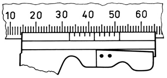

<details>
<summary>text_image</summary>

10 20 30 40 50 60
</details>

Bild 3.1 Nonius an einer geraden Skala. Ablesung: 32,7. Die Dezimalstelle 7 ergibt sich daraus, dass der 7. Teilstrich der kurzen (unteren) Hilfsskala, des Nonius, genau mit einem Teilstrich der (oberen) Hauptskala zusammenfällt.

Die **Zeitmessung** erfolgt mit Hilfe von Uhren. Es handelt sich dabei um Messgeräte, deren Rolle jedes beliebige System erfüllen kann, welches einen zeitlich streng periodischen Vorgang ausführt und mit dessen Hilfe ein Zeitintervall reproduzierbar dargestellt werden kann. Die Zeiteinheit ist die **Sekunde (s)**. Ihre Definition (1967) geht auf Vorgänge im Atom zurück:

## 1 Sekunde ist die Dauer von 9 192 631 770 Schwingungsperioden einer charakteristischen Strahlung des Atoms Caesium 133.

Das Funktionsprinzip einer Atomuhr beruht auf der Wechselwirkung von Strahlungsübergängen im Atom mit elektromagnetischen Hochfrequenzfeldern, die von einem Hilfsgenerator erzeugt werden, unter Ausnutzung der Resonanz. Der **Caesium-Frequenz-Standard** entspricht der Frequenz $f _ { \mathrm { C s } } = 9   1 9 2   6 3 1$ 770Hz des Hyperfeinstrukturübergangs des Grundzustandes des 133<sub>Cs</sub>-<sub>A</sub>toms (s. 44.7) und hat eine Genauigkeit von $1 0 ^ { - 1 4 }$ , das entspricht einer Abweichung von 1s in ≈ 3 Millionen Jahren.

Durch geeignete Mittelung der Anzeigen mehrerer Atomuhren wird nach internationaler Übereinkunft für die physikalische Zeitmessung die internationale Atomzeit (IAT) festgelegt (SI-Sekunden-Definition). Aus astronomischen Ereignissen folgt eine Weltzeit UT (universal time), die aus der Erdrotation abgeleitet wird und für astronomische Beobachtungen sowie für die Navigation nach Himmelskörpern maßgebend ist. Die Atomzeit hat langfristig gegen die Weltzeit eine Abweichung, die bei Erreichen einer Sekunde durch Einschieben oder Auslassen einer „Schaltsekunde“ ausgeglichen wird.

**Relativität der Bewegungen.** Jede Bewegung ist eine im Zeitablauf erfolgende Ortsveränderung eines Körpers relativ zu anderen, willkürlich als ruhend angenommenen Körpern der Umgebung, die das **Bezugssystem** bilden. Meist wird stillschweigend angenommen, dass der Beobachter stillsteht, das Bezugssystem also ruht. Registriert der Beobachter, dass sich in seiner Umgebung ein Körper bewegt, so kann er ohne Orientierung an anderen Körpern der Umgebung (d. h. ohne Zuhilfenahme eines Bezugssystems) nicht entscheiden, ob er sich selbst bewegt oder der Körper. Man denke hierbei nur an die bekannte Täuschung, der man immer wieder unterliegt, wenn man aus einem stillstehenden Eisenbahnabteil heraus auf einen anfahrenden Zug blickt. Wenn man sich nicht z. B. am Bahnsteig orientiert, hat man den Eindruck, der eigene Zug setze sich in Bewegung. Fahren beide Züge gleich schnell nebeneinander her, so sieht es für den Mitfahrenden aus, als stünden beide Züge still. Wir erkennen daraus:

## Wie jede Bewegung ist auch der Zustand der Ruhe relativ.

Da zur vollständigen Bestimmung der Lage eines Körpers relativ zu den Körpern der Umge bung (dem Bezugssystem) im Allgemeinen die Angabe von drei Längen nötig ist, wird mit dem Bezugssystem ein dreidimensionales Koordinatensystem verknüpft. Meist wählt man ein kartesisches System, in welchem die drei Koordinatenachsen aufeinander senkrecht stehen. Die

---

30

3 Kinematik der Punktmasse

Gesamtheit aller durch die Koordinatentripel $( x , y ,$ z) gegebenen Punkte wird als **Raum** bezeichnet.

## 3.2 Die gleichförmige Bewegung

Es werde die Bewegung eines Teilchens (Punktmasse) längs einer Geraden, die durch eine Führungsschiene realisiert werden kann, betrachtet. Diese Gerade lassen wir mit der x-Achse unseres Bezugssystems zusammenfallen, so dass die Lage des Teilchens durch Angabe der entsprechenden Koordinate x bestimmt ist. Zur Beschreibung der Bewegung des Teilchens genügt es offenbar, wenn man zu jedem Zeitpunkt t seine Lage x bzw. den gegenüber einem beliebig wählbaren Bezugspunkt x<sub>0</sub> zurückgelegten Weg $x - x _ { 0 } = s ,$ d. h. das **Weg-Zeit-Gesetz** $s = s ( t )$ kennt.

Werden in gleichen Zeitabschnitten stets gleich große Wegstrecken zurückgelegt, sprechen wir von einer **gleichförmigen Bewegung**, und wenn die Bewegung überdies auf gerader Bahn erfolgt, von einer geradlinig gleichförmigen Bewegung. Bei dieser einfachsten aller Bewegungsformen ist der zurückgelegte Weg s der verstrichenen Zeit t direkt proportional: $s \sim t .$ Man erhält also als Weg-Zeit-Gesetz die einfache Beziehung

$$
s = \nu t \quad \text {mit} \quad \nu = \text {const.} \tag {3.1}
$$

Den Proportionalitätsfaktor v nennt man die **Geschwindigkeit** der gleichförmigen Bewegung; sie berechnet sich als Quotient aus dem zurückgelegten Weg und der dazu benötigten Zeit zu

$$
\nu = \frac {s}{t} \quad (\text {Geschwindigkeit der gleichförmigen Bewegung}). \tag {3.2}
$$

Hieraus ergibt sich die Einheitengleichung

$$
[ v ] = \frac {[ s ]}{[ t ]} = \frac {1 \mathrm{m}}{1 \mathrm{s}} = 1 \mathrm{m/s} \equiv 1 \mathrm{m} \cdot \mathrm{s} ^ {- 1}.
$$

Trägt man wie in Bild 3.2a die zurückgelegte Wegstrecke s als Ordinate und die zugehörige Zeit t als Abszisse auf, so erhält man das **Weg-Zeit-Diagramm** der Bewegung. In diesem wird gemäß Gleichung (3.1) die gleichförmige Bewegung durch eine steigende Gerade beschrieben, deren Anstieg die (konstante) Geschwindigkeit v kennzeichnet. Ist nämlich $s _ { 1 }$ der nach Ablauf der Zeit $t _ { 1 }$ und $s _ { 2 }$ der nach Ablauf der Zeit $t _ { 2 }$ zurückgelegte Weg, so gilt $s _ { 1 } / t _ { 1 } = s _ { 2 } / t _ { 2 } = \nu =$ const. Die Geschwindigkeit kann daher – wie man aus dem Bild entnimmt – auch durch den konstanten Differenzenquotienten

$$
\nu = \frac {s _ {2} - s _ {1}}{t _ {2} - t _ {1}} = \frac {\Delta s}{\Delta t}
$$

beschrieben werden.

Der Weg s geht in anschaulicher Weise aus dem **Geschwindigkeit-Zeit-Diagramm** (Bild 3.2b) hervor, das die Geschwindigkeit als Funktion der Zeit $\nu = \nu ( t )$ abbildet. In ihm wird nach (3.1) die gleichförmige Bewegung durch eine Gerade parallel zur t-Achse beschrieben. Da der Flä- cheninhalt unter der Geraden für eine vorgegebene Zeit t zahlenmäßig gleich dem Produkt v t ist, gibt dieser daher den in der Zeit t zurückgelegten Weg an (in Bild 3.2b den Weg $s _ { 2 } = \nu t _ { 2 } )$ Dies gilt auch bei beliebiger Abhängigkeit $\nu = \nu ( t ) ;$ vgl. die Bilder 3.3 und 3.4b.

---

3.3 Die gleichmäßig beschleunigte Bewegung

31

## Beispiel 3.1:

Ein Fahrzeug legt die erste Hälfte einer vorgegebenen Strecke mit der Geschwindigkeit $v _ { 1 } =$ 30km/h und die zweite Hälfte mit der Geschwindigkeit $v_{2}=50   km/h$ zurück. Welche Durchschnittsgeschwindigkeit (= gesamte Strecke/Gesamtfahrzeit) hat das Fahrzeug?

Lösung: Ist der Gesamtweg gleich 2s, so ist nach (3.2) $\nu _ { 1 } = s / t _ { 1 }$ und $\nu _ { 2 } = s / t _ { 2 }$ . Die Gesamtfahrzeit beträgt daher $t _ { 1 } + t _ { 2 } = s / \nu _ { 1 } + s / \nu _ { 2 }$ und somit die Durchschnittsgeschwindigkeit

$$
v = \frac {2 s}{t _ {1} + t _ {2}} = \frac {2}{\frac {1}{v _ {1}} + \frac {1}{v _ {2}}} = \frac {2 v _ {1} v _ {2}}{v _ {1} + v _ {2}} = 3 7, 5 \mathrm{km/h} \quad \text {(harmonisches Mittel),}
$$

also nicht etwa 40km/h (arithmetisches Mittel).

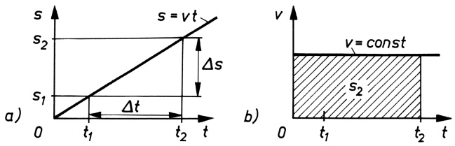

Bild 3.2 Bewegungsdiagramme der gleichförmigen Bewegung: a) Weg-Zeit-Diagramm $s = s ( t )$ b) Geschwindigkeit-Zeit-Diagramm $\nu = \nu ( t )$ ; der schraffierte Flächeninhalt entspricht dem durchlaufenen Weg s.

## 3.3 Die gleichmäßig beschleunigte Bewegung

Bei allen Bewegungsvorgängen wird eine bestimmte Geschwindigkeit nicht sprunghaft, sondern allmählich erreicht (z. B. Anfahrvorgänge). Das Gleiche trifft auf Abbremsvorgänge zu, bei denen die Geschwindigkeit stetig abnimmt. Derartige Bewegungen, bei denen sich die Geschwindigkeit zeitlich ändert, nennt man beschleunigt. Eine Bewegung, bei der die Geschwindigkeit in gleichen Zeitintervallen um denselben Betrag wächst oder abnimmt, heißt **gleichmäßig beschleunigt.** Bei ihr ist die Geschwindigkeitsänderung $\Delta \nu$ der verstrichenen Zeitspanne ∆t direkt proportional:

$$
\Delta v = a \Delta t \quad \text {mit} \quad a = \text {const.} \tag {3.3}
$$

Wird der Körper nicht aus der Ruhelage heraus beschleunigt, sondern hat er zum Zeitpunkt $t = t _ { 0 } = 0$ (d. h. zu Beginn der Zeitzählung, z. B. bei Verwendung einer Stoppuhr) bereits eine bestimmte Anfangsgeschwindigkeit $\nu _ { 0 }$ , dann ist, wenn v die Endgeschwindigkeit nach Ablauf der Zeit t ist, die Geschwindigkeitsänderung im Zeitintervall $\Delta t = t - t _ { 0 } = t$ wegen (3.3) gleich $\Delta \nu = \nu - \nu _ { 0 } = a t$ und somit

$$
v = a t + v _ {0} \quad \begin{array}{l} (\text {Endgeschwindigkeit bei der gleichmäßig} \\ \text {beschleunigten Bewegung}). \end{array} \tag {3.4}
$$

Die konstante Größe a heißt **Beschleunigung**; sie ist demnach gleich dem Quotienten aus der Geschwindigkeitsänderung und der dazu benötigten Zeit:

$$
a = \frac {\Delta v}{\Delta t} = \frac {v - v _ {0}}{t} \quad \text {(Beschleunigung bei der gleichmäßig beschleunigten Bewegung).} \tag {3.5}
$$

Einheit der Beschleunigung:

---

32

3 Kinematik der Punktmasse

Wenn die Geschwindigkeit abnimmt $( \Delta \nu < 0 )$ , hat a die Bedeutung einer **Verzögerung**; ihr Zahlenwert erhält dann negatives Vorzeichen $( \alpha < 0 )$

Als Geschwindigkeit-Zeit-Diagramm erhält man nach Gleichung (3.4) für die gleichmäßig be schleunigte Bewegung eine steigende, für die gleichmäßig verzögerte Bewegung eine fallende Gerade, deren Anstieg durch die konstante Beschleunigung a und deren Ordinatenabschnitt durch die Anfangsgeschwindigkeit $\nu _ { 0 }$ gegeben ist (Bild 3.3).

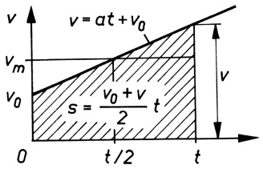

<details>
<summary>area</summary>

| Variable | Value |
| --- | --- |
| Initial Velocity (v) | \(v_0\) |
| Initial Velocity (vm) | \(v_m\) |
| Time at 0 (t) | 0 |
| Time at t/2 (t) | t/2 |
| Time at t (t) | t |
| Time at t/2 (t/2) | t/2 |
| Time at t (t) | t |
| Time at t/2 (t/2) | t/2 |
| Time at t (t) | t |
| Time at t/2 (t/2) | t/2 |
| Time at t (t) | t |
| Time at t/2 (t/2) | t/2 |
| Time at t (t) | t |
| Time at t/4 (t) | t/4 |
| Time at t/8 (t) | t/8 |
| Time at t/16 (t) | t/16 |
| Time at t/24 (t) | t/24 |
| Time at t/32 (t) | t/32 |
| Time at t/40 (t) | t/40 |
| Time at t/48 (t) | t/48 |
| Time at t/56 (t) | t/56 |
| Time at t/64 (t) | t/64 |
| Time at t/72 (t) | t/72 |
| Time at t/80 (t) | t/80 |
| Time at t/88 (t) | t/88 |
| Time at t/96 (t) | t/96 |
| Time at t/104 (t) | t/104 |
| Time at t/112 (t) | t/112 |
| Time at t/120 (t) | t/120 |
</details>

Bild 3.3 Geschwindigkeit-Zeit-Diagramm der gleichmäßig beschleunigten Bewegung. Die schraffierte Fläche gibt zahlenmäßig den zurückgelegten Weg an. $\nu _ { \mathrm { m } }$ ist die mittlere Geschwindigkeit.

Die schraffiert gezeichnete Fläche unter der $\nu ,$ t-Geraden, welche die Gestalt eines Trapezes hat, ist – wie wir im vorigen Abschnitt gesehen haben – zahlenmäßig gleich dem Weg s. Dieser berechnet sich somit zu

$$
s = \frac {v _ {0} + v}{2} t = v _ {\mathrm{m}} t. \tag {3.6}
$$

$\nu _ { \mathrm { m } } = s / t = ( \nu _ { 0 } + \nu ) / 2$ gibt dabei die **mittlere Geschwindigkeit** an; bei dieser Geschwindigkeit wird während der Zeit t in gleichförmiger Bewegung die gleiche Wegstrecke zurückgelegt wie in gleichmäßig beschleunigter Bewegung von $\nu _ { 0 }$ auf v. Nach Einsetzen von v gemäß Gleichung (3.4) in Gleichung (3.6) erhält man

$$
s = \frac {a t ^ {2}}{2} + v _ {0} t \quad \begin{array}{l} (\text {Weg - Zeit - Gesetz der gleichmäßig} \\ \text {beschleunigten Bewegung}). \end{array} \tag {3.7}
$$

Ersetzt man hingegen in (3.6) nach Gleichung (3.4) die Zeit $t = ( \nu - \nu _ { 0 } ) / a ,$ so folgt nach Umstellung:

$$
\nu = \sqrt {2 a s + v _ {0} ^ {2}} \quad \begin{array}{l} (\text {Endgeschwindigkeit bei der gleichmäßig} \\ \text {beschleunigten Bewegung}). \end{array} \tag {3.8}
$$

Aus den allgemein gültigen Gleichungen (3.4) bis (3.8) lassen sich nun bestimmte **Sonderfälle** ableiten. So ist beim Start aus der Ruhelage $\nu _ { 0 } = 0$ zu setzen. Beim Abbremsen bis zum Stillstand ist die Endgeschwindigkeit $\nu = 0$ , womit sich aus (3.4) die Anfangsgeschwindigkeit bei gegebener Bremszeit zu $\nu _ { 0 } = - a t$ und aus (3.8) der Brems<u>weg z</u>u $s = - v _ { 0 } ^ { 2 } / ( 2 a )$ oder die Anfangsgeschwindigkeit bei gegebenem Bremsweg zu $\nu _ { 0 } = \sqrt { - 2 a s }$ ergeben. Die Minuszeichen verschwinden beim Einsetzen des Wertes für die Beschleunigung $a ,$ der hier negativ ist. In Bild 3.4 sind die Bewegungsdiagramme für die gleichmäßig beschleunigte Bewegung zusammengestellt.

Für $a < 0$ weist $s = s ( t )$ in Bild 3.4a (rechts) ein Maximum auf, das einem Umkehrpunkt der Bewegung entspricht. Die einzelnen s-Werte werden nach Erreichen des Maximums in umgekehrter Richtung noch einmal durchlaufen, wobei die Geschwindigkeit jetzt negative Werte annimmt (Bild 3.4b (rechts)). $s = s ( t )$ stellt in diesem Falle nicht den in einer bestimmten Zeit insgesamt zurückgelegten Weg dar, sondern die momentane Entfernung zum Bezugspunkt, was gleichbedeutend mit der Ortskoordinate des Körpers zur Zeit t ist. Dementsprechend bezeichnet man das s, t-Diagramm für $a < 0$ in Bild 3.4a auch als **Ort-Zeit-Diagramm**. Den vom Körper insgesamt zurückgelegten Weg erhält man

---

3.3 Die gleichmäßig beschleunigte Bewegung

33

durch Addition der Beträge der im v, t-Diagramm Bild 3.4b (rechts) schraffiert gezeichneten Flächen. Vergleiche dazu das Beispiel zum senkrechten Wurf in Abschnitt 3.4.

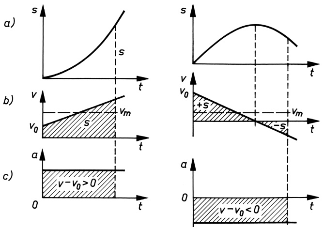

Bild 3.4 Bewegungsdiagramme für $a > 0$ (links) und $a < 0$ (rechts):

a) Weg-Zeit-Diagramm bzw. Ort-Zeit-Diagramm $s = s ( t )$

b) Geschwindigkeit-Zeit-Diagramm $\nu = \nu ( t )$

c) Beschleunigung-Zeit-Diagramm $a = a ( t )$

## Beispiel 3.2:

Der Fahrer eines mit 80km/h fahrenden Pkw bemerkt plötzlich in 60m Entfernung auf der Straße ein Hindernis, worauf er seinen Wagen mit der maximal möglichen Verzögerung von $a = - 5   \mathrm { m / s } ^ { 2 }$ abbremst. a) Wie viel Sekunden nach Einsetzen des Bremsvorgangs und wie viel Meter vor dem Hindernis kommt der Wagen zum Stehen? b) Mit welcher Geschwindigkeit prallt der Wagen auf, wenn er anfänglich mit 90km/h gefahren wird?

Lösung: a) Bekannt sind die Anfangsgeschwindigkeit $v_{0} = (80/3,6)    m/s  = 22,2    m/s$ die Endgeschwindigkeit $\nu = 0$ und die Beschleunigung a. Aus (3.4) folgt damit die Bremszeit $t = - v _ { 0 } / a \approx$ 4,5s. Für den Bremsweg ergibt sich aus (3.8) $s = - v _ { 0 } ^ { 2 } / ( 2 a ) = 4 9 , 3 \mathrm { m } ;$ der Wagen kommt also 10,7m vor dem Hindernis zum Stehen. b) Mit s = 60m und $v_{0} = (90/3,6)    m/s  = 25    m/s$ folgt nach (3.8) für die Aufprallgeschwindigkeit $\nu = 5    m/s  = 18    km/h$ □

## Aufgaben

**3.1** Um wie viel Meter vergrößert sich im obigen Beispiel die Strecke für den Anhaltevorgang gegenüber dem Bremsweg, wenn die Reaktionszeit des Fahrers bis zum Beginn des Bremsvorganges von $t _ { \mathrm { R } } = 0 { , } 8   \mathrm { s }$ berücksichtigt wird? Kommt es jetzt bei $v_{0}=80   km/h$ zum Aufprall? Wenn ja, mit welcher Geschwindigkeit?
**3.2** Ein Kurzstreckenläufer legt die Strecke von 100m in der Zeit von 10,5s zurück. Während der ersten 20m beschleunigt er dabei gleichmäßig und läuft den Rest der Strecke mit konstanter Geschwindigkeit. Wie groß sind die Beschleunigung und die Endgeschwindigkeit des Läufers? Stelle den Lauf in einem v, t- sowie in einem s, t-Diagramm dar!

---

34

3 Kinematik der Punktmasse

## 3.4 Freier Fall. Senkrechter Wurf

Das wohl bekannteste Beispiel für eine gleichmäßig beschleunigte Bewegung ist der **freie Fall**. Ursache der Fallbewegung eines Körpers ist die Anziehungskraft der Erde. GALILEI (1564–1642) erkannte als Erster, dass alle Körper mit der gleichen Beschleunigung zum Mittelpunkt der Erde fallen, wenn der Einfluss des Luftwiderstandes vernachlässigt wird (Bild 3.5). Anhand sorgfältiger und für seine Zeit genauer Experimente konnte er zeigen, dass die Wege, die von einem Körper in 1, 2, 3, 4, . . . Zeiteinheiten (z. B. Sekunden) durchfallen werden, sich wie 1 : 4 : 9 : 16 :... verhalten, d. h., die Fallhöhe ist dem Quadrat der Fallzeit proportional (Fallgesetz).

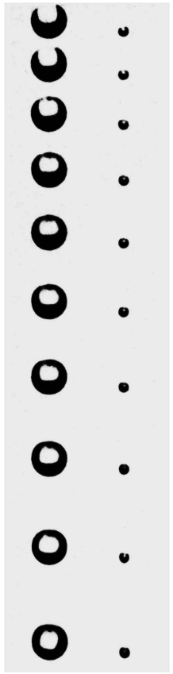

<details>
<summary>natural_image</summary>

Vertical arrangement of black circular shapes on white background, no text or symbols present
</details>

So fällt ein Körper in Luft in der ersten Sekunde etwa 4,9m und in jeder folgenden jeweils um das Doppelte dieses Wertes, also ungefähr um 9,8m, mehr als in der vorangegangenen Sekunde. Die gesamte Fallhöhe, ausgedrückt in Metern, beträgt also

$$
\begin{array}{l} h = 4, 9 + (4, 9 + 9, 8) + (4, 9 + 2 \cdot 9, 8) + \dots \\ + [ 4, 9 + (t - 1) \cdot 9, 8 ], \\ \end{array}
$$

wenn t die Anzahl der Sekunden angibt. Wir haben also t Summanden, die sich als Summe einer arithmetischen Reihe wie folgt zusammenfassen lassen:

$$
h = 4, 9   t + \frac {9 , 8   t (t - 1)}{2} = \frac {9 , 8}{2}   t ^ {2}.
$$

Dies ist das quadratische Zeitgesetz des freien Falls mit dem speziellen Wert $\bar { 9 , } 8 \mathrm { m / s } ^ { 2 }$ für die **Fallbeschleunigung** oder **Schwerebeschleunigung**, die mit dem Buchstaben $g$ (von lat. „gravitas“, die Schwere) bezeichnet wird.

**Bild 3.5** Stroboskopische Aufnahme von zwei frei fallenden Kugeln ungleicher Masse. Sie wurde hergestellt, indem bei geöffneter Blende in Abständen von 1/100 s mit Blitzlicht beleuchtet wurde. Man beachte, dass die leichte Kugel genauso schnell fällt wie die schwere Kugel.

Dieses Gesetz folgt mit der Anfangsgeschwindigkeit $\nu _ { 0 } = 0$ und dem genauen Wert der experi mentell zu bestimmenden Fallbeschleunigung $a = g$ , der innerhalb nicht allzu großer Höhenunterschiede konstant ist, unmittelbar auch aus (3.7):

$$
h = \frac {g}{2} t ^ {2} \quad \text {(Fallhöhe).} \tag {3.9}
$$

Aus (3.8) erhält man die Endgeschwindigkeit nach Durchfallen der Höhe h:

$$
v = \sqrt {2 g h} \quad (\text {Fallgeschwindigkeit}). \tag {3.10}
$$

Der Wert für die Fallbeschleunigung $g$ kann $\mathbf { z } , \mathbf { B } .$ mittels genauer Messungen der Fallzeit für eine vorgegebene Höhe nach Gleichung (3.9) $g = 2 h / { t ^ { ^ 2 } }$ bestimmt werden. Genauere Messun-

---

3.4 Freier Fall. Senkrechter Wurf

35

gen sind mit Hilfe von Pendeln möglich (vgl. A.2 im Anhang). Infolge der Abweichung der Erde von der Kugelgestalt und wegen der Erddrehung ist g von der geografischen Breite abhängig (s. 5.2). Für Orte um den 50. Breitenkreis und niedrige Höhenlagen erhält man $g \approx 9 . 8 1   \mathrm { m / s ^ { 2 } }$ Als Normwert wurde der Wert für $4 5 ^ { \circ }$ nördlicher Breite und Meereshöhe vereinbart:

$$
g _ {\mathrm{n}} = 9, 8 0 6 6 5 \mathrm{m} / \mathrm{s} ^ {2} \quad (\text {Normfallbeschleunigung}).
$$

## Beispiel 3.3:

Bestimme aus Bild 3.5 den Wert der Fallbeschleunigung g !

Lösung: Die Ausmessung der Abstände aufeinander folgender Positionen der frei fallenden Kugeln ergibt, dass in jeweils einer hundertstel Sekunde $( \Delta t = 1 0 ^ { - 2 }   \mathrm { s } )$ die zurückgelegten Wege jedes Mal um $\Delta s \approx 1$ mm zunehmen. Die Geschwindigkeitszunahme zwischen zwei aufeinander folgenden Belichtungen beträgt also $\Delta \nu = \Delta s / \Delta t \approx 0 ,   1$ m/s, woraus für die Beschleunigung folgt $a = \Delta \nu / \Delta t \approx 1 0   \mathrm { m / s } ^ { 2 } \approx g$ □

**Der senkrechte Wurf.** Beim senkrechten Wurf eines Körpers ist der gleichmäßig beschleunigten Fallbewegung eine gleichförmige Bewegung mit der Anfangsgeschwindigkeit $\nu _ { 0 }$ überlagert. Die resultierende Bewegung ist ebenfalls gleichmäßig beschleunigt. Beim senkrechten Wurf **nach unten** hat $\nu _ { 0 }$ dieselbe Richtung wie die Fallbewegung; es gelten daher für ihn die allgemeinen Bewegungsgesetze (3.4), (3.7) und (3.8) mit $a = g$ in unveränderter Form. Beim senkrechten Wurf **nach oben** ist demgegenüber zu beachten, dass die Fallbeschleunigung g als Verzögerung wirkt und daher negativ anzusetzen ist. Damit ergibt sich aus (3.4) die Geschwindigkeit nach Ablauf der Zeit t zu

$$
v = v _ {0} - g t, \tag {3.11}
$$

aus (3.7) die Wurfhöhe nach der Zeit t zu

$$
h = v _ {0} t - \frac {g}{2} t ^ {2} \tag {3.12}
$$

und aus (3.8) die Geschwindigkeit in der Höhe h zu

$$
v = \sqrt {v _ {0} ^ {2} - 2 g h}. \tag {3.13}
$$

Bei einer vorgegebenen Anfangsgeschwindigkeit $\nu _ { 0 }$ erreicht der Körper eine bestimmte maximale Höhe $h _ { \mathrm { m a x } }$ . In dieser Höhe ist er für einen Augenbli<u>ck in Ruhe</u> $( \nu = 0 )$ , um danach frei nach unten zu fallen. Für den Gipfelpunkt gilt daher $0 = \sqrt { \nu _ { 0 } ^ { 2 } - 2 g h _ { \mathrm { m a x } } }$ , woraus folgt

$$
h _ {\max} = \frac {v _ {0} ^ {2}}{2 g} \quad (\text {maximale Wurfhöhe}). \tag {3.14}
$$

$v _ { 0 } = \sqrt { 2 g h _ { \mathrm { m a x } } }$ ist diejenige Geschwindigkeit, die dem Körper erteilt werden muss, damit er die Höhe $h _ { \mathrm { m a x } }$ gerade erreicht. Wie man sieht, ist sie der Geschwindigkeit (3.10) gleich, die der Körper erhält, wenn er aus der Höhe $h _ { \mathrm { m a x } }$ frei zu Boden fällt.

## Beispiel 3.4:

Ein Körper werde mit der Anfangsgeschwindigkeit $\nu _ { 0 } = 2 0   \mathrm { m / s }$ senkrecht nach oben geworfen. Bis zu welcher Höhe steigt er maximal? Nach welcher Zeit hat er seine Anfangslage wieder

---

36

3 Kinematik der Punktmasse

erreicht? $( g \approx 1 0   \mathrm { m } / \mathrm { s } ^ { 2 } )$ . Wurfhöhe h, Geschwindigkeit v und Beschleunigung a sind in Abhängigkeit von der Zeit grafisch darzustellen.

Lösung: Nach (3.14) ist $h_{ max } = 20    m$ . Die Steigzeit $t _ { 1 }$ erhält man aus (3.11) mit der Bedingung $\nu = 0$ zu $t _ { 1 } = v _ { 0 } / g = 2 s$ . Der Körper kommt also nach $t _ { 2 } = 2 t _ { 1 } = 4   \mathbf { s }$ wieder am Boden an. Entsprechend Gleichung (3.7) bzw. (3.12) wird die gleichmäßig beschleunigte Bewegung im Ort-Zeit-Diagramm durch eine Parabel beschrieben. In unserem Beispiel ist die Parabel wegen des negativen Vorzeichens der Beschleunigung nach unten geöffnet (Bild 3.6a). Das Maximum liegt an der Stelle $t = t _ { 1 }$ bei $h = h _ { \mathrm { m a x } }$ . Im v, t-Diagramm (Bild 3.6b) ergibt sich gemäß Gleichung (3.11) eine fallende Gerade mit dem Ordinatenabschnitt $\nu = \nu _ { 0 }$ bei $t = 0$ und der Ordinate $\nu = - \nu _ { 0 }$ bei $t = t _ { 2 } = 2 t _ { 1 }$ . Sie veranschaulicht die verzögerte Bewegung während der Aufstiegsphase bis zum Stillstand $( \nu = 0 )$ zum Zeitpunkt $t _ { 1 }$ und die anschließende beschleunigte Bewegung in umgekehrter Richtung (Abstiegsphase mit negativer Geschwindigkeit). Wegen der auf den Körper wirkenden konstanten Fallbeschleunigung $a = - g$ ergibt sich im a, t-Diagramm (Bild 3.6c) eine Gerade parallel zur t-Achse. Auch im höchsten Punkt der Flugbahn, wo die Geschwindigkeit gleich null ist, behält die Beschleunigung ihren Wert $\alpha = - g ;$ denn „Beschleunigung“ bedeutet Geschwindigkeitsänderung, und im höchsten Punkt erfolgt die Änderung der Geschwindigkeit von positiven zu negativen Werten. □

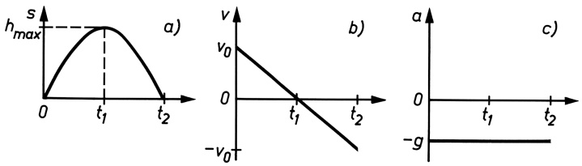

Bild 3.6 Senkrechter Wurf nach oben: Ort-Zeit-Diagramm (a), Geschwindigkeit-Zeit-Diagramm (b) und Beschleunigung-Zeit-Diagramm (c)

## Aufgabe

**3.3** Von einer 100m hohen Plattform eines Aussichtsturmes wird ein Körper mit $v _ { 0 } =$ 15m/s senkrecht nach oben geworfen. a) Wie groß ist die Gipfelhöhe über dem Erdboden, und wann wird sie erreicht? b) Nach welcher Zeit und mit welcher Geschwindigkeit trifft der Körper am Erdboden auf? Luftwiderstand wird vernachlässigt.

## 3.5 Allgemeine Definition von Geschwindigkeit und Beschleunigung. Ungleichmäßig beschleunigte Bewegung

Wie aus den Bildern 3.4a und 3.6a hervorgeht, wird die beschleunigte Bewegung im Weg-Zeit-Diagramm durch eine gekrümmte Kurve $s = s ( t )$ beschrieben. Im Gegensatz zur gleichförmigen Bewegung, für die man im s, t-Diagramm wegen der konstanten Geschwindigkeit eine Gerade erhält, ist daher für die beschleunigte Bewegung die Definition der Geschwindigkeit als Differenzenquotient $\Delta s / \Delta t$ wie in Abschnitt 3.2 nicht mehr ausreichend; denn dieser gibt – wie man aus Bild 3.7 ersehen kann – nur eine mittlere (durchschnittliche) Geschwindigkeit zwischen den Zeitpunkten $t _ { 1 }$ und $t _ { 2 }$ an, entsprechend dem Anstieg der Sekante durch die Kurvenpunkte $P _ { 1 }$ und $P _ { 2 }$

---

3.5 Allgemeine Definition von Geschwindigkeit und Beschleunigung

37

Um die **Momentangeschwindigkeit** $\nu ( t )$ zu einem bestimmten Zeitpunkt t, z. B. $t = t _ { 1 }$ , zu erhalten, ist es erforderlich, den Anstieg der Tangente an die Weg-Zeit-Kurve im zugehörigen Kurvenpunkt $P _ { 1 }$ zu bestimmen. Dies geschieht dadurch, dass das Zeitintervall ∆t (und damit zugleich auch das Wegintervall ∆s) verschwindend klein gewählt wird. Durch diesen Grenzübergang wird der Differenzenquotient $\Delta s / \Delta t$ zum Differenzialquotienten ds/dt, der dann die Geschwindigkeit im betreffenden Zeitpunkt angibt:

$$
\nu (t) = \lim _ {\Delta t \to 0} \frac {\Delta s}{\Delta t} = \frac {\mathrm{d} s}{\mathrm{d} t} \equiv \dot {s}. \tag {3.15}
$$

Die allgemeine Definition der Geschwindigkeit lautet somit:

## Die Geschwindigkeit ist gleich dem Differenzialquotienten des Weges nach der Zeit.

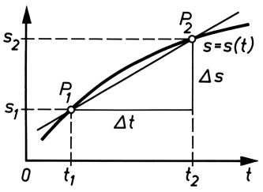

<details>
<summary>line</summary>

| Time | Function | Point |
| --- | --- | --- |
| t1 | s | P1 |
| t2 | s | P2 |
</details>

Bild 3.7 Zur Definition der Geschwindigkeit bei beschleunigter Bewegung

Analog ist bei der Bestimmung der Beschleunigung zu verfahren, wenn die Bewegung ungleichmäßig beschleunigt ist. Denn in diesem Fall ist der Geschwindigkeitszuwachs $\Delta \nu$ in gleichen Zeitintervallen ∆t verschieden groß, d. h., die Beschleunigung ändert sich dauernd, weshalb diese Bewegung im $\nu ,$ t-Diagramm nicht wie bei gleichmäßiger Beschleunigung durch eine Gerade, sondern durch eine gekrümmte Kurve beschrieben wird. Daher gibt hier der Differenzenquotient (3.5) ∆v/∆t nur eine durchschnittliche Beschleunigung im Zeitintervall ∆t an. Die **Momentanbeschleunigung** a(t) erhält man wie oben durch Grenzübergang zu

$$
a (t) = \lim _ {\Delta t \to 0} \frac {\Delta v}{\Delta t} = \frac {\mathrm{d} v}{\mathrm{d} t} \equiv \dot {v} \tag {3.16}
$$

oder mit (3.15) zu

$$
a (t) = \frac {\mathrm{d}}{\mathrm{d} t} \left(\frac {\mathrm{d} s}{\mathrm{d} t}\right) = \frac {\mathrm{d} ^ {2} s}{\mathrm{d} t ^ {2}} \equiv \ddot {s}. \tag {3.17}
$$

## Die Beschleunigung ist gleich dem Differenzialquotienten der Geschwindigkeit nach der Zeit oder gleich dem zweiten Differenzialquotienten des Weges nach der Zeit.

Mit Hilfe dieser Definitionen für Geschwindigkeit und Beschleunigung lassen sich die oben behandelten Gesetze der gleichmäßig beschleunigten Bewegung durch Anwendung der Integralrechnung auf analytischem Wege herleiten. So folgt zunächst aus (3.16) durch Umstellung d $\nu = a$ dt und hieraus mit $a = \mathbf { c o n s t } ;$

$$
v = \int \mathrm{d} v = \int a \mathrm{d} t = a \int \mathrm{d} t = a t + C.
$$

---

38

3 Kinematik der Punktmasse

Die Integrationskonstante C bestimmt man aus der **Anfangsbedingung**, dass der Körper zum Zeitpunkt $t = 0$ die Anfangsgeschwindigkeit $\nu = \nu _ { 0 }$ haben soll. Durch Einsetzen dieser Werte für t und v folgt aus vorstehender Gleichung $C = \nu _ { 0 }$ , womit sich die bekannte Beziehung (3.4) $\nu = a t + \nu _ { 0 }$ ergibt. Mit (3.15) wird hieraus

$$
\frac {\mathrm{d} s}{\mathrm{d} t} = a t + v _ {0}; \quad s = \int (a t + v _ {0}) \mathrm{d} t = \frac {a}{2} t ^ {2} + v _ {0} t + C ^ {\prime}.
$$

Nehmen wir an, dass die zur Zeit $t = 0$ zurückgelegte Wegstrecke gleich $s _ { 0 }$ ist, so folgt durch Einsetzen $C ^ { \prime } = s _ { 0 }$ . Lassen wir hingegen die Bewegung zum Zeitpunkt $t = 0$ erst beginnen, d. h. $s _ { 0 } = 0$ , so ist auch $C ^ { \prime }$ gleich null, und es folgt das Weg-Zeit-Gesetz (3.7).

## Beispiele 3.5:

1. Bei einer geradlinigen Bewegung werden nach 1, 2, 3 ... Sekunden 1, 8, 27 ... Meter zurück gelegt. Wie groß sind Geschwindigkeit und Beschleunigung nach der 1., 2. und 3. Sekunde?

Lösung: Wir entnehmen, dass s der dritten Potenz von t proportional ist, d. h., es gilt $s = { k t } ^ { 3 }$ Die Konstante k erhält man durch Einsetzen zusammengehöriger Werte von t und s zu $k =$ $1   \mathrm { m } / \mathrm { s } ^ { 3 }$ . Nach (3.15) folgt damit als Geschwindigkeit $\nu ( t ) = 3 k t ^ { 2 }$ und nach (3.16) als Beschleunigung $a ( t ) = 6 k t .$ Einsetzen von k ergibt $v(t)=3t^{2}\mathrm{~m/s}^{3};a(t)=6t\mathrm{~m/s}^{3}$ . Für $t = 1 , 2$ , 3 s erhält man $\nu = 3 ,   1 2 ,   2 7$ m/s und $a = 6 , 1 2 , 1 8   \mathrm { m } / \mathrm { s } ^ { 2 }$

2. Die Geschwindigkeit einer senkrecht aufsteigenden Rakete zum Zeitpunkt t nach dem Start beträgt nach Gleichung (9.22):

$$
\nu (t) = c \ln {\frac {m _ {0}}{m _ {0} - \dot {m} t}} - g t = - c \ln {\left(1 - \frac {\dot {m}}{m _ {0}} t\right)} - g t.
$$

Dabei ist c die konstante Ausströmgeschwindigkeit der Verbrennungsgase aus dem Triebwerk, ṁ der zeitlich konstante Treibstoffverbrauch, gemessen in Kilogramm je Sekunde, und $m _ { 0 }$ die Startmasse der Rakete. Wie groß sind Startbeschleunigung und Endbeschleunigung der Rakete, wenn $c = 3 0 0 0   \mathrm { m } / \mathrm { s } ,   \dot { m } / m _ { 0 } = 1 0 ^ { - 2 }   /$ s und die Brenndauer des Treibsatzes $t _ { \mathrm { E } } = 2 5   \mathrm { s   b e t r i a g t ? }$

Lösung: Aus obiger Gleichung für $\nu ( t )$ erhält man durch Differenziation nach der Zeit

$$
a (t) = \frac {c (\dot {m} / m _ {0})}{1 - (\dot {m} / m _ {0}) t} - g.
$$

Für $t = 0$ folgt hieraus als Startbeschleunigung $a ( 0 ) = c   ( \dot { m } / m _ { 0 } ) - g = 2 0   \mathrm { m } / \mathrm { s } ^ { 2 } \approx 2 g$ und für $t = t _ { \mathrm { E } } = 2 5$ s als Endbeschleunigung $a(t_{ E }) = 30    m/s ^2 \approx 3g.$ □

## Aufgabe

**3.4** Ein Elektron bewegt sich mit der konstanten Geschwindigkeit $v_{0} = 600    km/s$ geradlinig im Vakuum. Vom Zeitpunkt $t _ { 0 } = 0$ an wird es durch ein mit der Zeit linear anwachsendes Gegenfeld mit einer Verzögerung $a = - k t$ abgebremst $(k = 3 \cdot 10^{19}    m/s ^3)$ Bestimme Weg und Geschwindigkeit in Abhängigkeit von der Zeit allgemein! b) Zu welchem Zeitpunkt nach $t _ { 0 }$ kehrt sich die Bewegungsrichtung des Elektrons um? c) Welchen Weg hat es bis dahin im Gegenfeld zurückgelegt?

---

3.6 Geschwindigkeit und Beschleunigung als Vektoren

39

## 3.6 Geschwindigkeit und Beschleunigung als Vektoren. Zusammengesetzte Bewegungen (Superposition)

**Vektoren.** Zur eindeutigen Bestimmung einer Geschwindigkeit gehört außer der Angabe ihres Zahlenwertes nebst Einheit die Angabe der Richtung. Gleiches gilt für die Beschleunigung. Derartige gerichtete Größen heißen Vektoren, im Gegensatz zu den ungerichteten Skalaren, wie z. B. der Zeit, der Temperatur und der Dichte. Vektoren stellt man durch Pfeile in der entsprechenden Richtung dar, deren Länge gleich so viel willkürlich gewählten Längeneinheiten ist, wie der Zahlenwert der betreffenden Größen angibt. Der Zahlenwert zusammen mit der Einheit eines Vektors heißt sein Betrag. Zwei vektorielle Größen sind nur dann gleich, wenn sie in Betrag und Richtung übereinstimmen.

Vektorielle Größen werden durch fettgedruckte lateinische Buchstaben gekennzeichnet, z. B. v für den Geschwindigkeitsvektor. Üblich ist auch die Kennzeichnung durch gewöhnliche Buchstaben mit einem darübergesetzten Pfeil (z. B. ⃗v ), wie sie in den Bildern dieses Buches verwendet wird.

**Überlagerung von Bewegungen.** Führt ein Körper zwei Bewegungen gleichzeitig aus (z. B. ein Boot, das über den Fluss setzt und dabei infolge der Strömung des Flusses abgetrieben wird), so setzen sich die beiden Teilbewegungen (Bewegung des Bootes in Bezug auf den Fluss und Bewegung des Flusses in Bezug auf das Ufer) zur Gesamtbewegung (Bewegung des Bootes gegenüber dem Ufer) so zusammen, als ob sie zeitlich nacheinander stattfinden würden. Man nennt dies das Prinzip der ungestörten Superposition (Überlagerung) oder auch das Unabhängigkeitsprinzip.

Danach ergibt sich der Geschwindigkeitsvektor v der aus zwei Teilbewegungen zusammengesetzten Bewegung als Diagonale des Parallelogramms, das aus den Geschwindigkeitsvektoren $\nu _ { 1 }$ und $\nu _ { 2 }$ der Teilbewegungen gebildet wird (Bild 3.8). Nach den Regeln der Vektorrechnung ist diese gleich der Vektorsumme

$$
\boldsymbol {v} = \boldsymbol {v} _ {1} + \boldsymbol {v} _ {2} \quad (\text {Vektor der resultierenden Geschwindigkeit}). \tag {3.18}
$$

Es handelt sich hierbei um die geometrische Addition von Vektoren, im Gegensatz zur algebraischen Addition von Skalaren. Die zu addierenden vektoriellen Größen bezeichnet man als **Komponenten,** deren Summe als **Resultierende**. Damit lautet das

## Superpositionsprinzip:

**Gleichzeitig ablaufende Bewegungen eines Körpers beeinflussen sich gegenseitig nicht. Resultierende Größen (Weg, Geschwindigkeit, Beschleunigung) ergeben sich durch geometrische Addition der Komponenten.**

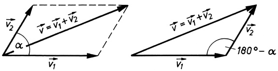

Bild 3.8 Superposition (Überlagerung) von Geschwindigkeiten. Anstatt des Parallelogramms genügt zur Ermittlung der resultierenden Geschwindigkeit auch das zugehörige Vektordreieck (rechts).

---

40

3 Kinematik der Punktmasse

Schließen $\nu _ { 1 }$ und $\nu _ { 2 }$ den Winkel α ein (Bild 3.8), so berechnet sich der Betrag der resultierenden Geschwindigkeit aus dem rechten Teilbild mit Hilfe des Kosinussatzes zu

$$
\nu = \sqrt {\nu_ {1} ^ {2} + \nu_ {2} ^ {2} - 2 \nu_ {1} \nu_ {2} \cos (1 8 0 ^ {\circ} - \alpha)} = \sqrt {\nu_ {1} ^ {2} + \nu_ {2} ^ {2} + 2 \nu_ {1} \nu_ {2} \cos \alpha}. \tag {3.19}
$$

Sind die beiden Bewegungen gleichgerichtet $( \alpha = 0 ^ { \circ } )$ oder einander entgegengerichtet $( \alpha =$ 180◦), so folgt hieraus (unter Beachtung der binomischen Formeln)

$$
v = | v _ {1} \pm v _ {2} | \quad (\text {Additionstheorem der Geschwindigkeiten}). \tag {3.20}
$$

Dieses Gesetz der Superposition gilt nicht für Geschwindigkeiten, die der Lichtgeschwindigkeit nahe kommen (vgl. Abschnitt 6.2, relativistisches Additionstheorem der Geschwindigkeiten, Gleichung (6.14)).

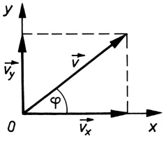

<details>
<summary>text_image</summary>

y
v_y
φ
O
v_x
x
</details>

Bild 3.9 Komponentenzerlegung des Geschwindigkeitsvektors v in einem rechtwinkligen ebenen Koordinatensystem x, y

Die zur Bildung der Resultierenden umgekehrte Aufgabe besteht darin, einen gegebenen Vektor, z. B. die Geschwindigkeit $\pmb { v } ,$ in zwei oder mehrere Komponenten zu zerlegen. Dies ist nur dann eindeutig möglich, wenn die Richtungen der Komponenten vorgegeben sind. Besonders häufig ist die Zerlegung in den Richtungen der x- und y-Achse eines rechtwinkligen Koordinatensystems. In diesem Fall ergeben sich nach Bild 3.9 die Beträge der Komponenten als Projektionen des Vektors v auf die x- und y-Achse zu $\nu _ { x } = \nu$ cosϕ und $\nu _ { y } = \iota$ sinϕ und der Betrag der Resultierenden wegen des Lehrsatzes des PYTHAGORAS $v_{x}^{2}+v_{y}^{2}=v^{2}\left(\cos^{2}\varphi+\sin^{2}\varphi\right)=v^{2}$ zu $\nu = \sqrt { v _ { x } ^ { 2 } + v _ { y } ^ { 2 } }$ . Der Winkel ϕ folgt aus tan $\varphi = \nu _ { y } / \nu _ { x }$

Die Komponentenzerlegung des Vektors v in Bezug auf ein räumliches kartesisches Koordinatensystem lautet

$$
\boldsymbol {v} = \boldsymbol {v} _ {x} + \boldsymbol {v} _ {y} + \boldsymbol {v} _ {z} = v _ {x} \boldsymbol {i} + v _ {y} \boldsymbol {j} + v _ {z} \boldsymbol {k}, \tag {3.21}
$$

wobei $\pmb { v } _ { x } , \pmb { v } _ { y } , \pmb { v } _ { z }$ die vektoriellen und $v _ { x } , v _ { y } , v _ { z }$ die skalaren Komponenten (Koordinaten) von v sowie $i , j ,$ k die Einheitsvektoren in Richtung der Koordinatenachsen $x , y , z$ sind, für deren Beträge gilt $| { \pmb i } | = | { \pmb j } | = | { \pmb k } | = 1$ . Der Betrag von v ergibt sich wie oben nach dem Lehrsatz des PYTHAGORAS zu

$$
| \boldsymbol {v} | = v = \sqrt {v _ {x} ^ {2} + v _ {y} ^ {2} + v _ {z} ^ {2}}. \tag {3.22}
$$

Dieser gibt keine Information über die Richtung des Vektors v und ist als positive Größe definiert. Im Unterschied dazu können die Komponenten $\nu _ { x } ,   \nu _ { y }$ und $\nu _ { z }$ sowohl positive als auch negative Werte annehmen. Bei den bisher zur Beschreibung der geradlinigen Bewegung verwendeten (positiven und negativen) Geschwindigkeiten und Beschleunigungen handelte es sich also nicht um den Betrag, sondern um die mit der Bewegungsrichtung zusammenfallende (einzige) Komponente des Geschwindigkeits- bzw. Beschleunigungsvektors.

---

3.7 Die gleichförmige Kreisbewegung

41

## Beispiel 3.6:

In einem Flussbett der Breite $B = 100    m$ fließt das Wasser mit einer Geschwindigkeit $v _ { \mathrm { F } } =$ $^ { 1 , 2 } \mathrm { m / s }$ . Ein Fährschiff bewegt sich mit einer Relativgeschwindigkeit von $v _ { \mathrm { S } } = 5 \mathrm { m / s }$ gegenüber dem Wasser. a) Wie weit würde das Schiff abgetrieben, wenn es den Fluss senkrecht zu überqueren versucht? b) Unter welchem Winkel muss es gegensteuern, wenn es auf kürzestem Wege das andere Ufer erreichen will? c) In welche Richtung muss es steuern, wenn es einen beliebigen Punkt am gegenüberliegenden Ufer erreichen will?

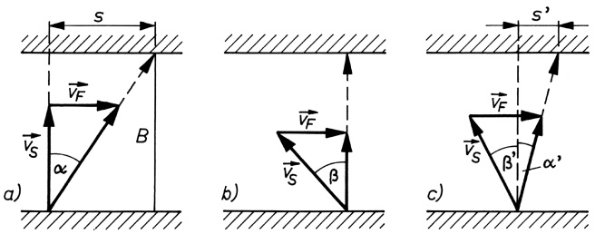

Bild 3.10 Zum Rechenbeispiel 3.6: Superpositionsprinzip der Geschwindigkeiten

Lösung: a) Nach Bild 3.10a ist tan $\alpha = \nu _ { \mathrm { F } } / \nu _ { \mathrm { S } } = 0 ,   2 4$ und damit $s = B$ tan $\alpha = 2 4   \mathrm { m } .$ . b) Die resultierende Bewegung muss quer zur Flussrichtung verlaufen (Bild 3.10b). In diesem Fall ist sin $\beta = \nu _ { \mathrm { F } } / \nu _ { \mathrm { S } } = 0 { , } 2 4$ . Es muss also unter dem Winkel $\beta \approx 1 4 ^ { \circ }$ gegengesteuert werden. c) Für eine vorgegebene Abdrift $s ^ { \prime }$ (Bild 3.10c) ist tan $\alpha ^ { \prime } = s ^ { \prime } / B$ , der Winkel $\alpha ^ { \prime }$ ist also bekannt. Nach dem Sinussatz gilt in dem Vektordreieck

$$
\frac {\nu_ {\mathrm{S}}}{\nu_ {\mathrm{F}}} = \frac {\sin \left(9 0 ^ {\circ} - \alpha^ {\prime}\right)}{\sin \left(\alpha^ {\prime} + \beta^ {\prime}\right)} \quad \text {oder} \quad \sin \left(\alpha^ {\prime} + \beta^ {\prime}\right) = \frac {\nu_ {\mathrm{F}}}{\nu_ {\mathrm{S}}} \cos \alpha^ {\prime}.
$$

Hieraus erhält man den Winkel $\beta ^ { \prime }$ , unter dem gegenzusteuern ist. Für $s ^ { \prime } = 0$ (Beispiel b) wird $\alpha ^ { \prime } = 0$ und somit sin $\beta ^ { \prime } = \nu _ { \mathrm { F } } / \nu _ { \mathrm { S } }$ , wie zuvor. □

## Aufgabe

**3.5** Unter welchem Winkel in Bild 3.10 muss das Schiff steuern, um in der kürzesten Zeit das andere Ufer zu erreichen? Wie lange dauert die Überfahrt?

## 3.7 Die gleichförmige Kreisbewegung

Ein Teilchen bewege sich mit konstanter Geschwindigkeit v auf einer Kreisbahn (gleichförmige Kreisbewegung). Eine solche Bewegung vollführen auch alle Punkte eines rotierenden Körpers (mit Ausnahme derjenigen, die auf der Drehachse liegen) bei konstanter Drehzahl. Dabei überstreicht der vom Kreismittelpunkt zum Teilchen weisende Radius r in der Zeitspanne $\Delta t$ einen zu ihr proportionalen Drehwinkel $\Delta \varphi ,$ zu dem ein Kreisbogen der Länge

$$
\Delta s = r \Delta \varphi \tag {3.23}
$$

gehört (Bild 3.11a). Dabei ist $\Delta \varphi = \Delta s / r$ das Bogenmaß des Drehwinkels (Kreisbogenlänge/Radius). Als Verhältnis zweier Strecken ist das Bogenmaß eines Winkels dimensionslos. Um Verwechslungen mit anderen dimensionslosen Größen zu vermeiden, wird es mit der Bezeichnung **rad** (Radiant) als Einheit versehen.

---

42

3 Kinematik der Punktmasse

Ein Winkel hat die Größe 1rad, wenn der zugehörige Kreisbogen gleich dem Radius des Kreises ist. Im Gradmaß entspricht dies dem Winkel $3 6 0 ^ { \circ } / ( 2 \pi ) = 5 7 , 3 ^ { \circ }$ . Für den Vollkreis erhalten wir mit $\Delta s = 2 \pi r$ (Kreisumfang) $\Delta \varphi = 2 \pi r / r = 2 \pi$ rad, entsprechend $3 6 0 ^ { \circ }$ . Demnach ist das Bogenmaß $\mathbf { z } , \mathbf { B } .$ von $1 8 0 ^ { \circ }$ gleich π rad, von $1 ^ { \circ }$ gleich 0,017 453rad.

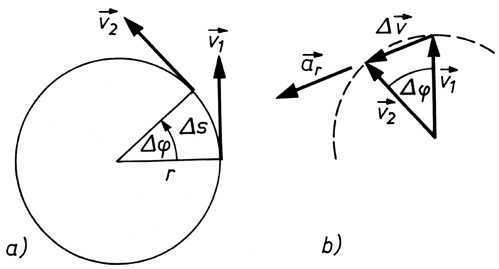

Bild 3.11 Zur Kreisbewegung: Der Geschwindigkeitsvektor v hat stets die Richtung der Tangente an die Kreisbahn $( a )$ , der Vektor der Geschwindigkeitsänderung $\Delta \nu$ ist bei gleich bleibender Drehzahl zum Kreismittelpunkt hin gerichtet (b).

Analog zur Geschwindigkeit v bei geradliniger Bewegung definiert man für die Kreisbewegung die **Winkelgeschwindigkeit** $\omega$ als Quotienten aus dem Drehwinkel $\Delta \varphi$ und dem Zeitintervall $\Delta t ,$ in dem dieser durchlaufen wird:

$$
\omega = \frac {\Delta \varphi}{\Delta t} \quad (\text {Winkelgeschwindigkeit}). \tag {3.24}
$$

Der gesamte in der Zeit t zurückgelegte Drehwinkel wird damit

$$
\varphi = \omega t \quad (\text {Gesamtdrehwinkel}), \tag {3.25}
$$

und die Anzahl der Umdrehungen in dieser Zeit ist $z = \varphi / ( 2 \pi   \mathrm { r a d } ) \equiv \varphi / ( 2 \pi )$

Für die Geschwindigkeit des auf der Kreisbahn umlaufenden Teilchens erhält man mit (3.23) und (3.24)

$$
\nu = \frac {\Delta s}{\Delta t} = \frac {\Delta \varphi}{\Delta t} r = \omega r \quad (\text {Bahngeschwindigkeit}). \tag {3.26}
$$

Ist $T$ die Dauer eines vollen Umlaufs, die Periodendauer, so ergibt sich aus (3.24) mit $\Delta \varphi =$ 2πrad $\equiv 2 \pi$ als zugehörigem Drehwinkel die Winkelgeschwindigkeit zu

$$
\omega = \frac {2 \pi}{T} \quad (\text {Winkelgeschwindigkeit}). \tag {3.27}
$$

Werden in der Zeit t insgesamt $z$ Umläufe vollführt, d. h. $t = z T ,$ so ist die Anzahl der Umläufe je Zeiteinheit

$$
n = \frac {z}{t} = \frac {1}{T} \quad (\text {Drehzahl}). \tag {3.28}
$$

Damit wird Gleichung (3.27)

$$
\omega = 2 \pi n \quad (\text {Kreisfrequenz, Winkelfrequenz}). \tag {3.29}
$$

**Winkelgeschwindigkeit als Vektor.** Man kann die Winkelgeschwindigkeit $\omega$ als einen sog. axialen Vektor auffassen, der durch einen Pfeil dargestellt wird, dessen Länge sich aus dem

---

3.7 Die gleichförmige Kreisbewegung

43

Betrag nach (3.27) bzw. (3.29) ergibt und dessen Richtung mit der Drehachse (in Bild 3.11a senkrecht zur Zeichenebene) zusammenfällt. Der Richtungspfeil folgt aus der

## Rechtsschraubenregel:

**Der Vektor der Winkelgeschwindigkeit zeigt in die Richtung, in die sich eine Rechtsschraube beim Eindrehen bewegt.**

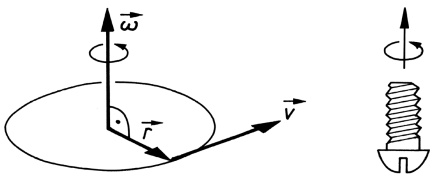

Bild 3.12 Zur Festlegung der Richtung des Vektors der Winkelgeschwindigkeit ω (Rechtsschraube)

Damit lässt sich nach Gleichung (3.26) die Bahngeschwindigkeit des umlaufenden Teilchens v als Vektorprodukt, gebildet aus dem Vektor der Winkelgeschwindigkeit ω und dem vom Kreismittelpunkt zum Teilchen zeigenden Radiusvektor $r ,$ wie folgt schreiben:

$$
\boldsymbol {v} = \boldsymbol {\omega} \times \boldsymbol {r} \quad (\text {Vektor der Bahngeschwindigkeit}). \tag {3.30}
$$

Entsprechend der Definition des Vektorprodukts steht v senkrecht auf $\pmb { \omega }$ und $r ,$ d. h., $\nu$ hat stets die Richtung der Tangente an die Bahnkurve.

**Die Radialbeschleunigung.** Bei der gleichförmigen Kreisbewegung ist zwar der Betrag der Geschwindigkeit $| \pmb { v } | = \nu$ konstant, d. h., für die in aufeinander folgenden Zeitpunkten $t _ { 1 }$ und $t _ { 2 }$ vorhandenen Geschwindigkeiten $\pmb { v } _ { 1 }$ und $\pmb { v } _ { 2 }$ (vgl. Bild 3.11a) gilt $| \pmb { v } _ { 1 } | = | \pmb { v } _ { 2 } | ;$ es ändert sich aber fortgesetzt ihre Richtung, weshalb diese Bewegung beschleunigt ist. Zeichnen wir die beiden Vektoren $\nu _ { 1 }$ und $\nu _ { 2 }$ unter Beibehaltung ihrer Richtung $\mathbf { s o } ,$ dass ihre Anfangspunkte zusammenfallen (Bild 3.11b), so liegen ihre Endpunkte auf einem Kreis mit dem Radius $\nu ,$ dem sog. Hodographen der Bewegung. Wie man sieht, ergibt sich $\pmb { v } _ { 2 }$ aus $\nu _ { 1 }$ durch Addition eines Differenzvektors $\Delta v ;$ es ist also $\pmb { v } _ { 2 } = \pmb { v } _ { 1 } + \Delta \pmb { v }$ oder $\Delta \pmb { v } = \pmb { v } _ { 2 } - \pmb { v } _ { 1 }$ . Der Vektor $\Delta \boldsymbol { v }$ beschreibt demnach die Geschwindigkeitsänderung. Machen wir den Winkel $\Delta \varphi ,$ den $\pmb { v } _ { 1 }$ und $\nu _ { 2 }$ miteinander einschließen, verschwindend klein, so steht $\Delta \nu$ senkrecht auf $\nu _ { 1 }$ und $\nu _ { 2 }$ . Der Vektor der Beschleunigung $\pmb { a } _ { \mathrm { r } } = \Delta \pmb { v } / \Delta t$ , der mit der Richtung von $\Delta \nu$ zusammenfällt, ist daher stets vom Bahnpunkt zum Kreismittelpunkt gerichtet. Man spricht daher von der **Radial-, Zentral-** oder auch **Zentripetalbeschleunigung.**

Bei hinreichend kleinem Zentriwinkel $\Delta \varphi$ kann der Betrag von $\Delta v ,$ wie aus Bild 3.11b hervorgeht, näherungsweise durch den zugehörigen Bogen des Kreises mit dem Radius v ersetzt werden. Es ist daher $\Delta \nu = \nu \Delta \varphi$ und somit $a _ { \mathrm { r } } = \Delta \nu / \Delta t = \nu \Delta \varphi / \Delta t = \nu \omega$ , woraus mit (3.26) folgt:

$$
a _ {\mathrm{r}} = \frac {v ^ {2}}{r} = \omega^ {2} r \quad (\text {Radial- oder Zentripetalbeschleunigung}). \tag {3.31}
$$

**Die Radial- oder Zentripetalbeschleunigung auf einer Kreisbahn ist dem Quadrat der Geschwindigkeit proportional und dem Bahnradius umgekehrt proportional und immer zum Mittelpunkt gerichtet.**

---

44

3 Kinematik der Punktmasse

Die Beziehungen (3.26) und (3.31) lassen sich auf einfache Weise auch unter Benutzung von **ebenen Polarkoordinaten** $r , \varphi$ gewinnen (Bild 3.13). Für die Kreisbewegung ist $r = \mathbf { c o n s t }$ und $\varphi = \varphi ( t )$ , bei gleichförmiger Kreisbewegung nach (3.25) speziell $\varphi = \omega t .$ Es ist somit

$$
x (t) = r \cos \omega t; \quad y (t) = r \sin \omega t.
$$

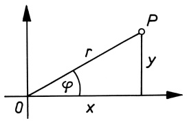

<details>
<summary>text_image</summary>

P
r
φ
y
0
x
</details>

Bild 3.13 Zusammenhang zwischen den kartesischen Koordinaten x, y und den ebenen Polarkoordinaten $r , \varphi$ eines Punktes $P ;$

$$
x = r \cos \varphi , y = r \sin \varphi ; r = \sqrt {x ^ {2} + y ^ {2}}, \tan \varphi = y / x.
$$

Durch Differenziation nach der Zeit erhält man daraus für die Komponenten $\nu _ { x }$ und $\nu _ { y }$ sowie den Betrag v des Geschwindigkeitsvektors (mit $\sin ^ { 2 } \omega t + \cos ^ { 2 } \omega t = 1$ :

$$
v _ {x} = \dot {x} = - \omega r \sin \omega t; \quad v _ {y} = \dot {y} = \omega r \cos \omega t; \quad v = \sqrt {v _ {x} ^ {2} + v _ {y} ^ {2}} = \omega r.
$$

Nochmalige Zeitableitung ergibt entsprechend für die Beschleunigung:

$$
a _ {x} = \ddot {x} = - \omega^ {2} r \cos \omega t; \quad a _ {y} = \ddot {y} = - \omega^ {2} r \sin \omega t; \quad a _ {\mathrm{r}} = \sqrt {a _ {x} ^ {2} + a _ {y} ^ {2}} = \omega^ {2} r.
$$

Für $\varphi = 0 \mathrm{b} \mathrm{z} \mathrm{w} . \omega t = 0 \mathrm{h} \mathrm{a} \mathrm{t} \alpha_{\mathrm{r}}$ nur eine x-Komponente, für $\varphi = 90^{\circ}  bZW . \omega t = \pi / 2$ nur eine y-Komponente, welche beide negativ sind; d. h., der Beschleunigungsvektor ist stets zum Kreismittelpunkt hin gerichtet. Er hat also die entgegengesetzte Orientierung des Radiusvektors r in Bild 3.12, weshalb gilt

$$
\boldsymbol {a} _ {\mathrm{r}} = - \omega^ {2} \boldsymbol {r} \quad (\text {Vektor der Radial- oder Zentripetalbeschleunigung}). \tag {3.32}
$$

**Ein Körper bewegt sich nur dann auf einer Kreisbahn, wenn er eine dem Betrage nach gleich bleibende, zum Mittelpunkt hin gerichtete Beschleunigung erfährt.**

## Beispiele 3.7:

1. Ein stationärer Nachrichtensatellit, der über einem bestimmten Ort am Äquator scheinbar stillsteht, kreist in einer Höhe von 35 600km über der Erdoberfläche. Wie groß ist seine Bahngeschwindigkeit? (Erdradius R = 6380km).

Lösung: Aus (3.26) und (3.27) folgt $\nu = \omega r = 2 \pi r / T$ , wobei hier $r = R + h$ zu setzen und für T die Dauer einer Erdumdrehung, also 24h (genau: 1Sterntag = 86 164s), einzusetzen ist. Damit folgt $v = 6 , 2 8 \cdot 4 1   9 8 0   \mathrm { k m } / ( 8 6   1 6 4   \mathrm { s } ) = 3 , 0 6   \mathrm { k m } / \mathrm { s } .$

2. Wie groß ist in Beispiel 1 die Radialbeschleunigung des Satelliten, die ihn auf der kreisförmigen Umlaufbahn hält?

Lösung: Aus (3.31) folgt $a _ { \mathrm { r } } = v ^ { 2 } / ( R + h ) = 0 , 2 2   \mathrm { m } / \mathrm { s } ^ { 2 }$ . Dies ist genau der Wert der Fallbeschleunigung g in der Höhe des Satelliten (vgl. 8.1). □

## Aufgabe

**3.6** Ein Satellit bewege sich um die Erde auf einer Kreisbahn, die konzentrisch zum Äquator verläuft, im Drehsinn der Erdrotation. Seine Umlaufzeit betrage $T _ { \mathrm { S } } = 9 6 \mathrm { m i n }$ . Die Umdrehungszeit der Erde ist $T _ { \mathrm { E } } = 8 6   1 6 4   \mathrm { s }$ . In welchen Zeitabständen $t _ { \mathrm { B } }$ befindet sich der Satellit über demselben Beobachtungspunkt des Äquators?

---

3.8 Die ungleichförmige Kreisbewegung

45

## 3.8 Die ungleichförmige Kreisbewegung

Wenn sich die Drehzahl zeitlich ändert, wie z. B. beim Anfahren von Motoren, so ist die Drehbewegung nicht mehr gleichförmig, und die nun zeitlich veränderliche Winkelgeschwindigkeit ist – analog zur Geschwindigkeit bei ungleichförmiger Bewegung (3.15) – definiert durch

$$
\omega (t) = \frac {\mathrm{d} \varphi}{\mathrm{d} t} \equiv \dot {\varphi}. \tag {3.33}
$$

## Die Winkelgeschwindigkeit ist gleich dem Differenzialquotienten des Drehwinkels nach der Zeit.

Ganz analog zur Beschleunigung (3.16) berechnet sich auch die Winkelbeschleunigung:

$$
\alpha = \frac {\mathrm{d} \omega}{\mathrm{d} t} \quad \text {oder mit (3.33)} \quad \alpha = \frac {\mathrm{d} ^ {2} \varphi}{\mathrm{d} t ^ {2}} \equiv \ddot {\varphi}. \tag {3.34}
$$

## Die Winkelbeschleunigung ist gleich dem ersten Differenzialquotienten der Winkelgeschwindigkeit nach der Zeit oder gleich dem zweiten Differenzialquotienten des Drehwinkels nach der Zeit.

Einheit der Winkelbeschleunigung: [α] = 1 rad $/ \mathbf { s } ^ { 2 }$

Die bei veränderlicher Drehzahl nun zusätzlich zur Radialbeschleunigung $a _ { \Gamma }$ vorhandene Beschleunigung in der Kreisbahn, die Tangential- oder Bahnbeschleunigung $a _ { \mathrm { t } }$ , ergibt sich aus (3.34) mit $v = \omega r$ zu

$$
a _ {\mathrm{t}} = \frac {\mathrm{d} v}{\mathrm{d} t} = \frac {\mathrm{d} \omega}{\mathrm{d} t} r = \alpha r. \tag {3.35}
$$

Entsprechend zu (3.30) gilt auch hier die Vektorgleichung

$$
\boldsymbol {a} _ {\mathrm{t}} = \boldsymbol {\alpha} \times \boldsymbol {r} \quad (\text {Vektor der Tangential- oder Bahnbeschleunigung}). \tag {3.36}
$$

Dabei ist $\pmb { \alpha } = \mathrm { d } \pmb { \omega } / \mathrm { d } t$ der Vektor der Winkelbeschleunigung; er hat ebenso wie ω die Richtung der Drehachse (s. Bild 3.12).

Die Größen der Kreisbewegung Drehwinkel $\varphi ,$ Winkelgeschwindigkeit ω und Winkelbeschleunigung α erhält man also aus den entsprechenden Größen der geradlinigen Bewegung Weglänge s, Geschwindigkeit v und Beschleunigung a einfach dadurch, dass letztere durch den Radius des Kreises dividiert werden:

$$
\varphi = \frac {s}{r}; \quad \omega = \frac {v}{r}; \quad \alpha = \frac {a}{r}. \tag {3.37}
$$

Ganz entsprechend gewinnt man die Gesetze der Drehbewegung aus denen der geradlinigen Bewegung, indem man die entsprechenden Gleichungen beiderseits durch den Radius dividiert (vgl. Tabelle 3.1).

---

46

3 Kinematik der Punktmasse

Tabelle 3.1 Einander entsprechende Gesetze der geradlinigen Bewegung und der Drehbewegung

<table><tr><td colspan="2">Geradlinige Bewegung</td><td colspan="2">Drehbewegung</td><td></td></tr><tr><td colspan="2">Gleichförmige Bewegung ( $\nu = \text{const}$ ):</td><td colspan="2">Gleichförmige Drehbewegung ( $\omega = \text{const}$ ):</td><td></td></tr><tr><td>Weg</td><td> $s = \nu t$ </td><td>Drehwinkel</td><td> $\varphi = \omega t$ </td><td>(3.38)</td></tr><tr><td colspan="2">Gleichmäßig beschleunigte Bewegung( $a = \text{const}$ ):</td><td colspan="2">Gleichmäßig beschleunigte Drehbewegung( $\alpha = \text{const}$ ):</td><td></td></tr><tr><td rowspan="2">Weg</td><td> $s = \frac{1}{2} (\nu_0 + \nu)t$ </td><td rowspan="2">Drehwinkel</td><td> $\varphi = \frac{1}{2} (\omega_0 + \omega)t$ </td><td>(3.39)</td></tr><tr><td> $s = \frac{a}{2} t^2 + \nu_0 t$ </td><td> $\varphi = \frac{\alpha}{2} t^2 + \omega_0 t$ </td><td>(3.40)</td></tr><tr><td>Endgeschwindigkeit</td><td> $\nu = at + \nu_0$  $\nu = \sqrt{2as + \nu_0^2}$ </td><td>Endwinkelgeschwindigkeit</td><td> $\omega = \alpha t + \omega_0$  $\omega = \sqrt{2\alpha\varphi + \omega_0^2}$ </td><td>(3.41)(3.42)</td></tr></table>

## Beispiele 3.8:

1. Der Anker eines Elektromotors soll bei einer konstanten Winkelbeschleunigung von 94rad $/ \mathbf { s } ^ { 2 }$ aus dem Stillstand auf die Drehzahl $1 8 0 0   \mathrm { m i n } ^ { - 1 }$ gebracht werden. Berechne die Dauer des Anfahrvorgangs und die Anzahl der dazu notwendigen Umdrehungen!

Lösung: Mit $\omega _ { 0 } = 0$ folgt aus (3.41) $\omega = \alpha t$ und hieraus mit (3.29) die Beschleunigungsdauer zu $t = \omega / \alpha = 2 \pi n / \alpha = 6 { , } 2 8 \cdot ( 1 8 0 0 / 6 0 )   \mathrm { s } ^ { - 1 } / ( 9 4   \mathrm { s } ^ { - 2 } ) = 2   \mathrm { s }$ . Der Gesamtdrehwinkel während dieser Zeit beträgt nach (3.40) $\varphi = { \alpha t } ^ { 2 } / 2$ und die Anzahl der Umdrehungen (mit $2 \pi$ rad als Drehwinkel für eine Umdrehung) $z = \varphi / ( 2 \pi \mathrm { r a d } ) = \alpha t ^ { 2 } / ( 4 \pi \mathrm { r a d } ) = 3 0 .$

2. Ein Fahrzeug fährt mit der Geschwindigkeit $v_{0}=30   km/h$ in eine 90-Grad-Kurve vom Radius $R = 5 0   \mathrm { m }$ ein und beschleunigt beim Durchfahren der Kurve gleichmäßig. Die größte Radialbeschleunigung ist $a_{\mathrm{r}}=3,86\mathrm{~m} / \mathrm{s}^{2} . \mathrm{a}$ Mit welcher Geschwindigkeit $\nu _ { 1 }$ verlässt es die Kurve? b) Geben Sie die Größe der maximalen Beschleunigung a an!

Lösung: a) Aus (3.31) $a _ { \mathrm { r } }   =   v _ { 1 } ^ { 2 } / R$ folgt die Endgeschwindigkeit beim Verlassen der Kurve $v_{1}=\sqrt{a_{\mathrm{r}}R}=13.89\mathrm{~m/s}=50\mathrm{~km/h}$ . b) Für die Be<u>schleunig</u>ung in der Kreisbahn (Tangentialbeschleunigung) $a _ { \mathrm { t } }$ erhält man aus (3.42) $\nu _ { 1 } = \sqrt { 2 a _ { \mathrm { t } } s _ { 1 } + \nu _ { 0 } ^ { 2 } }$ mit der Kurvenlänge $s _ { 1 } = \pi R / 2$

$$
a _ {\mathrm{t}} = \frac {v _ {1} ^ {2} - v _ {0} ^ {2}}{2 s _ {1}} = \frac {v _ {1} ^ {2} - v _ {0} ^ {2}}{\pi R} = 0, 7 8 7 \mathrm{m/s} ^ {2}.
$$

Damit wird der Betrag der Gesamtbeschleunigung $a = \sqrt{a_{\mathrm{r}}^{2} + a_{\mathrm{t}}^{2}} = 3.94   \mathrm{m/s^{2}}$

3. Ein mit der Drehzahl $3 6 0 0   \mathrm { m i n } ^ { - 1 }$ laufender Elektromotor kommt nach dem Abschalten innerhalb von 10s zum Stillstand. a) Wie groß ist die Winkelbeschleunigung beim Auslaufen? b) Wie viel Umdrehungen führt der Motor nach dem Abschalten noch aus?

Lösung: a) Mit $n = 6 0   \mathrm { s } ^ { - 1 }$ beträgt die Anfangswinkelgeschwindigkeit $\omega _ { 0 } = 2 \pi n = 3 7 7$ rad/s, und nach $t = 1 0   \mathrm { s }$ ist $\omega = 0$ . Damit folgt als Winkelbeschleunigung (Verzögerung) $\alpha = ( \omega - \omega _ { 0 } ) / t =$ $- 3 7 { , } 7 \mathrm { r a d / s } ^ { 2 }$ . b) Der Gesamtdrehwinkel $\varphi$ nach dem Abschalten folgt aus $\omega = \sqrt { 2 \alpha \varphi + \omega _ { 0 } ^ { 2 } }$ mit $\omega = 0   \mathrm { z u }   \varphi = - \omega _ { 0 } ^ { 2 } / ( 2 \alpha ) = 1 8 8 5   \mathrm { r a d }$ . Die Umdrehungszahl ist $z = \varphi /$ (2πrad) = 300. Rechnet man zweckmäßigerweise mit der mittleren Drehzahl beim Auslaufen $\overline { { n } } = ( n _ { 1 }   +   n _ { 2 } ) / 2 = n / 2 = 3 0   \mathsf { s } ^ { - 1 }$ (mit $n _ { 1 } = n$ und $n _ { 2 } = 0 )$ , so folgt die Umdrehungszahl (ohne den Umweg über den Drehwinkel $\varphi )$ unmittelbar aus $z = { \overline { { n } } } t$ □

---

3.9 Bewegung auf beliebig krummliniger Bahn

47

## 3.9 Bewegung auf beliebig krummliniger Bahn

Zur Beschreibung der Bewegung eines Teilchens auf einer beliebigen Bahn im Raum ist es erforderlich, die Lagekoordinaten x, y, z des Bahnpunktes P, in dem sich das Teilchen momentan befindet, in Abhängigkeit von der Zeit darzustellen:

$$
x = x (t), \quad y = y (t), \quad z = z (t).
$$

Mit der Einführung eines aus den Einheitsvektoren $i , j ,$ k in Richtung der Koordinatenachsen gebildeten Dreibeins können diese drei Angaben zum zeitlich veränderlichen **Ortsvektor**

$$
\boldsymbol {r} (t) = x (t) \boldsymbol {i} + y (t) \boldsymbol {j} + z (t) \boldsymbol {k} \tag {3.43}
$$

zusammengefasst werden, der vom Koordinatenursprung O ausgeht und zum betrachteten Bahnpunkt zeigt (Bild 3.14a). Im Verlaufe der Bewegung des Teilchens ändern sich während des Zeitintervalls $\Delta t$ dessen Koordinaten um $\Delta x ,   \Delta y$ und $\Delta z ,$ entsprechend einer Änderung des Ortsvektors r um

$$
\Delta \boldsymbol {r} = \Delta x \boldsymbol {i} + \Delta y \boldsymbol {j} + \Delta z \boldsymbol {k}.
$$

Befindet sich das Teilchen zum Zeitpunkt $t _ { 1 }$ im Bahnpunkt $P _ { 1 }$ mit dem Ortsvektor $r _ { 1 }$ , so trifft man es zum Zeitpunkt $t _ { 2 } = t _ { 1 }   +   \Delta t$ an der Stelle $P _ { 2 }$ mit dem Ortsvektor $\pmb { r } _ { 2 } = \pmb { r } _ { 1 } { + } \Delta \pmb { r }$ . Machen wir das Zeitintervall verschwindend klein, entsprechend dem Grenzübergang von der Differenz ∆t zum Differenzial dt, so liegen die beiden Bahnpunkte $P _ { 1 }$ und $P _ { 2 }$ äußerst dicht beieinander, und wir erhalten als **Vektor der Geschwindigkeit**

$$
\boldsymbol {v} (t) = \lim _ {\Delta t \to 0} \frac {\Delta \boldsymbol {r}}{\Delta t} = \frac {\mathrm{d} \boldsymbol {r}}{\mathrm{d} t} \equiv \dot {\boldsymbol {r}}. \tag {3.44}
$$

$v ( t )$ ist stets tangential zur Bahnkurve gerichtet, da das vektorielle Wegelement dr vom Betrage ds immer die momentane Bewegungsrichtung angibt.

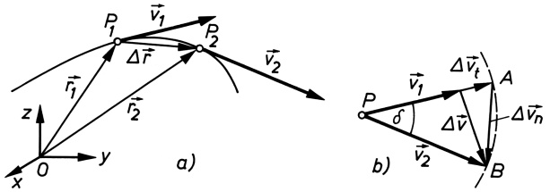

Bild 3.14 Änderung des Geschwindigkeitsvektors v bei krummliniger Bewegung (a) und Zerlegung des Vektors der Geschwindigkeitsänderung $\Delta \pmb { v } = \pmb { v } _ { 2 } - \pmb { v } _ { 1 }$ in eine tangentiale Komponente $\Delta v _ { \mathrm { t } }$ und eine normale Komponente $\Delta v _ { \mathrm { n } }$ (b): $\Delta \pmb { v } = \Delta \pmb { v } _ { \mathrm { t } } + \Delta \pmb { v } _ { \mathrm { n } }$

Zeichnet man die beiden in den benachbarten Punkten $P _ { 1 }$ und $P _ { 2 }$ vorhandenen Geschwindigkeitsvektoren $\nu _ { 1 }$ und $\pmb { v } _ { 2 }$ unter Beibehaltung ihres Betrages und ihrer Richtung so, dass sie mit ihren Anfangspunkten zusammenfallen (Bild 3.14b), so gibt der Differenzvektor $\Delta \pmb { v } = \pmb { v } _ { 2 } - \pmb { v } _ { 1 }$ den Zuwachs an, den die Geschwindigkeit im Zeitintervall $\Delta t$ erfährt. Durch Grenzübergang $\Delta t \rightarrow 0$ (gleichbedeutend mit $\delta \to 0$ , wobei δ der Winkel ist, den die beiden Geschwindigkeitsvektoren miteinander einschließen), erhält man als **Vektor der Beschleunigung**

$$
\boldsymbol {a} (t) = \lim _ {\Delta t \to 0} \frac {\Delta \boldsymbol {v}}{\Delta t} = \frac {\mathrm{d} \boldsymbol {v}}{\mathrm{d} t} \equiv \dot {\boldsymbol {v}} = \ddot {\boldsymbol {r}}. \tag {3.45}
$$

---

48

3 Kinematik der Punktmasse

Schlägt man, wie in Bild 3.14b, um $P$ einen Kreisbogen AB vom Radius $\nu _ { 2 }$ , so erkennt man, dass sich $\Delta \boldsymbol { v }$ aus zwei Komponenten zusammensetzt: $\Delta \pmb { v } = \Delta \pmb { v } _ { \mathrm { t } } + \Delta \pmb { v } _ { \mathrm { n } }$ . Die Komponente $\Delta v _ { \mathrm { t } }$ ist tangential zur Bahnkurve gerichtet; bezieht man sie auf das zugehörige Zeitintervall $\Delta t ,$ so folgt durch Grenzübergang

$$
\boldsymbol {a} _ {\mathrm{t}} = \lim _ {\Delta t \to 0} \frac {\Delta \boldsymbol {v} _ {\mathrm{t}}}{\Delta t} = \frac {\mathrm{d} v}{\mathrm{d} t} \boldsymbol {e} _ {\mathrm{t}} \quad (\text {Vektor der Tangentialbeschleunigung}). \tag {3.46}
$$

$\mathbf { e _ { t } }$ ist dabei der Einheitsvektor in Tangentenrichtung. Die zweite Komponente $\Delta v _ { \mathrm { n } }$ steht für $\delta \to 0$ senkrecht auf der Tangentenrichtung, sie hat also stets die Richtung der Normale zur Bahnkurve. Denkt man sich ein kurzes Stück der Bahnkurve um den betrachteten Punkt nä- herungsweise durch einen Kreisbogen, den sog. Krümmungskreis, ersetzt, so zeigt $\Delta v _ { \mathrm { n } }$ zum Mittelpunkt des Krümmungskreises. Entsprechend der Radialbeschleunigung (3.31) bei der Kreisbewegung erhält man daher hier mit dem Krümmungsradius $\varrho$ und dem Einheitsvektor in Normalenrichtung $\mathbf { e _ { n } }$

$$
\boldsymbol {a} _ {\mathrm{n}} = \lim _ {\Delta t \rightarrow 0} \frac {\Delta \boldsymbol {v} _ {\mathrm{n}}}{\Delta t} = \frac {v ^ {2}}{\varrho} \boldsymbol {e} _ {\mathrm{n}} \quad (\text {Vektor der Normalbeschleunigung}). \tag {3.47}
$$

Die Normalbeschleunigung bewirkt, dass das Teilchen sich nicht geradeaus bewegt, sondern eine gekrümmte Bahn durchläuft. Addiert man nun Tangential- und Normalbeschleunigung vektoriell, so erhält man

$$
\boldsymbol {a} = \boldsymbol {a} _ {\mathrm{t}} + \boldsymbol {a} _ {\mathrm{n}} \quad (\text {Vektor der resultierenden Beschleunigung}) \tag {3.48}
$$

mit dem Betrag

$$
a = \sqrt {a _ {\mathrm{t}} ^ {2} + a _ {\mathrm{n}} ^ {2}}. \tag {3.49}
$$

Zwei Sonderfälle lassen sich aus (3.46) und (3.47) unmittelbar ablesen: Bewegt sich das Teilchen mit einer Geschwindigkeit von gleich bleibendem Betrag v, aber veränderlicher Richtung, so erfährt es wegen d $\nu / \mathbf { d } t = 0$ keine Tangentialbeschleunigung. Es tritt jedoch eine Normalbeschleunigung auf, die bei konstantem Krümmungsradius der Bahn eine gleichförmige Kreisbewegung zur Folge hat. Ist hingegen die Normalbeschleunigung gleich null, entsprechend einem unendlich großen Krümmungsradius $\varrho ,$ so liegt eine geradlinige Bewegung vor.

## Aufgabe

**3.7** Ein Elektron, welches in ein räumlich und zeitlich konstantes Magnetfeld eingeschossen wird und eine Geschwindigkeitskomponente $\nu _ { z }$ in Richtung der magnetischen Feldlinien hat, bewegt sich infolge der LORENTZ-Kraft (vgl. 28.7) auf einer Schraubenbahn um die Feldlinien, welche durch

$$
x (t) = r \cos \omega t, \quad y (t) = r \sin \omega t, \quad z (t) = v _ {z} t
$$

beschrieben wird. Hierbei sind $r ,$ ω und $\nu _ { z }$ konstant. Berechne den Betrag von $\mathbf { G e } \cdot$ schwindigkeit und Beschleunigung des Elektrons!

---

4

Dynamik der Punktmasse

In den vorangegangenen Abschnitten wurden die für den Bewegungsablauf charakteristischen Größen eingeführt. Die Frage nach der Ursache der Bewegungen, z. B. für das Auftreten von Beschleunigungen, wurde dabei nicht gestellt. Für die Definition von Geschwindigkeit und Beschleunigung ist diese Fragestellung auch belanglos, denn beide Größen sind rein geometrisch-zeitlich und nicht als Wirkungen irgendwelcher Ursachen definiert. Wenn man nach den Ursachen von Beschleunigungen fragt, so gelangt man von der Kinematik zur Dynamik, der Lehre von den Kräften.

## 4.1 Der Kraftbegriff in der Physik. Zusammensetzung und Zerlegung von Kräften. Statisches Gleichgewicht

Im Alltag bringen wir den Begriff Kraft gefühlsmäßig mit einer körperlichen Anstrengung (Muskelkraft) zum Zwecke der Fortbewegung oder Verformung eines Körpers in Verbindung, oder mit dem „Gewicht“ eines Körpers, welches überhaupt als das Urbild der Kraft gelten darf (GALILEI). In Verallgemeinerung dieser Vorstellung wird in der Physik die Kraft als alleinige Ursache für die Änderung des Bewegungszustandes eines freien Körpers (Beschleunigung oder Abbremsung) oder für die Änderung der äußeren Form (Deformation) und gegebenenfalls auch der inneren Struktur eines festgehaltenen Körpers angesehen, ganz gleich, bei welchen Vorgängen diese Wirkungen beobachtet werden (z. B. Druck, Zug, Stoß, Schwerkraft, elektrische und magnetische Anziehung und Abstoßung usw.). Dabei kommt es mitunter vor, dass, wenn mehrere Kräfte auf einen freien Körper einwirken, diese keine Veränderungen seines Bewegungszustandes hervorrufen; die Kräfte heben sich dann in ihrer Wirkung gegenseitig auf, sie stehen untereinander im Gleichgewicht.

Kräfte sind durchweg eine Folge der vier grundsätzlich voneinander zu unterscheidenden Arten von **Wechselwirkungen** zwischen den Bausteinen der Materie, der Gravitationswechselwirkung, der schwachen Wechselwirkung, der elektromagnetischen und der starken Wechselwirkung (vgl. 50.5). So z. B. sind die Kräfte, auf denen die Festigkeit der Metalle beruht, elektromagnetischen Ursprungs und etwa 10<sup>40</sup>mal (!) größer als die infolge der Schwerkraft (Gravitation) zwischen den Metallatomen wirkenden Kräfte. Die starke und schwache Wechselwirkung treten nur in der Kern- und Elementarteilchenphysik auf.

Die Einheit der Kraft ist das N e w t o n (N); sie wird in Abschnitt 4.3 definiert.

**Die Kraft als vektorielle Größe.** Verschiedene Kräfte können sich 1. durch ihren Betrag, 2. durch ihre Richtung (dargestellt durch einen Pfeil) und 3. durch ihren Angriffspunkt am Körper voneinander unterscheiden. Betrag und Richtung kennzeichnen die Kraft als Vektor. Die Gerade, auf welcher der Kraftvektor liegt, heißt Wirkungslinie der Kraft.

**Zusammensetzen von Kräften mit gemeinsamem Angriffspunkt.** Greifen in einem Punkt mehrere Kräfte an, ist die wirkende Gesamtkraft, die sog. Resultierende, nach den Regeln der Vektoraddition zu berechnen (analog zur Addition von Geschwindigkeiten, vgl. 3.6). So ist die

---

50

4 Dynamik der Punktmasse

Resultierende zweier Kräfte $F _ { 1 }$ und $F _ { 2 }$ gleich $\boldsymbol { F } = \boldsymbol { F } _ { 1 } + \boldsymbol { F } _ { 2 }$ . Man gewinnt sie als Diagonale des aus den beiden Komponenten $F _ { 1 }$ und $F _ { 2 }$ gebildeten Kräfteparallelogramms (Bild 4.1a).

**Die Resultierende zweier Kräfte fasst deren Wirkung zusammen. Sie greift im Schnittpunkt der gegebenen Kräfte an und ist nach Größe und Richtung die Diagonale durch diesen Punkt im Kräfteparallelogramm.**

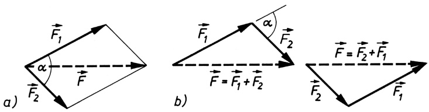

Bild 4.1 Zusammensetzung von zwei Kräften $F _ { 1 }$ und $F _ { 2 }$ zur Resultierenden $\boldsymbol { F } ;$ a) Kräfteparallelogramm; b) Kräftedreieck

Im Allgemeinen zeichnet man nur das halbe Parallelogramm, das Kräftedreieck (Bild 4.1b). Der **Betrag** der resultierenden Kraft berechnet sich mit Hilfe des Kosinussatzes $F ^ { 2 } = F _ { 1 } ^ { 2 }   +   F _ { 2 } ^ { 2 }   -$ $2 F _ { 1 } F _ { 2 } \cos ( 1 8 0 ^ { \circ } - \alpha )$ zu

$$
F = \sqrt {F _ {1} ^ {2} + F _ {2} ^ {2} + 2 F _ {1} F _ {2} \cos \alpha}. \tag {4.1}
$$

Dabei ist α der von $F _ { 1 }$ und $F _ { 2 }$ eingeschlossene Winkel. Ist insbesondere α ein rechter Winkel, so folgt mit cos $9 0 ^ { \circ } = 0$ der Satz des PYTHAGORAS

$$
F = \sqrt {F _ {1} ^ {2} + F _ {2} ^ {2}}. \tag {4.2}
$$

Als Spezialfall ist in (4.1) auch enthalten, dass sich zwei entgegengesetzt gleiche Kräfte in derselben Wirkungslinie $( \pmb { F } _ { 1 } = - \pmb { F } _ { 2 }$ , d. h. $F _ { 1 } = F _ { 2 }$ und $\alpha = 1 8 0 ^ { \circ } )$ in ihrer Wirkung aufheben, die resultierende Kraft also verschwindet.

Greifen wie in Bild 4.2a in einem Punkt mehr als zwei Kräfte an, so lassen sich auch diese zu einer Resultierenden im Sinne einer Ersatzkraft zusammenfassen, welche nach Größe und Richtung die Wirkungen aller Teilkräfte in sich vereint. Zu ihrer Konstruktion verfährt man so, dass zunächst zwei Kräfte gemäß dem Parallelogrammsatz zu einer Resultierenden zusammengesetzt und danach dieselbe zusammen mit einer dritten Kraft nach dem gleichen Verfahren zu einer neuen Resultierenden vereinigt wird usw. Man findet jedoch sofort, dass man sich die Konstruktion der einzelnen Parallelogramme ersparen kann; es genügt, die im sog. **Lageplan** enthaltenen Einzelkräfte, wie in Bild 4.2a gezeigt,

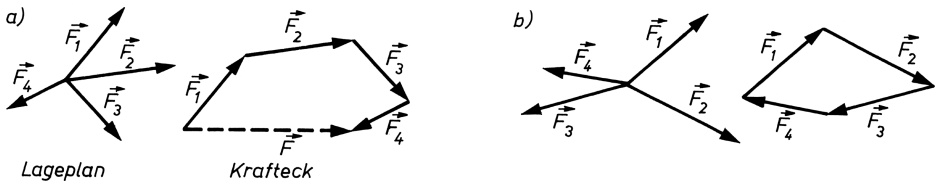

Bild 4.2 a) Ermittlung der Resultierenden F von vier Kräften mit gemeinsamem Angriffspunkt mittels Krafteck; b) Kräftegleichgewicht

---

4.2 Das Trägheitsgesetz (1. newtonsches Axiom)

51

schrittweise zum **Krafteck** zusammenzusetzen. Die Resultierende F weist dann vom Angriffspunkt der ersten nach dem Endpunkt der letzten Teilkraft; sie ist damit dem Umfahrungssinn des Kraftecks stets entgegengerichtet. In dem Fall, dass der Endpunkt des Kraftecks mit dem Ausgangspunkt zusammenfällt (Bild 4.2b), das Krafteck also geschlossen ist, ist die Resultierende gleich null, d. h., die Kräfte befinden sich im **(statischen) Gleichgewicht**. Die Kraftvektoren bilden dann im Krafteck einen durchgehenden Umlaufsinn.

**Zerlegung einer Kraft in Komponenten.** So wie mehrere Teilkräfte zu einer Kraft vereinigt werden können, ist auch die umgekehrte Aufgabe durchführbar, die Zerlegung einer Kraft F in Komponenten bezüglich beliebig vorgegebener, nichtparalleler Wirkungslinien (Bild 4.3). Man erhält das Kräfteparallelogramm und damit die Kraftkomponenten $F _ { 1 }$ und $F _ { 2 }$ , indem parallel zu ihren Wirkungslinien Hilfslinien gezeichnet werden, die durch die Spitze des Vektorpfeiles von F gehen.

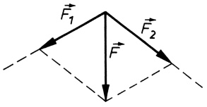

<details>
<summary>text_image</summary>

F₁
F₂
F
</details>

Bild 4.3 Zerlegung einer Kraft F in zwei Komponenten bezüglich vorgegebener Wirkungslinien

## Beispiel 4.1:

Bei der in Bild 4.4 beschriebenen Aufgabe sind $F _ { 1 }$ und die Wirkungslinien von $F _ { 2 }$ und F gegeben. Damit kann das Kräfteparallelogramm gezeichnet werden, und zwar mit $F _ { 1 }$ und $F _ { 2 }$ als Komponenten von F in Richtung der Spannseile. Aus dem von den Kräften gebildeten Dreieck findet man $F_{2}=F_{1}/\cos60^{\circ}=5000  N$ und $F = F_{1} \tan 60^{\circ} = 4330    N$ □

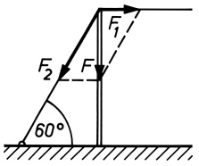

<details>
<summary>text_image</summary>

F₁
F₂
F
60°
</details>

Bild 4.4 Ein senkrecht stehender Mast wird durch zwei Spannseile gehalten, von denen das waagrechte die Zugkraft $F _ { 1 } = 2 5 0 0   \mathrm { N }$ ausübt.

Mit welcher Kraft $F _ { 2 }$ muss das schräge Seil gespannt sein, und wie groß ist die im Mast vertikal gerichtete Druckkraft F?

## Aufgabe

**4.1** Ein Mast soll durch drei schräg verlaufende Spannseile, die mit dem Erdboden den gleichen Winkel einschließen, lotrecht gehalten werden. Die Spannkraft des ersten Seils beträgt $F _ { 1 } = 4 { , } 0   \mathrm { k N }$ und die des zweiten, um $\alpha _ { 1 } = 1 2 0 ^ { \circ }$ gegenüber dem ersten versetzten Seils $F _ { 2 } = 3 { , } 6 \mathrm { k N }$ . Mit welcher Kraft und unter welchem Winkel $\alpha _ { 2 }$ gegen das zweite Seil versetzt muss das dritte Seil gespannt sein? Löse die Aufgabe auch zeichnerisch!

## 4.2 Das Trägheitsgesetz (1. newtonsches Axiom)

Die Erfahrung lehrt, dass ein auf waagrechter Unterlage ruhender Körper nicht von selbst in Bewegung gerät und dass jeder bewegte, sich selbst überlassene Körper nach einer bestimmten Zeit zur Ruhe kommt. Im ersten Fall ist die Ursache das Fehlen jeglicher äußerer Kräfte, im zweiten das Vorhandensein äußerer Kräfte, die die Bewegung hemmen (Reibungskräfte). Diese Eigenschaft der Körper, ihren Bewegungszustand niemals von selbst zu ändern, sondern

---

52

4 Dynamik der Punktmasse

sich vielmehr einer Änderung desselben zu widersetzen, bezeichnet man als Beharrungsvermögen oder **Trägheit**. Für den Fall, dass alle Bewegungswiderstände fehlen, gilt das von NEW-TON (1643–1727) ausgesprochene **Trägheitsgesetz** oder

## 1. NEWTONsches Axiom:

**Jeder Körper verharrt im Zustand der Ruhe oder der geradlinigen gleichförmigen Bewegung, solange keine Kraft auf ihn einwirkt oder die Resultierende der angreifenden Kräfte null ist.**

Es gilt also für die Vektoren von Geschwindigkeit und resultierender Kraft:

$$
\boldsymbol {v} = \text {const} \quad \text {fur} \quad \boldsymbol {F} = 0. \tag {4.3}
$$

Die Unterscheidung zwischen Ruhe und geradliniger gleichförmiger Bewegung ist dabei allein eine Frage des gewählten Bezugssystems, von dem aus die Bewegung des Körpers beobachtet wird. Bezugssysteme, in denen das Trägheitsgesetz gilt, nennt man Inertialsysteme (vgl. 5.3).

Die direkte experimentelle Überprüfung des Trägheitsgesetzes ist nicht möglich, da kein Körper äußeren Einflüssen (z. B. Reibungskräften) völlig entzogen werden kann. Als Begründung für die Richtigkeit dieses Gesetzes kann aber gelten, dass alle daraus gezogenen Schlussfolgerungen durch das Experiment bestätigt werden. Eine der Schlussfolgerungen ist:

**Ändert ein Körper seinen Bewegungszustand, bewegt er sich also beschleunigt oder verzögert, so ist hierfür stets eine Kraft die Ursache.**

## 4.3 Das Grundgesetz der Dynamik (2. newtonsches Axiom)

Während das 1. NEWTONsche Axiom nur allgemein aussagt, dass für jede Beschleunigung eines Körpers eine Kraft die Ursache ist, definiert das 2. NEWTONsche Axiom den Zusammenhang zwischen Kraft und Beschleunigung genau. Es lautet:

$$
F = m \boldsymbol {a} \quad (\text {Grundgesetz der Dynamik}). \tag {4.4}
$$

## 2. NEWTONsches Axiom:

**Die Beschleunigung eines Körpers ist der auf ihn einwirkenden Kraft proportional und erfolgt in derjenigen Richtung, in der die Kraft wirkt.**

In dieser quantitativen Formulierung des Trägheitsgesetzes (4.3), welche sich auf zahlreiche Erfahrungstatsachen gründet, vor allem auf die bereits von GALILEI (1564–1642) zur Fall- und Wurfbewegung erkannten Gesetze der Dynamik, ist die Größe m zunächst ein skalarer Proportionalitätsfaktor, der offenbar ein Maß für den Widerstand eines Körpers gegen Beschleunigungen, für seine Trägheit also, darstellt. Denn bei gegebener Kraft ist die Beschleunigung umso kleiner, je größer m ist. Die Größe m hängt demnach von der Art des beschleunigten

---

4.4 Träge und schwere Masse. Gewichtskraft. Radialkraft

53

Körpers ab. Nach Gleichung (4.4) haben wir zwei beliebig beschaffenen Körpern immer dann den gleichen Wert von m zuzuordnen, wenn sie durch gleich große Kräfte dieselbe Beschleunigung erfahren. Man nennt die so definierte Größe m die träge Masse oder einfach die **Masse** des Körpers.

## Die Masse kennzeichnet die Eigenschaft eines Körpers, sich der Änderung seines Bewegungszustandes zu widersetzen. Ihre Größe ist ein Maß für die Trägheit des Körpers.

Die Einheit der Masse ist das **Kilogramm (kg)**; neben dem Meter und der Sekunde ist sie die dritte Basiseinheit der Mechanik.

Die Darstellung der Masseneinheit erfolgt (bis 2019) mittels des Kilogramm-Prototyps des jeweiligen Staatsinstituts. Seine Masse ist nach den internationalen Vergleichen mit dem in Paris aufbewahrten Prototyp, einem Platin(90%)-Iridium(10%)-Zylinder, bis auf eine relative Unsicherheit von $1 0 ^ { - 9 }$ bekannt; dies entspricht einem Fehler von 1g auf 1 Million kg. 1kg ist ziemlich genau gleich der Masse von 1 Liter $( 1 1 = 1   \mathrm { d m } ^ { 3 } )$ reinen, luftfreien Wassers bei normalem Atmosphärendruck (1013hPa) und von maximaler Dichte, d. h. bei $^ { 3 , 9 8   ^ { \circ } \mathrm { C } }$

Die Einheit der Masse wird im neuen SI – wie die Längen- und die Zeiteinheit – auf atomare Eigenschaften bzw. Naturkonstanten zurückgeführt (s. Abschnitt 2.3). Im Bereich der Atome und Elementarteilchen wird die atomare Masseneinheit (u) verwendet, welche gleich dem 12. Teil der Masse des Kohlenstoffisotops $^ { 1 2 } \mathrm { C }$ ist (vgl. 18.1).

Mit der Masse als Basisgröße wird nach (4.4) die Kraft zu einer abgeleiteten Größe. Dies gilt demzufolge auch für die

$$
\text {Einheit der Kraft:} \quad [ F ] = 1 \mathrm{kg} \cdot \mathrm{m} / \mathrm{s} ^ {2} = 1 \text {Newton (N)}.
$$

1N ist die Kraft, die der Masse 1kg die Beschleunigung 1m $/ \mathbf { s } ^ { 2 }$ erteilt.

Aus Gleichung (4.4) geht hervor, dass eine konstante Kraft bei unveränderlicher Masse eine konstante Beschleunigung, d. h. also eine gleichmäßig beschleunigte Bewegung hervorruft. Bekanntestes Beispiel hierfür ist der freie Fall mit der (über kleine Höhenunterschiede) konstanten Fallbeschleunigung g . Für F = 0 folgt a = 0, d. h. v = const, entsprechend einer geradlinigen gleichförmigen Bewegung bzw. dem Zustand der Ruhe. Dies ist wieder das Trägheitsgesetz (4.3).

Eine quantitative Überprüfung des Grundgesetzes (4.4) kann mit Hilfe der ATWOODschen Fallmaschine erfolgen (vgl. das Rechenbeispiel im nächsten Abschnitt). Eine andere Formulierung des Grundgesetzes, die der ursprünglichen NEWTONschen Fassung entspricht, werden wir in Abschnitt 4.5 kennen lernen.

## 4.4 Träge und schwere Masse. Gewichtskraft. Radialkraft

Die Masse eines Körpers kennzeichnet nicht nur dessen **Trägheit**, sondern auch dessen **Schwere**. Letztere beruht auf der Eigenschaft der Körper, sich wechselseitig anzuziehen (Gravitation). Die Kraft, mit der ein im Schwerefeld der Erde an einem Faden aufgehängter Körper den Faden spannt, heißt **Gewichtskraft** G des Körpers. Sie kann statisch mit Hilfe eines

---

54

4 Dynamik der Punktmasse

zwischen Körper und Aufhängung geschalteten Federkraftmessers (Dynamometer, Bild 4.5) gemessen werden. Schneidet man den Faden durch, so bewegt sich der Körper, frei fallend, mit der gleich bleibenden Beschleunigung $g = 9 . 8 1   \mathrm { m } / \mathrm { s } ^ { 2 }$ . Die Kraft, die ihn beschleunigt und die vorher den Faden spannte, bestimmt sich analog dem Grundgesetz (4.4) zu

$$
G = m g \quad (\text {Gewichtskraft}). \tag {4.5}
$$

Die in dieser Gleichung vorkommende, aus der Gewichtskraft ermittelte Masse des Körpers wird als schwere Masse $( m _ { \mathrm { s } } )$ bezeichnet, im Unterschied zu der in einem Beschleunigungsexperiment nach Gleichung (4.4) bestimmten trägen Masse $m _ { \mathrm { t } } = F / a .$ Durch Präzisionsmessungen konnte die Gleichheit von träger und schwerer Masse nachgewiesen werden (vgl. 43.4). Diese Tatsache bildet in Form des Äquivalenzprinzips die experimentelle Grundlage für die von EINSTEIN 1915 aufgestellte allgemeine Relativitätstheorie (s. 22.4).

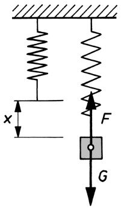

<details>
<summary>text_image</summary>

x
F
G
</details>

Bild 4.5 Federkraftmesser (Dynamometer). Die Auslenkung x der Schraubenfeder ist der an ihr angreifenden Kraft (hier der Gewichtskraft G des angehängten Körpers) proportional: $G = k x$ (k Federkonstante). Für die rücktreibende Federkraft $F$ gilt aus Gleichgewichtsgründen $F + G = 0$ bzw. $F = - G = - k x$ . Die Bestimmung von k erfolgt durch Messung von $x _ { 1 }$ für eine bekannte Gewichtskraft $G _ { 1 } \colon k = G _ { 1 } / x _ { 1 }$ (Eichung).

Die Bestimmung von Massen geschieht durch Wägung, d. h., die Masse eines Körpers wird durch Vergleich seiner Gewichtskraft mit der eines Massenormals ermittelt (Hebel- oder Balkenwaage).

**Die Dichte.** Unter der Massendichte (oder einfach Dichte) $\varrho$ eines festen, flüssigen oder gasförmigen Stoffes versteht man den Quotienten aus der Masse einer bestimmten Stoffportion und dem von ihr eingenommenen Volumen:

$$
\varrho = \frac {m}{V}; \quad E i n h e i t: \quad [ \varrho ] = 1 \mathrm{kg/m} ^ {3}. \tag {4.6}
$$

Beispielsweise beträgt die Dichte von Luft bei $0 \; ^ { \circ } \mathrm { C }$ und normalem Luftdruck $\varrho = 1,293   kg/m ^3$ . Um bei festen und flüssigen Stoffen mit ihren gegenüber Gasen wesentlich höheren Dichtewerten zu handlichen Zahlen zu kommen, rechnet man bei diesen meist in den gebräuchlichen Dichteeinheiten

$$
[ \varrho ] = 1 \mathrm{g} / \mathrm{cm} ^ {3} = 1 \mathrm{kg} / \mathrm{dm} ^ {3} = 1 \mathrm{t} / \mathrm{m} ^ {3};
$$

z. B. für Wasser ≈ 1; Quecksilber 13,6; Gold 19,3; Materie in der Nähe des Mittelpunkts der Sonne 100; Kernmaterie $2 \cdot 1 0 ^ { 1 4 }$ (!); demgegenüber: das beste vom Menschen erzeugte Vakuum $1 0 ^ { - 1 9 }   \mathrm { g } / \mathrm { c m } ^ { 3 }$ . Zu Methoden der Dichtebestimmung vgl. 14.2.

**Die Radialkraft.** Um einen Körper auf einer Kreisbahn vom Radius r zu halten, ist die Radialbeschleunigung (3.32) $\pmb { a } _ { \mathrm { r } } = - \omega ^ { 2 } \pmb { r }$ vom Betrage $a _ { \mathrm { r } } = \omega ^ { 2 } r = \nu ^ { 2 } / r$ erforderlich. Ihr entspricht nach dem Grundgesetz (4.4) eine zum Kreismittelpunkt gerichtete Kraft, die **Radialkraft** oder **Zentripetalkraft**

$$
\boldsymbol {F} _ {\mathrm{r}} = m \boldsymbol {a} _ {\mathrm{r}} = - m \omega^ {2} \boldsymbol {r}, \quad \text {Betrag} \quad F _ {\mathrm{r}} = m \omega^ {2} r = \frac {m v ^ {2}}{r}. \tag {4.7}
$$

---

4.5 Kraftstoß. Impuls (Bewegungsgröße)

55

## Beispiel 4.2:

Wie groß sind die Beschleunigungen der Massen der in Bild 4.6a,b dargestellten Anordnungen? Gegeben sind für Anordnung a): $m_{1}=1,0\mathrm{kg},m_{2}=3,0\mathrm{kg},$ und für die als ATWOODsche Fallmaschine bekannte Anordnung b): $m _ { 1 } = M$ und $m _ { 2 } = M + M ^ { \prime }$ , wobei $M ^ { \prime }$ eine auflegbare Zusatzmasse zu M ist. Massen der Rollen und der Seile sowie Reibung werden vernachlässigt.

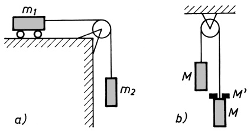

Bild 4.6 Versuche zum Grundgesetz der Dynamik. Rechts: atwoodsche Fallmaschine

Lösung: Die gesamte in Bewegung versetzte Masse ist bei beiden Anordnungen $m = m _ { 1 } + m _ { 2 }$ Die beschleunigende Kraft F ist bei a) die Gewichtskraft $m _ { 2 } g ,$ bei b) die Differenz der Gewichtskräfte beider Massen $( m _ { 2 } - m _ { 1 } ) g = M ^ { \prime } g$ . Aus dem Grundgesetz $(4.4)$ erhält man damit für Anordnung a) die Beschleunigung $a = F / m = m _ { 2 } g / ( m _ { 1 } + m _ { 2 } ) = 7 { , } 3 6 { \mathrm { m / s } } ^ { 2 }$ und für Anordnung b) die Beschleunigung $a = \boldsymbol { M } ^ { \prime } \boldsymbol { g } / ( 2 \boldsymbol { M } + \boldsymbol { M } ^ { \prime } )$ . Es tritt also in beiden Fällen eine konstante Beschleunigung auf, welche auch experimentell festgestellt wird, wenn man z. B. die von den Massen zurückgelegten Wegstrecken s als Funktion der Zeit t misst und daraus nach (3.7) die Beschleunigung $a = 2 s / t ^ { 2 }$ ermittelt.

Für die ATWOODsche Fallmaschine b) findet man also nach obiger Rechnung einerseits $a \sim$ $M ^ { \prime } g ,$ andererseits $a \sim 1 / ( 2 M   +   M ^ { \prime } )$ , wie man durch Veränderung der Massen M und $M ^ { \prime }$ auch experimentell zeigen kann. Das heißt, die Beschleunigung ist der wirkenden Kraft $F = M ^ { \prime } g$ proportional und der zu beschleunigenden Masse $m = 2 M + M ^ { \prime }$ umgekehrt proportional, wie es das Grundgesetz (4.4) fordert. □

## Aufgabe

## 4.2 Siehe Bild 4.7.

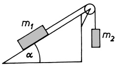

<details>
<summary>text_image</summary>

m₁
α
m₂
</details>

Bild 4.7 Die Masse $m _ { 1 }$ gleitet reibungsfrei auf der schiefen Ebene $(m_{1}=1,0\mathrm{kg};\alpha=30^{\circ})$

a) Wie groß muss $m _ { 2 }$ sein, um $m _ { 1 }$ das Gleichgewicht zu halten?

b) Wie groß ist die Beschleunigung der Bewegung für den Fall, dass $m _ { \mathrm { 1 } } = m _ { \mathrm { 2 } }$ ist?

## 4.5 Kraftstoß. Impuls (Bewegungsgröße)

Der Geschwindigkeitszuwachs, den ein Körper durch eine angreifende Kraft erfährt, hängt nicht nur von der Größe der Kraft selbst, sondern auch von der Zeitdauer $\Delta t$ ihrer Einwirkung, d. h. also vom Wert des Produktes $F \Delta t ,$ ab. Man nennt dieses Produkt den **Kraftstoß**. Ist während der Zeitdauer $\Delta t$ der Betrag der Kraft konstant, so stellt sich der Kraftstoß als Fläche unter dem Rechteck im Kraft-Zeit-Diagramm (Bild 4.8a) dar, welches den zeitlichen Verlauf der Kraftübertragung auf den Körper veranschaulicht. Eine solche Art der Kraftübertragung, bei der die Kraft momentan ihren Maximalwert annimmt und danach ebenso plötzlich wieder

---

56

4 Dynamik der Punktmasse

auf null abfällt, ist allerdings äußerst selten. Vielmehr hat man es meist mit einem Verlauf zu tun, wie ihn Bild 4.8b zeigt, nämlich einem allmählichen, mehr oder weniger steilen Anstieg und einem ebensolchen Abfall. Der Kraftstoß berechnet sich dann durch das Zeitintegral der Kraft F dt.

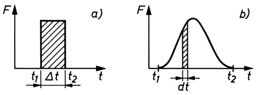

Bild 4.8 Kraftstoß bei zeitlich konstanter Kraft (a) und zeitlich veränderlicher Kraft (b)

Der so definierte Kraftstoß steht in engem Zusammenhang mit einer anderen physikalisch be deutsamen Größe, welche durch das Produkt aus der Masse m und dem Vektor der Geschwindigkeit v des Körpers gegeben ist und **Impuls** oder **Bewegungsgröße** genannt wird:

$$
\boldsymbol {p} = m \boldsymbol {v}, \quad E i n h e i t: \quad [ p ] = 1 \mathrm{kg} \cdot \mathrm{m/s} = 1 \mathrm{N} \cdot \mathrm{s}. \tag {4.8}
$$

Mit ihr lässt sich das Grundgesetz der Dynamik (4.4) wie folgt formulieren:

$$
\boldsymbol {F} = \frac {\mathrm{d} (\boldsymbol {m} \boldsymbol {v})}{\mathrm{d} t} = \frac {\mathrm{d} \boldsymbol {p}}{\mathrm{d} t}. \tag {4.9}
$$

## Die zeitliche Änderung des Impulsvektors ist der einwirkenden Kraft proportional und geschieht in der Richtung, in der jene Kraft angreift.

Dies ist die ursprüngliche NEWTONsche Fassung des Grundgesetzes. Sie geht in der Aussage wesentlich weiter als Gleichung (4.4) F = ma. Nach (4.9) ist $\boldsymbol{F} = m(\mathbf{d}\boldsymbol{v}/\mathbf{d}t) + (\mathbf{d}m/\mathbf{d}t)\boldsymbol{v} = m\boldsymbol{a} +$ ṁ v, woraus hervorgeht, dass nur für zeitlich unveränderliche Masse $( \dot { m } = 0 )$ die vorstehende Gleichung (4.4) gilt, während in (4.9) die Masse nicht konstant zu sein braucht, was z. B. bei Raketen (vgl. Abschnitt 9.3) und nach der Relativitätstheorie bei Geschwindigkeiten, die der Lichtgeschwindigkeit nahe kommen, der Fall ist.

**Grundgesetz bei veränderlicher Masse.** Findet zwischen einem Körper und seiner Umgebung ein Massenaustausch statt (z. B. Rakete während der Antriebsphase), so ist in (4.9) $\mathbf { d } \pmb { p } / \mathbf { d } t$ als zeitliche Impulsänderung des Gesamtsystems aller beteiligten Massen (z. B. Rakete und abgestoßene Treibstoffgase) aufzufassen. Von einem Körper mit dem momentanen Impuls mv wird die infinitesimale Masse dm mit der Geschwindigkeit $v ^ { \prime }$ abgestoßen, wobei $\boldsymbol { v } ^ { \prime }$ im gleichen Bezugssystem wie die Körpergeschwindigkeit $\boldsymbol { v } , \mathrm { ~ z .   B ~ }$ . gegenüber der Erde, definiert ist. Der Gesamtimpuls von Körper und abgestoßener Masse beträgt anschließend $( m + \mathbf { d } m ) ( \pmb { v } + \mathbf { d } \pmb { v } ) + \pmb { v } ^ { \prime } \mathbf { d } m ^ { \prime }$ (im Beispiel der Rakete ist $\mathbf { d } m < 0 )$ . Der erste Term stellt den Impuls des Körpers selbst nach dem Abstoßen von dm dar, wobei sich die Masse des Körpers um dm und seine Geschwindigkeit um dv geändert hat. Der zweite Term stellt den von der abgestoßenen Masse $\mathbf { d } m ^ { \prime }$ mitgeführten Impuls $\pmb { v } ^ { \prime } \mathrm { d } \pmb { m } ^ { \prime }$ dar, für den wegen $\mathbf { d } m ^ { \prime } = - \mathbf { d } m$ (Erhaltung der Gesamtmasse) $\pmb { v } ^ { \prime }   \mathrm { d } m ^ { \prime } = - \pmb { \dot { v } } ^ { \prime }$ dm gilt. Die gesamte Impulsänderung ist also $\mathbf { d } { \pmb p } = ( m + \mathbf { d } m ) ( { \pmb v } + \mathbf { d } { \pmb v } ) - { \pmb v } ^ { \prime } \mathbf { d } m - m { \pmb v } = m   \mathbf { d } { \pmb v } + ( { \pmb v } - { \pmb v } ^ { \prime } )   \mathbf { d } m + \mathbf { d } m   \mathbf { d } { \pmb v }$ . Das letzte Glied kann als infinitesimale Größe zweiter Ordnung weggelassen werden, so dass die zeitliche Impulsänderung $\mathbf { d } { \pmb { p } } / \mathbf { d } t = m \mathbf { d } { \pmb { v } } / \mathbf { d } t + ( \mathbf { d } m / \mathbf { d } t ) ( { \pmb { v } } - { \pmb { v } } ^ { \prime } )$ beträgt. Nach (4.9) gilt daher

$$
\boldsymbol {F} = m \frac {\mathrm{d} \boldsymbol {v}}{\mathrm{d} t} + \frac {\mathrm{d} m}{\mathrm{d} t} \left(\boldsymbol {v} - \boldsymbol {v} ^ {\prime}\right) = \frac {\mathrm{d} (m \boldsymbol {v})}{\mathrm{d} t} - \frac {\mathrm{d} m}{\mathrm{d} t} \boldsymbol {v} ^ {\prime}. \tag {4.10}
$$

---

4.5 Kraftstoß. Impuls (Bewegungsgröße)

57

Zum Beispiel gilt für eine mit der momentanen Geschwindigkeit $\pmb { v } = \nu \pmb { k }$ senkrecht nach oben steigende Rakete $\pmb { F } = - m g \pmb { k }$ und ${ \pmb v }   -   { \pmb v } ^ { \prime } = c   { \pmb k }$ , wobei c die Ausströmgeschwindigkeit der Verbrennungsgase relativ zur Rakete und k der senkrecht nach oben zeigende Einheitsvektor ist. Für die Masse ist zu setzen $m = m _ { 0 } - { \dot { m } } t$ , wobei $m _ { 0 }$ die Anfangsmasse und ṁ der sekundliche Massenausstoß ist. Analoges gilt für das Ausströmen einer Flüssigkeit aus einem fahrbaren Behälter. Hingegen gilt für das Ausfließen nach unten (Loch im Tankwagen) $\pmb { v } ^ { \prime } = \pmb { v }$ (s. Beispiel 4.3). Für das Zufließen von oben (Betanken in der Luft) gilt ebenfalls $\pmb { v } ^ { \prime } = \pmb { v } _ { i }$ , jedoch mit $m = m _ { 0 } + { \dot { m } } t$ . Wenn die aus- oder hinzutretenden Massenelemente die Geschwindigkeit null haben und daher keinen Impuls mit sich führen, ist $\pmb { v } ^ { \prime } = 0$ zu setzen. Letzteres gilt auch bei der relativistischen Massenveränderlichkeit (vgl. 6.3). Durch Integration der so entstehenden speziellen Bewegungsgleichung (4.10) erhält man das Geschwindigkeit-Zeit-Gesetz der Bewegung $\nu =$ $\nu ( t )$ und mit $\mathbf { d } s = \nu ( t )$ dt nach nochmaliger Integration das Weg-Zeit-Gesetz $s = s ( t )$ ; vgl. dazu die Herleitung der Raketengleichung in Abschnitt 9.3.

**Der Kraftstoß.** Hat ein Körper zu Beginn der Krafteinwirkung (Zeitpunkt $t _ { 1 } )$ die Geschwindigkeit $\pmb { v } _ { 1 }$ und am Ende der Krafteinwirkung (Zeitpunkt $t _ { 2 } )$ die Geschwindigkeit $\pmb { v } _ { 2 }$ , so folgt durch einfache Umformung des Grundgesetzes (4.9) für gleich bleibende Masse m:

$$
\int_ {t _ {1}} ^ {t _ {2}} \boldsymbol {F} \mathrm{d} t = \int_ {v _ {1}} ^ {v _ {2}} \mathrm{d} (m \boldsymbol {v}) = m \boldsymbol {v} _ {2} - m \boldsymbol {v} _ {1} = m \Delta \boldsymbol {v} = \Delta \boldsymbol {p} \tag {4.11}
$$

und bei konstanter Kraft

$$
\boldsymbol {F} \Delta t = m \boldsymbol {v} _ {2} - m \boldsymbol {v} _ {1} = \Delta \boldsymbol {p} \quad (\text {Kraftstoß}). \tag {4.12}
$$

## Der Kraftstoß ist gleich der durch ihn am Körper bewirkten Änderung des Impulses.

Bei fehlenden äußeren Kräften ist nach (4.9) $\mathbf { d } \pmb { p } / \mathbf { d } t = 0$ , d. h., der Impuls bleibt nach Größe und Richtung konstant (Impulserhaltungssatz, vgl. 9.1). Bei konstanter Masse ist diese Aussage gleichbedeutend mit dem Trägheitsgesetz (4.3).

## Beispiel 4.3:

Ein Tankfahrzeug mit der Anfangsmasse $m _ { 0 } = 1 0   \mathrm { t }$ , welches (nach Abzug aller Reibungs- und Fahrwiderstände) durch eine konstante Kraft $F _ { 0 } = 5 0 0   \mathrm { N }$ angetrieben wird und bei der Geschwindigkeit null startet, verliert stetig an Flüssigkeit (Loch im Boden des Tankwagens). Der zeitlich konstante und mit Beginn der Bewegung einsetzende Masseverlust beträgt $\mu = 1 5   \mathrm { k g / s }$ Welche Geschwindigkeit hat das Fahrzeug nach $t _ { 1 } = 5$ min Fahrt?

Lösung: Nach (4.10) und mit $\pmb { v } ^ { \prime } = \pmb { v }$ gilt das Bewegungsgesetz $F = m a = m ( \mathbf { d } \nu / \mathbf { d } t )$ , woraus mit $F = F _ { 0 } = \mathbf { c o n s t }$ und $m ( t ) = m _ { 0 } - \mu t   ( \mathbf { d } m = - \mu \mathbf { d } t )$ für die Geschwindigkeit $\nu _ { 1 }$ nach der Zeit $t _ { 1 }$ folgt:

$$
v _ {1} = \int_ {0} ^ {t _ {1}} a (t) \mathrm{d} t = \int_ {0} ^ {t _ {1}} \frac {F _ {0} \mathrm{d} t}{m (t)} = - \frac {F _ {0}}{\mu} \int_ {m _ {0}} ^ {m _ {1}} \frac {\mathrm{d} m}{m} = - \frac {F _ {0}}{\mu} \left[ \ln m \right] _ {m _ {0}} ^ {m _ {1}} = \frac {F _ {0}}{\mu} \ln \frac {m _ {0}}{m _ {0} - \mu t _ {1}}.
$$

Mit $t _ { 1 } = 3 0 0   \mathrm { s }$ wird $\nu_{1}=19.9    m/s =71.7$ km/h.

## Aufgabe

**4.3** Ein Pkw der Masse $m = 1 \mathbf { t }$ fährt mit der Geschwindigkeit $v_{1}=86   km/h$ . Infolge Geschwindigkeitsbegrenzung wird der Wagen 8s lang gebremst und hat anschließend die Geschwindigkeit $v_{2}=50   km/h$ . Wie groß ist die Bremskraft, wenn angenommen wird, dass diese während des gesamten Bremsvorganges konstant ist?

---

58

4 Dynamik der Punktmasse

## 4.6 Lösung der Bewegungsgleichung für konstante Kraft. Die Wurfbewegung

Das NEWTONsche Grundgesetz der Dynamik (4.9) beschreibt den Zusammenhang zwischen der an einem Körper angreifenden Kraft und dem Zeitablauf der durch sie hervorgerufenen Bewegung des Körpers in Form einer Differenzialgleichung, der sog. **Bewegungsgleichung**. Mit ihrer Hilfe lässt sich die Bahn einer Punktmasse für ein bestimmtes Zeitintervall exakt berechnen, wenn die **Anfangsbedingungen**, gegeben durch Ort und Impuls (bzw. Geschwindigkeit), für einen beliebigen Zeitpunkt $t _ { 0 }$ aus diesem Intervall sowie die wirkenden Kräfte für das gesamte Zeitintervall genau bekannt sind. Das bedeutet, dass bei Kenntnis der Kräfte und $\mathbf { A n } \cdot$ fangsbedingungen jeder frühere oder spätere Zustand eines Körpers angegeben werden kann (Ursache-Wirkung- oder Kausalzusammenhang der klassischen Mechanik).

Unter Voraussetzung konstanter Masse lautet die Bewegungsgleichung (4.9)

$$
m \frac {\mathrm{d} \boldsymbol {v}}{\mathrm{d} t} = \boldsymbol {F} \quad \text {oder mit (3.45)} \quad m \frac {\mathrm{d} ^ {2} \boldsymbol {r}}{\mathrm{d} t ^ {2}} = m \ddot {\boldsymbol {r}} = \boldsymbol {F}. \tag {4.13}
$$

Sie kann durch zweimalige Integration über die Zeit gelöst werden. Es folgt zunächst für die Geschwindigkeit bei konstanter Kraft

$$
\mathrm{d} \boldsymbol {v} = \frac {\boldsymbol {F}}{m} \mathrm{d} t, \quad \boldsymbol {v} (t) = \frac {\boldsymbol {F}}{m} \int \mathrm{d} t = \frac {\boldsymbol {F}}{m} t + \boldsymbol {v} _ {0}. \tag {4.14}
$$

Dabei ist $\nu _ { 0 }$ eine Integrationskonstante. Ihre physikalische Bedeutung erkennt man, wenn in (4.14) $t = t _ { 0 } = 0$ gesetzt wird; es entsteht $\pmb { v } ( 0 ) = \pmb { v } _ { 0 }$ , d. h., $\nu _ { 0 }$ ist die Geschwindigkeit zum Zeitpunkt $t = 0$ , die für die Bewegung willkürlich vorgegeben werden kann. Wird nun in (4.14) $\pmb { v } ( t ) = \mathbf { d } \pmb { r } / \mathbf { d } t$ gesetzt und nochmals über t integriert, so folgt schließlich für den Ortsvektor der Bahnkurve

$$
\boldsymbol {r} (t) = \frac {1}{2 m} \boldsymbol {F} t ^ {2} + \boldsymbol {v} _ {0} t + \boldsymbol {r} _ {0}. \tag {4.15}
$$

Dabei sind alle Integrationskonstanten in $r _ { 0 }$ zusammengefasst. Aus (4.15) folgt $\boldsymbol{r}(0)=\boldsymbol{r}_{0}$ , entsprechend dem Ortsvektor des Teilchens zur Zeit $t = 0.\ \boldsymbol{v}_{0} = 0$ und $r _ { 0 } = 0$ bedeutet, dass die Bewegung zum Zeitpunkt $t = 0$ im Nullpunkt des gewählten Koordinatensystems mit der Anfangsgeschwindigkeit null beginnt.

Ist nun z. B. F die **Schwerkraft** und wird das Koordinatensystem so orientiert, dass die z-Achse mit dem Einheitsvektor k senkrecht nach oben zeigt, dann gilt

$$
\boldsymbol {F} = m \boldsymbol {g} = - m g \boldsymbol {k} \tag {4.16}
$$

mit $\pmb { g } = - \pmb { g } .$ k als Vektor der Fallbeschleunigung. Aus (4.15) folgt damit

$$
\boldsymbol {r} (t) = \frac {1}{2} \boldsymbol {g} t ^ {2} + \boldsymbol {v} _ {0} t + \boldsymbol {r} _ {0}. \tag {4.17}
$$

Greift also an der Punktmasse eine nach Größe und Richtung konstante Kraft an, so beschreibt der zur Punktmasse zeigende Ortsvektor $r ( t )$ eine Bahnkurve, die sich im allgemeinen Falle aus der Überlagerung einer gleichmäßig beschleunigten Bewegung in Richtung der Kraft und einer geradlinigen gleichförmigen Bewegung mit der Anfangsgeschwindigkeit $\nu _ { 0 }$ ergibt. Eine

---

4.6 Lösung der Bewegungsgleichung für konstante Kraft. Die Wurfbewegung

59

solche finden wir z. B. beim **schiefen Wurf** vor (s. Bild 4.9a; dort ist $\boldsymbol { r } _ { 0 } = 0 )$ . Durch Wahl der Anfangswerte für Ort und Impuls (bzw. Geschwindigkeit) ist nun, wie im Folgenden gezeigt, eine Spezialisierung der Bewegung möglich.

**Der senkrechte Wurf.** Setzt man z. B. in Gleichung (4.17) als Anfangswerte

$$
\boldsymbol {r} _ {0} = z _ {0} \boldsymbol {k}, \quad \boldsymbol {v} _ {0} = v _ {0} \boldsymbol {k},
$$

was bedeutet, dass die Bewegung nur in der z-Richtung, d. h. senkrecht zur Erdoberfläche, erfolgt und in der Höhe $z _ { 0 }$ mit der Anfangsgeschwindigkeit $\nu _ { 0 }$ beginnt, so folgt in Komponentendarstellung des Ortsvektors (4.17) bezüglich der $x - , y -$ und z-Achse:

$$
x (t) = y (t) = 0, \quad z (t) = - \frac {1}{2} g t ^ {2} + v _ {0} t + z _ {0}. \tag {4.18}
$$

Diese Gleichungen beschreiben für $\nu _ { 0 } > 0$ den senkrechten Wurf nach oben, für $\nu _ { 0 } < 0$ den senkrechten Wurf nach unten und für $\nu _ { 0 } = 0$ den freien Fall aus der Höhe $z _ { 0 }$ mit der Fallhöhe $h = z ( t ) - z _ { 0 } ;$ vgl. (3.9).

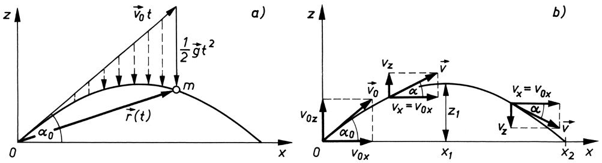

Bild 4.9 Schiefer Wurf als Überlagerung einer gleichförmigen geradlinigen Bewegung und einer (gleichmäßig beschleunigten) Fallbewegung: a) Darstellung des Ortsvektors der Bahnkurve $r ( t ) ;$ b) Komponenten des Geschwindigkeitsvektors für $t = 0$ und für zwei beliebig spätere Zeitpunkte

**Der schiefe Wurf.** Die Anfangswerte in Gleichung (4.17)

$$
\boldsymbol {r} _ {0} = 0, \qquad \boldsymbol {v} _ {0} = v _ {0 x} \boldsymbol {i} + v _ {0 z} \boldsymbol {k}
$$

kennzeichnen eine Bewegung, die im Koordinatenursprung beginnt und deren Anfangsgeschwindigkeit $\pmb { v } _ { 0 }$ je eine Komponente senkrecht $( \nu _ { 0 z } )$ und tangential $( \nu _ { 0 x } )$ zur Erdoberfläche besitzt. Es handelt sich um den schiefen Wurf (Bild 4.9). Man entnimmt Bild 4.9b

$$
v _ {0 x} = v _ {0} \cos \alpha_ {0}, \qquad v _ {0 z} = v _ {0} \sin \alpha_ {0},
$$

womit unter Beachtung obiger Anfangswerte aus (4.17) für die Komponenten des Ortsvektors $r ( t )$ der in der x,z-Ebene ablaufenden Bewegung folgt

$$
x (t) = \nu_ {0} t \cos \alpha_ {0}, \quad z (t) = - \frac {g}{2} t ^ {2} + \nu_ {0} t \sin \alpha_ {0} \quad \begin{array}{l} (\text {Weg - Zeit - Gesetze} \\ \text {des schiefen Wurfs}) \end{array} \tag {4.19}
$$

und hieraus durch Zeitableitung als Horizontal- und Vertikalkomponente des Geschwindigkeitsvektors

$$
v _ {x} = v _ {0} \cos \alpha_ {0} = v _ {0 x}, \quad v _ {z} = - g t + v _ {0} \sin \alpha_ {0} = - g t + v _ {0 z}. \tag {4.20}
$$

---

60

4 Dynamik der Punktmasse

Die Richtung des Geschwindigkeitsvektors v zu einem beliebigen Zeitpunkt t, welche stets mit der Richtung der Tangente an di<u>e Bahn</u>kurve zusammenfällt (Bild 4.9b), erhält man aus tan $\alpha = \nu _ { z } / \nu _ { x } ,$ sein Betrag ist $\nu = \sqrt { \nu _ { x } ^ { 2 } + \nu _ { z } ^ { 2 } }$ . Die Gleichung der Bahnkurve ist eine Parabel. Man erhält sie durch Elimination der Zeit t aus den beiden Gleichungen (4.19), indem man die Gleichung $x = x ( t )$ nach t umstellt und diesen Ausdruck anschließend in $z = z ( t )$ einsetzt:

$$
z = - \frac {g}{2 v _ {0} ^ {2} \cos^ {2} \alpha_ {0}} x ^ {2} + x \tan \alpha_ {0} \quad \text {(Gleichung der Wurfparabel).} \tag {4.21}
$$

Aus ihr lassen sich die maximale Höhe der Flugbahn, die Wurfhöhe $z _ { 1 }$ , und die Wurfweite $x _ { 2 }$ berechnen. Das Parabelmaximum ergibt sich aus der Bedingung $\mathbf { d } z / \mathbf { d } x = 0$ an der Stelle

$$
x _ {1} = \frac {v _ {0} ^ {2}}{g} \sin \alpha_ {0} \cos \alpha_ {0} = \frac {v _ {0} ^ {2}}{2 g} \sin 2 \alpha_ {0}.
$$

Dies in (4.21) eingesetzt, ergibt den Scheitelwert

$$
z _ {1} = \frac {v _ {0} ^ {2}}{2 g} \sin^ {2} \alpha_ {0} \quad (\text {Wurfhöhe}). \tag {4.22}
$$

Als Schnittpunkt der Wurfparabel mit der x-Achse, d. h. für $z = 0$ in Gleichung (4.21), erhält man

$$
x _ {2} = 2 x _ {1} = \frac {v _ {0} ^ {2}}{g} \sin 2 \alpha_ {0} \quad (\text {Wurfweite}). \tag {4.23}
$$

Die größte Wurfweite wird (Abwurf- und Auftreffpunkt liegen hier in derselben Höhe $z = 0 )$ für sin $2 \alpha _ { 0 } = 1$ , d. h. $\alpha _ { 0 } = 4 5 ^ { \circ }$ , erreicht. Für jede Wurfweite kleiner als $\nu _ { 0 } ^ { 2 } / g$ gibt es wegen sin $2 \alpha _ { 0 } =$ sin $( 1 8 0 ^ { \circ }   -   2 \alpha _ { 0 } )$ zwei Winkel, mit denen diese Weite erreicht wird, nämlich $\alpha _ { 0 }$ und $9 0 ^ { \circ }   -   \alpha _ { 0 }$

## Bei Abwurfwinkeln, die sich zu $\mathbf { 9 0 ^ { \circ } }$ ergänzen, sind die Wurfweiten gleich.

Berücksichtigt man den Luftwiderstand, so ergeben sich Abweichungen von der Wurfparabel. Die dabei mit geringeren Reichweiten durchlaufenen Flugbahnen heißen ballistische Kurven.

**Der horizontale Wurf.** Die zugehörigen Gleichungen ergeben sich unmittelbar aus denen des schiefen Wurfs für $\alpha _ { 0 } = 0 ^ { \circ }$ . Man erhält als Koordinaten der Bahnkurve aus (4.19) $x = \nu _ { 0 } t , z =$ $- { g t } ^ { 2 } / 2$ und als Geschwindigkeitskomponenten in $x -$ und z-Richtung nach (4.20) $\nu _ { x } = \nu _ { 0 }$ und $\nu _ { z } = - g t$ . Wie man sieht, hängt $\nu _ { z }$ nicht von der Anfangsgeschwindigkeit $\nu _ { 0 }$ ab; der Körper durchfällt also beim horizontalen Wurf in der gleichen Zeit dieselbe Höhe, wie sie auch im freien Fall zurückgelegt wird (Bild 4.10). Die Wurfparabel wird durch die Gleichung $z = - [ g / ( 2 \nu _ { 0 } ^ { 2 } ) ] x ^ { 2 }$ beschrieben.

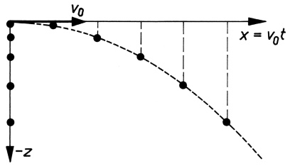

<details>
<summary>text_image</summary>

v₀
x = v₀t
-z
</details>

Bild 4.10 Horizontaler Wurf: Positionen eines geworfenen und eines frei fallenden Körpers in aufeinander folgenden gleichen Zeitintervallen

---

4.7 Das Wechselwirkungsgesetz (3. newtonsches Axiom)

61

## Beispiel 4.4:

Ein Körper fliegt mit konstanter Geschwindigkeit $v_{1}=720   km/h$ horizontal in einer Höhe von $H = 6000    m$ . Ein anderer Körper wird mit der Geschwindigkeit $\nu _ { 0 }$ unter dem Winkel $\alpha _ { 0 } = 6 0 ^ { \circ }$ in dem Augenblick abgefeuert, wo sich beide Körper genau übereinander befinden. Geschoss und Flugkörper sollen sich treffen $( g \approx 1 0   \mathrm { m / s } ^ { 2 }$ ; kein Luftwiderstand). Berechne $\nu _ { 0 }$ und die Zeit $t _ { 1 }$ , die das Geschoss auf seiner Bahn benötigt, um den Flugkörper zu erreichen!

Lösung: Für $t = t _ { 1 }$ müssen die Bahnkoordinaten beider Körper übereinstimmen. Nach (4.19) ist also $x _ { 1 }   =   v _ { 1 }   t _ { 1 }   =   v _ { 0 }   t _ { 1 }$ cos6 $0 ^ { \circ }   =   \nu _ { 0 }   t _ { 1 } / 2 ,$ d. h. $v_{0} = 2v_{1} = 400    m/s$ , und $z _ { 1 }   =   \nu _ { 0 }   t _ { 1 }$ sin $6 0 ^ { \circ }$ $-   g t _ { 1 } ^ { 2 } / 2   =   \nu _ { 1 } t _ { 1 } \sqrt { 3 } - g t _ { 1 } ^ { 2 } / 2   =   H .$ Die Lösung dieser quadratischen Gleichung für $t _ { 1 }$ ergibt $t _ { 1 } = \nu _ { 1 } \sqrt { 3 } / g \pm ( 1 / g ) \sqrt { 3 \nu _ { 1 } ^ { 2 } - 2 g H } = 3 4 { , } 6 s$ . Warum gibt es hier nur eine Lösung? □

## Aufgabe

**4.4** a) Unter welchem Winkel muss ein Geschoss mit $v_{0} = 100    m/s$ abgefeuert werden, wenn das Ziel 1km entfernt und 50m unter dem Höhenniveau des Abschusspunktes liegt? Stelle zunächst eine allgemeine Beziehung für $\alpha _ { 0 }$ bei vorgegebenen Zielkoordinaten $( x , z )$ auf! – Hinweis: Benutze die Umformung $1 / \cos ^ { 2 } \alpha _ { 0 } = 1 + \tan ^ { 2 } \alpha _ { 0 }$
b) Nach welcher Zeit, mit welcher Geschwindigkeit und unter welchem Winkel wird der Zielpunkt erreicht? Luftwiderstand wird vernachlässigt.

## 4.7 Das Wechselwirkungsgesetz (3. newtonsches Axiom)

Untersucht man die verschiedenen Kraftwirkungen näher, so erkennt man, dass immer mindestens zwei Körper an ihnen beteiligt sind. Man sagt: Die beiden Körper stehen miteinander in Wechselwirkung. Die Kraft stellt dabei jeweils nur eine einseitige Wirkung dar, sie kann gewissermaßen als die eine Hälfte der Wechselwirkung betrachtet werden. Auf dieser Erkenntnis beruht das 3. NEWTONsche Axiom, bekannt als **Wechselwirkungsgesetz** bzw. als **Gegenwirkungsprinzip**.

## 3. NEWTONsches Axiom:

**Die von zwei Körpern aufeinander ausgeübten Kräfte (Wirkung und Gegenwirkung) sind gleich groß und einander entgegengerichtet.**

Ist $F _ { 1 2 }$ die vom ersten Körper auf den zweiten ausgeübte Kraft und $F _ { 2 1 }$ die Rückwirkung des zweiten Körpers auf den ersten, so gilt demnach

$$
\boldsymbol {F} _ {1 2} = - \boldsymbol {F} _ {2 1} \quad \text {oder} \quad \boldsymbol {F} _ {1 2} + \boldsymbol {F} _ {2 1} = 0. \tag {4.24}
$$

Kraft und Gegenkraft halten sich stets das Gleichgewicht. So übt ein auf einer Tischplatte ru hender Körper auf diese durch sein Gewicht eine senkrecht nach unten gerichtete Kraft aus, die jedoch den Körper nicht in Bewegung zu setzen vermag, da die Unterlage mit einer gleich großen, aber entgegengesetzt gerichteten Kraft auf ihn zurückwirkt, so dass die angreifende Gesamtkraft gemäß (4.24) gleich null ist. Derartige, von einer festen Unterlage ausgehenden Gegenkräfte nennt man **Reaktions- oder Zwangskräfte**. Da sie bei jeder unnachgiebigen Führung (z. B. Eisenbahnschiene, Gleit- oder Fahrbahnen, Radlager) auftreten, werden sie auch

---

62

4 Dynamik der Punktmasse

als **Führungskräfte** bezeichnet. Die Führungskraft verschwindet sofort, wenn die von dem betreffenden Körper selbst gegen die Führung ausgeübte Belastungskraft oder **eingeprägte Kraft** wegfällt.

Das Gegenwirkungsprinzip gilt nicht nur für den Fall zweier unmittelbar aneinander grenzender Körper bzw. Teile von Körpern, sondern auch für die durch Felder hervorgerufenen Krafteinwirkungen zwischen entfernten Körpern, wie die elektrische und magnetische Anziehung und Abstoßung oder die Gravitationskräfte zwischen den Himmelskörpern, wobei allerdings bei weit voneinander entfernten Körpern wegen der endlichen Ausbreitungsgeschwindigkeit der Kraftwirkungen die Gegenwirkung erst später einsetzt als die Wirkung (vgl. 6.1 und 22.1).

## Beispiele 4.5:

1. Wie groß ist in der in Bild 4.6b gezeigten Rollenanordnung die Spannkraft des Seils, wenn die beiderseits der Rolle hängenden Körper gleiche Masse haben?
Lösung: Die Spannkraft ist durch die Gewichtskraft nur eines Körpers gegeben; denn der jeweils andere Körper liefert durch sein Gewicht lediglich die Gegenkraft, die zur Aufrechterhaltung des Gleichgewichts erforderlich ist.
2. Was geschieht, wenn an dem einen Seilende in Bild 4.6b ein Mann von gleicher Masse wie die des Körpers am anderen Seilende hängt, der sich mit der Geschwindigkeit v am Seil hochzieht? (System anfänglich in Ruhe).

Lösung: Beide, Mann und Körper, bewegen sich gleichzeitig mit $\nu / 2$ nach oben.


## 4.8 Reibungskräfte

**Haftreibung (Reibung der Ruhe).** Wenn zwei Körper gegeneinander bewegt werden, tritt erfahrungsgemäß immer ein Widerstand auf. Versuchen wir z. B. einen auf einer Tischplatte liegenden quaderförmigen Holzklotz durch eine horizontal angreifende Kraft F zu verschieben (Bild 4.11), so stellen wir fest, dass dies erst beim Erreichen einer bestimmten Größe der Kraft gelingt, während bei Aufwendung kleinerer Kräfte die Ruhelage nicht gestört wird. Das liegt daran, dass bei kleineren Kräften die Bewegung durch die zwischen den beiden festen Körpern (Tischplatte und Holzklotz) auftretende Reibung verhindert wird, indem die Kraft F durch eine ihr entgegengesetzt gerichtete, gleich große Reibungskraft ${ \pmb F } _ { \mathrm { R } } = - { \pmb F }$ kompensiert wird. Erst wenn F den zwischen den Körpern maximal übertragbaren Reibungswiderstand übersteigt, beginnt der Körper zu rutschen. Diesen kritischen Wert der Reibungskraft nennt man **Haftreibungskraft** $F _ { \mathrm { R H } }$ . Durch das Verhältnis von $F _ { \mathrm { R H } }$ zu der senkrecht zur Kontaktfläche der Körper wirkenden Normalkraft $F _ { \mathrm { N } }$ (Bild 4.11) wird die Haftreibungszahl $\mu _ { 0 }$ definiert:

$$
\mu_ {0} = \frac {F _ {\mathrm{RH}}}{F _ {\mathrm{N}}} \quad (\text {Haftreibungszahl}). \tag {4.25}
$$

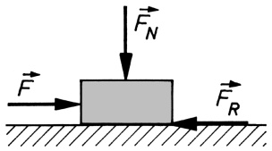

<details>
<summary>text_image</summary>

F̅N
F̅
F̅R
</details>

Bild 4.11 Zur Erklärung der Reibung zwischen festen Körpern $( F _ { \mathrm { R } }$ Reibungskraft, $F _ { \mathrm { N } }$ Normalkraft)

---

4.8 Reibungskräfte

63

Bei Kenntnis von $\mu _ { 0 }$ folgt für den Betrag der Haftreibungskraft

$$
F _ {\mathrm{RH}} = \mu_ {0} F _ {\mathrm{N}} \quad (\text {COULOMbsches Haftreibungsgesetz}). \tag {4.26}
$$

Im Falle von Bild 4.11 ist die Normalkraft $F _ { \mathrm { N } }$ gleich der Gewichtskraft G des Körpers. Liegt hingegen der Holzquader wie in Bild 4.12 auf einer schiefen Ebene mit dem Neigungswinkel $\alpha ,$ so beträgt die Normalkraft $F _ { \mathrm { N } } = G \cos \alpha .$ . Außer ihr greift dann aber am Körper noch die Hangabtriebskraft G sinα an. Benutzt man eine Vorrichtung mit verstellbarem Neigungswinkel α und vergrößert diesen allmählich bis zum kritischen Wert $\alpha = \varrho _ { 0 }$ , bei dem der Quader zu rutschen beginnt, so ist jetzt die Hangabtriebskraft gerade gleich der Haftreibungskraft $F _ { \mathrm { R H } }$ und es gilt nach Gleichung (4.26) G sin $\varrho _ { 0 } = \mu _ { 0 } G \cos \varrho _ { 0 }$ , woraus für die Haftreibungszahl folgt

$$
\mu_ {0} = \tan \varrho_ {0}. \tag {4.27}
$$

ϱ<sub>0</sub> nennt man den Reibungswinkel. Hieraus geht hervor, wie auch experimentell für die meisten trockenen Oberflächen nachgewiesen wurde:

**Die Haftreibungszahl** $\mu _ { 0 }$ **ist unabhängig von der Normalkraft** $F _ { \mathbf { N } }$ **und von der Größe der Berührungsfläche zwischen den Körpern.**

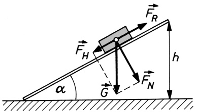

<details>
<summary>text_image</summary>

F_R
F_H
G
F_N
h
α
</details>

Bild 4.12 Reibung auf der schiefen Ebene

Wenn man also in dem Abgleitexperiment auf der schiefen Ebene den Holzklotz statt auf die breite Seite hochkant auf die schmale Seite stellt, erhält man für $\mu _ { 0 }$ das gleiche Ergebnis. $\mu _ { 0 }$ hängt von den sich berührenden Materialien und von zahlreichen anderen Einflussfaktoren wie Temperatur, Oberflächenbeschaffenheit, Schmierung usw. ab. Eine Werteübersicht gibt die Tabelle 4.1.

Tabelle 4.1 Haftreibungszahlen $\mu _ { 0 }$ und Gleitreibungszahlen $\mu$ für einige Stoffpaarungen

<table><tr><td rowspan="2">Stoffpaarung</td><td colspan="2"> $\mu_0$ </td><td colspan="2"> $\mu$ </td></tr><tr><td>trocken</td><td>geschmiert</td><td>trocken</td><td>geschmiert</td></tr><tr><td>Stahl auf Eis</td><td>0,027</td><td>-</td><td>0,014</td><td>-</td></tr><tr><td>Stahl auf Stahl</td><td>0,15</td><td>0,11</td><td>0,12</td><td>0,05</td></tr><tr><td>Holz auf Holz</td><td>0,4 ... 0,6</td><td>0,16</td><td>0,2 ... 0,4</td><td>0,08</td></tr><tr><td>Holz auf Metall</td><td>0,6 ... 0,7</td><td>0,11</td><td>0,4 ... 0,5</td><td>0,10</td></tr><tr><td>Leder auf Metall</td><td>0,3 ... 0,5</td><td>0,16</td><td>0,3</td><td>0,15</td></tr><tr><td>Gummi auf Asphalt</td><td>0,7 ... 0,8</td><td>-</td><td>0,5 ... 0,6</td><td>-</td></tr></table>

**Gleitreibung (Reibung der Bewegung).** Wenn nach Überschreiten der Haftreibungskraft der Körper einmal gleitet, bedarf es zur Aufrechterhaltung seiner Bewegung im Allgemeinen einer

---

64

4 Dynamik der Punktmasse

kleineren Kraft, um die dann noch vorhandene **Gleitreibungskraft** $F _ { \mathrm { R G } }$ zu überwinden. Mit ihr kann analog zu (4.25) eine Gleitreibungszahl $\mu$ definiert werden:

$$
\mu = \frac {F _ {\mathrm{RG}}}{F _ {\mathrm{N}}}, \quad \text {womit folgt} \quad F _ {\mathrm{RG}} = \mu F _ {\mathrm{N}} \quad \begin{array}{l} (\text {COULOMbsches} \\ \text {Gleitreibungsgesetz}). \end{array} \tag {4.28}
$$

Für die meisten Materialien ist $\mu$ etwas kleiner als $\mu _ { 0 }$ und abhängig von der Werkstoffpaarung, den Schmierverhältnissen (trockene, gemischte oder Flüssigkeitsreibung), der Flächenpressung zwischen den Gleitflächen und der Gleitgeschwindigkeit. Die in der Tabelle 4.1 angegebenen Werte sind nur Richtwerte, die den Einfluss der einzelnen Faktoren nicht erkennen lassen.

Für das Auftreten von Gleit- bzw. Haftreibung sind folgende, für technische Anwendungen wichtige (unterschiedliche) Kriterien maßgebend: Bei Gleitreibung mit konstanter Geschwindigkeit muss die die Bewegung hervorrufende Kraft (Zugkraft) die Größe der Gleitreibungskraft $F _ { \mathrm { R G } }$ annehmen, bei Haftreibung die Haftreibungskraft $F _ { \mathrm { R H } }$ die Größe der Zugkraft, die den Grenzwert (4.26) nicht überschreiten darf.

Die Reibung ist im Allgemeinen eine höchst unerwünschte Erscheinung, weil sie mechanische Arbeit nutzlos in Wärme sowie in Verschleiß der reibenden Flächen umsetzt. Die Reibung ist aber nicht nur bewegungshemmend, sondern auch bewegungsfördernd. So wäre ohne die Haftreibung keine Fortbewegung, kein Gehen und Fahren, möglich. Sie ist der nach rückwärts gerichteten Druckkraft der Fußsohle bzw. des Rades entgegen, also nach vorwärts gerichtet und daher imstande, die zur Fortbewegung nötige Antriebskraft zu liefern.

## Beispiele 4.6:

1. Ein Körper mit der Gewichtskraft G liegt auf einer schiefen Ebene vom Neigungswinkel α (Bild 4.12). a) Welche Kraft F ist notwendig, um den Körper die schiefe Ebene hinauf gerade in Bewegung zu setzen? b) Wie groß ist für $\alpha > \varrho _ { 0 }$ die notwendige Haltekraft $F ^ { \prime }$ , um den Körper am Abgleiten zu hindern?

Lösung: a) Beim Hinaufziehen ist die Reibungskraft abwärts gerichtet, ebenso die Hangab triebskraft G sinα. Mit der Normalkraft G cosα muss daher unter Beachtung des Reibungs gesetzes (4.26) und Gleichung (4.27) gelten:

$$
\begin{array}{l} F = G \sin \alpha + \mu_ {0} G \cos \alpha = G (\sin \alpha + \tan \varrho_ {0} \cos \alpha) \\ = G \frac {\sin \alpha \cos \varrho_ {0} + \sin \varrho_ {0} \cos \alpha}{\cos \varrho_ {0}} = G \frac {\sin (\alpha + \varrho_ {0})}{\cos \varrho_ {0}}. \\ \end{array}
$$

b) Soll der Körper am Abgleiten gehindert werden, so ändert die Reibungskraft ihre Richtung, d. h., in obiger Beziehung ist $\varrho _ { 0 }$ durch $- \varrho _ { 0 }$ zu ersetzen:

$$
F ^ {\prime} = G \frac {\sin (\alpha - \varrho_ {0})}{\cos \varrho_ {0}} \qquad (H a l t e k r a f t).
$$

Für $\alpha = \varrho _ { 0 }$ wird $F ^ { \prime } = 0 , \mathbf { d } . \mathbf { h } .$ , der Körper bleibt – ohne Zuhilfenahme einer Kraft – in Ruhe, was den obigen Ausführungen zur Bestimmung von $\mu _ { 0 }$ entspricht.

2. Welche Anhängelast G kann die 785kN schwere Lokomotive eines Eisenbahnzuges mit konstanter Geschwindigkeit a) auf waagrechter Strecke, b) bei 2,1% Steigung ziehen, ohne zu rutschen? c) Welche Beschleunigung wird mit der unter b) berechneten Last G auf waagrechter

---

4.8 Reibungskräfte

65

Strecke erreicht? Die Haftreibungszahl ist $\mu _ { 0 } = 0 { , } 1 5$ und die Fahrwiderstandszahl, welche bei rollenden Rädern die Gleitreibung in den Achslagern sowie die Rollreibung am Boden erfasst, $\mu _ { \mathrm { F } } = 0 { , } 0 0 2$

Lösung: a) Die Zugkraft der Lokomotive, welche gleich ihrer Haftreibungskraft $\mu _ { 0 } G _ { \mathrm { L } }$ ist, muss gerade so groß sein wie der Fahrwiderstand des gesamten Zuges:

$$
\mu_ {0} G _ {\mathrm{L}} = \mu_ {\mathrm{F}} (G _ {\mathrm{L}} + G).
$$

Für die größtmögliche Anhängelast folgt somit $G = G _ { \mathrm { L } } [ ( \mu _ { 0 } / \mu _ { \mathrm { F } } ) - 1 ] = 5 8 { , } 1 \mathrm { M N } .$ b) Die Zugkraft der Lokomotive auf der schiefen Ebene beträgt mit der Normalkraft $G _ { \mathrm { L } }$ cosα (vgl. Bild 7.3b) $\mu _ { 0 } G _ { \mathrm { L } }$ cosα; sie verringert sich um die Hangabtriebskraft des gesamten Zuges $( G _ { \mathrm { L } } + G )$ sinα, sodass jetzt im Unterschied zu a) gilt:

$$
\mu_ {0} G _ {\mathrm{L}} \cos \alpha - (G _ {\mathrm{L}} + G) \sin \alpha = \mu_ {\mathrm{F}} (G _ {\mathrm{L}} + G) \cos \alpha.
$$

Hieraus ergibt sich mit tan $\alpha = 0 { , } 0 2 1$

$$
G = G _ {\mathrm{L}} \left(\frac {\mu_ {0}}{\mu_ {\mathrm{F}} + \tan \alpha} - 1\right) = 4, 3 3 \mathrm{MN}.
$$

c) Die beschleunigende Kraft ist gleich der Differenz zwischen Zugkraft (Haftreibungskraft der Lokomotive) und Fahrwiderstand des $\mathbf { Z u }$ ges; es gilt also auf waagrechter Strecke

$$
\mu_ {0} G _ {\mathrm{L}} - \mu_ {\mathrm{F}} (G _ {\mathrm{L}} + G) = m a = \frac {(G _ {\mathrm{L}} + G) a}{g},
$$

woraus mit $G = 4 , 3 3   \mathrm { M N }$ als Beschleunigung $a = 0 , 2   \mathrm { m } / \mathrm { s } ^ { 2 }$ folgt.


## Aufgaben

**4.5** In Bild 4.7 seien die Massen $m _ { 1 } = 3 { , } 0$ kg und $m_{2}=2,0\mathrm{kg};\alpha=30^{\circ}$ . Es wird eine Abwärtsbewegung von $m _ { 2 }$ beobachtet (Rollen- und Seilmassen werden vernachlässigt). Mit welcher Beschleunigung bewegen sich die beiden Massen für den Fall, dass $m _ { 1 }$ auf der schiefen Ebene eine Gleitreibung mit $\mu = 0 { , } 1$ erfährt?
**4.6** Ein Kraftfahrzeug $( m = 1 , 2 5 \mathrm { t } )$ soll auf horizontaler Strecke mit der Verzögerung $a =$ $5 \mathrm { m } / \mathrm { s } ^ { 2 }$ durch Haftreibung gebremst werden. a) Wie groß ist die erforderliche Haftreibungskraft? b) Die Haftreibungszahl für Gummireifen auf trockener Fahrbahn beträgt $\mu _ { 0 } = 0 { , } 7$ . Ist damit der Bremsvorgang ausführbar?
**4.7** Bei einem rollenden Rad treten als bewegungshemmende Kräfte sowohl Gleitreibung an den Achslagern als auch Rollreibung am Boden auf, die man zusammen durch die Fahrwiderstandszahl $\mu _ { \mathrm { F } }$ beschreibt. Bei welcher Steigung einer Bahnstrecke beginnen die Räder einer Lokomotive $( m _ { \mathrm { L } } = 6 0   \mathrm { t } )$ , die einen Zug der Gesamtmasse $m _ { \mathrm { Z } } = 8 0 0   \mathrm { t }$ zieht, zu rutschen? Haftreibungszahl der Triebräder $\mu _ { 0 } = 0 , 1 5 ;$ Fahrwiderstandszahl des Zuges $\mu _ { \mathrm { F } } = 0 , 0 0 2$

---

Bewegte Bezugssysteme

Bisher wurde davon ausgegangen, dass die Bezugssysteme, in denen die Bewegungen beschrieben werden, ruhen. Dabei waren auch Bezugssysteme zugelassen, die mit der Erdoberfläche fest verbunden sind (wie z. B. der Hörsaal bei der Untersuchung des freien Falls), wobei jedoch in diesen Fällen von der Bewegung der Erde (Drehung um die eigene Achse und Bewegung um die Sonne) stets abgesehen wurde.

Wenn ein Körper in einem Bezugssystem ruht, tut er dies keinesfalls in einem relativ zu diesem Bezugssystem sich bewegenden zweiten Bezugssystem. Folglich ist seine Geschwindigkeit und möglicherweise auch seine Beschleunigung im zweiten Bezugssystem von null verschieden. Es soll nun untersucht werden, welchen Einfluss eine Bewegung des Bezugssystems auf die Form der Bewegungsgleichung hat, die nach (4.13) für das ruhende System mr¨ = F lautet.

## 5.1 Geradlinig beschleunigte Bezugssysteme. Trägheitskräfte

Wir betrachten zwei geradlinig gegeneinander bewegte Bezugssysteme, von denen das eine (System Σ) mit den Koordinatenachsen $x , y , z$ als ruhend angenommen wird und das andere (System $\Sigma ^ { \prime } )$ mit den Achsen $x ^ { \prime } , y ^ { \prime } , z ^ { \prime }$ sich gegenüber Σ beschleunigt bewegt, wobei die x- und $x ^ { \prime } .$ -Achse zusammenfallen und $y , z$ parallel zu $y ^ { \prime } , z ^ { \prime }$ liegen sollen (Bild 5.1).

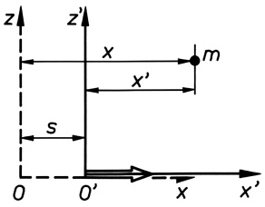

<details>
<summary>text_image</summary>

z
z'
x
m
x'
s
0
0'
x
x'
</details>

Bild 5.1 In x-Richtung gegeneinander bewegte Bezugssysteme (y- und $y ^ { \prime } \cdot$ Achse sind senkrecht nach hinten orientiert.)

Liegen zum Zeitpunkt $t = 0$ die Koordinatenursprungspunkte beider Systeme O und $O ^ { \prime }$ zusammen und hat nach Ablauf der Zeit t der Punkt $O ^ { \prime }$ den Weg s zurückgelegt, so gilt für den Zusammenhang der Ortskoordinaten einer Punktmasse m in beiden Systemen:

$$
x = x ^ {\prime} + s, \quad y = y ^ {\prime}, \quad z = z ^ {\prime}. \tag {5.1}
$$

Durch zweimalige Differenziation nach der Zeit folgt hieraus

$$
\ddot {x} = \ddot {x} ^ {\prime} + \ddot {s}, \quad \ddot {y} = \ddot {y} ^ {\prime}, \quad \ddot {z} = \ddot {z} ^ {\prime}.
$$

Diese Gleichungen beschreiben den Zusammenhang zwischen den Komponenten des Beschleunigungsvektors in beiden Bezugssystemen; sie lassen sich verallgemeinernd zur Vektorgleichung

$$
\ddot {\boldsymbol {r}} = \ddot {\boldsymbol {r}} ^ {\prime} + \ddot {\boldsymbol {s}} \tag {5.2}
$$

---

5.1 Geradlinig beschleunigte Bezugssysteme. Trägheitskräfte

67

zusammenfassen, wobei speziell in unserem Beispiel s nur eine Komponente in x-Richtung besitzt. Gleichung (5.2) sagt aus, dass sich in Bewegungsrichtung die Beschleunigungen in den Systemen Σ und $\Sigma ^ { \prime }$ um den Betrag der Beschleunigung s¨ des Systems $\Sigma ^ { \prime }$ voneinander unterscheiden. Wird Gleichung (5.2) mit der Masse m durchmultipliziert, so erkennt man, dass auch die Kräfte in beiden Bezugssystemen verschieden sind: Greift im ruhenden System Σ an der Punktmasse m die Kraft $F = m { \ddot { \pmb r } }$ an (z. B. die Schwerkraft mit $\pmb { \dot { r } } = \pmb { g } )$ , so wirkt auf sie im beschleunigten System $\Sigma ^ { \prime }$ wegen (5.2) die Kraft

$$
\boldsymbol {F} ^ {\prime} = \boldsymbol {F} - m \ddot {\boldsymbol {s}} = \boldsymbol {F} + \boldsymbol {F} _ {\mathrm{T}} \tag {5.3}
$$

mit $F ^ { \prime } = m { \ddot { \boldsymbol { r } } } ^ { \prime }$ . Auf die Punktmasse wirkt also in $\Sigma ^ { \prime }$ zusätzlich zu den eingeprägten Kräften F, die von der Bewegung des Bezugssystems unabhängig sind, eine der Beschleunigung des Bezugssystems $\dot { \pmb { s } } = \pmb { a }$ entgegengerichtete Kraft

$$
\boldsymbol {F} _ {\mathrm{T}} = - m \ddot {\boldsymbol {s}} = - m \boldsymbol {a} \quad (\text {Trägheitskraft}). \tag {5.4}
$$

Die Gleichungen (5.3) und (5.4) sagen aus:

## Die Kraft auf einen Körper in einem beschleunigten Bezugssystem ist gleich der Summe aus eingeprägten Kräften und Trägheitskräften.

Das Zustandekommen der Trägheitskraft erkennt man am ehesten, wenn man einen Körper betrachtet, an dem keine eingeprägten Kräfte angreifen $( F = 0 )$ und der aus diesem Grunde im ruhenden Bezugssystem Σ, dem Trägheitsgesetz gehorchend, in Ruhe ist. Derselbe Körper bewegt sich aus der Sicht eines Beobachters $i n   \Sigma ^ { \prime }$ mit einer Beschleunigung, die entgegengesetzt gleich derjenigen ist, mit der sich $\Sigma ^ { \prime }$ gegen einen außerhalb (d. h. in Σ) befindlichen Beobachter bewegt, nämlich mit der Beschleunigung −a. Wenn der in $\Sigma ^ { \prime }$ befindliche Beobachter die Gesetze der NEWTONschen Mechanik anwendet, zieht er den Schluss, dass an dem Körper eine Kraft −ma angreift. Auch er selbst verspürt diese Kraft (z. B. im Aufzug beim Anfahren und Abbremsen). Für einen außerhalb des beschleunigten Systems stehenden Beobachter hingegen existiert diese Kraft nicht; denn aus seiner Sicht ist der betrachtete Körper in Ruhe.

## Trägheitskräfte wirken auf Körper, die sich in einem beschleunigten Bezugssystem befinden. Sie sind der Beschleunigung des Bezugssystems entgegengerichtet und können nur von einem mitbeschleunigten Beobachter wahrgenommen werden.

Trägheitskräfte müssen z. B. von den Insassen eines Raumschiffes bei Start und Landung ertragen werden. Sie greifen auch an einer Massekugel m an, die nach Bild 5.2 in der Kabine des Raumschiffes an einem Federkraftmesser senkrecht aufgehängt ist. Die Auslenkung der Feder ist ein Maß für die im System „Raumschiff“ auf m wirkende Kraft $F ^ { \prime }$ (System $\Sigma ^ { \prime } )$

Das Bild 5.2a zeigt die Situation im Ruhezustand; an der Masse greift jetzt lediglich die Gewichtskraft $\pmb { G } = m \pmb { g }$ als eingeprägte Kraft an, die der rücktreibenden Federkraft $F _ { \mathrm { F } }$ das Gleichgewicht hält. Beim Start (Bild 5.2b) tritt zusätzlich eine gegen die Fahrtrichtung wirkende Trägheitskraft auf, die sich der Gewichtskraft überlagert. Bei einer Startbeschleunigung von $\pmb { a } = - 2 \pmb { g }$ ist sie nach (5.4) gleich $\pmb { F } _ { \mathrm { T } } = 2 m \pmb { g } = 2 \pmb { G }$ . Insgesamt greift also nach (5.3) an den Körpern im Raumschiff die Kraft $F ^ { \prime } = 3 G ,$ d. h. vom 3-fachen ihres Gewichts, an. Die gleiche Situation finden wir bei der Landung vor, wenn das

---

68

5 Bewegte Bezugssysteme

Raumschiff durch Bremsraketen abgebremst wird. Da die Bremsbeschleunigung gegen die Fahrtrichtung gerichtet ist, tritt eine Trägheitskraft auf, die ebenfalls in Richtung der Schwerkraft wirkt und sich somit zur Gewichtskraft der Körper addiert.

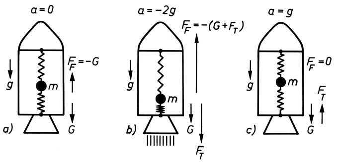

Bild 5.2 Trägheitskräfte in beschleunigten Bezugssystemen: a) Raumschiff im Ruhezustand, b) bei Start und Landung, c) im freien Fall (G Gewichtskraft von m; $F _ { \mathrm { F } }$ rücktreibende Federkraft, $F _ { \mathrm { T } }$ Trägheitskraft). Stets muss gelten $G + F _ { \mathrm { F } } + F _ { \mathrm { T } } = 0$

**Dynamisches Gleichgewicht.** Durch eine geeignete Beschleunigung des Bezugssystems gelingt es, die Schwerkraft lokal völlig auszuschalten (Zustand der Schwerelosigkeit). Dies tritt ein, wenn sich im zuvor geschilderten Beispiel das Raumschiff im freien Fall, also mit $\pmb { \alpha } = \pmb { g }$ zur Erde bewegt (Bild 5.2c); nach (5.3) und (5.4) ist dann die Summe aus beschleunigender Kraft $\boldsymbol{F} \left( = m \boldsymbol{g} = \boldsymbol{G} \right)$ und Trägheitskraft $F _ { \mathrm { T } }$ gleich null:

$$
\boldsymbol {F} ^ {\prime} = \boldsymbol {F} + (- m \boldsymbol {a}) = \boldsymbol {F} - m \boldsymbol {a} = 0. \tag {5.5}
$$

Durch eine solche Auslegung des 2. NEWTONschen Axioms $\pmb { F } = m \pmb { a }$ wird es möglich, die Gesetze der Dynamik auf statische Gleichgewichtsbetrachtungen zurückzuführen. Es gilt dann das

## Prinzip von D’ALEMBERT:

**Ein Körper befindet sich im dynamischen Gleichgewicht, wenn die Summe aus eingeprägten Kräften und Trägheitskräften gleich null ist.**

## Beispiel 5.1:

Berechne für die in Bild 4.6a, b dargestellten Massenanordnungen die Seilkräfte! Massen der Rollen und Seile werden vernachlässigt. – Hinweis: Die bei den Anordnungen auftretenden Beschleunigungen a wurden in dem Rechenbeispiel am Schluss von Abschnitt 4.4 ermittelt.

Lösung: In jeder der beiden Anordnungen stellen die Massen ein beschleunigtes Bezugssystem dar. Die Seilkraft $F ^ { \prime }$ ergibt sich daher nach (5.3) als Summe aus eingeprägter Kraft F und Trägheitskraft $F _ { \mathrm { T } }$ , welche an einer der beiden Massen angreifen. Die gleiche Kraft $F ^ { \prime }$ wirkt nach dem Gegenwirkungsprinzip auch auf die jeweils andere Masse. Bei Anordnung a) ist $F$ gleich der Gewichtskraft von $m _ { 2 }$ , also $m _ { 2 } g ;$ die Trägheitskraft ist nach (5.4) $F _ { \mathrm { T } } = - m _ { 2 } a =$ $- m _ { 2 } ^ { 2 } g / ( m _ { 1 } + m _ { 2 } )$ . Somit wird

$$
F ^ {\prime} = F + F _ {\mathrm{T}} = m _ {2} g \left(1 - \frac {m _ {2}}{m _ {1} + m _ {2}}\right) = \frac {m _ {1} m _ {2}}{m _ {1} + m _ {2}} g.
$$

---

5.2 Gleichförmig rotierende Bezugssysteme. Zentrifugalkraft, Coriolis-Kraft

69

Für Anordnung b) mit den Massen $M = m _ { 1 }$ und $M   +   M ^ { \prime } = m _ { 2 }$ gilt, bezogen auf $m _ { 2 }$ :

$$
F = m _ {2} g; \quad F _ {\mathrm{T}} = - m _ {2} a = - \frac {m _ {2} (m _ {2} - m _ {1})}{m _ {1} + m _ {2}} g;
$$

$$
F ^ {\prime} = F + F _ {\mathrm{T}} = m _ {2} g \left(1 - \frac {m _ {2} - m _ {1}}{m _ {1} + m _ {2}}\right) = \frac {2 m _ {1} m _ {2}}{m _ {1} + m _ {2}} g.
$$

Eine entsprechende Rechnung, bezogen auf die Masse $m _ { 1 }$ (mit entgegengesetzt wirkender Trägheitskraft), führt – wie man leicht nachprüft – zum gleichen Ergebnis. Für beiderseits gleiche Massen $( m _ { 1 } = m _ { 2 } = m )$ folgt die statische Seilkraft $F ^ { \prime } = F = m g .$ □

## Aufgaben

**5.1** In einem S-Bahnwagen ist an der Decke ein Fadenpendel befestigt. Es wird beim Anfahren auf horizontaler, gerader Strecke um den Winkel $\alpha = 3 { , } 5 ^ { \circ }$ gegenüber der Lotrechten ausgelenkt. Wie groß ist die Beschleunigung des Zuges?
**5.2** Ein Kran hebt eine Last von 1,2t mit der Beschleunigung $0 . 7 5   \mathrm { m } / \mathrm { s } ^ { 2 }$ lotrecht empor. Wie groß ist die Kraft, mit der das Kranseil beansprucht wird?

## 5.2 Gleichförmig rotierende Bezugssysteme. Zentrifugalkraft, Coriolis-Kraft

Trägheitskräfte treten in jeder Art von beschleunigten Bezugssystemen auf. Insbesondere trifft dies auch auf rotierende Systeme zu. Wenn sich ein Bezugssystem $\Sigma ^ { \prime } ( x ^ { \prime } , y ^ { \prime } , z ^ { \prime } )$ gegenüber einem als ruhend vorausgesetzten System $\Sigma ( x , y , z )$ mit gleich bleibender Winkelgeschwindigkeit ω um eine feste Achse dreht (Bild 5.3), so vollführt jede mit $\Sigma ^ { \prime }$ fest verbundene, nicht auf der Drehachse liegende Punktmasse in Bezug auf Σ eine gleichförmige Kreisbewegung. Ein Beobachter in Σ führt diese auf das Vorhandensein der zum Kreismittelpunkt hin gerichteten Radialkraft (4.7) $\boldsymbol { F } _ { \mathrm { r } } = - m \omega ^ { 2 } \boldsymbol { r }$ zurück, die von der Drehachse aufgebracht werden muss, an

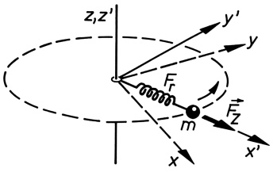

<details>
<summary>text_image</summary>

z,z'
y'
y
F_r
m
F_z
x
x'
</details>

Bild 5.3 Zur Zentrifugalkraft (Fliehkraft): Das System $( x ^ { \prime } ,   y ^ { \prime } ,   z ^ { \prime } )$ , mit dem die Punktmasse m fest verbunden ist, dreht sich gegenüber dem System $( x , y , z )$ mit $z = z ^ { \prime }$ als Drehachse.

der die Punktmasse befestigt ist. Sie kann mittels eines Federkraftmessers gemessen werden. Ein mitrotierender Beobachter in $\Sigma ^ { \prime }$ stellt hingegen fest, dass die Punktmasse ruht; sie führt in seinem Bezugssystem keine Kreisbewegung aus. Er muss daher nach dem NEWTONschen Grundgesetz fordern, dass die Resultierende der an der Punktmasse angreifenden Kräfte null ist. Hieraus schließt er, dass außer der Federkraft eine zweite Kraft an der Punktmasse angreift, die den gleichen Betrag, aber die entgegengesetzte Richtung hat. Diese nur vom mitrotierenden Beobachter empfundene, senkrecht von der Drehachse weg gerichtete Trägheitskraft ist die **Zentrifugalkraft** oder **Fliehkraft**

$$
\boldsymbol {F} _ {\mathrm{Z}} = m \omega^ {2} \boldsymbol {r} \quad \text {vom Betrage} \quad F _ {\mathrm{Z}} = m \omega^ {2} r = \frac {m v ^ {2}}{r}, \tag {5.6}
$$

---

70

5 Bewegte Bezugssysteme

wobei r den von der Drehachse zur Punktmasse zeigenden Ortsvektor bedeutet. Die zugehö- rige Beschleunigung ist die **Zentrifugalbeschleunigung**

$$
\boldsymbol {a} _ {\mathrm{Z}} = \omega^ {2} \boldsymbol {r} \quad \text {vom Betrage} \quad a _ {\mathrm{Z}} = \omega^ {2} r = \frac {v ^ {2}}{r}. \tag {5.7}
$$

Sobald die Radialkraft zu wirken aufhört, verschwindet wegen $\pmb { F } _ { \mathrm { { r } } } + \pmb { F } _ { \mathrm { { Z } } } = 0$ auch die zugehö- rige Trägheitskraft $F _ { Z }$ , und der Körper fliegt auf Grund seiner Trägheit tangential zu seiner bisherigen Bahn in derjenigen Richtung und mit derjenigen Geschwindigkeit weiter, die er im Augenblick des Verschwindens der Radialkraft hatte.

**Die CORIOLIS-Kraft.** Wenn sich die Punktmasse im rotierenden Bezugssystem $\Sigma ^ { \prime }$ mit der Geschwindigkeit $\nu ^ { \prime }$ bewegt, tritt eine zusätzliche Trägheitskraft auf, die nach ihrem Entdecker benannte CORIOLIS-Kraft

$$
\boldsymbol {F} _ {\mathrm{C}} = 2 m \boldsymbol {v} ^ {\prime} \times \boldsymbol {\omega}, \quad \text {Betrag} \quad F _ {\mathrm{C}} = 2 m v ^ {\prime} \omega \sin \alpha , \tag {5.8}
$$

wobei α der Winkel zwischen der Drehachse (ω) und der Richtung von $v ^ { \prime }$ ist. Entsprechend der Definition des Vektorprodukts steht diese Kraft senkrecht zur Richtung der Drehachse und senkrecht zur Geschwindigkeit der Punktmasse.

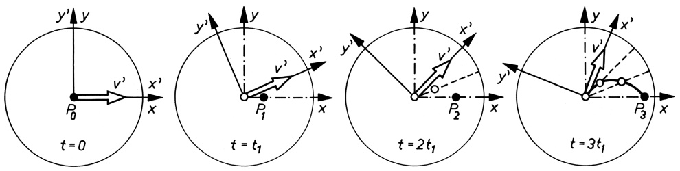

<details>
<summary>text_image</summary>

y'
y
P₀
v'
x'
t = 0
y'
y
P₁
x'
t = t₁
y
v'
x'
t = 2t₁
y
v'
x'
P₂
x
y'
t = 3t₁
y
v'
x'
P₃
x
</details>

Bild 5.4 Bahnabweichung infolge des Wirkens der Coriolis-Kraft

Das Zustandekommen der CORIOLIS-Kraft veranschaulichen wir uns an einem speziellen Beispiel (Bild 5.4): Auf einer Drehscheibe, die sich mit konstanter Winkelgeschwindigkeit ω dreht (System $\Sigma ^ { \prime } ;$ Vektor ω senkrecht zur Zeichenebene nach vorn orientiert), befindet sich im Mittelpunkt $P _ { 0 }$ ein Beobachter. Zum Zeitpunkt $t = 0 ,$ , zu dem die Achsen beider Systeme zusammenfallen, setze dieser in radialer Richtung $x ^ { \prime }$ bzw. $x$ eine Punktmasse mit der Geschwindigkeit $v ^ { \prime }$ in Bewegung. Das Bild zeigt die Scheibe und die Lage der Punktmasse in jeweils gleichen Zeitabständen $\Delta t = t _ { \mathrm { l } }$ . Für einen Beobachter außerhalb von $\Sigma ^ { \prime }$ bewegt sich die Punktmasse nach dem Trägheitsgesetz gleichförmig auf gerader Bahn in x-Richtung. Der in $\Sigma ^ { \prime }$ befindliche und in Richtung der ursprünglichen Geschwindigkeit $v ^ { \prime }$ blickende Beobachter stellt hingegen fest, dass sich die Punktmasse nicht – wie von ihm erwartet – auf gerader Bahn in $x ^ { \prime }$ -Richtung bewegt, sondern dass sie nach rechts abweicht und eine gekrümmte Bahn durchläuft. Indem er das NEWTONsche Grundgesetz anwendet, wird er für die auftretende Bahnabweichung eine Trägheitskraft verantwortlich machen.

Hat die Punktmasse im Zeitintervall $\Delta t$ die Strecke $\Delta r \: ( = \Delta x )$ in radialer Richtung zurückgelegt, so hat sich inzwischen – da die Bahngeschwindigkeit der Drehscheibe weiter außen um $\Delta \nu = \omega \Delta r \; \mathrm { g r \ddot { o } f \ddot { e } r }$ ist und die Punktmasse auf Grund ihrer Trägheit ihre ursprüngliche Bewegungsrichtung beibehält – die Drehscheibe unter ihr um das Wegstück $\Delta s = \Delta \nu \Delta t = \omega \Delta r \Delta$ t hinweggedreht. Mit $\boldsymbol { v } ^ { \prime } = \Delta \boldsymbol { r } / \Delta t$ bzw. $\Delta r =$ $\nu ^ { \prime } \Delta$ t ergibt sich $\Delta s = \upsilon ^ { \prime } \omega ( \Delta t ) ^ { 2 }$ . Führt man die Bahnabweichung auf eine konstante Kraft und somit auf eine konstante Beschleunigung $a _ { \mathrm { C } }$ zurück, so ist nach (3.7) $\Delta s = a _ { \mathrm { C } } ( \Delta t ) ^ { 2 } / 2$ . Durch Gleichsetzen der beiden Ausdrücke für $\Delta s$ folgt

$$
a _ {\mathrm{C}} = 2 v ^ {\prime} \omega \quad (\text {CORIOLIS - Beschleunigung}). \tag {5.9}
$$

---

5.2 Gleichförmig rotierende Bezugssysteme. Zentrifugalkraft, Coriolis-Kraft

71

Damit wird die CORIOLIS-Kraft $F _ { \mathbb { C } } = m a _ { \mathbb { C } } = 2 m \nu ^ { \prime } \omega$ . Wenn die Bewegung nicht senkrecht zur Drehachse erfolgt, sondern $v ^ { \prime }$ mit ω den Winkel α einschließt, gilt die Vektorgleichung (5.8).

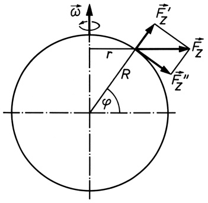

<details>
<summary>text_image</summary>

ω
r
R
φ
F'z
F''z
F''z
</details>

Bild 5.5 Zum Einfluss der Erddrehung auf die Fallbeschleunigung g

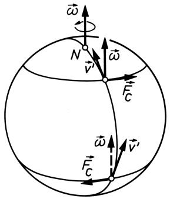

<details>
<summary>text_image</summary>

ω̂
N
v̄
ω̃
F̅C
ω̃
F̅C
v̄'
</details>

Bild 5.6 Zur Wirkung der Coriolis-Kraft auf die Bewegung von Körpern auf der Erde

**Die Erde als rotierendes Bezugssystem.** Wegen der Rotation der Erde um die eigene Achse treten auf ihr nach dem Urteil des mitbewegten Beobachters die zuvor genannten Trägheitskräfte auf. Auf Körper, die an der Erdoberfläche ruhen, wirkt nur die Zentrifugalkraft (5.6), die je eine Komponente in Richtung des Erdradius $F _ { Z } ^ { \prime }$ und tangential zur Erdoberfläche $F _ { \mathrm { Z } } ^ { \prime \prime }$ hat (Bild 5.5). $F _ { Z } ^ { \prime }$ berechnet sich für eine Masse m an der Erdoberfläche unter der geografischen Breite ϕ mit $r = R$ cosϕ (Erdradius $R = 6380   km ;$ Winkelgeschwindigkeit der Erddrehung $\omega = 2 \pi / ( 2 4   \mathrm { h } ) \approx 0 . 7 \cdot 1 0 ^ { - 4 }   \mathrm { s } ^ { - 1 } )$ zu

$$
F _ {\mathrm{Z}} ^ {\prime} = F _ {\mathrm{Z}} \cos \varphi = m \omega^ {2} r \cos \varphi = m \omega^ {2} R \cos^ {2} \varphi = m \cdot (0, 0 3 4 \mathrm{m/s} ^ {2}) \cos^ {2} \varphi .
$$

Da $F _ { Z } ^ { \prime }$ der Fallbeschleunigung g entgegengerichtet ist, ergibt sich hieraus, dass $g$ am $\ddot { \mathrm { A } }$ quator $( \varphi = 0 ^ { \circ } )$ um $0 ,   0 3 4   \mathrm { m } / \mathrm { s } ^ { 2 }$ kleiner ist als an den Polen. In Wirklichkeit aber beträgt die Abweichung etwa $0 { , } 0 5 1 \mathrm { m / s ^ { 2 } }$ , was auf die Abplattung der Erde an den Polen zurückzuführen ist. Diese hat ihre Ursache in der Wirkung der Tangentialkomponente $F _ { \mathrm { Z } } ^ { \prime \prime } = m \omega ^ { 2 } ,$ R cosϕsinϕ, die für $\varphi = 4 5 ^ { \circ }$ ihren maximalen Wert annimmt.

Massen, die sich auf der Erde bewegen (Geschosse, Winde, Meeresströmungen), unterliegen zusätzlich der Wirkung der CORIOLIS-Kraft (5.8). Bild 5.6 veranschaulicht dies für Körper, die sich entlang eines Meridians von Süd nach Nord bewegen. (Der Vektor ω ist der Anschaulichkeit halber an dem betreffenden Ort gezeichnet, wo sich der Körper gerade befindet.) Man erkennt, dass entsprechend der durch das Vektorprodukt (5.8) gegebenen Orientierung von $F _ { \mathrm { C } }$ (Rechtsschraube) die Körper auf der Nordhalbkugel nach Osten, auf der Südhalbkugel nach Westen abgelenkt werden (Rechts- bzw. Linksabweichung der Geschosse).

Ein anschauliches Beispiel für die Wirkung der CORIOLIS-Kraft und zugleich eindrucksvolles Experiment zum Nachweis der Erddrehung war 1851 der **FOUCAULTsche Pendelversuch**: Führt eine an einem sehr langen Faden (z. B. in einem Kirchturm) aufgehängte Masse Pendelschwingungen mit kleinen Auslenkungen aus, so dreht sich für einen erdfesten Beobachter die Erde unter der Schwingungsebene des Pendels (welche infolge der Trägheit des Pendelkörpers ihre Richtung im Raum beibehält) hinweg. An einem Ort der geografischen Breite $\varphi$ ist die Winkelgeschwindigkeit der (scheinbaren) Drehung der Schwingungsebene gleich der Normalkomponente der Winkelgeschwindigkeit der Erddrehung $\omega _ { \mathrm { n } } = \omega \sin \varphi$ . An den Polen $( \varphi = 9 0 ^ { \circ } )$ beträgt sie $3 6 0 ^ { \circ }$ pro Sterntag, zum Äquator hin $( \varphi \to 0 ^ { \circ } )$ nimmt sie auf null ab.

---

72

5 Bewegte Bezugssysteme

## Beispiele 5.2:

1. Eine Eisenbahnstrecke wird in einer überhöhten Kurve vom Radius $r = 5 0 0   \mathrm { m }$ mit der Geschwindigkeit $\nu = 72    km/h$ befahren. Um welchen Winkel muss die Kurve überhöht werden, wenn die im Schwerpunkt des Waggons angreifende Gesamtkraft senkrecht zum Gleiskörper gerichtet sein soll? – Siehe Bild 5.7!

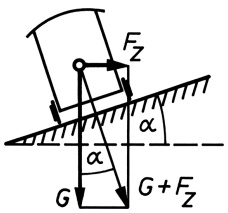

<details>
<summary>text_image</summary>

Fz
α
α
G
G+Fz
</details>

Bild 5.7 Die am Eisenbahnwagen angreifende Kraft ergibt sich als Resultierende aus Gewichtskraft G und Zentrifugalkraft $F _ { Z }$ . Es ist tan $\alpha = F _ { \mathrm { Z } } / G$ Mit (5.6) und $G = m g$ folgt tan $\alpha = \nu ^ { 2 } / ( r g ) = 0 , 0 8 1 6 ;   \alpha = 4 , 7 ^ { \circ }$

2. Aus welcher Höhe muss ein Wagen starten, damit er bei einem Looping auf der Innenseite einer kreisförmigen Schleifenbahn vom Radius R die Fahrt durch die Schleife gerade schafft, ohne den Kontakt mit der Fahrbahn zu verlieren? Wie groß ist dann die Kraft im untersten Punkt?

Lösung: Im höchsten Punkt der Bahn muss die nach oben gerichtete Fliehkraft m $\nu ^ { 2 } / R$ betragsmäßig gleich der nach unten gerichteten Gewichtskraft mg des Wagens sein:

$$
\frac {m v ^ {2}}{R} = m g.
$$

Der Wagen hat dort die Geschwindigkeit $\nu = \sqrt { 2 g ( h   -   2 R ) }$ (der durchfahrene Höhenunterschied zwischen Startpunkt und höchstem Bahnpunk<u>t ist</u> $h   -   2 R )$ . Daraus folgt: $2 g ( h / R { - } 2 ) = g$ oder $h = ( 5 / 2 ) R$ . Im untersten Punkt ist damit $\nu _ { 1 } = \sqrt { 2 g h } = \sqrt { 5 g R }$ , somit beträgt die Gesamtkraft $m v _ { 1 } ^ { 2 } / R + m g = 5 m g + m g = 6 m g$ , das 6-fache des Eigengewichtes.

3. Welche Richtung hat die CORIOLIS-Kraft, wenn sich ein auf dem Äquator befindlicher Körper a) nach Westen, b) senkrecht nach oben, c) nach Norden bewegt?

Lösung: Anhand einer Skizze entsprechend Bild 5.6 überlegt man sich leicht, dass nach (5.8) im Fall a) $F _ { \mathrm { C } }$ zum Erdmittelpunkt, im Fall b) nach Westen gerichtet und im Fall c) $F _ { \mathrm { C } } = 0$ ist. □

## Aufgabe

**5.3** Bei einer Fahrt durch eine nicht überhöhte Kurve wird ein „Ausbrechen“ des Fahrzeuges aus der Kurve beobachtet, wenn die Geschwindigkeit 50km/h überschreitet. Der Kurvenradius beträgt 28m. Welchen Wert hat der Haftreibungskoeffizient $\mu _ { 0 }$ zwischen Straße und Fahrzeugreifen? (Vgl. dazu Abschnitt 4.8).

## 5.3 Inertialsysteme. Relativitätsprinzip der klassischen Mechanik

Aus den Darlegungen der beiden vorangegangenen Abschnitte geht hervor, dass die NEWTON-sche Bewegungsgleichung $m { \ddot { \pmb r } } = { \pmb F }$ nur in einem Bezugssystem gilt, in dem keine Trägheitskräfte auftreten. Ein solches System darf weder Drehbewegungen ausführen, noch darf es geradlinig beschleunigt sein. Dann gilt auch das Trägheitsgesetz, wonach alle Körper, auf die keine

---

5.3 Inertialsysteme. Relativitätsprinzip der klassischen Mechanik

73

Kräfte einwirken $( F = 0$ und damit $\ddot { \pmb r } = 0 )$ , in dem betreffenden Bezugssystem in Ruhe sind oder sich gleichförmig und geradlinig bewegen $( { \dot { \boldsymbol { r } } } = { \boldsymbol { v } } = \mathrm { c o n s t } )$ . Ein solches Bezugssystem nennt man **Inertialsystem** (lat. „inertia“ Trägheit).

## Inertialsysteme sind Bezugssysteme, in denen das Trägheitsgesetz gilt. In ihnen sind Körper bei Abwesenheit äußerer Kräfte in Ruhe oder bewegen sich geradlinig und gleichförmig.

Ist Σ ein Inertialsystem und $\Sigma ^ { \prime }$ ein Bezugssystem, das sich relativ zu Σ geradlinig mit der konstanten, gegenüber der Lichtgeschwindigkeit kleinen Geschwindigkeit v in x- bzw. $x ^ { \prime } -$ Richtung bewegt (s. Bild 5.1), so wird der Übergang vom einen Bezugssystem zum anderen durch die Koordinatentransformation (5.1) mit $s = \nu t$ wie folgt beschrieben:

$$
x = x ^ {\prime} + \nu t, \quad y = y ^ {\prime}, \quad z = z ^ {\prime}. \tag {5.10}
$$

Diese Gleichungen werden als **GALILEI-Transformation** bezeichnet. Zweimaliges Differenzieren nach der Zeit ergibt mit v = const: ${ \ddot { x } } = { \ddot { x } } ^ { \prime } ,   { \ddot { y } } = { \ddot { y } } ^ { \prime } ,   { \ddot { z } } = { \ddot { z } } ^ { \prime }$ oder vektoriell $\ddot { \pmb { r } } = \ddot { \pmb { r } } ^ { \prime } ;$ d. h., in beiden Bezugssystemen erfährt der Körper nach Betrag und Richtung die gleiche Beschleunigung. Dasselbe gilt daher auch für die Kräfte in den beiden Systemen. Demnach ist auch $\Sigma ^ { \prime }$ ein Inertialsystem. Diese fundamentale Aussage bildet das

## Relativitätsprinzip der klassischen Mechanik:

## Beim Übergang von einem Inertialsystem zu einem anderen bleiben alle Gesetze der Mechanik ungeändert.

Gilt in einem Bezugssystem die NEWTONsche Bewegungsgleichung (Grundgesetz der Dynamik), so gilt sie mit den gleichen eingeprägten Kräften auch in jedem relativ dazu geradlinig gleichförmig bewegten anderen Bezugssystem. Man sagt: Die NEWTONsche Bewegungsgleichung ist invariant gegenüber GALILEI-Transformationen.

Ob ein gegebenes Bezugssystem Inertialsystem ist oder nicht, kann nur durch das Experiment entschieden werden; eine Unterscheidung zwischen zwei Inertialsystemen ist dagegen wegen des Relativitätsprinzips mit mechanischen Mitteln (Fallversuche, Pendelversuche usw.) nicht möglich. Da – wie wir im folgenden Abschnitt noch sehen werden – nicht nur die Gesetze der Mechanik, sondern auch die des Elektromagnetismus in jedem Inertialsystem gleich sind, ist es prinzipiell unmöglich, zwischen Inertialsystemen zu unterscheiden. Es kann daher auch keine „Absolutgeschwindigkeit“ gegenüber einem „absolut ruhenden Raum“, wie ihn NEWTON annahm, gemessen werden, gleichbedeutend damit, dass ein solcher überhaupt nicht definiert ist.

Mit sehr großer Genauigkeit ist das heliozentrische Bezugssystem, dessen Koordinatenursprung im Schwerpunkt (Baryzentrum) des Sonnensystems liegt (dieser kann in Abhängigkeit von der Position von Jupiter und Saturn mal innerhalb oder mal außerhalb der Sonne liegen) und dessen Koordinatenachsen auf drei Fixsterne zeigen, ein Inertialsystem. Demgegenüber ist ein Bezugssystem, dessen Achsen fest mit der Erde verbunden sind, wegen der Erdrotation kein Inertialsystem.

---

# Grundzüge der speziellen Relativitätstheorie

## 6.1 Konstanz der Lichtgeschwindigkeit. Die Lorentz-Transformation

Im vorangegangenen Abschnitt wurde die Definition für ein Inertialsystem gegeben und gezeigt, dass eine geradlinig gleichförmige Bewegung eines solchen Systems ohne Einfluss auf den Ablauf mechanischer Vorgänge innerhalb dieses Systems ist. Diese Aussage basiert auf der GALILEI-Transformation (5.10)

$$
x = x ^ {\prime} + \nu t, \quad y = y ^ {\prime}, \quad z = z ^ {\prime} \tag {6.1}
$$

(s. o.), welche die Lage einer Punktmasse in zwei achsenparallelen, in x-Richtung mit der Relativgeschwindigkeit v gegeneinander bewegten Inertialsystemen Σ und $\Sigma ^ { \prime }$ beschreibt. Wir wenden nun versuchsweise die Transformation (6.1) auf die Lichtausbreitung an. Im Ursprung des als ruhend vorausgesetzten Systems Σ befinde sich eine punktförmige Lichtquelle, die zum Zeitpunkt $t = 0$ einen Lichtblitz aussendet. Dieser breite sich in Σ nach allen Seiten hin mit gleicher Geschwindigkeit, der

$$
\text {Lichtgeschwindigkeit im Vakuum} \quad c = 2 9 9 7 9 2 4 5 8 \mathrm{m/s}, \tag {6.2}
$$

aus. Für einen Beobachter (B), der sich neben der Lichtquelle in O befindet (Bild 6.1a), erscheinen die Wellenfronten des Lichts in Σ nach der Zeit t als Kugelflächen vom Radius ct mit dem Mittelpunkt in der Lichtquelle. Ihre Gleichung lautet

$$
x ^ {2} + y ^ {2} + z ^ {2} = c ^ {2} t ^ {2}. \tag {6.3}
$$

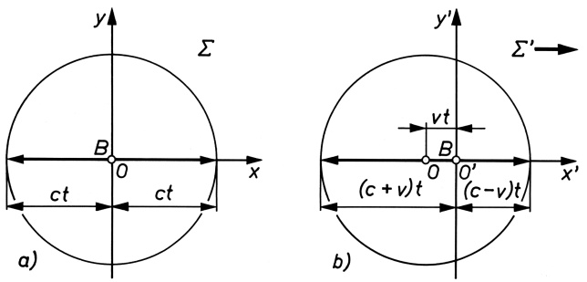

Bild 6.1 Darstellung einer Kugelwelle in zwei gegeneinander mit der Relativgeschwindigkeit v in x- bzw. $x ^ { \prime } \cdot$ Richtung bewegten Inertialsystemen $\Sigma$ und $\Sigma ^ { \prime }$ bei Anwendung der Galilei-Transformation (c Ausbreitungsgeschwindigkeit der Welle)

---

6.1 Konstanz der Lichtgeschwindigkeit. Die Lorentz-Transformation

75

Bewegt sich der Beobachter zusammen mit der Lichtquelle gegenüber dem System Σ (dem früher angenommenen „ruhenden Lichtäther“) mit der Geschwindigkeit v in x-Richtung, so sollten ihm in seinem Bezugssystem $\Sigma ^ { \prime }$ wegen (6.1) die Wellenfronten als exzentrische Kugeln

$$
(x ^ {\prime} + v t) ^ {2} + y ^ {\prime 2} + z ^ {\prime 2} = c ^ {2} t ^ {2} \tag {6.4}
$$

erscheinen (Bild 6.1b), gleichbedeutend damit, dass die Lichtgeschwindigkeit in seiner Bewegungsrichtung gemäß der GALILEI-Transformation (6.1) wegen $\dot { x } ^ { \prime } = \dot { x } - \nu$ gleich $c ^ { \prime } = c - \nu ,$ in der entgegengesetzten Richtung $c + \nu$ ist.

Alle Versuche jedoch, die den Nachweis eines solchen Unterschiedes in der Lichtgeschwindigkeit in verschiedenen Richtungen des Raumes (und damit zugleich den Nachweis der Relativbewegung beider Inertialsysteme) zum Ziel hatten, fielen negativ aus. So wurde auf der Erde, die sich mit einer Geschwindigkeit von rund 30km/s um die Sonne bewegt, von MICHELSON (1881) sowie in späteren, präziseren Experimenten stets in allen Richtungen des Raumes eine einheitliche Lichtgeschwindigkeit gemessen $( c = c ^ { \prime } )$ . Daraus folgt:

## Die Vakuumlichtgeschwindigkeit ist vom Bewegungszustand der Lichtquelle und des Beobachters unabhängig und hat in allen Inertialsystemen den gleichen Wert.

Damit war zugleich auch der Nachweis erbracht, dass nicht nur die Gesetze der Mechanik, sondern auch die der elektromagnetischen Erscheinungen, zu denen das Licht gehört, in allen Inertialsystemen gleich sind. In Erweiterung des Relativitätsprinzips der klassischen Mechanik (vgl. 5.3) gilt daher das **EINSTEINsche Relativitätsprinzip**:

## Alle Gesetze der Physik haben in jedem Inertialsystem die gleiche Form. Inertialsysteme sind grundsätzlich nicht unterscheidbar.

Das Ergebnis des MICHELSON-Experiments besagt, dass auch dem mit der Geschwindigkeit v bewegten Beobachter in $\Sigma ^ { \prime }$ die Wellenfronten des Lichts als Kugeln mit dem Zentrum am Ort des Beobachters $O ^ { \prime }$ erscheinen, was durch die Gleichung

$$
x ^ {\prime 2} + y ^ {\prime 2} + z ^ {\prime 2} = c ^ {2} t ^ {\prime 2} \tag {6.5}
$$

ausgedrückt wird. Das Bild 6.1b und die zugehörige Gleichung (6.4) sind also – angewandt auf die Lichtausbreitung – falsch.

EINSTEIN (1879–1955) erkannte, dass dieser Widerspruch zur GALILEI-Transformation (6.1) nur durch eine Revision unserer gewohnten Vorstellungen von Raum und Zeit beseitigt werden kann. So wird in der GALILEI-Transformation stillschweigend vorausgesetzt, dass in beiden Inertialsystemen die gleiche Zeitrechnung gilt, d. h., es wird gesetzt $t = t ^ { \prime }$ , was mit der Annahme der Existenz einer einheitlichen („absoluten“) Weltzeit t gleichbedeutend ist. Die Identität der Gleichungen (6.3) und (6.5) kann aber nur befriedigt werden, wenn für beide Systeme eine andere Zeitrechnung zu Grunde gelegt wird $( t \neq t ^ { \prime } )$ . Die Transformation (6.1) muss also durch eine andere ersetzt werden, welche die Lichtgeschwindigkeit beim Übergang von einem Inertialsystem zum anderen ungeändert (invariant) lässt, dafür aber mit den Raumkoordinaten

---

76

6 Grundzüge der speziellen Relativitätstheorie

auch die Zeit transformiert. Diese Forderung erfüllen die folgenden Transformationsgleichungen:

$$
x = \frac {x ^ {\prime} + v t ^ {\prime}}{\sqrt {1 - \frac {v ^ {2}}{c ^ {2}}}}, \quad y = y ^ {\prime}, \quad z = z ^ {\prime}, \quad t = \frac {t ^ {\prime} + \frac {v}{c ^ {2}} x ^ {\prime}}{\sqrt {1 - \frac {v ^ {2}}{c ^ {2}}}}, \tag {6.6a}
$$

$$
x ^ {\prime} = \frac {x - \nu t}{\sqrt {1 - \frac {v ^ {2}}{c ^ {2}}}}, \quad y ^ {\prime} = y, \quad z ^ {\prime} = z, \quad t ^ {\prime} = \frac {t - \frac {v}{c ^ {2}} x}{\sqrt {1 - \frac {v ^ {2}}{c ^ {2}}}}. \tag {6.6b}
$$

Diese Zuordnungen der Raum- und Zeitkoordinaten in beiden Systemen werden **LORENTZ-Transformationen** genannt. Sie bilden die Grundlage der speziellen Relativitätstheorie (EIN-STEIN, 1905).

Die Gleichungen (6.6a) und (6.6b) kann man auf folgende Weise gewinnen: Wir verallgemeinern (6.1) für die x-Koordinate in der Form

$$
x = \gamma (x ^ {\prime} + \nu t ^ {\prime}) \quad \text {bzw.} \quad x ^ {\prime} = \gamma (x - \nu t) \tag {6.7}
$$

mit einem noch zu bestimmenden Faktor γ. $x ^ { \prime } = 0$ bedeutet $x = \nu t ,$ d. h., der Koordinatenanfangspunkt $O ^ { \prime }$ von $\Sigma ^ { \prime }$ bewegt sich im System Σ mit der Geschwindigkeit v. Ebenso folgt aus $x = 0$ die Beziehung $\boldsymbol { x } ^ { \prime } = - \boldsymbol { \nu } \boldsymbol { t } ^ { \prime }$ , gleichbedeutend damit, dass der Koordinatenanfangspunkt O des ruhend angenommenen Systems Σ sich in $\Sigma ^ { \prime }$ mit der entgegengesetzt gleichen Relativgeschwindigkeit bewegt (vgl. Bild 5.1). Weil keines der Systeme vor dem anderen ausgezeichnet ist, darf in den beiden Gleichungen (6.7) der gleiche Faktor $\gamma$ angesetzt werden. Da die Relativbewegung beider Systeme nur in x-Richtung erfolgt, wird unverändert übernommen: $y = y ^ { \prime } ,   z = z ^ { \prime }$ . Wegen der Konstanz der Lichtgeschwindigkeit $( c = c ^ { \prime } )$ gilt in den beiden Systemen

$$
x = c t; \quad x ^ {\prime} = c t ^ {\prime}, \tag {6.8}
$$

womit durch Elimination von x und $x ^ { \prime }$ aus den Gleichungen (6.7) folgt

$$
c t = (c + \nu) \gamma t ^ {\prime}; \quad c t ^ {\prime} = (c - \nu) \gamma t.
$$

Multipliziert man diese Gleichungen links- und rechtsseitig miteinander, so kürzt sich das Produkt $t t ^ { \prime }$ heraus, und man findet

$$
\gamma = \frac {1}{\sqrt {1 - (\nu^ {2} / c ^ {2})}}. \tag {6.9}
$$

Damit folgen aus (6.7) die gesuchten Transformationsgleichungen (6.6a) und (6.6b) für die Ortskoordinaten. Die Beziehungen für die Zeitkoordinaten t und $t ^ { \prime }$ folgen dann aus diesen Gleichungen durch Eliminieren von x bzw. $x ^ { \prime } ,$ . Der Rechengang soll hier nicht ausgeführt werden. Aus der folgenden Tabelle 6.1 können die Werte $1 / \gamma$ und $\gamma$ für zunehmende Annäherung von v an die Lichtgeschwindigkeit (6.2) abgelesen werden.

Da der Faktor $\gamma$ für $\nu > c$ imaginär wird, Koordinaten und Zeit aber reelle Größen sind, folgt aus der LORENTZ-Transformation (6.6a), (6.6b) $\nu \leq c .$ Das bedeutet:

**Die Vakuumlichtgeschwindigkeit ist die obere Grenze aller Geschwindigkeiten für die Ausbreitung einer beliebigen Wirkung, d. h. von Teilchen und Wellensignalen jeglicher Art.**

---

6.1 Konstanz der Lichtgeschwindigkeit. Die Lorentz-Transformation

77

Im täglichen Leben wie in der Technik haben wir es stets mit Geschwindigkeiten v zu tun, die der des Lichts nicht im entferntesten vergleichbar sind $( \nu   \ll   c )$ . Für diesen Fall geht wegen $\gamma \approx 1$ und $\nu / c ^ { 2 } \approx 0$ die LORENTZ-Transformation (6.6a), (6.6b) in die GALILEI-Transformation (6.1) über. Es behalten daher auch die Gleichung (6.4) und Bild 6.1b ihre volle Gültigkeit, wenn man anstelle von Lichtwellen z. B. die Ausbreitung von Schallwellen in ruhender Luft (System Σ) betrachtet. Gäbe es – wie man bis zur Durchführung des MICHELSON-Experiments allgemein annahm – analog dem Überträger des Schalls, der ruhenden Luft, auch für das Licht als Träger der Lichtwellen ein ruhendes Medium, den sog. Äther, gleichbedeutend mit einem absolut ruhenden Bezugssystem Σ, so müssten sich die gleichen Verhältnisse wie beim Schall auch für das Licht ergeben. Dies ist aber, wie oben dargelegt, nicht der Fall, womit bewiesen ist, dass ein ruhender Äther nicht existiert und der „absolute Raum“ und die „absolute $\mathrm { Z e i t ^ { a } }$ , wie sie von NEWTON postuliert wurden, Fiktionen sind.

Tabelle 6.1 Größe des relativistischen Faktors in den Gleichungen (6.6a) und (6.6b) der Lorentz-Transformation

| $\nu$ in % von $c$ | $\sqrt{1 - (v^{2}/c^{2})}$ | $1/\sqrt{1 - (v^{2}/c^{2})}$ |
| --- | --- | --- |
| 0 | 1,000 | 1,000 |
| 10 | 0,995 | 1,005 |
| 50 | 0,866 | 1,155 |
| 80 | 0,600 | 1,667 |
| 86,6 | 0,500 | 2,000 |
| 90 | 0,436 | 2,294 |
| 99 | 0,141 | 7,09 |
| 99,5 | 0,0999 | 10,01 |
| 99,9 | 0,0447 | 22,36 |
| 99,99 | 0,0141 | 70,71 |
| 99,999 | 0,00447 | 223,6 |
| 99,9999 | 0,00141 | 707,1 |
| 100 | 0 | ∞ |

## Beispiel 6.1:

Weise nach, dass – wie oben behauptet – die Gleichung (6.3), mit der die Ausbreitung einer kugelförmigen Lichtwelle beschrieben wird, invariant gegenüber der LORENTZ-Transformation ist!

Anleitung: Setze die Transformationsgleichungen (6.6a) in Gleichung (6.3) ein und bringe den so erhaltenen Ausdruck durch weiteres Ausrechnen und Ordnen in die Form (6.5). Verwende dabei zwischendurch die Abkürzung (6.9). □

## Aufgabe

**6.1** Erläutere, wie die Gleichberechtigung der Systeme Σ und $\Sigma ^ { \prime }$ in den Gleichungen für die LORENTZ-Transformationen (6.6a) und die reziproken Transformationen (6.6b) zum Ausdruck kommt!

---

78

6 Grundzüge der speziellen Relativitätstheorie

## 6.2 Folgerungen aus der Lorentz-Transformation

**Gleichzeitigkeit von Ereignissen.** In einem Inertialsystem Σ sollen zur Zeit $t _ { 1 }$ am Ort $x _ { 1 }$ und zur Zeit $t _ { 2 }$ am Ort x2 Ereignisse stattfinden; es sei $t _ { 2 } \geq t _ { 1 }$ . Der zeitliche Abstand dieser Ereignisse $\Delta t = t _ { 2 }   -   t _ { 1 }$ in Σ wird von einem relativ dazu mit der Geschwindigkeit v bewegten Beobachter mit den ihm zur Verfügung stehenden Uhren nach (6.6b) zu

$$
\Delta t ^ {\prime} = t _ {2} ^ {\prime} - t _ {1} ^ {\prime} = \frac {\Delta t - \nu (x _ {2} - x _ {1}) / c ^ {2}}{\sqrt {1 - (\nu^ {2} / c ^ {2})}} \tag {6.10}
$$

registriert. Es sei nun $\Delta t = 0 , \mathbf { d } .$ h., beide Ereignisse sind für einen Beobachter in Σ gleichzeitig. Für einen gegenüber Σ bewegten Beobachter sind dagegen nach (6.10) die Ereignisse nicht gleichzeitig $( \Delta t ^ { \prime } \neq 0 )$

**Zeitdilatation (Zeitdehnung).** Im Inertialsystem $\Sigma$ stehe bei $x _ { 1 }$ eine Uhr und gebe Zeitzeichen im Abstand $\Delta t = t _ { 2 } - t _ { 1 }$ . Ein Beobachter in $\Sigma ^ { \prime }$ , der sich gegenüber Σ mit der Geschwindigkeit v bewegt, registriert zwischen zwei Zeichen die Zeitdifferenz

$$
\Delta t ^ {\prime} = t _ {2} ^ {\prime} - t _ {1} ^ {\prime} = \frac {t _ {2} - t _ {1}}{\sqrt {1 - (v ^ {2} / c ^ {2})}} = \frac {\Delta t}{\sqrt {1 - (v ^ {2} / c ^ {2})}} \geq \Delta t. \tag {6.11}
$$

Der Beobachter misst also ein größeres Zeitintervall, als die relativ zu ihm bewegte Uhr in $\Sigma$ anzeigt. Dabei sind beide Inertialsysteme gleichberechtigt, d. h., die Messung eines zeitlichen Vorgangs in $\Sigma ^ { \prime }$ von Σ aus liefert das gleiche Ergebnis. Beide gegeneinander bewegte Beobachter stellen also fest, dass die Uhr des anderen nachgeht (Uhrenparadoxon).

**Längenkontraktion.** Aus den Gleichungen (6.6a) und (6.6b) folgt weiter, dass alle Körper, die sich relativ zum Beobachter bewegen, diesem in Bewegungsrichtung verkürzt erscheinen. Ein parallel zur Bewegungsrichtung liegender Messstab der Länge l hat für einen dazu mit der Geschwindigkeit v bewegten Beobachter die Länge

$$
l ^ {\prime} = l \sqrt {1 - (v ^ {2} / c ^ {2})} \leq l. \tag {6.12}
$$

Eine eindrucksvolle Bestätigung dieser relativistischen Phänomene liefern die Beobachtungen an schnell bewegten Myonen (vgl. 50.1). Diese Elementarteilchen entstehen in über 30km Höhe durch Einwirkung der kosmischen Strahlung auf die Moleküle der Luft. Aus der Energie, mit der die Myonen auf der Erde ankommen, geht hervor, dass sie die ganze Strecke mit nahezu Lichtgeschwindigkeit $( \nu \approx 0 , 9 9 9 5 c )$ zurücklegen. Sie sind nicht stabil, sondern zerfallen mit einer mittleren Lebensdauer von $\tau \approx 2   \cdot   1 0 ^ { - 6 } ;$ s in andere Elementarteilchen. Sie könnten somit in dieser Zeit nur die verhältnismäßig kurze Strecke von cτ ≈ 600m zurücklegen. Dies steht aber im Widerspruch dazu, dass die Myonen uns dennoch am Erdboden erreichen.

Der Widerspruch löst sich auf, wenn man berücksichtigt, dass das zerfallende Myon als sehr schnell bewegtes Objekt der relativistischen Zeitdilatation (6.11) unterworfen ist. Für einen Beobachter auf der Erde erschein<u>t daher die</u> Lebensdauer τ des Myons „gedehnt“; es vergehen für ihn nicht $2 \cdot 1 0 ^ { - 6 }   \mathrm { { s } }$ sondern wegen $\sqrt { 1   -   ( \nu ^ { 2 } / c ^ { 2 } ) } \approx 0 { , } 0 2$ nach $(6.11)   2 \cdot 10^{-6}    s /0, 02 = 10^{-4}    s$ . In dieser Zeit kann das Teilchen 30km zurücklegen. Nach neueren Messungen beträgt der tatsächlich zurückgelegte Weg 38km. Der vermeintliche Widerspruch lässt sich auch auf der Grundlage der Längenkontraktion aufklären, wobei die Entfernung von 38km auf den oben berechneten Wert von 600m schrumpft.

So wie beim schnell fliegenden Myon werden auch in einem Raumschiff die Uhren und alle physikalischen und chemischen Prozesse einschließlich der Lebensvorgänge für einen Beobachter auf der Erde

---

6.2 Folgerungen aus der Lorentz-Transformation

79

langsamer. Obwohl der Raumfahrer selbst nicht spürt, dass seine Zeit langsamer abläuft, so bleibt er doch für seinen auf der Erde zurückgebliebenen Zwillingsbruder jünger. Wegen der Gleichwertigkeit der Inertialsysteme stellt aber auch der raumfahrende Bruder von seinem Zwillingsbruder auf der Erde fest, dass dieser weniger schnell altert. Es erhebt sich die Frage, wie es sich verhält, wenn der Raumfahrer zur Erde zurückkehrt. Eine genaue Untersuchung zeigt, dass er dann jünger ist als sein daheim gebliebener Zwillingsbruder (Zwillingsparadoxon). Dieser scheinbare Widerspruch klärt sich auf, wenn man bedenkt, dass bei der Umkehr des Raumschiffes zur Erde der Raumfahrer von einem Inertialsystem in ein anderes überwechselt, während sich für den Zwillingsbruder auf der Erde nichts ändert. Die Bezugssysteme sind also nicht mehr gleichwertig. Wegen der gegenüber der Lichtgeschwindigkeit geringen Geschwindigkeit der Raumschiffe hat jedoch dieses Phänomen des „asymmetrischen Alterns“für die Raumfahrt keinerlei Bedeutung.

**Additionstheorem der Geschwindigkeiten.** In $\Sigma ^ { \prime }$ bewege sich entlang der $x ^ { \prime } \text { -} \mathrm { A c h s e }$ ein Teilchen mit der Geschwindigkeit $u ^ { \prime } .$ Das System $\Sigma ^ { \prime }$ seinerseits bewege sich mit der Geschwindigkeit v parallel zur x-Achse gegenüber Σ. Nach dem klassischen Superpositionsprinzip für Geschwindigkeiten (3.20), welches aus der GALILEI-Transformation folgt, hat dann das Teilchen in Bezug auf Σ die Geschwindigkeit

$$
u = u ^ {\prime} + v. \tag {6.13}
$$

Dieser Zusammenhang gilt jedoch nur so lange, wie die Geschwindigkeiten klein sind gegen die Lichtgeschwindigkeit $c .$ Den allgemein gültigen Zusammenhang liefern wieder die Gleichungen (6.6a) und (6.6b) der LORENTZ-Transformation. Danach ergibt sich die Geschwindigkeit u = dx/dt des Teilchens gegenüber Σ aus

$$
u = \frac {\mathrm{d} x}{\mathrm{d} t} = \frac {\frac {\mathrm{d} x ^ {\prime}}{\mathrm{d} t ^ {\prime}} \frac {\mathrm{d} t ^ {\prime}}{\mathrm{d} t} + v \frac {\mathrm{d} t ^ {\prime}}{\mathrm{d} t}}{\sqrt {1 - \frac {v ^ {2}}{c ^ {2}}}}, \quad \frac {\mathrm{d} t ^ {\prime}}{\mathrm{d} t} = \frac {1 - \frac {v}{c ^ {2}} \frac {\mathrm{d} x}{\mathrm{d} t}}{\sqrt {1 - \frac {v ^ {2}}{c ^ {2}}}} = \frac {1 - \frac {v}{c ^ {2}} u}{\sqrt {1 - \frac {v ^ {2}}{c ^ {2}}}},
$$

wobei $u ^ { \prime } = \mathbf { d } x ^ { \prime } / \mathbf { d } t ^ { \prime }$ . Durch Einsetzen der letzten Gleichung in die vorletzte und Auflösen nach u erhält man

$$
u = \frac {u ^ {\prime} + v}{1 + \frac {u ^ {\prime} v}{c ^ {2}}} \quad \text {(relativistisches Additionstheorem der Geschwindigkeiten).} \tag {6.14}
$$

Sind alle Geschwindigkeiten hinreichend klein gegenüber $c ,$ so folgt hieraus wegen $u ^ { \prime } \nu \ll c ^ { 2 }$ wieder die klassische Beziehung (6.13).

## Beispiel 6.2:

Ein Neutrino (Elementarteilchen) bewegt sich mit Lichtgeschwindigkeit $( u ^ { \prime } = c )$ . Ein Beobachter bewegt sich mit der Geschwindigkeit v auf das Neutrino zu. Wie groß ist die Relativgeschwindigkeit zwischen Neutrino und Beobachter?

Lösung: Nach der klassischen Beziehung (6.13) ergäbe sich eine Geschwindigkeit, die größer ist als die Lichtgeschwindigkeit. Dies widerspricht aber der Relativitätstheorie. Demgegenüber liefert (6.14)

$$
u = \frac {c + v}{1 + \frac {c v}{c ^ {2}}} = \frac {c + v}{\frac {1}{c} (c + v)} = c. \tag {6.15}
$$

Selbst dann, wenn beide Objekte mit Lichtgeschwindigkeit fliegen, begegnen sie sich nur mit der Relativgeschwindigkeit $c ;$ denn auch mit $\nu = c$ folgt aus (6.15) $u = c !$ □

---

80

6 Grundzüge der speziellen Relativitätstheorie

## 6.3 Relativistische Bewegungsgleichung

Die Bewegungsgleichung in der Fassung (4.4) $\pmb { F } = m \pmb { a }$ erfüllt nicht das relativistische Additionstheorem der Geschwindigkeiten (6.14) und ist daher nur bei Geschwindigkeiten klein gegenüber c gültig. Die ursprüngliche NEWTONsche Formulierung der Bewegungsgleichung (4.9) $\pmb { F } = \dot { \pmb { p } } = \mathbf { d } ( m \pmb { v } ) / \mathbf { d } t$ gilt hingegen auch bei großen Geschwindigkeiten, wenn man den relativis**tischen Impuls**

$$
\boldsymbol {p} = m \boldsymbol {v} = \frac {m _ {0} \boldsymbol {v}}{\sqrt {1 - (v ^ {2} / c ^ {2})}} \tag {6.16}
$$

mit der geschwindigkeitsabhängigen Masse

$$
m = \frac {m _ {0}}{\sqrt {1 - (v ^ {2} / c ^ {2})}} \quad (\text {Impulsmasse}) \tag {6.17}
$$

zu Grunde legt. Damit lautet die **relativistische Bewegungsgleichung**

$$
\boldsymbol {F} = \frac {\mathrm{d}}{\mathrm{d} t} \left(\frac {m _ {0} \boldsymbol {v}}{\sqrt {1 - (v ^ {2} / c ^ {2})}}\right). \tag {6.18}
$$

**Herleitung:** Ein in $\Sigma ^ { \prime }$ anfänglich ruhendes Teilchen der Masse $m _ { 0 }$ erfahre durch eine Kraft $F$ in dem infinitesimal kleinen Zeitintervall $1 t ^ { \prime }$ nach dem dynamischen Grundgesetz (4.4) in $x ^ { \prime } .$ -Richtung den Geschwindigkeitszuwachs d $\mathbf { l } u ^ { \prime } = ( F / m _ { 0 } )   \mathbf { d } t ^ { \prime }$ . Da sich $\Sigma ^ { \prime }$ gegenüber dem Ruhesystem Σ mit der Geschwindigkeit v in gleicher Richtung wie das Teilchen bewegen soll, hat letzteres in Bezug auf $\Sigma$ nach dem relativistischen Additionstheorem (6.14) die Geschwindigkeit

$$
u = \frac {\mathrm{d} u ^ {\prime} + v}{1 + \frac {\mathrm{d} u ^ {\prime} v}{c ^ {2}}}.
$$

Der Geschwindigkeitszuwachs beträgt daher in Bezug auf $\cdot \sum$

$$
\mathrm{d} \nu = u - v = \frac {\left(1 - \frac {v ^ {2}}{c ^ {2}}\right) \mathrm{d} u ^ {\prime}}{1 + \frac {\mathrm{d} u ^ {\prime} v}{c ^ {2}}} \approx \left(1 - \frac {v ^ {2}}{c ^ {2}}\right) \mathrm{d} u ^ {\prime}.
$$

Infolge der Zeitdilatation (vgl. Abschnitt 6.2) beträgt das Zeitintervall in Σ d $\mathbf { d } t = \mathbf { d } t ^ { \prime } / \sqrt { 1 - \nu ^ { 2 } / c ^ { 2 } }$ . Die Bewegungsgleichung in $\Sigma ^ { \prime }   F = m _ { 0 }   \mathbf { d } u ^ { \prime } / \mathbf { d } t ^ { \prime }$ nimmt in $\Sigma$ somit die Form

$$
F = \frac {m _ {0}}{\left(1 - \frac {v ^ {2}}{c ^ {2}}\right) ^ {\frac {3}{2}}} \frac {\mathrm{d} v}{\mathrm{d} t} = \frac {\mathrm{d}}{\mathrm{d} t} \left(\frac {m _ {0} v}{\sqrt {1 - \frac {v ^ {2}}{c ^ {2}}}}\right)
$$

an, wobei sich die letzte Gleichheit durch direktes Ausrechnen leicht zeigen lässt. In Verallgemeinerung auf den dreidimensionalen Fall folgt damit (6.18).

In Übereinstimmung mit den Messergebnissen geht aus Gleichung (6.17) hervor, dass sich die Masse eines Teilchens, welches sich gegenüber einem Inertialsystem Σ mit der Geschwindigkeit v bewegt, für einen Beobachter in diesem System vergrößert (Bild 6.2). Für $\nu / c \to 0$ geht die Impulsmasse m in die Ruhmasse $m _ { 0 }$ über. Diese wird gemessen, wenn das Teilchen im verwendeten Bezugssystem ruht $( \nu = 0 )$ . Für $m \rightarrow m _ { 0 }$ geht aus der relativistischen Bewegungsgleichung (6.18) wieder die NEWTONsche Bewegungsgleichung hervor. Mit zunehmender Annäherung an die Lichtgeschwindigkeit $( \nu / c \to 1 )$ strebt die Impulsmasse gegen unendlich große Werte, woraus folgt, dass es unmöglich ist, ein ruhmassebehaftetes Teilchen auf

---

6.3 Relativistische Bewegungsgleichung

81

Lichtgeschwindigkeit (oder gar darüber) zu bringen; sein Trägheitswiderstand wächst ins Unermessliche, wodurch jede weitere Beschleunigung verhindert wird. Ein Teilchen mit $m _ { 0 } = 0$ (z. B. ein Photon, vgl. 43.1) hingegen muss sich immer mit Lichtgeschwindigkeit bewegen, für $\nu < c$ kann es nicht existieren.

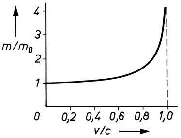

<details>
<summary>line</summary>

| v/c | m/m0 |
| --- | --- |
| 0 | 1 |
| 0.2 | ~1.05 |
| 0.4 | ~1.1 |
| 0.6 | ~1.2 |
| 0.8 | ~1.6 |
| 1.0 | >4 |
</details>

Bild 6.2 Abhängigkeit der Impulsmasse m von der Geschwindigkeit v

## Beispiel 6.3:

In einem Elektronen-Synchrotron werden die Elektronen so hoch beschleunigt, dass ihre Impulsmasse das 10 000-fache der Ruhmasse beträgt. Welche Geschwindigkeit haben sie dann?

Lösung: Durch Quadrieren und Umstellen von (6.17) erhält man $\nu / c   =   \sqrt { 1   -   ( m _ { 0 } / m ) ^ { 2 } }   =$ $\sqrt { 1 - ( 1 0 ^ { - 4 } ) ^ { 2 } } = \sqrt { 0 , 9 9 9   9 9 9   9 9 } \approx 1$ , d. h., die Elektronen erreichen praktisch Lichtgeschwindigkeit. □

## Aufgaben

**6.2** Für welche Geschwindigkeit wird die relativistische Masse eines Körpers gleich seiner doppelten Ruhmasse?
**6.3** In einem Beschleuniger werden Elementarteilchen auf die Geschwindigkeit $\nu = ( 3 / 4 )   c$ gebracht. Um wie viel Prozent vergrößert sich ihre Masse?

---

Arbeit und Energie

## 7.1 Arbeit

Die Wirkung einer Kraft wird erst sichtbar, wenn sie einen Widerstand längs eines Weges überwindet. Wir sagen dann, von der Kraft wird Arbeit verrichtet. Je nach Art des Bewegungswiderstandes unterscheidet man

a) Widerstandsarbeit gegen äußere Widerstände, z. B. Luftwiderstand, Reibungskräfte, elektrostatische Kräfte usw.,
b) Verformungsarbeit gegen innere Widerstände eines Körpers, z. B. beim Dehnen einer Feder oder beim Umformen eines Bleches,
c) Beschleunigungsarbeit gegen die Trägheitskraft eines Körpers.

Ist die Kraft F während der gesamten Verschiebung des Körpers konstant und wirkt sie stets in Richtung des Weges s, so ist die Arbeit definiert durch

$$
W = F s \quad (\text {Arbeit bei konstanter Kraft}). \tag {7.1}
$$

$$
\begin{array}{l} \text {Einheit:} [ W ] = 1 \mathrm{N} \cdot \mathrm{m} = 1 \text {Joule (J)} = 1 \text {Wattsekunde (Ws)} \\ = 1 \mathrm{kg} \cdot \mathrm{m} ^ {2} / \mathrm{s} ^ {2}. \\ \end{array}
$$

1 J ist die Arbeit, die verrichtet wird, wenn sich der Angriffspunkt der Kraft 1 N um 1 m in Richtung der Kraft verschiebt.

Sind die Bewegungsmöglichkeiten des Körpers durch irgendwelche äußeren Bedingungen eingeschränkt, indem er sich z. B. nur in einer vorgeschriebenen Bahn (Führung) oder einer Ebene bewegen kann, so heißt die Bewegung zwangläufig. Hat in solchen Fällen die am Körper angreifende Kraft F nicht die Richtung der möglichen Verschiebung, sondern schließt mit ihr – wie in Bild 7.1 – den Winkel α ein, so ruft die zur Bewegungsrichtung senkrechte Kraftkomponente (Druckkraft) nach dem Wechselwirkungsgesetz eine **Zwangskraft** $F _ { Z }$ von gleicher Grö- ße, aber entgegengesetzter Richtung hervor, die die Druckkomponente kompensiert. Es wird also lediglich die in Wegrichtung liegende Kraftkomponente $F _ { s }$ vom Betrage F cosα wirksam.

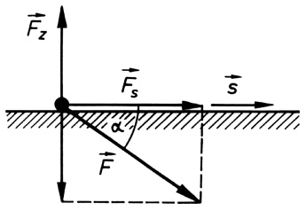

<details>
<summary>text_image</summary>

F̅z
F̅s
s
α
F̅
</details>

Bild 7.1 Zur Berechnung der mechanischen Arbeit bei zwangläufiger Bewegung in einer Ebene

Die bei der Verschiebung um s verrichtete Arbeit ist daher

$$
W = F _ {s} s = F s \cos \alpha = \boldsymbol {F} \cdot \boldsymbol {s}.
$$

---

7.1 Arbeit

83

Es handelt sich hierbei um das Skalarprodukt aus dem Kraftvektor F und dem Verschiebungsvektor $\pmb { s } ;$ die Arbeit ist also eine skalare Größe.

Verstehen wir unter F die Kraft, die den Bewegungswiderstand verursacht, so ist für die Verschiebung des Körpers ohne Beschleunigung desselben eine entgegengesetzt gleich große Kraft $- \boldsymbol { F }$ erforderlich. Bei einer solchen Betrachtungsweise gilt im Unterschied zu oben

$$
W = - \boldsymbol {F} \cdot \boldsymbol {s} = - F s \cos \alpha \quad (\text {Verschiebungsarbeit}). \tag {7.2}
$$

Erfolgt die Verschiebung s entgegen der am Körper angreifenden Kraft F, wie beispielsweise beim (nicht notwendig senkrechten) Anheben eines Körpers gegen die Schwerkraft (α ist dann ein stumpfer Winkel), so ergibt sich ein positiver Wert für die Arbeit, gleichbedeutend mit $\mathbf { A r } -$ beitsaufwand, während bei einer Bewegung des Körpers in eine Richtung, in die auch die Kraft bzw. ihre Wegkomponente weist (α ist dann ein spitzer Winkel), W negativ wird, gleichbedeutend mit Arbeitsgewinn (z. B. beim Absenken des Körpers).

**Arbeit bei veränderlicher Kraft und beliebiger Verschiebung.** Im Allgemeinen können sich längs der Bahn einer im Raum bewegten Punktmasse (bzw. Punktladung) sowohl der Betrag als auch die Richtung der angreifenden Kraft wie auch die Richtung der Verschiebung ändern. In diesem Fall gilt Gleichung (7.2) immer nur für einzelne, differenziell kleine Verschiebungen dr vom Betrage ds, die in jedem Punkt der Bahn tangential zu ihr gerichtet sind (Bild 7.2a) und entlang selbiger der Kraftvektor $F ( r )$ , der jetzt vom Ort r abhängt, näherungsweise als konstant vorausgesetzt werden darf:

$$
\mathrm{d} W = - \boldsymbol {F} \cdot \mathrm{d} \boldsymbol {r} = - F \cos \alpha \mathrm{d} s = - F _ {s} \mathrm{d} s
$$

mit $F _ { s } = F$ cosα als Kraftkomponente in Wegrichtung. Die gesamte zwischen den Bahnpunkten $P _ { 1 }$ und $P _ { 2 }$ verrichtete Verschiebungsarbeit ergibt sich durch Aufsummation (Integration) aller infinitesimal kleinen Beiträge dW entlang des Weges zu

$$
W = \int \mathrm{d} W = - \int_ {P _ {1}} ^ {P _ {2}} \boldsymbol {F} \cdot \mathrm{d} \boldsymbol {r} = - \int_ {P _ {1}} ^ {P _ {2}} F \cos \alpha \mathrm{d} s = - \int_ {P _ {1}} ^ {P _ {2}} F _ {s} \mathrm{d} s \quad (\text {Wegintegral der Kraft}), \tag {7.3}
$$

auch als Linienintegral der Kraft bezeichnet. Es gibt nach Bild 7.2b zahlenmäßig die Fläche unter dem Graph der Funktion $F _ { s } = F _ { s } ( s )$ zwischen Anfangs- und Endpunkt des Weges an.

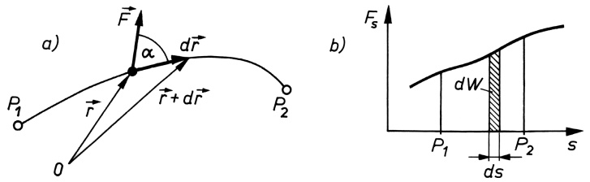

Bild 7.2 Zur Berechnung der Verschiebungsarbeit auf beliebiger Bahn und bei veränderlicher Kraft $F_{s} = F \cos \alpha$ Kraftkomponente in Wegrichtung)

**Arbeit gegen die Schwerkraft.** Beim senkrechten Anheben einer Masse m auf die Höhe h (Bild 7.3a) ist die gegen die Schwerkraft $\pmb { G } = m \pmb { g }$ zu verrichtende Arbeit nach (7.2)

$$
W = - m \mathbf {g} \cdot \mathbf {s} = - m g h \cos 1 8 0 ^ {\circ} = m g h \quad (\text {Hubarbeit}). \tag {7.4}
$$

---

84

7 Arbeit und Energie

Soll der gleiche Höhenunterschied h auf einer schiefen Ebene mit dem Neigungswinkel $\beta$ überwunden werden (Bild 7.3b), so ist wegen $\alpha = 9 0 ^ { \circ } + \beta$ und h = s sin $\beta ;$

$$
W = - m g s \cos (9 0 ^ {\circ} + \beta) = m g s \sin \beta = F _ {\mathrm{H}} s = m g h. \tag {7.5}
$$

Die Arbeit wird also nur gegen die in Wegrichtung liegende Komponente der Schwerkraft, die **Hangabtriebskraft** $F _ { \mathrm { H } } = m g$ sin $\beta = G h / s$ , verrichtet, während die Arbeit der Normalkomponente $F _ { \mathrm { N } }$ , da diese senkrecht zur Bewegungsrichtung steht, gleich null ist. Beim Vergleich von (7.4) und (7.5) fällt auf, dass die Arbeit beim senkrechten Anheben genau so groß ist wie bei der (reibungsfreien) Bewegung auf der schiefen Ebene, vorausgesetzt, der Höhenunterschied ist der Gleiche.

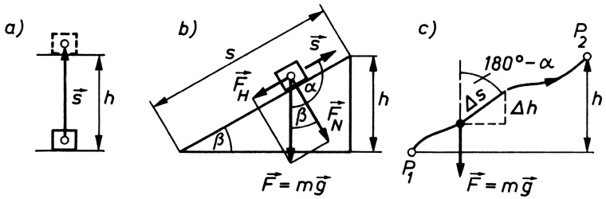

Bild 7.3 Arbeit gegen die Schwerkraft a) beim senkrechten Anheben, b) beim Verschieben auf einer schiefen Ebene, c) bei Bewegung auf beliebiger Bahn. Der Höhenunterschied h und damit die verrichtete Arbeit ist jedes Mal gleich groß.

Bild 7.3c zeigt nun einen beliebig verlaufenden Weg, dessen Anfangs- und Endpunkt sich in der Höhenlage ebenfalls um h unterscheiden. Ist wie oben α der Winkel zwischen Kraft- und Verschiebungsvektor, so erhält man mit $\Delta h = \Delta s \cos \left( 180^{\circ} - \alpha \right) = - \Delta$ s cosα bzw. dh = −ds cosα für die Arbeit nach (7.3)

$$
W = - \int_ {P _ {1}} ^ {P _ {2}} F \cos \alpha \mathrm{d} s = \int_ {0} ^ {h} m g \mathrm{d} h = m g h,
$$

also wieder dasselbe Ergebnis wie in (7.4) und (7.5). Hieraus folgt:

**Die Arbeit gegen die Schwerkraft wird allein vom zu überwindenden Höhenunterschied bestimmt, nicht dagegen vom Weg, auf dem die Verschiebung erfolgt.**

In dieser Eigenschaft der Schwerkraft drückt sich ein allgemeines Merkmal einer bestimmten Gruppe von Kräften, der sog. **konservativen Kräfte**, aus. Die Bezeichnung rührt daher, dass bei diesen Kräften die Fähigkeit zur Arbeitsverrichtung erhalten bleibt (lateinisch „conservare erhalten), was bei den nichtkonservativen Kräften, zu denen beispielsweise alle Reibungskräfte gehören, nicht der Fall ist.

**Kräfte, welche die Eigenschaft haben, dass die gegen sie verrichtete Arbeit vom gewählten Weg unabhängig und nur eine Funktion der Koordinaten von Anfangs- und Endpunkt der Bewegung ist, heißen konservative Kräfte.**

---

7.1 Arbeit

85

**Spannarbeit einer elastischen Feder.** Beim Spannen einer Schraubenfeder ist nach Bild 4.5 die mit der Auslenkung x veränderliche rücktreibende Federkraft $\pmb { F } = - k \pmb { x }$ (k Federkonstante) zu überwinden. Auch hierbei handelt es sich um eine konservative Kraft. Mit $\pmb { F } _ { 0 } = - k \pmb { x } _ { 0 }$ als Maximalkraft erhalten wir für die zum Dehnen oder Stauchen der Feder erforderliche Arbeit

$$
W = - \int_ {0} ^ {x _ {0}} (- k \boldsymbol {x}) \cdot \mathrm{d} \boldsymbol {x} = k \int_ {0} ^ {x _ {0}} x \mathrm{d} x \cos 0 ^ {\circ} = \frac {k x _ {0} ^ {2}}{2} = \frac {F _ {0} x _ {0}}{2} \quad (\text {Federspannarbeit}). \tag {7.6}
$$

**Beschleunigungsarbeit.** Um eine Masse zu beschleunigen, muss Arbeit gegen ihren Trägheitswiderstand (5.4) $\pmb { F } _ { \mathrm { T } } = - m \pmb { a } = - m \mathbf { d } \pmb { \nu } / \mathbf { d } t$ verrichtet werden. Mit d $\boldsymbol { r } = \boldsymbol { v }   \mathrm { d } t$ und $\mathbf { d } ( \pmb { v } ^ { 2 } ) = 2 \pmb { v }   \cdot$ dv erhält man zunächst

$$
\mathrm{d} W = - \boldsymbol {F} _ {\mathrm{T}} \cdot \mathrm{d} \boldsymbol {r} = m \frac {\mathrm{d} \boldsymbol {v}}{\mathrm{d} t} \cdot \boldsymbol {v} \mathrm{d} t = m \boldsymbol {v} \cdot \mathrm{d} \boldsymbol {v} = \frac {m}{2} \mathrm{d} (\boldsymbol {v} ^ {2}).
$$

Für eine Beschleunigung von der Anfangsgeschwindigkeit $\nu _ { 0 }$ auf die Endgeschwindigkeit $\nu$ zwischen den Punkten $P _ { 1 }$ und $P _ { 2 }$ der Bahnkurve folgt damit

$$
W = - \int_ {P _ {1}} ^ {P _ {2}} \boldsymbol {F} _ {\mathrm{T}} \cdot \mathrm{d} \boldsymbol {r} = \int_ {v _ {0}} ^ {v} \frac {m}{2} \mathrm{d} (\boldsymbol {v} ^ {2}) = \frac {m}{2} (v ^ {2} - v _ {0} ^ {2}) \quad \text {(Beschleunigungsarbeit).} \tag {7.7}
$$

## Beispiele 7.1:

1. Eine Kette der Länge $l = 2$ m und der Gewichtskraft $G = 5 0   \mathrm { N } ,$ , welche flach am Boden liegt, wird an einem Ende bis auf ihre volle Länge nach oben gezogen. Wie groß ist die dazu notwendige Arbeit?

Lösung: Die Gewichtskraft eines Kettenstücks der Länge x beträgt $F ( x ) = G x / l ,$ womit sich nach (7.3) ergibt

$$
W = - \int_ {0} ^ {l} F (x) \cos 1 8 0 ^ {\circ} \mathrm{d} x = \frac {G}{l} \int_ {0} ^ {l} x \mathrm{d} x = \frac {G l}{2} = 5 0 \mathrm{J}.
$$

2. Eine Punktmasse werde auf einer vertikal in der x, z-Ebene verlaufenden Kreisbahn (Radius R) gegen die in $( - z )$ -Richtung wirkende Schwerkraft $\pmb { F } = - m g \pmb { k }$ vom untersten Punkt $P _ { 1 } ( x _ { 1 } = 0 ;   z _ { 1 } = - R )$ bis zum obersten Punkt $P _ { 2 } ( x _ { 2 } = 0 ;   z _ { 2 } = + R )$ verschoben. Berechne die aufzuwendende Arbeit!

Lösung: Die Lage der Punktmasse auf der Kreisbahn beschreiben wir zweckmäßig in ebenen Polarkoordinaten (s. Bild 3.13) durch den Ortsvektor (i, k Einheitsvektoren in $x, z -  Richung$

$$
\boldsymbol {r} = x \boldsymbol {i} + z \boldsymbol {k} = R (\boldsymbol {i} \cos \varphi + \boldsymbol {k} \sin \varphi),
$$

womit durch Bildung der Ableitung nach ϕ für den infinitesimalen Verschiebungsvektor folgt:

$$
\mathrm{d} \boldsymbol {r} = R (- \boldsymbol {i} \sin \varphi + \boldsymbol {k} \cos \varphi) \mathrm{d} \varphi .
$$

Die Verschiebungsarbeit ist damit nach (7.3)

$$
\begin{array}{l} W = - \int_ {P _ {1}} ^ {P _ {2}} \boldsymbol {F} \cdot \mathrm{d} \boldsymbol {r} = m g R \int_ {- \pi / 2} ^ {+ \pi / 2} \boldsymbol {k} \cdot (- \boldsymbol {i} \sin \varphi + \boldsymbol {k} \cos \varphi) \mathrm{d} \varphi \\ = m g R \int_ {- \pi / 2} ^ {+ \pi / 2} \cos \varphi \mathrm{d} \varphi = m g R \Big [ \sin \varphi \Big ] _ {- \pi / 2} ^ {+ \pi / 2} = 2 m g R, \\ \end{array}
$$

---

86

7 Arbeit und Energie

d. h. also genauso groß wie beim senkrechten Anheben um $h = 2 R$ . Wird die Masse nun auf der anderen Kreishälfte von $P _ { 2 }$ wieder nach $P _ { 1 }$ zurückgeführt, so wird – wie man leicht nachrechnet – die zuvor aufgewandte Arbeit (mit negativem Vorzeichen) wieder zurückgewonnen, weshalb für einen geschlossenen Umlauf (auf jedem beliebigen Weg) im konservativen Kraftfeld für die insgesamt verrichtete Arbeit gilt: $\oint \boldsymbol { F } \cdot \mathrm { d } \boldsymbol { r } = 0 .$

3. Beim Anfahren eines Eisenbahnzuges von $m = 8   \cdot   1 0 ^ { 5 }   \mathrm { k g }$ Masse aus dem Stillstand wird eine Arbeit von $W = 9   \cdot   1 0 ^ { 7 }   \mathrm { J }$ verrichtet. Welche Geschwindigkeit erreicht der Zug (ohne Berücksichtigung der Reibung)?

Lösung: Mit $\nu _ { 0 } = 0$ folgt aus (7.7) $v = \sqrt{2W/m} = 15    m/s  = 54    km/h$

## Aufgaben

**7.1** Wann immer ist bei nicht verschwindender Kraft die Arbeit W gleich null? Nenne ein Beispiel für einen solchen Fall!
**7.2** Wie groß ist die Endgeschwindigkeit einer Massekugel von 15g, welche durch Entspannen einer bis zur Hälfte ihrer Länge zusammengedrückten Feder beschleunigt wurde? Länge der Feder 14cm; Federkonstante $k = 1   \mathrm { k N / m }$

## 7.2 Leistung. Wirkung

Als Maß für die in der Zeiteinheit gewonnene oder verbrauchte Arbeit dient die **Leistung**:

$$
P = \frac {\text {Arbeit}}{\text {Zeit}} = \frac {W}{t}; \quad \text {Einheit:} \quad [ P ] = 1 \mathrm{J/s} = 1 \mathrm{Watt(W).} \tag {7.8}
$$

Wenn die Arbeitsverrichtung zeitlich veränderlich ist, gilt anstelle von (7.8)

$$
P = \frac {\mathrm{d} W}{\mathrm{d} t} \quad (\text {Momentanleistung}). \tag {7.9}
$$

Mit (7.3) $\mathbf { d } W = - \pmb { F } \cdot \mathbf { d } \pmb { r }$ und $\mathbf { d } \boldsymbol { r } = \boldsymbol { v }$ dt folgt hieraus für die Leistung, die erforderlich ist, um einen Körper mit der Geschwindigkeit v zu bewegen, wobei die Kraft F zu überwinden ist:

$$
P = - \boldsymbol {F} \cdot \boldsymbol {v} = - F v \cos \alpha = F _ {v} v \tag {7.10}
$$

$( F _ { v } = - F$ cosα Kraftkomponente entgegen der Richtung der Geschwindigkeit). Bei konstanter Kraft wächst also die Leistung proportional zur Geschwindigkeit.

## Beispiel 7.2:

Welche Leistung muss der Motor eines Kraftwagens von 1t Masse entwickeln, wenn er (ohne Berücksichtigung der Reibungswiderstände) den Wagen innerhalb von 10s aus dem Stand auf 100km/h gleichmäßig beschleunigen soll?

Lösung: Die Beschleunigung erfolgt gegen die konstante Trägheitskraft des Wagens $F = m a ,$ so dass sich mit $\alpha = \nu / t$ als Endwert der Leistung $P = m a \nu = m \nu ^ { 2 } / t \approx 7 7 2 8 0 \mathrm { J } / \mathrm { s } = 7 7 , 2 8 \mathrm { k W }$ ergibt. Da während des Beschleunigungsvorganges die Leistung nicht konstant ist, sondern von null an linear mit v wächst, erhält man als durchschnittliche (mittlere) Leistung den halben Wert der Endleistung, also $\overline { { P } } = F \nu / 2$

Als Beispiel zur Momentanleistung vgl. die weiter unten folgende Aufgabe 7.3.


---

7.3 Der Energiebegriff. Potenzielle und kinetische Energie

87

**Wirkung.** Das Produkt aus der verrichteten Arbeit W und der dazu benötigten Zeit t bezeichnet man als Wirkung. Ihre Einheit ist $1 \mathrm { J } \cdot \mathrm { s } = 1 \mathrm { N } \cdot \mathrm { m } \cdot \mathrm { s } = 1 \mathrm { W } \cdot \mathrm { s } ^ { 2 }$ . Größen mit der Dimension einer Wirkung spielen im Zusammenhang mit dem elementaren Wirkungsquantum h in der Atomphysik eine dominierende Rolle (vgl. 42.4 und 44.3).

## 7.3 Der Energiebegriff. Potenzielle und kinetische Energie

Wird an einem Körper Arbeit verrichtet, so hat dies stets eine Veränderung seiner Lage, seines Bewegungszustandes oder seiner Form zur Folge. So z. B. kann durch eine entsprechende Arbeitsverrichtung ein Körper um einen bestimmten Betrag angehoben, beschleunigt oder elastisch gedehnt werden, wodurch er in die Lage versetzt wird, bei Rückkehr in den ursprünglichen Zustand seinerseits Arbeit zu verrichten. Die dem Körper (oder einem System von Körpern) zugeführte Arbeit wird also in diesem vorübergehend gespeichert. Diese gespeicherte Arbeit nennt man **Energie**.

## Die Energie kennzeichnet das in einem Körper oder einem System von Körpern bzw. Teilchen enthaltene Arbeitsvermögen.

Wird eine Masse im Schwerefeld angehoben, so hat sie in der neuen Lage eine höhere Energie. Man bezeichnet das Arbeitsvermögen, das einem Körper auf Grund seiner Lage in einem Kraftfeld oder seines Zustandes zukommt, als **potenzielle Energie** (Energie der Lage). An einem Körper verrichtete Arbeit wird aber nur dann als potenzielle Energie in ihm angehäuft und unter freiwilliger Rückkehr des Körpers in seinen Ausgangszustand von ihm wieder abgegeben, wenn die Kräfte, gegen die die Arbeitsverrichtung erfolgte, **konservativ** sind, d. h., wenn die Arbeit unabhängig vom Weg ist (vgl. 7.1). Konservative Kräfte sind z. B. die Schwerkraft, die elastische Rückstellkraft einer Feder oder die elektrische und magnetische Anziehung bzw. Abstoßung. Nichtkonservative Kräfte sind vor allem Reibung und Luftwiderstand; gegen sie aufgewandte Arbeit erhöht nicht die potenzielle Energie, sondern wird in Wärme umgewandelt.

Ist F eine konservative Kraft, so gilt für den Zusammenhang zwischen aufgewandter Arbeit W und Erhöhung der potenziellen Energie $\Delta E _ { \mathsf { p } }$ gegenüber ihrem Anfangswert $E _ { \mathrm { p 0 } }$ :

$$
\Delta E _ {\mathrm{p}} = E _ {\mathrm{p}} - E _ {\mathrm{p0}} = W = - \int \boldsymbol {F} \cdot \mathrm{d} \boldsymbol {r}. \tag {7.11}
$$

## Die Änderung der potenziellen Energie eines Körpers bei einer Lageänderung desselben im Kraftfeld ist gleich der dabei aufzuwendenden bzw. gewonnenen Verschiebungsarbeit.

Die Größe der potenziellen Energie selbst kann nur angegeben werden, wenn für $E _ { \mathrm { p 0 } }$ ein Wert willkürlich festgelegt wird. Nach (7.11) ist dann also

$$
E _ {\mathrm{p}} = E _ {\mathrm{p0}} + W = E _ {\mathrm{p0}} - \int \boldsymbol {F} \cdot \mathrm{d} \boldsymbol {r} \quad (\text {potenzielle   Energie}). \tag {7.12}
$$

---

88

7 Arbeit und Energie

Verlangt man zum Beispiel, dass die potenzielle Energie einer Masse m in der Höhe $h = 0$ gleich null ist, so ist $E _ { \mathrm { p } 0 } = 0$ zu setzen, und es wird dann mit der Hubarbeit (7.4)

$$
E _ {\mathrm{p}} = m g h. \tag {7.13}
$$

Entsprechend erhält man für die potenzielle Energie einer gespannten Feder mit (7.6)

$$
E _ {\mathrm{p}} = \frac {k x ^ {2}}{2} \quad (k \text {Federkonstante,} x \text {Auslenkung}). \tag {7.14}
$$

Ein bestimmtes Arbeitsvermögen kann einem Körper außer durch Veränderung seiner Lage bzw. seines Zustandes aber auch dadurch erteilt werden, dass man ihn auf eine bestimmte Geschwindigkeit beschleunigt. Die dem Körper auf diese Weise zugeführte Bewegungsenergie heißt **kinetische Energie** oder Wucht. Sie wird vollständig freigesetzt, wenn der Körper von der Geschwindigkeit $\nu$ auf null abgebremst wird. Sie ist daher dem Betrage nach gleich derjenigen Arbeit, die vorher zu seiner Beschleunigung von $\nu _ { 0 } = 0$ auf die Geschwindigkeit v nötig war, nach (7.7) also

$$
E _ {\mathrm{k}} = \frac {m v ^ {2}}{2} \quad (\text {kinetische Energie}). \tag {7.15}
$$

Ersetzt man hierin die Geschwindigkeit v nach (4.8) durch den Impuls $p ,$ so folgt $E _ { \mathbf { k } } = p ^ { 2 } / ( 2 m )$

## 7.4 Das Gesetz von der Erhaltung der Energie (Energiesatz)

Wir nehmen an, eine Punktmasse bewege sich unter dem Einfluss einer konservativen Kraft (z. B. frei fallender Körper). Die Kraft verrichte an der Punktmasse eine bestimmte Arbeit, die im Zeitintervall dt eine Zunahme an kinetischer Energie d $E _ { \mathrm { k } }$ bewirkt. Diese Arbeit stammt aus dem Vorrat der Punktmasse an potenzieller Energie, die in derselben Zeit um den gleichen Betrag abnimmt. Es ist also

$$
\frac {\mathrm{d} E _ {\mathrm{k}}}{\mathrm{d} t} = - \frac {\mathrm{d} E _ {\mathrm{p}}}{\mathrm{d} t} \quad \text {oder} \quad \frac {\mathrm{d} (E _ {\mathrm{k}} + E _ {\mathrm{p}})}{\mathrm{d} t} = 0;
$$

d. h., die zeitliche Änderung der Summe aus kinetischer und potenzieller Energie ist null, was bedeutet, dass die mechanische **Gesamtenergie** $E _ { \mathrm { g } } = E _ { \mathrm { k } }   +   E _ { \mathrm { p } }$ unter den genannten Voraussetzungen eine zeitinvariante Größe, eine sog. **Erhaltungsgröße**, ist. Denn aus obiger Gleichung folgt

$$
E _ {\mathrm{k}} + E _ {\mathrm{p}} = E _ {\mathrm{g}} = \text {const} \tag {7.16}
$$

oder

$$
E _ {\mathrm{k}} (t _ {1}) + E _ {\mathrm{p}} (t _ {1}) = E _ {\mathrm{k}} (t _ {2}) + E _ {\mathrm{p}} (t _ {2}) \tag {7.17}
$$

(Gesamtenergie zum Zeitpunkt $t _ { 1 } =$ Gesamtenergie zum Zeitpunkt $t _ { 2 } )$ . Diese Aussage bildet den

## Energiesatz der Mechanik:

**Bewegt sich eine Punktmasse unter dem Einfluss konservativer Kräfte, so bleibt ihre gesamte mechanische Energie erhalten.**

---

7.4 Das Gesetz von der Erhaltung der Energie (Energiesatz)

89

Der Energiesatz der Mechanik ist nur ein Sonderfall des umfassenderen Gesetzes von der Erhaltung der Energie. Nachdem zunächst ROBERT MAYER (1842) als Erster die Äquivalenz von Wärme und mechanischer Energie erkannte und durch das Experiment quantitativ darstellte, verallgemeinerte HERMANN VON HELMHOLTZ diese Ergebnisse zum Energieprinzip, welches auch alle anderen in der Natur vorkommenden Energieformen mit einbezieht, also die elektrische und magnetische Energie, die Licht- und Strahlungsenergie, die bei chemischen Reaktionen auftretende Energie, die Kernenergie u. a. Dabei wird davon ausgegangen, dass – wie durch zahlreiche Experimente und die tägliche Erfahrung bestätigt – die verschiedenen Energieformen ineinander umwandelbar sind.

Betrachten wir ein **abgeschlossenes System**, d. i. ein System von Teilchen oder Körpern, dessen Teile von außen her keinerlei Einwirkungen erfahren, dem also Energie weder zugeführt noch entzogen wird (dagegen sind beliebige innere Wechselwirkungen, z. B. infolge von Stö- ßen oder elektrostatischen Kräften zwischen den Teilchen, zugelassen), so gilt für die Summe aller im System vorhandenen Energien das

## Gesetz von der Erhaltung der Energie (Energieprinzip):

**In einem abgeschlossenen System bleibt die Gesamtenergie unabhängig von ihrer jeweiligen Erscheinungsform erhalten. Energie kann weder verloren gehen noch von selbst entstehen, sie kann sich lediglich von einer Form in eine andere umwandeln.**

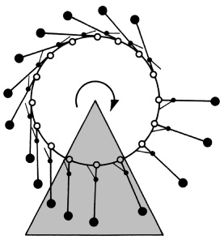

<details>
<summary>flowchart</summary>


</details>

Bild 7.4 Das „Klappstützenkarussell“ als typischer Vertreter eines Perpetuum mobile. Die drehbar gelagerten Ausleger, welche auf der rechten Seite durch die Stützen in radialer Position gehalten werden, bewirken dort wegen ihres längeren Hebelarms scheinbar ein größeres Drehmoment als die Ausleger auf der linken Seite, so dass sich das Karussell im Uhrzeigersinn drehen müsste. Aber: Wer oder was sollte die Ausleger im oberen rechten Viertel aufrichten? So liegt der Schwerpunkt in Wirklichkeit zum Teil noch auf der linken Seite (s. dazu die Aufgabe 10.2).

Dieser Erhaltungssatz ist einer der Grundpfeiler der Physik, von ihm wird das gesamte Naturgeschehen beherrscht. Mit seiner Entdeckung waren zugleich die jahrhundertelangen Versuche, eine Maschine zu konstruieren, die fortwährend Arbeit verrichtet, ohne dass für eine ständige Energiezufuhr von außen gesorgt wird, eines sog. **Perpetuum mobile**, als aussichtslos erkannt (s. dazu Bild 7.4).

## Beispiele 7.3:

1. Durch plötzliches Entspannen einer Schraubenfeder (Länge 20cm, Federkonstante $k =$ $1 \mathrm { k N / m ) }$ wird eine Kugel $(m = 100    g )$ senkrecht nach oben geschleudert. Welche Anfangsgeschwindigkeit $\nu _ { 0 }$ erhält die Kugel und bis zu welcher Höhe steigt sie maximal, wenn die Feder auf die Hälfte ihrer Ausgangslänge zusammengedrückt wurde?

Lösung: Für das Entspannen der Feder um den Betrag $x _ { 0 } = 0 , 1$ m <u>gilt mit (7.13), (</u>7.14) und (7.15) die Energiebilanz $k x _ { 0 } ^ { 2 } / 2 = m \nu _ { 0 } ^ { 2 } / 2   +   m g x _ { 0 }$ , woraus folgt $v_{0}=\sqrt{\left (kx_{0}^{2}/m\right ) -2gx_{0}}=9.9m/s$ und daraus wegen $\nu _ { 0 } = \sqrt { 2 g h }$ für die Steighöhe: $h = \nu _ { 0 } ^ { 2 } / ( 2 g ) = 5   \mathrm { m }$

---

90

7 Arbeit und Energie

2. Ein Körper von 0,5kg Masse fällt aus 4m Höhe auf das Ende einer senkrecht stehenden Schraubenfeder, die den Fall bremst (Federkonstante $k = 1    kN/m . a$ Um welchen Betrag wird die Feder maximal zusammengedrückt? b) Welche Geschwindigkeit hat der Körper, wenn die Feder bis zur Hälfte ihrer maximalen Stauchung zusammengedrückt ist? c) Wie groß ist die maximale Geschwindigkeit des Körpers? Die Masse der Feder wird vernachlässigt.

Lösung: a) Ist $x _ { \mathrm { m } }$ die maximale Stauchung der Feder, so ist die vom Körper insgesamt durchfallene Höhe $h + x _ { \mathrm { m } }$ und demzufolge dessen Verlust an potenzieller Energie $m g ( h + x _ { \mathrm { m } } )$ . Diese geht im unteren Umkehrpunkt in Form von Spannarbeit $k x _ { \mathrm { m } } ^ { 2 } / 2$ vollständig in potenzielle Energie der Feder über:

$$
m g (h + x _ {\mathrm{m}}) = \frac {k x _ {\mathrm{m}} ^ {2}}{2}, \quad x _ {\mathrm{m}} = \frac {m g}{k} + \sqrt {\left(\frac {m g}{k}\right) ^ {2} + \frac {2 m g h}{k}} = 2 0 3 \mathrm{mm}.
$$

Mit dem negativen Vorzeichen der Wurzel erhält man die maximale Dehnung einer mit dem Körper fest verbundenen Feder. b) Nimmt man das obere Ende der unbelasteten Feder als Nullpunkt der potenziellen Energie, so teilt sich die Gesamtenergie mg h bei einer momentanen Stauchung x der Feder nach unten in die Anteile potenzielle Energie der Lage des Körpers $- m g x ,$ kinetische Energie des Körpers $m \nu ^ { 2 } / 2$ und potenzielle Energie der Feder $k x ^ { 2 } / 2$ auf:

$$
m g h = - m g x + \frac {m v ^ {2}}{2} + \frac {k x ^ {2}}{2}, \quad \text {woraus folgt} \quad v = \sqrt {2 g (h + x) - (k / m) x ^ {2}}.
$$

Für $x _ { 1 } = x _ { \mathrm { m } } / 2 \approx 0 , _ { \mathrm { i } }$ 1m erhält man $v_{1}=7,8    m/s.c$ Die maximale Geschwindigkeit erhält man aus der Extremwertbedingung d $\mathbf { \nabla } | \nu / \mathbf { d } x = 0$ . Aus ihr fol<u>gt d</u>ie zugehörige Stauchung $x _ { 2 } = m g / k =$ 4,9mm und mit der Auftreffgeschwindigkeit $\nu _ { 0 } = \sqrt { 2 g h }$ aus b): $v_{\mathrm{m}}=\sqrt{v_{0}^{2}+mg^{2}/k}=8.9\mathrm{~m/s}.$ $x _ { 2 }$ ist gleichzeitig die Stauchung im statischen Gleichgewicht. □

## Aufgabe

**7.3** Wie groß ist im obigen Beispiel 7.3/2 a) die von der Feder entwickelte Leistung P zu Beginn, am Ende und in der Mitte des Entspannungsvorgangs, b) die mittlere Leistung über den gesamten Federweg $x _ { 0 } ? - A n l e i t u n g ;$ Gehe vom Energiesatz aus und berechne zunächst v in Abhängigkeit von der momentanen Auslenkung x der Feder und daraus P nach Gleichung (7.10)!

## 7.5 Äquivalenz von Masse und Energie

Eine der wichtigsten Schlussfolgerungen, die EINSTEIN aus seiner speziellen Relativitätstheorie zog, ist zweifellos die Erkenntnis, dass Masse und Energie ineinander umwandelbar sind. Die entsprechende Gleichung, die uns den quantitativen Zusammenhang zwischen der Masse und der ihr äquivalenten Energie liefert, gewinnen wir dadurch, dass wir die Gleichung für die relativistische Masse (6.17)

$$
m = \frac {m _ {0}}{\sqrt {1 - (v ^ {2} / c ^ {2})}} \tag {7.18}
$$

auf beiden Seiten mit dem Quadrat der Vakuumlichtgeschwindigke<u>it c</u> multiplizieren und den Wurzelausdruck für $v ^ { 2 } / c ^ { 2 } = x \ll 1$ nach der Näherungsformel $1 / \sqrt { 1 - x } \approx 1 + ( x / 2 )$ ersetzen:

$$
m c ^ {2} = \frac {m _ {0} c ^ {2}}{\sqrt {1 - (v ^ {2} / c ^ {2})}} \approx m _ {0} c ^ {2} \left(1 + \frac {1}{2} \frac {v ^ {2}}{c ^ {2}}\right) = m _ {0} c ^ {2} + \frac {m _ {0} v ^ {2}}{2}. \tag {7.19}
$$

---

7.5 Äquivalenz von Masse und Energie

91

Das zweite Glied auf der rechten Seite von (7.19) stellt die aus der nichtrelativistischen Mechanik her bekannte kinetische Energie $( m _ { 0 } / 2 ) \nu ^ { 2 }$ eines Teilchens mit der Ruhmasse $m _ { 0 }$ und der Geschwindigkeit v dar. Demnach müssen auch alle übrigen in dieser Gleichung additiv verknüpften Glieder Energiegrößen darstellen. Fassen wir die linke Seite von Gleichung (7.19) als **relativistische Gesamtenergie** $E = m c ^ { 2 }$ des Teilchens auf, so erkennt man, dass auch dem unbewegten Teilchen $( \nu = 0 )$ mit der Ruhmasse m<sub>0</sub> eine bestimmte Energie zukommt, nämlich

$$
E _ {0} = m _ {0} c ^ {2} \quad (\text {Ruhenergie}). \tag {7.20}
$$

Die relativistische Gesamtenergie ergibt sich folglich als Summe aus Ruhenergie und kinetischer Energie zu

$$
E = E _ {0} + E _ {\mathrm{k}} = m c ^ {2}. \tag {7.21}
$$

Damit wird die **relativistische kinetische Energie**

$$
E _ {\mathrm{k}} = E - E _ {0} = (m - m _ {0}) c ^ {2} = m _ {0} c ^ {2} \left(\frac {1}{\sqrt {1 - (v ^ {2} / c ^ {2})}} - 1\right). \tag {7.22}
$$

**Herleitung allgemein:** Die kinetische Energie ist gleich der Arbeit (7.7) $E _ { \bf k } = W = - \int _ { 0 } ^ { s } F _ { \mathrm { T } }$ ds gegen die aus (6.18) folgende Trägheitskraft $F _ { \mathrm { T } } = - \mathbf { d } ( m \nu ) / \mathbf { d } t$ bei der Beschleunigung eines Körpers (vgl. Abschnitt 7.1 und 7.3), wobei für m jetzt die relativistische Masse (6.17) einzusetzen ist. Mit $\mathbf { d } s = \nu   \mathbf { d } t$ und anschließender partieller Integration erhält man

$$
E _ {\mathrm{k}} = \int_ {0} ^ {\nu} \mathrm{d} (m v) v = m v ^ {2} - \int_ {0} ^ {\nu} m v \mathrm{d} v = m v ^ {2} - m _ {0} \int_ {0} ^ {\nu} \frac {v \mathrm{d} v}{\sqrt {1 - \frac {v ^ {2}}{c ^ {2}}}}.
$$

Die letzte Integration kann (z. B. mithilfe der Substitution $\sqrt { 1 - \frac { \nu ^ { 2 } } { c ^ { 2 } } } = z , \; \nu  { \mathbf { d } } \nu = - c ^ { 2 } z  { \mathbf { d } } z ) .$ analytisch durchgeführt werden und ergibt

$$
\int_ {0} ^ {\nu} \frac {\nu \mathrm{d} \nu}{\sqrt {1 - \frac {\nu^ {2}}{c ^ {2}}}} = - c ^ {2} \int_ {1} ^ {\sqrt {1 - \frac {\nu^ {2}}{c ^ {2}}}} \mathrm{d} z = - c ^ {2} \left(\sqrt {1 - \frac {\nu^ {2}}{c ^ {2}}} - 1\right).
$$

Für die relativistische kinetische Energie erhält man damit

$$
E _ {\mathrm{k}} = m v ^ {2} + m _ {0} c ^ {2} \left(\sqrt {1 - \frac {v ^ {2}}{c ^ {2}}} - 1\right) = m c ^ {2} - m _ {0} c ^ {2}.
$$

Nach Gleichung (7.21) ist jeder Energie E eine Masse $m = E / c ^ { 2 }$ zugeordnet und umgekehrt. Da eine wesentliche Eigenschaft der Masse die Trägheit ist, besitzt demnach auch jede Energie diese Eigenschaft. Gleichung (7.21) wird daher auch als Gesetz von der Trägheit der Energie bezeichnet.

Bewegt sich das Teilchen in einem Kraftfeld (z. B. im Schwerefeld), so tritt noch die potenzielle Energie des Teilchens $E _ { \mathrm { p } }$ hinzu, und es gilt der **Energiesatz** in der Form

$$
E _ {\mathrm{g}} = E _ {0} + E _ {\mathrm{k}} + E _ {\mathrm{p}} = m c ^ {2} + E _ {\mathrm{p}} = \text {const.} \tag {7.23}
$$

---

92

7 Arbeit und Energie

## Beispiele 7.4:

1. Welche Energie würde bei der restlosen Umwandlung von 1g Masse freigesetzt?

2. Bei der Beschleunigung von Elektronen (Ruhmasse $m_{\mathrm{e}0} = 0.91 \cdot 10^{-30}   \mathrm{kg}$ in einem elektrischen Feld erhalten diese bei einer Beschleunigungsspannung von $1 0 ^ { 6 } \mathrm { V }$ eine kinetische Energie von $^ { 1 , 6 \cdot 1 0 ^ { - 1 3 } ) }$ J. a) Welche Geschwindigkeit erreichen die Elektronen? b) Welche Geschwindigkeit würde sich bei nichtrelativistischer Rechnung ergeben?

Lösung: a) Aus (7.22) folgt nach einigen Umformungen

$$
\nu = c \sqrt {1 - \left(1 + \frac {E _ {\mathrm{k}}}{m _ {\mathrm{e0}} c ^ {2}}\right) ^ {- 2}} = 2, 8 3 \cdot 1 0 ^ {8} \mathrm{m/s} \approx 0, 9 4 c.
$$

b) $\nu = \sqrt { 2 E _ { \mathrm { k } } / m _ { 0 } } = 5 { , } 9 2 \cdot 1 0 ^ { 8 }   \mathrm { m / s }$ . Diese Geschwindigkeit wäre größer als $c ;$ das widerspricht der Erfahrung. □

## Aufgabe

**7.4** Bei der Explosion von 1t TNT (Trinitrotoluol) wird eine Energie von $4   \cdot   1 0 ^ { 9 } ]$ J freigesetzt. Wie groß ist die Abnahme der Ruhmasse bei der Explosion einer Megatonnenbombe?

---

Gravitation

## 8.1 Die keplerschen Gesetze der Planetenbewegung und das Gravitationsgesetz

In Abschnitt 4.4 hatten wir zwei Grundeigenschaften der Masse erkannt, die Trägheit und die Schwere. Erstere tritt bei der Beschleunigung oder Abbremsung von Körpern als Bewegungswiderstand auf, letztere bestimmt die Gewichtskraft eines Körpers. Diese hängt nicht von seiner Bewegung ab, sondern ist eine Folge der allgemeinen Massenanziehung, der **Gravitation**. Wo immer zwei Massen einander gegenüberstehen, ziehen sie sich von selbst wechselseitig an. So wie die Erde ihren natürlichen Trabanten, den Mond, anzieht, so zieht nach dem Wechselwirkungsprinzip (4.24) mit der gleichen Kraft der Mond die Erde an. Gleiches gilt für die zwischen der Sonne und den Planeten wirkenden Anziehungskräfte, welche die Ursache für deren Bahnbewegung im Sonnensystem sind.

Die Gesetze der Bewegung der Himmelskörper hat JOHANNES KEPLER (1571–1630) aus den astronomischen Beobachtungen von NIKOLAUS KOPERNIKUS (1473–1543) und speziell an dem Planeten Mars von TYCHO DE BRAHE (1546–1601) empirisch hergeleitet. Es sind dies die drei berühmten **KEPLERschen Gesetze:**

1. Die Planeten bewegen sich auf Ellipsen, in deren einem Brennpunkt die Sonne steht (Bild 8.1).
2. Der von der Sonne zu einem Planeten gezogene Fahrstrahl überstreicht in gleichen Zeiten gleiche Flächen (Flächensatz, Bild 8.1).
3. Die Quadrate der Umlaufzeiten verschiedener Planeten verhalten sich wie die dritten Potenzen der großen Halbachsen ihrer Bahnellipsen:

$$
\frac {T _ {1} ^ {2}}{a _ {1} ^ {3}} = \frac {T _ {2} ^ {2}}{a _ {2} ^ {3}} = \frac {T _ {3} ^ {2}}{a _ {3} ^ {3}} = \dots = \text {const.} \tag {8.1}
$$

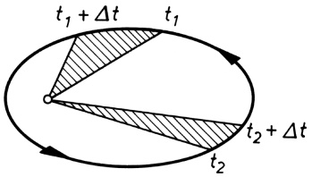

<details>
<summary>text_image</summary>

t₁ + Δt
t₁
t₂ + Δt
t₂
</details>

Bild 8.1 Zum 1. und 2. keplerschen Gesetz

Die KEPLERschen Gesetze gelten grundsätzlich für alle zum Sonnensystem gehörigen, periodisch wiederkehrenden Himmelskörper (z. B. Kometen) sowie sinngemäß auch für alle die Erde umkreisenden Körper (Mond, künstliche Satelliten). Aus dem Flächensatz folgt, dass die Geschwindigkeit des umlaufenden Körpers im sonnen- bzw. erdnächsten Punkt der Bahn (Pe rihel bzw. Perigäum) am größten, im sonnen- bzw. erdfernsten Punkt (Aphel bzw. Apogäum) am kleinsten ist. Dies steht im Einklang mit dem Energiesatz, wonach die Gesamtenergie des umlaufenden Körpers stets konstant ist: Im Perihel besitzt er ein Minimum, im Aphel ein Ma-

---

94

8 Gravitation

ximum an potenzieller Energie. Demnach muss seine kinetische Energie und damit seine Geschwindigkeit im Perihel am größten, im Aphel am kleinsten sein. Siehe auch Abschnitt 11.4.

Ausgehend von der Erkenntnis, dass die allen Körpern innewohnende universelle Eigenschaft der gegenseitigen Massenanziehung, die **Schwerkraft**, die Ursache für die Bahnbewegung der Himmelskörper ist, gelang es NEWTON (1687), das Kraftgesetz für die Anziehung zweier Massen herzuleiten. Wir wollen dieses Kraftgesetz durch eine stark vereinfachte Überlegung aus dem 3. KEPLERschen Gesetz gewinnen (Bild 8.2): Infolge des Umlaufs eines Planeten der Masse m auf einer (wegen der geringen Exzentrizität der meisten Planetenbahnen) näherungsweise kreisförmig angenommenen Bahn vom Radius r um die Sonne (Masse M) mit der Winkelgeschwindigkeit $\omega = 2 \pi / T \left( T \right.$ Umlaufzeit) wirkt auf den Planeten die von der Sonne weg gerichtete Zentrifugalkraft $m \omega ^ { 2 } r$ , die der ihr entgegengesetzt gerichteten **Gravitationskraft** $F$ das Gleichgewicht hält.

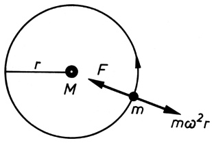

<details>
<summary>text_image</summary>

r
M
F
m
mω²r
</details>

Bild 8.2 Zur Herleitung des Gravitationsgesetzes aus dem 3. keplerschen Gesetz

Es gilt daher

$$
F = m \omega^ {2} r = \frac {m (2 \pi) ^ {2} r}{T ^ {2}}
$$

und mit dem 3. KEPLERschen Gesetz (8.1), welches für zwei Planeten auf Kreisbahnen lautet $T _ { 1 } ^ { 2 } : T _ { 2 } ^ { 2 } = r _ { 1 } ^ { 3 } : r _ { 2 } ^ { 3 }$ oder $T ^ { 2 } = \mathrm { c o n s t } \cdot r ^ { 3 }$ :

$$
F = \mathrm{const} \cdot \frac {m}{r ^ {2}}.
$$

Da nach dem Wechselwirkungsgesetz (4.25) die Massen m und M sich wechselseitig anziehen, muss die Gravitationskraft $F$ auch proportional zur Masse M sein; es gilt daher

$$
F = \gamma \frac {m M}{r ^ {2}} \quad (\text {Gravitationsgesetz, Newton 1687}). \tag {8.2}
$$

## Gravitationsgesetz:

**Die zwischen zwei Körpern wirkende Gravitationskraft ist dem Produkt beider Massen proportional und nimmt mit dem Quadrat ihres Abstandes ab.**

Das Gravitationsgesetz (8.2) ist außer für Punktmassen und homogene Kugeln auch für Körper, die wie die Erde aus homogenen Kugelschalen bestehen, streng gültig. Dabei ist r jeweils der Abstand der Kugelmittelpunkte, d. h., die Kugel verhält sich $\mathbf { s o } ,$ als sei ihre gesamte Masse im Mittelpunkt vereinigt.

In Gleichung (8.2) ist $\gamma$ die Gravitationskonstante. Sie ist eine von der Beschaffenheit der Körper unabhängige universelle Naturkonstante, die experimentell bestimmt werden muss. Ihr Wert, der verglichen mit anderen Naturkonstanten nur eine geringe relative Messgenauigkeit von etwa $1 0 ^ { - \widetilde { 4 } }$ aufweist (s. 2.3), beträgt

$$
\gamma = 6, 6 7 4 \cdot 1 0 ^ {- 1 1}   \mathrm{N} \cdot \mathrm{m} ^ {2} / \mathrm{kg} ^ {2} \qquad (\text {Gravitationskonstante}). \tag {8.3}
$$

---

8.1 Die keplerschen Gesetze der Planetenbewegung und das Gravitationsgesetz

95

Die Bestimmung der Gravitationskonstante γ gelang erstmals 1798 dem englischen Physiker CAVENDISH in einem Laborexperiment. Er benutzte dazu eine Drehwaage (Bild 8.3), mit der die Anziehungskraft zwischen je zwei sich gegenüberstehenden schweren und leichten Metallkugeln mit den Massen $m _ { 1 }$ und $m _ { 2 }$ aus der Verdrillung des elastischen Aufhängefadens des Waagebalkens mittels eines daran angebrachten Spiegels über Lichtzeiger gemessen wurde.

An der Erdoberfläche, d. h. für $r = R = 6 { , } 3 8 { \cdot } 1 0 ^ { 6 }$ m (Erdradius), ist mit $M = 5 { , } 9 8 { \cdot } 1 0 ^ { 2 4 }$ kg (Masse der Erde) die **Gewichtskraft** eines Körpers der Masse m nach (8.2) $\gamma m M / R ^ { 2 } = m g$ , womit sich die für alle Körper gleich große Fallbeschleunigung $g$ berechnet zu

$$
g = \frac {\gamma M}{R ^ {2}} = 9, 8 1 \mathrm{m} / \mathrm{s} ^ {2} \quad (\text {Fallbeschleunigung an der Erdoberfläche}). \tag {8.4}
$$

Entsprechend ist in der Höhe h über der Erdoberfläche $g ( h ) = \gamma M / ( R + h ) ^ { 2 }$ bzw. mit (8.4)

$$
g (h) = g \frac {R ^ {2}}{(R + h) ^ {2}} \quad (\text {Fallbeschleunigung in der Höhe} h). \tag {8.5}
$$

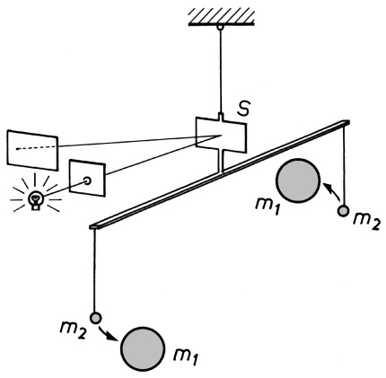

<details>
<summary>text_image</summary>

Physics diagram showing a pulley system with masses m1 and m2, a switch S, and light bulbs for motion control.
</details>

**Bild 8.3** Cavendish-Experiment zur Bestimmung der Gravitationskonstante $\gamma .$

Cavendish führte sein berühmt gewordenes Experiment, welches Ausdruck der hochentwickelten Experimentierkunst jener Zeit ist, allerdings nicht mit dem Ziel der Bestimmung der Gravitationskonstante $\gamma ,$ sondern der Masse bzw. mittleren Dichte der Erde durch. Aus dem Gravitationsgesetz (8.2) folgte damit aber zugleich auch der Wert für $\gamma$ (vgl. die nachfolgenden Beispiele 8.1/1 und 8.1/2).

## Beispiele 8.1:

1. Bestimme aus der Fallbeschleunigung g (bei bekanntem Erdradius) die mittlere Dichte der Erde $\varrho _ { \mathrm { E } } !$

Lösung: Aus (8.4) folgt $M = g R ^ { 2 } / \gamma$ und damit $\varrho _ { \mathrm { E } } = M / ( 4 \pi R ^ { 3 } / 3 ) = 3 g / ( 4 \pi R \gamma ) = 5 . 5 0   \mathrm { k g / d m } ^ { 3 }$

2. Zeige, wie aus der im oben beschriebenen CAVENDISH-Experiment gemessenen Gravitationskraft F zwischen den (bekannten) Massen $m _ { 1 }$ und $m _ { 2 }$ bei Kenntnis von R und $g$ die mittlere Dichte der Erde $\varrho _ { \mathrm { E } }$ und daraus die Gravitationskonstante $\gamma$ bestimmt werden kann!

Lösung: Aus dem in Beispiel 1 errechneten Ausdruck für $\varrho _ { \mathrm { E } }$ folgt $\gamma = 3 g / ( 4 \pi R \varrho _ { \mathrm { E } } )$ . Dies in (8.2) eingesetzt, ergibt nach Umstellung $\varrho _ { \mathrm { E } } = 3 m _ { 1 } m _ { 2 } g / ( 4 \pi r ^ { 2 } R F )$ mit r als Entfernung der Kugelmittelpunkte von $m _ { 1 }$ und $m _ { 2 }$ . Mit dem so ermittelten Wert für $\varrho _ { \mathrm { E } }$ erhält man $\gamma$ aus der davor stehenden Beziehung.

3. Bestimme mit Hilfe des Gravitationsgesetzes (8.2) den Wert des konstanten Verhältnisses $T ^ { 2 } / a ^ { 3 }$ (Zentralkörperkonstante) im 3. KEPLERschen Gesetz (8.1) für Erdsatelliten auf kreisförmigen Bahnen $( a = r ) ;$ !

Lösung: Die Zentrifugalkraft des Satelliten ist mω $b ^ { 2 } r = m ( 2 \pi / T ) ^ { 2 } r = 4 \pi ^ { 2 } m r / T ^ { 2 }$ . Durch Gleichsetzen mit (8.2) und Umstellen folgt mit der Masse der Erde $M \approx 6   \cdot   1 0 ^ { 2 4 }   \mathrm { k g }$ das für alle

---

96

8 Gravitation

Erdsatelliten gleiche Verhältnis zu $T ^ { 2 } / r ^ { 3 }   =   4 \pi ^ { 2 } / ( \gamma M )   \approx   1 0 ^ { - 1 3 }   \mathrm { s } ^ { 2 } / \mathrm { m } ^ { 3 }$ . Für einen geostationären Fernsehsatelliten in 36 000km Höhe über dem Äquator, d. h. in einem Abstand vom Er<u>dmittelpunkt von</u> $r = 4 2   3 8 0   \mathrm { k m }$ , erhält man daraus die gewünschte Umlaufzeit von $T =$ $\sqrt { 1 0 ^ { - 1 3 } \cdot ( 4 2   3 8 0 \cdot 1 0 ^ { 3 } ) ^ { 3 } }   \mathrm { s } \approx 8 6   4 0 0   \mathrm { s } = 2 4   \mathrm { h }$ □

## Aufgaben

**8.1** Zeige, wie sich aus dem im obigen Beispiel 8.1/3 bestimmten Verhältnis $T ^ { 2 } / r ^ { 3 }$ (für ein beliebiges Kraftzentrum $M )$ die Masse eines unbekannten Planeten $M _ { \mathrm { P l } }$ aus den Bahndaten seines Trabanten (Bahnradius $r _ { \mathrm { \Pi r } }$ und Umlaufdauer $T _ { \mathrm { T r } } )$ bestimmen lässt!
**8.2** Nach welcher Gesetzmäßigkeit nimmt die Bahngeschwindigkeit $\nu ( r )$ der Planeten mit größer werdender Entfernung r von der Sonne ab?
**8.3** Berechne die Fallbeschleunigung g
a) an der Oberfläche des Mondes (Masse $7 { , } 3 8   \cdot   1 0 ^ { 2 2 }$ kg; Radius 1738km);
b) in 36 000km Höhe über dem Erdäquator, dem Orbit für geostationäre Satelliten (Erdradius 6380km)!

## 8.2 Arbeit gegen die Schwerkraft. Kosmische Geschwindigkeiten

Um einen Körper (Masse m) im Schwerefeld der Erde anzuheben, muss Verschiebungsarbeit gegen die Schwerkraft (8.2) verrichtet werden. Soll der Körper von der Entfernung $r _ { 1 }$ bis in die Entfernung $r _ { 2 } > r _ { 1 }$ vom Erdmittelpunkt gebracht werden, so ist die dabei aufzuwendende Arbeit nach (7.3) gleich dem Wegintegral der Kraft

$$
W = - \int_ {r _ {1}} ^ {r _ {2}} \boldsymbol {F} \cdot \mathrm{d} \boldsymbol {r} = - \int_ {r _ {1}} ^ {r _ {2}} F \mathrm{d} r \cos 1 8 0 ^ {\circ} = \gamma m M \int_ {r _ {1}} ^ {r _ {2}} \frac {\mathrm{d} r}{r ^ {2}} = \gamma m M \left(\frac {1}{r _ {1}} - \frac {1}{r _ {2}}\right). \tag {8.6}
$$

Erfolgt die Verschiebung des Körpers von der Erdoberfläche aus bis in die Höhe $h ,$ d. h. $r _ { 1 } = R$ (Erdradius) und $r _ { 2 } = R + h$ , so wird unter Beachtung von Gleichung (8.4)

$$
W = \gamma m M \left(\frac {1}{R} - \frac {1}{R + h}\right) = \frac {\gamma m M}{R} \frac {h}{R + h} = m g R \frac {h}{R + h}. \tag {8.7}
$$

Um diesen Betrag erhöht sich dabei die potenzielle Energie des Körpers, d. h., es ist $W = \Delta E _ { \mathrm { p } } =$ $E _ { \mathrm { p } } ( r _ { 2 } ) - E _ { \mathrm { p } } ( r _ { 1 } )$ . Wenn $h \ll R ,$ , so wird $W = m g h$ , entsprechend dem bekannten Ausdruck für die Hubarbeit bzw. die Änderung der potenziellen Energie bei kleinen Höhenunterschieden.

**Kosmische Geschwindigkeiten.** Die vorstehenden Ausführungen sind von großer Bedeutung für die Beschreibung der Bahnen von ballistischen Flugkörpern (Geschosse, Fernraketen) sowie von Satelliten und Raumsonden. Für diese kommen mehrere Arten von Flugbahnen in Frage. Die Kreisbahn als spezieller Fall einer KEPLER-Ellipse wird erhalten, wenn die auf den umlaufenden Körper (Satelliten) wirkende Fliehkraft in der Höhe h gleich der Schwerkraft ist, wenn also mit (8.5) gilt

$$
\frac {m v ^ {2}}{R + h} = m g (h) = m g \frac {R ^ {2}}{(R + h) ^ {2}}; \quad \nu (h) = \sqrt {\frac {g R ^ {2}}{R + h}}. \tag {8.8}
$$

Die Kreisbahngeschwindigkeit $\nu ( h )$ nimmt, wie man sieht, mit zunehmender Höhe ab. Für einen in sehr geringer Höhe $( h \ll R )$ umlaufenden Satelliten folgt

$$
v _ {1} = \sqrt {g R} = 7, 9 \mathrm{km/s} \quad \text {(1.kosmische Geschwindigkeit).} \tag {8.9}
$$

---

8.2 Arbeit gegen die Schwerkraft. Kosmische Geschwindigkeiten

97

Bei Geschwindigkeiten $\nu > \nu _ { 1 }$ umkreist der Flugkörper die Erde auf einer elliptischen Bahn (Bild 8.4). Für $\nu < \nu _ { 1 }$ kehrt der Körper wieder zur Erde zurück; er durchläuft dabei nur einen Teil der KEPLER-Ellipse. Die beiden Ellipsen für $\nu > \nu _ { 1 }$ und $\nu < \nu _ { 1 }$ unterscheiden sich dadurch, dass im ersten Fall der Mittelpunkt der Erde in dem dem Abschusspunkt näheren, im zweiten Fall im ferneren Ellipsenbrennpunkt liegt. Die Bahnen von Wurfkörpern sind also stets Ellipsen und keine Wurfparabeln, da die Richtung der Fallbeschleunigung über die Bahnkurven veränderlich ist. Für kleine Entfernungen kann näherungsweise die Bahnellipse durch eine Parabel angenähert werden.

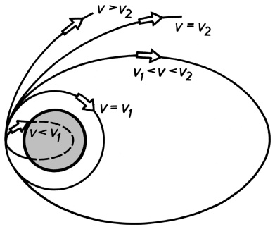

<details>
<summary>flowchart</summary>

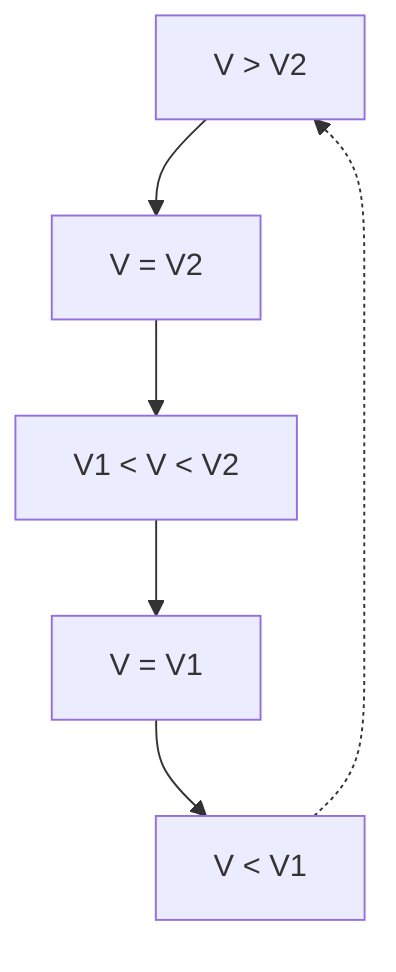
</details>

Bild 8.4 Bahnkurven ballistischer Flugkörper bei horizontalem Einschuss in die Flugbahn.

$\nu _ { 1 }$ 1. kosmische Geschwindigkeit (Kreisbahngeschwindig keit), $$\nu _ { 2 }$ 2.$ kosmische Geschwindigkeit (Parabelgeschwindigkeit)

Die Mindestgeschwindigkeit, die ein Körper erhalten muss, um sich aus dem Anziehungsbereich der Erde völlig entfernen zu können, die sog. Fluchtgeschwindigkeit, folgt aus der Bedingung, dass die kinetische Energie des Körpers so groß sein muss wie die Arbeit, die erforderlich ist, um ihn bis ins Unendliche zu befördern, d. h., es muss mit Gleichung (8.7) gelten

$$
\frac {m v ^ {2}}{2} = \frac {\gamma m M}{R} \frac {h}{R + h} = m g R \frac {h}{R + h} = m g R \frac {1}{(R / h) + 1}, \tag {8.10}
$$

woraus für $h \to \infty$ folgt

$$
v _ {2} = \sqrt {2 g R} = 1 1, 2 \mathrm{km/s} \quad (2. \text {kosmische Geschwindigkeit}). \tag {8.11}
$$

Die zugehörige ballistische Flugbahn ist eine Parabel (Bild 8.4). Für $\nu > \nu _ { 2 }$ entweicht der Flugkörper auf einer hyperbolischen Bahn ebenfalls auf Nimmerwiedersehen in den Weltraum.

Die Geschwindigkeit, die ein im Abstand $r _ { \mathrm { E } }$ von der Sonne befindlicher Flugkörper haben muss, um die Gravitationskraft der Sonne $F _ { \mathrm { S } } = \gamma m M _ { \mathrm { S } } / r _ { \mathrm { E } } ^ { 2 }$ überwinden zu können, die Fluchtgeschwindigkeit $v _ { \mathrm { S } } ,$ berechnet sich analog zu $v _ { 2 }$ gemäß (8.10) für $h \to \infty ;$

$$
\frac {m v _ {\mathrm{S}} ^ {2}}{2} = \frac {\gamma m M _ {\mathrm{S}}}{r _ {\mathrm{E}}}; \quad v _ {\mathrm{S}} = \sqrt {\frac {2 \gamma M _ {\mathrm{S}}}{r _ {\mathrm{E}}}} = 4 2, 1 \mathrm{km/s}.
$$

Dies ist die Fluchtgeschwindigkeit im Bezugssystem der Sonne. In Bezug auf die Erde, die im Sonnensystem selbst bereits die Geschwindigkeit $v_{\mathrm{E}} = 2 \pi r_{\mathrm{E}} / T_{\mathrm{E}} = 29.9   \mathrm{km/s}$ hat, ist die Fluchtgeschwindigkeit $\nu _ { \mathrm { F } } ^ { \prime } = \nu _ { \mathrm { S } } - \nu _ { \mathrm { E } } = 1 2 { , } 2 \mathrm { k m / s }$ . Um von der Erde aus das Sonnensystem verlassen zu können, muss das Gravitationsfeld der Erde und das der Sonne überwunden werden. Dazu benötigt der Flugkörper die kinetische Energie m $\nu _ { 3 } ^ { 2 } / 2 = m \nu _ { 2 } ^ { 2 } / 2 + m \nu _ { \mathrm { F } } ^ { \prime 2 } / 2$ , woraus folgt

$$
v _ {3} = \sqrt {v _ {2} ^ {2} + v _ {\mathrm{F}} ^ {\prime 2}} = 1 6, 6 \mathrm{km/s} \quad \text {(3.kosmische Geschwindigkeit).} \tag {8.12}
$$

## Aufgaben

**8.4** Wie groß ist die zu verrichtende Arbeit, um 1kg Masse von der Erdoberfläche bis in die unendliche Ferne zu befördern? (Erdradius $R = 6380    km$
**8.5** Eine Raumsonde soll aus einer Erdumlaufbahn in $h = R = 6380    km$ Höhe ins All gestartet werden. Berechne die erforderliche Geschwindigkeit!

---

## Dynamik der Punktmassen-Systeme

Wir betrachten nun die Bewegung eines Systems, bestehend aus einer Anzahl von Teilchen, deren gegenseitige Lage veränderlich ist. Die Teilchen des Systems können aufeinander Kräfte ausüben, die dem Wechselwirkungsgesetz gehorchen (**innere Kräfte** des Systems), des weiteren können an den Teilchen **äußere Kräfte** angreifen, die von Kraftzentren herrühren, die sich außerhalb des Systems befinden. Wirken auf keines der Teilchen äußere Kräfte, so ist das System abgeschlossen.

## 9.1 Impulserhaltungssatz. Massenmittelpunkt

Das System bestehe der Einfachheit halber aus nur zwei Massen $m _ { 1 }$ und $m _ { 2 }$ (Bild 9.1), die ohne Reibung auf einer Unterlage gleiten und über eine elastische Kopplungsfeder (innere) Kräfte $F ^ { \mathrm { i } }$ aufeinander ausüben können. Wird die Feder gespannt und sodann freigegeben, so führen die Massen gegeneinander Schwingungen aus, wobei nach dem Wechselwirkungsgesetz für die abstoßenden bzw. anziehenden Kräfte, die auf die beiden Massen wirken, gilt

$$
F _ {1} ^ {\mathrm{i}} = - F _ {2} ^ {\mathrm{i}}, \quad \text {also nach (4.9)} \quad \frac {\mathrm{d} (m _ {1} v _ {1})}{\mathrm{d} t} = - \frac {\mathrm{d} (m _ {2} v _ {2})}{\mathrm{d} t} \quad \text {oder} \tag {9.1}
$$

$$
\frac {\mathrm{d}}{\mathrm{d} t} (m _ {1} v _ {1} + m _ {2} v _ {2}) = 0, \quad \text {d.h.} \quad m _ {1} v _ {1} + m _ {2} v _ {2} = \text {const.} \tag {9.2}
$$

Die Summe der Impulse beider Massen ist also stets konstant. Verallgemeinernd gilt der

## Impulserhaltungssatz:

**In einem abgeschlossenen System, in dem nur innere Kräfte wirken, bleibt – welche Vorgänge sich innerhalb des Systems auch immer abspielen mögen – der Gesamtimpuls (Vektorsumme aller Einzelimpulse** $m _ { i } \nu _ { i } )$ **ungeändert.**

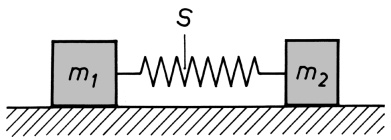

<details>
<summary>text_image</summary>

S
m₁ m₂
</details>

Bild 9.1 Zum Impulserhaltungssatz. S ist der gemeinsame Massenmittelpunkt (Schwerpunkt) der Massen $m _ { 1 }$ und $m _ { 2 }$

Waren in unserem Beispiel vor dem Entspannen der Feder die Geschwindigkeiten und damit die Impulse beider Massen (also auch ihre Summe) gleich null, so gilt auch für jeden anderen Zeitpunkt nach Freigabe der Feder

$$
m _ {1} v _ {1} + m _ {2} v _ {2} = 0 \quad \text {oder} \quad m _ {1} v _ {1} = - m _ {2} v _ {2}, \tag {9.3}
$$

d. h., die Impulse der Massen sind in jedem Augenblick einander entgegengesetzt gleich und heben sich somit stets auf. Die Einwirkung der Federkraft, welche eine innere Kraft ist, hat also den Gesamtimpuls nicht geändert.

---

9.1 Impulserhaltungssatz. Massenmittelpunkt

99

Aus (9.2) folgt, wenn die Lagen der beiden Massen zur Zeit t durch die Koordinaten $x _ { 1 }$ und $x _ { 2 }$ gegeben sind:

$$
m _ {1} \frac {\mathrm{d} x _ {1}}{\mathrm{d} t} + m _ {2} \frac {\mathrm{d} x _ {2}}{\mathrm{d} t} = \frac {\mathrm{d}}{\mathrm{d} t} (m _ {1} x _ {1} + m _ {2} x _ {2}) = \text {const.} \tag {9.4}
$$

Wir definieren nun durch die Koordinate

$$
x _ {S} = \frac {m _ {1} x _ {1} + m _ {2} x _ {2}}{m _ {1} + m _ {2}} \tag {9.5}
$$

einen zwischen den beiden Massen gelegenen Punkt, den wir den **Massenmittelpunkt** (S) des Systems nennen (s. Bild 9.1). Lassen wir diesen mit dem Nullpunkt des Koordinatensystems zusammenfallen, also $x _ { S } = 0$ , so erkennen wir aus (9.5), dass für die Teilstrecken zwischen S und den beiden Massen stets gilt $| x _ { 1 } | / | x _ { 2 } | = m _ { 2 } / m _ { 1 }$ , d. h., der Massenmittelpunkt zweier Massen teilt deren Verbindungsstrecke im umgekehrten Verhältnis der Massen.

Für die Geschwindigkeit des Massenmittelpunkts folgt nun aus (9.4) und (9.5)

$$
v _ {S} = \frac {\mathrm{d} x _ {S}}{\mathrm{d} t} = \text {const}, \tag {9.6}
$$

d. h., bei allen Bewegungen der beiden Massen bleibt ihr gemeinsamer Massenmittelpunkt in Ruhe (sofern die Konstante den Wert null hat), oder er bewegt sich geradlinig mit konstanter Geschwindigkeit. Für Systeme, deren Teilchen sich nur unter der Wirkung innerer Kräfte verschieben, gilt demnach der

## Erhaltungssatz des Massenmittelpunkts:

## Der Massenmittelpunkt eines abgeschlossenen Systems ist in Ruhe oder bewegt sich geradlinig und gleichförmig.

Bei der Explosion einer Bombe fliegen (durch das Wirken innerer Kräfte) ihre Teile nach allen Seiten auseinander, ihr gemeinsamer Massenmittelpunkt aber bleibt erhalten. – Platzt ein Körper im Fluge, so bewegt sich, wenn keine äußeren Kräfte hinzukommen, der Massenmittelpunkt des „Systems“ weiter, als ob nichts geschehen wäre.

Der Massenmittelpunkt eines Vielteilchensystems verhält sich demnach so wie eine einzelne Punktmasse; er befolgt das Trägheitsgesetz, sofern keine äußeren Kräfte auf das System einwirken (abgeschlossenes System). Greifen hingegen an den Teilchen des Systems äußere Kräfte $F _ { i } ^ { \mathrm { a } }$ an, deren Resultierende gleich $\boldsymbol { F } ^ { \mathtt { a } } = \sum \boldsymbol { F } _ { i } ^ { \mathtt { a } }$ ist, so gilt, da innere Kräfte auf die Bewegung des Massenmittelpunkts keinen Einfluss haben, nach dem 2. NEWTONschen Axiom (4.14)

$$
m \frac {\mathrm{d} \boldsymbol {v} _ {S}}{\mathrm{d} t} = \boldsymbol {F} ^ {\mathrm{a}} \quad (\text {Bewegungsgleichung des Vielteilchensystems}). \tag {9.7}
$$

Dabei ist m die Gesamtmasse des Systems. Gleichung (9.7) besagt:

**Bei Einwirkung äußerer Kräfte auf ein System von Punktmassen bewegt sich dessen Massenmittelpunkt so, als sei die gesamte Masse des Systems in ihm vereinigt und als greife die resultierende Gesamtkraft an ihm an.**

---

100

9 Dynamik der Punktmassen-Systeme

Für das abgeschlossene System $( F ^ { \mathbf { a } } = 0 )$ folgt aus Gleichung (9.7) wieder der Erhaltungssatz des Massenmittelpunkts (9.6). Da die häufigste Kraft die Schwerkraft ist, bezeichnet man den Massenmittelpunkt gewöhnlich auch als **Schwerpunkt** und den zuletzt formulierten Satz daher auch als **Schwerpunktsatz**.

## Beispiele 9.1:

1. Von einer mit der Geschwindigkeit $v = 8000    m/s$ fliegenden dritten Stufe einer Rakete, bestehend aus Antriebsteil $(m_{1} = 500   kg )$ und kegelförmiger Bugkapsel $( m _ { 2 } = 1 0 \mathrm { k g } )$ , wird die Bugkapsel mit der Geschwindigkeit 0,51m/s abgestoßen (Bild 9.2). Wie groß sind die Geschwindigkeiten von Antriebsteil und Kapsel danach?

Lösung: Antriebsteil und Kapsel bilden ein abgeschlossenes System. Es gilt daher der Impuls erhaltungssatz, wonach der Gesamtimpuls vor dem Abstoßen der Kapsel gleich dem Impuls beider Massen danach sein muss: $( m _ { 1 } + m _ { 2 } )   \nu = m _ { 1 }   \nu _ { 1 } ^ { \prime } + m _ { 2 }   \nu _ { 2 } ^ { \prime }$ . Mit der gegebenen Relativgeschwindigkeit $\Delta \nu = \nu _ { 2 } ^ { \prime } - \nu _ { 1 } ^ { \prime } = 0 { , } 5 1$ m/s erhält man, indem $\nu _ { 2 } ^ { \prime } = \nu _ { 1 } ^ { \prime } + \Delta \nu$ in die Impulsbilanz eingesetzt wird:

$$
v _ {1} ^ {\prime} = v - \frac {m _ {2}}{m _ {1} + m _ {2}} \Delta v = 7 9 9 9, 9 9 \mathrm{m/s}; \quad v _ {2} ^ {\prime} = 8 0 0 0, 5 0 \mathrm{m/s}.
$$

Der Massenmittelpunkt des Systems hat weiterhin die Geschwindigkeit v.

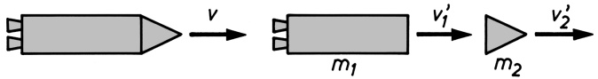

<details>
<summary>flowchart</summary>


</details>

Bild 9.2 Trennung von Antriebsteil und Bugkapsel einer Raketenstufe in der Umlaufbahn

2. Ein Polonium-212-Kern emittiert beim radioaktiven Zerfall ein α-Teilchen mit der Ge schwindigkeit $2 \cdot 10^{7}    m/s. a$ Berechne die Rückstoßgeschwindigkeit des Kerns! b) Welchen Anteil hat prozentual die kinetische Energie des α-Teilchens $E _ { \alpha }$ und des Kerns $E _ { \mathrm { K } }$ an der Gesamtenergie $E = E _ { \alpha } + E _ { \mathrm { K } } { \mathfrak { k } }$ Das Massenverhältnis von Kern und α-Teilchen beträgt 53.

Lösung: a) Nach dem Impulserhaltungssatz (9.3) sind die Impulse von Kern und α-Teilchen dem Betrage nach gleich: $p = M \nu _ { \mathrm { K } } = m \nu _ { \alpha } ;$ hieraus folgt $v _ { \mathrm { K } } = ( m / M )   v _ { \alpha } = 3 , 7 7 \cdot 1 0 ^ { 5 }   \mathrm { m / s }$

b) Für die Gesamtenergie E gilt mit

$$
E _ {\mathrm{K}} = M v _ {\mathrm{K}} ^ {2} / 2 = p ^ {2} / (2 M) \quad \text {und} \quad E _ {\alpha} = m v _ {\alpha} ^ {2} / 2 = p ^ {2} / (2 m):
$$

$$
E = \frac {p ^ {2}}{2 m} + \frac {p ^ {2}}{2 M} = \frac {M + m}{m} \frac {p ^ {2}}{2 M} = \frac {M + m}{M} \frac {p ^ {2}}{2 m} = \left(1 + \frac {M}{m}\right) E _ {\mathrm{K}} = \left(1 + \frac {m}{M}\right) E _ {\alpha}.
$$

Damit wird $E _ { \alpha } / E = 9 8 , 1 5 \%$ und $E_{\mathrm{K}} / E = 1, 85\%$

## 9.2 Die Gesetze des Stoßes

Als Stoß bezeichnet man in der Physik eine sich rasch vollziehende Wechselwirkung zwischen Teilchen bzw. Körpern, in deren Folge es zu Impuls- und Energieänderungen der Körper kommt. Dabei kann es sich sowohl um das unmittelbare Aufeinanderprallen fester Körper als auch um eine kurzzeitige gegenseitige Beeinflussung durch elektrostatische oder andere Kräfte

---

9.2 Die Gesetze des Stoßes

101

handeln. Man denke hierbei an die Wechselwirkung von hochbeschleunigten Elementarteilchen untereinander oder mit Atomkernen.

Im folgenden beschränken wir uns zunächst auf den **zentralen (geraden) Stoß**; bei ihm fällt die Stoßrichtung in die Verbindungsgerade der Kugelmittelpunkte (Bild 9.3). Beim nichtzentralen (schiefen) Stoß bildet die Bewegungsrichtung des stoßenden Körpers mit der Mittelpunktsgeraden einen Winkel (s. dazu unten Bild 9.6).

Zwei Kugeln mit den Massen $m _ { 1 }$ und $m _ { 2 }$ bewegen sich mit den Geschwindigkeiten $\pmb { v } _ { 1 }$ und $\nu _ { 2 }$ auf einer Geraden entweder aufeinander zu (dann haben $\pmb { v } _ { 1 }$ und $\pmb { v } _ { 2 }$ , also auch die Impulse $m _ { 1 } \pmb { v } _ { 1 }$ und $m _ { 2 } \pmb { v } _ { 2 }$ , entgegengesetzte Richtung), oder die erste Kugel bewegt sich hinter der zweiten her, dann muss, damit ein Zusammenstoß erfolgen kann, $\nu _ { 1 } > \nu _ { 2 }$ sein (Bild 9.3).

Beim Fehlen äußerer Einwirkungen, z. B. der Schwerkraft, gilt für das aus den beiden Kugeln bestehende System der Impulserhaltungssatz (9.2). Es ist also, wenn wir die Geschwindigkeiten nach dem Stoß mit $c _ { 1 }$ und $c _ { 2 }$ bezeichnen:

$$
m _ {1} v _ {1} + m _ {2} v _ {2} = m _ {1} c _ {1} + m _ {2} c _ {2}. \tag {9.8}
$$

Diese Gleichung reicht zur Bestimmung von $c _ { 1 }$ und $c _ { 2 }$ nicht aus. Aus der Undurchdringlichkeit der Kugeln können wir lediglich folgern $c _ { 1 } \leq c _ { 2 }$ . Für die beiden Grenzfälle, den elastischen und den unelastischen Stoß, lassen sich jedoch weitere Aussagen treffen.

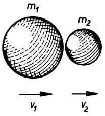

<details>
<summary>text_image</summary>

m₁
m₂
v₁
v₂
</details>

Bild 9.3 Zentraler (gerader) Stoß zweier Kugeln: Die Bewegungsrichtung der stoßenden Kugel $( m _ { 1 } )$ liegt in der Verbindungsgeraden der Kugelmittelpunkte.

**Der unelastische Stoß.** Ist das Material der Kugeln so beschaffen, dass die Kugeln nicht voneinander abprallen, sondern nach dem Stoß mit gemeinsamer Geschwindigkeit in Richtung der Bewegung der stoßenden Kugel ihren Weg fortsetzen, dann bezeichnen wir den Stoß als vollkommen unelastisch. Dies tritt z. B. ein, wenn die stoßenden Körper aus einem bildsamen Material bestehen, das sich beim Stoß bleibend verformt. Dabei geht ein Teil der Bewegungsenergie in Verformungsarbeit bzw. Wärme über. Daher gilt:

## Beim unelastischen Stoß bleibt der Impuls, nicht hingegen die Bewegungsenergie erhalten.

Bezeichnen wir die gemeinsame Geschwindigkeit $c _ { 1 } = c _ { 2 }$ der Kugeln nach dem vollkommen unelastischen Stoß mit $c ,$ so folgt aus dem Impulssatz (9.8)

$$
m _ {1} v _ {1} + m _ {2} v _ {2} = (m _ {1} + m _ {2}) c; \quad c = \frac {m _ {1} v _ {1} + m _ {2} v _ {2}}{m _ {1} + m _ {2}}. \tag {9.9}
$$

Bei einem teilweise unelastischen Stoß ist die Differenz der Geschwindigkeiten $c _ { 1 }   -   c _ { 2 }$ nach dem Stoß betragsmäßig um einen Faktor $\varepsilon ,$ der Stoßzahl, kleiner als die Differenz der Geschwindigkeiten $\nu _ { 1 } - \nu _ { 2 }$ vor dem Stoß:

$$
c _ {1} - c _ {2} = - \varepsilon (v _ {1} - v _ {2}) \quad \text {oder} \quad \varepsilon = - \frac {c _ {1} - c _ {2}}{v _ {1} - v _ {2}} \quad (\text {Stoßzahl}). \tag {9.10}
$$

---

102

9 Dynamik der Punktmassen-Systeme

Die Stoßzahl ε gibt den „Grad“ der Energieerhaltung beim Stoßvorgang an: $\varepsilon = 0$ (gleichbedeutend mit $c _ { 1 } = c _ { 2 } )$ kennzeichnet den vollkommen unelastischen Stoß, $\varepsilon = 1$ den elastischen Stoß (s. u.) und ein Wert $0 < \varepsilon < 1$ steht für einen teilweise unelastischen Stoß. Der Impulssatz (9.8) ergibt dann zusammen mit (9.10) für die Geschwindigkeiten nach dem Stoß:

$$
c _ {1} = \frac {(m _ {1} - \varepsilon m _ {2}) v _ {1} + (1 + \varepsilon) m _ {2} v _ {2}}{m _ {1} + m _ {2}}; \quad c _ {2} = \frac {(1 + \varepsilon) m _ {1} v _ {1} + (m _ {2} - \varepsilon m _ {1}) v _ {2}}{m _ {1} + m _ {2}}. \tag {9.11}
$$

Die beim unelastischen Stoß zur Formänderung bzw. Erwärmung der Körper aufgewendete Arbeit ergibt sich als Differenz der Bewegungsenergien beider Körper vor und nach dem Stoß:

$$
\Delta E = \frac {m _ {1} v _ {1} ^ {2}}{2} + \frac {m _ {2} v _ {2} ^ {2}}{2} - \frac {m _ {1} c _ {1} ^ {2}}{2} - \frac {m _ {2} c _ {2} ^ {2}}{2}.
$$

Setzt man hier die Werte für $c _ { 1 }$ und $c _ { 2 }$ nach (9.11) ein, so folgt nach einigen Umformungen

$$
\Delta E = (1 - \varepsilon^ {2}) \frac {m _ {1} m _ {2}}{2 (m _ {1} + m _ {2})} (\nu_ {1} - \nu_ {2}) ^ {2}, \tag {9.12}
$$

ein Ausdruck, der stets positiv ist.

## Beispiele 9.2:

1. Zur Bestimmung der Geschwindigkeit eines Geschosses $( m _ { 1 } = 5 { , } 0 \mathrm { g } )$ wird dieses in einen pendelnd aufgehängten Holzklotz $( m _ { 2 } = 2 , 5   \mathrm { k g } )$ geschossen, der dadurch aus seiner Ruhelage um die Strecke $s = 3 0$ cm ausgelenkt und dabei um h angehoben wird (ballistisches Pendel, Bild 9.4). Die Pendellänge ist l = 1m. Berechne die Geschossgeschwindigkeit $\nu _ { 1 } !$

Lösung: Da das Geschoss im Holzklotz stecken bleibt und sich somit nach dem Einschlag zusammen mit ihm fortbewegt, liegt ein vollkommen unelastischer S<u>toß</u> vor. Mit $\nu _ { 2 } = 0$ und wegen $m _ { 1 } \ll m _ { 2 }$ folgt aus (9.9) $\nu _ { 1 } = ( m _ { 2 } / m _ { 1 } ) c$ . Außerdem gilt $c = { \sqrt { 2 g h } } .$ h muss durch die bekannten Größen s und l ausgedrückt werden. Aus dem Bi<u>ld li</u>est man ab: $s ^ { 2 } = l ^ { 2 } - ( l - h ) ^ { 2 } =$ $2 l h - h ^ { 2 } \approx 2 l h$ (wegen $h \ll l )$ . Somit folgt $\nu _ { 1 } = ( m _ { 2 } / m _ { 1 } ) \sqrt { 2 g h } = ( m _ { 2 } / m _ { 1 } ) s \sqrt { g / l } = 4 7 5   \mathbf { m } / \mathbf { s }$

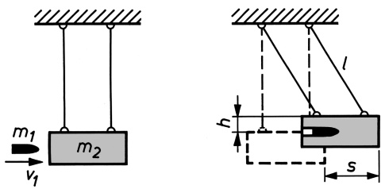

Bild 9.4 Ballistisches Pendel

2. Wie groß ist im obigen Beispiel derjenige Anteil der anfänglichen kinetischen Energie des Geschosses, der nicht in Bewegungsenergie des Pendelkörpers übergeführt, sondern in Wärme umgewandelt wird?

Lösung: Aus (9.12) folgt mit $\nu _ { 2 } = 0$ und $\varepsilon = 0 ;$

$$
\Delta E = \frac {m _ {2}}{m _ {1} + m _ {2}} \frac {m _ {1} v _ {1} ^ {2}}{2} = \frac {m _ {2}}{m _ {1} + m _ {2}} E; \quad \frac {\Delta E}{E} = \frac {m _ {2}}{m _ {1} + m _ {2}} = 0, 9 9 8;
$$

d. h., es gehen 99,8% der Geschossenergie als Wärme verloren.


---

9.2 Die Gesetze des Stoßes

103

## Aufgabe

**9.1** Zur Auslösung einer speziellen Kernreaktion wird ein Elementarteilchen (Masse m) auf einen schweren Targetkern (Massenverhältnis $M / m = 2 4 0 )$ geschossen, in welchem es verbleibt. Gib denjenigen Teil der anfänglichen kinetischen Energie des Kerngeschosses an, der nicht als Bewegungsenergie des sich bildenden Zwischenkerns verloren geht, sondern zur inneren Umwandlung des Targetkerns führt!

**Der elastische Stoß.** Ein Stoß heißt elastisch, wenn die beiden Körper durch den Stoß weder erwärmt noch bleibend deformiert werden. Es wird also beim elastischen Stoß keine Bewegungsenergie in eine andere Energieform umgewandelt. Daher gilt neben dem Impulssatz (9.8) der Energiesatz der Mechanik

$$
\frac {m _ {1} v _ {1} ^ {2}}{2} + \frac {m _ {2} v _ {2} ^ {2}}{2} = \frac {m _ {1} c _ {1} ^ {2}}{2} + \frac {m _ {2} c _ {2} ^ {2}}{2}. \tag {9.13}
$$

## Beim elastischen Stoß bleiben Impuls und Bewegungsenergie erhalten.

Durch Umstellung der Glieder in (9.8) und (9.13) erhalten wir zunächst

$$
m _ {1} (v _ {1} - c _ {1}) = m _ {2} (c _ {2} - v _ {2})
$$

$$
m _ {1} (v _ {1} ^ {2} - c _ {1} ^ {2}) = m _ {2} (c _ {2} ^ {2} - v _ {2} ^ {2})
$$

und nach Division der zweiten Gleichung durch die erste

$$
v _ {1} + c _ {1} = c _ {2} + v _ {2} \quad \text {oder (nach (9.10))} \quad \varepsilon = - \frac {c _ {1} - c _ {2}}{v _ {1} - v _ {2}} = 1.
$$

Mit Hilfe dieser Beziehung kann man nun aus (9.8) entweder $c _ { 1 }$ oder $c _ { 2 }$ eliminieren. Man erhält (vgl. (9.11) mit $\varepsilon = 1 )$

$$
c _ {1} = \frac {(m _ {1} - m _ {2}) v _ {1} + 2 m _ {2} v _ {2}}{m _ {1} + m _ {2}}; \quad c _ {2} = \frac {(m _ {2} - m _ {1}) v _ {2} + 2 m _ {1} v _ {1}}{m _ {1} + m _ {2}}. \tag {9.14}
$$

**Sonderfälle.** Ist $m _ { \mathrm { 1 } } = m _ { \mathrm { 2 } }$ , so wird $c _ { 1 } = v _ { 2 }$ und $c _ { 2 } = v _ { 1 }$ , d. h., beide Körper vertauschen ihre Geschwindigkeiten. Ist $m _ { 2 }$ vor dem Stoß in Ruhe, also $\nu _ { 2 } = 0 ,$ , so vereinfachen sich die Gleichungen (9.12) zu

$$
c _ {1} = v _ {1} \frac {(m _ {1} / m _ {2}) - 1}{(m _ {1} / m _ {2}) + 1}; \quad c _ {2} = v _ {1} \frac {2 (m _ {1} / m _ {2})}{(m _ {1} / m _ {2}) + 1}. \tag {9.15}
$$

Geht $m _ { 2 } \rightarrow \infty$ und ist $\nu _ { 2 } = 0$ (Körper stößt gegen feststehende Wand), so wird $c _ { 1 } = - v _ { 1 }$ , d. h., die Geschwindigkeit kehrt sich um (Reflexion). Ist dagegen $m _ { 1 } \to \infty$ und $\nu _ { 2 } = 0$ (sehr großer Körper stößt auf ruhenden, sehr kleinen Körper), so wird $c _ { 1 } \approx v _ { 1 }$ und $c _ { 2 } \approx 2 \nu _ { 1 }$

## Beispiel 9.3:

Bei dem in Bild 9.5 gezeigten Apparat sind mehrere elastische Kugeln gleicher Masse unmittelbar nebeneinander aufgehängt. Lässt man die erste Kugel (A) auf die Übrigen stoßen, so wird die letzte (C) bis zur Ausgangshöhe von (A) emporgeschleudert. Lässt man gleichzeitig zwei Kugeln mit der Geschwindigkeit $\nu _ { 1 }$ auf die Übrigen stoßen, so werden nun die beiden letzten

---

104

9 Dynamik der Punktmassen-Systeme

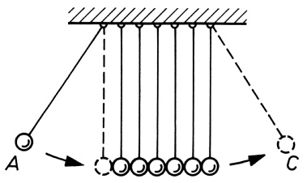

<details>
<summary>text_image</summary>

A
C
</details>

Bild 9.5 Perkussionspendel zur Demonstration von Energie- und Impulsübertragung beim elastischen Stoß

Kugeln mit der gleichen Geschwindigkeit $\nu _ { 1 }$ fortgestoßen, und nicht etwa nur die letzte mit der entsprechend größeren Geschwindigkeit $\nu _ { 1 } \sqrt { 2 }$ , was mit dem Energiesatz durchaus in Einklang wäre; denn es gilt $2 ( m \nu _ { 1 } ^ { 2 } / 2 ) = m ( \nu _ { 1 } \sqrt { 2 } ) ^ { 2 } / 2$ . Beweise, dass dies allgemein auch bei n Kugeln der Fall ist!

Lösung: Es bleibt neben der Energie auch der Impuls erhalten. Ist m die Masse einer Kugel, $n _ { 1 }$ die Anzahl und $\nu _ { 1 }$ die Geschwindigkeit der stoßenden Kugeln, $n _ { 2 }$ die Anzahl und $v _ { 2 }$ die Geschwindigkeit der fortfliegenden Kugeln, so ist

$$
n _ {1} \cdot m v _ {1} = n _ {2} \cdot m v _ {2}, \qquad n _ {1} \cdot \frac {m v _ {1} ^ {2}}{2} = n _ {2} \cdot \frac {m v _ {2} ^ {2}}{2}.
$$

Hieraus folgt $\nu _ { 1 } = \nu _ { 2 }$ und $n _ { 1 } = n _ { 2 }$


**Der nichtzentrale (schiefe) elastische Stoß.** Nach einem schiefen elastischen Stoß bewegen sich die Stoßpartner in verschiedenen Richtungen (Bild 9.6a). Bei der mathematischen Behandlung haben wir deshalb den Impulssatz (9.8) in vektorieller Form anzuschreiben.


Bild 9.6 Geschwindigkeitsvektoren beim nichtzentralen (schiefen) elastischen Stoß für den Fall $m _ { \mathrm { 1 } } = m _ { \mathrm { 2 } }$

Ist $m _ { 2 }$ vor dem Stoß in Ruhe $( \pmb { v } _ { 2 } = 0 )$ , so gilt also

$$
m _ {1} \boldsymbol {v} _ {1} = m _ {1} \boldsymbol {c} _ {1} + m _ {2} \boldsymbol {c} _ {2}. \tag {9.16}
$$

Darüber hinaus gilt wieder der Energiesatz der Mechanik

$$
\frac {m _ {1} v _ {1} ^ {2}}{2} = \frac {m _ {1} c _ {1} ^ {2}}{2} + \frac {m _ {2} c _ {2} ^ {2}}{2}. \tag {9.17}
$$

Für den Sonderfall gleicher Massen $( m _ { 1 } = m _ { 2 } )$ gehen die Gleichungen (9.16) und (9.15) über in

$$
\boldsymbol {v} _ {1} = \boldsymbol {c} _ {1} + \boldsymbol {c} _ {2}; \quad v _ {1} ^ {2} = c _ {1} ^ {2} + c _ {2} ^ {2}. \tag {9.18}
$$

In Bild 9.6b ist das zugehörige Dreieck der Geschwindigkeitsvektoren dargestellt. In ihm steht $\mathbf { c } _ { 1 }$ senkrecht auf $c _ { 2 } ;$ denn die rechtsstehende Beziehung (9.18) gilt nur im rechtwinkligen Dreieck. Daher laufen $\mathbf { z } .$ B. beim Billardspiel die mit dem Queue gestoßene Kugel und die anfänglich ruhende Kugel nach einem schiefen Stoß unter einem Winkel von $9 0 ^ { \circ }$ auseinander. Diese

---

9.3 Raketenantrieb

105

Bedingung ist umso besser erfüllt, je weniger kinetische Energie beim Stoß in Drehbewegung der Kugeln übergeht. Besonders gut erreicht wird dies beim Stoß zwischen zwei gleichen Atomen (Bild 9.7).


<details>
<summary>natural_image</summary>

Black-and-white astronomical image showing star clusters and geometric lines (no text or symbols)
</details>

Bild 9.7 Blasenkammeraufnahme der Spur eines Protons, das nacheinander mit anderen Protonen zusammenstößt, die ursprünglich in Ruhe waren

## 9.3 Raketenantrieb

Die an einer Rakete angreifende Kraft setzt sich zusammen aus der in der Nähe von Himmelskörpern stets vorhandenen Schwerkraft, dem Schub des Triebwerks und gegebenenfalls einem Anteil der Luftreibung. Befindet sich die Rakete sehr weit von der Erde entfernt im luftleeren Raum, so können Schwerkraft und Luftreibung vernachlässigt werden (kräftefreie Rakete). Damit ist das aus der Rakete samt den noch vorhandenen und bereits verbrauchten Treibstoffvorräten bestehende Gesamtsystem abgeschlossen, sein Gesamtimpuls also konstant.

Der Raketenantrieb beruht auf dem sog. **Rückstoßprinzip**: Der Treibstoff wird als Abgas in Form eines Teilchenstrahls aus der Düse des Raketentriebwerks ausgestoßen, was das Auftreten einer Rückstoßkraft zur Folge hat, welche die Rakete beschleunigt. Es gilt hier das NEW-TONsche Grundgesetz bei veränderlicher Masse (vgl. Abschnitt 4.5). Die entsprechende Bewegungsgleichung (4.13) lautet für die kräftefreie Rakete $( F = 0 )$ sowie mit $\nu   -   \nu ^ { \prime } = c$ als Ausströmgeschwindigkeit der Verbrennungsgase relativ zur Rakete:

$$
0 = m \frac {\mathrm{d} v}{\mathrm{d} t} + \frac {\mathrm{d} m}{\mathrm{d} t} c, \quad \text { also } \quad m \frac {\mathrm{d} v}{\mathrm{d} t} = - c \frac {\mathrm{d} m}{\mathrm{d} t}.
$$

Die letzte Gleichung entspricht dem Grundgesetz der Dynamik in der Form (4.4) $m a = F _ { \mathrm { R \ddot { u } } }$ mit

$$
F _ {\mathrm{Rü}} = - c \frac {\mathrm{d} m}{\mathrm{d} t} \quad (\text {Rückstoßkraft}). \tag {9.19}
$$

Mit der momentanen Raketenmasse $m = m _ { 0 } - \dot { m } t \left( m _ { 0 } \right.$ Anfangsmasse, ṁ sog. Massenstrom = sekundlicher Treibstoffverbrauch) folgt:

$$
(m _ {0} - \dot {m} t) \frac {\mathrm{d} v}{\mathrm{d} t} = \dot {m} c, \quad \mathrm{d} v = \frac {\dot {m} c}{m _ {0} - \dot {m} t} \mathrm{d} t
$$

und für ṁ = const nach Integration

$$
\nu = - c \ln (m _ {0} - \dot {m} t) + C.
$$

---

106

9 Dynamik der Punktmassen-Systeme

Ist die Anfangsgeschwindigkeit bei Brennbeginn gleich null, also $v = 0   if   t = 0$ , so wird die Integrationskonstante $C = c \ln m _ { 0 }$ , und wir erhalten die Geschwindigkeit der Rakete nach Ablauf der Zeit t zu

$$
v (t) = c \ln \frac {m _ {0}}{m _ {0} - \dot {m} t} \quad \begin{array}{l} (\text {Geschwindigkeit - Zeit - Gesetz} \\ \text {einer kräftefreien Rakete}). \end{array} \tag {9.20}
$$

Ist in der Zeit $t = t _ { \mathrm { E } }$ der Treibsatz mit der Masse $m _ { \mathrm { T } } = { \dot { m } }$ t  E ausgebrannt, so beträgt die Endmasse $m _ { \mathrm { E } } = m _ { 0 } - m _ { \mathrm { T } }$ , und die Rakete hat die Endgeschwindigkeit (Brennschlussgeschwindigkeit)

$$
v _ {\mathrm{E}} = c \ln \frac {m _ {0}}{m _ {\mathrm{E}}} = c \ln \left(1 + \frac {m _ {\mathrm{T}}}{m _ {\mathrm{E}}}\right) \quad \begin{array}{l} (\text {Grundgleichung des idealen} \\ \text {Raketenantriebs}). \end{array} \tag {9.21}
$$

Bei senkrechtem Aufstieg der Rakete wird infolge der Erdanziehung die ideale Raketengeschwindigkeit (9.20) um die Fallgeschwindigkeit $g t$ verringert, wenn die Fallbeschleunigung g als konstant vorausgesetzt wird (auf 100km Höhenunterschied ändert sich g nach Gl. (8.5) lediglich um rund $0 ,   3   \mathrm { m } / \mathrm { s } ^ { 2 } )$ . Es gilt dann also

$$
v (t) = c \ln \frac {m _ {0}}{m _ {0} - \dot {m} t} - g t. \tag {9.22}
$$

Zusätzlich wird die Rakete durch den Luftwiderstand gebremst.

## Beispiel 9.4:

Welchen Wert muss das als ZIOLKOWSKI-Zahl Z bezeichnete Massenverhältnis von vollgetankter und leergebrannter Rakete $m _ { 0 } / m _ { \mathrm { E } }$ haben, wenn die Raketenendgeschwindigkeit $\nu _ { \mathrm { E } }$ die Ausströmgeschwindigkeit c erreichen soll?

Lösung: Aus (9.21) folgt $Z = m _ { 0 } / m _ { \mathrm { E } } = \mathbf { e } ^ { \nu _ { \mathrm { E } } / c }$ . Für $v _ { \mathrm { E } } = c$ wird $Z = \mathbf { e } = 2 \mathbf { , } 7 2$ , also $m _ { 0 } = 2 { , } 7 2   m _ { \mathrm { E } }$ Das bedeutet, dass der Treibstoff allein etwa zwei Drittel der Gesamtmasse der Rakete ausmacht. Bei $c = 3 0 0 0   \mathrm { m } / \mathrm { s }$ (maximal erreichbarer Wert) würde man also mit diesem Massenverhältnis (theoretisch) eine Endgeschwindigkeit von 3km/s erreichen; dies ist im Verhältnis zur 1. kosmischen Geschwindigkeit (≈ 8km/s, vgl. Abschnitt 8.2) wenig. □

Einen Ausweg bietet die Mehrstufenrakete. Sie besteht aus mehreren (zwei bis vier) hintereinander geschalteten Stufen mit eigenem Antrieb. Nach dem Verbrauch ihres Treibstoffes wird die jeweils ausgebrannte Stufe abgeworfen und die nächste Stufe gezündet. Die Rakete, bestehend aus den restlichen Stufen und erleichtert um die Leermasse der abgebrannten Stufe, fliegt weiter und kann eine größere Geschwindigkeit erreichen, als es mit dem Ballast der ausgebrannten Brennstoffbehälter möglich wäre. Für das Mehrstufenprinzip gilt anstelle von (9.21): $\nu _ { \mathrm { E } } = c \ln ( Z _ { 1 } Z _ { 2 } \cdots Z _ { n } )$ mit $Z _ { i }$ als Massenverhältnis der i-ten Stufe. So kann mit Hilfe einer Dreistufenrakete mit $c = 3 0 0 0   \mathrm { m } / \mathrm { s }$ und $Z = 3$ für alle Stufen – wie man leicht nachrechnet – die 1. kosmische Geschwindigkeit mühelos erreicht werden.

---

10

Statik des starren Körpers

Der starre Körper kann modellmäßig als System starr gekoppelter Punktmassen aufgefasst werden. In Wirklichkeit gibt es jedoch keinen Körper, bei dem die Teilchen, aus denen er aufgebaut ist (Atome, Moleküle, Ionen), gegeneinander völlig unbeweglich wären. Man kann aber in vielen Fällen von den kaum wahrnehmbaren Dehnungen, Verdrehungen usw. der als starr betrachteten Teile des Körpers absehen, weil sie für die mit dem Körper als Ganzem vorzunehmenden Ortsveränderungen keine Bedeutung haben. Kräfte, die an einem starren Körper angreifen, können daher keine Deformationen hervorrufen, sondern nur beschleunigte Verschiebungen (Translationen) und beschleunigte Drehungen (Rotationen).

## 10.1 Freiheitsgrade des starren Körpers

Die Anzahl der zur eindeutigen Angabe der Lage aller Teilchen eines Systems erforderlichen Parameter (Lagekoordinaten, Winkel bei Drehbewegungen usw.) ist die Anzahl der Freiheitsgrade des Systems. Eine einzelne Punktmasse, die sich nur auf einer geraden Bahn bewegen kann, hat nur einen Freiheitsgrad; denn es genügt, von einem einmal festgelegten Punkt der Geraden aus die zurückgelegte Strecke anzugeben. Entsprechend hat eine Punktmasse, die sich in einer Fläche bewegt, zwei und eine im Raum frei bewegliche Punktmasse drei Freiheitsgrade.

Auch beim starren Körper hat ein beliebig herausgegriffenes Teilchen (Punktmasse $m _ { 1 } )$ drei Freiheitsgrade der Translation. Wird $m _ { 1 }$ festgehalten, so kann sich ein zweites Teilchen $m _ { 2 }$ nur noch auf einer Kugel mit dem Abstand beider Teilchen als Radius um $m _ { 1 }$ bewegen; es hat, entsprechend den Längen- und Breitenkreisen der Kugel, nur zwei Freiheitsgrade. Wird auch $m _ { 2 }$ festgehalten, so kann ein drittes Teilchen, das nicht auf der durch $m _ { 1 }$ und $m _ { 2 }$ gehenden Geraden liegt, nur noch eine Drehbewegung um diese Gerade ausführen, es hat also nur noch einen Freiheitsgrad. Da die relativen Lagen der einzelnen Teilchen infolge der Starrheit ungeändert bleiben, ist durch die Lage der drei Teilchen auch die Lage aller übrigen Teilchen eindeutig festgelegt. Daraus ergibt sich:

**Der starre Körper hat insgesamt 6 Freiheitsgrade. Drei von ihnen entfallen auf die Translationsbewegung, drei auf die Rotationsbewegung.**

## 10.2 Kräfte am starren Körper. Drehmoment. Gleichgewichtsbedingungen

Wir betrachten zwei gleich große, entgegengesetzt wirkende Kräfte $F _ { 1 }$ und $\pmb { F } _ { 2 } = - \pmb { F } _ { 1 }$ , die an zwei Punkten eines starren Körpers auf gleicher Wirkungslinie angreifen (Bild 10.1a). Verschiebt man die nach rechts gerichtete Kraft $F _ { 2 }$ von ihrem Angriffspunkt $A _ { 2 }$ nach $A _ { 3 }$ (Bild

---

108

10 Statik des starren Körpers

10.1b), so hat diese Verschiebung keinen Einfluss auf den Bewegungszustand des Körpers, weil sich sowohl vor wie nach der Verschiebung die nach links und rechts gerichteten Kräfte aufheben: $\pmb { F } _ { 1 } + \pmb { F } _ { 2 } = 0$


<details>
<summary>text_image</summary>

a)
b)
</details>

Bild 10.1 Zwei entgegengesetzt gleich große Kräfte auf gleicher Wirkungslinie

Es gilt somit die

## Linienflüchtigkeit des Kraftvektors:

**Kräfte, die an einem starren Körper angreifen, können in ihrer Wirkungslinie beliebig verschoben werden, ohne dass sich dabei die Wirkungen der Kräfte auf den Körper verändern.**

Dagegen ist diese Verschiebung der Kräfte im Falle eines deformierbaren Körpers von Einfluss auf die Verformung desselben; im Fall a) wird der Körper zwischen $A _ { 1 }$ und $A _ { 2 }$ auf Zug beansprucht und dadurch gedehnt, im Fall b) nur zwischen $A _ { 1 }$ und $A _ { 3 }$ . Untersuchungen über Beanspruchungen und Verformungen gehören in das Gebiet der Festigkeitslehre.

**Zusammensetzen von Kräften.** Kräfte, die in einem Punkt des starren Körpers angreifen, können entsprechend den Gesetzen der Vektoraddition zu einer Resultierenden zusammengesetzt werden (vgl. 4.1). Das zugehörige Krafteck, welches man durch Aneinanderreihen der Kraftvektoren erhält, liefert die Resultierende F (Bild 4.2).

Für die Ermittlung der Resultierenden zweier in verschiedenen Punkten des starren Körpers angreifenden Kräfte, deren Wirkungslinien in einer Ebene liegen, werden die Kräfte zunächst längs ihrer Wirkungslinien bis zum gemeinsamen Schnittpunkt verschoben; danach können sie zur Resultierenden zusammengesetzt werden. Dass der Schnittpunkt außerhalb des Körpers liegen kann, stört dabei nicht; denn die Resultierende kann wieder in ihrer Wirkungslinie verschoben werden, bis sie in einem Punkt des starren Körpers angreift.

**Statisches Gleichgewicht.** Wenn die Wirkungslinien der am starren Körper angreifenden Kräf te sich in einem Punkt schneiden und die Resultierende der Kräfte verschwindet, das Krafteck also geschlossen ist, befindet sich der Körper im statischen Gleichgewicht. Es treten dann am Körper weder beschleunigte Translationsbewegungen noch beschleunigte Rotationsbewegungen auf. Greifen die Kräfte am starren Körper so an, dass ihre Wirkungslinien sich nicht in einem Punkt schneiden, so ist für das Gleichgewicht außer der Forderung, dass die Resultierende aller (in einem Punkt angreifend gedachten) Kräfte verschwindet, noch eine weitere Bedingung zu erfüllen.

Zur Formulierung dieser Bedingung betrachten wir zwei parallele Kräfte $F _ { 1 }$ und $F _ { 2 } ,$ die in gleicher Richtung an verschiedenen Stellen des Körpers angreifen (Bild 10.2a). Gesucht ist eine Kraft $F _ { 3 }$ , die den beiden Kräften das Gleichgewicht hält. Aus oben Gesagtem folgt zunächst, dass $F _ { 3 }$ entgegengesetzt gleich der Resultierenden F aus $F _ { 1 }$ und $F _ { 2 }$ sein muss, also

$$
\boldsymbol {F} _ {3} = - \boldsymbol {F} = - (\boldsymbol {F} _ {1} + \boldsymbol {F} _ {2}), \quad \text {d.h.} \quad \boldsymbol {F} _ {1} + \boldsymbol {F} _ {2} + \boldsymbol {F} _ {3} = 0. \tag {10.1}
$$

---

10.2 Kräfte am starren Körper. Drehmoment. Gleichgewichtsbedingungen

109


Bild 10.2 Zur Herleitung der Gleichgewichtsbedingungen für den starren Körper

Zur grafischen Bestimmung der Resultierenden $F _ { 1 } + F _ { 2 }$ und ihres Angriffspunktes werden in den Punkten A und $B ,$ in denen $F _ { 1 }$ und $F _ { 2 }$ angreifen (Bild 10.2b), die dem Betrage nach willkürlich angenommenen, in der Verbindungslinie von A und B liegenden Hilfskräfte $F ^ { \prime }$ und $- \boldsymbol { F } ^ { \prime }$ (die sich in ihrer Wirkung aufheben) zu $F _ { 1 }$ und $F _ { 2 }$ addiert, womit zwei neue Kräfte $F _ { 1 } ^ { \prime }$ und $F _ { 2 } ^ { \prime }$ entstehen, deren Wirkungslinien nun nicht mehr parallel verlaufen, sondern deren Schnittpunkt den gesuchten Angriffspunkt C der resultierenden Kraft ergibt. Dieser kann auch in den Punkt O auf der Verbindungslinie AB, den Mittelpunkt der parallelen Kräfte, verlegt werden. Aus der Ähnlichkeit der Dreiecke C AO und C BO mit ADE und B HG folgt mit ${ \overline { { C O } } } \equiv a ;$

$$
\frac {a}{l _ {1}} = \frac {F _ {1}}{F ^ {\prime}}; \quad \frac {a}{l _ {2}} = \frac {F _ {2}}{F ^ {\prime}}
$$

und hieraus

$$
l _ {1}: l _ {2} = F _ {2}: F _ {1} \quad \text {oder} \quad F _ {1} l _ {1} = F _ {2} l _ {2}. \tag {10.2}
$$

Das bedeutet:

## Die Resultierende zweier paralleler Kräfte ist zu diesen ebenfalls parallel und teilt deren Abstand im umgekehrten Verhältnis der Beträge der Kräfte.

Für das Gleichgewicht des starren Körpers in Bild 10.2a ist also außer Gl. (10.1) zusätzlich die Bedingung (10.2) zu erfüllen, durch welche die Wirkungslinie der Unterstützungskraft $F _ { 3 }$ festgelegt wird.

**Das Drehmoment.** Fassen wir in Bild 10.2 den Punkt O als Drehpunkt des starren Körpers auf, so sind die Kräfte $F _ { 1 }$ und $F _ { 2 }$ bestrebt, den Körper um diesen Punkt zu drehen. Dabei hängt die Drehwirkung einer Kraft nicht nur von ihrem Betrag ab, sondern auch vom Abstand l, den ihre Wirkungslinie vom Drehpunkt hat. Das Produkt aus dem Betrag der Kraft F und diesem Abstand l, der gelegentlich als Kraftarm bezeichnet wird, nennt man **Drehmoment** oder **Moment** der Kraft F:

$$
M = F l \quad (\text {Betrag des Drehmoments}). \tag {10.3}
$$

Man beachte, dass l der senkrechte Abstand der Wirkungslinie der Kraft vom Drehpunkt ist. Aus Gl. (10.3) ergibt sich als

Einheit des Drehmoments: [M] = 1N · m.

---

110

10 Statik des starren Körpers

Verschiebt man in Bild 10.3a den Angriffspunkt der Kraft längs ihrer Wirkungslinie von A nach $A ^ { \prime } ,$ so dass nun der vom Drehpunkt O zum Angriffspunkt $A ^ { \prime }$ gerichtete Radiusvektor r mit dem Kraftvektor F keinen rechten Winkel mehr bildet, sondern mit ihm den Winkel α einschließt, so ändert sich am Betrag des Drehmoments nichts. Mit l = r sinα schreibt sich Gl. (10.3) jetzt lediglich in der Form

$$
M = F r \sin \alpha \quad (\text {Betrag des Drehmoments}). \tag {10.4}
$$


Bild 10.3 Zur Definition des Drehmoments M

In Bild 10.2a unterscheiden sich die von den Kräften $F _ { 1 }$ und $F _ { 2 }$ erzeugten Drehmomente in Bezug auf den Punkt O im **Drehsinn**; $M _ { 1 } = F _ { 1 } l _ { 1 }$ ist ein linksdrehendes Moment, $M _ { 2 } = F _ { 2 }   l _ { 2 }$ ein rechtsdrehendes. Linksdrehende Momente erhalten positives, rechtsdrehende negatives Vorzeichen. Fassen wir das Drehmoment als einen axialen Vektor auf, der mit der Drehachse zusammenfällt (wie die Winkelgeschwindigkeit ω, vgl. 3.7), so kann es durch das Vektorprodukt

$$
\boldsymbol {M} = \boldsymbol {r} \times \boldsymbol {F} \quad (\text {Vektor des Drehmoments}) \tag {10.5}
$$

ausgedrückt werden, dessen Betrag $| \pmb { M } | = M$ nach Gl. (10.4) zu berechnen ist. Gemäß der Definition des Vektorprodukts steht M senkrecht auf den Vektoren r und F und bildet mit diesen ein Rechtssystem (Bild 10.3b). Es gilt die

## Rechte-Hand-Regel:

**Umfasst die rechte Hand die Drehachse so, dass die gekrümmten Finger den Drehsinn angeben, so zeigt der gestreckte Daumen in die Richtung des Vektors des Drehmoments.**

Bei dem starren Körper in Bild 10.2 ist also wegen Gl. (10.2) $M _ { 1 } = - M _ { 2 }$ , d. h. $M _ { 1 } + M _ { 2 } = 0$ . Das Moment $M _ { 3 }$ der Kraft $F _ { 3 }$ in Bezug auf O verschwindet in diesem Fall, da der Abstand ihrer Wirkungslinie von O gleich null ist. Für das Gleichgewicht folgt also

$$
\boldsymbol {M} _ {1} + \boldsymbol {M} _ {2} + \boldsymbol {M} _ {3} = 0. \tag {10.6}
$$

Die **Gleichgewichtsbedingungen** für einen starren Körper lauten somit wegen Gl. (10.1) und (10.6):

$$
\sum \boldsymbol {F} _ {i} = 0, \quad \sum \boldsymbol {M} _ {i} = 0. \tag {10.7}
$$

**Ein starrer Körper befindet sich im statischen Gleichgewicht, wenn die Vektorsumme aller angreifenden Kräfte sowie aller Drehmomente (in Bezug auf einen beliebig gewählten Drehpunkt) verschwindet.**

---

10.2 Kräfte am starren Körper. Drehmoment. Gleichgewichtsbedingungen

111

Für die praktische Handhabung der Gln. (10.7) ist es oft erforderlich, alle Kraft- und Drehmomentenvektoren in Komponenten bezüglich der Achsen eines rechtwinkligen Koordinatensystems zu zerlegen. Im Gleichgewicht muss dann die Summe ihrer Komponenten für jede Achsenrichtung verschwinden.


Bild 10.4 Zum Gleichgewicht einer Leiter, die im Punkt A durch die Gewichtskraft G belastet wird (siehe Beispiel 10.1)

## Beispiel 10.1:

Ein Mann (Gewichtskraft $G = 6 0 0   \mathrm { N } )$ steht bei A auf einer 4m langen Leiter (Bild 10.4a). Am Boden (im Punkt O) sorgt die horizontale Reibungskraft $F _ { \mathrm { R } }$ dafür, dass die Leiter unterhalb einer bestimmten Belastung nicht wegrutscht. In den Endpunkten O und B, wo die Leiter aufsitzt bzw. an der Wand anliegt, greifen die Reaktionskräfte (Auflagerkräfte) −G und $F _ { W }$ an. Wie weit kann der Mann hinaufsteigen, ohne dass die Leiter wegrutscht, wenn die Reibungskraft $F _ { \mathrm { R } } = 2 0 0   \mathrm { N }$ beträgt?

Lösung: Für die Berechnung der Drehmomente wählen wir O als Drehpunkt. Dann ist das von $F _ { \mathrm { W } }$ erzeugte linksdrehende Moment nach Gl. (10.4) und Bild 10.4b gleich $F _ { W } r _ { 2 }$ sin $1 2 0 ^ { \circ } =$ $\sqrt { 3 } F _ { W } r _ { 2 } / 2$ und das von G erzeugte rechtsdrehende Moment gleich $- G r _ { 1 }$ sin $1 5 0 ^ { \circ } = - G r _ { 1 } / 2$ . Im Gleichgewicht muss die Summe aller Drehmomente verschwinden, d. h. $\sqrt { 3 } F _ { \mathrm { W } } r _ { 2 } / 2 - G r _ { 1 } / 2 =$ 0, woraus $r _ { 1 } = \sqrt { 3 } F _ { \mathrm { W } } r _ { 2 } / G$ folgt. Für das Gleichgewicht der Kräfte muss gelten: in horizontaler Richtung $F _ { \mathrm { R } } - F _ { W } = 0$ , d. h. $F _ { W } = F _ { \mathrm { R } }$ , in vertikaler Richtung ist $G - G = 0$ . Somit wird $r _ { 1 } = \sqrt { 3 } F _ { \mathrm { R } } r _ { 2 } / G$ . Mit den Zahlenwerten erhält man $r _ { 1 } = 2 , 3 0   \mathrm { m }$ □


<details>
<summary>text_image</summary>

C
F₄ A F₅ a F₁ F₃ F₃' B F₃"
F₃'
l
α
B
F₂
</details>

## Bild 10.5 Zur Aufgabe 10.1:

Zerlege zunächst die Seilkraft $F _ { 3 }$ in eine Horizontal- und eine Vertikalkomponente und stelle dann je eine Gleichgewichtsbedingung für alle horizontalen und vertikalen Kraftkomponenten auf. Wähle Punkt B als Drehpunkt und formuliere die Bedingung für das Gleichgewicht der von $F _ { 1 }$ und $F _ { 5 }$ herrührenden Drehmomente!

## Aufgaben

**10.1** An einer im Punkt A der Wand befestigten Stange AB (Bild 10.5), die durch ein Drahtseil BC in horizontaler Lage gehalten wird, greift im Abstand $a = l / 3$ von A (l Länge der Stange) die Gewichtskraft $F _ { 1 } = 1 5 0   \mathrm { N }$ und in B die Gewichtskraft $F _ { 2 } = 1 0 0   \mathrm { N }$ an. Wie groß sind die Spannkraft (Haltekraft) $F _ { 3 }$ im Seil und die Stützkräfte $F _ { 4 }$ und $F _ { 5 }$ im Punkt

---

112

10 Statik des starren Körpers

A der Wand? $\alpha = 3 0 ^ { \circ }$ ; die Gewichtskraft der Stange werde vernachlässigt. Zeichne das zugehörige Krafteck und überprüfe daran das Ergebnis!

**10.2** Überprüfe bei dem in Bild 7.4 dargestellten Perpetuum mobile durch die zahlenmäßige Bestimmung und Aufsummierung aller rechts- und linksdrehenden Momente, ob sich das Karussell wirklich – wie vom Erfinder behauptet – im Uhrzeigersinn dreht!

## 10.3 Kräftepaar

Zwei parallele Kräfte von gleichem Betrag, aber entgegengesetzter Richtung, $F _ { 1 }$ und $\boldsymbol { F } _ { 2 } = - \boldsymbol { F } _ { 1 }$ deren Wirkungslinien nicht zusammenfallen, bilden ein Kräftepaar (Bild 10.6). Ein Kräftepaar bewirkt keine Translationsbewegung des Körpers, an dem es angreift, da $\pmb { F } _ { 1 }   +   \pmb { F } _ { 2 } = 0$ , aber eine Drehung desselben; denn die beiden Angriffspunkte der Kräfte werden in entgegengesetzte Richtungen beschleunigt. Das resultierende Drehmoment bezüglich eines Punktes $O ,$ der in der Ebene beider Kräfte liegt, ist, wenn $r _ { 1 }$ und $r _ { 2 }$ die von O nach den Kraftangriffspunkten weisenden Vektoren sind, nach Gl. (10.5)

$$
\boldsymbol {M} = \boldsymbol {r} _ {1} \times \boldsymbol {F} _ {1} + \boldsymbol {r} _ {2} \times \boldsymbol {F} _ {2} = \boldsymbol {r} _ {1} \times \boldsymbol {F} _ {1} + \boldsymbol {r} _ {2} \times (- \boldsymbol {F} _ {1}) = (\boldsymbol {r} _ {1} - \boldsymbol {r} _ {2}) \times \boldsymbol {F} _ {1}, \tag {10.8}
$$

es ist somit unabhängig vom gewählten Bezugspunkt O und gleich dem Drehmoment von $F _ { 1 }$ um den Angriffspunkt von $F _ { 2 }$ bzw. umgekehrt. Sein Betrag ist nach Gl. (10.4) mit $l =$ $| \boldsymbol { r } _ { 1 } - \boldsymbol { r } _ { 2 } |$ sinα (vgl. Bild 10.6) und $F _ { 1 } = F _ { 2 }$ :

$$
M = F _ {1} | \boldsymbol {r} _ {1} - \boldsymbol {r} _ {2} | \sin \alpha = F _ {1} l = F _ {2} l. \tag {10.9}
$$


<details>
<summary>text_image</summary>

l
α
F₁ = -F₁
r₁ - r₂
r₂
F₁
r₁
0
</details>

Bild 10.6 Kräftepaar, bestehend aus den beiden antiparallelen Kräften $F _ { 1 }$ und $- F _ { 1 }$

Im Gleichgewicht gehalten wird ein Kräftepaar nur durch ein anderes Kräftepaar von gleichem Betrag des Drehmoments, aber entgegengesetztem Drehsinn.

## 10.4 Der Schwerpunkt

Denkt man sich einen Körper in viele Massenelemente $m _ { i }$ zerlegt, so wirkt auf jedes die Schwerkraft $F _ { i }   =   m _ { i } g$ . Wir setzen zwei von diesen parallelen Kräften zusammen; mit der nach Bild 10.2b gebildeten Ersatzkraft vereinigen wir die an einem beliebigen dritten Massenelement angreifende Kraft usw. Schließlich erhalten wir eine Resultierende, die gleich der Gewichtskraft des ganzen Körpers ist und in einem Punkt angreift, der als Schwerpunkt bezeichnet wird. Es ist für das Ergebnis gleichgültig, in welcher Reihenfolge man die vielen Einzelkräfte zusammensetzt und in welche Lage man den Körper vorher gebracht hat.

---

10.4 Der Schwerpunkt

113

Die Lage des Schwerpunkts soll anhand eines einfachen Modellkörpers berechnet werden. Dieser bestehe aus nur zwei Massen $m _ { 1 }$ und $m _ { 2 }$ , die durch eine (gewichtslose) Stange starr miteinander verbunden sind (Bild 10.7). Die Resultierende der beiden an $m _ { 1 }$ und $m _ { 2 }$ angreifenden parallelen Gewichtskräfte $F _ { 1 }$ und $F _ { 2 }$ teilt die Stange nach Gl. (10.2) im umgekehrten Verhältnis der Beträge der Kräfte in einem Punkt S, der gleich dem Schwerpunkt ist. Wird der Körper in S unterstützt, so ist er im Gleichgewicht, da die durch $F _ { 1 } = m _ { 1 } g$ und $F _ { 2 } = m _ { 2 } g$ hervorgerufenen Drehmomente (Gl. (10.3)) von entgegengesetztem Drehsinn und dem Betrage nach gleich sind:

$$
m _ {1} g l _ {1} = m _ {2} g l _ {2} \quad \text {oder} \quad m _ {1} l _ {1} = m _ {2} l _ {2}. \tag {10.10}
$$


<details>
<summary>text_image</summary>

x2
xS
x1
0
m1
l1
S
l2
m2
x
</details>

Bild 10.7 Bestimmung des Schwerpunkts S zweier Massen $m _ { 1 }$ und $m _ { 2 }$

Führen wir ein Koordinatensystem ein, in welchem $x _ { 1 }$ und $x _ { 2 }$ die Koordinaten von $m _ { 1 }$ und $m _ { 2 }$ sind, so folgt damit aus Gl. (10.10) für die Schwerpunktkoordinate $x _ { S } ;$

$$
m _ {1} (x _ {S} - x _ {1}) = m _ {2} (x _ {2} - x _ {S}) \quad \text {oder} \quad x _ {S} = \frac {m _ {1} x _ {1} + m _ {2} x _ {2}}{m _ {1} + m _ {2}}. \tag {10.11}
$$

Diese Beziehung stimmt mit derjenigen für die Koordinate des Massenmittelpunkts (9.5) überein; Schwerpunkt und Massenmittelpunkt sind also identisch.

Für den Schwerpunkt von N Massen, die auf einer Geraden angeordnet sind, gilt

$$
x _ {S} = \frac {m _ {1} x _ {1} + m _ {2} x _ {2} + \cdots + m _ {N} x _ {N}}{m _ {1} + m _ {2} + \cdots + m _ {N}} = \frac {\sum m _ {i} x _ {i}}{\sum m _ {i}}. \tag {10.12a}
$$

Ganz entsprechend erhält man, wenn die Massen statt auf einer Geraden irgendwie im Raum verteilt sind, die y- und z-Koordinate des Schwerpunkts zu

$$
y _ {S} = \frac {\sum m _ {i} y _ {i}}{\sum m _ {i}}, \quad z _ {S} = \frac {\sum m _ {i} z _ {i}}{\sum m _ {i}}. \tag {10.12b}
$$

Aus den vorstehenden Überlegungen geht hervor:

**Der Schwerpunkt eines Körpers ist derjenige Punkt, auf den bezogen die Vektorsumme aller Drehmomente, welche die an seinen Massenelementen angreifenden Gewichtskräfte bewirken, null ist.**

Ein im Schwerpunkt unterstützter Körper befindet sich daher in jeder Lage im Gleichgewicht.

Wird ein Körper um eine nicht durch den Schwerpunkt S gehende Achse drehbar aufgehängt, so erzeugt die in S angreifende Gewichtskraft ein Drehmoment, das den Körper so weit dreht, bis S genau unter der Drehachse liegt. Hieraus ergibt sich ein **Verfahren zur experimentellen Bestimmung des Schwerpunkts**: Wird der Körper an einem Faden aufgehängt, so liegt S genau in der Verlängerung des Fadens unterhalb des Aufhängepunktes. Hängt man den Körper nacheinander an zwei verschiedenen

---

114

10 Statik des starren Körpers

Punkten auf, so liegt S im Schnittpunkt der Verlängerungen des Aufhängefadens. Der Schwerpunkt, der ja ein gedachter Punkt ist, kann dabei sowohl innerhalb als auch außerhalb des Körpers liegen.

**Schwerpunktberechnung.** Für einen räumlich ausgedehnten Körper ist wegen der Vielzahl der Masseteilchen eine Schwerpunktberechnung praktisch nur möglich, wenn wir uns diesen homogen mit Masse ausgefüllt denken und anstelle der Punktmassen $m _ { i }$ kleine Volumenelemente $\Delta V _ { i }$ mit der Masse $\Delta m _ { i } = \varrho \Delta V _ { i }$ (ϱ Massendichte) betrachten. Beim Grenzübergang $\Delta V _ { i } \rightarrow 0$ gehen die Summen in den Gln. (10.12a) und (10.12b) über in Integrale; es wird also z. B. in Gl. (10.12a) für konstante Dichte $\varrho ;$

$$
\lim _ {\Delta V \to 0} \sum \varrho \Delta V _ {i} x _ {i} = \varrho \int x \mathrm{d} V; \quad \lim _ {\Delta V \to 0} \sum \varrho \Delta V _ {i} = \varrho \int \mathrm{d} V = \varrho V
$$

mit V als Gesamtvolumen des Körpers. Die Schwerpunktkoordinaten sind somit

$$
x _ {S} = \frac {1}{V} \int x \mathrm{d} V, \quad y _ {S} = \frac {1}{V} \int y \mathrm{d} V, \quad z _ {S} = \frac {1}{V} \int z \mathrm{d} V. \tag {10.13}
$$

## Beispiele 10.2:

1. Die Masse des Mondes beträgt 1,2% der Erdmasse, der Abstand Erde–Mond ist 384000km. In welcher Entfernung vom Erdmittelpunkt liegt der Schwerpunkt des Systems Erde–Mond?

Lösung: Kennzeichnen $m _ { 1 }$ die Masse und $x _ { 1 } = 0$ die Lage der Erde, $m _ { 2 }$ die Masse und $x _ { 2 } =$ 384 000km die Lage des Mondes, so folgt mit $m _ { 2 } / m _ { 1 } = 0 , 0 1 2$ aus Gl. (10.11)

$$
x _ {S} = \frac {m _ {2} x _ {2}}{m _ {1} + m _ {2}} = \frac {(m _ {2} / m _ {1}) x _ {2}}{1 + (m _ {2} / m _ {1})} = 4 1 2 0 \mathrm{km}.
$$

Da der Erdradius 6380km beträgt, liegt der gemeinsame Schwerpunkt von Erde und Mond noch innerhalb der Erde. Nach dem Erhaltungssatz des Massenmittelpunkts (vgl. 9.1), auch Schwerpunktsatz genannt, ist S in Ruhe, d. h., Erdmittelpunkt und Mond umkreisen ihren Schwerpunkt einmal innerhalb eines Monats.


<details>
<summary>text_image</summary>

y
dx
O
y
r
x
dV
h
</details>

Bild 10.8 Schwerpunktberechnung für den Kegel: Der Kegel vom Radius r und der Höhe h entsteht durch Rotation der Geraden $y = ( r / h ) x$ um die x-Achse. $\mathbf { d } V = \pi y ^ { 2 }$ dx ist ein scheibchenförmiges Volumenelement vom Radius y und der Dicke dx.

2. Berechnung des Schwerpunkts eines Kreiskegels: siehe Bild 10.8! Wegen der Rotationssymmetrie muss der Schwerpunkt auf der x-Achse liegen; es ist also $y _ { S } = z _ { S } = 0$ . Nach Gl. (10.13) erhält man mit dem Volumen des Kegels $V = \pi r ^ { 2 } h / 3$ und $y = ( r / h ) x ;$

$$
x _ {S} = \frac {3}{\pi r ^ {2} h} \int_ {0} ^ {h} \pi x y ^ {2} \mathrm{d} x = \frac {3}{h ^ {3}} \int_ {0} ^ {h} x ^ {3} \mathrm{d} x = \frac {3}{4} h.
$$

S liegt also auf der Mittellinie um $h / 4$ über der Grundfläche des Kegels.

## Aufgabe

**10.3** Berechne die Lage des Schwerpunkts S einer homogenen Halbkugel vom Radius R!

---

10.5 Arten des Gleichgewichts

115

## 10.5 Arten des Gleichgewichts

Wird ein Körper aus seiner Gleichgewichtslage verschoben, so ist gegen die im Schwerpunkt angreifende Gewichtskraft die Arbeit W zu verrichten, was zu einer Änderung der potenziellen Energie des Körpers $\Delta E _ { \mathtt { p } } = W$ führt. Das Vorzeichen von W hängt davon ab, ob der Schwerpunkt bei der Verschiebung aus der Gleichgewichtslage gehoben, gesenkt oder der Höhe nach beibehalten wird. Dementsprechend unterscheidet man drei Gleichgewichtsarten:

1. $W > \mathbf { 0 } ;$ Der Körper kann nur durch Erhöhung seiner potenziellen Energie, d. h. unter Arbeitsaufwand, aus der Gleichgewichtslage verschoben werden (**stabiles Gleichgewicht,** Bild 10.9a).
2. $\boldsymbol{W}=\mathbf{0};$ Der Körper befindet sich immer in einer Gleichgewichtslage (indifferentes Gleich**gewicht,** Bild 10.9b).
3. $W < \mathbf { 0 } ;$ Bei einer kleinen Störung des Gleichgewichtszustandes entfernt sich der Körper unter Energieabgabe noch weiter aus der Gleichgewichtslage (**labiles Gleichgewicht,** Bild 10.9c).


Bild 10.9 Arten des Gleichgewichts: a) stabiles, b) indifferentes, c) labiles Gleichgewicht

Aus der Gleichgewichtsbedingung $F = - \mathbf { d } W / \mathbf { d } q = - \mathbf { d } E _ { \mathbf { p } } / \mathbf { d } q = 0$ , wobei q die Lagekoordinate ist (z. B. Höhe h, Drehwinkel ϕ usw.), folgt, dass die potenzielle Energie in allen drei Fällen ein Extremum annimmt.

## Das stabile Gleichgewicht ist durch ein Minimum, das labile durch ein Maximum der potenziellen Energie in der Gleichgewichtslage gekennzeichnet.

Über die Art des Gleichgewichts gibt die zweite Ableitung der potenziellen Energie $E _ { \mathrm { p } }$ nach q Auskunft. D. h., es gilt für die Gleichgewichtslagen $q _ { 0 } ;$

$$
\left(\frac {\mathrm{d} ^ {2} E _ {\mathrm{p}}}{\mathrm{d} q ^ {2}}\right) _ {q _ {0}} \left\{ \begin{array}{l} > 0: E _ {\mathrm{p}} \text {-Minimum, stables Gleichgewicht bei } q = q _ {0}, \\ <   0: E _ {\mathrm{p}} \text {-Maximum, labiles Gleichgewicht bei } q = q _ {0}. \end{array} \right.
$$

## Beispiel 10.3:

Zeige, dass eine an einem Ende drehbar aufgehängte Stange (Länge l, Masse m) im stabilen Gleichgewicht ist!

Lösung: Beim Herausdrehen der Stange aus der Senkrechten um den Winkel ϕ wird der in ihrer Mitte liegende Schwerpunkt um $h = ( l / 2 ) ( 1 - \cos \varphi )$ angehoben. Damit wird $E_{\mathrm{p}} = mgh =$ $mg(l/2)(1 - \cos \varphi)$ , wenn zuvor $E _ { \mathrm { p } } = 0$ war. Aus der Extremwertbedingung $\begin{array} { r } { \mathbf { d } E _ { \mathrm { p } } / \mathbf { d } \varphi = 0 , } \end{array}$ d. h. $m g ( l / 2 )$ sin $\varphi = 0$ , folgen zwei Gleichgewichtslagen: $\varphi _ { 0 1 } = 0 ^ { \circ }$ und $\varphi _ { 0 2 } = 1 8 0 ^ { \circ }$ . Für $\varphi _ { 0 1 }$ wird $\mathrm { d } ^ { 2 } E _ { \mathrm { p } } / \mathrm { d } \varphi ^ { 2 } = m g ( l / 2 )$ cosϕ positiv, d. h. stabiles Gleichgewicht, für $\varphi _ { 0 2 }$ negativ, labiles Gleichgewicht. □

---

11

Dynamik des starren Körpers

## 11.1 Bewegung eines frei beweglichen Körpers bei Einwirkung einer Kraft

Greift an einem Körper eine Kraft F an, so lässt sich diese durch ein Drehmoment bezüglich des Schwerpunkts und eine im Schwerpunkt angreifende Einzelkraft ersetzen. Um dies zu zeigen, werden im Schwerpunkt S (Bild 11.1) zwei zu F parallele, entgegengesetzt gleiche Kräfte F und $- \boldsymbol { F } ^ { \prime }$ angefügt, deren Betrag mit dem von F übereinstimmt. An der Gesamtwirkung auf den Körper ändert sich dadurch nichts. F und $- \boldsymbol { F } ^ { \prime }$ bilden zusammen ein Kräftepaar, das nach (10.8) und (10.9) dem Drehmoment $\boldsymbol { M } = \boldsymbol { r } \times \boldsymbol { F }$ vom Betrage M = F l äquivalent ist. Es verbleibt die im Schwerpunkt angreifende Einzelkraft $F ^ { \prime }$ . Daraus folgt, dass die Bewegung eines Körpers durch Überlagerung einer Rotation um den Schwerpunkt und einer Translation beschrieben werden kann.


<details>
<summary>text_image</summary>

-F'
S
l
r
F'
F'
</details>

Bild 11.1 Umformung einer Einzelkraft in eine im Schwerpunkt angreifende Kraft und ein Kräftepaar

Greifen am Körper mehrere Kräfte $F _ { i }$ an, so kann jede von ihnen analog behandelt werden. Es wirkt dann eine im Schwerpunkt angreifende resultierende Kraft $\boldsymbol { F } = \sum \boldsymbol { F } _ { i } ^ { \prime } = \sum \boldsymbol { F } _ { i }$ und ein Drehmoment $\boldsymbol { M } = \sum \boldsymbol { r } _ { i } \times \boldsymbol { F } _ { i }$ um eine durch den Schwerpunkt gehende Achse.

## 11.2 Kinetische Energie der Drehbewegung. Massenträgheitsmoment

Eine Punktmasse $m ,$ die sich im Abstand r um eine feste Achse A mit gleich bleibender Winkelgeschwindigkeit ω dreht (Bild 11.2), hat die kinetische Energie (Rotationsenergie)

$$
E _ {\mathrm{k}} = \frac {1}{2} m v ^ {2} = \frac {1}{2} m (\omega r) ^ {2} = \frac {1}{2} (m r ^ {2}) \omega^ {2} = \frac {1}{2} J \omega^ {2}. \tag {11.1}
$$

Die darin vorkommende Größe

$$
J = m r ^ {2}, \quad \text {Einheit:} \quad [ J ] = 1 \mathrm{kg} \cdot \mathrm{m} ^ {2} \tag {11.2}
$$

nennt man das **Massenträgheitsmoment** der umlaufenden Punktmasse.

Zur Berechnung des Trägheitsmoments eines starren Körpers denken wir uns diesen in viele kleine Massenelemente $\Delta m _ { i }$ zerlegt, die von der Drehachse A den Abstand $r _ { i }$ haben (Bild

---

11.2 Kinetische Energie der Drehbewegung. Massenträgheitsmoment

117


<details>
<summary>text_image</summary>

A
r
m
ω
</details>

Bild 11.2 Auf einer Kreisbahn umlaufende Punktmasse


<details>
<summary>text_image</summary>

A
r_i
Δm_i
</details>

Bild 11.3 Zum Massenträgheitsmoment eines starren Körpers

11.3). J ergibt sich dann als Summe oder – bei Annahme einer kontinuierlichen Massenverteilung mit differenziell kleinen Massenelementen $\mathbf { d } m = \varrho \mathbf { d } V$ (ϱ konstante Massendichte) – als Integral der Trägheitsmomente aller Massenelemente:

$$
J = \sum \Delta m _ {i} r _ {i} ^ {2} \quad \text {bzw.} \quad J = \int r ^ {2} \mathrm{d} m \quad (\text {Massenträgheitsmoment}). \tag {11.3}
$$

Wie aus Gl. (11.1) hervorgeht, spielt das Trägheitsmoment bei der Drehbewegung eines Körpers eine analoge Rolle wie die Masse bei fortschreitender Bewegung. J ist aber außer von der Masse zusätzlich von der Form und den Abmessungen des Körpers sowie von der Massenverteilung im Körper und der Lage der Drehachse abhängig.

## Das Massenträgheitsmoment kennzeichnet den Bewegungswiderstand eines um eine vorgegebene Achse rotierenden Körpers gegenüber einer Änderung der Drehzahl.

Für das **Trägheitsmoment eines Zylinders (Kreisscheibe)** mit homogener Massenverteilung bei Rotation um die Zylinderachse erhält man, wenn als Massenelement ein Hohlzylinder mit dem Innenradius r und der Dicke dr gewählt wird (Bild 11.4), also $\mathrm{d}m = \varrho \mathrm{d}V = 2\pi \varrho h r \mathrm{d}r$ (h Höhe des Zylinders bzw. Dicke der Kreisscheibe), nach Gl. (11.3)

$$
J = 2 \pi \varrho h \int_ {0} ^ {R} r ^ {3} \mathrm{d} r = \frac {\pi}{2} \varrho h R ^ {4} \qquad (R \text {Zylinderradius}).
$$

Da $\pi \varrho R ^ { 2 } h = m$ die Masse des Zylinders ist, folgt $J = ( 1 / 2 )   m R ^ { 2 }$


<details>
<summary>text_image</summary>

dr
r
h
R
</details>

Bild 11.4 Zur Berechnung des Massenträgheitsmoments eines um seine Symmetrieachse rotierenden Zylinders bzw. Hohlzylinders

Für den **Hohlzylinder** sind in der obigen Rechnung der Innenradius r und der Außenradius R als Integrationsgrenzen zu wählen. Man erhält mit $m = \pi \varrho h ( R ^ { 2 } - r ^ { 2 } )$

$$
J = \frac {\pi}{2} \varrho h (R ^ {4} - r ^ {4}) = \frac {\pi}{2} \varrho h (R ^ {2} + r ^ {2}) (R ^ {2} - r ^ {2}) = \frac {1}{2} m (R ^ {2} + r ^ {2}).
$$

---

118

11 Dynamik des starren Körpers

Bei einem sehr dünnwandigen Hohlzylinder ist $r \approx R$ und somit $J \approx m R ^ { 2 }$

Die Trägheitsmomente bezüglich einer Schwerpunktachse sind für die **Kugel** $J = ( 2 / 5 )   m R ^ { 2 }$ für den Quader $J = ( 1 / 1 2 ) m ( a ^ { 2 } + b ^ { 2 } )$ mit a und b als Kantenlängen senkrecht zur Drehachse, für den **langen dünnen Stab** $J = ( 1 / 1 2 )   m l ^ { 2 }$ (l Stablänge).

## Beispiel 11.1:

Berechne die Endgeschwindigkeit, die ein zylindrischer Körper (Masse $m ,$ Radius R) hat, nachdem er aus der Höhe h auf einer schiefen Ebene herabgerollt ist (Bild 11.5)!

Lösung: Beim Herabrollen wandelt sich seine potenzielle Energie mg h in Bewegungsenergie um, wobei letztere sich aus der kinetischen Energie der Translation $m \nu ^ { 2 } / 2$ und der kinetischen Energie der Rotation um den Schwerpunkt $\bar { J \omega ^ { 2 } / 2 }$ zusammensetzt. Nach dem Energiesatz gilt daher mit $\nu = \omega R$ (Rollbedingung):

$$
m g h = \frac {m v ^ {2}}{2} + \frac {J \omega^ {2}}{2} = \frac {v ^ {2}}{2} \left(m + \frac {J}{R ^ {2}}\right); \quad \nu = \sqrt {\frac {2 g h}{1 + [ J / (m R ^ {2}) ]}}.
$$

Für einen Vollzylinder mit $J = m R ^ { 2 } / 2$ wird $\nu = \sqrt { 4 g h / 3 }$ , für einen sehr dünnwandigen Hohlzylinder mit $J = m R ^ { 2 }$ wird $\nu = { \sqrt { g h } } .$ Der Hohlzylinder rollt also langsamer als der Vollzylinder, obwohl die Masse beider Körper gleich groß ist. Dieses Beispiel zeigt deutlich, dass die Energie der Rotationsbewegung entscheidend von der Massenverteilung im Körper abhängig ist, was in den unterschiedlichen Trägheitsmomenten zum Ausdruck kommt. □


<details>
<summary>text_image</summary>

R
mg
h
</details>

Bild 11.5 Auf schiefer Ebene herabrollender Zylinder


<details>
<summary>text_image</summary>

A
s
S
</details>

Bild 11.6 Zum steinerschen Satz

Wenn der Zylinder nicht rollt, sondern reibungsfrei auf der Ebene herabgleitet, entfällt der Rotationsanteil der kinetischen Energie (entsprechend $J = 0$ in ob<u>iger</u> Gleichung), und es ergibt sich die bekannte Endgeschwindigkeit für den freien Fall $\nu = \sqrt { 2 g h }$ , vgl. (3.10).

**Satz von STEINER.** Rotiert ein Körper mit der Winkelgeschwindigkeit ω um eine innerhalb oder außerhalb desselben verlaufende Achse A, die nicht durch den Schwerpunkt S geht (Bild 11.6), so führt einerseits S eine translatorische Bewegung auf einer Kreisbahn mit der Geschwindig keit $v = \omega s$ um A aus (s Abstand zwischen A und S), wobei man sich die gesamte Masse des Körpers in S vereinigt zu denken hat, zum anderen dreht sich der Körper mit der gleichen Winkelgeschwindigkeit um die zu A parallele, durch S gehende Achse. Dementsprechend ergibt sich die kinetische Energie der Bewegung als Summe aus Translations- und Rotationsenergie zu

$$
E _ {\mathrm{k}} = \frac {m v ^ {2}}{2} + \frac {J _ {S} \omega^ {2}}{2} = \frac {1}{2} (m s ^ {2} + J _ {S}) \omega^ {2} = \frac {1}{2} J _ {A} \omega^ {2}.
$$

---

11.3 Arbeit und Leistung bei der Drehbewegung. Grundgesetz der Dynamik

119

Der in Klammern stehende Ausdruck ist das zur Achse A gehörige Trägheitsmoment $J _ { A }$ , während $J _ { S }$ das Trägheitsmoment bezüglich der Schwerpunktachse bezeichnet. Es ist also

$$
J _ {A} = J _ {S} + m s ^ {2} \quad (\text {STEINERScher Satz}). \tag {11.4}
$$

## STEINERscher Satz:

**Das Trägheitsmoment eines Körpers setzt sich additiv zusammen aus dem Trägheitsmoment** $J _ { S }$ **bezüglich der Schwerpunktachse und dem Trägheitsmoment** $\pmb { m s ^ { 2 } }$ **der im Schwerpunkt vereinigt gedachten Gesamtmasse m des Körpers bezüglich der zur Schwerpunktachse parallelen Drehachse im Abstand s (Bild 11.6).**

Ist also $J _ { S }$ bekannt, so kann das Trägheitsmoment in Bezug auf jede andere zur Schwerpunktachse parallele Achse nach diesem Satz berechnet werden.

## Beispiele 11.2:

1. Wie groß ist das Trägheitsmoment einer 2m langen Stange (Masse 4,5kg), wenn sie sich um ihren Endpunkt dreht?

Lösung: Mit $J _ { S } = m l ^ { 2 } / 1 2$ (s. oben) ist nach Gl. (11.4)

$$
J = \frac {m l ^ {2}}{1 2} + m \left(\frac {l}{2}\right) ^ {2} = \frac {m l ^ {2}}{3} = 4 J _ {S} = 6 \mathrm{kg} \cdot \mathrm{m} ^ {2}.
$$

2. Mit welcher Geschwindigkeit trifft der Endpunkt eines ursprünglich senkrecht stehenden Bleistiftes (Länge $l = 1 7   \mathrm { c m } )$ beim Umfallen auf die Tischplatte auf?

Lösung: Gleichsetzen von potenzieller Energie mg l/2 (= Arbeit beim Anheben der im Schwerpunkt vereinigt gedachten Masse des Bleistiftes auf die Höhe des Schwerpunkts l/2) und kinetischer Energie $J { \omega } ^ { 2 } / 2$ mit $J = m l ^ { 2 } / 3$ (s. Beispiel 11.2/1) beim Auftreffen sowie $\omega = \nu / l$ ergibt $\nu = \sqrt { 3 g l } = 2 \mathrm { , } 2$ 4m/s $( \approx 8   \mathrm { k m / h } )$ und mit $\nu = \sqrt { 2 a l }$ für die (Tangential-)Beschleunigung $a = 1 , 5 g = 1 4 , 7 \mathrm { m } / \mathrm { s } ^ { 2 }$ . Diese Werte sind größer als bei einem freien Fall aus der Höhe l und somit die Ursache, weshalb z. B. Schornsteine beim Umfallen auseinanderbrechen können. □

## Aufgabe

**11.1** Löse die im obigen Beispiel 11.1 behandelte Aufgabe des auf der schiefen Ebene herabrollenden Zylinders, indem als Drehachse die auf der schiefen Ebene aufliegende Mantellinie des Zylinders gewählt wird (Anwendung des STEINERschen Satzes))!

## 11.3 Arbeit und Leistung bei der Drehbewegung. Grundgesetz der Dynamik

Bei der Drehbewegung eines Körpers um eine fest mit ihm verbundene Achse wird seine jeweilige Lage durch den Drehwinkel ϕ gegen eine willkürlich gewählte Anfangslage beschrieben, und es haben alle Teilchen des Körpers dieselbe Winkelgeschwindigkeit $\omega = \mathbf { d } \varphi / \mathbf { d } t \equiv { \dot { \varphi } }$ und dieselbe Winkelbeschleunigung $\alpha = \mathbf { d } \omega / \mathbf { d } t \equiv { \dot { \omega } } = { \ddot { \varphi } } .$ . Zurückgelegte Weglänge s, Geschwindigkeit v und Beschleunigung a eines Körperteilchens sind von dessen Abstand r von der Drehachse wie folgt abhängig (vgl. Gleichungen (3.37)):

$$
s = r \varphi ; \quad v = r \omega ; \quad a = r \alpha .
$$

---

120

11 Dynamik des starren Körpers

Die **Arbeit bei der Drehbewegung** berechnet sich mit dem Drehmoment $M = F r \; \mathbf { z } \mathbf { u }$

$$
\mathrm{d} W = F \mathrm{d} s = F r \mathrm{d} \varphi = M \mathrm{d} \varphi ; \quad W = \int M \mathrm{d} \varphi . \tag {11.5}
$$

Aus ihr folgt für die Leistung nach Gl. (7.9)

$$
P = \frac {\mathrm{d} W}{\mathrm{d} t} = M \frac {\mathrm{d} \varphi}{\mathrm{d} t} = M \omega \qquad (\text {Momentanleistung}). \tag {11.6}
$$

Der verrichteten Arbeit W entspricht (bei fehlenden Reibungswiderständen) ein gleich großer Zuwachs an kinetischer Energie (Gl. (11.1)), der – bezogen auf die Zeit – gleich der Leistung (Gl. (11.6)) sein muss:

$$
P = \frac {\mathrm{d} E _ {\mathrm{k}}}{\mathrm{d} t} = \frac {\mathrm{d}}{\mathrm{d} t} \left(\frac {J}{2} \omega^ {2}\right) = J \omega \dot {\omega} = M \omega . \tag {11.7}
$$

Hieraus entnimmt man als Bewegungsgleichung für den rotierenden Körper

$$
M = J \dot {\omega} = J \alpha \quad \begin{array}{l} (\text {Grundgesetz der Dynamik} \\ \text {für die Rotationsbewegung}). \end{array} \tag {11.8}
$$

Bei gleichmäßig beschleunigter Drehbewegung, d. h. bei konstantem Drehmoment M, ist die Winkelbeschleunigung $\alpha = ( \omega   -   \omega _ { 0 } ) /   t$ (ω0 Anfangswinkelgeschwindigkeit) und damit

$$
M = J \frac {\omega - \omega_ {0}}{t}. \tag {11.9}
$$

Der Gl. (11.8) entspricht das Grundgesetz $F = m a$ für die fortschreitende Bewegung. Die vorstehenden Betrachtungen spiegeln die völlige Analogie der Größen und Gesetzmäßigkeiten der Rotationsbewegung zu denen der Translationsbewegung wider.

Die folgende Tabelle 11.1 gibt eine entsprechende Übersicht.

Tabelle 11.1 Analoge Größen für Translations- und Rotationsbewegung

| Translation |  | Rotation |  |
| --- | --- | --- | --- |
| Weg | s | Drehwinkel | $\varphi$ |
| Geschwindigkeit | $v = \dot{s}$ | Winkelgeschwindigkeit | $\omega = \dot{\varphi}$ |
| Beschleunigung | $a = \dot{v} = \ddot{s}$ | Winkelbeschleunigung | $\alpha = \dot{\omega} = \ddot{\varphi}$ |
| Masse | m | Trägheitsmoment | J |
| Impuls | $p = mv$ | Drehimpuls | $L = J\omega$ |
| Kraft | $F = ma$ | Drehmoment | $M = J\alpha$ |
| $Arbeit^1$ | $W = Fs$ | $Arbeit^1$ | $W = M\varphi$ |
| $Leistung^1$ | $P = Fv$ | $Leistung^1$ | $P = M\omega$ |
| kinetische Energie | $E_k = \frac{m}{2}v^2$ | Rotationsenergie | $E_k = \frac{J}{2}\omega^2$ |

1 Die angegebenen Beziehungen gelten nur für einen ganz speziellen Fall (vgl. 7.1 und 7.2).

## Beispiele 11.3:

1. Eine Schwungscheibe $(J = 1000   kg  \cdot  m ^2)$ wird durch ein konstantes Drehmoment vom Betrag $M = 2000    N  \cdot  m$ für die Dauer von 20s in Rotation versetzt. Wie groß ist die kinetische

---

11.4 Der Drehimpuls (Drall). Drehimpulserhaltungssatz

121

Energie der Scheibe nach dieser Zeit, und wie groß ist die aufgebrachte Leistung am Ende des Beschleunigungsvorganges?

Lösung: Aus Gl. (11.9) folgt $\omega = M t / J$ und damit aus Gl. (11.1) $E _ { \mathrm { k } } = M ^ { 2 }   t ^ { 2 } / ( 2 J ) = 8   \cdot   1 0 ^ { 5 }   \mathrm { N }   \cdot   \mathrm { m } .$ Die Endleistung ergibt sich mit Gl. (11.7) zu $P = M ^ { 2 } t / J = 8 \cdot 1 0 ^ { 4 }   \mathrm { N } \cdot \mathrm { m } / \mathrm { s } = 8 0   \mathrm { k W } .$

2. Leistungsmessung mit dem PRONYschen Zaum: Wie groß ist die Leistung eines Motors, der bei einer Anpresskraft der Bremsbacken an die Welle von $F = 5 3 0 \mathrm { N }$ eine Drehzahl von $n =$ $9 0 0   \mathrm { m i n } ^ { - 1 }$ hat? Radius der Welle $r = 0,10    m ;$ Reibungszahl $\mu = 0 { , } 4 0$

Lösung: Das durch die Reibungskraft (4.28) hervorgerufene bremsende Drehmoment beträgt $M = F _ { \mathrm { R } } r = \mu F r . \mathrm { M i t }   \omega = 2 \pi n   ( n = 1 5   \mathrm { s } ^ { - 1 } )$ folgt aus Gl. (11.7) $P = 2 \pi \mu F r n \approx 2   \mathrm { k W } .$ □

## 11.4 Der Drehimpuls (Drall). Drehimpulserhaltungssatz

Die Bewegungsgleichung (Gl. (11.8)) für die Drehbewegung eines starren Körpers lautet für ein konstantes Trägheitsmoment J in vektorieller Form

$$
\boldsymbol {M} = J \frac {\mathrm{d} \boldsymbol {\omega}}{\mathrm{d} t} = \frac {\mathrm{d} (J \boldsymbol {\omega})}{\mathrm{d} t} = \frac {\mathrm{d} \boldsymbol {L}}{\mathrm{d} t} \quad (\text {Grundgesetz der Drehbewegung}) \tag {11.10}
$$

in Analogie zum 2. NEWTONschen Axiom (4.9) $\boldsymbol { F } = \mathrm { d } \boldsymbol { p } / \mathrm { d } t$ . Die hier eingeführte vektorielle Grö- ße

$$
\boldsymbol {L} = J \omega , \quad \text {Einheit:} \quad [ L ] = 1 \mathrm{N} \cdot \mathrm{m} \cdot \mathrm{s} \tag {11.11}
$$

heißt **Drehimpuls** oder **Drall**. Der Drehimpuls L ist – wie das Drehmoment M (vgl. Bild 10.3) – ein axialer Vektor, dessen Richtung mit der des Vektors der Winkelgeschwindigkeit ω übereinstimmt (Rechtsschraube, vgl. Bild 3.12). Im Gegensatz zu den sog. freien Vektoren, die beliebig parallelverschoben werden können, ist ein axialer Vektor immer an die Drehachse gebunden.

Das Grundgesetz der Drehbewegung (Gl. (11.10)) sagt aus:

**Die zeitliche Änderung des Drehimpulses eines um eine feste Achse drehbaren Körpers ist gleich dem Gesamtdrehmoment aller am Körper angreifenden äußeren Kräfte.**

Für $M = 0$ ist nach Gl. (11.10) dL/dt = 0, d. h. L = const. Es gilt somit der

**Drehimpulserhaltungssatz: Wirken auf ein rotierendes System von außen keine Drehmomente, so bleibt sein Drehimpuls nach Größe und Richtung konstant.**

Für ein abgeschlossenes System mehrerer Körper gilt analog dem Impulserhaltungssatz (vgl. 9.1), dass der Gesamtdrehimpuls (Vektorsumme aller Einzeldrehimpulse $J _ { i } \omega _ { i } )$ stets konstant bleibt.

**Experimente zum Drehimpulserhaltungssatz:** 1. Einer auf einem Drehschemel sitzenden Versuchsperson (Bild 11.7) werde ein rotierendes Rad (z. B. von einem Fahrrad, dessen Felgen mit Blei beschwert

---

122

11 Dynamik des starren Körpers

sind) übergeben, und zwar so, dass die Drehachse horizontal, also senkrecht zur Achse des Drehschemels steht. Beim Aufrichten des Rades (Parallelstellen der Achsen) beginnt der Schemel im entgegengesetzten Sinn wie das Rad zu rotieren. Umkehr der Radachse um 180◦ bewirkt Umkehr des Drehsinns des Schemels. Erklärung: In dem Maße, wie die Radachse aus der horizontalen Lage gebracht wird, tritt eine Drehimpulskomponente in Richtung der Schemelachse auf. Da der Gesamtdrehimpuls des abgeschlossenen Systems Rad – Versuchsperson, der ursprünglich gleich null war, nicht geändert werden darf, muss die Versuchsperson einen der Richtung nach entgegengesetzten Drehimpuls erhalten.


<details>
<summary>natural_image</summary>

Two silhouettes showing a person performing seated barbell exercise, one using a lever and the other holding a stick (no text or symbols)
</details>

Bild 11.7 Experiment zur Demonstration des Drehimpulserhaltungssatzes

2. Eine auf dem Drehschemel sitzende Person, welche mit ausgestreckten Armen in jeder Hand eine kleine Hantel hält, werde durch Anstoßen in Drehbewegung versetzt. Beim Anziehen der Arme zur Brust hin vergrößert sich infolge des kleiner werdenden Trägheitsmoments die Winkelgeschwindigkeit der Drehbewegung; das Produkt aus J und ω, der Drehimpuls L, bleibt ungeändert.

Der Drehimpuls ist nicht nur für ausgedehnte Körper definiert, sondern auch für einzelne Teilchen, die sich auf beliebigen gekrümmten Bahnen (z. B. Ellipsen) um ein Drehzentrum bewegen. Für eine Punktmasse m, die sich auf einer Kreisbahn mit konstanter Geschwindigkeit $v = \omega   r$ bewegt, folgt aus Gl. (11.11) mit Gl. (11.2):

$$
L = m r ^ {2} \omega = r m v = r p \tag {11.12}
$$

mit dem Impuls der Punktmasse $p = m v .$ Vektoriell lautet Gl. (11.12):

$$
\boldsymbol {L} = \boldsymbol {r} \times \boldsymbol {p} = m \boldsymbol {r} \times \boldsymbol {v} \quad \begin{array}{l} (\text {Vektor des Bahndrehimpulses} \\ \text {einer Punktmasse}). \end{array} \tag {11.13}
$$

Mit dieser Form des Drehimpulses L lässt sich das 2. KEPLERsche Gesetz, der Flächensatz (s. Abschnitt 8.1), unmittelbar aus dem Drehimpulserhaltungssatz L = const ableiten, indem $| \boldsymbol { L } | / ( 2 m ) = | \boldsymbol { r } \times \boldsymbol { v } | / 2 =$ $| \boldsymbol { r } \times \mathrm { d } \boldsymbol { r } / \mathrm { d } t | / 2 = \mathrm { d } A / \mathrm { d } t$ als „überstrichene Fläche pro $\mathrm { Z e i t ^ { \it { a } } }$ interpretiert wird.

## Beispiele 11.4:

1. Auf einem Drehschemel sitzt – wie in Bild 11.7 – eine Person und hält bei ausgestreckten Armen in jeder Hand, 75cm von der Drehachse des Schemels entfernt, eine Hantel von 2kg Masse. Person und Schemel werden durch einen einmaligen Anstoß so in Drehung versetzt, dass in jeder Sekunde eine halbe Umdrehung stattfindet. Wie ändert sich die Drehzahl, wenn die Person die Hanteln beiderseits um 65cm zur Brust hin anzieht? Trägheitsmoment von Person und Schemel: $J _ { \mathrm { P } } = 1 . 9 5 \mathrm { k g } \cdot \mathrm { m } ^ { 2 } , J _ { \mathrm { S } } = 0 . 2 7 \mathrm { k g } \cdot \mathrm { m } ^ { 2 }$ . Reibung wird vernachlässigt.

Lösung: Mit m als Masse einer Hantel, $r _ { 1 } = 0 , 7 5 \mathrm { m }$ und $r_{2}=0.10  m$ als Entfernungen der Hanteln von der Drehachse in den beiden Positionen der Hanteln ergeben sich die zugehörigen

---

11.5 Kreiselbewegungen. Freie Achsen

123

Gesamt-Trägheitsmomente (Schemel, Person mit Hanteln) zu $J_{1} = J_{\mathrm{P}} + J_{\mathrm{S}} + 2mr_{1}^{2} = 4.47\mathrm{kg} \cdot \mathrm{m}^{2}$ und $J_{2}=J_{\mathrm{P}}+J_{\mathrm{S}}+2mr_{2}^{2}=2,26\mathrm{kg}\cdot\mathrm{m}^{2}$ . Nach dem Drehimpulserhaltungssatz gilt mit Gl. (11.11) $L = J _ { 1 } \omega _ { 1 } = J _ { 2 } \omega _ { 2 } = \mathbf { c o n s t }$ , woraus mit $\omega = 2 \pi n$ für die Drehzahlen folgt: $n _ { 2 } = ( J _ { 1 } / J _ { 2 } ) n _ { 1 } \approx 2 n _ { 1 }$ Die Drehzahl erhöht sich also von anfänglich $n _ { 1 } = 0 { , } 5   \mathrm { s } ^ { - 1 }$ auf $n _ { 2 } = 1   \mathrm { s } ^ { - 1 }$ (Pirouetten-Effekt).

2. Zwei Schwungräder mit den Trägheitsmomenten $J _ { 1 }$ und $J _ { 2 }$ drehen sich gleichsinnig mit den Winkelgeschwindigkeiten $\omega _ { 1 }$ und $\omega _ { 2 }$ . Durch eine Reibkupplung werden sie aneinander angekuppelt. a) Berechne die gemeinsame Winkelgeschwindigkeit ω der Schwungräder nach dem Ankuppeln! b) Wie ändert sich dabei die kinetische Energie des Systems? c) Wie müsste das Verhältnis $\omega _ { 1 } : \omega _ { 2 }$ sein, wenn nach dem Ankuppeln Stillstand eintreten soll? d) Wie groß ist im Fall c) die in Wärme umgewandelte Energie?

## Lösung:

a) Der Vorgang ist ein Analogon zum vollkommen unelastischen Stoß (vgl. 9.2). Es gilt der Drehimpulserhaltungssatz, d. h., es ist mit Gl. (11.11) $J _ { 1 } \omega _ { 1 } + J _ { 2 } \omega _ { 2 } = ( J _ { 1 } + J _ { 2 } ) \omega$ , woraus sich ω berechnet.
b) Die Änderung der kinetischen Energie erhält man durch formale Übertragung der Gleichung (9.12) (mit $\varepsilon = 0 )$ auf den hier vorliegenden unelastischen „Drehstoß“ zu

$$
\Delta E _ {\mathrm{rot}} = \frac {J _ {1} J _ {2}}{2 (J _ {1} + J _ {2})} (\omega_ {1} - \omega_ {2}) ^ {2}.
$$

c) Für $\omega = 0$ folgt aus a) $\omega _ { 1 } : \omega _ { 2 } = - ( J _ { 2 } : J _ { 1 } )$ mit $\omega _ { 2 } < 0$ , d. h. gegensinnige Rotation. d) Die gesamte ursprünglich vorhandene Rotationsenergie wird in Wärme umgewandelt. Die erzeugte Wärmemenge beträgt daher nach Gl. (11.1) $Q = J _ { 1 } \omega _ { 1 } ^ { 2 } / 2 + J _ { 2 } \omega _ { 2 } ^ { 2 } / 2$

3. Nach dem BOHRschen Atommodell „besteht“ ein Wasserstoffatom aus einem Proton als Atomkern und einem Elektron, welches den Atomkern umkreist. Das Elektron (Masse $m _ { \mathrm { e } } =$ $^ { 9 , 1 \cdot 1 0 ^ { - 3 1 } }$ kg) hat im Grundzustand die kinetische Energie $E _ { \mathrm { k 1 } } = 2 , 1 8 \cdot 1 0 ^ { - 1 8 }$ und den Bahndrehimpuls $L _ { 1 } = 1 { , } 0 5 { \cdot } 1 0 ^ { - 3 4 } \mathrm { J }$ · s. Man bestimme den Radius $r _ { 1 }$ des H-Atoms! Wie groß ist $L _ { n }$ auf der n-ten Elektronenbahn, wenn für diese gilt $r _ { n } = n ^ { 2 } r _ { 1 }$ und $\nu _ { n } = \nu _ { 1 } / n ? \; ( n = 1 , 2 , 3 , \ldots )$

Lösung: Aus dem Bahndrehimpuls in Gl. (11.12) $L _ { 1 } = m _ { \mathrm { e } } \nu _ { 1 } r _ { 1 }$ und der kinetischen Energie des Elektrons $E _ { \mathrm { k 1 } } = m _ { \mathrm { e } } v _ { \mathrm { 1 } } ^ { 2 } / 2$ erhält man durch Elimination von $\nu _ { 1 }$ den sog. BOHRschen Radius $r _ { 1 } = L _ { 1 } / \sqrt { 2 m _ { \mathrm { e } } E _ { \mathrm { k 1 } } } = 0 . 5 3 \cdot 1 0 ^ { - 1 0 }   \mathrm { { r } }$ m. Analog dazu folgt mit $E _ { \mathbf { k } n } = m _ { \mathbf { e } } \nu _ { n } ^ { 2 } / 2 = E _ { \mathbf { k } 1 } / n ^ { 2 } ;   L _ { n } =$ $r _ { n } { \sqrt { 2 m _ { \mathbf { e } } E _ { \mathbf { k } n } } } = n ^ { 2 } r _ { 1 } { \sqrt { 2 m _ { \mathbf { e } } E _ { \mathbf { k } 1 } / n ^ { 2 } } } = n r _ { 1 } { \sqrt { 2 m _ { \mathbf { e } } E _ { \mathbf { k } 1 } } } = n L _ { 1 }$ . Für den Drehimpuls des Elektrons sind also nur ganzzahlige Vielfache des kleinsten Drehimpulses $L _ { 1 }$ möglich (Drehimpulsquantelung, vgl. 44.3). □

## 11.5 Kreiselbewegungen. Freie Achsen

Der im vorangegangenen Abschnitt dargelegte Zusammenhang zwischen Drehmoment und Drehimpuls lässt sich anschaulich am **Kreisel** demonstrieren. Unter einem Kreisel verstehen wir einen starren Körper, der sich völlig frei oder um höchstens einen Punkt, in dem er festgehalten wird, dreht. Er hat drei Freiheitsgrade der Rotation um diesen Punkt, wobei die Drehachse im Zeitablauf ihre Lage im Raum und relativ zum Kreisel ändern kann.

Jeder Körper hat zwei aufeinander senkrechte, durch den Schwerpunkt gehende Achsen, von denen die eine zum größten, die andere zum kleinsten Trägheitsmoment gehört. Zusammen

---

124

11 Dynamik des starren Körpers

mit einer dritten Achse, die auf den beiden anderen senkrecht steht, bilden sie die sog. **Hauptträgheitsachsen** oder **Hauptachsen** des Körpers. Sie sind fest mit dem Körper verbunden. Jede Symmetrieachse ist auch Hauptträgheitsachse.

Sind $x , y , z$ die Koordinaten eines rechtwinkligen Koordinatensystems, das mit den Hauptträgheitsachsen des Körpers zusammenfällt, so gehorchen die zu diesen Achsen gehörigen Hauptträgheitsmomente $J _ { 1 } , J _ { 2 }$ und $J _ { 3 }$ der Beziehung

$$
J _ {1} x ^ {2} + J _ {2} y ^ {2} + J _ {3} z ^ {2} = 1, \tag {11.14}
$$

die hier nicht hergeleitet werden kann. Dies ist die Gleichung eines Ellipsoids, des sog. Trägheitsellipsoids des Körpers, mit den Halbachsen

$$
a = \frac {1}{\sqrt {J _ {1}}}, \quad b = \frac {1}{\sqrt {J _ {2}}}, \quad c = \frac {1}{\sqrt {J _ {3}}}. \tag {11.15}
$$

Dabei können zwei oder auch alle drei Hauptträgheitsmomente gleich sein. Im ersten Fall sprechen wir von einem **symmetrischen Kreisel**, im zweiten Fall von einem **Kugelkreisel**. So ist jeder auf einer Drehmaschine gefertigte Körper ein symmetrischer Kreisel; sein Trägheitsellipsoid ist ein Rotationsellipsoid, da zwei Halbachsen gleich groß sind. Die Symmetrieachse des Kreisels wird **Figurenachse** genannt.


<details>
<summary>text_image</summary>

-F_L
ω
S
-F_Z
a)
F_Z
-F_Z
FL
b)
ω
F_Z
-F_Z
c)
ω
F_Z
</details>

Bild 11.8 Einfluss der Zentrifugalkräfte auf die Stabilität der Drehbewegung einer Kreisscheibe a) um eine beliebig orientierte Schwerpunktachse b) um die Hauptachse mit dem größten Trägheitsmoment c) um die Hauptachse mit dem kleinsten Trägheitsmoment

Bild 11.8a zeigt eine Kreisscheibe, die um eine Schwerpunktachse rotiert, die keine Symme trieachse, also keine Hauptträgheitsachse, ist. Die infolge der Rotation auftretenden Fliehkräfte $F _ { Z }$ und $- F _ { Z }$ bilden ein Kräftepaar, dessen Moment, das sog. Zentrifugalmoment, bewirkt, dass der Kreisel sich um die im Schwerpunkt S senkrecht auf der Zeichenebene stehende Achse dreht. Hat der Kreisel die Endlage b) in Bild 11.8 erreicht, so verschwindet wegen der nun in einer Wirkungslinie liegenden Zentrifugalkräfte das Zentrifugalmoment, und die Rotation kann stabil erfolgen. Bei fester Achsenlagerung wird das Zentrifugalmoment durch ein entgegengesetztes Drehmoment aufgehoben, das durch Zwangskräfte in der Achse erzeugt wird (Lagerreaktion $F _ { \mathrm { L } }$ , Bild 11.8a).

Diese Überlegungen zeigen, dass der Körper eine stabile Drehbewegung nur um solche Achsen ausführen kann, für die das Drehmoment der Zentrifugalkräfte verschwindet. Dies ist nur bei der Rotation des Körpers um die Achse seines größten oder kleinsten Trägheitsmoments der Fall, entsprechend Bild 11.8b und c. Die Drehachse braucht dann nicht mehr in Lagern gehaltert zu werden, weshalb diese stabilen Drehachsen als **freie Achsen** bezeichnet werden.

---

11.6 Bewegung des symmetrischen Kreisels

125

**Die Drehachsen eines starren Körpers, auf welche dieser keinerlei Kraftwirkung infolge von Fliehkräften ausübt, heißen freie Achsen. Es sind dies die durch den Schwerpunkt gehenden, zum größten und kleinsten Trägheitsmoment des Körpers gehörigen Drehachsen.**

Dies kann an folgendem einfachen Experiment demonstriert werden (Bild 11.9): Wird ein quaderförmiger Körper derart nach oben geworfen, dass er sich um jeweils eine seiner drei Symmetrieachsen 1, 2 oder 3 dreht, so zeigt sich, dass er eine stabile Drehbewegung nur um die Achse 1 mit dem größten und die Achse 3 mit dem kleinsten Trägheitsmoment ausführt, während er um die Achse 2 mit dem mittleren Trägheitsmoment torkelt (labile Bewegung).


<details>
<summary>natural_image</summary>

Line drawing of a hand holding a rectangular object next to a 3D block with numbered components (no text or symbols)
</details>

Bild 11.9 Starrer Körper mit zugehörigen Hauptträgheitsachsen 1, 2 und 3. Die Achsen 1 und 3 sind freie Achsen.

Eine wirklich stabile Drehachse ist allerdings nur die zum größten Trägheitsmoment gehörige (Bild 11.8b); denn in diese Lage stellt sich der Körper bei einer Störung der Drehbewegung stets auch dann ein, wenn er um die an sich stabile Achse 3 seines kleinsten Trägheitsmoments rotiert. Jede Störung dieser stabilen Lage ruft sofort ein Drehmoment hervor, das die ursprüngliche Lage wieder herzustellen versucht.

## 11.6 Bewegung des symmetrischen Kreisels

**Kräftefreier Kreisel.** Greifen am Kreisel keine seinen Bewegungszustand ändernden Kräfte bzw. Drehmomente an, so wird er als kräftefrei bezeichnet. Kräftefreiheit kann durch eine spezielle Konstruktion erreicht werden, bei der der Schwerpunkt mit dem Unterstützungspunkt des Kreisels zusammenfällt.

Das Fehlen äußerer Kräfte hat die Erhaltung von Energie (hier nur Rotationsenergie) und Drehimpuls zur Folge. Da der Drehimpuls ein Vektor ist, ergibt sich daraus, dass dieser bei noch so komplizierten Kreiselbewegungen sowohl dem Betrage als auch der Richtung nach konstant bleibt. Die durch den Kreiselschwerpunkt in Richtung des Drehimpulsvektors L weisende Gerade mit unveränderlicher Richtung bezeichnet man daher als raumfeste Impulsachse (s. Bild 11.10).

Die Symmetrieachse des Kreisels mit dem größten Trägheitsmoment $J _ { 1 }$ , die Figurenachse, braucht aber bei der Kreiselbewegung nicht unbedingt mit der raumfesten Impulsachse L zusammenzufallen, sondern sie kann auf einem Kegelmantel um den im Raum feststehenden Vektor L umlaufen. Man nennt diese Bewegung des kräftefreien Kreisels **Nutation**. Fallen zu Beginn der Kreiselbewegung Figurenachse und Drehimpulsachse zusammen, so erfolgt die Drehbewegung nutationsfrei, d. h., die Figurenachse behält ihre Richtung im Raum bei.

Die Achse, um welche in einem bestimmten Augenblick die Drehung des Kreisels erfolgt, ist jedoch im Allgemeinen weder die Figurenachse noch die Impulsachse, sondern eine dritte Achse, die als momentane Drehachse bezeichnet wird. D. h., der Vektor der Winkelgeschwindigkeit

---

126

11 Dynamik des starren Körpers

ω der Drehbewegung des Kreisels um diese Achse muss nicht mit der Figurenachse des Kreisels zusammenfallen. Zu einer solchen Bewegung kommt es zum Beispiel, wenn der um seine Figurenachse rotierende Kreisel einen seitlichen Stoß erhält. Der Vektor der Winkelgeschwin digkeit ω erhält dadurch eine zusätzliche Komponente und fällt dann weder mit der Figuren achse noch mit der Drehimpulsachse zusammen. Da nur die Drehimpulsachse eine raumfeste Achse ist, führen daher bei der Kreiselbewegung sowohl die Figurenachse als auch die momentane Drehachse (ω) Bewegungen um die raumfeste Impulsachse (L) aus (Bild 11.10).


<details>
<summary>text_image</summary>

Figurenachse
J1
L
ω1
ω2
L2
J2
Figurenachse
Gangpol-
kegel
Rastpolkegel
Rasmfeste
impulsachse
momentane
Drehachse
rasmfeste
impulsachse
momentane
Drehachse
Nutations
kegel
</details>

Bild 11.10 Achsen bei der Drehbewegung des kräftefreien Kreisels (Nutation)

Um diese komplizierte Bewegung näher zu analysieren, zerlegt man den Vektor $\pmb { \omega } ,$ der also im Allgemeinen nicht die Richtung der Figurenachse hat, in seine beiden aufeinander senkrecht stehenden Komponenten $\omega _ { 1 }$ in Richtung der Figurenachse mit dem größten Trägheitsmoment $J _ { 1 }$ und $\omega _ { 2 }$ in Richtung der zweiten Hauptträgheitsachse mit dem kleinsten Trägheitsmoment $J _ { 2 }$ (Bild 11.10 links). Die Bewegung wird damit in zwei unabhängige Rotationsbewegungen um die entsprechenden Hauptträgheitsachsen zerlegt. Da die Trägheitsmomente $J _ { 1 }$ und $J _ { 2 }$ in diesen Achsenrichtungen im Allgemeinen verschieden sind, fällt der gemäß Gl. (11.11) aus den Komponenten $L _ { 1 } = J _ { 1 } \pmb { \omega } _ { 1 }$ und $L _ { 2 } = J _ { 2 } \pmb { \omega } _ { 2 }$ vektoriell zusammengesetzte Drehimpuls L nicht in die Richtung der momentanen Drehachse (ω).

Figurenachse, raumfeste Impulsachse und momentane Drehachse liegen stets in einer Ebene. Da sich der Kreisel momentan um die gezeichnete, in ihrer Lage gegenüber dem Kreisel dauernd veränderliche ω-Achse dreht, die Figurenachse also momentan eine Drehung um diese Achse ausführt, und weil die raumfeste Impulsachse ihre Richtung beibehält und diese drei Achsen stets in einer Ebene liegen, folgt, dass bei der Nutation des Kreisels Figurenachse und momentane Drehachse dauernd die raumfeste Impulsachse umkreisen. Dabei beschreibt die momentane Drehachse im festen Raum den Rastpolkegel, gegenüber der beweglichen Figurenachse den Gangpolkegel, so dass der Gangpolkegel auf dem Rastpolkegel abrollt. Beim nutationsfreien Kreisel fallen alle drei Achsen zusammen, die Figurenachse behält ihre Richtung im Raum bei und alle drei Kegel entarten in eine Gerade in Richtung dieser Achse.

**Kreisel unter Einwirkung äußerer Kräfte.** In Bild 11.11 ist ein Kreisel (rotierendes Rad) mit horizontal gelegener Drehachse dargestellt, der nicht kräftefrei ist, da er außerhalb seines Schwerpunkts S in O unterstützt ist. Unter der Wirkung der in S angreifenden Schwerkraft F kippt jedoch der Kreisel nicht nach unten ab, wie es bei fehlender Rotation der Fall wäre, sondern die Figurenachse weicht einer solchen Bewegung seitlich aus, indem sie sich horizontal mit konstanter Winkelgeschwindigkeit $\omega _ { \mathrm { P } }$ dreht. Diese Bewegung des Kreisels nennt man **Präzession**.

Die Präzessionsbewegung kommt dadurch zustande, dass die in S angreifende Schwerkraft F in Bezug auf den Unterstützungspunkt O ein Drehmoment M erzeugt, das wegen Gl. (11.10)

---

11.6 Bewegung des symmetrischen Kreisels

127

$M = \mathbf { d } \mathbf { L } / \mathbf { d } t$ in der Zeit dt eine Änderung des Drehimpulses d $\mathbf { I } L = M \mathbf { d } t$ hervorruft. Der Vektor dL hat dabei die Richtung von M und setzt sich mit L zum veränderten Drehimpuls $\pmb { L } ^ { \prime } = \pmb { L }   +   \pmb { \mathrm { d } } \pmb { L }$ zusammen, in dessen Richtung sich die Kreiselachse immer wieder neu einstellt.

Die Winkelgeschwindigkeit der Präzession $\omega _ { \mathrm { P } } = \mathbf { d } \varphi / \mathbf { d } t$ kann wie folgt ermittelt werden: Der Betrag |dL| berechnet sich wegen seiner Kleinheit als Bogen eines Kreises mit dem Radius |L| zu d $L = L \mathbf { d } \varphi$ . Damit erhalten wir für den Betrag des wirkenden Drehmoments

$$
M = \frac {\mathrm{d} L}{\mathrm{d} t} = L \frac {\mathrm{d} \varphi}{\mathrm{d} t} = L \omega_ {\mathrm{P}}, \tag {11.16}
$$

woraus mit Gl. (11.11) folgt

$$
\omega_ {\mathrm{P}} = \frac {M}{L} = \frac {M}{J \omega} \quad (\text {Winkelgeschwindigkeit der Präzession}). \tag {11.17}
$$

Dabei sind J das Trägheitsmoment des Kreisels bezüglich seiner Figurenachse und ω die Winkelgeschwindigkeit der Rotation des Kreisels um die Figurenachse. Der Kreisel präzediert also umso schneller, je langsamer er um seine Achse rotiert und je größer das einwirkende Drehmoment ist.


<details>
<summary>text_image</summary>

ωP
M
0
S
L' = L + dL
dφ
L
dL
F
</details>

Bild 11.11 Bewegung eines außerhalb des Schwerpunkts unterstützten Kreisels (Präzession)


<details>
<summary>text_image</summary>

L
S
dL
F
</details>

Bild 11.12 Präzession eines Kinderkreisels

Bei dem in Bild 11.12 dargestellten Kreisel, dessen Achse mit der Richtung der Schwerkraft $F = m g$ den Winkel $\alpha$ einschließt und dessen Schwerpunkt vom Unterstützungspunkt den Abstand s hat, ist das wirksame Drehmoment von der Größe $M = m g$ s sinα. Der Kreisel kippt nicht unter der Wirkung seines Gewichts, sondern seine Figurenachse läuft, indem sie der Schwerkraft senkrecht ausweicht, auf einem Kegelmantel um.

**Anwendungen.** Die Eigenschaften des Kreisels werden besonders in der modernen Luftfahrt- und Raketentechnik genutzt. Ein mit hoher Drehzahl um seine vertikal gerichtete Figurenachse rotierender Kreisel behält seine gegenüber Störungen sehr unempfindliche Lage mit großer Genauigkeit bei und dient beim Blindflug als künstlicher Horizont. Die Kombination zweier solcher Kreisel, die für die Einhaltung des Horizontal- und Geradeausfluges sorgen, nennt man Autopilot. Ähnliche Anordnungen benutzt man auch zur Steuerung ballistischer Raketen. Eine weitere, lange bekannte Anwendung ist der Kreiselkompass. Es handelt sich um einen Kreisel, der so aufgehängt ist, dass er sich vertikal und horizontal drehen kann (kardanische Aufhängung). Seine Achse verläuft horizontal und weicht den wirkenden vertikalen Kräften so lange horizontal aus, bis sie in Richtung des Meridians verläuft; sie zeigt dann die geografische Nord-Süd-Richtung an.

---

12

Die Zustandsformen der Stoffe

## 12.1 Einteilung der Stoffe. Aggregatzustände

Alle stoffliche Materie ist aus Atomen bzw. Molekülen aufgebaut. Dabei haben wir es bei den uns umgebenden Körpern nicht mit einzelnen Materieteilchen zu tun, die wegen ihrer Kleinheit auch nicht direkt mit unseren Sinnesorganen wahrnehmbar sind, sondern stets mit Anhäufungen einer großen Zahl von Atomen oder Molekülen, d. h. mit einem makroskopischen Vielteilchensystem. So beträgt die Anzahl der Teilchen in $1   \mathrm { c m } ^ { 3 }$ bei $2 0   ^ { \circ } \mathbf { C }$ und normalem Luftdruck je nach Zustandsform des Stoffes etwa $1 0 ^ { 1 9 }$ bis $1 0 ^ { 2 3 }$

Bei den realen Stoffen unterscheiden wir aus der Erfahrung heraus drei Zustandsformen oder **Aggregatzustände**: fest, flüssig und gasförmig. **Festkörper** haben ein festes Volumen und eine feste Gestalt, die bei Einwirkung von Kräften veränderlich sind. Wenn die Kräfte ein bestimm tes Maß nicht übersteigen, sind die durch sie hervorgerufenen Volumen- und Gestaltänderungen reversibel; man sagt, die Festkörper besitzen Formelastizität. **Flüssigkeiten** haben ein festes Volumen, aber keine feste Gestalt; sie passen sich jeder Gefäßform an. Sie sind wie die festen Körper zusammendrückbar (kompressibel), sie besitzen Volumenelastizität. **Gase** haben weder ein bestimmtes Eigenvolumen noch eine feste Gestalt, sie füllen jedes Volumen aus. Sie sind kompressibler als feste und flüssige Körper.

## Festkörper haben eine feste Gestalt und ein festes Volumen, Flüssigkeiten ein festes Volumen aber keine feste Gestalt, Gase keines von beiden.

In welchem der drei Aggregatzustände ein Stoff jeweils vorliegt, hängt von der Stärke der Anziehungskräfte, die die Materieteilchen aufeinander ausüben, und von der Intensität ihrer Wärmebewegung ab, die den Anziehungskräften entgegenwirkt. Es lassen sich also zwei grundsätzliche Tendenzen erkennen, eine ordnende, die bewirkt, dass sich die Teilchen auf Grund der zwischen ihnen wirkenden Kräfte nach bestimmten Gesetzmäßigkeiten ordnen, und eine zerstreuende, die bestrebt ist, die gegenseitige Kopplung der Teilchen des Systems zunichte zu machen. So bilden im festen Zustand die Atome oder Moleküle ein Kristallgitter mit regelmäßiger, streng periodischer Anordnung ihrer Gleichgewichtslagen (Fernordnung, Bild 12.1a), oder sie weisen bei den amorphen Stoffen eine statistische Verteilung auf, wobei sie unter dem Einfluss der Wärme Schwingungen um ihre Gleichgewichtslagen ausführen.


<details>
<summary>text_image</summary>

a)
b)
c)
</details>

Bild 12.1 Zweidimensionale Schemata der Ordnungszustände der molekularen Bausteine: a) Fernordnung in einem kristallinen Festkörper; b) Nahordnung in einer Flüssigkeit; c) Unordnung in einem Gas

---

12.2 Der kristalline Aufbau der Festkörper

129

Im gasförmigen Zustand bewegen sich die Moleküle vollkommen ungeordnet (Bild 12.1c), wobei sie fortwährend miteinander zusammenstoßen. Die Abstände zwischen den Molekülen sind relativ groß und daher die Wechselwirkungskräfte zwischen ihnen klein. Im flüssigen Zustand besteht die Bewegung der Moleküle aus kleinen Schwingungen um die Gleichgewichtslagen und einer Verschiebung der Gleichgewichtslagen. Flüssigkeiten nehmen hinsichtlich der Stärke der zwischenmolekularen Wechselwirkungskräfte und des Ordnungszustandes (Nahordnung, Bild 12.1b) eine Mittelstellung zwischen Gasen und Festkörpern ein. Die wirklichen Zustandsformen liegen zwischen den Extremzuständen des streng geordneten idealen Kristallgitters und dem völlig ungeordneten, stark verdünnten idealen Gas. Es sind dies die mit Gitterbaufehlern (z. B. Versetzungen, s. Bild 13.8) behafteten Realkristalle wie bei den metallischen Werkstoffen, flüssige Kristalle, reale Flüssigkeiten, ideale Flüssigkeiten und reale Gase, wobei die Abgrenzung nicht immer ohne Weiteres möglich ist.

Vielfach wird der **Plasmazustand**, in den ein Gas bei Erhitzung auf sehr hohe Temperaturen (über 2500 ◦C) übergeht, als vierter Aggregatzustand bezeichnet. Bei diesen hohen Temperaturen werden die Gasatome bzw. -moleküle stark ionisiert, d. h., die Elektronen der Atomhülle werden aus ihrer Bindung an den Atomkern gelöst und es entsteht ein elektrisch leitendes Gas aus freien Elektronen und positiv geladenen Ionen, ein sog. Plasma (s. 27.4 und 49.5).

## 12.2 Der kristalline Aufbau der Festkörper

In vielen Festkörpern (Mineralien, Metalle und ihre Legierungen, Halbleiter u. a.) bilden de ren Bausteine (Atome, Ionen, Moleküle) eine dreidimensional periodische Anordnung, ein sog. **Kristallgitter**, welches man sich dadurch erzeugt denken kann, dass von einem Gitterbaustein ausgehend periodische Translationen (Parallelverschiebungen), gegeben durch drei nicht in einer Ebene liegende Grund- oder Basisvektoren a, b, c in den für die betreffende Kristallstruktur charakteristischen, allgemein nicht zueinander senkrechten Richtungen des Raumes ausgeführt werden (Bild 12.2). Die Endpunkte des Gitter-Translationsvektors

$$
\boldsymbol {R} = n _ {1} \boldsymbol {a} + n _ {2} \boldsymbol {b} + n _ {3} \boldsymbol {c}, \tag {12.1}
$$


<details>
<summary>text_image</summary>

Diagram of a cubic crystal lattice with labeled axes a, b, and c, showing unit cell boundaries.
</details>

Bild 12.2 Translationsgitter mit aus den Basisvektoren a, b, c gebildeter Elementarzelle


Bild 12.3 Elementarzelle des a) kubischflächenzentrierten (kfz) Gitters; b) kubischraumzentrierten (krz) Gitters (a Gitterkonstante)

wobei $n _ { 1 } , n _ { 2 }$ , n<sub>3</sub> ganze Zahlen sind, geben die Lage der Gitterbausteine im Kristallgitter an. Das von den Basisvektoren a, b, c aufgespannte Parallelepiped wird Elementarzelle genannt. In diesem Fall handelt es sich um eine sog. primitive Zelle, da sie nur einen einzigen Gitterpunkt

---

130

12 Die Zustandsformen der Stoffe

im Ursprung der drei Basisvektoren enthält. Die Gitterpunkte an den Enden dieser Vektoren gehören bereits zu den benachbarten Zellen.

Bei den als technische Werkstoffe häufig benutzten Metallen und ihren Legierungen kommt häufig das **kubische Kristallsystem** mit würfelförmiger Elementarzelle vor, und zwar in zwei verschiedenen Formen, welche zusätzliche Gitterbausteine enthalten: das kubisch-flächenzentrierte (kfz) Gitter (Bild 12.3a), bei dem außer in den Eckpunkten der Mittelpunkt jeder Fläche der primitiven Zelle mit je einem Baustein besetzt ist (Beispiele: Aluminium, Kupfer, Nickel) sowie das kubisch-raumzentrierte (krz) Gitter (Bild 12.3b), bei dem sich außer in den Eckpunkten zusätzlich im Mittelpunkt der primitiven Zelle ein Baustein befindet (Beispiele: Eisen/Stahl, Chrom, Wolfram).

Somit enthält also die würfelförmige Elementarzelle des kfz-Gitters mit den 8 Eckatomen, von denen jedes 8 Zellen angehört, und den 6 Zentrierungsatomen in den Flächenmitten, die jeweils zu 2 angrenzenden Zellen gehören, insgesamt 8·(1/8)+6·(1/2) = 4 Atome, das krz-Gitter 8 · (1/8) + 1 Zentralatom = 2 Atome. In beiden Fällen handelt es sich also um nicht-primitive Zellen, da sie mehr als 1 Atom enthalten.

Man unterscheidet **7 Kristallsysteme** (Bild 12.4): a) Das vorstehend beschriebene kubische System (Elementarzelle: Würfel); b) das tetragonale System (Säule mit quadratischem Querschnitt); c) das orthorhombische System (Quader); d) das rhomboedrische System (Rhomboeder, ein in Richtung der Raumdiagonalen zusammengeschobener oder gestreckter Würfel); e) das hexagonale System (6-seitiges Prisma oder 6-seitige Pyramide); f) das monokline System (2 Achsen von ungleicher Länge schneiden sich schiefwinklig, die 3. Achse von abweichender Länge steht senkrecht auf den beiden anderen); g) das trikline System (3 ungleich lange Achsen schneiden sich unter ungleichen Winkeln).


Bild 12.4 Die sieben Kristallsysteme (Achsensysteme)

Durch geeignete Wahl der Basisvektoren lassen sich das oben beschriebene kfz- und das krz-Gitter (sowie weitere 12 Gitter) auch als primitive Elementarzellen beschreiben. Diese insgesamt 14 sog. Translationsgitter, die also nur einen Gitterpunkt enthalten und sich in die 7 Kristallsysteme einordnen, heißen **BRAVAIS-Gitter**. Deren Elementarzellen haben in einem gegebenen Kristallgitter das kleinstmögliche Volumen.

---

12.2 Der kristalline Aufbau der Festkörper

131

Beim kfz-Gitter (Bild 12.3a) weisen die primitiven Basisvektoren von einem Eckatom (als Koordinatennullpunkt) zu den nächstbenachbarten drei Zentrierungsatomen in der Mitte dreier Würfelflächen. Mit $i , j ,$ k als Einheitsvektoren in $x - , y -$ und z-Richtung (Würfelkanten) erhält man somit als Basisvektoren (anstelle von $\pmb { a } , \pmb { b } , \pmb { c }$ der nicht-primitiven Zelle)

$$
\boldsymbol {a} _ {1} = \frac {a}{2} \cdot (\boldsymbol {i} + \boldsymbol {k}), \quad \boldsymbol {a} _ {2} = \frac {a}{2} \cdot (\boldsymbol {i} + \boldsymbol {j}), \quad \boldsymbol {a} _ {3} = \frac {a}{2} \cdot (\boldsymbol {j} + \boldsymbol {k}), \tag {12.2}
$$

jeweils von gleichem Betrag $( a / 2 ) { \sqrt { 2 } }$ (halbe Flächendiagonale). Beim krz-Gitter (Bild 12.3b) weisen die primitiven Basisvektoren von einem Eckatom zu den nächsten Zentralatomen dreier benachbarter Würfel, z. B.:

$$
\boldsymbol {a} _ {1} = \frac {a}{2} \cdot (\boldsymbol {i} - \boldsymbol {j} - \boldsymbol {k}), \quad \boldsymbol {a} _ {2} = \frac {a}{2} \cdot (- \boldsymbol {i} - \boldsymbol {j} + \boldsymbol {k}), \quad \boldsymbol {a} _ {3} = \frac {a}{2} \cdot (- \boldsymbol {i} + \boldsymbol {j} - \boldsymbol {k}), \tag {12.3}
$$

jeweils vom Betrag der halben Würfeldiagonale $( a / 2 ) { \sqrt { 3 } } .$ In beiden Fällen handelt es sich bei den primitiven Zellen um Rhomboeder (gleich lange Achsen, gleiche, von $9 0 ^ { \circ }$ verschiedene Winkel zwischen den Achsen, Bild 12.4d), deren Seitenflächen somit Rhomben sind.

Allgemein berechnet sich das Volumen einer Elementarzelle als Spatprodukt (gemischtes Produkt aus Skalar- und Vektorprodukt) aus den Basisvektoren a, b, c und dieses als Determinante aus den Koordinaten der Vektoren:

$$
V _ {\mathrm{EZ}} = \boldsymbol {a} \cdot (\boldsymbol {b} \times \boldsymbol {c}) = \left| \begin{array}{c c c} a _ {x} & a _ {y} & a _ {z} \\ b _ {x} & b _ {y} & b _ {z} \\ c _ {x} & c _ {y} & c _ {z} \end{array} \right|. \tag {12.4}
$$

## Beispiel 12.1:

Berechne das Volumen der primitiven Elementarzelle für a) das kubisch-flächenzentrierte Gitter und b) das kubisch-raumzentrierte Gitter!

Lösung: a) Mit dem primitiven Vektortripel (12.2) erhält man nach (12.4):

$$
V _ {\mathrm{kfz}} = \boldsymbol {a} _ {1} \cdot (\boldsymbol {a} _ {2} \times \boldsymbol {a} _ {3}) = \left(\frac {a}{2}\right) ^ {3} \cdot \left| \begin{array}{c c c} 1 & 0 & 1 \\ 1 & 1 & 0 \\ 0 & 1 & 1 \end{array} \right| = \frac {a ^ {3}}{8} \cdot 2 = \frac {a ^ {3}}{4}.
$$

Dieses Ergebnis steht im Einklang damit, dass die flächenzentrierte kubische Elementarzelle mit dem Volumen $\alpha ^ { 3 }$ vier Atome enthält $( s .   \mathbf { o } . )$ , die zugehörige primitive Zelle mit einem Atom also nur ein Viertel davon. b) Hier erhält man mit (12.3):

$$
V _ {\mathrm{krz}} = \boldsymbol {a} _ {1} \cdot (\boldsymbol {a} _ {2} \times \boldsymbol {a} _ {3}) = \left(\frac {a}{2}\right) ^ {3} \cdot \left| \begin{array}{c c c} 1 & - 1 & - 1 \\ - 1 & - 1 & 1 \\ - 1 & 1 & - 1 \end{array} \right| = \frac {a ^ {3}}{8} \cdot 4 = \frac {a ^ {3}}{2},
$$

also die Hälfte der raumzentrierten kubischen Elementarzelle mit zwei Atomen im Volumen $\alpha ^ { 3 }$ □

Die Struktur von Verbindungen lässt sich durch Ineinanderstellen verschiedener Translationsgitter aufbauen. Als Beispiel zeigen die Bilder 12.5 und 12.6 das abwechselnd aus $\mathbf { N a } ^ { + }$ -Ionen und $\mathrm { C l ^ { - } }$ -Ionen aufgebaute NaCl-Gitter (Steinsalz), das man sich aus zwei achsenparallel verschobenen kfz-Gittern unterschiedlicher Ionenart vorstellen kann.

Zur experimentellen Ermittlung der Kristallstruktur siehe 41.8.

---

132

12 Die Zustandsformen der Stoffe

## 12.3 Bindungsarten

Bei den Kräften, die den Zusammenhalt der Gitterbausteine bewirken, unterscheidet man zwischen verschiedenen Arten zwischenatomarer bzw. zwischenmolekularer Bindung. Sie alle haben letzten Endes nur eine Ursache: die elektrische Anziehungskraft zwischen den Gitterbausteinen. Es existiert zwar auch eine abstoßende Kraft, insgesamt überwiegt jedoch im Gleichgewichtsabstand der Bausteine die Anziehung (s. Bild 13.2).

Bei den wichtigsten infrage kommenden Bindungsarten handelt es sich (in der Reihenfolge zunehmender Bindungsenergie) um

1. die VAN-DER-WAALS-Bindung zwischen elektrisch neutralen Bindungspartnern wie z. B. den Edelgasen, die trotz sehr schwacher Anziehungskräfte bei entsprechend tiefen Temperaturen feste Kristalle bilden;
2. die Ionenbindung (heteropolare Bindung) zwischen ungleichnamigen Ionen wie im Fall NaCl (s. o., Bilder 12.5 und 12.6), wobei der Zusammenhalt auf der Anziehungskraft zwischen den positiven Natrium- und den negativen Chlor-Ionen beruht;
3. die Atombindung (kovalente oder homöopolare Bindung) zwischen gleichartigen Atomen wie z. B. bei den zweiatomigen Gasmolekülen $\mathrm { H } _ { 2 }$ $\mathrm { N _ { 2 } ,   O _ { 2 } }$ und den meisten chemischen, besonders den organischen Verbindungen (vgl. Abschnitt 45.3, Orbitale);
4. die metallische Bindung, hervorgerufen durch die Wechselwirkung zwischen den Metallionen, die durch eine Abspaltung der locker gebundenen Valenzelekronen von den Metallatomen des Gitters entstehen, und den dadurch erzeugten frei beweglichen Elektronen, dem sog. Elektronengas, welches die positiven Metallionen „umspült“ und u. a. die gute elektrische Leitfähigkeit der Metalle bewirkt (s. 46.1).


<details>
<summary>text_image</summary>

A
B
A
a
</details>

Bild 12.5 NaCl-Gitter. Beide Ionenarten A und B besetzen je ein kubischflächenzentriertes Gitter


<details>
<summary>chemical</summary>

3D ball-and-stick molecular model showing spherical atoms with dashed lines indicating bonds or interactions
</details>

Bild 12.6 Raumerfüllung der $\mathsf { N a } ^ { + }$ -Ionen (kleine Kugeln) und Cl−-Ionen (große Kugeln) im NaCl-Gitter

Die hohen Gitterbindungskräfte bewirken bei den Metallen auch deren gute mechanischen Ei genschaften wie Härte und Festigkeit, wobei allerdings die in allen Realkristallen enthaltenen Gitterstörungen (Abweichungen vom hier beschriebenen idealen Kristallaufbau), vor allem die sog. Kristallversetzungen, von signifikantem Einfluss sind (vgl. 13.6).

---

## Teil III

# Kontinua

# Mechanik der deformierbaren Medien

Zur Beschreibung bestimmter makroskopischer Eigenschaften, wie z. B. der Elastizität von festen Körpern oder des Strömungsverhaltens von Flüssigkeiten, ist es zweckmäßig, die Stoffe als eine lückenlos zusammenhängende, das Körpervolumen stetig ausfüllende Massenverteilung, ein so genanntes **Kontinuum**, aufzufassen. Dabei wird von der inneren Struktur des Körpers abstrahiert, und es werden Aussagen lediglich über das Gesamtverhalten aller Teilchen des Körpervolumens gemacht. Für ein tieferes Verständnis ist es allerdings notwendig, auf den strukturellen Aufbau der Stoffe Rücksicht zu nehmen und sich wieder dem Teilchenmodell zuzuwenden, welches dem realen Aufbau der Stoffe zugrunde liegt (s. 12.1 und 12.2) und eine Erklärung bestimmter Eigenschaften aus deren atomistischer und molekularer Struktur und den zwischen den Bausteinen wirkenden Kräften erlaubt. Als Beispiel sei die Berechnung des Elastizitätsmoduls als makroskopische Materialeigenschaft aus den Bindungskräften des Kristallgitters genannt (Beispiel 13.1/3 auf Seite 132).

---

13

Der deformierbare feste Körper

## 13.1 Elastische Verformung. Hookesches Gesetz

Ein Körper heißt elastisch, wenn in ihm bei einer durch äußere Kräfte hervorgerufenen $\ddot { \mathrm { A n } } .$ derung seines Volumens oder seiner Gestalt Reaktionskräfte wachgerufen werden, die diese Änderung rückgängig zu machen suchen. Eine durch eine äußere Kraft bewirkte elastische Verformung (Deformation) des Körpers verschwindet also nach Wegnahme der angreifenden Kraft, sie ist reversibel.

Wird ein an einem Ende festgehaltener Stab (z. B. aus Metall) von gleichförmigem Querschnitt A und der Länge $l _ { 0 }$ durch die Kraft $F$ auf die Länge $l = l _ { 0 } + \Delta l$ elastisch gedehnt (Bild 13.1), dann ist die Längenänderung $\Delta l$ der angreifenden Kraft sowie der Anfangslänge des Stabes direkt und dem Stabquerschnitt indirekt proportional:

$$
\Delta l = \alpha \frac {F l _ {0}}{A} \quad (\alpha \text {Stoffkonstante}). \tag {13.1}
$$

Man bezeichnet die auf die Ausgangslänge $l _ { 0 }$ bezogene Längenänderung

$$
\varepsilon = \frac {\Delta l}{l _ {0}} = \frac {l - l _ {0}}{l _ {0}} \tag {13.2}
$$

als (elastische) **Dehnung**. Sie ist dimensionslos. Die auf den Querschnitt bezogene, senkrecht zur Oberfläche des Körpers angreifende (Zug- oder Druck-)Kraft

$$
\sigma = \frac {F}{A}, \qquad E i n h e i t: [ \sigma ] = 1 \mathrm{N} / \mathrm{m} ^ {2} = 1 \text {Pascal(Pa)}, \tag {13.3}
$$

heißt **Spannung** oder genauer **Normalspannung**. Positive Spannungen werden als Zugspannungen, negative als Druckspannungen definiert. In (13.1) ist α der Dehnungskoeffizient; sein Kehrwert $1 / \alpha = E$ ist der **Elastizitätsmodul**. Dieser hat nach (13.1) die gleiche Einheit wie die Spannung $\sigma .$ . Mit (13.2) und (13.3) wird aus (13.1):

$$
\varepsilon = \alpha \sigma \quad \text {oder} \quad \sigma = E \varepsilon \quad (\text {HOOKESches Gesetz}). \tag {13.4}
$$

## Dehnung und Spannung sind bei elastischen Verformungen einander proportional.

Die elastischen Eigenschaften fester Körper finden ihre Erklärung in den **Bindungskräften**, die die Bausteine (Atome, Ionen, Moleküle) im Kristallgitter zusammenhalten. Diese Kräfte sind elektrostatischer Natur und setzen sich aus einem dem COULOMB-Gesetz (23.26) gehorchenden anziehenden (negativen) Anteil $F _ { 1 }$ und einem abstoßenden (positiven) Anteil $F _ { 2 }$ zusammen. Aus der Überlagerung beider resultiert eine Wechselwirkungskraft $F = F _ { 1 } + F _ { 2 }$ , die als Funktion des gegenseitigen Abstandes r der Gitterbausteine den im Bild 13.2 gezeichneten Verlauf aufweist und durch die Beziehung

$$
F (r) = F _ {1} (r) + F _ {2} (r) = - \frac {a}{r ^ {2}} + \frac {b}{r ^ {n}} \quad (a, b, n \text {Konstanten})
$$

beschrieben werden kann. Bei den Metallen ist $n \approx 3 ,$ bei Ionenkristallen, z. B. NaCl, etwa 9.

---

13.1 Elastische Verformung. Hookesches Gesetz

135

Im Atomabstand $r = r _ { 0 }$ , der sog. Gitterkonstante, halten sich Anziehungs- und Abstoßungskraft das Gleichgewicht, d. h., es ist $F = 0$ . Man erkennt, dass eine durch eine äußere Zugkraft hervorgerufene Dehnung des Gitters (Vergrößerung des Atomabstandes) als Reaktion überwiegende Anziehung, eine durch eine Druckkraft hervorgerufene Annäherung der Atome eine stark anwachsende Abstoßung bewirkt (wegen der zunehmenden Durchdringung der Elektronenhüllen benachbarter Atome).


<details>
<summary>text_image</summary>

l₀
d₀
d
l
F
</details>

Bild 13.1 Elastische Dehnung eines Stabes unter der Wirkung einer Zugkraft F


<details>
<summary>line</summary>

| r | F | F1 |
| --- | --- | --- |
| 0 | >F | 0 |
| r0 | 0 | 0 |
| r | 0 | ~-F1 |
</details>

Bild 13.2 Kraftwirkungen zwischen den Gitterbausteinen als Funktion ihres gegenseitigen Abstandes $r \; ( r _ { 0 }$ Gleichgewichtsabstand $= \mathsf { { , G i t t e r - } }$ konstante“)

Für kleine Deformationen $\varepsilon = \Delta r / r _ { 0 }$ kann die Kraftkurve in der Umgebung der Gleichgewichtslage durch die Tangente angenähert werden, deren (negativer) Anstieg $\mathbf { d } F / \mathbf { d } r$ an der Stelle $r _ { 0 }$ dem Elastizitätsmodul E entspricht. An dem nichtlinearen Verlauf der Kraftkurve erkennt man, dass das HOO-KEsche Gesetz (13.4) nur für kleine Deformationen erfüllt ist; bei größeren Deformationen ergibt sich im Fall einer Druckbeanspruchung ein größerer, bei Zugbeanspruchung ein kleinerer Elastizitätsmodul.

## Beispiele 13.1:

1. Welche Zugspannung σ wäre erforderlich, um einen Stab auf das Doppelte seiner Anfangslänge $l _ { 0 }$ elastisch zu dehnen?

Lösung: Für $l = 2 l _ { 0 }$ wird nach $( 1 3 . 2 ) \; \varepsilon = 1$ , entsprechend einer Dehnung von 100%. Aus (13.4) folgt damit für die zugehörige Spannung $\sigma = E$ . Berücksichtigt man jedoch, dass z. B. für Stahl $E \approx 2 \cdot 1 0 ^ { 1 1 }   \mathrm { P a } = 2 \cdot 1 0 ^ { 5 }$ MPa ist und die Spannung, bis zu der das HOOKEsche Gesetz (13.4) gilt, je nach Stahlsorte z. B. nur 200MPa beträgt, so erkennt man, dass bei diesem Material eine rein elastische Dehnung von maximal nur $\varepsilon = \sigma / E = { 1 0 } ^ { - 3 }$ , entsprechend 0,1%, möglich ist. Bei höheren als zu dieser Dehnung gehörigen Spannungen $( \sigma > E / 1 0 ^ { 3 } )$ tritt plastische Verformung und danach der Bruch ein (vgl. 13.7).

2. Man berechne aus oben stehender Gleichung für die Wechselwirkungskraft $F ( r )$ für Stahl a) den Gleichgewichtsabstand $r _ { 0 }$ (Atomabstand in der kubischen Elementarzelle); b) die maximale Anziehungskraft $F _ { \mathrm { m a x } }$ der Atome, die Kohäsionskraft des Gitters; sie muss überwunden werden, um die Gitterbausteine voneinander zu trennen. Im vorliegenden Fall ist $a =$ $2.8 \cdot 10^{-27}    N  \cdot  m ^2;   b = 8.0 \cdot 10^{-37}    N  \cdot  m ^3;   n = 3$

Lösung: a) Aus $F ( r _ { 0 } ) = 0$ folgt: $r _ { 0 } ^ { n - 2 } = r _ { 0 } = b / a = 2 { , } 9 \cdot 1 0 ^ { - 1 0 }   \mathrm { m } \approx 0 { , } 2 9   \mathrm { n m } .$ b) $F _ { \mathrm { m a x } }$ ist die Kraft im Minimum der Kraftkurve $F ( r )$ von Bild 13.2. Man erhält sie durch Nullsetzen der Ableitung

$$
\frac {\mathrm{d} F (r)}{\mathrm{d} r} = \frac {2 a}{r ^ {3}} - \frac {n b}{r ^ {4}},
$$

---

136

13 Der deformierbare feste Körper

woraus mit $b = r _ { 0 } a ( \mathbf { s } .   \mathbf { o } . )$ zunächst für den zugehörigen Atomabstand folgt $r _ { \mathrm { m a x } } = n b / ( 2 a ) =$ $n r _ { 0 } \approx 8 . 7 \cdot 1 0 ^ { - 1 0 }   \mathrm { m } = 0 . 8 7$ nm. Dies in $F ( r )$ eingesetzt, ergibt:

$$
F (r _ {\mathrm{max}}) = F _ {\mathrm{max}} = - \frac {a}{(n r _ {0}) ^ {2}} \left(1 - \frac {1}{n}\right) \approx - 2, 5 \cdot 1 0 ^ {- 9}   \mathrm{N} = - 2, 5   \mathrm{nN} <   0 \quad (\text {Anziehung}).
$$

3. Berechne aus oben stehender Gleichung für die Gitterkraft $F ( r )$ den Elastizitätsmodul $E$ von Stahl! Konstanten $a , b$ und n wie in Beispiel 13.1/2.

Lösung: Wie oben beschrieben, erhält man E aus dem Anstieg der Tangente d $F ( r ) / \mathbf { d } r$ (s. Beispiel 13.1/2b) an die Kraftkurve $F ( r )$ beim Gleichgewichtsabstand $r = r _ { 0 }$ . Mit $r _ { 0 } = b / a \; ( \mathrm { s . o . } )$ wird

$$
\frac {\mathrm{d} F (r _ {0})}{\mathrm{d} r} = \frac {2 a}{r _ {0} ^ {3}} \left(1 - \frac {n}{2}\right).
$$

Da der E-Modul gemäß Gleichung (13.3) und (13.4) von der Dimension einer Spannung (Kraft F durch Fläche A) ist und auf die Wechselwirkung zweier Atome im kubischen Kristallgitter die Fläche $A = r _ { 0 } ^ { 2 }$ (Würfelfläche der Elementarzelle) entfällt, woraus d $A = 2 r _ { 0 }$ · dr folgt, erhält man

$$
E = \frac {\mathrm{d} F (r _ {0})}{\mathrm{d} A} = \frac {\mathrm{d} F (r _ {0})}{\mathrm{d} r} \frac {\mathrm{d} r}{\mathrm{d} A} = \frac {a}{r _ {0} ^ {4}} \left(1 - \frac {n}{2}\right) \approx 2 \cdot 1 0 ^ {1 1} \mathrm{Pa} = 2 0 0 \mathrm{GPa}.
$$

## 13.2 Querkontraktion. Kompressibilität

Erfahrungsgemäß erleidet der Durchmesser d eines Stabes bei der elastischen Dehnung eine Veränderung; er verringert sich bei Zugbeanspruchung (s. Bild 13.1) und vergrößert sich bei Druck. Durch den Quotienten aus der **Querdehnung** $\varepsilon _ { \mathrm { Q } } = - \Delta d / d _ { 0 } = - ( d - d _ { 0 } ) / d _ { 0 }$ und der Längsdehnung (13.2) wird eine zweite Elastizitätskonstante definiert:

$$
\nu = \frac {\varepsilon_ {\mathrm{Q}}}{\varepsilon} = - \frac {\Delta d}{d _ {0}}: \frac {\Delta l}{l _ {0}} \quad (\text {POISSONScheQuerkontraktionszahl}). \tag {13.5}
$$

Die **Volumenänderung** des (prismatisch angenommenen) Stabes mit dem Anfangsvolumen $V _ { 0 } = d _ { 0 } ^ { 2 } l _ { 0 }$ ist daher bei elastischer Deformation

$$
\begin{array}{l} \Delta V = (d _ {0} + \Delta d) ^ {2} (l _ {0} + \Delta l) - d _ {0} ^ {2} l _ {0} \\ = [ d _ {0} ^ {2} + 2 d _ {0} \Delta d + (\Delta d) ^ {2} ] (l _ {0} + \Delta l) - d _ {0} ^ {2} l _ {0} \\ \approx d _ {0} ^ {2} \Delta l + 2 l _ {0} d _ {0} \Delta d \\ \end{array}
$$

bei Vernachlässigung der kleinen Größen $\Delta d \Delta l$ und $( \Delta d ) ^ { 2 }$ . Für die relative Volumenänderung folgt somit unter Berücksichtigung von (13.2) und (13.5)

$$
\frac {\Delta V}{V _ {0}} = \frac {\Delta V}{d _ {0} ^ {2} l _ {0}} = \frac {\Delta l}{l _ {0}} + 2 \frac {\Delta d}{d _ {0}} = \frac {\Delta l}{l _ {0}} \left(1 + 2 \frac {\Delta d}{d _ {0}}: \frac {\Delta l}{l _ {0}}\right) = \varepsilon (1 - 2 \nu). \tag {13.6}
$$

Mit (13.4) erhält man damit für den sog. einachsigen Spannungszustand (Zugstab)

$$
\frac {\Delta V}{V _ {0}} = \frac {1 - 2 \nu}{E} \sigma . \tag {13.7}
$$

---

13.3 Elastisches Verhalten bei Scherbeanspruchung

137

Wird auf einen Körper ein **allseitiger (hydrostatischer) Druck** $- \sigma = \Delta p$ ausgeübt, so ist die Volumenänderung dreimal so groß, und es gilt somit anstelle von (13.7)

$$
\frac {\Delta V}{V _ {0}} = - \frac {3 (1 - 2 \nu)}{E} \Delta p = - \varkappa \Delta p. \tag {13.8}
$$

Für die auf die Druckzunahme $\Delta p$ bezogene relative Volumenabnahme $- \Delta V / V _ { 0 }$ folgt hieraus

$$
\varkappa = - \frac {1}{V _ {0}} \frac {\Delta V}{\Delta p} = \frac {3 (1 - 2 \nu)}{E} = \frac {1}{K} \quad (\text {Kompressibilität}). \tag {13.9}
$$

Der reziproke Wert $1 / \varkappa = K$ heißt **Kompressionsmodul**. Dieser ist ein Maß für die Volumenelastizität fester und flüssiger Stoffe. Da das Volumen aller Körper durch Druck verkleinert wird $( \Delta V < 0 \mathrm { f i r } \Delta p > 0 )$ , ist stets

$$
\varkappa > 0 \quad \text {und daher nach (13.9)} \quad \nu <   0, 5. \tag {13.10}
$$

Der Wert der Querkontraktionszahl ν liegt also stets zwischen 0 und 0,5 (z. B. Stahl 0,28; Aluminiumlegierungen 0,34).

## Beispiele 13.2:

1. Für welchen Wert der POISSONschen Querkontraktionszahl ν ist bei einer Deformation des Körpers dessen Volumenänderung gleich null?

Lösung: Nach (13.8) verschwindet die sog. Volumendilatation $\Delta V / V _ { 0 }$ für $\nu = 0 . 5$ . Solange sich das Material elastisch verformt, ist jedoch nach (13.10) stets $\nu < 0 { , } 5$ . Der Grenzfall $\nu = 0 , 5$ liegt bei ideal plastischem Materialverhalten vor (vgl. 13.6).

2. Welche Volumenabnahme erfährt ein Würfel aus Aluminium $(E = 74 \mathrm{GPa}; \nu = 0, 34)$ mit 10cm Kantenlänge, wenn man ihn in 1000m Meerestiefe bringt? Je Meter Meerestiefe nimmt der allseitige Druck um 10kPa zu.

Lösung: Mit $V _ { 0 } = 1 0 ^ { - 3 }   \mathrm { m } ^ { 3 } ,   \Delta p = 1 0 ^ { 7 }$ Pa und $\varkappa = 1 , 3 0 \cdot 1 0 ^ { - 1 1 }   \mathrm { P a } ^ { - 1 }$ folgt aus (13.8) und (13.9): $\Delta V = - \varkappa V _ { 0 } \Delta p = - 1 { , } 3 0 \cdot 1 0 ^ { - 7 }   \mathrm { m } ^ { 3 } \approx - ( 5   \mathrm { m m } ) ^ { 3 }$ □

## Aufgabe

**13.1** Ein zylindrischer Zugstab aus Stahl (Durchmesser $d_{0}; E = 206 \mathrm{GPa}; \nu = 0,28$ werde durch eine Zugspannung von 200MPa elastisch gedehnt. Um wie viel Promille verringert sich dadurch der Stabquerschnitt?

## 13.3 Elastisches Verhalten bei Scherbeanspruchung

Durch Kräfte, die tangential zu der Ebene gerichtet sind, an der sie angreifen (sog. Scherungskräfte oder Schubkräfte), wird die Gestalt (nicht aber das Volumen) eines elastisch isotropen Festkörpers geändert. So z. B. erfährt ein Würfel durch sie die in Bild 13.3 gezeigte Deformation, die als **Scherung** bezeichnet wird. Sie ist gegeben durch das Verhältnis $s / l = \tan \gamma \approx \gamma ,$ , also durch den Winkel, um den die senkrechten Kanten des Würfels gedreht werden. Auch sie ist reversibel, sofern die Kräfte ein bestimmtes Maß nicht übersteigen. Die auf die Angriffsfläche A bezogene Tangentialkraft F ist die **Schubspannung**

$$
\tau = \frac {F}{A}; \quad \text {Einheit:} \quad [ \tau ] = 1 \mathrm{N} / \mathrm{m} ^ {2} = 1 \mathrm{Pa}. \tag {13.11}
$$

---

138

13 Der deformierbare feste Körper

Zwischen ihr und der durch sie bewirkten elastischen Scherung γ besteht analog zum HOOKE-schen Gesetz (13.4) bei kleinen Werten von $\gamma$ Proportionalität:

$$
\tau = G \gamma \quad (\text {HOOKEsches Gesetz für Scherbeanspruchung}). \tag {13.12}
$$


<details>
<summary>text_image</summary>

s
F
l
γ
</details>

Bild 13.3 Elastische Scherung eines Würfels unter der Wirkung einer Tangentialkraft


<details>
<summary>text_image</summary>

A
A'
Ft
τφ
F
φ
Fn
σφ
</details>

Bild 13.4 Kräfte und Spannungen am Zugstab

Die Materialkonstante G heißt **Schub-, Scher-** oder **Torsionsmodul** und ist ein Maß für die Gestaltelastizität fester Körper. Bei elastisch isotropen festen Körpern lässt sich $G ,$ wie in 13.6 gezeigt wird, durch E und ν ausdrücken.

## 13.4 Der einachsige Spannungszustand

Wir betrachten in einem Stab mit dem Querschnitt A, der durch eine Kraft F bzw. durch die Spannung $\sigma = F / \lrcorner$ A auf Zug beansprucht ist (Bild 13.4), eine zur Zeichenebene senkrechte Flä- che $A ^ { \prime } ,$ deren Normale mit der Richtung der angreifenden Kraft den Winkel $\varphi$ einschließt, und fragen nach den Spannungen, die an dieser Fläche angreifen. Dazu denken wir uns den Teil des Stabes rechts von $A ^ { \prime }$ fortgenommen und die Wirkung dieses Teiles durch eine in Richtung des Stabes nach rechts wirkende Kraft $F$ ersetzt, die auf die Fläche $A ^ { \prime }$ gleichmäßig verteilt ist. $F$ kann nun in eine Komponente $F _ { \mathbf { n } }$ senkrecht und eine Komponente $F _ { \mathbf { t } }$ parallel zur Ebene $A ^ { \prime }$ zerlegt werden. Es ist

$$
F _ {\mathrm{n}} = F \cos \varphi , \quad F _ {\mathrm{t}} = F \sin \varphi . \tag {13.13}
$$

Mit A als der zur Stabachse senkrechten Querschnittsfläche ist die unter dem Winkel $\varphi$ gegenüber A geneigte Schnittfläche $A' = A / \cos \varphi$ . Wir erhalten mit (13.3) für die an der Ebene $A ^ { \prime }$ angreifende Normalspannung $\sigma _ { \varphi }$ und nach (13.11) für die in $A ^ { \prime }$ wirkende Schubspannung $\tau _ { \varphi } \cdot$

$$
\sigma_ {\varphi} = \frac {F _ {\mathrm{n}}}{A ^ {\prime}} = \frac {F}{A} \cos^ {2} \varphi = \sigma \cos^ {2} \varphi \tag {13.14}
$$

$$
\tau_ {\varphi} = \frac {F _ {\mathrm{t}}}{A ^ {\prime}} = \frac {F}{A} \sin \varphi \cos \varphi = \frac {\sigma}{2} \sin 2 \varphi . \tag {13.15}
$$

Die Normalspannung $\sigma _ { \varphi }$ für eine Orientierung der Fläche $A ^ { \prime } ,$ für die keine Schubspannung $\tau _ { \varphi }$ auftritt, bezeichnet man als **Hauptspannung** $\sigma _ { 1 }$ . Mit sin $2 \varphi = 0$ und somit $\varphi = 0$ ergibt sie sich hier zu $\sigma _ { 1 } = F / A = \sigma$ . Für einen allgemeinen dreiachsigen Spannungszustand, wie er sich im Innern eines Körpers bei komplizierter Beanspruchung ausbilden kann, ergeben sich drei

---

13.5 Dreiachsiger Spannungs- und Dehnungszustand

139

zueinander senkrechte Hauptspannungen $\sigma _ { 1 } , \sigma _ { 2 }$ und $\sigma _ { 3 }$ (Bild 13.5). Sie greifen senkrecht an den Flächen eines würfelförmigen Volumenelements an, wobei dieses dann in Bezug auf den Körper so orientiert ist, dass die Schubspannungen τ in den Würfelflächen verschwinden.

## Beispiel 13.3:

Wie groß ist in einem Stab, der durch die Spannung σ auf Zug beansprucht wird, die maximale Schubspannung $\tau _ { \mathrm { m a x } } ,$ und unter welchem Winkel $\varphi$ gegenüber der Zugrichtung wird sie wirksam? Wie groß ist die senkrecht dazu, d. h. auf die unter dem betreffenden Winkel geneigte Ebene wirkende Normalspannung $\sigma _ { \varphi } ?   -   L { \ddot { o } } s u n g ;$ Aus (13.15) folgt, dass die Schubspannung $\tau _ { \varphi }$ für sin $1 2 \varphi = 1$ , d. h. $\varphi = 4 5 ^ { \circ }$ , ihren Maximalwert $\tau _ { \mathrm { m a x } } = \sigma / 2$ annimmt. Nach (13.14) wird damit gleichfalls $\sigma _ { \varphi } = \sigma / 2$ □

## 13.5 Dreiachsiger Spannungs- und Dehnungszustand

Wir betrachten ein würfelförmiges Volumenelement im Innern eines durch äußere Kräfte beanspruchten Bauteils, an dessen Würfelflächen senkrecht zu diesen die Zugspannungen $\sigma _ { 1 } , \sigma _ { 2 } , \sigma _ { 3 }$ (Hauptspannungen) eines dreiachsigen Spannungszustandes angreifen (Bild 13.5). In $\sigma _ { 1 }$ -Richtung erzeugt zum einen $\sigma _ { 1 }$ nach dem HOOKEschen Gesetz (13.4) die Dehnung $( 1 / E ) \sigma _ { 1 }$ (E Elastizitätsmodul), zum anderen bewirken in derselben Richtung die dazu senkrechten Spannungen $\sigma _ { 2 }$ und $\sigma _ { 3 }$ nach (13.5) die Querkontraktionen $- ( \nu / E ) \sigma _ { 2 }$ und $- ( \nu / E ) \sigma _ { 3 }$ (ν Querdehnzahl), womit sich die Gesamtdehnung $\varepsilon _ { 1 }$ in $\sigma_{1} -  Richutung  - und$ entsprechend die Dehnungen $\varepsilon _ { 2 }$ und $\varepsilon _ { 3 }$ in $\sigma _ { 2 } .$ - und $\sigma _ { 3 }$ -Richtung – ergeben zu

$$
\varepsilon_ {1} = \frac {1}{E} [ \sigma_ {1} - \nu (\sigma_ {2} + \sigma_ {3}) ] \tag {13.16a}
$$

$$
\varepsilon_ {2} = \frac {1}{E} [ \sigma_ {2} - \nu (\sigma_ {3} + \sigma_ {1}) ] \tag {13.16b}
$$

$$
\varepsilon_ {3} = \frac {1}{E} [ \sigma_ {3} - \nu (\sigma_ {1} + \sigma_ {2}) ] \tag {13.16c}
$$

(HOOKEsches Gesetz für den dreiachsigen Spannungs- und Dehnungszustand). Zugspannungen und Dehnungen erhalten positives, Druckspannungen und Verkürzungen negatives Vorzeichen.


<details>
<summary>text_image</summary>

σ₁
σ₂
σ₃
σ₂
σ₁
σ₃
</details>

Bild 13.5 Räumlicher Spannungszustand mit den Hauptspannungen $\sigma _ { 1 } , \sigma _ { 2 } , \sigma _ { 3 }$

## Beispiel 13.4:

Welche Spannung $\sigma _ { 3 }$ muss wie in Bild 13.5 an einem Würfel aus Aluminium $( \nu \approx 1 / 3 )$ angreifen, wenn an diesem gleichzeitig die Zugspannungen $\sigma _ { 1 } = 1 0 0   \mathrm { M P a }$ und $\sigma _ { 2 } = 5 0$ MPa anliegen und die Würfelform erhalten bleiben soll?

---

140

13 Der deformierbare feste Körper

Lösung: $\sigma _ { 3 }$ muss die durch die Zugspannungen $\sigma _ { 1 }$ und $\sigma _ { 2 }$ senkrecht zu ihnen gerichtete Querkontraktion $\varepsilon _ { 3 } = - ( \nu / E ) ( \sigma _ { 1 } + \sigma _ { 2 } )$ , welche eine Formänderung des Würfels bewirken würde, kompensieren, also $\varepsilon _ { 3 } = 0$ , woraus nach (13.16c) folgt $\sigma _ { 3 } = \nu ( \sigma _ { 1 }   +   \sigma _ { 2 } ) = 5 0   \mathrm { M P a } \; ( > 0 , \mathrm { Z u g } )$ . Der ebene Dehnungszustand hat also einen räumlichen Spannungszustand zur Folge. □

## Aufgabe

**13.2** Wie lautet das verallgemeinerte HOOKEsche Gesetz $( 1 3 . 1 6 \mathrm { a , } \mathrm { b , } \mathrm { c } )$ für den zweiachsigen Spannungszustand $( \mathbf { z } , \mathbf { B } .$ in der Ebene eines Bleches), b) für den einachsigen Spannungszustand (z. B. im Zugstab)?

## 13.6 Zusammenhang zwischen Schubmodul, Elastizitätsmodul und poissonscher Querkontraktionszahl

Wir betrachten innerhalb des Zugstabes ein würfelförmiges Volumenelement mit der Kantenlänge 1, dessen in Bild 13.6 gezeichnete Ebenen senkrecht zur Zeichenebene orientiert sind und mit der Zugrichtung BD den Winkel $\varphi = 4 5 ^ { \circ }$ einschließen. Als Folge der wirkenden Schubspannungen $\tau _ { \varphi } ,$ die nach (13.15) in diesem Fall ihren maximalen Wert $\sigma / 2$ annehmen, erhält


<details>
<summary>text_image</summary>

A
α
B
C
D
</details>

Bild 13.6 Gestaltänderung eines Würfels bei Schubdeformation

der Würfel durch Verlängerung in Richtung des Zuges und durch Verkürzung senkrecht dazu eine rhombische Form. Der vorher rechte Winkel bei B ist in den Winkel $ABC = \alpha$ übergegangen. Nach (13.12) $\tau = G \gamma$ ist die Schubspannung der Winkeländerung γ (s. Bild 13.3) proportional, die hier $\gamma = 9 0 ^ { \circ } - \alpha$ beträgt. Aus Bild 13.6 folgt mit der Dehnung ε in Richtung BD und der Querverkürzung νε in Richtung $A C ;$

$$
\tan {\frac {\alpha}{2}} = \frac {\overline {{A C}}}{\overline {{B D}}} = \frac {1 - \nu \varepsilon}{1 + \varepsilon} \approx 1 - \nu \varepsilon - \varepsilon = 1 - \varepsilon (1 + \nu),
$$

und mit der trigonometrischen Beziehung

$$
\tan (\alpha_ {1} - \alpha_ {2}) = \frac {\tan \alpha_ {1} - \tan \alpha_ {2}}{1 + \tan \alpha_ {1} \tan \alpha_ {2}}
$$

wird

$$
\frac {\gamma}{2} \approx \tan \frac {\gamma}{2} = \tan \left(4 5 ^ {\circ} - \frac {\alpha}{2}\right) = \frac {1 - [ 1 - \varepsilon (1 + \nu) ]}{1 + [ 1 - \varepsilon (1 + \nu) ]} = \frac {\varepsilon (1 + \nu)}{2 - \varepsilon \nu - \varepsilon} \approx \frac {\varepsilon (1 + \nu)}{2},
$$

$$
\gamma_ {4 5 ^ {\circ}} \approx \varepsilon (1 + \nu),
$$

wobei durch den Index $4 5 ^ { \circ }$ angedeutet ist, dass die Scherung entlang einer zur Zugrichtung unter dem Winkel $4 5 ^ { \circ }$ stehenden Ebene erfolgt. Fernerhin ist mit (13.12) und (13.4)

$$
\gamma_ {4 5 ^ {\circ}} = \varepsilon (1 + \nu) = \frac {\tau_ {4 5 ^ {\circ}}}{G} = \frac {\sigma}{2 G} = \frac {E \varepsilon}{2 G},
$$

---

13.7 Plastische Verformung. Spannungs-Dehnungs-Diagramm

141

woraus sich die dritte wichtige elastische Konstante G berechnet zu

$$
G = \frac {E}{2 (1 + \nu)} \quad (\text {Schubmodul}). \tag {13.17}
$$

Bei der Herleitung dieser Gleichung wurde davon ausgegangen, dass die elastischen Moduln E, G und ν von der Richtung im Körper unabhängig sind (isotroper Körper). Dies trifft jedoch nicht auf die Kristalle zu, welche elastisch anisotrop sind, weshalb für sie Gleichung (13.17) nicht gilt. Wohl aber kann sie auf die technischen Metalle und Legierungen angewandt werden, welche aus einer Vielzahl mikroskopisch kleiner Kriställchen (Kristallite, Körner) bestehen. Bei diesen sog. polykristallinen Stoffen mittelt sich wegen der statistisch regellosen räumlichen Lage der zahlreichen Kristallite der Anisotropieeffekt praktisch heraus (Quasiisotropie).

## 13.7 Plastische Verformung. Spannungs-Dehnungs-Diagramm

Wird ein Metallstab wie in Bild 13.1 durch eine anwachsende äußere Kraft F auf $\mathtt { Z u g }$ oder Druck belastet und werden die dabei auftretenden Dehnungen $\varepsilon = \Delta l / l _ { 0 }$ in Abhängigkeit von der jeweils wirkenden Spannung $\sigma = F / A$ (A momentaner Stabquerschnitt) grafisch darge-


<details>
<summary>line</summary>

| Parameter | Value |
| --- | --- |
| Re | Peak Stress |
| \(\sigma_\)el | Elastic Modulus |
| \(\sigma_1\) | Peak Stress |
| R_m | Ultimate Tensile Strength |
| Bruch | Bruch |
| \(\tan \beta\) | \(\triangle E\) |
</details>

## Bild 13.7 Spannungs-Dehnungs-Diagramm:

(a) wahre (auf die jeweils aktuelle Querschnittsfläche A des Zugstabes bezogene) Spannungs-Dehnungs-Kurve $\sigma = F / A = f ( \varepsilon ) ;$
(b) scheinbare (auf den Ausgangsquerschnitt $A _ { 0 }$ des Zugstabes bezogene) Spannungs-Dehnungs-Kurve $F / A _ { 0 } = g ( \varepsilon ) ;   R _ { \mathrm { e } }$ Streckgrenze, $R _ { \mathrm { m } }$ Zugfestigkeit, E Elastizitätsmodul

stellt, so erhält man das **(wahre) Spannungs-Dehnungs-Diagramm** $\sigma = f ( \varepsilon )$ , welches das Verformungsverhalten eines Materials für eine konstante Temperatur und eine konstante Verformungsgeschwindigkeit bis hin zum Bruch beschreibt (Bild 13.7, Kurvenzug a). Es fällt auf, dass ab einer materialspezifischen Spannung $\sigma = R _ { \mathbf { e } } ,$ der sog. Streckgrenze, deutliche Abweichungen von dem durch das HOOKEsche Gesetz (13.4) $\sigma = E \varepsilon$ beschriebenen linear-elastischen Materialverhalten auftreten. Der Grund dafür ist, dass das Metall in diesem Belastungsbereich zusätzlich zu den elastischen Dehnungen, welche bei Entlastung wieder verschwinden, in zunehmendem Maße größere bleibende, sog. **plastische** Dehnungen erleidet. Man spricht dann von Fließen des Metalls. Diese Eigenschaft wird bei allen technologischen Formgebungsverfahren, wie z. B. Walzen, Pressen und Schmieden, praktisch genutzt.

**Plastizität ist die Eigenschaft von Festkörpern, sich unter der Wirkung einer Kraft irreversibel zu verformen und diese Form nach der Einwirkung beizubehalten.**

---

142

13 Der deformierbare feste Körper

Experimente haben ergeben, dass es berechtigt ist, elastische Dehnung $\varepsilon _ { \mathrm { e l } } = \sigma / E$ und plastische Dehnung $\varepsilon _ { \mathrm { p l } }$ zur Gesamtdehnung $\varepsilon = \varepsilon _ { \mathrm { e l } } + \varepsilon _ { \mathrm { p l } }$ zusammenzufassen. Den bei einer beliebigen Spannung $\sigma _ { 1 }$ vorhandenen plastischen Dehnungsanteil erhält man, indem in Bild 13.7 die zur HOOKEschen Gerade parallele, durch $\sigma _ { 1 }$ gehende Gerade gezeichnet wird, welche bei Entlastung des Stabes von $\sigma _ { 1 }$ auf null durchlaufen würde. Ihr Abszissenabschnitt markiert die Aufteilung der Gesamtdehnung bei $\sigma _ { 1 }$ in elastischen und plastischen Dehnungsanteil. Bei solchen Metallen, bei denen keine so ausgeprägte Streckgrenze $R _ { \mathbf { e } }$ wie in Bild 13.7, sondern ein kontinuierlicher Übergang von der HOOKEschen Geraden zum gekrümmten Kurvenverlauf auftritt, wird als Streckgrenze diejenige Spannung $\sigma _ { 1 }$ definiert, bei der $\varepsilon _ { \mathrm { p l } } = 0 ,$ 2% beträgt (sog. 0,2-Dehngrenze $R _ { \mathrm { p 0 , 2 } } )$

Im **technischen Zugversuch** wird ein Last-Verlängerungs-Diagramm $F = f ( \Delta l )$ von einer genormten Zugprobe aufgenommen, welches der scheinbaren Spannungs-Dehnungs-Kurve (b) in Bild 13.7 $F / A _ { 0 } = g ( \varepsilon )$ mit $A _ { 0 }$ als Ausgangsquerschnitt des Zugstabes entspricht. Der Wert im Kurvenmaximum, d. h. bei der Maximalkraft, wird als **Zugfestigkeit** $R _ { \mathrm { m } }$ bezeichnet. Die wahre Spannungs-Dehnungs-Kurve (a), $\sigma = F / A = f ( \varepsilon )$ , kann nicht unmittelbar aufgezeichnet werden, da sich während der Verformung im plastischen Bereich der Zugstab lokal mehr oder weniger stark einschnürt, wodurch der Stabquerschnitt A an dieser Stelle mit zunehmender Verformung abnimmt und dadurch die Zugspannung $\sigma$ bis zum Bruch stetig ansteigt, während die von der Zugprüfmaschine angezeigte Last F (Kurve (b)) ein Maximum durchläuft und danach wieder abfällt.

**Mikroskopische Erklärung der Plastizität.** Es ist experimentell gesichert, dass die plastische Verformung ohne Volumenänderung erfolgt $( \Delta V = 0 )$ . Hieraus ergibt sich nach (13.9) für plastisches Materialverhalten $\nu = 0 , 5$ . Aus der Volumenkonstanz folgt nach 13.3, dass für die plas tische Verformung, bei der also nur Gestaltänderungen auftreten, allein die Schubspannungen τ verantwortlich sind. In der Tat konnte beim Studium der Vorgänge, die sich im Kristallgitter des Festkörpers bei plastischer Deformation abspielen, nachgewiesen werden, dass der Verformungsprozess in einem **Abgleiten** ganzer Kristallbereiche entlang kristallografisch definierter Ebenen, den Gleitebenen, und ausgewählter kristallografischer Richtungen, den Gleitrichtungen, besteht, wobei das Kristallgitter erhalten bleibt. Dabei spielt für den Gleitmechanismus ein bestimmter Typ von Gitterbaufehlern, die **Versetzung**, eine entscheidende Rolle (TAYLOR, OROWAN, POLANYI, 1934).


Bild 13.8 Plastische Verformung durch Gleitung: a) Idealkristall (kubisch primitives Gitter); b) Kristall nach Einwanderung einer Stufenversetzung von rechts her; c) ungestörter Endzustand des Kristalls nach Durchlauf der Versetzung durch den Kristall

In Bild 13.8a ist ein perfekt gebauter Kristall ohne irgendwelche Störungen in der regelmäßigen Anordnung der Gitterbausteine, ein sog. Idealkristall, schematisch dargestellt, wobei die Ato-

---

13.8 Härte fester Körper

143

me als Kugeln gezeichnet sind. Ein durch eine sog. Stufenversetzung gestörter Kristall (Realkristall) unterscheidet sich vom Idealkristall dadurch, dass eine Gitterebene im Innern des Kristalls aufhört (Bild 13.8b). Die im Kristall verlaufende Randlinie solch einer „eingeschobenen“ Gitterebene bezeichnet man als **Versetzungslinie**. Diese kann schon durch eine verhältnismäßig niedrige Schubspannung durch das Kristallgitter hindurchbewegt werden, wodurch die zu beiden Seiten der Gleitebene (in der die Versetzungslinie wandert) liegenden Kristallbereiche um genau einen Atomabstand gegeneinander verschoben werden. Ist die Versetzungslinie aus dem Kristall ausgetreten, so ist das Gitter wieder ohne Störung (Bild 13.8c); zurückgeblieben ist aber eine (nur äußerlich wahrnehmbare) Gestaltänderung des Kristalls.

## 13.8 Härte fester Körper

Die Härte gehört zu den praktisch wichtigsten mechanischen Eigenschaften fester Körper. Man versteht unter Härte den Widerstand, den ein Festkörper einem mechanischen Eingriff, z. B. beim Ritzen, Reiben, Schleifen oder Eindrücken eines Probekörpers in die Prüfkörperoberfläche, entgegengesetzt. Physikalisch ist die Härte jedoch nicht eindeutig definierbar, da sie von der jeweiligen Versuchsdurchführung, z. B. Dauer und Geschwindigkeit der Krafteinwirkung, abhängt.

Maßgebend für die Härte eines Materials sind dessen elastisch-plastische bzw. elastisch viskose Eigenschaften, die auch seine Sprödigkeit (Eigenschaft zu brechen, ehe eine merkliche plastische Verformung einsetzt) charakterisieren und von der Fließgrenze (Streckgrenze) und der Bruchgrenze (Zugfestigkeit) des Materials abhängen (s. 13.7, Spannungs-Dehnungs-Diagramm).

Die erste Härteskala, die größere Bedeutung erlangte, basiert auf der Ritzhärte und wurde 1822 von MOHS empirisch aufgestellt. In ihr sind 10 Härtegrade für bestimmte Mineralien festgelegt, von denen sich der Reihe nach jedes Mineral mit dem nächstfolgenden ritzen lässt. Für technische Anwendungen auf Metalle ist die MOHS-Härte nicht geeignet, da die einzelnen Härtestufen zu weit auseinander liegen und untereinander nicht den gleichen Abstand aufweisen. Eine realistischere Bewertung der Härteunterschiede liefert die „absolute Härte“, bei der der Schleifaufwand ermittelt wird.

Die in der Technik am häufigsten angewandten Verfahren beruhen auf der Bestimmung der Eindruckhärte, darunter die BRINELL- und die VICKERS-Härte, bei denen ein Eindrückkörper (gehärtete Stahlkugel bzw. Diamantspitze in Form einer vierseitigen Pyramide) mit einer bestimmten Prüfkraft F während einer festgelegten Einwirkdauer in das zu prüfende Material eingedrückt und die dadurch in der Oberfläche entstehende Eindruckfläche A (Kugel- bzw. Pyramidenkalotte) ausgemessen wird. Der Quotient F/A wird dann als Härte (HB bzw. HV) definiert und ohne Einheit angegeben.

Bei Metallen ist vielfach das Verhältnis zwischen der Zugfestigkeit $R _ { \mathrm { m } }$ und der Eindruckhärte H (nach BRINELL bzw. VICKERS) konstant. Es gilt z. B. für Kohlenstoffstähle $R _ { \mathrm { m } } \approx 0 , 3 6 \cdot H$ und für legierte Stähle $R _ { \mathrm { m } } \approx 0 , 3 4 \cdot H$ . Diese häufig angewandten Beziehungen erlauben eine näherungsweise Bestimmung der Härte aus der Zugfestigkeit bzw. umgekehrt.

---

14

Ruhende Flüssigkeiten und Gase

## 14.1 Druck in Flüssigkeiten (hydrostatischer Druck)

Da Flüssigkeitsteilchen frei gegeneinander verschiebbar sind, verlagern sie sich bei Einwirkung äußerer Kräfte so, dass sich die Flüssigkeitsoberfläche stets senkrecht zur wirkenden Kraft einstellt (s. Beispiel 14.1). Zur Beschreibung der kräftemäßigen Beanspruchung einer Flüssigkeit (oder eines Gases) wird deshalb anstelle des Kraftvektors eine skalare Größe, der **Druck** p, benutzt, der als Quotient aus der in Richtung der Flächennormalen angreifenden, flächenhaft verteilten Kraft F und der Größe dieser Fläche A definiert ist:

$$
p = \frac {F}{A} \quad \text {bzw.} \quad p = \frac {\mathrm{d} F}{\mathrm{d} A} \quad (\mathbf {D r u c k}). \tag {14.1}
$$

Außerhalb des SI ist als allgemein anwendbare Druckeinheit auch das B a r (bar) zugelassen: 1bar = $1 0 ^ { 5 }$ Pa. Für den Blutdruck ist auch noch die Einheit 1mm $\mathbf { \nabla } \cdot \mathbf { H } \mathbf { g } = 1 3 3 , 3$ Pa zulässig.

Wird auf eine Flüssigkeit, die sich im Innern eines Gefäßes befindet, mittels eines belasteten Kolbens ein Druck $p = F / A$ ausgeübt (Bild 14.1), so breitet sich dieser in der Flüssigkeit allseitig in gleicher Stärke aus; es gilt der Satz von der allseitigen Gleichheit des hydrostatischen Drucks, das

**Gesetz von PASCAL: Überall im Innern einer Flüssigkeit sowie an der Gefäßwand ist, unabhängig von deren Neigung, der Druck gleich.**


<details>
<summary>text_image</summary>

F
A
p
</details>

Bild 14.1 Kolbendruck


<details>
<summary>text_image</summary>

F₁
A₁
p
F₂
A₂
p
</details>

Bild 14.2 Prinzip der Hydraulik

**Prinzip der Hydraulik** (Bild 14.2). Zwei Zylinder unterschiedlichen Querschnitts $A _ { 2 } > A _ { 1 }$ , die durch ein Rohr miteinander verbunden und mit Wasser oder Öl gefüllt sind, werden durch verschiebbare Kolben abgeschlossen. Greift am Kolben des engen Zylinders die Kraft $F _ { 1 }$ an, entsteht ein Druck $p = F _ { 1 } / A _ { 1 }$ , infolgedessen der Kolben des zweiten Zylinders gehoben wird. Da der Druck in beiden Zylindern gleich ist, also $p = F _ { 1 } / A _ { 1 } = F _ { 2 } / A _ { 2 }$ , folgt damit für die Kraft $F _ { 2 } = F _ { 1 } A _ { 2 } / A _ { 1 } ;$ d. h., die von diesem Kolben ausgeübte Kraft ist im Verhältnis der Kolbenquerschnitte größer.

---

14.2 Schweredruck. Auftrieb. Schwimmstabilität

145

**Kompressibilität.** Durch allseitigen (hydrostatischen) Druck wird das Volumen einer Flüssigkeit geringfügig verringert. Dabei zeigt sich, dass innerhalb gewisser Grenzen die relative Volumenänderung $\Delta V / V$ der Druckänderung $\Delta p$ proportional ist: $\Delta V / V = - \varkappa \Delta p$ . Das negative Vorzeichen ergibt sich daraus, dass einer Druckzunahme $( \Delta p > 0 )$ eine Volumenabnahme $( \Delta V < 0 )$ entspricht. Analog zu den Festkörpern (vgl. 13.2) folgt somit als Maß für die Zusammendrückbarkeit einer Flüssigkeit die Größe

$$
\varkappa = - \frac {1}{V} \frac {\Delta V}{\Delta p} \quad \text {bzw.} \quad \varkappa = - \frac {1}{V} \frac {\mathrm{d} V}{\mathrm{d} p} \quad (\text {Kompressibilität}). \tag {14.2}
$$

Die Kompressibilität von Flüssigkeiten ist temperaturabhängig und übersteigt die von festen Körpern um ein bis zwei Zehnerpotenzen. So z. B. ist sie bei Wasser ${ \bf \Phi } ( 2 0   ^ { \circ } \mathrm { C } ,$ niedrige Drücke) etwa $5 \cdot 1 0 ^ { - 1 0 }   \mathrm { P a } ^ { - 1 }$ und damit rund 100-mal größer als die von Stahl.

## Beispiel 14.1:

Eine Flüssigkeit, die sich in einem zylindrischen Gefäß befindet, wird in Rotation um die $\mathrm { Z y }$ linderachse versetzt. Die Flüssigkeitsoberfläche nimmt dadurch eine nach innen gewölbte rotationssymmetrische Form an. Durch welche mathematische Funktion wird das Oberflächenprofil in der Schnittfläche durch die Zylinderachse beschrieben?


<details>
<summary>text_image</summary>

y
x
P
mω²x
α
mg
F
0
x
</details>

Bild 14.3 Rotationsparaboloid als Oberfläche einer rotierenden Flüssigkeit

Lösung: Da die resultierende Kraft aus Schwerkraft und Zentrifugalkraft stets senkrecht zur Flüssigkeitsoberfläche gerichtet ist, gilt für den Anstieg der Tangente im Punkt P von Bild 14.3:

$$
\frac {\mathrm{d} y}{\mathrm{d} x} = \tan \alpha = \frac {m \omega^ {2} x}{m g},
$$

woraus folgt:

$$
y = \frac {\omega^ {2}}{g} \int_ {0} ^ {x} x \mathrm{d} x = \frac {\omega^ {2}}{2 g} x ^ {2} \quad (\text {Parabel}).
$$

## 14.2 Schweredruck. Auftrieb. Schwimmstabilität

Als Schweredruck einer Flüssigkeit in der von der Flüssigkeitsoberfläche aus gemessenen Tiefe h (Niveauhöhe, Bild 14.4) bezeichnet man den Druck, der durch die Gewichtskraft der darüber liegenden Flüssigkeitssäule hervorgerufen wird. Bei inkompressiblen Flüssigkeiten ist die Dichte $\varrho$ unabhängig von der Tiefe. Die Gewichtskraft einer (prismatischen) Flüssigkeitssäule ist mit $A$ als Bodenfläche und $V = A h$ als deren Volumen

$$
G _ {\mathrm{Fl}} = m g = \varrho V g = \varrho A h g,
$$

---

146

14 Ruhende Flüssigkeiten und Gase

womit sich für den Druck ergibt

$$
p = \frac {G _ {\mathrm{Fl}}}{A} = \varrho g h \quad (\text {Schweredruck in einer Flüssigkeit}). \tag {14.3}
$$

Der Schweredruck wächst also proportional zur Niveauhöhe h (Bild 14.4) und ist dem PAS-CALschen Gesetz zufolge (vgl. Abschnitt 14.1) unabhängig von der Neigung der seitlichen Begrenzungsflächen des Gefäßes und damit von der Gefäßform. Daher sind die auf jeweils gleiche Bodenflächen A bei gleicher Flüssigkeitshöhe h ausgeübten Kräfte unabhängig von der Gefäßform gleich (hydrostatisches Paradoxon, Bild 14.5).


<details>
<summary>text_image</summary>

h
0
p_h
p
h
</details>

Bild 14.4 Schweredruck in einer Flüssigkeit


<details>
<summary>text_image</summary>

A
A
A
h
</details>

Bild 14.5 Hydrostatisches Paradoxon: Die Kräfte auf die Bodenflächen A sind gleich.

In einem offenen Behälter ist der Druck an einer bestimmten Messstelle der darin befindlichen Flüssigkeit gleich der Summe aus dem Schweredruck (14.3) und dem Druck der umgebenden Atmosphäre $p _ { 0 }$ (Luftdruck). Wenn die Flüssigkeit in einem geschlossenen Behälter unter einem Überdruck $p _ { \mathbf { \hat { u } } }$ gegenüber dem äußeren Luftdruck $p _ { 0 }$ steht (z. B. Kolbendruck), so ist der Gesamtdruck

$$
p = \varrho g h + p _ {0} + p _ {\ddot {\mathrm{u}}} \quad \text {(hydrostatischer Druck)}.
$$

Dabei ist $p$ der absolute Druck, d. h. gemessen vom absoluten Nulldruck, entsprechend 100% Vakuum.

Zur **Messung des atmosphärischen Luftdrucks** benutzte TORRICELLI (1643) eine einseitig geschlossene Glasröhre, welche mit Quecksilber $( \varrho = 1 3 , 5 4 6   \mathrm { g } / \mathrm { c m } ^ { 3 } )$ gefüllt und danach mit der Öffnung nach unten in ein Gefäß mit Quecksilber gebracht wurde (Quecksilberbarometer). Die Quecksilbersäule in der Röhre stellt sich dann in einer solchen Höhe h über dem Spiegel im Gefäß ein, dass ihr Schweredruck dem äußeren Luftdruck $p _ { 0 }$ das Gleichgewicht hält. Bei Normalluftdruck (vgl. Abschnitt 14.4) ist h ≈ 760mm und somit nach Gleichung (14.3) $p _ { 0 } \approx 1 . 0 1 \cdot 1 0 ^ { 5 } \mathrm { P a } = 1 0 1 0 \mathrm { h P a }$

**Auftrieb.** Taucht ein (prismatisch angenommener) Körper in eine Flüssigkeit völlig ein (Bild 14.6), dann wirken auf seine Begrenzungsflächen Kräfte, die dem jeweils herrschenden Schweredruck zuzuschreiben sind. Die Kräfte auf die Seitenflächen kompensieren sich. Die Differenz der Kräfte auf Grund- und Deckfläche ist mit (14.3)

$$
F _ {\mathrm{A}} = F _ {2} - F _ {1} = (p _ {2} - p _ {1}) A = \varrho_ {\mathrm{Fl}} g (h _ {2} - h _ {1}) A = \varrho_ {\mathrm{Fl}} V g = m _ {\mathrm{Fl}} g,
$$

wobei $\varrho _ { \mathrm { F I } }$ die Dichte der Flüssigkeit, V das Volumen des Körpers und $\varrho _ { \mathrm { F l } } V = m _ { \mathrm { F l } }$ somit die Masse der vom Körper verdrängten Flüssigkeit ist. Die resultierende, nach oben gerichtete Kraft ist damit

$$
F _ {\mathrm{A}} = \varrho_ {\mathrm{Fl}} V g = m _ {\mathrm{Fl}} g = G _ {\mathrm{Fl}} \quad (\text {Auftriebskraft}). \tag {14.4}
$$

---

14.2 Schweredruck. Auftrieb. Schwimmstabilität

147


<details>
<summary>text_image</summary>

F₁
h₁
h₂
A
F₂
</details>

Bild 14.6 Auftrieb als Folge der Druckdifferenz zwischen Bodenund Deckfläche des Körpers

## ARCHIMEDisches Prinzip:

**Die Auftriebskraft ist gleich der Gewichtskraft des vom Körper verdrängten Flüssigkeitsvolumens.**

Ist die Auftriebskraft eines vollständig eingetauchten Körpers größer als dessen Gewichtskraft $G ,$ so taucht er so weit auf, bis G gleich der Gewichtskraft der verdrängten Flüssigkeit $G _ { \mathrm { F I } }$ ist; der Körper **schwimmt**. Ist $F _ { \mathrm { A } } = G ,$ so **schwebt** der Körper, ist $F _ { \mathrm { A } } < G ,$ **sinkt** er zu Boden.

Der durch den Auftrieb verursachte scheinbare Gewichtsverlust eines Tauchkörpers kann zur Bestimmung der Dichte einer Flüssigkeit benutzt werden (MOHRsche Waage, vgl. das nachfolgende Beispiel 14.2/3, Aräometer). Andererseits lässt sich bei bekannter Dichte der Flüssigkeit aus dem Auftrieb das Volumen eines unregelmäßig geformten Körpers und daraus mittels Wä- gung dessen Dichte ermitteln (hydrostatische Waage, vgl. das nachfolgende Beispiel 14.2/2).

Für den Auftrieb in Gasen gilt Gleichung (14.4) sinngemäß. Hingegen gilt für den Schweredruck eines Gases nicht die lineare Abhängigkeit (14.3) von der Höhe h (vgl. 14.4).

**Stabilität beim Schwimmen.** Der Angriffspunkt der Schwerkraft ist der Schwerpunkt S eines schwimmenden Körpers, der Angriffspunkt der Auftriebskraft dagegen der Schwerpunkt der verdrängten Flüssigkeit $S _ { \mathrm { { H } } }$ . In der Gleichgewichtslage (Bild 14.7a) fallen die Wirkungslinien der beiden Kräfte zusammen, das resultierende Drehmoment des Kräftepaares ist null. Bei Stö- rung des Gleichgewichts erzeugt das Kräftepaar ein Drehmoment $M = \boldsymbol{r} \times \boldsymbol{F}_{\mathrm{A}}$ (r Vektor von S nach $S _ { \mathrm { F l } } )$ , das den Körper in die Gleichgewichtslage zurückdreht (aufrichtet) oder aus ihr entfernt (kippt), je nachdem, ob der Auftriebsvektor die Mittelebene des Körpers oberhalb oder unterhalb des Schwerpunkts S schneidet (Bild 14.7b und c). Im ersten Fall ist die Schwimmlage stabil, im zweiten instabil. Der Schnittpunkt M des Auftriebsvektors mit der Mittelebene heißt Metazentrum.


<details>
<summary>text_image</summary>

a)
b)
c)
</details>

Bild 14.7 Stabilität eines schwimmenden Körpers (M Metazentrum)

---

148

14 Ruhende Flüssigkeiten und Gase

## Beispiele 14.2:

1. Ein Ballon mit einem Volumen von $5 0 0 \mathrm { m } ^ { 3 }$ soll eine Masse von 250kg tragen. Welche Dichte muss das Füllgas haben? Dichte der Luft bei $15^{\circ}C:\varrho_{ L }=1,23 kg/m ^3$

Lösung: Die Tragkraft eines Ballons ist gleich der Gewichtskraft der verdrängten Luft (Auftriebskraft) abzüglich der Gewichtskraft des Füllgases, also $F = ( \varrho _ { \mathrm { L } } - \varrho _ { \mathrm { G a s } } ) g V = m g .$ . Hieraus erhält man $\varrho_{\mathrm{Gas}} = \varrho_{\mathrm{L}} - (m/V) = 0.73   \mathrm{kg/m^3}$ (Maximalwert), z. B. heiße Luft von rund $3 2 0   ^ { \circ } \mathbf { C }$ mit $\varrho \approx 0 . 6   \mathrm { k g / m ^ { 3 } }$

2. Zur Bestimmung der Dichte eines festen Körpers mittels der hydrostatischen Waage wird der Körper einmal in Luft gewogen (Masse m) und ein zweites Mal nach Einhängen in eine Flüssigkeit bekannter Dichte ϱ<sub>Fl</sub> (scheinbare Masse $m ^ { \prime } )$ . Berechne aus $m ,$ $m ^ { \prime }$ und $\varrho _ { \mathrm { F I } }$ die Dichte des Körpers ϱ<sub>K</sub>!

Lösung: Der Gewichtsverlust des Körpers in der Flüssigkeit ist gleich der Auftriebskraft, also $( m - m ^ { \prime } ) g = \varrho _ { \mathrm { F l } } V g$ , woraus mit $V = m / \varrho _ { \mathrm { K } }$ folgt $\varrho _ { \mathrm { K } } = \varrho _ { \mathrm { F l } } m / ( m - m ^ { \prime } )$

3. Die Bestimmung der Dichte einer Flüssigkeit kann auf gleiche Weise wie in Beispiel 14.2/2 erfolgen, wenn anstelle des festen Körpers ein Tauchkörper (kleines verschlossenes Glasgefäß) verwendet wird, welcher mit der Flüssigkeit von unbekannter Dichte $\varrho _ { \mathrm { F I } }$ voll gefüllt wird (MOHRsche Waage). Da die Masse des leeren Tauchkörpers bekannt ist, kann aus m und $m ^ { \prime }$ für dessen Inhalt nach o. g. Beziehung die Dichte $\varrho _ { \mathrm { F I } }$ bestimmt werden.

4. In Beispiel 14.2/2 zur Dichtebestimmung eines festen Körpers wurde bei der Wägung der Auftrieb des Körpers in der Luft (bei Verwendung einer Balkenwaage auch derjenige der Wä- gestücke) vernachlässigt. Eine genauere Messung unter Berücksichtigung des Luftauftriebs ist mit dem **Pyknometer** (Glasgefäß) möglich: Mit einer Zweischalen-Balkenwaage werden drei Wägungen durchgeführt, mit denen 1. die scheinbare Masse (in Luft) des Körpers $m ^ { \prime } ,$ 2. des vollständig mit Wasser (Dichte $\varrho_{\mathrm{W}} = 0,9982   \mathrm{g} / \mathrm{cm}^{3}$ bei $2 0   ^ { \circ } \mathrm { C } )$ gefüllten Pyknometers $m _ { 1 } ^ { \prime } , 3$ . des mit dem Körper gefüllten und mit Wasser wieder vollständig aufgefüllten Pyknometers $m _ { 2 } ^ { \prime }$ ermittelt wird. Aus drei Gleichungen, mit denen jeweils ein Gleichgewicht zwischen den scheinbaren Massen von Gegenständen auf der einen und Wägestücken auf der anderen Waagschale hergestellt wird, erhält man als Dichte des untersuchten Körpers

$$
\varrho = \frac {m ^ {\prime} \varrho_ {\mathrm{W}} - (m _ {2} ^ {\prime} - m _ {1} ^ {\prime}) \varrho_ {\mathrm{L}}}{m ^ {\prime} - (m _ {2} ^ {\prime} - m _ {1} ^ {\prime})} \quad (\varrho_ {\mathrm{L}} \text {Dichte der Luft bei} 2 0 ° \mathrm{C} = 1, 2 0 5 \cdot 1 0 ^ {- 3} \mathrm{g/cm} ^ {3}).
$$

Bei der ersten Messung zeigt die Waage anhand der aufgelegten Wägestücke $m ^ { \prime } = 5 { , } 6 7 1   \mathrm { g } ,$ bei der zweiten Messung $m _ { 1 } ^ { \prime } = 1 8 0 { , } 1 1 9$ g und bei der dritten Messung $m_{2}^{\prime}=182,060  g an$ . Damit erhält man $\varrho = 1 , 5 1 7   \mathrm { g } / \mathrm { c m } ^ { 3 }$ □

## Aufgaben

**14.1** Etwa zeitgleich mit der Erfindung des Quecksilberbarometers durch TORRICELLI baute der Magdeburger Bürgermeister OTTO VON GUERICKE zur Messung des Luftdrucks ein Wasserbarometer. Welche Höhe hat dessen Wassersäule?
**14.2** Wenn man von der Erdoberfläche aus um 30m emporsteigt, verringert sich der Luftdruck um etwa 4hPa. Welcher Wert für die Dichte der Luft folgt hieraus?
**14.3** Der aus dem Wasser ragende Teil eines Eisberges hat das Volumen $V _ { 0 } = 1 0 ^ { 4 }   \mathrm { m } ^ { 3 }$ . Wie viel Prozent des Gesamtvolumens V des Eisberges befinden sich unter Wasser, und wie groß ist die Masse des Eisberges? Dichte des Eises $\varrho_{\mathrm{E}} = 0.93 \cdot 10^{3}   \mathrm{kg/m^{3}};$ Dichte des Meerwassers $\rho_{\mathrm{M}}=1,03 \cdot 10^{3} \mathrm{~kg} / \mathrm{m}^{3}$

---

14.3 Druck in Gasen. Zusammenhang zwischen Druck, Volumen und Dichte

149

## 14.3 Druck in Gasen. Zusammenhang zwischen Druck, Volumen und Dichte

Der Druck der Gase auf die Gefäßwandung ist, wie in Abschnitt 18.2 näher untersucht wird, die Folge der Wärmebewegung der Gasmoleküle und der damit verbundenen elastischen Stö- $\beta e$ derselben gegen die Wand. Aus dieser einfachen Vorstellung heraus lässt sich eine Aussage über den Zusammenhang zwischen Druck und Volumen eines Gases leicht gewinnen: Im selben Verhältnis, wie das Volumen des Gases verringert wird, muss – da die Gesamtzahl der Moleküle erhalten bleibt – bei gleich bleibender Temperatur die Stoßzahl je Flächen- und Zeiteinheit und damit der Gasdruck anwachsen. Durch das Experiment wird diese Überlegung vollauf bestätigt: Wird ein Gas vom Ausgangsvolumen $V _ { 0 }$ auf das Volumen $V = V _ { 0 } / 2$ zusammengedrückt, so steigt der mittels eines an das Gefäß angeschlossenen Manometers gemessene Gasdruck von seinem ursprünglichen Wert $p _ { 0 }$ auf den Wert $p = 2 p _ { 0 }$ an. Bei Kompression auf ein Drittel des Ausgangsvolumens wächst der Druck auf das Dreifache usw. Druck und Volumen eines Gases sind einander umgekehrt proportional. Es gilt somit das

## Gesetz von BOYLE-MARIOTTE:

**Das Produkt aus Druck und Volumen eines Gases ergibt bei gleich bleibender Temperatur stets den gleichen Wert.**

$$
p V = p _ {0} V _ {0} \quad \text {oder} \quad p V = \text {const.} \tag {14.5}
$$

Der Wert der Konstante hängt von der Temperatur und von der Gasmenge ab. Der Beweis für dieses Gesetz, welches streng nur für das ideale Gas (vernachlässigbares Eigenvolumen der Gasmoleküle, keine Anziehungskräfte zwischen den Molekülen) gilt, wird später auf der Grundlage der kinetischen Gastheorie gegeben (vgl. 18.2).

Mit der Dichte des Gases $\varrho = m / V$ folgt aus (14.5) $p m / \varrho = p _ { 0 } m / \varrho _ { 0 }$ . Da die Masse des Gases unverändert bleibt, erhält man

$$
\frac {p}{p _ {0}} = \frac {\varrho}{\varrho_ {0}} \quad \text {oder} \quad \frac {p}{\varrho} = \text {const.} \tag {14.6}
$$

## Der Druck und die Dichte eines Gases sind bei konstanter Temperatur einander proportional.

Die Kompressibilität $\varkappa$ eines idealen Gases bei konstanter Temperatur berechnet sich nach (14.2) mit (14.5)

$$
V = \frac {\mathrm{const}}{p} \quad \text {und} \quad \frac {\mathrm{d} V}{\mathrm{d} p} = - \frac {\mathrm{const}}{p ^ {2}} = - \frac {V}{p}
$$

zu

$$
\varkappa = - \frac {1}{V} \frac {\mathrm{d} V}{\mathrm{d} p} = \frac {1}{p} \quad (\text {isothermeKompressibilitat des idealen Gases}). \tag {14.7}
$$

Die isotherme Kompressibilität eines idealen Gases ist also gleich dem reziproken Wert seines Drucks; sie ist somit für alle idealen Gase gleichen Drucks gleich.

---

150

14 Ruhende Flüssigkeiten und Gase

Zur **Druckmessung** in Gasen benutzt man vorzugsweise Flüssigkeitsmanometer (U-Rohr-Manometer) in offener oder geschlossener Form (Bild 14.8). Der eine Schenkel ist an das Gasgefäß angeschlossen, in dem der zu messende Druck $p _ { 1 }$ herrscht. Ist der andere Schenkel offen, so wird durch die Höhe der Flüssigkeitssäule h die Druckdifferenz $p _ { 1 } - p _ { 2 }$ gegen den atmosphä- rischen Luftdruck $p _ { 2 }$ gemessen. Im geschlossenen Manometer wird durch h unmittelbar der Gasdruck $p _ { 1 }$ gemessen. Die Skalenteilung ist beim geschlossenen Manometer nicht linear, da die Luft im geschlossenen Schenkel mit steigendem Druck zunehmend komprimiert wird und dabei ihre Kompressibilität nach (14.7) immer mehr abnimmt.


Bild 14.8 a) Offenes, b) geschlossenes Flüssigkeitsmanometer

## Beispiel 14.3:

Eine Sauerstoffflasche von 40 Litern steht gegenüber dem äußeren Luftdruck von 1000hPa unter einem Überdruck von 2,5MPa. Wie viel Sauerstoff entweicht beim Öffnen der Flasche?

Lösung: Der Druck in der Flasche ist gleich der Summe aus Überdruck und Luftdruck, also $p_{1} = (2,5 + 0,1)  MPa  = 2,6  MPa$ . Nach dem Entweichen steht das Gas unter dem Luftdruck $p _ { 2 } =$ 0,1MPa und hat nach (14.5) das Volumen $V _ { 2 } = p _ { 1 } V _ { 1 } / p _ { 2 } = 1 0 4 0 \mathrm { l }$ . Da das Volumen $V _ { 1 } = 4 0 1$ i n der Flasche zurückbleibt, entweichen also 1000l. □

## Aufgabe

**14.4** Auf welchen Bruchteil verringert sich im obigen Beispiel 14.3 die Dichte des Sauerstoffs beim Entspannen?

## 14.4 Schweredruck in Gasen. Barometrische Höhenformel

Der atmosphärische **Luftdruck** ergibt sich wie der Schweredruck bei den Flüssigkeiten aus der Gewichtskraft der über dem Erdboden ruhenden Luftsäule. Seine Berechnung kann jedoch nicht nach der entsprechenden Beziehung (14.3) $p = \varrho g h$ erfolgen, da wegen der im Vergleich zu den Flüssigkeiten großen Kompressibilität der Luft deren Dichte mit zunehmender Bodennähe stetig anwächst. Die obige Beziehung kann daher nur auf eine geringe Höhendifferenz dh angewandt werden, innerhalb der die Dichte $\varrho$ näherungsweise als konstant angesehen werden darf. Einer Höhenabnahme −dh entspricht dann eine Druckzunahme der Größe

$$
\mathrm{d} p = - \varrho g \mathrm{d} h.
$$

Sind $p$ und $\varrho$ Druck und Dichte in der Höhe h und $p _ { 0 }$ und $\varrho _ { 0 }$ Druck und Dichte in Meeresspiegelhöhe $( h = 0 )$ , so folgt (konstante Temperatur in jeder Höhe vorausgesetzt) mit (14.6)

---

14.4 Schweredruck in Gasen. Barometrische Höhenformel

151

$\varrho = \varrho _ { 0 } p / p _ { 0 }$ aus obiger Gleichung nach Umstellung und anschließender Integration

$$
\int_ {p _ {0}} ^ {p} \frac {\mathrm{d} p}{p} = - \frac {\varrho_ {0} g}{p _ {0}} \int_ {0} ^ {h} \mathrm{d} h, \quad \ln \frac {p}{p _ {0}} = - \frac {\varrho_ {0} g h}{p _ {0}}, \tag {14.8}
$$

$$
p = p _ {0} \mathrm{e} ^ {- \frac {\varrho_ {0} g h}{p _ {0}}} \quad \begin{array}{l} (\text {barometrische Höhenformel bei} \\ \text {konstantem Temperaturverlauf}). \end{array} \tag {14.9}
$$

Man erkennt hieraus, dass der Schweredruck p eines Gases (unter Voraussetzung gleicher Temperatur in allen Höhen) mit zunehmender Höhe h exponentiell abfällt (Bild 14.9), im Gegensatz zu einer Flüssigkeit mit einem linearen Abfall (vgl. Bild 14.4). Es lässt sich daher keine scharfe Grenze für die Atmosphäre angeben.


<details>
<summary>line</summary>

| h | p |
| --- | --- |
| 0 | \(p_{0}\) |
| \(h_{1}/_{2}\) | \(p_{0}/2\) |
| \(2h_{1}/_{2}\) | \(p_{0}/4\) |
| \(3h_{1}/_{2}\) | \(p_{0}/8\) |
| \(4h_{1}/_{2}\) | \(p_{0}/8\) |
</details>

Bild 14.9 Abfall des atmosphärischen Drucks mit zunehmender Höhe h entsprechend der barometrischen Höhenformel (14.9); $h _ { 1 / 2 } = 5 { , } 5 4$ km („Halbwertshöhe“)

In der barometrischen Höhenformel (14.9) erhält man im Exponenten mit

$$
p _ {0} = 1, 0 1 3   2 5 \cdot 1 0 ^ {5}   \mathrm{Pa} = 1 0 1 3, 2 5   \mathrm{hPa} \quad \text {(Normalluftdruck)} \tag {14.10}
$$

und der in Bodennähe bei $0   ^ { \circ } \mathbf { C }$ herrschenden Luftdichte $\varrho_{0}=1,293   kg/m ^{3}$ den Zahlenwert $\varrho _ { 0 } g / p _ { 0 } = 1 { , } 2 5 2 \cdot 1 0 ^ { - 4 }   \mathrm { m } ^ { - 1 }$ . Für $p = p _ { 0 } / 2$ folgt damit aus Gleichung (14.8) für die sog. Halb**wertshöhe** $h _ { 1 / 2 } = \ln 2 / ( \varrho _ { 0 } g / p _ { 0 } ) = 0 , 6 9 3 2 / ( 1 , 2 5 2 \cdot 1 0 ^ { - 4 }   \mathrm { m } ^ { - 1 } ) = 5 , 5 4   \mathrm { k m }$ , was bedeutet, dass – entsprechend einer Eigenart der Exponentialfunktion – der Luftdruck nach jeweils 5,54km Höhenzuwachs auf die Hälfte des vorangegangenen Wertes abfällt (vgl. Bild 14.9).

Die Wirkung des Luftdrucks in der Atmosphäre wurde erstmals 1657 in eindrucksvoller Weise durch OTTO VON GUERICKE mit seinen „Magdeburger Halbkugeln“ demonstriert (Bild 14.10): Zwei Halbkugelschalen aus Kupfer, deren Durchmesser 60cm betrug, wurden unter Zwischenlegen eines Lederringes luftdicht aneinander gelegt und mittels der ebenfalls von GUERICKE erfundenen Vakuum-Luftpumpe nahezu luftleer gepumpt. Der nur noch von außen wirkende Luftdruck presst die Halbkugeln mit der Kraft $F = p _ { 0 } \pi r ^ { 2 } \approx 1 0 ^ { 5 }   \mathrm { P a }   \cdot   3 , 1 4   \cdot   ( 3 0   \cdot   1 0 ^ { - 2 }   \mathrm { m } ) ^ { 2 } \approx 2 8   3 0 0   \mathrm { N }$ zusammen. Je 8 Pferde zu beiden Seiten waren nicht in der Lage, die Halbkugeln voneinander zu trennen.


<details>
<summary>natural_image</summary>

Illustration of horse-drawn carriage with riders and figures on a banner (no text or symbols)
</details>

Bild 14.10 Historisches Experiment Otto von Guerickes zur Demonstration des Luftdrucks, in neuerer Zeit mehrfach wiederholt in Regie der Otto-von-Guericke-Gesellschaft e. V. zu Magdeburg

---

152

14 Ruhende Flüssigkeiten und Gase

## Beispiel 14.4:

Wie groß ist das Volumen V eines Ballons in 15km Höhe, wenn seine Gasfüllung in Meereshöhe das Volumen $V _ { 0 }$ hat? Temperatur- und andere Nebeneinflüsse seien vernachlässigt.

Lösung: Die Drücke $p _ { 0 }$ in Meereshöhe und $p$ in 15km Höhe sind für das Füllgas und die Luft gleich. Nach (14.5) ist $p / p _ { 0 } = V _ { 0 } / V$ , womit aus (14.9) mit $\varrho _ { 0 } g / p _ { 0 } = 1 { , } 2 5 2 \cdot 1 0 ^ { - 4 }   \mathrm { m } ^ { - 1 }$ (s. o.) folgt $V _ { 0 } / V = \mathbf { e } ^ { - \varrho _ { 0 } g h / p _ { 0 } } = 0 { , } 1 5 3 ;$ also $V = 6 { , } 5 4 V _ { 0 }$ □

## 14.5 Erscheinungen an Grenzflächen. Kohäsion und Adhäsion

Am Zustandekommen der bisher besprochenen Eigenschaften von Flüssigkeiten und Gasen ist die Gesamtheit aller Teilchen eines stofflich in sich homogenen Systems, einer sog. **Phase**, beteiligt. Liegen mehrere Phasen nebeneinander vor (z. B. der ungelöste feste Bodenkörper und seine flüssige Lösung; die in einer Emulsion schwebenden Öltröpfchen und die Grundflüssigkeit; die einzelnen kristallinen Bestandteile einer Legierung), so berühren sie sich in den Phasengrenzen. Grenzflächen flüssiger und fester Körper gegenüber der Gasphase bezeichnet man schlechthin als Oberflächen.

Zwischen den Molekülen einer Phase bestehen Anziehungskräfte, die **Kohäsionskräfte**, die bei den festen Körpern vor allem deren Festigkeitseigenschaften bestimmen. Eine geringe Kohä- sion besteht auch zwischen den Molekülen der Gase, wodurch der Unterschied zwischen dem idealen Gas, bei dem diese Kräfte fehlen, und dem realen Gas bedingt ist.

An der Grenzfläche zweier verschiedener Phasen treten ebenfalls zwischenmolekulare Kräfte, die **Adhäsionskräfte**, auf. Sie bewirken das Aneinanderhaften verschiedener Körper. Die Adhäsion ist die Ursache der Benetzung, der Ausbreitung eines Tropfens auf der Oberfläche einer anderen Flüssigkeit, des Anhaftens von Kreide usw. Alle diese Erscheinungen sind auf das Verhalten der in unmittelbarer Nähe der Grenzfläche befindlichen Moleküle zurückzuführen.

## 14.6 Spezifische Oberflächenenergie, Oberflächenspannung

Zwischen den Molekülen einer Flüssigkeit wirken Kohäsionskräfte, die einen begrenzten Wirkungsbereich haben. Im Innern der Flüssigkeit heben sich die auf ein Molekül wirkenden Kräfte gegenseitig auf, weil es dort allseitig von gleichartigen Molekülen umgeben ist. An der Oberfläche dagegen fehlt eine nach außen gerichtete Anziehungskraft (bzw. es wirken dort lediglich die wesentlich schwächeren Kräfte der Moleküle des angrenzenden Gases), so dass innerhalb einer dünnen Oberflächenschicht, deren Dicke gleich der molekularen Wirkungssphäre (ungefähr $1 0 ^ { - 8 } \mathrm { m ) }$ ist, an den Molekülen eine senkrecht ins Innere der Flüssigkeit gerichtete resultierende Kraft angreift (Bild 14.11). Diese Kraft wird, auf die Flächeneinheit bezogen, Binnendruck oder Kohäsionsdruck genannt.

Um die Oberfläche einer Flüssigkeit zu vergrößern, müssen Moleküle aus deren Innern an die Oberfläche gebracht werden. Dazu muss Arbeit gegen den Kohäsionsdruck verrichtet werden. Die Moleküle an der Flüssigkeitsoberfläche haben daher potenzielle Energie (Oberflächenener-$g i e )$ . Die gesamte Zunahme der Oberflächenenergie $\Delta E$ ist der Oberflächenvergrößerung $\Delta A$ proportional:

$$
\Delta E = \sigma \Delta A. \tag {14.11}
$$

---

14.6 Spezifische Oberflächenenergie, Oberflächenspannung

153

$\sigma = \Delta E / \Delta A$ ist die **spezifische Oberflächenenergie**. Da ein System immer bestrebt ist, den stabilen Gleichgewichtszustand kleinster potenzieller Energie einzunehmen, sind Flüssigkeitsoberflächen stets Minimalflächen. Flüssigkeitstropfen oder Gasbläschen nehmen von selbst Kugelgestalt an, da die Kugel unter allen Körpern gleichen Volumens die kleinste Oberfläche hat. Flüssigkeitsoberflächen verhalten sich ähnlich wie gespannte Gummimembranen.


<details>
<summary>natural_image</summary>

Grid of circles with directional arrows and a central cross symbol (no text or labels)
</details>

Bild 14.11 Modell zur Deutung der Oberflächenenergie


<details>
<summary>natural_image</summary>

3D wireframe diagram of a hemispherical surface with directional arrows indicating flow or force (no text or symbols)
</details>

Bild 14.12 Zur Erklärung der Oberflächenspannung

An jeder Begrenzungslinie einer Flüssigkeitsoberfläche (oder eines Teilstücks von ihr) greifen Kräfte tangential zur Oberfläche an, die senkrecht auf der Begrenzungslinie stehen und ins Innere des Oberflächenstücks gerichtet sind (Bild 14.12). Zur Verschiebung eines Stücks der Begrenzungslinie von der Länge l um ds, d. h. zur Vergrößerung des Oberflächenstücks um d $A = l \mathbf { d } s$ , ist eine Arbeit d $W = F$ ds gegen diese Kräfte zu verrichten. Die Oberflächenenergie steigt um d $E = \mathbf { d } W$ , und es ist nach (14.11)

$$
\sigma = \frac {\mathrm{d} W}{\mathrm{d} A} = \frac {F \mathrm{d} s}{l \mathrm{d} s} = \frac {F}{l} \quad \begin{array}{l} (\text {spezifische Oberflächenenergie,} \\ \text {Oberflächenspannung).} \end{array} \tag {14.12}
$$

Die spezifische Oberflächenenergie σ ist somit gleich dem auf die Längeneinheit der Begrenzungslinie bezogenen Betrag der Oberflächenkraft. σ wird daher auch als **Oberflächenspannung** bezeichnet.

Die Messung der Oberflächenspannung σ kann mittels der **Bügelmethode** (Bild 14.13) erfolgen: Man zieht den Drahtbügel mit dem quer gespannten Messdraht AB der Länge l aus der Oberfläche der in einem Schälchen befindlichen Flüssigkeit heraus, wobei die Flüssigkeitslamelle ABC D hochgezogen wird. Aus der mit Hilfe einer Federwaage gemessenen Kraft F, bei der die Lamelle reißt, und aus der Randlänge 2l (Vorder- und Rückseite des Messdrahtes) kann nach (14.12) die Oberflächenspannung zu $\sigma = F / ( 2 l )$ bestimmt werden.


<details>
<summary>text_image</summary>

F
A l B
D C
</details>

Bild 14.13 Bügelmethode zur Messung der Oberflächenspannung σ ABC D: Aus der Flüssigkeitsoberfläche DC am Messdraht AB hochgezogene Flüssigkeitslamelle; F = zu messende Abreißkraft der Lamelle

**Druck in der Seifenblase. Kohäsionsdruck.** Die bei einer Änderung des Radius r einer Seifenblase (Oberfläche $A = 4 \pi r ^ { 2 } )$ um ∆r verrichtete Arbeit ist $\Delta W = F \Delta r = 4 \pi r ^ { 2 } \Delta p \Delta r$ , wobei $\Delta p = p _ { \mathrm { i } } - p _ { \mathrm { a } }$ der Überdruck in der Blase $( p _ { \mathrm { i } }$ Innendruck) gegenüber dem Außendruck $p _ { \mathrm { a } }$ ist. Aus Gleichgewichtsgründen muss diese Arbeit gleich der Änderung der Oberflächenenergie infolge Vergrößerung der zwei Oberflächen (innen und außen) sein. Mit $\Delta A = 8 \pi r \Delta r$ (dies folgt durch Differenziation aus $\left[ A = 4 \pi r ^ { 2 } \right)$ ist also nach (14.11) $\Delta W = 2 \sigma \cdot 8 \pi r \Delta r$ . Durch Gleichsetzen beider Ausdrücke für $\Delta W$ erhält man

$$
\Delta p = \frac {4 \sigma}{r} \quad (\text {Überdruck in der Seifenblase}). \tag {14.13}
$$

---

154

14 Ruhende Flüssigkeiten und Gase

Infolge der Oberflächenkräfte herrscht also in einer nach außen konvexen (bzw. konkaven) Flüssigkeitsoberfläche von Kugelgestalt gegenüber dem Außendruck der in das Innere (bzw. nach außen) gerichtete Überdruck

$$
\Delta p = \frac {2 \sigma}{r} \quad (\text {Kohäsionsdruck}). \tag {14.14}
$$

Ein solcher Überdruck herrscht z. B. im Innern eines kugelförmigen Flüssigkeitstropfens.

## 14.7 Benetzung und Kapillarwirkung

Sind in einer Grenzschicht Festkörper/Flüssigkeit die Adhäsionskräfte zwischen den Molekü- len des Festkörpers und der Flüssigkeit sehr viel größer als die Kohäsionskräfte zwischen den Flüssigkeitsmolekülen, so breitet sich die Flüssigkeit auf der Oberfläche des festen Körpers aus (vollkommene Benetzung), im anderen Fall, wenn die Kohäsionkräfte überwiegen, zieht sie sich zu mehr oder weniger flachen Tropfen zusammen (unvollkommene Benetzung, Bild 14.14). In jeder Grenzfläche herrscht eine **Grenzflächenspannung** $\sigma _ { i j }$ , auch in der Grenze zwischen Festkörper und Gasphase. Die Indizes i, j = 1, 2, 3 bezeichnen die beiden in Kontakt stehenden Phasen. Im Gleichgewicht muss die Summe der Horizontalkomponenten von $\sigma _ { 1 3 } , \sigma _ { 1 2 }$ und $\sigma _ { 2 3 }$ verschwinden, und es stellt sich zwischen Flüssigkeitsoberfläche und fester Unterlage ein bestimmter **Randwinkel** ϑ ein. Es gilt dann für die **Haftspannung** $\sigma _ { 1 3 } - \sigma _ { 2 3 } \colon$

$$
\sigma_ {1 3} - \sigma_ {2 3} = \sigma_ {1 2} \cos \vartheta \quad (\text {Kapillaritätsgesetz}). \tag {14.15}
$$

Die Grenzflächenspannungen gegenüber dem festen Körper $\sigma _ { 1 3 }$ und $\sigma _ { 2 3 }$ lassen sich einzeln nicht messen, wohl aber der Randwinkel ϑ und die Oberflächenspannung $\sigma _ { 1 2 }$

Die gleichen Verhältnisse wie beim Flüssigkeitstropfen finden wir beim Hochziehen bzw. Herabdrücken einer Flüssigkeit an einer Wand vor. Die Flüssigkeit benetzt die Wand wie in Bild 14.14a und 14.15a, wenn $0 ^ { \circ } \leq \vartheta \leq 9 0 ^ { \circ }$ ist. Im Grenzfall vollständiger Benetzung $( \vartheta = 0 ^ { \circ } ,   \mathrm { z . B . }$ im Fall Wasser an Glas) bedeckt eine Flüssigkeitsschicht die gesamte feste Oberfläche. Für $9 0 ^ { \circ } < \vartheta \leq 1 8 0 ^ { \circ }$ wird die Wand nicht benetzt, entsprechend Bild 14.14b und 14.15b.

Die Benetzungserscheinungen sind ursächlich wichtig für die Wirkung der Waschmittel, der Schwimmaufbereitung von Erzen, der Herstellung von Emulsionen u. a.


Bild 14.14 Flüssigkeitstropfen auf fester Unterlage: a) unvollkommene Benetzung; b) keine Benetzung

**Kapillare Steighöhe.** In engen Röhren (Haarröhrchen, Kapillaren) mit dem Radius r steigt im Fall $\vartheta   <   9 0 ^ { \circ }$ eine Flüssigkeit bis zu einer bestimmten Höhe h, und es bildet sich eine nach unten gewölbte Flüssigkeitsoberfläche, ein konkaver Meniskus (Bild 14.15a). Diese Erscheinung heißt kapillare Hebung oder Kapillaraszension. Hier halten sich die von der Oberflächenspannung

---

14.7 Benetzung und Kapillarwirkung

155


Bild 14.15 a) Kapillare Hebung (Kapillaraszension) benetzender Flüssigkeiten; b) kapillare Senkung (Kapillardepression) nichtbenetzender Flüssigkeiten

σ bewirkte, am Umfang des Meniskus (Länge $l = 2 \pi r )$ angreifende Kraft (14.12) $F = \sigma l = 2 \pi r \sigma$ und das Gewicht der angehobenen Flüssigkeitssäule $G = m _ { \mathrm { F l } } g = \varrho V g = \varrho \pi r ^ { 2 } h g$ das Gleichgewicht. Durch Gleichsetzen folgt für die Steighöhe $h = 2 \sigma / ( \varrho g r )$ . Diese Beziehung ergibt sich auch aus der Forderung, dass der Kohäsionsdruck (14.14) des kugelförmig angenommenen Meniskus gleich dem Schweredruck (14.3) sein muss:

$$
2 \sigma / r = \varrho g h \quad \text { oder } \quad h = 2 \sigma / (\varrho g r).
$$

Bei nicht vollständiger Benetzung ist die Steighöhe h vom Randwinkel ϑ abhängig. Man erhält, wenn in obiger Beziehung für die Oberflächenspannung σ, welche mit $\sigma _ { 1 2 }$ in Bild 14.14a identisch ist, die wahre Haftspannung gemäß Gleichung (14.15) σcosϑ gesetzt wird:

$$
h = \frac {2 \sigma \cos \vartheta}{\varrho g r} \quad (\text {kapillare Steighöhe}). \tag {14.16}
$$

Hieraus geht hervor, dass bei nichtbenetzenden Flüssigkeiten (z. B. Quecksilber), bei denen ϑ ein stumpfer Winkel ist, wegen cos $\vartheta < 0$ eine negative Steighöhe auftritt, entsprechend einer Absenkung des Meniskus. Die Flüssigkeit steht dann in der Kapillare niedriger als im übrigen Niveau, und der Meniskus ist im Gegensatz zur Kapillaraszension konvex (Kapillardepression, Bild 14.15b). Die Steighöhe ist, wie aus (14.16) hervorgeht, dem Radius der Kapillare umgekehrt proportional.

Mit (14.16) erhält man zugleich eine Methode, um die Oberflächenspannung σ oder bei deren Kenntnis den Randwinkel ϑ zu messen (Steighöhenmethode). Die Kapillaraszension ist Ursache des Aufsteigens von Flüssigkeiten in allen porösen Körpern, wie Ziegelsteinen, Dochten, Pflanzenfasern, Holz usw.

## Beispiele 14.5:

1. Wie groß ist die gegen die Oberflächenspannung zu verrichtende Arbeit, wenn 1 Liter Wasser $( \sigma = 0 , 0 7 4 \mathrm { N / m } )$ mittels eines Zerstäubers in lauter Tröpfchen von 0,1mm Durchmesser vollständig zerstäubt wird?

Lösung: Da das Volumen eines Tröpfchens gleich 4 $\pi r ^ { 3 } / 3 \approx 5   \cdot   1 0 ^ { - 1 3 }   \mathrm { m } ^ { 3 }$ ist, beträgt die Anzahl der zu bildenden Tröpfchen $1 0 ^ { - 3 }   \mathrm { m } ^ { 3 } / ( 5   \cdot   1 0 ^ { - \widetilde { 1 3 } }   \mathrm { m } ^ { 3 } ) = 2   \cdot   1 0 ^ { 9 }$ , die zusammen eine Oberfläche von $6 0   \mathrm { m } ^ { 2 }$ (!) haben. Demgegenüber kann die ursprüngliche Oberfläche des Wassers vernachlässigt werden. Mit $\Delta A = 6 0   \mathrm { m } ^ { 2 }$ folgt aus (14.11) für die Arbeit $\Delta W \approx 4 { , } 5 \mathrm { J }$

2. Was geschieht, wenn eine kleine Seifenblase durch ein Röhrchen mit einer größeren verbunden wird, so dass ein Überströmen der Luft erfolgen kann?

Lösung: Da nach (14.13) der Überdruck im Innern einer Seifenblase umso größer ist, je kleiner ihr Radius ist, wird die Luft aus der kleinen Blase in die große strömen, so dass sich diese weiter vergrößert, während sich die kleine vollständig zusammenzieht. □

## Aufgabe

**14.5** An der Ausflussöffnung einer Pipette (Radius der Öffnung $R = 0 , 5   \mathrm { m m }$ befindet sich ein kugelförmiger Wassertropfen $\sigma = 0 , 0 7 4 \mathrm { N / m }$ , Dichte $\varrho = 1   \mathrm{kg/dm^3}$ . Welchen Durchmesser kann der Tropfen maximal haben, bevor er abreißt?

---

15

## Strömende Flüssigkeiten und Gase (Strömungsmechanik)

Die Strömungsmechanik ist die Lehre von den **Massenströmen**. Sie beschreibt die Bewegungen kontinuierlich verteilter Flüssigkeits- und Gasmassen, die durch Druckdifferenzen, durch die Schwerkraft und durch zwischenmolekulare Reibungskräfte verursacht werden. Dabei dominiert die geordnete, in einer bestimmten Richtung verlaufende Bewegung der Moleküle gegenüber ihrer statistisch ungeordneten thermischen Bewegung. In der Strömungsmechanik wird allerdings anstelle der sich bewegenden Einzelteilchen ein strömendes Kontinuum betrachtet.

Die Strömungsmechanik wird in die **Hydrodynamik** und die **Gasdynamik** untergliedert. Die Bewegung inkompressibler Medien wird in der Hydrodynamik behandelt, die der kompressiblen Medien in der Gasdynamik. Gase, deren Strömungsgeschwindigkeit etwa 30% der Schallgeschwindigkeit nicht übersteigt, sowie alle Flüssigkeiten können als annähernd inkompressibel betrachtet werden. Für die Lehre von den Bewegungen der Luft wird oft auch der Begriff **Aerodynamik** verwendet.

## 15.1 Das Strömungsfeld. Kennzeichnung und Einteilung von Strömungen

Das von einer Strömung durchsetzte Raumgebiet wird als **Strömungsfeld** bezeichnet. Einen anschaulichen Eindruck von den Strömungsverhältnissen vermittelt dabei das **Stromlinienbild**. Dieses kann mit Hilfe von Schwebe-, Farb- oder Rauchteilchen, die der Flüssigkeit bzw. dem Gas zugesetzt werden und deren Bewegungsablauf verfolgt wird, sichtbar gemacht werden (Bild 15.1). Während einer kurzen Zeitdauer (Momentaufnahme) legen diese Teilchen kleine Wegstrecken zurück, denen nach Größe und Richtung die Geschwindigkeitsvektoren der Flüssigkeitsteilchen entsprechen. Analog zu den Kraftfeldern, bei denen jedem Raumpunkt ein Kraftvektor zugeordnet ist, werden Strömungen durch das **Geschwindigkeitsfeld** mit dem Vektor der Strömungsgeschwindigkeit v als Feldvektor beschrieben. Dabei ist v im Allgemeinen sowohl eine Funktion der Ortskoordinaten x, y, z als auch der Zeit t.


<details>
<summary>natural_image</summary>

Abstract diagram of curved arrows with directional arrows, no text or symbols present
</details>

Bild 15.1 Strömungsfeld: Stromlinien mit tangential zu ihnen verlaufenden Geschwindigkeitsvektoren. Je dichter die Stromlinien, umso größer die Strömungsgeschwindigkeit.

Die Feldlinien des Geschwindigkeitsfeldes sind die **Stromlinien**. Als solche bezeichnet man Linien, die in jedem Punkt einer Strömung durch Anlegen der Tangente die Richtung der dort vorhandenen Momentangeschwindigkeit angeben. Ist das Stromlinienbild zeitlich veränderlich, ist also v an einer bestimmten Stelle der Strömung eine Funktion der Zeit, so sprechen

---

15.1 Das Strömungsfeld. Kennzeichnung und Einteilung von Strömungen

157

wir von einer nichtstationären (instationären) Strömung. Zeitlich gleich bleibende Strömungen werden als stationär bezeichnet. Laminare Strömung ist vorhanden, wenn keine Schwankungen in Größe und Richtung der Geschwindigkeit auftreten, im Unterschied zur turbulenten Strömung.

Von den Stromlinien zu unterscheiden sind die **Bahnlinien**, die von den einzelnen Flüssigkeitsteilchen während der gesamten Dauer ihrer Bewegung durchlaufen werden. Nur im Falle stationärer Strömungen sind die Bahnlinien mit den Stromlinien identisch.

Die **Stromliniendichte**, d. i. die durch den Zahlenwert der Geschwindigkeit gegebene Anzahl von Stromlinien, die eine Fläche von der Größe der Flächeneinheit senkrecht durchsetzt, liefert ein anschauliches Bild von der Geschwindigkeitsverteilung in der Strömung:

## Je enger die Stromlinien an einer bestimmten Stelle des Strömungsfeldes verlaufen, umso größer ist dort die Strömungsgeschwindigkeit.

Die Gesamtheit der durch die Umrandung C (Bild 15.2) einer durchströmten Fläche tretenden Stromlinien bildet eine **Stromröhre**; ihr flüssiger Inhalt heißt **Stromfaden**.

Wenn aus einem durch eine geschlossene Fläche begrenzten Raumgebiet mehr Flüssigkeit (Gas) ausströmt als in dieses hineinströmt bzw. umgekehrt, so bezeichnet man dieses Gebiet als eine **Quelle** bzw. **Senke** des Strömungsfeldes (Quellenfeld). Wenn ebenso viel Flüssigkeit ein- wie ausströmt, ist das umschlossene Gebiet quellenfrei.


<details>
<summary>text_image</summary>

C
</details>

Bild 15.2 Stromröhre

Eine Strömung kann ein-, zwei- oder dreidimensional sein, je nachdem, ob sich der Strö- mungszustand längs einer Linie, innerhalb einer Fläche oder im Raum ändert. Die lineare oder eindimensionale Strömung ist Gegenstand der **Hydraulik**; ein Beispiel hierfür ist die Rohrströ- mung. Bei der Umströmung von Widerstandskörpern, wie Flugzeugen, Schiffskörpern und Raketen, handelt es sich um räumliche oder dreidimensionale Strömungen.

**Wirbelströmung** nennt man eine Strömung, in der geschlossene (z. B. kreisförmige) Stromlinien auftreten. Wie sich jede Bewegung eines starren Körpers aus einer translatorischen und einer rotatorischen Komponente zusammensetzt, kann auch die momentane Geschwindigkeit eines Flüssigkeitselements als Vektorsumme aus Translations- und Rotationsgeschwindigkeit aufgefasst werden.

Als Maß der Drehbewegung dient die Zirkulation Γ, die als Integral über die Geschwindigkeit v längs eines in der Flüssigkeit liegenden geschlossenen Weges s definiert ist. Führt man diese Integration im Abstand R um einen Wirbelkern herum, in dem alle Teilchen die gleiche Winkelgeschwindigkeit ω haben, dann erhält man

$$
\Gamma = \oint \boldsymbol {v} \cdot \mathrm{d} \boldsymbol {s} = \omega R \cdot 2 \pi R = 2 \pi R ^ {2} \omega \qquad (\text {Zirkulation}).
$$

In idealen Flüssigkeiten und Gasen ist die Zirkulation für eine aus den gleichen Flüssigkeits teilchen bestehende geschlossene Kurve konstant, da Reibungskräfte in ihnen nicht auftreten.

---

158

15 Strömende Flüssigkeiten und Gase (Strömungsmechanik)

Daraus folgen die **HELMHOLTZschen Wirbelsätze**:

1. Wirbel können nicht erzeugt werden.
2. Vorhandene Wirbel können nicht vernichtet werden.
3. Bei abnehmendem Querschnitt π $R ^ { 2 }$ eines Wirbels erhöht sich entsprechend der Konstanz von Γ seine Winkelgeschwindigkeit ω.

Eine **wirbelfreie Strömung** liegt dann vor, wenn für jedes Flüssigkeitselement die Zirkulation null ist.

## 15.2 Strömungen idealer Flüssigkeiten und Gase. Kontinuitätsgleichung

Für die praktische Behandlung von Strömungsvorgängen genügt es in vielen Fällen, vom idealen Gas bzw. von der idealen Flüssigkeit auszugehen, wodurch die Verhältnisse erheblich vereinfacht werden.

Das **ideale Gas** ist ein Modellgas, bei dem das Eigenvolumen der Gasmoleküle und – mit Ausnahme elastischer Stöße – auch die Wechselwirkung zwischen den Gasmolekülen vernachlässigt werden, so dass bei Strömungsvorgängen von den bei realen Gasen vorhandenen Reibungskräften abgesehen werden kann. Bei genügend hohen Temperaturen und geringen Drücken verhalten sich reale Gase annähernd wie ideale.

Die **ideale Flüssigkeit** ist ein Modell, bei dem die Flüssigkeit als ein nicht zusammendrückbares (inkompressibles), reibungsfreies Medium angesehen wird. Bei weit über dem Schmelzpunkt liegenden Temperaturen und nicht zu hohen Druckdifferenzen werden diese Bedingungen auch durch reale Flüssigkeiten annähernd erfüllt.

Bei den praktischen Problemen der Strömungsmechanik kann in den meisten Fällen auch die Kompressibilität der Gase vernachlässigt werden, wenn die Strömungsgeschwindigkeiten die halbe Schallgeschwindigkeit nicht übersteigen, so dass es fast immer genügt, von „Flüssigkeiten“ zu sprechen. So beträgt die Dichteänderung der Luft bei einer Strömungsgeschwindigkeit von 150m/s nur etwa 1%.

Strömende Flüssigkeiten und Gase werden zusammenfassend als **Fluide** bezeichnet. Als ideales Fluid ist ein reibungsfrei strömendes, inkompressibles Medium anzusehen.

Wir betrachten eine Strömung, bei der sich die Teilchen mit der konstanten Geschwindigkeit $\nu = s / t$ bewegen. Stellt man eine Fläche A senkrecht zu den Stromlinien, so tritt durch diese in der Zeit t das Flüssigkeitsvolumen $V = A s = A \nu t$ hindurch. Somit folgt als **(Volumen-) Stromstärke** oder **Volumenstrom**

$$
I _ {\mathrm{V}} = \frac {\mathrm{d} V}{\mathrm{d} t} = \nu A; \quad \text {Einheit:} \quad [ I _ {\mathrm{V}} ] = 1 \frac {\mathrm{m} ^ {3}}{\mathrm{s}}. \tag {15.1}
$$

Ist $\varrho$ die (konstante) Dichte der Flüssigkeit, so ergibt sich die **Massenstromstärke**

$$
I _ {\mathrm{m}} = \frac {\mathrm{d} m}{\mathrm{d} t} = \varrho \frac {\mathrm{d} V}{\mathrm{d} t} = \varrho I _ {\mathrm{V}} = \varrho \nu A; \quad \text {Einheit:} [ I _ {\mathrm{m}} ] = 1 \frac {\mathrm{kg}}{\mathrm{s}}. \tag {15.2}
$$

Hieraus folgt als **Massenstromdichte**

$$
j _ {\mathrm{m}} = \frac {\mathrm{d} I _ {\mathrm{m}}}{\mathrm{d} A} = \varrho v; \quad \text {Einheit:} \quad [ j _ {\mathrm{m}} ] = 1 \frac {\mathrm{kg}}{\mathrm{m} ^ {2} \mathrm{s}}. \tag {15.3}
$$

---

15.2 Strömungen idealer Flüssigkeiten und Gase. Kontinuitätsgleichung

159

Da der Massenstrom stets die Richtung der Teilchengeschwindigkeit v hat, gilt vektoriell

$$
\boldsymbol {j} _ {\mathrm{m}} = \varrho \boldsymbol {v} \quad (\text {Vektor der Massenstromdichte}). \tag {15.4}
$$

Wir betrachten jetzt den allgemeinen Fall, dass sich die Strömungsgeschwindigkeit v nach Größe und Richtung ändert, die Stromlinien also keine parallelen Geraden sind, und die Flä- che A, welche auch gekrümmt sein kann, nicht notwendig senkrecht durchströmt wird (Bild 15.3a). Die Massenstromstärke durch ein kleines gerichtetes Flächenelement dA mit dem Normaleneinheitsvektor $\mathbf { e _ { n } }$ ist dann, da in Wirklichkeit nur das zu $j _ { \mathrm { m } }$ senkrechte Flächenelement d $A ^ { \prime } = \mathbf { d } A$ cosα durchströmt wird (Bild 15.3b), nach (15.3)

$$
\mathrm{d} I _ {\mathrm{m}} = | \boldsymbol {j} _ {\mathrm{m}} | \mathrm{d} A ^ {\prime} = | \boldsymbol {j} _ {\mathrm{m}} | \mathrm{d} A \cos \alpha = \boldsymbol {j} _ {\mathrm{m}} \cdot \mathrm{d} A, \tag {15.5}
$$

also gleich dem Skalarprodukt aus dem Stromdichtevektor $j _ { \mathrm { m } }$ und dem Flächenvektor dA. Wird $j _ { \mathrm { m } }$ über eine geschlossene Fläche $A _ { 0 }$ integriert, so erhält man den gesamten ein- und austretenden Massenstrom durch diese Fläche. Es bedeutet dann

$$
I _ {\mathrm{m}} = \oint_ {A _ {0}} \boldsymbol {j} _ {\mathrm{m}} \cdot \mathrm{d} \boldsymbol {A} \left\{ \begin{array}{l l} > 0: & \text {Im umschlossenen Gebiet befinden sich Quellen.} \\ <   0: & \text {Im umschlossenen Gebiet befinden sich Senken.} \\ = 0: & \text {Das umschlossene Gebiet ist quellenfrei.} \end{array} \right.
$$


<details>
<summary>text_image</summary>

a)
e_n
j_m
dA
</details>


<details>
<summary>text_image</summary>

b)
dA'
e_n
α
α
dA
j_m
</details>

Bild 15.3 Durchströmung (Durchflutung) eines Flä- chenelements dA; $\mathbf { e _ { n } }$ Normaleneinheitsvektor des Flächenelements


<details>
<summary>text_image</summary>

A₁
v₁
A₂
v₂
s₁
s₂
</details>

Bild 15.4 Zur Kontinuitätsgleichung $\nu _ { 1 } A _ { 1 } = \nu _ { 2 } A _ { 2 }$ in einer Stromröhre

Der mathematische Ausdruck dafür, dass durch die Begrenzungsflächen eines bestimmten Raumelements zu jeder Zeit nicht mehr Flüssigkeit ein- als ausströmt (bzw. umgekehrt), ist also

$$
I _ {\mathrm{m}} = \frac {\mathrm{d} m}{\mathrm{d} t} = \oint \boldsymbol {j} _ {\mathrm{m}} \cdot \mathrm{d} \boldsymbol {A} = \oint \varrho \boldsymbol {v} \cdot \mathrm{d} \boldsymbol {A} = 0. \tag {15.6}
$$

Diese Beziehung nennt man die **Kontinuitätsgleichung** für Massenströme. Sie beinhaltet den Satz von der Erhaltung der Masse, wenn das umschlossene Gebiet quellenfrei ist.

Bei Anwendung der Gleichung (15.6) auf die sich verengende Stromröhre in Bild 15.4 reduziert sich die Integration auf eine Summation der Massenströme durch die beiden Rohröffnungen mit den Querschnittsflächen $A _ { 1 }$ und $A _ { 2 }$ , welche mit den Geschwindigkeiten $\nu _ { 1 }$ und $\nu _ { 2 }$ durchströmt werden. Bei der Bildung der beiden skalaren Produkte v ·A ist zu beachten, dass die

---

160

15 Strömende Flüssigkeiten und Gase (Strömungsmechanik)

Flächenvektoren $A _ { 1 }$ und $A _ { 2 }$ jeweils nach außen orientiert sind. Für eine inkompressible Flüssigkeit, d. h. für $\varrho = \mathbf { c o n s t } ,$ folgt damit nach (15.6):

$$
v _ {1} A _ {1} \cos 1 8 0 ^ {\circ} + v _ {2} A _ {2} \cos 0 ^ {\circ} = - v _ {1} A _ {1} + v _ {2} A _ {2} = 0,
$$

$$
v _ {1} A _ {1} = v _ {2} A _ {2} \quad \text {oder} \quad v A = \text {const} \quad (\text {Kontinuitätsgleichung}). \tag {15.7}
$$

## In einer Stromröhre verhalten sich die Strömungsgeschwindigkeiten umgekehrt proportional zu den Querschnittsflächen.

Mit $\nu = s / t$ folgt aus Gleichung (15.7)

$$
\frac {s _ {1} A _ {1}}{t} = \frac {s _ {2} A _ {2}}{t}, \quad \text {d.h.} \quad \frac {V _ {1}}{t} = \frac {V _ {2}}{t} \quad \text {oder} \quad I _ {V} = \frac {V}{t} = \nu A = \text {const.} \tag {15.8}
$$

## In gleichen Zeiten werden alle Querschnitte einer Stromröhre von gleichen Volumina durchsetzt.

Bei stationär strömenden Gasen müssen Dichteschwankungen berücksichtigt werden. Es gilt dann anstelle der Kontinuitätsgleichung (15.7) für zwei Querschnitte einer Stromröhre nach dem Satz von der Erhaltung der Masse (15.6)

$$
\varrho_ {1} v _ {1} A _ {1} = \varrho_ {2} v _ {2} A _ {2}. \tag {15.9}
$$

## 15.3 Die bernoullische Gleichung. Druckmessung

Eine Flüssigkeit bewege sich durch ein Rohr (Stromröhre) mit veränderlichem Querschnitt unter der Wirkung einer Druckdifferenz $p _ { 1 }   -   p _ { 2 }$ , die durch zwei Kolben an den Rohrenden mit den Querschnitten $A _ { 1 }$ und $A _ { 2 }$ durch die Kräfte $F _ { 1 }$ und $F _ { 2 }$ erzeugt wird (Bild 15.5). Beim Verschie-


<details>
<summary>text_image</summary>

A₂ → v₂ = F₂
s₂
F₁ = A₁ → v₁
h₁
s₁
h₂
</details>

Bild 15.5 Zur Herleitung der bernoullischen Gleichung

ben des Kolbens 1 um die Strecke $s _ { 1 }$ wird die Arbeit $F _ { 1 } s _ { 1 } = p _ { 1 } A _ { 1 } s _ { 1 } = p _ { 1 } V$ auf die Flüssigkeit übertragen und bei der gleichzeitig stattfindenden Bewegung des Kolbens $2 \mathrm { ~ u m ~ } s _ { 2 }$ von der (inkompressiblen) Flüssigkeit die Arbeit $F _ { 2 } s _ { 2 } = p _ { 2 } A _ { 2 } s _ { 2 } = p _ { 2 } V$ abgegeben; der Differenzbetrag $( p _ { 1 }   -   p _ { 2 } ) V$ tritt als Zuwachs an kinetischer Energie (wegen $\nu _ { 2 } > \nu _ { 1 } )$ und an potenzieller Energie der Flüssigkeitsteilchen zwischen den Höhenniveaus $h _ { 1 }$ und $h _ { 2 }$ in Erscheinung:

$$
(p _ {1} - p _ {2}) V = \frac {m}{2} (v _ {2} ^ {2} - v _ {1} ^ {2}) + m g (h _ {2} - h _ {1}).
$$

---

15.3 Die bernoullische Gleichung. Druckmessung

161

Ordnen der Größen und Division durch das Volumen V führt von der Energiebilanz zu der Druckbilanz

$$
p _ {1} + \frac {\varrho}{2} v _ {1} ^ {2} + \varrho g h _ {1} = p _ {2} + \frac {\varrho}{2} v _ {2} ^ {2} + \varrho g h _ {2} \quad (\text {BERNOULLischeGleichung}). \tag {15.10}
$$

Verläuft die Stromröhre horizontal wie in Bild 15.4, also $h _ { 1 } = h _ { 2 }$ , so wird

$$
p _ {1} + \frac {\varrho}{2} v _ {1} ^ {2} = p _ {2} + \frac {\varrho}{2} v _ {2} ^ {2} \tag {15.11}
$$

oder

$$
p + \frac {\varrho}{2} v ^ {2} = p _ {\mathrm{g}} = \text {const.} \tag {15.12}
$$

Darin ist $p$ der statische Druck (Kolbendruck), die Größe $\varrho \nu ^ { 2 } / 2$ wird als dynamischer Druck oder Staudruck bezeichnet. Die in der ganzen Strömung konstante Summe aus beiden Drücken kennzeichnet den Gesamtdruck; er ist gleich dem statischen Druck in der ruhenden Flüssigkeit, wenn also $\nu = 0$ ist.

## In einer horizontalen Stromröhre ist der Gesamtdruck, das ist die Summe aus statischem Druck und Staudruck, überall gleich.

Je größer also an einer bestimmten Stelle die Strömungsgeschwindigkeit und damit der Staudruck ist, umso kleiner ist dort der statische Druck und umgekehrt. Trifft z. B. die Strömung auf ein ihr entgegenstehendes Hindernis, an dem in einem bestimmten Punkt die Strömungsgeschwindigkeit $\nu _ { 2 } = 0$ ist, so muss der dort herrschende statische Druck $p _ { 2 }$ nach (15.11) gleich der Summe aus statischem Druck und Staudruck $p _ { 1 } + \varrho v _ { 1 } ^ { 2 } / 2$ in der übrigen Strömung sein. Der Druckanstieg $\Delta p = p _ { 2 } - p _ { 1 }$ in diesem als **Staupunkt** bezeichneten Hindernispunkt ist der Staudruck.

## Im einem Staupunkt herrscht der größte statische Druck, der in der gesamten Strö- mung überhaupt auftreten kann.

**Druckmessung.** Die verschiedenen Druckgrößen in einer Strömung (statischer Druck, Staudruck und Gesamtdruck) lassen sich mit Hilfe der in Bild 15.6 dargestellten Vorrichtungen messen. Die im Bildteil a gezeigte **Druckmesssonde**, deren Öffnung tangential zur Strömung liegt, gestattet die Messung des statischen Druckes $p ,$ indem dieser über ein U-Rohr-Manometer mit dem äußeren Luftdruck $p _ { 0 }$ verglichen wird. Ist die Öffnung der Sonde der Strömung zugewandt (Bildteil b), so kann mit dem sog. **PITOT-Rohr** die Differenz zwischen Gesamtdruck $p _ { \mathrm { g } }$ und dem äußeren Druck gemessen werden. Das **PRANDTLsche Staurohr** (Bildteil c) ist eine Kombination der beiden vorgenannten Strömungsmesssonden. Die von ihm angezeigte Differenz von Gesamtdruck und statischem Druck ist nach (15.12) gleich dem Staudruck $\varrho \nu ^ { 2 } / 2$ . Mit dieser Sonde kann daher an jeder Stelle des Strömungsfeldes die Strömungsgeschwindigkeit v gemessen werden. Für die als **VENTURI-Düse** bekannte Querschnittsverengung des Rohres (Bildteil d) ergibt sich nach (15.1) und (15.11) am Manometer die Druckdifferenz

$$
p _ {1} - p _ {2} = \frac {\varrho}{2} \left(v _ {2} ^ {2} - v _ {1} ^ {2}\right) = \frac {\varrho I ^ {2}}{2} \left(\frac {1}{A _ {2} ^ {2}} - \frac {1}{A _ {1} ^ {2}}\right).
$$

---

162

15 Strömende Flüssigkeiten und Gase (Strömungsmechanik)


Bild 15.6 Druckmesssonden: b) Pitot-Rohr; c) prandtlsches Staurohr; d) Venturi-Düse (s. Text)

Als Funktion bekannter oder leicht messbarer Größen folgt daraus der Volumenstrom

$$
I _ {\mathrm{V}} = \frac {V}{t} = A _ {1} A _ {2} \sqrt {\frac {2 (p _ {1} - p _ {2})}{\varrho (A _ {1} ^ {2} - A _ {2} ^ {2})}}.
$$

**Anwendungen der BERNOULLIschen Gleichung.** Es gibt zahlreiche Erscheinungen und Vorrichtungen, die darauf beruhen, dass bei einer Zunahme des Staudruckes bzw. der Strömungsgeschwindigkeit gemäß (15.12) der statische Druck abnimmt. Als Beispiel zeigt Bild 15.7a einen **Zerstäuber**: Der durch das waagrechte Rohr strömende Luftstrom wird mittels einer Düse eingeengt und beschleunigt, so dass der am oberen Rand des Steigrohres wirkende statische Druck kleiner ist als der auf die Flüssigkeitsoberflä- che im Becherglas wirkende äußere Druck bzw. Gesamtdruck; die Flüssigkeit wird durch das Steigrohr nach oben gedrückt und an der Düse versprüht.


<details>
<summary>text_image</summary>

Luft
Wasser
a)
Luft
Rezipient
b)
</details>

Bild 15.7 a) Zerstäuber; b) Wasserstrahlpumpe

Bei der **Wasserstrahlpumpe** (Bild 15.7b) wird ein Wasserstrahl mittels einer Düse eingeschnürt. Infolge des verminderten statischen Druckes werden die Gasmoleküle der Umgebung angesaugt und mitgerissen. Der angeschlossene Rezipient kann so annähernd bis auf den Dampfdruck des Wassers (etwa 37hPa bei 300K) evakuiert werden.

Als **aerodynamisches Paradoxon** wird die Erscheinung bezeichnet, dass ein Gas- oder Flüssigkeitsstrahl, der aus einem Rohr gegen eine quer gestellte bewegliche Platte strömt (Bild 15.8), diese nicht wegbläst, sondern im Gegenteil sogar anzieht, da der von unten gegen die Platte wirkende äußere Druck $p _ { 0 }$ den von oben wirkenden statischen Druck in der Strömung übertrifft.


<details>
<summary>text_image</summary>

P₀
</details>

Bild 15.8 Aerodynamisches Paradoxon

---

15.3 Die bernoullische Gleichung. Druckmessung

163

**MAGNUS-Effekt.** Wird ein rotierender Zylinder von einer Flüssigkeit oder einem Gas umströmt, so stellt sich in der Umgebung desselben das in Bild 15.9 dargestellte Stromlinienbild ein. Da die Stromlinien oberhalb des Zylinders dichter und unterhalb weniger dicht als im Falle des ruhenden Zylinders verlaufen, ist nach der BERNOULLIschen Gleichung der statische Druck oberhalb des Zylinders kleiner als unterhalb, und der Zylinder erfährt eine nach oben quer zur Strömung gerichtete Kraft. In gleicher Weise lässt sich auch die von der normalen Wurfparabel abweichende Flugbahn eines mit Effet gespielten Tennis- oder Fußballs erklären.


<details>
<summary>natural_image</summary>

Diagram showing fluid flow around a circular object with directional arrows, no text or symbols present
</details>

Bild 15.9 Magnus-Effekt

## Beispiele 15.1:

1. Berechne die Geschwindigkeit $\nu _ { 0 } ,$ , mit der ein Gas aus einem Gefäß, in welchem es unter dem Druck $p$ steht, in den freien Raum (Atmosphärendruck $p _ { 0 } )$ ausströmt! Das Gas soll sich im Innern des Gefäßes in Ruhe befinden.

Lösung: Für eine horizontal verlaufende Stromlinie ist nach (15.12) $p = p _ { 0 } + \varrho v _ { 0 } ^ { 2 } / 2$ . Mit $\Delta p =$ $p - p _ { 0 }$ als Überdruck im Gefäß folgt hieraus

$$
v _ {0} = \sqrt {\frac {2 \Delta p}{\varrho}} \quad (\text {BUNSENSches Ausströmungsgesetz}). \tag {15.13}
$$

2. Durch ein Rohr vom Querschnitt $A = 1   \mathrm { d m } ^ { 2 }$ strömt eine ideale Flüssigkeit. Zwei Flüssigkeitsmanometer der in Bild 15.10 gezeigten Art zeigen eine Höhendifferenz von $\Delta h = 3 5$ cm an. Welches Flüssigkeitsvolumen strömt je Sekunde durch das Rohr?


<details>
<summary>text_image</summary>

Δh
A
</details>

Bild 15.10 Durchflussmessung

Lösung: Da das vorn liegende Manometer den Gesamtdruck und das dahinter liegende nur den statischen Druck anzeigt, liefert die Differenz beider Anzeigen den <u>Staudr</u>uck: $\varrho v ^ { 2 } / 2 = \varrho g \Delta h$ (nach (14.3)). Daraus folgt für die Strömungsgeschwindigkeit $\nu = \sqrt { 2 g \Delta h } = 2 { , } 6 2   \mathrm { m / s } .$ Aus der Kontinuitätsgleichung (15.8) erhält man hiermit $V/t = \nu A = 0.0262    m ^3/ s  = 26.21/ s$ □

## Aufgaben

**15.1** Wie ändern sich im Bild 15.10 die Manometeranzeigen, wenn durch Schließen eines Ventils am Ende der Leitung die Strömung unterbrochen wird?
**15.2** Berechne mit Hilfe der BERNOULLIschen Gleichung (15.10) die Ausflussgeschwindigkeit $\nu _ { 1 }$ durch die Seitenöffnung eines oben offenen Gefäßes in den freien Raum (Atmosphä- rendruck $p _ { 0 } ) \}$ Die Ausflussöffnung soll um $\Delta h = h _ { 2 } - h _ { 1 }$ unter dem Flüssigkeitsspiegel

---

164

15 Strömende Flüssigkeiten und Gase (Strömungsmechanik)

liegen, und ihr Querschnitt soll im Vergleich zu dem des Gefäßes sehr klein sein, so dass die Absinkgeschwindigkeit des Spiegels vernachlässigt werden kann $( \nu _ { 2 } \approx 0 )$

## 15.4 Strömungen realer Flüssigkeiten und Gase. Laminare Strömung

Bei der Bewegung realer Fluide werden zwischenmolekulare Wechselwirkungskräfte zwischen den Teilchen wirksam, die man unter dem Begriff der inneren Reibung zusammenfasst. Auf ihnen beruht die **Viskosität** (Zähflüssigkeit) der Flüssigkeiten und Gase. Diese ist z. B. bei Wasser nicht so auffällig wie bei dickflüssigen Stoffen (Sirup, Pech), deren innere Reibung besonders groß ist.

Die innere Reibung einer Flüssigkeit spielt bei der **laminaren (schlichten) Strömung** eine dominierende Rolle. Im Gegensatz zur turbulenten Strömung, bei welcher der Hauptbewegung der Flüssigkeitsteilchen eine ungeordnete Mischbewegung überlagert ist, gleiten in der laminaren Strömung Flüssigkeitsschichten (Lamellen) mit verschiedenen Geschwindigkeiten übereinander hinweg, ohne sich zu durchmischen (Bild 15.11). Die Flüssigkeitsteilchen bewegen sich nur in Strömungsrichtung, haben also keine Geschwindigkeitskomponente quer zur Strömungsrichtung.


<details>
<summary>text_image</summary>

v
Δh
Δv
v=0
h
</details>

Bild 15.11 Zur Herleitung des newtonschen Reibungsgesetzes (15.14) für die laminare Strömung

Eine solche Strömung kann z. B. dadurch erzeugt werden, dass nach Bild 15.11 zwei ebene Platten, zwischen denen sich eine Flüssigkeitsschicht der Höhe h befindet, relativ zueinander langsam tangential bewegt werden. Die obere, mit der Geschwindigkeit v bewegte Platte nimmt die an ihr wegen der Adhäsionskräfte fest haftende Flüssigkeitsschicht, die sog. **Grenzschicht**, mit, die nun ihrerseits infolge Reibung die darunter befindliche Flüssigkeitslamelle zu einer gleich gerichteten Bewegung mit einer um $\Delta \nu$ kleineren Geschwindigkeit veranlasst usw. An der unteren (ruhenden) Platte haftet die Flüssigkeit ebenfalls und ist daher dort in Ruhe. Auf diese Weise entsteht in der Flüssigkeit ein Geschwindigkeitsgefälle v/h bzw. $\Delta \nu / \Delta h ,$ das jedoch nicht notwendig linear (wie in Bild 15.11) zu sein braucht; es wird daher besser durch dv/dh beschrieben.

Die der Bewegung entgegengesetzte **Reibungskraft** $F _ { \mathrm { R } }$ , welche den Bewegungswiderstand der zähen Flüssigkeit verkörpert, ist dem Geschwindigkeitsgefälle und der Fläche A, mit der die Platte die Flüssigkeit berührt, proportional:

$$
F _ {\mathrm{R}} = \eta A \frac {\mathrm{d} v}{\mathrm{d} h} \quad (\text {NEWTONsches Reibungsgesetz}). \tag {15.14}
$$

In der sog. stationären Parallelströmung gemäß Bild 15.11 greift also an jeder Flüssigkeitsschicht in Strömungsrichtung eine Schubspannung (13.11) $\tau = F _ { \mathrm { R } } / A = \eta ( \mathbf { d } \nu / \mathbf { d } h )$ an, die dem örtlichen Geschwindigkeitsgefälle proportional ist.

---

15.5 Gesetze von Hagen-Poiseuille und Stokes

165

η ist dabei eine Stoffkonstante; sie wird **dynamische Viskosität** genannt und hat die

$$
\text {Einheit:} \quad [ \eta ] = 1 \mathrm{N} \cdot \mathrm{s} / \mathrm{m} ^ {2} = 1 \mathrm{Pa} \cdot \mathrm{s}.
$$

Der Kehrwert von $\eta$ wird $F l u i d i t \ddot { a } t$ und der Quotient $\nu = \eta / \varrho$ (ϱ Dichte) kinematische Visko**sität** genannt (Einheit: $[ \nu ] = 1   \mathrm { m } ^ { 2 } / \mathrm { s } )$

Die Tabelle 15.1 gibt für eine Auswahl von Stoffen eine Übersicht über die Viskositätswerte.

Tabelle 15.1 Dynamische und kinematische Viskosität einiger Stoffe bei verschiedenen Temperaturen ϑ

<table><tr><td>Stoff</td><td> $\vartheta$  (°C)</td><td> $\eta$  (mPa s)</td><td> $\nu$  (mm2/s)</td></tr><tr><td rowspan="3">Luft</td><td>0</td><td>0,0172</td><td>13</td></tr><tr><td>20</td><td>0,0182</td><td>15</td></tr><tr><td>100</td><td>0,0218</td><td>23</td></tr><tr><td rowspan="2">Wasserdampf</td><td>100</td><td>0,0172</td><td>29</td></tr><tr><td>250</td><td>0,0184</td><td>44</td></tr><tr><td>Helium</td><td>20</td><td>0,0220</td><td>123,2</td></tr><tr><td>Ethanol</td><td>20</td><td>1,16</td><td>1,47</td></tr><tr><td rowspan="3">Wasser</td><td>0</td><td>1,792</td><td>1,794</td></tr><tr><td>20</td><td>1,005</td><td>1,007</td></tr><tr><td>100</td><td>0,284</td><td>0,296</td></tr><tr><td>Motorenöl</td><td>20</td><td>20 ... 10 000</td><td>20 ... 10 000</td></tr><tr><td>Rizinusöl</td><td>20</td><td>950</td><td>1 090</td></tr><tr><td>Geräteglas</td><td>700</td><td> $10^8$ </td><td> $0,4 \cdot 10^8$ </td></tr><tr><td>Pech</td><td>20</td><td> $3 \cdot 10^{10}$ </td><td> $2,5 \cdot 10^{10}$ </td></tr></table>

## 15.5 Gesetze von Hagen-Poiseuille und Stokes

Eine wichtige praktische Anwendung findet das NEWTONsche Reibungsgesetz (15.14) bei der Behandlung der laminaren Durchströmung eines Rohres. HAGEN und POISEUILLE bestimmten den Volumenstrom durch ein Rohr der Länge l und vom Radius R unter dem Einfluss eines Druckgefälles $( p _ { 1 } - p _ { 2 } ) / l$ zwischen den Rohrenden zu

$$
I _ {\mathrm{V}} = \frac {V}{t} = \frac {\pi R ^ {4} (p _ {1} - p _ {2})}{8 \eta l} \quad (\text {Gesetz von HAGEN - POISEUILLE}). \tag {15.15}
$$

Bei der Herleitung dieser zunächst experimentell gefundenen Beziehung wird davon ausgegangen, dass – wie in Bild 15.12 dargestellt – koaxiale zylindrische Flüssigkeitsschichten langsam aufeinander abgleiten. Als Volumenelement im Rohrinnern betrachten wir einen Flüssigkeitszylinder mit dem Radius $r < R ,$ der am angrenzenden Hohlzylinder der Dicke dr abgleitet. Die auf dieses Volumenelement wirkende Druckkraft (Druckdifferenz mal Zylinderquerschnitt) hält der am Zylindermantel (Fläche A) angreifenden Reibungskraft (15.14) das Gleichgewicht:

$$
(p _ {1} - p _ {2}) \pi r ^ {2} = - \eta A \frac {\mathrm{d} v}{\mathrm{d} r} = - \eta \cdot 2 \pi r l \frac {\mathrm{d} v}{\mathrm{d} r}.
$$

---

166

15 Strömende Flüssigkeiten und Gase (Strömungsmechanik)

Das negative Vorzeichen bei der Reibungskraft bedeutet, dass die Geschwindigkeit der Schichten mit wachsendem Radius abnimmt. Daraus folgt nach Umstellung

$$
r \mathrm{d} r = - \frac {2 \eta l}{p _ {1} - p _ {2}} \mathrm{d} v \quad \text {und nach Integration} \quad r ^ {2} = - \frac {4 \eta l}{p _ {1} - p _ {2}} v + C.
$$

Die Integrationskonstante C findet man aus der Haftbedingung $\nu = 0$ für $r = R$ zu $C = R ^ { 2 }$ . Damit erhält man für die Geschwindigkeit in Abhängigkeit vom Abstand r von der Rohrmitte:

$$
v (r) = \frac {p _ {1} - p _ {2}}{4 \eta l} \left(R ^ {2} - r ^ {2}\right) \quad (\text {parabolisches Geschwindigkeitsgefälle}). \tag {15.16}
$$

Die Volumenstromstärke durch ein Flächenelement des Rohrquerschnitts d $A = 2 \pi r$ dr beträgt nach (15.1) $\mathrm { d } I _ { \mathrm { V } } = \nu ( r )   \mathrm { d } A = 2 \pi r   \mathrm { d } r   \nu ( r )$ . Mit (15.16) folgt hieraus für den gesamten Volumenstrom durch das Rohr

$$
I _ {\mathrm{V}} = \int_ {0} ^ {R} \frac {\pi (p _ {1} - p _ {2})}{2 \eta l} (R ^ {2} - r ^ {2}) r \mathrm{d} r = \frac {\pi R ^ {4} (p _ {1} - p _ {2})}{8 \eta l}.
$$

Das HAGEN-POISEUILLEsche Gesetz spielt u. a. in der Physiologie des Blutkreislaufs eine wichtige Rolle; geringfügige Veränderungen der Gefäßquerschnitte bewirken wegen $I _ { \mathrm { V } } \sim R ^ { 4 }$ große Veränderungen im Blutdurchsatz.


<details>
<summary>text_image</summary>

R
dr
r
v(r)
dA
</details>

Bild 15.12 Laminare Durchströmung eines Rohres (parabolisches Geschwindigkeitsprofil)

Definiert man nach Gleichung (15.1) durch $I _ { \mathrm { V } } = \bar { \nu } \pi R ^ { 2 }$ eine mittlere Strömungsgeschwindigkeit v¯ im Rohr und berücksichtigt, dass π ${ : } R ^ { 2 }   ( p _ { 1 }   -   p _ { 2 } )$ die an der Flüssigkeit im Rohr von außen angreifende Kraft ist, welche aus Gleichgewichtsgründen dem Betrage nach gleich dem Reibungswiderstand $F _ { \mathrm { R } }$ sein muss, so folgt aus (15.15)

$$
F _ {\mathrm{R}} = 8 \pi \eta l \bar {\nu} \quad (\text {Reibungskraft der Rohrströmung}). \tag {15.17}
$$

Einen ähnlichen Ausdruck erhält man für die Reibungskraft bei der Umströmung einer Kugel, wobei anstelle der Rohrlänge l der Kugelradius R als charakteristische Länge eingeht:

$$
F _ {\mathrm{R}} = 6 \pi \eta R v \quad (\text {STOKESSches Reibungsgesetz}). \tag {15.18}
$$

Dabei ist es gleichgültig, ob die Kugel in Ruhe ist und von der Flüssigkeit umströmt wird oder ob sie sich mit der Geschwindigkeit v durch die ruhende Flüssigkeit bewegt.

## Beispiele 15.2:

1. Wie ändert sich der Volumenstrom durch ein zylindrisches Rohr, wenn sich der Rohrdurchmesser infolge von Ablagerungen um 15% verringert?

Lösung: Nach (15.15) gilt $I _ { \mathrm { V } 2 } : I _ { \mathrm { V } 1 } = R _ { 2 } ^ { 4 } : R _ { 1 } ^ { 4 } = ( 0 , 8 5 R _ { 1 } ) ^ { 4 } : R _ { 1 } ^ { 4 } = 0 , 8 5 ^ { 4 } = 0 , 5 2$ . Der Volumenstrom verringert sich demnach auf 52% des ursprünglichen Wertes.

---

15.6 Umströmung durch reale Flüssigkeiten und Gase. Reynolds-Zahl

167

2. Mit dem Kugelfallviskosimeter wird die Zähigkeit einer Flüssigkeit dadurch bestimmt, dass man eine Kugel in der Flüssigkeit zu Boden sinken lässt und dabei die sich einstellende konstante Sinkgeschwindigkeit misst. Diese folgt aus dem Gleichgewicht zwischen der nach unten gerichteten Gewichtskraft der Kugel $G = \varrho _ { \mathrm { K } } V _ { \mathrm { K } } g$ einerseits und den nach oben gerichteten Kräften an der Kugel, der Reibungskraft (15.18) $F _ { \mathrm { R } } = 6 \pi \eta R \nu$ und der Auftriebskraft (14.4) $F _ { \mathrm { A } } = \varrho _ { \mathrm { F l } } V _ { \mathrm { K } } g$ andererseits, also $G = F _ { \mathrm { R } } + F _ { \mathrm { A } }$ , mit $V _ { \mathrm { K } } = 4 \pi R ^ { 3 } / 3$ z u

$$
v = \frac {2 \left(\varrho_ {\mathrm{K}} - \varrho_ {\mathrm{Fl}}\right) R ^ {2} g}{9 \eta} \quad \text {(stationäre Sinkgeschwindigkeit einer Kugel).} \tag {15.19}
$$

Wie groß ist die dynamische Viskosität von Motorenöl $( \varrho _ { \mathrm { F l } } = 0 , 8 5   \mathrm { g } / \mathrm { c m } ^ { 3 } )$ , wenn die Kugel vom Radius $R = 3$ mm und der Dichte $\varrho_{\mathrm{K}}=2.5 \mathrm{~g} / \mathrm{cm}^{3}$ in 8,5s eine Strecke von 30cm durchfällt?

Lösung: Mit $\nu = s / t$ folgt aus (15.19) nach Umstellung $\eta = 0 , 9 2 \mathrm { P a } \cdot \mathrm { s } .$

## Aufgabe

**15.3** Eine Staumauer hat 1,5m unter dem Wasserspiegel eine röhrenförmige Öffnung von 2mm Radius und 2m Länge. Wie viel Wasser $( \eta = 1 0 ^ { - 3 }   \mathrm { P a }   \cdot   \mathrm { s } )$ geht hierdurch an einem Tag verloren?

## 15.6 Umströmung durch reale Flüssigkeiten und Gase. Reynolds-Zahl

Umströmt eine reale Flüssigkeit oder ein reales Gas z. B. einen Kreiszylinder (Bild 15.13), dann rufen – im Unterschied zur Umströmung durch eine ideale Flüssigkeit oder ein ideales Gas – die durch Reibung entstehenden Wirbel eine unsymmetrische Druckverteilung vor und hinter dem Zylinder hervor, was dazu führt, dass auf diesen in Strömungsrichtung eine Kraft, der **Strömungswiderstand** $F _ { \mathrm { W } }$ , ausgeübt wird. Dabei ist $F _ { \mathrm { W } }$ dem Staudruck $\varrho \nu ^ { 2 } / 2$ sowie der Stirnfläche A des Strömungskörpers (d. i. der größte, der Strömung entgegenstehende Querschnitt) proportional:

$$
F _ {\mathrm{W}} = c _ {\mathrm{W}} A \frac {\varrho v ^ {2}}{2} \quad (\text {Strömungswiderstand}). \tag {15.20}
$$


Bild 15.13 Umströmung eines Zylinders a) durch eine ideale Flüssigkeit, b) durch eine reale Flüssigkeit (Wirbelbildung)

Die dimensionslose Zahl c<sub>W</sub> ist der **Widerstandsbeiwert**, der weitgehend durch die Form des Körpers bestimmt wird. Er wird im Allgemeinen durch Versuche im Strömungs- bzw. Windkanal, in dem der Körper aufgehängt und dabei umströmt wird, ermittelt. Durch Wahl einer günstigen Form für den umströmten Körper (Stromlinienform) kann die Wirbelbildung stark verringert und der Strömungswiderstand merklich herabgesetzt werden. Für einige Körper sind die $c _ { W ^ { - } } \mathrm { W e r t e }$ in der Tabelle 15.2 angegeben.

---

168

15 Strömende Flüssigkeiten und Gase (Strömungsmechanik)

Tabelle 15.2 Widerstandsbeiwerte $c _ { W }$ einiger Körper

| Dünne ebene Kreisplatte | 1,11 |
| --- | --- |
| Halbkugel, Rundung gegen die Strömung | 0,40 |
| Rundung von der Strömung abgewandt | 1,17 |
| Kugel | 0,2 ... 0,4 |
| Halbkugelschale, Rundung gegen die Strömung | 0,34 |
| Höhlung gegen die Strömung | 1,3 ... 1,6 |
| Kraftwagen |  |
| offen, alte Form | 1,0 |
| geschlossene, leicht gerundete Form | 0,4 ... 0,5 |
| Stromlinienform | 0,2 |
| Stromlinienkörper | 0,055 |

Erreicht die Strömungsgeschwindigkeit die Schallgeschwindigkeit, so steigt $c _ { W }$ zunächst stark an (**Schallmauer**), um dann wieder etwas abzufallen. Gibt man die Geschwindigkeit v im Verhältnis zur Schallgeschwindigkeit c an, so erhält man die sog. **MACH-Zahl** $M a = \nu / c .$ Von $M a \approx 0 { , } 7$ an darf Luft nicht mehr als inkompressibel angesehen werden, sie wird in zunehmendem Maße auf der Stirnseite des bewegten Körpers komprimiert, was mit einem Knall und mit zum Teil wesentlicher Erwärmung verbunden ist.

**Ähnliche Strömungen.** Da im Allgemeinen die Berechnung des Strömungswiderstandes (15.20) mathematisch sehr aufwändig ist, zieht man Messungen vor, die bei größeren Objekten (wie Raketen, Flugzeugen, Schiffen) zunächst an einem verkleinerten Modell durchgeführt werden. Dabei ist zu beachten, dass eine geometrische Ähnlichkeit zwischen Original- und Modellkörper noch keine hydrodynamische Ähnlichkeit zwischen Original- und Modellströ- mung garantiert. Hierzu ist zusätzlich erforderlich, dass das Verhältnis von kinetischer Energie des strömenden Mediums zur Reibungsarbeit desselben für die Original- und Modellströmung gleich ist.

Kennzeichnet man eine für den Widerstandskörper charakteristische Abmessung von Original und Modell (z. B. Spannweite eines Flugzeuges oder Radius eines Rohres) durch die Längen $l _ { 0 }$ und $l _ { \mathbf { M } } ,$ , so ist $l _ { 0 } / l _ { \mathrm { M } }$ das geometrische Ähnlichkeitsverhältnis beider Körper, das auch für alle anderen Längen gelten muss. Original- und Modellströmung sind dann hydrodynamisch ähnlich, wenn gilt

$$
\frac {\varrho_ {\mathrm{O}} l _ {\mathrm{O}} v _ {\mathrm{O}}}{\eta_ {\mathrm{O}}} = \frac {\varrho_ {\mathrm{M}} l _ {\mathrm{M}} v _ {\mathrm{M}}}{\eta_ {\mathrm{M}}}, \tag {15.21}
$$

d. h., wenn die Werte der dimensionslosen Größe

$$
R e = \frac {\varrho l \nu}{\eta} \quad (\text {REYNOLDS - Zahl}) \tag {15.22}
$$

für Original- und Modellströmung gleich sind. Wird also im Modell l kleiner gewählt, so muss, um das gleiche Strömungsbild wie beim Original zu erhalten, im Modellversuch die Strö- mungsgeschwindigkeit v oder die Dichte ϱ des strömenden Mediums entsprechend erhöht oder dessen Zähigkeit η herabgesetzt werden.

**Geometrisch ähnliche Körper erzeugen hydrodynamisch ähnliche Strömungen, wenn ihre REYNOLDS-Zahlen gleich sind.**

---

15.7 Die Bewegungsgleichung eines Fluids

169

In diesem Fall sind auch die Widerstandsbeiwerte $c _ { W }$ gleich; denn es folgt z. B. für eine umströmte Kugel durch Gleichsetzen der Reibungswiderstände (15.18) und (15.20)

$$
6 \pi \eta R \nu = c _ {\mathrm{W}} (\pi R ^ {2}) \frac {\varrho}{2} \nu^ {2}; \qquad c _ {\mathrm{W}} = 1 2 \frac {\eta}{\varrho R \nu},
$$

d. h., $c _ { W } \sim 1 / R e$ . In einer laminaren Strömung sind die Reibungskräfte dominierend und daher die REYNOLDS-Zahlen klein. Oberhalb einer kritischen REYNOLDS-Zahl, wenn z. B. die Strömungsgeschwindigkeit eine gewisse Grenze überschreitet, wird die Strömung instabil, sie schlägt von der laminaren in die mit Wirbelbildung verbundene turbulente Strömungsform um (bei der Rohrströmung z. B. bei $R e = 1 1 6 0$ , wenn für l in (15.22) der Rohrhalbmesser eingesetzt wird).

## Beispiele 15.3:

1. Der Strömungswiderstand eines Kraftwagens bei einer Geschwindigkeit von 108km/h soll am Modell im Windkanal bestimmt werden. Der Durchmesser der maximalen Querschnittsfläche ist beim Kraftwagen $d _ { \mathrm { K } } = 1 , 5   \mathrm { m }$ , beim Modell $d _ { \mathrm { M } } = 1 , 0 \mathrm { m }$ . Berechne die erforderliche Strömungsgeschwindigkeit $\nu _ { \mathrm { M } }$ im Windkanal!

Lösung: Nach (15.22) ist $Re_{\mathrm{K}} = (1,5 \mathrm{m}) \cdot (30 \mathrm{m/s}) \varrho / \eta$ und $R e _ { \mathrm { M } } = ( 1 , 0 \mathrm { m } ) v _ { \mathrm { M } } \varrho / \eta$ . Mit (15.21) $R e _ { \mathrm { K } } =$ $R e _ { \mathrm { M } }$ wird $v_{\mathrm{M}}=45 \mathrm{~m} / \mathrm{s}=162 \mathrm{~km} / \mathrm{h}$

2. Berechne die zur Überwindung des Luftwiderstandes eines Kraftwagens (Stirnfläche $2   \mathrm { m } ^ { 2 } ;$ $c _ { W } = 0 , 4 5 )$ erforderliche Antriebsleistung bei einer Geschwindigkeit von 100km/h! $\varrho _ { \mathrm { L u f t } } \approx$ $1 { , } 3 \mathrm { k g / m ^ { 3 } }$

Lösung: Nach (7.10) und (15.20) ist die Leistung $P = F _ { \mathrm { W } } v = c _ { \mathrm { W } } A \varrho v ^ { 3 } / 2 \approx 1 2 { , } 5 \mathrm { k W } .$

## Aufgaben

**15.4** Welches Volumen darf je Minute maximal durch ein Wasserleitungsrohr vom Durchmesser 4cm fließen, damit die Strömung noch als laminar angesehen werden kann? $\eta = 10^{-3}  Pa  \cdot  s ; \varrho = 1  kg /  dm ^3$ ; kritische REYNOLDS-Zahl s. oben.
**15.5** Berechne die Sinkgeschwindigkeit eines Fallschirms $( c _ { \mathrm { W } } = 1 { , } 3 5 )$ von $5 0   \mathrm { m } ^ { 2 }$ Stirnfläche, der mit 800N belastet ist, a) in Bodennähe, b) in 5,5km Höhe (halber Luftdruck)! Dichte $\varrho = 1 , 3   \mathrm { k g } / \mathrm { m } ^ { 3 }$

## 15.7 Die Bewegungsgleichung eines Fluids

Die vollständige Beschreibung des Strömungsfeldes einer Flüssigkeit oder eines Gases, d. h. die Angabe des Geschwindigkeits- oder Druckzustandes an jedem Ort x, $y , z   \mathrm { z u }$ einem beliebigen Zeitpunkt t, erfordert die Lösung der Bewegungsgleichung des Fluids. Zu ihrer Aufstellung gehen wir von den Kräften aus, die an einem bewegten Fluidelement mit den Kantenlängen dx, $\mathbf { d } y ,$ dz und der Masse $\mathbf { d } m = \varrho \mathbf { d } V = \varrho$ dx dy dz (Dichte ϱ) angreifen. Es sind dies zum einen äußere (eingeprägte) Kräfte dF (z. B. die Schwerkraft g dm), zum anderen als „innere“ Kräfte die Trägheitskraft $(5.4) $- { \pmb a } { \bf d } m = - ( { \bf d } { \pmb v } / { \bf d } t )$$ dm sowie die Druckkraft. Die x-Komponente der Druckkraft ergibt sich aus der Differenz der Drücke auf die beiden in x-Richtung orientierten, im Abstand dx liegenden Begrenzungsflächen $\mathbf { d } A _ { x } = \mathbf { d } y   \mathbf { d } ;$ z des Fluidelements (Bild 15.14):

$$
p \mathrm{d} A _ {x} - \left(p + \frac {\partial p}{\partial x} \mathrm{d} x\right) \mathrm{d} A _ {x} = - \frac {\partial p}{\partial x} \mathrm{d} x \mathrm{d} A _ {x} = - \frac {\partial p}{\partial x} \mathrm{d} V;
$$

---

170

15 Strömende Flüssigkeiten und Gase (Strömungsmechanik)

entsprechendes gilt für die $y -$ und z-Komponente. (Dabei ist $\partial p / \partial x$ die sog. partielle Ableitung; sie wird gebildet, indem bei der Differenziation nach x die übrigen Variablen $y ,$ z und t konstant gehalten werden.) Für den Vektor der Druckkraft folgt somit $( i , j ,$ k Einheitsvektoren):

$$
- \left(\frac {\partial p}{\partial x} \boldsymbol {i} + \frac {\partial p}{\partial y} \boldsymbol {j} + \frac {\partial p}{\partial z} \boldsymbol {k}\right) \mathrm{d} V = - (\operatorname{grad} p) \mathrm{d} V \quad \text {(Druckkraft).}
$$


<details>
<summary>text_image</summary>

p
p + \frac{\partial p}{\partial x} dx
dx
</details>

Bild 15.14 Auf ein Fluidelement in x-Richtung wirkende Druckkraft

Dabei ist gradp der Druckgradient, ein Vektor, der stets in die Richtung größter Druckzunahme weist. Für jedes Fluidelement muss aus Gleichgewichtsgründen gefordert werden, dass die Vektorsumme aller an ihm angreifenden Kräfte, also von äußerer Kraft, Druckkraft und Trägheitskraft, gleich null ist $\mathrm { ( D ^ { \prime } }$ ALEMBERTsches Prinzip, vgl. 5.1). Als Bewegungsgleichung folgt daraus, wenn alle Kräfte noch durch die Masse dm dividiert werden:

$$
\boldsymbol {f} - \frac {1}{\varrho} \operatorname{grad} p - \frac {\mathrm{d} \boldsymbol {v}}{\mathrm{d} t} = 0 \quad (\text {Bewegungsgleichung}). \tag {15.23}
$$

Dabei ist $\pmb { f } = \mathbf { d } \pmb { F } / \mathbf { d } m$ die sog. Massenkraft, $\varrho \boldsymbol { f } = \mathrm { d } \boldsymbol { F } / \mathrm { d } V$ die Volumenkraft.

Für $\pmb { v } = 0$ erhält man aus (15.23) die Grundgleichung der Hydrostatik $\varrho \boldsymbol{f} = \operatorname{grad} p.$ Ist $F = m { \pmb g }$ die Schwerkraft in (−z)-Richtung und somit $f _ { z } = F / m = - g$ , so folgt mit (grad $p ) _ { z } = \partial p / \partial z$ die Änderung des Schweredrucks $( 1 4 . 3 ) - \Delta p = \varrho g   \Delta z$ (Druckabnahme bei Zunahme der Höhe z in der Flüssigkeit).

Mit dem totalen Differenzial des Vektors der Strömungsgeschwindigkeit $\pmb { v } ( x , y , z , t )$

$$
\mathrm{d} \boldsymbol {v} = \frac {\partial \boldsymbol {v}}{\partial t} \mathrm{d} t + \frac {\partial \boldsymbol {v}}{\partial x} \mathrm{d} x + \frac {\partial \boldsymbol {v}}{\partial y} \mathrm{d} y + \frac {\partial \boldsymbol {v}}{\partial z} \mathrm{d} z
$$

und dx/d $t = \nu _ { x }$ usw. folgt für die Beschleunigung eines Fluidelements

$$
\frac {\mathrm{d} \boldsymbol {v}}{\mathrm{d} t} = \frac {\partial \boldsymbol {v}}{\partial t} + v _ {x} \frac {\partial \boldsymbol {v}}{\partial x} + v _ {y} \frac {\partial \boldsymbol {v}}{\partial y} + v _ {z} \frac {\partial \boldsymbol {v}}{\partial z} \tag {15.24}
$$

und damit aus Gleichung (15.23)

$$
\boldsymbol {f} - \frac {1}{\varrho} \operatorname{grad} p = \frac {\partial \boldsymbol {v}}{\partial t} + v _ {x} \frac {\partial \boldsymbol {v}}{\partial x} + v _ {y} \frac {\partial \boldsymbol {v}}{\partial y} + v _ {z} \frac {\partial \boldsymbol {v}}{\partial z} \quad \begin{array}{l} (\text {EULERsche Gleichung} \\ \text {der Hydrodynamik}). \end{array} \tag {15.25}
$$

Die Vektorgleichung liefert drei skalare Gleichungen für die insgesamt fünf Größen $\varrho , p , v _ { x } , v _ { y }$ $\nu _ { z } ,$ so dass für die Berechnung von Strömungsvorgängen zwei weitere Gleichungen erforderlich sind. Es sind dies die Kontinuitätsgleichung (vgl. 15.2) und die Zustandsgleichung. Letztere lautet für eine ideale Flüssigkeit $\varrho = \mathbf { c o n s t }$ , für ein ideales Gas bei der Temperatur $T$ gemäß (16.21) $p = \varrho R T$

Ergänzt man die EULERsche Gleichung (15.25) durch einen Term der inneren Reibung

$$
\nu \Delta \pmb {v} = \nu \left(\frac {\partial^ {2} \pmb {v}}{\partial x ^ {2}} + \frac {\partial^ {2} \pmb {v}}{\partial y ^ {2}} + \frac {\partial^ {2} \pmb {v}}{\partial z ^ {2}}\right)
$$

---

15.7 Die Bewegungsgleichung eines Fluids

171

(NEWTONsche Reibungskraft (15.14) je Masseneinheit mit $\nu = \eta / \varrho$ als kinematische Viskosität, vgl. 15.4), so erhält man

$$
\boldsymbol {f} - \frac {1}{\varrho} \operatorname{grad} p + \nu \Delta \boldsymbol {v} = \frac {\partial \boldsymbol {v}}{\partial t} + \nu_ {x} \frac {\partial \boldsymbol {v}}{\partial x} + \nu_ {y} \frac {\partial \boldsymbol {v}}{\partial y} + \nu_ {z} \frac {\partial \boldsymbol {v}}{\partial z} \quad \begin{array}{l} (\text {NAVIER - STOKES-} \\ \text {Gleichung}), \end{array} \tag {15.26}
$$

die als Ausgangspunkt für Strömungsberechnungen in realen Flüssigkeiten dient.

Auf der rechten Seite von Gleichung (15.24), (15.25) und (15.26) ist $\partial \pmb { v } / \partial t$ die sog. lokale Änderung, die die Geschwindigkeit v in einem festen Punkt $( x , y , z )$ mit fortschreitender Zeit erfährt, während die drei anderen Glieder die Änderung von v zum Ausdruck bringen, die sich durch eine Ortsveränderung ergibt; man nennt sie die konvektive Änderung. Lokale und konvektive Änderung zusammen ergeben die substanzielle Änderung (15.24) dv/dt. Eine solche Zerlegung gilt nicht nur für die Änderung der Geschwindigkeit, sondern für jede Größe, die ein Maß für eine bestimmte, dem bewegten Teilchen anhaftende Eigenschaft darstellt.


<details>
<summary>text_image</summary>

ds
f̄s
α
dh
f̄
v
s
</details>

Bild 15.15 Komponente $f _ { s }$ der Schwerkraft f tangential zur Stromlinie

Als Anwendung der EULERschen Gleichung (15.25) wollen wir zeigen, dass die in Abschnitt 15.3 hergeleitete BERNOULLIsche Gleichung (15.12) bzw. (15.10) und (15.11) als Spezialfall in (15.25) enthalten ist. Dazu betrachten wir ein Flüssigkeitsteilchen, auf welches als einzige Massenkraft die in negative z-Richtung weisende Schwerkraft bzw. Massenkraft $\pmb { f } = \pmb { g } = - g \pmb { k }$ wirkt. Bezeichnet s den Weg entlang einer Stromlinie (Bild 15.15), welche in allen Punkten vom Geschwindigkeitsvektor v tangiert wird und zu einem bestimmten Zeitpunkt t mit der Richtung der Schwerkraft den Winkel α einschließt, und ist ferner $\boldsymbol { \nu } = \boldsymbol { \nu } ( s , t )$ der Betrag der Geschwindigkeit an der Stelle s der Stromlinie zum Zeitpunkt $t ,$ so gilt für die Wegkomponente der Massenkraft $f_{s}=f\cos\alpha=-g\cos\alpha=-g(\mathrm{d}h/\mathrm{d}s)$ , und die EULERsche Gleichung (15.25) nimmt mit (grad $p ) _ { s } = \partial p / \partial s$ die Form

$$
- g \frac {\mathrm{d} h}{\mathrm{d} s} - \frac {1}{\varrho} \frac {\partial p}{\partial s} = \frac {\partial v}{\partial t} + v \frac {\partial v}{\partial s} \quad \text { oder } \quad g \frac {\mathrm{d} h}{\mathrm{d} s} + \frac {1}{\varrho} \frac {\partial p}{\partial s} + \frac {1}{2} \frac {\partial (v ^ {2})}{\partial s} + \frac {\partial v}{\partial t} = 0
$$

an. Durch Integration zwischen den Punkten $s _ { 1 }$ und $s _ { 2 }$ der Stromlinie erhält man daraus

$$
\begin{array}{l} \int_ {s _ {1}} ^ {s _ {2}} \frac {\partial}{\partial s} \left(\frac {v ^ {2}}{2} + g h\right) \mathrm{d} s + \int_ {s _ {1}} ^ {s _ {2}} \left(\frac {1}{\varrho} \frac {\partial p}{\partial s} + \frac {\partial v}{\partial t}\right) \mathrm{d} s \\ = \left[ \frac {v ^ {2}}{2} + g h \right] _ {s _ {1}} ^ {s _ {2}} + \int_ {s _ {1}} ^ {s _ {2}} \frac {\mathrm{d} p}{\varrho} + \int_ {s _ {1}} ^ {s _ {2}} \frac {\partial v}{\partial t} \mathrm{d} s = 0 \\ \end{array}
$$

oder

$$
\frac {v _ {1} ^ {2}}{2} + g h _ {1} = \frac {v _ {2} ^ {2}}{2} + g h _ {2} + \int_ {s _ {1}} ^ {s _ {2}} \frac {\mathrm{d} p}{\varrho} + \int_ {s _ {1}} ^ {s _ {2}} \frac {\partial v}{\partial t} \mathrm{d} s. \tag {15.27}
$$

Dies ist die BERNOULLIsche Gleichung für die instationäre Strömung eines kompressiblen Fluids. Instationäre Strömungen, bei denen der Trägheitsterm ∂v/∂t wesentlich ist, sind $\mathbf { Z } .$ B. die Schwingungen

---

172

15 Strömende Flüssigkeiten und Gase (Strömungsmechanik)

einer Flüssigkeit in kommunizierenden Röhren und Gefäßen sowie das Ausfließen aus einem Behälter (s. nachfolgendes Beispiel 15.4). Für die stationäre Strömung, bei der sich das Stromlinienbild zeitlich nicht ändert, gilt $\partial \nu / \partial t = 0$ , und Gleichung (15.27) geht damit und mit $\varrho = \mathrm { c o n s t }$ (inkompressibles Fluid) wegen $\int _ { s _ { 1 } } ^ { s _ { 2 } } \mathrm { d } p / \varrho = ( p _ { 2 } - p _ { 1 } ) / \varrho$ in die schon vorher mit Hilfe des Energiesatzes gefundene Form (15.10) der BERNOULLIschen Gleichung über.

## Beispiel 15.4:

Aus einem großen Gefäß (Bild 15.16; Querschnitt $A _ { 1 } \gg A _ { 2 } ;   h = 5   \mathrm { m } )$ beginnt die (ideale) Flüssigkeit nach plötzlichem Öffnen des Absperrventils bei 2 durch das Rohr $(l = 10    m )$ abzufließen.

a) Man ermittle mit Hilfe der BERNOULLIschen Gleichung (15.27) die Abflussgeschwindigkeit $\nu _ { 2 }$ als Funktion der Zeit! b) Nach welcher Zeit hat $\nu _ { 2 }$ 90% der stationären Geschwindigkeit erreicht?


<details>
<summary>text_image</summary>

A₁
1
s
h
1'
A₂
2
l
</details>

Bild 15.16 Zur Berechnung der Ausflussgeschwindigkeit (instationäre Strömung)

Lösung: a) Mit $\nu _ { 1 } \approx 0$ (wegen $A _ { 1 } \gg A _ { 2 } ) ,   h _ { 1 } = h ,   h _ { 2 } = 0 ,   \varrho = \mathbf { c o n s t }$ und $p _ { 1 } = p _ { 2 } = p _ { 0 }$ als Atmosphärendruck lautet die BERNOULLIsche Gleichung (15.27)

$$
g h = \frac {v _ {2} ^ {2}}{2} + \int_ {s _ {1}} ^ {s _ {2}} \frac {\partial v}{\partial t} \mathrm{d} s = \frac {v _ {2} ^ {2}}{2} + \int_ {s _ {1}} ^ {s _ {1 ^ {\prime}}} \frac {\partial v}{\partial t} \mathrm{d} s + \int_ {s _ {1 ^ {\prime}}} ^ {s _ {2}} \frac {\partial v}{\partial t} \mathrm{d} s.
$$

Nach der Kontinuitätsgleichung (15.7) gilt für die Strömungsgeschwindigkeit längs der Stromlinie s innerhalb des Gefäßes zwischen 1 und $I ^ { \prime } ~ \nu = \nu _ { 1 } \approx 0$ und im Rohr zwischen $I ^ { \prime }$ und $z$ $v = v _ { 2 }$ , so dass

$$
\int_ {s _ {1}} ^ {s _ {1 ^ {\prime}}} \frac {\partial v}{\partial t} \mathrm{d} s = 0 \quad \text {und} \quad \int_ {s _ {1 ^ {\prime}}} ^ {s _ {2}} \frac {\partial v}{\partial t} \mathrm{d} t = \frac {\mathrm{d} v _ {2}}{\mathrm{d} t} \int_ {s _ {1 ^ {\prime}}} ^ {s _ {2}} \mathrm{d} s = \frac {\mathrm{d} v _ {2}}{\mathrm{d} t} l.
$$

Damit folgt

$$
g h = \frac {v _ {2} ^ {2}}{2} + \frac {\mathrm{d} v _ {2}}{\mathrm{d} t} l \quad \text {oder} \quad \frac {\mathrm{d} v _ {2}}{2 g h - v _ {2} ^ {2}} = \frac {\mathrm{d} t}{2 l},
$$

und nach Integration mit $\nu _ { 2 } ( t = 0 ) = 0$ für die Abflussgeschwindigkeit $v _ { 2 }$ als Funktion der Zeit:

$$
\frac {1}{\sqrt {2 g h}} \operatorname{Artanh} \left(\frac {v _ {2}}{\sqrt {2 g h}}\right) = \frac {t}{2 l} \quad \text {bzw.} \quad v _ {2} = \sqrt {2 g h} \tanh \left(\frac {\sqrt {2 g h}}{2 l} t\right), \tag {15.28}
$$

wobei $x = \operatorname { A r t a n h } ( y )$ $( { \it { p } } { \it { \Delta } } ^ { \it { \Delta } } )$ reatangens h<u>yper</u>bolicus“) die inverse Funktion zu $y = \tanh(x)$ ist. b) Nach $t = ( 2 l / \sqrt { 2 g h } )$ Artanh $(v_{2}/\sqrt{2gh}) = 2,019\mathrm{Artanh}(0,9)\mathrm{s} \approx 3\mathrm{s}$ werden 90% der stationären Geschwindigkeit $v _ { 2 } ( t \rightarrow \infty ) = \sqrt { 2 g h } = 9 . 9 \mathrm { m / s }$ (Ausflussformel) erreicht. □

---

**Teil IV**

# Wärme

# Thermodynamik und Gaskinetik

Die Theorie der Wärme lässt sich von zwei verschiedenen Seiten her entwickeln: Die **phänomenologische Thermodynamik** geht von Begriffen wie Temperatur, Wärmemenge, Druck u. a. aus, die sämtlich der makroskopischen Beobachtungswelt entnommen sind und direkt gemessen werden können. Sie leitet ihre Schlussfolgerungen aus wenigen Erfahrungstatsachen (Axiomen) her, zu denen insbesondere die Hauptsätze der Thermodynamik gehören. Dabei wird vom atomaren bzw. molekularen Aufbau der Stoffe vollständig abgesehen, was oft den „Nachteil“ der Unanschaulichkeit und das Bedürfnis nach tieferer Erklärung in sich birgt. Diese tiefere Einsicht liefert die molekularkinetische Betrachtungsweise, welche Gegenstand der **statistischen Thermodynamik** ist und hier nur am Beispiel der kinetischen Gastheorie behandelt wird. Oft ist es aber auch schon bei der Behandlung der phänomenologischen Theorie angebracht, einen Seitenblick auf die statistische Betrachtungsweise zu werfen, wie wir das auch hier tun wollen.

---

16

# Verhalten der Körper bei Temperaturänderung

## 16.1 Die Temperatur und ihre Messung

Berühren wir einen Körper, so haben wir Wärme- oder Kälteempfindungen. Wir führen diese Empfindungen auf den Wärmezustand des Körpers zurück, der, wie wir später sehen werden, allein durch die kinetische Energie der sich fortgesetzt bewegenden Moleküle des Körpers bestimmt und makroskopisch durch seine **Temperatur** gemessen wird. Die Temperatur kennzeichnet den Wärmezustand eines Körpers unabhängig davon, um welchen Stoff es sich handelt und auf welche Weise der Körper in den betreffenden Zustand gelangte, ob durch Berührung mit einem Körper höherer bzw. niedrigerer Temperatur, durch eine plötzliche Volumenänderung (bei Gasen) oder anderweitig. Man nennt die Temperatur daher eine Zustandsgröße.

## Die Temperatur ist ein Maß für den Wärmezustand eines Körpers.

Werden zwei oder mehrere Körper miteinander in Berührung (in thermischen Kontakt) gebracht, so stellt sich in dem nun aus ihnen zusammen gebildeten thermodynamischen System ein Gleichgewichtszustand derart ein, dass (nach hinreichend langer Zeit) alle Körper dieselbe Temperatur annehmen. Die Körper stehen dann untereinander im **thermischen Gleichgewicht**. Dies lässt darauf schließen, dass in jedem System eine im Vergleich zur Mechanik neue Zustandsgröße, die Temperatur, existiert, derenzufolge es zu einer neuen Art von Wechselwirkung zwischen den Körpern kommt, die sich von den anderen bekannten Wechselwirkungen vom Wesen her unterscheidet. Gleichheit der Temperatur im gesamten System ist notwendige Voraussetzung für die Existenz des thermischen Gleichgewichts. Diese Aussage wird oft als **0. Hauptsatz der Thermodynamik** bezeichnet. Er stellt die Existenz der Temperatur als Zustandsgröße in thermodynamischen Systemen fest.

Das thermische Gleichgewicht ist als ein Spezialfall des allgemeineren thermodynamischen Gleichgewichts anzusehen, bei dem neben der Temperatur weitere makroskopische Zustandsgrößen wie Volumen, Druck u. a. betrachtet werden (vgl. 19.3).

Diese Erfahrungstatsache wenden wir zum Beispiel unbewusst an, wenn wir mit Hilfe unseres Tastsinns auf Grund der Unterscheidung „wärmer“ oder „kälter“ mehrere Körper unterschiedlicher Temperatur so ordnen, dass jeweils der folgende eine höhere Temperatur hat als der vorangehende. Zur quantitativen und genauen Messung von Temperaturen reichen jedoch unsere Sinnesorgane nicht aus. Es bedarf hierfür physikalischer Methoden, mit denen die mit Tempe raturänderungen verbundenen Eigenschaftsänderungen eines Stoffes quantitativ erfasst werden können. So zeigt beispielsweise ein bestimmtes Volumen oder ein bestimmter Druck eines Gases, ein bestimmter elektrischer Widerstand oder eine bestimmte Farbe eines Körpers eine ganz bestimmte Temperatur an. Die entsprechenden Messgeräte heißen **Thermometer**.

Im täglichen Leben begegnen uns am häufigsten Thermometer, bei denen zur Temperaturanzeige die mit einer Temperaturänderung verbundene Volumenänderung einer „thermome-

---

16.1 Die Temperatur und ihre Messung

175

trischen Substanz“, meist einer Flüssigkeit, benutzt wird. Am bekanntesten ist das Quecksilberthermometer. Auf dem Glasrohr, welches das Quecksilber enthält, befindet sich eine Skala, die auf folgende Weise erhalten wird (Bild 16.1): Man bringt das Thermometer einmal in schmelzendes Eis und dann in den Dampf des bei Normalluftdruck von 1013,15hPa siedenden Wassers und markiert in beiden Fällen den Stand des Quecksilberspiegels. Die so erhaltenen zwei Punkte der Temperaturskala heißen **Fundamentalpunkte** oder **Fixpunkte** (Eispunkt und Dampfpunkt). Der Abstand dieser beiden Punkte wird nach CELSIUS (1742) in 100 gleiche Teile geteilt; die Teilstrecke gibt die **Einheit der CELSIUS-Temperatur**, den G r a d C e l s i u s (◦C), an.


<details>
<summary>text_image</summary>

0°
100°
0°
50°
0°
</details>

Bild 16.1 Fixpunkte der Celsius-Skala: $0   ^ { \circ } \mathrm { C }$ (Eispunkt) und $1 0 0   ^ { \circ } \mathbf { C }$ (Dampfpunkt) des Wassers bei Normalluftdruck

Dem Eispunkt ordnet man die Temperatur $\mathbf { 0 } ^ { \circ } \mathbf { C }$ zu (Nullpunkt der CELSIUS-Skala), womit dem Dampfpunkt des Wassers die Temperatur $1 0 0   ^ { \circ } \mathbf { C }$ zukommt. (Die seit 1990 gültige Internationale Temperaturskala weist als Siedepunkt des Wassers genau $^ { 9 9 , 9 7 5 }   ^ { \circ } \mathrm { C }$ aus.) Indem die für $1   ^ { \circ } \mathbf { C }$ gefundene Teilstrecke über die Fixpunkte hinaus abgetragen wird, ergeben sich für Temperaturen unter $\mathbf { 0 }   ^ { \circ } \mathbf { C }$ negative Werte.

Im Jahre 1954 wurde anstelle des Eispunktes der um $^ { 0 , 0 1   ^ { \circ } \mathrm { C } }$ darüber liegende Tripelpunkt von reinem Wasser (vgl. 20.4) als Fixpunkt eingeführt, was jedoch innerhalb der Messgenauigkeit auf die gleiche Skala führt wie die frühere Definition.

Die Wahl der Thermometerflüssigkeit und die gleichmäßige Unterteilung des Abstandes der Fundamentalpunkte zum Zwecke der Festlegung einer Temperaturskala sind im Grunde willkürlich. Füllt man jedoch Thermometerröhren statt mit Quecksilber mit anderen Flüssigkeiten (z. B. Alkohol), bestimmt für jede die Lage der Fundamentalpunkte und teilt ihren Abstand in 100 gleiche Teile, so stimmen die Angaben der Thermometer nicht überein. Eine von der Thermometersubstanz weitgehend unabhängige Temperaturskala erhält man mit dem Gasthermometer (vgl. 16.3) bei Benutzung von Gasen, die in ihrem Verhalten dem des idealen Gases sehr nahe kommen, wie z. B. Helium.

Von WILLIAM THOMSON (LORD KELVIN, 1848) wurde aus später ersichtlichen Gründen (vgl. 19.2) eine andere Temperaturskala eingeführt, die auf dem **absoluten Nullpunkt** als einzigem Fixpunkt aufbauende, nur positive Temperaturwerte enthaltende thermodynamische, absolute oder KELVIN-Skala. Die Einheit der Temperatur ist hierbei das **Kelvin (K)**. Bis 2019 war 1 K e l v i n der 273,16te Teil der thermodynamischen Temperatur des Tripelpunktes bzw. der 273,15te Teil des Eispunktes von Wasser.

Im SI wird die Einheit der Temperatur auf atomare Naturkonstanten, des Caesium-Frequenz-Standards $f _ { \mathrm { C s } }$ (s. 3.1), des PLANCKschen Wirkungsquantums h (s. 42.4) sowie der BOLTZMANN-Konstanten k (s. 18.2) zurückgeführt (vgl. Abschnitt 2.3).

---

176

16 Verhalten der Körper bei Temperaturänderung

Das Kelvin ist eine der sieben SI-Basiseinheiten und betragsmäßig genauso groß wie der Grad Celsius. Daher stimmen in Kelvin angegebene Temperaturdifferenzen mit den entsprechenden Angaben in $^ \circ \mathrm { C }$ überein:

## Einheit der Temperaturdifferenz: 1 Kelvin (K).

Wir bezeichnen Temperaturen in der CELSIUS-Skala mit $\vartheta ,$ in der KELVIN-Skala (absolute Temperaturen) mit $T .$ Da der absolute Nullpunkt $T = 0 \mathrm { K }$ bei $\vartheta = - 2 7 3 { , } 1 5   ^ { \circ } \mathrm { C }$ liegt (s. 16.3), gilt für den Zusammenhang zwischen absoluter Temperatur $T$ und CELSIUS-Temperatur ϑ:

$$
T / \mathrm{K} = \vartheta / ^ {\circ} \mathrm{C} + 2 7 3, 1 5 \quad \text {und} \quad \Delta T = \Delta \vartheta . \tag {16.1}
$$

$\vartheta = 0   ^ { \circ } \mathbf { C }$ entspricht somit der absoluten Temperatur $T _ { 0 } = 2 7 3 { , } 1 5 \mathrm { K }$

Außer Flüssigkeits- und Gasthermometern werden zu Temperaturmessungen auch Widerstandsthermometer benutzt. Diese beruhen auf der Zunahme des elektrischen Widerstandes von Metalldrähten mit steigender Temperatur (vgl. 25.2); hauptsächlich verwendet werden Platin- und Nickeldrähte. Die Widerstandsänderung wird dabei mittels einer WHEATSTONE-Brücke (s. Bild 25.8a im Abschnitt 25.3) gemessen. Bei den Thermoelementen wird zur Temperaturmessung der SEEBECK-Effekt ausgenutzt (vgl. 26.2). Für sehr hohe Temperaturen werden Strahlungspyrometer verwendet, mit denen die vom Körper ausgesandte Wärmestrahlung gemessen wird (vgl. 42.5).

## 16.2 Thermische Ausdehnung fester und flüssiger Körper

Im Allgemeinen dehnen sich Körper bei Temperaturerhöhung aus. Da die Ausdehnung (mit Ausnahme der nichtregulären Kristalle) in allen Richtungen gleich ist, ist die Gestalt eines festen Körpers bei erhöhter Temperatur der ursprünglichen ähnlich. Für den Regelfall genügt daher die Feststellung der Ausdehnung in einer Richtung (lineare Ausdehnung). Betrachtet man z. B. einen prismatischen Stab der Länge $l _ { 0 } ,$ so stellt man fest, dass der Längenzuwachs $\Delta l = l   -   l _ { 0 }$ innerhalb eines bestimmten Temperaturbereiches der ursprünglichen Länge $l _ { 0 }$ und der Temperaturzunahme $\Delta \vartheta = \vartheta - \vartheta _ { 0 }$ ziemlich genau proportional ist:

$$
\Delta l = \alpha l _ {0} \Delta \vartheta \quad (\text {Längenänderung}) \tag {16.2}
$$

bzw. mit (13.2)

$$
\varepsilon = \frac {\Delta l}{l _ {0}} = \frac {l - l _ {0}}{l _ {0}} = \alpha \Delta \vartheta \quad (\text {Wärmedehnung}). \tag {16.3}
$$

Für den stoffabhängigen Proportionalitätsfaktor, den **linearen thermischen Ausdehnungskoeffizienten** $\alpha _ { 1 }$ , folgt somit

$$
\alpha = \frac {1}{l _ {0}} \frac {\Delta l}{\Delta \vartheta}, \quad \text {Einheit:} [ \alpha ] = 1 \mathrm{K} ^ {- 1}. \tag {16.4}
$$

Die Gesamtlänge bei der Temperatur $\vartheta$ ist damit, wenn $l _ { 0 }$ die Länge bei $\vartheta _ { 0 } = 0   ^ { \circ } \mathrm { C }$ ist (wobei dann $\Delta \vartheta = \vartheta - \vartheta _ { 0 } = \vartheta )$

$$
l = l _ {0} + \Delta l = l _ {0} (1 + \alpha \vartheta). \tag {16.5}
$$

---

16.2 Thermische Ausdehnung fester und flüssiger Körper

177

Bei Abkühlung ist $\vartheta < 0$ , womit sich eine Längenabnahme (Verkürzung) ergibt. Die linearen Ausdehnungskoeffizienten einiger Stoffe enthält die folgende Tabelle 16.1.

Tabelle 16.1 Mittlerer linearer Ausdehnungskoeffizient $\alpha$ (in $1 0 ^ { - 6 }   \mathrm { K } ^ { - 1 } )$ einiger Stoffe zwischen 0 und $1 0 0   ^ { \circ } \mathbf { C }$

| Aluminium | 23,1 | Platin | 9 |
| --- | --- | --- | --- |
| Beton | 12 | Polyamide | 110 |
| Chromstahl | 10,0 | PVC | 80 |
| Diamant | 1,3 | Porzellan | 3 |
| Eisen | 11,9 | Quarzglas | 0,5 |
| Glas | 9 | Silber | 19 |
| Graphit | 2 | Silicium | 2 |
| Kupfer | 16 | Stahl | 16 |

**Räumliche (kubische) Ausdehnung.** Betrachtet man die durch die thermische Ausdehnung verursachte Volumenänderung $\Delta V = V - V _ { 0 }$ von festen, flüssigen und gasförmigen Körpern bei konstantem Druck, so haben wir dieses Verhalten durch einen räumlichen oder kubischen Ausdehnungskoeffizienten zu beschreiben. Analog zu (16.4) ist dieser durch

$$
\gamma = \frac {1}{V _ {0}} \frac {\Delta V}{\Delta \vartheta}, \quad \text {Einheit:} [ \gamma ] = 1 \mathrm{K} ^ {- 1}, \tag {16.6}
$$

definiert, womit sich für das Volumen bei der Temperatur $\vartheta$ ergibt, wenn $V _ { 0 }$ das Volumen bei $0   ^ { \circ } \mathbf { C }$ bezeichnet:

$$
V = V _ {0} + \Delta V = V _ {0} (1 + \gamma \vartheta). \tag {16.7}
$$

Für einen Würfel mit der Kantenlänge $l _ { 0 }$ eines isotropen Stoffes, der also in allen drei Richtungen das gleiche Ausdehnungsverhalten zeigt, gilt mit (16.5):

$$
V = l ^ {3} = l _ {0} ^ {3} (1 + \alpha \vartheta) ^ {3} = V _ {0} (1 + 3 \alpha \vartheta + 3 \alpha^ {2} \vartheta^ {2} + \alpha^ {3} \vartheta^ {3}).
$$

Wegen der sehr kleinen Werte von α können in der Klammer das quadratische und erst recht das kubische Glied vernachlässigt werden, womit man erhält:

$$
V = V _ {0} (1 + 3 \alpha \vartheta). \tag {16.8}
$$

Der kubische Ausdehnungskoeffizient eines festen Körpers ist also (fast genau) dreimal so groß wie der lineare: $\gamma = 3 \alpha$

Da flüssige (und gasförmige) Körper keine bestimmte Gestalt haben, kann man bei ihnen nur den räumlichen Ausdehnungskoeffizienten aus der Volumenänderung messen. Die Raumausdehnungskoeffizienten einiger Flüssigkeiten enthält die Tabelle 16.2.

Tabelle 16.2 Raumausdehnungskoeffizient $\gamma$ (in $1 0 ^ { - 3 }   \mathrm { K ^ { - 1 } ) }$ einiger Flüssigkeiten bei $2 0   ^ { \circ } \mathsf { C }$

| Benzol | 1,23 | Propanon | 1,49 |
| --- | --- | --- | --- |
| Essigsäure | 1,07 | Quecksilber | 0,182 |
| Ethanol | 1,10 | Silikonöl | 1,0 |
| Glycerin | 0,50 | Wasser | 0,21 |

---

178

16 Verhalten der Körper bei Temperaturänderung

**Abhängigkeit der Dichte von der Temperatur.** Die Dichte eines Stoffes ist $\varrho = \mathrm { M a s s e } / \mathrm { V o l u m e n }$ $= m / V$ . Es gilt daher mit (16.7) folgende Abhängigkeit von der Temperatur:

$$
\varrho (\vartheta) = \frac {m}{V (\vartheta)} = \frac {m}{V _ {0} (1 + \gamma \vartheta)} = \frac {\varrho_ {0}}{1 + \gamma \vartheta}; \tag {16.9}
$$

die Dichte nimmt also mit wachsender Temperatur ab.

Eine Ausnahme bildet das **Wasser** bei Temperaturen zwischen $0   ^ { \circ } \mathrm { C }$ und $4   ^ { \circ } \mathrm { C } ,$ In diesem Bereich dehnt es sich mit abnehmender Temperatur aus (Anomalie des Wassers). Bei 4 $\mathrm { { } ^ { 1   ^ { \circ } C } }$ (genau $^ { 3 , 9 8 }   ^ { \circ } \mathrm { C ) }$ hat das Wasser die größte Dichte, nämlich $9 9 9 , 9 7 2   \mathrm { k g } / \mathrm { m } ^ { 3 } \; ( \approx 1   \mathrm { k g } / \mathrm { d m } ^ { 3 } )$ . Infolge dieser Anomalie findet während des Erstarrens des Wassers eine Ausdehnung um etwa 9% (entsprechend einer linearen Ausdehnung von etwa 3%) statt, was eine starke Sprengwirkung eingeschlossenen Wassers (Verursachung von Spannungen) zur Folge hat. Eis schwimmt auf dem Schmelzwasser, da seine Dichte kleiner ist als die des Wassers.

## Beispiel 16.1:

Eine lückenlos verlegte Eisenbahnschiene werde durch Sonneneinstrahlung um 20K erwärmt. Wie groß sind die dadurch im Gleis hervorgerufenen Druckspannungen? (Elastizitätsmodul von Stahl $E = 206 \cdot 10^{3}    MPa ; \alpha = 12 \cdot 10^{-6}    K ^{-1}$

Lösung: Aus (16.3) folgt zunächst für die (verhinderte) Wärmedehnung $\varepsilon = \alpha \Delta \vartheta$ und hieraus nach (13.4) für die Wärmespannung $\sigma = E \varepsilon = E \alpha \Delta \vartheta \approx 5 0   \mathrm { M P a } ;$ dies ist etwa 1/10 der Streckgrenze von Schienenstahl. □

## Aufgaben

**16.1** Wie viel Gramm Quecksilber müssen bei $0   ^ { \circ } \mathbf { C }$ (Dichte $\varrho_{0}=13,546\mathrm{~g}/\mathrm{cm}^{3}$ in einem Thermometer eingeschlossen sein, wenn bei einem Kapillardurchmesser von $d =$ 0,5mm ein Temperaturanstieg von 1K einen Vorlauf des Quecksilberfadens von 1mm bewirken soll? Die thermische Ausdehnung des Glaskörpers ist zu vernachlässigen.
**16.2** Welche Längen müssen bei $0   ^ { \circ } \mathbf { C }$ ein Aluminium- und ein Stahlstab haben, damit der Stahlstab bei beliebiger Temperaturänderung immer um 10cm länger ist als der Aluminiumstab $( \alpha _ { \mathrm { A l } } = 2 3 , 1 \cdot 1 0 ^ { - 6 }   \mathrm { K } ^ { - 1 } ,   \alpha _ { \mathrm { S t } } = 1 2 \cdot 1 0 ^ { - 6 }   \mathrm { K } ^ { - 1 } ) ?$

## 16.3 Durch Änderung der Temperatur bewirkte Zustandsänderungen der Gase. Der absolute Nullpunkt

Wird ein Gas erwärmt, so dehnt es sich wie die festen und flüssigen Körper aus, oder es steigt, wenn seine Ausdehnung verhindert wird, der Druck. Außer der Temperatur können sich also bei einer Zustandsänderung des Gases das Volumen und der Druck des Gases ändern. Die Größen **Druck**, **Volumen** und **Temperatur** kennzeichnen den Zustand eines Gases eindeutig; man nennt sie daher die **thermischen Zustandsgrößen**. Diese sind jedoch nicht unabhängig voneinander, sondern es besteht zwischen ihnen eine Beziehung, die man als Zustandsgleichung bezeichnet. In einfachen Fällen bleibt jeweils eine der drei Zustandsgrößen konstant. Je nachdem, ob der Druck, das Volumen oder die Temperatur konstant gehalten wird, sprechen wir von einer isobaren, isochoren oder isothermen Zustandsänderung.

---

16.3 Durch Änderung der Temperatur bewirkte Zustandsänderungen der Gase

179

**1. Erwärmung bei konstantem Druck.** Wird ein Gas unter konstantem Druck von $\mathbf { 0 } ^ { \circ } \mathbf { C }$ auf die Temperatur ϑ erwärmt, so nimmt sein Volumen von $V _ { 0 }$ auf V zu gemäß der Beziehung (16.7)

$$
V = V _ {0} (1 + \gamma \vartheta). \tag {16.10}
$$

Der Raumausdehnungskoeffizient $\gamma$ der Gase ist erheblich größer als der von festen und flüssigen Stoffen und unterscheidet sich zwischen den einzelnen Gasen sehr wenig. Die Unterschiede sind umso geringer, je niedriger der Druck ist. Im Grenzfall verschwindenden Druckes hat er – bezogen auf das Anfangsvolumen bei $0   ^ { \circ } \mathbf { C } -$ für alle Gase den gleichen Wert

$$
\gamma = 0, 0 0 3 6 6 1 \mathrm{K} ^ {- 1} = \frac {1}{2 7 3 , 1 5 \mathrm{K}} \quad \begin{array}{l} (\text {Ausdehnungskoeffizient} \\ \text {des idealen Gases}). \end{array} \tag {16.11}
$$

Damit erhalten wir aus (16.10)

$$
V = V _ {0} \left(1 + \frac {\vartheta}{2 7 3 , 1 5 \mathrm{K}}\right) \quad (\textbf {1 . G A Y - L U S S A C s c h e s G e s e t z}). \tag {16.12}
$$

Gase, die dem Gesetz (16.12) genügen, verhalten sich ideal in dem Sinne, dass sie sich zur Festlegung einer einheitlichen, von der Art des Gases unabhängigen Temperaturskala eignen. Der Geltungsbereich der Beziehung (16.12) und damit die Verwendbarkeit eines Gases als ideale Thermometersubstanz ist aber auf Temperaturen beschränkt, die weit genug vom Siedepunkt, an dem Verflüssigung des Gases eintritt, entfernt sind. Trägt man für konstanten Druck das Gasvolumen gegen die Temperatur auf (Bild 16.2), so kann durch Extrapolation der erhaltenen Geraden das GAY-LUSSACsche Gesetz (16.12) zur Festlegung der Temperaturskala auch im Bereich tiefer Temperaturen unterhalb des Siedepunktes verwendet werden. Auf diese Weise wird über die Beziehung (16.12) ein idealisiertes Modellgas definiert, das **ideale Gas**, dessen Volumen bei $\vartheta = - 2 7 3 { , } 1 5   ^ { \circ } \mathrm { C }$ den Wert null hat. Da das Gasvolumen nicht negativ werden kann, ist dieser Wert zugleich die tiefstmögliche Temperatur der so definierten absoluten Temperaturskala, der **absolute Nullpunkt** $T = 0   \mathrm { K } .$


<details>
<summary>line</summary>

| T | V |
| --- | --- |
| -273,15 \({}^{\circ}C\) | 0 |
| 0 \({}^{\circ}C\) | ~273,15 K |
| 100 \({}^{\circ}C\) | ~373,15 K |
</details>

Bild 16.2 Zusammenhang zwischen Volumen V und Temperatur ϑ bzw. T für ein verdünntes Gas bei konstantem Druck. Die Extrapolation zu tieferen Temperaturen hin führt zum absoluten Nullpunkt $T = 0   \mathrm { K }$ bei $\vartheta = - 2 7 3 { , } 1 5   ^ { \circ } \mathrm { C }$

Der tiefere Sinn des absoluten Nullpunkts liegt darin, dass hier die Gasmoleküle keine kinetische Energie mehr haben, d. h., völliger Stillstand der Molekularbewegung eintritt. Das durch die Gültigkeit des GAY-LUSSACschen Gesetzes (16.12) für alle Temperaturen (und beliebige Drücke) definierte ideale Gas entspricht den gaskinetischen Modellannahmen, dass die Gasmoleküle kein Eigenvolumen haben und zwischen ihnen keinerlei molekularen Kräfte wirken. Einatomige Gase, wie z. B. Helium, verhalten sich nahezu wie ein ideales Gas.

---

180

16 Verhalten der Körper bei Temperaturänderung

Der Nullpunkt der CELSIUS-Skala liegt damit bei $T _ { 0 } = 2 7 3 ,   1 5   \mathrm { K }$ . Gleichung (16.12) kann somit wie folgt umgeformt werden:

$$
V = V _ {0} \frac {2 7 3 , 1 5 \mathrm{K} + \vartheta}{2 7 3 , 1 5 \mathrm{K}} = V _ {0} \frac {T}{T _ {0}}
$$

oder

$$
\frac {V _ {0}}{T _ {0}} = \frac {V}{T} = \text {const} \quad (\textbf {1 . G A Y - L U S S A C s c h e s G e s e t z}). \tag {16.13}
$$

**2. Erwärmung bei konstantem Volumen.** Im Gegensatz zu den flüssigen und festen Körpern kann man ohne große Schwierigkeiten ein Gas bei konstantem Volumen erwärmen. Dabei zeigt sich, dass die beobachtete Druckzunahme der Temperaturerhöhung proportional ist, und zwar ergibt sich bei genauer Messung z. B. an Helium, dass bei nicht zu hohen Drücken die Druckzunahme je Kelvin Temperaturerhöhung genau 1/273,15 des Druckes bei $0   ^ { \circ } \mathbf { C }$ beträgt. Daraus ergibt sich: Steht das Gas bei $0   ^ { \circ } \mathbf { C }$ unter dem Druck $p _ { 0 }$ , so beträgt der Gasdruck bei der Temperatur $\vartheta$

$$
p = p _ {0} (1 + \beta \vartheta) = p _ {0} \left(1 + \frac {\vartheta}{2 7 3 , 1 5 \mathrm{K}}\right) \quad \text {(2. GAY - LUSSACsches Gesetz).} \tag {16.14}
$$

Der sog. **Spannungskoeffizient** $\beta$ hat für verdünnte Gase, wie das Experiment zeigt, den gleichen Wert wie der Ausdehnungskoeffizient (16.11). Gleichung (16.14) nimmt daher nach einer entsprechenden Umformung wie bei den Gleichungen (16.12) und (16.13) die folgende Form an:

$$
\frac {p _ {0}}{T _ {0}} = \frac {p}{T} = \text {const.} \tag {16.15}
$$

Hier ist jeweils der absolute Druck, d. h. einschließlich des äußeren Luftdruckes, einzusetzen.


<details>
<summary>text_image</summary>

G
S-
M₁
M₂
</details>

Bild 16.3 Gasthermometer: Eine mit trockener Luft gefüllte Glaskugel G wird über einen Gummischlauch mit einem verschiebbaren Glasrohr $\mathsf { M } _ { 2 }$ verbunden. Der Schlauch ist mit Quecksilber gefüllt, das in dem Ansatzrohr $\mathsf { M } _ { 1 }$ bis zu einer Marke $\mathbb { S }$ reicht, wenn die Glaskugel von schmelzendem Eis $( 0   ^ { \circ } \mathrm { C } )$ umgeben ist. Wird die Luft in der Glaskugel erwärmt, so steigt das Quecksilber im Manometerrohr $\mathsf { M } _ { 2 } , \mathsf { M } _ { 2 }$ wird nun so weit angehoben, bis der Quecksilberspiegel in $\mathsf { M } _ { 1 }$ wieder die Marke S erreicht. Die Luft nimmt jetzt wieder das gleiche Volumen ein und steht unter einem Druck, der gleich dem Atmosphärendruck, vermehrt um den durch das Manometer als Niveauunterschied zwischen $\mathsf { M } _ { 1 }$ und $\mathsf { M } _ { 2 }$ angezeigten Druck ist.

Die in Bild 16.3 beschriebene Vorrichtung kann zur genauen Temperaturmessung benutzt werden: Man misst den Druck für die Temperatur des schmelzenden Eises und für eine Flüssigkeit unbekannter Temperatur $\vartheta ,$ welche die das Gas enthaltende Glaskugel G umgibt. Aus den erhaltenen Messwerten $p _ { 0 }$ und $p$ kann dann aus (16.14) ϑ bzw. aus (16.15) T bestimmt werden. Bei diesem Gasthermometer konstanter Dichte wird die Temperatur also nicht über eine Volumenänderung wie beim Flüssigkeitsthermometer, sondern über eine Druckänderung gemessen. Da die mit dem Gasthermometer (z. B. mit Heliumfüllung) gemessene Temperatur sehr

---

16.4 Die thermische Zustandsgleichung des idealen Gases

181

genau der thermodynamischen Temperatur (vgl. 19.2) entspricht, verwendet man selbiges als Primärthermometer zur sorgfältigen Messung der Temperaturen von definierenden Fixpunkten (Tripel-, Siede- und Erstarrungspunkte von bestimmten Stoffen) als Bezugspunkte zur Eichung (Kalibrierung) von Sekundärthermometern.

## Beispiel 16.2:

Die Luft in einem Autoreifen stehe bei $2 5   ^ { \circ } \mathbf { C }$ unter einem Überdruck von 280kPa. Wie ändert sich der Reifendruck bei Abkühlung auf $- 1 0   ^ { \circ } \mathrm { C } ?$ (Die Änderung des Reifenvolumens werde vernachlässigt.)

Lösung: In Gleichung (16.15) ist der absolute Druck, d. h. einschließlich des äußeren Luftdruckes, einzusetzen. Nimmt man diesen mit 100kPa an, so folgt aus $p _ { 1 } / T _ { 1 }   =   p _ { 2 } / T _ { 2 }$ mit $p_{1} = 380  kPa , T_{1} = 298  K$ und $T _ { 2 } = 2 6 3   \mathrm { K } \mathrm { : } p _ { 2 } = p _ { 1 }   T _ { 2 } /   T _ { 1 } = 3 3 5 , 4   \mathrm { k P a }$ . Dem entspricht ein Überdruck von 235,4kPa. Der Reifendruck verringert sich also um 44,6kPa. □

## Aufgabe

**16.3** Zeige durch Betrachtung zweier aufeinander folgender Zustandsänderungen, dass das 2. GAY-LUSSACsche Gesetz (16.14) und damit die Gleichheit von Ausdehnungskoeffizient γ und Spannungskoeffizient $\beta$ des idealen Gases auch aus dem 1. GAY-LUSSACschen Gesetz (16.10) bzw. (16.12) in Verbindung mit dem BOYLE-MARIOTTEschen Gesetz (14.5) folgt!

## 16.4 Die thermische Zustandsgleichung des idealen Gases

Wir betrachten nun eine konstante, unveränderliche Menge idealen Gases (geschlossenes System) bei Veränderung aller drei Zustandsgrößen p, V und ϑ. Dazu stellen wir uns vor, dass zunächst die Temperatur des Gases bei gleich bleibendem Volumen eine Veränderung erfährt und danach bei gleich bleibender Temperatur das Volumen. Für den ersten Vorgang gilt nach (16.14) $p _ { \vartheta } = p _ { 0 } \left( 1 + \beta \vartheta \right)$ . Für die darauf folgende Volumenänderung von $V _ { 0 }$ auf $V$ bei der konstant gehaltenen Temperatur $\vartheta ,$ bei der sich der Druck nochmals von $p _ { \vartheta }$ auf $p$ verändert, gilt das BOYLE-MARIOTTEsche Gesetz (14.5)

$$
p _ {\vartheta} V _ {0} = p V.
$$

Setzt man hier für $p _ { \vartheta }$ den vorher gefundenen Ausdruck ein, so folgt

$$
p V = p _ {0} V _ {0} (1 + \beta \vartheta). \tag {16.16}
$$

Mit $\beta = 1 / ( 2 7 3 ,   1 5   \mathrm { K } )$ und Einführung der absoluten Temperatur $T = ( \partial / ^ { \circ } \mathrm { C } + 2 7 3 , 1 5 ) \mathrm { K }$ sowie $T _ { 0 } = 2 7 3 ,   1 5   \mathrm { K }$ (entsprechend $\vartheta = 0   ^ { \circ } \mathrm { C } )$ erhalten wir Gleichung (16.16) in der Form

$$
\frac {p V}{T} = \frac {p _ {0} V _ {0}}{T _ {0}} \quad \begin{array}{l} (\text {thermische Zustandsgleichung} \\ \text {des idealen Gases}). \end{array} \tag {16.17}
$$

**Das Produkt aus dem absoluten Druck und dem Volumen, dividiert durch die absolute Temperatur, hat für alle nur möglichen Zustände einer konstanten Gasmenge den gleichen Wert.**

---

182

16 Verhalten der Körper bei Temperaturänderung

Die Zustandsgleichung (16.17) gilt unabhängig davon, in welcher Reihenfolge man die Änderungen des Druckes oder des Volumens oder der Temperatur vornimmt; sie gilt auch, wenn man alle drei Größen gleichzeitig verändert. Mit anderen Worten: Die Gleichung gilt unabhängig vom Weg, auf dem das Gas aus dem Zustand $( p _ { 0 } , \: V _ { 0 } , \: T _ { 0 } )$ in den neuen Zustand $( p ,$ V , T ) überführt wird. Sie geht für $p = p _ { 0 }$ (**isobare** Zustandsänderung) und $V = V _ { 0 }$ (**isochore** Zustandsänderung) in je eine der beiden Formen des GAY-LUSSACschen Gesetzes, für $T = T _ { 0 }$ (**isotherme** Zustandsänderung) in das BOYLE-MARIOTTEsche Gesetz über.

Der Ausdruck $p V / T$ in Gleichung (16.17) ist eine extensive, d. h. eine der Gasmenge proportionale Größe. Beziehen wir uns auf eine feste, durch eine bestimmte Anzahl von Molekülen gegebene Gasmenge, so hat der Quotient (16.17) für alle Gase den gleichen Wert. Als eine solche feste Gasmenge wählen wir **1 mol**. Das M o l ist SI-Basiseinheit für die **Stoffmenge** n und war bis 2019 definiert als diejenige Stoffmenge, die ebenso viele gleichartige Teilchen (z. B. Gasmoleküle) enthält, wie Atome in 12 g des Kohlenstoffisotops $\check { \mathrm { { 1 2 } } } _ { \mathrm { { C } } }$ enthalten sind; es sind dies genau 6,022 140 $7 6   \cdot   1 0 ^ { 2 3 }$ Teilchen.

Im neuen SI (seit 2019) wird das Mol direkt aus der AVOGADRO-Konstanten (s. 18.1) abgeleitet, zu deren experimenteller Realisierung gegenwärtig die Siliciumkugel genutzt wird (s. 2.3).

## Das Mol als Einheit der Stoffmenge gibt eine bestimmte Anzahl von Teilchen an. Sie ist gegeben durch die AVOGADRO-Konstante $N _ { \mathrm { A } } = 6 , 0 2 2   1 4 0   7 6 \cdot 1 0 ^ { 2 3 }   \mathrm { m o l } ^ { - 1 }$

Nach einem von AVOGADRO gefundenen Gesetz (vgl. 18.2) nimmt 1mol eines idealen Gases, unabhängig von dessen chemischer Beschaffenheit, im **Normzustand**, d. h. bei der Temperatur des schmelzenden Eises $T _ { 0 } = 2 7 3 { , } 1 5   \mathrm { K }$ und Normalluftdruck $p _ { 0 } = 1 0 1 3 , 2 5 \mathrm { h P a }$ , das gleiche Volumen ein, nämlich

$$
V _ {\mathrm{m0}} = 2 2, 4 1 4 \cdot 1 0 ^ {- 3}   \mathrm{m} ^ {3} / \mathrm{mol} \quad \begin{array}{l} (\text {molares Normvolumen} \\ \text {des idealen Gases}) \end{array} \tag {16.18}
$$

(vgl. Gl. (18.13)). Mit diesen Werten folgt für den mit R bezeichneten Quotienten (16.17)

$$
R = \frac {p _ {0} V _ {\mathrm{m0}}}{T _ {0}} = 8, 3 1 4 5 \mathrm{J/(mol} \cdot \mathrm{K)} \quad \begin{array}{l} (\text {universelle oder molare} \\ \text {Gaskonstante}), \end{array} \tag {16.19}
$$

und die Zustandsgleichung (16.17) lautet, bezogen auf 1mol des Gases, $p V _ { \mathrm { m } } = R T$ . Für eine beliebige Gasmenge, bestehend aus n Molen mit dem zugehörigen Volumen $V = n V _ { \mathrm { m } }$ , gilt demnach

$$
p V = n R T \quad (\text {allgemeine Zustandsgleichung des idealen Gases}). \tag {16.20}
$$

Benutzt man als Mengenangabe des Gases nicht – wie in (16.20) – die Stoffmenge n (in mol), sondern die Masse $m = n M$ (in kg) mit M als **Molmasse** des betreffenden Gases (letztere beträgt so viel Gramm, wie die relative Atom- bzw. Molekülmasse angibt, vgl. 18.1), so nimmt die Zustandsgleichung (16.20) die Form

$$
p V = \frac {m}{M} R T = m R _ {\mathrm{s}} T \quad \text {oder} \quad p = \varrho R _ {\mathrm{s}} T \tag {16.21}
$$

an mit der – von Gas zu Gas verschiedenen – **speziellen (spezifischen) Gaskonstante** $R _ { \mathrm { { s } } } = R / M$ und der Dichte des Gases $\varrho = m / V$

---

16.4 Die thermische Zustandsgleichung des idealen Gases

183

Für Gasgemische berechnet sich die spezielle Gaskonstante, wenn $m _ { i } = \varrho _ { i } V$ die Massen, $\varrho _ { i }$ die nach (16.9) berechneten Dichten und $R _ { s i } = R / M _ { i }$ die speziellen Gaskonstanten mit $M _ { i }$ als Molmassen der verschiedenen Gase sind, zu

$$
R _ {\mathrm{s}} = \frac {m _ {1} R _ {\mathrm{s} 1} + m _ {2} R _ {\mathrm{s} 2} + \cdots}{m _ {1} + m _ {2} + \cdots} \quad (\text {vgl. Abschnitt 18.6}). \tag {16.22}
$$

Alle realen Gase zeigen in ihrem Verhalten Abweichungen von der Zustandsgleichung (16.20) bzw. (16.21), die aber umso geringer sind, je kleiner ihr Druck und je höher ihre Temperatur ist.

## Beispiele 16.3:

1. Eine Stahlflasche von 10l enthält 40g Wasserstoff. Bei welcher Temperatur erreicht der Überdruck 5MPa, wenn der äußere Luftdruck zu 0,1MPa angenommen wird?

Lösung: Mit der Molmasse des Wasserstoffs $( \mathrm { H } _ { 2 } ) M = 2 \mathrm { g } / \mathrm { m o l }$ folgt für die spezielle Gaskonstante von Wasserstoff mit (16.19) $R_{s}=R/M \approx 4,2\mathrm{kJ/(kg \cdot K)}$ . Damit erhalten wir nach (16.21) $T = p V / ( m R _ { s } ) = 2 9 7 , 6 2 \mathrm { K } \approx 2 4 , 5 ^ { \circ } \mathrm { C } .$

2. Die in einem Wohnraum von $V _ { 1 } = 6 0   \mathrm { m } ^ { 3 }$ bei der Temperatur $\vartheta _ { 1 } = 1 0   ^ { \circ } \mathrm { C }$ und dem Normalluftdruck $p _ { 1 } = p _ { 0 } = 1 0 1 3 { , } 2 5$ mbar (hPa) befindliche Menge Luft (Molmasse 28,85g/mol) wird bei gleich bleibendem Druck durch eine Raumheizung auf die Temperatur $\vartheta _ { 2 } = 2 5   ^ { \circ } \mathrm { C }$ erwärmt. a) Wie groß sind Masse $m _ { 1 }$ und Dichte $\varrho _ { 1 }$ der sich im Zimmer befindlichen Luft vor der Erwärmung? b) Auf welchen Wert $\varrho _ { 2 }$ ändert sich die Dichte der Luft nach der Erwärmung und welche Luftmenge entweicht dem Raum? c) Welcher Druck würde nach der Erwärmung herrschen, wenn der Wohnraum so isoliert wäre, dass kein Druckausgleich mit der Umgebung stattfinden könnte?

Lösung: a) Mit den absoluten Temperaturen $T _ { 1 } = 2 8 3 , 1 5   \mathrm { K }$ und $T _ { 2 } = 2 9 8 , 1 5 \mathrm { K }$ und der spezifischen Gaskonstante von Luft $R _ { \mathrm { s } } = R / M = 2 8 8 , 2 \mathrm { J } / ( \mathrm { k g } \cdot \mathrm { K } )$ folgt aus der Zustandsgleichung (16.21) für Masse und Dichte der Luft vor der Erwärmung

$$
m _ {1} = \frac {p _ {0} V _ {1}}{R _ {\mathrm{s}} T _ {1}} = 7 4, 5 \mathrm{kg}, \quad \varrho_ {1} = \frac {p _ {0}}{R _ {\mathrm{s}} T _ {1}} = 1, 2 4 2 \mathrm{kg/m} ^ {3}.
$$

b) Die Dichte der Luft sinkt nach der Erwärmung auf $\varphi _ { 2 } = p _ { 0 } / ( R _ { s } T _ { 2 } ) = \varphi _ { 1 } ( T _ { 1 } / T _ { 2 } ) = 1 , 1 7 9   \mathrm { k g / m } ^ { 3 }$ während die Gesamtmasse der Luft $m _ { 1 } = \varrho _ { 1 } V _ { 1 } = \varrho _ { 2 } V _ { 2 }$ unverändert bleibt. Es entweichen dem Wohnraum

$$
\Delta m = \varrho_ {2} \Delta V = \varrho_ {2} (V _ {2} - V _ {1}) = \varrho_ {2} V _ {2} - \varrho_ {2} V _ {1} = \varrho_ {1} V _ {1} - \varrho_ {2} V _ {1} = (\varrho_ {1} - \varrho_ {2}) V _ {1} = 3, 7 5 \mathrm{kg}
$$

Luft bzw. $\Delta V = V _ { 1 } ( 1 - T _ { 1 } / T _ { 2 } ) = 3 { , } 0 1 9   \mathrm { m } ^ { 3 }$ Luft der Dichte $\varrho _ { 1 }$ (isobare Expansion).

c) $p = m _ { 1 } R _ { s } T _ { 2 } / V _ { 1 } = p _ { 1 } ( T _ { 2 } / T _ { 1 } ) = 1 0 6 6 { , } 9 3   \mathrm { h P a }$ (isochore Erwärmung); dies entspräche einer Druckerhöhung um $\Delta p = 5 3 , 6 8 \mathrm { h P a }$ , also von $\Delta p / p _ { 0 } = 5 { , } 3 \%$ □

## Aufgabe

**16.4** Bei $\mathrm { 3 0   ^ { \circ } C }$ hat eine in 5dm<sup>3</sup>eingeschlossene bestimmte Menge Luft (Molmasse $M =$ 28,85g/mol) einen Druck von 17,5MPa. Welches Volumen nimmt die Luft a) im Normzustand ${ \bf \Phi } ( 0   ^ { \circ } \mathbf { C }$ und 1013,25hPa), b) bei $1 0 0   ^ { \circ } \mathbf { C }$ und 50,0MPa ein? c) Um welche Luftmenge handelt es sich?

---

17

# Der I. Hauptsatz der Thermodynamik (Energiesatz)

## 17.1 Wärmemenge und Wärmekapazität

Wärme ist Energie. Ebenso wie aus mechanischer (potenzieller und kinetischer) oder elektri scher Energie kann auch aus Wärme Arbeit gewonnen werden. Wärme ist stets an einen festen, flüssigen oder gasförmigen Körper gebunden. Sie kann mit anderen Körpern ausgetauscht werden, wobei eine bestimmte **Wärme** oder **Wärmemenge** Q, entsprechend einer bestimmten Menge an Energie, vom wärmeren Körper auf den kälteren übergeht. Es ist daher auch die

$$
\text {Einheit der Wärmemenge:} \quad [ Q ] = 1 \mathrm{J} = 1 \mathrm{W} \cdot \mathrm{s} = 1 \mathrm{N} \cdot \mathrm{m}.
$$

Wird einem Körper der Masse m die Wärmemenge Q zugeführt, so erhöht sich seine Temperatur T proportional zu Q und umgekehrt proportional zu m:

$$
\Delta T \sim \frac {1}{m} Q,
$$

d. h., die für eine Temperaturerhöhung $\Delta T$ des Körpers von $T _ { 1 }$ auf $T _ { 2 }$ erforderliche Wärmemenge ist

$$
Q = c m \Delta T = c m (T _ {2} - T _ {1}) \quad (\text {Wärmemenge}). \tag {17.1}
$$

Den Proportionalitätsfaktor c in vorstehender Gleichung, der innerhalb eines bestimmten Temperaturbereiches konstant ist, nennt man **spezifische Wärmekapazität** des Stoffes:

$$
c = \frac {1}{m} \frac {Q}{T _ {2} - T _ {1}} \quad \text {bzw. differenziell} \quad c = \frac {1}{m} \frac {\mathrm{d} Q}{\mathrm{d} T}; \tag {17.2}
$$

$$
\text {Einheit:} \quad [ c ] = 1 \mathrm{J} / (\mathrm{kg} \cdot \mathrm{K}).
$$

## Die spezifische Wärmekapazität gibt zahlenmäßig diejenige Wärmemenge an, die erforderlich ist, um 1 kg des betreffenden Stoffes um 1 K zu erwärmen.

Die in Gleichung (17.1) vorkommende Größe

$$
C = c m, \quad \text {Einheit:} [ C ] = 1 \mathrm{J/K}, \tag {17.3}
$$

ist die **Wärmekapazität des Körpers**; sie gibt diejenige Wärmemenge an, die nötig ist, um den ganzen Körper der Masse m um 1K zu erwärmen. Demnach ist, wenn in (17.3) für m die Molmasse $M = m / n$ und für c der Ausdruck (17.2) eingesetzt wird,

$$
C _ {\mathrm{m}} = c M = \frac {c m}{n} = \frac {1}{n} \frac {\mathrm{d} Q}{\mathrm{d} T} \quad (\text {molare Wärmekapazität (Molwärme)}), \tag {17.4}
$$

$$
\text {Einheit:} \quad [ C _ {\mathrm{m}} ] = 1 \mathrm{J/(mol} \cdot \mathrm{K)}.
$$

---

17.1 Wärmemenge und Wärmekapazität

185

Bei den Gasen haben wir zwischen der spezifischen Wärmekapazität bzw. Molwärme bei konstantem Volumen $( c _ { V }$ bzw. $C _ { \mathrm { m } V } )$ und bei konstantem Druck $( c _ { p }$ bzw. $C _ { \mathrm { m } p } )$ zu unterscheiden. Wir kommen in Abschnitt 17.3 darauf zurück.

**Kalorimetrie.** Die spezifische Wärmekapazität fester und flüssiger Stoffe kann durch Mischung bestimmt werden, z. B. durch Eintauchen eines festen Körpers oder durch Hineingießen einer bestimmten Menge Flüssigkeit (Masse $m )$ mit der unbekannten Wärmekapazität c und der Temperatur $\vartheta$ in eine Flüssigkeit bekannter Wärmekapazität $c _ { \mathrm { { H } } }$ der Temperatur $\vartheta _ { \mathrm { F l } } < \vartheta .$ Bei bekannter Wärmekapazität $C _ { \mathrm { K } }$ des Gefäßes, das die Flüssigkeit enthält (Kalorimeter), lässt sich mit Hilfe des Energieerhaltungssatzes aus der gemessenen Mischungstemperatur $\vartheta _ { \mathbf { M } }$ die spezifische Wärmekapazität c bestimmen. Die vom Körper abgegebene Wärmemenge $Q _ { \mathrm { a b } }$ ist gleich der von Flüssigkeit und Kalorimeter aufgenommenen Wärmemenge $Q _ { \mathrm { a u f ^ { * } } }$

$$
Q _ {\mathrm{ab}} = c m \left(\vartheta - \vartheta_ {\mathrm{M}}\right) = c _ {\mathrm{Fl}} m _ {\mathrm{Fl}} \left(\vartheta_ {\mathrm{M}} - \vartheta_ {\mathrm{Fl}}\right) + C _ {\mathrm{K}} \left(\vartheta_ {\mathrm{M}} - \vartheta_ {\mathrm{Fl}}\right) = Q _ {\mathrm{auf}} \quad (\text {Wärmebilanz}), \tag {17.5}
$$

$$
c = \frac {c _ {\mathrm{Fl}} m _ {\mathrm{Fl}} + C _ {\mathrm{K}}}{m} \frac {\vartheta_ {\mathrm{M}} - \vartheta_ {\mathrm{Fl}}}{\vartheta - \vartheta_ {\mathrm{M}}} \quad (\text {Kalorimeter - Formel}). \tag {17.6}
$$

Voraussetzung für die Gültigkeit dieser Formel ist, dass die Mischung bei konstantem Druck, d. h. also als isobarer Prozess, erfolgt und keine Änderungen des Aggregatzustandes (Schmelzen, Erstarren) der beteiligten Stoffe stattfinden. Treten jedoch derartige Phasenumwandlungen auf, so ist die dabei aufgenommene bzw. abgegebene **Umwandlungswärme** $Q = m q$ (s. Abschnitt 20.3) mit der spezifischen Umwandlungswärme $q \left( = \mathrm { W i a r m e t \ddot { o } n u n g } \right)$ je kg des betreffenden Stoffes) in der Wärmebilanz (17.5) zusätzlich zu berücksichtigen (s. Beispiel $1 7 . 1 / 2 )$

## Beispiele 17.1:

1. Berechne die Zeit, in der ein elektrischer Heißwasserspeicher 8l Wasser $(c = 4,19J/(g \cdot K))$ von $1 0   ^ { \circ } \mathrm { C }$ auf $9 5   ^ { \circ } \mathbf { C }$ erwärmt! Die Heizleistung beträgt $P = 9 5 0 \mathrm { W }$ , der Wirkungsgrad η (infolge von Wärmeverlusten verminderte effektive Heizleistung) 92%.

Lösung: Die bereitgestellte Energie beträgt $E = \eta P t .$ . Sie erscheint als Zunahme der Wärmeenergie des Wassers $Q = c m \Delta \vartheta .$ . Aus $E = Q$ folgt mit $m = 8    kg ,   \Delta \vartheta = 8    K$ und $\eta = 0 { , } 9 2$ für die erforderliche Zeit $t = c m \Delta \vartheta / ( \eta P ) = 5 4$ min18s.

2. Eine bestimmte Menge Eis $(m_{\mathrm{E}} = 100   \mathrm{g};$ spez. Wärmekapazität $c_{\mathrm{E}} = 2,09\mathrm{kJ/(kg \cdot K)};$ spez. Schmelzwärme $q = 3 3 2   \mathrm { k J / k g } )$ wird in siedendes Wasser $(m_{\mathrm{W}}=500\mathrm{g};c_{\mathrm{W}}=4,19\mathrm{kJ}/(\mathrm{kg}\cdot\mathrm{K}))$ gebracht. Als Mischungstemperatur wird $\vartheta _ { \mathrm { M } } = 6 9   ^ { \circ } \mathrm { C }$ ermittelt. Als Kalorimeter dient ein Thermosgefäß, dessen Wärmekapazität zu vernachlässigen ist. Welche Temperatur hatte das Eis?

Lösung: Die vom Eis aufgenommene Wärmemenge ist gleich der vom Wasser abgegebenen Wärmemenge. Erstere besteht aus drei Anteilen: $c _ { \mathrm { E } } m _ { \mathrm { E } }   ( \vartheta _ { 0 } - \vartheta _ { \mathrm { E } } )$ zum Erwärmen des Eises auf die Schmelztemperatur $\vartheta _ { 0 } , m _ { \mathrm { E } } q$ zum Schmelzen des Eises und $c _ { \mathrm { W } } m _ { \mathrm { E } }   ( \vartheta _ { \mathrm { M } }   -   \vartheta _ { 0 } )$ zur Erwärmung des geschmolzenen Eises auf die Mischungstemperatur $\vartheta _ { \mathbf { M } }$ . Die vom siedenden Wasser (Siedetemperatur $\vartheta _ { \mathrm { S } } )$ abgegebene Wärmemenge beträgt $c _ { \mathrm { W } } m _ { \mathrm { W } } ( \vartheta _ { \mathrm { S } }   -   \vartheta _ { \mathrm { M } } )$ . Nach dem Energiesatz gilt also:

$$
c _ {\mathrm{E}} m _ {\mathrm{E}} (\vartheta_ {0} - \vartheta_ {\mathrm{E}}) + m _ {\mathrm{E}} q + c _ {\mathrm{W}} m _ {\mathrm{E}} (\vartheta_ {\mathrm{M}} - \vartheta_ {0}) = c _ {\mathrm{W}} m _ {\mathrm{W}} (\vartheta_ {\mathrm{S}} - \vartheta_ {\mathrm{M}});
$$

$$
\vartheta_ {\mathrm{E}} = \frac {1}{c _ {\mathrm{E}} m _ {\mathrm{E}}} \left[ m _ {\mathrm{E}} q + c _ {\mathrm{W}} m _ {\mathrm{E}} (\vartheta_ {\mathrm{M}} - \vartheta_ {0}) - c _ {\mathrm{W}} m _ {\mathrm{W}} (\vartheta_ {\mathrm{S}} - \vartheta_ {\mathrm{M}}) \right] + \vartheta_ {0}.
$$

Mit $\vartheta _ { 0 } = 0   ^ { \circ } \mathrm { C } ,   \vartheta _ { \mathrm { S } } = 1 0 0   ^ { \circ } \mathrm { C }$ folgt hieraus $\vartheta _ { \mathrm { E } } = - 1 4   ^ { \circ } \mathrm { C }$


---

186

17 Der I. Hauptsatz der Thermodynamik (Energiesatz)

## Aufgabe

**17.1** Ein Kalorimeter ist mit $m _ { \mathrm { k } } = 0 . 5 \mathrm { k g }$ kaltem Wasser der Temperatur $\vartheta _ { \mathrm { k } } = 1 0   ^ { \circ } \mathrm { C }$ gefüllt (spezifische Wärmekapazität des Wassers $c_{W}=4,19\mathrm{kJ/(kg\cdot K)}$ . Zur Bestimmung der Wärmekapazität des Kalorimeters (einschl. Deckel, Rührwerk und Thermometer) werden $m _ { \mathrm { w } } = 0 { , } 5$ kg warmes Wasser von $\vartheta _ { \mathrm { w } }   =   8 0   ^ { \circ } ($ C hinzugegeben. Es wird eine Mischungstemperatur von $\vartheta _ { \mathrm { M } } = 4 2   ^ { \circ } \mathrm { C }$ ermittelt. Wie groß ist die Wärmekapazität des Kalorimeters $C _ { \mathrm { K } ^ { 2 } }$

## 17.2 Innere Energie eines Systems. Formulierung des I. Hauptsatzes

Ausgehend von der Erkenntnis, dass Wärme eine Form der Energie ist, die sich in andere Energieformen umwandeln lässt, formulierte ROBERT MAYER (1842) erstmals das **Prinzip von der Erhaltung der Energie**, welches besagt: In einem abgeschlossenen System bleibt der gesamte Energievorrat, also die Summe aus Wärmeenergie, mechanischer oder anderer Energie, stets konstant. Dies ist die Grundaussage des I. Hauptsatzes der Thermodynamik. Man bezeichnet ihn auch als Satz von der Unmöglichkeit eines Perpetuum mobile 1. Art: Es ist nicht möglich, eine Maschine zu konstruieren, welche Arbeit verrichtet, ohne Energie aus einer äußeren Quelle zu schöpfen.

Um hierfür eine mathematische Formulierung zu gewinnen, beschreiben wir den gesamten Energieinhalt des betrachteten Systems (z. B. einer bestimmten Menge eines Gases) durch eine Größe U, die wir die **innere Energie** des Systems nennen. Diese muss eine eindeutige Funktion der Zustandsgrößen Druck $p ,$ Volumen $V$ und Temperatur $T$ sein; denn wäre der Energieinhalt von der Art abhängig, wie das System in den Zustand gebracht wurde (wäre z. B. der Energieaufwand größer, wenn 1l Luft von $\mathbf { 0 }   ^ { \circ } \mathbf { C }$ zuerst auf $1 0 0   ^ { \circ } \mathrm { C }$ erwärmt und dann auf $1 0   \mathrm { c m } ^ { 3 }$ komprimiert wird, als wenn dieselbe Luftmenge zuerst auf $1 0   \mathrm { c m } ^ { 3 }$ komprimiert und danach auf $1 0 0   ^ { \circ } \mathrm { C }$ erwärmt wird), so könnte man dadurch, dass man die Luft auf dem zweiten, weniger Energie erfordernden Weg in den alten Zustand zurückbringt, die Energiedifferenz gewinnen und hätte damit eine Maschine, die Arbeit aus dem Nichts erzeugt.

Wird also ein System aus einem Zustand 1 in einen anderen Zustand 2 überführt, so ist die dabei auftretende Änderung der inneren Energie $\Delta U = U _ { 2 } - U _ { 1 }$ unabhängig von den dabei durchlaufenen Zwischenzuständen, also unabhängig vom Weg. Hieraus folgt, dass bei jedem **Kreisprozess**, bei dem das System eine Folge von unterschiedlichen Zustandsänderungen durchläuft, die wieder in den Ausgangszustand zurückführen, $\Delta U = 0$ ist.

**Die innere Energie ist eine kalorische Zustandsgröße, die den Energieinhalt eines Systems als eindeutige Funktion seiner thermischen Zustandsgrößen Druck, Volumen und Temperatur beschreibt.**

Jede Änderung der inneren Energie $\Delta U$ eines Systems kann nach dem Energieerhaltungssatz nur so erfolgen, dass dem System aus seiner Umgebung (von außen) Energie teils in Form von Wärme (Q), teils durch Verrichtung mechanischer oder elektrischer Arbeit (W ) zugeführt oder entzogen wird (Bild 17.1). Legen wir ein für allemal fest, dass jede zugeführte Energiemenge –

---

17.2 Innere Energie eines Systems. Formulierung des I. Hauptsatzes

187

gleichgültig in welcher Form – positiv und jede dem System entzogene (vom System abgegebene) Energie negativ gezählt wird, so gilt daher

$$
\Delta U = Q + W \quad (\text {I.Hauptsatz}) \tag {17.7}
$$

oder in differenzieller Form

$$
\mathrm{d} U = \mathrm{d} Q + \mathrm{d} W \quad (\text {Änderung der inneren Energie}). \tag {17.8}
$$


<details>
<summary>flowchart</summary>


</details>

Bild 17.1 Zur Erläuterung des I. Hauptsatzes

Im Gegensatz zur inneren Energie U, die eine Zustandsgröße ist, wird durch die Größen Q und W der innere Zustand eines Systems nicht eindeutig bestimmt; denn die bei einer Zustandsänderung z. B. vom System aufgenommene Energie, die nun Teil der inneren Energie U des Systems ist, braucht nicht als Wärme zugeführt worden sein, sondern kann auch in Form mechanischer Arbeit, z. B. bei der Kompression eines Gases, auf das System übertragen worden sein. $Q$ und W sind daher keine Zustandsgrößen, sondern sog. **Prozessgrößen**, die von der Art des durchlaufenen Prozesses bestimmt werden. Mit anderen Worten: Änderungen der inneren Energie eines Körpers ∆U lassen sich gemäß Gleichung (17.7) in Abhängigkeit vom Prozess in Wärmemenge und Arbeit einteilen, während für den gesamten Energieinhalt U des Körpers eine solche Aufteilung nicht möglich ist.


<details>
<summary>text_image</summary>

F
A
ds
</details>

Bild 17.2 Zur Volumenarbeit eines Gases (F am Kolben angreifende Kraft, ds Verschiebungsweg des Kolbens mit der Querschnittsfläche A; dV = Ads Volumenänderung)

Bei Gasen besteht die Arbeitsleistung in einer Volumenänderung gegen den äußeren Druck p. Befindet sich das Gas in einem Zylinder mit beweglichem Kolben der Querschnittsfläche A (Bild 17.2), dann ist die vom Gas bei Hebung des Kolbens um ds (Vergrößerung des Volumens von $V _ { 1 }$ auf $V _ { 2 } )$ gegen die äußere Kraft $F = p A$ verrichtete (d. h. nach außen hin abgegebene) **Ausdehnungs-** oder **Volumenarbeit**

$$
W = - \int_ {s _ {1}} ^ {s _ {2}} F \mathrm{d} s = - \int_ {s _ {1}} ^ {s _ {2}} p A \mathrm{d} s = - \int_ {V _ {1}} ^ {V _ {2}} p \mathrm{d} V. \tag {17.9}
$$

In einem **p,V -Diagramm** (Bild 17.3) ist die von einem Gas bzw. an einem Gas verrichtete Arbeit betragsmäßig gleich der Fläche unter der p, V -Kurve. Bei den sog. Kreisprozessen, bei denen das System nach Durchlaufen einer Reihe von Zustandsänderungen in seinen Ausgangszustand zurückkehrt (Bild 17.3c), ist die Volumenarbeit betragsmäßig gleich der von der p, V - Kurve umschlossenen Fläche. Mit (17.9) lautet der I. Hauptsatz (17.8):

$$
\mathrm{d} U = \mathrm{d} Q - p \mathrm{d} V \quad \text {oder} \quad \mathrm{d} Q = \mathrm{d} U + p \mathrm{d} V. \tag {17.10}
$$

---

188

17 Der I. Hauptsatz der Thermodynamik (Energiesatz)

## I. Hauptsatz der Thermodynamik:

**Die Änderung der inneren Energie eines Gases ist gleich der Summe aus zu- bzw. abgeführter Wärmemenge und vom Gas bzw. am Gas verrichteter Volumenarbeit.**


Bild 17.3 Volumenarbeit a) bei isobarer, b) bei isothermer Zustandsänderung eines idealen Gases, c) bei einem Kreisprozess

## Beispiel 17.2:

Siehe Bild 17.4! Wie groß ist für den dort beschriebenen Fall a) die Änderung der inneren Energie des Gases, wenn bei einer zugeführten Wärmemenge von 3kJ die Expansionsarbeit 1kJ verrichtet wird? Berechne für den Fall b) die zugeführte Wärmeenergie und die Arbeit, wenn der Druck im Zustand 1 halb so groß ist wie im Zustand 3!


<details>
<summary>text_image</summary>

P
3
2
1
4
0
V
</details>

Bild 17.4 Ein Gas werde vom Zustand 1 in den Zustand 2 überführt, und zwar a) auf dem Weg 1-3-2, b) auf dem Weg 1-4-2. Die Änderung der inneren Energie $\Delta U = U _ { 2 } - U _ { 1 }$ ist unabhängig vom Weg stets gleich groß.

Lösung: a) Aus dem I. Hauptsatz (17.7) ergibt sich mit $Q _ { 1 3 2 } = 3 \mathrm { k J }$ und $W _ { 1 3 2 } = W _ { 3 2 } = - 1 \mathrm { k J } ;$ $U _ { 2 } - U _ { 1 } = \Delta U _ { 1 2 } = Q _ { 1 3 2 } + W _ { 1 3 2 } = 2   \mathrm { k J } .$ b) Aus dem Vergleich der Flächen unter den Geradenabschnitten 1-4 und 3-2 (gemessen von der Abszisse) folgt für die verrichtete Arbeit $W _ { 1 4 2 } =$ $W _ { 1 4 } = ( 1 / 2 ) W _ { 3 2 } = - 0 { , } 5 \mathrm { k J }$ und mit $\Delta U _ { 1 2 } = 2   \mathrm { k J }$ (s. oben): $Q _ { 1 4 2 } = \Delta U _ { 1 2 } - W _ { 1 4 2 } = 2 { , } 5 \mathrm { k J }$ □

## Aufgabe

**17.2** Berechne in obigem Beispiel 17.2 a) die Wärmeenergie und die Arbeit, wenn das Gas entlang der Diagonale 1-2 aus dem Zustand 1 in den Zustand 2 gebracht wird; b) die Änderung der inneren Energie, die Arbeit sowie die zugeführte Wärmeenergie, wenn das Gas den Kreisprozess 1-3-2-4-1 durchläuft!

## 17.3 Spezifische Wärmekapazität des idealen Gases. Kalorische Zustandsgleichung

Die spezifische Wärmekapazität, d. i. die Wärmemenge, die erforderlich ist, um 1kg eines Stoffes um 1K zu erwärmen, hängt davon ab, ob die Zuführung der Wärme unter Konstanthaltung

---

17.3 Spezifische Wärmekapazität des idealen Gases. Kalorische Zustandsgleichung

189

des Volumens oder des Druckes erfolgt, da ein Teil der zugeführten Wärmeenergie, wenn der Körper sich ausdehnen kann, für die von ihm verrichtete Ausdehnungsarbeit gegen den gleich bleibenden äußeren Druck benötigt wird. Die Unterscheidung macht sich vor allem bei den Gasen wegen ihres großen thermischen Ausdehnungskoeffizienten bemerkbar. Unter Anwendung des I. Hauptsatzes (17.10) $\mathrm { d } Q = \mathrm { d } U + p   \mathrm { d } V$ folgt für die spezifische Wärmekapazität (17.2) allgemein

$$
c = \frac {1}{m} \frac {\mathrm{d} Q}{\mathrm{d} T} = \frac {1}{m} \left(\frac {\mathrm{d} U}{\mathrm{d} T} + p \frac {\mathrm{d} V}{\mathrm{d} T}\right), \tag {17.11}
$$

woraus für eine Erwärmung bei Konstanthaltung des Volumens, d. h. d $V = 0 ,$ folgt

$$
c _ {V} = \frac {1}{m} \left(\frac {\mathrm{d} Q}{\mathrm{d} T}\right) _ {V = \text {const}} = \frac {1}{m} \frac {\mathrm{d} U}{\mathrm{d} T} \quad \begin{array}{l} \text {(spezifische Wärmekapazität} \\ \text {bei konstantem Volumen)} \end{array} \tag {17.12}
$$

oder mit (17.4) für die $\ddot { \mathrm { A } }$ nderung der inneren Energie

$$
\mathrm{d} U = m c _ {V} \mathrm{d} T = n C _ {\mathrm{m} V} \mathrm{d} T \quad \begin{array}{l} (\text {kalorische Zustandsgleichung} \\ \text {des idealen Gases}). \end{array} \tag {17.13}
$$

Da die innere Energie U eine Zustandsgröße ist, kann ihre Änderung nicht von der speziellen Art der Zustandsänderung abhängen, so dass Gleichung (17.13) für alle beliebigen Zustandsänderungen gilt. Zusammen mit dem I. Hauptsatz (17.10) erhält man damit

$$
\mathrm{d} Q = m c _ {V} \mathrm{d} T + p \mathrm{d} V. \tag {17.14}
$$

## Die einem Gas zugeführte Wärme hat eine Erhöhung seiner Temperatur und/oder eine Vergrößerung seines Volumens zur Folge.

Aus der Zustandsgleichung (16.21) $p V = m R _ { s } T$ folgt durch Differenziation p d $V + V \mathbf { d } p =$ $m R _ { \mathrm { s } }   \mathrm { d } T$ , bei konstantem Druck $( \mathbf { d } p = 0 )$ also $p   \mathrm { d } V = m R _ { \mathrm { s } }   \mathrm { d } T$ . Dies in (17.11) eingesetzt, ergibt als spezifische Wärmekapazität bei konstantem Druck

$$
\begin{array}{l} c _ {p} = \frac {1}{m} \left(\frac {\mathrm{d} Q}{\mathrm{d} T}\right) _ {p = \text {const}} = \frac {1}{m} \left(\frac {\mathrm{d} U}{\mathrm{d} T} + m R _ {\mathrm{s}}\right) \quad \begin{array}{l} \text {(spezifische Wärmekapazität} \\ \text {bei konstantem Druck)} \end{array} \tag {17.15} \\ = c _ {V} + R _ {\mathrm{s}}, \\ \end{array}
$$

d. h., es ist wegen (17.4) und mit $\mathit { M R } _ { \mathrm { s } } = R$ (M Molmasse):

$$
c _ {p} - c _ {V} = R _ {\mathrm{s}} \quad \text {oder} \quad C _ {\mathrm{m} p} - C _ {\mathrm{m} V} = R. \tag {17.16}
$$

**Die Differenz der Molwärmen bei konstantem Druck und konstantem Volumen ist für das ideale Gas gleich der universellen Gaskonstante. Sie ist zahlenmäßig gleich der Ausdehnungsarbeit von 1 mol idealen Gases bei einer Temperaturerhöhung um 1 Kelvin.**

**Die spezifische Wärmekapazität eines idealen Gases bei konstantem Druck ist stets größer als die spezifische Wärmekapazität bei konstantem Volumen.**

---

190

17 Der I. Hauptsatz der Thermodynamik (Energiesatz)

## Beispiel 17.3:

Welche Arbeit verrichtet 1kg Kohlendioxid $( \mathrm { C O _ { 2 } } )$ bei Erwärmung von $0   ^ { \circ } \mathbf { C }$ auf $2 0   ^ { \circ } \mathbf { C } ,$ wenn es sich bei gleich bleibendem Druck (z. B. Atmosphärendruck) ausdehnen kann?

Lösung: Die isobare Ausdehnungsarbeit von 1kg Gas bei 1K Temperaturerhöhung ist durch die Differenz der spezifischen Wärmekapazitäten $c _ { p } - c _ { V }$ gegeben. Aus (17.16) folgt hierfür $c_{p}-c_{V}=R_{s}=R/M.\mathrm{FirCO_{2}}$ ist nach 16.4 $M = (1 \cdot 12 + 2 \cdot 16)  g/mol  = 44  g/$ mol und damit $R / M =$ 189 $\mathrm { J } / ( \mathrm { k g }   \cdot   \mathrm { K } )$ , in Übereinstimmung mit der Differenz der bei $\mathbf { 0 } ^ { \circ } \mathbf { C }$ für $\mathrm { C O _ { 2 } }$ gemessenen Werte $c_{p}=821\mathrm{J/(kg\cdot K)}$ und $c_{V}=632J/(kg\cdot K)$ . Bei einer Temperaturerhöhung um 20K erhält man als Ausdehnungsarbeit entsprechend das 20-fache dieses Wertes, also $20{\cdot}189\mathrm{J}=3{,}78\mathrm{kJ}$ □

## 17.4 Anwendung des I. Hauptsatzes auf spezielle Zustandsänderungen des idealen Gases

**Isobare Zustandsänderung** $(p = \mathbf{const})$ . Aus der Zustandsgleichung des idealen Gases $p V =$ $m R _ { \mathrm { s } } T$ folgt für konstanten Druck durch Differenziation $p   \mathrm { d } V = m R _ { \mathrm { s } }   \mathrm { d } T$ , womit sich nach dem I. Hauptsatz (17.10) für die zugeführte Wärmemenge

$$
\mathrm{d} Q = \mathrm{d} U + m R _ {\mathrm{s}} \mathrm{d} T
$$

ergibt bzw. mit (17.13) und (17.16)

$$
\mathrm{d} Q = m c _ {p} \mathrm{d} T = n C _ {\mathrm{m} p} \mathrm{d} T.
$$

Es ist also mit (17.13) $\mathbf { d } U / \mathbf { d } Q = c _ { V } / c _ { p } ,$ d. h., die einem Gas zugeführte Wärmemenge dQ geht nicht vollständig in innere Energie des Gases über, sondern nur zu dem Bruchteil $\mathbf { d } U = ( c _ { V } / c _ { p } )   \mathbf { d } Q ;$ die Differenz $\mathrm { d } Q   -   \mathrm { d } U$ entfällt auf die Ausdehnungsarbeit des Gases gegen den konstanten äußeren Druck p (s. Beispiel 17.3 im vorangegangenen Abschnitt).

Im p, V -Diagramm sind die Linien gleichen Druckes, die **Isobaren**, Parallelen zur V -Achse (Bild 17.3a). Die bei Volumenänderung von $V _ { 1 }$ auf $V _ { 2 }$ vom Gas bzw. am Gas isobar verrichtete Arbeit ist

$$
W = - \int_ {V _ {1}} ^ {V _ {2}} p \mathrm{d} V = p (V _ {1} - V _ {2}) = m R _ {\mathrm{s}} (T _ {1} - T _ {2}) = n R (T _ {1} - T _ {2}). \tag {17.17}
$$

Die isobare Zustandsänderung kann durch die Anordnung in Bild 17.5a verwirklicht werden, bei der ein über einen Mechanismus (Zahnrad und Zahnstange) durch ein Gewicht belasteter, reibungsfrei beweglicher Kolben das Gas im $\mathrm { Z y }$ linder unter einen konstanten Innendruck versetzt. Bei Wärmezufuhr Q erhöht sich die Temperatur, und das Volumen $V ( T )$ nimmt bei konstantem Druck p zu, wobei eine Hubarbeit W verrichtet wird. Damit das System im $p , V -$ Diagramm eine Isobare durchläuft, muss die Zustandsänderung **quasistatisch** geführt werden, d. h. genügend langsam und in infinitesimal kleinen Schritten, so dass sich das im Zylinder befindliche Gas hinsichtlich Druck und Temperatur in sich und mit der Umgebung stets im **thermodynamischen Gleichgewicht** befindet. Unter diesen Bedingungen kann die Zustandsänderung ebenso gut auch rückwärts, d. h. reversibel, geleitet werden, was in diesem Falle mit einer Abgabe der Wärmemenge Q bei Absenkung des Gewichts verbunden ist.

---

17.4 Anwendung des I. Hauptsatzes auf spezielle Zustandsänderungen

191

Isobare Vorgänge sind nicht auf Gase beschränkt. Zum Beispiel verlaufen alle Vorgänge in der freien Atmosphäre, u. a. Schmelzen und Verdampfen, isobar.


Bild 17.5 Realisierung der a) isobaren, b) isothermen, c) adiabatischen (isentropen) Zustandsänderung

**Isochore Zustandsänderung** $(V = \mathbf{const})$ . Wegen d $V = 0$ verrichtet das Gas keine Volumenarbeit; der I. Hauptsatz (17.10) nimmt daher bei isochoren Zustandsänderungen die Form

$$
\mathrm{d} U = \mathrm{d} Q
$$

an. Das heißt, die gesamte dem Gas zugeführte (entzogene) Wärme findet sich in der Erhöhung (Erniedrigung) der inneren Energie des Gases wieder. Im $p ,$ V -Diagramm wird diese Zustandsänderung durch eine Parallele zur p-Achse beschrieben.

**Isotherme Zustandsänderung** $(T = \mathbf{const})$ . Ihre Realisierung kann nach Bild 17.5b so erfolgen, dass sich das in einem $\mathrm { Z y }$ linder mit guter Wärmeleitfähigkeit befindliche Gas mit einem Wärmebad großer Wärmekapazität und daher konstanter Temperatur im thermischen Gleichgewicht befindet.

Quasistatische und damit reversible Volumenänderung kann man durch geeignete Belastung des Kolbens entsprechend dem Gasdruck $p ( V )$ erreichen. In Bild 17.5b wird dies durch die dargestellte Kurvenbahn realisiert, auf der das Seil des Gewichts abläuft. Bei richtiger Form der Kurvenbahn wird erreicht, dass der Kolben bei isothermer Expansion oder Kompression in jeder Lage stehen bleibt, gerade so wie eine im indifferenten Gleichgewicht befindliche Waage. Die Zugabe oder Wegnahme eines kleinen Gewichts genügt, um den Kolben bei Gewährleistung des thermodynamischen Gleichgewichts sinken oder steigen zu lassen.

Wegen d $T = 0$ und somit nach (17.13) $\mathbf { i } U = 0$ lautet der I. Hauptsatz (17.10) hier

$$
\mathrm{d} Q = p \mathrm{d} V = - \mathrm{d} W,
$$

d. h., die dem Gas zugeführte Wärme erhöht nicht dessen innere Energie, sondern wird vollständig in Volumenarbeit des Gases umgesetzt. Die bei Volumenänderung von $V _ { 1 }$ auf $V _ { 2 }$ isotherm verrichtete Arbeit errechnet sich mit der Zustandsgleichung (16.21) zu

$$
W = - \int_ {V _ {1}} ^ {V _ {2}} p \mathrm{d} V = - m R _ {\mathrm{s}} T \int_ {V _ {1}} ^ {V _ {2}} \frac {\mathrm{d} V}{V} = m R _ {\mathrm{s}} T \ln \left(\frac {V _ {1}}{V _ {2}}\right) = n R T \ln \left(\frac {V _ {1}}{V _ {2}}\right). \tag {17.18}
$$

---

192

17 Der I. Hauptsatz der Thermodynamik (Energiesatz)

Sie entspricht der in Bild 17.3b schraffierten Fläche unter der zugehörigen **Isotherme**, die durch die Gleichung $pV = mR_{\mathrm{s}}T = \mathrm{const}$ beschrieben wird und im $p ,$ V -Diagramm eine gleichseitige Hyperbel darstellt, die von den Koordinatenachsen umso weiter entfernt liegt, je größer T ist.

**Adiabatische (isentrope) Zustandsänderung.** Wird bei einer Zustandsänderung ein Wärmeaustausch zwischen System und Umgebung verhindert, indem z. B. durch eine entsprechende Wärmeisolation des Gefäßes dafür gesorgt wird, dass das darin enthaltene Gas Wärme weder aufnehmen noch abgeben kann, so spricht man von einer adiabatischen Zustandsänderung (Bild 17.5c). Für sie gilt also $\mathbf { d } Q = 0 ,$ , womit der I. Hauptsatz (17.10) lautet:

$$
\mathrm{d} U = - p \mathrm{d} V = \mathrm{d} W.
$$

Bei einer adiabatischen Expansion verrichtet das Gas Arbeit auf Kosten seiner inneren Energie, wodurch die Temperatur sinkt; adiabatische Kompression erhöht die innere Energie des Gases um den Betrag an aufgewandter Kompressionsarbeit, womit die Temperatur ansteigt. Es ändern sich hierbei also alle drei Zustandsgrößen $p ,$ V und T . Die Zustandsfunktion, die bei den hier betrachteten reversibel adiabatischen Vorgängen konstant bleibt, heißt **Entropie**; sie wird erst in Abschnitt 19.4 eingeführt. Man spricht daher in diesem Fall auch von **isentroper** Zustandsänderung.

Zur Ermittlung des Zusammenhangs zwischen den Zustandsgrößen differenzieren wir die Gasgleichung $p V = m R _ { s } T$ und erhalten d $T = ( p   \mathbf { d } V + V \mathbf { d } p ) / ( m R _ { \mathrm { s } } )$ ; dies in die Beziehung (17.13) d $U = m c _ { V } \mathbf { d } T$ eingesetzt, ergibt mit obiger Gleichung für den I. Hauptsatz:

$$
\mathrm{d} U = \frac {c _ {V}}{R _ {\mathrm{s}}} (p \mathrm{d} V + V \mathrm{d} p) = - p \mathrm{d} V. \tag {17.19}
$$

Setzt man hierin nach (17.16) $R _ { \mathrm { s } } = c _ { p } - c _ { V }$ , so folgt nach Umformung

$$
\frac {c _ {p}}{c _ {V}} \frac {\mathrm{d} V}{V} + \frac {\mathrm{d} p}{p} = 0.
$$

Mit dem **Adiabaten-(Isentropen-)exponenten** $\varkappa = c _ { p } / c _ { V } = C _ { \mathrm { m } p } / C _ { \mathrm { m } V }$ erhält man daraus durch Integration und Umformung

$$
\varkappa \ln V + \ln p = \ln V ^ {\varkappa} + \ln p = \ln (p V ^ {\varkappa}) = \text {const}
$$

oder

$$
p V ^ {\varkappa} = \text {const, d.h.} \quad p _ {1} V _ {1} ^ {\varkappa} = p _ {2} V _ {2} ^ {\varkappa} \quad \text {(POISSONSche Adiabatengleichung).} \tag {17.20}
$$

Mit Hilfe des allgemeinen Gasgesetzes $p V / T =$ const lässt sich diese Gleichung auch auf andere Paare von Zustandsgrößen umrechnen; man erhält so

$$
T V ^ {\varkappa - 1} = \text {const} \quad \text {und} \quad T p ^ {\frac {1 - \varkappa}{\varkappa}} = \text {const}. \tag {17.21}
$$

Da adiabatische Expansion stets mit Abkühlung verbunden ist und der Druck nach der Adiabatengleichung (17.20) umgekehrt proportional zu V wegen $\varkappa > 1$ stärker sinkt als bei isothermer Expansion, verlaufen die sog. **Adiabaten (Isentropen)** im p, V -Diagramm stets steiler als die Isothermen (vgl. Bild 17.6). Die adiabatische Volumenarbeit berechnet sich wegen $\mathbf { d } W = \mathbf { d } U = m c _ { V } \mathbf { d } T = n C _ { \mathbf { m } V }$ dT durch Integration zu

$$
W = m c _ {V} (T _ {2} - T _ {1}) = n C _ {\mathrm{m} V} (T _ {2} - T _ {1}). \tag {17.22}
$$

---

17.4 Anwendung des I. Hauptsatzes auf spezielle Zustandsänderungen

193


<details>
<summary>line</summary>

| V | p (Adiabate) | p (Isotherme) |
| --- | --- | --- |
| Low | High | High |
| Medium-Low | Medium | Medium |
| Medium-High | Low | Medium-Low |
| High | Very Low | Low |
</details>

Bild 17.6 Adiabate und Isotherme im p, V -Diagramm

**Polytrope Zustandsänderungen.** Vollkommen adiabatische oder isotherme Zustandsänderungen lassen sich in der Praxis mit Wärmekraftmaschinen nicht verwirklichen. Die tatsächlichen Zustandsänderungen liegen zwischen den beiden Grenzfällen. Die **Polytropen** genannten Kurven im $p ,$ V -Diagramm liegen daher bei technischen Vorgängen zwischen den durch den gleichen Ausgangspunkt gehenden Isothermen und Adiabaten (Bild 17.7). Polytrope Zustandsänderungen gehorchen Zustandsgleichungen der Form

$$
p V ^ {k} = \text {const, d.h.} \quad p _ {1} V _ {1} ^ {k} = p _ {2} V _ {2} ^ {k}, \tag {17.23}
$$

wobei der **Polytropenexponent** k Werte zwischen 1 und κ annimmt.

Formal lassen sich alle behandelten Zustandsänderungen und die ihnen entsprechenden Gleichungen als Sonderfälle der polytropen Zustandsänderung mit

$$
\mathrm{d} Q = m c _ {k} \mathrm{d} T \quad \text {und} \quad c _ {k} = c _ {V} \frac {k - \varkappa}{k - 1} \tag {17.24}
$$

darstellen, wobei der Polytropenexponent Werte im Bereich $0 \leq k < \infty$ annimmt. Bild 17.7 zeigt für eine feste Gasmenge einen Vergleich der Expansionskurven der verschiedenen Zustandsänderungen, ausgehend vom gleichen Druck $p _ { 1 }$ und Volumen $V _ { 1 }$ auf das Volumen $V _ { 2 }$ Nach (17.24) ist bei polytroper Expansion eines Gases für $0 \leq k < \varkappa$ (wegen d $T \leq 0 \mathrm{~f} \mathrm{~if} \; 1 \leq k < \varkappa$ und $\mathrm { d } T \geq 0 \mathrm { f i r } 0 \leq k < 1 )$ Wärme zuzuführen, für $k > \varkappa$ (wegen d $T < 0 )$ Wärme abzuführen.


<details>
<summary>line</summary>

| Condition | Description |
| --- | --- |
| Isobare (k = 0) | Constant pressure level at V1 to V2 |
| k < 1 | Pressure decreases as k increases |
| Isotherme (k = 1) | Pressure decreases as k increases |
| technische Polytrope | Pressure decreases as k increases |
| Isentrope (k = x) | Pressure decreases as k increases |
| k > x | Pressure decreases as k increases |
| Isochore \((k = \infty)\) | Pressure remains constant at P1 across the entire range of V |
</details>

Bild 17.7 Polytrope Expansion vom Volumen $V _ { 1 }$ auf das Volumen $V _ { 2 }$ bei verschiedenen Polytropenexponenten $k$

**Der Polytropenexponent ist gleich null für isobare, gleich eins für isotherme, gleich dem Adiabatenexponenten für adiabatische und unendlich für isochore Zustandsänderungen.**

---

194

17 Der I. Hauptsatz der Thermodynamik (Energiesatz)

## Beispiele 17.4:

1. Im DIESELmotor wird die hohe Zündtemperatur im Zylinder durch eine adiabatische Kompression der angesaugten Luft erreicht. Welche Temperatur entsteht, wenn Luft von $2 5   ^ { \circ } \mathbf { C }$ (298K) und einem Anfangsdruck von 100kPa (Atmosphärendruck) auf 3800kPa verdichtet wird? $( \varkappa = 1 , 4 . )$

Lösung: Nach (17.21) ist

$$
\begin{array}{l} T _ {1} p _ {1} ^ {\frac {1 - \varkappa}{\varkappa}} = T _ {2} p _ {2} ^ {\frac {1 - \varkappa}{\varkappa}}; \qquad T _ {2} = T _ {1} \left(\frac {p _ {1}}{p _ {2}}\right) ^ {\frac {1 - \varkappa}{\varkappa}} = T _ {1} \left(\frac {p _ {2}}{p _ {1}}\right) ^ {\frac {\varkappa - 1}{\varkappa}} = 2 9 8 \mathrm{K} \cdot 3 8 ^ {0, 2 8 6} \\ = 2 9 8 \mathrm{K} \cdot 2, 8 3 = 8 4 3, 3 4 \mathrm{K}, \text {entsprechend} \vartheta_ {2} = 5 7 0, 2 ^ {\circ} \mathrm{C}. \\ \end{array}
$$

$2 . \: 3 { , } 0   \mathrm { m } ^ { 3 }$ Luft von 100kPa sollen isotherm auf 500kPa komprimiert werden. Berechne a) das Volumen nach der Verdichtung; b) die erforderliche Kompressionsarbeit; c) die abzuführende Wärmemenge!

Lösung: a) Nach dem BOYLE-MARIOTTEschen Gesetz ist $V _ { 2 } = p _ { 1 } V _ { 1 } / p _ { 2 } = 0 , 6 \mathrm { m } ^ { 3 } ; \mathrm { b } )$ aus (17.18) folgt mit $p _ { 1 } V _ { 1 } = p _ { 2 } V _ { 2 } = m R _ { \mathrm { s } } T \colon W = p _ { 1 } V _ { 1 } \ln { ( p _ { 2 } / p _ { 1 } ) } = 4 8 3   \mathrm { k J } ;$ c) nach dem I. Hauptsatz ist wegen $\mathbf { i } T = 0$ und damit $\mathrm { d } U = 0$ die abzuführende Wärmemenge $\mathbf { d } Q = p   \mathbf { d } V = - \mathbf { d } W$ (s. oben), also betragsmäßig gleich der am Gas verrichteten Arbeit von 483kJ.

$^ { 3 . 1 , 0 } \mathrm { m } ^ { 3 }$ Luft von 300K soll bei konstantem Druck von 100kPa auf 1000K erwärmt werden. Berechne a) das Endvolumen; b) die verrichtete Ausdehnungsarbeit; c) die zuzuführende Wärmemenge! $( \varkappa = 1 , 4 . )$

Lösung: Es handelt sich um eine isobare Zustandsänderung. Daher folgt a) aus (16.13) $V _ { 2 } =$ $V _ { 1 } T _ { 2 } / T _ { 1 } = 3 , 3 3   \mathrm { m } ^ { 3 } ;$ ; b) aus (17.17) $W = p   ( V _ { 1 } - V _ { 2 } ) = - 2 3 3   \mathrm { k J }$ (vom Gas abgegebene Arbeit); c) nach (17.15) ist $Q = m c _ { p } \Delta T$ . Wird hier die aus $p V _ { 1 } = m R _ { \mathrm { s } } T _ { 1 }$ ermittelte Masse $m = p V _ { 1 } / ( R _ { \mathrm { s } } T _ { 1 } )$ eingesetzt, so erhält man mit (17.16) $R _ { \mathrm { s } } = c _ { p } - c _ { V }$ und $\varkappa = c _ { p } / c _ { V } { : }$

$$
Q = \frac {c _ {p} p V _ {1} \Delta T}{(c _ {p} - c _ {V}) T _ {1}} = \frac {1}{1 - (1 / \varkappa)} \frac {p V _ {1} \Delta T}{T _ {1}} = \frac {\varkappa}{\varkappa - 1} \frac {p V _ {1}}{T _ {1}} (T _ {2} - T _ {1}) = 8 1 7 \mathrm{kJ}.
$$

4. $\mathrm { 1 , } 0   \mathrm { m } ^ { 3 }$ Luft von 100kPa und 300K soll durch Temperaturerhöhung auf einen Druck von 300kPa gebracht werden. Wie groß sind a) die erforderliche Temperatur; b) die zuzuführende Wärmemenge? $( \varkappa = 1 , 4 . )$

Lösung: Für die vorliegende isochore Zustandsänderung (V = const) folgt a) nach (16.15) $T _ { 2 } =$ $T_{1}p_{2}/p_{1}=900  K ;$ b) wegen d $V = 0$ und damit d $. W = 0$ ist nach dem I. Hauptsatz $\mathbf { d } Q = \mathbf { d } U =$ mc<sub>V</sub> dT (s. oben). Aus $p V = m R _ { s } T$ folgt $V \mathbf { d } p = m R _ { \mathrm { s } }$ dT bzw. m d $T = V \mathbf { d } p / R _ { s }$ . Dies zuvor eingesetzt, ergibt mit $R _ { \mathrm { s } } = c _ { p }   -   c _ { V }$ und $\varkappa = c _ { p } / c _ { V } { : }   \mathbf { d } Q = V \mathbf { d } p / ( \varkappa { - } 1 )$ und daraus durch Integration $Q = V ( p _ { 2 } - p _ { 1 } ) / ( \varkappa - 1 ) = 5 0 0   \mathrm { k J }$ □

## Aufgabe

**17.3** Luft (Molmasse $M \approx 2 9   \cdot   1 0 ^ { - 3 }   \mathrm { k g / m o l ) }$ wird von einem Kompressor bei Atmosphärendruck $p _ { 1 } = 1 0 0 0$ hPa und bei der Temperatur $T = 2 9 4 \mathrm { K }$ angesaugt und isotherm auf den Druck $p _ { 2 } = 3 { , } 5$ MPa komprimiert. Welche Wärmemenge Q muss je Kilogramm komprimierter Luft an das Kühlwasser abgegeben werden, und wie groß ist die vom Gas verrichtete Volumenarbeit?

---

17.5 Zustandsänderungen des idealen Gases in offenen Systemen

195

## 17.5 Zustandsänderungen des idealen Gases in offenen Systemen. Technische Arbeit. Enthalpie

Die bisher betrachteten Zustandsänderungen bezogen sich auf gleich bleibende, nach außen abgeschlossene Stoffmengen, auf sog. geschlossene Systeme. Die von diesen Systemen abgegebene Arbeit war reine Volumenarbeit und durch (17.9) gegeben. Im Unterschied dazu sind in der Technik (z. B. beim Luftverdichter oder bei der Kolbendampfmaschine) häufig Vorgänge anzutreffen, bei denen der Arbeitsstoff einen Behälter oder ein Rohrleitungssystem durchströmt. Das durchströmte Volumen bezeichnet man als **offenes System**, den Vorgang auch als **Gleichdruckprozess**. Dieser kann idealisiert anhand von Bild 17.8a und am zugehörigen p, V - Diagramm erläutert werden: Ein Gas strömt aus einem sehr großen Behälter mit konstantem Druck $p _ { 1 }$ durch das Ventil $\mathrm { O _ { 1 } }$ (Ventil $\mathrm { O } _ { 2 }$ geschlossen) in den Zylinder V und schiebt den Kolben K vor sich her. Die verrichtete Verdrängungsarbeit ist $- p _ { 1 } V _ { 1 }$ und durch die Fläche unter der Isobaren AB im p, V -Diagramm gegeben. Nach Absperrung der Ventile wird das Gas einer Zustandsänderung unterworfen, es dehnt sich dabei auf das Volumen $V _ { 2 }$ aus und verrichtet die Ausdehnungsarbeit $- \int _ { V _ { 1 } } ^ { V _ { 2 } } p   \mathrm { d } V$ , entsprechend der Fläche unter der Kurve BC. Der Druck sinkt auf $p _ { 2 }$ . Dann wird das Ventil $\mathrm { O } _ { 2 }$ geöffnet und das Gas unter konstantem Druck $p _ { 2 }$ in einen großen Behälter gleichen Druckes ausgestoßen. Dazu ist die Arbeit $p _ { 2 } V _ { 2 }$ aufzuwenden. Nach Schließen von $\mathrm { O } _ { 2 }$ wird das Ventil $\mathrm { O _ { 1 } }$ zum Behälter mit dem Druck $p _ { 1 }$ wieder geöffnet, der Prozess beginnt erneut mit neuem Arbeitsstoff, die Maschine arbeitet periodisch.


Bild 17.8 Die beim Gleichdruckprozess (a) gewonnene technische Arbeit (b)

Die gesamte abgegebene Arbeit kann für technische Zwecke genutzt werden. Sie wird daher als **technische Arbeit** $W _ { \mathrm { t e c h n } }$ bezeichnet und entspricht dem Flächeninhalt des geschlossenen Kurvenstücks ABC D bzw. der Fläche neben der Kurve BC (s. Bild 17.8b):

$$
W _ {\mathrm{techn}} = - p _ {1} V _ {1} - \int_ {V _ {1}} ^ {V _ {2}} p \mathrm{d} V + p _ {2} V _ {2} = \int_ {p _ {1}} ^ {p _ {2}} V \mathrm{d} p \quad (\text {technischeArbeit}). \tag {17.25}
$$

Wegen d $W _ { \mathrm { t e c h n } } = V \mathrm { d } p$ kann mittels einer kleinen Umformung der I. Hauptsatz in folgende Form gebracht werden:

$$
\begin{array}{l} \mathrm{d} Q = \mathrm{d} U + p \mathrm{d} V + V \mathrm{d} p - V \mathrm{d} p = \mathrm{d} U + \mathrm{d} (p V) - V \mathrm{d} p \\ = \mathrm{d} (U + p V) - V \mathrm{d} p = \mathrm{d} H - \mathrm{d} W _ {\text {techn}} \\ \end{array}
$$

mit der neuen Zustandsgröße

$$
H = U + p V \quad (\text {Enthalpie}). \tag {17.26}
$$

---

196

17 Der I. Hauptsatz der Thermodynamik (Energiesatz)

Das Produkt $p V$ heißt **Verdrängungsarbeit**. Bei isothermen Zustandsänderungen ist die technische Arbeit $W _ { \mathrm { t e c h n } }$ wegen $p _ { 1 } V _ { 1 } = p _ { 2 } V _ { 2 }$ und (17.25) gleich der Volumenarbeit $W ,$ während bei adiabatischen Zustandsänderungen wegen (17.20) $pV^{ 宀 } =$ const gilt $W _ { \mathrm { t e c h n } } = \varkappa W$ und bei polytropen Zustandsänderungen wegen (17.23) $p V ^ { k } =$ const entsprechend $W _ { \mathrm { t e c h n } } = k W$ Für isobare Zustandsänderungen ist $\mathbf { d } W _ { \mathrm { t e c h n } } = 0$ , womit der I. Hauptsatz (17.10) in die Form $\mathbf { d } Q = \mathbf { d } H = \mathbf { d } U + p   \mathbf { d } V$ übergeht.

## Die Enthalpie ist eine Zustandsgröße, deren Differenz aus End- und Anfangszustand gleich der bei konstantem Druck ausgetauschten Wärme ist.

Somit ist die spezifische bzw. molare Wärmekapazität bei konstantem Druck (vgl. 17.3) wie folgt durch die Enthalpieänderung gegeben:

$$
c _ {p} = \frac {1}{m} \frac {\mathrm{d} H}{\mathrm{d} T} \quad \text {bzw.} \quad C _ {\mathrm{mp}} = \frac {1}{n} \frac {\mathrm{d} H}{\mathrm{d} T}. \tag {17.27}
$$

Eine besondere Bedeutung hat die Enthalpie für chemische und metallurgische Prozesse, da viele chemische Reaktionen und Umwandlungsvorgänge in offenen Gefäßen bei konstantem (Atmosphären-)Druck stattfinden. So läuft eine chemische Reaktion unter den gegebenen Bedingungen dann spontan ab, wenn die Enthalpie der Produkte kleiner ist als die Enthalpie der Ausgangsstoffe, wenn also für die Enthalpieänderung $\Delta H \leq 0 \; \mathrm { g i l t } .$

## Beispiel 17.5:

Ein Kompressor mit $V _ { 1 } = 3 1$ Hubraum verdichtet Luft von Normdruck $p _ { 1 } = p _ { 0 } = 1 0 1 { , } 3 2 5$ kPa auf Druckluft von $p _ { 2 } = 4 0 0   \mathrm { k P a }$ , wobei der Kompressionsakt eine polytrope Zustandsänderung mit dem Polytropenexponenten $k = 1 { , } 3$ darstellt. Berechne die Kompressorarbeit $W _ { \mathrm { t e c h n } }$ für einen Arbeitszyklus und vergleiche diese mit der Kompressionsarbeit W !

Lösung: Die Kompressorarbeit für einen Zyklus ist gleich der technischen Arbeit (17.25), für die sich mit der Polytropengleichung (17.23) $\stackrel { \cdot } { p } _ { 1 } V _ { 1 } ^ { k } = \stackrel { \cdot } { p } \stackrel { \cdot } { V } ^ { k }$ der Ausdruck

$$
W _ {\mathrm{techn}} = p _ {1} ^ {1 / k} V _ {1} \int_ {p _ {1}} ^ {p _ {2}} p ^ {- 1 / k} \mathrm{d} p = \frac {k}{k - 1} \left[ \left(\frac {p _ {2}}{p _ {1}}\right) ^ {(k - 1) / k} - 1 \right] p _ {1} V _ {1}
$$

ergibt. Mit den Zahlenwerten folgt daraus $W _ { \mathrm { t e c h n } } = 4 9 1 , 1 1$ . Die Kompressionsarbeit (17.9) ist

$$
W = - \int_ {V _ {1}} ^ {V _ {2}} p \mathrm{d} V = \frac {1}{k} W _ {\mathrm{techn}} = 3 7 7, 8 \mathrm{J}.
$$

Diese ist um den Anteil $(1 - 1/k)W_{\mathrm{techn}} = 113,3$ geringer als die Kompressorarbeit, die zusätzlich noch die Arbeit für das Ansaugen und Ausschieben des Gases beinhaltet. □

---

18

Kinetische Gastheorie

Bereits im 17. Jahrhundert wurde von HOOKE die Hypothese formuliert, dass sich die Atome oder Moleküle eines Gases in ständiger ungeordneter Bewegung befinden; sie wurde jedoch erst in der Mitte des 19. Jahrhunderts durch JOULE, CLAUSIUS und MAXWELL endgültig bewiesen und in eine mathematische Form gebracht. Bei der Erwärmung eines Gases wird die zugeführte Energie in kinetische Energie der Teilchen umgesetzt. So kann z. B. unter dem Mikroskop beobachtet werden, dass gerade noch sichtbare Teilchen eines in einem Gas befindlichen anderen Stoffes (z. B. Rauch in Luft) kleine unregelmäßige Bewegungen ausführen. Diese kommen durch Stöße mit aufprallenden Molekülen zustande und sind umso lebhafter, je höher die Temperatur des Gases ist (BROWNsche Molekularbewegung, Bild 18.1).

Dies lässt darauf schließen, dass Temperatur und mittlere kinetische Energie der Translationsbewegung der Teilchen in einem engen Zusammenhang stehen. Ausgehend hiervon werden in der kinetischen Gastheorie die makroskopischen Zustandseigenschaften der Gase sowie die Gesetze der Thermodynamik auf die Bewegung der Moleküle und damit die Wärme als Energieform auf rein mechanische Vorgänge zurückgeführt.


<details>
<summary>natural_image</summary>

Abstract line drawing with geometric shapes and directional arrows, no text or symbols present
</details>

Bild 18.1 Brownsche Molekularbewegung

In der kinetischen Gastheorie treten erstmalig die für viele Gebiete der modernen Physik typischen statistischen Überlegungen auf: Man kennt von keinem Molekül die Anfangsbedingungen, d. h. Ort und Impuls (bzw. Geschwindigkeit) zu irgendeinem Zeitpunkt, so dass es unmöglich ist, das Schicksal einzelner Moleküle zu verfolgen. Für die mikrophysikalische Deutung makroskopisch beobachtbarer Grö- ßen ist die Kenntnis des Bewegungszustandes individueller Moleküle aber gar nicht erforderlich. Zur Druckberechnung genügt es beispielsweise zu wissen, welcher Impuls je Zeiteinheit durch alle auf die Wandfläche treffenden Moleküle übertragen wird. Die Kenntnis, wie viel und welche Teilchen mit welchem Impuls auftreffen, ist überflüssig. Statt dessen interessieren das durchschnittliche Verhalten aller Moleküle, d. h. der Mittelwert einer physikalischen Größe über ein bestimmtes Zeitintervall oder über eine Gesamtheit von Teilchen, und die Verteilung der Moleküle auf bestimmte Raum-, Energie- oder Geschwindigkeitsbereiche. Deren Bestimmung ist Gegenstand der **statistischen Mechanik**. Die statistische Methode liefert Wahrscheinlichkeitsaussagen, die den zu erwartenden Mikrozustand quantitativ charakterisieren.

## 18.1 Die Masse der Atome und Moleküle

Die Massen der Atome natürlich vorkommender Elemente liegen zwischen $1 { , } 6 7   \cdot   1 0 ^ { - 2 7 }$ kg für das leichteste aller Atome, den Wasserstoff, und $3 { , } 9 5   \cdot   1 0 ^ { - 2 5 }$ kg für Uran; die Massen der Atome von Transuranen sind noch ein wenig größer. Wegen dieser außerordentlich kleinen Massen-

---

198

18 Kinetische Gastheorie

werte eignet sich das Kilogramm in der Atomphysik als Masseneinheit wenig. 1962 hat man das Kohlenstoffisotop $^ { 1 2 } \mathrm { C }$ als Bezugsatom für alle Atommassen festgesetzt und definiert den 12. Teil der Masse dieses Atoms als

$$
\text {atomare Masseneinheit} \quad \mathrm{u} = 1, 6 6 0   5 3 9 \cdot 1 0 ^ {- 2 7}   \mathrm{kg}. \tag {18.1}
$$

Den Quotienten aus der Masse eines Atoms $\mu$ und der atomaren Masseneinheit u bezeichnet man als relative Atommasse $A _ { \mathbf { r } } .$ Sie ist eine dimensionslose Größe und gibt an, wievielmal grö- ßer die Masse eines Atoms ist als der 12. Teil der Masse des Kohlenstoffatoms 12<sub>C</sub>. Kohlenstoff 12 selbst hat demnach die relative Atommasse $A _ { \mathrm { r } } = 1 2$ . Es ist also allgemein

$$
\mu = A _ {\mathrm{r}} \mathrm{u} \quad (\text {Atommasse}). \tag {18.2}
$$

Zur Kennzeichnung der Masse der Moleküle wird entsprechend die **relative Molekülmasse** M<sub>r</sub> benutzt, die als Summe der relativen Atommassen aller im Molekül vereinigten Atome errechnet wird. Damit gilt analog zu (18.2)

$$
\mu = M _ {\mathrm{r}} \mathrm{u} \quad (\text {Molekülmasse}). \tag {18.3}
$$

Setzt sich ein Körper (der Stoffmenge n) aus N Atomen bzw. Molekülen zusammen, so gibt die **molare Teilchenzahl**

$$
N _ {\mathrm{A}} = \frac {N}{n} = 6, 0 2 2 1 4 0 7 6 \cdot 1 0 ^ {2 3} \mathrm{mol} ^ {- 1} \quad (\text {AVOGADRO - Konstante}) \tag {18.4}
$$

die Anzahl der Teilchen in der Stoffmengeneinheit n = 1mol an (vgl. 16.4). Damit ergeben sich als **molare Masse (Molmasse)** M gerade so viel Gramm, wie die relative Atom- bzw. Molekülmasse angibt; denn es gilt mit der Beziehung (18.2) bzw. (18.3) und wegen $N_{\mathrm{A}} \mathrm{u} = 1 \mathrm{~g} / \mathrm{mol}$

$$
M = N _ {\mathrm{A}} \mu = N _ {\mathrm{A}} \mathrm{u} A _ {\mathrm{r}} (\mathrm{bzw.} M _ {\mathrm{r}}) = A _ {\mathrm{r}} (\mathrm{bzw.} M _ {\mathrm{r}}) \mathrm{g/mol}. \tag {18.5}
$$

Aus der Dichte $\varrho = m / V$ (mit m als der Masse und V dem Volumen des Körpers) und der Molmasse (18.5) $M = m / n$ erhält man mit der AVOGADRO-Konstante (18.4) das Volumen je Teilchen

$$
V ^ {\prime} = \frac {V}{N} = \frac {m}{\varrho N} = \frac {M}{\varrho N _ {\mathrm{A}}} \quad (\text {scheinbares Atomvolumen}). \tag {18.6}
$$

## 18.2 Druck und mittlere quadratische Geschwindigkeit der Gasmoleküle. Grundgleichung der kinetischen Gastheorie

Die kinetische Gastheorie geht vom Modell des **idealen Gases** aus; das bedeutet, die Atome bzw. Moleküle werden als Punktmassen (also ohne Eigenvolumen) angesehen, die aufeinander keinerlei zwischenmolekulare Kräfte ausüben, sondern lediglich elastische Stöße auf die Gefäßwand ausführen. Zusammenstöße zwischen den Molekülen sollen ebenfalls vollkommen elastisch erfolgen, jedoch so selten sein, dass sich die Moleküle im Gas überwiegend frei bewegen können. Jedes hinreichend verdünnte Gas erfüllt damit die Bedingungen für ein ideales Gas.

---

18.2 Druck und mittlere quadratische Geschwindigkeit der Gasmoleküle

199

Der **Druck** des Gases auf eine Wand ist durch die mittlere Kraft gegeben, die die Moleküle bei ihrem Aufprall auf die Wand ausüben. Um ihn zu berechnen, betrachten wir zunächst ein einzelnes Molekül der Masse $\mu ,$ das sich in einem Kasten bewegt, der in x-Richtung die Länge l hat und von Wänden der Fläche A begrenzt wird (Bild 18.2). Trifft es mit der Geschwindigkeit v unter irgendeinem Winkel auf die senkrecht zur x-Richtung stehende Wand auf, so wird es von dieser mit der dem Betrage nach gleichen Geschwindigkeit $\nu ^ { \prime }$ reflektiert, und zwar so, dass v und $\boldsymbol { v } ^ { \prime }$ mit der Wand denselben Winkel bilden (Reflexionsgesetz). Dabei wird lediglich die x-Komponente $\nu _ { x }$ des Geschwindigkeitsvektors geändert, indem diese ihr Vorzeichen umkehrt, während die beiden anderen Komponenten $\nu _ { y }$ und $\nu _ { z }$ ungeändert bleiben. Der beim Stoß auf die Wand übertragene Impuls ist gleich der Impulsänderung des Teilchens

$$
\Delta p _ {x} = \mu \nu_ {x} - \mu (- \nu_ {x}) = 2 \mu \nu_ {x}.
$$


<details>
<summary>text_image</summary>

μ
vₓ
vy
v̄
A
-vₓ
v̄'
vy
l
</details>

Bild 18.2 Zur Berechnung des durch den Aufprall von Gasmolekülen (Masse $\mu )$ auf die Wand eines Behälters (Fläche A) ausgeübten Druckes

Da das Molekül die Strecke l zwischen zwei gegenüberliegenden Wänden in der Zeit $l / \nu _ { x }$ zurücklegt, beträgt die Zeit, die zwischen zwei aufeinander folgenden Zusammenstößen mit derselben Wand verstreicht, $\Delta t = 2 l / \nu _ { x }$ . Nach dem 2. NEWTONschen Axiom (4.9) beträgt daher die von einem Molekül auf die Wand ausgeübte mittlere Kraft

$$
F = \frac {\Delta p _ {x}}{\Delta t} = \frac {2 \mu v _ {x}}{2 l / v _ {x}} = \frac {\mu v _ {x} ^ {2}}{l},
$$

und der mittlere Druck, der durch dieses Teilchen verursacht wird, ist

$$
p = \frac {F}{A} = \frac {\mu v _ {x} ^ {2}}{A l} = \frac {\mu v _ {x} ^ {2}}{V},
$$

wobei $V = A l$ das Volumen des Kastens ist. Befinden sich im Kasten N Moleküle, dann gilt für den Druck

$$
p = \frac {N \mu \overline {{v _ {x} ^ {2}}}}{V}. \tag {18.7}
$$

Hierbei ist $\overline { { \nu _ { x } ^ { 2 } } }$ der Mittelwert von $\nu _ { x } ^ { 2 }$ für die N Moleküle. Mit dem Quadrat des Geschwindigkeitsvektors $\stackrel { \leftrightarrow } { \nu } { } ^ { 2 } = \nu _ { x } ^ { 2 } + \nu _ { y } ^ { 2 } + \nu _ { z } ^ { 2 }$ erhält man das sog. mittlere Geschwindigkeitsquadrat

$$
\overline {{\nu^ {2}}} = \overline {{\nu_ {x} ^ {2}}} + \overline {{\nu_ {y} ^ {2}}} + \overline {{\nu_ {z} ^ {2}}}.
$$

Da die Bewegung der Moleküle zufälliger (statistischer) Natur ist, sind alle Flugrichtungen gleich wahrscheinlich, weshalb gilt $\overline { { \nu _ { x } ^ { 2 } } } = \overline { { \nu _ { y } ^ { 2 } } } = \overline { { \nu _ { z } ^ { 2 } } }$ und damit $\overline { { \nu ^ { 2 } } } = \overline { { 3 \nu _ { x } ^ { 2 } } }$ oder $\overline { { \nu _ { x } ^ { 2 } } } = \overline { { \nu ^ { 2 } } } / 3$ . Dies in Gleichung (18.7) eingesetzt, ergibt

$$
p V = \frac {1}{3} N \mu \overline {{v ^ {2}}} \quad (\text {Grundgleichung der kinetischen Gastheorie}). \tag {18.8}
$$

---

200

18 Kinetische Gastheorie

Da die Wurzel aus dem mittleren Geschwindigkeitsquadrat $\sqrt { \overline { { \nu ^ { 2 } } } } ,$ die sog. mittlere quadrati**sche Geschwindigkeit**, für gleich bleibende Temperatur $T$ einen bestimmten Wert hat, steht auf der rechten Seite von (18.8), wenn wir uns auf eine bestimmte Gasmenge beziehen, eine Konstante. Gleichung (18.8) stellt daher das bekannte BOYLE-MARIOTTEsche Gesetz (14.5) $p V = \mathrm { c o n s t }$ für $T = \mathbf { c o n s t }$ dar.

Den Zusammenhang zwischen Temperatur und mittlerem Geschwindigkeitsquadrat erhält man, wenn Gleichung (18.8) mit der Zustandsgleichung des idealen Gases (16.20) $p V = n R T$ kombiniert wird. Durch Gleichsetzen der rechten Seiten folgt

$$
\overline {{v ^ {2}}} = \frac {3 R T}{\mu (N / n)} = \frac {3 R T}{\mu N _ {\mathrm{A}}} = \frac {3 k T}{\mu} \quad \text {(mittleres Geschwindigkeitsquadrat)} \tag {18.9}
$$

mit der AVOGADRO-Konstante (18.4) und

$$
k = \frac {R}{N _ {\mathrm{A}}} = 1, 3 8 0   6 5 0 \cdot 1 0 ^ {- 2 3}   \mathrm{J/K} \quad (\text {BOLTZMANN - Konstante}). \tag {18.10}
$$

Mit der Beziehung (18.9) geht Gleichung (18.8) über in eine neue Form der Zustandsgleichung, welche die Teilchenzahl N enthält:

$$
p V = N k T. \tag {18.11}
$$

Diese Zustandsgleichung gilt allgemein, da sie keine von der Natur des Gases abhängige Grö- ßen enthält. Aus ihr folgt unmittelbar die

## Regel von AVOGADRO:

**Gleiche Volumina verschiedener (idealer) Gase enthalten bei gleichem Druck und gleicher Temperatur dieselbe Anzahl von Molekülen.**

Speziell ergibt sich hieraus die Anzahl der Moleküle in der Volumeneinheit $\mathrm { 1 m ^ { 3 } }$ eines beliebigen idealen Gases im Normzustand, d. h. bei der Temperatur $\mathbf { 0 }   ^ { \circ } \mathbf { C } ,$ entsprechend $T _ { 0 } = 2 7 3 , 1 5   \mathrm { K } ,$ und Normdruck $p _ { 0 } = 1 0 1 3 , 2 5 \mathrm { h P a }$

$$
N _ {\mathrm{L}} = \frac {p _ {0}}{k T _ {0}} = 2, 6 8 6 7 7 7 \cdot 1 0 ^ {2 5} \mathrm{m} ^ {- 3} \quad (\text {LOSCHMIDT - Konstante}). \tag {18.12}
$$

Weiterhin kann mit Hilfe dieser Größen aus Gleichung (18.11) das Volumen, das 1mol idealen Gases $( N = N _ { \mathrm { A } } )$ im Normzustand einnimmt, leicht berechnet werden:

$$
V _ {\mathrm{m0}} = \frac {N _ {\mathrm{A}} k T _ {0}}{p _ {0}} = \frac {R T _ {0}}{p _ {0}} = 2 2, 4 1 4 \cdot 1 0 ^ {- 3} \mathrm{m} ^ {3} / \mathrm{mol} \quad (\text {molares Normvolumen}). \tag {18.13}
$$

## Beispiele 18.1:

1. Berechne die mittlere quadratische Geschwindigkeit der Moleküle des Sauerstoffs bei $2 0   ^ { \circ } \mathbf { C } !$ Lösung: Mit der relativen Atommasse des Sauerstoffs $A _ { \mathrm { r } } \approx 1 6$ (vgl. Periodensystem der Elemente, Seite 539) ergibt sich nach (18.5) für das $\mathrm { O } _ { 2 }$ -Molekül die Molmasse von $M = 32    g/mol$ Damit und mit $T = 2 9 3   \mathrm { K }$ folgt aus den Beziehungen (18.5) und (18.9)

$$
\sqrt {\overline {{v ^ {2}}}} = \sqrt {\frac {3 R T}{M}} = 4 7 8 \mathrm{m/s}.
$$

---

18.3 Die Geschwindigkeitsverteilung der Gasmoleküle

201

Die mittlere quadratische Geschwindigkeit $\sqrt { \overline { { \nu ^ { 2 } } } }$ ist stets größer als die Geschwindigkeit $\bar { \nu } ,$ die als mittlere Geschwindigkeit (<u>arithmetisches</u> Mittel der Geschwindigkeitsbeträge) bezeichnet wird; z. B. ist für 3 Moleküle $\sqrt { ( 2 ^ { 2 } + 6 ^ { 2 } + 9 ^ { 2 } ) / 3 } > ( 2 + 6 + 9 ) / 3 ;$ vgl. 18.3.

2. Wie ändert sich die mittlere quadratische Geschwindigkeit von Gasmolekülen, wenn das Gas bei konstantem Druck so weit erhitzt wird, bis sich das Volumen vervierfacht hat?

Lösung: Für isobare Zustandsänderungen $( p = p _ { 0 } )$ gilt $V _ { 0 } / T _ { 0 } = V / T$ . Für $V = 4 V _ { 0 }$ folgt $T = 4 T _ { 0 }$ Nach (18.9) ist somit

$$
\overline {{v ^ {2}}} / \overline {{v _ {0} ^ {2}}} = 4 \qquad \text {oder} \qquad \sqrt {\overline {{v ^ {2}}}} = 2 \sqrt {\overline {{v _ {0} ^ {2}}}}.
$$

Die Molekülgeschwindigkeit wird also verdoppelt.

3. Wie viel Luftmoleküle befinden sich noch in einer evakuierten RÖNTGENröhre vom Volumen 4l, wenn in dieser bei $2 0   ^ { \circ } \mathbf { C }$ ein Restdruck von 1Pa herrscht?

Lösung: Die Anzahl der Moleküle beträgt nach (18.11) $N = p V / ( k T ) = 1 0 ^ { 1 8 } .$


## Aufgabe

**18.1** In einem Behälter von 2l Inhalt befindet sich 1mol Argongas, dessen Moleküle eine mittlere quadratische Geschwindigkeit von 400m/s haben. a) Wie groß sind Druck und Temperatur des Gases? b) Wie ändert sich die mittlere quadratische Geschwindigkeit bei einer adiabatischen Expansion des Gases auf das vierfache Volumen? (Adiabatenexponent $\varkappa = 1 , 6 6 ;   A _ { \mathrm { r } } = 3 9 , 1 4 8 .$ )

## 18.3 Die Geschwindigkeitsverteilung der Gasmoleküle

Unter den Gasmolekülen kommen innerhalb eines von der Temperatur abhängigen, mehr oder weniger großen Bereiches alle Geschwindigkeiten vor. Damit ist die Wahrscheinlichkeit, ein Molekül mit genau einer bestimmten Geschwindigkeit v anzutreffen, praktisch gleich null. Man kann daher stets nur Aussagen darüber gewinnen, mit welcher Wahrscheinlichkeit eine bestimmte Molekülgeschwindigkeit innerhalb eines vorgegebenen Geschwindigkeitsintervalls dv liegt. Die Verteilung der Moleküle auf die einzelnen Geschwindigkeitsintervalle in Ab hängigkeit von der Temperatur T ist von MAXWELL (1860) angegeben worden. Danach sind alle Richtungen gleich wahrscheinlich, und von N Teilchen (Masse $\mu )$ je Volumeneinheit haben bei der Temperatur T

$$
\mathrm{d} N _ {\nu} = 4 \pi N \left(\frac {\mu}{2 \pi k T}\right) ^ {3 / 2} \nu^ {2} \mathrm{e} ^ {- \frac {\mu \nu^ {2}}{2 k T}} \mathrm{d} \nu \quad \begin{array}{l} (\text {MAXWELLSche Geschwindigkeits - } \\ \text {verteilung}) \end{array} \tag {18.14}
$$

Teilchen eine Geschwindigkeit zwischen v und $\nu   +   \mathrm { d } \nu .$ Die Verteilung der Geschwindigkeiten ist demnach von der Molekülmasse und von der Temperatur abhängig.

In Bild 18.3a ist die Verteilung (18.14) für Sauerstoff bei drei Temperaturen für ein Geschwindigkeitsintervall der Breite d $v = 100    m/s$ dargestellt, wobei auf der Ordinate der Anteil an der Gesamtzahl der Moleküle $\mathbf { d } N _ { v } / N$ im Intervall dv in Prozent aufgetragen ist. Man entnimmt der Darstellung, dass $\mathbf { z } , \mathbf { B } .$ bei $\mathbf { 0 }   ^ { \circ } \mathbf { C }$ etwa 18% der Moleküle eine Geschwindigkeit zwischen 500 und $6 0 0   \mathrm { m } / \mathrm { s }$ haben. Man erkennt, dass es nur wenige Moleküle mit sehr kleinen Geschwindigkeiten gibt und dass auch die Anzahl der Moleküle mit großen Werten von $\nu$ rasch abnimmt.

---

202

18 Kinetische Gastheorie

Mit steigender Temperatur verschiebt sich das Maximum der Verteilung zu immer höheren Geschwindigkeiten, und die Kurve wird flacher.

Bei der Herleitung von (18.14) wird davon ausgegangen, dass die im thermischen Gleichgewicht stets gleich bleibende Anzahl von Molekülen $\mathrm { I } N _ { \nu }$ , die eine Geschwindigkeit zwischen v und v + dv haben, der Gesamtteilchenzahl $N ,$ der Breite des Geschwindigkeitsintervalls dv und einer Funktion $f ( \nu )$ , der sog. Verteilungsfunktion, proportional ist, die außer von v noch von der Temperatur T abhängt:

$$
\mathrm{d} N _ {\nu} = N f (\nu) \mathrm{d} \nu . \tag {18.15}
$$

Um die unbekannte Verteilungsfunktion zu bestimmen, betrachten wir zunächst die räumliche Verteilung der Luftmoleküle im Schwerefeld der Erde, die durch die barometrische Höhenformel (14.9) beschrieben wird. Indem aus dieser mit Hilfe der Zustandsgleichung des idealen Gases (18.11) der Druck $p = ( N / V )   k T = n k T$ (n ist hier die Teilchenzahldichte) und die Massendichte $\varrho = N \mu / V = n \mu$ eliminiert werden, erhält man mit $E _ { \mathrm { p } } = \mu g h$ als potenzieller Energie eines Moleküls als Verteilungsgesetz für die Teilchenzahldichte

$$
n = n _ {0} \mathrm{e} ^ {- E _ {\mathrm{p}} / (k T)} \quad (\text {BOLTZMANNSches Verteilungsgesetz}). \tag {18.16}
$$

In dieser Form hängt n nicht mehr von den speziellen Größen h und $g$ ab; die Beziehung (18.16) ist daher für ein beliebiges konservatives Kraftfeld gültig. Hieraus und aus der Definition der Teilchenzahldichte $n = \mathbf { d } N _ { \pmb { r } } / \mathbf { d } V$ (der Index bei N drückt die Abhängigkeit von den Ortskoordinaten durch den Ortsvektor r aus) folgt, dass die Anzahl der Moleküle $\mathbf { d } N _ { \pmb { r } }$ im Volumenelement $\mathbf { d } V = \mathbf { d } x   \mathbf { d } y   \mathbf { d } z$ an der Stelle r des Raumes dem BOLTZMANN-Faktor exp $[ - E _ { \mathbf { p } } ( \pmb { r } ) / ( k T ) ]$ und der Größe des Volumenelements selbst proportional ist: d $\begin{array} { r } { \mathrm { l } N _ { \pmb { r } } \sim \exp [ - E _ { \mathsf { p } } / ( k T ) ] } \end{array}$ dx dy dz.


Bild 18.3 Maxwellsche Geschwindigkeitsverteilung für Sauerstoff

a) bei 3 Temperaturen für eine Intervallbreite von $\Delta v = 100    m/s$

b) vˆ wahrscheinlichste Geschwindigkeit, v¯ mittlere Geschwindigkeit, $\sqrt { \overline { { \nu ^ { 2 } } } }$ mittlere quadratische Geschwindigkeit. Die schraffierte Fläche unter der $f ( \nu )$ -Kurve gibt den Anteil $\Delta N / ( N \Delta v )$ an Molekülen mit einer Geschwindigkeit $\nu \geq \nu _ { 0 } \; { \mathsf { a n } }$

Es liegt nun nahe, denselben Ausdruck als Ansatz für die Verteilung der Geschwindigkeiten der Gasmoleküle zu verwenden, wobei die ortsabhängige Größe $E _ { \mathrm { p } }$ durch die geschwindigkeitsabhängige Größe $E _ { \mathbf { k } } = \mu v ^ { 2 } / 2$ , die kinetische Energie eines Moleküls, und das Volumenelement dx dy dz durch das Volumenelement im „Geschwindigkeitsraum“ $\mathbf { d } v _ { x } \mathbf { d } v _ { y } \mathbf { d } v _ { z }$ zu ersetzen sind mit $v _ { x } , v _ { y } , v _ { z }$ als Komponenten des Geschwindigkeitsvektors v. Danach ist die Anzahl der Moleküle d $. N _ { V }$ , deren Geschwindigkeitskomponenten in den Intervallen zwischen $\nu _ { x }$ und $\nu _ { x } + \mathbf { d } \nu _ { x } ,   \nu _ { y }$ und $\nu _ { y } + \mathbf { d } \nu _ { y }$ sowie $\nu _ { z }$ und $\nu _ { z }   +   \mathbf { d } \nu _ { z }$ liegen, gleich

$$
\mathrm{d} N _ {v} = C \mathrm{e} ^ {- E _ {\mathrm{k}} / (k T)} \mathrm{d} v _ {x} \mathrm{d} v _ {y} \mathrm{d} v _ {z} = C \mathrm{e} ^ {- \mu (v _ {x} ^ {2} + v _ {y} ^ {2} + v _ {z} ^ {2}) / (2 k T)} \mathrm{d} v _ {x} \mathrm{d} v _ {y} \mathrm{d} v _ {z}. \tag {18.17}
$$

---

18.3 Die Geschwindigkeitsverteilung der Gasmoleküle

203

Der Proportionalitätsfaktor C lässt sich aus der Bedingung bestimmen, dass die Integration von Gleichung (18.17) über alle Geschwindigkeiten gerade <u>die Ges</u>amtteilche<u>nzahl N</u> ergeben <u>muss (N</u>ormierungsbedingung). Nach Substitution von $\xi = \nu _ { x } \sqrt { \mu / ( 2 k T ) } ,   \eta = \nu _ { y } \sqrt { \mu / ( 2 k T ) } ,   \zeta = \nu _ { z } \sqrt { \mu / ( 2 k T ) }$ erhält man somit wegen ${ \int _ { - \infty } ^ { + \infty } } \mathbf { e } ^ { - \xi ^ { 2 } }   \mathbf { d } \xi = { \sqrt { \pi } } { : }$

$$
\int \mathrm{d} N _ {\nu} = N = \frac {C}{\sqrt {[ \mu / (2 k T) ] ^ {3}}} \int_ {- \infty} ^ {\infty} \mathrm{e} ^ {- \xi^ {2}} \mathrm{d} \xi \int_ {- \infty} ^ {\infty} \mathrm{e} ^ {- \eta^ {2}} \mathrm{d} \eta \int_ {- \infty} ^ {\infty} \mathrm{e} ^ {- \zeta^ {2}} \mathrm{d} \zeta = C \sqrt {\frac {\pi^ {3}}{[ \mu / (2 k T) ] ^ {3}}};
$$

$$
C = N \bigg (\frac {\mu}{2 \pi k T} \bigg) ^ {3 / 2}.
$$

Um die mit (18.15) eingeführte Verteilungsfunktion für den Betrag der Geschwindigkeit v zu erhalten, ist in (18.17) das rechtwinklige „Volumenelement“ $\mathbf { d } v _ { x } \mathbf { d } v _ { y } \mathbf { d } v _ { z }$ durch das kugelförmige Element im Geschwindigkeitsraum 4π $\nu ^ { 2 }$ dv (Kugelschicht der Dicke dv mit der Oberfläche 4π $\nu ^ { 2 } )$ zu ersetzen. Man erhält dann die gesuchte Verteilungsfunktion (18.14)

$$
f (\nu) = \frac {\mathrm{d} N _ {\nu}}{N \mathrm{d} \nu} = 4 \pi \left(\frac {\mu}{2 \pi k T}\right) ^ {3 / 2} \nu^ {2} \mathrm{e} ^ {- \frac {\mu \nu^ {2}}{2 k T}} \quad \text {(MAXWELLSche Geschwindigkeitsverteilung).}
$$

Das Maximum der Verteilung liegt bei der wahrscheinlichsten (am häufigsten vorkommenden) $G e -$ schwindigkeit $\hat { \nu } ;$ diese folgt aus der Extremalbedingung $\mathbf { d } f ( \boldsymbol { \nu } ) / \mathbf { d } \boldsymbol { \nu } = 0$ z u

$$
\hat {v} = \sqrt {\frac {2 k T}{\mu}} \quad (\text {wahrscheinlichste Geschwindigkeit}). \tag {18.18}
$$

Der Mittelwert der Geschwindigkeitsbeträge ist gegeben durch

$$
\bar {v} = \frac {1}{N} \int v \mathrm{d} N _ {v} = \int_ {0} ^ {\infty} v f (v) \mathrm{d} v = \sqrt {\frac {8 k T}{\pi \mu}} = 1, 1 3 \hat {v} \quad \text {(mittlere Geschwindigkeit).} \tag {18.19}
$$

Für die Wurzel aus dem mittleren Geschwindigkeitsquadrat ergibt sich

$$
\sqrt {\overline {{\nu^ {2}}}} = \sqrt {\frac {1}{N} \int \nu^ {2} \mathrm{d} N _ {\nu}} = \sqrt {\int_ {0} ^ {\infty} \nu^ {2} f (\nu) \mathrm{d} \nu} = \sqrt {\frac {3 k T}{\mu}} = 1, 2 3 \hat {\nu} \quad \begin{array}{l} \text {(mittlere} \\ \text {quadratische} \\ \text {(Geschwindigkeit)}, \end{array} \tag {18.20}
$$

in Übereinstimmung mit dem aus anderen Überlegungen bereits erhaltenen Ergebnis (18.9).

**Die mittlere Geschwindigkeit v¯ der Gasmoleküle ist ein wenig größer als die wahr**scheinlichste (am häufigsten vorkommende) Geschwindigkeit $\hat { \boldsymbol { v } } ,$ die mittlere quadratische Geschwindigkeit $\sqrt { \overline { { v ^ { 2 } } } }$ **ein wenig größer als die mittlere Geschwindigkeit v¯ (Bild 18.3b).**

## Beispiele 18.2:

1. Wie viel Prozent aller Moleküle des Sauerstoffs $( 0 _ { 2 } )$ haben bei $2 0   ^ { \circ } \mathbf { C }$ eine Geschwindigkeit zwischen 200 und 300m/s?

Lösung: In der MAXWELLschen Geschwindigkeitsverteilung (18.14) haben wir zu setzen $\nu =$ $2 5 0   \mathrm { m } / \mathrm { s }$ (Mittelwert des Geschwindigkeitsintervalls) und für die Intervallbreite d $\nu \approx \Delta \nu =$ $1 0 0   \mathrm { m } / \mathrm { s } .$ . Mit $\mu / k = N _ { \mathrm { A } } \mu / ( N _ { \mathrm { A } } k ) = M / R$ (nach Gleichung (18.4) und (18.10)), $M = 2 \cdot 1 6   \mathrm { g } /$ mol und den übrigen Zahlenwerten folgt aus (18.14) $\Delta N / N \approx \mathbf { d } N _ { \nu } / N = 1 5 { , } 7 4 \%$

---

204

18 Kinetische Gastheorie

2. In eine zylindrische Zentrifuge (Radius $R_{0} = 0.5    m ;$ Winkelgeschwindigkeit $\omega = 300    rad/s$ wird gasförmiges Uran-Hexafluorid $\mathrm{^{238}UF_{6}} (M = 0, 352  \mathrm{kg/mol})$ der anfänglichen Dichte $\varrho _ { 0 } =$ $1 2 \mathrm { k g } / \mathrm { m } ^ { 3 }$ und der Temperatur $\vartheta = 8 0   ^ { \circ } \mathrm { C }$ gebracht. Wie hängt nach Einstellung des stationären Zustandes die Gasdichte vom Ort ab? Man berechne die Dichte im Zentrum und am Rand der Zentrifuge!

Lösung: Im stationären Zustand rotiert das Gas mit der Winkelgeschwindigkeit $\omega$ der $\mathrm { Z e n } \cdot$ trifuge, wobei auf ein Molekül der Masse $\mu$ im Abstand r vom Zentrum die Zentrifugalkraft $F _ { \mathrm { Z } } = \mu \omega ^ { 2 } r$ wirkt. Dem entspricht eine potenzielle Energie des Moleküls in Bezug auf das Zentrum von $E _ { \mathrm { p } } = - \int F _ { \mathrm { Z } }   \mathrm { d } r = - \mu \omega ^ { 2 } r ^ { 2 } / 2$ , sodass nach dem BOLTZMANNschen Verteilungsgesetz für die Abhängigkeit der Gasdichte vom Abstand r gilt

$$
\varrho (r) = \varrho (0) \mathrm{e} ^ {- \frac {E _ {\mathrm{p}}}{k T}} = \varrho (0) \mathrm{e} ^ {\frac {\mu \omega^ {2} r ^ {2}}{2 k T}} \tag {18.21}
$$

mit $\varrho ( 0 )$ als der Dichte bei $r = 0$ . Setzt man (18.21) in die Bedingung für die Teilchenzahlerhaltung $\int _ { 0 } ^ { R _ { 0 } } \varrho ( r )   2 \pi r   \mathrm { d } r = \varrho _ { 0 } \pi R _ { 0 } ^ { 2 }$ (Normierung) ein, so erhält man nach Ausführung der Integration

$$
\varrho (0) = \varrho_ {0} \frac {\mu \omega^ {2} R _ {0} ^ {2}}{2 k T} \left(\mathrm{e} ^ {\frac {\mu \omega^ {2} R _ {0} ^ {2}}{2 k T}} - 1\right) ^ {- 1}.
$$

Mit $\mu / k = ( N _ { \mathrm { A } } \mu ) / ( N _ { \mathrm { A } } k ) = M / R , R = 8 { , } 3 1 4 5 { \mathrm { J } } / ( { \mathrm { m o l } }   { \mathrm { K } } )$ und den angegebenen Zahlenwerten findet man im Zentrum $\varrho ( 0 ) = 0 , 4 7 3 \varrho _ { 0 } = 5 , 6 7 \mathrm { k g } / \mathrm { m } ^ { 3 }$ und damit nach (18.21) am Rand

$$
\varrho (R _ {0}) = \varrho (0) \mathrm{e} ^ {\frac {\mu \omega^ {2} R _ {0} ^ {2}}{2 k T}} = \varrho (0) \mathrm{e} ^ {\frac {\omega^ {2} R _ {0} ^ {2} M}{2 R T}} = 3, 8 5 2 \varrho (0) = 1, 8 2 3 \varrho_ {0} = 2 1, 9 \mathrm{kg/m} ^ {3}.
$$

## Aufgabe

**18.2** a) Bei welcher Geschwindigkeit der $\mathrm{O}_{2} - \mathrm{Molewhile}$ liegt bei $2 0   ^ { \circ } \mathbf { C }$ das Maximum der Geschwindigkeitsverteilung? b) Wie viel Prozent der Moleküle liegen im Geschwindigkeitsintervall $\pm 5 0   \mathrm { m } / \mathrm { s }$ um das Maximum der Verteilung? c) Bei welcher Temperatur liegen noch 15% der $\mathrm{O}_{2} - \mathrm{Molewhile}$ in dem betreffenden Geschwindigkeitsintervall? – Anleitung: Setze zur Ermittlung der Temperaturabhängigkeit in (18.14) den Ausdruck (18.18) für die wahrscheinlichste Geschwindigkeit vˆ ein.

## 18.4 Molekularenergie und Temperatur. Wärmekapazität der Körper

Multipliziert man die Gleichung (18.9) für das mittlere Geschwindigkeitsquadrat $\overline { { \nu ^ { 2 } } } = 3 k T / \mu$ mit $\mu / 2 ,$ , so erhält man

$$
\overline {{E _ {\mathrm{k}}}} = \frac {\mu \overline {{v ^ {2}}}}{2} = \frac {3}{2} k T \quad (\text {mittlere kinetische Energie eines Teilchens}). \tag {18.22}
$$

Diese Gleichung sagt aus:

**Die mittlere kinetische Energie der Moleküle eines Körpers hängt nur von dessen absoluter Temperatur ab und ist dieser proportional.**

---

18.4 Molekularenergie und Temperatur. Wärmekapazität der Körper

205

Damit ist die wichtige Zustandsgröße „Temperatur“ molekularkinetisch erklärt. Für 1mol eines **einatomigen Gases** (z. B. Helium, welches keine Moleküle bildet) erhält man eine mittlere kinetische Energie von

$$
\overline {{E _ {\mathrm{k}}}} / \mathrm{mol} = N _ {\mathrm{A}} \cdot \frac {3}{2} k T = \frac {3}{2} R T. \tag {18.23}
$$

Wenn man von der durch das Schwerefeld bedingten, äußerst geringen potenziellen Energie der Gasmoleküle absieht, gibt dieser Ausdruck die gesamte innere Energie U eines einatomigen Gases an. Es ist also

$$
U = \frac {3}{2} n R T \quad (\text {innere Energie eines einatomigen Gases}), \tag {18.24}
$$

wenn {n} die Anzahl der Mole angibt. Damit haben wir die Möglichkeit, die **Molwärme** einatomiger Gase bei konstantem Volumen $C _ { \mathrm { m } V }$ zu berechnen. Mit der Beziehung (17.13) folgt

$$
C _ {\mathrm{m} V} = \frac {1}{n} \frac {\mathrm{d} U}{\mathrm{d} T} = \frac {3}{2} R = 1 2, 5 \mathrm{J/(mol} \cdot \mathrm{K)} \tag {18.25}
$$

und damit wegen (17.16) die Molwärme bei konstantem Druck

$$
C _ {\mathrm{m} p} = C _ {\mathrm{m} V} + R = \frac {5}{2} R = 2 0, 8 \mathrm{J/(mol} \cdot \mathrm{K)}. \tag {18.26}
$$

Bei **mehratomigen Molekülen** weichen die gemessenen Molwärmen von diesen Werten ab. Das ist darauf zurückzuführen, dass diese Moleküle neben Translationsbewegungen zusätzlich noch Rotationsbewegungen ausführen, deren kinetische Energie mit in Rechnung zu stellen ist. Sämtliche Bewegungsmöglichkeiten eines Körpers und ebenso eines Moleküls sind durch dessen Freiheitsgrade gegeben (vgl. 10.1). Jeder frei bewegliche, ausgedehnte Körper hat insgesamt 6 Freiheitsgrade, und zwar 3 Freiheitsgrade der Translation und 3 der Rotation. Die praktisch ausdehnungslosen Teilchen der einatomigen Gase haben lediglich 3 Freiheitsgrade der Translation, so dass nach (18.22) auf jeden Freiheitsgrad eine mittlere kinetische Energie von $k T / 2$ entfällt. Derselbe Energiebetrag kommt bei den mehratomigen Molekülen auch jedem Rotationsfreiheitsgrad zu; es gilt der

## Gleichverteilungssatz:

**Die einem Körper zugeführte Wärmeenergie verteilt sich gleichmäßig auf alle Freiheitsgrade seiner Atome oder Moleküle und beträgt je Teilchen und Freiheitsgrad** kT /2, je Mol und Freiheitsgrad $N _ { \mathrm { A } } k T / 2 = R T / 2 .$

Bei den **zweiatomigen Molekülen**, wie $\mathrm { z .   B .   H _ { 2 } ,   O _ { 2 } }$ und $\mathrm{N}_{2}$ , die man durch ein sog. Hantelmodell darstellen kann (Bild 18.4), entfällt der Rotationsfreiheitsgrad um die Längsachse, da wegen der fehlenden Ausdehnung das Trägheitsmoment bezüglich dieser Achse und damit nach (11.2) die zugehörige Rotationsenergie gleich null ist. Somit gibt es bei ihnen 5 Freiheitsgrade, denen je Mol des Gases eine Energie von (5/2)RT und daher eine Molwärme von $C _ { \mathrm { m } V } = ( 5 / 2 ) R$ bzw. $C _ { \mathrm { m } p } = ( 7 / 2 ) R$ zukommt. Hieraus ergibt sich ein Adiabatenexponent von $\varkappa = C _ { \mathrm { m } p } / C _ { \mathrm { m } V } = 7 / 5 = 1 { , } 4$ (z. B. für Luft). Diese Werte stimmen mit den experimentell gewonnenen vorzüglich überein. Bei höheren Temperaturen wirkt sich bei den zweiatomigen Gasen

---

206

18 Kinetische Gastheorie

noch ein weiterer Freiheitsgrad aus, der auf Schwingungen der Atome des Moleküls gegeneinander zurückzuführen ist (Freiheitsgrad der Oszillation).


<details>
<summary>text_image</summary>

vy
vx
vz
vy
ωz
vx
vz
ωy
C
vz
ωz
vy
vx
vz
ωy
</details>

Bild 18.4 Freiheitsgrade ein-, zwei- und dreiatomiger Moleküle

**Molwärme fester Körper.** Die Bausteine im Kristallgitter eines Festkörpers führen unter dem Einfluss der Wärme quasi-elastische Schwingungen um ihre festen Ruhelagen aus, sie haben im einfachsten Fall 3 Schwingungsfreiheitsgrade in den drei Raumrichtungen. Die schwingenden Atome besitzen infolge des Wirkens der Bindungskräfte aber zusätzlich potenzielle Energie, die im zeitlichen Mittel gleich der kinetischen Energie ist (vgl. 33.2). Somit ergibt sich eine Molwärme für alle Festkörper von

$$
C _ {\mathrm{m} V} = \frac {6}{2} R = 3 R \approx 2 5 \mathrm{J/(mol} \cdot \mathrm{K)} \quad (\text {DULONG - PETITSche Regel}). \tag {18.27}
$$

Bei tiefen Temperaturen zeigen sich jedoch größere Abweichungen von diesem Wert; die Molwärme geht mit Annäherung an den absoluten Nullpunkt gegen null. Diese Erscheinung lässt sich nur auf der Grundlage der Quantentheorie erklären.

## Beispiele 18.3:

1. Berechne auf der Grundlage des Gleichverteilungssatzes $c _ { V }$ und $c _ { p }$ für gasförmigen Stickstoff $( A _ { \mathrm { r } } = 1 4 ) !$

Lösung: Für $\mathrm{N}_{2}$ ist $C _ { \mathrm { m } V } = ( 5 / 2 ) R$ und $C _ { \mathrm { m } p } = ( 7 / 2 ) R ,$ s. oben. Nach Gleichung (17.4) gilt $c =$ $C _ { \mathrm { m } } / M$ , wobei die Molmasse hier gleich $2 \cdot 0 { , } 0 1 4   \mathrm { k g } /$ mol ist. Damit folgt $c_{V}=0,742\mathrm{kJ}/(\mathrm{kg}\cdot\mathrm{K})$ und $c_{p}=1,039\mathrm{kJ/(kg\cdot K)}$

2. Der Adiabatenexponent eines Gases wird zu $\varkappa = 1 { , } 3 3$ ermittelt. Bestimme die Zahl der Freiheitsgrade der Gasmoleküle!

Lösung: Ist f die Anzahl der Freiheitsgrade, so ist nach dem Gleichverteilungssatz die molare Energie gleich (f /2)RT und somit

$$
C _ {\mathrm{m} V} = \frac {f}{2} R; \qquad C _ {\mathrm{m} p} = \frac {f}{2} R + R = \frac {f + 2}{2} R; \qquad \varkappa = \frac {C _ {\mathrm{m} p}}{C _ {\mathrm{m} V}} = \frac {f + 2}{f}.
$$

Hieraus folgt $f = 2 / ( \varkappa - 1 ) = 2 / 0 { , } 3 3 \approx 6$ . Es handelt sich also um ein drei- oder mehratomiges Gas. □

## Aufgaben

**18.3** In einem Gas, bestehend aus Wasserstoff- und Sauerstoffmolekülen, haben die Wasserstoffmoleküle eine mittlere quadratische Geschwindigkeit von 300m/s. Wie groß ist die mittlere quadratische Geschwindigkeit der Sauerstoffmoleküle?

---

18.5 Stoßzahl und mittlere freie Weglänge

207

**18.4** Berechne mit Hilfe des Gleichverteilungssatzes die innere Energie von 1mol des Gases in Aufgabe 18.3, wenn es die gleiche Anzahl von Wasserstoff- und Sauerstoffmolekülen enthält!
**18.5** Ermittle unter Anwendung der DULONG-PETITschen Regel (18.27), aus welchem Material ein Metallkörper gefertigt ist, für dessen spezifische Wärmekapazität mit einem Kalorimeter der Wert $c = 0 , 9 2 6 \mathrm { k J } / ( \mathrm { k g } \cdot \mathrm { K } )$ gemessen wurde!

## 18.5 Stoßzahl und mittlere freie Weglänge

Auf seinem Wege durch das Gas erleidet ein Molekül zahlreiche Zusammenstöße, was zur Folge hat, dass es trotz seiner hohen Geschwindigkeit nur kleine Wegstrecken ungestört zurücklegen kann. Für die Berechnung der durchschnittlichen Anzahl der Zusammenstöße je Zeiteinheit, der **Stoßzahl** $z ,$ ist es erforderlich, das Eigenvolumen der Moleküle zu berücksichtigen. Behandelt man die Moleküle als elastische Kugeln mit dem Radius $r _ { 0 } ,$ so haben im Augenblick des Zusammenstoßes die Mittelpunkte zweier Moleküle den Abstand $d = 2 r _ { 0 }$ . Betrachten wir zunächst alle Moleküle bis auf ein herausgegriffenes in Ruhe, so wird ein Zusammenstoß desselben nur mit denjenigen Molekülen erfolgen, deren Mittelpunkte innerhalb eines vom **Stoß-** oder **Wirkungsquerschnitt** $A _ { \mathrm { S } } = \pi d ^ { 2 } = 4 \pi r _ { 0 } ^ { 2 }$ des sich bewegenden Moleküls überstrichenen Kreiszylinders liegen (Bild 18.5).


<details>
<summary>text_image</summary>

d
As
v̅
</details>

Bild 18.5 Zur Definition des Stoß- oder Wirkungsquerschnitts $A _ { \mathrm { S } } ;$ Ein Molekül stößt mit allen Molekü- len zusammen, deren Mittelpunkte innerhalb des von $A _ { \mathbb { S } }$ überstrichenen Kreiszylinders liegen (ausgezogene Kreise) und verfehlt die übrigen (gestrichelte Kreise).

Hat das herausgegriffene Molekül die mittlere Geschwindigkeit $\bar { \nu } ,$ so beträgt das je Zeiteinheit überstrichene Zylindervolumen $A _ { S }   \bar { v } .$ . Multiplizieren wir dieses mit der Anzahl der Moleküle je Volumeneinheit N/V (Teilchenzahldichte), so erhalten wir die Anzahl der je Zeiteinheit erfolgenden Zusammenstöße: $z = ( N / V ) A _ { \mathrm { S } } \bar { \nu } = 4 \pi r _ { 0 } ^ { 2 } ( N / V ) \bar { \nu }$ . Die genauere Rechnung, die auch die Bewegung der übrigen Moleküle berücksichtigt, liefert zusätzlich den Faktor $\sqrt { 2 } .$ . Drücken wir ferner die Teilchenzahldichte N/V und die mittlere Geschwindigkeit $\bar { \nu }$ mit Hilfe der Gleichungen (18.11) und (18.19) durch die Zustandsgrößen Druck $p$ und Temperatur $T$ aus, so erhalten wir

$$
z = 4 \pi \sqrt {2} r _ {0} ^ {2} \frac {N}{V} \bar {\nu} = 1 6 \sqrt {\pi} r _ {0} ^ {2} \frac {p}{\sqrt {\mu k T}} \quad (\text {Stoßzahl}). \tag {18.28}
$$

Der reziproke Wert von z gibt die durchschnittliche Zeit zwischen zwei Zusammenstößen, die sog. **Stoßzeit** $\tau = 1 / z$ , an. Die Strecke, die ein Molekül in dieser Zeit, also zwischen zwei $\mathbf { Z u } \cdot$ sammenstößen, zurücklegt, bezeichnet man als mittlere freie Weglänge Λ. Sie ergibt sich aus den Gleichungen (18.28) und (18.11) zu

$$
\Lambda = \frac {\bar {\nu}}{z} = \frac {1}{4 \pi \sqrt {2} r _ {0} ^ {2} (N / V)} = \frac {k T}{4 \sqrt {2} \pi r _ {0} ^ {2} p} \quad (\text {mittlere freie Weglänge}). \tag {18.29}
$$

---

208

18 Kinetische Gastheorie

## Die mittlere freie Weglänge ist umso größer, je geringer die Teilchenzahldichte des Gases und je kleiner der Wirkungsquerschnitt der Moleküle ist. Bei konstanter Temperatur ist sie dem Druck umgekehrt proportional.

Von der mittleren freien Weglänge hängen wichtige Transporterscheinungen in Gasen ab wie die innere Reibung (vgl. 15.4), die Wärmeleitung (vgl. 21.1) und die Diffusion (vgl. 21.3).

## Beispiel 18.4:

In einem Gefäß mit der maximalen Ausdehnung 20cm befindet sich Stickstoff (Molekülradius $r _ { 0 } = 1 , 8 9 \cdot 1 0 ^ { - 1 0 }   \mathrm { m } )$ unter normalem Atmosphärendruck $( p _ { 0 } = 1 0 1 3 , 2 5 \mathrm { h P a } )$ bei $2 0   ^ { \circ } \mathbf { C } ,$ a) Wie groß ist die mittlere freie Weglänge Λ der Stickstoffmoleküle? b) Wie viel Zusammenstöße erleidet ein Molekül beim einmaligen Durchqueren des Gefäßes? c) Auf welchen Wert müsste man den Gasdruck mindestens reduzieren, damit ein Molekül unterwegs keinen Zusammenstoß erleidet?

Lösung: a) Aus (18.29) folgt $\Lambda = 6 , 2 9 \cdot 1 0 ^ { - 8 }   \mathrm { m } = 3 , 3 3 \cdot 1 0 ^ { 2 }   r _ { 0 }$ . b) Die Zahl der Zusammenstöße beträgt $(0,2m)/\Lambda = 3.18 \cdot 10^{6}$ . c) Wir haben jetzt zu setzen $\Lambda = 0,2\mathrm{m};$ durch Umstellung von Gleichung (18.29) ergibt sich damit $p _ { 1 } = 3 { , } 2 { \cdot } 1 0 ^ { - 2 } \mathrm { P a }$ □

## 18.6 Gemische idealer Gase. Gesetz von Dalton

Bei der Herleitung der Zustandsgleichung idealer Gase wurde nicht vorausgesetzt, dass alle Moleküle gleich sein müssen. Befindet sich im Volumen V ein Gemisch verschiedener Gase im thermischen Gleichgewicht, d. h., ist die mittlere kinetische Energie der Gasmoleküle aller Sorten gleich (und damit kT ), so lässt sich die Zustandsgleichung für das Gemisch in der Form (18.11)

$$
p V = N k T \quad (\text {Zustandsgleichung des Gasgemisches}) \tag {18.30}
$$

darstellen. Darin ist p der Gesamtdruck und $N = \sum N _ { i }$ die Summe der Molekülzahlen aller Komponenten. Nimmt die Teilchenart i das Volumen V allein ein, gilt

$$
p _ {i} V = N _ {i} k T.
$$

Durch Summation und Vergleich mit (18.30) findet man

$$
p = \sum_ {i} p _ {i} \quad (\text {Gesamtdruck des Gasgemisches}). \tag {18.31}
$$

$p _ { i }$ ist hier der **Partialdruck** der i-ten Komponente des Gasgemisches. Er ist derjenige Druck, den das i-te Gas ausüben würde, wenn es das gesamte Volumen V allein ausfüllte. Gleichung (18.31) beinhaltet das

**Gesetz von DALTON: Der Gesamtdruck eines Gemisches idealer Gase ist gleich der Summe der Partialdrücke.**

---

18.6 Gemische idealer Gase. Gesetz von Dalton

209

Ist $R _ { s i }$ die spezielle Gaskonstante der i-ten Gasart und $m _ { i }$ deren Masse, so gilt die Zustandsgleichung

$$
p _ {i} V = m _ {i} R _ {\mathrm{si}} T, \tag {18.32}
$$

woraus durch Summation und unter Verwendung von Gleichung (18.31) die Beziehung $p V =$ $\sum m _ { i } R _ { \mathrm { s } i } T$ entsteht. Mit $m = \sum m _ { i }$ als Gesamtmasse des Gasgemisches lässt sich diese in die Form der Zustandsgleichung $p V = m R _ { s } T$ überführen. Darin ist $R _ { \mathrm { s } }$ die spezielle Gaskonstante des Gasgemisches (16.22):

$$
R _ {\mathrm{s}} = \frac {\sum_ {i} m _ {i} R _ {\mathrm{s} i}}{\sum_ {i} m _ {i}} = \sum_ {i} \frac {m _ {i}}{m} R _ {\mathrm{s} i} \quad (\text {mittlere Gaskonstante}). \tag {18.33}
$$

Das Verhältnis $m _ { i } / m$ ist der Massenanteil der i-ten Gasart am Gemisch.

Die innere Energie U eines Gasgemisches ist gleich der Summe der Energien der Komponenten des Gemisches. Für ideale Gase mit den konstanten Molwärmen $C _ { \mathrm { m } V i }$ im thermischen Gleichgewicht gilt daher in Verallgemeinerung von Gleichung (18.24) und (18.25)

$$
U = \sum_ {i} n _ {i} C _ {\mathrm{m} V i} T \quad \text {oder} \quad U = n C _ {\mathrm{m} V} T \tag {18.34}
$$

mit

$$
C _ {\mathrm{m} V} = \frac {\sum_ {i} n _ {i} C _ {\mathrm{m} V i}}{\sum_ {i} n _ {i}} = \sum_ {i} \frac {n _ {i}}{n} C _ {\mathrm{m} V i} \quad (\text {mittlere Molwärme}). \tag {18.35}
$$

## Beispiel 18.5:

Luft besteht im Wesentlichen aus $\mathrm { O } _ { 2 }$ und $\mathrm { N } _ { 2 }$ mit den Massenanteilen 23,1% bzw. 76,9%. Berechne die spezielle Gaskonstante von Luft sowie die Partialdrücke von $\mathrm { O } _ { 2 }$ und $\mathrm{N}_{2}$ im Normzustand!

Lösung: Mit den Molmassen von ${ \bf O } _ { 2 } \; M _ { 1 } = 3 2   { \bf g } /$ mol und von $\mathrm { N } _ { 2 } \; M _ { 2 } = 2 8$ g/mol ergibt sich für die speziellen Gaskonstanten von $\mathrm { O } _ { 2 }$ und $\mathrm { N } _ { 2 } \mathrm { : } R _ { \mathrm { s } 1 } = R / M _ { 1 } = 0 \mathrm { , } 2 5 9 8 \mathrm { k J } / ( \mathrm { k g } \cdot \mathrm { K } ) \mathrm { ; } R _ { \mathrm { s } 2 } = R / M _ { 2 } =$ $0 , 2 9 6 9 \mathrm { k J } / ( \mathrm { k g } \cdot \mathrm { K } )$ . Mit den Massenanteilen $m_{1}/m = 0,231\mathrm{~f}\mathrm{i}\mathrm{r}\mathrm{~O}_{2}$ und $m _ { 2 } / m = 0 , 7$ 769 für $\mathrm{N}_{2}$ folgt nach Gleichung (18.33) $R_{\mathrm{s}}=(m_{1}/m)R_{\mathrm{s}1}+(m_{2}/m)R_{\mathrm{s}2}=0.2883\mathrm{kJ}/(\mathrm{kg}\cdot\mathrm{K})$ . Die Partialdrücke erhält man nach Division von Gleichung (18.32) durch $p V = m R _ { s } T$ zu $p _ { i } = ( m _ { i } / m ) ( R _ { \mathrm { s } i } / R _ { \mathrm { s } } ) p ,$ woraus mit dem Normdruck $p = p_{0} = 1013, 25 \mathrm{hPa}$ die Partialdrücke $p _ { 1 } = 2 1 0 , 9 0 \mathrm { h P a }$ für $\mathrm { O } _ { 2 }$ und $p _ { 2 } = 8 0 2 , 3 5 \mathrm { h P a }$ für $\mathrm{N}_{2}$ folgen. Die Kontrolle ergibt $p _ { 1 } + p _ { 2 } = p _ { 0 }$ □

## Aufgabe

**18.6** Durch Mischung von 10l Argon (Ar) bei einem Druck von 5,0MPa und einer Temperatur von $2 0   ^ { \circ } \mathbf { C }$ mit 10 l Sauerstoff $( \mathrm { O } _ { 2 } )$ bei 0,2MPa und $- 2 5   ^ { \circ } \mathrm { C }$ in einem Behälter von 50l wird ein Argon-Sauerstoff-Mischgas zum Schutzgasschweißen hergestellt. a) Welche Temperatur und welchen Druck hat das Mischgas, wenn der Behälter wärmeisoliert ist? b) Wie groß ist die mittlere Molwärme $C _ { \mathrm { m } V }$ des Mischgases?

---

19

# Der II. Hauptsatz der Thermodynamik (Entropiesatz)

## 19.1 Der Carnot-Kreisprozess. Wärmekraftmaschine, Kältemaschine und Wärmepumpe

Der I. Hauptsatz macht eine Aussage über die Energiebilanz, die bei jeder Umwandlung von mechanischer (oder elektrischer) Energie in Wärme und umgekehrt erfüllt sein muss. Ob eine solche Umwandlung unter gegebenen Bedingungen aber stattfindet und welcher Anteil der Energie umgewandelt wird, darüber gibt der I. Hauptsatz keine Auskunft. Es war aber schon lange vor der Erkenntnis des I. Hauptsatzes bekannt, dass sich zwar mechanische Arbeit z. B. durch Reibung vollständig in Wärme umwandeln lässt, nicht hingegen Wärmeenergie mit Hilfe von Wärmekraftmaschinen vollständig in mechanische Arbeit.

Welcher Bruchteil der Wärme maximal umgewandelt werden kann, lässt sich nach CARNOT (1824) anhand eines Gedankenexperiments ermitteln. Die dazu benutzte Maschine besteht aus einem Zylinder mit verschiebbarem Kolben, der als Arbeitsstoff eine konstante Menge idealen Gases enthält. Durch zwei Wärmespeicher sehr großer Wärmekapazität mit den Temperaturen $T _ { 1 }$ und $T _ { 2 } < T _ { 1 }$ kann das Gas (durch Berührung mit dem einen oder dem anderen Zylinder) entweder auf $T _ { 1 }$ erwärmt oder auf $T _ { 2 }$ abgekühlt werden, ohne dass sich die Temperatur der Speicher ändert (Bild 19.1).


<details>
<summary>text_image</summary>

A
Q₁
B
T₁
D
C
T₂
Q₂
p
V
</details>


<details>
<summary>text_image</summary>

AB isotherme Expansion
T₁ → Q₁ →
</details>

BC adiabatische Expansion


CD isotherme Kompression


<details>
<summary>text_image</summary>

T₂ < T₁
Q₂
</details>

DA adiabatische Kompression


Bild 19.1 Der rechtsläufige Carnot-Prozess (Isothermen AB und C D, Adiabaten BC und D A)

Beim CARNOT-Prozess wird mit dem Gas ein sog. **Kreisprozess** durchlaufen (Bild 17.3c). Man versteht darunter eine Folge unterschiedlicher Zustandsänderungen, durch die das Gas wieder in den Ausgangszustand zurückgeführt wird. Dies gehört zu den wesentlichen Eigenschaften einer Maschine, die beliebig lange arbeiten soll. Die Zustandsänderungen werden quasistatisch geführt, d. h. genügend langsam und in infinitesimal kleinen Schritten, so dass sich das im Zylinder befindliche Gas hinsichtlich Druck und Temperatur in sich und mit der Umgebung (dem Außendruck und der Temperatur des einen oder des anderen Speichers) stets im thermodynamischen Gleichgewicht befindet. Unter diesen Bedingungen können die Zustandsände-

---

19.1 Der Carnot-Kreisprozess. Wärmekraftmaschine, Kältemaschine und Wärmepumpe

211

rungen ebenso gut auch rückwärts, d. h. reversibel, geleitet werden (vgl. 17.4). Außerdem wird von Reibungs- und anderen Verlusten abgesehen.

Von der **rechtsläufigen CARNOT-Maschine** werden bei einem solchen Kreisprozess vier verschiedene Zustandsänderungen entlang von 2 Isothermen und 2 Adiabaten durchlaufen, die wir im $p ,$ V -Diagramm (Bild 19.1) verfolgen wollen: Beginnend im Punkt $A ,$ erfolgt zunächst unter Zufuhr der Wärmemenge $Q _ { 1 }$ aus dem Speicher höherer Temperatur $T _ { 1 }$ eine isotherme Expansion bei dieser Temperatur bis zum Punkt B. Die dabei gewonnene Ausdehnungsarbeit ist nach (17.18)

$$
W _ {A B} = m R T _ {1} \ln \frac {V _ {A}}{V _ {B}} <   0; \quad | W _ {A B} | = Q _ {1}. \tag {19.1}
$$

Es folgt eine adiabatische Expansion zwischen den Punkten B und $C ,$ wobei sich das Gas auf die Temperatur des kälteren Speichers $T _ { 2 }$ abkühlt. Da diese Zustandsänderung unter Wärmeabschluss stattfindet, wird zwischen dem Gas und den Wärmespeichern keine Wärmeenergie ausgetauscht. Danach wird das Gas bei der Temperatur $T _ { 2 }$ zwischen den Punkten C und D unter Aufwendung der Arbeit

$$
W _ {C D} = m R _ {\mathrm{s}} T _ {2} \ln \frac {V _ {C}}{V _ {D}} > 0; \quad W _ {C D} = | Q _ {2} |, \tag {19.2}
$$

isotherm komprimiert, wobei die (negative) Wärmemenge $Q _ { 2 }$ an den mit dem Gaszylinder verbundenen kälteren Speicher der Temperatur $T _ { 2 }$ (Kühlwasser) abgeführt wird. Durch anschließende adiabatische Kompression entlang der Adiabaten $D A$ wird das Gas schließlich in den Ausgangszustand zurückgeführt.

Die gesamte Nutzarbeit nach einem Umlauf errechnet sich als Differenz der zu- und abgeführten Wärmemengen zu

$$
| W | = | W _ {A B} + W _ {C D} | = Q _ {1} - | Q _ {2} | = Q _ {1} + Q _ {2} \quad \text {mit} \quad Q _ {2} <   0. \tag {19.3}
$$

Es spielen also nur die isothermen Arbeitsanteile eine Rolle; die beiden adiabatischen Arbeitsanteile, die sich nach (17.22) zu $W _ { B C } = m c _ { V } ( T _ { 2 } - T _ { 1 } )$ und $W _ { D A } = m c _ { V } ( T _ { 1 } - T _ { 2 } )$ berechnen, heben sich in der Summe auf. Für sie gelten nach (17.21) die POISSONschen Gleichungen

$$
T _ {1} V _ {A} ^ {\varkappa - 1} = T _ {2} V _ {D} ^ {\varkappa - 1}, \qquad T _ {1} V _ {B} ^ {\varkappa - 1} = T _ {2} V _ {C} ^ {\varkappa - 1},
$$

woraus man durch Division der linken und der rechten Seiten $V _ { A } / V _ { B } = V _ { D } / V _ { C }$ erhält. Aus (19.1), (19.2) und (19.3) folgt damit als **Kreisprozessarbeit**

$$
| W | = m R _ {\mathrm{s}} (T _ {1} - T _ {2}) \ln \frac {V _ {A}}{V _ {B}} \qquad (\text {Nutzarbeit}). \tag {19.4}
$$

Der **thermische Wirkungsgrad** ergibt sich als Quotient aus gewonnener mechanischer Arbeit und zugeführter Wärmeenergie nach (19.3) zu

$$
\eta = \frac {| W |}{Q _ {1}} = \frac {Q _ {1} - | Q _ {2} |}{Q _ {1}} = \frac {Q _ {1} + Q _ {2}}{Q _ {1}}, \tag {19.5}
$$

woraus mit (19.1) und (19.4) für die CARNOT-Maschine folgt

$$
\eta_ {\mathrm{C}} = \frac {T _ {1} - T _ {2}}{T _ {1}} \quad \begin{array}{l} (\text {thermischer Wirkungsgrad} \\ \text {der CARNOT - Maschine}). \end{array} \tag {19.6}
$$

---

212

19 Der II. Hauptsatz der Thermodynamik (Entropiesatz)

$\eta _ { \mathrm { C } }$ wird also allein durch die Temperaturen der beiden Wärmespeicher bestimmt und ist stets kleiner als 1 und unabhängig vom Arbeitsstoff. Die Gültigkeit von Gleichung (19.6) ist also nicht auf ideale Gase beschränkt.

Die Verhältnisse lassen sich in einem Energieflussdiagramm veranschaulichen (Bild 19.2a): Nur ein Teil der dem oberen Wärmebehälter entnommenen Wärmeenergie $Q _ { 1 }$ kann durch die den Kreisprozess realisierende (ideale) Wärmekraftmaschine in Nutzarbeit (19.4) umgesetzt werden, der andere Teil $Q _ { 2 } = ( \eta _ { \mathbb { C } } - 1 )   Q _ { 1 } = - ( T _ { 2 } / T _ { 1 } )   Q _ { 1 }$ wird vom Arbeitsstoff bei niedrigerer Temperatur an den unteren Wärmebehälter als Abwärme wieder abgegeben. Um einen hohen Wirkungsgrad zu garantieren, muss die Wärme also bei möglichst hoher Ausgangstemperatur zugeführt und die Abwärme bei möglichst tiefer Temperatur abgeführt werden. Ein Wirkungsgrad nahe 1 könnte nur erreicht werden, wenn $T _ { 2 }$ in der Nähe des absoluten Nullpunktes läge. Für technische Zwecke stehen jedoch nur atmosphärische Luft oder Wasser der Umgebung als Kühlkörper zur Verfügung.

**Der linksläufige CARNOT-Prozess.** Lässt man den Kreisprozess in der umgekehrten Richtung A-D-C-B-A durchlaufen, so kehren sich die Vorzeichen der Wärmemengen Q und Arbeiten W um. Die CARNOT-Maschine arbeitet jetzt als **Kältemaschine** oder **Wärmepumpe**, indem durch Zuführung der mechanischen Arbeit W eine bestimmte Wärmemenge $Q _ { 2 }$ aus dem kälteren Speicher aufgenommen und dem wärmeren Speicher die Wärmemenge $| Q _ { 1 } | = W + Q _ { 2 }$ zugeführt wird (Bild 19.2b und c). Es wird also der kalte Speicher (z. B. das Innere eines Haushaltkühlschrankes) weiter abgekühlt und der wärmere (der Raum, in dem sich der Kühlschrank befindet) weiter erwärmt.


Bild 19.2 Energieflussdiagramme von a) Wärmekraftmaschine, b) Kältemaschine, c) Wärmepumpe. Der hohle Pfeil kennzeichnet jeweils den Nutzeffekt der Maschine.

Im Falle der Kältemaschine (Bild 19.2b) ist die Leistungszahl $\varepsilon _ { \mathrm { K M } } = Q _ { 2 } / W$ maßgebend für den mit der aufgewandten Arbeit W erreichbaren Entzug von Wärme $Q _ { 2 }$ aus einem Kühlraum. Für den CARNOT-Prozess ergibt sich aus den Beziehungen (19.2) und (19.4)

$$
\varepsilon_ {\mathrm{KM}} = \frac {Q _ {2}}{W} = \frac {T _ {2}}{T _ {1} - T _ {2}} \quad (\text {Leistungszahl der Kältemaschine}). \tag {19.7}
$$

Bei der Wärmepumpe (Bild 19.2c) wird der Nutzeffekt der aufgewandten Arbeit durch die an die Heizungsanlage (z. B. Warmwasserheizung) abgegebene Wärmemenge $Q _ { 1 }$ bestimmt. Die

---

19.1 Der Carnot-Kreisprozess. Wärmekraftmaschine, Kältemaschine und Wärmepumpe

213

Leistungszahl der Wärmepumpe ist daher $\varepsilon _ { \mathrm { W P } } = | Q _ { 1 } | / W ;$ für die CARNOT-Maschine ergibt sie sich nach den Gleichungen (19.1) und (19.4) zu

$$
\varepsilon_ {\mathrm{WP}} = \frac {| Q _ {1} |}{W} = \frac {T _ {1}}{T _ {1} - T _ {2}} \quad (\text {Leistungszahl der Wärmepumpe}). \tag {19.8}
$$

Es ist stets $\varepsilon _ { \mathrm { W P } } > 1$ , da sowohl die aus der Umgebung (z. B. See, Erdreich, Grundwasser) entnommene Wärmemenge $Q _ { 2 }$ als auch die dafür aufgewandte Arbeit W als Wärme $| Q _ { 1 } | = Q _ { 2 }   +   W$ der Heizungsanlage zugeführt wird. Beide Leistungskennziffern (19.7) und (19.8) sind umso günstiger, je geringer der Temperaturunterschied zwischen oberem und unterem Wärmebehälter ist.

**Technische Kreisprozesse.** Reale Wärmekraftmaschinen weichen vom CARNOT-Prozess ab. Sie stellen meist offene Systeme dar (vgl. 17.5), bei denen die Arbeitssubstanz nach einem $\mathrm { Z y }$ klus ausgetauscht wird. Die Prozesse verlaufen stark irreversibel (z. B. Wirbelbildung und hohe Druckdifferenzen, Verbrennung), so dass sich kein thermodynamisches Gleichgewicht einstellen kann. Trotzdem lassen sich idealisierte Vergleichsprozesse zur Bewertung technischer Kreisprozesse in realen Maschinen angeben, von denen eine Auswahl in Bild 19.3 dargestellt ist.


Bild 19.3 Idealisierte Vergleichsprozesse für Wärmekraftmaschinen: a) Stirling-Prozess, b) Diesel-Prozess, c) Clausius-Rankine-Prozess

Der STIRLING-Prozess (2 Isothermen, 2 Isochoren, Bild 19.3a) beschreibt eine als geschlossenes System mit annähernd idealen Gasen arbeitende **Heißgasmaschine** (STIRLING-Motor). Sein thermischer Wirkungsgrad ist gleich dem des CARNOT-Prozesses (19.6), wenn durch entsprechende Betriebsbedingungen (interne Wärmeaustauscher) die zur isochoren Aufheizung benötigte Wärme $Q _ { 1 2 }$ durch die bei der isochoren Abkühlung frei werdende Abwärme $Q _ { 3 4 } = - Q _ { 1 2 }$ gedeckt wird (Regeneration). Der umgekehrte STIRLING-Prozess wird in Form der **STIRLING-Gaskältemaschine** (mit Helium als Arbeitsgas) zur Tieftemperaturerzeugung eingesetzt.

Bei einem nach dem DIESEL-Prozess (mit 2 Adiabaten, 1 Isobare, 1 Isochore, Bild 19.3b) arbeitenden **Verbrennungsmotor** wird heiße Luft adiabatisch so hoch verdichtet (1-2), dass der eingespritzte Kraftstoff durch Selbstentzündung nahezu isobar (2-3) verbrennt. Der Austausch der verbrannten Gase durch Frischluft wird als isochore Wärmeabgabe $Q _ { 4 1 }$ angenä- hert. **Dampfkraftanlagen** werden mit dem CLAUSIUS-RANKINE-Prozess unter Berücksichtigung des Phasenwechsels Dampf/Wasser beschrieben (Bild 19.3c; die gestrichelte Linie ist die Dampfdruckkurve, vgl. 20.3). Dabei kennzeichnen 1-2 isobare Verdampfung, 2-3 adiabatische Dampfentspannung in der Turbine, 3-4 isobare Verflüssigung im Kondensor, 4-1 isentrope Druckerhöhung des Wassers von Kondensor- auf Kesseldruck. Der dazu umgekehrte Prozess dient als Vergleichsprozess für Kältemaschinen, welche Kaltdämpfe (z. B. Ammoniak) als Arbeitsmedium verwenden, oder als Wärmepumpe zur reversiblen Heizung.

---

214

19 Der II. Hauptsatz der Thermodynamik (Entropiesatz)

## Beispiele 19.1:

1. In einer Kesselanlage werden stündlich $m = 1 5 0   \mathrm { k g }$ Steinkohle (Heizwert $H = 29    MJ/kg$ verbrannt. Welche Leistung kann aus der dabei erzeugten Wärme mit einer nach dem CARNOT-Kreisprozess zwischen den Temperaturen $\vartheta _ { 1 } = 4 0 0   ^ { \circ } \mathrm { C }$ und $\vartheta _ { 2 } = 2 0   ^ { \circ } \mathrm { C }$ arbeitenden Wärmekraftmaschine gewonnen werden? Wie groß ist die Abwärme?

Lösung: Die der Anlage je Zeiteinheit zugeführte Wärmeenergie beträgt $Q _ { 1 } / t = m H / t =$ $4350 \mathrm{MJ/(3600s) \approx 1,2MW}$ . Mit dem Wirkungsgrad der CARNOT-Maschine (19.6) $\eta _ { \mathrm { C } } = 3 8 0   \mathrm { K } /$ $( 6 7 3 , 1 5 \mathrm { K } ) = 0 , 5 6 5$ ergibt sich somit für die Leistung $P = \eta _ { \mathrm { C } } Q _ { 1 } / t = 0 , 6 8 \mathrm { M W }$ . Die Abwärme je Zeiteinheit beträgt $Q _ { 2 } /   t = ( \eta _ { \mathbb { C } } - 1 )   Q _ { 1 } /   t = - 0 , 5 2   \mathrm { M W }$

2. Welche Energie benötigt ein Haushaltkühlschrank mit einer Leistungszahl von 40% der des CARNOT-Prozesses (19.7), um 1kg Kühlgut der spezifischen Wärmekapazität $c = 4    kJ/(kg \cdot  K )$ (Lebensmittel) von Zimmertemperatur $\vartheta _ { 1 } = 2 0   ^ { \circ } \mathrm { C }$ auf die Kühlschrank-Innenraumtemperatur $\vartheta _ { 2 } = 5   ^ { \circ } \mathrm { C }$ abzukühlen? Welche Wärmemenge gibt dabei der Kühlschrank an das Zimmer ab?

Lösung: Die dem Kühlgut zu entziehende Wärmemenge beträgt nach (17.1) $Q _ { 2 } = c m \left( \vartheta _ { 1 }   -   \vartheta _ { 2 } \right) =$ 60 kJ. Dafür ist nach (19.7) die Arbeit $W = Q _ { 2 } / ( 0 { , } 4 \varepsilon _ { \mathrm { K M } } ) = Q _ { 2 } \left( T _ { 1 } - T _ { 2 } \right) / ( 0 { , } 4 T _ { 2 } ) = 8 { , } 1 7 { \mathrm { k J } }$ erforderlich. Diese dem Kühlschrank zuzuführende Energie wird zusammen mit $Q _ { 2 }$ als Wärme $| Q _ { 1 } | = W + Q _ { 2 } = 6 8 \mathrm { , } 1 7 \mathrm { k J }$ an das Zimmer abgegeben.

3. Eine Wärmepumpe mit einer Antriebsleistung von $P = 7   \mathrm { k W }$ und 40% der Leistungszahl des CARNOT-Prozesses soll ein Haus beheizen, wobei als Wärmereservoir die Außenluft dient. Bis zu welcher Außentemperatur $\vartheta _ { 2 }$ kann eine Innentemperatur von $\vartheta _ { 1 } = 2 1   ^ { \circ } \mathbf { C }$ aufrechterhalten werden, wenn der nötige Wärmestrom $\dot { Q } = Q / t$ der Temperaturdifferenz proportional ist und 1,2kW je 1K Temperaturdifferenz beträgt?

Lösung: Der von der Wärmepumpe erzeugte Wärmestrom beträgt nach (19.8) $\dot { Q } _ { 1 } = Q _ { 1 } / t =$ $0 . 4   \varepsilon _ { \mathrm { W P } } W / t = 0 . 4   ( W / t )   T _ { 1 } / ( T _ { 1 } - T _ { 2 } ) = 0 . 4 P   T _ { 1 } / ( T _ { 1 } - T _ { 2 } )$ . Dieser muss gleich dem zur Heizu<u>ng nötige</u>n Wärmestrom $\dot { Q } = q ( T _ { 1 } - T _ { 2 } )$ mit $q = 1 , 2   \mathrm { k W / K }$ sein. Daraus ergibt sich $T _ { 1 } - T _ { 2 } =$ $\sqrt { 0 ,   4 P T _ { 1 } / q }$ . Mit den angegebenen Werten erhält man hieraus $T _ { 2 } = 2 6 7 { , } 9 5 \mathrm { K }$ bzw. $\vartheta _ { 2 } = - 5 \mathrm { , } 2   ^ { \circ } \mathrm { C }$ Eine elektrische Heizung müsste die Leistung $P = \dot { Q } = 3 1 , 4 \mathrm { k W }$ aufbringen. □

## Aufgabe

**19.1** Berechne den thermischen Wirkungsgrad eines DIESEL-Motors (s. Vergleichsprozess Bild 19.3b), dessen Einspritzverhältnis $V _ { 3 } / V _ { 2 } = 2$ und dessen Verdichtungsverhältnis $V _ { 1 } / V _ { 2 } = 1 0$ beträgt! (Adiabatenexponent $\varkappa = 1 { , } 4 { . } )$

## 19.2 Thermodynamische Temperatur

Eine von den stofflichen Eigenschaften des Messgerätes unabhängige Festlegung der Tempe raturskala und ihres Nullpunktes kann mit Hilfe der CARNOT-Maschine vorgenommen werden, deren Wirkungsgrad, wie wir im vorigen Abschnitt gesehen haben, vom Arbeitsstoff unabhängig ist. Um die Temperaturen $T _ { 1 }$ und $T _ { 2 }$ zweier Wärmebehälter vergleichen zu können, lässt man zwischen ihnen einen CARNOT-Prozess ablaufen und bestimmt dessen Wirkungsgrad. Wird durch entsprechende Unterteilung der Temperaturdifferenz $T _ { 1 } - T _ { 2 }$ die Temperatureinheit festgelegt, können die Temperaturen der Behälter in Einheiten dieser sog. thermodynamischen (stoffunabhängigen) Temperaturskala aus dem Wirkungsgrad ermittelt werden.

---

19.3 Reversible und irreversible Vorgänge. II. Hauptsatz

215

Teilt man z. B. das Temperaturintervall zwischen dem Eispunkt $T _ { 0 }$ und dem Dampfpunkt $T _ { 1 }$ des Wassers nach CELSIUS in 100 Grad ein und fixiert dadurch die Temperatureinheit, so erhält man aus dem Wirkungsgrad

$$
\eta_ {\mathrm{C}} = \frac {T _ {1} - T _ {0}}{T _ {1}} = \frac {1 0 0 \mathrm{K}}{T _ {0} + 1 0 0 \mathrm{K}}
$$

die Temperatur des Eispunktes zu $T _ { 0 } = 2 7 3 ,   1 5   \mathrm { K } .$ Bei einem Wirkungsgrad $\eta _ { \mathrm { C } } = 1$ ist die Temperatur des kälteren Behälters 0K. Damit ist der absolute Nullpunkt festgelegt.

## 19.3 Reversible und irreversible Vorgänge. II. Hauptsatz

Jede mechanische Bewegung materieller Körper hat die bemerkenswerte Eigenschaft, **reversibel**, d. h. vollständig umkehrbar, zu sein. Das bedeutet, dass jede Bahnkurve vom Körper ohne Weiteres auch in der umgekehrten Richtung durchlaufen werden kann. Man erkennt dies z. B. an einem hin- und herschwingenden Fadenpendel oder an einer Stahlkugel, die, wenn man sie aus einiger Höhe auf eine spiegelglatte Glasplatte fallen lässt, nach dem Aufprall von selbst wieder in die Höhe steigt. Völlig anders hingegen verhält sich ein vom Dach herabgefallener Ziegel; er wird niemals wieder auf das Dach zurückspringen. Das liegt daran, dass Vorgänge, bei denen die Wärme als Energieform im Spiel ist, im Allgemeinen **irreversibel**, d. h. nicht umkehrbar, sind. Dazu gehört z. B. die Verwandlung von mechanischer Arbeit in Wärme durch Reibung. In unserem Beispiel steigt der herabgefallene Dachziegel deshalb nicht von selbst wieder nach oben, weil sich die beim Aufprall infolge Reibung erzeugte Wärme nicht selbsttä- tig unter Abkühlung des Ziegels in Hubarbeit zurückverwandelt.

Werden zwei Körper unterschiedlicher Temperatur in Berührung gebracht, so strömt vom wärmeren Körper Wärme auf den kälteren über, dagegen kann von selbst niemals Wärme vom kälteren Körper auf den wärmeren übergehen. Auch die Expansion eines Gases in einen evakuierten Raum ist irreversibel. Nach Öffnung des Ventils verteilt sich das Gas zu beiden Seiten der Trennwand, sammelt sich jedoch nicht von selbst (ohne äußere Eingriffe) wieder in einer Hälfte des Gefäßes an.

## Ein Vorgang ist nicht umkehrbar (irreversibel), wenn er nicht auch in umgekehrter Richtung ablaufen kann, ohne dass eine Arbeitsverrichtung von außen erfolgt.

Allgemein hat jedes sich selbst überlassene System von Körpern die Tendenz, in den Zustand des **thermodynamischen Gleichgewichts** überzugehen, in dem die Körper relativ zueinander ruhen und ihre Temperaturen und Drücke gleich sind. Ein System, das diesen Zustand erreicht hat, kann ihn niemals von selbst (ohne äußere Einwirkungen) wieder verlassen. So gleichen sich Temperaturunterschiede wohl aus, sie entstehen aber nicht von allein. Die Erfahrungstatsache, dass in der Natur derartige irreversible Prozesse auftreten, bezeichnet man als den **II. Hauptsatz der Wärmelehre**. Dieser legt demnach die Richtung des Ablaufs der Naturvorgänge fest, die stets durch eine Annäherung an den Gleichgewichtszustand gekennzeichnet ist. Eine erste Fassung des II. Hauptsatzes, die aus vorstehenden Überlegungen zwangsläufig folgt, ist daher:

---

216

19 Der II. Hauptsatz der Thermodynamik (Entropiesatz)

**Auf Kosten der Energie von Körpern, die untereinander im thermodynamischen Gleichgewicht stehen, kann keine Arbeit gewonnen werden.**

Kreisprozesse bedürfen daher wenigstens zweier Energiespeicher unterschiedlicher Temperatur (vgl. 19.1). THOMSON (1851) und PLANCK (1905) formulierten deshalb den II. Hauptsatz als

**Satz von der Unmöglichkeit eines Perpetuum mobile 2. Art: Es gibt keine periodisch arbeitende Maschine, die nichts weiter leistet, als einem Wärmespeicher Wärme zu entziehen und diese in mechanische Arbeit umzusetzen.**

Ein solches dem I. Hauptsatz nicht widersprechendes, nach dem II. Hauptsatz aber unmögliches Perpetuum mobile 2. Art könnte beispielsweise dem Meerwasser periodisch Wärme entziehen und in mechanische Arbeit (etwa zum Zwecke des Antriebs von Schiffsmotoren) umwandeln.


<details>
<summary>flowchart</summary>


</details>

Bild 19.4 Kopplung einer beliebigen reversibel bzw. irreversibel arbeitenden Wärmekraftmaschine mit einer als Wärmepumpe betriebenen Carnot-Maschine

Unter Benutzung des II. Hauptsatzes kann nun bewiesen werden, dass der Wirkungsgrad eines beliebigen reversiblen Kreisprozesses $\eta _ { \mathrm { r e v } }$ gleich dem des CARNOT-Prozesses $\eta _ { \mathrm { C } }$ ist und dieser den Wirkungsgrad aller beliebigen, irreversibel arbeitenden Maschinen übersteigt. Zu diesem Zweck wird die mit einer zunächst beliebigen, reversibel arbeitenden Wärmekraftmaschine erzeugte mechanische Arbeit dazu verwendet, um eine zwischen den gleichen Wärmespeichern als Wärmepumpe arbeitende CARNOT-Maschine zu betreiben (Bild 19.4). Unterstellt man der beliebigen Maschine den höheren Wirkungsgrad, so wäre nur ein Teil (W ) der von ihr gelieferten Arbeit notwendig, um die an den kälteren Wärmespeicher der Temperatur $T _ { 2 }$ abgegebene Wärmemenge $Q _ { 2 }$ durch die CARNOT-Maschine wieder in den wärmeren Speicher der Temperatur $T _ { 1 }$ zurückzuführen; der Rest ∆W verbliebe als Nutzarbeit. Die Maschinenkombination hätte – im Widerspruch zum II. Hauptsatz – ohne weitere Veränderungen allein durch Wärmeentzug aus dem wärmeren Speicher Nutzarbeit erzeugt. Vertauscht man die beiden Maschinen und nimmt für die CARNOT-Maschine den höheren Wirkungsgrad an, widerspricht dies ebenfalls dem II. Hauptsatz. Es gilt also:

**Der Wirkungsgrad beliebiger reversibler Kreisprozesse ist gleich dem Wirkungsgrad** des CARNOT-Prozesses: $\mathbf { \eta _ { r e v } } = \mathbf { \eta _ { C } }$

---

19.4 Entropie

217

Arbeitet die beliebige Wärmekraftmaschine irreversibel, so kann ihr Wirkungsgrad nur ebenso groß oder kleiner als der der CARNOT-Maschine sein. Wäre das erstere der Fall, so würde der CARNOT-Prozess die Veränderungen infolge des ersten Prozesses gerade wieder rückgängig machen; dieser wäre also umkehrbar, was unseren Voraussetzungen widerspricht. Daraus folgt:

**Der Wirkungsgrad einer beliebigen, irreversibel arbeitenden Wärmekraftmaschine ist stets kleiner als der Wirkungsgrad der (reversibel arbeitenden) CARNOT-Maschine.**

$$
\eta_ {\mathrm{irr}} <   \eta_ {\mathrm{rev}} = \eta_ {\mathrm{C}} = \frac {T _ {1} - T _ {2}}{T _ {1}}. \tag {19.9}
$$

Für die aus einer gegebenen Wärmemenge $Q _ { 1 }$ durch eine irreversibel arbeitende Wärmekraftmaschine erzeugte nutzbare Arbeit gilt also mit (19.5) und (19.9):

$$
\left| W _ {\mathrm{irr}} \right| = \eta_ {\mathrm{irr}} Q _ {1} <   \left| W _ {\mathrm{rev}} \right| = \eta_ {\mathrm{rev}} Q _ {1}. \tag {19.10}
$$

Die reversible Prozessführung liefert somit von allen möglichen Prozessführungen die maximale nutzbare Arbeit. In dieser Formulierung hat der II. Hauptsatz besondere Bedeutung für alle technischen Prozesse, bei denen Arbeit gewonnen wird, indem ein System aus einem gegebenen Anfangszustand in das thermodynamische Gleichgewicht mit der Umgebung gebracht wird.

## Beispiel 19.2:

Berechne die maximale Arbeit, die bei der Abkühlung eines Körpers (Masse m, spezifische Wärmekapazität $c )$ der Temperatur $T _ { 1 }$ auf die Umgebungstemperatur $T _ { 2 }$ gewonnen werden kann!

Lösung: Die bei reversibler Prozessführung gewinnbare Arbeit $W _ { \mathrm { m a x } }$ ergibt sich aus der an die Umgebung abzugebenden Wärmemenge $\mathbf { d } Q _ { 1 } = c m   \mathbf { d } T$ nach (19.10) und (19.9) $\mathbf { d } W =$ $\eta _ { \mathrm { r e v } }   \mathrm { d } Q _ { 1 } = ( 1 - T _ { 2 } / T )$ cm dT durch Integration zu

$$
W _ {\max} = \int_ {T _ {1}} ^ {T _ {2}} \left(1 - \frac {T _ {2}}{T}\right) c m \mathrm{d} T = c m \left(T _ {2} - T _ {1} - T _ {2} \ln \frac {T _ {2}}{T _ {1}}\right), \quad \mathrm{d.h.}
$$

$$
| W _ {\mathrm{max}} | <   Q _ {1} = c m (T _ {1} - T _ {2}).
$$

## 19.4 Entropie

Im Abschnitt zuvor wurde gezeigt, dass für eine beliebige Wärmekraftmaschine durch Vergleich ihres Wirkungsgrades (19.5)

$$
\eta = 1 + \frac {Q _ {2}}{Q _ {1}} \quad (Q _ {2} <   0) \tag {19.11}
$$

mit dem Wirkungsgrad der reversibel arbeitenden CARNOT-Maschine (19.6)

$$
\eta_ {\mathrm{C}} = 1 - \frac {T _ {2}}{T _ {1}} \tag {19.12}
$$

---

218

19 Der II. Hauptsatz der Thermodynamik (Entropiesatz)

entschieden werden kann, ob der in ihr durchlaufene Kreisprozess reversibel ist, d. h. von selbst auch in umgekehrter Richtung ablaufen kann, oder nicht. Während nach (19.9) für reversible Prozesse $\eta = \eta _ { \mathrm { C } }$ gilt, nach vorstehenden Gleichungen also $Q _ { 2 } / Q _ { 1 } = -   T _ { 2 } /   T _ { 1 }$ ist, muss für irreversible Prozesse, für die nach (19.9) stets $\eta < \eta _ { \mathrm { C } }   \mathrm { g i l t } ,$ , nach (19.11) und (19.12) $Q _ { 2 } / Q _ { 1 } <$ $- T _ { 2 } / T _ { 1 }$ sein. Dies kann auch in der Form

$$
\frac {Q _ {2}}{T _ {2}} \leq - \frac {Q _ {1}}{T _ {1}} \quad \text {oder} \quad \frac {Q _ {1}}{T _ {1}} + \frac {Q _ {2}}{T _ {2}} \leq 0 \tag {19.13}
$$

geschrieben werden, wobei das Gleichheitszeichen für den reversiblen Prozess steht. Da wir uns hier immer auf den CARNOT-Prozess beziehen, bei dem die Wärme reversibel zu- und abgeführt wird (vgl. 19.1), handelt es sich bei $Q _ { 1 }$ und $Q _ { 2 }$ in (19.13) ebenfalls um reversibel ausgetauschte Wärmemengen $( Q _ { \mathrm { r e v } } )$

Der Begründer der Thermodynamik, CLAUSIUS (1854), erkannte als Erster die weit über den Problemkreis der Wärmekraftmaschinen hinausreichende Bedeutung der Beziehung (19.13). Er definierte den Quotienten aus der einem Körper oder einem System von Körpern reversibel zu- oder abgeführten Wärmemenge und der Temperatur T , bei der dies geschieht, $Q _ { \mathrm { r e v } } / T$ , als Änderung einer neuen physikalischen Größe, der **Entropie** S,

$$
\Delta S = \frac {Q _ {\mathrm{rev}}}{T}; \quad \text {Einheit:} [ S ] = 1 \mathrm{J} / \mathrm{K} \quad (\text {Entropieänderung}) \tag {19.14}
$$

und formulierte auf dieser Grundlage ein eindeutiges Kriterium für die Umkehrbarkeit bzw. Nichtumkehrbarkeit beliebiger Vorgänge in der Natur, bei denen Wärme als Energieform beteiligt ist. Bei Gültigkeit des Gleichheitszeichens in (19.13) entsprechen $\Delta S _ { 1 } = Q _ { \mathrm { r e v 1 } } / T _ { 1 } > 0$ und $\Delta S _ { 2 } = Q _ { \mathrm { r e v 2 } } / T _ { 2 } < 0$ den Entropieänderungen des Gases am oberen und unteren Arbeitspunkt der CARNOT-Maschine (vgl. nachfolgendes Beispiel 19.3/1) oder allgemein zweier Teilvorgänge eines beliebig anderen reversiblen Prozesses. Für die Gesamt-Entropieänderung des (abgeschlossenen) Systems ergibt sich damit nach (19.13) $\Delta S = \Delta S _ { 1 } + \Delta S _ { 2 } = 0$

Der Wärmeaustausch erfolgt jedoch niemals in einem einzigen Schritt bei einer feststehenden Temperatur (wie beim CARNOT-Prozess zwischen Wärmespeicher und Gas), sondern in zahlreichen aufeinander folgenden infinitesimal kleinen (und daher reversibel führbaren) Teilschritten bei jeweils veränderter Temperatur, weshalb in Verallgemeinerung von Gleichung (19.13) für jeden beliebigen reversiblen Kreisprozess gilt:

$$
\sum_ {i} \frac {Q _ {\mathrm{rev} , i}}{T _ {i}} = 0 \qquad \text {bzw.} \qquad \oint \frac {\mathrm{d} Q _ {\mathrm{rev}}}{T} = 0. \tag {19.15}
$$

Wird z. B. ein Gas aus dem Zustand $I \left( p _ { 1 } ,   V _ { 1 } ,   T _ { 1 } \right)$ , in welchem es die Entropie $S _ { 1 }$ hat, reversibel in den Zustand $2   ( p _ { 2 } ,   V _ { 2 } ,   T _ { 2 } )$ mit der Entropie $S _ { 2 }$ entlang dem Kurvenstück (a) in Bild 19.5a überführt und danach entlang dem Kurvenstück (b) zurück in den Ausgangszustand, so gilt für die Summe der dabei stattfindenden infinitesimalen Entropieänderungen $\mathbf { d } S = \mathbf { d } Q _ { \mathrm { r e v } } / T$ nach (19.15):

$$
\int_ {1} ^ {2} \frac {\mathrm{d} Q _ {\text {rev}}}{T} + \int_ {2} ^ {(b)} \frac {\mathrm{d} Q _ {\text {rev}}}{T} = 0 \quad \text {oder} \quad \int_ {1} ^ {2} \frac {\mathrm{d} Q _ {\text {rev}}}{T} = \int_ {1} ^ {(b)} \frac {\mathrm{d} Q _ {\text {rev}}}{T}.
$$

Man kann eine beliebige Kurve im $p ,$ V -Diagramm durch eine Zickzackkurve differenziell kleiner, aufeinander folgender isothermer und adiabatischer Zustandsänderungen annähern und sich auf diese Weise einen beliebigen reversiblen Kreisprozess in eine große Zahl von CARNOT-Prozessen zerlegt

---

19.4 Entropie

219

denken. Für jeden Einzelnen von ihnen bleibt die Entropie ungeändert, somit auch für alle zusammengenommen. Dabei kompensieren sich beim Durchlaufen der einzelnen CARNOT-Prozesse gemäß Bild 19.5b die Beiträge der inneren Kurvenstücke, da sie jeweils zweifach in entgegengesetzten Richtungen durchlaufen werden. Es bleiben somit nur die Beiträge der Randkurven übrig, so dass vorstehende Gleichung für eine beliebige geschlossene Kurve im $p ,$ V -Diagramm gilt.

Folglich hängt die Entropiedifferenz zwischen den Zuständen 1 und 2

$$
\Delta S = S _ {2} - S _ {1} = \int_ {1} ^ {2} \frac {\mathrm{d} Q _ {\text {rev}}}{T} \quad (\text {Entropieänderung}) \tag {19.16}
$$

allein vom Anfangs- und Endzustand ab, nicht aber vom Weg, auf dem die Zustandsänderung vollzogen wird. Eine solche Größe hat die Eigenschaft einer **Zustandsgröße** (vgl. 17.2). Die Entropie kann daher zur Kennzeichnung des Zustandes eines thermodynamischen Systems in gleicher Weise verwendet werden wie die Temperatur oder die innere Energie U, wenn über einen Nullpunkt der Entropieskala verfügt wird; sie ist dann das von diesem Nullpunkt an erstreckte Integral $\overline { { \int   \mathrm { d } Q _ { \mathrm { r e v } } / T } }$


Bild 19.5 a) Beliebiger Kreisprozess im $p ,$ V -Diagramm; b) Kompensation der inneren Beiträge des Kreisprozesses bei seiner Zerlegung in lauter „kleine“ Carnot-Prozesse

Der Nullpunkt der Entropie ist im Prinzip frei wählbar. Nach dem III. Hauptsatz der Thermodynamik ist die Entropie von chemisch reinen, ideal kristallisierten Stoffen, die sich im Gleichgewicht befinden, am absoluten Temperaturnullpunkt gleich null (vgl. 19.7). Wird – wie in der Technik üblich – der Nullpunkt der Entropie willkürlich auf die Temperatur $\mathbf { 0 }   ^ { \circ } \mathbf { C } _ { \mathbf { i } }$ entsprechend $T _ { 0 } = 2 7 3 ,   1 5   \mathrm { K }$ , gelegt, so folgt für einen festen Körper oder eine Flüssigkeit wegen $\mathbf { d } Q = c m \mathbf { d } T$ aus Gleichung (19.16) mit $S _ { 1 } = S ( T _ { 0 } ) = 0$ und $S _ { 2 } = S ( T ) = S { : }$

$$
S = \int_ {T _ {0}} ^ {T} \frac {c m \mathrm{d} T}{T} = c m \ln \frac {T}{T _ {0}} \quad (\text {Entropie}). \tag {19.17}
$$

Für d $\begin{array} { r } { Q _ { \mathrm { r e v } } = 0 , } \end{array}$ , so genannte reversibel adiabatische Vorgänge, auch isentrope Prozesse genannt, folgt aus (19.16):

$$
S _ {2} = S _ {1} \quad \text { bzw. } \quad \Delta S = 0.
$$

**Bei allen umkehrbaren (reversiblen) Vorgängen bleibt die Gesamtentropie der beteiligten Körper konstant.**

---

220

19 Der II. Hauptsatz der Thermodynamik (Entropiesatz)

Wird die Zustandsänderung auf dem Weg (a) und damit der Kreisprozess in Bild 19.5 als Ganzes irreversibel geführt, so ergibt sich wegen (19.13) und mit (19.16):

$$
\oint \frac {\mathrm{d} Q}{T} = \int_ {1} ^ {2} \frac {\mathrm{d} Q}{T} + \int_ {2} ^ {1} \frac {\mathrm{d} Q _ {\mathrm{rev}}}{T} = \int_ {1} ^ {2} \frac {\mathrm{d} Q}{T} + S _ {1} - S _ {2} <   0.
$$

Ist das System abgeschlossen (was man durch Erweiterung des Systems immer erreichen kann) und sich selbst überlassen, so strebt es dem thermischen Gleichgewicht zu, so dass in ihm die Prozesse, als Gesamtheit betrachtet, stets irreversibel verlaufen. Da keine Wärme mit der Umgebung ausgetauscht werden kann, folgt mit $\mathbf { d } Q = 0$ aus vorstehender Gleichung $S _ { \mathrm { 1 } } - S _ { \mathrm { 2 } } < 0$ bzw. entsprechend Gleichung (19.15):

$$
S _ {2} > S _ {1} \quad \text { oder } \quad \Delta S > 0.
$$

Daraus ergibt sich eine quantitative Form des II. Hauptsatzes, der

**Entropiesatz (II. Hauptsatz der Thermodynamik): Bei allen nichtumkehrbaren (irreversiblen) Vorgängen wächst die Gesamtentropie der beteiligten Körper bis zu einem Maximum im thermischen Gleichgewicht. Von selbst verlaufen also nur Vorgänge, bei denen die Entropie zunimmt.**

Der Entropiebegriff ist nicht nur auf Kreisprozesse anwendbar, sondern er gilt verallgemeinert für jeden thermodynamischen Prozess (s. Beispiel 19.3/2 unten).

Je schneller die Entropie wächst, umso stärker wird der Vorgang in eine bestimmte Richtung verlaufen, d. h., umso weniger wird er umkehrbar sein. Die Größe der (positiven) Entropieänderung $\Delta S$ ist damit ein Maß für die Irreversibilität beliebiger Naturvorgänge. Bleibt die Entropie konstant $( \Delta S = 0 )$ , so ist der Vorgang reversibel, d. h., er kann ohne Weiteres auch in umgekehrter Richtung ablaufen. Dies ist nur der Fall, wenn sich das (abgeschlossene) System im thermischen Gleichgewicht befindet. Alle Ausgleichsprozesse hingegen, die über eine Kette von Nichtgleichgewichtszuständen dem Gleichgewicht zustreben (wie Reibung, Wärmeleitung, Diffusion), führen zu einer Erhöhung der Entropie. Die damit verbundene Gerichtetheit sämtlicher Makroprozesse ermöglicht die Festlegung einer **Zeitrichtung**, indem derjenige Zeitpunkt eines Vorgangs der spätere ist, dem die größere Entropie zukommt.

## Beispiele 19.3:

1. Erläutere die beim CARNOT-Kreisprozess auftretende Entropieänderung der beiden Wärmespeicher und des Gases einzeln und zusammengenommen!

Lösung: Dem „oberen“ Speicher wird zum Zwecke der Erzeugung mechanischer Arbeit die Wärmemenge $Q _ { 1 }$ bei der Temperatur $T _ { 1 }$ entzogen und dem Gas zugeführt. Dadurch verringert sich die Entropie des Speichers um $Q _ { 1 } / T _ { 1 }$ , während sich die Entropie des Gases um denselben Betrag erhöht. Bei der Abgabe der Wärmemenge $Q _ { 2 } < 0$ durch das Gas bei der tieferen Temperatur $T _ { 2 }$ an den “unteren“ Speicher verringert sich die Entropie des Gases um $| Q _ { 2 } | / T _ { 2 }$ , und die Entropie des Speichers wächst um diesen Betrag. Da es sich um einen reversiblen Prozess handelt, ist nach (19.13) $Q _ { 1 } / T _ { 1 } = | Q _ { 2 } | / T _ { 2 }$ , weshalb die Entropie des Gases und der beiden Speicher zusammengenommen (abgeschlossenes System) ungeändert bleibt.

---

19.4 Entropie

221

2. Ein glühendes Stück Eisen der Masse $m = 1$ kg und der Temperatur $\vartheta _ { 1 } = 8 0 0   ^ { \circ } \mathrm { C }$ (spezifische Wärmekapazität $c = 470  J /( kg  \cdot  K )$ lässt man in Luft von $\vartheta _ { 2 } = 2 0   ^ { \circ } \mathrm { C }$ abkühlen. Berechne die Entropieänderung des Eisens und der umgebenden Luft sowie des Gesamtsystems Eisen plus Luft!

Lösung: Zur Berechnung der irreversiblen Abkühlung denkt man sich das Eisenstück dadurch reversibel auf die Umgebungstemperatur gebracht, dass in differenziellen Schritten jeweils die Wärmemenge $\mathbf { d } Q _ { \mathrm { r e v } } = c m \mathbf { d } T$ bei der sich ständig ändernden Temperatur T abgegeben wird, so dass man für die Entropieänderung des Eisens nach (19.16) erhält

$$
\Delta S _ {\mathrm{E}} = \int_ {T _ {1}} ^ {T _ {2}} \frac {c m \mathrm{d} T}{T} = c m \ln \frac {T _ {2}}{T _ {1}} = - 6 0 9, 9 \mathrm{J/K}.
$$

Die Entropie des Eisens nimmt also ab. Die umgebende Luft nimmt die vom Eisen abgegebene Wärme $Q = c m ( T _ { 1 } - T _ { 2 } )$ bei der konstanten Temperatur $T _ { 2 }$ auf, ihre Entropie vergrößert sich nach (19.14) um

$$
\Delta S _ {\mathrm{L}} = \frac {Q}{T _ {2}} = \frac {c m (T _ {1} - T _ {2})}{T _ {2}} = + 1 2 5 0, 6 \mathrm{J/K}.
$$

Die Entropieänderung des Gesamtsystems ergibt sich aus der Addition der Einzel-Entropieänderungen zu $\Delta S = \Delta S _ { \mathrm { E } } + \Delta S _ { \mathrm { L } } = 6 4 0 , 7 \mathrm { J / K } > 0$ , d. h., der Abkühlungsvorgang ist nach dem II. Hauptsatz irreversibel.

3. Die Abkühlung des Eisens in Beispiel 19.3/2 werde reversibel geführt. Wie groß sind die an die umgebende Luft abgegebene Wärme Q und die erhaltene Arbeit?

Lösung: Bei reversibel geführter Abkühlung ist die Entropieänderung des Gesamtsystems Eisen plus Luft gleich null, also

$$
\Delta S = c m \ln \frac {T _ {2}}{T _ {1}} + \frac {Q}{T _ {2}} = 0 \quad \text {und somit} \quad Q = c m T _ {2} \ln \frac {T _ {1}}{T _ {2}} = 1 7 8, 8 \mathrm{kJ}.
$$

Die erhaltene Arbeit beträgt $W = cm(T_1 - T_2) - Q = 187, 8 kJ$ . Sie ist zugleich die durch Ausnutzung des Temperaturgefälles zwischen Körper und Umgebung (z. B. mittels einer Wärmekraftmaschine) maximal erhältliche Arbeit.

4. Zeige am Beispiel der Mischung von 1l Wasser von $1 0   ^ { \circ } \mathrm { C }$ mit 1l Wasser von $9 0   ^ { \circ } \mathbf { C }$ (spezifische Wärmekapazität $c = 4187    J/(kgK)$ durch Berechnung der Entropien, dass der Mischvorgang ein irreversibler Prozess ist!

Lösung: Aus (19.17) folgen mit $m = 1 \mathrm { k g }$ und der Bezugstemperatur $T_{0} = 273,15  K  (0^{\circ} C )$ als Entropien für das kalte und heiße Wasser $S _ { 1 } = 1 5 0 { , } 5 5 \mathrm { J / K }$ und $S_{2} = 1192, 44J/K,$ als Gesamtentropie vor dem Mischen also $S _ { 1 } + S _ { 2 } \approx 1 3 4 3 \mathrm { J / K } .$ Nach dem Mischen erhält man für das gesamte Wasser der Temperatur $3 2 3 ,   1 5   \mathrm { K }   ( 5 0   ^ { \circ } \mathrm { C } )$ als Mischungsentropie $S \approx 1 4 0 8 \mathrm { J / K } .$ Die Entropie des Wassers erhöht sich als Folge des Mischvorgangs um $\Delta S \approx 6 5 \mathrm { J / K } ;$ eine Entmischung wird von selbst niemals stattfinden.

5. Stelle den CARNOT-Kreisprozess in einem **T, S-Diagramm** (mit T als Ordinate) dar! Was bedeutet die beim Kreisprozess umfahrene Fläche in diesem Diagramm?

Lösung: Der Kreisprozess erscheint im T,S-Diagramm als Rechteck (Bild 19.6); denn die Isothermen $( T = \mathrm { c o n s t } )$ sind dabei waagrechte, die Adiabaten $( \mathbf { d } Q _ { \mathrm { r e v } } = 0$ und damit wegen (19.17)

---

222

19 Der II. Hauptsatz der Thermodynamik (Entropiesatz)

$S = \mathbf { c o n s t } )$ senkrechte Geraden (Isentropen). Wegen $T \mathbf { d } S = \mathbf { d } Q _ { \mathrm { r e v } }$ beschreibt ein Flächenstück in diesem Diagramm zahlenmäßig eine bestimmte Wärmemenge. Die dem Gas zugeführte Wärmemenge $Q _ { 1 }$ entspricht dem rechteckigen Flächeninhalt $A - D' - C' - B$ , die nicht genutzte, an den „unteren“ Speicher abgeführte Wärmemenge $Q _ { 2 }$ dem Flächeninhalt $D - D' - C' - C$ . Die umlaufene Fläche $A - B - C - D$ gibt daher die Differenz von zu- und abgeführter Wärme $Q _ { 1 } - | Q _ { 2 } |$ und damit ebenso wie im $p ,$ V -Diagramm die Kreisprozessarbeit an. □


<details>
<summary>area</summary>

| Point | X (S) | Y (T) |
| --- | --- | --- |
| A | 0 | T1 |
| B | 1 | T1 |
| C | 1 | T2 |
| D | 0 | T2 |
</details>

Bild 19.6 T, S-Diagramm des Carnot-Prozesses

## Aufgaben

**19.2** Ein Stahlteil (spezifische Wärmekapazität $c = 0 , 4 6 \mathrm { k J } / ( \mathrm { k g } \cdot \mathrm { K } )$ von 1kg und $2 0 0   ^ { \circ } \mathbf { C }$ wird mit einem anderen Stahlteil von 4kg und $2 0   ^ { \circ } \mathbf { C }$ gekoppelt, so dass sich die Temperaturen ausgleichen. Berechne die Endtemperatur und die Entropiezunahme des Systems!
**19.3** Welche Endtemperatur stellt sich ein, wenn der Temperaturausgleich zwischen den Körpern in Aufgabe 19.2 reversibel geführt wird?

## 19.5 Entropieänderung des idealen Gases. Irreversible Prozesse

Wie jede Zustandsfunktion kann auch die Entropie durch zwei Zustandsgrößen, z. B. Druck und Temperatur oder Volumen und Temperatur, ausgedrückt werden. Mit dem I. Hauptsatz (17.10) erhalten wir nach (19.14) zunächst

$$
\mathrm{d} S = \frac {\mathrm{d} U + p \mathrm{d} V}{T}. \tag {19.18}
$$

Setzt man hierin nach der Zustandsgleichung $p = n R T / V$ und nach (17.13) $\mathbf { d } U = n C _ { \mathrm { m } V } \mathbf { d } T$ so kann die Differenz der Entropie des idealen Gases zwischen den beiden Zuständen $( V _ { 1 } ,   T _ { 1 } )$ und $( V _ { 2 } ,   T _ { 2 } )$ wie folgt berechnet werden:

$$
\Delta S = \int_ {S _ {1}} ^ {S _ {2}} \mathrm{d} S = n C _ {\mathrm{m} V} \int_ {T _ {1}} ^ {T _ {2}} \frac {\mathrm{d} T}{T} + n R \int_ {V _ {1}} ^ {V _ {2}} \frac {\mathrm{d} V}{V} = n C _ {\mathrm{m} V} \ln \frac {T _ {2}}{T _ {1}} + n R \ln \frac {V _ {2}}{V _ {1}}. \tag {19.19}
$$

Bei reversiblen Zustandsänderungen wird eine durch die Gleichung (19.19) beschriebene Entropiezunahme (-abnahme) ∆S des Gases durch eine entsprechende Entropieabnahme (-zunahme) der Umgebung gerade kompensiert, so dass die Entropie für das abgeschlossene Gesamtsystem „Gas plus Umgebung“ ungeändert bleibt (vgl. Beispiel 19.3/1 im vorangegangenen Abschnitt).

Da die Entropieänderung unabhängig von der Art des Prozesses nur vom Anfangs- und Endzustand abhängt, kann mit der Beziehung (19.19) auch die Entropiezunahme des idealen Gases

---

19.5 Entropieänderung des idealen Gases. Irreversible Prozesse

223

bei irreversibler adiabatischer Expansion des Gases ins Vakuum oder in ein anderes Gas hinein ermittelt werden. Da kein Energieaustausch mit der Umgebung stattfindet $( \mathbf { d } Q = \mathbf { d } W = 0 )$ und somit nach dem I. Hauptsatz die von Druck und Volumen unabhängige innere Energie des idealen Gases konstant bleibt, ändert sich dabei die Temperatur nicht. Eine oberflächliche Betrachtung würde zu der Annahme verleiten, dass die Entropieänderung null ist, da keine Wärme mit der Umgebung ausgetauscht wird. Tatsächlich muss jedoch zur Entropieberechnung die irreversible Expansion durch eine reversible isotherme Ausdehnung $( T _ { 2 } = T _ { 1 }$ $V _ { 2 } / V _ { 1 } = p _ { 1 } / p _ { 2 } )$ ersetzt werden (reversibler Ersatzprozess), so dass nach Gleichung (19.19) die Entropie wächst um

$$
\Delta S = n R \ln \frac {V _ {2}}{V _ {1}} = n R \ln \frac {p _ {1}}{p _ {2}}. \tag {19.20}
$$

Dieses Ergebnis können wir z. B. zur Berechnung der Entropiezunahme bei der irreversiblen **Mischung zweier Gase** verwenden. Zwei (ideale) Gase A und B mit den Stoffmengen $n _ { \mathrm { A } }$ und $n _ { \mathrm { B } }$ , die sich anfänglich bei der gemeinsamen Temperatur T in getrennten Teilvolumina $V _ { \mathrm { A } }$ und $V _ { \mathrm { B } }$ eines abgeschlossenen Systems vom Volumen V befinden (Bild 19.7), diffundieren nach Entfernen der Trennwand ineinander, so dass es ohne äußere Einwirkung zu einer vollständigen Durchmischung der beiden Gase kommt. Da sich nach dem DALTONschen Gesetz (vgl. 18.6) in einem Gasgemisch jedes Gas so verhält, als würde es unabhängig vom anderen das Volumen V allein ausfüllen, kann man sich die Mischung auch als irreversible adiabatische Expansion der Gase von ihrem Anfangsvolumen $V _ { 1 } = V _ { \mathrm { A } }$ bzw. $V _ { 1 } = V _ { \mathrm { B } }$ auf das gemeinsame Endvolumen $V _ { 2 } = V$ entstanden denken. Die genannte Entropiezunahme ergibt sich dann aus der Addition der Einzelentropien nach Gleichung (19.20) zu

$$
\Delta S = n _ {\mathrm{A}} R \ln \frac {V}{V _ {\mathrm{A}}} + n _ {\mathrm{B}} R \ln \frac {V}{V _ {\mathrm{B}}} \quad (\text {Mischungsentropie}). \tag {19.21}
$$

Da $V > V _ { \mathrm { A } }$ und $V > V _ { \mathrm { B } }$ , wird $\Delta S > 0 ,$ d. h., wir haben es in Übereinstimmung mit der Erfahrung mit einem irreversiblen Vorgang zu tun; die Gase mischen sich zwar von selbst, der umgekehrte Vorgang der Entmischung findet aber niemals von allein statt.


<details>
<summary>text_image</summary>

A
B
V_A
V_B
V
</details>

Bild 19.7 Zur irreversiblen Mischung zweier Gase A und B

Multipliziert man $\Delta S$ mit der Temperatur $T ,$ so erhält man die mit dem Anwachsen der Entropie verbundene **Dissipationsenergie** $E _ { \mathrm { d i s s } }   =   T   \Delta S .$ Sie ist gleich der Arbeit, die durch reversible isotherme Expansion der Gase in den Endzustand gewonnen werden könnte und nun durch den irreversiblen Mischungsvorgang als nutzbare Arbeit verloren geht. Umgekehrt gibt $E _ { \mathrm { d i s s } }$ die Arbeit an, die man mindestens aufwenden müsste, um das Gasgemisch durch einen (reversiblen) Entmischungsprozess $( \mathbf { Z } .$ B. durch Kompression mittels semipermeabler, d. h. jeweils nur für eine Gasart durchlässiger Trennwände) wieder in seine Komponenten im Anfangszustand zu zerlegen.

## Beispiel 19.4:

Welche Arbeit erfordert die Entmischung von 1kg Luft bei $2 0   ^ { \circ } \mathbf { C }$ in ihre Bestandteile $\mathrm { O } _ { 2 }$ und $\mathrm{N}_{2}$ (23,1% bzw. 76,9%), wenn diese danach denselben Druck und dieselbe Temperatur haben?

Lösung: $m = 1 \mathbf { k g }$ Luft enthält $n_{\mathrm{A}}=0,231m/M_{\mathrm{A}}=7,2\mathrm{mol}O_{2}$ (mit $M _ { \mathrm { A } } = 3 2   \mathrm { g }$ als Molmasse von $\mathrm { O } _ { 2 } )$ und $n _ { \mathrm { B } } = 0 , 7 6 9   m / M _ { \mathrm { B } } = 2 7 , 5$ mol $\mathrm{N}_{2}$ (mit $M _ { \mathrm { B } } = 2 8   \mathrm { g }$ als Molmasse von $\mathrm { N } _ { 2 } )$ . Dividiert man

---

224

19 Der II. Hauptsatz der Thermodynamik (Entropiesatz)

die Zustandsgleichung des Gemisches $p V = ( n _ { \mathrm { A } } + n _ { \mathrm { B } } )$ RT durch die jeweilige Zustandsgleichung der Komponenten nach Entmischung $p V _ { \mathrm { A } } = n _ { \mathrm { A } } R T$ bzw. $p V _ { \mathrm { B } } = n _ { \mathrm { B } } R T$ , so erhält man für die reziproken Volumenanteile $V / V _ { \mathrm { A } } = ( n _ { \mathrm { A } } + n _ { \mathrm { B } } ) / n _ { \mathrm { A } } = 4 , 8 2$ und $V / V _ { \mathrm { B } } = ( n _ { \mathrm { A } } + n _ { \mathrm { B } } ) / n _ { \mathrm { B } } = 1 , 2 6 .$ Eingesetzt in Gleichung (19.21) ergibt dies $\Delta S = 1 4 7 , 0 \mathrm { J / K }$ und somit für die Entmischungsarbeit $W = T   \Delta S = 4 3 ,   1 \mathrm { k J }$ □

## Aufgabe

**19.4** Berechne die Entropieänderung von 1mol eines einatomigen idealen Gases, das a) isobar, b) isotherm, c) adiabatisch auf das doppelte Volumen expandiert!

## 19.6 Entropie und Wahrscheinlichkeit

Die im vorigen Abschnitt betrachtete Expansion eines Gases ins Vakuum oder die selbsttätige Durchmischung zweier Gase durch Diffusion sind Beispiele für die irreversible Annäherung eines abgeschlossenen, sich selbst überlassenen Systems an das thermodynamische Gleichgewicht, wobei die Unumkehrbarkeit des Vorganges nach dem II. Hauptsatz durch ein Anwachsen der Entropie gekennzeichnet ist. Nach den Grundvorstellungen der kinetischen Gastheorie (vgl. Kapitel 18) kann z. B. die irreversible Durchmischung zweier Gase auch als Folge eines statistischen Zufallsprozesses betrachtet werden, der eine zufällige Verteilung von A- und B-Molekülen im Volumen V erzeugt. So wie sich schwarze und weiße Kugeln in einer Schüttelbox nach dem Durchmischen nicht durch weiteres Schütteln wieder entmischen, so werden sich auch die Moleküle infolge ihrer thermischen Molekularbewegung nicht von selbst wieder so ordnen, dass sich der Anfangszustand (vgl. Bild 19.7) einstellt. (Von einer ähnlichen Tatsache zeugt auch mancher Arbeitstisch, wenn die ordnende Hand längere Zeit nicht eingegriffen hat.)

Der Grund für diese Irreversibilität kann darin gesehen werden, dass dem Zustand größerer Unordnung eine größere statistische Wahrscheinlichkeit zukommt, die im Vergleich zum geordneten Zustand umso höher ist, je größer die Anzahl der Teilchen ist. Zwischen Entropie S und Wahrscheinlichkeit W eines thermodynamischen Zustandes muss demzufolge ein funktioneller Zusammenhang $S = f ( W )$ bestehen.

Die Entropie zweier Systeme, die voneinander statistisch unabhängig sind (z. B. zweier Gase, die sich in getrennten Teilvolumina eines Raumes befinden, s. Bild 19.7), ist nach der Defini tion der Entropie als einer additiven Größe gleich der Summe der Entropien der Einzelsysteme, wenn wir die beiden Systeme als eines betrachten. Die Wahrscheinlichkeit dafür, das eine System in dem einen, das andere in dem anderen angegebenen Zustand anzutreffen, ist nach den Regeln der Wahrscheinlichkeitsrechnung gleich dem Produkt der Einzelwahrscheinlichkeiten. Wir haben also

$$
S = S _ {1} + S _ {2} = f (W _ {1}) + f (W _ {2}); \qquad W = W _ {1} W _ {2}.
$$

Die gesuchte Funktion $S = f ( W )$ muss also der Bedingung

$$
f (W) = f (W _ {1} W _ {2}) = f (W _ {1}) + f (W _ {2})
$$

genügen. Dies leistet die Funktion lnW , da ln $( W _ { 1 } W _ { 2 } ) = \ln W _ { 1 } + \ln W _ { 2 }$ ist. Wir setzen daher

$$
S = k \ln W \quad (\text {BOLTZMANN - Gleichung}). \tag {19.22}
$$

---

19.6 Entropie und Wahrscheinlichkeit

225

Der Proportionalitätsfaktor $k$ erweist sich, wie wir noch sehen werden, als die BOLTZMANN-Konstante (18.10) $k = 1 , 3 8 0   6 5 0   \cdot   1 0 ^ { - 2 3 }   \mathrm { J / K }$

## Die Entropie ist ein Maß für die Wahrscheinlichkeit eines Zustandes oder den Grad der Unordnung.

Die Entropieänderung (19.16) kann nach Gleichung (19.22) auch durch das Verhältnis der Wahrscheinlichkeiten oder die Relativwahrscheinlichkeit zweier Zustände ausgedrückt werden:

$$
\Delta S = S _ {2} - S _ {1} = k \ln W _ {2} - k \ln W _ {1} = k \ln \frac {W _ {2}}{W _ {1}}. \tag {19.23}
$$

Zur Verdeutlichung berechnen wir die Entropieänderung (19.23) bei freier Expansion eines sich selbst überlassenen idealen Gases ins Vakuum (vgl. 19.5). Die Wahrscheinlichkeit dafür, ein zufällig herausgegriffenes Molekül im Endvolumen $V _ { 2 }$ vorzufinden, bezogen darauf, es im Anfangsvolumen $V _ { 1 }$ anzutreffen, ist gleich dem Verhältnis der Volumina $V _ { 2 } / V _ { 1 }$ . Für N Moleküle ergibt sich die Relativwahrscheinlichkeit der beiden thermodynamischen Zustände, nämlich das Gas aus N Molekülen im gesamten Endvolumen $V _ { 2 }$ anzutreffen oder nur im Volumen $V _ { 1 }$ , als Produkt der N statistisch unabhängigen Einzelwahrscheinlichkeiten zu

$$
\frac {W _ {2}}{W _ {1}} = \left(\frac {V _ {2}}{V _ {1}}\right) ^ {N}. \tag {19.24}
$$

Damit erhält man für die Entropieänderung (19.23) infolge irreversibler Expansion die Zunahme

$$
\Delta S = k \ln \left(\frac {V _ {2}}{V _ {1}}\right) ^ {N} = N k \ln \frac {V _ {2}}{V _ {1}} = n N _ {\mathrm{A}} k \ln \frac {V _ {2}}{V _ {1}} \tag {19.25}
$$

mit $N =   n N _ { \mathrm { A } }$ (n Stoffmenge, $N _ { \mathrm { A } }$ AVOGADRO-Konstante = molare Teilchenzahl). Gleichung (19.25) stimmt mit der durch thermodynamische Betrachtung gewonnenen Beziehung (19.20) überein, wenn $k = R / N _ { \mathrm { A } }$ , d. h. k nach (18.10) gleich der BOLTZMANN-Konstanten ist.

Die Wahrscheinlichkeit $W _ { 1 }$ bzw. $W _ { 2 }$ eines Zustandes selbst kann, ähnlich wie in Gleichung (19.24), durch die Relativwahrscheinlichkeit in Bezug auf eine nicht weiter zu unterteilende kleine Raumzelle $V _ { 0 }$ ausgedrückt werden, die Teil einer auch die Impulskoordinaten aller Teilchen umfassenden Phasenraumzelle ist. Diese sog. **thermodynamische Wahrscheinlichkeit** ist für ein Vielteilchensystem eine sehr große Zahl und unterscheidet sich daher vom Wahrscheinlichkeitsbegriff der Wahrscheinlichkeitsrechnung, in der die Wahrscheinlichkeit höchstens den Wert 1 (Gewissheit) haben kann.

Die Relativwahrscheinlichkeit (19.24) ist umso höher, je größer die Teilchenzahl N ist. Dies bedeutet umgekehrt, dass bei sehr kleinen Teilchenzahlen oder -dichten die Wahrscheinlichkeit dafür, dass sich trotz des zur Verfügung stehenden größeren Volumens $V _ { 2 }$ alle Teilchen zufällig (und für kurze Zeit) nur im Teilvolumen $V _ { 1 }$ aufhalten, zunimmt, was sich u. a. in zufälligen Dichteschwankungen äußert. Dies zeigt, dass der II. Hauptsatz und seine Folgerungen im Grunde Wahrscheinlichkeitsaussagen beinhalten, die jedoch für makroskopische Systeme $( N \gtrsim N _ { \mathrm { A } } )$ praktisch mit Gewissheit eintreten.

**Die Relativwahrscheinlichkeit, dass sich zwei Gase spontan entmischen, ist größer als null, jedoch extrem klein, nimmt aber mit abnehmender Teilchenzahl zu.**

---

226

19 Der II. Hauptsatz der Thermodynamik (Entropiesatz)

**Entropieverhalten offener Systeme.** Der hohe Grad der Strukturiertheit der uns umgebenden Welt, insbesondere der organischen Materie (z. B. biologische Evolution mit ihrer Entwicklung von niederen zu höheren Lebensformen) scheint im krassen Widerspruch zum II. Hauptsatz zu stehen. Dieser Widerspruch löst sich jedoch sofort auf, wenn man beachtet, dass der II. Hauptsatz in der vorstehenden Fassung für abgeschlossene Systeme gilt. Die meisten in der Natur vorkommenden Systeme sind aber mehr oder weniger offene Systeme, die dadurch gekennzeichnet sind, dass bei ihnen ein Stoff- und Energieaustausch mit der Umgebung stattfindet (z. B. Transportprozesse).

Die gesamte Entropieänderung in offenen Systemen setzt sich aus einem Entropiefluss $( \mathrm { d } S ) _ { \mathbf { a } }$ von oder nach außen und einer Entropieerzeugung $( \mathrm { d } S ) _ { \mathrm { i } }$ <sup>im</sup> Innern des Systems zusammen: $\mathbf { d } S = ( \mathbf { d } S ) _ { \mathbf { a } } + ( \mathbf { d } S ) _ { \mathbf { j } }$ . Während für die innere Entropieänderung in Übereinstimmung mit dem II. Hauptsatz stets $( \mathbf { d } S ) _ { \mathrm { i } } \geq 0$ gilt, kann die gesamte Entropieänderung auch negativ sein $( \mathbf { d } S < 0 )$ nämlich dann, wenn die Entropieabgabe nach außen $( \mathbf { d } S ) _ { \mathsf { a } } < 0$ die Entropieerzeugung im Innern übersteigt. Trotz der im Systeminnern ablaufenden irreversiblen Prozesse (die immer mit einer Energiedissipation, d. h. einer Umwandlung von zugeführter Energie in Wärme, verbunden sind) kann so die Gesamtentropie des Systems auf Kosten der Entropiezunahme der Umgebung abnehmen und das System in einen makroskopisch höheren Ordnungszustand übergehen.

Im stationären Zustand tritt an die Stelle des thermodynamischen Gleichgewichts das Fließ- gleichgewicht, bei dem die Entropieabgabe die Entropieerzeugung gerade kompensiert: $( \mathrm { d } S ) _ { \mathrm { a } } = - ( \mathrm { d } S ) _ { \mathrm { i } } < 0 ,   \mathrm { d } S = 0$ . Das Entropieverhalten offener Systeme kann sich somit grundsätzlich von dem abgeschlossener Systeme unterscheiden. In offenen Systemen können sich stationäre Nichtgleichgewichtszustände mit hohem Ordnungsgrad herausbilden (sog. dissipative Strukturen).

## Beispiel 19.5:

**Wärmeübergang kalt/warm.** Die Wahrscheinlichkeit des Übergangs der Wärmemenge $Q =$ 1J von einem kälteren Körper der Temperatur $T _ { 1 } = 3 0 0   \mathrm { K }$ auf einen wärmeren der Temperatur $T _ { 2 } = 3 0 1 \mathrm { K }$ soll berechnet werden. Die Entropieabnahme ist dabei nach (19.23)

$$
\Delta S = k \ln \frac {W _ {2}}{W _ {1}} = - \frac {Q}{T _ {1}} + \frac {Q}{T _ {2}} = Q \frac {T _ {1} - T _ {2}}{T _ {1} T _ {2}} \approx - \frac {1}{9} \cdot 1 0 ^ {- 4} \mathrm{J/K},
$$

woraus sich mit $k = 1 { , } 3 8 { \cdot } 1 0 ^ { - 2 3 }$ J/K die Übergangswahrscheinlichkeit ergibt zu

$$
\frac {W _ {2}}{W _ {1}} = \mathrm{e} ^ {\Delta S / k} = \mathrm{e} ^ {- (1 \mathrm{J/K}) / (9 \cdot 1 0 ^ {4} k)} \approx 1: \mathrm{e} ^ {8 \cdot 1 0 ^ {1 7}} \approx 1: 1 0 ^ {3 \cdot 1 0 ^ {1 7}}.
$$

Das Ergebnis besagt, dass der Wärmeübergang kalt/warm im Laufe einer Beobachtungszeit von $1 0 ^ { \overset { - } { 3 } \cdot 1 0 ^ { 1 7 } }$ s nur 1s lang, d. h. also praktisch nie stattfindet! Man bedenke, dass erst seit $1 0 ^ { 1 7 }   \mathfrak { s }$ 56 Leben auf der Erde existiert. □

## Aufgabe

**19.5** Berechne die Relativwahrscheinlichkeit dafür, dass sich 1mg Luft bei konstantem Druck und gleich bleibender Temperatur spontan in seine Bestandteile $\mathrm { O } _ { 2 }$ und $\mathrm{N}_{2}$ entmischt! (Siehe dazu die Beispiele 19.4 und 19.5.)

---

19.7 III. Hauptsatz (Satz von der Unerreichbarkeit des absoluten Nullpunkts)

227

## 19.7 III. Hauptsatz (Satz von der Unerreichbarkeit des absoluten Nullpunkts)

Die Bestimmung der Entropie am absoluten Nullpunkt und die Angabe von Absolutwerten der Entropie ist mit Hilfe des I. und II. Hauptsatzes der Thermodynamik allein nicht möglich. NERNST war zunächst in Verallgemeinerung experimenteller Untersuchungen bei tiefen Temperaturen zu dem Ergebnis gekommen, dass die Entropie beliebiger isothermer Prozesse bei $T = 0 \mathrm { K }$ unabhängig von Volumen, Druck und Aggregatzustand einem universellen Grenzwert zustrebt (**NERNSTsches Wärmetheorem**). Die hierdurch definierte Entropiekonstante kann nach PLANCK – ohne mit der Thermodynamik in Widerspruch zu geraten – gleich null gesetzt werden, so dass die Entropie eines sich im stabilen Gleichgewicht befindlichen Systems bei Annäherung an den absoluten Nullpunkt gegen null geht:

$$
S \to 0 \quad \text {fur} \quad T \to 0 \quad (\text {III. Hauptsatz}). \tag {19.26}
$$

Der Gleichgewichtszustand am absoluten Nullpunkt zeichnet sich durch maximale Ordnung und geringste (thermodynamische) Wahrscheinlichkeit aus, die nach Gleichung (19.22) infolge des III. Hauptsatzes für $T = 0$ den Wert $W = W _ { \mathrm { m i n } } = 1$ annimmt. Mit dem III. Hauptsatz ist der Nullpunkt der Entropieskala festgelegt, so dass sich der Absolutwert der Entropie errechnet aus

$$
S = \int_ {0} ^ {T} \frac {\mathrm{d} Q _ {\mathrm{rev}}}{T} = \int_ {0} ^ {T} \frac {c m}{T} \mathrm{d} T. \tag {19.27}
$$

Für die spezifische Wärmekapazität c kann je nach Zustandsänderung auch $c _ { p }$ oder $c _ { V }$ gesetzt werden. Aus dem Integral (19.27) folgt

$$
c = c _ {p} = c _ {V} \rightarrow 0 \quad \text { für } \quad T \rightarrow 0;
$$

anderenfalls würde das Integral wegen der unteren Grenze $T = 0$ divergieren.

## III. Hauptsatz der Thermodynamik: Bei Annäherung an den absoluten Nullpunkt der Temperatur gehen die Entropie und die spezifischen Wärmekapazitäten aller Stoffe gegen null.

Dieses mit der experimentellen Beobachtung übereinstimmende Verhalten der spezifischen Wärmekapazität lässt sich wie auch der III. Hauptsatz nur auf der Grundlage der Quantentheorie erklären. Das Verschwinden der spezifischen Wärmekapazität bedeutet wegen d $T =$ dQ/(cm), dass der absolute Nullpunkt thermodynamisch instabil ist, d. h., dass bei $T = 0$ bereits die Zufuhr einer beliebig kleinen Wärmemenge eine endliche Temperaturerhöhung bewirkt. Da Körper niemals vollständig energetisch isoliert werden können, ist eine solche Wärmezufuhr unvermeidlich, so dass man sich dem absoluten Nullpunkt zwar beliebig nähern, ihn jedoch in endlicher Zeit niemals erreichen kann.

---

20

Reale Gase. Phasenumwandlungen

## 20.1 Die van-der-Waalssche Zustandsgleichung. Gasverflüssigung

Das Verhalten realer Gase weicht vor allem bei tiefen Temperaturen und hohen Drücken, aber häufig auch schon unter Normalbedingungen, von dem des idealen Gases ab. Der Grund hierfür ist, dass sich bei starker Annäherung der Gasmoleküle deren Wechselwirkungen sowie deren Eigenvolumina auf Druck und Volumen des Gases auswirken. Da diese Einflüsse von der Natur des Gases abhängen, kann der reale Zustand aller Gase nicht durch nur eine Zustandsgleichung erfasst werden. Von den vielen bekannten, empirisch ermittelten Gleichungen gibt die von VAN DER WAALS (1873) aufgestellte Zustandsgleichung eine gute Beschreibung des Verhaltens realer Gase und vermittelt zugleich eine qualitative Vorstellung vom Übergang des Gases in den flüssigen Zustand. Für n mol eines Gases hat sie die Form

$$
\left(p + \frac {n ^ {2} a}{V ^ {2}}\right) (V - n b) = n R T \quad \text {(VAN - DER - WAALS - Gleichung).} \tag {20.1}
$$

Dabei sind a und b von der Gasart abhängige Stoffkonstanten, die empirisch ermittelt werden müssen. Gleichung (20.1) geht aus der Zustandsgleichung für das ideale Gas (16.20) durch Hinzufügen von Korrekturgliedern für den Druck und das Volumen hervor. Das Korrekturglied $n ^ { 2 } a / V ^ { 2 }$ heißt Binnen- oder Kohäsionsdruck und beschreibt die Auswirkungen der zwischenmolekularen Anziehung, der sog. **VAN-DER-WAALS-Kräfte**, b ist das (molare) Kovolumen.

Die zwischenmolekularen Anziehungskräfte heben sich im Innern eines Gasvolumens auf. Sie werden nur bei den am Rande des Gasraumes auf die Gefäßwandung stoßenden Teilchen wirksam. Auf diese wirkt eine ins Innere des Volumens gerichtete Kraft, die eine Abnahme des Wanddruckes, d. h. eine Vergrößerung des Innendruckes $p$ im Gas, nach sich zieht und demzufolge eine positive Druckkorrektur in der Zustandsgleichung erforderlich macht. Diese Korrektur $p _ { \mathrm { B i } }$ ist einmal der Dichte der stoßenden Teilchen, zum anderen der Dichte der anziehenden Teilchen, insgesamt also dem Dichtequadrat $\varrho ^ { 2 }$ proportional. Wegen $\varrho \sim n / V = 1 / V _ { \mathrm { m } }$ (n Stoffmenge, $V _ { \mathrm { m } }$ molares Volumen) wird

$$
p _ {\mathrm{Bi}} = a \frac {n ^ {2}}{V ^ {2}} = \frac {a}{V _ {\mathrm{m}} ^ {2}}. \tag {20.2}
$$

Wird das Eigenvolumen in Rechnung gestellt, verringert sich das den Teilchen zur Verfügung stehende „freie“ Volumen, so dass V in der Zustandsgleichung durch ein Glied der Form $( V - B )$ mit $B > 0$ zu ersetzen ist. Das heißt, das Volumen realer Gase lässt sich nicht unter ein durch B gegebenes Volumen, das sog. VAN-DER-WAALSsche Kovolumen, verringern. B ist gleich dem vierfachen Eigenvolumen $V _ { \mathrm { T } }$ der Teilchen, multipliziert mit deren Anzahl, da das von jeweils 2 zusammenstoßenden Molekeln vom Radius r beanspruchte Volumen gleich dem einer Kugel vom Radius 2r ist. Die mittlere Raumerfüllung eines Moleküls ist dann halb so groß, also gleich 4π $( 2 r ) ^ { 3 } / 6 = 4 V _ { \mathrm { T } }$ , die Raumerfüllung aller $N = n N _ { \mathrm { A } }$ Teilchen (das Kovolumen)

$$
B = 4 n N _ {\mathrm{A}} V _ {\mathrm{T}} = n b \quad \text {mit} \quad b = 4 V _ {\mathrm{T}} N _ {\mathrm{A}}. \tag {20.3}
$$

---

20.1 Die van-der-Waalssche Zustandsgleichung. Gasverflüssigung

229

Die Darstellung der VAN-DER-WAALSschen Gleichung (20.1) im p, V -Diagramm für verschiedene Temperaturen T ergibt die in Bild 20.1 gezeichnete Isothermenschar mit den optimalen Parametern $a ,$ b für Kohlendioxid $\mathrm { ( C O _ { 2 } ) }$ . Oberhalb einer bestimmten, von Gas zu Gas verschiedenen Temperatur $T _ { \mathbf { k } }$ (für $\mathrm { C O _ { 2 } }$ ist $T _ { \mathrm { k } } = 3 0 4 , 2 \mathrm { K }$ verläuft die Isotherme praktisch wie beim idealen Gas, d. h., das Volumen ist hier eine eindeutige Funktion des Druckes. Hingegen weisen alle Isothermen für Temperaturen unterhalb $T _ { \mathbf { k } }$ ein Maximum und ein Minimum auf. Ein solcher Verlauf wie zwischen den Punkten B und D der Isotherme $T _ { 1 }$ ist jedoch physikalisch nicht sinnvoll, da das Volumen danach in diesem Bereich mit fallendem Druck abnehmen müsste.


<details>
<summary>contour</summary>

| Molvolumen (Vm) | Pressure (MPa) | Temperature (K) |
| --- | --- | --- |
| ~0.08 | ~7.3 | 323 |
| ~0.08 | ~6.0 | 313 |
| ~0.08 | ~5.5 | 293 |
| ~0.25 | ~4.8 | 273 |
</details>

Bild 20.1 Isothermen für Kohlendioxid $\left( \mathrm { C O _ { 2 } } \right)$ . Die Isotherme $T _ { 1 } = 2 7 3   \mathrm { K }$ verläuft im Bereich der Kondensation (Umwandlung in den flüssigen Aggregatzustand) zwischen A und E nicht über B und D, sondern geradlinig über C beim konstanten Dampfdruck $p _ { \mathrm { D _ { 1 } } } . ~ K$ kritischer Punkt: $T _ { \mathrm { k } } = 3 0 4 , 2   \mathrm { K }$ kritische Temperatur, $p _ { \mathrm { k } } = 7 ,$ 38MPa kritischer Druck, $V_{\mathrm{mk}} = 0,094   \mathrm{m}^3$ /kmol kritisches Volumen

Bei der experimentellen Nachprüfung findet man, dass beim Komprimieren des Gases die Isotherme $T _ { 1 }$ zwischen den Punkten A und E nicht über B und D durchlaufen wird, sondern dass zwischen A und E der Druck konstant bleibt. Der Grund hierfür ist, dass sich beim Punkt A Flüssigkeitströpfchen auszuscheiden beginnen; das Gas beginnt also, sich in eine flüssige und eine gasförmige Phase zu trennen. In diesem Gebiet der **Kondensation** nimmt das Gas den Charakter eines **gesättigten Dampfes** an. Technisch wird der Dampf rechts von Punkt A überhitzter Dampf, im Grenzzustand A trocken gesättigter Dampf und im **Koexistenzgebiet** von flüssiger und gasförmiger Phase AE Nassdampf genannt. Beim Punkt E ist das Gas vollständig verflüssigt. Der nun folgende steile Anstieg des Druckes entspricht der gegenüber dem Gas sehr viel geringeren Kompressibilität der Flüssigkeit. Der allein von der Temperatur abhängige konstante Druck, bei dem sich die Verflüssigung aus der Dampfphase vollzieht, wird **Dampfdruck** oder **Sättigungsdruck des Dampfes** p<sub>D</sub> genannt. Dieser ergibt sich für eine bestimmte Temperatur nach dem I. und II. Hauptsatz aus der Forderung, dass für die zugehörige Isotherme die schraffierten Flächenstücke in Bild 20.1 oberhalb und unterhalb der Geraden E A gleich

---

230

20 Reale Gase. Phasenumwandlungen

sein müssen (MAXWELLsche Gerade). Die VAN-DER-WAALSsche Zustandsgleichung (20.1) beschreibt demnach das Verhalten von realen Gasen und Flüssigkeiten. Sie versagt allerdings, wenn Gas und Flüssigkeit nebeneinander vorliegen.

Mit steigender Temperatur wird dieses Gebiet der Koexistenz von gasförmiger und flüssiger Phase (der Bereich innerhalb der gestrichelten Grenzkurve) immer kleiner. Bei der **kritischen Temperatur** $T _ { \mathbf { k } }$ geht es in den **kritischen Punkt** K, den Wendepunkt der kritischen Isotherme $T _ { \mathbf { k } }$ , über. Oberhalb K kann keine Flüssigkeit mehr existieren.

## Für jedes Gas existiert eine kritische Temperatur, oberhalb der es durch Anwendung noch so hoher Drücke nicht verflüssigt werden kann.

Der Mindestdruck, der bei der kritischen Temperatur gerade noch gesättigten Dampf hervorbringt, heißt **kritischer Druck** $p _ { \mathbf { k } }$ . Am kritischen Punkt K fallen die auf der gestrichelten Grenzkurve liegenden Volumina $V _ { \mathrm { m H } }$ und $V _ { \mathrm { m D } }$ der reinen Flüssigkeits- bzw. Dampfphase zusammen und heißen **kritisches Volumen** $V _ { \mathrm { m k } }$ . In Tabelle 20.1 sind die kritischen Daten einiger Stoffe zusammengestellt. Die verschiedenen Volumina auf der MAXWELLschen Geraden E A kommen durch unterschiedliche relative Anteile der flüssigen und dampfförmigen Phase mit den Molvolumina $V _ { \mathrm { m H } }$ und $V _ { \mathrm { m D } }$ zustande (vgl. 20.3).

Tabelle 20.1 Kritische Daten einiger Stoffe, geordnet nach den kritischen Temperaturen

|  | $T_k/K$ | $p_k/MPa$ | $V_{mk}/(m^3kmol^{-1})$ |
| --- | --- | --- | --- |
| Helium ($^4He$) | 5,2 | 0,23 | 0,058 |
| Wasserstoff ($H_2$) | 33,2 | 1,30 | 0,067 |
| Stickstoff ($N_2$) | 126,3 | 3,39 | 0,090 |
| Sauerstoff ($O_2$) | 154,8 | 5,08 | 0,075 |
| Kohlendioxid ($CO_2$) | 304,2 | 7,38 | 0,094 |
| Acetylen ($C_2H_2$) | 308,3 | 6,14 | 0,113 |
| Ethylalkohol ($C_2H_5OH$) | 513,9 | 6,14 | 0,167 |
| Wasser ($H_2O$) | 647,4 | 22,12 | 0,056 |
| Quecksilber (Hg) | 1765 | 149,0 | 0,043 |

Die Kurvenabschnitte AB und DE in Bild 20.1 entsprechen metastabilen Zuständen, nämlich übersättigtem Dampf (Kondensationsverzug) bzw. überhitzter Flüssigkeit (Siedeverzug), die sich bei fehlenden Kondensationskeimen (staubfreie Gasatmosphäre) und erschütterungsfreiem Gefäß einstellen können. Spätestens bei Annäherung an die Zustände B und D wird das System instabil (vgl. das Beispiel 20.1), und der Phasenübergang setzt schlagartig ein. Diese Effekte werden in der Nebelkammer bzw. in der Blasenkammer zur Sichtbarmachung der Bahnen von Elementarteilchen ausgenutzt (s. Bild 9.7 und 44.20).

**Gesetz der korrespondierenden Zustände.** Der kritische Punkt K in Bild 20.1 ist durch einen ver schwindenden Anstieg $\mathbf { d } p / \mathbf { d } V _ { \mathrm { m } } = 0$ und einen Wendepunkt $\mathbf { d } ^ { 2 } p / ( \mathbf { d } V _ { \mathrm { m } } ) ^ { 2 } = 0$ der kritischen Isotherme $T _ { \mathbf { k } }$ gekennzeichnet. Mit Hilfe dieser Bedingungen lassen sich seine Daten, die kritische Temperatur $T _ { \mathbf { k } }$ der kritische Druck $p _ { \mathbf { k } }$ und das kritische Volumen $V _ { \mathrm { m k } } ,$ aus der Zustandsgleichung (20.1) zu

$$
T _ {\mathrm{k}} = \frac {8 a}{2 7 b R}, \quad p _ {\mathrm{k}} = \frac {a}{2 7 b ^ {2}}, \quad V _ {\mathrm{mk}} = 3 b \tag {20.4}
$$

---

20.2 Joule-Thomson-Effekt. Erzeugung tiefer Temperaturen

231

bestimmen. Führt man die (dimensionslosen) reduzierten Variablen $\overline { { p } } = p / p _ { \mathrm { k } } ,   \overline { { V } } = V _ { \mathrm { m } } / V _ { \mathrm { m k } }$ und ${ \overline { { T } } } =$ $T / T _ { \mathrm { k } }$ ein, so erhält man die Zustandsgleichung (20.1) in einer stoffunabhängigen Form

$$
\left(\overline {{p}} + \frac {3}{\overline {{V}} ^ {2}}\right) \left(\overline {{V}} - \frac {1}{3}\right) = \frac {8}{3} \overline {{T}} \quad \text {(reduzierte Zustandsgleichung)},
$$

in der die von der Natur des Gases abhängigen Konstanten a und b nicht mehr vorkommen. Mit anderen Worten: Misst man Druck, Volumen und Temperatur in Einheiten der entsprechenden kritischen Größen, so erhält man eine für sämtliche Substanzen gültige Zustandsgleichung, bekannt als Gesetz der korrespondierenden (übereinstimmenden) Zustände. Dieses Gesetz gilt auch für andere Eigenschaften der Stoffe, so für den reduzierten Dampfdruck $p _ { \mathrm { D } } / p _ { \mathrm { k } }$ oder die reduzierte molare Verdampfungswärme $r _ { \mathrm { m } } / ( R T _ { \mathrm { k } } )$ , vgl. 20.3, als Funktion der reduzierten Temperatur $T / T _ { \mathrm { k } }$

## Beispiel 20.1:

Wie groß ist die Kompressibilität (14.2) des Stoffes in Bild 20.1 an den Punkten B und $D ?$ Was folgt daraus für sein Verhalten bei Annäherung an diese Zustände?

Lösung: Wegen $\mathbf { d } p / \mathbf { d } V = 0$ in den Punkten B und D (horizontale Tangente) gilt in diesen Zuständen für die Kompressibilität $\varkappa = - (  { \mathbf { d } } V /  { \mathbf { d } } p ) / V \to \infty ,$ d. h., eine beliebig kleine Druckänderung bewirkt eine große Volumenänderung. Das Gas bzw. die Flüssigkeit können in diesen Zuständen isoliert nicht existieren, die Phasenumwandlung setzt spontan ein. □

## Aufgabe

**20.1** Berechne aus den kritischen Daten von Kohlendioxid die entsprechenden VAN-DER-WAALSschen Konstanten a und b sowie das Eigenvolumen $V _ { \mathrm { T } }$ und den Radius $r$ der $\mathrm{CO_{2}-Molek ü l e}$

## 20.2 Joule-Thomson-Effekt. Erzeugung tiefer Temperaturen

Gase, deren kritische Temperatur oberhalb der Raumtemperatur liegt, $\mathrm { z . B . C O _ { 2 } }$ mit $\vartheta _ { \mathrm { k } } = 3 1   ^ { \circ } \mathrm { C } ,$ lassen sich nach obigen Ausführungen allein durch Kompression verflüssigen. Liegt die kritische Temperatur hingegen unterhalb der Raumtemperatur, wie beispielsweise bei Luft, $\mathrm { H } _ { 2 }$ und Helium (vgl. Tabelle 20.1), so müssen die Gase, um sie verflüssigen zu können, z. B. unter Ausnutzung des JOULE-THOMSON-Effekts erst unter die kritische Temperatur abgekühlt werden.

Bei einem idealen Gas hängt die innere Energie $U ,$ wie in Abschnitt 17.3 gezeigt wurde, nicht vom Volumen ab. Bei einem realen Gas hingegen ist U, bedingt durch die Wechselwirkungen und das Eigenvolumen der Moleküle, volumen- bzw. druckabhängig. Dehnt sich nämlich ein VAN-DER-WAALS-Gas auf ein größeres Volumen aus, so vergrößert sich die mittlere Entfernung zwischen den Molekülen, und es muss Arbeit gegen die Anziehungskräfte verrichtet werden. Bei einer Volumenvergrößerung ist dies gerade die Arbeit $p _ { \mathrm { B i } } \mathrm { d } V$ gegen den Binnendruck (20.2) $p _ { \mathrm { B i } } = a / V _ { \mathrm { m } } ^ { 2 } = n ^ { 2 } a / \stackrel { \circ } { V ^ { 2 } }$ , die zum Term $n C _ { \mathrm { m } V }$ dT der inneren Energie des idealen Gases (17.13) hinzutritt. Die Änderung der inneren Energie eines der Zustandsgleichung (20.1) gehorchenden realen Gases beträgt somit

$$
\mathrm{d} U = n C _ {\mathrm{mV}} \mathrm{d} T + \frac {n ^ {2} a}{V ^ {2}} \mathrm{d} V \quad \begin{array}{l} (\text {kalorische Zustandsgleichung} \\ \text {eines VAN - DER - WAALS - Gases}). \end{array} \tag {20.5}
$$

Bei der Entspannung eines realen Gases wird sich daher die Temperatur ändern, selbst wenn dabei die innere Energie konstant bleibt $( \mathbf { d } U = 0 )$ , weil sie ohne Wärmeaustausch (adiabatisch) und ohne äußere Arbeitsverrichtung (gedrosselt) erfolgt (vgl. das Beispiel 20.2).

---

232

20 Reale Gase. Phasenumwandlungen

Beim JOULE-THOMSON-Prozess (Bild 20.2) wird das im Volumen $V _ { 1 }$ eingeschlossene Gas, welches unter dem konstanten Druck $p _ { 1 }$ steht, mit Hilfe eines Kolbens durch ein Drosselfilter (poröse Wand, Wattebausch), das Wirbel- und Strahlbildung verhindert, langsam in den Raum $V _ { 2 }$ gepresst, in dem der Druck $p _ { 2 } < p _ { 1 }$ herrscht. Der linke Kolben hat dem Gas die Arbeit $p _ { 1 } V _ { 1 }$ zugeführt, durch die Verdrängung des rechten Kolbens wird vom Gas die Arbeit $p _ { 2 } V _ { 2 }$ abgegeben. Die Differenz ist gleich der Änderung der inneren Energie:

$$
p _ {1} V _ {1} - p _ {2} V _ {2} = U _ {2} - U _ {1} \quad \text { oder } \quad U _ {1} + p _ {1} V _ {1} = U _ {2} + p _ {2} V _ {2}.
$$


Bild 20.2 Schema des Joule-Thomson-Prozesses: gedrosselte (isenthalpe) Entspannung eines realen Gases

Bei dem Prozess bleibt also die Enthalpie (17.26) $H = U + p V$ konstant. Für die dabei auftretende Temperaturänderung liefert die Rechnung auf der Grundlage von (20.1) und (20.5)

$$
\Delta T \approx \frac {\Delta p}{C _ {\mathrm{mp}}} \left(\frac {2 a}{R T} - b\right) \quad \begin{array}{l} (\text {Temperaturänderung beim} \\ \text {JOULE - THOMSON - Prozess}). \end{array} \tag {20.6}
$$

Demnach kühlt sich das Gas bei Entspannung $( \Delta p < 0 )$ nur dann ab, wenn $2 a / ( R T ) > b$ bzw.

$$
T <   T _ {\mathrm{i}} = \frac {2 a}{R b} \quad (\text {Abkühlungsbedingung}) \tag {20.7}
$$

ist, anderenfalls erwärmt es sich. $T _ { \mathrm { i } }$ wird Inversionstemperatur genannt; sie ist druckabhängig. Luft (mit $T _ { \mathrm { i } } \approx 4 9 0   \mathrm { K }$ unter Normdruck), ebenso Sauerstoff und Stickstoff können bereits bei Zimmertemperatur durch gedrosselte Entspannung abgekühlt und verflüssigt werden. Bei Wasserstoff und den Edelgasen liegen wegen der geringen zwischenmolekularen Kräfte (und damit der kleinen Werte für $a )$ die Inversionstemperaturen sehr niedrig. Wasserstoff $( T _ { \mathrm { i } } \approx 2 0 0   \mathrm { K } )$ muss daher zwecks Verflüssigung zunächst mit flüssigem Stickstoff, Helium $( T _ { \mathrm { i } } \approx 4 0   \mathrm { K } )$ mit flüssigem Wasserstoff unter die Inversionstemperatur vorgekühlt werden. Zwischen der Inversionstemperatur und der kritischen Temperatur $T _ { \mathbf { k } }$ (vgl. 20.1) besteht nach (20.4) und (20.7) für ein VAN-DER-WAALS-Gas der theoretische Zusammenhang $T _ { \mathrm { i } } = 6 , 7 5   T _ { \mathrm { k } }$

**LINDE-Verfahren.** Erstmals wurde der JOULE-THOMSON-Effekt 1895 von LINDE zur Luftverflüssigung genutzt. Dabei wird die Luft durch Entspannung über ein Drosselventil von 20MPa auf 2MPa um etwa 45K abgekühlt. Die abgekühlte Luft wird im Gegenstrom zurückgeleitet, dient dabei zunächst zur Vorkühlung komprimierter Luft und wird anschließend abermals dem Kompressor zugeführt. Fortsetzung dieses Kreislaufs führt schließlich zur Verflüssigung.

**Erzeugung tiefer Temperaturen.** Temperaturen bis etwa $- 7 0   ^ { \circ } \mathbf { C }$ lassen sich mit Kältemischungen, bestehend aus einer Flüssigkeit (Wasser, Alkohol) und einer darin löslichen festen Substanz (Eis, Salze, feste Kohlensäure) erzeugen. Dabei wird die bei der Auflösung verbrauchte Lösungswärme (s. 20.5) ausgenutzt. Für größere Kälteleistungen werden Kompressionsmaschinen, die nach dem umgekehrten CLAUSIUS-RANKINE-Prozess (vgl. Bild 19.3c) arbeiten, verwendet. Das Arbeitsmittel (Ammoniak,

---

20.3 Gleichgewicht zwischen flüssiger und gasförmiger Phase. Sieden und Verdunsten

233

Freon o. ä.) wird unter Arbeitsaufwand komprimiert und dabei verflüssigt, wobei die Kondensationswärme an die Umgebung (Raumluft, Kühlflüssigkeit) abgegeben wird. Das flüssige Kühlmittel gelangt dann in den Kühlraum, wo es infolge Entspannung verdampft. Die Verdampfungswärme wird dem Kühlgut entzogen. Temperaturen unter $- 1 0 0   ^ { \circ } \mathrm { C }$ erhält man durch Kühlung mit verflüssigten Gasen. Mit flüssigem $\mathrm { ^ { 4 } H e }$ lassen sich Temperaturen bis 4,2K (Siedepunkt bei Normdruck), durch Abpumpen des verdampften Heliums über der Flüssigkeit Temperaturen bis $_ { 0 , 7 \mathrm { K } }$ erzielen. Tiefste Temperaturen bis $1 0 ^ { - 3 }$ K und darunter erreicht man mittels der sog. adiabatischen Entmagnetisierung eines vorher in Kontakt mit einem Heliumbad magnetisierten paramagnetischen Salzes.

## Beispiel 20.2:

Die Temperaturänderung von 0,05mol Kohlendioxid mit $a = 3 6 5 \mathrm { k P a m ^ { 6 } / k m o l ^ { 2 } }$ und $C _ { \mathrm { m } V } =$ 27,83J/(mol · K) bei der adiabatischen Expansion ins Vakuum auf das 100-fache seines Anfangsvolumens $V_{1}=30cm^{3}(,CO_{2}-Patrone)$ ist zu berechnen.

Lösung: Da sich bei diesem Vorgang wegen d $Q = 0$ und d $W = 0$ die innere Energie des Gases nicht ändert $( \mathbf { d } U = 0 )$ , folgt aus Gleichung (20.5) $n C _ { \mathrm { m } V } \mathbf { d } T = - ( n ^ { 2 } a / V ^ { 2 } )$ dV und nach Integration

$$
\Delta T = - \frac {n a}{C _ {\mathrm{m} V}} \int_ {V _ {1}} ^ {V _ {2}} \frac {\mathrm{d} V}{V ^ {2}} = \frac {n a}{C _ {\mathrm{m} V}} \left(\frac {1}{V _ {2}} - \frac {1}{V _ {1}}\right) \approx - \frac {n a}{C _ {\mathrm{m} V} V _ {1}} \quad \text {f ü r} \quad V _ {2} \gg V _ {1}.
$$

Mit den angegebenen Werten erhält man eine Abkühlung um $\Delta T = - 2 1 { , } 9 \mathrm { K } .$


## Aufgabe

**20.2** Ermittle unter Verwendung der kritischen Daten (Tabelle 20.1) den JOULE-THOMSON-Koeffizienten $\mu _ { \mathrm { J T } } = \mathbf { d } T / \mathbf { d } p \approx \Delta T / \Delta p$ nach Gleichung (20.6) für Sauerstoffgas bei $2 0   ^ { \circ } \mathbf { C } !$ $C_{mp}=29,2J/( mol  \cdot  K )$

## 20.3 Gleichgewicht zwischen flüssiger und gasförmiger Phase. Sieden und Verdunsten

Ebenso wie bei der oben besprochenen Verflüssigung eines Gases sprechen wir auch bei dem umgekehrten Vorgang der Verdampfung von einer **Phasenumwandlung**. Darunter versteht man allgemein nicht nur die Umwandlung der drei Aggregatzustände fest, flüssig und gasförmig ineinander, sondern auch Übergänge eines Festkörpers in verschiedene Modifikationen, die sich etwa durch ihre Kristallstruktur unterscheiden (Polymorphismus). Daher wird in der Thermodynamik der allgemeinere Begriff der **Phase** verwendet, mit der man einen chemisch und physikalisch homogenen Zustand eines Stoffes bezeichnet. Bei Systemen mit nur einem Stoff, einer **Komponente**, unterscheiden wir eine gasförmige, eine flüssige und gegebenenfalls mehrere feste Phasen.

Allen hier betrachteten Phasenumwandlungen ist gemeinsam, dass sie mit einer **Umwand lungswärme** (latente Wärme oder Wärmetönung) verbunden sind, ohne dass eine Temperaturänderung auftritt. Um eine Flüssigkeit am Siedepunkt in Dampf zu überführen, muss Verdampfungswärme zugeführt werden (vgl. Bild 20.3). Sie dient dazu, die Bindung der Moleküle aufzubrechen und die Entropiedifferenz zwischen flüssiger und gasförmiger Phase zu überwinden. Beim umgekehrten Prozess der Verflüssigung muss eine Kondensationswärme vom selben Betrag entzogen werden. Analog dazu wird beim Phasenübergang fest/flüssig

---

234

20 Reale Gase. Phasenumwandlungen

eine Schmelzwärme benötigt, beim umgekehrten Prozess wird eine gleich große Erstarrungswärme abgegeben. Beim direkten Übergang vom festen in den gasförmigen Aggregatzustand (Sublimation) muss die Sublimationswärme zugeführt werden; sie ist gleich der Summe von Schmelz- und Verdampfungswärme. Erfolgen die Phasenumwandlungen bei konstantem Druck, dann sind die Umwandlungswärmen (die auch bei Veränderungen von Kristallmodifikationen in der festen Phase auftreten) durch die Differenz der Enthalpien der beiden Phasen gegeben; man spricht daher in diesem Falle auch von **Umwandlungsenthalpien**.


<details>
<summary>line</summary>

| Parameter | Value |
| --- | --- |
| Temperature \(({}^{\circ}C)\) | 1013.25 |
| Pressure (hPa) | const |
| Siedetemperatur | 100 |
| Kondensationswärme (kJ/kg) | 2256 |
| Erstarrungswärme (kJ/kg) | 333.7 |
| Schmelztemperatur | 0 |
</details>

Bild 20.3 Abkühlungskurve von 1 kg Wasser unter Normdruck in Abhängigkeit von der abgeführten Wärmemenge Q (bzw. von der Zeit): Die sog. Haltepunkte der Kurve (ϑ = const) kennzeichnen jeweils eine Phasenumwandlung; die unterschiedlichen Anstiege entsprechen unterschiedlichen spezifischen Wärmekapazitäten der Aggregatzustände.

Wir betrachten jetzt den Übergang aus dem flüssigen in den gasförmigen Zustand, die Ver dampfung, etwas genauer. Bringt man in einen evakuierten Raum, z. B. in den luftleeren Raum über der Quecksilbersäule einer TORRICELLIschen Röhre (Bild 20.4a), eine geringe Menge einer Flüssigkeit, z. B. Wasser, so verdampft diese zum Teil, und der Stand der Quecksilbersäule fällt; es stellt sich im Verdampfungsraum ein Gleichgewicht zwischen Flüssigkeit und Gasphase ein. Wir sprechen jetzt nicht mehr von einem Gas, sondern von einem gesättigten Dampf, und der Dampfdruck, der sich über der Flüssigkeit einstellt, heißt **Sättigungsdruck** oder auch **Dampfspannung**. Er kann aus dem Abfall der Quecksilbersäule gegenüber ihrem Stand beim Vakuum ermittelt werden.

Der Sättigungsdruck ist (vorausgesetzt, dass noch Flüssigkeit neben dem Dampf vorhanden ist) völlig unabhängig vom Volumen des Dampfraumes. Wird das Volumen vergrößert, so wird neuer Dampf gebildet (Bild 20.4b), wird es verkleinert, kondensiert eine entsprechende Menge Dampf. Es stellt sich also stets von selbst Sättigung ein. Wird der Raum mit dem gesättigten Dampf und der Flüssigkeit erwärmt, so verdampft zusätzlich Flüssigkeit, und der Sättigungsdruck steigt; bei Abkühlung fällt er wieder ab, indem Dampf kondensiert.

---

20.3 Gleichgewicht zwischen flüssiger und gasförmiger Phase. Sieden und Verdunsten

235


Bild 20.4 a) Dampfdruck verschiedener Flüssigkeiten; b) Unabhängigkeit des Sättigungsdruckes vom Volumen bei gleicher Flüssigkeit

**Der Sättigungsdruck eines Dampfes hängt nur von der Temperatur, nicht hingegen vom Volumen des Dampfraumes ab. Gleichgewicht zwischen einer Flüssigkeit und ihrem Dampf existiert also nur bei zusammengehörigen Werten von Druck und Temperatur.**

Dies ist der Grund, weshalb die Isothermen eines realen Gases im Koexistenzgebiet (im $p , V -$ Diagramm von Bild 20.1 zwischen E und A) unter konstantem Druck, dem Sättigungsdruck $p _ { \mathrm { D } }$ , verlaufen.

Neben dem Dampf- oder Sättigungsdruck $p _ { \mathrm { D } }$ ist das **Phasengleichgewicht** zwischen Dampf und Flüssigkeit durch gleichfalls vom Volumen unabhängige und für eine gegebene Temperatur charakteristische Molvolumina $V _ { \mathrm { m D } }$ und $V _ { \mathrm { m H } }$ von Dampf- bzw. Flüssigkeitsphase festgelegt. Diese oder die ihnen entsprechenden **spezifischen Volumina** $\nu _ { \mathrm { D } } = V _ { \mathrm { m D } } / M = V _ { \mathrm { D } } / m _ { \mathrm { D } }$ und $\nu _ { \mathrm { F l } } = V _ { \mathrm { m F l } } / M = V _ { \mathrm { F l } } / m _ { \mathrm { F l } }$ (M Molmasse) bzw. **Sättigungsdichten** $1 / v _ { \mathrm { D } }$ und $1 / v _ { \mathrm { H } }$ können für technische Zwecke zusammen mit dem zugehörigen Dampfdruck $p _ { \mathrm { D } }$ (und den kalorischen Zustandsgrößen innere Energie $U ,$ Enthalpie H und Entropie S) so genannten **Dampftabellen** entnommen werden. Tabelle 20.2 enthält eine Auswahl der Zustandsgrößen $p _ { \mathrm { D } } , v _ { \mathrm { F I } }$ und $\nu _ { \mathrm { D } }$ für Wasser und gesättigten Wasserdampf.

Der Zusammenhang zwischen dem Sättigungsdruck und der Temperatur wird durch die **Dampfdruckkurve** (Sättigungskurve) beschrieben (Bild 20.5). Zu ihrer Berechnung werde mit einem Mol verdampfender Flüssigkeit als Arbeitsstoff ein CARNOT-Prozess durchlaufen (Bild 20.6). Die Substanz wird zunächst bei der Temperatur $( T + \mathbf { d } T )$ und beim Sättigungsdruck $( p _ { \mathrm { D } } +  { \mathbf { d } } p _ { \mathrm { D } } )$ unter Zufuhr der molaren Verdampfungswärme $r _ { \mathrm { m } }$ verdampft (Abschnitt AB) und anschließend bei der Temperatur T und dem Sättigungsdruck $p _ { \mathrm { D } }$ wieder kondensiert (Abschnitt C D). Die Abschnitte BC und D A sollten Adiabaten sein. Ihr Verlauf beeinflusst jedoch die Größe der verrichteten Arbeit $\mathbf { d } W = ( V _ { \mathrm { m D } } - V _ { \mathrm { m F l } } )   \mathbf { d } p _ { \mathrm { D } }$ praktisch nicht, da beide Isothermen infinitesimal nahe beieinander liegen. Da der Wirkungsgrad des CAR-NOT-Prozesses vom Arbeitsstoff und somit vom Aggregatzustand unabhängig ist, muss nach (19.5) und (19.6) gelten

$$
\eta_ {\mathrm{C}} = \frac {(V _ {\mathrm{mD}} - V _ {\mathrm{mFl}}) \mathrm{d} p _ {\mathrm{D}}}{r _ {\mathrm{m}}} = 1 - \frac {T}{T + \mathrm{d} T} \approx \frac {\mathrm{d} T}{T}, \tag {20.8}
$$

woraus für den Anstieg der Dampfdruckkurve in Bild 20.5 folgt

$$
\frac {\mathrm{d} p _ {\mathrm{D}}}{\mathrm{d} T} = \frac {r _ {\mathrm{m}}}{(V _ {\mathrm{mD}} - V _ {\mathrm{mFl}}) T} \quad (\text {CLAUSIUS - CLAPEYRONsche Gleichung}). \tag {20.9}
$$

Da das Molvolumen des Dampfes $V _ { \mathrm { m D } }$ stets größer ist als das der Flüssigkeit $V _ { \mathrm { m H } } ,$ , ist der Anstieg der Dampfdruckkurve positiv, d. h., der Dampfdruck steigt mit der Temperatur an. Vernachlässigt man das

---

236

20 Reale Gase. Phasenumwandlungen

Tabelle 20.2 Dampftabelle für Wasser: Dampfdruck $p _ { \mathrm { D } }$ und spezifische Volumina von Wasser (<sup>v</sup>Fl) und gesättigtem Wasserdampf (v<sub>D</sub>) für verschiedene Temperaturen

| $\frac{\vartheta}{^{\circ}\mathrm{C}}$ | $\frac{p_{\mathrm{D}}}{\mathrm{kPa}}$ | $\frac{v_{\mathrm{FI}}}{\mathrm{dm}^{3}\mathrm{kg}^{-1}}$ | $\frac{v_{\mathrm{D}}}{\mathrm{m}^{3}\mathrm{kg}^{-1}}$ | $\frac{\vartheta}{^{\circ}\mathrm{C}}$ | $\frac{p_{\mathrm{D}}}{\mathrm{kPa}}$ | $\frac{v_{\mathrm{FI}}}{\mathrm{dm}^{3}\mathrm{kg}^{-1}}$ | $\frac{v_{\mathrm{D}}}{\mathrm{m}^{3}\mathrm{kg}^{-1}}$ |
| --- | --- | --- | --- | --- | --- | --- | --- |
| 0 | 0,611 | 1,0002 | 206,3 | 70 | 31,16 | 1,0228 | 5,049 |
| 5 | 0,872 | 1,0000 | 147,2 | 80 | 47,36 | 1,0290 | 3,410 |
| 10 | 1,23 | 1,0004 | 106,4 | 90 | 70,11 | 1,0359 | 2,361 |
| 15 | 1,70 | 1,0010 | 77,99 | 100 | 101,325 | 1,0435 | 1,673 |
| 20 | 2,34 | 1,0018 | 57,84 | 120 | 198,5 | 1,0603 | 0,8914 |
| 25 | 3,17 | 1,0030 | 43,41 | 140 | 361,4 | 1,0798 | 0,5084 |
| 30 | 4,24 | 1,0044 | 32,93 | 160 | 618 | 1,1021 | 0,3068 |
| 35 | 5,62 | 1,0061 | 25,25 | 180 | 1003 | 1,1275 | 0,1939 |
| 40 | 7,37 | 1,0079 | 19,55 | 200 | 1555 | 1,1505 | 0,1273 |
| 45 | 9,58 | 1,0099 | 15,28 | 250 | 3980 | 1,2512 | 0,05006 |
| 50 | 12,33 | 1,0101 | 12,05 | 300 | 8590 | 1,4036 | 0,02163 |
| 55 | 15,74 | 1,0145 | 9,584 | 350 | 16540 | 1,747 | 0,008803 |
| 60 | 19,92 | 1,0171 | 7,682 | 374,2 | 22110 | 3,14 | 0,00314 |


<details>
<summary>line</summary>

| T | PD (MPa) |
| --- | --- |
| ~250 | ~3.8 |
| 304.2 | 7.38 |
</details>

Bild 20.5 Verlauf der Dampfdruckkurve (Sättigungskurve) für Kohlendioxid $( \mathsf { C O } _ { 2 } )$ Sie ergibt sich aus dem p, V -Diagramm Bild 20.1, indem die Dampfdruckwerte $p _ { \mathrm { D } }$ über der Temperatur $T$ der zugehörigen Isothermen abgetragen werden.


<details>
<summary>line</summary>

| Point | Description |
| --- | --- |
| A | Initial state at pD + dpD |
| B | Intermediate state at pD |
| C | Final state at pD |
| D | End of phase transition |
| T | Duration of the cycle |
| T+dT | Total duration of the cycle |
</details>

Bild 20.6 Carnot-Prozess mit einer verdampfenden Flüssigkeit als Arbeitsstoff

relativ geringe Molvolumen der Flüssigkeit gegen das des Dampfes sowie die Temperaturabhängigkeit der Verdampfungswärme $r _ { \mathrm { m } } ,$ dann folgt, wenn der gesättigte Dampf näherungsweise als ideales Gas angesehen wird, mit der Zustandsgleichung $V _ { \mathrm { m D } } = R T / p _ { \mathrm { D } }$ aus (20.9)

$$
\frac {\mathrm{d} p _ {\mathrm{D}}}{\mathrm{d} T} = \frac {p _ {\mathrm{D}} r _ {\mathrm{m}}}{R T ^ {2}}, \quad \frac {\mathrm{d} p _ {\mathrm{D}}}{p _ {\mathrm{D}}} = \frac {r _ {\mathrm{m}}}{R} \frac {\mathrm{d} T}{T ^ {2}}
$$

und nach Integration

$$
\ln p _ {\mathrm{D}} = - \frac {r _ {\mathrm{m}}}{R T} + C \quad \text {bzw.} \quad p _ {\mathrm{D}} \sim \mathrm{e} ^ {- \frac {r _ {\mathrm{m}}}{R T}}. \tag {20.10}
$$

In diesem Ergebnis spiegelt sich das BOLTZMANNsche Verteilungsgesetz (18.16) wider, was auf die kinetische Natur des Phasengleichgewichts zwischen Flüssigkeit und Dampf hindeutet. Dies ist das we-

---

20.3 Gleichgewicht zwischen flüssiger und gasförmiger Phase. Sieden und Verdunsten

237

sentliche Glied der Dampfdruckkurve, die sich für viele Stoffe befriedigend durch eine Gleichung der Form

$$
\log p _ {\mathrm{D}} = - \frac {a}{T} - b \log T + c \quad (a, b, c \text {Konstanten})
$$

darstellen lässt. Sie endet zu großen Temperaturen hin im kritischen Punkt K (vgl. 20.1).

**Sieden und Verdunsten.** Eine Flüssigkeit siedet, wenn ihr Dampfdruck gleich dem auf der Flüssigkeit lastenden Druck eines anderen Gases (z. B. der atmosphärischen Luft) wird. Dann tritt Dampfentwicklung nicht nur an der Oberfläche ein, sondern es bilden sich Dampfblasen auch im Flüssigkeitsinnern.

## Die Siedetemperatur (der Siedepunkt) ist diejenige Temperatur einer Flüssigkeit, bei der der Sättigungsdruck ihres Dampfes gleich dem Druck über der Flüssigkeit ist.

Die Druckabhängigkeit des Siedepunktes ist der Dampfdruckkurve (Bild 20.5) zu entnehmen. Der Siedepunkt sinkt bei Druckabnahme; so z. B. siedet Wasser in 3000m Höhe schon bei $\mathbf { 9 0 }   ^ { \circ } \mathbf { C } ,$

Ist der Sättigungsdruck kleiner als der Außendruck, verdampft die Flüssigkeit nur durch ihre freie Oberfläche und entsprechend langsamer. Falls dieser Vorgang in der freien Atmosphäre erfolgt (offenes Gefäß), nennt man ihn Verdunstung. Der gebildete Dampf wird im Luftstrom ständig weggeführt, so dass die Einstellung des Phasengleichgewichts verhindert wird und große Flüssigkeitsmengen verdunsten können (Wasserkreislauf der Natur). Die dazu notwendige Verdampfungswärme wird der Flüssigkeit entzogen, die sich demzufolge abkühlt (z. B. Verdunstung von Äther auf der Haut, Wasserverdunstung in Kühltürmen).

## Beispiele 20.3:

1. In einem Dampfkessel von $V = 5   \mathrm { m } ^ { 3 }$ befinden sich $m = 3000   kg$ Wasser und gesättigter Dampf bei $3 0 0   ^ { \circ } \mathbf { C } .$ . Berechne die Dampfmasse $m _ { \mathrm { D } } !$

Lösung: Mit den Teilvolumina $V _ { \mathrm { F l } } = m _ { \mathrm { F l } } \nu _ { \mathrm { F l } }$ und $V _ { \mathrm { D } } = m _ { \mathrm { D } } v _ { \mathrm { D } }$ von Wasser bzw. Dampf gilt $V =$ $V _ { \mathrm { F l } }   +   V _ { \mathrm { D } } = m _ { \mathrm { F l } } \nu _ { \mathrm { F l } }   +   m _ { \mathrm { D } } \nu _ { \mathrm { D } }$ . Eliminiert man daraus die Flüssigkeitsmasse $m _ { \mathrm { { F l } } }$ mit Hilfe der ebenfalls geltenden Beziehung $m = m _ { \mathrm { F l } }   + m _ { \mathrm { D } }$ , so erhält man für die Dampfmasse den Ausdruck

$$
m _ {\mathrm{D}} = \frac {V - m v _ {\mathrm{Fl}}}{v _ {\mathrm{D}} - v _ {\mathrm{Fl}}} \tag {20.11}
$$

und mit den Werten für $\nu _ { \mathrm { { F l } } }$ und $\nu _ { \mathrm { D } }$ bei $3 0 0   ^ { \circ } \mathbf { C }$ aus Tabelle 20.2: $m _ { \mathrm { D } } = 3 9 { , } 0   \mathrm { k g }$

2. Bis unter welchen Druck muss ein Rezipient evakuiert werden, damit eine darin enthaltene Wassermenge $(r_{\mathrm{m}}=40680\mathrm{J/mol})$ bei $2 0   ^ { \circ } \mathbf { C }$ zu sieden beginnt?

Lösung: Nach der CLAUSIUS-CLAPEYRONschen Gleichung in der integrierten Form (20.10) gilt für das Verhältnis der Dampfdrücke $p _ { \mathrm { D 1 } }$ und $p _ { \mathrm { D } 2 }$ bei zwei verschiedenen Temperaturen $T _ { 1 }$ und $T _ { 2 }$ :

$$
\frac {p _ {\mathrm{D1}}}{p _ {\mathrm{D2}}} = \mathrm{e} ^ {- \frac {r _ {\mathrm{m}}}{R} \left(\frac {1}{T _ {1}} - \frac {1}{T _ {2}}\right)}.
$$

Mit dem Siedepunkt unter Normbedingungen als Vergleichszustand, d. h. $p _ { \mathrm { D 2 } } = 1 0 1 3 , 2 5 \mathrm { h P a }$ und $T _ { 2 } = 3 7 3 , 1 5 \mathrm { K } ,$ ergibt sich mit $T _ { 1 } = 2 9 3 { , } 1 5 \mathrm { K }$ und $R = 8 . 3 1 4 \mathrm { J } / ( \mathrm { m o l } \cdot \mathrm { K } )$ ein erforderliches Vakuum von $p_{\mathrm{D1}} = 0,0279   p_{\mathrm{D2}} = 28,3\mathrm{hPa} = 28,3\mathrm{mbar}$ □

---

238

20 Reale Gase. Phasenumwandlungen

## Aufgaben

**20.3** Kann man durch Ablesen des Manometerdrucks feststellen, wie viel Flüssiggas noch in einer Druckflasche enthalten ist?
**20.4** Welche Wärmemenge Q ist dem Dampfkessel in Beispiel 20.3/1 zuzuführen, wenn bei gleich bleibendem Druck $\Delta m _ { \mathrm { D } }   { = }   1 0 0 0$ kg Dampf entnommen werden? (Spezifische Verdampfungsenthalpie $r = 1403    kJ/kg.$
**20.5** Bei welcher Temperatur siedet Wasser auf dem $h = 8 8 4 8   \mathrm { m }$ hohen Mount Everest? – Anleitung: Berechne zunächst den Luftdruck p in der Höhe h nach der barometrischen Höhenformel (14.9) mit $p _ { 0 } = 1 0 1 3 , 2 5 \mathrm { h P a }$ und $\varrho_{0}=1,293\mathrm{kg/m^{3}}$

## 20.4 Gleichgewicht zwischen fester und flüssiger Phase. Koexistenz dreier Phasen

Jeder feste Körper, der sich durch Erwärmen in den flüssigen Zustand überführen lässt, schmilzt bei einer ganz bestimmten Temperatur, der Schmelztemperatur (Schmelzpunkt). Die Versuche zeigen, dass sich die Schmelztemperatur ändert, wenn sich der Druck ändert. Zu einem bestimmten Druck gehört eine feste Schmelztemperatur und umgekehrt.

## Die feste und die flüssige Phase eines Stoffes können nur bei den zusammengehörigen Werten von Schmelzdruck und Schmelztemperatur im Gleichgewicht sein.

Stellt man den Schmelzdruck $p _ { S }$ als Funktion der Temperatur dar, so erhält man die Schmelz**druckkurve** (Kurve b bzw. b’ in Bild 20.7). Ihr Anstieg ist analog zu dem der Dampfdruckkurve durch die Gleichung von CLAUSIUS-CLAPEYRON (20.9)

$$
\frac {\mathrm{d} p _ {\mathrm{S}}}{\mathrm{d} T} = \frac {s _ {\mathrm{m}}}{(V _ {\mathrm{mFl}} - V _ {\mathrm{mF}}) T} \tag {20.12}
$$

gegeben, wobei $s _ { \mathrm { m } }$ die molare Schmelzwärme, T die Schmelztemperatur und $V _ { \mathrm { m H } }$ und $V _ { \mathrm { m F } }$ die molaren Volumina von Flüssigkeit und Festkörper sind. Da die Volumenänderung beim Schmelzen bzw. Erstarren wesentlich geringer als bei der Verdampfung ist, verlaufen die Schmelzdruckkurven steiler als die Dampfdruckkurven. Im Allgemeinen ist $V _ { \mathrm { m F l } } > V _ { \mathrm { m F } }$ , d. h., die Dichte sinkt beim Schmelzen; der Anstieg der Schmelzdruckkurve ist positiv, der Schmelzdruck steigt also mit der Temperatur. Eine Ausnahme bildet z. B. Eis. Wasser hat bei $4   ^ { \circ } \mathbf { C }$ seine größte Dichte (Anomalie des Wassers, vgl. 16.2). Der Anstieg der Schmelzdruckkurve (20.12) ist hier wegen $V _ { \mathrm { m F l } } < V _ { \mathrm { m F } }$ negativ, d. h., die Schmelztemperatur sinkt mit steigendem Druck (Regelation des Eises). Beim Eislaufen wird davon Gebrauch gemacht: Das Eis schmilzt unter dem vom Körpergewicht erzeugten Druck. Der Wasserfilm erstarrt wieder, nachdem der Schlittschuh auf ihm abgeglitten ist. Auf demselben Effekt beruht auch die Beweglichkeit von Gletschern.

**Sublimieren.** Unter geeigneten Drücken gehen die festen Körper bei Wärmezufuhr nicht in den flüssigen, sondern unmittelbar in den gasförmigen Zustand über, sie sublimieren. Unter normalen Bedingungen können wir diesen Vorgang z. B. am Kohlensäureschnee (Trockeneis) beobachten. Dieser entsteht, wenn man Kohlendioxid aus einer Druckgasflasche ausströmen

---

20.4 Gleichgewicht zwischen fester und flüssiger Phase. Koexistenz dreier Phasen

239

lässt. Er hat eine Temperatur von $- 7 8   ^ { \circ } \mathbf { C }$ und behält diese bei, bis er vollständig sublimiert ist. Die dabei verbrauchte Wärmemenge heißt Sublimationswärme. Die Temperaturabhängigkeit des Sublimationsdruckes wird durch die Sublimationskurve beschrieben.

**Das p,T -Diagramm (Zustandsdiagramm) eines Stoffes.** Man erhält einen vollständigen Überblick über das Verhalten eines chemisch einheitlichen Stoffes in seinen drei Aggregatzuständen, wenn man in einem p,T -Diagramm den Dampfdruck, den Schmelzdruck und den Sublimationsdruck als Funktion der Temperatur aufträgt. Bild 20.7 zeigt schematisch ein solches Zustandsdiagramm. Die drei Zweige a, b und c trennen drei Gebiete voneinander, in denen nur die feste oder nur die flüssige oder nur die gasförmige Phase existieren kann. In diesen Gebieten können $p$ und T innerhalb gewisser Grenzen beliebig gewählt werden. Man sagt, der Zustand hat zwei Freiheitsgrade. Sollen aber zwei Phasen nebeneinander existieren, so wird der Zustand durch einen Punkt auf einem der drei Zweige beschrieben, so dass jetzt nur noch eine Zustandsgröße frei wählbar ist; wir haben also nur noch einen Freiheitsgrad. Der sog. **Tripelpunkt**, in dem alle drei Zweige zusammenlaufen, gibt an, bei welchem Druck und welcher Temperatur alle drei Phasen nebeneinander vorhanden sein können; in diesem Zustand gibt es überhaupt keinen Freiheitsgrad des Systems mehr.


<details>
<summary>line</summary>

| Point | Pressure (p) | Temperature (T) |
| --- | --- | --- |
| c | p2 | Tsu |
| b | — | TSm |
| a | p1 | TSi |
| K | p1 | N/A |
</details>

Bild 20.7 Zustandsdiagramm (schematisch): a) Dampfdruckkurve (Bild 20.5), b) Schmelzkurve, c) Sublimationskurve, ${ \bf b } ^ { \prime }$ anomaler Verlauf der Schmelzkurve von Eis, $T _ { \mathrm { S m } }$ Schmelztemperatur und $T _ { \mathrm { S i } }$ Siedetemperatur beim Druck $p _ { 1 }$ . Bei einem Druck $p _ { 2 }$ unterhalb des Tripelpunktes kann sich (bei der Sublimationstemperatur $T _ { \mathrm { S u } } )$ nur ein Gleichgewicht zwischen fester und gasförmiger Phase einstellen.

## Der Zustand, in dem feste, flüssige und gasförmige Phase miteinander im Gleichgewicht stehen, heißt Tripelpunkt.

Tripelpunkte sind als Fundamentalpunkte der Temperaturskala besonders geeignet, da sie im Gegensatz zum Schmelz- und Siedepunkt druckunabhängig sind. Zur Definition der Temperatureinheit wird der Tripelpunkt von reinem Wasser benutzt, der bei $T = 2 7 3 { , } 1 6 \mathrm { K }$ (also um 0,01K über dem Eispunkt bei Normdruck) und $p = 6 1 0 \mathrm { P a }$ liegt (vgl. 16.1). Die Werte für den Tripelpunkt von Kohlendioxid $\mathrm { ( C O _ { 2 } ) }$ betragen $T = 2 1 6 { , } 8 \mathrm { K }$ und $p = 5 1 1 \mathrm { k P a }$

Allgemein gilt bei Systemen mit mehreren chemisch unabhängigen Bestandteilen (Komponenten $K )$ , bei denen die Anzahl der Phasen $P$ größer sein kann als die Anzahl der Aggregatzustände, für die Zahl der Freiheitsgrade

$$
f = K + 2 - P \quad (\text {GIBBSsche Phasenregel}). \tag {20.13}
$$

Bei einem reinen Stoff (einkomponentiges System, z. B. Wasser) ist $K = 1$ , also $f = 3 - P$ . Für die Koexistenz dreier Phasen $( P = 3 )$ ist dann die Zahl der Freiheitsgrade $f = 0$ (Tripelpunkt); für $P = 2$ wird $f = 1$ , d. h., es kann entweder über den Druck oder die Temperatur willkürlich verfügt werden; für $P = 1$ können wegen $f = 2$ Druck und Temperatur frei gewählt werden.

---

240

20 Reale Gase. Phasenumwandlungen

Bei mehreren festen Aggregatzuständen, z. B. Hochdruckmodifikationen von Eis oder Schwefel, sind mehrere Tripelpunkte im Bereich der festen Phasen vorhanden.

Bei **Metallen**, Legierungen und deren Schmelzen ist der Einfluss des Druckes praktisch unerheblich, so dass die Zahl der Freiheitsgrade um 1 reduziert werden kann; es gilt somit anstelle von Gleichung (20.13):

$$
f = K + 1 - P \quad (\text {GIBBSsche Phasenregel bei Metallen}). \tag {20.14}
$$

Betrachtet man beispielsweise ein Einstoffsystem, d. h. ein reines metallisches Element $( K = 1 )$ im schmelzflüssigen Zustand (flüssige Phase, $P = 1 )$ , so ist $f = 1$ . Es besteht somit 1 Freiheitsgrad oder 1 Veränderungsmöglichkeit, und man kann durch Änderung der Temperatur diesen flüssigen Zustand in weiten Grenzen erhalten. Bei der Schmelztemperatur dagegen liegen zwei Phasen (Schmelze und Kristalle, $P = 2 )$ vor; hier ist $f = 0$ und somit keine Veränderungsmöglichkeit gegeben; denn eine Temperaturänderung würde entweder in den vollständig flüssigen oder in den vollständig festen Zustand führen (die Erstarrung verläuft bei konstanter Temperatur).

In einem metallischen Zweistoffsystem (Legierung aus zwei metallischen Elementen, $K = 2 )$ treten im Gebiet zwischen der Liquidustemperatur und der Solidustemperatur, d. h. im Temperaturintervall zwischen Beginn und Ende der Erstarrung, zwei Phasen auf (Schmelze und Kristalle, $P = 2 )$ ; d. h., es ist $f = 1$ , und man kann somit die Temperatur innerhalb dieses Erstarrungsintervalls beliebig ändern, ohne dass eine andere Phase auftritt. Lediglich bei der eutektischen Zusammensetzung der Schmelze aus beiden Komponenten liegen die Verhältnisse anders: Die Schmelze erstarrt bei der eutektischen Temperatur, bei der Liquidus- und Solidustemperatur zusammenfallen, also ohne Erstarrungsintervall, wie ein reiner Stoff als Ganzes zum zweiphasigen (feinkörnigen) Gefügezustand, dem sog. Eutektikum der Legierung, wo drei Phasen (Schmelze und aus zwei Kristallarten bestehendes Eutektikum) im Gleichgewicht sind: $f = 2 + 1 - 3 = 0 .$

Umgekehrt lässt sich für jedes Legierungssystem die Höchstzahl der möglichen Phasen ange ben, wenn $f = 0$ gesetzt wird. In einem Einstoffsystem sind also höchstens 2 Phasen, in einem Zweistoffsystem höchstens 3 Phasen und in einem Dreistoffsystem höchstens 4 Phasen existent, und zwar jeweils nur bei null Freiheitsgraden, d. h. in einem Punkt, wo Liquidus- und Solidustemperatur identisch sind. Treten in einem Zwei- oder Mehrstoffsystem chemische (metallische) Verbindungen auf, werden diese wie Komponenten behandelt.

## Beispiel 20.4:

Wie viel Phasen können bei einem Zweistoffsystem (z. B. Wasser/Salz) maximal nebeneinander existieren?

Lösung: Die Anzahl der koexistierenden Phasen nach (20.13) $P = K   +   2   -   f$ wird maximal, wenn die Zahl der Freiheitsgrade $f = 0$ beträgt; für $K = 2$ gilt somit $P _ { \mathrm { m a x } } = K + 2 = 4$ . In einem Zweistoffsystem können also maximal vier Phasen im Quadrupelpunkt koexistieren (im Falle des Systems Wasser/Salz die Phasen Salz, Eis, wässrige Salzlösung und Dampf). □

## Aufgabe

**20.6** a) Warum muss man, um flüssiges Kohlendioxid herzustellen und aufzubewahren, mindestens einen Druck von 511kPa ausüben? b) Warum entsteht Kohlensäureschnee, wenn Kohlendioxid aus einer Druckgasflasche ausströmt?

---

20.5 Lösungen. Siedepunktserhöhung, Gefrierpunktserniedrigung

241

## 20.5 Lösungen. Siedepunktserhöhung, Gefrierpunktserniedrigung

Lösungen sind Gemische aus zwei oder mehreren festen, flüssigen oder gasförmigen Substanzen, von denen die mit dem überwiegenden Mengenanteil als Lösungsmittel und die übrigen als gelöste Stoffe bezeichnet werden. Die Phase eines Zweistoffsystems (binäres System), bestehend aus zwei Komponenten (z. B. Salz oder Gas in Flüssigkeit), hat nach der Phasenregel (20.13) drei Freiheitsgrade; zu den bekannten Freiheitsgraden Druck und Temperatur einkomponentiger Systeme kommt hier die **Konzentration** hinzu. Gebräuchliche Konzentrationsmaße sind der Stoffmengenanteil oder Molenbruch $x _ { \mathrm { A } } = n _ { \mathrm { A } } / n$ und $x _ { \mathrm { B } } = n _ { \mathrm { B } } / n = 1 - x _ { \mathrm { A } }$ der Komponenten A und B mit $n = n _ { \mathrm { A } } + n _ { \mathrm { B } }$ als Stoffmenge der Lösung, und die molare Konzentration oder Molarität $c = n _ { \mathrm { B } } / V$ , die die Stoffmenge des gelösten Stoffes B je Volumeneinheit der Lösung angibt.

Beim Auflösen eines kristallin-festen oder gasförmigen Stoffes in einem flüssigen Lösungsmit tel wird **Lösungswärme** (bei konstantem Druck **Lösungsenthalpie**) verbraucht (z. B. bei festen Salzen in Wasser) oder frei (z. B. bei Gasen in Flüssigkeit). Zwei Stoffe sind gewöhnlich nur begrenzt ineinander löslich. Die **Sättigungskonzentration** (auch als Löslichkeit eines Stoffes be zeichnet) wird erreicht, wenn in einer Lösung – ähnlich wie bei einem gesättigtem Dampf (vgl. 20.3) – ein Gleichgewicht zwischen der Lösung und der ungelöst bleibenden Substanzmenge (Bodenkörper oder Gasatmosphäre) eintritt.

Ist in einer Flüssigkeit (A) eine nichtflüchtige Substanz (B) gelöst (z. B. Salz in Wasser), so ist der Dampfdruck der Lösung stets kleiner als der Dampfdruck des reinen Lösungsmittels. Für eine schwache oder verdünnte Lösung mit $x _ { \mathrm { B } } = n _ { \mathrm { B } } / ( n _ { \mathrm { A } } + n _ { \mathrm { B } } ) \ll 1$ ist die relative Dampfdruckerniedrigung – unabhängig von der chemischen Zusammensetzung – gleich dem Molenbruch x<sub>B</sub> des gelösten Stoffes:

$$
\frac {\Delta p _ {\mathrm{D}}}{p _ {\mathrm{D}}} = - x _ {\mathrm{B}} = - \frac {n _ {\mathrm{B}}}{n _ {\mathrm{A}} + n _ {\mathrm{B}}} \quad \begin{array}{l} (\text {RAOULTsches Gesetz der} \\ \text {Dampfdruckerniedrigung}). \end{array} \tag {20.15}
$$

Eine qualitative Erklärung findet dieses Gesetz durch das folgende

**Prinzip von LE CHATELIER (Prinzip des kleinsten Zwangs): Wird auf ein im Gleichgewicht befindliches System durch Änderung einer Zustandsvariablen ein Zwang ausgeübt, so ändern sich die anderen Zustandsvariablen von selbst so, dass sie den Zwang zu vermindern suchen.**

Wird also das Gleichgewicht der Lösung durch Erhöhung der Salzkonzentration gestört, so sucht das System diesem Zwang auszuweichen, indem Prozesse ausgelöst werden, die mit einer Herabsetzung der Konzentration verbunden sind: Der Dampfdruck muss sich erniedrigen, damit ein Teil des Dampfes in Flüssigkeit kondensiert.

Eine direkte Folge der Dampfdruckerniedrigung ist, da der Umgebungsdruck unbeeinflusst bleibt, eine **Siedepunktserhöhung** der Lösung im Vergleich zum reinen Lösungsmittel (vgl. 20.3). Ihr Betrag ∆T ergibt sich durch Kombination der Gleichung (20.15) mit der CLAUSIUS-CLAPEYRONschen Gleichung (9) in der Form $\Delta p _ { \mathrm { D } } / p _ { \mathrm { D } } = r _ { \mathrm { m } } \Delta T / ( R T ^ { 2 } )$ zu

$$
\Delta T = x _ {\mathrm{B}} \frac {R T ^ {2}}{r _ {\mathrm{m}}} \quad (\text {RAOULTsches Gesetz der Siedepunktserhöhung}). \tag {20.16}
$$

---

242

20 Reale Gase. Phasenumwandlungen

Die Siedepunktserhöhung ist ebenfalls dem Molenbruch des gelösten Stoffes proportional, wobei die Proportionalitätskonstante $R T ^ { 2 } / r _ { \mathrm { m } }$ nur von den Eigenschaften des Lösungsmittels abhängt. Gleichung (20.16) beschreibt auch die **Gefrierpunktserniedrigung** einer Lösung infolge Konzentrationserhöhung, wobei dann anstelle von $r _ { \mathrm { m } }$ die molare Schmelzwärme $s _ { \mathrm { m } }$ des Lösungsmittels (vgl. 20.4) zu setzen ist.

**Der osmotische Druck.** Der Partialdruck (vgl. 18.6), den die Moleküle des gelösten Stoffes in einer Lösung ausüben, tritt als Drucküberschuss oder osmotischer Druck der Lösung gegenüber dem reinen Lösungsmittel in Erscheinung, wenn die Lösung durch eine nur für die Moleküle des Lösungsmittels durchlässige Membran (semipermeable Wand) vom Lösungsmittel getrennt ist. Da in einer verdünnten Lösung die Moleküle der gelösten Substanz wie Moleküle eines idealen Gases oder Dampfes behandelt werden können, ergibt sich mit der Zustandsgleichung (16.20) der osmotische Druck zu

$$
\Pi = \frac {n _ {\mathrm{B}}}{V} R T = c R T \quad (\text {VAN'T HOFFsches Gesetz des osmotischen Drucks}). \tag {20.17}
$$

Darin sind $n _ { \mathrm { B } }$ die Stoffmenge der gelösten Substanz, V das Volumen und $c = n _ { \mathrm { B } } / V$ die molare Konzentration der Lösung. Die Moleküle des Lösungsmittels diffundieren als Folge eines selbsttätigen Durchmischungsprozesses (vgl. 19.5) durch die nur für sie durchlässige semipermeable Wand und verdünnen die Lösung so lange, bis der osmotische Druck (20.17) gleich einem äußeren Druck (z. B. dem Schweredruck der Lösung) ist. Dieser Vorgang der **Osmose** ist ein wichtiger Transportmechanismus zwischen den Zellen pflanzlicher Gewebe, der die Aufnahme von Wasser durch die Zellwände hindurch bewirkt.

## Beispiel 20.5:

Berechne die in 1 Liter Wasser zu lösende Menge Glycerin $( \mathrm { C } _ { 3 } \mathrm { H } _ { 5 } ( \mathrm { O H } ) _ { 3 } )$ , damit dieses erst bei $- 5   ^ { \circ } \mathbf { C }$ erstarrt! Molare Schmelzwärme des Wassers $s_{\mathrm{m}}=6007\mathrm{J/mol}$

Lösung: Mit $T = 2 7 3   \mathrm { K }$ und $\Delta T = 5   \mathrm { K }$ folgt aus $( 2 0 . 1 6 ) x _ { \mathrm { B } } = 0 { , } 0 4 8 5$ . Mit den Molmassen $M _ { \mathrm { A } } =$ 18g/mol für Wasser und $M _ { \mathrm { B } } = 9 2$ g/mol für Glycerin ergibt sich aus $n _ { \mathrm { A } } = m _ { \mathrm { A } } / M _ { \mathrm { A } } ,   n _ { \mathrm { B } } = m _ { \mathrm { B } } / M _ { \mathrm { B } }$ und (20.15) $n _ { \mathrm { B } } = ( n _ { \mathrm { A } }   +   n _ { \mathrm { B } } )$ xB für $m _ { \mathrm { A } } = 1 0 0 0   \mathrm { g }$ Wasser: $m _ { \mathrm { B } } = 2 6 0 , 5   \mathrm { g }$ Glycerin. □

## Aufgaben

**20.7** Begründe mit Hilfe des LE-CHATELIERschen Prinzips, warum die Löslichkeit eines Stoffes bei Temperaturerhöhung zunimmt/abnimmt, sofern beim Lösungsvorgang Wärme verbraucht/frei wird!
**20.8** Berechne den osmotischen Druck von 200ml wässriger Zuckerlösung mit einem Zuckergehalt von $m = 5   \mathrm { g }$ bei $2 0   ^ { \circ } \mathbf { C } !$ Molmasse von Zucker $M = 3 4 2   \mathrm { g / m o l }$

---

21

Ausgleichsvorgänge

## 21.1 Wärmeleitung

Befinden sich zwei Stellen eines Körpers auf unterschiedlichen Temperaturen, so wird sich nach dem II. Hauptsatz der vorhandene Temperaturunterschied im Laufe der Zeit ausgleichen, indem eine bestimmte Wärmemenge Q von der wärmeren zur kälteren Stelle übergeht. Diese Erscheinung bezeichnet man als Wärmeleitung.

**Wärmeleitung ist ein durch Temperaturunterschiede hervorgerufener Energietransport.**


Bild 21.1 Wärmeleitung a) durch eine einschichtige, b) durch eine zweischichtige Wand; c) zu- und abfließender Wärmestrom für eine differenziell dünne Schicht

Betrachten wir die stationäre (d. h. zeitlich konstant erfolgende) Wärmeleitung durch eine ebene Wand der Fläche A und der Dicke l (Bild 21.1a), so ist die übertragene Wärmeenergie Q direkt proportional der Temperaturdifferenz $\Delta T = T _ { 1 } - T _ { 2 }$ , der Wandfläche A und der Zeit t, aber indirekt proportional der Wanddicke l:

$$
Q = \lambda \frac {A t \Delta T}{l}. \tag {21.1}
$$

Der Proportionalitätsfaktor λ heißt **Wärmeleitfähigkeit** (Einheit: $1 \mathrm { W } / ( \mathrm { m } \cdot \mathrm { K } )$ und ist eine Stoffkonstante. Hieraus ergibt sich analog zum Massenstrom (15.2)

$$
\Phi = \frac {\mathrm{d} Q}{\mathrm{d} t} \equiv \dot {Q} = \lambda \frac {A \Delta T}{l} \quad (\text {Warmestrom}). \tag {21.2}
$$

Einheit: [Φ] = 1J/s = 1W.

Damit wird die **Wärmestromdichte**

$$
j _ {\mathrm{W}} = \frac {\mathrm{d} \varPhi}{\mathrm{d} A} = \lambda \frac {\Delta T}{l}; \quad \text {Einheit:} \quad [ j _ {\mathrm{W}} ] = 1 \mathrm{W/m} ^ {2}. \tag {21.3}
$$

---

244

21 Ausgleichsvorgänge

Analog dem elektrischen Widerstand (25.8) bezeichnet man den Ausdruck

$$
R _ {\lambda} = \frac {1}{\lambda} \frac {l}{A}, \quad \text {Einheit:} \quad [ R _ {\lambda} ] = 1 \mathrm{K/W}, \tag {21.4}
$$

als **Wärmeleitwiderstand**. Damit folgt nun für den Wärmestrom aus (21.2) die dem OHMschen Gesetz der Elektrizitätslehre entsprechende Beziehung

$$
\Phi = \frac {\Delta T}{R _ {\lambda}} \quad \text {oder} \quad \Delta T = R _ {\lambda} \Phi . \tag {21.5}
$$

Für eine zweischichtige Wand (Bild 21.1b) addieren sich die Wärmeleitwiderstände (21.4) der einzelnen Schichten, und man erhält für den effektiven Wärmestrom

$$
\Phi = A \frac {T _ {1} - T _ {3}}{\frac {l _ {1}}{\lambda_ {1}} + \frac {l _ {2}}{\lambda_ {2}}}. \tag {21.6}
$$

Ist das Temperaturgefälle nicht – wie in Bild 21.1a, b – linear, sondern in x-Richtung veränderlich, so lautet das Wärmeleitungsgesetz (21.3)

$$
j _ {\mathrm{W}} = - \lambda \frac {\mathrm{d} T}{\mathrm{d} x} \quad \text {oder} \quad \boldsymbol {j} _ {\mathrm{W}} = - \lambda \operatorname{grad} T \quad \begin{array}{l} (\text {FOURIERSches} \\ \text {Wärmeleitungsgesetz}). \end{array} \tag {21.7}
$$

dT /dx (bzw. $\Delta T / l$ in Gleichung (21.3)) nennt man den Temperaturgradienten. Das negative Vorzeichen drückt aus, dass mit zunehmendem Wärmeweg $x \; ( \mathbf { d } x > 0 )$ die Temperatur $T$ abnimmt (d $( T < 0 )$

Der gesamte, einem Körper zu- und von ihm abfließende Wärmestrom ergibt sich aus (21.2) und (21.3), wenn man über die gesamte Körperoberfläche $A _ { 0 }$ integriert. Dieser muss gleich der zeitlichen Änderung der Wärmeenergie des betreffenden Körpers mit der Masse m und der spezifischen Wärmekapazität c sein. Folglich gilt

$$
\dot {Q} = \oint_ {A _ {0}} \boldsymbol {j} _ {\mathrm{W}} \cdot \mathrm{d} \boldsymbol {A} = c m \frac {\mathrm{d} T}{\mathrm{d} t} \quad (\text {Bilanzgleichung für Wärmeströme}). \tag {21.8}
$$

Diese Gleichung drückt den Satz von der Erhaltung der Wärmeenergie aus und kann als Kontinuitätsgleichung für Wärmeströme angesehen werden. Für einen nur in x-Richtung fließenden Wärmestrom (Bild 21.1c) durch eine differenziell dünne Schicht der Masse dm $= \varrho A$ dx (ϱ Dichte) nimmt die Bilanzgleichung (21.8) die Form an:

$$
c \varrho A \mathrm{d} x \frac {\mathrm{d} T}{\mathrm{d} t} = [ j _ {\mathrm{W}} - (j _ {\mathrm{W}} + \mathrm{d} j _ {\mathrm{W}}) ] A \quad \text {oder} \quad \frac {\mathrm{d} T}{\mathrm{d} t} = - \frac {1}{c \varrho} \frac {\mathrm{d} j _ {\mathrm{W}}}{\mathrm{d} x}.
$$

Setzen wir für $j _ { \mathrm { W } }$ den FOURIERschen Ausdruck (21.7) ein und schreiben – da T sowohl vom Ort als auch von der Zeit abhängt – anstelle des Differenzialzeichens (d) das Symbol ∂ für die sog. partielle Ableitung, so erhalten wir die partielle Differenzialgleichung

$$
\frac {\partial T}{\partial t} = \frac {\lambda}{c \varrho} \frac {\partial^ {2} T}{\partial x ^ {2}} \quad (\text {eindimensionale Wärmeleitungsgleichung}). \tag {21.9}
$$

Der Quotient $\lambda / ( c \varrho ) = a$ wird als **Temperaturleitfähigkeit** bezeichnet (Einheit: $1 \mathrm { m } ^ { 2 } / \mathrm { s } )$ . Die Lösungen von Gleichung (21.9) beschreiben die Wärmeausbreitung in Form des örtlich und zeitlich veränderlichen Temperaturfeldes $T = T ( x ,   t )$

---

21.1 Wärmeleitung

245

Ersetzt man in Gleichung (21.9) t durch −t, so wechselt die linke Seite der Gleichung ihr Vorzeichen, sie ist also gegenüber einer Zeitumkehr-Transformation nicht invariant. Folglich beschreibt sie Vorgänge, die nicht umkehrbar, also in Übereinstimmung mit der Aussage des II. Hauptsatzes irreversibel sind (vgl. Abschnitt 19.4).

Im **stationären** Fall sind die Temperaturunterschiede zeitlich konstant, d. h., es ist $\partial T / \partial t =$ 0. Dies bedeutet nach Gleichung (21.8), dass zu- und abgeführter Wärmestrom gleich groß und durch die Beziehung (21.2) gegeben sind. Es wird also stets genauso viel Wärme ab- wie zugeführt (Fließgleichgewicht).

Als ein wichtiges Beispiel für einen **instationären** Vorgang ist in Bild 21.2 die Lösung der Wärmeleitungsgleichung (21.9)

$$
T (x, t) = T _ {0} + (T _ {1} - T _ {0}) \sqrt {\frac {t _ {0}}{t}} \mathrm{e} ^ {- \frac {x ^ {2}}{4 a t}} \quad \text {mit} \quad a = \frac {\lambda}{c \varrho} \tag {21.10}
$$

für die Ausbreitung einer anfänglich punktförmigen Wärmequelle in einem unendlich langen, dünnen Stab dargestellt (z. B. Lötstelle oder Schweißnaht).


<details>
<summary>contour</summary>

| Time Interval | Peak Height (T) |
| --- | --- |
| T(x, t0) | ~1.0 |
| T(x, t1 > t0) | ~0.6 |
| T(x, t2 > t1) | ~0.4 |
| T(x, t3 > t2) | ~0.3 |
</details>

Bild 21.2 Orts- und zeitabhängiger Temperaturverlauf eines an einer eng begrenzten Stelle bei $x = 0$ kurzzeitig auf $T _ { 1 }$ erwärmten langen dünnen Stabes der Temperatur $T _ { 0 }$ beschrieben durch die sich als Lösung der Wärmeleitungsgleichung (21.9) ergebende Gauss-Funktion (21.10)

Die Wärmeleitfähigkeit fester Körper wird durch zwei verschiedene Mechanismen verursacht. Zum einen führt die thermische Energie zu kollektiven Schwingungen der Gitterbausteine (Gitterschwingungen), die als **Phononen** bezeichnet werden und die bei ihrer Bewegung durch einen Kristall Wärmeenergie mit sich führen. Die von diesem Prozess herrührende Phononen-Wärmeleitfähigkeit $\lambda _ { \mathrm { p } }$ ist von Störungen des Kristallgitters abhängig, die die Phononenausbreitung behindern. Zum anderen sind die im Festkörper vorhandenen beweglichen Ladungsträger (meist Elektronen) zugleich Träger thermischer Energie. Die darauf beruhende elektronische Wärmeleitfähigkeit $\lambda _ { \mathbf { e } }$ ist daher bei den Metallen mit der elektrischen Leitfähigkeit κ durch das WIEDEMANN-FRANZsche Gesetz

$$
\frac {\lambda_ {\mathrm{e}}}{\varkappa} = \mathrm{const} \cdot T
$$

verbunden (vgl. 26.1). Es gilt $\lambda = \lambda _ { \mathrm { e } } + \lambda _ { \mathrm { p } }$

Die Dominanz der elektronischen Komponente der Wärmeleitfähigkeit führt bei Metallen zu großen λ-Werten, während in Halbleitern und Isolatoren wegen der geringen Ladungsträgerkonzentration die Wärmeleitung im Wesentlichen durch Phononen vermittelt wird. Noch geringer sind die Wärmeleitfähigkeiten von zusammengesetzten Stoffen, wie z. B. Holz, von Flüssigkeiten (außer Quecksilber!) und Gasen (vgl. Tabelle 21.1).

---

246

21 Ausgleichsvorgänge

Tabelle 21.1 Wärmeleitfähigkeit einiger Stoffe bei 300 K in $J/(s \mathrm{~m} \mathrm{~K}) = W/(m \mathrm{~K})$

<table><tr><td colspan="2">Wärmeleiter</td><td colspan="2">Wärmeisolatoren</td><td colspan="2">Flüssigkeiten</td><td colspan="2">Gase</td></tr><tr><td>Aluminium</td><td>230</td><td>Glas</td><td>1,0 ... 1,2</td><td>Ethanol</td><td>0,17</td><td>Helium</td><td>0,144</td></tr><tr><td>Kupfer</td><td>380</td><td>Glaswolle</td><td>0,04 ... 0,05</td><td>Benzol</td><td>0,17</td><td>Kohlendioxid</td><td>0,014</td></tr><tr><td>Messing</td><td>110</td><td>Holz</td><td>0,14 ... 0,20</td><td>Glycerin</td><td>0,29</td><td>Luft</td><td>0,023</td></tr><tr><td>Silber</td><td>420</td><td>Polystyrol</td><td>0,15 ... 0,17</td><td>Quecksilber</td><td>8,37</td><td>Wasserstoff</td><td>0,173</td></tr><tr><td>Stahl</td><td>55</td><td>Ziegelstein</td><td>0,4 ... 0,6</td><td>Wasser</td><td>0,59</td><td>Vakuum</td><td>0</td></tr></table>

## Beispiele 21.1:

1. Welche Temperatur $T _ { 2 }$ hat die Grenzfläche innerhalb der zweischichtigen Wand von Bild 21.1b bei gegebenen Außentemperaturen $T _ { 1 }$ und $T _ { 3 }$ und stationärer Wärmeleitung?

Lösung: Durch Gleichsetzen von zu- und abgeführtem Wärmestrom nach Gleichung (21.2), $\phi _ { \mathrm { z u } } = \lambda _ { 1 } ( T _ { 1 } - T _ { 2 } ) / l _ { 1 } = \phi _ { \mathrm { a b } } = \lambda _ { 2 } ( T _ { 2 } - T _ { 3 } ) / l _ { 2 }$ , ergibt sich nach Umstellung

$$
T _ {2} = \frac {\Lambda_ {1} T _ {1} + \Lambda_ {2} T _ {3}}{\Lambda_ {1} + \Lambda_ {2}} \quad \text {mit} \quad \Lambda_ {1} = \frac {\lambda_ {1}}{l _ {1}} \quad \text {und} \quad \Lambda_ {2} = \frac {\lambda_ {2}}{l _ {2}}.
$$

2. Ein kugelförmiger Behälter vom Radius $R = 1 { , } 5$ m empfängt durch Sonneneinstrahlung den Wärmestrom $\dot { Q } = 6 W ,$ der im stationären Zustand durch Wärmeleitung vollständig an die ihn umgebende Luft (Wärmeleitfähigkeit $\lambda = 0 , 0 2 5 \mathrm { W } / ( \mathrm { m } \cdot \mathrm { K } )$ abgeführt wird. Welche Oberflä- chentemperatur erreicht der Behälter, wenn die Lufttemperatur weit weg vom Behälter $2 0   ^ { \circ } \mathbf { C }$ beträgt? Wie groß ist die Lufttemperatur in 4m Entfernung von der Behälteroberfläche?

Lösung: Der durch eine konzentrische Kugelfläche $A = 4 \pi r ^ { 2 }$ um den Behälter abfließende Wärmestrom ist für beliebige Radien $r \geq R$ gleich groß und beträgt $j _ { \mathrm { W } } A = j _ { \mathrm { W } } 4 \pi r ^ { 2 } = \dot { Q }$ . Für die Wärmestromdichte $j _ { \mathrm { W } }$ beim Radius r gilt das FOURIERsche Wärmeleitungsgesetz (21.7) $j _ { \mathrm { W } } = - \lambda \mathrm { d } T / \mathrm { d } r$ , womit man erhält:

$$
- 4 \pi r ^ {2} \lambda \frac {\mathrm{d} T}{\mathrm{d} r} = \dot {Q} \quad \text {oder} \quad \mathrm{d} T = - \frac {\dot {Q}}{4 \pi \lambda r ^ {2}} \mathrm{d} r.
$$

Mit $T = T ( r )$ beim Radius r und $T = T _ { \infty } = 2 9 3 , 1 5 \mathrm { K }$ für $r \to \infty$ erhält man durch Integration

$$
\int_ {T (r)} ^ {T _ {\infty}} \mathrm{d} T = - \frac {\dot {Q}}{4 \pi \lambda} \int_ {r} ^ {\infty} \frac {\mathrm{d} r}{r ^ {2}} \quad \text {bzw.} \quad T (r) = T _ {\infty} + \frac {\dot {Q}}{4 \pi \lambda r}.
$$

Die Temperatur an der Behälteroberfläche beträgt somit $T ( R ) = T _ { \infty } + { \dot { Q } } / ( 4 \pi \lambda R ) = 3 0 5 { , } 8 8   \mathrm { K } ( =$ $^ { 3 2 , 7   ^ { \circ } \mathrm { C } ) }$ und in $r_{1}=4m+1,5m=5,5$ m Entfernung $T(r_{1}) = 296, 62  K ( = 23, 5 ^{\circ} C )$ □

## 21.2 Wärmeübergang, Wärmedurchgang, Konvektion

Unter **Wärmeübergang** versteht man die Übertragung von Wärmeenergie von einem festen Körper auf eine Flüssigkeit oder ein Gas bzw. in umgekehrter Richtung. An der Übergangsstelle tritt ein mehr oder weniger stark ausgeprägter Temperaturgradient auf (Bild 21.3a). Der Wärmestrom Φ ist der Größe der Begrenzungsfläche A und der zwischen beiden Medien herrschenden Temperaturdifferenz $\Delta T = T _ { 1 } - T _ { 2 }$ proportional; es gilt

$$
\Phi = \alpha A \Delta T \quad (\alpha \text {Wärmeübergangskoeffizient, Einheit:} 1 \mathrm{W} / (\mathrm{m} ^ {2} \cdot \mathrm{K}). \tag {21.11}
$$

---

21.2 Wärmeübergang, Wärmedurchgang, Konvektion

247

α hängt von der Oberflächenbeschaffenheit (Rauigkeit) der Wand und der Bewegung der Flüssigkeiten bzw. Gase ab.


Bild 21.3 a) Wärmeübergang, b) Wärmedurchgang

**Wärmedurchgang.** Sind Gase oder Flüssigkeiten durch eine feste Wand getrennt (Bild 21.3b), so findet zunächst ein Wärmeübergang vom Gas (von der Flüssigkeit) auf die Wand, danach Wärmeleitung in der Wand und anschließend wieder Wärmeübergang an das andere Gas (die andere Flüssigkeit) statt. Für den resultierenden Wärmestrom gilt wie bei Gleichung (21.11)

$$
\Phi = k A \Delta T \quad (k \text {Wärmedurchgangskoeffizient,} E i n h e i t: 1 \mathrm{W} / (\mathrm{m} ^ {2} \cdot \mathrm{K}). \tag {21.12}
$$

Entsprechend den drei Teilprozessen erhält man für eine ebene Wand der Dicke l aus der Addition der Wärmewiderstände

$$
\frac {1}{k} = \frac {1}{\alpha_ {1}} + \frac {1}{\alpha_ {2}} + \frac {l}{\lambda}. \tag {21.13}
$$

**Konvektion (Wärmemitführung).** Diese tritt bei Flüssigkeiten und Gasen auf und beruht auf der Entstehung von Dichteunterschieden infolge ungleichmäßiger Erwärmung, wodurch es zur Ausbildung einer Flüssigkeits- oder Gasströmung kommt (freie Konvektion). Dabei führen die Moleküle des strömenden Mediums thermische Energie mit sich. So z. B. steigt erwärmte Luft infolge des Auftriebs nach oben, statt ihrer sinkt kältere zu Boden usw. Konvektive Wärmeübertragung finden wir bei Wärmetauschern (Gegenstromprinzip), bei der Zentralheizung, bei meteorologischen Vorgängen u. a. Bei erzwungener Konvektion wird durch äußere Kräfte (Umwälzpumpe, Ventilator) eine Zwangsströmung erzeugt. Da der Temperaturausgleich bei Konvektion bedeutend schneller vonstatten geht als bei Wärmeleitung, sind Maßnahmen der Wärmedämmung häufig mit der Verhinderung von Konvektion verbunden (z. B. Doppelfenster, Schaumstoffe u. a.). Bei Glasgefäßen mit Vakuummantel (Thermosbehälter, DEWAR-Gefäß) wird Konvektion und Wärmeleitung vermieden.

Eine weitere Form der Wärmeübertragung, die sich vom Wesen her grundlegend von den hier besprochenen Erscheinungen des Wärmetransports unterscheidet, ist die **Wärmestrahlung**. Sie wird erst in Abschnitt 42.1 behandelt.

## Beispiel 21.2:

Berechne die Zeit, in der sich ein Behälter von $A = 1 { , } 5 \mathrm { m } ^ { 2 }$ Oberfläche und $V = 0 , 3   \mathrm { m } ^ { 3 }$ Wasserinhalt, spezifische Wärmekapazität $c = 4.19    kJ/(kg \cdot  K)$ , von seiner Anfangsinnentemperatur $\vartheta _ { 1 } = 8 0   ^ { \circ } \mathrm { C }$ auf $\vartheta _ { 2 } = 5 0   ^ { \circ } \mathrm { C }$ abkühlt, wenn sein Wärmedurchgangskoeffizient $k = 1 0 W / ( m ^ { 2 } \cdot K )$ und die Außentemperatur $\vartheta _ { \mathsf { a } } = 2 0   ^ { \circ } \mathrm { C }$ beträgt.

---

248

21 Ausgleichsvorgänge

Lösung: Bei der momentanen Behältertemperatur ϑ besteht nach (21.8) und (21.12) zwischen der Abnahme der inneren Energie des Wassers und dem nach außen abfließenden Wärmestrom die Bilanzgleichung cm $( \mathbf { d } \vartheta / \mathbf { d } t ) = k A ( \vartheta _ { \mathrm { a } } - \vartheta )$ . Umgestellt nach dt und beidseitig integriert zwischen den Grenzen $\vartheta = \vartheta _ { 1 }$ zur Zeit $t = 0$ und $\vartheta = \vartheta _ { 2 }$ zur Zeit t, ergibt

$$
t = \frac {c m}{k A} \int_ {\vartheta_ {1}} ^ {\vartheta_ {2}} \frac {\mathrm{d} \vartheta}{\vartheta_ {\mathrm{a}} - \vartheta} = \frac {c m}{k A} \ln \frac {\vartheta_ {1} - \vartheta_ {\mathrm{a}}}{\vartheta_ {2} - \vartheta_ {\mathrm{a}}} = 1 6, 1 \mathrm{h}.
$$

## Aufgabe

**21.1** Berechne den Wärmedurchgangskoeffizienten k einer $l = 3 8$ cm dicken Ziegelwand, deren Wärmeübergangskoeffizienten innen $\alpha _ { 1 } = 6 \mathrm { W } / ( \mathrm { m } ^ { 2 } \cdot \mathrm { K } )$ und außen $\alpha _ { 2 } = 1 8 W /$ $( \mathbf { m } ^ { 2 } \cdot \mathbf { K } )$ betragen und deren Wärmeleitfähigkeit den Wert $\lambda = 0 , 7 \mathrm { W } / ( \mathrm { m } \cdot \mathrm { K } )$ hat! Welche Heizleistung P ist bei einer Außentemperatur von $- 1 0   ^ { \circ } \mathbf { C }$ und einer Wandfläche von $5 0   \mathrm { m } ^ { 2 }$ erforderlich, um eine Zimmertemperatur von $2 0   ^ { \circ } \mathbf { C }$ aufrechtzuerhalten?

## 21.3 Diffusion

Zu den thermisch bedingten Transportphänomenen, wie der Wärmeleitung, gehört auch die Diffusion. Schichtet man ein leichteres Gas (oder eine Flüssigkeit) über ein schwereres (über eine schwerere Flüssigkeit), so durchmischen sich beide im Laufe der Zeit, indem die Molekü- le ineinander diffundieren (vgl. 19.5). Obwohl die Moleküle für sich regellos statistische Bewegungen (komplizierte Zickzackbahnen wie in Bild 18.1) ausführen, so tritt doch insgesamt ein Massenstrom in Richtung geringerer Dichte auf. Diese Diffusion findet auch statt, wenn die Konzentration $c = n / V =$ Stoffmenge/Volumen eines Gases, gemessen in $\mathrm { m o l } / \mathrm { m } ^ { 3 }$ , von Ort zu Ort verschieden ist.

## Diffusion ist ein Massentransport, der Dichte- bzw. Konzentrationsunterschiede von Teilchen durch mikroskopische Bewegung derselben ausgleicht.

Beträgt das Konzentrationsgefälle auf die Entfernung l (bzw. dx bei nichtlinearem Gefälle) gleich $( c _ { 1 } - c _ { 2 } ) / l = \Delta c / l$ bzw. dc/dx, so gilt im stationären Fall für den **Stoffmengenstrom** $I _ { n }$ das zum Wärmeleitungsgesetz (21.2) bzw. (21.7) analoge Gesetz

$$
I _ {n} = \frac {\mathrm{d} n}{\mathrm{d} t} = D \frac {A \Delta c}{l} \quad \text {bzw.} \quad I _ {n} = j _ {n} A; \quad \text {Einheit:} [ I _ {n} ] = 1 \mathrm{mol/s} \tag {21.14}
$$

mit der **Diffusionsstromdichte**

$$
j _ {n} = \frac {\mathrm{d} I _ {n}}{\mathrm{d} A} = - D \frac {\mathrm{d} c}{\mathrm{d} x}; \quad E i n h e i t: [ j _ {n} ] = 1 \mathrm{mol} / (\mathrm{m} ^ {2} \cdot \mathrm{s}) \tag {21.15}
$$

oder – analog zum Wärmeleitungsgesetz (21.7) – vektoriell

$$
\boldsymbol {j} _ {n} = - D \operatorname{grad} c \quad (\textbf {1 . F I C K S c h e s G e s e t z}). \tag {21.16}
$$

Der Proportionalitätsfaktor D heißt **Diffusionskoeffizient**. Dieser hat für Gase einen Wert von etwa $\bar { 1 0 ^ { - 5 } } \mathrm { m } ^ { 2 } / \mathrm { s }$ , für Flüssigkeiten von rund $1 0 ^ { - 1 0 }  { \mathrm { { m } } ^ { 2 } }$ /s und für Festkörper von ca. $1 0 ^ { - 2 0 }   \mathrm { m } ^ { 2 } / \mathrm { s } .$

---

21.3 Diffusion

249

Für die im Allgemeinen orts- und zeitabhängige Konzentration $c = c ( x ,   t )$ gilt die zur Wärmeleitungsgleichung (21.9) analoge eindimensionale Diffusionsgleichung

$$
\frac {\partial c}{\partial t} = D \frac {\partial^ {2} c}{\partial x ^ {2}} \quad (2. \text {FICKsches Gesetz}). \tag {21.17}
$$

Dieses Gesetz folgt aus einer dem Massenerhaltungssatz entsprechenden Bilanzgleichung in Verbindung mit dem 1. FICKschen Gesetz (21.16). Im stationären Fall, d. h. für $\partial c / \partial t = 0$ , ist der Diffusionsstrom (21.14) und somit auch der Konzentrationsunterschied ∆c zeitlich konstant.

Die Diffusionsgleichung (21.17) hat dieselben mathematischen Eigenschaften wie die Wärmeleitungsgleichung (21.9). Demzufolge beschreibt Bild 21.2 auch die örtliche und zeitliche Ausbreitung einer zum Zeitpunkt $t = t _ { 0 }$ bei $x = 0$ konzentrierten Teilchenwolke, wenn man T durch die Konzentration c und die Temperaturleitfähigkeit a durch den Diffusionskoeffizienten $D$ ersetzt. Für die mittlere Entfernung L, bis zu der sich die Teilchenwolke zum Zeitpunkt t durch Diffusion ausgebreitet hat, lässt sich hiernach aus Bild 21.2 sofort die wichtige Beziehung

$$
L = \sqrt {2 D t} \quad (\text {Diffusionsentfernung}) \tag {21.18}
$$

ablesen. Setzt man L gleich der Abmessung des Gebietes mit Konzentrationsunterschieden, so erhält man aus (21.18) die für den Konzentrationsausgleich charakteristische Ausgleichszeit.

Befindet sich das Medium, in dem Diffusion stattfindet, nicht in Ruhe, sondern bewegt es sich mit der allen Teilchen gemeinsamen Driftgeschwindigkeit $\nu ,$ dann überlagert sich dem Diffusionsstrom (21.14) ein **Drift-** oder **Konvektionsstrom** $I _ { n \mathrm { K } } = c \nu A .$ Die gesamte Stromdichte ist dann

$$
j _ {n} = - D \frac {\mathrm{d} c}{\mathrm{d} x} + c v, \quad \text {vektoriell} \quad \boldsymbol {j} _ {n} = - D \operatorname{grad} c + c \boldsymbol {v}. \tag {21.19}
$$

Findet Diffusion unter dem Einfluss äußerer Kräfte statt, z. B. des Schwerefeldes oder eines elektrischen Feldes, dann gilt für die von der Kraft F auf ein Molekül hervorgerufene Driftoder Wanderungsgeschwindigkeit v in Gleichung (21.19) die Beziehung $\nu = \beta F$ . Die sog. Beweglichkeit $\beta$ der Teilchen ist mit dem Diffusionskoeffizienten D durch

$$
\beta = \frac {D}{k T} \quad \text {(EINSTEIN - Beziehung)} \tag {21.20}
$$

verknüpft (k BOLTZMANN-Konstante). Im stationären Zustand kompensieren sich Diffusionsund Driftstrom gerade, so dass sich eine aus der Bedingung $j _ { n } = - D ( { \bf d } c / { \bf d } x ) + c \nu = 0$ folgende stationäre Konzentrationsverteilung $c = c ( x )$ einstellt. Beispiele für einen solchen dynamischen Gleichgewichtszustand sind die Ladungsträgerkonzentration an einem pn-Übergang in Halbleitern (vgl. 46.4) und der Konzentrationsabfall in Gasen oder Lösungen im Schwerefeld (Sedimentation).

Der Wert des Diffusionskoeffizienten D hängt nicht nur von der diffundierenden Komponente ab, sondern auch von der Temperatur sowie vom Stoff (der Matrix), in dem die Diffusion erfolgt. Der Diffusionskoeffizient von Gasen ist über die Beziehung $D = \varLambda \overline { { \nu } } / 3$ mit der mittleren freien Weglänge Λ gemäß der Gleichung (18.29) und der mittleren thermischen Geschwindigkeit $\overline { { \nu } }$ gemäß (18.19) der Gasmoleküle verknüpft. Diffusionsvorgänge in Festkörpern sind über die Beziehung

$$
D = D _ {0} \mathrm{e} ^ {- \frac {E}{k T}} \quad (\text {ARRHENIUS - Gleichung}) \tag {21.21}
$$

---

250

21 Ausgleichsvorgänge

mit $D _ { 0 }$ als einer Konstanten und E als Aktivierungsenergie stark temperaturabhängig. Sie nehmen mit der Temperatur zu. So z. B. kann man eine Legierung durch Glühen homogenisieren. Auch bei Anlauf-, Oxidations- und Verzunderungsvorgängen spielt die Diffusion der Metallatome und ihrer Reaktionspartner eine dominierende Rolle. Einen großen Einfluss haben Diffusionserscheinungen beim Härten und Sintern, bei der Korrosion, Rekristallisation und anderen metallurgischen Prozessen. Von erheblicher Bedeutung sind Diffusionsprozesse auch in vielen anderen Bereichen der stoffwandelnden Industrie sowie bei der Isotopentrennung und bei der Dotierung von Halbleitern.

## Beispiele 21.3:

1. In einem Stahltank von $V = 0 ,   5   \mathrm { m } ^ { 3 }$ Fassungsvermögen, $A = 3   \mathrm { m } ^ { 2 }$ Oberfläche und $l = 2$ mm Wandstärke befindet sich Druckwasserstoff bei $2 5   ^ { \circ } \mathbf { C } .$ a) Wie groß ist der Stoffmengenstrom $I _ { n }$ von Wasserstoff durch die Tankwand infolge von Diffusion, wenn die Wasserstoffkonzentration an der inneren Oberfläche $c _ { 1 } = 1 , 5 \mathrm { k m o l } / \mathrm { m } ^ { 3 }$ , an der äußeren Oberfläche $c _ { 2 } = 0$ und der Diffusionskoeffizient $D = 0 , 3 \cdot 1 0 ^ { - 1 2 }   \mathrm { m } ^ { 2 } / \mathrm { s }$ beträgt? b) Man berechne den Mengenverlust von Wasserstoff und den damit verbundenen Druckabfall nach 24h unter der Voraussetzung, dass das Konzentrationsgefälle für diesen Zeitraum als konstant betrachtet werden kann!

Lösung: a) Aus dem Konzentrationsgefälle auf die Entfernung $l , ( c _ { 1 } - c _ { 2 } ) / l = 7 5 0 \mathrm { k m o l } / \mathrm { m } ^ { 4 }$ , folgt für den Stoffmengenstrom nach dem 1. FICKschen Gesetz (21.14) $I _ { n } = 6 { , } 7 5 \cdot 1 0 ^ { - 1 0 }$ kmol/s.

b) Der Mengenverlust nach $t = 24    h  = 86   400    s$ beträgt $\Delta n = I _ { n } t = 0 { , } 0 5 8 3$ mol. Mit der allgemeinen Zustandsgleichung (16.20) folgt für den damit verbundenen Druckabfall $\Delta p = \Delta n R T / V =$ 289Pa.

2. Berechne die stationäre Konzentrationsverteilung von diffundierenden Teilchen im homogenen Schwerefeld!

Lösung: Der durch die Schwerkraft $F = - \mu g$ (µ Molekülmasse) hervorgerufenen Sinkbewegung mit der Geschwindigkeit $\nu = \beta F = - \beta \mu g$ wirkt der durch das vertikale Konzentrationsgefälle bedingte Diffusionsstrom (21.15) entgegen. Im stationären Zustand gilt mit (21.19)

$$
j _ {n} = - D \frac {\mathrm{d} c}{\mathrm{d} x} - c \beta \mu g = 0 \quad \text {oder} \quad \frac {\mathrm{d} c}{c} = - \frac {\beta \mu g}{D} \mathrm{d} x.
$$

Beidseitig integriert zwischen den Grenzen $c = c _ { 0 }$ für $x = 0$ und c in der Höhe x ergibt

$$
\ln \frac {c}{c _ {0}} = - \frac {\beta \mu g}{D} x \quad \text {oder} \quad c = c _ {0} \mathrm{e} ^ {- \frac {\beta \mu g}{D} x}. \tag {21.22}
$$

Die Konzentration nimmt exponentiell mit der Höhe ab.

## Aufgaben

**21.2** Berechne die Strecke L, um die sich ein Molekül a) in einem Gas, b) in einer Flüssigkeit und c) in einem Festkörper durch Diffusion in 24h von seinem Ausgangsort entfernt! Verwende die auf Seite 244 unten angegebenen Werte der Diffusionskoeffizienten!

**21.3** Leite durch Vergleich der Konzentrationsverteilung (21.22) im obigen Beispiel 21.3/2 mit der für ein ideales Gas aus der barometrischen Höhenformel (14.9) resultierenden Verteilung die EINSTEIN-Beziehung (21.20) $\beta = D / ( k T )$ zwischen Beweglichkeit $\beta$ und Diffusionskoeffizient D her!

---

## Teil V

## Felder

## Gravitation. Elektrizität und Magnetismus

Für die Übertragung einer Kraft von einem Körper auf den anderen ist erfahrungsgemäß ein unmittelbarer Kontakt nicht erforderlich, sondern es treten Kraftwirkungen zwischen Körpern auch dann auf, wenn diese voneinander getrennt sind und der zwischen ihnen befindliche Raum leer ist. Man denke an die Kräfte zwischen elektrisch geladenen oder magnetischen Körpern sowie an die Gravitationskräfte, welche die Sonne auf die Planeten über weite Entfernungen ausübt.

NEWTON (1643–1727) und COULOMB (1736–1806) nahmen an, dass sich diese Kraftwirkungen mit unendlich großer Geschwindigkeit im Raum ausbreiten und den anderen Körper unmittelbar ohne zeitliche Verzögerung erfassen. Als später die Geschwindigkeit des Lichts gemessen wurde und gezeigt werden konnte, dass diese einen endlichen Betrag hat (RÖMER 1675; s. 39.2) und aufs engste mit den elektrischen Vorgängen zusammenhängt, konnte die These von einer solchen Fernwirkung der Kräfte nicht mehr aufrechterhalten werden.

FARADAY (1791–1867) begründete daraufhin die heutige Auffassung von der Nahwirkung, wonach der Raum als solcher durch ein **„Feld“** verändert wird, das die Kraftwirkungen (auch im vollkommen leeren Raum) von einem Raumpunkt zum unmittelbaren Nachbarpunkt überträgt (s. u.).

Die elektrostatischen Kräfte sind ungleich stärker als die Gravitationskräfte, was auf ihre unterschiedliche Natur hinweist. Es bestehen jedoch viele bemerkenswerte formale Analogien zwischen Gravitationsfeld und elektrischem Feld, weshalb diese beiden Felder hier in einem gemeinsamen Kapitel behandelt werden.

---

22

Das Gravitationsfeld

## 22.1 Nahwirkungstheorie. Der Feldbegriff

Die ursprüngliche Fernwirkungstheorie (s.o.), wonach sich Kraftwirkungen unendlich schnell im Raum ausbreiten, steht im Gegensatz zu allen experimentellen Erfahrungen und den Aussagen der speziellen Relativitätstheorie (s. 6.1), nach denen sich alle Arten von Wirkungen maximal mit Lichtgeschwindigkeit ausbreiten können. Es vergeht also in Wirklichkeit zwischen den Wechselwirkungen der beiden Körper stets eine endliche, von der gegenseitigen Entfernung abhängige Zeit.

Diese Tatsache führt zu einer weiteren unlösbaren Schwierigkeit, die gegen eine Fernwirkungs theorie spricht: Eine Energie, die durch elektrische, magnetische oder durch Gravitationskräfte zwischen zwei entfernt gelegenen Körpern übertragen wird, wäre kurzzeitig, nämlich während der Laufzeit der betreffenden Kraftwirkung, überhaupt nicht vorhanden, was einer Verletzung des Energieerhaltungssatzes gleichkäme. FARADAY nahm daher an, dass es wirkliche Fernwirkungen nicht gibt, sondern dass durch die Anwesenheit eines Körpers der ihn umgebende Raum zum Träger physikalischer Eigenschaften wird. So gesehen werden die Kraftwirkungen auf einen Körper durch die örtlichen Veränderungen hervorgerufen, die der Raum infolge der Anwesenheit eines anderen Körpers erfährt. Die Kraftwirkungen werden also durch den Raum als solchen vermittelt (**Nahwirkungstheorie**). Die unmittelbare Fernwirkung zwischen zwei Körpern wird durch die Nahwirkung zwischen dem einen Körper und dem „Feld“ des anderen Körpers ersetzt.

Diese Auffassung wird mathematisch dadurch zum Ausdruck gebracht, dass z. B. im Falle der allgemeinen Massenanziehung (Gravitation) die am Ort $\boldsymbol{r}(x,y,z)$ des Raumes wirkende Kraft F(r ) in der Form

$$
\boldsymbol {F} (\boldsymbol {r}) = m \boldsymbol {G} (\boldsymbol {r}) \tag {22.1}
$$

als Produkt aus zwei Faktoren geschrieben wird, von denen der eine, die Probemasse m, eine Eigenschaft des Objektes ist, auf das die Kraft wirkt, und der andere, G(r ), eine Eigenschaft des Raumes am Ort r der Kraftwirkung ist und das **Kraftfeld** beschreibt, das von einer anderen, entfernt gelegenen Masse hervorgerufen wird. Man nennt den Vektor G(r ) die **Feldstärke** (in diesem Falle die Gravitationsfeldstärke) am Ort r . Sie ist, wie aus (22.1) hervorgeht, zahlenmä- ßig gleich derjenigen Kraft, die auf eine Masse von der Größe der Masseneinheit am Ort r des Raumes wirkt.

## Die Feldstärke eines Kraftfeldes an einem Ort, hervorgerufen durch eine entfernte Masse, ist gleich dem Quotienten aus der Feldkraft und der Probemasse.

Analog zu (22.1) kann die Kraft auf eine punktförmige elektrische Ladung $q$ im Feld eines anderen elektrisch geladenen Körpers durch

$$
\boldsymbol {F} (\boldsymbol {r}) = q \boldsymbol {E} (\boldsymbol {r}) \tag {22.2}
$$

---

22.1 Nahwirkungstheorie. Der Feldbegriff

253

beschrieben werden. E(r ) ist der Vektor der elektrischen Feldstärke; er gibt nach Betrag und Richtung diejenige Kraft an, die auf die Ladungseinheit am Ort r des Feldes ausgeübt wird (vgl. 23.3). Im Unterschied zu den Gravitationskräften können wegen der Existenz von elektrischen Ladungen zweierlei Vorzeichens im elektrischen Feld sowohl Anziehungs- als auch Abstoßungskräfte auftreten.

Folgendes Beispiel soll den Begriff der Nahwirkung verdeutlichen (vgl. Bild 22.4 auf Seite 260): Eine Gummimembran werde an einer Stelle eingedrückt; sie wird dadurch nicht nur am Ort des Kraftangriffs, sondern auch in größerer Entfernung davon verformt, wobei die hervorgerufenen Druck-, Zug- und Schubwirkungen des entstandenen elastischen Spannungsfeldes jedoch stets von einem Ort zum benachbarten übertragen werden. In gleicher Weise erzeugt die Anwesenheit einer Masse oder einer elektrischen Ladung eine Störung des Raumes derart, dass dadurch wie bei der Gummimembran die gesamte Umgebung beeinflusst wird.

Angesichts dieses Sachverhaltes könnte man geneigt sein, auch das elektrische (und magne tische) Feld mechanisch zu interpretieren, d. h. analog zu dem beschriebenen elastomechanischen Modell der Gummimembran ein raumausfüllendes elastisches Medium, den so genannten **Äther**, als Überträger für die Kraftwirkungen anzunehmen. Alle experimentellen Erfahrungen lehren jedoch, dass es einen solchen Äther nicht gibt (vgl. 6.1). Also wird der Raum selbst durch die Anwesenheit des Feldes zum Träger und Überträger von Energie, womit die physikalische Bedeutung des Raumes weit über seine rein geometrische hinausgeht.


Bild 22.1 Feldlinienbilder von Kraftfeldern: a) inhomogenes und b) homogenes Feld, c) Wirbelfeld. Die Feldlinien geben in allen Punkten die Richtung der wirkenden Kraft an.

**Das Feldlinienbild.** Ein Kraftfeld lässt sich besonders anschaulich durch das Feldlinienbild beschreiben. Unter den Feldlinien oder Kraftlinien versteht man dabei jene Raumkurven, die so gelegt sind, dass ihre Tangentenrichtung in allen Raumpunkten P mit der Richtung des Feldvektors, d. h. mit der Kraftwirkungsrichtung, übereinstimmt (Bild 22.1a). Die Feldlinien werden so gezeichnet, dass die relative Feldliniendichte (Flussdichte), d. i. die Anzahl der durch eine im Raum angeordnete Fläche von bestimmter Größe senkrecht hindurchtretenden Feldlinien, ein Maß für die Feldstärke darstellt.

## Je dichter die Feldlinien verlaufen, umso größer ist die Feldstärke.

Im Allgemeinen ändert sich in einem Kraftfeld die Feldstärke von Ort zu Ort nach Größe und Richtung, wie dies in Bild 22.1a zum Ausdruck kommt. Ein solches Feld wird als inhomogen bezeichnet. In einem homogenen Feld ist der Feldvektor nach Größe und Richtung konstant, d. h., die Feldlinien verlaufen überall parallel und in gleichem Abstand voneinander (Bild 22.1b).

Überall dort, wo Feldlinien beginnen bzw. enden, befinden sich Quellen bzw. Senken (negative Quellen) des Kraftfeldes. Sind Körper vorhanden, von denen Feldlinien ausgehen oder in die

---

254

22 Das Gravitationsfeld

sie einmünden, sprechen wir daher von einem **Quellenfeld**. Andererseits können Feldlinien auch in sich geschlossen verlaufen, so dass es für sie keinen Anfang und kein Ende, d. h. keine Quellen, gibt. Solche geschlossenen Feldlinien heißen Wirbel, die zugehörigen Felder **Wirbelfelder** (Bild 22.1c).

Hinsichtlich der zeitlichen Veränderung von Feldern unterscheiden wir stationäre oder statische Felder, in denen die Feldstärke überall zeitlich konstant ist, und Wechselfelder mit zeitlich (periodisch oder unperiodisch) sich ändernder Feldstärke.

## 22.2 Gravitationsfeldstärke, Gravitationspotenzial

Nach dem 2. NEWTONschen Axiom führt das Kraftfeld $\pmb { F } = m \pmb { \alpha }$ zur Beschleunigung a der trägen Masse m. In einem Gravitationsfeld der Feldstärke G wirkt nach (22.1) auf die schwere Masse m die Kraft $\pmb { F } = m \pmb { G }$ . Auf Grund der Gleichheit von träger und schwerer Masse (s. 4.4) ist daher die Beschleunigung einer Masse im Gravitationsfeld gleich der Gravitationsfeldstärke:

$$
\boldsymbol {a} = \boldsymbol {G}. \tag {22.3}
$$

Da auf der Erdoberfläche die Feldkraft (22.1) gleich der Gewichtskraft $m \pmb { g }$ ist, ist somit die Gravitationsfeldstärke G mit dem Vektor der Schwerebeschleunigung (Fallbeschleunigung) g identisch.

Zur Darstellung des Gravitationsfeldes erinnern wir uns an das NEWTONsche Gravitationsgesetz (8.2), wonach sich zwei Massen m und M wechselseitig mit einer Kraft anziehen, die dem Produkt beider Massen direkt und dem Quadrat ihres Abstandes umgekehrt proportional ist. Befindet sich M im Koordinatenursprung, so ist die an m angreifende Kraft F stets zum Ursprung (auf das Kraftzentr<u>um M) ger</u>ichtet. Der von M nach m weisende Ortsvektor $\pmb { r } = x \pmb { i } + y \pmb { j } + z \pmb { k }$ vom Betrag $r = { \sqrt { x ^ { 2 } + y ^ { 2 } + z ^ { 2 } } }$ definiert den Einheitsvektor $\boldsymbol { r } / r = \boldsymbol { e } _ { l }$ in radialer Richtung (vom Kraftzentrum weg).

Somit gilt für den Vektor der **Gravitationskraft** nach (8.2)

$$
\boldsymbol {F} = - F \boldsymbol {e} _ {r} = - \frac {\gamma m M}{r ^ {2}} \boldsymbol {e} _ {r}, \quad \text {Betrag} \quad F = \frac {\gamma m M}{r ^ {2}} \tag {22.4}
$$

mit der Gravitationskonstanten (8.3) $\gamma = 6 , 6 7 4 \cdot 1 0 ^ { - 1 1 } \mathrm { N } \cdot \mathrm { m } ^ { 2 } / \mathrm { k g } ^ { 2 }$

Wegen (22.1) folgt damit als **Gravitationsfeldstärke** im Abstand r von der Masse M

$$
\boldsymbol {G} = \frac {\boldsymbol {F}}{m} = - G \boldsymbol {e} _ {r} = - \frac {\gamma M}{r ^ {2}} \boldsymbol {e} _ {r}, \quad \text {Betrag} \quad G = \frac {\gamma M}{r ^ {2}}. \tag {22.5}
$$

Die Feldlinien verlaufen radialsymmetrisch zum Kraftzentrum M hin (Bild 22.2). Ein solches Feld nennt man Zentralfeld, die zugehörige Kraft Zentralkraft. Die Feldstärke (22.5) nimmt ebenso wie die Schwerkraft (22.4) umgekehrt proportional zum Quadrat des Abstandes r von der Masse M ab (Bild 22.3a).

Das Gravitationsfeld ist ein wirbelfreies Quellenfeld.

---

22.2 Gravitationsfeldstärke, Gravitationspotenzial

255


<details>
<summary>text_image</summary>

M
P₁ (1)
P₂
(2)
V₁
V₂
G
</details>

Bild 22.2 Verlauf der Feldlinien des Gravitationsfeldes G und zweier Äquipotenzialflächen $V _ { 1 }$ und $V _ { 2 }$ in der Umgebung einer Punktmasse M


Bild 22.3 Gravitationsfeldstärke $G ( r )$ (Bildteil a) und Gravitationspotenzial $V ( r )$ (Bildteil b) außerhalb $\left( r > R \right)$ und innerhalb $\left( r < R \right)$ einer Massenkugel vom Radius R, z. B. der Erde

(1) Verlauf außerhalb der Massenkugel (gleich dem Verlauf für eine Punktmasse M)

(2) idealer Verlauf bei konstanter Dichte

(3) realer Verlauf infolge Dichtezunahme der Erde von außen nach innen

**Potenzielle Energie, Gravitationspotenzial.** In Abschnitt 8.2 wurde die Arbeit berechnet, die aufgewandt werden muss, um einen Körper (Masse m) – wie in Bild 22.2 gezeigt – zwischen zwei Punkten $P _ { 1 }$ und $P _ { 2 }$ mit den Entfernungen $r _ { 1 }$ und $r _ { 2 }$ vom Kraftzentrum (Masse M) weg zu verschieben (Wegintegral der Kraft); sie beträgt (vgl. Gl. (8.6))

$$
W = - \int_ {r _ {1}} ^ {r _ {2}} \boldsymbol {F} \cdot \mathrm{d} \boldsymbol {r} = \gamma m M \left(\frac {1}{r _ {1}} - \frac {1}{r _ {2}}\right). \tag {22.6}
$$

Da es sich bei der Schwerkraft um ein konservatives Kraftfeld handelt (vgl. 7.1), wird der gleiche Betrag (22.6) an Arbeit wieder zurückgewonnen, wenn der Körper auf einem beliebigen Weg (etwa entlang (2) im Bild 22.2) von $P _ { 2 }$ nach $P _ { 1 }$ zurückgeführt wird, d. h., die insgesamt bei einem geschlossenen Umlauf verrichtete Arbeit ist null. Für das sog. Umlauf-Wegintegral der Kraft F bzw. der Feldstärke G gilt also

$$
\oint \boldsymbol {G} \cdot \mathrm{d} \boldsymbol {r} = 0 \quad (\text {Bedingung für die Wirbelfreiheit des Gravitationsfeldes}). \tag {22.7}
$$

Die Arbeit W lässt sich, wie bekannt, als Differenz der potenziellen Energie des Körpers in den Entfernungen $r _ { 1 }$ und $r _ { 2 }$ darstellen: $W = E _ { \mathrm { p } } ( r _ { \mathrm { 2 } } ) - E _ { \mathrm { p } } ( r _ { \mathrm { 1 } } )$ . Damit folgt aus (22.6), wenn der Nullpunkt der potenziellen Energie ins Unendliche verlegt wird, also $E _ { \mathrm { p } } ( r _ { 2 } ) = 0$ für $r _ { 2 } \to \infty ,$ für

---

256

22 Das Gravitationsfeld

eine beliebige Entfernung $r _ { 1 } = r$ der Masse m vom Kraftzentrum M:

$$
E _ {\mathrm{p}} (r) = - \int_ {\infty} ^ {r} \boldsymbol {F} \cdot \mathrm{d} \boldsymbol {r} = - \frac {\gamma m M}{r} \quad \begin{array}{l l} & (\text {potenzielle Energie eines} \\ & \text {Körpers im Gravitationsfeld}). \end{array} \tag {22.8}
$$

Das heißt, die potenzielle Energie ist im gesamten Feld negativ, sie nimmt mit zunehmender Entfernung r vom Kraftzentrum zu und wird im Unendlichen null. Man verbindet mit dem Grenzwert $E _ { \mathrm { p } } ( r \to \infty ) = 0$ die Vorstellung, dass dort wegen $\pmb { G } \rightarrow 0$ die Bindung an das Kraftzentrum aufhört und die Masse m aus dem Zentralfeld „befreit“ ist.

Wird die Gleichung (22.8) durch die Probemasse m dividiert, so erhält man die vom Körper unabhängige Feldgröße

$$
V (r) = \frac {E _ {\mathrm{p}} (r)}{m} = - \int_ {\infty} ^ {r} \boldsymbol {G} \cdot \mathrm{d} \boldsymbol {r} = - \frac {\gamma M}{r} \quad (\text {Gravitationspotenzial}). \tag {22.9}
$$

**Das Potenzial im Gravitationsfeld im Abstand r von einer Zentralmasse ist derjenigen Arbeit zahlenmäßig gleich, die gewonnen wird, wenn 1 kg Masse aus dem Unendlichen in den Abstand r gelangt.**

Aus (22.9) geht hervor, dass für $r = \mathbf { c o n s t }$ ein konstanter Wert des Potenzials V erhalten wird. Diese Flächen gleichen Potenzials, die sog. **Äquipotenzialflächen** $V = \mathbf { c o n s t } ,$ sind demnach konzentrische Kugeln um die felderzeugende Masse M (im Bild 22.2 mit $V _ { 1 }$ und $V _ { 2 }$ bezeichnet); sie werden von den Feldstärkevektoren G senkrecht durchsetzt. Äquipotenzialflächen des Schwerefeldes der Erde sind z. B. die Wasseroberflächen der Ozeane. Wird eine Masse auf einer solchen Potenzialfläche verschoben, so ist in Gleichung (22.6) $r _ { 1 } = r _ { 2 }$ und daher $W = 0$

## Bei einer Verschiebung auf einer Äquipotenzialfläche wird keine Arbeit verrichtet.

Das Gravitationspotenzial beschreibt – ähnlich wie die Feldstärke – die Intensität des Gravitationsfeldes in allen Raumpunkten (s. Bild 22.3b). Die Einführung des Potenzials bedeutet eine wesentliche Vereinfachung der Beschreibung von Vektorfeldern: Während für die Darstellung eines Kraftfeldes mit seinen drei Komponenten des Feldstärkevektors drei Ortsfunktionen erforderlich sind, genügt für das (skalare) Potenzial eine einzige. An die Stelle des Kraftfeldes $F ( r )$ bzw. $\mathbf { G } ( \pmb { r } )$ tritt so das **Potenzialfeld** $V ( { \pmb r } )$

Beim Fortschreiten im Feld G um die Strecke dr ändert sich nach (22.9) das Potenzial um d $V = - \pmb { G } \cdot \mathrm { d } \pmb { r } = - | \pmb { G } |   | \mathrm { d } \pmb { r } |$ cosα. Beim Fortschreiten auf einer Äquipotenzialfläche ist der Winkel α zwischen G und dr gleich $9 0 ^ { \circ }$ und demzufolge d $1 V = 0$ , entsprechend $V = \mathrm { c o n s t } ( \mathrm { s . o . } )$ Beim Fortschreiten um |dr | = ds senkrecht zu einer Äquipotenzialfläche, d. h. also entlang einer Feldlinie, ist $\alpha = 0 ^ { \circ }$ bzw. 180◦, und die Änderung des Potenzials dV (Abnahme bzw. Zunahme) erreicht mit cos $\alpha = \pm 1$ ihr Extremum.

**Der Vektor, der im Feld stets in Richtung der stärksten Zunahme des Potenzials V zeigt, heißt „Gradient des Potenzials“ (gradV ).**

---

22.3 Massen als Senken des Gravitationsfeldes

257

Die Feldstärke weist also (wegen des Minuszeichens in obiger Gleichung) stets in Richtung des stärksten Potenzialgefälles, womit gilt

$$
\boldsymbol {G} (\boldsymbol {r}) = - \operatorname{grad} V (\boldsymbol {r}) \quad \text {(Feldstärke als negativer Gradient des Potenzials)} \tag {22.10}
$$

sowie $\mathbf { d } V = \mathbf { g r a d }   V \cdot \mathbf { d } \mathbf { r } = | \mathbf { g r a d }   V |   \mathbf { d } s \cdot \cos \alpha$ . In Feldrichtung $( \alpha   =   0 ^ { \circ } )$ ist |grad $V | = \mathbf { d } V / \mathbf { d } s ,$ grad $V = \left( \mathbf { d } V / \mathbf { d } s \right) \pmb { e }$ und nach $( 2 2 . 1 0 ) \; { \pmb G } = - ( { \bf d } V / { \bf d } s )   { \pmb e } .$

Fasst man im Gebirge Linien gleicher Höhe über dem Meeresspiegel als Potenziallinien auf, so lassen sich orthogonal dazu Falllinien (Feldlinien) konstruieren, entlang derer die Höhe am schnellsten abnimmt. Diese Linien folgen stets der Kraftwirkung, also fließen darauf auch Wasserläufe, Geröll, Gletscher usw. zu Tal.

## Beispiel 22.1:

Berechne aus $E _ { \mathrm { p } } = m g l$ h Gravitationspotenzial und -feldstärke auf der Erdoberfläche!

Lösung: Nach obigen Ausführungen ist $V = E _ { \mathrm { p } } / m = g h$ , grad $V = \left( \mathbf { d } V / \mathbf { d } h \right) \pmb { e } = g \pmb { e }$ und nach $( 2 2 . 1 0 ) ~ { \pmb G } = - g { \pmb e } .$ . Mit dem Einheitsvektor e in Höhenrichtung ist $G = \mathrm{const}$ ein homogenes Feld in Lotrichtung. □

## 22.3 Massen als Senken des Gravitationsfeldes

In einem Strömungsfeld (vgl. 15.1) stellt die Stromliniendichte (= Anzahl der Stromlinien/Querschnittsfläche A, welche senkrecht durchflutet wird) ein Maß für den Betrag des Vektors der Massenstromdichte $j _ { \mathrm { m } }$ dar, und der gesamte durch eine beliebige Fläche hindurchtretende Fluss, die Stromstärke $I _ { \mathbf { m } } ,$ berechnet sich nach (15.5) zu $I _ { \mathrm { m } } = \int \boldsymbol { j } _ { \mathrm { m } } \cdot \mathrm { d } \boldsymbol { A } .$ Analog ist im Gravitationsfeld die Feldlinienzahl je Flächeneinheit ein Maß für die Gravitationsfeldstärke G, und durch eine Fläche A geht der Fluss

$$
\varPhi_ {\mathrm{G}} = \int_ {(A)} \boldsymbol {G} \cdot \mathrm{d} \boldsymbol {A} \qquad (\text {Gravitationsfluss}).
$$

Denkt man sich um die im vorigen Abschnitt betrachtete Zentralmasse M im Abstand r eine Kugelfläche (mit nach außen orientierten Flächenvektoren dA) gelegt, so wird diese von den Feldlinien senkrecht von außen nach innen durchdrungen (Bild 22.2). Der Betrag der Feldstärke ist auf der Kugeloberfläche überall konstant. Mit (22.5) $G = \gamma M / r ^ { 2 }$ und der Oberfläche der Kugel $A = 4 \pi r ^ { 2 }$ erhält man für den Gravitationsfluss durch deren Oberfläche (und allgemein durch jede geschlossene Fläche):

$$
\Phi_ {\mathrm{G}} = \oint \boldsymbol {G} \cdot \mathrm{d} \boldsymbol {A} = \oint G \mathrm{d} A \cos 1 8 0 ^ {\circ} = - G \oint \mathrm{d} A = - G A = - 4 \pi \gamma M. \tag {22.11}
$$

Man erkennt: Der Gravitationsfluss wird nur von der Stoffmenge (der Masse M) im Innern des umschlossenen Gebietes bestimmt und ist von deren Verteilung unabhängig. Die Anzahl der aus dem Unendlichen kommenden Feldlinien könnte man auch durch Abzählen der Masseneinheiten bestimmen, auf denen sie jeweils enden. Alle weiteren Massen außerhalb liefern keinen Beitrag zum betrachteten Gravitationsfluss. Gäbe es einen Himmelskörper, der innen hohl ist, würden sich im Innern alle Gravitationswirkungen gegenseitig aufheben, und es würde dort Schwerelosigkeit herrschen.

---

258

22 Das Gravitationsfeld

Die Gravitationsfeldstärke im Innern der Erdkugel (oder eines anderen Himmelskörpers) im Abstand r vom Mittelpunkt wird also nur durch die Masse der konzentrischen Innenkugel vom Radius r bestimmt. Bei konstanter Dichte $\varrho _ { \mathrm { E } }$ ist diese $M ( r ) = 4 \pi r ^ { 3 } \varrho _ { \mathrm { E } } / 3$ , und nach (22.5) wird

$$
G (r) = \gamma \frac {4 \pi \varrho_ {\mathrm{E}}}{3} r \quad \text {bzw.} \quad G (r) = \frac {g}{R} r \tag {22.12}
$$

mit $G ( R ) = 4 \pi \gamma \varrho _ { \mathrm { E } } R / 3 = g$ als Gravitationsfeldstärke an der Erdoberfläche. Während also die Feldstärke im Innern einer homogenen Kugel proportional zu r wächst, nimmt sie außerhalb mit $1 / r ^ { 2 }$ ab (s. Bild 22.3a).

## Beispiele 22.2:

1. Die Kenntnis der Feldstärke- und Dichteverteilung $G ( r )$ und $\varrho ( r )$ im Innern von ausgedehnten Massen ermöglicht in der Geo- und Astrophysik die Berechnung der Drücke in Himmelskörpern. Analog zu Abschnitt 14.4 nimmt der Schweredruck $p$ in einer Kugel von innen nach außen gemäß $\mathbf { d } p = - \varrho G \mathbf { d } r$ bis auf den Wert null an der Kugeloberfläche ab. Berechne für konstant angenommene Dichte $\varrho _ { \mathrm { E } } = 5 , 5 \cdot 1 0 ^ { 3 }   \mathrm { k g / m ^ { 3 } }$ den Druckverlauf im Erdinnern und den Druck im Erdmittelpunkt! Erdradius $R = 6 3 8 0$ km; $g = 9 . 8 1   \mathrm { m } / \mathrm { s } ^ { 2 }$

Lösung: Mit (22.12) folgt

$$
p = - \varrho_ {\mathrm{E}} \int_ {R} ^ {r} G \mathrm{d} r = \frac {\varrho_ {\mathrm{E}} g}{2 R} (R ^ {2} - r ^ {2})
$$

und hiernach $p ( r = 0 ) = \varrho _ { \mathrm { E } } g R / 2 = 1 . 7 2 \cdot 1 0 ^ { 1 1 }   \mathrm { P a } = 1 7 2   \mathrm { G P a } \quad ( = 1 . 7 2   \mathrm { M b a r } ) !$

2. Man berechne den Verlauf des Gravitationspotenzials $V ( r )$ innerhalb einer Massenkugel von konstanter Dichte (Kurve 2 in Bild 22.3b).

Lösung: An der Kugeloberfläche ist nach (22.9) $V ( R ) = - \gamma M / R$ bzw. $V ( R ) = - g R$ wegen (22.5) $G ( R ) = g = \gamma M / R ^ { 2 }$ . Für die Verschiebungsarbeit je Masseneinheit im inneren Gravitationsfeld vom Radius r bis an die Oberfläche erhält man mit (22.12)

$$
\frac {W}{m} = V (R) - V (r) = - \int_ {r} ^ {R} \boldsymbol {G} \cdot \mathrm{d} \boldsymbol {r} = \int_ {r} ^ {R} G \mathrm{d} r = \frac {g}{R} \int_ {r} ^ {R} r \mathrm{d} r = \frac {g}{2 R} (R ^ {2} - r ^ {2});
$$

$$
V (r) = V (R) - \frac {W}{m} = - g R - \frac {g}{2 R} \left(R ^ {2} - r ^ {2}\right) = - \frac {g}{2 R} \left(3 R ^ {2} - r ^ {2}\right).
$$

3. Wie groß sind Gravitationspotenzial und potenzielle Energie im Erdmittelpunkt, wenn diese an der Erdoberfläche gleich null sind?

Lösung: Allgemein gilt für den Zusammenhang zwischen dem Potenzial $V ( r )$ und der Feldstärke $\mathbf { G } ( \boldsymbol { r } )$ , d. h., die Umkehrung von Gl. (22.10):

$$
V (r) = - \int \boldsymbol {G} (\boldsymbol {r}) \cdot \mathrm{d} \boldsymbol {r} + C = \int G (r) \mathrm{d} r + C,
$$

wobei $\boldsymbol { G } ( \boldsymbol { r } ) = - G ( r ) \boldsymbol { r } / r$ verwendet wurde und C eine Integrationskonstante ist, welche sich aus der für das Potenzial vorgegebenen Randbedingung ergibt. Mit (22.12) folgt $V ( r ) =$ $g r ^ { 2 } / ( 2 R ) + C .$ . An der Erdoberfläche $r = R$ soll das Potenzial $V ( R ) = 0$ sein; daraus ergibt sich $C = - g R / 2$ , womit folgt $V ( r ) = - g ( R ^ { 2 } - r ^ { 2 } ) / ( 2 R )$ , für den Erdmittelpunkt $r = 0 { : } V _ { 0 } = - g R / 2$ und nach (22.9) $E _ { \mathrm { p } } = - m g R / 2$ □

---

22.4 Grundaussagen der allgemeinen Relativitätstheorie

259

## 22.4 Grundaussagen der allgemeinen Relativitätstheorie

Trägheit und Schwere sind zwei Eigenschaften der Masse, die nicht notwendig miteinander identisch sein müssen. Nach der durch Präzisionsmessungen nachgewiesenen quantitativen Gleichheit von träger und schwerer Masse (vgl. 3.4, 4.4 und 8.1) kann jedoch durch kein physikalisches Experiment entschieden werden, ob das in einem beschleunigten Bezugssystem (wie z. B. im Raumschiff von Bild 5.2 bei Start und Landung) veränderte Gewicht von Körpern auf Gravitationswirkungen oder auf Trägheitskräfte (vgl. 5.1 und 5.2) zurückzuführen ist. Die Verallgemeinerung dieser Aussage auf jegliche physikalische Vorgänge in Gravitationsfeldern wird ausgedrückt als

## EINSTEINsches Äquivalenzprinzip:

**Das Gravitationsfeld in einem Inertialsystem ist hinsichtlich beliebiger physikali scher Wirkungen den Trägheitskräften in einem beschleunigten System (Nichtinertialsystem) äquivalent.**

Als fundamentales Prinzip bildet es die Grundlage für die von EINSTEIN (1915) aufgestellte **allgemeine Relativitätstheorie**, die eine Erweiterung der für unbeschleunigte Bezugssysteme (Inertialsysteme) gültigen speziellen Relativitätstheorie (s. Kapitel 6) auf beschleunigte Bezugssysteme darstellt, in denen Trägheitskräfte auftreten.

Als Beispiel soll der Einfluss eines Gravitationsfeldes auf den Gang von Uhren bzw. auf die Zeitdauer physikalischer Ereignisse untersucht werden. Dazu betrachten wir ein parallel zur x-Achse eines ruhenden Systems Σ orientiertes Gravitationsfeld, in dem zwei Uhren mit den Koordinaten $x _ { 1 }$ und $x _ { 2 }$ sowie den unterschiedlichen Zeiten $\Delta t _ { 1 }$ und $\Delta t _ { 2 }$ ruhen. Nach EINSTEIN ersetzen wir das Gravitationsfeld durch eine beschleunigte Bewegung von Σ gegenüber einem Inertialsystem $\Sigma ^ { \prime }$ (vgl. Bild 5.1). Die Uhren in $\Sigma$ passieren nacheinander mit unterschiedlichen Geschwindigkeiten $\nu _ { 1 }$ und $\nu _ { 2 }$ eine in $\Sigma ^ { \prime }$ ruhende Uhr, die infolg<u>e der relat</u>ivistische<u>n Zeitdilat</u>ation (6.11) für beide Uhren die gleiche Zeit $\Delta t ^ { \prime }$ anzeigt: $\Delta t ^ { \prime } = \Delta t _ { 1 } / \sqrt { 1 - ( \nu _ { 1 } ^ { 2 } / c ^ { 2 } ) } = \Delta t _ { 2 } / \sqrt { 1 - ( \nu _ { 2 } ^ { 2 } / c ^ { 2 } ) }$ . Mit dem Energiesatz im Schwerefeld $\nu _ { 1 } ^ { 2 } / 2   +   V _ { 1 } = \nu _ { 2 } ^ { 2 } / 2   +   V _ { 2 } = 0$ (s. 7.4 und 22.2, wobei am Potenzialnullpunkt $( V = 0 ) ~ \nu = 0$ gesetzt wurde und somit das Potenzial V im gesamten Feld negativ ist), können wir nun die Geschwindigkeiten durch die Gravitationspotenziale $V _ { 1 }$ und $V _ { 2 }$ in den Orten $x _ { 1 }$ bzw. $x _ { 2 }$ des ruhenden Systems $\Sigma$ ausdrücken, $\nu _ { 1 } ^ { 2 } = - 2 V _ { 1 } ,   \nu _ { 2 } ^ { 2 } = - 2 V _ { 2 }$ , und erhalten damit

$$
\Delta t _ {2} = \Delta t _ {1} \sqrt {\frac {1 + (2 V _ {2} / c ^ {2})}{1 + (2 V _ {1} / c ^ {2})}} \approx \Delta t _ {1} \left(1 + \frac {V _ {2} - V _ {1}}{c ^ {2}}\right) \quad (\text {gravitative Zeitdilatation}). \tag {22.13}
$$

Nach dieser Beziehung laufen physikalische Vorgänge in Orten unterschiedlichen Gravitationspotenzials verschieden schnell ab. So zeigt eine im Feld einer Zentralmasse (22.9) im Abstand $r _ { 2 }$ ruhende Uhr mit $V _ { 2 } = - \gamma M / r _ { 2 }$ gegenüber eine<u>r im feldfreien</u> Raum ruhenden Uhr, $V _ { 1 } = V ( r _ { 1 } \to \infty ) = 0$ , nach (22.13) die Zeitdilatation $\Delta t _ { 2 } = \Delta t _ { 1 } \sqrt { 1   -   2 \gamma M / ( c ^ { 2 } r _ { 2 } ) }$ , d. h. $\Delta t _ { 2 } < \Delta t _ { 1 }$ , Uhren im Schwerefeld gehen langsamer. Dieser als gravitative Zeitdilatation bezeichnete Effekt ist auch die Ursache der gravitativen Rotverschiebung, die eine elektromagnetische Welle der Frequenz $f$ im Gravitationsfeld erfährt. Mit $f _ { 1 } = 1 / \Delta t _ { 1 } , f _ { 2 } = 1 / \Delta t _ { 2 }$ beträgt sie $f _ { 1 } = f _ { 2 } \sqrt { ( 1   +   2 V _ { 2 } / c ^ { 2 } ) / ( 1   +   2 V _ { 1 } / c ^ { 2 } ) }$ bzw. im Feld der Zentralmasse $f _ { 1 } = f _ { 2 } \sqrt { 1 - 2 \gamma M / ( c ^ { 2 } r _ { 2 } ) }$ , so dass eine von $r _ { 2 }$ nach außen emittierte Lichtwelle der Frequenz $f _ { 2 }$ eine Rotverschiebung $f _ { 1 } < f _ { 2 }$ erfährt (s. 43.4). Für $r _ { 2 } \leq R _ { \mathrm { S } }$ mit $R _ { \mathrm { S } } = 2 \gamma M / c ^ { 2 }$ als dem sog. SCHWARZSCHILDradius ist $f_{1} = 0;$ von M kann keine Strahlungsenergie mehr entweichen, sie bildet ein sog. **schwarzes Loch**.

---

260

22 Das Gravitationsfeld

Auch der allgemein-relativistische Effekt der Lichtablenkung im Schwerefeld einer Zentral masse wie z. B. der Sonne wird durch das EINSTEINsche Äquivalenzprinzip erklärt. Da Licht aufgrund der Energie-Masse-Beziehung (7.21) $E = m c ^ { 2 }$ sowohl eine schwere als auch träge Masse zukommt, erfährt ein Lichtstrahl eine gravitative Anziehung im Schwerefeld in Form einer gekrümmten Bahn. Diese kann ebenfalls auf die ablenkende Wirkung von Trägheitskräften in einem gravitationsfreien aber beschleunigten Bezugssystem zurückgeführt werden. Für den Ablenkwinkel α eines Lichtstrahls, der eine Zentralmasse im Abstand r passiert, ergibt sich mit $\alpha \approx ( V _ { 2 } ( \infty )   -   V _ { 1 } ( r ) ) / c ^ { 2 } = \gamma M / ( c ^ { 2 } r )$ eine ähnliche Abhängigkeit wie in (22.13). Das exakte Resultat ist $\alpha = 4 \gamma M / ( c ^ { 2 } r )$ , womit für den Fall der Ablenkung am Sonnenrand der Wert $\alpha = 1 { , } 7 5 4 ^ { \prime \prime }$ (Winkelsekunden) resultiert, der sehr gut mit gemessenen Werten zwischen $^ { 1 , 6 1 } ^ { \prime \prime }$ und $^ { 2 , 2 4 ^ { \prime \prime } }$ übereinstimmt.

Diese durch die Anwesenheit von Massen im Raum hervorgerufenen Bahnkrümmungen der Lichtstrahlen und Körperbewegung sind nach EINSTEIN Ausdruck einer Krümmung des vierdimensionalen Raum-Zeit-Kontinuums, im Unterschied zum flachen oder EUKLIDischen vierdimensionalen Raum-Zeit-Kontinuum der speziellen Relativitätstheorie. Die Gravitation wird so zu einer geometrischen Eigenschaft des Raumes.


<details>
<summary>natural_image</summary>

3D wireframe diagram of a curved surface with grid lines and a small object at the base (no text or symbols)
</details>

Bild 22.4 Veranschaulichung der Krümmung des Raumes durch eine Gummimembran, die von einer Masse M (links) und einer zweiten Masse, die nur ein Zehntel von M beträgt (rechts) deformiert wird

Zur Verdeutlichung sei hier auf die in Abschnitt 22.1 beschriebene Gummimembran verwiesen, die als Modellvorstellung für eine gekrümmte zweidimensionale Welt dienen kann. Wird an einer Stelle der waagrecht ausgespannten Membran eine Kugel aufgelegt – wie in Bild 22.4 veranschaulicht, so kommt es aufgrund ihrer Schwerkraft in der Umgebung zu einer Deformation des ’‘Raumes“ in Form einer flach auslaufenden Delle, deren Krümmung mit zunehmender Entfernung von der Kugel stetig abnimmt, entsprechend zur Abnahme der Schwerkraft mit der Entfernung von der Zentralmasse, die eine Senke des Gravitationsfeldes bildet (s. 22.3 und Bild 22.2). Eine zweite Kugel von sehr viel kleinerer Masse, die – im Bild rechts zu sehen – sich am Hang der Membrandelle, d. h. im Einflussbereich der ersten Kugel, befindet, wird aufgrund der auf sie wirkenden „Hangabtriebskraft“ zum untersten Punkt der Delle, dem Ort der ersten (schweren) Kugel als Zentralmasse, hin beschleunigt, analog zur Wirkung der durch die Raumkrümmung verursachten Massenanziehungskraft.

---

23

Das elektrostatische Feld

**Zum Einheitensystem.** Im Zusammenhang mit der Behandlung des elektrischen Feldes macht es sich erforderlich, das System der mechanischen Basiseinheiten durch Hinzunahme einer neuen Basiseinheit aus dem Bereich des Elektromagnetismus zu erweitern. Das Internationale Einheitensystem (SI) setzt die Einheit der elektrischen Stromstärke, das **Ampere (A)**, als unabhängige Basiseinheit zusätzlich zu den mechanischen Basiseinheiten **Meter, Kilogramm** und **Sekunde** fest (MKSA-System). Alle anderen Einheiten elektromagnetischer Größen leiten sich dann aus den genannten vier Basiseinheiten ab. Der Zusammenhang zwischen den abgeleiteten Einheiten für mechanische und elektrische Größen ist durch die folgende Beziehung zwischen den **Energieeinheiten** gegeben:

$$
1 \mathrm{J} = 1 \mathrm{N} \cdot \mathrm{m} = 1 \mathrm{kg} \cdot \mathrm{m} ^ {2} \cdot \mathrm{s} ^ {- 2} = 1 \mathrm{W} \cdot \mathrm{s} = 1 \mathrm{V} \cdot \mathrm{A} \cdot \mathrm{s} \tag {23.1}
$$

mit den abgeleiteten Einheiten J o u l e (J) für die Arbeit bzw. Energie, N e w t o n (N) für die Kraft, W a t t (W) für die Leistung und $\mathrm { ~ V ~ o ~ l ~ t ~ } ( \mathrm { V } )$ für die elektrische Spannung (vgl. 23.4). Die Einheit der elektrischen Ladung, von der wir im Folgenden ausgehen, ist wegen der Definition für die elektrische Stromstärke (25.3) 1 Amperesekunde (A · s) = 1 C o u l o m b (C). Ein Strom von 1 Ampere entnimmt z. B. einer Batterie je Sekunde die Ladung 1 Coulomb.

## 23.1 Die elektrische Ladung. Ladungsnachweis

Elektrische Ladungen haben ihren Ursprung in der Existenz der beiden subatomaren Teilchen **Proton** und **Elektron**. Diese Teilchen kommen in jedem Stoff vor und verkörpern die kleinsten Mengen der beiden sich durch das Vorzeichen unterscheidenden Arten von Elektrizität, der positiven im Falle des Protons und der negativen im Falle des Elektrons.

Ladungen haben die Eigenschaft, **abstoßende** bzw. **anziehende Kräfte** aufeinander auszuüben, je nachdem, ob es sich um die Wechselwirkung zweier gleichartiger (gleichnamiger) bzw. zweier ungleichartiger (ungleichnamiger) Ladungsträger handelt. Die Größe einer elektrischen Ladung kann durch die Kraftwirkung gemessen werden, die von ihr auf eine andere Ladung ausgeübt wird.

## Zwei austauschbare Ladungen sind einander gleich, wenn eine dritte bei gleicher Anordnung auf beide nacheinander die gleiche Kraft ausübt.

Diese Erfahrungstatsachen bilden die Grundlage der **Elektrostatik**, desjenigen Zweiges der Physik, der sich mit den Kräften zwischen ruhenden elektrischen Ladungen infolge der von ihnen ausgehenden elektrischen Felder und den durch diese Kräfte bedingten Gleichgewichtszuständen beschäftigt. Erste genauere Versuche zur Elektrostatik hat OTTO VON GUERICKE um 1660 angestellt und 1672 publiziert.

---

262

23 Das elektrostatische Feld

Elektron und Proton tragen je eine vom Betrag gleich große elektrische Ladung

$$
e = 1, 6 0 2   1 7 6   6 3 4 \cdot 1 0 ^ {- 1 9}   \mathrm{C} \qquad \text {(Elementarladung)}.
$$

Sie ist bei den Elektronen an die (Ruh-)Masse $m _ { \mathrm { e } } = 9 , 1 0 9   3 8 2 \cdot 1 0 ^ { - 3 1 }$ kg gebunden; somit ist

$$
\frac {e}{m _ {\mathrm{e}}} = - 1, 7 5 8   8 2 0 \cdot 1 0 ^ {1 1}   \frac {\mathrm{C}}{\mathrm{kg}} \quad \text {(spezifische Ladung des Elektrons).}
$$

Für die Existenz einer kleinsten negativen Elektrizitätsmenge, eines „Atoms der Elektrizität“mit der Ladung −e, spricht eine Reihe experimenteller Befunde, wie z. B. die FARADAYschen Gesetze der Elektrolyse (vgl. 26.4), wonach die Ionen als Träger der Elektrizität stets ganzzahlige Vielfache dieser Ladung besitzen, weiterhin die Aufklärung der Natur der Katodenstrahlen (vgl. 27.2), die sich als aus den Atomen des Katodenmaterials kommende kleinste negative Elektrizitätsträger erwiesen. Die erste zuverlässige Messung der Elementarladung e gelang MILLIKAN 1910 (vgl. 23.3).

Da die Atome aus einer ebenso großen Zahl von Teilchen mit positiver Ladung wie solchen mit negativer Ladung „bestehen“, bedeutet die **Aufladung** eines Körpers die Vermehrung der Elektrizitätsteilchen einer Art. Der Körper, der Elektronen abgibt, behält eine positive Überschussladung; der Körper, in dem sich Elektronen ansammeln, wird negativ geladen. Aus Atomen, die Elektronen abgeben (bzw. aufnehmen), entstehen positive (bzw. negative) Ionen. Man kann also niemals eine Ladung eines Vorzeichens allein erzeugen; es gilt vielmehr für die Elektrizität der

## Ladungserhaltungssatz: In einem abgeschlossenen System bleibt die Summe aus darin enthaltenen positiven und negativen Ladungen konstant.

Die Stärke der Bindung der Elektronen an die Atome ist in den verschiedenen Stoffen unterschiedlich. In den **Isolatoren** (Glas, Hartgummi u. ä.) sind die Elektronen fest an die Atome gebunden und daher im Stoff nicht ohne Weiteres verschiebbar, so dass von außen aufgebrachte Ladungen dort haften bleiben, wo sie zugeführt werden. In **Metallen** hingegen sind stets ein oder mehrere Elektronen je Atom, die sog. Leitungselektronen, frei beweglich und unter der Wirkung elektrischer Kräfte leicht verschiebbar. Wegen dieser Eigenschaft sind die Metalle **elektrische Leiter** (vgl. 26.1).

**Ladungsnachweis.** Für die Messung elektrischer Ladungen werden Elektrometer benutzt. Das BRAUNsche Elektrometer (Bild 23.1a) besteht aus einem geerdeten Metallgehäuse, in das die Messelektrode isoliert eingeführt ist. Diese trägt einen Metallbügel mit daran befestigtem Zeiger. Wird eine elektrische Ladung auf die Messelektrode und damit auf das Anzeigesystem übertragen, so schlägt der Zeiger aus, da er jetzt Ladungen des gleichen Vorzeichens wie der Bügel trägt und deshalb vom Bügel abgestoßen wird. Der Ausschlag wächst monoton mit der aufs Elektrometer übertragenen Ladung. Um die Empfindlichkeit zu steigern, werden Elektrometer meist mit einem konstanten Hilfsfeld ausgestattet, das sich beim Einfadenelektrometer (Bild 23.1b) zwischen den Platten eines Kondensators nach Anschluss einer Spannungsquelle ausbildet. An der zu messenden Ladung auf dem Metallfaden greift eine Kraft an, die eine mikroskopisch beobachtbare Durchbiegung des Fadens bewirkt.

---

23.2 Ladungen als Quellen bzw. Senken des elektrischen Feldes

263


Bild 23.1 a) Braunsches Elektrometer, b) Einfadenelektrometer

Beim ballistischen Galvanometer wird der Körper, dessen Ladung gemessen werden soll, über ein dazwischen geschaltetes Drehspulgalvanometer (zu dessen Funktionsprinzip vgl. 28.6) entladen. Ist die Entladungsdauer klein gegenüber der Schwingungsdauer des Galvanometers, so ruft der bei der Entladung auftretende Stromstoß einen Endausschlag des Galvanometers hervor, welcher der zu messenden Ladung proportional ist (s. das Beispiel 33.4).

## 23.2 Ladungen als Quellen bzw. Senken des elektrischen Feldes

Statische elektrische Felder haben ihren Ursprung in ruhenden elektrischen Ladungen. Zur modellmäßigen Darstellung der Felder bedienen wir uns nach FARADAY (1852) des Kraftlinienoder Feldlinienbildes (vgl. 22.1), welches ein anschauliches Bild der Verteilung der Feldstärke vermittelt. Die Feldlinien beschreiben den Weg, auf dem man fortschreiten muss, um immer der Richtung der elektrischen Feldstärke zu folgen. Sie geben so in allen Punkten des Raumes die Kraftwirkungsrichtungen auf weitere, in das Feld gebrachte elektrische Ladungen an. Den Feldverlauf kann man sichtbar machen, wenn in das elektrische Feld eine Glasplatte gebracht und diese mit kleinen Gipskriställchen bestreut wird, die sich unter der Wirkung des elektrischen Feldes – ähnlich wie Eisenfeilspäne im Magnetfeld – in Richtung des Feldes ordnen.

Die Feldlinien eines elektrostatischen Feldes beginnen und enden stets in elektrischen Ladungen. Als Richtungssinn der Feldlinien wird die Richtung von der positiven zur negativen Ladung festgelegt. Es gibt demnach hier keine in sich geschlossenen Feldlinien (Wirbel):

**Das elektrostatische Feld ist ein wirbelfreies Quellenfeld. Die positiven Ladungen sind die Quellen, die negativen Ladungen die Senken (negative Quellen) des elektrischen Feldes.**

Betrachten wir eine einzelne positive **Punktladung** (Bild 23.2a), so erzeugt diese (analog zum Gravitationsfeld einer Punktmasse in Bild 22.2) ein radialsymmetrisches Feld. Die polar entgegengesetzte (negative) Ladung denken wir uns in sehr großer Entfernung („im Unendlichen“). Bei einer negativen Punktladung sind die Feldlinien zur Ladung hin gerichtet. Die Feldlinienbilder zwischen zwei ungleichnamigen bzw. gleichnamigen Punktladungen (Bild 23.2b und c) ergeben sich durch Überlagerung zweier radialsymmetrischer Felder entsprechender Richtung.

---

264

23 Das elektrostatische Feld

Die Feldlinienbilder lassen aus der Dichte des Feldlinienverlaufs unmittelbar Rückschlüsse auf den Betrag der Feldstärke an verschiedenen Punkten des Feldes zu:

**Je dichter die elektrischen Feldlinien verlaufen, umso stärker ist an der betreffenden Stelle das Feld.**


Bild 23.2 Feldlinienbild a) einer Punktladung, b) zweier ungleichnamiger Punktladungen (elektrischer Dipol), c) zweier gleichnamiger Punktladungen. Die Feldlinien durchdringen die Äquipotenzialflächen $\varphi = \mathsf { c o n s t }$ (dünne Linien) senkrecht; vgl. Abschnitt 23.4.

Bei inhomogenen Feldern wie in Bild 23.2 nimmt somit in den Richtungen, in denen die Feldlinien auseinander laufen, die Feldstärke ab, in entgegengesetzter Richtung zu. In homogenen Feldern, in denen die Feldlinien überall parallel in gleichem Abstand voneinander verlaufen, ist die Feldstärke räumlich nach Betrag und Richtung konstant.

## 23.3 Kraftwirkungen des elektrischen Feldes. Elektrische Feldstärke

Elektrische Felder üben Kräfte auf elektrisch geladene Körper aus. Diese Kraftwirkungen charakterisieren das elektrische Feld als Kraftfeld. Zur „Ausmessung“ eines elektrischen Feldes benutzt man eine Probeladung q, die so klein gewählt wird, dass sie das zu untersuchende Feld nicht wesentlich stört. Man kann nun den Feldverlauf prinzipiell dadurch bestimmen, dass man an den verschiedenen Orten des felderfüllten Raumes die Kraft F auf diese Probeladung nach Betrag und Richtung misst. Diese Kraft hängt aber außer von der Stärke des Feldes noch von der kleinen (bekannten) Probeladung q ab. Um eine reine Feldgröße zu erhalten, muss deshalb die gemessene Kraft noch durch die Größe der Probeladung dividiert werden.

**Die elektrische Feldstärke ist gleich dem Quotienten aus der auf eine Probeladung wirkenden Feldkraft und der Probeladung.**

$$
\boldsymbol {E} = \frac {\boldsymbol {F}}{q}; \quad \text {Einheit:} [ E ] = 1 \frac {\mathrm{N}}{\mathrm{C}} = 1 \frac {\mathrm{Nm}}{\mathrm{Cm}} = 1 \frac {\mathrm{Ws}}{\mathrm{Asm}} = 1 \frac {\mathrm{VAs}}{\mathrm{Asm}} = 1 \frac {\mathrm{V}}{\mathrm{m}};
$$

$$
\boldsymbol {F} = q \boldsymbol {E} \quad (\text {Feldkraft}). \tag {23.2}
$$

Feldkraft F und Feldstärke E haben in jedem Punkt des Raumes die Richtung der Tangente an die Feldlinie.

---

23.3 Kraftwirkungen des elektrischen Feldes. Elektrische Feldstärke

265

Die Kraftwirkung des elektrischen Feldes auf Ladungen wird bei der **MILLIKAN-Methode** (1910) zur Bestimmung der Größe der Elementarladung e ausgenutzt (Bild 23.3): Im (homogenen) Feld eines Plattenkondensators werden kleine Öltröpfchen mit einem Mikroskop beobachtet, die durch Zerstäuben von Öl erzeugt werden, wodurch sie sich auf kleine ganzzahlige Vielfache der Elementarladung ze aufladen. Aus der Sinkgeschwindigkeit der Tröpfchen im ungeladenen Kondensator $( E = 0 )$ wird deren Radius bzw. Masse m bestimmt (s. Kugelfallviskosimeter, Beispiel 15.2/2). Legt man dann eine veränderliche Spannung an den Kondensator, so findet man Feldstärken $E ,$ für die einzelne Tröpfchen in der Schwebe gehalten werden, bei denen also die Feldkraft der Gewichtskraft das Gleichgewicht hält: $z e E = m g$ . Die größte Feldstärke, bei der noch Tröpfchen schweben, entspricht $z = 1$ und liefert die Größe ihrer Ladung $e \approx 1 { , } 6 { \cdot } 1 0 ^ { - 1 9 } \mathrm { C }$


<details>
<summary>text_image</summary>

+ + + + +
→
→
→
→
→
→
→
→
←zeE
mg
</details>

Bild 23.3 Millikan-Methode zur Bestimmung der Elementarladung e

**Dipol im elektrischen Feld.** An einem Dipol, bestehend aus den im Abstand l befindlichen gleich großen, aber ungleichnamigen punktförmigen Ladungen −q und +q, deren Positionen im elektrischen Feld $\boldsymbol { E } = \boldsymbol { E } ( \boldsymbol { r } )$ durch die Ortsvektoren $r _ { 1 }$ und $r _ { 2 }$ beschrieben sein mögen, greifen die Kräfte $\pmb { F } _ { 1 } = - q \pmb { E } _ { 1 }$ und $\pmb { F } _ { 2 } = \pm q \pmb { E } _ { 2 }$ an. Diese bewirken eine resultierende Kraft

$$
\boldsymbol {F} = \boldsymbol {F} _ {1} + \boldsymbol {F} _ {2} = (- q \boldsymbol {E} _ {1}) + (+ q \boldsymbol {E} _ {2}) = q (\boldsymbol {E} _ {2} - \boldsymbol {E} _ {1}) = q \Delta \boldsymbol {E} \tag {23.3}
$$

sowie ein resultierendes Drehmoment (10.5)

$$
\boldsymbol {M} = \boldsymbol {r} _ {1} \times \boldsymbol {F} _ {1} + \boldsymbol {r} _ {2} \times \boldsymbol {F} _ {2} = \boldsymbol {r} _ {1} i \times (- q \boldsymbol {E} _ {1}) + \boldsymbol {r} _ {2} \times (+ q \boldsymbol {E} _ {2}). \tag {23.4}
$$

Im homogenen Feld (Bild 23.4a) ist $\boldsymbol{E}_{1}=\boldsymbol{E}_{2}=\boldsymbol{E}$ . Die resultierende Kraft (23.3) verschwindet, und es verbleibt nach (23.4) nur das Drehmoment

$$
\boldsymbol {M} = q (\boldsymbol {r} _ {2} - \boldsymbol {r} _ {1}) \times \boldsymbol {E} = q \boldsymbol {l} \times \boldsymbol {E} = \boldsymbol {p} \times \boldsymbol {E} \tag {23.5}
$$

vom Betrage $M = q l E$ sinα, das darauf hinwirkt, den Dipol in die Feldrichtung zu drehen.


Bild 23.4 Dipol a) im homogenen Feld, b) im inhomogenen Feld

Der von der negativen zur positiven Ladung weisende Vektor in Gleichung (23.5)

$$
\boldsymbol {p} = q \boldsymbol {l}, \quad \text {Einheit:} [ p ] = 1 \mathrm{C} \cdot \mathrm{m} = 1 \mathrm{A} \cdot \mathrm{s} \cdot \mathrm{m}, \tag {23.6}
$$

---

266

23 Das elektrostatische Feld

heißt **elektrisches Dipolmoment**. Zeigt der Vektor der Dipolachse l in Richtung des homoge nen Feldes $( \alpha = 0 ^ { \circ } )$ , so wird das Drehmoment $M = 0$ , und der Dipol befindet sich im stabilen Gleichgewicht. Zeigt die Dipolachse l entgegen der Feldrichtung $( \alpha = 1 8 0 ^ { \circ } )$ , ist ebenfalls $M = 0$ , jedoch befindet sich dann der Dipol in einem labilen Gleichgewicht (s. Beispiel 23.1/2). Im inhomogenen Feld dagegen, in dem die Feldstärke nach Betrag und Richtung von Ort zu Ort verschieden ist, kann sich ein Dipol nicht im Gleichgewicht befinden. Selbst wenn er sich wie in Bild 23.4b in Feldrichtung einstellt, wodurch das Drehmoment verschwindet, verbleibt wegen $\Delta \boldsymbol{E} = \boldsymbol{E}_{2} - \boldsymbol{E}_{1} \neq 0$ eine resultierende Kraft (23.3), die in diesem Falle den Dipol in das Feld hineintreibt. Dies führt u. a. zur **Ion-Dipol-Wechselwirkung:** Anlagerung von neutralen Molekülen mit großem Dipolmoment an Ionen, die z. B. bei Wasser mit $H _2 O + H ^+\rightarrow  H _3 O ^+$ beginnt (Hydratation).

## Beispiele 23.1:

1. Welche Feldstärke E bzw. Spannung (23.15) $U = E d$ ist bei der MILLIKAN-Methode an den Kondensatorplatten von Bild 23.3 (Abstand $d = 5   \mathrm { m m }$ erforderlich, um ein Öltröpfchen (Durchmesser $2R = 1\mu m;$ Dichte $\varrho = 0 , 8 6   \mathrm { g } / \mathrm { c m } ^ { 3 }$ , welches eine elektrische Ladung vom Dreifachen der Elementarladung e trägt, in Luft in der Schwebe zu halten?

Lösung: Die Auftriebskraft des Tröpfchens kann vernachlässigt werden. Aus dem Gleichgewicht von Feldkraft und Schwerkraft $3 e E = 3 e U / d = m g$ folgt mit $\varrho = 0 , 8 6 \cdot 1 0 ^ { 3 }   \mathrm { k g / m } ^ { 3 }$ $R =$ $0 { , } 5 \cdot { { 1 0 } ^ { - 6 } }$ m und $d = 5 \cdot 1 0 ^ { - 3 }$ m als Tröpfchenmasse $m = \varrho ( 4 / 3 ) \pi R ^ { 3 } = 4 { , } 5 \cdot 1 0 ^ { - 1 6 }$ kg und damit $E = 9 { , } 2   \mathrm { k V / m }$ bzw. $U = 4 6 \mathrm { V } .$

2. Man berechne die potenzielle Energie eines Dipols mit dem Dipolmoment $\pmb { p }$ in einem homogenen äußeren Feld $E = \mathbf{const}$ (Bild 23.4a) und beurteile die stabile und die labile Gleichgewichtslage.

Lösung: Zur Berechnung können analog (22.8) entweder aus dem Unendlichen $- q$ nach $P _ { 1 }$ und $+ q$ nach $P _ { 2 }$ verschoben werden, oder man denkt sich in $P _ { 1 }$ eine Ladungstrennung $( - q ) +$ $q = 0$ und führt +q nach $P _ { 2 }$ :

$$
\begin{array}{l} E _ {\mathrm{p}} = - \int_ {\infty} ^ {P _ {1}} (- q \boldsymbol {E}) \cdot \mathrm{d} \boldsymbol {r} - \int_ {\infty} ^ {P _ {2}} (+ q \boldsymbol {E}) \cdot \mathrm{d} \boldsymbol {r} = - \int_ {P _ {1}} ^ {\infty} q \boldsymbol {E} \cdot \mathrm{d} \boldsymbol {r} - \int_ {\infty} ^ {P _ {2}} q \boldsymbol {E} \cdot \mathrm{d} \boldsymbol {r} \\ = - \int_ {P _ {1}} ^ {P _ {2}} q \boldsymbol {E} \cdot \mathrm{d} \boldsymbol {r} = - q \boldsymbol {E} \cdot (\boldsymbol {r} _ {2} - \boldsymbol {r} _ {1}) = - q \boldsymbol {l} \cdot \boldsymbol {E} = - \boldsymbol {p} \cdot \boldsymbol {E}. \\ \end{array}
$$

Die potenzielle Energie $E _ { \mathbf { p } } = - { \pmb { p } } \cdot { \pmb { E } } = - p E$ cosα hat für $\alpha = 0 ^ { \circ }$ ihr Minimum (stabiles Gleichgewicht, vgl. Abschnitt 10.5) und für $\alpha = 1 8 0 ^ { \circ }$ ihr Maximum (labiles Gleichgewicht). □

## Aufgabe

**23.1** Bei einem elektrischen Pendel hängt ein kleines geladenes Kügelchen an einem isolierenden Faden in einem horizontalen homogenen elektrischen Feld. Durch die Kraftwirkung des elektrischen Feldes erfolgt eine statische Auslenkung des Kügelchens um einen Winkel α aus der Lotrichtung. Wie groß ist die elektrische Feldstärke, wenn die spezifische Ladung des Kügelchens $q / m = 3 0 0   \mu \mathrm { C } / \mathrm { k g }$ beträgt und $\alpha = 2 2 ^ { \circ }$ ist? Gleichgewicht herrscht, wenn die Resultierende aus horizontaler Feldkraft $q E$ und vertikaler Gewichtskraft $m \pmb { g }$ in Richtung des Fadens zeigt und so durch dessen Spannkraft kompensiert wird.

---

23.4 Elektrostatisches Potenzial. Spannung

267

## 23.4 Elektrostatisches Potenzial. Spannung

Um in einem äußeren elektrostatischen Feld die Ladung $q ,$ an der das Feld mit der Kraft $q E$ angreift, von $P _ { 1 }$ nach $P _ { 2 }$ zu verschieben (Bild 23.5), ist nach (7.3) die Arbeit

$$
W = - \int_ {P _ {1}} ^ {P _ {2}} \boldsymbol {F} \cdot \mathrm{d} \boldsymbol {r} = - q \int_ {P _ {1}} ^ {P _ {2}} \boldsymbol {E} \cdot \mathrm{d} \boldsymbol {r} \quad (\text {Verschiebungsarbeit im elektrischen Feld}) \tag {23.7}
$$

zu verrichten. Da das elektrostatische Feld ebenso wie das Gravitationsfeld wirbelfrei ist (vgl. 22.2), muss das Umlauf-Wegintegral verschwinden:

$$
\oint \boldsymbol {E} \cdot \mathrm{d} \boldsymbol {r} = 0 \quad \begin{array}{l} (\text {Bedingung für die Wirbelfreiheit} \\ \text {des elektrostatischen Feldes}). \end{array} \tag {23.8}
$$

Deshalb kann das wirbelfreie Vektorfeld E durch eine skalare Ortsfunktion $\varphi ( \pmb { r } )$ beschrieben werden, deren Nullpunkt bei Zentralfeldern $( \mathbf { z } , \mathbf { B } .$ von Punktladungen) im Unendlichen festgelegt wird, bei elektrischen Geräten bzw. Anlagen jedoch meist am Gehäuse bzw. auf dem Erdboden (Nullpotenzial). Diese Funktion $\varphi$ heißt **elektrostatisches Potenzial**. Analog zum Gravitationspotenzial (22.9) ist das elektrostatische Potenzial im Punkt $P$ des Feldes definiert durch

$$
\varphi (P) = - \int_ {\infty} ^ {P} \boldsymbol {E} \cdot \mathrm{d} \boldsymbol {r} \quad (\text {elektrostatisches Potenzial}). \tag {23.9}
$$

Im Feld $\pmb { E } = E \pmb { e }$ folgt für eine sehr kleine Verschiebung $| \mathbf { d } \boldsymbol { r } | = \mathbf { d } s$ als Potenzialänderung dϕ = $- \mathbf { \nabla } E \cdot \mathbf { d } \mathbf { r } = - E$ ds cosα. Bei einer Verschiebung in Richtung des Feldes $( \alpha = 0 ^ { \circ } )$ ist dann analog zu (22.10)

$$
\boldsymbol {E} = - \frac {\mathrm{d} \varphi}{\mathrm{d} s} \boldsymbol {e} = - \operatorname{grad} \varphi \quad \begin{array}{l} (\text {elektrische Feldstärke als} \\ \text {Gradient des Potenzials} \varphi). \end{array} \tag {23.10}
$$


Bild 23.5 Zum Potenzial- und Spannungsbegriff im elektrostatischen Feld: a) Die Verschiebungsarbeit zwischen zwei Punkten des Feldes ist unabhängig vom Weg; b) Berechnung der Spannungen zwischen je zwei Punkten im homogenen Feld (s. Beispiel 23.2)

Die Feldstärke erhält man also durch Bildung des negativen Gradienten von ϕ (vgl. 22.2). Es handelt sich dabei um einen Vektor, der im Feld stets die Richtung der maximalen Abnahme des Potenzials angibt; diese Richtung entspricht dem Verlauf der Feldstärke E. Mit Hilfe des Potenzials (23.9) lässt sich die Verschiebungsarbeit (23.7) wie folgt schreiben:

$$
W = - q \left(\int_ {P _ {1}} ^ {\infty} \boldsymbol {E} \cdot \mathrm{d} \boldsymbol {r} + \int_ {\infty} ^ {P _ {2}} \boldsymbol {E} \cdot \mathrm{d} \boldsymbol {r}\right) = q (\varphi_ {2} - \varphi_ {1}) = E _ {\mathrm{p}} (P _ {2}) - E _ {\mathrm{p}} (P _ {1}), \tag {23.11}
$$

---

268

23 Das elektrostatische Feld

entsprechend einer Änderung der potenziellen Energie $E _ { \mathrm { p } }$ der Ladung $q$ zwischen den Feldpunkten $P _ { 1 }$ und $P _ { 2 }$ . Hieraus folgt:

**Das elektrostatische Potenzial in einem Punkt des elektrostatischen Feldes ist gleich dem Quotienten aus der potenziellen Energie einer Probeladung in diesem Punkt und der Probeladung.**

$$
\varphi = \frac {E _ {\mathrm{p}}}{q} \quad \text {Einheit:} [ \varphi ] = 1 \frac {\mathrm{Nm}}{\mathrm{As}} = 1 \frac {\mathrm{Ws}}{\mathrm{As}} = 1 \mathrm{Volt(V).} \tag {23.12}
$$

Die Potenzialdifferenz $\Delta \varphi = \varphi _ { 2 } - \varphi _ { 1 } = U$ nennt man **Spannung** zwischen den Punkten $P _ { 1 }$ und $P _ { 2 }$ des Feldes. Aus (23.11) folgt somit:

**Die Spannung zwischen zwei Punkten des elektrostatischen Feldes ist gleich dem Quotienten aus der Arbeit, die zur Verschiebung einer Probeladung zwischen diesen Punkten erforderlich ist, und der Probeladung.**

$$
U = \frac {W}{q} \quad \text {Einheit:} \quad [ U ] = 1 \frac {\mathrm{Nm}}{\mathrm{As}} = 1 \mathrm{V}. \tag {23.13}
$$

Die Energieaufnahme einer Ladung hängt somit nur von der durchlaufenen Spannung U ab. Durchläuft ein Teilchen mit der Elementarladung $q = e = 1 { , } 6 0 2   1 7 6   6 3 4   { \cdot }   1 0 ^ { - 1 9 }   \mathrm { C }$ die Spannung von 1V, so beträgt seine Energiezunahme

$$
\textbf{1 Elektronvolt (eV)} = 1,602   176   634 \cdot 10^{-19}   \text{J}.
$$

Nach (23.7) und (23.13) ist die Spannung gleich dem negativen Linienintegral über die elektrische Feldstärke zwischen den Feldpunkten $P _ { 1 }$ und $P _ { 2 }$ :

$$
U = - \int_ {P _ {1}} ^ {P _ {2}} \boldsymbol {E} \cdot \mathrm{d} \boldsymbol {r} = \varphi_ {2} - \varphi_ {1} = \Delta \varphi \quad (\text {Spannung}). \tag {23.14}
$$

Für ein homogenes Feld, in welchem E überall konstant ist, erhält man $\boldsymbol { U } = - \boldsymbol { E } \cdot \boldsymbol { l } ,$ wobei l der Vektor von $P _ { 1 }$ nach $P _ { 2 }$ ist. Sieht man vom Vorzeichen der Spannung ab, so wird

$$
U = E l \cos \alpha = E d \quad \text {bzw.} \quad E = \frac {U}{d} \tag {23.15}
$$

mit l als Entfernung zwischen $P _ { 1 }$ und $P _ { 2 }$ und l cos $\alpha = d$ als Länge ihrer Projektion auf die Feldrichtung.

Alle Punkte gleichen Potenzials, zwischen denen also die Spannung null herrscht, liegen auf geschlossenen Flächen, den **Äquipotenzialflächen**. Sie umschließen die felderzeugenden Ladungen. Bei jeder Verschiebung dr einer Probeladung q auf einer solchen Fläche braucht nach (23.11) wegen $\varphi _ { 2 } = \varphi _ { 1 }$ keine Arbeit verrichtet zu werden, weshalb das skalare Produkt E · dr verschwindet, gleichbedeutend damit, dass die Feldstärke E auf der Verschiebung dr und somit auf der Äquipotenzialfläche $\varphi = \mathrm { c o n s t }$ senkrecht steht (Bild 23.2).

---

23.5 Elektrische Ladungen auf Leitern. Influenz

269

## Die elektrischen Feldlinien verlaufen überall senkrecht zu den Äquipotenzialflächen.

Mathematisch wird dieser Sachverhalt durch die Eigenschaft des Gradienten, stets senkrecht auf den Linien (bzw. Flächen) $\varphi = \mathrm { c o n s t }$ zu stehen, in Gleichung (23.10) ausgedrückt.

## Beispiel 23.2:

Wie groß sind in einem homogenen elektrischen Feld der Feldstärke $E = 10    kN/m$ die Spannungen zwischen dem Punkt A im Bild 23.5b und den übrigen Eckpunkten $B \ldots F$ eines regulären Sechsecks von 2cm Seitenlänge?

Lösung: AB, C F und DE liegen auf Äquipotenzialflächen in jeweils gleichen Abständen: $U _ { A B } =$ 0; $U _ { A C } = U _ { A F }$ und $U _ { A D } = U _ { A E } = 2   U _ { A F }$ . Es genügt, $U _ { A F }$ zu berechnen. Die Projektion des Abstandes AF auf die Feldrichtung hat die Länge $d = 2    cm  \cdot \cos 30^{\circ} = 1.73    cm$ . Nach (23.15) ist $U _ { A F } = E d = 1 7 3   \mathrm { V } .$ □

## 23.5 Elektrische Ladungen auf Leitern. Influenz

Ein Leiter ist ein Stoff, in dem sich elektrische Ladungsträger (Elektronen, Ionen) unter der Wirkung eines elektrischen Feldes frei bewegen können. Bringt man an eine Stelle des Leiters eine Ladungsmenge aus sehr vielen gleichnamigen beweglichen Einzelladungen q, so bewirken die abstoßenden Kräfte F zwischen diesen Ladungsträgern, dass sie sich so weit als möglich voneinander entfernen und an der Oberfläche des Leiters sammeln. Die Ladungsverteilung an der Leiteroberfläche ist durch das Gleichgewicht der elektrostatischen Kräfte $( F = 0 )$ bestimmt. Daraus folgt wegen (23.2) $\boldsymbol { F } = q \boldsymbol { E }$ , dass sich in einem (abgeschlossenen) Leiter kein elektrostatisches Feld aufrechterhalten lässt. Wegen $E = 0$ ist nach (23.10) das Potenzial $\varphi$ überall konstant.

$$
\text {In einem Leiter ist} \begin{array}{l} \text {die Feldstärke} \\ \text {das Potenzial} \end{array} \text {des elektrostatischen Feldes} \begin{array}{l} E = 0 \\ \varphi = \text {const.} \end{array}
$$

Die an der Oberfläche eines geladenen Leiters versammelten Ladungsträger befinden sich erst dann im Gleichgewicht, wenn der Feldstärkevektor außerhalb des Leiters senkrecht zur Oberfläche gerichtet ist. Solange das nicht der Fall ist, existiert eine Kraftkomponente tangential zur Oberfläche, unter deren Wirkung sich die frei beweglichen Ladungen bis zum Verschwinden dieser Komponente verschieben.

## Elektrische Feldlinien, die auf einem Leiter entspringen oder enden, stehen senkrecht auf der Leiteroberfläche.

Daher braucht bei einer Verschiebung einer Ladung entlang der Oberfläche, senkrecht zur Kraft des äußeren elektrischen Feldes, keine Arbeit verrichtet zu werden. Die Leiteroberfläche befindet sich also auf konstantem Potenzial; sie ist eine Äquipotenzialfläche des Außenfeldes (vgl. 23.4).

---

270

23 Das elektrostatische Feld

Da sich im Innern eines massiven leitenden Körpers weder Ladungen noch Feld befinden, ändern sich die elektrischen Verhältnisse nicht, wenn man ihn durch seine leitfähige Körperhülle ersetzt. So ist in einer geladenen Hohlkugel die Feldstärke null und das Potenzial konstant und gleich dem der Kugeloberfläche. Auf diese Weise lassen sich Räume gegen statische elektrische Felder abschirmen, indem man sie mit elektrisch leitenden Wänden umgibt. Meist genügt zur Abschirmung schon ein nicht zu weitmaschiges Drahtnetz (FARADAY-Käfig).


Bild 23.6 Influenzversuch: a) Influenz in einer Metallplatte bzw. in zwei aufeinanderliegenden Blechen; b) Ladungstrennung im Feld; c) Messung der influenzierten Ladung

**Influenz.** Bringt man einen ungeladenen Leiter, z. B. eine ebene Metallplatte, in ein äußeres elektrisches Feld, so wird in ihm infolge der elektrostatischen Kräfte, die das Feld auf die Leitungselektronen im Metall ausübt, eine Ladungstrennung derart hervorgerufen, dass die eine Leiteroberfläche eine negative, die gegenüberliegende Oberfläche eine gleich große positive Aufladung erfährt (Bild 23.6a). Diese Erscheinung nennt man Influenz; der Leiter wird dabei **polarisiert**. Verwendet man anstelle einer Metallplatte zwei aufeinander liegende Bleche (Bild 23.6a), die dann aber im Feld getrennt (Bild 23.6b) und so aus dem Feld herausgeführt werden (Bild 23.6c), so erhält das eine Blech eine positive, das andere eine gleich große negative Ladung. Die Feldstärke zwischen den beiden Blechen ist dabei dem Betrage nach gleich der des influenzierenden Feldes. Die Größe der auf einem Blech influenzierten Ladung Q, die man z. B. mit Hilfe eines ballistischen Galvanometers messen kann (vgl. Abschnitt 23.1), hängt davon ab, wie viele Feldlinien N auf der Leiteroberfläche enden: Q ∼ N. Da nach 23.2 die (Flächen-)Dichte der Feldlinien N/A dem Betrag der Feldstärke E proportional ist, N/A ∼ E oder $N \sim E A$ , wobei A die Fläche des Bleches ist, gilt

$$
Q = \varepsilon_ {0} E A \quad \text {bzw.} \quad \mathrm{d} Q = \varepsilon_ {0} E \mathrm{d} A. \tag {23.16}
$$

Dabei ist $\varepsilon _ { 0 }$ ein Proportionalitätsfaktor, die elektrische Feldkonstante oder **Influenzkonstante**. Diese Größe muss experimentell bestimmt werden; man erhält

$$
\varepsilon_ {0} = 8, 8 5 4   1 8 8 \cdot 1 0 ^ {- 1 2} \mathrm{A} \cdot \mathrm{s} / (\mathrm{V} \cdot \mathrm{m}) \quad \text {(Influenzkonstante).} \tag {23.17}
$$

Die Stärke elektrischer Felder kann also außer durch Kraftwirkungen auf Ladungen gemäß Gleichung (23.2) $E = F / q$ auch durch ein Experiment wie in Bild 23.6 gemessen werden; nach (23.16) erhält man aus der im Leiter influenzierten Ladung Q für die Komponente der elektrischen Feldstärke senkrecht zur Leiteroberfläche $E = Q / ( \varepsilon _ { 0 } A )$

## 23.6 Elektrischer Fluss, Flussdichte

Die Gesamtheit der Feldlinien, die ein Flächenstück A des felderfüllten Raumes senkrecht durchsetzen, nennt man (in Analogie zur Strömungsmechanik) den **elektrischen Fluss** Ψ. Die-

---

23.6 Elektrischer Fluss, Flussdichte

271

ser kann in einem Influenzversuch (Bild 23.6) gemessen werden: Da jede Feldlinie in einer Ladung entspringt bzw. endet, ist die in einer Leiteroberfläche durch Influenz gebundene elektrische Ladung Q ein Maß für den in diese Fläche eintretenden bzw. aus ihr austretenden elektrischen Fluss; wir setzen daher $\Psi = Q$

Auf diese Weise lässt sich neben der elektrischen Feldstärke E eine weitere Feldgröße einführen, die anschaulich durch die Anzahl der Feldlinien je Flächeneinheit gegeben ist:

$$
D = \frac {\mathrm{d} \Psi}{\mathrm{d} A} = \frac {\mathrm{d} Q}{\mathrm{d} A} \quad (\text {elektrische Flussdichte, Verschiebungsdichte}) \tag {23.18}
$$

$$
\text {Einheit:} \quad [ D ] = 1 \frac {\mathrm{C}}{\mathrm{m} ^ {2}} = 1 \frac {\mathrm{As}}{\mathrm{m} ^ {2}}.
$$

Auf einer Leiteroberfläche stimmt nach oben Gesagtem der Betrag der Verschiebungsdichte D mit der Ladungsbedeckung des Leiters σ überein:

$$
\sigma = \frac {\mathrm{d} Q}{\mathrm{d} A} \quad (\text {Ladungsbedeckung, Flächenladungsdichte}). \tag {23.19}
$$

Die Verschiebungsdichte ist ebenso wie die Feldstärke ein Vektor; sie ist wegen (23.16) und (23.18) dem Betrage nach gleich $D = \varepsilon _ { 0 } E$ , also der Feldstärke proportional, und überdies ihr gleich gerichtet. Es gilt deshalb

$$
\boldsymbol {D} = \varepsilon_ {0} \boldsymbol {E} \quad (\text {Verschiebungsdichte im Vakuum}). \tag {23.20}
$$


Bild 23.7 Elektrischer Fluss $\Psi$ durch eine geschlossene Fläche $A ,$ die im Fall a) ein Gebiet mit Quellen (Ladung $Q )$ , im Fall b) ein quellenfreies Gebiet umschließt.

Der elektrische Fluss durch eine beliebig orientierte Fläche A ergibt sich aus (23.18) – analog Bild 15.3 und zugehöriger Gleichung (15.5) – zu

$$
\Psi = \int \boldsymbol {D} \cdot \mathrm{d} \boldsymbol {A} \quad (\text {elektrischer Fluss}). \tag {23.21}
$$

Legt man um eine oder mehrere Ladungen $Q _ { i }$ eine geschlossene, ansonsten aber beliebig geformte Fläche A (Bild 23.7a), so ist der durch sie hindurchgehende elektrische Fluss gleich der Summe der von der Fläche eingeschlossenen Ladungen als Quellen (oder Senken) des elektrischen Feldes:

$$
\Psi = \oint_ {(A)} \boldsymbol {D} \cdot \mathrm{d} \boldsymbol {A} = \sum_ {i} Q _ {i} \quad (\text {GAUSSsches Gesetz der Elektrostatik}). \tag {23.22}
$$

Liegen die Ladungen außerhalb der geschlossenen Fläche (Bild 23.7b), so verschwindet das Oberflächenintegral (23.22), da in diesem Falle in den von der Fläche umhüllten Raum ebenso viele Feldlinien eintreten wie austreten.

---

272

23 Das elektrostatische Feld

## 23.7 Das elektrische Zentralfeld (Punktladung und Punktladungssystem)

Denken wir uns eine Kugel vom Radius r um eine Punktladung Q als Mittelpunkt gelegt, so ist die Dichte der Feldlinien auf der Kugeloberfläche überall gleich groß, d. h., der Betrag der Verschiebungsdichte D ist auf der Kugeloberfläche konstant, und die Feldlinien durchsetzen die Kugelfläche überall senkrecht. Der Fluss durch die Kugelfläche ist dann nach (23.22)

$$
\Psi = \oint \boldsymbol {D} \cdot \mathrm{d} \boldsymbol {A} = \varepsilon_ {0} \oint E \mathrm{d} A = \varepsilon_ {0} E \oint \mathrm{d} A = \varepsilon_ {0} E (4 \pi r ^ {2}) = Q,
$$

woraus für den Betrag der elektrischen Feldstärke im Abstand r von der Punktladung Q folgt:

$$
E = E (r) = \frac {Q}{4 \pi \varepsilon_ {0} r ^ {2}}. \tag {23.23}
$$

Da die elektrischen Feldlinien radialsymmetrisch zu der im Koordinatenursprung angenommenen Ladung verlaufen (vgl. Bild 23.2a), wird der Vektor der elektrischen Feldstärke am Ort r des Feldes durch

$$
\boldsymbol {E} (\boldsymbol {r}) = \frac {Q}{4 \pi \varepsilon_ {0} r ^ {2}} \boldsymbol {e} _ {r} \quad \begin{array}{l} \text {(elektrische Feldstärke} \\ \text {einer Punktladung)} \end{array} \tag {23.24}
$$

beschrieben mit $\pmb { e } _ { r } = \pmb { r } / r$ als Einheitsvektor in radialer Richtung. Der Richtungssinn von E ergibt sich aus dem Vorzeichen von Q. Damit folgt nach (23.9)

$$
\varphi (r) = - \int_ {\infty} ^ {r} \boldsymbol {E} \cdot \mathrm{d} \boldsymbol {r} = \frac {Q}{4 \pi \varepsilon_ {0} r} \quad \begin{array}{l} (\text {elektrostatisches Potenzial} \\ \text {einer Punktladung}). \end{array} \tag {23.25}
$$

Die Äquipotenzialflächen sind konzentrische Kugelflächen mit Q als Mittelpunkt.

Die hier angegebenen Beziehungen für Feldstärke und Potenzial sind auch für eine geladene (Voll-)Kugel vom Radius R gültig, sofern $r \geq R$ ist; denn:

## Eine elektrisch geladene Kugel wirkt für einen außerhalb oder auf ihrer Oberfläche liegenden Punkt so, als sei die gesamte Ladung in ihrem Mittelpunkt vereinigt.

Befinden sich im Raum mehrere Punktladungen $Q _ { 1 } , \ldots , Q _ { n }$ (Punktladungssystem wie z.B. in Bild 23.2b und c), so wird das elektrische Feld über die Berechnung des elektrostatischen Potenzials bestimmt. Dabei gilt das Superpositionsprinzip: Das resultierende Potenzial an einem beliebigen Ort ergibt sich durch Addition der Einzelpotenziale $\varphi _ { i }$ , die von den Ladungen $Q _ { i }$ gemäß Gleichung (23.25) in den Abständen $r _ { i }$ unabhängig voneinander aufgebaut werden:

$$
\varphi = \frac {1}{4 \pi \varepsilon_ {0}} \left(\frac {Q _ {1}}{r _ {1}} + \frac {Q _ {2}}{r _ {2}} + \dots + \frac {Q _ {n}}{r _ {n}}\right) = \frac {1}{4 \pi \varepsilon_ {0}} \sum_ {i = 1} ^ {n} \frac {Q _ {i}}{r _ {i}}. \tag {23.26}
$$

Wenn keine Punktladungen, sondern flächenhaft bzw. räumlich verteilte Ladungen vorliegen, wird die **Flächenladungsdichte** $\sigma = \mathbf { d } Q / \mathbf { d } A$ bzw. die **Raumladungsdichte** $\varrho = \mathbf { d } Q / \mathbf { d } V$ verwendet. An die Stelle der Ladungen $Q _ { i }$ treten $\mathbf { d } Q = \sigma$ dA bzw. $\mathbf { d } Q = \varrho \mathbf { d } V$ , und statt der Summation (23.26) wird über die gesamte geladene Fläche bzw. das gesamte geladene Volumen integriert:

$$
\varphi = \frac {1}{4 \pi \varepsilon_ {0}} \int \frac {\sigma \mathrm{d} A}{r} \quad \text {bzw.} \quad \varphi = \frac {1}{4 \pi \varepsilon_ {0}} \int \frac {\varrho \mathrm{d} V}{r}.
$$

---

23.7 Das elektrische Zentralfeld (Punktladung und Punktladungssystem)

273

**Kraftwirkungen zwischen Ladungen.** Die Kraft zwischen zwei punktförmigen Ladungen q und Q ist diejenige Kraft, welche die Ladung q im Feld der Ladung Q erfährt, nach Gleichung (23.2) $\boldsymbol { F } = q \boldsymbol { E }$ mit der Feldstärke (23.24) also

$$
\boldsymbol {F} = \frac {1}{4 \pi \varepsilon_ {0}} \frac {q Q}{r ^ {2}} \boldsymbol {e} _ {r}, \quad \text {Betrag} \quad F = \frac {1}{4 \pi \varepsilon_ {0}} \frac {q Q}{r ^ {2}} \quad (\text {COULOMBSches Gesetz}). \tag {23.27}
$$

Bei gleichen Vorzeichen von $q$ und Q sind F und der Einheitsvektor $\pmb { e } _ { r }$ , der von Q nach $q$ zeigt, gleich gerichtet, und wir beobachten Abstoßung; bei ungleichen Vorzeichen sind F und $\boldsymbol { e } _ { r }$ entgegengerichtet, und wir erhalten Anziehung. Dieses Gesetz wurde zuerst von COULOMB (1785) auf Grund von genauen Messungen gefunden:

## Die zwischen zwei Punktladungen (geladenen Kugeln) wirkende Kraft ist dem Produkt beider Ladungen proportional und nimmt mit dem Quadrat ihres Abstandes (Mittelpunktabstandes) ab.

## Beispiele 23.3:

1. Man berechne für das Wasserstoffatom das Verhältnis von elektrostatischer Anziehungskraft und Gravitationskraft zwischen Proton und Elektron, die je eine Elementarladung tragen $( m _ { \mathrm { p } } = 1 . 6 7 3 \cdot 1 0 ^ { - 2 7 }   \mathrm { k g } ;   m _ { \mathrm { e } } = 9 . 1 0 9 \cdot 1 0 ^ { - 3 1 }   \mathrm { k g } ;   e = 1 . 6 0 2 \cdot 1 0 ^ { - 1 9 }   \mathrm { C } )$

Lösung: Mit der COULOMB-Kraft (23.27) $F _ { \mathrm { C } } = e ^ { 2 } / ( 4 \pi \varepsilon _ { 0 } r ^ { 2 } )$ und der Gravitationskraft (22.4) $F _ { \mathrm { G } } =$ $\gamma m _ { \mathrm { p } } m _ { \mathrm { e } } / r ^ { 2 }$ erhält man $F _ { \mathrm { C } } : F _ { \mathrm { G } } = e ^ { 2 } / ( 4 \pi \varepsilon _ { 0 } ) : \gamma m _ { \mathrm { p } } m _ { \mathrm { e } } \approx 2   \cdot   1 0 ^ { 3 9 }$ ! Die elektrostatischen Kräfte sind also ungleich stärker als die Gravitationskräfte, was (trotz vieler formaler Analogien zwischen elektrischem Feld und Gravitationsfeld) auf ihre unterschiedliche Natur hinweist.

2. Welches ist der kleinste Abstand, bis zu dem sich ein beim radioaktiven Zerfall des Poloniums entstehendes α-Teilchen dem Kern eines Goldatoms annähern kann, wenn es sich mit der Energie $E _ { \alpha } = 7   \mathrm { M e V }$ direkt auf ihn zu bewegt? (RUTHERFORD-Streuung, Bild 44.1). Welchen Wert erreicht die Abstoßungskraft im Punkt der größten Annäherung, wo das Teilchen am Kern „reflektiert“ wird? Ladung des α-Teilchens $q   =   2 e$ , Ladung des Au-Kerns $Q = Z e$ mit der Ordnungszahl $Z = 79; \varepsilon_{0} = 8.854 \cdot 10^{-12}    C/(V  \cdot  m )$

Lösung: Beim Anflug des α-Teilchens auf den Au-Kern büßt es seine gesamte kinetische Energie $E _ { \alpha }$ ein, erhält dafür aber zunehmend potenzielle Energie, die im kernnächsten Abstand $r _ { \mathrm { m i n } }$ nach (23.12) und (23.25) gleich $E _ { \mathrm { p } } = q Q / ( 4 \pi \varepsilon _ { 0 } r _ { \mathrm { m i n } } ) = 2 Z e ^ { 2 } / ( 4 \pi \varepsilon _ { 0 } r _ { \mathrm { m i n } } )$ ist. Aus $E _ { \mathtt { P } } = E _ { \alpha }$ folgt mit der Energieeinheit $\mathrm{1eV} = 1.602 \cdot 10^{-19} \mathrm{J}$

$$
r _ {\min} = \frac {Z e ^ {2}}{2 \pi \varepsilon_ {0} E _ {\alpha}} = 3, 2 5 \cdot 1 0 ^ {- 1 4} \mathrm{m} \quad \text {und nach (23.27)} \quad F _ {\max} = \frac {2 Z e ^ {2}}{4 \pi \varepsilon_ {0} r _ {\min} ^ {2}} \approx 3 4 \mathrm{N}.
$$

$r _ { \mathrm { m i n } }$ ist von der Größenordnung des Kernradius.

## Aufgaben

**23.2** Berechne die Kraft, mit der sich zwei kugelförmige Gaswolken anziehen, die sich in 1000m Abstand voneinander befinden und jeweils aus 1mol einfach positiver bzw. negativer Ionen bestehen!
**23.3** Welche Arbeit muss beim Heranführen einer Punktladung $q = 2 \cdot 1 0 ^ { - 8 } \mathrm { C }$ aus dem Unendlichen zu einem Punkt verrichtet werden, der 1cm von der Oberfläche einer Kugel mit dem Radius $R = 1$ cm und der Flächenladungsdichte $\sigma = 1 0 ^ { - 5 } \mathrm { C } / \mathrm { m } ^ { 2 }$ entfernt ist?

---

274

23 Das elektrostatische Feld

## 23.8 Kapazität. Kondensatoren

Bringt man auf eine leitende Kugel eine Ladung $Q ,$ so verteilt sie sich auf der Kugeloberfläche, da infolge der elektrostatischen Abstoßung gleichnamige Ladungsträger so weit wie möglich auseinander streben. Das davon ausgehende D-Feld endet auf benachbarten Leitern, an den Raumwänden, auf der Erdoberfläche oder im Unendlichen und influenziert dort insgesamt die Ladung $- Q$ (Senken). Enden alle Feldlinien im Unendlichen, wo das Potenzial $\varphi ( \infty ) = 0$ herrscht, so liegt die Kugeloberfläche (Radius R) als Sitz der Ladung Q auf der Spannung (Potenzialdifferenz) $U = \varphi ( R ) - \varphi ( \infty ) = \varphi ( R )$ . Nach (23.25) ist daher $U = Q / ( 4 \pi \varepsilon _ { 0 } R ) = Q / C$ mit

$$
C = 4 \pi \varepsilon_ {0} R \quad (\text {Kapazität der frei stehenden Kugel}). \tag {23.28}
$$

Eine solche Proportionalität $Q \sim U$ zwischen Ladung und Spannung gilt für jede Anordnung von isoliert aufgestellten Leitern (Konduktoren). Der Proportionalitätsfaktor $C ,$ die **Kapazität** des Leiters, ist eine lediglich durch seine Geometrie (Abmessungen, Gestalt, Anordnung) bestimmte Größe. Es gilt somit

$$
C = \frac {Q}{U} \quad (\text {Kapazität, allgemein}). \tag {23.29}
$$

Die Kapazität C kennzeichnet das „Fassungsvermögen“ eines Leiters für elektrische Ladungen bei einer bestimmten Spannung. So besitzt auch jedes Elektrometer (vgl. Bild 23.1) eine bestimmte Kapazität, weshalb damit nicht nur Ladungen, sondern wegen $Q \sim U$ auch Spannungen gemessen werden können, wenn es in Volt geeicht wird (elektrostatisches Voltmeter). Aus der Definitionsgleichung (23.29) folgt als

$$
\text {Einheit der Kapazität:} \quad [ C ] = \frac {[ Q ]}{[ U ]} = 1 \frac {C}{V} = 1 \frac {\mathrm{As}}{\mathrm{V}} = 1 \text {Farad (F) .}
$$

## Ein Leiter der Kapazität 1 Farad (F) wird durch die Ladung 1 Coulomb (1 $\mathbf { C } = \mathbf { 1 } \; \mathbf { A } \; \mathbf { s } )$ auf eine Spannung von 1 Volt (V) aufgeladen.

Da 1F in der Praxis eine sehr große Einheit darstellt, werden Kapazitäten von Kondensatoren üblicherweise in Mikrofarad $( 1   \mu \mathrm { F } = 1 0 ^ { - 6 }   \mathrm { F } )$ , Nanofarad $( 1   \mathrm { n F } = 1 0 ^ { - 9 }   \mathrm { F } )$ oder Pikofarad $( 1 { \tt p F } =$ $1 0 ^ { - 1 2 } \mathrm { F ) }$ angegeben.

**Kondensatoren.** Stellen wir einer isoliert aufgestellten Metallplatte eine zweite Platte gleicher Größe im Abstand d gegenüber, die leitend mit der Erde verbunden ist, so entsteht ein Plattenkondensator. Wird die Konduktorplatte aufgeladen, so verlaufen die elektrischen Feldlinien alle zur gegenüberliegenden Kondensatorplatte, da auf dieser eine entgegengesetzt gleiche La dung durch Influenz gebunden wird. Als Ladung des Kondensators bezeichnet man diejenige, die eine Platte trägt.

Zwischen den Kondensatorplatten bildet sich bei kleinem Plattenabstand d (im Verhältnis zur Plattengröße A) ein homogenes elektrisches Feld aus, dessen Feldstärke nach (23.15)

$$
E = \frac {U}{d} = \text {const} \quad \text {(Feldstärke im Plattenkondensator)} \tag {23.30}
$$

---

23.8 Kapazität. Kondensatoren

275

ist. Die auf der geerdeten Kondensatorplatte der Fläche A durch das elektrische Feld influenzierte Ladung Q lässt sich nun über die elektrische Verschiebungsdichte (23.18) und (23.20) angeben zu

$$
Q = D A = \varepsilon_ {0} E A = \frac {\varepsilon_ {0} A}{d} U,
$$

woraus mit Gleichung (23.29) folgt

$$
C = \frac {\varepsilon_ {0} A}{d} \quad (\text {Kapazität des leeren Plattenkondensators}). \tag {23.31}
$$

Aus der Beziehung (23.31) geht hervor: Je kleiner der Plattenabstand, umso größer ist die Kapazität des Kondensators. Da sich bei einer Veränderung des Plattenabstandes die Ladung auf den Platten und damit die Feldstärke nicht ändert, nimmt die Spannung zwischen den Platten $U = E d$ bei Vergrößerung ihres Abstandes zu.

Allgemein wird jede Vorrichtung, die zur Speicherung einer elektrischen Ladung dient, als Kondensator bezeichnet, sie ist also nicht an die Plattenform gebunden. Jeder Kondensator besteht aus zwei gegeneinander isoliert in einem bestimmten Abstand angeordneten Leitern, z. B. beim Zylinderkondensator aus zwei konzentrischen Zylinderflächen mit unterschiedlichen Radien (Koaxialkabel, Leidener Flasche). Große Kapazitäten lassen sich nach (23.31) durch große Leiterflächen A erreichen. Dazu werden übereinander liegende Metall- und Isolierpapierfolien zusammen aufgewickelt (Wickelkondensatoren). Eine Erhöhung von C wird auch durch kleinstmögliche Elektrodenabstände d erzielt. Dazu kann die isolierende Oxidschicht genutzt werden, mit der sich Metalle überziehen, wenn sie mit einem Elektrolyten in Berührung kommen (Elektrolytkondensatoren). Schließlich steigt auch die Kapazität, wenn durch eine geeignete Isolierschicht zwischen den Leiterflächen die elektrische Verschiebungsdichte bei gleicher Feldstärke gegenüber dem Vakuum erhöht wird (Keramikkondensatoren); vgl. 24.2.

**Schaltung von Kondensatoren.** Für zwei parallel geschaltete Kondensatoren (Bild 23.8a) ist $U = U _ { 1 } = U _ { 2 }$ , und die Ladungen addieren sich: $Q = Q _ { 1 } + Q _ { 2 } = U C _ { 1 } + U C _ { 2 } = U C$ . Die Gesamtkapazität hat deshalb die Größe $C = C _ { 1 } + C _ { 2 }$ , allgemein

$$
C = \sum_ {i} C _ {i} \quad (\text {Gesamtkapazität} C \text {bei Parallelschaltung}). \tag {23.32}
$$

Bei zwei in Reihe geschalteten Kondensatoren (Bild 23.8b) liegen nur die linke Platte von $C _ { 1 }$ und die rechte Platte von $C _ { 2 }$ an der Spannung U. Die „inneren“ Platten laden sich durch Influenz auf, so dass beide Kondensatoren jeweils die gleiche Ladung tragen: $Q = Q _ { 1 } = Q _ { 2 }$ . Die Teilspannungen addieren sich zu $U = U _ { 1 } + U _ { 2 } = Q / C _ { 1 } + Q / C _ { 2 } = Q / C$ . Die Gesamtkapazität C berechnet sich somit hier nach $1 / C = 1 / C _ { 1 }   +   1 / C _ { 2 }$ , allgemein

$$
\frac {1}{C} = \sum_ {i} \frac {1}{C _ {i}} \quad (\text {Gesamtkapazität} C \text {bei Reihenschaltung}). \tag {23.33}
$$


<details>
<summary>chemical</summary>

Simple electrical circuit diagram with two capacitors and a voltage source labeled U
</details>


<details>
<summary>text_image</summary>

C₁ C₂
b) U
</details>

Bild 23.8 a) Parallelschaltung, b) Reihenschaltung von zwei Kondensatoren

---

276

23 Das elektrostatische Feld

## Beispiele 23.4:

1. Auf die 1cm voneinander entfernten Platten eines luftleeren Kondensators der Kapazität $C _ { 1 } = 1 0 0   \mathrm { p F }$ wird aus einer Spannungsquelle die Ladung $Q = 2 2  { \mathbf { n } }  { \mathrm { C } }$ aufgebracht. Danach wird der Kondensator wieder von der Spannungsquelle abgeklemmt. a) Welche Spannung $U _ { 1 }$ liegt am Kondensator, und wie groß ist die Feldstärke $E _ { 1 }$ im Kondensatorraum? b) Welche Werte nehmen Kapazität, Spannung und Feldstärke an, wenn der Plattenabstand auf $d _ { 2 } = 2$ cm vergrößert wird? c) Wie verändern sich Spannung, Kapazität, Ladung und Feldstärke, wenn der Kondensator beim Auseinanderziehen der Platten nicht von der Spannungsquelle getrennt, sondern an ihr belassen wird?

Lösung: Nach Gleichung (23.29) folgt $U _ { 1 } = Q / C _ { 1 } = 2 2 0 \mathrm { V }$ und nach Gleichung (23.30) $E _ { 1 } =$ $U_{1}/d_{1}=22\mathrm{kV/m}$ . b) Die Kapazität des leeren Plattenkondensators berechnet sich nach Gleichung (23.31) zu $C = \varepsilon _ { 0 } A / d ,$ also nimmt die Kapazität bei einer Verdopplung des Plattenabstandes auf die Hälfte ab: $C_{2} = 50    pF$ Die Vergrößerung des Plattenabstandes lässt die darauf befindlichen Ladungen unberührt, somit gilt $U_{2}=Q/C_{2}=440V$ , die Feldstärke bleibt ebenso unverändert (wegen der gleichbleibenden Flussdichte $D = Q / A = \varepsilon _ { 0 } E )$ $E _ { 2 } = U _ { 2 } / d _ { 2 } = 2 2 \mathrm { k V } / \mathrm { m } = E _ { 1 }$ . c) Jetzt sorgt die Spannungsquelle dafür, dass die Spannung konstant bleibt, also $U_{3}=U_{1}=220 V$ . Weiterhin gilt: $C _ { 3 } = C _ { 2 } = 5 0   \mathrm { p F }$ , woraus $Q _ { 3 } = C _ { 3 } U _ { 3 } = 1 1   \mathrm { n C }$ folgt; es fließen Ladungen über die Spannungsquelle vom Kondensator ab. Die Feldstärke sinkt wegen der abgeflossenen Ladungen auf $E _ { 3 } = U _ { 3 } / d _ { 3 } = 1 1   \mathrm { k V / m }$

2. Die Flächenladungsdichte eines Plattenkondensators mit der Plattengröße $A = 1   \mathrm { d m } ^ { 2 }$ betrage $\sigma = 5 { , } 3   \mu \mathrm { C / m } ^ { 2 }$ . Ein Elektron erlangt beim Durchlaufen des Weges von einer Platte zur anderen eine Geschwindigkeit von $3 , 2 5 \cdot 1 0 ^ { 7 }   \mathrm { m } / \mathrm { s }$ . Wie groß ist die Kapazität des Kondensators? Man bestimme die Feldstärke im Kondensator und den Plattenabstand. Ruhmasse des Elektrons $m _ { \mathrm { e } } = 9 , 1 1 \cdot 1 0 ^ { - 3 1 }   \mathrm { k g } ;   e = 1 , 6 0 2 \cdot 1 0 ^ { - 1 9 }   \mathrm { C } ;   \varepsilon _ { 0 } = 8 , 8 5 4 \cdot 1 0 ^ { - 1 2 }   \mathrm { C } / ( \mathrm { V } \cdot \mathrm { m } )$

Lösung: Nach (23.19) ist $\sigma = Q / A$ , woraus für die Ladung auf einer Kondensatorplatte folgt $Q = \sigma A = 5 { , } 3 \cdot 1 0 ^ { - 8 } \mathbf { C }$ . Die beim Durchlaufen des Plattenabstandes vom Elektron aufgenommene kinetische Energie $m _ { \mathrm { e } } \upsilon ^ { 2 } / 2$ ist gleich der Arbeit zur Überwindung der Potenzialdifferenz (Spannung) U, also mit $| q | = e$ nach (23.13) gleich $e U ;$ daraus folgt $U = m_{\mathrm{e}} v^{2} / (2e) = 3 \mathrm{kV}. \mathrm{So} \cdot$ mit wird nach (23.29) $C = Q / U = 1 . 8 \cdot 1 0 ^ { - 1 1 } \mathrm { F } = 1 8 \mathrm { p F } .$ . Aus (23.18) und (23.20) folgt $E = D / \varepsilon _ { 0 } =$ $\sigma / \varepsilon_{0} = 600    kN/m$ und mit (23.15) $d = U / E = 5    mm$ □

## Aufgaben

**23.4** Man bestimme die Kapazität $C _ { \mathrm { E } }$ der Erdkugel (Radius 6380km). Um wie viel ändert sich das Potenzial der Erdkugel, wenn man ihr eine Ladung von 1C überträgt?
**23.5** Auf eine Kugel von 8cm Durchmesser werde eine elektrische Ladung von $4 { , } 4 5 { \cdot } 1 0 ^ { - 7 }$ <sub>C</sub> gebracht. Welche Spannung erhält sie dadurch gegen Erde?

---

24

## Das elektrische Feld in Isolatoren (Dielektrika)

## 24.1 Elektrische Polarisation der Dielektrika. Piezoelektrizität

Die elektrischen Erscheinungen werden durch die Anwesenheit von Stoffen beeinflusst und unterscheiden sich daher von denen im Vakuum. Die Unterschiede liegen in der Struktur der Stoffe begründet. Alle Stoffe sind aus Atomen bzw. Molekülen aufgebaut, die ihrerseits aus positiv und negativ geladenen Teilchen bestehen. Von besonderer Bedeutung sind dabei die Elektronen, die bei Isolatoren, den sog. **Dielektrika**, im Gegensatz zu Leitern nur innerhalb der Atome oder Moleküle verschiebbar sind. Infolge der Kräfte eines äußeren Feldes, die an den Elektronen und positiven Atomkernen des Moleküls angreifen, findet eine Verschiebung der Elektronenhüllen derart statt, dass die Schwerpunkte der positiven und negativen Ladungen nicht mehr zusammenfallen. Die Moleküle werden im elektrischen Feld zu elektrischen Dipolen. Ihr influenziertes Dipolmoment $\pmb { p }$ ist bei nicht zu starken Feldern der äußeren Feldstärke $E _ { 0 }$ proportional:

$$
\boldsymbol {p} = \alpha \boldsymbol {E} _ {0}. \tag {24.1}
$$

α ist die **Polarisierbarkeit** der Moleküle und hängt nur von deren Art ab. Man nennt diese Erscheinung **Verschiebungspolarisation**, da sie auf einer Ladungsverschiebung beruht. Sie tritt bei allen Stoffen auf.

Viele Stoffe bestehen aus Molekülen, die von Natur aus permanente elektrische Dipole sind. Diese zeigen zusätzlich eine sog. **Orientierungspolarisation**. Sie besteht darin, dass die ohne äußeres Feld völlig regellos orientierten Dipolmoleküle sich unter dem Einfluss eines äußeren Feldes vorzugsweise in Feldrichtung einstellen (vgl. 23.3). Dadurch wird ein resultierendes Dipolmoment in Feldrichtung erzeugt, das (bei nicht zu starken Feldern) ebenfalls der äußeren Feldstärke $E _ { 0 }$ proportional, jedoch wegen der desorientierenden Wirkung der Wärmebewegung zur Temperatur umgekehrt proportional ist: $\pmb { p } \sim E _ { 0 } / T$

Bild 24.1a veranschaulicht die Polarisation eines Dielektrikums im Feld eines Plattenkondensators. Die Dipolachsen bilden Ketten in Feldrichtung, so dass sich im Innern des Stoffes die jeweils einander gegenüberliegenden ungleichnamigen Dipolladungen kompensieren, während an der Oberfläche des Dielektrikums unkompensierte freie Ladungen auftreten. Diese Oberflächenladungen sind auf der Seite, wo das äußere Feld eintritt, negativ, dort wo es austritt, positiv. Dadurch wird im Stoff ein Gegenfeld hervorgerufen, um welches das äußere Feld im Innern des Stoffes geschwächt wird. Befinden sich im Volumen V des Dielektrikums N Moleküle, von denen jedes ein elementares Dipolmoment $\pmb { p }$ besitzt, so ergibt die Dipoldichte die **elektrische Polarisation P** des Dielektrikums:

$$
\boldsymbol {P} = \frac {N}{V} \boldsymbol {p} = n \boldsymbol {p} = n \alpha \boldsymbol {E} _ {0} \tag {24.2}
$$

---

278

24 Das elektrische Feld in Isolatoren (Dielektrika)


Bild 24.1 Entstehung freier Oberflächenladungen infolge Polarisation der Moleküle a) durch ein elektrisches Feld, b) durch eine mechanische Druckbeanspruchung (piezoelektrischer Effekt)

Die Polarisation P ist, wie auch ihre Einheit zeigt, betragsmäßig gleich der Flächenladungsdichte (23.19) $\sigma = \mathbf { d } Q / \mathbf { d } A$ der freien Oberflächenladungen des Dielektrikums. Polarisation und Oberflächenladungen verschwinden nach Abschalten des äußeren Feldes. Nur in Ausnahmefällen, bei den sog. **Elektreten**, bleibt auch dann eine permanente Polarisation erhalten.

**Piezoelektrizität.** Bestimmte Kristalle, z. B. Quarz $\mathrm { ( S i O _ { 2 } ) }$ , lassen sich auch rein mechanisch durch eine Druck-, Zug- oder Schubspannung, also ohne ein äußeres elektrisches Feld, polarisieren. Dazu wird eine dünne Platte senkrecht zu einer sog. **polaren Achse** des Kristallgitters aus einem größeren Einkristall herausgeschnitten. Komprimiert man z. B. eine Quarzplatte in Richtung dieser polaren Achse (Bild 24.1b), so verschieben sich die positiven (Silicium-) und die negativen (Sauerstoff-)Ionen aus ihren Normallagen im Kristallgitter so, dass ihre Ladungsschwerpunkte nicht mehr zusammenfallen und dadurch Dipole entstehen. Im Innern der Kristalle kompensieren sich die Ladungen dieser Dipole; nur auf der einen Grenzfläche entsteht ein Überschuss an positiver und auf der gegenüberliegenden Seite ein Überschuss an negativer Ladung (longitudinaler piezoelektrischer Effekt). Eine geringere Polarisation zeigt der senkrecht zur polaren Achse auftretende transversale piezoelektrische Effekt. Quarze werden als Sensoren zu Druck-, Kraft- und Beschleunigungsmessungen sowie in der Elektroakustik für Mikrofone, Tonabnehmer u. a. verwendet.

Bringt man eine Quarzplatte durch Aufladen der Grenzflächen in ein elektrisches Feld, so dehnt bzw. kontrahiert sie sich in Richtung der polaren Achse. Dieser reziproke piezoelektrische Effekt wird bei den sog. **Schwingquarzen** zur Frequenzstabilisierung von Oszillatorschwingungen (z. B. bei Uhren, Sendern usw.) oder zur Erzeugung von Ultraschall genutzt.

## 24.2 Permittivität (Dielektrizitätskonstante), elektrische Suszeptibilität

Es soll nun untersucht werden, welche Erscheinungen durch das Einbringen eines Dielektrikums in ein elektrisches Feld auftreten. Wir gehen von folgendem Experiment aus: Füllt man den Raum zwischen den Platten eines geladenen und von der Spannungsquelle wieder abgetrennten Kondensators mit einem Dielektrikum, so sinkt die Spannung U am Kondensator. Wird das Dielektrikum wieder entfernt, so steigt die Spannung wieder auf den ursprünglichen Wert. Da sich die auf den Kondensatorplatten vorhandene Ladung Q durch das Einbringen des Dielektrikums nicht geändert haben kann, muss wegen (23.29) $U = Q / C$ durch Anwesenheit des Dielektrikums die Kapazität C des Kondensators erhöht worden sein. Das Verhältnis

---

24.2 Permittivität (Dielektrizitätskonstante), elektrische Suszeptibilität

279

der durch das Dielektrikum vergrößerten Kapazität $C$ eines Kondensators zu seiner Vakuum-Kapazität $C _ { 0 }$ definiert den Stoffwert

$$
\varepsilon_ {\mathrm{r}} = \frac {C}{C _ {0}} \quad (\text {Permittivitäts- oder Dielektrizitätszahl}). \tag {24.3}
$$

Da in diesem Experiment die Ladung konstant bleibt, ändert sich auch die Verschiebungsdichte $D = Q / A$ nicht. Es gilt mit $U _ { 0 }$ bzw. U als Spannung am Kondensator ohne bzw. mit Dielektrikum: $Q = C _ { 0 } U _ { 0 } = C U$ , also $U _ { 0 } = ( C / C _ { 0 } )   U = \varepsilon _ { \mathrm { r } } U$ oder $U = U _ { 0 } / \varepsilon _ { \mathrm { r } }$ . Die Spannung am Kondensator fällt also durch das Einbringen des Dielektrikums $( \varepsilon _ { \mathrm { r } } > 1 )$ ab. Wegen (23.30), $U = E d$ mit d als Plattenabstand, gilt dies auch für die elektrische Feldstärke:

$$
\boldsymbol {E} = \frac {1}{\varepsilon_ {\mathrm{r}}} \boldsymbol {E} _ {0} \quad \text {oder} \quad \boldsymbol {E} _ {0} = \varepsilon_ {\mathrm{r}} \boldsymbol {E}. \tag {24.4}
$$

## Bei gleich bleibender Ladungsverteilung ist die Feldstärke im Dielektrikum um den Faktor $\mathbf { 1 } / \varepsilon _ { \mathbf { r } }$ kleiner als die Feldstärke im Vakuum.

Diese Schwächung der Feldstärke im Stoff wird durch das Gegenfeld $E _ { \mathrm { P } }$ der durch Polarisation des Dielektrikums hervorgerufenen freien Oberflächenladungen (Bild 24.1a) bewirkt. Die Feldstärke im Stoff E ergibt sich somit aus der Überlagerung von Vakuum-Feldstärke $E _ { 0 }$ und ihr entgegengerichteter Polarisationsfeldstärke $E _ { \mathrm { P } }$ (Bild 24.2):

$$
\boldsymbol {E} = \frac {\boldsymbol {E} _ {0}}{\varepsilon_ {\mathrm{r}}} = \boldsymbol {E} _ {0} + \boldsymbol {E} _ {\mathrm{P}}. \tag {24.5}
$$


Bild 24.2 Polarisation eines Dielektrikums $( \varepsilon _ { \mathrm { r } } = 2 ) { \mathrm { : } }$ a) elektrisches Feld $E _ { 0 }$ ohne $\mathsf { S t o f f } ; \mathsf { b } )$ das infolge Polarisation im Stoff sich ausbildende Feld der Oberflächenladungen $E _ { \mathrm { P } } ; \mathtt { c } )$ resultierendes Feld im Stoff $\boldsymbol{E} = \boldsymbol{E}_{0} + \boldsymbol{E}_{\mathrm{P}} = \boldsymbol{E}_{0} / \varepsilon_{\mathrm{r}}$

Dieser Abfall der Feldstärke tritt nicht ein, wenn man obiges Experiment so abwandelt, dass der Kondensator während des Einbringens des Dielektrikums an der Spannungsquelle angeschlossen bleibt. Auf diese Weise wird die Spannung und damit die Feldstärke im Kondensator konstant gehalten. Da sich durch das Dielektrikum die Kapazität des Kondensators nach (24.3) um den Faktor $\varepsilon _ { \mathrm { r } }$ erhöht, muss zur Konstanthaltung der Spannung wegen $U = Q / C$ auch die Ladung auf den Kondensatorplatten durch Nachfließen von der Spannungsquelle von $Q$ auf $\varepsilon _ { \mathrm { r } } Q$ zunehmen. Damit wächst auch die Verschiebungsdichte $D = Q / A$ auf das $\varepsilon _ { \mathrm { { \bf { r } } ^ { \prime } } }$ -fache dieses Wertes, und es gilt jetzt anstelle von Gleichung (23.20)

$$
\boldsymbol {D} = \varepsilon_ {\mathrm{r}} \varepsilon_ {0} \boldsymbol {E} = \varepsilon \boldsymbol {E} \quad (\text {Verschiebungsdichte im Dielektrikum}) \tag {24.6}
$$

mit der **Permittivität** oder **Dielektrizitätskonstante** $\varepsilon = \varepsilon _ { \mathrm { r } } \varepsilon _ { 0 }$

---

280

24 Das elektrische Feld in Isolatoren (Dielektrika)

Die Differenz der durch das Dielektrikum vergrößerten Verschiebungsdichte (24.6) zur Verschiebungsdichte bei derselben Feldstärke im Vakuum $( \varepsilon _ { \mathrm { r } } = 1 )$ ist somit

$$
\boldsymbol {P} = \boldsymbol {D} - \varepsilon_ {0} \boldsymbol {E} = (\varepsilon_ {\mathrm{r}} - 1) \varepsilon_ {0} \boldsymbol {E} = \chi_ {\mathrm{e}} \varepsilon_ {0} \boldsymbol {E} \quad \text {(elektrische Polarisation).} \tag {24.7}
$$

Der Proportionalitätsfaktor $\chi _ { \mathrm { e } } = \varepsilon _ { \mathrm { r } }   -   1$ heißt **elektrische Suszeptibilität** des Stoffes. P ist diejenige Verschiebungsdichte, die zur Kompensation der durch das äußere Feld im Dielektrikum erzeugten freien Oberflächenladungen erforderlich ist (vgl. 24.1).

Aus Gleichung (24.5) erhalten wir für die Feldstärke $E _ { \mathrm { P } }$ des Gegenfeldes, erzeugt durch die freien Oberflächenladungen auf dem Dielektrikum:

$$
\boldsymbol {E} _ {\mathrm{P}} = \boldsymbol {E} - \boldsymbol {E} _ {0} = (1 - \varepsilon_ {\mathrm{r}}) \boldsymbol {E} = - \chi_ {\mathrm{e}} \boldsymbol {E}. \tag {24.8}
$$

Wie man sieht, gilt mit (24.7) $\boldsymbol { P } = - \varepsilon _ { 0 } \boldsymbol { E } _ { \mathrm { P } } , \mathrm { d . h . } , \boldsymbol { E } _ { \mathrm { P } }$ ist die zur Polarisation P gehörige Feldstärke; man nennt sie **Elektrisierung**.

Für Stoffe ist $\varepsilon _ { \mathrm { r } } > 1$ und damit $\chi _ { \mathrm { e } } = \varepsilon _ { \mathrm { r } } - 1 > 0 ;$ im Vakuum ist $\varepsilon _ { \mathrm { r } } = 1$ und $\chi _ { \mathrm { e } } = 0$ . Die $\varepsilon _ { \mathrm { r } } \mathrm { - W e r t e }$ der Gase sind wegen der geringen Moleküldichte nur sehr wenig größer als 1 und daher die Suszeptibilitäten sehr klein (einige $1 0 ^ { - 3 } )$ . Deshalb gelten die in Abschnitt 23 für das Vakuum abgeleiteten Gesetzmäßigkeiten in sehr guter Näherung auch für Luft. Bei festen Isolierstoffen und vielen Flüssigkeiten liegt $\varepsilon _ { \mathrm { r } }$ meist in der Größenordnung von $2 \ldots 1 0 ,$ , für Stoffe mit permanenten Dipolmolekülen jedoch vielfach erheblich höher (z. B. bei Wasser mit $\varepsilon _ { \mathrm { { r } } } = 8 1 )$

Bei Stoffen, deren Moleküle eine unsymmetrische Anordnung der inneren Ladungen und damit ein permanentes Dipolmoment aufweisen, hat die elektrische Suszeptibilität $\chi _ { \mathrm { e } }$ zwei Anteile, die den beiden Arten von Polarisation, Verschiebungs- und Orientierungspolarisation (vgl. 24.1), entsprechen. Der nicht temperaturabhängige Anteil, welcher durch die Verschiebungspolarisation hervorgerufen wird und allen Stoffen eigen ist, heißt **dielektrische** Suszeptibilität; der durch die Orientierungspolarisation verursachte temperaturabhängige Anteil heißt **paraelektrische** Suszeptibilität (analog zu „diamagnetisch“ und „paramagnetisch“, vgl. 29.1).

## 24.3 Verhalten von D und E an der Grenzfläche zweier Medien

Zwei verschiedene Stoffe mit den Permittivitäten $\varepsilon _ { 1 }$ und $\varepsilon _ { 2 }$ (z. B. Vakuum mit $\varepsilon _ { 1 } = \varepsilon _ { 0 }$ und Stoff mit $\varepsilon _ { 2 } > \varepsilon _ { 0 } )$ sollen eine gemeinsame Grenzfläche haben. Tritt ein elektrisches Feld vom Stoff 1 in den Stoff 2 über, so muss das Verhältnis von Verschiebungsdichte zu Feldstärke $D / E =$ ε zwangsläufig einen Sprung erleiden. Welche der beiden Feldgrößen D und E sich an der Grenzfläche wie stark ändert, hängt von der Einfallsrichtung der Feldlinien ab.

Stellen wir z. B. zwischen die Platten eines geladenen Kondensators parallel zu diesen eine dielektrische Platte einheitlicher Dicke, die den Kondensatorraum nicht vollständig ausfüllt, so haben D und E bezogen auf eine Grenzfläche des Dielektrikums nur Normalkomponenten $( D ^ { \mathrm { n } }$ und $E ^ { \mathrm { n } } )$ . Der elektrische Fluss $\Psi$ durch ein Grenzflächenstück A wird im gesamten Kondensator nur durch die Ladungsbelegung $Q$ auf den Kondensatorplatten bestimmt und ist demzufolge vor und hinter der Grenzfläche gleich, nach (23.18) $\Psi = D _ { 1 } ^ { \mathfrak { n } } A = D _ { 2 } ^ { \mathfrak { n } } A ,$ d. h., es ist $D _ { 1 } ^ { \mathrm { n } } = D _ { 2 } ^ { \mathrm { n } }$ . Die Normalkomponente von D hat also innerhalb des ganzen Kondensators den gleichen Wert. Aber auch bei schrägem Durchgang des Feldes durch die Grenzfläche gilt

$$
D _ {1} ^ {\mathrm{n}} = D _ {2} ^ {\mathrm{n}}, \quad \text {d.h.} \quad \varepsilon_ {1} E _ {1} ^ {\mathrm{n}} = \varepsilon_ {2} E _ {2} ^ {\mathrm{n}}. \tag {24.9}
$$

---

24.3 Verhalten von D und E an der Grenzfläche zweier Medien

281

## Die Normalkomponente der Verschiebungsdichte tritt stetig durch eine Grenzfläche zwischen verschiedenen Stoffen.

Im Gegensatz dazu hat, wie auch aus Bild 24.2 hervorgeht, die Normalkomponente der elektrischen Feldstärke $E ^ { \mathrm { n } }$ in den freien Oberflächenladungen des polarisierten Dielektrikums zusätzliche Quellen und Senken, in denen Feldlinien beginnen oder enden, und sie erleidet daher beim Übergang vom einen Medium in das andere nach (24.9) einen Sprung: $E _ { 2 } ^ { \mathbf { n } } = ( \varepsilon _ { 1 } / \varepsilon _ { 2 } )   E _ { 1 } ^ { \mathbf { n } }$

Stellt man die dielektrische Platte im Kondensator $\mathbf { s o } ,$ dass das elektrische Feld parallel zur Grenzfläche verläuft, so haben jetzt D und E bezogen auf diese nur Tangentialkomponenten $( D ^ { \mathrm { t } }$ und $E ^ { \mathrm { t } } )$ . Die Spannung U zwischen zwei im Abstand d auf der Grenzfläche gelegenen Punkten $P _ { 1 }$ und $P _ { 2 }$ muss unabhängig davon sein, ob die Distanz d im Medium 1 oder im Medium 2 durchlaufen wird, d. h., es muss nach (23.15) gelten $U = E _ { 1 } ^ { \mathsf { t } } d = E _ { 2 } ^ { \mathsf { t } } d ,$ also $E _ { 1 } ^ { \mathrm { t } } = E _ { 2 } ^ { \mathrm { t } }$ . Aber auch bei schrägem Durchtritt des Feldes durch die Grenzfläche gilt

$$
E _ {1} ^ {\mathrm{t}} = E _ {2} ^ {\mathrm{t}}, \quad \text {d.h.} \quad \frac {D _ {1} ^ {\mathrm{t}}}{\varepsilon_ {1}} = \frac {D _ {2} ^ {\mathrm{t}}}{\varepsilon_ {2}}. \tag {24.10}
$$

## Die Tangentialkomponente der Feldstärke tritt stetig durch eine Grenzfläche zwischen verschiedenen Stoffen.

Die Tangentialkomponente der Verschiebungsdichte D erleidet daher einen Sprung. Aus diesen Gesetzmäßigkeiten geht hervor, dass die E- und D-Linien beim Übertritt in ein Medium mit größerer Permittivität ε eine Brechung vom Grenzflächenlot weg erfahren.

## Beispiele 24.1:

1. Ein Plattenkondensator (Plattengröße $A = 5   \mathrm { c m } ^ { 2 }$ , Plattenabstand d = 1mm) ist mit Glimmer $( \varepsilon _ { \mathrm { r } } = 7 )$ ausgefüllt. Er wird auf eine Spannung von $U = 5 0 0 \mathrm { V }$ aufgeladen. Wie groß sind a) die Feldstärke E und b) die Verschiebungsdichte D im Kondensatorraum, c) die Ladung Q auf einer Platte, d) die Polarisation P des Glimmers und e) die infolge der Polarisation auf dem Glimmer entstandenen freien Oberflächenladungen $Q _ { \mathrm { P } } ?$

Lösung: Es ist a) nach (23.15) $E = U / d = 500    eV/m ;  b$ nach (24.6) mit $\varepsilon _ { 0 } = 8 , 8 5 4 \cdot 1 0 ^ { - 1 2 }   \mathrm { C } / ( \mathrm { V m } ) ;$ $D = 3 1   \mu \mathrm { C } / \mathrm { m } ^ { 2 } ; \mathrm { c } )$ nach (23.18) $Q = DA = 15 , 5 \mathrm{nC} ;$ d) nach (24.7) $P = 2 6 , 6 \mu \mathrm { C } / \mathrm { m } ^ { 2 } ; \mathrm { e } ) P = Q _ { \mathrm { P } } / A ,$ d. h. $Q_{\mathrm{P}} = PA = 13,3\mathrm{n}C = Q - Q_{0}$ , wobei $Q_{0}=D_{0}A=\varepsilon_{0}EA=2,2\mathrm{nC}$ die Plattenladung des leeren Kondensators ist.

2. Zwischen die Platten eines leeren Kondensators (Plattenabstand $d = 8   \mathrm { m m }$ wird eine Glasplatte $( \varepsilon _ { \mathrm { r } } = 7 { , } 5 )$ der Dicke $x = d / 2$ eingeführt. a) In welchem Verhältnis wird dadurch die Kapazität des Kondensators vergrößert? b) Wie groß ist der Spannungsabfall im Luftraum $( \varepsilon _ { \mathrm { r L } } \approx 1 )$ und in der Glasplatte bei einer Aufladung der Kondensatorplatten auf 2500V?

Lösung: a) Nach (24.9) ist die Normalkomponente der Verschiebungsdichte D im Glas- und Luftraum gleich: $\varepsilon _ { \mathrm { r } } E _ { \mathrm { G } } = \varepsilon _ { \mathrm { r L } } E _ { 0 } \approx E _ { 0 }$ , d. h. $E _ { \mathrm { G } } \approx E _ { 0 } / \varepsilon _ { \mathrm { r } }$ . Die Spannung zwischen den Kondensatorplatten ist die Summe aus den Spannungsabfällen in Luft und Glas, nach (23.15) also

$$
U = E _ {0} (d - x) + E _ {\mathrm{G}} x = E _ {0} (d - x) + \frac {E _ {0}}{\varepsilon_ {\mathrm{r}}} x = E _ {0} \left(d - x \frac {\varepsilon_ {\mathrm{r}} - 1}{\varepsilon_ {\mathrm{r}}}\right).
$$

---

282

24 Das elektrische Feld in Isolatoren (Dielektrika)

Ohne Glasplatte $( x = 0 )$ ist $U _ { 0 } = E _ { 0 } d .$ . Wegen $C / C _ { 0 } = U _ { 0 } / U$ wird somit die Kapazität durch die Platte im Verhältnis d $: [ d - x ( \varepsilon _ { \mathrm { r } } - 1 ) / \varepsilon _ { \mathrm { r } } ] = 1 , 7 6$ vergrößert. Bei vollständiger Ausfüllung mit dem Dielektrikum $( x = d )$ wird dieser Faktor gleich $\varepsilon _ { \mathrm { r } } , \mathbf { b } )$ Aus obiger Beziehung erhält man mit $U = 2 5 0 0 \mathrm { V }$ durch Umstellung zunächst $E _ { 0 } = U / [ d - x ( \varepsilon _ { \mathrm { r } } - 1 ) / \varepsilon _ { \mathrm { r } } ] = 5 5 1$ ,5V/mm und hieraus die Spannungsabfälle $U _ { \mathrm { L } } = E _ { 0 }   ( d - x ) = 2 2 0 6 \mathrm { V }$ in der Luftschicht und $U _ { \mathrm { G } } = ( E _ { 0 } / \varepsilon _ { \mathrm { r } } )   x = 2 9 4 \mathrm { V }$ in der Glasplatte. Man erkennt, dass bei fast vollständiger Ausfüllung mit dem Dielektrikum im verbleibenden Luftspalt sehr hohe Spannungen bzw. Feldstärken auftreten können.

3. Im Unterschied zu Beispiel 24.1/2 sei jetzt der Raum zwischen den Kondensatorplatten über deren gesamten Abstand $d ,$ jedoch nur zu einem Teil X der Plattenfläche A mit dem Dielektrikum aufgefüllt. In welchem Verhältnis vergrößert sich die Kapazität des Kondensators für den Fall, dass die Hälfte des Kondensatorraumes mit Glas gefüllt ist? Werte für d und $\varepsilon _ { \mathrm { r } }$ wie im obigen Beispiel 24.1/2.

Lösung: In diesem Fall verlaufen die Feldlinien parallel zur Grenzfläche des Dielektrikums, weshalb nach (24.10) die Tangentialkomponente der elektrischen Feldstärke im Glas- und Luftraum gleich ist, nämlich überall $E = U / d ,$ , während die Verschiebungsdichten in Glas und Luft die Werte $D _ { \mathrm { G } } = \varepsilon _ { \mathrm { r } } \varepsilon _ { 0 } E = \varepsilon _ { \mathrm { r } } \varepsilon _ { 0 } U / d$ und $D _ { \mathrm { L } } = \varepsilon _ { 0 } E = \varepsilon _ { 0 } U / d$ annehmen. Die auf den Kondensatorplatten gespeicherte Ladung Q teilt sich auf die beiden an Glas und Luft angrenzenden Plattenflächenanteile X und $( A   -   X )$ wie folgt auf:

$$
Q = D _ {\mathrm{G}} X + D _ {\mathrm{L}} (A - X) = \frac {\varepsilon_ {0} U}{d} [ A + X (\varepsilon_ {\mathrm{r}} - 1) ] = C U.
$$

Hieraus folgt mit (23.31) $C _ { 0 } = \varepsilon _ { 0 } A / d$ (Kapazität des leeren Kondensators):

$$
C = \frac {A + X (\varepsilon_ {\mathrm{r}} - 1)}{A} C _ {0} = 4, 2 5 C _ {0}.
$$

## Aufgaben

**24.1** Zeige mit Hilfe der Beziehung (23.31) unter Beachtung von Gleichung (24.3), dass sich die Kapazität C eines nach obigem Beispiel 24.1/2 mit einem Dielektrikum teilweise gefüllten Kondensators als Gesamtkapazität einer Reihenschaltung (23.33) aus gefülltem und leerem Kondensator berechnen lässt!
**24.2** Zeige analog wie in Aufgabe 24.1, dass sich die Kapazität eines nach obigem Beispiel 24.1/3 mit einem Dielektrikum teilweise gefüllten Kondensators als Gesamtkapazität einer Parallelschaltung (23.32) aus gefülltem und leerem Kondensator berechnen lässt!

## 24.4 Energieinhalt des elektrischen Feldes

Einfache Experimente zeigen, dass jeder geladene Kondensator einen Energiespeicher darstellt. Um die Aufladung $q$ eines Plattenkondensators um den Betrag dq zu erhöhen, muss die Ladungsmenge dq von der einen Kondensatorplatte gegen die Feldkräfte zur anderen verschoben werden. Bei der am Kondensator anliegenden Spannung $U = q / C$ ist die dafür aufzuwendende Verschiebungsarbeit nach (23.13)

$$
\mathrm{d} W = U \mathrm{d} q = \frac {q}{C} \mathrm{d} q.
$$

---

24.4 Energieinhalt des elektrischen Feldes

283

Denken wir uns die Aufladung des Kondensators von Anfang an portionsweise jeweils durch sehr kleine Ladungsmengen dq vorgenommen, so ist für das Aufbringen der Gesamtladung Q die Arbeit

$$
W = \frac {1}{C} \int_ {0} ^ {Q} q \mathrm{d} q = \frac {1}{2 C} Q ^ {2} = \frac {1}{2} C U ^ {2} = \frac {1}{2} Q U \tag {24.11}
$$

erforderlich; sie stellt die im Kondensator **gespeicherte Energie** dar.

Um zu verdeutlichen, dass es sich um Energie im elektrischen Feld handelt, setzen wir in Gleichung (24.11) für das homogene Feld des Plattenkondensators nach (23.18) $Q = D A$ und nach (23.15) $U = E d$ . Mit $A d = V$ als Volumen des felderfüllten Raumes zwischen den Kondensatorplatten folgt

$$
W _ {\mathrm{e}} = \frac {1}{2} D E V \quad (\text {elektrische Feldenergie}). \tag {24.12}
$$

Teilt man $W _ { \mathbf { e } }$ durch das felderfüllte Volumen $V ,$ so erhält man

$$
w _ {\mathrm{e}} = \frac {W _ {\mathrm{e}}}{V} = \frac {1}{2} D E = \frac {1}{2} \varepsilon E ^ {2} = \frac {1}{2} \varepsilon_ {\mathrm{r}} \varepsilon_ {0} E ^ {2} \quad \begin{array}{l} (\text {Energiedichte des} \\ \text {elektrischen Feldes}). \end{array} \tag {24.13}
$$

Diese Gleichung, welche der Einfachheit halber nur für ein homogenes Feld hergeleitet wurde, hat keinen Bezug mehr zum Kondensator; sie besitzt in dieser Form allgemeine Gültigkeit für beliebige, auch zeitlich veränderliche elektrische Felder sowohl im Vakuum als auch im stofferfüllten Raum. Da sie auch für den leeren (stofffreien) Raum gilt, muss das raumerfüllende Feld selbst Träger der Energie sein (FARADAY, MAXWELL).

## Beispiele 24.2:

1. Ein Fotoblitzkondensator von $1 0 0 0   \mu \mathrm { F }$ wird auf 220V aufgeladen. Wie groß ist die im Feld gespeicherte Energie? Welche Leistung wird beim Entladen über die Fotoblitzlampe bei 1ms Blitzdauer umgesetzt?

Lösung: Nach (24.11) ist die Energie $W _ { \mathrm { e } } = C U ^ { 2 } / 2 \approx 2 4 \mathsf { W }   \cdot   \mathsf { s } ,$ die Leistung $P = W / t = 24  kW$ Die in Kondensatoren speicherbare Energie ist gering $( 2 4 W \cdot s \approx 7 \cdot 1 0 ^ { - 6 } \mathrm { k W h } ! )$ . Bei schneller Entladung können jedoch, wie man sieht, große Leistungen auftreten.

2. Man berechne auf Grund der Modellannahme, dass für ein kugelförmig gedachtes Elektron die seiner Masse $m _ { \mathbf { e } }$ zukommende relativistische Ruhenergie (7.20) $E _ { 0 } = m _ { \mathrm { e } } c ^ { 2 }$ dem Energieinhalt seines elektrischen Feldes genau entspricht, den Radius des Elektrons.

Lösung: Mit (24.11) und (23.28) ist $W _ { \mathrm { e } } = Q ^ { 2 } / ( 2 C ) = e ^ { 2 } / ( 8 \pi \varepsilon _ { 0 } r _ { \mathrm { e } } ) = m _ { \mathrm { e } } c ^ { 2 }$ , woraus sich mit den entsprechenden Konstanten $r _ { \mathrm { e } } = 1 { , } 4 { \cdot } 1 0 ^ { - 1 5 }$ m errechnet. Man beachte, dass $r _ { \mathrm { e } }$ mit den Radien von Proton und Neutron nach (47.2) für die Massenzahl $A = 1$ übereinstimmt. Nimmt man weiter an, dass sich die Ruhenergie auf Feldenergie und Kohäsionsenergie (welche die auseinander strebenden Ladungsteile zusammenhält) gemäß $2 W _ { \mathrm { e } } = m _ { \mathrm { e } } c ^ { 2 }$ aufteilt, folgt

$$
r _ {\mathrm{e}} = 2, 8 \cdot 1 0 ^ {- 1 5}   \mathrm{m} \qquad (\text {klassischer Elektronenradius}).
$$

□

---

25

Der Gleichstromkreis

## 25.1 Das stationäre elektrische Feld in einem Leiter

Im Unterschied zum elektrostatischen Feld eines isoliert aufgestellten, elektrisch geladenen Leiters, welches nur außerhalb des Leiters existiert, die Feldstärke E im Leiterinnern also stets gleich null ist (vgl. 23.5), kann ein **stationäres elektrisches Feld** im Innern eines Leiters, z. B. in einem Metalldraht, aufrechterhalten werden, wenn bei ständiger Energiezufuhr von außen Ladungen an der einen Seite zu- und an der anderen wieder abgeführt werden. Dazu muss der Leiter mit seinen beiden Enden an eine konstante Spannungsquelle angeschlossen werden. Das elektrische Feld im Leiter greift an den Leitungselektronen mit der Kraft $\pmb { F } = - e \pmb { E }$ an und bewirkt eine gerichtete Bewegung der Ladungsträger, d. h., im geschlossenen Kreis fließt über den Leiter ein **stationärer elektrischer Strom (Gleichstrom)**. Dieser ist verknüpft mit einem ständigen Transport elektrischer Ladungen, einer dauernden Wärmeentwicklung und einem magnetischen Feld um den Leiter herum (vgl. 28.3). Durch diese wesentlichen Eigenschaften, zu denen noch mechanische, chemische und Lichtwirkungen hinzukommen, ist der elektrische Strom beobachtbar und messbar.

Ein **elektrischer Stromkreis**, der aus Spannungsquelle und Leiter besteht, ist mit einem Flüssigkeitskreislauf vergleichbar, der sich aus einer Zirkulationspumpe und einem geschlossenen Leitungssystem zusammensetzt. Der in Flussrichtung monoton fallende Flüssigkeitsdruck ist ein mechanisches Analogon zum elektrischen Potenzial; Druckdifferenzen zwischen zwei Punkten entsprechen Potenzialdifferenzen oder elektrischen Spannungen. Man spricht von Druckabfall und Spannungsabfall. Die von der Zirkulationspumpe erzeugte Druckdifferenz zwischen Ansaug- und Ausstoßöffnung entspricht der Spannung zwischen den Polklemmen der Spannungsquelle, die geförderte Flüssigkeitsmenge (in kg/s) der **elektrischen Stromstärke** (in C/s).

## 25.2 Stromstärke, Spannung, Widerstand. Ohmsches Gesetz

Die Stärke eines elektrischen Stromes wird durch die transportierte Ladungsmenge je Zeiteinheit ausgedrückt:

$$
I = \frac {\mathrm{d} Q}{\mathrm{d} t} \quad (\text {elektrische Stromstärke}). \tag {25.1}
$$

Die bei der Stromstärke I in der Zeitspanne $t = t _ { 2 } - t _ { 1 }$ transportierte Ladung beträgt somit

$$
Q = \int_ {t _ {1}} ^ {t _ {2}} I \mathrm{d} t \quad (\text {Elektrizitätsmenge}). \tag {25.2}
$$

---

25.2 Stromstärke, Spannung, Widerstand. Ohmsches Gesetz

285

Zeitlich konstante Ströme heißen **Gleichströme**; für sie vereinfachen sich (25.1) und (25.2) zu

$$
I = \frac {Q}{t}; \quad Q = I t. \tag {25.3}
$$

Bezogen auf die Fläche, durch die der Strom hindurchtritt, ergibt sich die Stromdichte $j ,$ ein Vektor vom Betrag

$$
j = \frac {\mathrm{d} I}{\mathrm{d} A} \quad \text {bzw.} \quad j = \frac {I}{A} \quad (\text {Stromdichte}); \tag {25.4}
$$

Analog zur Massenstromstärke (15.5) ist dann die Stromstärke durch eine beliebige Fläche, deren Flächennormale mit der Richtung von $j$ den Winkel α einschließt (Bild 15.3), gegeben durch das Skalarprodukt aus Stromdichtevektor und Flächenelementvektor

$$
I = \int \boldsymbol {j} \cdot \mathrm{d} \boldsymbol {A} \quad \text {bzw.} \quad I = \boldsymbol {j} \cdot \boldsymbol {A} = j A \cos \alpha . \tag {25.5}
$$

Die konventionelle Stromrichtung ist so festgelegt, dass der Strom vom Pluspol der Spannungsquelle über den äußeren Stromkreis zum Minuspol der Spannungsquelle fließt (Bild 25.1). So stimmt diese Stromrichtung mit der Bewegungsrichtung positiver Ladungsträger durch die Kraftwirkung eines elektrischen Feldes überein, während sich negative Ladungsträ- ger, wie z. B. Elektronen, entgegengesetzt zur so definierten Stromrichtung bewegen.


<details>
<summary>text_image</summary>

- +
U
A
I
R
V
</details>

Bild 25.1 Einfacher elektrischer Stromkreis mit Spannungsquelle U, Widerstand R, Strommesser $( A )$ und Spannungsmesser (V). Strom fließt vom Pluspol (langer Strich) zum Minuspol (kurzer Strich) der Spannungsquelle.

Die Ladungsträger verlieren im Leiter laufend potenzielle Energie, die irreversibel in Wärmeenergie umgewandelt wird. Dieser Energieverlust rührt daher, dass die Ladungsträger bei ihrer Bewegung durch den Leiter infolge Wechselwirkung mit den Gitteratomen eine Art Reibungskraft erfahren, die sich darin äußert, dass jeder Leiter dem elektrischen Strom I einen „bremsenden“ **Widerstand** R entgegensetzt. Um gegen diesen Widerstand einen konstanten Strom (Gleichstrom) aufrechtzuerhalten, muss von der Spannungsquelle konstanter Spannung U (Gleichspannung) her eine ständige Energiezufuhr erfolgen.

Wird die Spannung U n-fach erhöht oder der Widerstand R n-fach geteilt, steigt der Strom auf das n-fache. Dieser Zusammenhang zwischen Strom, Spannung und Widerstand findet seinen Ausdruck als

## OHMsches Gesetz:

**Die Stromstärke, die durch einen konstanten elektrischen Widerstand fließt, ist der an ihm anliegenden Spannung proportional.**

$$
I = \frac {U}{R} \quad \text {mit} \quad R = \text {const} \quad (\text {OHmsches Gesetz}). \tag {25.6}
$$

---

286

25 Der Gleichstromkreis

Es wird jetzt die Spannungsquelle durch eine Stromquelle ersetzt. Diese unterscheidet sich von der Spannungsquelle (Bild 25.1) dadurch, dass sie im Stromkreis eine bestimmte Stromstärke erzwingt, wobei die dazu notwendige Spannung an den Polklemmen in weiten Grenzen schwanken kann. Der Strom verursacht am Widerstand R einen **Spannungsabfall** $U = R I ,$ welcher derjenigen Spannung gleich ist, die sich zwischen den Polen der Stromquelle einstellt. Neben dem elektrischen Widerstand R als physikalische Größe werden auch Leiter selbst (z. B. Bauelemente) als Widerstände bezeichnet.

Das OHMsche Gesetz (25.6) definiert als

$$
\text {Einheit des elektrischen Widerstandes:} \quad [ R ] = \frac {[ U ]}{[ I ]} = 1 \frac {\mathrm{V}}{\mathrm{A}} = 1 \mathrm{Ohm} (\Omega).
$$

Den Kehrwert des elektrischen Widerstandes bezeichnet man als **Leitwert** $G ;$

$$
G = \frac {1}{R}; \quad \text {Einheit:} \quad [ G ] = 1 \Omega^ {- 1} = 1 \frac {\mathrm{A}}{\mathrm{V}} = 1 \text {Siemens(S).} \tag {25.7}
$$

Der Widerstand eines Leiters mit konstantem Querschnitt A ist dessen Länge l direkt und dessen Querschnitt umgekehrt proportional:

$$
R = \varrho \frac {l}{A} = \frac {1}{\varkappa} \frac {l}{A} \quad (\text {WiderstandeinesDrahtes}). \tag {25.8}
$$

Der materialspezifische Proportionalitätsfaktor $\varrho$ heißt **spezifischer Widerstand** $( E i n h e i t { : } \Omega$ ·m oder $\Omega \cdot \mathrm{mm}^2 / \mathrm{m}$ , sein Kehrwert $\varkappa = 1 / \varrho$ **elektrische Leitfähigkeit** (Einheit: $\mathrm{S/m} = \Omega^{-1} \mathrm{m^{-1}}$

Der spezifische Widerstand ist temperaturabhängig. Es gilt in guter Näherung

$$
\varrho = \varrho_ {0} (1 + \alpha \Delta T + \beta \Delta T ^ {2}), \tag {25.9}
$$

wobei $\varrho _ { 0 }$ der spezifische Widerstand bei einer festen Bezugstemperatur, α und $\beta$ Temperaturkoeffizienten sind. Für Metalle ist α im Allgemeinen positiv; der Widerstand metallischer Leiter nimmt also mit wachsender Temperatur zu.

Die angelegte Spannung U hält im Leiter der Länge l die elektrische Feldstärke $E = U / l$ aufrecht. Damit kann das OHMsche Gesetz (25.6) wegen (25.4) und (25.8) als Proportionalität zwischen der Stromdichte $j$ und der Feldstärke E in d der vektoriellen Form $\pmb { j } = \varkappa \pmb { E }$ geschrieben werden. Berücksichtigt man weiter, dass nach (23.13) E = −gradϕ mit $\varphi$ als elektrischem Potenzial ist, folgt

$$
\boldsymbol {j} = \varkappa \boldsymbol {E} = - \varkappa \operatorname{grad} \varphi \quad (\text {OHmsches Gesetz}). \tag {25.10}
$$

Diese Beziehung bringt zum Ausdruck, dass die Ladungsträger stets in Richtung des größten Potenzialgefälles, d. h. in Richtung des stärksten Abfalls ihrer potenziellen Energie, fließen. In einem Stromkreis wird ihre Bewegungsrichtung durch die Leitungsführung bestimmt.

**Kennlinien nichtlinearer Widerstände.** Ersetzt man im Stromkreis (Bild 25.1) den OHMschen Widerstand R durch eine Metallfaden- oder Kohlefadenlampe und variiert die angelegte Gleichspannung, so steigt bzw. fällt der Widerstand durch Eigenerwärmung infolge höherer Strombelastung $( K a l t -$ bzw. Heißleiter mit $\alpha > 0$ bzw. $\alpha < 0 )$ . Zwischen gemessener Spannung und gemessener Stromstärke besteht ein nichtlinearer Zusammenhang, dessen Verlauf durch eine **Strom-Spannungs-Kennlinie** $I = I ( U )$ dargestellt wird (Bild 25.2). Sowohl der

---

25.3 Schaltungen und Messmethoden

287

durch $R = U / I$ definierte Gleichstromwiderstand als auch der für kleine Strom-Spannungs-Änderungen maßgebliche Kehrwert des Anstiegs

$$
r = \frac {\mathrm{d} U}{\mathrm{d} I} \quad (\text {differenzieller Widerstand})
$$

ist vom jeweiligen Punkt auf der Kennlinie (Arbeitspunkt) abhängig. Nur im Fall der Geraden ist $R = r = \mathrm { c o n s t } ,$ und es ändert sich die Stromstärke gemäß dem OHMschen Gesetz (25.6) proportional zur anliegenden Spannung.


<details>
<summary>line</summary>

| Curve | Description |
| --- | --- |
| 1 | Curved line starting from origin, increasing with voltage. |
| 2 | Curved line starting from origin, increasing with voltage. |
| 3 | Curved line starting from origin, increasing with voltage. |
| 4 | Curved line starting from origin, increasing with voltage. |
| 5 | Curved line starting from origin, decreasing with voltage. |
</details>

Bild 25.2 Strom-Spannungs-Kennlinien:

1 ohmscher Widerstand, 2 Kaltleiter, 3 Heißleiter, 4 Sättigungskennlinie, 5 fallende Kennlinie

Grundsätzlich kann man jedes stromleitende Bauelement mit zwei Anschlüssen (Zweipol), insbesondere solche aus Halbleitermaterialien, als nichtlinearen Widerstand betrachten. Ein typisches Beispiel ist der **Gleichrichter**, bei dem sich mit dem Vorzeichenwechsel der Spannung die Stromstärke von sehr kleinen Werten (Sperrrichtung) zu sehr großen Werten (Durchlassrichtung) ändert. Geht eine Kennlinie durch den Nullpunkt $( U = 0 ,   I = 0 )$ , so sind die für den Stromfluss notwendigen Ladungsträger auch vorhanden, wenn das Bauelement nicht eingeschaltet ist. Beteiligen sich alle in der Zeiteinheit verfügbaren Ladungsträger an der Stromleitung, erhält man eine Sättigungskennlinie (Bild 25.2). Dagegen entstehen z. B. in einem **Lichtbogen** die Ladungsträger erst durch den Stromfluss selbst; seine charakteristische fallende Kennlinie mit $r < 0$ beginnt dann mit der Zündspannung.

Ist die Stromstärke durch ein Bauelement neben der anliegenden Spannung noch von einer weiteren Größe abhängig, z. B. von der äußeren Temperatur bei einem Thermistor oder von der Beleuchtungsstärke bei einer Photodiode, so kann dessen Kennlinienfeld zur Messung eben dieser Größe genutzt werden (passive Wandler).

## Beispiel 25.1:

Man berechne die Stromstärke I durch eine Glühlampe bei $U = 2 2 0 \mathrm { V } ,$ die einen Glühfaden (Länge $l = 2 5 { , } 6$ cm; Durchmesser $d = 0 , 0 2 4   \mathrm { m m }$ aus Wolfram $\varrho _ { 0 } = 0 , 0 5 5   \Omega \cdot \mathrm { m m } ^ { 2 } / \mathrm { m }   \mathrm { b e i }   2 0   ^ { \circ } \mathrm { C } ;$ $\alpha = 4 { , } 1 \cdot 1 0 ^ { - 3 }   \mathrm { K } ^ { - 1 } ,   \beta = 1 0 ^ { - 6 }   \mathrm { K } ^ { - 2 } )$ besitzt, a) beim Einschalten, wenn der Glühfaden noch Zimmertemperatur hat, b) bei einer Glühfadentemperatur von $2 3 0 0   ^ { \circ } \mathrm { C }$

Lösung: a) Der Kaltwiderstand beträgt $R _ { 0 } = \varrho _ { 0 } l / A = 3 1 , 1 2 \Omega ;$ der Einschaltstrom $I _ { 0 } = U / R _ { 0 } =$ 7,07A. b) Der Heißwiderstand ist $R = R _ { 0 } ( 1 + \alpha \Delta T + \beta \Delta T ^ { 2 } ) = 4 8 4   \Omega$ , der Betriebsstrom $I = U / R =$ 0,455A bei einer Leistung von $P = UI = 100W$ nach (25.18). □

## 25.3 Schaltungen und Messmethoden

**Reihenschaltung von Widerständen** (Bild 25.3a): Jeder der n in Reihe geschalteten Teilwiderstände $R _ { i } ~ ( i = 1 , 2 , \ldots , n )$ wird von einem Strom gleicher Stromstärke I durchflossen, so dass

---

288

25 Der Gleichstromkreis

an jedem Teilwiderstand eine Teilspannung $U _ { i } = R _ { i } I$ abfällt, die dem zugehörigen Widerstand $R _ { i }$ direkt proportional ist (Spannungsteilung). Die Gesamtspannung ist dann

$$
U = U _ {1} + U _ {2} + \dots + U _ {n} = I \cdot (R _ {1} + R _ {2} + \dots + R _ {n}) = I R _ {\mathrm{ges}} \quad \text {mit} \quad R _ {\mathrm{ges}} = \sum_ {i = 1} ^ {n} R _ {i} \tag {25.11}
$$

als Gesamtwiderstand (Ersatzwiderstand), den die in Reihe geschalteten Teilwiderstände $R _ { i }$ haben. Derartige Widerstandskombinationen werden wegen $U _ { i } / U = R _ { i } / R _ { \mathrm { g e s } }$ als so genannte Spannungsteiler (Potentiometer) verwendet (s. u.).


Bild 25.3 a) Reihenschaltung, b) Parallelschaltung von Widerständen

**Parallelschaltung von Widerständen** (Bild 25.3b): An jedem der n parallel geschalteten Teilwiderstände $R _ { i }$ liegt die gleiche SpannungU an, so dass durch jeden Teilwiderstand ein Teilstrom $I _ { i } = U / R _ { i }$ fließt, der dem zugehörigen Widerstand $R _ { i }$ umgekehrt proportional ist (Stromteilung). Der Gesamtstrom ist dann

$$
I = I _ {1} + I _ {2} + \dots + I _ {n} = U \cdot \left(\frac {1}{R _ {1}} + \frac {1}{R _ {2}} + \dots + \frac {1}{R _ {n}}\right) = \frac {U}{R _ {\mathrm{ges}}} \quad \text {mit} \quad \frac {1}{R _ {\mathrm{ges}}} = \sum_ {i = 1} ^ {n} \frac {1}{R _ {i}} \tag {25.12}
$$

bzw. wegen (25.7) $G _ { \mathrm { g e s } } = \sum G _ { i }$ als Gesamtleitwert (Ersatzleitwert), den die parallel geschalteten Teilleitwerte $G _ { i } = 1 / R _ { i }$ haben.

**Spannungsteiler- oder Potentiometerschaltung** (Bild 25.4). Diese wird z. B. benutzt, wenn ein Gerät eine kleinere Spannung $U _ { 1 }$ als die der Spannungsquelle U benötigt. Durch Verschieben des Abgreifers C längs des als Spannungsteiler verwendeten Schiebewiderstandes kann an diesem zwischen A und B jede beliebige Spannung $0 \leq U _ { 1 } \leq U$ abgegriffen werden. Die Abgriffspannung $U _ { 1 }$ ist dabei die Betriebsspannung des an AC anzuschließenden Gerätes.


Bild 25.4 a) Unbelasteter Spannungsteiler; b) mit Arbeitswiderstand $R _ { \mathrm { A } }$ belasteter Spannungsteiler

Beim **unbelasteten Spannungsteiler** (Bild 25.4a) mit dem Gesamtwiderstand $R _ { \mathrm { S } } = R _ { \mathrm { 1 } } + R _ { \mathrm { 2 } }$ liegt zwischen den Punkten A und B die Gesamtspannung $U = I R _ { \mathbb { S } } = I ( R _ { 1 } + R _ { 2 } )$ , womit man für die an $R _ { 1 }$ abgegriffene Teilspannung erhält: $U _ { 1 } = I R _ { 1 } = U R _ { 1 } / ( R _ { 1 } + R _ { 2 } )$

---

25.3 Schaltungen und Messmethoden

289

Beim **belasteten Spannungsteiler** (Bild 25.4b) ist ein Arbeitswiderstand $R _ { \mathrm { A } }$ (Gerät) parallel zu $R _ { 1 }$ zugeschaltet; für den Ersatzwiderstand beider Widerstände folgt nach (25.12) $R _ { 1 } ^ { \prime } = R _ { 1 } R _ { \mathrm { A } } / ( R _ { 1 } + R _ { \mathrm { A } } )$ . Die Stromstärke durch die Reihenschaltung von $R _ { 1 } ^ { \prime }$ und $R _ { 2 }$ ist nach (25.11) $I ^ { \prime } = U / ( R _ { 1 } ^ { \prime }   +   R _ { 2 } )$ , womit man für die Abgriffspannung $U _ { 1 } ^ { \prime }$ erhält:

$$
U _ {1} ^ {\prime} = I ^ {\prime} R _ {1} ^ {\prime} = \frac {U}{(R _ {1} R _ {\mathrm{A}}) / (R _ {1} + R _ {\mathrm{A}}) + R _ {2}} \cdot \frac {R _ {1} R _ {\mathrm{A}}}{R _ {1} + R _ {\mathrm{A}}} = \frac {U R _ {1}}{R _ {1} + R _ {2} + (R _ {1} R _ {2}) / R _ {\mathrm{A}}}. \tag {25.13}
$$

Aus (25.13) folgt für $R _ { \mathrm { A } } \to \infty$ (unbelasteter Spannungsteiler, Leerlauf ) wie oben $U ^ { \prime } = U R _ { 1 } / ( R _ { 1 } + R _ { 2 } )$

## Beispiel 25.2:

Der Widerstand des Spannungsteilers sei $R _ { \mathrm { S } } = 2 0 0 \Omega$ , der Arbeitswiderstand beim belasteten Spannungsteiler betrage $R _ { \mathrm { A } } = 1 0 0   \Omega ;   U = 2 4   \mathrm { V .   a } )$ Berechne die Abgriffspannungen für den unbelasteten und den belasteten Spannungsteiler $U _ { 1 }$ und $U _ { 1 } ^ { \prime }$ bei Mittelstellung des Abgriffs. b) Wie groß ist die jeweilige Stromstärke I (im Leerlauf) bzw. $I ^ { \prime }$ (bei Belastung)?

Lösung: Es ist $R _ { 1 } = R _ { 2 } = R _ { \mathrm { S } } / 2 = 1 0 0   \Omega .$ a) Damit erhält man nach (25.13) im Leerlauf $( R _ { \mathrm { A } } \to \infty )$ $U _ { 1 } = U / 2 = 1 2 \mathrm { V } ,$ , bei Belastung $U _ { 1 } ^ { \prime } = U / 3 = 8 \mathrm { V } .$ . Die Abgriffspannung nimmt also bei Belastung des Spannungsteilers beträchtlich ab. Dies ist nicht der Fall bei Anschluss eines hochohmigen Gerätes, wenn also $R _ { \mathrm { A } } \gg R _ { \mathrm { I } }$ bzw. $R _ { 1 } / R _ { \mathrm { A } } \ll 1 \; \mathrm { g i l t } .$ b) Es ist $I = U / R_{\mathrm{S}} = 120   \mathrm{mA};   R_{1}^{\prime} = 50   \Omega,   I^{\prime} =$ $U _ { 1 } ^ { \prime } / R _ { 1 } ^ { \prime } = 1 6 0   \mathrm { m A }$ □

**Innenwiderstände.** Messgeräte und Spannungsquellen werden wie alle übrigen im geschlossenen Stromkreis liegenden Schaltelemente ebenfalls vom Strom durchflossen und haben selbst einen Widerstand, den Innenwiderstand $R _ { \mathrm { I } }$ (Bild 25.5). An einem „idealen“ Strommesser dürfte kein Spannungsabfall auftreten, demzufolge müsste sein Innenwiderstand $R _ { \mathrm { I } } = 0$ sein. Über einen „idealen“ Spannungsmesser sollte kein Strom fließen, es wäre also $R _ { \mathrm { I } } \to \infty$ anzustreben. In der Praxis haben die Messgeräte sehr kleine bzw. sehr große Innenwiderstände, die man bei Strommessung in Reihe und bei Spannungsmessung parallel geschaltet zu berücksichtigen hat.


<details>
<summary>text_image</summary>

U₀
+
-
R₁
U₁
I
Uₖ
Rₐ
</details>

Bild 25.5 Spannungsquelle (innerhalb des gestrichelten Rahmens) mit Urspannung $U _ { 0 }$ , Innenwiderstand $R _ { \mathrm { I } }$ , innerem Spannungsabfall $U _ { \mathrm { I } }$ und Klemmenspannung $U _ { \mathrm { K } }$

Der Innenwiderstand $R _ { \mathrm { I } }$ der Spannungsquelle liegt mit dem äußeren Widerstand $R _ { \mathrm { A } }$ des übrigen Stromkreises in Reihe (Bild 25.5); es fließt durch beide derselbe Strom I. Dadurch tritt in der Spannungsquelle ein innerer Spannungsabfall $U _ { \mathrm { I } } = I R _ { \mathrm { I } }$ auf. Während die Spannungsquelle die **Urspannung** $U _ { 0 }$ erzeugt, die auch **EMK** (elektromotorische Kraft) genannt wird, liegt an ihren Polen nur die Klemmenspannung $U _ { \mathrm { K } } = U _ { 0 } - U _ { \mathrm { I } }$ an. Sie ist entsprechend der Strombelastung um den inneren Spannungsabfall $U _ { \mathrm { I } }$ kleiner als die Urspannung und dient im äußeren Stromkreis als versorgende Spannung:

$$
U _ {\mathrm{K}} (I) = U _ {0} - I R _ {\mathrm{I}} = I R _ {\mathrm{A}} \quad (\text {Klemmenspannung einer Spannungsquelle}). \tag {25.14}
$$

Im **Leerlauf** $( I = 0 )$ ist $U _ { \mathrm { K } } = U _ { 0 }$ , während bei **Kurzschluss** $( R _ { \mathrm { A } } = 0 )$ die Klemmenspannung zusammenbricht $( U _ { \mathrm { K } } = 0 )$ , wobei der Kurzschlussstrom $I _ { \mathrm { K } } = U _ { 0 } / R _ { \mathrm { I } }$ fließt.

---

290

25 Der Gleichstromkreis

## Beispiel 25.3:

Wie groß sind a) Innenwiderstand $R _ { \mathrm { I } }$ und b) Kurzschlussstrom $I _ { \mathrm { K } }$ einer Batterie mit der Urspannung $U _ { 0 } = 1 2 { , } 0 \mathrm { V } ,$ wenn bei einem angeschlossenen Gerät mit dem Außenwiderstand $R _ { \mathrm { A } } = 3 ,   1 \Omega$ (einschließlich Widerstand des übrigen Stromkreises) ein Strom von $I = 3 { , } 7 \mathrm { A }$ fließt? Lösung: $R _ { \mathrm { I } }$ ist zum Außenwiderstand des Stromkreises, dem die Spannungsquelle angehört, zu addieren: $U _ { 0 } = I \cdot ( R _ { \mathrm { A } }   +   R _ { \mathrm { I } } )$ , woraus folgt: a) $R _ { \mathrm { I } } = ( U _ { 0 } / I ) - R _ { \mathrm { A } } = 1 4 3   \mathrm { m } \Omega ;$ b) $I_{\mathrm{K}} = U_{0} / R_{\mathrm{I}} \approx 84 \mathrm{A}$

**Widerstandsmessung.** Ein unbekannter Widerstand R wird in spannungsrichtiger Schaltung (Bild 25.6a) durch Messung der Spannung $U _ { 1 }$ und der Stromstärke $I _ { 1 }$ , in stromrichtiger Schaltung (Bild 25.6b) durch Messung von $U _ { 2 }$ und $I _ { 2 }$ bestimmt.


Bild 25.6 Widerstandsmessung: a) spannungsrichtige Schaltung $( R _ { \mathrm { { I V } } }$ Innenwiderstand des Spannungsmessers); b) stromrichtige Schaltung $( R _ { \mathrm { I A } }$ Innenwiderstand des Strommessers)

In Schaltung a) fließt durch die Parallelschaltung aus den Widerständen R und $R _ { \mathrm { { { W } } } }$ , an denen die Spannung $U _ { 1 }$ abfällt, der Strom

$$
I _ {1} = U _ {1} \left(\frac {1}{R} + \frac {1}{R _ {\mathrm{IV}}}\right), \quad \text {woraus folgt} \quad R = \frac {U _ {1}}{I _ {1} - (U _ {1} / R _ {\mathrm{IV}})}. \tag {25.15}
$$

Der Strom durch den Spannungsmesser wird null für $R _ { \mathrm { I V } } \rightarrow$ ∞ und es ist dann $R ^ { \prime } = U _ { 1 } / I _ { 1 }$ . In Schaltung b) ist der Spannungsabfall an der Reihenschaltung von R und $R _ { \mathrm { I A } } ;$

$$
U _ {2} = I _ {2} (R + R _ {\mathrm{IA}}), \quad \text {woraus folgt} \quad R = \frac {U _ {2}}{I _ {2}} - R _ {\mathrm{IA}}. \tag {25.16}
$$

Im Grenzfall $R _ { \mathrm { I A } } \rightarrow 0$ ist $R ^ { \prime \prime } = U _ { 2 } / I _ { 2 }$

## Beispiel 25.4:

Wie groß ist der relative Fehler bei der Messung eines Widerstandes $R = 10\Omega;   R = 1\mathbf{k}\Omega;   R =$ 100kΩ, wenn nach der spannungsrichtigen Schaltung a) der Strom durch den Spannungsmesser mit dem Innenwiderstand $R _ { \mathrm { I V } } = 1 \mathrm { M } \Omega$ und nach der stromrichtigen Schaltung b) der Spannungsabfall am Innenwiderstand $R _ { \mathrm { I A } } = 1 \Omega$ des Strommessers unberücksichtigt bleibt?

Lösung: Im Fall a) folgt aus Gleichung (25.15) für den relativen Fehler

$$
\frac {\Delta R}{R} = \frac {R ^ {\prime} - R}{R} = - \frac {U _ {1}}{I _ {1} R _ {\mathrm{IV}}} = - \frac {1}{1 + (R _ {\mathrm{IV}} / R)} = - 1 0 ^ {- 5}; - 0, 0 0 1; - 0, 0 9 1;
$$

d. h. die Widerstände werden um 0,001%; 0,1%; 9,1% zu klein gemessen. Im Fall b) folgt aus (25.16):

$$
\frac {\Delta R}{R} = \frac {R ^ {\prime \prime} - R}{R} = \frac {R _ {\mathrm{IA}}}{R} = 0, 1; 1 0 ^ {- 3}; 1 0 ^ {- 5};
$$

d. h. die Widerstände werden hierbei um 10%; 0,1%; 0,001% zu groß gemessen.


---

25.3 Schaltungen und Messmethoden

291

**Verzweigte Stromkreise.** Bestehend aus Spannungsquellen und Widerständen stellen diese ein zusammenhängendes Netzwerk dar, dessen Verzweigungspunkte als Knoten (Bild 25.7a) und dessen nicht verzweigte Teile als Maschen (Bild 25.7b) bezeichnet werden. Zur Berechnung von Netzwerken dienen die als **KIRCHHOFFsche Gesetze** verallgemeinerten Gleichungen (25.11) und (25.12).


Bild 25.7 Stromverteilungen: a) Knoten, b) Masche. Es gilt:

a)

## Knotensatz:

**In jedem Knoten ist die Summe aller zu- und abfließenden Ströme null.**

$$
\sum_ {i} I _ {i} = 0 \quad (\textbf {1 . K I R C H H O F F s c h e s G e s e t z ; K n o t e n s a t z}). \tag {25.17}
$$

## Maschensatz:

**In jeder Masche ist die Summe aller Spannungsabfälle an den Widerständen gleich der Summe aller Urspannungen.**

$$
\sum_ {i} R _ {i} I _ {i} = \sum_ {k} U _ {k} \quad (2. \text {KIRCHHOFFsches Gesetz; Maschensatz}). \tag {25.18}
$$

Anwendung des Knotensatzes (25.17) und des Maschensatzes (25.18), s. Bild 25.7: Zunächst wird die Richtung für jeden Strom sowie ein Umlaufsinn für jede Masche willkürlich festgelegt. Damit sind die Vorzeichen der Ströme und Spannungen bestimmt: Dem Knoten zufließende Strö- me werden positiv, abfließende negativ gezählt. Spannungsabfälle sind positiv, wenn Stromrichtung und Umlaufsinn in der Masche übereinstimmen; Urspannungen sind positiv, wenn der Umlaufsinn vom Minus- zum Pluspol der Spannungsquelle führt, im umgekehrten Fall negativ. Es werden so viele voneinander unabhängige Gleichungen (25.17) und (25.18) benötigt, wie unbekannte Ströme im Netzwerk vorkommen. Treten unter den Lösungen des inhomogenen linearen Gleichungssystems negative Werte für Ströme auf, so fließen diese entgegengesetzt zur angenommenen Stromrichtung.

## Beispiele 25.5:

1. Durch Anwendung des Knoten- und Maschensatzes (25.17) und (25.18) auf eine **WHEAT-STONEsche Brückenschaltung** (Bild 25.8a) stelle man ein Gleichungssystem zur Berechnung der Ströme auf. Was ergibt sich daraus speziell für eine abgeglichene Brücke, bei der durch passende Einstellung des Schleifkontaktes C der Brückenstrom $I _ { 5 }$ über das Galvanometer null wird?

---

292

25 Der Gleichstromkreis

Lösung: Zur Berechnung der sechs unbekannten Ströme $I ,   I _ { 1 } ,   \ldots I _ { 5 }$ liefern die vier Knoten A, B, C, D durch Anwendung des Knotensatzes drei unabhängige Gleichungen; die drei Maschen I, II, III ergeben durch Anwendung des Maschensatzes drei weitere Gleichungen:

$$
I - I _ {1} - I _ {3} \quad = \quad 0 \quad (\mathrm{A}), \qquad R _ {1} I _ {1} + R _ {2} I _ {2} \qquad \quad = \quad U _ {0} \qquad (\mathrm{I}),
$$

$$
I _ {3} - I _ {4} - I _ {5} = 0 \quad (\mathrm{B}), \qquad R _ {3} I _ {3} + R _ {5} I _ {5} - R _ {1} I _ {1} = 0 \qquad (\mathrm{II}),
$$

$$
I _ {1} + I _ {5} - I _ {2} \quad = \quad 0 \quad (\mathrm{C}), \qquad R _ {4} I _ {4} - R _ {2} I _ {2} - R _ {5} I _ {5} \quad = \quad 0 \qquad (\mathrm{III}).
$$

Für die abgeglichene Brücke mit $I _ { 5 } = 0$ (stromloses Galvanometer zwischen den Knoten B und C) folgt: $I _ { 3 }   =   I _ { 4 } ~ ( \mathrm { B } ^ { \prime } ) ;   I _ { 1 }   =   I _ { 2 } ~ ( \mathrm { C } ^ { \prime } ) ;   R _ { 3 } I _ { 3 }   =   R _ { 1 } I _ { 1 } ~ ( \mathrm { I I } ^ { \prime } ) ;   R _ { 4 } I _ { 4 }   =   R _ { 2 } I _ { 2 } ~ ( \mathrm { I I I } ^ { \prime } )$ . Dividiert man nun (II′) durch (III′), so erhält man unter Beachtung von (B′) und (C′):

$$
\frac {R _ {1}}{R _ {2}} = \frac {R _ {3}}{R _ {4}} \quad (\text {Abgleichbedingung der WHEATSTONE - Brücke}). \tag {25.19}
$$

Ist $R _ { 4 }$ ein bekannter Vergleichswiderstand, so lässt sich aus dem Widerstandsverhältnis $R _ { 1 } / R _ { 2 }$ bei abgeglichener Brücke der unbekannte Widerstand $R _ { 3 }$ ermitteln.


Bild 25.8 a) Anwendung von Knoten- und Maschensatz auf die Wheatstone-Brücke; Messbereichserweiterung b) von Spannungsmesser, c) von Strommesser

2. Ein elektrisches Messgerät zeigt Vollausschlag, wenn am Messwerk eine Spannung $U =$ 100mV liegt, wobei ein Strom $I = 5 0   \mu \mathrm { A }$ fließt. Wie sind diese Grundmessbereiche zu erweitern, um a) Spannungen bis $U _ { n } = 1 \mathrm { k V } ;$ b) Ströme bis $I _ { m } = 2 \mathrm { A }$ messen zu können?

Lösung: Der Innenwiderstand des Messwerks beträgt $R _ { \mathrm { I } } = U / I = 2 \mathbf { k } \Omega$

a) Für die **Messbereichserweiterung als Spannungsmesser** (Bild 25.8b) auf das n-fache $( n =$ $U _ { n } / U )$ ist zur Spannungsteilung ein Vorwiderstand $R _ { \mathrm { V } }$ in Reihe zum Messwerk zu schalten. In Reihenschaltung sind die Widerstände den zugehörigen Spannungen proportional: $R _ { \mathrm { V } } / R _ { \mathrm { I } } =$ $( U _ { n }   -   U ) / U   =   n   -   1$ . Es ist ein Vorwiderstand $R _ { \mathrm { V } } = ( n - 1 ) R _ { \mathrm { I } } = ( 1 0 ^ { 4 } - 1 ) \cdot 2   \mathrm { k } \Omega \approx 2 0   \mathrm { M } \Omega$ erforderlich.
b) Für die **Messbereichserweiterung als Strommesser** (Bild 25.8c) auf das m-fache $( m = I _ { m } / I )$ ist zur Stromteilung ein Nebenwiderstand (Shunt) $R _ { \mathrm { N } }$ parallel zum Messwerk zu schalten. In Parallelschaltung sind die Widerstände den zugehörigen Strömen umgekehrt proportional: $R _ { \mathrm { N } } / R _ { \mathrm { I } } = I / ( I _ { m } - I ) = 1 / ( m - 1 )$ . Somit ist ein Nebenwiderstand von $R _ { \mathrm { N } } = R _ { \mathrm { I } } / ( m   -   1 ) = 2  { \mathbf { k } } \Omega / ( 4$ $1 0 ^ { 4 }   -   1 ) \approx 5 0$ mΩ erforderlich. □

---

25.4 Arbeit und Leistung elektrischer Gleichströme

293

## Aufgaben

**25.1** Berechne in einer nicht abgeglichenen WHEATSTONE-Brücke gemäß Bild 25.8a den Brückenstrom $I _ { 5 } !$ Das Beispiel 25.5/1 liefert die sechs Ausgangsgleichungen (A) . . . (III).
**25.2** Man denke sich alle Eckpunkte eines Würfels entlang jeder Kante durch gleiche Widerstände $R = 1 0 0 \Omega$ leitend verbunden. Berechne den Gesamtwiderstand $R _ { \mathrm { g e s } }$ des Widerstands-Netzwerkes zwischen den Knoten an den Endpunkten a) einer Raumdiagonale, b) einer Flächendiagonale und c) einer Kante! – Anleitung: Zur Netzwerk-Entflechtung werden alle Knoten miteinander elektrisch kurzgeschlossen, die bei Stromfluss aus Symmetriegründen gleiches Potenzial haben.

## 25.4 Arbeit und Leistung elektrischer Gleichströme

Fließt zwischen zwei Punkten mit der Spannung U ein konstanter Strom I, so wird während der Zeit t nach (25.3) die Ladung $Q = I t$ transportiert und nach (23.16) die Energie

$$
W = Q U = U I t \quad (\text {Arbeit eines Gleichstromes}) \tag {25.20}
$$

umgesetzt. Daraus folgt unter Berücksichtigung des OHMschen Gesetzes (25.6):

$$
P = \frac {W}{t} = U I = \frac {U ^ {2}}{R} = I ^ {2} R \quad (\text {Leistung eines Gleichstromes}). \tag {25.21}
$$

Damit verrichtet jeder Gleichstrom beim Fließen durch einen elektrischen Widerstand Arbeit, die in Form von JOULEscher Wärme an die Umgebung abgegeben wird (vgl. Abschnitt 31.2).

Aus der elektrischen Leistung (25.21) wird durch $U = P / I$ die Einheit der elektrischen Spannung definiert:

**1 V o l t (V) ist die Spannung zwischen zwei Punkten eines metallischen Leiters, in dem bei einem zeitlich unveränderlichen Strom der Stärke 1 A zwischen den beiden Punkten die Leistung 1 W umgesetzt wird.**

## Beispiele 25.6:

1. Ein Trockenofen soll je Stunde eine Wärme von Q = 500kJ abgeben. Wie muss der Widerstand des Heizkörpers bemessen werden, dass bei einer Betriebsspannung von 12V die dafür notwendige Heizleistung erbracht wird?

Lösung: Mit (25.21) ist $\boldsymbol { R } = \boldsymbol { U } ^ { 2 } / P = \boldsymbol { U } ^ { 2 } t / Q = 1 \boldsymbol { \Omega } .$

2. Welche maximale Leistung $P _ { \mathrm { m a x } }$ kann einer Spannungsquelle (Urspannung $U _ { 0 } = 6 \mathrm { V }$ , Innenwiderstand $R _ { \mathrm { I } } = 0 , 0 2 \Omega )$ durch einen geeigneten Arbeitswiderstand $R _ { \mathrm { A } }$ entnommen werden?

Lösung: Nach (25.14) ist $I = U _ { 0 } / ( R _ { \mathrm { I } }   +   R _ { \mathrm { A } } )$ und nach (25.21) $P = U _ { 0 } ^ { 2 } R _ { \mathrm { A } } / ( R _ { \mathrm { I } } + R _ { \mathrm { A } } ) ^ { 2 }$ . Aus d $P / \mathbf { d } R _ { \mathrm { A } } =$ $U _ { 0 } ^ { 2 } ( R _ { \mathrm { I } } - R _ { \mathrm { A } } ) / ( R _ { \mathrm { I } } + R _ { \mathrm { A } } ) ^ { 3 } = 0$ folgt die Bedingung für **Leistungsanpassung:** $R _ { \mathrm { I } } = R _ { \mathrm { A } }$ . Damit wird $P _ { \mathrm { m a x } } = U _ { 0 } ^ { 2 } / ( 4 R _ { \mathrm { I } } ) = 4 5 0   \mathrm { W } .$ □

---

26

## Elektrische Leitungsvorgänge in Festkörpern und Flüssigkeiten

**Einteilung der Festkörper.** Nach ihrer Fähigkeit, den elektrischen Strom zu leiten, unterscheidet man **Nichtleiter (Isolatoren)** (Gläser, keramische und polymere Stoffe, Harze usw.), **Leiter** (insbesondere die Metalle) und **Halbleiter**, deren Leitfähigkeit durch strukturelle Defekte oder durch Erwärmung bzw. Einstrahlung von Lichtenergie erhöht wird (z. B. Germanium, Silicium, metallische Nitride, Sulfide und Oxide). Die elektrische Leitfähigkeit der Metalle und der meisten nichtmetallischen Festkörper beruht hauptsächlich auf der **Elektronenleitung**.

Ein natürliches Klassifikationsmerkmal für die Festkörper hinsichtlich ihrer elektrischen Leitfähigkeit bietet die Temperaturabhängigkeit des spezifischen Widerstandes (25.9). Metallische Leiter haben einen positiven Temperaturkoeffizienten α, d. h., der elektrische Widerstand nimmt mit der Temperatur $\mathbf { Z } \mathbf { u } ,$ Halbleiter einen negativen; ihr Widerstand nimmt mit wachsender Temperatur ab bzw. ihre Leitfähigkeit zu. Zwischen Halbleiter und Isolator gibt es physikalisch keinen prinzipiellen Unterschied, sondern lediglich eine messtechnisch festgelegte Grenze. Ein Stoff wird als Halbleiter bezeichnet, wenn er bei Zimmertemperatur einen spezifischen elektrischen Widerstand $\varrho$ zwischen $1 0 ^ { - 1 4 }   \Omega   \cdot   \mathrm { { m } }$ und $1 0 ^ { - 6 }   \Omega   \cdot   \mathbf { m }$ hat.

## 26.1 Klassische Theorie der freien Elektronen in Metallen

Die hervorstechenden physikalischen Merkmale der Metalle sind ihre hohe elektrische Leitfä- higkeit und die große Wärmeleitfähigkeit. Diese Eigenschaften hängen damit zusammen, dass in den Metallen freie, d. h. nicht an die Gitteratome gebundene und somit leicht verschiebbare Elektronen, die **Leitungselektronen**, vorhanden sind, die in ihrer Gesamtheit das sog. **Elektronengas** bilden. Die Leitungselektronen führen innerhalb des Metallgitters, ähnlich wie die Atome eines Gases, eine ungeordnete Bewegung aus, die mit der Temperatur zunimmt. Schreibt man ihnen im Mittel dieselbe thermische Energie zu wie den Gasatomen (18.22) $\overline { { E _ { \mathbf { k } } } } = ( 3 / 2 ) k T$ so erkennt man, dass sie sich im Metall bei Zimmertemperatur mit einer kinetischen Energie von etwa $6 \cdot 1 0 ^ { - 2 1 } \mathrm { J } = 0 , 0 3 7   \mathrm { e V }$ bewegen. Trotz dieser relativ hohen Energie können die Elektronen aber unter normalen Bedingungen nicht aus dem Metall austreten. Die Metalloberfläche wirkt wie die Wand eines Gefäßes, das die Elektronen einschließt und das sie nur verlassen können, wenn sie die für jedes Metall charakteristische **Austrittsarbeit** $W _ { \mathbf { a } }$ aufbringen; diese beträgt bei den Metallen 1eV bis 5eV, sie liegt also weit über der thermischen Energie der Elektronen.

Schematisch wird dieser Sachverhalt durch das Modell des Potenzialtopfes beschrieben (Bild 26.1). Der „Potenzialwall“ an der Oberfläche kommt dadurch zustande, dass die elektrostatischen Potenziale der positiven Gitterionen sich im Innern des Metalls derart überlagern, dass insgesamt eine Erniedrigung des Potenzials gegenüber dem an der Metalloberfläche eintritt (vgl. 46.1).

---

26.1 Klassische Theorie der freien Elektronen in Metallen

295


<details>
<summary>text_image</summary>

W₀
Wₐ
E_F
</details>

Bild 26.1 Potenzialtopfmodell der Metalle. $W _ { 0 }$ Austrittsarbeit der Elektronen minimaler Energie; $W _ { \mathbf { a } }$ effektive Austrittsarbeit; $E _ { \mathrm { F } }$ maximale Elektronenenergie am absoluten Nullpunkt (Nullpunkts- oder Fermi-Energie). Freie Elektronen der Energie null befinden sich außerhalb und in Höhe des Topfrandes.

Auf der Grundlage der **klassischen Elektronentheorie der Metalle**, in der dem Elektronengas thermodynamisch die gleichen Eigenschaften zugeschrieben werden wie dem idealen Gas, gelang die Deutung wichtiger Erscheinungen der elektrischen Leitfähigkeit (DRUDE, 1902). Wird an einen Metalldraht eine Spannung angelegt, so überlagert sich der ungeordneten thermischen Bewegung der Leitungselektronen eine geordnete Driftbewegung parallel zur Richtung des elektrischen Feldes E, wobei sich die Elektronen mit der Driftgeschwindigkeit v dem elektrischen Feld entgegen, d. h. vom Minus- zum Pluspol, bewegen; es entsteht ein elektrischer Strom.

Bei ihrer Bewegung durch das Kristallgitter werden die Elektronen durch Wechselwirkung mit den Gitterbausteinen gebremst; hieraus resultiert der elektrische Widerstand, der bei Temperaturerhöhung und Verstärkung der thermischen Gitterschwingungen zunimmt. Im Innern eines Leiters bewirkt die Feldstärke E zunächst eine Beschleunigung $\pmb { a } = q \pmb { E } / m _ { \mathrm { e } }$ der Elektronen mit der Ladung $q = - e$ und der Masse $m _ { \mathrm { e } }$ . Zwischen zwei Stößen mit Gitterbausteinen nimmt dann die Geschwindigkeit in Feldrichtung linear mit der Zeit zu (gleichmäßig beschleunigte Bewegung). Bei einer freien Flugzeit τ ist im Mittel die Driftgeschwindigkeit $\pmb { \nu } = \pmb { a } \tau / 2 = q \pmb { E } \tau / ( 2 m _ { \mathrm { e } } )$ und damit der Feldstärke E direkt proportional:

$$
\boldsymbol {v} = \mu \boldsymbol {E} \quad \text {mit} \quad \mu = q \tau / (2 m _ {\mathrm{e}}). \tag {26.1}
$$

Die Größe $\mu$ nennt man die **Beweglichkeit** der Ladungsträger (Elektronen). Der Zusammenhang (26.1) stellt nach Multiplikation mit $q / \mu$ analog zur Flüssigkeitsströmung durch ein Rohr (15.17) die geschwindigkeitsproportionale Reibungskraft $F _ { \mathrm { R } } = \left( q / \mu \right) \nu = q E$ dar, welche die Feldkraft gerade kompensiert und zu einer konstanten Driftgeschwindigkeit führt.

Wird in der Zeit t die Ladung Q durch einen Leiter der Länge l und vom Querschnitt A (Volumen $V = A l )$ transportiert, so ist die Stromstärke $I = Q / t$ und mit der Driftgeschwindigkeit $\nu = l / t$ die Stromdichte

$$
j = \frac {I}{A} = \frac {Q l}{A l t} = \frac {Q}{V} v, \quad \text {vektoriell} \quad \boldsymbol {j} = (Q / V) \boldsymbol {v}, \tag {26.2}
$$

analog zur Massenstromdichte (15.4) $\pmb { j } _ { \mathrm { m } } = \left( m / V \right) \pmb { v } .$ Sind an der Stromleitung N Ladungsträger (Leitungselektronen) $q = - e$ je Volumeneinheit beteiligt, so ist $n = N / V$ die Ladungsträgerkonzentration oder **Elektronendichte** und $Q / V = N q / V = n q$ die **Ladungsdichte** der beweglichen Ladungen. Setzen wir überdies v nach Gleichung (26.1) in (26.2) ein, so folgt in Übereinstimmung mit (25.10)

$$
\boldsymbol {j} = n q \boldsymbol {v} = n q \mu \boldsymbol {E} = \varkappa \boldsymbol {E} \quad (\text {OHmsches Gesetz}) \tag {26.3}
$$

mit der elektrischen Leitfähigkeit $\varkappa = n q \mu$

Das Leitungsmodell des OHMschen Gesetzes gilt nicht nur für Metalle. Allerdings setzt sich bei $b i p o l a \cdot$ rer Stromleitung, bei der sowohl positive wie negative Ladungsträger (z. B. in Elektrolyten und Halbleitern) beteiligt sind, die Leitfähigkeit aus den Anteilen beider Ladungsträgerarten additiv zusammen. Man beachte, dass bei negativen Ladungsträgern, wie den Elektronen, sowohl die Ladungsdichte nq als auch $\mu$ negativ ist, also $\varkappa > 0$ wird.

---

296

26 Elektrische Leitungsvorgänge in Festkörpern und Flüssigkeiten

Ein weiterer Erfolg der klassischen Elektronentheorie war die Herleitung des zunächst empirisch gefundenen Zusammenhanges zwischen Wärmeleitfähigkeit λ und elektrischer Leitfä- higkeit κ der Metalle

$$
\frac {\lambda}{\varkappa} = 3 \left(\frac {k}{e}\right) ^ {2} T \quad \text {(WIEDEMANN - FRANZsches Gesetz)} \tag {26.4}
$$

mit der Konstante $3 ( k / e ) ^ { 2 } = 2 { , } 2 3 \cdot 1 0 ^ { - 8 } \mathrm { V } ^ { 2 } / \mathrm { K } ^ { 2 }$ . Dieses Gesetz besagt, dass bei konstanter Temperatur T elektrische Leitfähigkeit und Wärmeleitfähigkeit einander proportional sind, d. h., **gute Stromleiter sind auch gute Wärmeleiter** (z. B. Kupfer). Ursache dafür ist, dass in Metallen überwiegend die Leitungselektronen die Übertragung der Energie vom wärmeren zum kälteren Teil des Körpers besorgen (vgl. 21.1).

Beim Versuch allerdings, die spezifische Wärmekapazität der Metalle zu erklären, versagte die klassische Elektronentheorie. Nach den bisherigen Überlegungen müsste ebenso wie dem einatomigen idealen Gas auch dem Elektronengas die Molwärme (3/2)R zukommen, wenn man annimmt, dass jedes Atom ein Elektron an das Elektronengas abgibt. Zusammen mit der Molwärme der Gitterbausteine von 3R ergäbe das insgesamt einen Betrag von (9/2)R für die Molwärme eines Metalls. Dies steht aber in krassem Widerspruch zur experimentell bestätigten DULONG-PETITschen Regel, wonach bei nicht zu tiefen Temperaturen alle Festkörper eine Molwärme von $( 6 / 2 ) R \approx 2 5 \mathrm { J / ( m o l \cdot K ) }$ besitzen (vgl. 18.4). Eine Lösung dieses Widerspruchs sowie die Deutung weiterer mit der klassischen Elektronentheorie nicht erklärbarer Erscheinungen gelang erst durch Anwendung der Quantentheorie auf das Elektronengas. Das betrifft insbesondere auch die exakte Beschreibung der Leitfähigkeitseigenschaften von Festkörpern (s. Ab schnitt 46.2).

## Beispiel 26.1:

Mit welcher Geschwindigkeit bewegen sich die Elektronen bei einer Stromdichte von $j =$ $1 0 \mathrm { A / m m ^ { 2 } }$ durch einen Kupferdraht, wenn jedes Atom ein Elektron zum Elektronengas beisteuert? Dichte von Kupfer $\varrho = 8930    kg/m ^3;$ ; relative Atommasse $A _ { \mathrm { r } } = 6 3 { , } 5 5$

Lösung: Mit der Dichte $\varrho = m / V$ erhält man für die Elektronendichte $n = N / V = N \varrho / m =$ $N _ { \mathrm { A } } \varrho / \dot { M } = 8 . 5 \cdot 1 0 ^ { 2 8 }   \mathrm { m } ^ { - 3 }$ (Molmasse $M = 6 3 , 5 5 \cdot 1 0 ^ { - 3 }   \mathrm { k g } /$ mol; AVOGADRO-Konstante $N _ { \mathrm { A } } = 6 { , } 0 2 2$ $1 0 ^ { 2 3 }   \mathrm { m o l } ^ { - 1 } )$ . Mit $| q | = e = 1 { , } 6 { \cdot } 1 0 ^ { - 1 9 } \mathrm { A } { \cdot }$ s folgt aus (26.3) $\nu = j / ( n e ) \approx 0 { , } 7$ mm/s. Die hohe Übertragungsgeschwindigkeit elektrischer Energie wird demnach nicht durch eine entsprechende Wanderungsgeschwindigkeit der Elektronen, sondern durch die Ausbreitungsgeschwindigkeit des von ihnen getragenen elektrischen Feldes verursacht (vgl. 38.1). □

## 26.2 Thermoelektrische Effekte

Zwei verschiedene Isolatoren polarisieren sich gegenseitig, wenn sie einander innig genug berühren (Reibungselektrizität). Stehen zwei verschiedene Metalle (1) und (2) miteinander in bloßem Kontakt wie in Bild 26.2a, so gehen Elektronen von dem einen Metall (1) auf das andere (2) über, und zwar vom Metall mit der kleineren Austrittsarbeit der Elektronen (vgl. 26.1) auf das mit der größeren Austrittsarbeit. Als Folge lädt sich das erste Metall gegen das zweite positiv auf. Die in der Berührungsschicht entstehende Spannung heißt **Kontaktspannung** (Voltaspannung). Ihre Größe ist von der Temperatur T der Kontaktstelle abhängig: $U = U ( T )$ Werden auch die Enden beider Metalle leitend verbunden, so entsteht eine zweite polarisierte

---

26.2 Thermoelektrische Effekte

297

Berührungsschicht. Es fließt aber insgesamt im Leiterkreis kein Strom, da sich die an den bei den Kontaktstellen auftretenden, einander entgegen wirkenden Kontaktspannungen bei gleicher Temperatur der Kontaktstellen kompensieren.


<details>
<summary>flowchart</summary>


</details>

Bild 26.2 a) Entstehung einer Kontaktspannung zwischen zwei sich berührenden Metallen (1) und (2); b) Thermoelement (T Messtemperatur, $T _ { 0 }$ Bezugstemperatur)

Lötet man zwei Drähte aus verschiedenen Metallen wie in Bild 26.2b zu einem **Thermoelement** zusammen, so zeigt das in den Leiterkreis eingeschaltete Galvanometer einen elektrischen Thermostrom an, wenn die Temperaturen an den Lötstellen $T$ und $T _ { 0 }$ verschieden sind (**SEEBECK-Effekt**). Die Stromstärke ist außer von der Temperaturdifferenz $T - T _ { 0 }$ vom Widerstand des Leiterkreises abhängig. Da eine der beiden Kontaktspannungen überwiegt, entsteht eine Thermospannung $U _ { \mathrm { t h e r m } } = U ( T ) - U ( T _ { 0 } )$ , durch welche wie durch eine Spannungsquelle ein Stromfluss aufrechterhalten wird. In engen Grenzen ist die Thermospannung durch $U _ { \mathrm { t h e r m } } = a ( T - T _ { 0 } )$ gegeben. Die Änderung der Thermospannung mit der Temperatur $\mathrm { d } U _ { \mathrm { t h e r m } } / \mathrm { d } T = a$ bezeichnet man als Empfindlichkeit des Thermoelements; ihre Größe liegt für Metalle bei $1 0 ^ { - 5 } \mathrm { V / K }$ bis $1 0 ^ { - 4 } \mathrm { V / K }$ und ist in einem weiten Bereich selbst temperaturabhängig. Für Temperaturmessungen hält man die eine Lötstelle $( T _ { 0 } )$ auf einer festen Temperatur, z. B. derjenigen des schmelzenden Eises von $\mathbf { 0 } ^ { \circ } \mathbf { C } ,$ während man die andere der Messtemperatur T aussetzt.

Thermoelemente werden in den verschiedensten technischen Ausführungen zur Temperaturmessung in Metallschmelzen, Bädern, auf Oberflächen, in Bohrungen u. dgl. verwendet. Benutzt werden Drahtkombinationen (Thermopaare) aus Kupfer/Konstantan für Temperaturen von $- 2 5 0   ^ { \circ } \mathrm { C }$ bis $5 0 0   ^ { \circ } \mathrm { C } ,$ Platin/Platin-Rhodium für Temperaturen bis $1 6 0 0   ^ { \circ } \mathrm { C } ,$ Wolfram/Wolfram-Molybdän für Temperaturen bis $3 3 0 0   ^ { \circ } \mathrm { C } ,$ wobei sich die Auswahl nach dem gewünschten Messbereich richtet. Wird eine Anzahl von Thermoelementen in Reihe geschaltet und die erste, dritte, fünfte usw. Lötstelle der Messtemperatur ausgesetzt, vervielfacht sich die Empfindlichkeit der Anordnung (Thermosäule). In zunehmendem Maße werden wegen ihrer wesentlich höheren Empfindlichkeit Halbleiter-Thermoelemente benutzt, die aus p- und n-leitenden Materialien (s. 46.3) zusammengesetzt sind.

Die Umkehrung des SEEBECK-Effekts ist der **PELTIER-Effekt**. Schaltet man in Bild 26.2b an die Stelle des Galvanometers eine Spannungsquelle ein, dann fließt ein Strom durch jede Kontaktstelle beider Metalle, die sich als Folge dessen je nach Stromrichtung entweder erwärmt oder abkühlt. PELTIER-Elemente auf der Basis von Halbleitermaterialien können z. B. als Kühlaggregate eingesetzt werden.

**Beim SEEBECK-Effekt verursacht eine Temperaturdifferenz eine Thermospannung, beim PELTIER-Effekt führt ein elektrischer Stromfluss zu einer Temperaturdifferenz und somit zu einem Wärmetransport.**

---

298

26 Elektrische Leitungsvorgänge in Festkörpern und Flüssigkeiten

## 26.3 Elektrokinetische Effekte

Zwei verschiedene Stoffe, die sich berühren, laden sich gegeneinander auf. Sie bilden an der Berührungsfläche eine elektrische Doppelschicht, d. h. eine beidseitig mit Ladungen unterschiedlichen Vorzeichens und gleicher Flächenladungsdichte belegte Fläche. Beim Durchgang durch die Doppelschicht ändert sich das Potenzial nahezu sprunghaft. Diese Erscheinung ist auch zwischen festen Teilchen und einer isolierenden Flüssigkeit sowie zwischen der Flüssigkeit und der Gefäßwandung zu beobachten; sie bildet die Grundlage für die nachfolgend beschriebenen elektrokinetischen Effekte.

**Elektrophorese.** Werden molekulare oder kolloide Teilchen in einer Flüssigkeit dispergiert, dann laden sie sich gegenüber dem Dispersionsmittel unter Bildung einer elektrischen Doppelschicht auf und bewegen sich im elektrischen Feld zur gegenpoligen Elektrode (Elektrophorese). Da sich Teilchen unterschiedlicher Substanzen in der Regel auch in ihrer Beweglichkeit unterscheiden, ermöglicht die Elektrophorese eine Trennung von Substanzgemischen. So können z. B. winzige Mengen von Proteingemischen auf diesem Wege qualitativ und quantitativ analysiert werden.

**Elektroosmose.** Durch Kontakt einer Flüssigkeit mit einer festen Wand entsteht ebenfalls eine elektrische Doppelschicht, wobei die geladenen Flüssigkeitsteilchen im Gegensatz zu den an der Wand verbleibenden Ladungen beweglich sind und einem äußeren elektrischen Feld folgen.


<details>
<summary>text_image</summary>

Diagram of electrochemical cell setup showing positive and negative electrodes in electrolyte with gas flow
</details>

Bild 26.3 Elektroosmose


<details>
<summary>text_image</summary>

Katode
Anode
- +
-
</details>

Bild 26.4 Elektrolyse

Zwei Flüssigkeitsbehälter, in die Anode und Katode hineinragen, seien durch eine dicke, poröse Wand mit großer Benetzungsfläche getrennt (Bild 26.3). Der Ladungsaustausch zwischen Porenwandungen und angrenzender Flüssigkeit soll dort zur Bildung von positiven Ladungen (Ionen) führen, an die sich noch neutrale Moleküle anlagern, z. B. Wassermoleküle durch Hydratation. Die positiv geladenen Teilchen bewegen sich nun im äußeren Feld zur Katode und bilden auf diese Weise einen gerichteten Massenstrom, der den Flüssigkeitsspiegel im linken Gefäß sinken lässt. Die Elektroosmose wird technisch zur Entwässerung von Torf oder von Baugruben genutzt.

## 26.4 Elektrolytische Stromleitung. Faradaysche Gesetze

Wasser, in dem Salze, Säuren oder Basen gelöst sind, ist elektrisch leitend. Der Grund dafür ist, dass die gelösten Stoffe (z. B. CuSO<sub>4</sub>, HCl oder NaOH) in Lösung dissoziieren, d. h. in negativ und positiv geladene Atome und Moleküle aufspalten, die **Ionen** genannt werden (ARRHENIUS,

---

26.4 Elektrolytische Stromleitung. Faradaysche Gesetze

299

1887). Derartige Leiter heißen **Elektrolyte**. Die gebildeten Ionen tragen jeweils so viel negative bzw. positive Elementarladungen, wie ihre chemische Wertigkeit angibt. So dissoziieren die genannten Stoffe wie folgt: $\mathrm{CuSO_{4}\rightarrow Cu^{++}+SO_{4}^{--};HCl\rightarrow H^{+}+Cl^{-};NaOH\rightarrow Na^{+}+OH^{-}}$

Bringt man in den Elektrolyten zwei Elektroden, die mit den Polen einer Gleichspannungs quelle verbunden sind (Bild 26.4), so kommt es zur elektrolytischen Stromleitung. Sie unterscheidet sich von der elektronischen Stromleitung vor allem dadurch, dass der Ionenstrom mit Massetransport verbunden ist. Die zur Katode wandernden positiven Metall- und H-Ionen heißen **Kationen**, die zur Anode wandernden negativen Säurerest- und OH-Ionen **Anionen**.

Unter der Annahme, dass sich die Ionen im Elektrolyten auf Grund der „Reibung“ mit den Flüssig keitsmolekülen mit konstanter Geschwindigkeit v bewegen, gilt auch hier das OHMsche Gesetz (26.3) $\pmb { j } = \varkappa \pmb { E }$ mit der elektrischen Leitfähigkeit des Elektrolyten $\varkappa = n q ( \mu _ { + } + \mu _ { - } )$ , wobei $\mu _ { + }$ und $\mu _ { - }$ die Ladungsträgerbeweglichkeiten der in gleicher Konzentration n vorliegenden positiven und negativen Ionen sind (binärer Elektrolyt). Die Messung der Leitfähigkeit von Elektrolyten kann wegen der Konzentrationsänderung infolge der Abscheidungsprozesse nur mit Wechselstrom erfolgen.

Die Kationen nehmen an der Katode Elektronen auf, während die Anionen an der Anode durch Elektronenabgabe neutralisiert werden. Auf diese Weise können mittels Elektrolyse Metalle an der Katode abgeschieden werden. In wässrigen Lösungen führen häufig auch Sekundärreaktionen an den Elektroden im Ergebnis der Elektrolyse zur Zersetzung des Wassers, d. h. zur Wasserstoffabscheidung an der Katode und zur Sauerstoffabscheidung an der Anode.

Den Zusammenhang zwischen der an einer Elektrode abgeschiedenen Masse und der transportierten Ladung beschreiben die FARADAYschen Gesetze der Elektrolyse.

## 1. FARADAYsches Gesetz:

**Die abgeschiedenen Massen sind der transportierten Ladung proportional.**

$$
m = K Q = K I t. \tag {26.5}
$$

Der Proportionalitätsfaktor K heißt **elektrochemisches Äquivalent**. Dieses gibt an, wie viel Kilogramm eines Stoffes beim Transport der Ladung 1C abgeschieden werden, also bei einem Strom von 1A und 1s Dauer. Da mit jeder Elementarladung e bzw. mit ze bei einem z-fach geladenen Ion die Masse eines Ions transportiert wird, ist in Gleichung (26.5) m der Molmasse M und Q der Wertigkeit z der Ionen proportional. Damit ist $K = m / Q \sim M / z .$

## 2. FARADAYsches Gesetz:

**Die elektrochemischen Äquivalente verschiedener chemischer Elemente verhalten sich wie deren Äquivalentmassen (= Molmasse/Wertigkeit).**

$$
K _ {1}: K _ {2} = \left(\frac {M _ {1}}{z _ {1}}\right): \left(\frac {M _ {2}}{z _ {2}}\right). \tag {26.6}
$$

Um 1mol eines 1-wertigen Stoffes elektrolytisch abzuscheiden, müssen $\{ N _ { \mathrm { A } } \} = 6 , 0 2 2   1 4 0   7 6$ $1 0 ^ { 2 3 }$ Ionen der Ladung e transportiert werden; es fließt dann also durch den Elektrolyten insgesamt die Ladung

$$
F = N _ {\mathrm{A}} e = 9 6 4 8 5, 3 3 2 1 2 \mathrm{C/mol} \quad (\text {FARADAY - Konstante}). \tag {26.7}
$$

---

300

26 Elektrische Leitungsvorgänge in Festkörpern und Flüssigkeiten

Zur Abscheidung von 1mol eines z-wertigen Stoffes ist demnach die Ladung $Q _ { \mathrm { m } } = z F$ erforderlich. Es ist daher nach (26.5) $M = K Q _ { \mathrm { m } } = K z F$ . Hieraus folgt mit $M _ { \mathrm { r } }$ bzw. $A _ { \Gamma }$ als relative Molekül- bzw. Atommasse:

$$
K = \frac {M}{z F} = \frac {M _ {\mathrm{r}} (\text {bzw.} A _ {\mathrm{r}}) \cdot 1 0 ^ {- 3} \mathrm{kg/mol}}{z F} \quad \text {(elektrochemischesÄquivalent).} \tag {26.8}
$$

Elektrolytische Vorgänge spielen in vielen Zweigen der Technik eine große Rolle, so $\mathbf { z } , \mathbf { B } ,$ bei der elektrolytischen Gewinnung von Kupfer, Zink und Aluminium, bei der elektrolytischen Reinigung und elektroerosiven Bearbeitung von Werkstücken sowie bei der Herstellung metallischer Überzüge (Galvanotechnik).

## Beispiel 26.2:

Welche Menge Silber $( A _ { \mathrm { r } } = 1 0 7 , 9 )$ wird aus einer Silbernitratlösung $\mathrm{(AgNO_{3})}$ bei einem Strom von 1A in 1s elektrolytisch abgeschieden?

Lösung: Mit $z = 1$ der $\mathrm { A g } ^ { + }$ -Ionen erhält man aus (26.7) und (26.8) $K = 1 , 1 1 8   \mathrm { m g / C }$ (historische Definition des A m p e r e als Stromstärkeeinheit aus dem elektrochemischen Äquivalent). □

## Aufgabe

**26.1** Nach welcher Zeit scheidet ein Strom von 1A aus angesäuertem Wasser 1l Wasserstoffgas (im Normzustand) ab? $A _ { \mathrm { r } } = 1 , 0 0 8 ;$ Dichte $\varrho = 0 , 0 8 9 8 7 \mathrm { k g / m ^ { 3 } }$

## 26.5 Elektrochemische Spannungsquellen

**Primärelemente.** Zwischen eingetauchter Metallelektrode und Elektrolyt treten Urspannungen auf. Sie werden dadurch verursacht, dass Metallionen so lange in Lösung gehen, bis das elektrische Feld in der sich bildenden elektrischen Doppelschicht zwischen negativer Elektrode und positivem Elektrolyten den weiteren Austritt der positiven Ionen unterdrückt. Da das Lösungsstreben der Metalle (Lösungstension) unterschiedlich ist, sind die Urspannungen verschieden groß.

An einem solchen „Halbelement“ Metall/Elektrolyt kann die entstehende Urspannung nicht direkt gemessen werden. Es bedarf einer zweiten Elektrode, eines zweiten Halbelements. Als Bezugsbasis wählt man die **Normal-Wasserstoffelektrode**, die aus Platinblech besteht und von gasförmigem Wasserstoff umspült wird. Die Stoffe werden dann nach der Größe ihrer Urspannung gegen diese Normalelektrode in die elektrochemische oder VOLTAsche Spannungsreihe (Bild 26.5) eingeordnet.


<details>
<summary>line</summary>

| Species | Voltage (V) |
| :--- | :--- |
| Li/Li+ | -3,02 |
| K/K+ | -2,92 |
| Na/Na+ | -2,71 |
| Mg/Mg++ | -2,35 |
| Al/Al+++ | -1,66 |
| Zn/Zn++ | -0,76 |
| Fe/Fe++ | -0,44 |
| Cd/Cd+++ | -0,40 |
| Ni/Ni++ | -0,24 |
| Pb/Pb++ | -0,12 |
| H2/2H+ | 0 |
| Cu/Cu++ | +0,34 |
| Ag/Ag+ | +0,80 |
| Hg/Hg++ | +0,86 |
| Au/Au+++ | +1,50 |
</details>

Bild 26.5 Elektrochemische Spannungsreihe chemischer Elemente und ihre Normalspannung gegen eine Normal-Wasserstoffelektrode bei wässriger Lösung der Konzentration 1 kmol/m<sup>3</sup>

---

26.5 Elektrochemische Spannungsquellen

301

Die bei Auflösung des Elektrodenmaterials entstehende Spannung wird in den galvanischen Primärelementen zur Umwandlung chemischer Energie in elektrische genutzt. Eines der bekanntesten Primärelemente ist das **Daniell-Element**. Es besteht aus einer Kupferelektrode in Kupfersulfatlösung, einer Zinkelektrode in Zinksulfatlösung und einer porösen Tonwand, die beide Elektrolyte voneinander trennt. Werden die beiden Elektroden verbunden, dann geht ständig Zink in Lösung, und an der Kupferelektrode wird Kupfer abgeschieden. Ein Strommesser im Stromkreis zeigt bis zur vollständigen Auflösung der Zinkelektrode einen Strom an.

Die Überlegung, dass man die Lebensdauer der Primärelemente durch ständige Zufuhr des Elektrodenmaterials vergrößern könnte, führte zur Entwicklung der **Brennstoffzellen**. Im Gegensatz zu den eigentlichen Primärelementen wird den Brennstoffzellen die chemische Energie nicht in Form fester Metalle oder Metallverbindungen, sondern als gasförmiger oder flüssiger Brennstoff zugeführt.

So z. B. wird in der Wasserstoff-Sauerstoff-Brennstoffzelle (sog. Knallgaszelle) in einem zur Elektrolyse inversen Prozess durch Zuführung von $\mathrm { H } _ { 2 }$ auf der Anodenseite und $\mathrm { O } _ { 2 }$ auf der Katodenseite unter Entstehung von Wasser chemische Energie mit hohem Wirkungsgrad unmittelbar in elektrische Energie umgewandelt. Als Elektroden verwendet man poröse, teilweise mit Platin oder anderen Stoffen imprä- gnierte, als Katalysator wirkende Materialien. Sie bilden die beiden sich gegenüber stehenden Wände der Zelle, durch die hindurch die Reaktionsgase $\mathrm { H } _ { 2 }$ und $\mathrm { O } _ { 2 }$ von außen beidseitig dem dazwischen befindlichen Elektrolyten (z. B. Kalilauge) zugeführt werden.

**Sekundärelemente.** Während in den Primärelementen ein irreversibler chemischer Prozess stattfindet, arbeiten die Sekundärelemente weitgehend reversibel. In ihnen wird die elektrolytische Polarisation, die chemische Veränderung der Elektroden bei Stromdurchgang, zur Energiespeicherung ausgenutzt.

Eines der bekanntesten Sekundärelemente ist der weit verbreitete **Blei-Akkumulator**. Er besteht aus zwei Bleielektroden, die in verdünnte Schwefelsäure eintauchen und sich dabei mit Bleisulfat überziehen. Beim elektrolytischen Stromdurchgang laufen die folgenden chemischen Reaktionen ab:

$$
\text {Anode:} \quad \mathrm{PbSO} _ {4} + 2 \mathrm{H} _ {2} \mathrm{O} \xrightarrow [ \text {Entladen} ]{\text {Aufladen}} \mathrm{PbO} _ {2} + \mathrm{H} _ {2} \mathrm{SO} _ {4} + 2 \mathrm{H} ^ {+} + 2 \mathrm{e} ^ {-}
$$

$$
\text {Katode:} \quad \mathrm{PbSO} _ {4} + 2 \mathrm{e} ^ {-} \xrightarrow [ \text {Entladen} ]{\text {Aufladen}} \mathrm{Pb} + \mathrm{SO} _ {4} ^ {- -}.
$$

Durch das Laden wird an der Anode unter Elektronenabgabe Bleidioxid gebildet $\mathrm{Pb^{++} \rightarrow Pb^{4+} + 2e^{-}}$ Oxidation) und an der Katode nach Elektronenaufnahme metallisches Blei $\mathrm{Pb^{++} + 2~e^- \rightarrow Pb}$ , Reduktion); gleichzeitig steigt die Säurekonzentration (Säuredichte). Es entstehen zwei Elektroden mit unterschiedlichen Oberflächen, die gegeneinander eine Spannung von 2V haben. Eine Stromentnahme ist nun so lange möglich, bis beide Elektroden wieder sulfatiert sind.

Ein anderes wegen seiner Robustheit im Umgang oft genutztes Sekundärelement ist der **Nickel-Eisen-Akkumulator**. Er enthält KOH als Elektrolyt. Im entladenen Zustand bestehen die Anodenoberfläche aus $\mathrm { N i ( O H ) _ { 2 } }$ und die Katodenoberfläche aus Fe(OH)2. Durch das Laden überzieht sich die Anode unter Elektronenabgabe mit $\mathrm{Ni}_{2}\mathrm{O}_{3}\left(2\mathrm{Ni}^{++}\rightarrow2\mathrm{Ni}^{++}+2\mathrm{e}^{-}\right)$ , und an der Katode entsteht unter Elektronenaufnahme metallisches Eisen $\mathrm{(Fe^{++} + 2e^{-} \rightarrow Fe)}$ . Zwischen den Elektroden herrscht eine Spannung von etwa 1,4V, die jedoch während der Entladung weiter sinkt. Bei jedem Stromdurchgang tritt eine Erwärmung auf. Der Wirkungsgrad (= entnommene Energie/aufgenommene Energie) beträgt etwa 75% beim Bleiakkumulator und etwa 50% beim Nickel-Eisen-Akkumulator.

---

27

# Elektrische Leitungsvorgänge im Vakuum und in Gasen

## 27.1 Bewegung freier Ladungsträger im elektrischen Feld

Im Vakuum oder in einem Gas kann erst dann ein elektrischer Strom fließen, wenn sich in ihm frei bewegliche Ladungsträger (Elektronen, Ionen) befinden. Eine Ladung $q$ mit der Masse m wird in einem elektrischen Feld der Feldstärke E durch die an ihr angreifende Kraft qE beschleunigt. Nach dem Grundgesetz der Dynamik $F = q \pmb { E } = m \pmb { a }$ ergibt sich

$$
\boldsymbol {a} = \frac {q}{m} \boldsymbol {E} \quad (\text {Beschleunigung eines Ladungsträgers}). \tag {27.1}
$$

Im homogenen Feld erfolgt somit in Feldrichtung eine gleichmäßig beschleunigte Bewegung. Die Feldkräfte verrichten am Ladungsträger Beschleunigungsarbeit. Die dadurch erzielte Zunahme der kinetischen Energie des Teilchens ist nach dem Energieerhaltungssatz gleich der Abnahme der potenziellen Energie des Teilchens im Feld:

$$
\Delta E _ {\mathrm{k}} = \frac {m}{2} (v ^ {2} - v _ {0} ^ {2}) = - \Delta E _ {\mathrm{p}} = q U. \tag {27.2}
$$

Die Energiezunahme hängt somit nur von der durchlaufenen Spannung, der Beschleunigungsspannung $U ,$ ab. Durchläuft ein Teilchen der Ladung $q = e = 1 { , } 6 0 2   1 7 6   \cdot   1 0 ^ { - 1 9 }   \mathrm { C }$ die Potenzialdifferenz von 1V, so beträgt seine Energiezunahme 1 E l e k t r o n v o l t $( \mathrm { e V } ) = 1 , 6 0 2   1 7 6$ $1 0 ^ { - 1 9 } ]$ J (vgl. 23.4). Für die Anfangsgeschwindigkeit $\nu _ { 0 } = 0$ ergibt sich aus (27.2):

$$
v = \sqrt {2 \frac {q}{m} U} \quad (\text {Endgeschwindigkeit eines Ladungsträgers}). \tag {27.3}
$$

Der benutzte Wert m $\nu ^ { 2 } / 2$ für die kinetische Energie des Teilchens ist allerdings nur für Geschwindigkeiten richtig, die klein gegen die Vakuumlichtgeschwindigkeit c sind. Bei sehr schnell fliegenden Teilchen vergrößert sich die Masse gegenüber ihrer Ruhmasse $m _ { 0 }$ nach der Beziehung (6.17), so dass mit der relativistischen kinetischen Energie (7.22) anstelle von Gleichung (27.2) gilt:

$$
E _ {\mathrm{k}} = m _ {0} c ^ {2} \left(\frac {1}{\sqrt {1 - (\nu / c) ^ {2}}} - 1\right) = q U. \tag {27.4}
$$

Wegen $\boldsymbol{F} = q\boldsymbol{E} = - q$ grad $\varphi$ lässt sich die Bewegung des Teilchens im elektrischen Feld dadurch veranschaulichen, dass man sich den Potenzialverlauf $\varphi = \varphi ( { \pmb r } )$ als „Gebirge“ vorstellt, auf dessen Relief das Teilchen reibungsfrei gleiten kann. Je höher der Anstieg bzw. Abfall des Profils, desto größer ist der Betrag seiner Beschleunigung. In Bild 27.1 sind fünf verschiedene Anfangslagen für ein positiv geladenes Teilchen markiert: Von 1 aus wird das Teilchen in x-Richtung (abnehmend) beschleunigt; von 2 führt das Teilchen Schwingungen um die Gleichgewichtslage $x _ { \mathrm { m i n } }$ aus (gebundenes Teilchen); von 3 aus wird das Teilchen zunächst stark beschleunigt,

---

27.1 Bewegung freier Ladungsträger im elektrischen Feld

303

zwischen $x _ { \mathrm { m i n } }$ und $x _ { \mathrm { m a x } }$ wieder verzögert, um dann weiter in x-Richtung eine abnehmende Beschleunigung zu erfahren. Von $x _ { \mathrm { m a x } }$ aus kann das Teilchen nach links oder rechts beschleunigt werden, und in $x _ { \mathrm { m i n } }$ verbleibt es ständig in Ruhe (labile und stabile Gleichgewichtslage, s. 10.5). Aus der durchlaufenen „Höhendifferenz“ $\Delta \varphi = U$ folgt unmittelbar die momentane Teilchengeschwindigkeit v nach (27.2), (27.3) oder (27.4).


<details>
<summary>line</summary>

| Point | X-coordinate | Y-coordinate |
| --- | --- | --- |
| 1 | ~0.65 | ~0.45 |
| 2 | ~0.25 | ~0.25 |
| 3 | ~0.05 | ~0.85 |
</details>

Bild 27.1 Beispiel eines Potenzialverlaufs $\varphi = \varphi ( x )$

## Beispiel 27.1:

Ein Elektron $( q = - e )$ befinde sich in einem homogenen elektrischen Feld $\pmb { E } = - E \pmb { j }$ am Koordinatenursprung (i, j Einheitsvektoren). Man bestimme für drei Fälle die Bewegung des Elektrons mit unterschiedlicher Anfangsgeschwindigkeit: a) $\boldsymbol { \upsilon } _ { 0 } = 0 ; \mathrm { b ) } \boldsymbol { \upsilon } _ { 0 } = - \nu _ { 0 } \boldsymbol { j } ; \mathrm { c ) } \boldsymbol { \upsilon } _ { 0 } = \nu _ { 0 } \boldsymbol { i } .$

Lösung: a) $a _ { x } = 0 ,   v _ { x } = 0 ,   x = 0 ;   a _ { y } = e E / m ,   v _ { y } = e E t / m ,   y = e E t ^ { 2 } / ( 2 m )$ , d. h. gleichmäßig beschleunigte Bewegung, analog zum freien Fall einer Masse im Schwerefeld mit eE/m anstelle von g . b) $a _ { x } = 0 ,   v _ { x } = 0 ,   x = 0 ;   a _ { y } = e E / m ,   v _ { y } = e E t / m - v _ { 0 } ,   y = e E t ^ { 2 } / ( 2 m ) - v _ { 0 } t / m ^ { 2 }$ , analog zum senkrechten Wurf nach oben, wobei das Elektron gegen das elektrische Feld anläuft. c) $a _ { x } = 0 ,$ $\nu _ { x } = \nu _ { 0 } ,   x = \nu _ { 0 } t ;   a _ { y } = e E / m ,   \nu _ { y } = e E t / m ,   y = e E t ^ { 2 } / ( 2 m )$ , analog zum waagrechten Wurf; das Elektron beschreibt die Parabelbahn $y = e E x ^ { 2 } / ( 2 m \nu _ { 0 } ^ { 2 } )$ , s. Bild 27.2.


<details>
<summary>text_image</summary>

l
-
d
e⁻
v₀
y
x
E
+
vₓ = v₀
α
vᵧ
s
</details>

Bild 27.2 Prinzip der Elektronenstrahlröhre: Ablenkung eines Elektrons im homogenen elektrischen Querfeld

Die zuletzt unter c) untersuchte Ablenkung von Elektronenstrahlen durch elektrische Querfelder wird $\mathbf { z } , \mathbf { B } ,$ beim **Elektronenstrahloszillographen** zur Registrierung des zeitlichen Verlaufs schnell veränderlicher Spannungen genutzt. Der Winkel α, um den die Bewegungsrichtung der Elektronen nach Verlassen des Feldes der Länge l gegenüber der Eintrittsrichtung verändert ist, berechnet sich aus der Bahngleichung $y = e E x ^ { 2 } / ( 2 m \nu _ { 0 } ^ { 2 } )$ zu

$$
\tan \alpha = \left(\frac {\mathrm{d} y}{\mathrm{d} x}\right) _ {x = l} = \frac {e E l}{m v _ {0} ^ {2}} = \frac {l}{2 d} \frac {U _ {y}}{U _ {\mathrm{a}}} \quad (\text {Bahnablenkung}). \tag {27.5}
$$

mit $E = U _ { y } / d$ und $\nu _ { 0 } = \sqrt { 2 e U _ { \mathrm { a } } / m }$ nach (27.3). Somit ist die auf dem Leuchtschirm auftretende Ablenkung s der Ablenkspannung $U _ { y }$ direkt und der Anodenspannung $U _ { \mathrm { a } }$ umgekehrt proportional. Zur Erfassung eines zeitlichen Spannungsverlaufes wird an ein senkrecht zum Vertikalplattenpaar angeordnetes zweites Plattenpaar eine linear mit der Zeit ansteigende Spannung

---

304

27 Elektrische Leitungsvorgänge im Vakuum und in Gasen

(Kippspannung, Bild 27.3) angelegt, die sich gegebenenfalls periodisch wiederholt und den Leuchtpunkt mit konstanter Geschwindigkeit horizontal von links nach rechts laufen und zurückspringen lässt (Zeitablenkung). □


<details>
<summary>line</summary>

| Time (t) | Value (u) |
| --- | --- |
| 0 | 0 |
| ~1.5 | ~1.5 |
| ~3 | 0 |
| ~4.5 | ~1.5 |
| ~6 | 0 |
| ~7.5 | ~1.5 |
| ~9 | 0 |
| ~10.5 | ~1.5 |
| ~12 | 0 |
</details>

Bild 27.3 Kippspannung

## Aufgaben

**27.1** Ein Elektron mit der Geschwindigkeit $v = 6500   km/s$ soll im Vakuum durch ein elektrisches Gegenfeld entlang 0,5m Wegstrecke vollständig abgebremst werden. Berechne a) die notwendige Potenzialdifferenz (Bremsspannung), b) die zugehörige Feldstärke, c) die Bremsverzögerung! Spezifische Ladung des Elektrons: $e / m _ { \mathrm { e } } = 1 . 7 5 9 \cdot 1 0 ^ { 1 1 }   \mathrm { C / k g } .$
**27.2** Man berechne die Geschwindigkeit und Massenzunahme $m / m _ { 0 }$ von Elektronen mit einer relativistischen kinetischen Energie von a) 250eV (Elektronenröhre), b) 25keV (Fernsehbildröhre) und c) 2,5MeV (β-Teilchen).
**27.3** In einem Teilchenbeschleuniger werden Protonen auf eine kinetische Energie von 10GeV gebracht. Wie weit hat sich dadurch die Teilchengeschwindigkeit der Lichtgeschwindigkeit angenähert? Auf das Wievielfache hat die Impulsmasse m (s. Gleichung (6.17)) gegenüber ihrer Ruhmasse $m _ { 0 }$ m0 zugenommen? Spezifische Ladung des Protons: $e / m _ { 0 } = 9 . 5 7 9 \cdot 1 0 ^ { 7 }   \mathrm { C / k g } .$

## 27.2 Ladungsträgerinjektion, Katodenstrahlen

Im Vakuum bzw. in hochverdünnten Gasen kann der Einfluss der Restmoleküle auf die elektrischen Leitungsprozesse weitgehend vernachlässigt werden. Ein Stromdurchgang ist erst mög lich, wenn die erforderlichen Ladungsträger durch besondere Prozesse bereitgestellt werden. Dabei hat die Ladungsträgerinjektion durch Elektronenemission aus festen, meist metallischen Elektroden eine große Bedeutung erlangt (Katodenstrahlen). Da die im Metall frei beweglichen Leitungselektronen durch einen Potenzialwall am Austritt aus dem Metall gehindert werden, können sie aus dem Metall nur befreit werden, wenn ihnen von außen Energie zugeführt wird, die mindestens von der Größe der Austrittsarbeit $W _ { \mathbf { a } }$ sein muss (vgl. 26.1). Dies kann auf verschiedene Weise geschehen:

Durch Erhitzen des Metalls kommt es zur **thermischen Elektronenemission**, z. B. in Glühkatoden von Elektronenröhren. Als Temperaturabhängigkeit der Stromdichte der austretenden Elektronen gilt die Beziehung

$$
j = a T ^ {2} \mathrm{e} ^ {- W _ {\mathrm{a}} / (k T)} \quad (\text {RICHARDSON - Gleichung}) \tag {27.6}
$$

mit $a \approx 6 \cdot 1 0 ^ { 5 } \mathrm { A } / ( \mathrm { m } ^ { 2 } \cdot \mathrm { K } ^ { 2 } )$ für reine Metalle.

Durch Einstrahlung von Licht wird **Photoelektronenemission** angeregt. Jedes auf eine Katode (z. B. in einer Photozelle) auftreffende Lichtquant genügend hoher Energie überträgt diese auf je ein Leitungselektron, das dann die Elektrode mit einer bestimmten Geschwindigkeit verlässt (äußerer lichtelektrischer Effekt oder Photoeffekt, vgl. 43.2).

---

27.3 Gasentladungen

305

**Feldemission** von Elektronen tritt bei kalter Katode auf und wird durch extrem hohe Feldstärken verursacht, wie sie beispielsweise an Metallspitzen vorkommen, an denen eine hohe Spannung anliegt (Sprüheffekt). Die Feldemission wird u. a. beim Feldelektronenmikroskop genutzt, das der Untersuchung der Struktur von Metalloberflächen dient.

Durch Aufprall von Elektronen oder Ionen auf eine Metalloberfläche tritt **Sekundärelektronenemission** auf. Die historisch gesehen ersten Katodenstrahlen waren die in weitgehend evakuierten Entladungsröhren mit sich gegenüberstehender (kalter) Katode und Anode erzeugten und zur Anode hin beschleunigten Elektronen. Sie entstehen dadurch, dass die vorhandenen positiven Gasionen infolge der hohen Beschleunigung, die sie in dem starken elektrischen Feld zur Katode hin erfahren, aus dieser Elektronen herausschlagen.

Für den Nachweis von Strahlung (Elektronen, Lichtquanten) ist der Sekundärelektronenvervielfacher (SEV) von besonderer Bedeutung. Die aus einer Katode durch Photoelektronenemission freigesetzten Elektronen werden dadurch vervielfacht, dass man sie in gebündelter Form auf mehrere hintereinander angeordnete Elektroden auftreffen lässt, wobei jeweils ein Elektron mehrere Sekundärelektronen auslöst. Auf diese Weise werden Verstärkungsfaktoren von etwa $1 0 ^ { 1 0 }$ erreicht. Damit wird es möglich, sogar einzelne Lichtquanten (Photonen) nachzuweisen.

## Aufgabe

**27.4** Welchen Sättigungsstrom $I _ { \mathsf { S } }$ würde eine BaO-Glühkatode mit einer Oberfläche von $1   \mathrm { c m } ^ { 2 }$ bei Rotglut $( 7 0 0   ^ { \circ } \mathrm { C } )$ liefern? Werte in Gleichung (27.6): $a = 4 \cdot 1 0 ^ { 3 } \mathrm { A } / ( \mathrm { m } ^ { 2 } \cdot \mathrm { K } ^ { 2 } )$ ; $W _ { \mathrm { a } } = 1 , 0   \mathrm { e V } .$

## 27.3 Gasentladungen

Den Durchgang eines elektrischen Stromes durch ein Gas nennt man Gasentladung. Da bei nicht zu hohen Temperaturen alle Gase Nichtleiter sind, kann eine Gasentladung nur entstehen, wenn das Gas durch Einschuss (Injektion) oder Erzeugung von Ladungsträgern (Ionisation der Gasmoleküle) elektrisch leitend wird (Zündung der Gasentladung). Man benutzt dazu ein mit Gas gefülltes gläsernes oder metallisches Gefäß, die Gasentladungsröhre (Bild 27.4), die zwei Metallelektroden enthält, an denen eine hohe Spannung anliegt, die den Entladungsstrom in der Gasentladungsstrecke verursacht.

Bei der **unselbstständigen Gasentladung** entstehen die Ladungsträger nicht durch den Stromfluss selbst, sondern durch andere Mechanismen wie injizierte Elektronenemission aus einer Elektrode oder Volumenionisation durch radioaktive, kosmische, UV- oder Röntgen-Strahlen. Die Ladungsträgerkonzentration kann jedoch unterhalb einer bestimmten angelegten Spannung nicht beliebig gesteigert werden, da die Energie der gebildeten Elektronen noch nicht ausreicht, um selbst neutrale Gasmoleküle zu ionisieren, und da stets von selbst Wiedervereinigungsprozesse (Rekombinationen) gegenpoliger Ladungsträger stattfinden.

Die unselbstständige Gasentladung wird u. a. in der **Ionisationskammer** für Strahlungsmessungen praktisch genutzt. Diese besteht im einfachsten Fall (Bild 27.4a) aus einem mit Luft oder einem Edelgas gefüllten Zylinder, der durch zwei isolierte Plattenelektroden abgeschlossen ist, die über einen Arbeitswiderstand R mit einer Spannungsquelle verbunden sind. Ein einfallendes geladenes Teilchen erzeugt im Kammervolumen Ionenpaare, deren Anzahl von der Art und der Energie der Teilchen sowie von der Gasart und vom Gasdruck abhängt. Die Ladungsträger wandern durch das vorhandene elektrische Feld zu den Elektroden und erzeugen einen Kammerstrom, der etwa linear mit der Kammerspannung

---

306

27 Elektrische Leitungsvorgänge im Vakuum und in Gasen

wächst (Rekombinationsbereich). Bei der Sättigungsspannung von einigen 100V werden alle Ladungs träger von den Elektroden abgesaugt (Sättigungsbereich). Die durch Ionisation des Füllgases erzeugten Elektronen können durch die Spannung an den Elektroden so stark beschleunigt werden, dass sie durch Stoßionisation eine Primärlawine erzeugen. Deren Ladung ist zwar um vieles größer als die der ursprünglichen Ionisation, dieser aber immer noch proportional (Proportionalbereich).


Bild 27.4 Schema von a) Ionisationskammer; b) Fensterzählrohr (R Arbeitswiderstand, C Kapazität der Kammer bzw. des Zählrohrs, U Spannungsquelle); c) Charakteristik eines Zählrohres: (1) Proportionalbereich, (2) Auslösebereich, (3) Dauerentladung, P Arbeitspunkt im (möglichst flachen) Plateau

Das **Zählrohr** (Bild 27.4b und c) kann je nach Höhe der angelegten Spannung in zwei Arbeitsbereichen betrieben werden, im Proportionalbereich oder im Auslösebereich. Im Proportionalzählrohr wird wie in der Ionisationskammer der Ionenstrom durch die Ausbildung einer Primärlawine um Faktoren 10 bis $1 0 ^ { 5 }$ verstärkt. Der dadurch erzeugte Zählrohrspannungsimpuls hängt von der Anzahl der primär gebildeten Ionen, von der Energie des Teilchens und von der Stoßionisation ab. Beim Auslösezählrohr (GEIGER-MÜLLER-Zählrohr) ist die Spannung so hoch, dass die erzeugten Elektronen nicht nur weitere Atome ionisieren, sondern diese auch zur Strahlung anregen. Die von den angeregten Atomen emittierten energiereichen Lichtquanten ionisieren selbst wieder und erzeugen eine sekundäre Lawine. Die Entladung greift auf das gesamte Zählrohrvolumen über. Die Impulshöhe ist unabhängig von der Primärionisation und damit von der Energie der einfallenden Teilchen; sie hängt nur von der angelegten Elektrodenspannung ab. Um eine selbstständige Gasentladung (s. u.) zu verhindern, muss durch eine spezielle elektronische Schaltung oder durch Zusatz eines Löschgases die Entladung zum Abreißen gebracht werden. Das Auslösezählrohr kann daher nur zur Teilchenzählung, nicht aber zur Energiebestimmung der Teilchen benutzt werden.

Im Falle der **selbstständigen Gasentladung** werden die Ladungsträger durch den Stromfluss freigesetzt. Bei genügend großen Feldstärken erreichen die Ladungsträger eine kinetische Energie, die ausreicht, um durch Stoßionisation neutrale Gasmoleküle zu ionisieren bzw. an den Elektroden Sekundärelektronen freizusetzen. Es kommt zur Ausbildung einer Elektronenlawine, wodurch das Gas in den Plasmazustand (vgl. 27.4) versetzt wird.

Die Vorstufe zur Zündung stromstärkerer Entladungen ist die **Townsend-Entladung** mit Stromdichten im Bereich von etwa $1 0 ^ { - 1 4 }$ bis $1 0 ^ { - 6 } \mathrm { A / m ^ { 2 } }$ . Sie wird auch Dunkelentladung oder dunkler Vorstrom genannt, weil die Stromdichten zu gering sind, um merkliche Leuchterscheinungen hervorzurufen.

An die TOWNSEND-Entladung schließt sich bei niedrigen Drücken unter 5kPa die **Glimmentladung** an, die vor allem im Bereich von $1 0 ^ { - 2 }$ bis $\mathrm { 1 A / m ^ { 2 } }$ stabil ist. Dazu wird die Glimmstrecke über einen Widerstand (zur Strombegrenzung) in Reihe an eine Spannungsquelle angeschlossen. Die Glimmentladung setzt nach Überschreiten der Zündspannung schlagartig ein und erst dann wieder aus, wenn der Spannungsabfall an der Glimmstrecke, die sog. Brennspannung, auf die Löschspannung abfällt.

---

27.3 Gasentladungen

307

Charakteristisch für die Glimmentladung ist ihre auffallende optische Struktur (Bild 27.5): An die Katode K schließt sich der ASTONsche Dunkelraum a an, in dem die aus der Katode austretenden Elektronen durch das starke elektrische Feld auf kurzer Strecke so beschleunigt werden, dass ihre Energie zur Ionisation und Lichtanregung in der sog. Katodenschicht b ausreicht. In dem sich anschließenden HIT-TORFschen (CROOKESschen) Dunkelraum c ist die Elektronengeschwindigkeit bereits so groß, dass bei Stößen die Wahrscheinlichkeit der Ionisierung gegenüber der Lichtanregung überwiegt. Im anschließenden negativen Glimmlicht d ist die Ionenkonzentration sehr hoch. Die Mehrzahl der in diesen Entladungsbereich über den Glimmsaum eindringenden Elektronen verliert durch Stoßprozesse Energie. Die übrigen schnellen Elektronen durchfliegen ohne Lichtanregung den FARADAYschen Dunkelraum e und erreichen die positive Säule f, in der eine relativ hohe Ladungsträgerkonzentration herrscht. Unter geeigneten Versuchsbedingungen lassen sich noch ein Anodenglimmlicht g und der unmittelbar an die Anode A grenzende Anodendunkelraum h beobachten. Auftreten und Ausprägung der genannten Entladungsräume hängen stark von Gasdruck, Geometrie und anderen Parametern ab. Wird z. B. nur der Elektrodenabstand geändert, dann verändert sich im Wesentlichen die Ausdehnung der positiven Säule, während die übrigen Entladungsbereiche ihre Struktur beibehalten.


Bild 27.5 Schema einer Gasentladungsröhre mit Katode K, Anode A und den Entladungsbereichen (a astonscher Dunkelraum, b Katodenschicht, c hittorfscher Dunkelraum, d negatives Glimmlicht, e faradayscher Dunkelraum, f positive Säule, g Anodenglimmlicht, h Anodendunkelraum).

Rechts: Potenzialverlauf zwischen Katode und Anode

Aus dem Potenzialverlauf $\varphi = \varphi ( x )$ (Bild 27.5) kann die Feldstärke $E = \mathbf { d } \varphi / \mathbf { d } x$ und die Ladungsdichte in der Entladungsstrecke bestimmt werden. Hohe Feldstärken herrschen vor der Katode im sog. Katodenfall und vor der Anode im sog. Anodenfall. Die konkave Krümmung der Kurve $( \mathbf { d } ^ { 2 } \varphi / \mathbf { d } x ^ { \tilde { 2 } } < 0 )$ vor der Katode zeigt uns einen Überschuss positiver Ladungen (Ionen) und die konvexe Krümmung $( \mathbf { d } ^ { 2 } \varphi / \mathbf { d } x ^ { 2 } > 0 )$ vor der Anode einen Überschuss negativer Ladung (Elektronen) an. Nur im Wendepunkt ist die Ladungsbilanz ausgeglichen.

Durch feine Bohrungen in der Katode treten aus dem Glimmentladungsraum positive Ionen als **Kanalstrahlen** aus.

Bei höheren Drücken und unter Verwendung stark gekrümmter Elektroden, die eine hohe Inhomogenität des elektrischen Feldes verursachen, tritt als Sonderform der Glimmentladung die **Koronaentladung** oder **Spitzenentladung** auf. Ihre Besonderheit ist, dass Ionisation und Lichtanregung auf die unmittelbare Umgebung der gekrümmten Elektrode beschränkt sind und der übrige Entladungsraum dunkel bleibt. Bei Spannungssteigerung wird die Koronaentladung instabil und geht in die **Funkenentladung** über, die erstmalig 1627 durch OTTO VON GUERICKE beobachtet wurde. In diese Gruppe der Gasentladungen gehören auch solche Naturerscheinungen wie Blitz und Elmsfeuer.

Die Glimmentladung geht in eine **Bogenentladung** über, wenn bei hohen Stromdichten die Katode so erhitzt wird, dass durch thermische Elektronenemission zusätzlich Ladungsträger freigesetzt werden. So liefert z. B. der Xenon-Hochdruckbogen mit Wolframkatode eine Lichtquelle mit extrem hoher Leuchtdichte.

---

308

27 Elektrische Leitungsvorgänge im Vakuum und in Gasen

Selbstständige Gasentladungen finden in der Technik vielfältige Anwendung. Das helle negative Glimmlicht von Glimmentladungen wird in Glimmlampen für Signal- und Kontrollzwecke genutzt. Die Strahlung der positiven Säule wird in Leuchtstoffröhren verschiedener Gasfüllungen zu Beleuchtungszwecken verwendet; dabei dienen Leuchtstoffe als Belag der Innenwand zur Umwandlung des ultravioletten Anteils der Strahlung in sichtbares Licht (Neonlampe, Xenonlampe, Tageslichtlampe). Dem Druck in der Gasentladungsstrecke nach unterscheidet man Niederdruck-, Hochdruck- und Höchstdrucklampen (Natriumdampflampe, Quecksilberdampflampe). In der Metallurgie und Metallverarbeitung spielen Lichtbogenschweißen, Plasmabrenner, Plasmaspritzen, Funkenerosion und Lichtbogenofen eine große Rolle. Auch in der Elektrotechnik gibt es zahlreiche Anwendungen, wie z. B. Hochstromgleichrichter und verschiedene Schaltmittel.

## 27.4 Plasmaströme

Ein Plasma ist ein Gas mit einer merklichen Konzentration an freien Elektronen und Ionen, wobei die Zahl der negativen und positiven Ladungen näherungsweise gleich ist (Quasineutralität). So beträgt z. B. die Ladungsträgerkonzentration in der Ionosphäre und im Verbrennungsmotor etwa $1 0 ^ { 1 0 } \mathrm { I o n e n / m ^ { 3 } }$ , erreicht in Sternatmosphären und in Detonationszentren ungefähr $1 0 ^ { 2 0 }   \mathrm { m } ^ { - 3 }$ und liegt im Sterninnern in der Größenordnung von $1 0 ^ { 3 0 }   \mathrm { m } ^ { - 3 }$ . Dies macht ein Plasma zu einem Stromleiter. Da elektrische Ströme Magnetfelder erzeugen (vgl. 28.3) und elektrisch geladene Teilchen von elektrischen und magnetischen Feldern beeinflusst werden, wird auch ein Plasma von derartigen äußeren Feldern beeinflusst, erzeugt selbst solche Felder und kann daher auch mit sich selbst in Wechselwirkung treten. Erscheinungen wie z. B. die Sonnenflecken oder die Deformation des Erdmagnetfeldes durch den Sonnenwind, energiereicher von der Sonne ausgestrahlter Teilchen, lassen sich damit erklären.

Die für den Plasmazustand erforderliche starke Ionisierung kann durch Energiezufuhr in einer Gasentladung, aber auch durch Erhitzen auf hohe Temperaturen erzwungen werden. So beginnt z. B. für Stickstoff bei Temperaturen um 7000K eine merkliche thermische Ionisation, bei 20 000K setzt die mehrfache Ionisation ein, und bei 30 000K besteht das Stickstoffplasma bereits zu 60% aus Elektronen und zu je 20% aus $\mathrm { N } ^ { + }$ - und $\mathrm { N } ^ { + + }$ -Ionen. Bei Temperaturen in der Größenordnung von $1 0 ^ { 6 } \mathrm { K }$ haben die Atome ihre Elektronenhüllen vollständig verloren und besitzen eine so hohe thermische Energie, dass es zur Kernverschmelzung (Kernfusion) kommt (s. Abschnitt 49.5).

Im Plasmazustand, der wegen seiner besonderen Eigenschaften oft auch als vierter Aggregatzustand bezeichnet wird, befinden sich mehr als 99% der sichtbaren Massen des Universums. Sonne und Sterne sind gigantische Ansammlungen heißen Plasmas, aber auch der interstellare Raum ist davon durchsetzt.

Die technische Bedeutung der Plasmaphysik wächst stetig. Von besonderem Interesse sind dabei die Wechselwirkungen zwischen Plasmaströmen und Magnetfeldern. Sie werden durch die **Magnetohydrodynamik** (MHD) oder **Magnetoplasmadynamik** (MPD) untersucht und beschrieben. Wichtige Anwendungen sind der magnetohydrodynamische Generator (MHD-Generator) und das Plasmatriebwerk. Nichtthermische Plasmen, bei denen sich die Temperaturen der verschieden geladenen Plasmakomponenten stark unterscheiden, finden als sog. kalte Plasmen verstärkt Anwendung in Biologie und Medizin.

---

28

# Das magnetostatische Feld der Dipole und Gleichströme

## 28.1 Analogien und Unterschiede zum elektrostatischen Feld

Neben der elektrostatischen ist die magnetische Kraftwirkung als weitere Art nichtmechanischer Kraftwirkungen seit langem bekannt. Sie tritt zwischen Körpern auf, die wir **Magnete** nennen. Die Anziehung bzw. Abstoßung der Enden zweier Stabmagnete wird (analog zu der Kraftwirkung zwischen zwei elektrisch geladenen Körpern) auf die Wirkung des zwischen ihnen befindlichen magnetostatischen Feldes zurückgeführt. Die Feldlinien eines Stabmagneten (magnetischer Dipol) verlaufen wie die eines elektrischen Dipols. Sie lassen sich bekanntlich durch Eisenfeilspäne auf einer horizontalen Unterlage gut sichtbar machen (vgl. Bild 23.2b und 28.1a). Die Kraftwirkungen konzentrieren sich an den **Magnetpolen**, die (analog zu „plus und „minus“) als Nord- und Südpol bezeichnet werden.


Bild 28.1 a) Feldlinienbild im Außenraum eines Stabmagneten, sichtbar gemacht durch Eisenfeilspäne; b) unterschiedlicher Verlauf der Feldlinien (H) und der Flusslinien (Φ bzw. B, vgl. 28.5) im Innern eines Permanentmagneten

Als Richtung der Feldlinien wird (für den Außenraum des Magneten) die Richtung vom Nordzum Südpol definiert. Ganz analog zum Verhalten elektrischer Ladungen gilt in der Magnetostatik der Satz:

## Gleichnamige magnetische Pole stoßen sich ab, ungleichnamige magnetische Pole ziehen sich an.

Das nach Norden weisende Ende einer Magnetnadel wird als Nordpol, das andere Ende entsprechend als Südpol definiert. Die Erde ist demnach ein großer Magnet, dessen magnetischer Südpol in der Nähe des geografischen Nordpols und dessen magnetischer Nordpol nahe dem geografischen Südpol liegt. Die Abweichung der Magnetnadel gegenüber der geografischen Nordrichtung heißt Deklination, die Abweichung gegenüber der Horizontalen wird Inklination genannt.

---

310

28 Das magnetostatische Feld der Dipole und Gleichströme

Halbiert man einen Stabmagneten, so entstehen dadurch zwei neue, kleinere Magnete mit je einem Nord- und Südpol. Auch das kleinste Bruchstück eines Magneten stellt stets wieder einen **magnetischen Dipol** dar, der sich im magnetischen Feld wie ein elektrischer Dipol im elektrischen Feld verhält (vgl. 23.3).

Im Gegensatz zu den Ladungen eines elektrischen Dipols lassen sich jedoch bei einem magnetischen Dipol die entgegengesetzten Pole nicht voneinander trennen, da sie nicht wie die elektrischen Ladungen substanzieller Natur sind, sondern lediglich die Austritts- und Eintritts-„öffnung“ eines magnetisierten Zustandes charakterisieren, der als **magnetischer Fluss** Φ bezeichnet wird. Von außen gesehen verkörpert dieser die Gesamtheit der vom Pol ausgehenden magnetischen Kraftlinien; Φ wird daher gelegentlich auch als **magnetische Polstärke** bezeichnet. Man stößt somit auf einen bedeutsamen Unterschied zwischen Elektrostatik und Magnetostatik:

**Es gibt keine einzelnen magnetischen Ladungen (Monopole), sondern nur magnetische Dipole. Der magnetische Fluss ist quellenfrei (s. Bild 28.1b).**

In Analogie zur elektrischen Feldstärke E im elektrischen Feld kann auch für das Magnetfeld eine **magnetische Feldstärke H** definiert werden, die mit dem magnetischen Fluss Φ eng verknüpft ist. Ein Permanentmagnet besteht aus lauter kleinen (atomaren) magnetischen Dipolen, die sämtlich in eine Richtung eingestellt sind und in dieser Richtung verharren. Im Innern kompensieren sich die hintereinander liegenden Nord- und Südpole der einzelnen Elementarmagnete, so dass nur an den Enden Flächenbelegungen magnetischer Pole übrig bleiben. Diese sind die **Quellen** der magnetischen Feldstärke H. Vergleichbar damit ist das Auftreten freier Oberflächenladungen auf einem Dielektrikum (s. 24.1), jedoch können im Unterschied dazu freie Magnetpole von den Oberflächen nicht abgeführt werden, weil es keine „magnetischen Leiter“ geben kann. Analog zum elektrostatischen Feld gilt:

**Der Verlauf der magnetischen Feldstärke eines permanenten Magneten ist wirbelfrei (s. Bild 28.1b).**

Das heißt, es gilt analog zum Gravitationsfeld (vgl. Gleichung (22.7)) und zum elektrostatischen Feld (vgl. Gleichung (23.8)) für das Umlauf-Wegintegral:

$$
\oint \boldsymbol {H} \cdot \mathrm{d} \boldsymbol {r} = 0 \quad \begin{array}{l} (\text {Bedingung für die Wirbelfreiheit} \\ \text {des magnetostatischen Feldes}). \end{array} \tag {28.1}
$$

Die Magnetostatik magnetischer Dipole hat eine so große Ähnlichkeit mit der Elektrostatik, dass es möglich ist, dort entwickelte Begriffe und Gesetzmäßigkeiten formal auf die magnetischen Erscheinungen zu übertragen.

## 28.2 Kraftwirkungen des magnetischen Feldes auf magnetische Dipole. Magnetische Feldstärke

Das magnetische Feld ist ebenso wie das elektrische Feld ein Kraftfeld. Zur Untersuchung seiner Kraftwirkung benutzt man, da es keine einzelnen Magnetpole gibt, einen magnetischen

---

28.3 Das Magnetfeld eines geraden Stromleiters. Durchflutungsgesetz

311

Probedipol mit dem vom Süd- zum Nordpol weisenden vektoriellen Polabstand l und dem diesem gleich gerichteten **magnetischen Dipolmoment**

$$
\boldsymbol {m} = \boldsymbol {\varPhi} \boldsymbol {l}, \quad E i n h e i t: \quad [ m ] = 1 \mathrm{V} \cdot \mathrm{s} \cdot \mathrm{m}. \tag {28.2}
$$

Dieses ist analog zum elektrischen Dipolmoment (23.6) definiert, wobei anstelle der elektrischen Ladung $q = \Psi$ , dem dipoleigenen elektrischen Fluss, hier der magnetische Fluss Φ als Maß für den „Eigenmagnetismus“ des Dipols steht. Φ wird in W e b $\mathrm{e} \mathrm{r}(1 \mathrm{W} \mathrm{b}=1 \mathrm{V} \cdot \mathrm{s})$ gemessen und kann z. B. in einem Induktionsversuch bestimmt werden (vgl. 29.1).

So wie sich ein elektrischer Dipol im elektrischen Feld durch das Wirken eines Drehmoments in die Richtung der elektrischen Feldstärke einstellt (vgl. 23.3), so schwenkt auch ein magnetischer Probedipol (z. B. eine Magnetnadel) in einem äußeren Magnetfeld der magnetischen Feldstärke H in die Feldrichtung ein. Analog zu (23.5) wird auch hier das **Drehmoment** als Vektorprodukt aus Dipolmoment und Feldstärke berechnet:

$$
\boldsymbol {M} = \boldsymbol {m} \times \boldsymbol {H}, \quad \text {Betrag} \quad M = m H \sin \alpha . \tag {28.3}
$$

$$
[ H ] = \frac {[ M ]}{[ m ]} = 1 \frac {\mathrm{Nm}}{\mathrm{Vsm}} = 1 \frac {\mathrm{VAs}}{\mathrm{Vsm}} = 1 \frac {\mathrm{A}}{\mathrm{m}}.
$$

Die Messung der magnetischen Feldstärke H erfolgt durch Bestimmung des Drehmomentes M, das ein kleiner Magnet von bekanntem Dipolmoment m im Magnetfeld erfährt.

Im inhomogenen Feld, wo die Feldstärke nach Betrag und Richtung von Ort zu Ort verschieden ist, wirkt neben dem Drehmoment auch immer noch eine resultierende Kraft, die den Dipol in das Feld hineinzieht (vgl. 23.3). Unmagnetische Eisenteilchen (z. B. Feilspäne) werden im äußeren Magnetfeld selbst zu magnetischen Dipolen (magnetische Influenz). Sie werden dann im Magnetfeld sowohl ausgerichtet als auch von den Polen eines Permanentmagneten angezogen.

## Beispiel 28.1:

Eine in der x, y-Ebene drehbare Magnetnadel mit $| \boldsymbol { m } | = 1 , 2 5 \cdot 1 0 ^ { - 6 } \mathrm { V } \cdot \mathrm { s } \cdot \mathrm { m }$ wird in einem Magnetfeld zur Drehmomentmessung an einem in z-Richtung verlaufenden Torsionsfaden aufgehängt. Nun wird am Aufhängepunkt der Torsionsfaden so verdrillt, dass der Südpol der Magnetnadel in y-Richtung zeigt, wobei ein Drehmoment $M _ { z } = 4 { , } 0 \cdot 1 0 ^ { - 4 }   \mathrm { N \cdot m }$ gemessen wird. Welche Feldkomponente von H wurde bestimmt, und wie groß ist diese?

Lösung: Das magnetische Dipolmoment m = −m j bewirkt nach (28.3) das Drehmoment $M _ { z } =$ $\pmb { M } \cdot \pmb { k } = - m ( \pmb { j } \times \pmb { H } ) \cdot \pmb { k }$ (Spatprodukt) $= m ( { \pmb H } \times { \pmb j } ) \cdot { \pmb k } = m { \pmb H } \cdot ( { \pmb j } \times { \pmb k } ) = m { \pmb H } \cdot { \pmb i } = m H _ { x }$ , woraus $H _ { x } = M _ { z } / m = 3 , 2 \mathrm { A / c m }$ folgt. □

## 28.3 Das Magnetfeld eines geraden Stromleiters. Durchflutungsgesetz

Führt man um einen geraden, von einem konstanten Gleichstrom durchflossenen Draht eine Magnetnadel im Kreis herum, so zeigt diese nicht etwa in die radiale Richtung, als ob sie vom Draht angezogen würde, sondern stellt sich stets in die tangentiale Richtung ein (Bild 28.2). So wird nachgewiesen, dass ein Leiter, der von einem konstanten Gleichstrom durchflossen wird,

---

312

28 Das magnetostatische Feld der Dipole und Gleichströme

sich mit einem statischen magnetischen Feld umgibt, dessen Feldlinien als geschlossene konzentrische Kreise (magnetische Wirbel) senkrecht zum Leiter mit dem Leiter als Mittelpunkt verlaufen (OERSTED, 1820). Der Richtungssinn der magnetischen Feldlinien um den Leiter (s. Bild 28.2a) ergibt sich aus der

## Rechte-Hand-Regel:

**Umschließt man den Leiter mit der rechten Hand so, dass der gespreizte Daumen in Stromrichtung weist, so zeigen die gekrümmten Finger in die Richtung der magnetischen Feldlinien.**

Da die Feldlinien in sich geschlossen sind, gibt es hier keine Quellen des Magnetfeldes:

**Das magnetische Feld der stationären elektrischen Ströme ist ein quellenfreies Wirbelfeld.**

Das Wegintegral der magnetischen Feldstärke H längs eines geschlossenen Umlaufs ist nach (28.1) nur dann gleich null, wenn der Integrationsweg keinen Strom umschließt.


Bild 28.2 Magnetische Feldlinien um einen stromdurchflossenen Leiter

Aus (28.1) kann daher der Betrag der magnetischen Feldstärke H in der Umgebung eines stromführenden geraden Leiters bestimmt werden. Als Integrationsweg für den geschlossenen Umlauf wählen wir den in Bild 28.2b gezeichneten Weg 1-2-3-4-1. Zur Integration tragen nur die beiden Teilstrecken 1-2 und 3-4 mit den Längen $l _ { 1 } = r _ { 1 } \alpha$ und $l _ { 2 } = r _ { 2 } \alpha$ bei, die entlang der kreisförmigen Feldlinien mit den Radien $r _ { 1 }$ und $r _ { 2 }$ verlaufen und zu den Feldstärken $H _ { 1 }$ und $H _ { 2 }$ gehören. Die Teilstrecken 2-3 und 4-1 liefern keinen Beitrag zum Umlaufintegral (28.1), da sie senkrecht zu H verlaufen und daher das skalare Produkt H · dr verschwindet. Da auf jeder Feldlinie der Betrag der zugehörigen Feldstärke konstant ist und die Strecke $l _ { 1 }$ entgegen der Feldrichtung durchlaufen wird, ergibt die Bedingung (28.1)

$$
\oint \boldsymbol {H} \cdot \mathrm{d} \boldsymbol {r} = H _ {2} l _ {2} - H _ {1} l _ {1} = H _ {2} r _ {2} \alpha - H _ {1} r _ {1} \alpha = 0,
$$

woraus $H _ { 1 } r _ { 1 } = H _ { 2 } r _ { 2 }$ , d. h. $H r = \mathbf { c o n s t }$ oder $H \sim 1 / r$ folgt. Da $H ,$ wie das Experiment zeigt, der Stromstärke I im Leiter proportional ist, gilt somit $H \sim I / r$ . Über den Proportionalitätsfaktor wird mit der Wahl des Maßsystems verfügt. Im SI wird sinnvollerweise gesetzt:

$$
H = \frac {I}{2 \pi r} \quad \begin{array}{l} (\text {magnetische Feldstärke außerhalb} \\ \text {eines geraden Stromleiters}). \end{array} \tag {28.4}
$$

Im Nenner steht so die Länge der den Leiter umschließenden kreisförmigen Feldlinie. Gleichung (28.4) dient als Definitionsgleichung für die Einheit der magnetischen Feldstärke A/m.

---

28.4 Einfache Feldberechnungen

313

**Das Durchflutungsgesetz.** Führen wir den Integrationsweg um den geraden, stromführenden Leiter in Bild 28.2 vollständig herum, z. B. entlang einer Feldlinie vom Radius r mit der zugehörigen Feldstärke (28.4), so verschwindet das Umlaufintegral (28.1) nicht, weil in diesem Falle fortwährend Größen gleichen Vorzeichens summiert werden. Mit (28.4) und $| \mathbf { d } \boldsymbol { r } | = \mathbf { d } s = r$ dα folgt somit für einen geschlossenen Umlauf (C) um den Strom I:

$$
\oint_ {(C)} \boldsymbol {H} \cdot \mathrm{d} \boldsymbol {r} = \oint_ {(C)} H \mathrm{d} s = \oint_ {(C)} \frac {I}{2 \pi r} r \mathrm{d} \alpha = \frac {I}{2 \pi} \int_ {0} ^ {2 \pi} \mathrm{d} \alpha = I.
$$

Die Stromstärke I bezeichnet dabei den Gesamtstrom durch eine Fläche A, die vom geschlossenen Integrationsweg (C), z. B. wie oben von einer geschlossenen Feldlinie (Wirbel), begrenzt wird. Dieser Gesamtstrom I kann entweder als Stromverteilung mit der Stromdichte j nach (25.5) oder als Summe von Einzelströmen $I _ { i }$ vorliegen und wird in Analogie zur Strömungsmechanik **Durchflutung** genannt (vgl. Bild 15.3 und die zugehörigen Ausführungen in 15.2). Man erhält somit

$$
\oint_ {(C)} \boldsymbol {H} \cdot \mathrm{d} \boldsymbol {r} = \int_ {(A)} \boldsymbol {j} \cdot \mathrm{d} \boldsymbol {A} = \sum_ {i} I _ {i} \quad (\text {Durchflutungsgesetz}). \tag {28.5}
$$

Das heißt, jeder elektrische Strom erzeugt einen magnetischen Wirbel. Das Integral $\int   H   \cdot   \mathrm { d } \boldsymbol { r }$ zwischen zwei festen Punkten wird in Analogie zur elektrischen Spannung (23.14) als **magnetische Spannung** $U _ { \mathrm { m } }$ , bei geschlossenem Integrationsweg wie in (28.5) als magnetische Umlaufspannung bezeichnet. Diese ist somit gleich der elektrischen Durchflutung der von der Randkurve C eingeschlossenen Fläche A und ist nur dann gleich null, wenn – wie in Bild 28.2b – der Integrationsweg keinen Strom umschließt. Dagegen ist im elektrostatischen Feld, wo es keine Wirbel gibt, das Umlaufintegral über die elektrische Feldstärke $\oint \boldsymbol { E } \cdot \mathrm { d } \boldsymbol { r }$ immer null (s. Gleichung (23.8)).

## 28.4 Einfache Feldberechnungen

Das Durchflutungsgesetz (28.5) kann in einigen Fällen zur Berechnung der Magnetfelder von Gleichstromkreisen dienen, wenn bereits aus der Leiteranordnung Vorstellungen über die Feldverteilung abzuleiten sind.

**Magnetfeld einer Zylinderspule** (Solenoid, Bild 28.3a). Im Innern einer stromdurchflossenen schlanken Spule $( l \gg d )$ bildet sich ein homogenes Magnetfeld aus, im Außenraum ist $H \approx 0$ Da die von einer geschlossenen Feldlinie umrandete Fläche bei einer Spule von N Windungen N-mal vom Strom I durchflossen wird und zum Umlaufintegral nur das Feld H im Spuleninnern längs der Spulenlänge l Beiträge liefert, lautet hier das Durchflutungsgesetz (28.5)

$$
U _ {\mathrm{m}} = \oint \boldsymbol {H} \cdot \mathrm{d} \boldsymbol {r} = \int_ {0} ^ {l} H \mathrm{d} s = H l = N I \quad \text {oder} \tag {28.6}
$$

$$
H = \frac {N I}{l} \quad (\text {magnetische Feldstärke in einer langen Zylinderspule}). \tag {28.7}
$$

Gleichung (28.7) gilt korrekt nur für die Spulenmitte; an den Spulenenden sinkt die magnetische Feldstärke infolge des Streufeldes bis auf die Hälfte ab.

---

314

28 Das magnetostatische Feld der Dipole und Gleichströme

**Magnetfeld einer Ringspule** (Toroid, Bild 28.3b). Die Feldlinien verlaufen in einer hinreichend dicht bewickelten Ringspule vollständig im Innern der Spule kreisförmig mit Radien r zwischen $R - ( d / 2 ) \leq r \leq R + ( d / 2 )$ . Das Durchflutungsgesetz ergibt

$$
H \cdot 2 \pi r = N I \quad \text {oder} \quad H = \frac {N I}{l} \tag {28.8}
$$

mit $l = 2 \pi r$ als Feldlinienlänge wie in (28.7). Da das Feld im Spuleninnern für $R \gg d / 2$ nahezu homogen wird, ist dann auch $l = 2 \pi R$ . Wird die Ringspule mit einem geschlossenen Eisenkern gefüllt, entspricht l dem „Eisenweg“, der nicht mit der Spulenlänge übereinstimmen muss (vgl. Abschnitt 29.3).


Bild 28.3 Magnetfeld a) einer stromdurchflossenen Zylinderspule (Solenoid), b) einer stromdurchflossenen Ringspule (Toroid); c) das zum Leiterelement dl gehörige Magnetfeldelement dH

Für beliebig geformte dünne Stromleiter lässt sich das zugehörige Magnetfeld nach dem Gesetz von BIOT-SAVART berechnen. Danach erzeugt ein Leiterstück der Länge dl in einem Punkt, dessen Entfernung r vom Leiterstück mit der Richtung desselben einen Winkel ϕ bildet (s. Bild 28.3c), senkrecht zu dl und r den Beitrag

$$
\mathrm{d} H = \frac {I \mathrm{d} l}{4 \pi r ^ {2}} \sin \varphi \quad (\text {Gesetz von BIOT - SAVART}) \tag {28.9}
$$

zum magnetischen Gesamtfeld des Leiters. Die durch den ganzen Leiter im betreffenden Punkt erzeugte Feldstärke erhält man durch Integration über alle Leiterstücke dl.

**Magnetfeld in einer kreisförmigen Leiterschleife** vom Radius R (Kreisstrom, Bild 28.5): Mit $\varphi = 9 0 ^ { \circ } ,   r = R$ und dl = R dα folgt für die im Mittelpunkt des Kreisstromes herrschende magnetische Feldstärke nach (28.9)

$$
H = \frac {I}{4 \pi R} \int_ {0} ^ {2 \pi} \mathrm{d} \alpha = \frac {I}{2 R}. \tag {28.10}
$$

## Beispiel 28.2:

Man berechne für den unendlich langen, geraden Stromleiter (Bild 28.2a) die magnetische Feldstärke im Abstand R vom Leiter nach dem Gesetz von BIOT-SAVART und vergleiche mit (28.4).

Lösung: Das Leiterstück l und die Strecke R bilden die Katheten eines rechtwinkligen Dreiecks, r seine Hypotenuse. Aus l = R cotϕ und sin $\varphi = R / r   \mathrm { f o l g } t   \mathrm { d } l = - R   \mathrm { d } \varphi / \sin ^ { 2 } \varphi = - r ^ { 2 }   \mathrm { d } \varphi / R$ und damit nach (28.9) d $H = - I \sin \varphi   \mathrm{d} \varphi / (4 \pi R)$ . Zu integrieren ist über dl von −∞ bis +∞, also $\varphi$ von π bis 0, womit folgt $H = I / ( 4 \pi R ) \int _ { 0 } ^ { \pi } \sin \varphi   \mathrm { d } \varphi = I / ( 2 \pi R )$ , in Übereinstimmung mit (28.4). □

---

28.5 Magnetische Flussdichte (Induktion)

315

## Aufgabe

**28.1** Man bestimme die Horizontalkomponente der magnetischen Feldstärke $H _ { \mathrm { E } }$ des Erdfeldes. Dazu wird dieser ein in der Horizontalebene senkrecht zur magnetischen Nord-Süd-Richtung verlaufendes Zusatzfeld H einer flachen stromdurchflossenen Spule überlagert. Die Richtung der resultierenden Feldstärke wird durch eine Magnetnadel, die im Zentrum der Spule angeordnet ist, angezeigt (Tangentenbussole). Mit dem Spulendurchmesser $2 R = 3 0$ cm und einer Windungszahl von $N = 2 0$ wird bei $I = 1 5 0   \mathrm { m A }$ für beide Stromrichtungen eine Magnetnadelablenkung von $\alpha = \pm 3 2 ^ { \circ }$ bestimmt.

## 28.5 Magnetische Flussdichte (Induktion)

Der magnetische Fluss Φ (z. B. in einer stromführenden Zylinderspule) steht in engem Zusammenhang mit der dort herrschenden magnetischen Feldstärke H. Eine quantitative Abhängigkeit erhält man jedoch erst dann, wenn man den Fluss Φ, d. h. die Gesamtzahl der magnetischen Flusslinien, auf die von ihm senkrecht durchsetzte Fläche A bezieht. Man erhält so den Betrag der magnetischen Flussdichte oder Induktion

$$
B = \frac {\Phi}{A} \qquad \text {bzw.} \qquad B = \frac {\mathrm{d} \Phi}{\mathrm{d} A} \tag {28.11}
$$

## Die magnetische Flussdichte (Induktion) ist gleich dem magnetischen Fluss je Flächeneinheit.

Diese neue magnetische Feldgröße ist ebenso wie die Feldstärke H ein Vektor, wobei die Flusslinien des B-Feldes und die Feldlinien des H-Feldes gleichgerichtet sind, soweit es sich nicht – wie in Bild 28.1 – um Ferromagnetika handelt. Der magnetische Fluss durch eine beliebig orientierte Fläche A ergibt sich (analog Bild 15.3) zu

$$
\Phi = \int \boldsymbol {B} \cdot \mathrm{d} \boldsymbol {A} = \int B \mathrm{d} A \cos \alpha , \tag {28.12}
$$

wobei α der Winkel ist, den die Flusslinien jeweils mit der Normale des Flächenelements dA einschließen. Für den magnetischen Fluss durch eine geschlossene Fläche erhält man, da es keine isolierten Magnetpole gibt (s. 28.1), im Unterschied zum elektrischen Fluss (23.22) immer

$$
\oint \boldsymbol {B} \cdot \mathrm{d} \boldsymbol {A} = 0 \quad (\text {Bedingung für die Quellenfreiheit des} B \text {-Feldes}). \tag {28.13}
$$

Das heißt, die Flusslinien (B-Linien) sind stets in sich geschlossen. Für die H-Linien gilt das nur, wenn diese überall im Vakuum oder in ein und demselben Stoff verlaufen (vgl. 29.3).

Zwischen B und H gilt im Vakuum die Proportionalität

$$
\boldsymbol {B} = \mu_ {0} \boldsymbol {H} \quad (\text {magnetische Flussdichte im Vakuum}) \tag {28.14}
$$

---

316

28 Das magnetostatische Feld der Dipole und Gleichströme

mit der magnetischen Feldkonstante

$$
\mu_ {0} = 1 2, 5 6 6 3 7 0 6 2 1 2 \cdot 1 0 ^ {- 7} \frac {\mathrm{Vs}}{\mathrm{Am}} \approx 4 \pi \cdot 1 0 ^ {- 7} \frac {\mathrm{Vs}}{\mathrm{Am}} \quad (\text {Induktionskonstante}). \tag {28.15}
$$

Die Größe $\mu _ { 0 }$ muss experimentell bestimmt werden (vgl. den folgenden Abschnitt).

## Beispiel 28.3:

Welche magnetische Spannung $U _ { \mathrm { m } }$ ist für die Erzeugung eines Flusses $\varPhi = 1 { , } 2 6 { \cdot } 1 0 ^ { - 5 }$ Wb (Vs) in einer Zylinderspule (Luftspule) der Länge $l = 1 2 0$ cm und der Querschnittsfläche $A = 3   \mathrm { c m } ^ { 2 }$ notwendig?

Lösung: Nach dem Durchflutungsgesetz (28.6) ist $U _ { \mathrm { m } } = H l ,$ woraus mit (28.14) und (28.11) $U _ { \mathrm { m } } = B l / \mu _ { 0 } = \varPhi l / ( \mu _ { 0 } A ) = 4 { , } 0 \cdot 1 0 ^ { 4 } \mathrm { A } = 4 0   \mathrm { k A }$ folgt. □

## 28.6 Kraftwirkungen des magnetischen Feldes auf Stromleiter

Magnetische Felder üben auf stromführende Leiter Kräfte aus. So wird z. B. ein Metallstab, der an zwei zur Stromzuführung dienenden dünnen Drähten als Pendel quer zu den Feldlinien des Magnetfeldes zwischen den Polen eines Dauermagneten aufgehängt ist (Bild 28.4a), senkrecht zum Magnetfeld ausgelenkt, sobald er von einem elektrischen Strom durchflossen wird. Wie durch das Experiment gezeigt werden kann, ist der Betrag der Kraft $\mathbf { d } F ,$ die ein stromdurchflossenes Leiterelement im Magnetfeld erfährt, der Stromstärke I,


Bild 28.4 Kraftwirkung a) eines Magnetfeldes auf einen stromführenden Leiter, b) zwischen zwei gleichsinnig vom Strom durchflossenen Leitern

der Länge des Leiterelementes dl und der magnetischen Flussdichte $\pmb { B } = \mu _ { 0 } \pmb { H }$ proportional. Die Richtung der Kraft steht senkrecht auf der von dl und B bzw. H aufgespannten Ebene, wobei die Richtung von dl durch die Stromrichtung festgelegt ist. Dies führt auf den exakten Zusammenhang

$$
\mathrm{d} \boldsymbol {F} = I (\mathrm{d} \boldsymbol {l} \times \boldsymbol {B}) = \mu_ {0} I (\mathrm{d} \boldsymbol {l} \times \boldsymbol {H}). \tag {28.16}
$$

Auf einen geraden, vom Strom I durchflossenen Leiter, der wie in Bild 28.4a senkrecht zu den Feldlinien eines homogenen Magnetfeldes H verläuft und im Magnetfeld die Länge l hat, wirkt so eine Kraft vom Betrag

$$
F = I l B = \mu_ {0} I l H \quad (\text {Kraft auf einen Stromleiter im Magnetfeld}). \tag {28.17}
$$

---

28.6 Kraftwirkungen des magnetischen Feldes auf Stromleiter

317

Wird das Feld, in dem sich der Leiter befindet, durch einen zweiten, vom Strom $I _ { 2 }$ durchflossenen Leiter erzeugt, der im Abstand r parallel zum ersten Leiter mit der Stromstärke $I _ { 1 }$ verläuft (Bild 28.4b), so ist dessen Magnetfeld am Ort des ersten Leiters nach (28.4) von der Stärke $H = I _ { 2 } / ( 2 \pi r )$ , und es wirkt demzufolge zwischen beiden Leitern nach (28.17) eine Kraft

$$
F = \frac {\mu_ {0} I _ {1} I _ {2} l}{2 \pi r} \quad (\text {Kraft zwischen zwei parallelen Stromleitern}). \tag {28.18}
$$

Je nachdem, ob die Leiter in der gleichen Richtung oder in entgegengesetzter Richtung vom Strom durchflossen werden, ziehen sie sich an bzw. stoßen sich ab.

Gleichung (28.18) diente bis 2019 zur Festlegung der SI-Basiseinheit Ampere, wodurch zugleich Zahlenwert und Einheit der magnetischen Feldkonstante $\mu _ { 0 }$ festgelegt wurden: Für $l = r = 1$ m und eine gemessene Kraft von $F = 2 \cdot 1 0 ^ { - 7 }   \mathrm { N }$ galt $I _ { 1 } = I _ { 2 } = 1 \mathrm { A }$ , woraus der exakte Wert $\mu _ { 0 } = 4 \pi \cdot 1 0 ^ { - 7 } \mathrm { V } \cdot \mathrm { s } / ( \mathrm { A } \cdot \mathrm { m } )$ folgte.

Die **Einheit der elektrischen Stromstärke** A m p e r e (A) wird im neuen SI auf die beiden definierenden Naturkonstanten Elementarladung e und Caesium-Frequenz-Standard $f _ { \mathrm { C s } }$ , und zwar als ein bestimmtes Vielfaches deren Produktes $f _ { C s } e$ zurückgeführt (vgl. die Abschnitte 2.3 und 46.8).

Damit muss $\mu _ { 0 }$ experimentell bestimmt werden, beispielsweise aus der Messung der Kraft (28.18), wodurch der Wert von $\mu _ { 0 } = 4 \pi \cdot 1 0 ^ { - 7 } \mathrm { V } \cdot \mathrm { s } / ( \mathrm { A } \cdot \mathrm { m } )$ nicht mehr exakt gilt, sondern zu einem, wenn auch guten Näherungswert wird. Genauere Werte gewinnt man mittels der Beziehung $\mu _ { 0 } = 1 / ( \varepsilon _ { 0 } c ^ { 2 } )$ (nach Gl. (38.14)) aus der elektrischen Feldkonstanten $\varepsilon _ { 0 } ,$ die wiederum aus der Messung der SOMMER-FELDschen Feinstrukturkonstante $\alpha = e ^ { 2 } / ( 2 \varepsilon _ { 0 } h c )$ (vgl. Abschnitt 44.3), z. B. auf der Basis des Quanten-Hall-Effektes (vgl. Abschnitt 28.8), ermittelt werden kann.

**Spulen als magnetische Dipole.** Eine stromführende Zylinderspule (Elektromagnet) gleicht infolge des an den Spulenenden ein- bzw. austretenden magnetischen Flusses einem Stabmagneten mit Süd- und Nordpol (vgl. 28.1). Sie hat ein magnetisches Dipolmoment, welches sich nach (28.2) mit (28.11), (28.14) und (28.7) berechnet zu

$$
\boldsymbol {m} = \varPhi \boldsymbol {l} = \mu_ {0} N I A \quad (\text {magnetisches Dipolmoment einer Spule}). \tag {28.19}
$$

Der Vektor A vom Betrag der Querschnittsfläche der Spule zeigt in Richtung der Spulenachse. Dieses Dipolmoment ist in Süd-Nord-Richtung des Ersatzmagneten orientiert, wobei Stromrichtung und Feldrichtung wieder durch die Rechte-Hand-Regel verknüpft sind (vgl. Bild 28.3a). Für einen sog. Kreisstrom (Bild 28.5) folgt mit $N = 1$ aus (28.19)

$$
\boldsymbol {m} = \mu_ {0} I \boldsymbol {A} \quad (\text {magnetisches Dipolmoment eines Kreisstromes}). \tag {28.20}
$$

Das Feld eines Kreisstromes stimmt in hinreichend großen Abständen, in denen sich nur noch dieses Gesamtmoment bemerkbar macht, mit dem Feld eines magnetischen Dipols des Moments m überein. Stromdurchflossene Spule bzw. Kreisstrom erfahren somit in einem äußeren Magnetfeld H nach (28.3) ein Drehmoment

$$
\boldsymbol {M} = \boldsymbol {m} \times \boldsymbol {H} = N I (\boldsymbol {A} \times \boldsymbol {B}). \tag {28.21}
$$

Beim **Drehspulgalvanometer** (Bild 28.6) befindet sich eine Spule drehbar gelagert an zwei Rückstellfedern bzw. einem Torsionsfaden in einem zur Drehachse senkrechten magnetostatischen Feld. Am Instrument ist bei Stromfluss durch die Drehspule der Winkelausschlag $\varphi$ zur Stromstärke I proportional (lineare Teilung). Es stellt sich ein Gleichgewicht derart ein, dass die Beträge des Drehmoments (28.21) auf die als Dipol wirkende Spule im Magnetfeld B und des rückstellenden Drehmoments der

---

318

28 Das magnetostatische Feld der Dipole und Gleichströme


<details>
<summary>text_image</summary>

H
A
I
</details>

Bild 28.5 Magnetfeld eines Kreisstromes (I Stromstärke, A Flächenvektor)


<details>
<summary>text_image</summary>

0
A
φ
N
S
</details>

Bild 28.6 Drehspulgalvanometer

um den Ausschlagwinkel ϕ gespannten Feder gleich sind. Da die B-Linien senkrecht aus den Polschuhen aus- und senkrecht in den zylindrischen Spulenkern eintreten, den Luftspalt also in radialer Richtung durchqueren, steht das magnetische Moment m stets senkrecht auf H (bzw. $A \perp B )$ . Das rückstellende Moment der Federn ist dem Drehwinkel proportional: $M = D \varphi ,$ wobei D die Winkelrichtgröße der Rückstellfedern ist. Somit lautet die Gleichgewichtsbedingung $M = N I A B = D \varphi$ , woraus $\varphi = k I$ mit $k = N A B / D$ als Gerätekonstante folgt.

## 28.7 Bewegung freier Ladungsträger im magnetischen Feld. Lorentz-Kraft

Die Kraft, die ein stromführender Leiter im Magnetfeld erfährt, greift an dessen Ladungsträ- gern an. Sie ist daher auch vorhanden, wenn sich die Ladungsträger außerhalb des Leiters, d. h. frei im Raum, bewegen. Mit der Stromstärke $I = \mathbf { d } Q .$ /dt und der Geschwindigkeit der Ladungsträger $\pmb { v } = \mathbf { d } \pmb { l } / \mathbf { d } t$ lässt sich die Gleichung (28.16) wie folgt schreiben:

$$
\mathrm{d} \boldsymbol {F} = I (\mathrm{d} \boldsymbol {l} \times \boldsymbol {B}) = \mathrm{d} Q \left(\frac {\mathrm{d} \boldsymbol {l}}{\mathrm{d} t} \times \boldsymbol {B}\right) = \mathrm{d} Q (\boldsymbol {v} \times \boldsymbol {B}).
$$

Das heißt, auf eine mit der Geschwindigkeit v relativ zum Magnetfeld B bewegte Ladung q (für Elektronen ist $q = - e$ zu setzen) wirkt eine Kraft

$$
\boldsymbol {F} _ {\mathrm{L}} = q (\boldsymbol {v} \times \boldsymbol {B}) \quad \text {(LORENTZ - Kraft).} \tag {28.22}
$$

## Die LORENTZ-Kraft wirkt stets senkrecht zur momentanen Bewegungsrichtung des Ladungsträgers und senkrecht zur Richtung des Magnetfeldes.

Das geladene Teilchen wird durch die LORENTZ-Kraft immer senkrecht zur momentanen Geschwindigkeit beschleunigt, wodurch sich nur die Richtung, nicht jedoch der Betrag seiner Geschwindigkeit ändert. Deshalb verrichtet das magnetische Feld (im Gegensatz zum elektrischen Feld) keine Arbeit am bewegten Ladungsträger.

Nach (28.22) ist die LORENTZ-Kraft gleich null, wenn die Ladung relativ zum Magnetfeld ruht oder sich genau in Feldrichtung bewegt. Wird hingegen ein frei fliegendes geladenes Teilchen senkrecht zu den Feldlinien in ein homogenes Magnetfeld eingeschossen, so wird es durch die LORENTZ-Kraft mit konstanter Geschwindigkeit auf einer Kreisbahn herumgeführt.

---

28.7 Bewegung freier Ladungsträger im magnetischen Feld. Lorentz-Kraft

319

In den sog. **Kreisbeschleunigern** werden geladene atomare Teilchen (Protonen, Deuteronen, „künstliche“ α-Teilchen usw.) mit Hilfe elektrischer Wechselfelder periodisch wiederkehrend beschleunigt. Dabei werden die Kreisbahnen der Teilchen durch homogene Magnetfelder hervorgerufen. Das Zyklotron nach LAWRENCE (Bild 28.7a) arbeitet mit einem zeitlich konstanten Magnetfeld, so dass die Teilchen zwischen zwei Beschleunigungsphasen Halbkreise durchlaufen, deren Radien mit wachsender Geschwindigkeit zunehmen. Dadurch entsteht eine aus Halbkreisen zusammengesetzte spiralförmige Bahn. Will man zu Teilchenenergien im relativistischen Bereich $( \nu \approx c ,$ der Lichtgeschwindigkeit) vorstoßen, so nimmt infolge der relativistischen Massenzunahme die Winkelgeschwindigkeit $\omega$ der Teilchen ab. Um die Beschleunigungsphasen weiter synchron aufrechtzuerhalten, muss die Frequenz des elektrischen Wechselfeldes ebenfalls abnehmen (Synchrozyklotron).

Die riesigen Abmessungen des magnetischen Führungsfeldes werden beim Synchrotron (Bild 28.7b) vermieden. Es arbeitet mit einem zeitlich anwachsenden Magnetfeld, dessen Stärke mit der Zeit derart zunimmt, dass trotz wachsender Geschwindigkeit die Teilchen auf einem Kreis mit konstantem Radius, dem Sollkreis, geführt werden können. Ein Synchrotron zur Beschleunigung von Elektronen besitzt einen relativ kleinen Sollkreis und erzeugt sog. „künstliche“ β- Strahlung.


<details>
<summary>text_image</summary>

Teilchenstrahl
lonenquelle
a)
Beschleunigungsrohr
Querschnitt durch
einen Magneten
Beschleunigungsstrecke
b)
</details>

Bild 28.7 Prinzip von a) Zyklotron, b) Synchrotron

## Beispiel 28.4:

Für die Kreisbewegung eines geladenen Teilchens der Ladung $q$ und der Ruhmasse $m _ { 0 }$ in einem homogenen Magnetfeld $\boldsymbol{B} = \operatorname{const}$ berechne man den Radius r (Bahnbedingung) und die Winkelgeschwindigkeit ω (Synchronbedingung) für Geschwindigkeiten $\nu \ll c$ und $\nu \approx c$ (c Lichtgeschwindigkeit).

Lösung: Die LORENTZ-Kraft wirkt als Zentripetalkraft in radialer Richtung: $q \nu B   =   m \nu ^ { 2 } / r$ Hieraus folgt für den Radius der Kreisbahn

$$
r = \frac {m v}{q B} \quad (\text {Sollkreisradius}) \tag {28.23}
$$

und für die Winkelgeschwindigkeit der Kreisbewegung $\omega = \nu / r = ( q / m ) B .$ . Für sog. „klassische“ Teilchen mit $m = m _ { 0 }$ ist die Umlauffrequenz $f = \omega / ( 2 \pi )$ von der Geschwindigkeit des Teilchens unabhängig, da bei höherer Geschwindigkeit zwangsläufig ein größerer Kreis durchlaufen wird<u>, so dass</u> das Verhältnis $\nu / r$ konstant bleibt. Für sog. „relativistische“ Teilchen mit $m = m _ { 0 } / \sqrt { 1 - ( \nu / c ) ^ { 2 } }$ (vgl. 6.3) nimmt mit Annäherung an die Lichtgeschwindigkeit der Radius der Kreisbahn nur noch infolge der relativistischen Massenänderung zu und die Winkelge schwindigkeit $\omega \approx c / r$ ab. □

---

320

28 Das magnetostatische Feld der Dipole und Gleichströme

## Aufgabe

**28.2** In einer Nebelkammer, die sich in einem Magnetfeld der Feldstärke $H = 1 , 9 9 \cdot 1 0 ^ { 6 } \mathrm { A / m }$ befindet, hinterlässt ein atomares Teilchen, das mit einer Geschwindigkeit von $\nu =$ $1 0 ^ { 7 }   \mathrm { m } / \mathrm { s }$ fliegt, eine kreisförmige Bahnspur mit dem Radius $r = 8 , 3   \mathrm { c m }$ . Gesucht ist die spezifische Ladung q/m des Teilchens.

## 28.8 Galvano- und thermomagnetische Effekte. Hall-Effekt. Quanten-Hall-Effekt

Galvanomagnetische Effekte treten in einem stromdurchflossenen Leiter oder Halbleiter auf, der zusätzlich einem äußeren Magnetfeld ausgesetzt ist. Fließt ein konstanter elektrischer Strom durch ein senkrecht zur Stromrichtung verlaufendes Magnetfeld der Flussdichte B, wirkt auf die Ladungsträger die LORENTZ-Kraft (28.22) $\pmb { F } _ { \mathrm { L } } = q \left( \pmb { v } \times \pmb { B } \right)$ . Sie lenkt die Ladungen in einer Leiterplatte (Dicke $d ,$ Breite b, Bild 28.8) senkrecht zur Strom- und Feldrichtung ab und verursacht sowohl in als auch senkrecht zur Stromflussrichtung zusätzliche Potenzialdifferenzen. Zwischen den Stellen 1 und 2 der Leiterplatte stellt man eine Erhö- hung des elektrischen Widerstandes fest (**THOMSON-Effekt**). Zwischen 3 und 4 misst man eine Spannung $U _ { \mathrm { H } }$ (**HALL-Effekt**). Mit (23.2) und (23.17) folgt aus der LORENTZ-Kraft (28.22) $F _ { \mathrm { L } } / q = E = U _ { \mathrm { H } } / b = \nu B$ und hieraus wegen (26.3) und $j = I / ( b d )$

$$
U _ {\mathrm{H}} = \nu B b = \frac {I B}{n q d} \quad (\text {HALL - Spannung}). \tag {28.24}
$$

Von den jeweiligen Versuchsbedingungen unabhängig ist dabei die HALL-Konstante $A _ { \mathrm { H } } =$ $1 / ( n q ) = \mu / \varkappa$ mit nq als Ladungsdichte, $\mu$ Ladungsträgerbeweglichkeit und κ elektrische Leitfähigkeit (vgl. 26.1). Die Messung der HALL-Konstante $A _ { \mathrm { H } }$ bietet die Möglichkeit, die Konzentration n und das Vorzeichen der Ladungsträger, z. B. zwecks Unterscheidung zwischen n- und p-leitenden Halbleitermaterialien (vgl. 46.3), zu bestimmen. Außerdem werden HALL-Sonden wegen der Proportionalität zwischen $U _ { \mathrm { H } }$ und magnetischer Flussdichte B bzw. Feldstärke $H = B / \mu _ { 0 }$ zum Ausmessen von Magnetfeldern benutzt.


<details>
<summary>text_image</summary>

I
1
e⁻
e⁻
kalt
+
4
-
B
3
warm
b
d
2
UH
-
</details>

Bild 28.8 Normaler Hall-Effekt (Elektronenleiter mit $q = - e$ und A<sub>H</sub> < 0)

Da die LORENTZ-Kraft von der Geschwindigkeit der Ladungsträger abhängt, gelangen die langsameren Elektronen vorwiegend auf die eine Seite der Probe und die schnelleren auf die andere, so dass zum einen eine transversale, d. h. senkrecht zu Stromrichtung und Magnetfeld verlaufende **Temperaturdifferenz** entsteht (**ETTINGSHAUSEN-Effekt**) und gleichzeitig eine longitudinale Temperaturdifferenz in Richtung des elektrischen Stromes (**NERNST-Effekt**). Sind

---

28.8 Galvano- und thermomagnetische Effekte. Hall-Effekt. Quanten-Hall-Effekt

321

elektrischer Strom und Magnetfeld parallel, dann wäre in Gleichung (28.22) $\pmb { v } \times \pmb { B } = 0$ . Die Ladungsträger im Festkörper ändern aber infolge von Stößen häufig ihre Richtung, so dass unter dem Einfluss der LORENTZ-Kraft zusätzliche longitudinale Potenzial- und Temperaturdifferenzen entstehen.

Bisher wurde davon ausgegangen, dass der Ladungsträgerstrom durch ein äußeres elektrisches Feld verursacht wird. Aber auch ein Temperaturgradient (Wärmestrom) führt infolge von Ladungsträgerdiffusion zu einem Ladungsträgerstrom (homogener thermoelektrischer Effekt), welcher der LORENTZ-Kraft unterliegt. In Analogie zu den galvanomagnetischen Effekten treten dann die thermomagnetischen Effekte auf. Die galvano- und thermomagnetischen Effekte sind für die Direktumwandlung von thermischer Energie in Elektroenergie und umgekehrt von Bedeutung.

**Quanten-HALL-Effekt.** In sehr dünnen („zweidimensionalen“) HALL-Sonden $( d \approx 1 0 0 \: \mathrm { A }$ tomschichten) tritt bei sehr starken Magnetfeldern eine überraschende Abweichung auf: Die HALL-Spannung $U _ { \mathrm { H } }$ steigt nicht linear mit B an, sondern in charakteristischen Stufen. Schreibt man Gleichung (28.24) als OHMsches Gesetz $U _ { \mathrm { H } } = R _ { \mathrm { H } } I$ und bestimmt die Werte des so definierten Widerstands

$$
R _ {\mathrm{H}} = \frac {U _ {\mathrm{H}}}{I} = \frac {B}{n q d} \quad (\text {HALL - Widerstand}) \tag {28.25}
$$

aus den beobachteten „Stufenspannungen“, so nimmt $R _ { \mathrm { H } }$ nur ganzzahlige $( z = 1 , 2 , 3 , \ldots )$ oder gebrochen rationale Teile $( z = 1 / 3 , 2 / 3 , 2 / 5 , 5 / 2 , \ldots )$ eines festen Wertes $R _ { \mathrm { H } 0 } = 2 5   8 1 2 { , } 8 \Omega$ an: $R _ { \mathrm { H } } = R _ { \mathrm { H } 0 } / z .$

Dieser durch V. KLITZING u. a. 1980 entdeckte Effekt lässt sich durch folgende vereinfachte Betrachtung erklären. Bei sehr hoher Flussdichte B durchlaufen die Ladungsträger in der Fläche der HALL-Sonde liegende geschlossene Kreisbahnen, die der BOHRschen Quantenbedingung (44.5), $m \nu r = z \hbar , z = 1 , 2 , 3 , \ldots ,$ , u<u>nterliege</u>n. Infolgedessen kann der Sollkreisradius (28.23) nur die erlaubten Werte $r = r _ { z } = \sqrt { z \hbar / ( q B ) } = z ^ { 1 / 2 } r _ { 1 }$ annehmen. Der magnetische Fluss durch die jeweils umschlossene Kreisfläche $A _ { z } = \pi r _ { z } ^ { 2 } = z \pi r _ { 1 } ^ { 2 } = z A _ { 1 }$ ist $\varPhi _ { z } = B A _ { z } = z \varPhi _ { 0 }$ und umfasst daher je nach Quantenzahl z ein oder mehrere Flussquanten $\varPhi _ { 0 } = B A _ { 1 } = h / ( 2 q ) \approx h / q$ (vgl. Beispiel 44.1). Der gesamte magnetische Fluss durch die Probe beträgt demzufolge das Vielfache eines Flussquants, $\varPhi = N _ { \varPhi } \varPhi _ { 0 }$ , wobei die Anzahl der Flussquanten $N _ { \phi }$ im Maximalfall, wenn sich alle Ladungsträger im Grundzustand $z = 1$ befinden, gleich der Anzahl der Ladungsträger $N = n A d$ der HALL-Sonde ist und mit sinkender Magnetfeldstärke stufenweise abnimmt. Denn für die Fläche A der HALL-Sonde gilt $A = N A _ { 1 } = N _ { \varPhi } A _ { z } = N _ { \varPhi } z A _ { 1 }$ und somit $N _ { \varPhi } = N / z = n A d / z$ . Für die Flussdichte folgt daraus $B = \varPhi / A = N _ { \varPhi } \varPhi _ { 0 } / A \approx n d h / ( z q )$ , womit nach (28.25) der Ausdruck

$$
R _ {\mathrm{H}} = \frac {h}{z q ^ {2}} \quad (\text {Quanten - HALL - Widerstand}) \tag {28.26}
$$

resultiert. Er ist unabhängig von Materialparametern und der konkreten Stärke des angeleg ten Magnetfeldes und stimmt für $q = e$ mit dem exakten Ausdruck für den Quanten-HALL-Widerstand $R _ { \mathrm { H } } = R _ { \mathrm { H } 0 } / z$ mit der sog. VON-KLITZING-Konstanten $R _ { \mathrm { H } 0 } = h / e ^ { 2 }$ überein. Damit ist das O h m (Ω) als Einheit des elektrischen Widerstandes auf zwei Elementarkonstanten, die PLANCK-Konstante h und die Elementarladung e, zurückgeführt (Widerstandsnormal).

---

29

Das magnetische Feld in Stoffen

## 29.1 Magnetische Polarisation der Stoffe

So wie ein Stoff, der in ein elektrisches Feld gebracht wird, nach (24.8) eine Elektrisierung $\pmb { E } _ { \mathrm { P } } = - \chi _ { \mathrm { e } } \pmb { E }$ erfährt, führt das Einbringen eines Stoffes in ein magnetisches Feld zu einer Magnetisierung M desselben, die in analoger Weise durch

$$
\boldsymbol {M} = \chi_ {\mathrm{m}} \boldsymbol {H} \quad (\text {Magnetisierung}) \tag {29.1}
$$

beschrieben werden kann. $\chi _ { \mathrm { m } }$ ist die **magnetische Suszeptibilität** des Stoffes.

Die Magnetisierung der Stoffe ist auf magnetische Dipole der Atome zurückzuführen, die sich unter Einwirkung des äußeren Magnetfeldes bilden oder ausrichten (vgl. 46.6). Zu ihrer Untersuchung benutzen wir eine von einem Gleichstrom durchflossene Ringspule (Bild 28.3b), deren Innenraum einmal leer und einmal vollständig mit dem betreffenden Stoff gefüllt ist. Nach dem Durchflutungsgesetz (28.8) ändert sich bei gleicher Stromstärke die Feldstärke H in der Ringspule durch das Einbringen des Stoffes nicht. Messen wir jedoch den magnetischen Fluss der stoffgefüllten Spule $( \mathbf { z } , \mathbf { B } .$ in einem Induktionsversuch, vgl. 30.1), so erhalten wir in dieser gegenüber der leeren Spule eine um die **magnetische Polarisation J** veränderte magnetische Flussdichte B. Diese hat sich gegenüber der Flussdichte (28.14) $\mu _ { 0 } H$ im Vakuum um den Faktor $\mu _ { \mathrm { r } }$ im Innern des Stoffes geändert:

$$
\boldsymbol {B} = \mu_ {0} \boldsymbol {H} + \boldsymbol {J} = \mu_ {\mathrm{r}} \mu_ {0} \boldsymbol {H} \quad \text {oder} \quad \boldsymbol {B} = \mu \boldsymbol {H}. \tag {29.2}
$$

Die dimensionslose Größe $\mu _ { \mathrm { r } }$ heißt **Permeabilitätszahl**, $\mu = \mu _ { \mathrm { r } } \mu _ { 0 }$ ist die **Permeabilität** des Stoffes. Man erkennt daraus:

**Wird der gesamte vom Magnetfeld erfüllte leere Raum mit einem Stoff gefüllt, so tritt** in allen Gesetzmäßigkeiten anstelle von $\mu _ { 0 }$ das Produkt $\pmb { \mu } = \pmb { \mu } _ { \mathrm { { r } } } \pmb { \mu } _ { 0 }$

Aus (29.2) folgt für den Zusammenhang zwischen magnetischer Polarisation und Magnetisierung (29.1) mit der magnetischen Suszeptibilität $\chi _ { \mathrm { m } } = \mu _ { \mathrm { r } } - 1$ :

$$
\boldsymbol {J} = \boldsymbol {B} - \mu_ {0} \boldsymbol {H} = (\mu_ {\mathrm{r}} - 1) \mu_ {0} \boldsymbol {H} = \chi_ {\mathrm{m}} \mu_ {0} \boldsymbol {H} = \mu_ {0} \boldsymbol {M}. \tag {29.3}
$$

Nach dem unterschiedlichen Verhalten der Stoffe im Magnetfeld, wie es $\mathbf { z } , \mathbf { B } ,$ im Bild 29.1 zum Ausdruck kommt, unterscheidet man

---

29.2 Magnetisierung der Ferromagnetika. Hysterese

323

Nach (29.3) ist die durch die Magnetisierung M hervorgerufene magnetische Polarisation J bei den Dia- und Paramagnetika der Feldstärke proportional. Bei den Ferromagnetika sind jedoch $\mu _ { \mathrm { r } }$ und $\chi _ { \mathrm { m } }$ stark von der Feldstärke und von ihrer Vorgeschichte abhängig und somit keine Konstanten. In den Diamagnetika sind die Vektoren M und J wegen $\chi _ { \mathrm { m } } < 0$ dem Feldstärkevektor H entgegengerichtet, in den Para- und Ferromagnetika wegen $\chi _ { \mathrm { m } } > 0$ ihm gleichgerichtet.


Bild 29.1 Kugel a) aus diamagnetischem, b) aus paramagnetischem, c) aus ferromagnetischem Material im Vakuum. Das B-Feld ist in allen Fällen innerhalb und in großer Entfernung von der Kugel homogen.

Ein bedeutsamer Magnetisierungseffekt tritt nur bei ferromagnetischen Stoffen auf; bei ihnen kommen Permeabilitätszahlen der Größenordnung $\mu _ { \mathrm { r } } = 1 0 ^ { 2 } \ldots 1 0 ^ { 5 }$ vor. Für Para- und Diamagnetika dagegen ist $\mu _ { \mathrm { r } } \approx 1 , \chi _ { \mathrm { m } }$ also nur wenig von null verschieden. So liegen die Suszeptibilitäten von festen und flüssigen Diamagnetika (z. B. Cu, Zn, Bi, $\mathrm { H _ { 2 } O ) }$ in der Größenordnung von $- \chi _ { \mathrm { m } } = 1 0 ^ { - 5 } \dots 1 0 ^ { - 4 }$ , bei diamagnetischen Gasen (z. B. $\mathrm { H _ { 2 } } ,   \mathrm { N _ { 2 } } )$ im Normzustand in der Größenordnung von einigen $- 1 0 ^ { - 9 }$ . Die festen, flüssigen und gasförmigen Paramagnetika (z. B. Sn, Al, Mn, $\mathrm { O } _ { 2 } )$ haben Suszeptibilitäten in der Grö- ßenordnung $\tilde { \chi _ { \mathrm { m } } } = { 1 0 } ^ { - 6 } \dots { 1 0 } ^ { - 3 }$ . Die Anwesenheit dia- und paramagnetischer Stoffe (z. B. von Luft) hat daher praktisch keinen Einfluss auf die magnetischen Erscheinungen; es kann meist in guter Näherung $\mu _ { \mathrm { r } } = 1$ und $\chi _ { \mathrm { m } } = 0$ gesetzt werden.

## 29.2 Magnetisierung der Ferromagnetika. Hysterese

Ferromagnetika zeichnen sich gegenüber den dia- und paramagnetischen Stoffen durch eine wesentlich höhere magnetische Polarisation (29.3) schon bei relativ kleinen Feldstärken aus. Zu ihnen gehören Eisen, Cobalt und Nickel, einige $\mathrm { F e _ { 2 } O _ { 3 } }$ enthaltende Mischoxide (z. B. die Ferrite) und Legierungen der ferromagnetischen Metalle, aber auch einige Legierungen, die ausschließlich aus nichtferromagnetischen Metallen bestehen, z. B. die HEUSLERschen Legierungen $\mathrm{Cu_{2}AlMn}$ und $\mathrm{Cu_{2}SnMn}$ . Oberhalb der sog. **Curie-Temperatur** $T _ { \mathrm { C } }$ (bei Eisen $7 6 8   ^ { \circ } \mathrm { C ) }$ verhalten sich die unterhalb $T _ { \mathrm { C } }$ ferromagnetischen Stoffe paramagnetisch (vgl. 46.7).

Der Ferromagnetismus ist an die kristalline Struktur des Festkörpers gebunden. Eisenionen (in Lösungen) und Eisenatome (in Dämpfen) verhalten sich paramagnetisch.

Die Abhängigkeit der magnetischen Polarisation J von der Feldstärke H, wie sie für Ferromagnetika charakteristisch ist, kann man an Hand ihrer **Magnetisierungskurve** verfolgen (Bild 29.2): Bei erstmaliger Magnetisierung des Materials bewegen wir uns mit wachsender Feldstärke entlang der sog. Neukurve (N) von O nach S. Bewirkt eine Feldstärkeerhöhung im Weiteren keine höhere Magnetisierung, dann ist im Punkt S die Sättigungspolarisation $J _ { \mathrm { S } }$ bei der Sättigungsfeldstärke $H _ { \mathrm { S } }$ erreicht. Geht man mit der Feldstärke wieder auf $H = 0$ zurück, so verschwindet nur der temporäre Magnetismus $J _ { \mathrm { S } }   -   J _ { \mathrm { R } }$ , und es bleibt ein Restbetrag an Polarisation, die Remanenz $J _ { \mathrm { R } } ,$ erhalten. Das bedeutet, dass wir uns nicht mehr auf der Neukurve, sondern entlang des absteigenden Astes (1) der Magnetisierungskurve bewegen. Der remanente

---

324

29 Das magnetische Feld in Stoffen

Magnetismus kann durch ein ihm entgegengerichtetes Magnetfeld mit der Koerzitivfeldstärke $- H _ { \mathrm { K } }$ (z. B. durch Umkehren der Stromrichtung in der Magnetisierungsspule) wieder zum Verschwinden gebracht werden. Bei weiterer Erhöhung der Feldstärke in umgekehrter Richtung ergibt sich ein Bereich negativer Polarisation mit einem Kurvenverlauf, der antisymmetrisch zu dem bei positiver Polarisation ist.

Die Neukurve $( N )$ wird bei einem solchen Auf- und Ummagnetisierungsprozess eines ursprünglich unmagnetischen Ferromagnetikums also nur einmal durchlaufen. Jeder weitere Ummagnetisierungszyklus ist immer mit einem vollen Umlauf der durch die Äste (1) und (2) gebildeten sog. **Hysteresisschleife** verbunden.


<details>
<summary>line</summary>

| Point | H | J |
| --- | --- | --- |
| (-HS) | 0 | -JS |
| (-HK) | -HK | -JR |
| (1) | -HK | JR |
| (N) | 0 | N/A |
| (2) | HK | JR |
| (S) | HS | JS |
</details>

Bild 29.2 Verlauf der Aufmagnetisierungskurve entlang der Neukurve $( N )$ bis zur Sättigung S und der Ummagnetisierung entlang der Äste $( 1 )$ und (2) der Hysteresisschleife.

$J _ { \mathrm { S } }$ Sättigungspolarisation, $J _ { \mathrm { R } }$ Remanenz; $H _ { \mathbb { S } }$ Sättigungsfeldstärke, $H _ { \mathrm { K } }$ Koerzitivfeldstärke

Die **Hysterese** spielt für die magnetischen Werkstoffe eine große Rolle. Hartmagnetische Werkstoffe haben breite Hysteresisschleifen mit großen Koerzitivfeldstärken $H _ { \mathrm { K } }$ und eignen sich deshalb vor allem als Dauermagnete (Permanentmagnete). Weichmagnetische Werkstoffe zeichnen sich durch schmale Hysteresisschleifen mit kleinen Koerzitivfeldstärken aus. Sie werden vorwiegend in der Wechselstromtechnik eingesetzt, wo die Hysteresisschleife bei der ständigen Ummagnetisierung des Eisens in Spulen, Transformatoren, Motoren usw. durch den Wechselstrom entsprechend seiner Frequenz in jeder Sekunde viele Male durchlaufen wird. Da die von der Hysteresisschleife eingeschlossene Fläche gleich der während eines Ummagnetisierungszyklus aufzuwendenden Arbeit je Volumeneinheit

$$
w = \oint H \mathrm{d} J \tag {29.4}
$$

ist, die bei jedem vollen Umlauf in Wärme umgesetzt wird, können die damit verbundenen **Hysteresisverluste** trotz schmaler Hysteresisschleifen zu beträchtlicher Erwärmung der Eisenkerne führen.


Bild 29.3 Technische Magnetisierungskurve (a) und Permeabilitätszahl (b) von Dynamoblech. Links: Graphische Bestimmung von H und B in einem magnetischen Kreis mit Luftspalt (vgl. 29.3, Beispiel 29.2/2)

---

29.3 Der magnetische Kreis. Entmagnetisierung

325

Wie man aus der Hysteresisschleife (Bild 29.2) erkennt, ist die magnetische Polarisation J und damit auch die Flussdichte $B = \mu _ { 0 } H + J$ keine eindeutige Funktion der Feldstärke H. Technische Magnetisierungskurven wie in Bild 29.3a stellen deshalb eine Mittelung der beiden Kurvenäste (1) und (2) der Hysteresisschleife dar. Damit lässt sich für die Beträge von Flussdichte und Feldstärke die Gleichung (29.2) $B = \mu _ { \mathrm { r } } \mu _ { 0 } H$ formal aufrechterhalten, wenn man die Permeabilitätszahl $\mu _ { \mathrm { r } } = B / ( \mu _ { 0 } H )$ als Funktion der Feldstärke H auffasst und sie aus der technischen Magnetisierungskurve berechnet (Bild 29.3b). Dabei durchläuft $\mu _ { \mathrm { r } }$ mit wachsendem H zunächst ein ausgeprägtes Maximum, um dann im Sättigungsbereich dem Verlauf $\mu _ { \mathrm { r } } = 1 + J _ { \mathrm { S } } / ( \mu _ { 0 } H )$ zu folgen.

## Beispiel 29.1:

In einer stromdurchflossenen Ringspule aus 200 Windungen mit einem geschlossenen Eisenkern (Dynamoblech) von 20cm mittlerem Umfang herrscht die Flussdichte $B = 1 { , } 0 \mathrm { T }$ . Man ermittle die Feldstärke H in der Spule, die Stromstärke sowie die Permeabilitätszahl $\mu _ { \mathrm { r } }$ des Kerns. Wie groß werden Flussdichte B und Permeabilitätszahl $\mu _ { \mathrm { r } }$ bei Verdopplung der Stromstärke?

Lösung: Aus Bild 29.3a und b liest man $H = 300    A/m$ und $\mu _ { \mathrm { r } } = 2 7 0 0 \; \mathrm { a b }$ . Die Stromstärke ergibt sich aus (28.8) $N I = H l$ zu $I = 0 { , } 3 \mathrm { A }$ . Für $I = 0 { , } 6 \mathrm { A }$ ist dann $H = 600\mathrm{A/m}$ und (nach Bild 29.3a und b) $B = 1 { , } 2 4 \mathrm { T }$ $\mu _ { \mathrm { r } } = 1 6 5 0$ . Eine Steigerung der Stromstärke im Sättigungsbereich führt nur zu einer geringfügigen Erhöhung der magnetischen Flussdichte. □

## Aufgabe

**29.1** Die Hysteresisschleife eines hartmagnetischen Werkstoffs habe die Form eines Paral lelogramms mit horizontaler Sättigungscharakteristik. Berechne die Hysteresisverluste je Ummagnetisierungszyklus für $H _ { \mathrm { K } } = 7 5 0 \mathrm { A / m }$ und $J _ { \mathrm { S } } = 0 , 9   \mathrm { T } !$

## 29.3 Der magnetische Kreis. Entmagnetisierung

Man kann die Bündelung der magnetischen Flusslinien in ferromagnetischen Materialien so deuten, als ob der Stoff mit $\mu \gg \mu _ { 0 }$ gegenüber dem Vakuum eine hohe „Leitfähigkeit“ für den Durchtritt der Flusslinien besitzt. Analog zum OHMschen Gesetz (25.10) $\pmb { j } = \varkappa \pmb { E }$ mit j als Stromdichte und E als elektrischer Feldstärke führt dann entsprechend $\pmb { B } = \mu \pmb { H }$ bei gleicher magnetischer Feldstärke H eine große Permeabilität $\mu$ (analog der elektrischen Leitfähigkeit $\varkappa )$ zu hoher magnetischer Flussdichte B. Für den magnetischen Fluss $\varPhi = B A$ (anstelle der elektrischen Stromstärke $I = j A ;$ A Leiterquerschnitt) folgt so mit der magnetischen Span**nung** $U _ { \mathrm { m } } = H l$ (anstelle der elektrischen Spannung $U = E l ;$ l Leiterlänge)

$$
\Phi = \frac {U _ {\mathrm{m}}}{R _ {\mathrm{m}}} \quad (\text {OHmsches Gesetz der Magnetostatik}) \tag {29.5}
$$

mit

$$
R _ {\mathrm{m}} = \frac {1}{\mu} \frac {l}{A} \quad (\text {magnetischer Widerstand}), \tag {29.6}
$$

analog zum elektrischen Widerstand (25.8) $R = l / ( \varkappa A )$

Eine Anordnung, die alle in sich geschlossenen B-Linien gebündelt aufnimmt, bezeichnet man als **magnetischen Kreis** (Bild 29.4a). Wegen der Quellenfreiheit des B-Feldes ist überall der magnetische Fluss $\Phi = \mathrm{const};$ im Stromkreis gilt analog für die Stromstärke $I = \mathrm { c o n s t } .$

---

326

29 Das magnetische Feld in Stoffen

Ist wie bei einem Elektromagneten der Kreis stückweise aus Gliedern der Längen $l _ { i } ,$ der Querschnitte $A _ { i }$ und der Permeabilitäten $\mu _ { i }$ zusammengesetzt, so gilt nach dem Durchflutungsgesetz (28.7) mit (29.5) und (29.6):

$$
U _ {\mathrm{m}} = \oint \boldsymbol {H} \cdot \mathrm{d} \boldsymbol {r} = \sum_ {i} H _ {i} l _ {i} = \sum_ {i} U _ {\mathrm{m} i} = \Phi \sum_ {i} R _ {\mathrm{m} i} = \Phi R _ {\mathrm{m}} = N I. \tag {29.7}
$$

Das heißt, die Summe der magnetischen Spannungsabfälle $U _ { \mathrm { m } i } = R _ { \mathrm { m } i } \phi$ ist gleich der magnetischen Umlaufspannung N I. Die Glieder des magnetischen Kreises wirken wie die Teilwiderstände eines „magnetischen Spannungsteilers“, in denen die magnetische Feldstärke $H _ { i } = U _ { \mathfrak { m } i } / l _ { i } = R _ { \mathfrak { m } i } \phi / l _ { i } = \varPhi / ( \mu _ { i } A _ { i } )$ leicht zu berechnen ist. Allerdings ist das OHMsche Gesetz (5) mit Vorsicht anzuwenden, weil oft Streufelder auftreten, also der magnetische Fluss im magnetischen Kreis nicht so gut „geführt“ ist wie der Strom im Stromkreis.


Bild 29.4 Verhalten des Magnetfeldes an Grenzflächen a) im magnetischen Kreis; b) bei der Entmagnetisierung

**Verhalten von B und H an Grenzflächen.** Wird aus einem geschlossenen Eisenkreis ein Segment herausgeschnitten (Bild 29.4a) und nur der Restkörper magnetisiert, so ist im Luftspalt die magnetische Polarisation $J = 0$ . Dann geht zwar die Flussdichte B als quellenfreies Vektorfeld stetig durch die beiden Grenzflächen, nicht hingegen wegen Gleichung (29.2) die magnetische Feldstärke H. Diese erleidet an den Grenzflächen einen Sprung, da an der Oberfläche des magnetisierten Stoffes Pole nicht durch Gegenpole kompensiert werden und damit die freien Nordpole Quellen und die freien Südpole Senken eines zusätzlichen H-Feldes darstellen (vgl. 28.1). Die Verhältnisse sind analog denen beim Durchgang des elektrischen Feldes durch die Grenzfläche zweier Stoffe (s. 24.3); man braucht sich nur in allen Aussagen, wie z. B. in den Gleichungen (24.9) und (24.10), E durch H, D durch B und ε durch $\mu$ ersetzt zu denken. Analog zum elektrischen Feld gilt:

## Die Tangentialkomponente des H-Feldes und die Normalkomponente des B-Feldes treten stetig durch die Grenzfläche zweier Stoffe.

**Entmagnetisierung.** Bringt man ein Stück weichmagnetischen Materials der Suszeptibilität $\chi _ { \mathrm { m } }$ in ein homogenes Feld $H _ { 0 } ,$ , so erhält es nicht die Magnetisierung $\chi _ { \mathrm { m } } H _ { 0 }$ gemäß Gleichung (29.1); denn in diese ist nicht die äußere Feldstärke $H _ { 0 }$ , sondern die Feldstärke H im Material einzusetzen, die sich infolge der eintretenden Magnetisierung wesentlich von $H _ { 0 }$ unterscheidet. Das Material wird, wie oben ausgeführt, selbst zu einem magnetischen Dipol mit freien

---

29.3 Der magnetische Kreis. Entmagnetisierung

327

Nord- und Südpolen an den Endflächen (Bild 29.4b). Das von diesen Quellen ausgehende Gegenfeld $- \beta M$ ist der Magnetisierung proportional und schwächt das äußere Feld $H _ { 0 } .   \beta$ ist dabei der Entmagnetisierungsfaktor. Es ist also im Stoff $\boldsymbol { H } = \boldsymbol { H } _ { 0 } - \beta \boldsymbol { M } = \boldsymbol { H } _ { 0 } - \beta \chi _ { \mathrm { m } } \boldsymbol { H }$ , woraus folgt

$$
\boldsymbol {H} = \frac {1}{1 + \beta \chi_ {\mathrm{m}}} \boldsymbol {H} _ {0} \quad (\text {Feldstärke im Innern eines magnetisierten Körpers}). \tag {29.8}
$$

Die Größe und die Verteilung von H im Körper ist im Allgemeinen von dessen Gestalt abhängig; nur bei einem Rotationsellipsoid ist auch das Innenfeld homogen (Bild 29.4b). β liegt im Intervall $0 \leq \beta \leq 1$ . Die beiden Grenzfälle sind leicht überschaubar: Für ein lang gestrecktes Drahtstück in Feldrichtung gilt wegen der Stetigkeit der Tangentialkomponente von H an der Mantelfläche des Drahtes auch im Drahtinnern $H = H _ { 0 }$ , also $\beta = 0 ;$ für eine dünne Platte quer zur Feldrichtung gilt wegen der Stetigkeit der Normalkomponenten von B an der Grenzfläche der Platte $\mu _ { 0 } \pmb { H } _ { 0 } = \mu _ { 0 } \mu _ { \mathrm { r } } \pmb { H }$ , also $\beta = 1$ (wegen $\chi _ { \mathrm { m } } = \mu _ { \mathrm { r } }   -   1 )$ . Für eine Kugel liefert die exakte Rechnung $\beta = 1 / 3$

## Beispiele 29.2:

1. Eine vom Strom I durchflossene Spule (Windungszahl N) habe einen Eisenkern (mittlerer Eisenweg l, Permeabilitätszahl $\mu _ { \mathrm { r } } )$ mit einem Luftspalt der Breite d (vgl. Bild 29.4a). Man berechne allgemein die Feldstärken $H _ { \mathrm { L } }$ im Luftspalt und $H _ { \mathrm { E } }$ im Eisenkern nach dem OHMschen Gesetz (29.5) und vergleiche sie mit der Feldstärke in der Ringspule (28.8).

Lösung: Die Reihenschaltung der magnetischen Widerstände (29.6) von Eisenkern und Luftspalt ergibt den Gesamtwiderstand $R _ { \mathrm { m } } = l / ( \mu _ { \mathrm { r } } \mu _ { 0 } A ) + d / ( \mu _ { 0 } A )$ . Der magnetische Fluss beträgt nach (29.7) $\varPhi = N I / R _ { \mathrm { m } }$ . Andererseits ist $\varPhi = B A = \mu _ { \mathrm { r } } \mu _ { 0 } H _ { \mathrm { E } } A$ (im Eisen) $) = \mu _ { 0 } H _ { \mathrm { L } } A$ (im Luftspalt), woraus folgt $H _ { \mathrm { E } } = \varPhi / ( \mu _ { \mathrm { r } } \mu _ { 0 } A ) = N I / ( l + \mu _ { \mathrm { r } } d )$ und eine $\mu _ { \mathrm { r } }$ -fach $( 1 0 ^ { 2 } \ldots 1 0 ^ { 5 } \mathrm { - f a c h } )$ so hohe Feldstärke im Luftspalt $H _ { \mathrm { L } } = \varPhi / ( \mu _ { 0 } A ) = N I / ( l / \mu _ { \mathrm { r } } + d ) = \mu _ { \mathrm { r } } H _ { \mathrm { E } }$ . Für $d \ll l / \mu _ { \mathrm { r } }$ ist $H _ { \mathrm { E } } \approx N I / l$ und für $l \gg d \gg l / \mu _ { \mathrm { r } }$ ist $H _ { \mathrm { L } } \approx N I / d$ . Die Feldstärken entsprechen denen in leeren Spulen der Längen l bzw. d.

2. Man bestimme die Größen $H _ { \mathrm { E } } ,   H _ { \mathrm { L } }$ und B des magnetischen Kreises in Bild 29.4a, wenn auch $\mu _ { \mathrm { r } }$ unbekannt ist, anhand der Magnetisierungskurve $B = B ( H _ { \mathrm { E } } )$ in Bild 29.3a mit $I = 2 { , } 4 \mathrm { A }$ $N = 500,   l = 80    cm     and   d = 1    mm$

Lösung: Mit der magnetischen Feldstärke im Luftspalt $H _ { \mathrm { L } } = B / \mu _ { 0 }$ folgt aus (29.7) $H _ { \mathrm { E } } l + B d / \mu _ { 0 } =$ N I. Die Unbekannten $H _ { \mathrm { E } }$ und B liegen in Bild 29.3a auf der Geraden durch den Abszissenschnittpunkt $H_{0} = NI/l = 1500A/m \ (B = 0$ gesetzt) und den Ordinatenschnittpunkt $B _ { 0 } = \mu _ { 0 } N I / d = 1 . 5 \mathrm { T } \; ( H _ { \mathrm { E } } = 0 \; \mathrm { g e s e t z t } )$ . Der Schnittpunkt der Gerade mit der Magnetisierungskurve liefert $H_{\mathrm{E}}=400\mathrm{A/m}\mathrm{~um}\mathrm{~B}=1,1\mathrm{T}$ . Daraus folgt $H _ { \mathrm { L } } = 8 . 8 \cdot 1 0 ^ { 5 } \mathrm { A / m }$ und wegen $B _ { \mathrm { E } } = B _ { \mathrm { L } }$ d. h. $\mu _ { \mathrm { r } } \mu _ { 0 } H _ { \mathrm { E } } = \mu _ { 0 } H _ { \mathrm { L } } ,   \mu _ { \mathrm { r } } = H _ { \mathrm { L } } / H _ { \mathrm { E } } = 2 2 0 0$ □

## Aufgabe

**29.2** Eine von Gleichstrom durchflossene Spule mit Eisenkern soll zusätzlich für Wechselstrom einen sehr hohen Widerstand haben (Drossel). Dazu wird die magnetische Feldstärke vom Wert $H_{0}=1200\mathrm{A/m}$ im geschlossenen Eisenkern aus Dynamoblech (Bild 29.3b) durch einen Luftspalt auf $H _ { \mathrm { E } } = 1 5 0 \mathrm { A / m }$ gesenkt, um den Maximalwert der Permeabilität zu nutzen. Wie groß ist das Verhältnis von Spaltbreite zu Eisenweg d/l? Die Berechnung von $H _ { \mathrm { L } }$ demonstriert, welch hohe Feldstärken in einem Luftspalt auftreten.

---

30

Elektromagnetische Induktion

## 30.1 Das faradaysche Induktionsgesetz

1831 erkannte FARADAY durch eine Reihe zielgerichteter Experimente, dass durch zeitlich veränderliche Magnetfelder elektrische Spannungen (Felder) erregt werden. Man nennt diese Erscheinung elektromagnetische Induktion. Wird zum Beispiel, wie in Bild 30.1a veranschaulicht, die in einem Magnetfeld befindliche Leiterschleife plötzlich aus dem Feld herausgezogen, so lässt sich mit einem angeschlossenen ballistischen Galvanometer (s. 23.1) ein **Spannungsstoß** $\int u _ { \mathrm { i n d } }$ dt messen (Bild 30.1b). Dieser hängt nur davon ab, wie viele Feldlinien durch die von der Leiterschleife umrandete Fläche A anfänglich hindurchtraten, er ist also durch den magnetischen Fluss $\varPhi = \int u _ { \mathrm { i n d } }$ dt innerhalb dieser Fläche gegeben. Diese Beobachtung ist bekannt als

## FARADAYsches Induktionsgesetz:

**Die induzierte Spannung in einem geschlossenen Leiterkreis, der den sich zeitlich ändernden magnetischen Fluss umrandet, ist gleich der negativen Änderungsgeschwindigkeit des magnetischen Flusses.**

$$
u _ {\mathrm{ind}} = - \frac {\mathrm{d} \varPhi}{\mathrm{d} t} \quad (\text {FARADAYSches Induktionsgesetz}). \tag {30.1}
$$


Bild 30.1 a) Induktionsversuch zur Messung der magnetischen Flussdichte (Induktion) B. b) Mit einem ballistischen Galvanometer gemessener Spannungsstoß beim Herausziehen der Schleife aus dem Magnetfeld. Der magnetische Fluss Φ entspricht der Fläche unter der u(t)-Kurve, 1 bei schneller Bewegung, 2 bei langsamer Bewegung der Schleife; die Flächeninhalte unter beiden Kurven sind gleich. Vgl. Aufgabe 33.4.

Bei einer Spule mit N Windungen addieren sich die erregten Induktionsspannungen in den einzelnen Windungen zur Gesamtspannung

$$
u _ {\text {ind}} = - N \frac {\mathrm{d} \Phi}{\mathrm{d} t} \quad (\text {Induktionsspannung in einer Spule}). \tag {30.2}
$$

Auf dem oben beschriebenen und in Bild 30.1 dargestellten Prinzip beruhen die Flussmesser, wobei anstelle der Leiterbewegung auch das Magnetfeld ein- oder ausgeschaltet werden kann.

---

30.1 Das faradaysche Induktionsgesetz

329

Der dabei gemessene Spannungsstoß ist aber erst dann ein Maß für die Stärke des Magnetfeldes, wenn man ihn auf die vom Leiter umrandete und von den Feldlinien senkrecht durchsetzte Querschnittsfläche A bezieht. So erhält man eine weitere Messmethode zur Bestimmung der **magnetischen Flussdichte** oder **Induktion** (28.11) vom Betrage $B = \varPhi / A$

Im geschlossenen Leiterkreis ruft die Induktionsspannung nach dem OHMschen Gesetz einen Induktionsstrom hervor. Die induzierten Spannungen und Ströme sind im Allgemeinen (bei nichtlinearer Flussänderung) ebenfalls zeitlich veränderlich. Sie sollen, wie im Folgenden alle zeitlich veränderlichen Spannungen und Ströme, durch Kleinbuchstaben u und i gekennzeichnet werden.

Das Minuszeichen in (30.1) und (30.2) bringt den Energieerhaltungssatz zum Ausdruck, der hier speziell als **LENZsche Regel** über die Richtung der induzierten Spannungen und Ströme Auskunft gibt.

**LENZsche Regel: Der induzierte Strom ist stets so gerichtet, dass das von ihm erzeugte Magnetfeld der Ursache seiner Entstehung entgegenwirkt.**


<details>
<summary>text_image</summary>

i
N
H
</details>

Bild 30.2 Zur lenzschen Regel: Sowohl bei Annäherung des Stabmagneten an den Drahtring als auch bei Entfernung desselben ist mechanische Arbeit zu verrichten.

Wird z. B. nach Bild 30.2 ein Stabmagnet mit dem Nordpol voran gegen einen Drahtring geführt, so wird in diesem ein Induktionsstrom i erregt, welcher um den Leiter herum ein Magnetfeld H erzeugt. Der Kreisstrom ist damit einem magnetischen Dipol äquivalent (s. 28.6), der seinen Nordpol auf der dem Stabmagneten zugewandten Seite hat. Daher muss bei Annäherung der gleichnamigen Magnetpole gegen die Abstoßungskraft mechanische Arbeit verrichtet werden; sie liefert die Energie für den sich ausbildenden Induktionsstrom im Drahtring. Wird der Nordpol vom Drahtring wegbewegt, kehrt sich die Stromrichtung in ihm um, so dass dem Nordpol des Magneten jetzt ein Südpol des Kreisstromes gegenübersteht, die sich gegenseitig anziehen; auch hierbei muss also Arbeit verrichtet werden.

Drückt man den magnetischen Fluss Φ nach (28.12) durch die magnetische Flussdichte B aus, so erhält das Induktionsgesetz (30.1) die Form

$$
u _ {\mathrm{ind}} = - \frac {\mathrm{d} \varPhi}{\mathrm{d} t} = - \frac {\mathrm{d}}{\mathrm{d} t} \int \boldsymbol {B} \cdot \mathrm{d} \boldsymbol {A} = - \frac {\mathrm{d}}{\mathrm{d} t} \int B \mathrm{d} A \cos \alpha . \tag {30.3}
$$

α ist der Winkel zwischen der Richtung von B und der Flächennormale der Fläche A, durch die der veränderliche magnetische Fluss Φ tritt. Aus Gleichung (30.3) lesen wir ab, dass Induktionsspannungen erzeugt werden können

1. durch zeitliche Änderung des Betrages B der magnetischen Flussdichte, z. B. infolge Ände rung des elektrischen Stromes, der das Magnetfeld erzeugt (vgl. 30.2), oder wegen (29.2) infolge Änderung der Art des Stoffes innerhalb des felderfüllten Raumes (Permeabilitätsänderung);

---

330

30 Elektromagnetische Induktion

2. durch zeitliche Änderung der Größe der Fläche A, die vom magnetischen Fluss durchsetzt wird, z. B. infolge der Bewegung eines Leiters relativ zum Magnetfeld (vgl. 30.4);
3. durch zeitliche Änderung des Winkels α zwischen Feldrichtung und Flächennormale, z. B. durch Drehen einer Leiterschleife im Magnetfeld (vgl. 30.4).

Induktionsspannungen bzw. -ströme können also entweder in relativ zum Magnetfeld ruhenden Leitern durch zeitlich veränderliche Magnetfelder (Transformatorprinzip) oder bei zeitlich konstanten Magnetfeldern durch Bewegung von Leitern relativ zum Magnetfeld (Generatorprinzip) erzeugt werden.

## Beispiel 30.1:

Der magnetische Fluss, der eine Leiterschleife durchsetzt, wächst in den ersten 2s gleichförmig von 0 auf 7Wb an, bleibt dann 3s konstant, um in den folgenden 4s gleichförmig bis auf −3Wb abzusinken. Man berechne die Spannungen, die während dieser drei Zeitintervalle in der Leiterschleife induziert werden.

Lösung: Bei einer gleichförmigen Änderung des Flusses vereinfacht sich das Induktionsgesetz (30.1) zu $u _ { \mathrm { i n d } } = - \Delta \varPhi / \Delta t$ . Während der ersten 2s wird wegen $\Delta \varPhi = 7 \mathrm { W b }$ die konstante Spannung von $- 3 { , } 5 \mathrm { V _ { i } }$ , in den letzten 4s wegen $\Delta \phi = - 1 0 \mathrm { W b }$ eine solche von +2,5V und bei konstantem magnetischen Fluss keine Spannung induziert. □

## 30.2 Selbstinduktion

Jeder stromführende Leiter ist von einem Magnetfeld umgeben, dessen Fluss der Stromstärke im Leiter proportional ist:

$$
\Phi = L I. \tag {30.4}
$$

Den Proportionalitätsfaktor L nennt man die Induktivität des Leiters. Aus der Einheitengleichung zu (30.4) folgt als

$$
\text {Einheit der Induktivität:} \quad [ L ] = [ \Phi ] / [ I ] = 1 \mathrm{V} \cdot \mathrm{s} / \mathrm{A} = 1 \text {Henry(H)}.
$$

Ist der Leiter zu einer **Spule** von N Windungen aufgewickelt, so ist bei gleicher Stromstärke der magnetische Fluss N-mal so groß. Es gilt dann anstelle von (30.4)

$$
N \Phi = L I \quad \text {bzw.} \quad N \Phi = L i. \tag {30.5}
$$

Die Induktivität eines Leiters wird nur durch seine Geometrie (Abmessungen, Gestalt) und die Art des Stoffes, der vom Magnetfeld durchsetzt wird (z. B. den Spulenkern), bestimmt.

## Beispiel 30.2:

Man berechne die Induktivität einer langen Zylinderspule (Bild 28.3a) mit $l = 5   \mathrm { c m }$ , Durchmesser $d = 6    mm ,   N = 500$

Lösung: Da das Feld im Innern der Spule hinreichend homogen ist, ergibt sich mit (30.5), (28.11) und (28.14) sowie (28.7)

$$
L = \frac {N \Phi}{I} = \frac {N B A}{I} = \frac {N \mu_ {0} H A}{I} = \frac {\mu_ {0} N ^ {2} A}{l} \quad \begin{array}{l} (\text {Induktivität einer} \\ \text {leeren Zylinderspule}). \end{array} \tag {30.6}
$$

Mit $A = \pi d ^ { 2 } / 4$ und den angegebenen Zahlenwerten folgt $L = 0 , 1 8   \mathrm { m H }$

---

30.2 Selbstinduktion

331

Ändert sich in einer Spule die elektrische Stromstärke, so ändert sich im Innern der Spule auch gleichzeitig der magnetische Fluss. Nach dem Induktionsgesetz wird deshalb in der felderzeugenden Spule selbst eine Spannung induziert (Selbstinduktion). Für sie folgt mit Gleichung (30.5) aus dem Induktionsgesetz (30.2)

$$
u _ {\mathrm{ind}} = - L \frac {\mathrm{d} i}{\mathrm{d} t} \quad (\text {Selbstinduktionsspannung}). \tag {30.7}
$$

Diese Spannung ruft in der Spule einen sekundären Induktionsstrom hervor, der nach der LENZschen Regel der primären Stromänderung entgegenwirkt. Er ist also dem Primärstrom entgegengerichtet, wenn dieser zunimmt, und gleichgerichtet, wenn dieser abnimmt. Wäre dies nicht $\mathbf { s o } ,$ käme es durch eine zufällige Erhöhung der Stromstärke zu einer fortwährenden Verstärkung des Stromes, was dem Energiesatz widersprechen würde. Infolge der Selbstinduktion kann die Stromstärke in einer Spule niemals sprunghaft, sondern immer nur mit einer gewissen zeitlichen Verzögerung ansteigen, so dass eine bestimmte Zeit vergeht, bis die Stromstärke ihren Maximalwert nahezu erreicht hat. Andererseits fließt beim plötzlichen Ausschalten des Spulenstroms der Induktionsstrom kurzzeitig weiter, wobei sehr hohe Selbstinduktionsspannungen z. B. zu Funkenentladungen an den Schaltkontakten führen.


Bild 30.3 Zur Wirkung der Selbstinduktion im Stromkreis beim Einschaltvorgang (1) und beim Ausschaltvorgang (2): a) Schaltskizze, b) zeitlicher Verlauf des Stromes. Die Gleichrichterstrecke (Diode, s. 31.6) schützt den Schalter (Funkenlöschung); beim Einschaltvorgang ist sie in Sperrrichtung und beim Ausschaltvorgang in Durchlassrichtung gepolt.

Beim **Einschaltvorgang** (s. Bild 30.3a) ist die Summe aus dem Spannungsabfall an der Spule $- u _ { \mathrm { i n d } } =$ $L ( \mathbf { d } i / \mathbf { d } t )$ und dem Spannungsabfall am Widerstand Ri gleich der BetriebsspannungU<sub>0</sub>, d. h. L(di /dt)+ $R i = U _ { 0 }$ (inhomogene Differenzialgleichung für die Stromstärke). Mit $i = I _ { 0 }   -   i _ { \mathrm { i n d } }$ und $I _ { 0 } = U _ { 0 } / R = \mathrm { c o n s t }$ (Maximalwert der Stromstärke) lässt sie sich in die homogene Form $L ( \mathrm { d } i _ { \mathrm { i n d } } / \mathrm { d } t ) + R i _ { \mathrm { i n d } } = 0$ bringen, welche nach Trennung der Variablen in $\mathrm { d } i _ { \mathrm { i n d } } / i _ { \mathrm { i n d } } = - ( R / L )$ dt übergeht und mit der Anfangsbedingung $i = 0 = ( U _ { 0 } / R ) - i _ { \mathrm { i n d } }$ für $t = 0$ durch direkte Integration lösbar ist. Es ergibt sich ln $i_{\mathrm{ind}} - \ln(U_0 / R) =$ $- ( R / L )   t$ und hieraus die Lösung

$$
i = \frac {U _ {0}}{R} \left(1 - \mathrm{e} ^ {- \frac {R}{L} t}\right) = I _ {0} \left(1 - \mathrm{e} ^ {- \frac {R}{L} t}\right) \quad \begin{array}{l} (\text {Stromstärke beim} \\ \text {Einschaltvorgang}). \end{array} \tag {30.8}
$$

Man erkennt ein allmähliches Anwachsen der Stromstärke i bis zum Maximalwert $I _ { 0 }$ (Bild 30.3b, (1)). Beim **Ausschaltvorgang** $( U _ { 0 } = 0 )$ fließt dann der Induktionsstrom $i = - i _ { \mathrm { i n d } }$ über die Gleichrichterstrecke ab (bei vernachlässigbarem Widerstand der Diode, vgl. Bild 30.3a). Mit der Anfangsbedingung $i = I _ { 0 }$ für $t = 0$ ergibt sich aus $L ( { \bf d } i / { \bf d } t ) + R i = 0$ analog zu obiger Rechnung

$$
i = I _ {0} \mathrm{e} ^ {- \frac {R}{L} t} \quad \begin{array}{l} (\text {Stromstärke beim} \\ \text {Ausschaltvorgang}), \end{array} \tag {30.9}
$$

wonach beim Ausschalten des Gleichstromes die Stromstärke monoton auf null abklingt (Bild 30.3b, Kurve (2)). Die Geschwindigkeit der Stromänderung hängt in beiden Fällen wesentlich vom Quotienten $\tau = L / R$ ab, welcher die Dimension einer Zeit hat und Zeitkonstante des Stromkreises heißt.

---

332

30 Elektromagnetische Induktion

## 30.3 Energieinhalt des magnetischen Feldes

Zum Aufbau eines Magnetfeldes in einer Spule ist ein Spulenstrom erforderlich. Beim Einschalten des Stromes muss durch die Stromquelle Arbeit gegen die Wirkung der Selbstinduktion der Spule verrichtet werden. Diese Arbeit wird als **magnetische Feldenergie** im Magnetfeld der Spule gespeichert. Die Zunahme der Stromstärke i um di ist mit einer Erhöhung des magnetischen Flusses um dΦ verbunden, wobei die äußere Spannung u die Selbstinduktionsspannung (30.7) $u _ { \mathrm { i n d } } = - N ( \mathrm { d } \phi / \mathrm { d } t ) = - L ( \mathrm { d } i / \mathrm { d } t )$ kompensieren muss: $u + u _ { \mathrm { i n d } } = 0$ . Dazu ist nach (25.17) die Arbeit

$$
\mathrm{d} W = u i \mathrm{d} t = - u _ {\mathrm{ind}} i \mathrm{d} t = L \frac {\mathrm{d} i}{\mathrm{d} t} i \mathrm{d} t = L i \mathrm{d} i
$$

erforderlich. Die aufzuwendende Gesamtarbeit und damit die insgesamt im Magnetfeld gespeicherte Energie ist mit $L = \mathrm{const};$

$$
W _ {\mathrm{m}} = \int_ {0} ^ {I} L i \mathrm{d} i = \frac {1}{2} L I ^ {2} \quad (\text {magnetische Feldenergie}). \tag {30.10}
$$

Mit der Induktivität der Spule (30.6) $L = \mu _ { 0 } N ^ { 2 } A / l$ und mit (28.7) $I = H l / N$ folgt hieraus, wenn man die Feldenergie $W _ { \mathrm { m } }$ noch durch das Spulenvolumen $V = A l$ dividiert:

$$
w _ {\mathrm{m}} = \frac {1}{2} \mu_ {0} H ^ {2} = \frac {1}{2} B H \quad (\text {Energiedichte des magnetischen Feldes}). \tag {30.11}
$$

Diese Gleichung hat keinen Bezug mehr zur Spule und gilt allgemein für beliebige Magnetfelder im Vakuum. Für Stoffe mit konstanter Permeabilität ist $\mu _ { 0 }$ durch $\mu = \mu _ { \mathrm { r } } \mu _ { 0 }$ zu ersetzen.

## Beispiel 30.3:

Bestimme die Tragkraft eines als Hufeisenmagnet ausgeführten Elektromagneten (magnetisches Joch), dessen beide Polschuhe durch den zu tragenden (ferromagnetischen) Körper (Anker) zu einem magnetischen Kreis geschlossen werden. Man gehe davon aus, dass die im engen Luftspalt zwischen Polschuh und Anker vorhandene magnetische Energiedichte (30.11) gleich dem Anpressdruck $p$ zwischen Joch und Anker ist. Daten des Magnetkreises: Stromstärke $I = 4 \mathrm { A }$ , Windungszahl der Magnetspule $N = 2 0 0$ , geschlossener Eisenweg $l = 70    cm$ Eisenquerschnitt $A = 7    cm ^2;$ die Flussdichte entnehme man dem Bild 29.3a.

Lösung: Im Luftspalt ist B genauso groß wie im Eisen, so dass dort gilt $H = B / \mu _ { 0 }$ und nach (30.11) $w _ { \mathrm { m } } = p = B ^ { 2 } / ( 2 \mu _ { 0 } )$ . Die Tragkraft für beide Polflächen ist $F = 2 p A$ , also

$$
F = \frac {1}{\mu_ {0}} B ^ {2} A \quad (\text {Tragkraft eines Magnetjochs}). \tag {30.12}
$$

Mit den Zahlenwerten folgt aus (28.7) $H = N I / l = 1 1 4 3 \mathrm { A / m }$ und aus Bild 29.3a: B = 1,4T. Somit wird $F = 1 { , } 1 \mathrm { k N }$ □

## Aufgabe

**30.1** Um beim Abschalten von Spulen Funkenbildungen zwischen den Schaltkontakten zu vermeiden, werden z. B. parallel zu den Kontakten Kondensatoren geschaltet. Wie groß muss die Prüfspannung eines Funkenlöschkondensators mit $C = 4   \mu \mathrm { F }$ für eine vom Strom $I = 2 \mathrm { A }$ durchflossene Spule mit L = 1H sein? – Anleitung: Die beim Abschalten des Spulenstromes frei werdende magnetische Feldenergie muss im Kondensator als elektrische Feldenergie zwischengespeichert werden.

---

30.4 Elektromagnetische Induktion in einem bewegten Leiter

333

## 30.4 Elektromagnetische Induktion in einem bewegten Leiter

Wird ein gerades Drahtstück der Länge l senkrecht zu einem zeitlich konstanten, homogenen Magnetfeld B mit der Geschwindigkeit $\nu = \mathbf { d } s / \mathbf { d } t$ bewegt (Bild 30.4a), so überstreicht dieses in der Zeit dt das Flächenelement d $A = l \mathbf { d } s$ . Damit nimmt das Induktionsgesetz (30.1) wegen $\varPhi = B A$ die spezielle Form an:

$$
u _ {\mathrm{ind}} = - \frac {\mathrm{d} (B A)}{\mathrm{d} t} = - B \frac {\mathrm{d} A}{\mathrm{d} t} = - B l \frac {\mathrm{d} s}{\mathrm{d} t} = - B l v. \tag {30.13}
$$

Das Zustandekommen der Induktionsspannung im bewegten Leiter lässt sich wie folgt erklä- ren: Auf die frei verschiebbaren Leitungselektronen innerhalb des Drahtes, die gemeinsam mit dem Draht relativ zum Feld bewegt werden, wirkt die LORENTZ-Kraft (28.22) $\pmb { F } _ { \mathrm { L } } = - e ( \pmb { v } \times \pmb { B } )$ Dies führt während der Bewegung zu einer Ladungstrennung und damit zur Ausbildung eines elektrischen Feldes $E _ { \mathrm { i n d } }$ im Leiter. Gleichgewicht stellt sich ein, wenn die an den Elektronen angreifende resultierende Kraft $\boldsymbol { F } = - e \boldsymbol { E } _ { \mathrm { i n d } } + \boldsymbol { F } _ { \mathrm { L } } = 0$ wird bzw. $\pmb { E } _ { \mathrm { i n d } } = - ( \pmb { v } \times \pmb { B } )$ gilt. Zwischen den Leiterenden tritt demzufolge eine elektrische Induktionsspannung $u _ { \mathrm { i n d } } = E _ { \mathrm { i n d } } l$ auf. Für die Bewegung des Leiters mit der Geschwindigkeit v senkrecht zu B ergibt sich hieraus wieder Gleichung (30.13).

Werden die Leiterenden, zwischen denen eine Induktionsspannung auftritt, außerhalb des Feldes miteinander verbunden, so fließt in dem geschlossenen Kreis ein Induktionsstrom.

Am Widerstand des Kreises (Verbraucher) wird dann eine elektrische Leistung umgesetzt, die gleich der mechanischen Leistung ist, die zur Aufrechterhaltung der Bewegung des stromdurchflossenen Leiters im Magnetfeld aufgewendet werden muss.


Bild 30.4 Induktion in einem im Magnetfeld bewegten Leiter a) bei Translationsbewegung, b) bei Rotationsbewegung (Prinzip des Wechselspannungsgenerators)

**Erzeugung von Wechselspannungen.** Zur laufenden Gewinnung elektrischer Energie aus mechanischer Arbeit muss eine periodische Bewegung von Leiterschleifen relativ zu einem Magnetfeld erfolgen. Ein einfaches Modell eines Wechselspannungsgenerators besteht aus einer mit konstanter Winkelgeschwindigkeit $\omega = \alpha / t$ (α Drehwinkel) rotierenden Schleife der Fläche A (Normalenvektor der Schleifenfläche mit dem Betrag A) in einem homogenen Magnetfeld der Induktion B (Bild 30.4b). Der die Leiterschleife durchsetzende magnetische Fluss Φ ändert sich dabei periodisch mit der Kreisfrequenz $\omega = 2 \pi f$ . Entsprechend (28.12) ist

$$
\varPhi = \varPhi (t) = \boldsymbol {B} \cdot \boldsymbol {A} = B A \cos \alpha = \varPhi_ {0} \cos \omega t. \tag {30.14}
$$

---

334

30 Elektromagnetische Induktion

Nach dem Induktionsgesetz (30.1) entsteht an den Schleifenenden eine **Wechselspannung**

$$
u (t) = - \frac {\mathrm{d} \varPhi}{\mathrm{d} t} = \omega \varPhi_ {0} \sin \omega t = U _ {0} \sin \omega t, \tag {30.15}
$$

deren Maximalwert $U _ { 0 } = \omega \varPhi _ { 0 } = \omega B A$ proportional zur Winkelgeschwindigkeit, magnetischen Flussdichte und Schleifenfläche ist.

## Eine gleichförmig im Magnetfeld rotierende Leiterschleife erzeugt eine harmonische Wechselspannung.

Wird am Wechselspannungsgenerator von außen ein Verbraucher mit dem Widerstand R angeschlossen, fließt ein **Wechselstrom** $i ( t ) = I _ { 0 }$ sinωt mit dem Maximalwert $I _ { 0 } = U _ { 0 } / R .$ . Bei der technischen Ausführung von Generatoren (Dynamomaschinen) sind viele Schleifen als Induktionsspulen (Anker) der Windungszahl N zur Vergrößerung der Maximalspannung $U _ { 0 } =$ ω $N \varPhi _ { 0 } = \omega N B A$ vereinigt. Der Permanentmagnet wird durch Elektromagnete ersetzt, wobei das Erregerfeld B zur Senkung des magnetischen Widerstandes bis auf kleine Luftspalte in einem geschlossenen Eisenkreis verläuft (vgl. 29.3). Da es nur auf die Relativbewegung von Leiterschleifen und Magnetfeld ankommt, werden Induktionsspulen meist am Ständer (Stator) des Generators fest verlegt, während sich die Erregerspulen auf dem Läufer (Rotor) befinden und sich an den Induktionsspulen vorbeidrehen. So kann die erzeugte Wechselspannung bequem am Ständer abgegriffen werden, während die geringen Erregerströme über Schleifringe dem Läufer zuzuführen sind.

## Beispiel 30.4:

Auf einem Tisch liegt eine kreisringförmige, isolierte Leiterschleife und darüber, entlang eines Durchmessers der Schleife, ein gerader langer Draht, durch den ein Wechselstrom $i ( t ) =$ $I _ { 0 }$ sinωt fließt. a) Welche induzierte Spannung zeigt ein an die Leiterschleife angeschlossenes Voltmeter in dieser Anordnung an? Was zeigt das Voltmeter an, wenn b) der Draht nicht durch den Schleifenmittelpunkt führt, c) der Draht den Tisch senkrecht durchsetzt?

Lösung: a) Das den Draht umgebende magnetische Wechselfeld durchsetzt die beiden halb kreisförmigen Hälften der Schleifenfläche mit den zeitlich veränderlichen Flüssen $\varPhi _ { 1 } ( t )$ und $\varPhi _ { 2 } ( t ) = - \varPhi _ { 1 } ( t )$ . Der Gesamtfluss $\varPhi _ { 1 } + \varPhi _ { 2 }$ durch die Schleife ist also zu jedem Zeitpunkt gleich null; es wird daher keine Spannung angezeigt. b) In diesem Fall ist der Gesamtfluss durch die Schleife ungleich null, und das Voltmeter zeigt eine Spannung an. c) Die magnetischen Feldlinien um den geraden Draht verlaufen jetzt in der gleichen Ebene wie die Drahtschleife (bzw. dazu parallelen Ebenen), durchsetzen diese also nicht, weshalb der Magnetfluss null ist und keine Induktionsspannung entsteht. □

## Aufgaben

**30.2** Ein gerader Draht bewegt sich mit einer Geschwindigkeit von 40cm/s senkrecht zur Drahtachse und senkrecht zu den Feldlinien durch ein 5cm breites homogenes Magnetfeld, wobei das an den Drahtenden angeschlossene Galvanometer von 1kΩ Innenwiderstand einen Strom von 10 µA anzeigt. Welche Stärke hat das Feld?
**30.3** Der Anker einer Dynamomaschine mit 1000 Windungen und einer Querschnittsfläche von $1 0 0   \mathrm { c m } ^ { 2 }$ rotiert in einem homogenen Magnetfeld um eine zum Feld senkrechte Achse mit einer Drehzahl von $6 0 0 0   \mathrm { \bar { m i n } ^ { - 1 } }$ . Wie groß muss die magnetische Flussdichte sein, damit der Scheitelwert der induzierten Spannung 100V beträgt?

---

31

Der Wechselstromkreis

## 31.1 Wechselspannung, Wechselstrom, Dreiphasenstrom

Die wichtigste Gruppe der instationären Ströme sind die Wechselströme. Die größte technische Bedeutung haben dabei die harmonischen Wechselströme, deren zeitlich periodischer Verlauf durch Sinus- oder Kosinusfunktionen beschrieben wird. Große Wechselstromleistungen bei niedrigen Frequenzen werden mit Dynamomaschinen, geringe Leistungen bei hohen Frequenzen mit elektronischen Schaltungen erzeugt.


<details>
<summary>line</summary>

| Feature | Description |
| --- | --- |
| u | Solid line curve |
| i | Dashed line curve |
| \(\phi\) | Phase shift (dashed line) |
| \(\omega T\) | Total period width (solid line) |
| \(U_{0}\) | Vertical displacement of the first wave |
| \(I_{0}\) | Vertical displacement of the second wave |
</details>

Bild 31.1 Zeitlicher Verlauf von Spannung u und Stromstärke i eines harmonischen Wechselstromes. Im Bild beträgt die Phasenverschiebung $\varphi = \omega t = ( 2 \pi / T ) ( T / 4 ) = + \pi / 2$ d. h., die Spannung eilt dem Strom um eine Viertelperiode voraus.

Die in einer gleichförmig im homogenen Magnetfeld rotierenden Leiterschleife induzierte **Wechselspannung** u wird in Abhängigkeit von der Zeit durch Gleichung (30.15) beschrieben:

$$
u (t) = U _ {0} \sin \omega t \quad \text {(Momentanwert der Spannung).} \tag {31.1}
$$

In einem an den Generator angeschlossenen Stromkreis wird durch die Wechselspannung ein **Wechselstrom** i der gleichen Frequenz erzeugt (Bild 31.1):

$$
i (t) = I _ {0} \sin (\omega t - \varphi) \quad \text {(Momentanwert der Stromstärke).} \tag {31.2}
$$

Dabei sind $U _ { 0 }$ und $I _ { 0 }$ die **Scheitelwerte** von Spannung und Stromstärke, auch Spitzenwerte oder Amplituden genannt. Die **Kreisfrequenz** $\omega = 2 \pi f = 2 \pi / T$ entspricht der Winkelgeschwindigkeit des Läufers, bei Mehrpolmaschinen ganzzahligen Vielfachen davon. Der Winkel ϕ gibt die **Phasenverschiebung** der Stromstärke gegenüber der Spannung an. $F \ddot { u } r \varphi > 0$ wie in Bild 31.1 eilt die Spannung dem Strom voraus, für $\varphi < 0$ eilt der Strom der Spannung voraus. Die Phasenverschiebung hängt, wie im Abschnitt 31.3 gezeigt wird, von den im Stromkreis vorhandenen Induktivitäten L und Kapazitäten C ab.

**Drehstrom.** Werden im Ständer eines Wechselspannungsgenerators (s. Abschnitt 30.4) anstelle nur einer Spulenwicklung drei um je $1 2 0 ^ { \circ }$ gegeneinander versetzte gleichartige Wicklungen, die Stränge R, S und T, angeordnet (Bild 31.2a), an denen der Feldmagnet mit seinem

---

336

31 Der Wechselstromkreis

Nord- und Südpol vorbeirotiert, so entsteht in jeder Wicklung eine gesonderte Wechselspannung (Strangspannung) gleicher Amplitude und Frequenz. Die Sinuskurven (31.1) dieser drei Wechselspannungen sind in ihrer Phase ϕ gegeneinander um $1 2 0 ^ { \circ }$ verschoben. Bild 31.2b ver anschaulicht dies anhand eines sog. Zeigerdiagramms (vgl. Bild 31.4), in welchem – wie in der Wechselstromtechnik üblich – die Spannungen (sowie Ströme und Widerstände) geometrisch als Zeiger (Vektorpfeile) dargestellt werden (s. Abschnitt 31.3). Die geometrische Addition der drei Zeiger für die Strangspannungen uOR, uOS, uOT ergibt ein geschlossenes Dreieck, d. h., ihre Summe (und bei gleicher Belastung aller drei Stränge durch die daran angeschlossenen Verbraucher auch die Summe der Ströme) ist in jedem Augenblick gleich null.


Bild 31.2 Erzeugung von Drehstrom. a) Schema eines Drehstromgenerators; b) Zeigerdiagramm der Strangspannungen zwischen dem Nullleiter O und den Strängen R, S und T (Höchstwert U<sub>0</sub>)

Die drei Wicklungsstränge des Generators (oder die Enden der drei Widerstände von Verbrauchern) lassen sich in zwei unterschiedlichen Schaltungen, der Stern- oder der Dreieckschaltung (Bild 31.3) so verketten, dass jeweils die Rückleiter entfallen können und nur drei Leiter, die Phasen R, S und T, übrig bleiben.


<details>
<summary>text_image</summary>

S
uSO
O
uTO
T
uRO
uRS
R
o
uST
iS
iT
TR
iR
T
S
R
</details>

Bild 31.3 Beispiel für ein Dreiphasenwechselstromnetz: Generator in Sternschaltung (links), drei Verbraucher zu einem „Stern“ verschaltet (Mitte), ein Verbraucher, z. B. ein Drehstrommotor, in Dreieckschaltung (rechts)

So werden bei der **Sternschaltung** (Bild 31.3 links) die Anfänge der drei Spulenwicklungen im Sternpunkt O miteinander verbunden (Nullleiter); dieser wird in der Regel geerdet. Die drei anderen Enden R, S und T führen zu den Verbrauchern (Bild 31.3 Mitte). In den drei Stromkreisen zwischen O und R, O und S sowie O und T liegen die zu einem „Stern“ verschalteten Kleinverbraucher an den Strangspannungen uOR, uOS und $u _ { \mathrm { O T } }$ von üblicherweise $U = 2 3 0 \mathrm { V }$ (Effektivwert) bzw. $U _ { 0 } = 3 2 5 \mathrm { V }$ Höchstwert. Großverbraucher liegen dagegen meist am Dreiphasenstromnetz. Dessen Wechselspannungen zwischen jeweils zwei der drei Leiter, also zwi-

---

31.2 Arbeit und Leistung elektrischer Wechselströme

337

schen R und S, S und T sowie T und R, den sog. Leitungsspannungen, betragen das ${ \sqrt { 3 } } .$ fache der Strangspannung, also ca. 400V (Effektivwert).

Für die Differenz zweier Strangspannungen, z. B. zwischen den Zeigern $u _ { \mathrm { O S } }$ und $u _ { \mathrm { O T } }$ , welche gleich der Leitungsspannung $u _ { \mathrm { T S } }$ ist und im Zeigerdiagramm von Bild 31.2b dem Betrag nach gleich der Länge des Zeigers von T nach S im Dreieck TOS, gilt nach dem Kosinussatz:

$$
| u _ {\mathrm{TS}} | = | u _ {\mathrm{OS}} - u _ {\mathrm{OT}} | = \sqrt {U _ {0} ^ {2} + U _ {0} ^ {2} - 2 U _ {0} ^ {2} \cos 1 2 0 ^ {\circ}} = U _ {0} \cdot \sqrt {2 + 2 \cdot \sin 3 0 ^ {\circ}} = \sqrt {3} \cdot U _ {0}.
$$

Das heißt, im Fall einer Strangspannung von $U = 2 3 0 \mathrm { V }$ beträgt die Leitungsspannung 400V. Der in jeder der Leitungen R, S oder T fließende Leitungsstrom ist gleich dem Strom in jeder Phasenwicklung (Strangstrom). Es gilt also bei

**Sternschaltung:**

Leitungsspannun $\mathbf { g } = { \sqrt { \mathbf { 3 } } }$ · **Strangspannung**

**Leitungsstrom = Strangstrom.**

Bei der **Dreieckschaltung** (Bild 31.3 rechts) wird jeweils das Ende der einen mit dem Anfang der in der Phasenlage nächsten Wicklung verbunden. Zwischen je zwei Netzleitungen (R, S oder T) herrscht die Strangspannung, die damit gleich der Leitungsspannung ist.

Bezüglich der Ströme gilt für jeden Eckpunkt des Dreiecks der Knotensatz (25.17), wonach die Summe der dem Knoten zu- und abfließenden Ströme null sein muss. Zum Beispiel fließt dem Eckpunkt T von S her der Strangstrom $i _ { \mathrm { S T } }$ zu und ein anderer $i _ { \mathrm { T R } }$ fließt von ihm nach R hin ab, die Differenz beider geht als Leitungsstrom $i _ { \mathrm { T } }$ in die Leitung. Verschiebt man im Dreieck von Bild 31.3 den Zeiger für $i _ { \mathrm { S T } }$ in Stromrichtung, bis sein Anfangspunkt mit dem Eckpunkt T zusammenfällt, so erkennt man, dass die beiden dem Knoten T zu- und abfließenden Strangströme $i _ { \mathrm { S T } }$ und $i _ { \mathrm { T R } }$ , deren Differenz gleich dem Leitungsstrom $i _ { \mathrm { T } }$ ist, ebenfalls eine Phasendifferenz von $1 2 0 ^ { \circ }$ aufweisen und damit dasselbe Zeigerdiagramm ergeben wie in Bild 31.2b für die Strangspannungen bei der Sternschaltung. Entsprechend erhält man durch geometrische Subtraktion von iST und $i _ { \mathrm { T R } } ,$ dass $| i _ { \mathrm { T } } | = | i _ { \mathrm { T R } } - i _ { \mathrm { S T } } | = \sqrt { 3 } \cdot I _ { 0 }$ mit dem Höchstwert $I _ { 0 }$ als Strangstromstärke. Es gilt also bei

**Dreiecksschaltung:**

**Leitungsspannung = Strangspannung**

Leitungsstromstärk $\mathbf { \hat { z } } = { \sqrt { \mathbf { 3 } } }$ · **Strangstromstärke.**

Nicht nur Generatoren, sondern auch Verbraucher, z. B. größere Motoren $( P > 2 , 5 \mathrm { k W } )$ , werden, wie erwähnt, als Drehstromanlagen ausgeführt und können in Stern- oder Dreieckschaltung betrieben werden. Zur Leistung in Drehstromkreisen vgl. Beispiel 2 im folgenden Abschnitt.

## 31.2 Arbeit und Leistung elektrischer Wechselströme

Messgeräte für Wechselströme zeigen einen zeitlichen Mittelwert, den sog. **Effektivwert** an. Würde man allerdings $i = I _ { 0 }$ sinωt zur Mittelwertbildung über eine Periodendauer integrieren, so ergäbe sich der Wert null; denn es kommen innerhalb dieses Zeitintervalls unter der

---

338

31 Der Wechselstromkreis

Sinuskurve stets gleich große positive wie negative Flächenanteile vor. Bedenkt man aber, dass Wechselströme an OHMschen Widerständen $R$ (Wirkwiderständen) Arbeit verrichten, die z. B. als JOULEsche Wärme auftritt, und geht man davon aus, dass diese **Wirkarbeit** des Wechselstromes sich analog zum Gleichstromkreis nach (25.20) zu $W = U I t = R I ^ { 2 } t$ berechnet, so hat man nicht den zeitlichen Mittelwert von $i ,$ sondern von $i ^ { 2 }$ über eine Periodendauer $T ,$ also den quadratischen Mittelwert $\overline { { i ^ { 2 } } }$ zu bilden. Dieser muss identisch mit dem Quadrat der Stromstärke $I ^ { 2 }$ im Gleichstromkreis sein:

$$
I ^ {2} = \frac {1}{T} \int_ {0} ^ {T} i (t) ^ {2} \mathrm{d} t = \frac {I _ {0} ^ {2}}{T} \int_ {0} ^ {T} \sin^ {2} (\omega t) \mathrm{d} t = \frac {I _ {0} ^ {2}}{2};
$$

$$
I = \frac {I _ {0}}{\sqrt {2}} \approx 0, 7 0 7 I _ {0} \quad \begin{array}{l} \text {(Effektivwert der Stromstärke} \\ \text {harmonischer Wechselströme).} \end{array} \tag {31.3}
$$

## Der Effektivwert eines Wechselstromes entspricht demjenigen Gleichstrom, der die gleiche (thermische oder mechanische) Leistung hervorbringt.

Entsprechend ergibt sich der Effektivwert harmonischer Wechselspannungen zu $U = U _ { 0 } / { \sqrt { 2 } } .$ Allgemein erhält man den zeitlichen Mittelwert der **Leistung des Wechselstromes** bei beliebi ger Phasenverschiebung $\varphi$ zwischen Spannung und Stromstärke, indem man die Arbeit während einer Periode durch die Periodendauer dividiert, mit (31.1) und (31.2) also

$$
\begin{array}{l} P = \frac {1}{T} \int_ {0} ^ {T} u (t) i (t) \mathrm{d} t = \frac {U _ {0} I _ {0}}{T} \int_ {0} ^ {T} \sin \omega t \sin (\omega t - \varphi) \mathrm{d} t \\ = \frac {U _ {0} I _ {0}}{2 T} \left[ \int_ {0} ^ {T} \cos \varphi   \mathrm{d} t - \int_ {0} ^ {T} \cos (2 \omega t - \varphi)   \mathrm{d} t \right]. \\ \end{array}
$$

Der Integrand wurde mit Hilfe der Formel sinα sin $\beta = ( 1 / 2 ) \left[ \cos ( \alpha - \beta ) - \cos ( \alpha + \beta ) \right]$ umgeformt. Während das zweite Integral eine phasenverschobene Sinuskurve enthält, deren Zeitmittel gleich null ist, ergibt sich mit dem ersten Integral

$$
P = \frac {U _ {0} I _ {0}}{2} \cos \varphi = U I \cos \varphi \quad (\text {Wirkleistung}). \tag {31.4}
$$

Der Phasenwinkel $\varphi$ hängt, wie im folgenden Abschnitt gezeigt wird, von den im Stromkreis vorhandenen (Wirk-)Widerständen $R ,$ Induktivitäten L und Kapazitäten C ab. Für $\varphi = 0   \mathrm { n i m m t }$ die Wirkleistung ihren Maximalwert U I an (reiner Wirkwiderstand). Hingegen verschwindet die Wirkleistung für $\varphi = \pm \pi / 2 ;$ die Wechselströme verrichten dann im Zeitmittel keine Arbeit, und es tritt insgesamt auch kein Verlust an elektromagnetischer Energie auf. Das liegt daran, dass die während einer Viertelperiode zum Aufbau des magnetischen bzw. elektrischen Feldes in einer Induktivität L bzw. Kapazität C (reine Blindwiderstände, s. 31.3) von der Stromquelle aufzubringende Feldenergie in der folgenden Viertelperiode beim Abbau der Felder wieder in den Stromkreis zurückfließt. Für die Größe der Leistung ist daher auch der Faktor cos $\pmb { \varphi }$ in Gleichung (31.4) ausschlaggebend; man nennt ihn den **Leistungsfaktor**. Ist dieser niedrig,

---

31.3 Wechselstromwiderstände. Ohmsches Gesetz für Wechselstrom

339

benötigt man für eine bestimmte Wirkleistung wesentlich höhere Stromstärken, die als Blindströme das Leitungsnetz zusätzlich belasten, ohne selbst Arbeit zu verrichten.

Während die Wirkleistung (31.4) denjenigen Teil der elektrischen Arbeit erfasst, der in Wärmeenergie oder in mechanische Arbeit umgesetzt werden kann, kennzeichnet die Blindleistung

$$
Q = U I \sin \varphi \quad (\text {Blindleistung}), \tag {31.5}
$$

gemessen in $\left[ \mathrm{V} \cdot \mathrm{A} = \mathrm{var} \right]$ , den Teil der elektrischen Arbeit, der im Blindwiderstand zum Auf- und Abbau des elektrischen und magnetischen Feldes erforderlich ist. Das Produkt $U I = S$ in den Gleichungen (31.4) und (31.5) ist die **Scheinleistung**. Diese gibt an, wie viel Ampere die betreffende Maschine (Generator, Transformator) bei einer bestimmten Spannung abgeben kann. Welche Wirkleistung bei dieser Stromstärke entnommen wird, bleibt dabei offen; diese ist von dem jeweiligen Verhältnis des Blindstromes zum Wirkstrom bzw. der Blindleistung (31.5) zur Wirkleistung (31.4) Q/P = tanϕ abhängig.

## Beispiele 31.1:

1. Auf welche maximale momentane Spannung lädt sich ein Kondensator auf, der an eine Wechselspannung von $U = 2 3 0 \mathrm { V }$ (Effektivwert) angeschlossen wird?

Lösung: Analog zu (31.3) liegt am Kondensator die Höchstspannung (Spitzenspannung) $U _ { 0 } =$ ${ \sqrt { 2 } } \cdot U = 3 2 5 \mathrm { V   a n }$

2. Ein Drehstrommotor wird mit seinen Wicklungen in Sternschaltung angelassen und dann in Dreieckschaltung betrieben. Um wie viel ändert sich durch die Stern/Dreieck-Umschaltung seine Leistungsaufnahme, wenn sich seine Verbraucherwiderstände dabei nicht ändern?

Lösung: Nehmen wir an, es befinden sich im Stromkreis nur OHMsche Widerstände R, so ist cos $\varphi = 1 ( \mathbf { s } .   \mathbf { o } . )$ , und es gilt das OHMsche Gesetz $I = U / R$ . Damit wird wegen $U _ { \mathrm { R S } } = \sqrt { 3 }   U _ { \mathrm { R O } }$ (U<sub>RS</sub>, U<sub>RO</sub> Effektivwerte von Leitungsspannung und Strangspannung, vgl. 31.1) nach (31.4) bei Sternschaltung $P _ { \mathrm { S t e r n } } = 3   U _ { \mathrm { R O } } ^ { 2 } / R$ (Wirkleistung von drei Strängen), bei Dreieckschaltung $P _ { \mathrm { D r e i e c k } } = 3   U _ { \mathrm { R S } } ^ { 2 } / R = 9   U _ { \mathrm { R O } } ^ { 2 } / R = 3   P _ { \mathrm { S t e r n } }$

3. Ein Elektromotor wird von einem Wechselstrom angetrieben, der mit einer Phasendifferenz von $\varphi = + 2 7 ^ { \circ }$ der angelegten Wechselspannung hinterhereilt. Wie groß ist das Verhältnis von Wirk- zu Blindleistung?

Lösung: Der Leistungsfaktor cosϕ beträgt 0,891. Damit ergibt sich das gesuchte Verhältnis zu $P / Q = U I \cos \varphi / ( U I \sin \varphi ) = \cot \varphi = 1 . 9 6 3$ □

## Aufgabe

**31.1** Ein Einphasen-Wechselstrommotor nimmt an einem 230-V-Netz bei seiner Nennleistung von 180W einen Strom der Stromstärke 1,17A auf. Berechne Leistungsfaktor und Phasenwinkel des Motors!

## 31.3 Wechselstromwiderstände. Ohmsches Gesetz für Wechselstrom

In einem von Wechselstrom durchflossenen Stromkreis, in dem sich außer der Wechselspannungsquelle OHMsche Widerstände R, Induktivitäten L und Kapazitäten C befinden, treten

---

340

31 Der Wechselstromkreis

Spannungsabfälle infolge des Stromflusses nicht nur an den OHMschen Widerständen, sondern auch an den Induktivitäten und Kapazitäten auf. Denn bei wechselstromgespeisten Spulen wirkt der von außen angelegten Spannung die durch die Selbstinduktion in der Spule hervorgerufene Spannung entgegen. Da hierdurch die Stromstärke herabgesetzt wird, ist dies mit einer scheinbaren Erhöhung des Widerstandes der Spule verbunden. Auch ein Kondensator stellt infolge des periodischen Auf- und Entladevorgangs für den Wechselstrom (im Gegensatz zum Gleichstrom) einen endlichen Widerstand dar.

Im Unterschied zum OHMschen Widerstand, dem **Wirkwiderstand** R (Resistanz), bezeichnet man die Widerstände von Induktivität L und Kapazität C als **induktiven** und **kapazitiven Blindwiderstand** $X _ { L }$ und $X _ { C }$ (Reaktanzen). Der aus Wirkwiderstand und Blindwiderständen zusammengesetzte Wechselstromwiderstand heißt **Scheinwiderstand** $Z$ (oder Impedanz) des Wechselstromkreises.

Zur Berechnung von Wechselstromkreisen werden in der Elektrotechnik Stromstärke, Spannung und Widerstand mit Vorteil als komplexe Größen aufgefasst, die als Zeiger in der komplexen (GAUSSschen) Zahlenebene dargestellt werden können (sog. Zeigerdiagramm). Dieses Vorgehen beruht mathematisch auf dem Zusammenhang

$$
\mathrm{e} ^ {\mathrm{j} \phi} = \cos \phi + \mathrm{j} \sin \phi \quad (\text {EULERSche Formel}). \tag {31.6}
$$

Eine **komplexe Zahl** $z = x + \mathrm { j }   y$ mit $\mathbf { j } = + { \sqrt { - 1 } }$ als imaginäre Einheit stellt in der GAUSSschen Zahlenebene einen Punkt dar (Bild 31.4), dessen Abstand von der reellen Zahlengeraden (x-Achse) gleich dem Imaginärteil y und dessen Abstand von der imaginären Zahlengeraden (y-Achse) gleich dem Realteil x ist. Verbindet man den Ursprung der Ebene (Nullpunkt) mit dem Punkt z, so stellt z einen **Zeiger** (Vektor) dar, dessen Länge |z| (Betrag von z) ist und welcher mit der positiven Richtung der reellen Achse den Winkel $\phi$ (Argument von z) einschließt. Komplexe Zahlen bestehen also immer aus einem Paar reeller Zahlen.


<details>
<summary>line</summary>

| Variable | Value |
| --- | --- |
| Real Achse (x) | 0 |
| Imaginary Achse (z) | z |
| Angle \((\phi)\) | \(\varphi\) |
</details>

Bild 31.4 Darstellung einer komplexen Zahl $z = x + \mathrm{j} y = |z| \mathrm{e}^{\mathrm{j} \phi}$ in der gaussschen Zahlenebene (Zeigerdiagramm)

Man findet dann mit einfachen trigonometrischen Beziehungen (Definition von Kosinus und Sinus im rechtwinkligen Dreieck) sowie dem Satz des PYTHAGORAS

$$
x = | z | \cos \phi , \qquad y = | z | \sin \phi ; \qquad | z | = \sqrt {x ^ {2} + y ^ {2}}, \qquad \tan \phi = \frac {y}{x};
$$

$$
z = x + \mathrm{j} y = | z | (\cos \phi + \mathrm{j} \sin \phi) = | z | \mathrm{e} ^ {\mathrm{j} \phi}.
$$

Setzt man nun $\phi = \omega t ,$ so rotiert der Zeiger z mit der Winkelgeschwindigkeit ω in der GAUSSschen Zahlenebene, wobei seine Projektionen auf die reelle und imaginäre Achse sich nach einer Kosinusbzw. Sinusfunktion zeitlich ändern: $x(t) = |z| \cos \omega t$ und $y ( t ) = | z | \sin \omega t$

Die physikalischen Größen Wechselspannung (31.1) und Wechselstrom (31.2) können so durch die Zeiger

$$
u = u (t) = U _ {0} \mathrm{e} ^ {\mathrm{j} \omega t} \quad \text {und} \quad i = i (t) = I _ {0} \mathrm{e} ^ {\mathrm{j} (\omega t - \varphi)} \tag {31.7}
$$

---

31.3 Wechselstromwiderstände. Ohmsches Gesetz für Wechselstrom

341

dargestellt werden, deren Imaginärteile die Sinusfunktionen (31.1) und (31.2) ergeben. Analog zum OHMschen Gesetz im Gleichstromkreis erhält man damit für den Widerstand im Wechselstromkreis

$$
Z = \frac {u}{i} = | Z | \mathrm{e} ^ {\mathrm{j} \varphi}, \quad \text {Betrag:} | Z | = \frac {U _ {0}}{I _ {0}} = \frac {U}{I} \quad (\text {Scheinwiderstand, Impedanz}). \tag {31.8}
$$

$U _ { 0 } ,   I _ { 0 }$ sind die Scheitelwerte, $U , I$ die Effektivwerte (31.3) von u und i. Der Winkel ϕ gibt die **Phasenverschiebung** von i gegenüber u an. Für $\varphi > 0$ bleibt nach (31.7) der Strom hinter der Spannung zurück bzw. die Spannung eilt dem Strom voraus; für $\varphi < 0$ eilt der Strom der Spannung voraus.

Bild 31.5 (links) zeigt eine Wechselstrom-Reihenschaltung aus Wirkwiderstand $R ,$ Induktivität L und Kapazität C. Das Verhalten der drei Widerstände wird zunächst einzeln untersucht.

**OHMscher Widerstand im Wechselstromkreis.** Ohne L und C kann ein Spannungsabfall u nur am einzig verbleibenden OHMschen Widerstand R auftreten: $u = u _ { R }$ . Dabei sind die Momentanwerte $u ( t )$ und $i ( t )$ wie im Gleichstromkreis zu jeder Zeit einander proportional: $u = R i$ Nach (31.8) ist also $Z = u / i = R ,$ d. h., der Zeiger $Z$ ist in diesem Fall gleich der rein reellen Größe R (Wirkwiderstand, Resistanz), er weist daher in der komplexen Widerstandsebene (Bild 31.5, Mitte) in Richtung der positiven reellen Achse, äquivalent mit $\varphi = 0$ . Dies bedeutet:

## Spannung und Strom sind phasengleich, wenn in einem Wechselstromkreis nur OHMsche Widerstände vorhanden sind.

Wegen $\varphi = 0 , \; \mathbf { e } ^ { \mathrm { j } \varphi } = 1$ in (31.8) gilt in diesem Fall wie im Gleichstromkreis auch im Wechselstromkreis das OHMsche Gesetz in der Form $| Z | = R = U / I$ mit R als sog. **Wirkwiderstand**.


Bild 31.5 Links: Reihenschaltung aus ohmschem Widerstand R, Induktivität L und Kapazität C. Widerstände (Mitte) und Spannungsabfälle (rechts) im Zeigerdiagramm

**Induktiver Widerstand im Wechselstromkreis.** Ohne OHMschen Widerstand R und Kapazität C ist der Spannungsabfall an einer Spule (Induktivität $L ) u = u _ { L }$ entgegengesetzt gleich der in ihr induzierten Spannung (30.7) $u = - u _ { \mathrm { i n d } } = L ( \mathbf { d } i / \mathbf { d } t )$ . Mit $( 3 1 . 7 ) u = U _ { 0 } \mathbf { e } ^ { \mathbf { j } \omega t }$ und $\mathbf { d } i / \mathbf { d } t =$ $\mathbf { j } \omega I _ { 0 }   \mathbf { e } ^ { \mathbf { j } ( \omega t - \varphi ) } = \mathbf { j }$ ωi folgt daraus für den Scheinwiderstand (31.8):

$$
Z = \frac {u}{i} = \mathrm{j} \omega L, \quad \text {Betrag:} X _ {L} = \omega L \quad \begin{array}{l} (\text {induktiver Schein- bzw.} \\ \text {Blindwiderstand}). \end{array} \tag {31.9}
$$

Der induktive Blindwiderstand $X _ { L }$ ist der Frequenz $f = \omega / ( 2 \pi )$ der Wechselspannung proportional. Das OHMsche Gesetz lautet hier $U _ { L } = X _ { L } I = \omega L I$ . Da $Z$ eine rein (positive) imaginäre Größe ist, weist der zugehörige Zeiger in der Impedanzebene von Bild 31.5 (Mitte) in Richtung

---

342

31 Der Wechselstromkreis

der positiven imaginären Achse, entsprechend einer Phasenverschiebung der Stromstärke gegenüber der Spannung um den Winkel $\varphi = + 9 0 ^ { \circ }$ oder $\varphi = + \pi / 2$ bzw. einem zeitlichen Vorlauf von u gegenüber i um $t = \varphi / \omega = ( + \pi / 2 ) / ( 2 \pi / T ) = + T / 4$ (Bild 31.6b).

## Die Spannung eilt dem Strom um eine Viertelperiode voraus, wenn in einem Wechselstromkreis nur Induktivitäten vorhanden sind.


<details>
<summary>text_image</summary>

a) u
i R
b) u L
i
c) u
i C
u
i
π/2
π/2
ωt
</details>

Bild 31.6 Phasengleichheit bzw. Phasenverschiebung zwischen Stromstärke i und Spannung u a) an einem (ohmschen) Wirkwiderstand, b) an einem induktiven und c) an einem kapazitiven Widerstand. Alle drei Wechselstromwiderstände sind in der Darstellung gleich groß: $R = \omega L = 1 / ( \omega C )$

**Kapazitiver Widerstand im Wechselstromkreis.** Nach (23.29) sind Ladung q und Spannung u am Kondensator (Kapazität C) einander proportional: $q = C u$ . Bei fehlendem OHMschen Widerstand R und fehlender Induktivität L im Stromkreis folgt damit wegen (25.1) $i = \mathbf { d } q / \mathbf { d } t =$ C (du/dt), wobei $u = u _ { C }$ . Mit (31.7) $i = I _ { 0 }   \mathbf { e } ^ { \mathbf { j } ( \omega t - \varphi ) }$ und du/d $t = \mathrm{j} \omega U_0 \mathrm{e}^{\mathrm{j} \omega t} = \mathrm{j}$ ωu erhält man daraus für den Scheinwiderstand (31.8):

$$
Z = \frac {u}{i} = \frac {1}{\mathrm{j} \omega C} = - \frac {\mathrm{j}}{\omega C}, \quad \text {Betrag:} X _ {C} = \frac {1}{\omega C} \quad \begin{array}{l} (\text {kapazitiver Schein- bzw.} \\ \text {Blindwiderstand}). \end{array} \tag {31.10}
$$

Der kapazitive Blindwiderstand $X _ { C }$ ist der Frequenz der Wechselspannung umgekehrt proportional. Das OHMsche Gesetz lautet $U _ { C } = X _ { C } I = I / ( \omega C )$ . Z ist hier eine rein (negative) imaginäre Größe, der zugehörige Zeiger in der Impedanzebene (Bild 31.5, Mitte) weist in die negative Richtung der imaginären Achse, entsprechend einer Phasenverschiebung von i gegenüber u um den Winkel $\varphi = - 9 0 ^ { \circ }$ oder $\varphi = - \pi / 2$ bzw. einer zeitlichen Verzögerung von u gegenüber i um $t = - T / 4$ (Bild 31.6c).

## Der Strom eilt der Spannung um eine Viertelperiode voraus, wenn in einem Wechselstromkreis nur Kapazitäten vorhanden sind.

**Reihenschaltung von R, L und C.** Zur Berechnung des resultierenden Scheinwiderstandes Z in Wechselstromkreisen mit OHMschen Widerständen R, Induktivitäten L und Kapazitäten C können die sog. Widerstandsoperatoren R, jωL und 1/(jωC) formal wie Widerstände in Gleichstromkreisen miteinander verknüpft werden, wobei für Reihen- und Parallelschaltung die bekannten Gesetze (25.11) und (25.12) gelten. Der Scheinwiderstand Z ist dann im Allgemeinen eine komplexe Größe. Für die gesamte Reihenschaltung von Bild 31.5 (links) ergibt sich Z als Summe der o. g. Widerstandsoperatoren zu

$$
Z = R + \mathrm{j} \omega L + \frac {1}{\mathrm{j} \omega C} = R + \mathrm{j} \left(\omega L - \frac {1}{\omega C}\right) \quad \begin{array}{l} (\text {Scheinwiderstand} \\ \text {bei Reihenschaltung} \\ \text {von} R, L \text {und} C). \end{array} \tag {31.11}
$$

---

31.3 Wechselstromwiderstände. Ohmsches Gesetz für Wechselstrom

343

In der Impedanzebene von Bild 31.5 (Mitte) ist dies der Zeiger mit dem Wirkwiderstand R als Realteil und dem Gesamt-Blindwiderstand $X = X _ { L } - X _ { C } = \omega L - 1 / ( \omega C )$ als Imaginärteil. Aus dem Bild entnimmt man weiterhin

$$
| Z | = \sqrt {R ^ {2} + \left(\omega L - \frac {1}{\omega C}\right) ^ {2}} \quad (\text {Betrag von} Z), \tag {31.12}
$$

$$
\tan \varphi = \frac {X _ {L} - X _ {C}}{R} = \frac {\omega L - \frac {1}{\omega C}}{R} \quad \begin{array}{l} (\text {Phasenverschiebung} \varphi \\ \text {der Gesamtspannung} \\ \text {gegenüber dem Strom}). \end{array} \tag {31.13}
$$

Das OHMsche Gesetz $U = | Z | I$ lautet somit wegen (31.12)

$$
U = I \sqrt {R ^ {2} + \left(\omega L - \frac {1}{\omega C}\right) ^ {2}} \quad \begin{array}{l} \text {(Klemmenspannung an einer} \\ \text {Reihenschaltung aus} \\ R, L \text {und} C). \end{array} \tag {31.14}
$$

Mit $U _ { R } = R I ,   U _ { L } = X _ { L } I = \omega L I$ und $U _ { C } = X _ { C } I = I / ( \omega C )$ als den Effektivwerten der an R, L und C abgegriffenen Spannungen (s. Bild 31.5, rechts) folgt also

$$
| Z | = \sqrt {R ^ {2} + (X _ {L} - X _ {C}) ^ {2}}, \quad U = \sqrt {U _ {R} ^ {2} + (U _ {L} - U _ {C}) ^ {2}}. \tag {31.15}
$$

**Bei einer Reihenschaltung von Widerständen, Kapazitäten und Induktivitäten addieren sich die Zeiger von Widerständen bzw. Spannungen.**


Bild 31.7 Links: Parallelschaltung aus ohmschem Widerstand R, Induktivität L und Kapazität C. Leitwerte (Mitte) und Stromstärken (rechts) im Zeigerdiagramm

**Parallelschaltung von R, L und C** (Bild 31.7). Analog zum Gleichstromkreis sind hier die Leitwerte (reziproke Widerstände) zum Gesamtleitwert zu addieren. So ergibt sich der komplexe Scheinleitwert $Y = 1 / Z$ als Summe aus dem reellen (OHMschen) Wirkleitwert 1/R und den imaginären Blindleitwerten $1 / ( \mathrm { j } \omega L )$ und $\mathrm { j } \omega C ;$

$$
Y = \frac {1}{Z} = \frac {1}{R} + \frac {1}{\mathrm{j} \omega L} + \mathrm{j} \omega C = \frac {1}{R} + \mathrm{j} \left(\omega C - \frac {1}{\omega L}\right) \quad \begin{array}{l} \text {(Scheinleitwert} \\ \text {bei Parallelschaltung} \\ \text {von R, L und C).} \end{array} \tag {31.16}
$$

Das OHMsche Gesetz $I = U / | Z |$ lautet hier somit

$$
I = U \sqrt {\left(\frac {1}{R}\right) ^ {2} + \left(\omega C - \frac {1}{\omega L}\right) ^ {2}} \quad \begin{array}{l} (\text {Gesamtstrom in einer} \\ \text {Parallelschaltung aus} \\ R, L \text {und} C). \end{array} \tag {31.17}
$$

---

344

31 Der Wechselstromkreis

Bezeichnen wir die Leitwerte $1 / R ,$ ωC und $1 / ( \omega L )$ mit $G ,   B _ { C }$ und $B _ { L }$ , so berechnen sich die Effektivwerte der durch $R ,   C$ und L fließenden Ströme im Einzelnen zu $I _ { R } = G U ,   I _ { C } = B _ { C } U$ und $I _ { L } = B _ { L } U$ . Damit folgt für den komplexen Scheinleitwert $Y = 1 / Z$ und den Gesamtstrom I nach (31.16) und (31.17):

$$
| Y | = \frac {1}{| Z |} = \sqrt {G ^ {2} + (B _ {C} - B _ {L}) ^ {2}}, \quad I = \sqrt {I _ {R} ^ {2} + (I _ {C} - I _ {L}) ^ {2}}. \tag {31.18}
$$

## Bei einer Parallelschaltung von Widerständen, Kapazitäten und Induktivitäten addieren sich die Zeiger von Leitwerten bzw. Stromstärken.

Dem Bild 31.7 entnimmt man weiterhin

$$
\tan \varphi = \frac {B _ {C} - B _ {L}}{G} = R \left(\omega C - \frac {1}{\omega L}\right) \quad \begin{array}{l} (\text {Phasenverschiebung} \varphi \\ \text {des Gesamtstromes} \\ \text {gegenüber der Spannung}). \end{array} \tag {31.19}
$$

## Beispiele 31.2:

1. Für eine Reihenschaltung aus einem Widerstand $R = 1 \mathrm { k } \Omega$ und einer Kapazität $C = 3 { , } 3   \mu \mathrm { F }$ berechne man Betrag |Z| und Phasenwinkel ϕ bei $f = 5 0   \mathrm { H z } .$

Lösung: Mit $\omega = 2 \pi f = 3 1 4   \mathrm { s } ^ { - 1 }$ folgt aus (31.12) $| Z | = \sqrt { R ^ { 2 } + 1 / ( \omega C ) ^ { 2 } } = 1 3 8 9   \Omega$ und aus (31.13) $\varphi = \arctan ( - 1 / ( \omega R C ) ) \approx - 4 4 ^ { \circ }$

2. Legt man eine Gleichspannung $U _ { 1 } = 1 2 \mathrm { V }$ an eine Spule, wird ein Strom $I _ { 1 } = 0 \mathrm { , } 6 \mathrm { A }$ gemessen; wird eine Wechselspannung $( f = 5 0   \mathrm { H z } )$ von $U = 2 3 0 \mathrm { V }$ angelegt, fließt ein Strom von $I   =   1 { , } 9 6 \mathrm { A } .$ Man berechne für die Spule den Wirkwiderstand, den Betrag des Scheinwiderstandes $Z ,$ den Blindwiderstand $X _ { L }$ , die Induktivität L und die Phasenverschiebung $\varphi .$

Lösung: Die Spule kann im Ersatzschaltbild als Reihenschaltung von R <u>und L a</u>ufgefasst werden. Es ist $R = U _ { 1 } / I _ { 1 } = 2 0   \Omega ;   | Z | = U / I = 1 1 2   \Omega ;$ aus (31.15) $X _ { L } = \sqrt { | Z | ^ { 2 }   -   R ^ { 2 } } = 1 1 0   \Omega ;   L =$ $X _ { L } / \omega = X _ { L } / ( 2 \pi f ) = 0 { , } 3 5 \mathrm { H } ;$ aus (31.13) folgt $\varphi = \arctan(X_{L}/R) = 79.7^{\circ}$

3. Durch die Induktivitäten von elektrischen Maschinen ist infolge der (positiven) Phasenverschiebung der Leistungsfaktor cos $\varphi < 1$ . Zu seiner Verbesserung wird die Tatsache technisch genutzt, dass Kondensatoren auf Grund ihrer entgegengesetzten (negativen) Phasenverschiebung den induktiven Blindstrom kompensieren können.

Ein Motor für 230V $( f = 5 0   \mathrm { H z } )$ hat den Leistungsfaktor cos $\varphi = 0 { , } 6 6$ und verbraucht 1,6kW. Man berechne die Stromstärke I, den Scheinwiderstand Z und die Kapazität C des Kondensators, der dem Motor parallel geschaltet werden muss, um den Blindstrom vollständig zu kompensieren.

Lösung: Nach (31.4) ist $I = P / (U \cos \varphi) = 11  A$ , woraus nach dem OHMschen Gesetz $| Z | = U / I =$ 20 Ω folgt. Mit $Z = \left| Z \right| \mathbf { e } ^ { \mathrm { j } \varphi }$ erhält man als Scheinleitwert $1 / Z = \mathrm{e}^{- \mathrm{j} \varphi} / |Z| = (\cos \varphi - \mathrm{j}$ sin ϕ)/|Z|, für dessen Blindkomponente also −j sin $\varphi / | Z | ;$ diese ist durch den Blindleitwert des Kondensators jωC zu kompensieren, also muss gelten ω $C = \sin \varphi / | Z |$ oder mit $\omega = 2 \pi f$

$$
C = \frac {I \sin \varphi}{2 \pi f U} \quad \text {(Kapazität des Phasenschieber - Kondensators).}
$$

Hiernach wird mit $\varphi = \arccos(0,66) = + 48,7^{\circ}$ im vorliegenden Fall C = 120 µF.


---

31.4 Der Transformator

345

## Aufgaben

**31.2** In einem Wechselstromkreis mit der Eingangsspannung $U$ stellt die Reihenschaltung eines OHMschen Widerstandes R und einer Kapazität C einen Spannungsteiler dar (vgl. Bild 25.4a). Man berechne die Ausgangsspannung $U _ { 1 }$ , wenn sie a) über R (Hochpass) und b) über C (Tiefpass) abgegriffen wird.
**31.3** Wechselstromwiderstände können auch mit einer umgerüsteten WHEATSTONE-Brücke (Bild 25.8a) gemessen werden (Wechselstrombrücke), wenn die Gleichspannungsquelle durch eine Wechselspannungsquelle, die OHMschen Widerstände $R _ { 3 }$ und $R _ { 4 }$ durch Scheinwiderstände $Z _ { 3 } = R _ { 3 } + \mathbf { j }   X _ { 3 }$ und $Z _ { 4 } = R _ { 4 } + \mathbf { j }   X _ { 4 }$ sowie das Galvanometer durch ein Wechselspannung anzeigendes Messinstrument, z. B. einen Oszillographen, ersetzt werden. Man leite dafür aus Gleichung (25.19) die zwei Abgleichbedingungen, und zwar für Real- und Imaginärteil, ab. Welcher Kapazitätswert $C _ { 3 }$ wurde mit $C _ { 4 } = 2   \mu \mathrm { F }$ und einem Widerstandsverhältnis $R _ { 1 } / R _ { 2 } = 5$ gemessen? – Anleitung: Da $R _ { 1 } / R _ { 2 }$ reell ist, muss der Imaginärteil von $Z _ { 3 } / Z _ { 4 }$ gleich null sein. Um $Z _ { 3 } / Z _ { 4 }$ in Real- und Imaginärteil zu trennen, werden Zähler und Nenner des Bruches mit $R _ { 4 } - \mathrm { j }   X _ { 4 }$ (konjugiert komplexer Wert von $Z _ { 4 } )$ multipliziert.

## 31.4 Der Transformator

Der Transport elektrischer Energie vom Erzeuger zum Verbraucher erfolgt über Wechselstromnetze, wobei die gleiche Wirkleistung U I entweder bei Hochspannung und niedrigen Strömen oder bei Niederspannung und hohen Strömen übertragen werden kann. Zur Herabsetzung der Übertragungs-Verlustleistung $\boldsymbol { P } = \boldsymbol { R } \boldsymbol { I } ^ { 2 }$ , die in den OHMschen Widerständen R der Leitungen in JOULEsche Wärme umgesetzt wird, wählt man bei relativ geringen Stromstärken die Übertragungsspannung entsprechend hoch. Das erfordert, die Generatorspannung (z. B. 15kV) auf die Übertragungsspannung (z. B. 380kV) hochzutransformieren und diese für die Ortsnetze wieder auf die Netzspannung (z. B. 230/400V) herunterzutransformieren (Umspannstationen).


<details>
<summary>flowchart</summary>


</details>

Bild 31.8 Transformator mit Primär- und Sekundärspule

Ein zu diesem Zweck benutzter **Transformator** besteht aus zwei Spulen mit unterschiedlichen Windungszahlen $N _ { 1 }$ und $N _ { 2 }$ und den Induktivitäten $L _ { 1 }$ und $L _ { 2 }$ , die sich auf einem gemeinsamen Eisenkern befinden (Bild 31.8). Jeder Wechselstrom in Primär- und Sekundärspule erzeugt im Eisenkern einen nach (30.5) sinusförmig mit der Zeit veränderlichen magnetischen Fluss $\Phi ,$ der auch die jeweils andere Spule durchsetzt und so die Transformatorwicklungen fest miteinander koppelt. Da beim idealen Transformator (ohne Streufeld) die Induktivitäten zum gleichen magnetischen Kreis gehören, unterscheiden sie sich nach Gleichung (30.6) nur in den Windungszahlen: $L _ { 1 } \sim N _ { 1 } ^ { 2 } , L _ { 2 } \sim N _ { 2 } ^ { 2 } ; L _ { 1 } / L _ { 2 } = ( N _ { 1 } / N _ { 2 } ) ^ { 2 }$

---

346

31 Der Wechselstromkreis

Wird an die Primärspule eine Wechselspannung $u _ { 1 } = U _ { 0 }   \mathbf { e } ^ { \mathbf { j } \omega t }$ angelegt, fließt ein Primärstrom $i _ { 1 } = u _ { 1 } / ( \mathbf { j } \omega L _ { 1 } )$ , der nach (30.5) seinerseits den Magnetfluss $\varPhi = L _ { 1 } i _ { 1 } / N _ { 1 } = u _ { 1 } / ( \mathbf { j } \omega N _ { 1 } )$ erzeugt. Das sich ändernde Magnetfeld induziert sowohl in der Primärspule eine Selbstinduktionsspannung, die in jedem Augenblick der angelegten Spannung $u _ { 1 }$ genau gleich und entgegengerichtet ist, als auch in der Sekundärspule eine Gegeninduktionsspannung $u _ { 2 } = - N _ { 2 } ( \mathbf { d } \phi / \mathbf { d } t ) =$ $- N _ { 2 } ( { \bf d } u _ { 1 } / { \bf d } t ) / ( { \bf j } \omega N _ { 1 } ) = - ( N _ { 2 } / N _ { 1 } )   u _ { 1 }$ . Die Phase des magnetischen Flusses $\Phi$ eilt der Phase der Primärspannung $u _ { 1 }$ um $\pi / 2$ nach und der Phase der Sekundärspannung $u _ { 2 }$ um $\pi / 2$ voraus; also sind $u _ { 1 }$ und $u _ { 2 }$ gegenphasige Wechselspannungen, die sich im Verhältnis der Windungszahlen transformieren:

$$
\ddot {u} = \left| \frac {u _ {1}}{u _ {2}} \right| = \frac {N _ {1}}{N _ {2}} \quad (\text {Übersetzungsverhältnis des Transformers}). \tag {31.20}
$$

Ist ein Verbraucher angeschlossen, fließt ein Sekundärstrom $i _ { 2 }$ über die Sekundärspule und erzeugt in dieser eine Selbstinduktionsspannung, welche das Magnetfeld schwächen müsste (LENZsche Regel). Da aber der Magnetfluss $\varPhi = L _ { 1 } i _ { 1 } / N _ { 1 } + L _ { 2 } i _ { 2 } / N _ { 2 }$ bereits durch $u _ { 1 }$ bestimmt ist, muss sich der Primärstrom $i _ { 1 }$ erhöhen, um die Feldschwächung durch den Sekundärstrom i<sub>2</sub> gerade zu kompensieren. Aus $\Delta \varPhi = 0 = L _ { 1 } \Delta i _ { 1 } / N _ { 1 } + L _ { 2 } \Delta i _ { 2 } / N _ { 2 }$ folgt die Stromzunahme $\Delta i _ { 1 } =$ $- L _ { 2 } N _ { 1 } \Delta i _ { 2 } / ( L _ { 1 } N _ { 2 } ) = - ( N _ { 2 } / N _ { 1 } ) \Delta i _ { 2 } ~ ( \mathrm { s . }   \mathrm { o . } )$ . Bei Belastung transformieren sich also die Wechselströme näherungsweise im umgekehrten Verhältnis der Windungszahlen $i _ { 1 } / i _ { 2 } \approx - ( N _ { 2 } / N _ { 1 } )$ und sind nahezu gegenphasig.

Transformatoren haben auch in vielen Bereichen der Elektronik, z. B. in Netzteilen oder als Übertrager und Messwandler, große technische Bedeutung.

## 31.5 Anharmonische Wechselströme in der Elektronik

Neben der Energieerzeugung, -übertragung und -wandlung findet die Physik des Elektromagnetismus eine weitere technische Anwendung in der Elektronik. Ihr Arbeitsgegenstand ist hauptsächlich die Erfassung, Übertragung, Speicherung und Verarbeitung von Informationen (Daten, Nachrichten) mittels Signalen. Da bei harmonischen Vorgängen (Sinusschwingungen) aufeinander folgende Perioden völlig gleich sind, die Verläufe sich also nur in den Kenngrößen Amplitude, Frequenz und Phase unterscheiden, werden Informationen im Allgemeinen durch **anharmonische (nichtsinusförmige) Signale** weitergeleitet, die sich mathematisch durch eine FOURIER-Reihe beschreiben lassen (s. 35.4).

Stromverläufe $i = i ( t )$ und Spannungsverläufe $u = u ( t )$ können eine Information übertragen entweder **direkt** als analoge Signale, wobei lückenlos kontinuierlich jeder Zwischenwert innerhalb eines Bereiches möglich ist, oder als digitale Signale, bei denen diskret gestufte Zwischenwerte durch verbotene Bereiche voneinander getrennt sind; **codiert**, indem die den digitalen Signalen zugeordneten Ziffern und Zeichen verschlüsselt werden, oder **moduliert** durch Veränderung von Amplitude, Frequenz oder Phase. Die Nutzung einer Information setzt eine Vorschrift ihrer Zuordnung (Abbildung) voraus. So können z. B. kurze stoßartige Vorgänge, sog. Impulse, Informationen durch ihre Form, Amplitude oder Breite, ihre Anzahl oder ihren Abstand, ihre Anordnung in einer Folge usw. übertragen. Man denke hier an das historisch bedeutsame Morsealphabet.

Nichtelektrische Vorgänge, wie z. B. der Druck $p = p ( t )$ in der Messtechnik, werden meist in elektrische Verläufe, z. B. eine Spannung $u = u ( t )$ bei der analogen Messwerterfassung, umgewandelt. Das setzt eine eindeutige Zuordnung durch eine Kennlinie $u = f ( p )$ voraus. Die Richtung des Informationsflusses kennzeichnet dabei die eine Größe als Eingangsgröße (hier $p )$ und die andere als Ausgangsgröße (u). Das Verhältnis der Änderungen von Ausgangs- zu Eingangsgröße (Anstieg der Kennlinie) bezeichnet man bei einem Wandler als **Empfindlichkeit** $E = \mathbf { d } u / \mathbf { d } p .$ . Für große Signale wird aus nahe liegenden

---

31.6 Gleichrichter und Verstärker. Elektronische Bauelemente

347

Gründen eine lineare Abhängigkeit $u \sim p$ bevorzugt. Bei kleinen Signaländerungen ∆u und $\Delta p$ kann man davon ausgehen, dass der Kurvenzug jeder Kennlinie zwischen benachbarten Punkten durch eine Gerade ersetzt werden kann und $\Delta u = E \Delta p$ ist. Handelt es sich bei Ausgangs- und Eingangsgröße um dieselbe physikalische Größe, ist die Empfindlichkeit dimensionslos, und man spricht bei $E > 1$ von **Verstärkung**.

Im Gegensatz zu analogen Signalen, zu deren Wandlung und Weiterverarbeitung eine genaue Kenntnis der Kennlinien erforderlich ist, sind bei digitalen Signalen nur zwei Zustände möglich, von denen nur deren Anwesenheit oder Abwesenheit registriert werden muss. Man bezeichnet diese Elementarinformation **1 bit** mit $\mathrm { _ { \bullet } L ^ { \bullet } }$ (logisch „eins“) oder $\mathrm { , } \mathrm { O } ^ { \mathrm { \textlangle } }$ (logisch $\mathrm { ,   n u l l ^ { \mathrm { { \textoneoldstyle } } } ) }$ und charakterisiert sie durch zwei alternative Zustände, z. B. in einem Bauelement durch „stromführend“ oder „stromlos“, an einer Elektrode durch „Spannung anliegend“ oder „abgeschaltet“, in einem Speichermedium durch seine remanente Magnetisierung $\mathrm { { , } i n ^ { \alpha } }$ oder „entgegen“ einer Vorzugsrichtung usw. Damit können Zahlen (und Zeichen) dargestellt werden, die nur die Ziffern $\phantom { } _ { p } 1 ^ { \alpha }$ und $\phantom { } _ { p } 0 ^ { a }$ kennen (Dualsystem).

## 31.6 Gleichrichter und Verstärker. Elektronische Bauelemente

Mit der Erfindung der **Elektronenröhre** nach 1900 begann die Entwicklung der Elektronik. Die einfachste Röhre ist die **Diode**, bestehend aus einem evakuierten Gefäß mit zwei eingeschmolzenen Elektroden, der (Glüh-)Katode, welche durch einen Heizfaden ihre Betriebstemperatur erhält, und der Anode, welche die von der Katode emittierten Elektronen aufnimmt. Bei positiver Anode steigt mit zunehmender Anodenspannung $U _ { \mathrm { a } }$ zwischen Katode und Anode der zwischen beiden Elektroden fließende Anodenstrom $I _ { \mathsf { a } } \sim U _ { \mathsf { a } } ^ { 3 / 2 }$ zunächst langsam, dann schneller an. Wird versuchsweise die Katodentemperatur erniedrigt, stellt man fest, dass $I _ { \mathrm { a } }$ einem Sättigungswert zustrebt, wenn alle aus der Katode emittierten Elektronen zur Anode gelangen. Bei umgekehrter Polung von Anode und Katode kann – abgesehen von einem geringen Anlaufstrom bei kleiner negativer Anodenspannung – kein Anodenstrom durch die Röhre fließen. Auf dieser Ventilwirkung beruht die Anwendung der Diode als **Gleichrichter** für nieder- und hochfrequente Wechselströme und zur Demodulation von Wechselspannungen.

Zum Steuern des Elektronenstromes werden zwischen Katode und Anode (meist als dünne Wendel ausgeführte) zusätzliche Elektroden, sog. Gitter, eingefügt. Mit derartigen Elektronenröhren lässt sich eine Verstärkerwirkung erzielen. Die **Triode** (Dreielektrodenröhre, Bild 31.9) enthält ein (Steuer-)Gitter. Die zwischen Katode und Gitter liegende regelbare Spannung $U _ { \mathrm { g } }$ beeinflusst den Anodenstrom. Dadurch lässt sich die Triode zur Verstärkung von Gleich- oder Wechselspannungen, insbesondere bei hohen Frequenzen und hohen Leistungen, sowie zur Erzeugung nieder- und hochfrequenter Wechselspannungen (Oszillator, s. 34.3) verwenden.


Bild 31.9 a) Schaltung zur Aufnahme der Kennlinie einer Triode (A Anode, G Gitter, K Glühkatode; $U _ { \mathrm { a } }$ Anodenspannung, $I _ { \mathrm { a } }$ Anodenstrom, $U _ { \mathrm { g } }$ Gitterspannung); b) Kennlinien einer Triode bei konstanter Anodenspannung $( U _ { \mathrm { a } }$ als Parameter)

---

348

31 Der Wechselstromkreis

Auf dem Wege zur Mikroelektronik wurde die Elektronenröhre sowohl als Gleichrichter wie auch als Steuerröhre weitgehend durch Halbleiterbauelemente verdrängt. Die **Halbleiterdiode** ist ein Gleichrichter, bestehend aus zwei Schichten eines Halbleitermaterials, z. B. aus Germanium- oder Siliciumkristallen, von denen durch spezielle Technologien die eine Schicht für positive Ladungen (p-)leitend, die andere für negative Ladungen (n-)leitend gemacht wurde (Dotierung, vgl. später 46.3 und 46.4). Der durch einen solchen sog. **pn-Übergang** (s. Bild 46.7) fließende Strom ist von der Polung der angelegten Spannung abhängig (Richtwirkung). Liegt der positive Pol am p- und der negative am n-Leiter, ist der Kristall stromdurchlässig (Durchlassrichtung); wird aber der negative Pol an die p- und der positive an die n-Schicht gelegt, ist die Stromstärke sehr gering (Sperrrichtung). Bild 31.10a zeigt die Strom-Spannungs Kennlinie einer Gleichrichterdiode. Wegen dieser Eigenschaft können Bauelemente mit einem pn-Übergang aus Wechselströmen zeitlich nicht konstante, sog. pulsierende Gleichströme, erzeugen. Dioden sind als Netz-Gleichrichter oder Signal-Gleichrichter einsetzbar.


Bild 31.10 Kennlinien von Halbleiterdioden: a) Gleichrichterdiode; b) Z-Diode (U<sub>Z</sub> Z-Spannung); c) Vierschichtdiode $( U _ { 1 }$ Zündspannung, $I _ { \mathrm { h } }$ Haltestromstärke)

In einem **Trafonetzteil** (Bild 31.11) liegt an jeder der beiden Sekundärwicklungen des Transformators die benötigte Wechselspannung. Bei offenem Schalter (S) lässt der obere Gleichrichter nur während der positiven Halbwelle einen Stromfluss durch den Verbraucherwiderstand R zu (Einweggleichrichtung). Bei geschlossenem Schalter addiert sich hierzu die Funktion des unteren Sekundär-Stromkreises (Zweiweggleichrichtung), wobei der untere Gleichrichter während der negativen Halbwelle stromdurchlässig ist.


Bild 31.11 a) Schaltung zur Gleichrichtung von Wechselströmen; b) zeitlicher Verlauf des Wechselstromes i und der Gleichströme I nach Einweg- (1) und Zweiweggleichrichtung (2) sowie nach Glättung durch einen Ladekondensator C (3)

Es gibt auch Sonderausführungen von Halbleiterdioden, die ständig entweder in Sperr- oder in Durchlassrichtung betrieben werden. Die Kennlinie von sog. **Z-Dioden** (früher ZENER-Dioden) knickt bei einer bestimmten Sperrspannung ab; danach ist der Spannungsabfall vom Diodenstrom nahezu un-

---

31.6 Gleichrichter und Verstärker. Elektronische Bauelemente

349

abhängig (differenzieller Widerstand $r = \mathbf { d } U / \mathbf { d } I$ sehr klein, Bild 31.10b). Man nutzt sie zur Konstanthaltung einer Spannung (Spannungsstabilisierung). Die **Kapazitätsdioden** verändern ihren Kapazitätswert mit der angelegten Spannung und dienen zur Abstimmung oder automatischen Nachstimmung von Schwingkreisen. **Tunneldioden** haben einen Kennlinienbereich mit fallender Charakteristik (negativer Widerstand, $\mathbf { d } U / \mathbf { d } I < 0 )$ und erregen zusammen mit einer Spannungsquelle Schwingkreise zu ungedämpften Schwingungen.

Die **Vierschichtdiode** ist ein Bauelement mit der Schichtenfolge n-p-n-p. In der üblichen Betriebsart sind die beiden äußeren np-Übergänge in Durchlassrichtung und der innere pn-Übergang in Sperrrichtung gepolt. Sie verhält sich wie eine gesperrte Diode, solange die anliegende Spannung unter ihrer Zündspannung bleibt (s. Bild 31.10c). Wird diese jedoch überschritten, erfolgt ein Ladungsdurchbruch, und sie wirkt dann wie eine in Durchlassrichtung gepolte Diode mit geringem Widerstand. Erst wenn die Stromstärke unter die sog. Haltestromstärke sinkt, kehrt die Diode wieder in den Sperrzustand zurück. Beim **Thyristor**, der als elektronischer Schalter fungiert, kann mit einer vorgespannten Steuerelektrode am mittleren pn-Übergang zusätzlich die Zündspannung in einem weiten Bereich verändert werden.

Ein weiteres wichtiges Halbleiterbauelement, welches die Elektronenröhre z. B. als Verstärker ersetzt, ist der **Bipolartransistor**. Er besteht aus zwei pn-Übergängen, hat also eine Schichtfolge n-p-n oder p-n-p (vgl. später in 46.5). Die mit den Schichten verbundenen und herausgeführten Elektroden werden der Reihe nach als Emitter (E), Basis (B) und Kollektor (C) bezeichnet (Bild 31.12a). Von außen gesehen stellt der npn-Transistor einen Stromknoten mit zufließendem Kollektorstrom $I _ { \mathrm { C } } ,$ zufließendem Basisstrom $I _ { \mathrm { B } }$ und abfließendem Emitterstrom $I _ { \mathrm { E } }$ dar. Nach dem KIRCHHOFFschen Knotensatz (25.17) gilt also $I _ { \mathrm { C } } + I _ { \mathrm { B } } - I _ { \mathrm { E } } = 0$ . Da $I _ { \mathrm { B } }$ im Eingangskreis sehr viel kleiner ist als $I _ { \mathrm { C } }$ im Ausgangskreis (Verstärkungswirkung), folgt $I _ { \mathrm { C } } \approx I _ { \mathrm { E } }$


Bild 31.12 Der Bipolartransistor in Emitterschaltung (links Eingangskreis mit $U _ { \mathrm { B E } } ,   I _ { \mathrm { B } }$ , rechts Ausgangskreis mit $U _ { \mathrm { C E } } ,   I _ { \mathrm { C } } ) { : }$ a) Schaltung zur Aufnahme der Kennlinie; b) Ausgangskennlinienfeld $I _ { \mathrm { C } } = f ( U _ { \mathrm { C E } } , I _ { \mathrm { B } } )$ mit $I _ { \mathrm { B } }$ als Parameter. Beispiel einer Arbeitsgeraden: $U_{\mathrm{b}} = 10 \mathrm{V}, R_{\mathrm{C}} = 100 \Omega$ c) einfache Verstärkerstufe

Je nach der Elektrode des Transistors, welche sowohl Eingangs- wie Ausgangskreis angehört, unterscheidet man Emitter-, Basis- und Kollektorschaltung. Bei der Schaltung in Bild 31.12a

---

350

31 Der Wechselstromkreis

handelt es sich demnach um die oft verwendete Emitterschaltung. Als Steuerspannungen mit dem Emitter als gemeinsame Bezugselektrode fungieren im Eingangskreis die Basis-Emitter-Spannung $U _ { \mathrm { B E } }$ und im Ausgangskreis die Kollektor-Emitter-Spannung $U _ { \mathrm { C E } }$ . Eine Änderung der Stromstärke im Eingangskreis um $\Delta I _ { \mathrm { B } }$ hat eine Stromstärkeänderung $\Delta I _ { \mathrm { C } }$ im Ausgangskreis zur Folge. Die entsprechende Abhängigkeit $I _ { \mathrm { C } } = f ( U _ { \mathrm { C E } } , I _ { \mathrm { B } } )$ beschreibt das in Bild 31.12b für $I _ { \mathrm { B } }$ als Parameter dargestellte **(Ausgangs-)Kennlinienfeld** des Transistors. Als Maß für die Verstärkung bestimmt man das Verhältnis der Stromänderung im Ausgangskreis zu der im Eingangs kreis

$$
\beta = \frac {\Delta I _ {\mathrm{C}}}{\Delta I _ {\mathrm{B}}} \quad \text {bei} \quad U _ {\mathrm{CE}} = \text {const} \quad (\text {Stromverstärkung des Transistors}). \tag {31.21}
$$

Bild 31.12c zeigt einen **einstufigen Transistorverstärker**. Der Arbeitspunkt A des Transistors wird durch den Basiswiderstand $R _ { \mathrm { B } }$ , den Arbeitswiderstand $R _ { \mathrm { C } }$ und die Betriebsspannung $U _ { \mathrm { b } }$ festgelegt. Die Anwendung des KIRCHHOFFschen Maschensatzes (25.18) auf den Ausgangskreis definiert die Arbeitsgerade $U _ { \mathrm { C E } }   +   R _ { \mathrm { C } } I _ { \mathrm { C } } = U _ { \mathrm { b } }$ (Bild 31.12b) mit dem Abszissenschnittpunkt $U _ { \mathrm { C E } } = U _ { \mathrm { b } } ~ ( I _ { \mathrm { C } } = 0$ gesetzt, Transistor gesperrt) und dem Ordinatenschnittpunkt $I _ { \mathrm { C } } = U _ { \mathrm { b } } / R _ { \mathrm { C } }$ $( U _ { \mathrm { C E } } = 0$ gesetzt, Transistor leitend). Alle zeitveränderlichen elektrischen Größen folgen in ihrem Verlauf genau der Arbeitsgeraden durch den Arbeitspunkt A. Die A bestimmende Basisstromstärke wird durch den Basiswiderstand eingestellt: $U _ { \mathrm { B E } } + R _ { \mathrm { B } } I _ { \mathrm { B } } = U _ { \mathrm { b } }$ . Aus dem Kennlinienfeld entnimmt man, dass schon eine geringe Änderung der Basisstromstärke $\Delta I _ { \mathrm { B } }$ , entsprechend einer kleinen Änderung der Eingangsspannung ∆U<sub>BE</sub>, eine große Änderung des Kollektorstromes $\Delta I _ { \mathrm { C } }$ und damit eine große Änderung der Ausgangsspannung $\Delta U _ { \mathrm { C E } } = U _ { \mathsf { b } } - R _ { \mathrm { C } } \Delta I _ { \mathrm { C } }$ bewirkt.

Der **Unipolartransistor** (Feldeffekttransistor, MOSFET) besteht aus einheitlichem Halbleitermaterial mit einer z. B. n-leitenden Verbindung von sehr geringem Kanalquerschnitt zwischen Source- und Drain-Elektrode, deren Leitfähigkeit durch ein äußeres elektrisches Feld verändert werden kann. Die isoliert aufgesetzte Gate-Elektrode saugt bei positiver Aufladung zusätzlich Elektronen in den Kanal und drängt bei negativer Aufladung Elektronen aus diesem heraus.

Ist die geforderte Verstärkung nicht mit einem einzigen Transistor zu erreichen, werden meh rere Stufen hintereinander geschaltet. Das Ausgangssignal der vorangehenden Stufe liefert das Eingangssignal für die folgende. Dabei kann die Kopplung zwischen beiden galvanisch (über eine leitende Verbindung), induktiv (z. B. über einen Transformator) oder kapazitiv (über Kondensatoren wie in Bild 31.12c) erfolgen. Über kapazitive und induktive Koppelglieder werden nur Wechselströme und Wechselspannungen übertragen.

Schaltungen mit diskreten Bauelementen, die auf Leiterplatten angeordnet sind, werden meist nur noch bei der Verarbeitung von Signalen größerer Leistung benutzt. Kommt es nur auf die Verarbeitung von Informationen an, haben sich die **integrierten Schaltkreise** $( C h i p s )$ durchgesetzt. Die gesamte Schaltung befindet sich in Form einer Mikrostruktur von Funktionselementen (Widerstände, Kapazitäten, pn-Übergänge, Transistoren, Sensoren u. a.) in oder auf einem Halbleiter-Einkristallplättchen. Ein unmittelbarer Zugriff auf die einzelnen Funktionselemente ist in der Mikroelektronik nicht mehr möglich.

---

32

Die maxwellschen Gleichungen

## 32.1 Wirbel des magnetischen Feldes. Verschiebungsstrom

Ein von Gleichstrom durchflossener Leiter werde zu einem bestimmten Zeitpunkt durch einen schmalen Luftspalt unterbrochen. Die Anordnung stellt dann einen Kondensator dar, dessen Flächen Ladungen unterschiedlichen Vorzeichens tragen (Bild 32.1). Die elektrischen Flusslinien des D-Feldes im Luftspalt entspringen in den positiven Ladungen auf der einen und enden in den negativen Ladungen auf der anderen Leiterendfläche. Der elektrische Fluss Ψ ist der Ladungsmenge $Q$ auf jeder der beiden Kondensatorflächen gleich (vgl. 23.6):

$$
Q = \Psi = \int \boldsymbol {D} \cdot \mathrm{d} \boldsymbol {A} \tag {32.1}
$$


<details>
<summary>text_image</summary>

Diagram illustrating magnetic field lines and current direction in a magnetic field, showing parallel loops with labeled vectors H and j.
</details>

Bild 32.1 Zur Entstehung des Verschiebungsstromes

Während nun ein Gleichstrom nicht durch den Luftspalt im Leiter hindurchtritt, setzt sich dagegen ein Wechselstrom durch den Spalt hindurch fort. Sein periodischer Richtungswechsel der fließenden Ladungen bewirkt ein ständiges Auf- und Entladen der Kondensatorflächen, d. h., es fließt ständig ein periodischer Ladestrom auf eine Fläche zu und von der anderen weg. Die zeitliche Änderung der Ladung auf den Kondensatorflächen ist gleich dem im Leiter zuund abfließenden Strom $i ,$ der sich nach (25.1) und (25.5) aus (32.1) durch Differenziation nach der Zeit ergibt zu

$$
i = \int \boldsymbol {j} \cdot \mathrm{d} \boldsymbol {A} = \frac {\mathrm{d} Q}{\mathrm{d} t} = \frac {\mathrm{d} \Psi}{\mathrm{d} t} = \frac {\mathrm{d}}{\mathrm{d} t} \int \boldsymbol {D} \cdot \mathrm{d} \boldsymbol {A} = \int \dot {\boldsymbol {D}} \cdot \mathrm{d} \boldsymbol {A}. \tag {32.2}
$$

Man nennt die Änderungsgeschwindigkeit der Verschiebungsdichte $\dot { D }$ die Verschiebungsstromdichte und $\mathbf { d } \varPsi / \mathbf { d } t = \int { \dot { \pmb D } }   \cdot   \mathbf { d } { \pmb A }$ den **Verschiebungsstrom**. Nach (32.2) sind Leitungsstrom i und Verschiebungsstrom gleich. Demnach setzt sich die Leitungsstromdichte als Verschiebungsstromdichte im Luftspalt stetig fort:

$$
\boldsymbol {j} = \frac {\mathrm{d} \boldsymbol {D}}{\mathrm{d} t} = \dot {\boldsymbol {D}} \quad (\text {Leitungsstromdichte} = \text {Verschiebungsstromdichte}).
$$

Wir können uns dann die Lücke im Stromfluss in Bild 32.1 geschlossen denken, wenn wir im Bereich des Luftspaltes $j$ durch $\dot { D }$ ersetzen. Es gibt also in diesem Sinne nur geschlossene elektrische Ströme.

MAXWELL erkannte, dass ebenso wie der Leitungsstrom auch der Verschiebungsstrom in seiner Umgebung ein magnetisches Wirbelfeld erzeugt (Bild 32.2a). Im Durchflutungsgesetz (28.5)

---

352

32 Die maxwellschen Gleichungen

ist deshalb bei zeitlich veränderlichen elektrischen Feldern zur Leitungsstromdichte j die Verschiebungsstromdichte $\dot { D }$ zu addieren (sog. MAXWELLsche Ergänzung):

$$
\oint \boldsymbol {H} \cdot \mathrm{d} \boldsymbol {r} = \int (\boldsymbol {j} + \dot {\boldsymbol {D}}) \cdot \mathrm{d} \boldsymbol {A} \quad \text {(I. MAXWELLSche Gleichung).} \tag {32.3}
$$

Diese Gleichung gilt auch im Vakuum und in elektrisch nichtleitenden Stoffen (Dielektrika), wo es keinen Leitungsstrom gibt. In diesem Fall folgt wegen j = 0 aus (32.3)

$$
\oint \boldsymbol {H} \cdot \mathrm{d} \boldsymbol {r} = \frac {\mathrm{d}}{\mathrm{d} t} \int \boldsymbol {D} \cdot \mathrm{d} \boldsymbol {A} = \int \dot {\boldsymbol {D}} \cdot \mathrm{d} \boldsymbol {A}. \tag {32.4}
$$

Diese Gleichung bringt zusätzlich zum Durchflutungsgesetz die folgende wichtige physikalische Tatsache zum Ausdruck:

## Jedes zeitlich veränderliche elektrische Feld erzeugt ein magnetisches Wirbelfeld.


Bild 32.2 a) Induktion eines magnetischen Wirbelfeldes H durch ein zeitlich veränderliches elektrisches Feld D (I. maxwellsche Gleichung); b) Induktion eines elektrischen Wirbelfeldes E durch ein zeitlich veränderliches magnetisches Feld B (II. maxwellsche Gleichung); c) Skineffekt

Ebenso wie für den Leitungsstrom gilt auch für den Verschiebungsstrom zur Festlegung des Richtungssinns des ihn umgebenden magnetischen Wirbels H die Rechte-Hand-Regel (vgl. 28.3). Anstelle der Richtung des Leitungsstromes ist dabei die Richtung der Änderung des elektrischen Feldes ∆D zu betrachten. Bild 32.2a veranschaulicht eine positive Änderung (Zunahme) des elektrischen Feldes (∆D und D sind in diesem Fall gleichgerichtet) und das zugehörige magnetische Wirbelfeld.

## 32.2 Wirbel des elektrischen Feldes. Wirbelströme. Skineffekt

Während ein elektrostatisches Feld wirbelfrei ist (vgl. 23.4), entsteht nach dem FARADAYschen Induktionsgesetz in einem ringförmigen Leiter als Folge der zeitlichen Änderung eines von ihm umspannten Magnetfeldes ein elektrisches Wirbelfeld $E _ { \mathrm { i n d } }$ . Dieses Wirbelfeld ist auch ohne Anwesenheit des Leiters vorhanden, der Leiter dient lediglich dem experimentellen Nachweis des entstehenden elektrischen Feldes (Bild 32.2b) bzw. der zugehörigen Induktionsspannung. Die Spannung kann nach (23.14) als Linienintegral der elektrischen Feldstärke

---

32.2 Wirbel des elektrischen Feldes. Wirbelströme. Skineffekt

353

entlang des Wirbels (geschlossener Umlauf) dargestellt werden, womit aus dem Induktionsgesetz (30.1) folgt:

$$
\oint \boldsymbol {E} _ {\mathrm{ind}} \cdot \mathrm{d} \boldsymbol {r} = u _ {\mathrm{ind}} = - \frac {\mathrm{d} \varPhi}{\mathrm{d} t}.
$$

Dabei gibt der magnetische Fluss (28.12) $\varPhi = \int \pmb { B } \cdot \mathrm { d } \pmb { A }$ die Gesamtheit der Flusslinien des $B \cdot$ Feldes durch die vom Integrationsweg eingeschlossene Fläche A an. Somit wird

$$
\oint \boldsymbol {E} \cdot \mathrm{d} \boldsymbol {r} = - \frac {\mathrm{d}}{\mathrm{d} t} \int \boldsymbol {B} \cdot \mathrm{d} \boldsymbol {A} = - \int \dot {\boldsymbol {B}} \cdot \mathrm{d} \boldsymbol {A} \quad (\text {II. MAXWELLSche Gleichung}). \tag {32.5}
$$

## Jedes zeitlich veränderliche Magnetfeld erzeugt ein elektrisches Wirbelfeld.

Gleichung (32.5) weist eine bemerkenswerte Analogie zur I. MAXWELLschen Gleichung in der Form (32.4) auf. Jedoch ergibt sich der Richtungssinn des elektrischen Wirbels E wegen der LENZschen Regel (negatives Vorzeichen) hier nach der Linke-Hand-Regel. In Bild 32.2b ist eine positive Änderung (Zunahme) des Magnetfeldes mit dem zugehörigen elektrischen Wirbelfeld dargestellt.

**Wirbelströme.** Findet der Induktionsvorgang in einem leitfähigen Medium statt, erzeugt das elektrische Wirbelfeld nach dem OHMschen Gesetz Wirbelströme mit der Stromdichteverteilung $\pmb { j } = \varkappa \pmb { E }$ (κ elektrische Leitfähigkeit). Sie entstehen in einem Metallkörper, wenn dieser von einem magnetischen Wechselfeld durchsetzt oder in einem inhomogenen Magnetfeld bewegt wird. Ein Teil der dabei aufgewandten elektromagnetischen oder mechanischen Energie wird verzehrt und irreversibel in Wärme umgewandelt (Wirbelstromverluste).

Um die Ausbildung von Wirbelströmen stark einzuschränken, baut man Eisenkerne von Transformatoren, Läufer von Elektromotoren u. a. nicht aus kompakten Metallkörpern, sondern setzt sie aus untereinander isolierten Blechen quer zur Wirbelstromrichtung zusammen. Spulenkerne für die Hochfrequenztechnik werden aus schlecht leitenden magnetischen Werkstoffen (z. B. als Pulverkerne) hergestellt. In der Praxis werden Wirbelströme auch zur Dämpfung oder Bremsung von Bewegungen genutzt, da diese nach der LENZschen Regel stets so gerichtet sind, dass sie die verursachende Bewegung hemmen (Wirbelstrombremse).

**Skineffekt.** In wechselstromführenden Leitern werden durch das um die Leiterachse zirkulare magnetische Wechselfeld bei höheren Frequenzen im Leiter selbst Wirbelströme hervorgerufen. Diese induzierten Ströme fließen an der Oberfläche in Richtung des Leiterstromes und im Innern des Leiters der Stromrichtung entgegen (Bild 32.2c). Durch Auslöschung innen und Verstärkung außen ergibt sich eine ungleichmäßige Stromverteilung über den Leiterquerschnitt derart, dass <u>der G</u>esamtstrom nur in einer dünnen Oberflächenschicht mit der Eindringtiefe $d \approx 1 / \sqrt { \pi \mu \varkappa f }$ fließt (Haut- oder Skineffekt) mit $\mu$ als magnetischer Permeabilität, $\varkappa$ elektrischer Leitfähigkeit und $f$ als Frequenz des Wechselstromes. Dadurch ist der wirksame Stromquerschnitt stark herabgesetzt, und der elektrische Widerstand des Leiters nimmt merklich zu. Um dieser störenden Erscheinung entgegenzuwirken, vergrößert man die Oberfläche des Leiters, indem man ihn aus zahlreichen, gegeneinander isolierten und verdrillten Drähten herstellt, die gleich oft innen und außen zu liegen kommen (Hochfrequenzlitze). Auch versilbert man häufig die Leiteroberflächen, da es nur auf deren Leitfähigkeit ankommt, oder man ersetzt den massiven Leiter durch ein dünnwandiges Rohr.

---

354

32 Die maxwellschen Gleichungen

## 32.3 Elektromagnetisches Feld. System der maxwellschen Gleichungen

Bei Berücksichtigung der zeitlichen Änderungen sowohl des elektrischen als auch des magnetischen Feldes sowie von vorhandenen Leitungsströmen wird die enge Kopplung der elektrischen und magnetischen Größen deutlich. Nach der I. und II. MAXWELLschen Gleichung (32.3) und (32.5) treten elektrische und magnetische Erscheinungen räumlich und zeitlich zusammen auf. Durch wechselseitige Erzeugung entsteht z. B. aus einem elektrischen ein magnetisches Wechselfeld und daraus wiederum ein elektrisches Wechselfeld usw., so dass wir von einem einheitlichen elektromagnetischen Feld sprechen. Das folgende vollständige System der Feldgleichungen, von denen jede in den vorangegangenen Abschnitten einzeln behandelt wurde, bildet das theoretische Fundament der **Elektrodynamik**:

$$
\oint \boldsymbol {D} \cdot \mathrm{d} \boldsymbol {A} = Q, \quad (2 3. 2 2) \quad \oint \boldsymbol {B} \cdot \mathrm{d} \boldsymbol {A} = 0; \tag {28.13}
$$

$$
\oint \boldsymbol {E} \cdot \mathrm{d} \boldsymbol {r} = - \int \dot {\boldsymbol {B}} \cdot \mathrm{d} \boldsymbol {A}, \quad (3 2. 5) \quad \oint \boldsymbol {H} \cdot \mathrm{d} \boldsymbol {r} = \int (\boldsymbol {j} + \dot {\boldsymbol {D}}) \cdot \mathrm{d} \boldsymbol {A}; \quad (3 2. 3)
$$

$$
\boldsymbol {D} = \varepsilon_ {0} \boldsymbol {E} + \boldsymbol {P}, \quad (2 4. 7) \quad \boldsymbol {B} = \mu_ {0} \boldsymbol {H} + \boldsymbol {J}. \tag {29.2}
$$

Diese Gleichungen beschreiben die wechselseitige Erzeugung der Felder D, E, B und H bei gegebener Ladungsverteilung $Q ,$ Stromdichte j, elektrischer Polarisation P und magnetischer Polarisation J.

Elektromagnetische Felder üben gemäß (23.2) und (28.22) auf Ladungsträger q die Kräfte

$$
\boldsymbol {F} = q (\boldsymbol {E} + \boldsymbol {v} \times \boldsymbol {B})
$$

aus, die nach den Gesetzen der Mechanik Verschiebungen bzw. Bewegungen der Ladungen hervorrufen. Damit kommt es jedoch im Allgemeinen zu einer Rückwirkung auf die Felder selbst. Diese Einflüsse werden durch die sog. Materialgleichungen $\pmb { P } = \pmb { P } ( \pmb { E } ) , \pmb { J } = \pmb { J } ( \pmb { H } )$ und $\pmb { j } = \pmb { j } ( \pmb { E } )$ beschrieben, die meist in der Form (24.6), (29.2) und (25.10)

$$
\boldsymbol {D} = \varepsilon \boldsymbol {E}, \quad \boldsymbol {B} = \mu \boldsymbol {H}, \quad \boldsymbol {j} = \varkappa \boldsymbol {E} \tag {32.6}
$$

erfasst werden.

Neben den obigen MAXWELLschen Gleichungen in Integralform gibt es noch eine weitere Darstellung in differenzieller Form:

$$
\operatorname{div} \boldsymbol {D} = \varrho , \quad \operatorname{div} \boldsymbol {B} = 0, \quad \operatorname{rot} \boldsymbol {E} = - \dot {\boldsymbol {B}}, \quad \operatorname{rot} \boldsymbol {H} = \boldsymbol {j} + \dot {\boldsymbol {D}}. \tag {32.7}
$$

Diese Gleichungen gewinnt man, indem die auftretenden Oberflächenintegrale in äquivalente Volumenintegrale durch den GAUSSschen Integralsatz sowie die Umlauf-Wegintegrale in Oberflächenintegrale mittels des STOKESschen Integralsatzes umgeformt werden. Die Vektorfelder H und E werden dabei durch ihre Wirbelstärken rot H bzw. rotE und die Vektorfelder D und B durch ihre Quellstärken divD bzw. divB repräsentiert. Sie beschreiben die Beziehungen zwischen den Vektoren punktuell.

Das allgemeine Gleichungssystem der Elektrodynamik enthält als Sonderfälle

1. mit $\dot { D } = 0$ und $\dot { \boldsymbol B } = 0$ die **Elektrostatik** und **Magnetostatik**. Dies führt zu einer Entkopplung der Gleichungen derart, dass elektrostatische und magnetostatische Felder vollkommen unabhängig voneinander existieren, wenn zum einen eine Ladungsverteilung Q, zum anderen eine magnetische Polarisation J oder eine Stromverteilung j vorliegt;
2. mit $j \neq 0,   \dot{B} = 0,   \dot{D} = 0$ die **Elektrodynamik stationärer Ströme**. Die Stromverteilung wird über das OHMsche Gesetz $\pmb { j } = \varkappa \pmb { E }$ aus der elektrischen Feldstärke bestimmt. Da magnetostatische Felder nicht auf die elektrischen Ströme zurückwirken, bilden sie lediglich deren Begleiterscheinung;

---

32.4 Relativistische Elektrodynamik

355

3. mit $\boldsymbol { j } \neq 0 ,   \dot { \boldsymbol { B } } \neq 0 ,   | \dot { \boldsymbol { D } } | \ll | \boldsymbol { j } | ( \dot { \boldsymbol { D } } \approx 0 )$ die **Elektrodynamik quasistationärer Ströme**. Solche nahezu stationären elektromagnetischen Erscheinungen ergeben sich, wenn ihre zwar hohe, aber endliche Ausbreitungsgeschwindigkeit für die Vorgänge in den Leitersystemen noch keine Rolle spielt. Die Vernachlässigung des Verschiebungsstromes gegenüber dem Leitungsstrom ist gerechtfertigt, weil dabei die Rückwirkung seines magnetischen Wirbelfeldes auf die elektrischen Vorgänge bis zu hohen Frequenzen gering bleibt;
4. mit $\dot { \boldsymbol { B } } \neq 0 ,   \dot { \boldsymbol { D } } \neq 0$ die **elektromagnetischen Wellen**. Die MAXWELLschen Gleichungen ergeben eine Wellengleichung, welche die Ausbreitung elektromagnetischer Felder in Form von Wellen mit konstanter Ausbreitungsgeschwindigkeit und endlicher Wellenlänge beschreibt (vgl. Kapitel 38). Da auch das Licht eine elektromagnetische Wellenerscheinung ist, folgt hieraus der Zusammenhang zwischen Elektrodynamik und Wellenoptik (s. Kapitel 41).

## 32.4 Relativistische Elektrodynamik

Elektrische und magnetische Kräfte sind nur verschiedene Erscheinungsformen ein und desselben Phänomens, der elektromagnetischen Wechselwirkung. Mit Hilfe der speziellen Relativitätstheorie (vgl. 6.1) lässt sich zeigen, dass ein rein elektrostatisches Feld in einem Bezugssystem Σ einem Beobachter, der sich relativ zu Σ geradlinig gleichförmig bewegt (Bezugssystem $\Sigma ^ { \prime } )$ , als Überlagerung eines elektrischen und eines magnetischen Feldes erscheint, welche von diesem auch experimentell festgestellt werden. Ebenso sieht ein Beobachter, der sich relativ zu einem rein magnetostatischen Feld bewegt, zusätzlich ein überlagertes elektrisches Feld.

Dass wir gewohnheitsmäßig (und aus pragmatischen Gründen auch berechtigt) elektrostatisches und magnetostatisches Feld unterscheiden, liegt daran, dass wir unser Laborsystem, in dem die vorhandenen Felder über Kraftwirkungen gemessen werden, als bevorzugt betrachten. In ihm stoßen sich zwei ruhende Ladungen q und Q gleichen Vorzeichens im Abstand r auf Grund des COULOMBschen Gesetzes (23.27) mit der Kraft $F _ { \mathrm { C } } = q Q / ( 4 \pi \varepsilon _ { 0 } r ^ { 2 } )$ ab. q befindet sich also im elektrischen Feld der Ladung Q mit der Feldstärke $E = Q / ( 4 \pi \varepsilon _ { 0 } r ^ { 2 } )$ bzw. umgekehrt (Bild 32.3a).


Bild 32.3 Elektromagnetische Wechselwirkung a) im Laborsystem Σ, b) im mitbewegten Bezugssystem $\Sigma ^ { \prime }$

Bewegen sich q und Q im festen Abstand r mit der Geschwindigkeit v parallel nebeneinander her (Bild 32.3a), so stellen sie noch zusätzlich zwei Stromelemente dar, die je einen magnetischen Wirbel um die Bahnkurve erzeugen, dem die jeweils andere Ladung ausgesetzt ist. Ein Stromelement I dl (Länge dl, Querschnitt A) habe das Volumen d $V = A \mathbf { d } l .$ Nach (26.2) folgt mit der Raumladungsdichte $\varrho = \mathbf { d } Q / \mathbf { d } V ;   I \mathbf { d } l = j A \mathbf { d } l = j \mathbf { d } V = \varrho \nu \mathbf { d } V = \nu \mathbf { d } Q$ . Eine Ladung Q,

---

356

32 Die maxwellschen Gleichungen

die sich mit der Geschwindigkeit v bewegt, erzeugt nach dem BIOT-SAVARTschen Gesetz (28.9) im senkrechten Abstand r (d. h. $\varphi = 9 0 ^ { \circ } )$ die magnetische Feldstärke $H = Q \nu / ( 4 \pi r ^ { 2 } )$ bzw. die Induktion $B = \mu _ { 0 } H = \mu _ { 0 } Q \nu / ( 4 \pi r ^ { 2 } )$ Dort befindet sich die Ladung $q ,$ auf sie wirkt die $\mathrm { L o } \cdot$ RENTZ-Kraft (28.22) $F _ { \mathrm { L } } = q \nu B = \mu _ { 0 } q Q \nu ^ { 2 } / ( 4 \pi r ^ { 2 } )$ . Sie bewirkt, dass sich die beiden bewegten Ladungen gegenseitig anziehen. (Zwei gleich gerichtete Ströme ziehen sich an.) Da zwischen $Q$ und $q$ außerdem die COULOMBsche Abstoßungskraft wirkt, ergibt sich die Gesamtkraft, die elektromagnetische Wechselwirkungskraft, als Differenz

$$
F = F _ {\mathrm{C}} - F _ {\mathrm{L}} = \frac {q Q}{4 \pi \varepsilon_ {0} r ^ {2}} \left(1 - \varepsilon_ {0} \mu_ {0} \nu^ {2}\right) = \frac {q Q}{4 \pi \varepsilon_ {0} r ^ {2}} \left(1 - \frac {\nu^ {2}}{c ^ {2}}\right) \tag {32.8}
$$

mit der Lichtgeschwindigkeit im Vakuum (38.14) $c = 1 / \sqrt { \varepsilon _ { 0 } \mu _ { 0 } }$ . Für einen Beobachter, der sich zusammen mit den Ladungen $Q$ und $q$ bewegt (System $\Sigma ^ { \prime } )$ , ruhen die Ladungen, und die magnetische Wirkung von bewegten Ladungen tritt überhaupt nicht auf (Bild 32.3b).

Die magnetische Kraft ist eine unmittelbare Folge der relativistischen Zeitdilatation (s. Abschnitt 6.2). Danach erscheint ein im Bezugssystem $\Sigma ^ { \prime }$ ablaufendes Zeitintervall d $1 t ^ { \prime }$ einem Beobachter im System $\Sigma$ gedehnt auf $\mathbf { d } t = \mathbf { d } t ^ { \prime } / \sqrt { 1   -   ( \nu / c ) ^ { 2 } }$ . Für den A<u>bstand de</u>r Ladungen senkrecht zur Bewegungsrichtung gilt $r = r ^ { \prime }$ , womit d $\mathbf { l } r / \mathbf { d } t = ( \mathbf { d } r ^ { \prime } / \mathbf { d } t ^ { \prime } ) { \sqrt { 1 - ( \nu / c ) ^ { 2 } } }$ fo<sub>lgt</sub> und

$$
\frac {\mathrm{d} ^ {2} r}{\mathrm{d} t ^ {2}} = \frac {\mathrm{d} ^ {2} r ^ {\prime}}{\mathrm{d} t ^ {\prime 2}} \left(1 - \frac {v ^ {2}}{c ^ {2}}\right).
$$

Die Beschleunigung in $\Sigma$ ist also um den Faktor $[ 1 { - } ( \nu / c ) ^ { 2 } ]$ kleiner als in $\Sigma ^ { \prime }$ . Nach Multiplikation mit $m _ { 0 }$ kann man daraus direkt auf die wirkenden Kräfte (32.8) schließen.

Bei den bisherigen Überlegungen tritt das magnetische Feld als Sonderfall des elektrischen Feldes bewegter Ladungen auf. Jedoch kann auch das durch Gleichströme verursachte magnetostatische Feld um einen (elektrisch neutralen) Leiter herum, wie bekannt, allein auftreten. Denn im Laborsystem $\Sigma$ des Leiters ergeben die frei beweglichen Leitungselektronen mit der Ladungsdichte $\varrho _ { - }$ und die unbeweglichen (positiven) Gitterionen mit der Ladungsdichte $\varrho _ { + }$ zusammen die Ladungsdichte $\varrho = \varrho _ { + } + \varrho _ { - } = 0$ , d. h., vom Leiter geht kein makroskopisches elektrisches Feld aus.

Anders liegen die Verhältnisse, wenn sich der Beobachter relativ zum Leiter bewegt. Erfolgt die Bewegung mit der Driftgeschwindigkeit $\nu$ der Elektronen, so ruhen für ihn die Elektronen, während sich die Gitterionen mit v in entgegengesetzter Richtung bewegen. Infolge der relativistischen Längenkontraktion (6.12) und der damit verbundenen Volumen<u>verkleine</u>rung erhöht sich daher für die Gitterionen die Ladungsdichte von $\varrho _ { + }$ auf $\varrho _ { + } ^ { \prime } = \varrho _ { + } / \sqrt { 1 - ( \nu / c ) ^ { 2 } }$ . Für die Elektronen hingegen, die sich relativ zum Laborsystem $\Sigma$ des Leiters bewegen und dort daher bereits der Längenkontraktion unterliegen, wird diese beim Übergang auf das mitbewegte System $\Sigma ^ { \prime }$ , in dem sie ruhen, unwirksam, und die Ladungsdichte verringert sich von $\varrho _ { - }$ auf $\varrho _ { - } ^ { \prime } = \varrho _ { - } \sqrt { 1 - ( \nu / c ) ^ { 2 } }$ . Dem Beobachter in $\Sigma ^ { \prime }$ erschei<u>nt daher</u> der Leiter nicht mehr elektrisch neutral, sondern wegen $\varrho ^ { \prime } = \varrho _ { + } ^ { \prime } + \varrho _ { - } ^ { \prime } = \varrho _ { + } ( \nu / c ) ^ { 2 } / \sqrt { 1 - ( \nu / c ) ^ { 2 } } > 0$ (mit $\varrho _ { - } = - \varrho _ { + } ,   \mathrm { s . o . } )$ positiv geladen. Zusätzlich zum zirkularen Magnetfeld um den Leiter herum beobachtet er also noch ein vom Leiter ausgehendes, radial nach außen gerichtetes elektrisches Feld.

---

## Teil VI

# Wellen

# Mechanische und elektromagnetische Schwingungen und Wellen

Anhand vieler Experimente lässt sich zeigen, dass Systeme, deren stabiler Gleichgewichtszustand von außen gestört wurde, meist nicht einfach in ihre ursprüngliche Lage zurückkehren, sondern um diese hin- und herschwingen. Den schwingenden Körpern ist gemeinsam, dass sie zeitlich periodische Auslenkungen aus ihrer Gleichgewichtslage erfahren, als Folge eines Wechselspiels von Trägheits- und Rückstellkräften.

Schwingungen erweisen sich als Vorgänge, die periodisch eine Energieform in eine andere umund wieder zurückverwandeln. Bei mechanischen Schwingungen, z. B. die einer elastischen Feder mit einem daran befestigten Massekörper, wird fortwährend potenzielle Energie der Feder in kinetische Energie der Masse verwandelt und umgekehrt. Ähnliche Energieumwandlungen vollziehen sich auch bei den elektrischen Schwingungen, bei denen sich elektrische und magnetische Feldenergie periodisch ineinander umwandeln.

Aus der Vielfalt der möglichen Formen von Schwingungen hebt sich ein Schwingungstyp deutlich ab; er ist dadurch gekennzeichnet, dass er sich durch eine einfache Sinusfunktion beschreiben lässt (Sinusschwingung). Wie sich noch herausstellen wird, handelt es sich dabei um den physikalisch einfachsten Fall einer Schwingung; sie heißt **harmonische Schwingung**.

---

33

Mechanische Schwingungen

Eine freie Schwingung eines schwingungsfähigen Systems entsteht nach einem einmaligen äußeren Anstoß. Infolge unvermeidlich auftretender Energieverluste des Systems ist eine freie Schwingung auch stets eine gedämpfte Schwingung. Die freie ungedämpfte Schwingung ist ein Idealfall, der sich mathematisch besonders einfach behandeln lässt.

## 33.1 Lineare Federschwingungen

Ein linearer Federschwinger besteht im Modell aus einer Schraubenfeder und einem angehängten Massekörper (Bild 33.1). Diese beiden Elemente schaffen die Voraussetzung für das Zustandekommen einer Schwingung. Die von der Feder und dem Schwerefeld der Erde ausgeübten Kräfte halten sich in einer bestimmten Lage (Ruhelage) das Gleichgewicht. Bei einer Störung dieses Zustandes, z. B. einer Auslenkung u nach oben, wird die Feder zusätzlich gestaucht und übt auf die Masse eine rücktreibende Kraft F aus, welche die Auslenkung wieder rückgängig macht. Dabei wird die Masse beschleunigt und schwingt infolge ihrer Trägheit über die Ruhelage hinaus. Jetzt wird die Feder gedehnt und die Bewegung der Masse bis zum Stillstand verzögert. Dann läuft der Vorgang in umgekehrter Richtung ab usw.


<details>
<summary>text_image</summary>

m
ω₀
ω₀t
φ
φ₀
u(t)
0
φ₀
- u₀
ω₀t
π
2π
Ruhe-
lage
</details>

Bild 33.1 Ein linearer Federschwinger beschreibt eine harmonische Schwingung.

Einfache Versuche zeigen, dass für nicht zu große Auslenkungen der Feder aus der Ruhelage die rücktreibende Federkraft F der Auslenkung u direkt proportional und ihr entgegengerichtet ist (s. auch Bild 4.5):

$$
F = - k u \quad (\text {Kraftgesetz der harmonischen Schwingung}). \tag {33.1}
$$

**Die rücktreibende Kraft ist bei einer elastischen Feder der Auslenkung aus der Ruhelage proportional.**

Der Proportionalitätsfaktor k heißt **Federkonstante** oder **Richtgröße**; seine Einheit ist $[ k ] =$ 1N/m.

---

33.1 Lineare Federschwingungen

359

Da die rücktreibende Kraft eine Beschleunigung $\mathbf { d } ^ { 2 } u / \mathbf { d } t ^ { 2 }$ des Massekörpers bewirkt, folgt mit der NEWTONschen Bewegungsgleichung (4.13) $F = m ( \mathbf { d } ^ { 2 } u / \mathbf { d } t ^ { 2 } )$ aus (33.1)

$$
m \frac {\mathrm{d} ^ {2} u}{\mathrm{d} t ^ {2}} + k u = 0 \quad \begin{array}{l} (\text {Bewegungsgleichung der} \\ \text {ungedämpften harmonischen Schwingung}). \end{array} \tag {33.2}
$$

Außer dem linearen Federschwinger führen auch andere Schwingungsvorgänge auf die gleiche Differenzialgleichung (33.2). Man abstrahiert deshalb vom speziellen Beispiel und nennt Systeme, die harmonische Schwingungen ausführen, **harmonische Oszillatoren**.

Die Bewegung des elastischen Federschwingers entspricht genau der Bewegung der Projektion eines mit konstanter Winkelgeschwindigkeit $\omega _ { 0 }$ auf einem Kreis vom Radius $u _ { 0 }$ umlaufenden Punktes (Bild 33.1). Die **Elongation** (momentane Auslenkung) u des Schwingers zum Zeitpunkt t ist gleich dem zum **Phasenwinkel** $\varphi = \omega _ { 0 } t + \varphi _ { 0 }$ gehörigen Ordinatenwert:

$$
u (t) = u _ {0} \sin (\omega_ {0} t + \varphi_ {0}) \quad \begin{array}{l} \text {(Weg - Zeit - Gesetz der} \\ \text {harmonischen Schwingung).} \end{array} \tag {33.3}
$$

Die Konstante $u _ { 0 }$ heißt **Amplitude** (auch Schwingungsweite, Scheitelwert oder Spitzenwert). Der Phasenwinkel $\varphi$ setzt sich im Allgemeinen aus zwei Teilen zusammen, aus der Anfangs**phase** (Phasenkonstante) $\varphi _ { 0 }$ , welche die Anfangslage des schwingenden Körpers zum Zeitpunkt $t = 0$ angibt, und dem Winkel $\omega _ { 0 } t ,$ den der mit der Winkelgeschwindigkeit $\omega _ { 0 }$ auf der Kreisbahn umlaufende Punkt in der Zeit t überstreicht. Lässt man den Beginn der Zeitzählung (Zeitpunkt $t = 0 )$ mit jenem Augenblick zusammenfallen, in dem der schwingende Körper gerade durch seine Ruhelage geht $( u = 0 )$ , so ist in diesem Fall $\varphi _ { 0 } = 0$ , und man erhält anstelle von (33.3) $u ( t ) = u _ { 0 } \sin \omega _ { 0 } t$

Die Winkelgeschwindigkeit $\omega _ { 0 }$ der Kreisbewegung, deren Projektion auf die u-Achse die harmonische Schwingung ergibt, heißt **Kreisfrequenz**. Während der Zeitdauer einer vollen Schwingung, der **Periodendauer** T , durchläuft der zugeordnete Punkt den Winkel $\varphi = 3 6 0 ^ { \circ } \equiv$ $2 \pi = \omega _ { 0 } T ,$ d. h., es ist $\omega _ { 0 } = 2 \pi / T$ . Ist N die Anzahl der Umläufe bzw. Schwingungen in der Zeit t, so ist $f _ { 0 } = N / t$ die Anzahl der Schwingungen je Zeiteinheit, die **Eigenfrequenz**. Mit der Periodendauer $T = t / N = 1 / f _ { 0 }$ folgt somit

$$
\omega_ {0} = 2 \pi f _ {0} = \frac {2 \pi}{T} \quad (\text {Eigenkreisfrequenz}). \tag {33.4}
$$

Einheit der Frequenz:

$\omega _ { 0 }$ bzw. $f _ { 0 }$ sind bei einem harmonischen Oszillator von der Schwingungsamplitude $u _ { 0 }$ unabhängig und haben einen für jeden speziellen harmonischen Oszillator charakteristischen konstanten Wert. Die Eigenfrequenz eines Oszillators gestattet unter anderem, den Zeitablauf durch Abzählen von Perioden zu bestimmen, und spielt in der Zeitmessung eine entscheidende Rolle (vgl. Definition der Sekunde in Abschnitt 3.1).

Die Schwingungsdifferenzialgleichung (33.2) wird, wie man sich leicht überzeugt, durch den Ansatz (33.3) gelöst, aber nur für einen ganz bestimmten Wert von $\omega _ { 0 }$ , den sog. Eigenwert. Bildet man nämlich die Ableitungen

$$
\frac {\mathrm{d} u}{\mathrm{d} t} = \omega_ {0} u _ {0} \cos (\omega_ {0} t + \varphi_ {0}), \tag {33.5a}
$$

$$
\frac {\mathrm{d} ^ {2} u}{\mathrm{d} t ^ {2}} = - \omega_ {0} ^ {2} u _ {0} \sin (\omega t + \varphi_ {0}) = - \omega_ {0} ^ {2} u \tag {33.5b}
$$

---

360

33 Mechanische Schwingungen

und setzt diese in (33.2) ein, so ergibt sich $- m \omega _ { 0 } ^ { 2 } u + k u = 0 ,$ d. h.

$$
\omega_ {0} = \sqrt {\frac {k}{m}} \quad (\text {Eigenkreisfrequenz des Federschwingers}), \tag {33.6}
$$

woraus mit (33.4) folgt

$$
f _ {0} = \frac {1}{2 \pi} \sqrt {\frac {k}{m}}; \quad T = \frac {1}{f _ {0}} = 2 \pi \sqrt {\frac {m}{k}} \quad \text {(Eigenfrequenz} f _ {0} \text {und Perioden- dauer} T \text {des Federschwingers).} \tag {33.7}
$$

u0 und $\varphi _ { 0 }$ sind die Integrationskonstanten im Weg-Zeit-Gesetz (33.3), die bei der Lösung der Differenzialgleichung (33.2) auftreten. Sie ergeben sich aus den sog. **Anfangsbedingungen** des Bewegungsablaufs. Meist wählt man den Zeitpunkt $t = 0$ als Beginn des Ablaufs und schreibt dafür eine bestimmte Auslenkung $u _ { 0 } = u ( 0 )$ und eine bestimmte Geschwindigkeit $\nu _ { 0 } = \dot { u } ( 0 )$ vor. Wird z. B. der Oszillator um die Strecke $u _ { \mathrm { m } }$ statisch ausgelenkt und zum Zeitpunkt t = 0 freigegeben, so muss nach (33.3) und (33.5a) gelten

$$
u (0) = u _ {\mathrm{m}} = u _ {0} \sin \varphi_ {0}; \quad \dot {u} (0) = 0 = \omega_ {0} u _ {0} \cos \varphi_ {0}.
$$

Daraus folgt $\varphi _ { 0 } = \pi / 2 ,   u _ { 0 } = u _ { \mathrm { m } }$ und damit als spezielles Weg-Zeit-Gesetz (33.3)

$$
u (t) = u _ {\mathrm{m}} \cos \omega_ {0} t.
$$

Erhält in einem anderen Fall der Oszillator in seiner Ruhelage zum Zeitpunkt $t = 0$ die Anfangsgeschwindigkeit $\nu _ { 0 } ,$ , so muss gelten

$$
u (0) = 0 = u _ {0} \sin \varphi_ {0}; \quad \dot {u} (0) = v _ {0} = \omega_ {0} u _ {0} \cos \varphi_ {0}.
$$

Daraus folgt $\varphi _ { 0 } = 0 ,   u _ { 0 } = \nu _ { 0 } / \omega _ { 0 }$ und damit aus (33.3)

$$
u (t) = \frac {v _ {0}}{\omega_ {0}} \sin \omega_ {0} t.
$$

## Beispiele 33.1:

1. Mit welcher Eigenfrequenz kann ein Pkw mit der Leermasse $m = 9 0 0$ kg auf Grund seiner Federung schwingen, wenn sich die Karosserie bei einer Belastung mit einer Masse $m _ { 1 } = 2 5 0   \mathrm { k g }$ um 35mm senkt?

Lösung: Wegen $m _ { 1 } g   +   F = 0$ (Gewichtskraft und Federkraft halten sich das Gleichgewicht) folgt aus (33.1) für die Ri<u>chtgröße d</u>er Federung $k = - F / u = m _ { 1 } g / u$ und damit aus (33.7) die Eigenfrequenz zu $f _ { 0 } = \sqrt { m _ { 1 } g / ( m u ) } / ( 2 \pi ) = 1 { , } 4   \mathrm { H z }$

2. Zu welchen Zeitpunkten $t \geq 0$ sind nach (33.3) Elongation u, Geschwindigkeit v und Beschleunigung a einer schwingenden Punktmasse am größten, und wie groß sind ihre Maximalwerte? $( u _ { 0 } = 1 \mathrm { m } ; \omega _ { 0 } = 2 \pi \mathrm { s } ^ { - 1 } ; \varphi _ { 0 } = 0 . )$ \_

Lösung: Aus (33.3) liest man unmittelbar ab, dass die Elongation immer dann am größten ist, wenn der Sinus seine Extremwerte ±1 annimmt; dies ist für $\omega _ { 0 } t = \pi / 2 , 3 \pi / 2 , 5 \pi / 2 , \dots , \mathbf { d } .   \mathbf { h }$ . zu den Zeitpunkten $t = 1 / 4 ,   3 / 4 ,   5 / 4 ,   \ldots$ Sekunden der Fall. Die Elongation beträgt dann ±u<sub>0</sub> = ±1m. Nach (33.5a) ergeben sich die Extremwerte von v für cos $\omega _ { 0 } t = \pm 1 , \mathbf { d } . \mathbf { h }$ . für $\omega _ { 0 } t = 0 , \pi ,$ $2 \pi , \ldots$ bzw. $t = 0 ,   1 / 2 ,   1 ,   3 / 2 ,   . .$ . Sekunden, also jedes Mal beim Hindurchschwingen durch die Ruhelage, zu $\nu _ { \mathrm { m } } = \pm \omega _ { 0 } u _ { 0 } = \pm 6 { , } 2 8 \mathrm { m / s }$ . Die Beschleunigung folgt nach (33.5b) im Zeitverlauf der Elongation; erreicht also ihre Extremwerte wie Letztere in den Umkehrpunkten der Schwingung. Ihr größter Wert ist $a _ { \mathrm { m } } = \pm \omega _ { 0 } ^ { 2 } u _ { 0 } = \pm ( 2 \pi ) ^ { 2 } \cdot 1 \mathrm { m / s } ^ { 2 } = \pm 3 9 . 4 \mathrm { m / s } ^ { 2 }$ □

---

33.2 Energiebilanz des harmonischen Oszillators

361

## Aufgabe

**33.1** Man denke sich in der Erdkugel eine Bohrung von Pol zu Pol, in die man eine Masse m hineinfallen lässt. Welche Periodendauer T der sich einstellenden Schwingung der Masse zwischen den Polen würde man feststellen? Wie groß ist ihre Geschwindigkeit im Erdmittelpunkt? – Anleitung: Nach (22.12) ist wie in (33.1) die rücktreibende Kraft F der Auslenkung $u ( = r )$ proportional. Auf der Erdoberfläche ist $k R = m g$ (Erdradius $R = 6380    km$

## 33.2 Energiebilanz des harmonischen Oszillators

Bei allen ungedämpften schwingungsfähigen Systemen findet eine periodische reversible Umwandlung von potenzieller in kinetische Energie (und umgekehrt) statt. Quantitativ wird die Energiebilanz des linearen Federschwingers aus der Kräftebilanz (33.2)

$$
m \ddot {u} + k u = 0 \quad \left(\text {mit der Beschleunigung} \ddot {u} \equiv \frac {\mathrm{d} ^ {2} u}{\mathrm{d} t ^ {2}}\right)
$$

gewonnen. Nach der sog. Energiemethode multipliziert man diese Gleichung mit der Geschwindigkeit u˙ ≡ du/dt und erhält, wie man leicht überprüft,

$$
(m \ddot {u} + k u) \dot {u} = \frac {\mathrm{d}}{\mathrm{d} t} \left(\frac {m}{2} \dot {u} ^ {2} + \frac {k}{2} u ^ {2}\right) = 0.
$$

Da die zeitliche Ableitung des rechten Klammerausdrucks gleich null ist, ist dieser selbst eine konstante Größe (Erhaltungsgröße)

$$
\frac {m}{2} \dot {u} ^ {2} + \frac {k}{2} u ^ {2} = E = \text {const}, \tag {33.8}
$$

nämlich gleich der Gesamtenergie oder **Schwingungsenergie** des (abgeschlossenen) Systems. Der geschwindigkeitsabhängige Anteil m $\dot { u } ^ { 2 } / 2$ ist die kinetische Energie $E _ { \mathrm { k } }$ , der ortsabhängige Anteil $k u ^ { 2 } / 2$ nach (7.14) die potenzielle Energie $E _ { \mathrm { p } }$ . Damit formuliert Gleichung (33.8) den

## Energieerhaltungssatz: In jeder Schwingungsphase ist die Summe aus kinetischer und potenzieller Energie konstant und gleich der Gesamtenergie des Oszillators.

Nach den Gleichungen (33.3) und (33.5a) sowie mit (33.6) $\omega _ { 0 } = \sqrt { k / m }$ ergibt sich

$$
E _ {\mathrm{k}} = \frac {m}{2} \dot {u} ^ {2} = \frac {k}{2 \omega_ {0} ^ {2}} \dot {u} ^ {2} = \frac {k}{2} u _ {0} ^ {2} \cos^ {2} (\omega_ {0} t + \varphi_ {0}), \tag {33.9}
$$

$$
E _ {\mathrm{p}} = \frac {k}{2} u ^ {2} = \frac {k}{2} u _ {0} ^ {2} \sin^ {2} (\omega_ {0} t + \varphi_ {0}). \tag {33.10}
$$

Damit ist nach (33.8)

$$
E = \frac {k}{2} u _ {0} ^ {2} \left[ \cos^ {2} (\omega_ {0} t + \varphi_ {0}) + \sin^ {2} (\omega_ {0} t + \varphi_ {0}) \right] = \frac {k}{2} u _ {0} ^ {2} = \text {const.} \tag {33.11}
$$

---

362

33 Mechanische Schwingungen

Der konstante Wert der Gesamtenergie $E ,$ den der Energieerhaltungssatz fordert, ist also der Richtgröße k und dem Quadrat der Amplitude $u _ { 0 } ^ { 2 }$ proportional.


Bild 33.2 Energiebilanz des harmonischen Oszillators a) in Abhängigkeit von der Zeit, b) anhand des Verlaufs der potenziellen Energie (W Arbeit zum Anstoß einer Schwingung)

In Bild 33.2a sind $E _ { \mathrm { k } } , E _ { \mathrm { p } }$ und E gemäß Gleichung (33.9), (33.10) und (33.11) grafisch dargestellt. Während die Schwingung mit der Eigenfrequenz $\omega _ { 0 }$ erfolgt, pulsieren kinetische und potenzielle Energie als quadratische Größen mit der doppelten Frequenz $2 \omega _ { 0 }$ um einen zeitlichen Mittelwert zwischen 0 und $E = E _ { \mathrm { k } }   +   E _ { \mathrm { p } }$ . Das ist ohne Weiteres verständlich, denn energetisch sind z. B. die beiden Umkehrpunkte der Schwingung oder die Nulldurchgänge in beiden Richtungen völlig gleichwertig, während sie bei Auslenkung u und Geschwindigkeit u˙ das umgekehrte Vorzeichen tragen. Die grafische Darstellung demonstriert den sog.

## Virialsatz:

**Die Gesamtenergie eines Oszillators entfällt im zeitlichen Mittel zu gleichen Teilen auf kinetische und potenzielle Energie.**

Stellt man die potenzielle Energie (33.10) in Abhängigkeit von der Auslenkung grafisch dar (Bild 33.2b), so lässt sich die Bewegung des harmonischen Oszillators auch als Bewegung eines Teilchens in einer **Potenzialmulde** begreifen. Natürlich braucht dann die Bindung an eine Ruhelage nicht notwendig auf elastischen Kräften zu beruhen. Es genügt als Voraussetzung für ein schwingungsfähiges System, dass eine Potenzialmulde und eine Trägheit vorhanden sind. Da jedes Teilchen in einer stabilen Gleichgewichtslage sich zugleich in einer Potenzialmulde befindet (vgl. Bilder 10.9 und 13.2), wird es bei kleinen Auslenkungen $( E _ { \mathrm { p } } \sim u ^ { 2 } )$ harmonische und bei großen Auslenkungen anharmonische Schwingungen ausführen können.

## 33.3 Drehschwingungen

Ein starrer Körper sei um eine raumfeste Achse mit dem Trägheitsmoment J drehbar gelagert und durch eine Spiralfeder mit der Halterung verbunden (Bild 33.3a). Wird der Körper aus seiner Ruhelage ausgelenkt, so übt die Spiralfeder auf den Körper ein rücktreibendes Drehmoment M aus, das dem Drehwinkel $\varphi$ proportional und seinem Drehsinn entgegengerichtet ist:

$$
M = - D \varphi \quad \begin{array}{l} (\text {Grundgesetz der ungedämpften} \\ \text {harmonischen Drehschwingung}). \end{array} \tag {33.12}
$$

---

33.3 Drehschwingungen

363


Bild 33.3 a) Drehschwinger (ϕ Drehwinkel); b) elastische Scherung eines schwingenden Zylinders

Wird der Körper anschließend sich selbst überlassen, so dreht er zurück und schwingt infolge seiner Trägheit über die Ruhelage hinaus. Da nach (11.8) mit (3.34) das Drehmoment $J \alpha =$ $J ( \mathbf { d } ^ { 2 } \varphi / \mathbf { d } t ^ { 2 } )$ ist (mit $\alpha = { \bf d } ^ { 2 } \varphi / { \bf d } t ^ { 2 }$ als Winkelbeschleunigung), ergibt sich aus Gleichung (33.12)

$$
J \frac {\mathrm{d} ^ {2} \varphi}{\mathrm{d} t ^ {2}} + D \varphi = 0 \quad \begin{array}{l} (\text {Bewegungsgleichung der} \\ \text {ungedämpften harmonischen Drehschwingung}). \end{array} \tag {33.13}
$$

D bezeichnet wieder die Federkonstante, hier speziell die **Winkelrichtgröße**. Dividiert man Gleichung (33.13) durch $J ,$ so erhält man deren Normalform (in der der Faktor vor der zweiten Ableitung eins ist):

$$
\frac {\mathrm{d} ^ {2} \varphi}{\mathrm{d} t ^ {2}} + \omega_ {0} ^ {2} \varphi = 0 \quad \text {mit}
$$

$$
\omega_ {0} = \frac {2 \pi}{T} = \sqrt {\frac {D}{J}} \quad \begin{array}{l} (\text {Eigenkreisfrequenz} \omega_ {0} \text {der} \\ \text {ungedämpften Drehschwingung}). \end{array} \tag {33.14}
$$

Drehschwingungen werden häufig benutzt, um unbekannte Trägheitsmomente J und Winkelrichtgrößen $D$ aus der Periodendauer experimentell zu bestimmen. Meist bedient man sich eines horizontalen Drehtisches, an dessen vertikaler Drehachse eine Spiralfeder angreift, oder eines vertikal ausgespannten Drahtes, der am unteren Ende mit einer Auflage- oder Anhängevorrichtung belastet ist und Torsionsschwingungen ausführen kann.

**Torsion eines elastischen Zylinders.** Ein Draht hat kreisförmigen Querschnitt und kann in lauter koaxiale, ineinander geschobene Hohlzylinder von differenziell dünner Wandstärke zerlegt werden (s. Bild 33.3b). Bei einer Verdrehung eines Stückes der Länge l um den Winkel $\varphi$ erleidet ein Hohlzylinder im Abstand $r$ von der Mittelachse eine Scherung um den Winkel $\gamma .$ Der Kreisbogen zwischen den Punkten $P _ { 1 }$ und $P _ { 2 }$ beträgt $\varphi r \approx \gamma l .$ Die an jedem der Hohlzylinder tangential angreifende Kraft dF erzeugt in der Querschnittsfläche d $A = 2 \pi r$ dr die Schubspannung

$$
\tau = \frac {\mathrm{d} F}{\mathrm{d} A} = G \gamma = G \frac {\varphi}{l} r,
$$

entsprechend dem Zusammenhang (13.12) zwischen Schubspannung τ und Scherung γ (G Schubmodul). τ steigt linear von der Mittelachse $r = 0$ nach außen an. Aus der am Hohlzylinder tangential angreifenden Kraft dF kann das wirkende Drehmoment berechnet werden:

$$
\mathrm{d} M = r \mathrm{d} F = G \frac {\varphi}{l} r ^ {2} \mathrm{d} A = 2 \pi G \frac {\varphi}{l} r ^ {3} \mathrm{d} r.
$$

---

364

33 Mechanische Schwingungen

Das gesamte auf die Querschnittsfläche A mit dem Drahtradius R ausgeübte Drehmoment ist

$$
M = \int_ {A} \mathrm{d} M = 2 \pi G \frac {\varphi}{l} \int_ {0} ^ {R} r ^ {3} \mathrm{d} r = \frac {\pi G R ^ {4}}{2 l} \varphi = D \varphi .
$$

Das rücktreibende Drehmoment auf einen angehängten Körper ist gleich $- D \varphi$ , die Winkelrichtgröße beträgt $D = \pi G R ^ { 4 } / ( 2 l )$

## Beispiel 33.2:

Die Periodendauer eines Drehschwingers vergrößere sich nach Befestigung einer Zusatzmasse mit bekanntem Trägheitsmoment $J_{1} = 10^{-3}  kg  \cdot  m ^{2}$ von $T _ { 0 } = 8 { , } 4 1 { \mathrm { s } }$ auf $T _ { 1 } = 1 1 , 1 8   \mathrm { s }$ . Man berechne das Trägheitsmoment J des ursprünglichen Schwingers und die Winkelrichtgröße $D$

Lösung: Es gilt nach (33.14) $T _ { 0 } = 2 \pi \sqrt { J / D }$ und $T _ { 1 } = 2 \pi \sqrt { ( J + J _ { 1 } ) / D }$ . Eliminiert man einmal $D$ und einmal J aus den Bestimmungsgleichungen, so ergibt sich:

$$
J = J _ {1} \frac {T _ {0} ^ {2}}{T _ {1} ^ {2} - T _ {0} ^ {2}} = 1, 3 0 \cdot 1 0 ^ {- 3} \mathrm{kg} \cdot \mathrm{m} ^ {2}; \quad D = \frac {4 \pi^ {2} J _ {1}}{T _ {1} ^ {2} - T _ {0} ^ {2}} = 7, 2 8 \cdot 1 0 ^ {- 4} \mathrm{N} \cdot \mathrm{m}.
$$


## Aufgaben

**33.2** Ein starrer Körper ist in seinem Schwerpunkt an einem Draht aufgehängt. Ein äußeres Drehmoment von 35Nm verdreht den Körper um einen Winkel von $1 5 ^ { \circ }$ . Nach dem Loslassen führt dieser als Torsionspendel 90 Schwingungen je Minute aus. Man bestimme das Massenträgheitsmoment J des Körpers bezüglich seiner Drehachse!

**33.3** Ein Massekörper mit dem Trägheitsmoment $J = 2 , 5 \cdot 1 0 ^ { - 3 }   \mathrm { k g } \cdot \mathrm { m } ^ { 2 }$ wird an einem Stahldraht aufgehängt und in Torsionsschwingungen versetzt. Bestimme aus der gemessenen Periodendauer $T = 3 { , } 8 { \mathrm {   s } }$ den Schubmodul G des Stahles! Drahtlänge $l = 2 , 4 0   \mathrm { m }$ Drahtdurchmesser $2 R = 1 , 2   \mathrm { m m }$

## 33.4 Pendelschwingungen

Pendel schwingen im Schwerefeld der Erde. Das **mathematische Pendel** denkt man sich als Punktmasse $m ,$ die an einem masselosen Faden aufgehängt ist. Bei Experimenten versucht man, diesen Voraussetzungen möglichst nahe zu kommen. Das **physikalische** (oder auch physische) **Pendel** ist ein starrer Körper, der um eine feste Achse drehbar gelagert ist. Bild 33.4 zeigt die beiden Ausführungen. Da der Faden des mathematischen Pendels immer gespannt bleibt, kann man ihn als starr betrachten. Mit dieser Voraussetzung gelingt es, sowohl die Schwingungen des mathematischen als auch die des physikalischen Pendels einheitlich zu behandeln.

Das rücktreibende Drehmoment bei ausgelenktem Pendel beträgt nach (10.4)

$$
M = - m g s \sin \varphi
$$

und ist dem Drehsinn des Auslenkungswinkels $\varphi$ entgegengerichtet (Minuszeichen). Allgemein sind Pendelschwingungen mit großen Auslenkungen anharmonische Schwingungen. Beschränkt man sich jedoch auf kleine Auslenkungswinkel, so kann

$$
\sin \varphi \approx \varphi \quad \text {und somit} \quad M = - m g s \varphi \tag {33.15}
$$

---

33.4 Pendelschwingungen

365

gesetzt werden (Linearisierung, „Kleine-Winkel-Näherung“). Das Drehmoment – und auch die Bewegungsgleichung – hat damit die Form (33.12). Es gelten also alle Beziehungen für Drehschwingungen auch für Pendelschwingungen kleiner Ausschläge, wenn als Winkelrichtgröße $D = m g s$ gesetzt wird. Man erhält damit nach (33.14)

$$
T = 2 \pi \sqrt {\frac {J}{m g s}} \quad (\text {Periodendauer des physikalischen Pendels}). \tag {33.16}
$$

Die Größe des Trägheitsmoments J beträgt für das mathematische Pendel, bei dem der Schwerpunktabstand s mit der Pendellänge l identisch ist, nach (11.2) $J = m l ^ { 2 }$ . Aus (33.16) folgt damit

$$
T = 2 \pi \sqrt {\frac {l}{g}} \quad (\text {Periodendauer des mathematischen Pendels}). \tag {33.17}
$$

Die Periodendauer eines harmonischen Pendels ist von der Pendellänge, nicht aber von der Pendelmasse oder der Amplitude abhängig.


Bild 33.4 Mathematisches (a) und physikalisches Pendel (b)

Für größere Auslenkungswinkel gilt die Näherung (33.15) sin $\varphi \approx \varphi$ und damit (33.16) bzw. (33.17) nicht mehr, es schwingt anharmonisch. Infolgedessen wird die Periodendauer $T$ von der Amplitude $\varphi _ { 0 }$ abhängig (s. Abschnitt 35.5). Es ist

$$
T (\varphi_ {0}) = 2 \pi \sqrt {\frac {l}{g}} \left(1 + \frac {1}{1 6} \varphi_ {0} ^ {2} + \frac {1 1}{3 0 7 2} \varphi_ {0} ^ {4} + \dots\right), \tag {33.18}
$$

wobei $\varphi _ { 0 }$ in Radiant (vgl. Abschnitt 3.7) einzusetzen ist. Für $\varphi _ { 0 } = 5 ^ { \circ } , 1 0 ^ { \circ } , 2 0 ^ { \circ }$ liegt $T$ etwa 0,05%, 0,19%, $0 , 7 7 \%$ über dem durch Gleichung (33.16) bzw. (33.17) gegebenen Wert.

Wie aus (33.16) und (33.17) hervorgeht, ist die Periodendauer eines physikalischen Pendels der eines mathematischen Pendels genau dann gleich, wenn

$$
l = \frac {J}{m s} \quad (\text {reduzierte Pendellänge}) \tag {33.19}
$$

ist. Trägt man beim physikalischen Pendel vom Drehpunkt aus auf einer Geraden durch den Schwerpunkt die Strecke der reduzierten Pendellänge (33.19) ab, wie in Bild 33.4b dargestellt, so erhält man den **Schwingungsmittelpunkt**.

---

366

33 Mechanische Schwingungen

## Die Periodendauer eines physikalischen Pendels bleibt unverändert, wenn man Drehpunkt und Schwingungsmittelpunkt vertauscht.

Das zeigt die folgende Rechnung: Mit dem Trägheitsmoment $J s$ um die parallele Achse durch den Schwerpunkt ist nach dem STEINERschen Satz (11.4) $J = J _ { S } + m s ^ { 2 }$ und damit die reduzierte Pendellänge (33.19) um den Drehpunkt

$$
l = \frac {J _ {S}}{m s} + s. \tag {33.20}
$$

Die reduzierte Pendellänge um den Schwingungsmittelpunkt ist

$$
l ^ {\prime} = \frac {J _ {S}}{m (l - s)} + (l - s).
$$

Nach Einsetzen von $( l - s ) = J _ { S } / ( m s )$ aus Gleichung (33.20) ergibt sich schließlich

$$
l ^ {\prime} = s + \frac {J _ {S}}{m s} = l.
$$

Beim **Reversionspendel** wird eine zwischen Drehpunkt und Schwingungsmittelpunkt bewegliche Zusatzmasse so lange verschoben, bis die Periodendauern bei Schwingungen um beide Drehpunkte gleich sind. Deren Abstand ist dann gleich der reduzierten Pendellänge (33.19). Das Reversionspendel erlaubt somit auf der Grundlage von (33.16) eine genauere Messung der Schwerebeschleunigung g als ein Fadenpendel.

## Beispiel 33.3:

Wie lang ist ein dünner Stab, der um seinen Endpunkt mit der Periodendauer $T = 2 s$ schwingt? Lösung: Nach (33.17) folgt für die reduzierte Pendellänge $l = g   T ^ { 2 } / ( 4 \pi ^ { 2 } ) = 0 , 9 9 4   \mathrm { m } \approx 1   \mathrm { m }$ . Ein mathematisches Pendel dieser Länge, dessen Halbschwingung also 1s dauert, heißt Sekundenpendel. Nach Beispiel 11.2/1 ist für die Stablänge L das Trägheitsmoment bezüglich einer Drehachse um das Stabende, d. h. im Schwerpunktabstand $s = L / 2$ , gleich $J = m L ^ { 2 } / 3$ . Nach (33.19) folgt damit $l = 2 L / 3$ bzw. $L = 3 l / 2 = 1 { , } 4 9 1 { \mathrm {   m } } \approx 1 { , } 5 0 { \mathrm {   m } }$ . Das heißt, die Schwingung um das Stabende hat die gleiche Periodendauer wie die um den Schwingungsmittelpunkt, welcher um 1/3 der Stablänge vom anderen Ende entfernt liegt. □

## 33.5 Freie gedämpfte Schwingungen

Da ein schwingungsfähiges System niemals vollständig abgeschlossen ist, wird ihm durch Kopplung zu angrenzenden Medien laufend Schwingungsenergie entzogen. Abstrahlung von Energie (z. B. als Schallwellen von einer schwingenden Saite) und Reibung führen dazu, dass die Schwingungsamplitude $u _ { 0 }$ mit der Zeit immer kleiner wird, bis die Schwingung schließlich ganz aufhört. Man spricht dann von einer **gedämpften Schwingung**.

Die Bewegungsgleichung für die freie gedämpfte Schwingung gewinnt man, wenn in der Bewegungsgleichung für die ungedämpfte Schwingung (33.2) noch eine **Reibungskraft** berücksichtigt wird. Reibungskräfte sind bei langsamer Bewegung in einem bremsenden Medium oft der Geschwindigkeit du/dt proportional und ihr stets entgegengerichtet, weil sie grundsätzlich jede Bewegung verzögern (vgl. STOKESsches Reibungsgesetz (15.18)). Die Reibungskraft ist

---

33.5 Freie gedämpfte Schwingungen

367

also von der Form $- \beta ( \mathbf { d } u / \mathbf { d } t )$ , mit $\beta = \mathrm{const}$ , und muss zur rücktreibenden Federkraft −ku in (33.1) addiert werden. Auf diese Weise erhält man

$$
m \frac {\mathrm{d} ^ {2} u}{\mathrm{d} t ^ {2}} + \beta \frac {\mathrm{d} u}{\mathrm{d} t} + k u = 0 \quad \begin{array}{l} (\text {Bewegungsgleichung der} \\ \text {gedämpften Schwingung}). \end{array} \tag {33.21}
$$

Die allgemeine Lösung dieser Differenzialgleichung lautet

$$
u (t) = u _ {0} \mathrm{e} ^ {- \delta t} \sin (\omega t + \varphi_ {0}) \tag {33.22}
$$

mit $\delta = \beta / ( 2 m )$ als **Dämpfungskonstante** (Abklingkonstante) und

$$
\omega = \sqrt {\omega_ {0} ^ {2} - \delta^ {2}} = \frac {2 \pi}{T} \quad \begin{array}{l l} & (\text {Kreisfrequenz der} \\ & \text {gedämpften Schwingung}). \end{array} \tag {33.23}
$$

ω<sub>0</sub> ist die Eigenkreisfrequenz des Oszillators, z. B. (33.6) oder (33.14).

Die Energieverluste führen also zu einer ständigen Abnahme der Amplitude $u _ { 0 } \mathbf { e } ^ { - \delta t }$ und zu einer Verringerung der Frequenz bzw. einer Zunahme der Periodendauer $T ,$

Die Richtigkeit von (33.23) überprüfe man durch Einsetzen der Lösung (33.22) und deren Ableitungen

$$
\frac {\mathrm{d} u}{\mathrm{d} t} = - \delta u _ {0} \mathrm{e} ^ {- \delta t} \sin (\omega t + \varphi_ {0}) + \omega u _ {0} \mathrm{e} ^ {- \delta t} \cos (\omega t + \varphi_ {0}),
$$

$$
\frac {\mathrm{d} ^ {2} u}{\mathrm{d} t ^ {2}} = (\delta^ {2} - \omega^ {2}) u _ {0} \mathrm{e} ^ {- \delta t} \sin (\omega t + \varphi_ {0}) - 2 \delta \omega u _ {0} \mathrm{e} ^ {- \delta t} \cos (\omega t + \varphi_ {0})
$$

in die Differenzialgleichung (33.21).

Ist die Auslenkung zu einem beliebigen Zeitpunkt t nach (33.22) $u ( t )$ , so ist sie nach Ablauf einer Periode wegen (33.22)

$$
\begin{array}{l} u (t + T) = u _ {0} \mathrm{e} ^ {- \delta (t + T)} \sin [ \omega (t + T) + \varphi_ {0} ] \\ = u _ {0} \mathrm{e} ^ {- \delta (t + T)} \sin (\omega t + \varphi_ {0}) = u (t) \cdot \mathrm{e} ^ {- \delta T}. \\ \end{array}
$$

Den natürlichen Logarithmus des Quotienten $u ( t ) / u ( t + T )$ aus zwei aufeinander folgenden phasengleichen Schwingungszuständen $( \mathbf { z } , \mathbf { B } .$ den Amplituden $u _ { n }$ und $u _ { n + 1 }$ mit $n = 1 , 2 , \ldots )$

$$
\ln \frac {u (t)}{u (t + T)} = \ln \frac {u _ {n}}{u _ {n + 1}} = \delta T = \Lambda \tag {33.24}
$$

bezeichnet man als **logarithmisches Dekrement Λ**. Es stellt ein anschauliches Maß für die Dämpfung eines Oszillators dar und kann experimentell einfach bestimmt werden.

**Schwache und starke Dämpfung.** Die Konstanten $u _ { 0 }$ und $\varphi _ { 0 }$ sind in der allgemeinen Lö- sung (33.22) zunächst unbestimmt. Um den Bewegungsablauf eindeutig angeben zu können, werden sie aus den Anfangsbedingungen ermittelt. Erhält z. B. die Masse des linearen Federschwingers zum Zeitpunkt $t = 0$ in seiner Ruhelage die Anfangsgeschwindigkeit $\nu _ { 0 }$ , so gilt

$$
u (0) = 0 = u _ {0} \sin \varphi_ {0}; \quad \dot {u} (0) = v _ {0} = u _ {0} (- \delta \sin \varphi_ {0} + \omega \cos \varphi_ {0}).
$$

Daraus folgt $\varphi _ { 0 } = 0 ,   u _ { 0 } = \nu _ { 0 } / \omega = \nu _ { 0 } / \sqrt { \omega _ { 0 } ^ { 2 } - \delta ^ { 2 } }$ und der Bewegungsablauf (Bild 33.5a)

$$
u (t) = \frac {v _ {0}}{\sqrt {\omega_ {0} ^ {2} - \delta^ {2}}} \mathrm{e} ^ {- \delta t} \sin \sqrt {\omega_ {0} ^ {2} - \delta^ {2}} t \quad (\text {Schwingfall} \delta <   \omega_ {0}). \tag {33.25}
$$

---

368

33 Mechanische Schwingungen


<details>
<summary>line</summary>

| Time (t) | u (a) | u (b) | u (c) |
| --- | --- | --- | --- |
| 0 | 0 | 0 | 0 |
| Peak 1 | \(u_{1}\) | — | — |
| Trough 1 | — | \(u_{1}\) | — |
| Peak 2 | \(u_{2}\) | — | — |
| Trough 2 | — | \(u_{2}\) | — |
| Peak 3 | \(u_{3}\) | — | — |
| Trough 3 | — | \(u_{3}\) | — |
| Peak 4 | \(u_{4}\) | — | — |
| Trough 4 | — | \(u_{4}\) | — |
| End of period | \(u_{\delta t}\) | \(u_{\delta t}\) | \(u_{\delta t}\) |
</details>

Bild 33.5 Freie gedämpfte Schwingungen für verschiedene Dämpfung bei gleichen Anfangsbedingungen $u ( 0 ) = 0$ und $\dot { u } ( 0 ) = \nu _ { 0 } { : }$ a) schwache Dämpfung: $\delta < \omega _ { 0 }$ (Schwingfall) b) starke Dämpfung: $\delta > \omega _ { 0 }$ (Kriechfall) c) $\delta = \omega _ { 0 }$ (aperiodischer Grenzfall)

Allerdings gilt der zeitliche Verlauf (33.25) nur für den sog. **Schwingfall**, der sich bei schwacher Dämpfung, d. h. $\delta < \omega _ { 0 }$ , ergibt. Vom Schwingfall unterscheidet sich grundsätzlich der sog. **Kriechfall**, in den die Bewegung bei starker Dämpfung, d. h. für $\delta > \omega _ { 0 }$ , übergeht. Er soll jetzt mit den oben formulierten Anfangsbedingungen behandelt werden.

Weil das Argument der Sinusfunktion in (33.25) $\sqrt { \omega _ { 0 } ^ { 2 }   -   \delta ^ { 2 } } t$ für $\delta > \omega _ { 0 }$ in die imaginäre Grö- ße $\mathrm { j }   \sqrt { \delta ^ { 2 }   -   \omega _ { 0 } ^ { 2 } } t = \mathrm { j }   x$ übergeht und damit seinen anschaulichen Sinn verliert, ersetzt man die trigonometrische Sinusfunktion mit Hilfe der Beziehung sin j $\mathrm { i } x = \mathrm { j }$ sinhx durch die hyperbolische Sinusfunktion. So erhält man den Bewegungsablauf (Bild 33.5b)

$$
u (t) = \frac {v _ {0}}{\sqrt {\delta^ {2} - \omega_ {0} ^ {2}}} \mathrm{e} ^ {- \delta t} \sinh \sqrt {\delta^ {2} - \omega_ {0} ^ {2}} t \quad (\text {Kriechfall} \delta > \omega_ {0}). \tag {33.26}
$$

Einen unperiodischen Verlauf liefert auch der sog. **aperiodische Grenzfall** für $\delta = \omega _ { 0 }$ . Mit

$$
\omega = \sqrt {\omega_ {0} ^ {2} - \delta^ {2}} \quad \text {und} \quad \lim _ {\omega \to 0} \frac {\sin \omega t}{\omega} = t
$$

erhält man aus (33.25) bei gleichen Anfangsbedingungen für diesen Bewegungsablauf (Bild 33.5c)

$$
u (t) = v _ {0} t \mathrm{e} ^ {- \delta t} \quad (\text {aperiodischer Grenzfall} \delta = \omega_ {0}). \tag {33.27}
$$

In der Technik wird dieser Fall angestrebt, wenn (z. B. bei Messinstrumenten) der stationäre Endzustand in kürzester Zeit ohne vorherige Schwingungen erreicht werden soll.

## Beispiel 33.4:

Wie groß ist ein kurzzeitiger Kraftstoß (= Anfangsimpuls $p _ { 0 } = m \nu _ { 0 } )$ , der einem Schwingungssystem aus der Ruhelage die maximale Auslenkung $u _ { 1 } = 5 ,$ 6cm erteilt? (Periodendauer $T =$ 1,8s; logarithmisches Dekrement $A = 3 { , } 0 ;$ Masse $m = 4 { , } 5   \mathrm { g . ) }$

Lösung: Mit (33.23) $\omega = \sqrt { \omega _ { 0 } ^ { 2 }   -   \delta ^ { 2 } }$ bestimmt man nach (33.25) für das erste Maximum aus du/d $t = \nu _ { 0 }   \mathbf { e } ^ { - \delta t } [ - ( \delta / \omega )$ sinωt+cosωt] = 0 dessen Zeitpunkt $t = t _ { 1 }$ . Man erhält mit (33.23) und (33.24) tanω $t _ { 1 } = \omega / \delta = 2 \pi / \Lambda , \omega t _ { 1 } = 1$ ,1253 und aus (33.25) mit (33.23) $\nu _ { 0 } = u _ { 1 } ( 2 \pi / T )   \mathbf { e } ^ { ( \Lambda / 2 \pi ) \omega t _ { 1 } } /$ sinω $t _ { 1 }$ . Damit wird $p _ { 0 } = m v _ { 0 } = 1 . 6 7 \cdot 1 0 ^ { - 3 }   \mathrm { N } \cdot \mathrm { s }$

---

33.6 Erzwungene Schwingungen

369

Dieses Messprinzip wird beim **ballistischen Galvanometer** angewendet, mit dem Stromstöße (= Ladungsmengen, vgl. Abschnitt 23.1) und Spannungsstöße (= Magnetflüsse, vgl. Abschnitt 30.1) gemessen werden. Sie sind den Galvanometer-Maximalausschlägen $u _ { \mathrm { m } }$ proportional, wenn die Periodendauer T des Instruments groß gegen die Dauer des Messvorgangs ist (s. nachfolgende Aufgabe 33.4). □

## Aufgaben

**33.4** Man zeige, dass im aperiodischen Grenzfall (Bild 33.5c) die Fläche unter der $u ( t )$ -Kurve $\int _ { 0 } ^ { \infty } \stackrel { \circ } { u ( t ) } \mathrm { d } t   \mathsf { a } )$ für δ = const proportional zum Maximum $u ( t _ { \mathrm { m } } ) = u _ { \mathrm { m } } , \mathsf { b } )$ für $v _ { 0 } = \mathbf { c o n s t }$ proportional zum Quadrat des Maximums $u _ { \mathrm { m } } ^ { 2 }$ ist.
**33.5** Bild 33.5a stelle die mit einem Oszillographen (Zeitbasis: 10 µs/cm) aufgenommene Abklingkurve eines Schwingers in Originalgröße dar. Man bestimme Frequenz $f$ und Dämpfungskonstante $\delta . - A n l e i t u n g { : }$ Man entnehme zunächst $T$ (zweckmäßig aus der Mittelung über vier Perioden) und bestimme daraus $f .$ Aus $u _ { 1 }$ und $u _ { 2 }$ erhält man $\delta$ nach (33.24).

## 33.6 Erzwungene Schwingungen

Wird ein schwingungsfähiges System permanent von außen angeregt, ohne dass es auf den Erreger zurückwirken kann, so spricht man von erzwungenen Schwingungen. So stellt $\mathbf { z } , \mathbf { B } .$ eine von einem Motor angetriebene, nicht ausgewuchtete Welle einen Schwinger dar, der bei zu fester Kopplung an das Fundament der Maschine dieses zum Mitschwingen bringt. In diesem Fall ist die Welle der Erreger (Oszillator), das Fundament der Mitschwinger (Resonator).


<details>
<summary>line</summary>

| Time Interval | Signal Type | Description |
| --- | --- | --- |
| 0~4π | Input | Sinusoidal wave (x0) |
| 4π~8π | Output | Sinusoidal wave (u) |
| 8π~12π | Output | Sinusoidal wave (u) |
| \(\omega t\) | Output | Horizontal axis variable |
| \(\varphi\) | Output | Vertical distance between peaks of the two signals |
</details>

Bild 33.6 Erzeugung erzwungener Schwingungen u(t) durch Aufprägen von Erregerauslenkungen x(t)

---

370

33 Mechanische Schwingungen

Einfache Experimente zeigen, dass nach Einsetzen der Erregung ein Einschwingvorgang durchlaufen wird, der anschließend in den stationären eingeschwungenen Zustand übergeht, in dem die erzwungene Schwingung $u ( t )$ bei konstanter Amplitude der Erregerschwingung $x ( t )$ dieser mit gleicher Frequenz, jedoch mit einer Phasenverschiebung $\varphi$ zeitlich nachläuft (Bild 33.6).

Der lineare Federschwinger ist der periodischen Erregung $x ( t ) = x _ { 0 }$ sinωt ausgesetzt, die durch Drehbewegung des Antriebs mit der Winkelgeschwindigkeit ω hervorgerufen wird. Damit wird die Aufhängung der Feder um x verschoben und die Feder um den Betrag $u   -   x$ gestaucht oder gedehnt. Die rücktreibende Federkraft auf die Masse m beträgt daher $- k ( u   -   x )$ statt $- k u$ bei der freien Schwingung. Die Kräftebilanz für die erzwungene gedämpfte Schwingung lautet somit anstelle von (33.21)

$$
m \frac {\mathrm{d} ^ {2} u}{\mathrm{d} t ^ {2}} + \beta \frac {\mathrm{d} u}{\mathrm{d} t} + k u = k x (t) \quad \text {bzw.} = F (t) \quad \begin{array}{l} \text {(Bewegungsgleichung der}\\ \text {erzwungenen gedämpften}\\ \text {Schwingung)} \end{array} \tag {33.28}
$$

für beliebige zeitabhängige Erregerkräfte $F ( t )$ . Mit $\delta = \beta / ( 2 m )$ und $\omega _ { 0 } ^ { 2 } = k / m$ (vgl. Abschnitt 33.5) folgt daraus die inhomogene Differenzialgleichung

$$
\frac {\mathrm{d} ^ {2} u}{\mathrm{d} t ^ {2}} + 2 \delta \frac {\mathrm{d} u}{\mathrm{d} t} + \omega_ {0} ^ {2} u = \omega_ {0} ^ {2} x = \omega_ {0} ^ {2} x _ {0} \sin \omega t. \tag {33.29}
$$

Mit dem periodischen Lösungsansatz für den eingeschwungenen Zustand

$$
u = u _ {0} \sin (\omega t - \varphi) = u _ {0} (\sin \omega t \cos \varphi - \cos \omega t \sin \varphi)
$$

erhält man nach zweimaligem Differenzieren, Einsetzen in (33.28) und Vergleich der Koeffizienten von sinωt und cosωt das Gleichungssystem

$$
(\omega_ {0} ^ {2} - \omega^ {2}) \cos \varphi + 2 \delta \omega \sin \varphi = \frac {\omega_ {0} ^ {2} x _ {0}}{u _ {0}} \tag {33.30a}
$$

$$
- (\omega_ {0} ^ {2} - \omega^ {2}) \sin \varphi + 2 \delta \omega \cos \varphi = 0 \tag {33.30b}
$$

für $u _ { 0 }$ und $\varphi .$ Aus (33.30a) und (33.30b) folgt nach Quadrieren und Addieren für das Verhältnis von erregter Amplitude $u _ { 0 }$ und Erregeramplitude $x _ { 0 } ;$

$$
\frac {u _ {0}}{x _ {0}} = \frac {\omega_ {0} ^ {2}}{\sqrt {(\omega_ {0} ^ {2} - \omega^ {2}) ^ {2} + (2 \delta \omega) ^ {2}}} = \frac {\omega_ {0} ^ {2}}{\omega_ {0} ^ {2} - \omega^ {2}} \cos \varphi \qquad (\text {Amplitudengang}) \tag {33.31}
$$

und aus (33.30b) für die Phasenverschiebung $\varphi$ zwischen der erzwungenen Schwingung $u ( t )$ und der Erregerschwingung $x ( t )$ :

$$
\tan \varphi = \frac {2 \delta \omega}{\omega_ {0} ^ {2} - \omega^ {2}} \quad \text {fur} 0 \leq \varphi \leq \pi \quad (\text {Phasengang}). \tag {33.32}
$$

Den **Amplitudengang** (33.31) einer erzwungenen Schwingung in Abhängigkeit von der Erregerfrequenz ω für verschiedene Dämpfungskonstanten $\delta$ zeigt Bild 33.7a. Für niedrige Frequenzen $\omega \ll \omega _ { 0 }$ sind Erregerschwingung und erregte Schwingung annähernd gleich. Mit zunehmender Frequenz steigt die Amplitude der erzwungenen Schwingung bis zu einem Maximum an und fällt für hohe Frequenzen $\omega \gg \omega _ { 0 }$ auf null ab. Die zum Maximum gehörige Frequenz $\omega _ { \mathrm { r e s } }$ erhält man durch Nullsetzen der ersten Ableitung des Amplitudengangs (33.31) nach $\omega ;$ es ergibt sich

$$
\omega_ {\mathrm{res}} = 2 \pi f _ {\mathrm{res}} = \sqrt {\omega_ {0} ^ {2} - 2 \delta^ {2}} \quad (\text {Resonanzkreisfrequenz}). \tag {33.33}
$$

---

33.6 Erzwungene Schwingungen

371

Man beobachtet die für erzwungene Schwingungen charakteristische Erscheinung der

## Resonanz:

**Die Amplitude der erzwungenen Schwingungen weist für nicht zu große Dämpfungen stets ein Maximum auf, wenn die Erregerfrequenz in unmittelbarer Nähe der** Eigenfrequenz des Mitschwingers liegt (Resonanzbedingung: $\omega \approx \omega _ { 0 } )$

Bei geringer Dämpfung „erzwingen“ kleine Erregungen für $\omega = \omega _ { \mathrm { r e s } }$ sehr hohe Amplituden, ohne Dämpfung sogar unendlich große. Die damit verbundene Zerstörung des Systems bezeichnet man als Resonanzkatastrophe. Durchläuft aber z. B. eine Maschine beim Anlassen rasch den Resonanzbereich noch während des Einschwingvorganges, so bleiben die großen Resonanzamplituden ohne beeinträchtigende Wirkung auf den Resonator.


Bild 33.7 a) Amplitudengang und b) Phasenverschiebung der erzwungenen Schwingung in Abhängigkeit von der Erregerfrequenz $\omega$ (in Pfeilrichtung nimmt die Dämpfung δ zu und die Resonanzkreisfrequenz (33.33) ab); $\omega _ { 0 }$ Eigenfrequenz der ungedämpften Schwingung des erregten Systems.

Der Phasenwinkel der erzwungenen Schwingung bleibt für $\omega = \omega _ { 0 }$ nach (33.32) um eine Viertelperiode $( \varphi = \pi / 2 )$ hinter der Erregerschwingung zurück. Der Resonator geht daher bei der Eigenkreisfrequenz $\omega = \omega _ { 0 }$ mit maximaler Geschwindigkeit durch die Gleichgewichtslage, wenn der Oszillator seine größte Auslenkung zeigt (Bild 33.6). Die Geschwindigkeit der Masse und die Oszillatorauslenkung sind dann als Vektoren immer gleichgerichtet, so dass die Bewegung der Masse in jeder Lage über elastische Kraftwirkungen der Feder angetrieben wird.

## Die großen Amplituden im Resonanzfall entstehen durch permanente Energiezufuhr in jeder Schwingungslage.

Für $\omega < \omega _ { 0 }$ ist nach (33.32) tan $\varphi > 0$ , und die **Phasenverschiebung** $\varphi$ der erzwungenen Schwingung gegenüber der Erregerschwingung ist für kleine Dämpfungskonstanten $\delta$ und bei größerem $\delta$ für sehr niedrige Erregerfrequenzen $( \omega \ll \omega _ { 0 } )$ klein (Bild 33.7b). Für $\omega > \omega _ { 0 }$ ist tan $\varphi < 0 ,$ , und $\varphi$ nähert sich sowohl für kleines $\delta$ als auch für $\omega \gg \omega _ { 0 }$ dem Wert $\pi .$ Bei geringer Dämpfung kann daher ein Phasensprung von gleichphasigen $( \varphi \approx 0 )$ zu gegenphasigen Schwingungen $( \varphi \approx \pi )$ beobachtet werden, wenn die Erregerfrequenz wächst und $\omega _ { 0 }$ überstreicht. Phasenverschiebungen lassen sich experimentell über LISSAJOUS-Figuren (s. Abschnitt 35.3) ermitteln.

---

372

33 Mechanische Schwingungen

## Beispiele 33.5:

1. Rotierende Maschinenwellen erleiden infolge auftretender Fliehkräfte eine elastische Durchbiegung (s. Bild 33.8). Die Welle trage eine exzentrische Schwungmasse $m = 5 6 0   \mathrm { k g }$ mit dem Schwerpunktabstand x von der Wellenachse und dem Schwerpunktabstand u von der Drehachse. Die Durchbiegung $( u   -   x )$ sei der im Schwerpunkt angreifenden Fliehkraft proportional. Die Richtgröße für die Durchbiegung der Welle beträgt $k = 1 , 0 3 \cdot 1 0 ^ { 6 }   \mathrm { N / m }$ . Man bestimme die kritische Drehzahl $n ,$ bei der Resonanz mit der Eigenfrequenz der Welle auftritt.


<details>
<summary>text_image</summary>

m
x
u
ω
</details>

Bild 33.8 Durchbiegung einer rotierenden Maschinenwelle bei Resonanz

Lösung: Aus (33.33) $\omega _ { \mathrm { r e s } } = \omega _ { 0 }$ folgt $\delta = 0$ . Nach (5.6) und (33.1) ist $F = m \omega ^ { 2 } u = k ( u - x )$ und daher

$$
u = x \frac {\omega_ {0} ^ {2}}{\omega_ {0} ^ {2} - \omega^ {2}}.
$$

u geht gegen ∞, wenn $\omega \rightarrow \omega _ { 0 } = \sqrt { k / m } = 4 2 { , } 9 { \sf s } ^ { - 1 }$ , d. h. $n = \omega / ( 2 \pi ) = 6 { , } 8 { \mathrm { s } } ^ { - 1 }$ . Nach Überschreiten der kritischen Drehzahl läuft die Welle wieder ruhig; sie „zentriert“ sich selbst.

2. Wie groß ist die Resonanzüberhöhung $( u _ { 0 } / x _ { 0 } ) _ { \mathrm { m a x } }$ für die Welle aus Beispiel 33.5/1, wenn die Dämpfungskonstante $\delta = 1 5   \mathrm { s } ^ { - 1 }$ beträgt?

Lösung: Durch Einsetzen von $\omega ^ { 2 } = \omega _ { \mathrm { r e s } } ^ { 2 } = \omega _ { 0 } ^ { 2 }   -   2 \delta ^ { 2 }$ in (33.31) folgt

$$
\left(\frac {u _ {0}}{x _ {0}}\right) _ {\max} = \frac {1}{2 \delta} \frac {\omega_ {0} ^ {2}}{\sqrt {\omega_ {0} ^ {2} - \delta^ {2}}} \quad (\text {Resonanzüberhöhung}). \tag {33.34}
$$

Mit $\omega _ { 0 } ^ { 2 } = 1 8 3 9   \mathrm { s } ^ { - 2 }$ und $\delta ^ { 2 } = 2 2 5   \mathrm { s } ^ { - 2 }$ erhält man $( u _ { 0 } / x _ { 0 } ) _ { \mathrm { m a x } } = 1 { , } 5 3$ , entsprechend 53%.

## Aufgaben

**33.6** Ein Schwinger mit der Eigenkreisfrequenz $\omega _ { 0 } = 1 5 \mathrm { , } 7   \mathrm { s } ^ { - 1 }$ und der Dämpfungskonstante $\delta = 0 , 7 8 6   \mathrm { s } ^ { - 1 }$ wird durch eine Erregerschwingung der Amplitude $x _ { 0 } = 5$ mm mit der Kreisfrequenz $\omega = 1 4 { , } 9 3 4 { \mathrm {   s } } ^ { - 1 }$ anregt. a) Mit welcher Phasenverschiebung und mit welcher Amplitude folgt die erregte Schwingung der Erregerschwingung? b) Bei welcher Erregerkreisfrequenz $\omega _ { \mathrm { r e s } }$ tritt Resonanz auf, und wie groß ist die Resonanzamplitude?
**33.7** Wie groß muss die Dämpfungskonstante $\delta$ (verglichen mit der Eigenfrequenz $\omega _ { 0 }$ der ungedämpften Schwingung) mindestens sein, damit eine Resonanzerscheinung ausbleibt (vgl. Bild 33.7a)?
**33.8** Man drücke die Phasenverschiebung $\varphi _ { \mathrm { r e s } }$ bei Resonanz durch $\omega _ { 0 }$ und $\delta$ aus.

---

34

Elektrische Schwingungen

## 34.1 Der geschlossene Schwingkreis

Eine Parallelschaltung eines Kondensators (Kapazität C) und einer Spule (Induktivität L) bezeichnet man als geschlossenen **Schwingkreis**. Wurde der Kondensator in Bild 34.1 bei Schalterstellung 1 aufgeladen, kann sich die im Kondensator gespeicherte Ladung +Q und −Q durch einen Stromfluss i über die Spule ausgleichen, sobald der Schalter in Stellung 2 gebracht wird. Spannung und elektrische Feldstärke des Kondensators nehmen ab, und gleichzeitig baut sich mit dem durch die Spule fließenden Strom ein Magnetfeld auf. Die Zunahme des magnetischen Flusses induziert eine Gegenspannung, welche nur ein gebremstes Anwachsen des Stromes zulässt. Sind Spannung und elektrische Feldstärke des Kondensators null, haben Strom und magnetische Feldstärke in der Spule ihren größten Wert erreicht. Die elektrische Feldenergie ist vollständig in magnetische Feldenergie umgewandelt. Mit dem Ladungsausgleich entfällt die Ursache des Entladestroms, und das Magnetfeld muss zusammenbrechen. Die Abnahme des Magnetflusses induziert eine Spannung, die jetzt so gerichtet ist, dass der Strom in gleicher Richtung weiterfließt und nur allmählich abnehmen kann. Gleichzeitig wird der Kondensator mit umgekehrter Polarität erneut aufgeladen. Spannung und elektrische Feldstärke steigen entgegengesetzt zur Ausgangsrichtung an und erreichen ihren größten Wert, wenn das Magnetfeld verschwunden ist. Dann wiederholt sich der Vorgang mit umgekehrter Richtung und im weiteren Verlauf periodisch.

**Im Schwingkreis findet eine periodische gegenseitige Umwandlung von elektrischer und magnetischer Feldenergie statt (elektromagnetische Schwingung).**


<details>
<summary>text_image</summary>

1
2
i
+
-
C
L
</details>

Bild 34.1 Erregung eines geschlossenen elektrischen Schwingkreises

**Herleitung der Schwingungsdifferenzialgleichung.** Induktivität und Kapazität sind im geschlossenen Schwingkreis parallel geschaltet. Daher sind die in der Spule induzierte Spannung (30.7) und die am Kondensator anliegende Spannung (23.29) gleich:

$$
u = - L \frac {\mathrm{d} i}{\mathrm{d} t} = \frac {q}{C}. \tag {34.1}
$$

Differenziation dieser Gleichung nach der Zeit und Umstellen ergeben

$$
L \frac {\mathrm{d} ^ {2} i}{\mathrm{d} t ^ {2}} + \frac {1}{C} \frac {\mathrm{d} q}{\mathrm{d} t} = 0.
$$

---

374

34 Elektrische Schwingungen

Mit $\mathbf { d } q / \mathbf { d } t \equiv i$ folgt für den Schwingkreis somit die Differenzialgleichung des harmonischen Oszillators (33.2) mit (33.6), in der m und k hier den Größen L und 1/C entsprechen:

$$
\frac {\mathrm{d} ^ {2} i}{\mathrm{d} t ^ {2}} + \omega_ {0} ^ {2} i = 0 \quad \text {mit} \quad \omega_ {0} = 2 \pi f _ {0} = \frac {1}{\sqrt {L C}}.
$$

Es ist also analog zu (33.7):

$$
T = \frac {1}{f _ {0}} = 2 \pi \sqrt {L C} \quad \begin{array}{l} (\text {Periodendauer der ungedämpften} \\ \text {elektrischen Schwingung;} \\ \text {THOMSONsche Schwingungsgleichung}). \end{array} \tag {34.2}
$$

Man gewinnt den Energieerhaltungssatz für den Schwingkreis, wenn (34.1) mit $i \equiv \mathbf { d } q / \mathbf { d } t$ multipliziert und umgeformt wird. Mit (30.10) als magnetische und (24.11) als elektrische Feldenergie folgt

$$
L i \frac {\mathrm{d} i}{\mathrm{d} t} + \frac {1}{C} q \frac {\mathrm{d} q}{\mathrm{d} t} = \frac {\mathrm{d}}{\mathrm{d} t} \left(\frac {L}{2} i ^ {2} + \frac {1}{2 C} q ^ {2}\right) = \frac {\mathrm{d} E}{\mathrm{d} t} = 0, \quad \text {d.h.} \quad E = \frac {L}{2} i ^ {2} + \frac {1}{2 C} q ^ {2} = \text {const.}
$$

**Analogiebeziehungen.** Linearer Federschwinger, Drehschwinger und elektrischer Schwing kreis zeigen ohne äußere Anregung ein völlig analoges Schwingungsverhalten und werden unter dem abstrakten Begriff des harmonischen Oszillators zusammengefasst. Die Ursache dafür, dass äußerlich so verschiedenartige Systeme sich gleichartig verhalten, liegt in derselben Struktur der Energiebilanz dieser Oszillatoren begründet. Es gilt für den

$$
\begin{array}{l l} \text {Federschwinger:} & \frac {m}{2} \dot {u} ^ {2} + \frac {k}{2} u ^ {2} = E = \text {const} \\ \text {(vgl. 33.2)} \end{array}
$$

$$
\begin{array}{l l} \text {Drehschwinger:} & \frac {J}{2} \dot {\varphi} ^ {2} + \frac {D}{2} \varphi^ {2} = E = \text {const} \\ \text {(vgl. 33.3)} \end{array}
$$

$$
\begin{array}{l l} \text {elektrischen} & \frac {L}{2} i ^ {2} + \frac {1}{2 C} q ^ {2} = E = \text {const.} \\ \text {Schwingkreis:} \end{array}
$$

Den Energieverlusten durch Reibung bei mechanischen Schwingern entspricht beim Schwing kreis die Entstehung JOULEscher Wärme in einem OHMschen Widerstand; der geschwindigkeitsproportionalen Reibungskraft in (33.21) $F _ { \mathrm { R } }   =   \beta \dot { u }$ entspricht der Spannungsabfall $u _ { R } = R \dot { q } = R i$ am Widerstand R.

Daraus lässt sich für das Schwingungsverhalten ein widerspruchsfreies System von Analogiebeziehungen aufbauen (s. Tabelle 34.1). Es genügt dann die Lösung eines Problems; die Lösung der beiden anderen kann durch formales Einsetzen der zeitabhängigen und zeitunabhängigen Größen direkt angegeben werden. Auf diese Weise können schwer darstellbare (meist mechanische) Vorgänge in technischen Anlagen, die optimiert werden sollen, durch andere (meist elektrische) Vorgänge modelliert werden. An den Modellen wird dann bei vergleichsweise geringem Aufwand das Verhalten des Systems bei Änderung verschiedener Parameter untersucht.

## Beispiel 34.1:

Mit einem Drehkondensator der veränderlichen Kapazität $C = 6 0 \dots 3 9 0   \mathrm { p F }$ soll ein Schwingkreis aufgebaut werden, dessen Eigenfrequenz das Frequenzband $f = 4 0 0   \mathrm { k H z }$ bis 1MHz überstreicht. In welchem Bereich muss die Induktivität der Spule liegen?

Lösung: Nach (34.2) ist $L = 1 / ( 4 \pi ^ { 2 } f _ { 0 } ^ { 2 } C )$ . Mit $f _ { 0 } = 4 0 0   \mathrm { k H z }$ und $C = 3 9 0   \mathrm { p F }$ ist $L = 4 0 6   \mu \mathrm { H }$ die untere Grenze; mit $f _ { 0 } = 1$ MHz und $C = 6 0   \mathrm { p F }$ ist $L = 4 2 2   \mu \mathrm { H }$ die obere Grenze. □

---

34.2 Strom- und Spannungsresonanz

375

Tabelle 34.1 Analogiebeziehungen zwischen Größen für Translations-, Rotations- und elektrische Schwingungen

<table><tr><td></td><td>Translations-schwingungen</td><td>Rotationsschwin-gungen</td><td>elektrische Schwingungen</td></tr><tr><td>kinetische Energie</td><td> $\frac{m}{2} \dot{u}^{2}$ </td><td> $\frac{J}{2} \dot{\varphi}^{2}$ </td><td> $\frac{L}{2} i^{2}$ </td></tr><tr><td>potenzielle Energie</td><td> $\frac{k}{2} u^{2}$ </td><td> $\frac{D}{2} \varphi^{2}$ </td><td> $\frac{1}{2C} q^{2}$ </td></tr><tr><td rowspan="2">zeitabhängige Größen</td><td> $\dot{u}$ </td><td> $\dot{\varphi}$ </td><td> $\dot{q} = i$ </td></tr><tr><td> $u$ </td><td> $\varphi$ </td><td> $q = \int i \, dt$ </td></tr><tr><td rowspan="3">zeitunabhängige Konstanten</td><td> $m$ </td><td> $J$ </td><td> $L$ </td></tr><tr><td> $\beta$ </td><td> $\beta_{\varphi}$ </td><td> $R$ </td></tr><tr><td> $k$ </td><td> $D$ </td><td> $1/C$ </td></tr><tr><td>Eigenkreisfrequenz</td><td> $\omega_{0} = \sqrt{\frac{k}{m}}$ </td><td> $\omega_{0} = \sqrt{\frac{D}{J}}$ </td><td> $\omega_{0} = \frac{1}{\sqrt{LC}}$ </td></tr><tr><td>Dämpfungskonstante</td><td> $\delta = \frac{\beta}{2m}$ </td><td> $\delta = \frac{\beta_{\varphi}}{2J}$ </td><td> $\delta = \frac{R}{2L}$ </td></tr></table>

## 34.2 Strom- und Spannungsresonanz

Ebenso wie bei mechanischen Oszillatoren kann man auch das Mitschwingen von elektrischen Schwingkreisen durch Erregung von außen erzwingen. Da man eine Induktivität L und eine Kapazität C parallel oder in Reihe schalten kann, sind zwei Möglichkeiten der Anregung zu unterscheiden. Bild 34.2 zeigt einen Parallelkreis, der durch einen eingespeisten Wechselstrom i(t), und einen Reihenkreis, der durch eine angelegte Wechselspannung u(t) von außen zu erzwungenen Schwingungen angeregt wird. Beide Quellen seien ideal, d. h., die zeitlichen Verläufe von u(t) und i(t) werden durch die internen Vorgänge im Schwingkreis nicht beeinflusst.


Bild 34.2 Anregung a) eines Parallelschwingkreises durch eine Wechselstromquelle mit $i = I_{0} \sin \omega t,  b$ eines Reihenschwingkreises durch eine Wechselspannungsquelle mit $u = U _ { 0 }$ sinωt zu erzwungenen Schwingungen.

**Parallelschwingkreis** (Bild 34.2a). Der fremderregte Parallelkreis entspricht im zeitlichen Ablauf seiner erzwungenen Schwingungen dem fremderregten Federschwinger (Bild 33.7). Durch den Wechselstrom $i = i _ { 0 } \sin \omega t$ wird dem Kondensator C fortwährend Ladung $q = \int i   \mathbf { d } t \; \mathbf { z } \mathbf { u } -$ und abgeführt, so wie beim Federschwinger durch den Erregerausschlag $x = x _ { 0 }$ sinωt dauernd der Aufhängepunkt seiner Feder bewegt wird. $q$ und x sind entsprechende permanente Störungen des Gleichgewichtszustandes, denen Ausgleichsvorgänge des Schwingungssystems folgen, die jedoch vom Rhythmus der Störungen synchronisiert werden. Stimmt aber die Pe-

---

376

34 Elektrische Schwingungen

riodendauer des Wechselstroms und der Eigenschwingung überein (Resonanz), beginnt die Ladungszufuhr durch die Stromquelle immer in dem Moment, wenn die Kapazität C gerade mit der Entladung über die Induktivität L beginnt. Daher steigen die Stromamplituden der er zwungenen Schwingung und die Schwingungsenergie von Periode zu Periode an (Einschwingvorgang), bis die gleichzeitig steigenden Energieverluste im OHMschen Widerstand R die laufend zugeführten Energiemengen gerade kompensieren (eingeschwungener Zustand).

## Stromresonanz: Im Parallelschwingkreis werden hohe Stromstärken erzwungen, wenn dessen Eigenfrequenz mit der Erregerfrequenz übereinstimmt.

Herleitung der Schwingungsgleichung: Da die Kapazität C zur Induktivität L mit dem Widerstand R parallel geschaltet ist (Bild 34.2a), liegt an beiden dieselbe Spannung an: $u _ { L }   +   u _ { R } = u _ { C }$ . Setzt man hierin die Spannungsabfälle $u _ { L } = L ( \mathbf { d } i _ { L } / \mathbf { d } t ) , \; u _ { R } = R i _ { L }$ sowie $u _ { C } = ( 1 / C ) \int i _ { C }   \mathrm { d } t$ ein, dividiert durch L und differenziert einmal nach $t ,$ erhält man

$$
\frac {\mathrm{d} ^ {2} i _ {L}}{\mathrm{d} t ^ {2}} + \frac {R}{L} \frac {\mathrm{d} i _ {L}}{\mathrm{d} t} = \frac {1}{L C} i _ {C}.
$$

Mit Hilfe der Analogiebeziehungen in 34.1, Tabelle 34.1, und unter Berücksichtigung des Knotensatzes (25.17) $i _ { C } = i - i _ { L }$ entsteht daraus die Differenzialgleichung

$$
\frac {\mathrm{d} ^ {2} i _ {L}}{\mathrm{d} t ^ {2}} + 2 \delta \frac {\mathrm{d} i _ {L}}{\mathrm{d} t} + \omega_ {0} ^ {2} i _ {L} = \omega_ {0} ^ {2} i = \omega_ {0} ^ {2} i _ {0} \sin \omega t. \tag {34.3}
$$

Diese ist völlig analog zur Bewegungsgleichung (33.29) des zu erzwungenen Schwingungen angeregten mechanischen Federschwingers, wenn dort die momentane Auslenkung u und die äußere Erregung x durch den Spulenstrom $i _ { L } = i _ { L 0 } \sin ( \omega t - \varphi )$ und den Erregerstrom $i = i _ { 0 }$ sinωt ersetzt werden. Man beobachtet also auch hier eine **Resonanzerscheinung**. Es gelten daher für Amplitudengang und Phasenverschiebung für den Parallelschwingkreis die gleichen Abhängigkeiten (33.31) und (33.32) von der Erregerfrequenz ω wie für die erzwungene Federschwingung, entsprechend den in Bild 33.8 dargestellten Verläufen mit $i _ { L 0 } / i _ { 0 }$ anstelle von $u _ { 0 } / x _ { 0 }$ für das Verhältnis von erregter Amplitude zu Erregeramplitude sowie für die Phasenverschiebung ϕ zwischen dem Spulenstrom $i _ { L }$ und dem Erregerstrom i:

$$
\frac {i _ {L 0}}{i _ {0}} = \frac {\omega_ {0} ^ {2}}{\sqrt {(\omega_ {0} ^ {2} - \omega^ {2}) ^ {2} + (2 \delta \omega) ^ {2}}} = \frac {1}{\sqrt {(1 - \omega^ {2} L C) ^ {2} + (\omega R C) ^ {2}}} \tag {34.4}
$$

$$
\tan \varphi = \frac {2 \delta \omega}{\omega_ {0} ^ {2} - \omega^ {2}} = \frac {\omega R C}{1 - \omega^ {2} L C} \quad \text {fur} 0 \leq \varphi \leq \pi . \tag {34.5}
$$

Der innerhalb des Schwingkreises fließende Strom $i _ { L 0 }$ wird im Resonanzfall sehr viel größer als der äußere Erregerstrom $i _ { 0 } ,$ was in der Praxis durchaus zum Durchbrennen der Spulenwicklung führen kann. Anders betrachtet ist der in den Schwingkreis eingespeiste Strom betragsmäßig viel kleiner als der im Kreis fließende Strom; man nennt daher den Parallelkreis auch Sperrkreis. Bei Resonanz gilt $i _ { L 0 } \gg i _ { 0 }$ und somit $| i _ { C } | = | i - i _ { L } | \approx | i _ { L } | \gg | i |$ , Spulenstrom $i _ { L }$ und Auf- und Entladestrom des Kondensators $i _ { C }$ kompensieren sich in diesem Fall. Für die Resonanzfrequenz gilt eine zu (33/33) analoge Beziehung:

$$
\omega_ {\mathrm{res}} = 2 \pi f _ {\mathrm{res}} = \sqrt {\omega_ {0} ^ {2} - 2 \delta^ {2}} = \sqrt {\frac {1}{L C} - \frac {R ^ {2}}{2 L ^ {2}}} \quad \text {(Resonanzkreisfrequenz des Parallelschwingkreises).} \tag {34.6}
$$

Für $R \rightarrow 0$ ergibt sich das Resonanzverhalten des ungedämpften Parallelschwingkreises aus Abschnitt 34.1. Es gelten hierfür die Beziehungen $i _ { L 0 } / i _ { 0 } = 1 / ( 1 - \omega ^ { 2 } L C ) , \varphi = 0   \mathrm { u n d }   \omega _ { \mathrm { r e s } } = \omega _ { 0 } = 1 / \sqrt { L C } .$

---

34.2 Strom- und Spannungsresonanz

377

**Reihenschwingkreis** (Bild 34.2b). Induktivität bzw. Kapazität nehmen abwechselnd während einer Viertelperiode des Stromflusses Energie aus der Spannungsquelle auf und geben ihre magnetische bzw. elektrische Feldenergie in der nächsten Viertelperiode zurück. Erfolgt aber die Erregung mit $\omega = \omega _ { 0 } = 1 / \sqrt { L C }$ (Eigenfrequenz des Schwingkreises), ist die Summe beider Energieformen konstant (vgl. 34.1), so dass die Zeiten der Energieaufnahme in der Induktivität mit denen der Energieabgabe in der Kapazität und umgekehrt zusammenfallen. Nach Durchlaufen des Einschwingvorganges braucht die Spannungsquelle nur noch die im Allgemeinen geringen Energieverluste an Schwingungsenergie im OHMschen Widerstand R laufend zu ersetzen. Außerhalb des Resonanzbereiches pendelt ein Teil der Schwingungsenergie zwischen Spannungsquelle und Schwingkreis hin und her.

Diskussion des Resonanzverhaltens. Der im gesamten Kreis einheitliche Strom i ruft an der Kapazität $C ,$ dem Widerstand R und der Induktivität L die Spannungsabfälle $u _ { L } = L ( { \bf d } i / { \bf d } t ) , \; u _ { R } = R i$ und $u _ { C } = ( 1 / C ) \int$ i dt hervor. Gemäß dem Maschensatz (25.18) addieren sich die drei Spannungsabfälle zur Erregerspannung $u = u _ { 0 }$ sinωt:

$$
u _ {L} + u _ {R} + u _ {C} = L \frac {\mathrm{d} i}{\mathrm{d} t} + R i + \frac {1}{C} \int i \mathrm{d} t = u = u _ {0} \sin \omega t. \tag {34.7}
$$

Durch Differenziation nach der Zeit t und Einsetzen der Abkürzungen gemäß Tabelle 34.1 erhält man daraus die Differenzialgleichung in Normalform

$$
\frac {\mathrm{d} ^ {2} i}{\mathrm{d} t ^ {2}} + 2 \delta \frac {\mathrm{d} i}{\mathrm{d} t} + \omega_ {0} ^ {2} i = \frac {2 \delta \omega u _ {0}}{R} \cos \omega t. \tag {34.8}
$$

Ihre Lösung erfolgt analog zu (33.29) und liefert mit $\omega _ { 0 }$ und $\delta$ gemäß Tabelle 34.1:

$$
\frac {R i _ {0}}{u _ {0}} = \frac {2 \delta \omega}{\sqrt {(\omega_ {0} ^ {2} - \omega^ {2}) ^ {2} + (2 \delta \omega) ^ {2}}} = \frac {\omega R C}{\sqrt {(1 - \omega^ {2} L C) ^ {2} + (\omega R C) ^ {2}}} (= \cos \varphi) \tag {34.9}
$$

$$
\tan \varphi = \frac {\omega^ {2} - \omega_ {0} ^ {2}}{2 \delta \omega} = \frac {\omega^ {2} L C - 1}{\omega R C} \quad \text {fur} - \frac {\pi}{2} \leq \varphi \leq \frac {\pi}{2}. \tag {34.10}
$$

Bild 34.3 zeigt den Amplituden- und Phasengang der erzwungenen Schwingung. Im Gegensatz zum Parallelkreis hängt die Resonanzfrequenz hier nicht von der Dämpfung ab und ist gleich der Eigenfrequenz des ungedämpften Schwingkreises:

$$
\omega_ {\mathrm{res}} = 2 \pi f _ {\mathrm{res}} = \omega_ {0} = \frac {1}{\sqrt {L C}} \quad \begin{array}{l l} (\text {Resonanzkreisfrequenz} \\ \text {des Reihenschwingkreises}). \end{array} \tag {34.11}
$$


Bild 34.3 Amplitudengang (links, in nicht normierter Darstellung) und Phasenverschiebung (rechts) des Reihenschwingkreises in Abhängigkeit von der Erregerfrequenz ω (in Pfeilrichtung nimmt die Dämpfung δ zu.)

---

378

34 Elektrische Schwingungen

Von besonderem Interesse ist hier das Verhalten der am Kondensator anliegenden Spannung $u _ { C } ~ \mathbf { g e } \cdot$ genüber der äußeren Spannung $u .$ Ersetzt man in (34.7) den Strom i mittels $i = C ( \mathbf { d } u _ { C } / \mathbf { d } t )$ und $\mathbf { d } i / \mathbf { d } t =$ $\tilde { C } ( \mathbf { d } ^ { 2 } u _ { C } / \mathbf { d } t ^ { 2 } )$ durch die Spannung $u _ { C } ,$ so ergibt sich mit den Abkürzungen aus Tabelle 34.1

$$
\frac {\mathrm{d} ^ {2} u _ {C}}{\mathrm{d} t ^ {2}} + 2 \delta \frac {\mathrm{d} u _ {C}}{\mathrm{d} t} + \omega_ {0} ^ {2} u _ {C} = \omega_ {0} ^ {2} u = \omega_ {0} ^ {2} u _ {0} \sin \omega t. \tag {34.12}
$$

Die Kondensatorspannung $u _ { C }$ im Reihenkreis gehorcht somit derselben Gleichung (34.3) wie der Spulenstrom $i _ { L }$ im Parallelkreis. Folglich gelten beim Reihenschwingkreis für den Amplitudengang und die Phasenverschiebung von $u _ { C } = u _ { C 0 } \sin ( \omega t - \varphi )$ gegenüber der Erregerspannung $u = u _ { 0 }$ sinωt die gleichen Abhängigkeiten von der Erregerfrequenz ω wie diejenigen beim Parallelschwingkreis (34.4) bzw. (34.5) für $i _ { L }$ gegenüber i. Im Fall der **Resonanz** wächst die Spannung am Kondensator $u _ { C 0 }$ stark an (was zu Durchschlägen im Kondensator führen kann); es entsteht

## Spannungsresonanz:

**Im Reihenschwingkreis fallen an Induktivität und Kapazität hohe Spannungen ab, wenn die Erregerfrequenz mit der Resonanzfrequenz übereinstimmt.**

## Beispiel 34.2:

Man berechne die Resonanzbreite $\Delta \omega$ des Reihenschwingkreises als Differenz $\omega _ { 2 } - \omega _ { 1 } \equiv \Delta$ ω derjenigen Kreisfrequenzen $\omega _ { 1 }$ und $\omega _ { 2 }$ , bei denen die Amplitude in (34.9) auf den $( 1 / { \sqrt { 2 } } )$ fachen Wert vom Maximum abfällt!

Lösung: Aus (34.9) und (34.10) leitet man cos $\varphi = 1 / \sqrt { 1 + \tan ^ { 2 } \varphi } = 2 \delta \omega / \sqrt { ( \omega _ { 0 } ^ { 2 } - \omega ^ { 2 } ) ^ { 2 } + ( 2 \delta \omega ) ^ { 2 } }$ ab, so dass $\varphi _ { 1 , 2 } = \pm 4 5 ^ { \circ }$ bzw. tan $\varphi _ { 1 , 2 } = \pm 1$ folgt. Aus (34.10) erhält man $\omega _ { 0 } ^ { 2 } - \omega _ { 1 } ^ { 2 } = 2 \delta \omega _ { 1 }$ und $\omega _ { 2 } ^ { 2 }   -   \omega _ { 0 } ^ { 2 } = 2 \delta \dot { \omega _ { 2 } }$ , deren Addition $\omega _ { 2 } ^ { 2 }   -   \omega _ { 1 } ^ { 2 } = ( \omega _ { 2 }   -   \omega _ { 1 } ) ( \omega _ { 2 }   +   \omega _ { 1 } ) = 2 \delta ( \omega _ { 2 }   +   \omega _ { 1 } )$ , also $\Delta \omega = 2 \delta = R / L$ ergibt. Den Quotienten $Q = \omega _ { 0 } / \Delta \omega = ( 1 / R ) \sqrt { L / C }$ bezeichnet man auch als Resonanzschärfe oder Güte eines Schwingkreises. □

## Aufgabe

**34.1** Aus einer Spule mit der Induktivität $L = 2 { , } 5 \mathrm { H }$ und einem Kondensator soll ein Reihenschwingkreis (s. Bild 34.2b) aufgebaut werden. Der OHMsche Widerstand der Spule einschließlich Zuleitungen beträgt $R = 3 0 0   \Omega . \mathrm { a } )$ Wie groß muss die Kapazität C des Kondensators sein, wenn Resonanz zur angelegten Wechselspannung (10V/50Hz) angestrebt wird? b) Wie groß ist das logarithmische Dekrement? c) Welcher Strom fließt durch den Schwingkreis? d) Welche Spannung liegt am Kondensator an?

## 34.3 Erzeugung ungedämpfter elektrischer Schwingungen

Die Erzeugung von elektrischen Schwingungen mit gleich bleibender Amplitude ist von großer technischer Bedeutung. Um eine ungedämpfte Schwingung aufrechtzuerhalten, muss man dem Schwingkreis in jeder Periode genau so viel Energie von außen zuführen, wie ihm durch Verluste entzogen wird. Dazu ist eine Schaltung erforderlich, welche die „Energieportionen im Takt der Eigenfrequenz des Schwingkreises einspeist. Das kann mit einem Transistor geschehen (s. Bild 34.4a).

---

34.3 Erzeugung ungedämpfter elektrischer Schwingungen

379

**Fremderregung (Verstärkerprinzip).** Eine kleine Wechselspannung $u _ { 1 }$ an der Basis des Transistors führt zu periodischen Schwankungen des Kollektorstromes um seinen Mittelwert, d. h., dem Gleichstrom $I _ { \mathrm { C } }$ ist ein Wechselstrom i überlagert. Er bildet den Erregerwechselstrom für den Schwingkreis, der erzwungene Schwingungen in Stromresonanz ausführt (vgl. 34.2). Auch die Kollektorspannung erleidet infolge Spannungsabfall an Induktivität L und Kapazität C periodische Schwankungen um den Wert der Betriebsspannung $U _ { \mathrm { b } } ,$ d. h., der Kollektorgleichspannung $U _ { \mathrm { b } }$ ist eine Wechselspannung $u _ { 2 }$ überlagert. Das Verhältnis von Ausgangs- zu Eingangswechselspannung definiert die Spannungsverstärkung

$$
V = \frac {u _ {2}}{u _ {1}}. \tag {34.13}
$$

Die zur Verstärkung notwendige Energie wird der Betriebsspannungsquelle entzogen.


Bild 34.4 a) Fremderregte Verstärkerschaltung, b) meissnersche Rückkopplungsschaltung mit Transistoren

Zur **Selbsterregung** eines Schwingkreises mit einer Verstärkerstufe ist es notwendig, den Gleichlauf von Erregung und Schwingung zu gewährleisten, also den Kollektorwechselstrom durch die Schwingungsfrequenz selbst zu steuern und die Energieeinspeisung in der richtigen Phasenlage vorzunehmen. Das gelang erstmals mit der MEISSNERschen Rückkopplungsschaltung durch eine Rückführungsschleife vom Ausgang auf den Eingang einer Verstärkerstufe (Bild 34.4b). Dabei sind Schwingkreisspule (L) und Basiskreis- oder Rückkopplungsspule $( L _ { \mathrm { R } } )$ induktiv wie Primär- und Sekundärwicklung eines Transformators gekoppelt. Dadurch wird die Schwingwechselspannung im Verhältnis der Windungszahlen unterteilt, so dass der Bruchteil von Primär- zu Sekundärspannung des „Transformators

$$
\ddot {u} = \frac {u _ {1}}{u _ {2}} \tag {34.14}
$$

als Steuerwechselspannung auf die Basis des Transistors gelangt. Der darauf einsetzende Kollektorwechselstrom i regt den Schwingkreis erneut und im weiteren Verlauf über die Rückführungsschleife periodisch an. Die richtige Phasenlage wird durch entsprechende Polung der Basiskreisspule erreicht.

Die Selbsterregung wird entweder durch den Einschaltvorgang oder durch kleine statistische Schwankungen des Kollektorstromes in Gang gebracht und der Schwingkreis zu Eigenschwingungen angestoßen. Die kleinen Anfangsamplituden schaukeln sich wie in Bild 33.7 durch fortwährende Verstärkung in einem Einschwingvorgang zum stationären eingeschwungenen Zustand auf. Beide Vorgänge lassen sich mit einem Oszillographen gut demonstrieren.

Zum Aufrechterhalten einer ungedämpften Schwingung genügt es, wenn das Produkt von (34.5) und (34.6) $V \ddot { u } = 1$ ist. Zum Einschwingen muss $V \ddot { u } > 1$ sein. Daraus folgt:

Eine große Zahl von Schwingschaltungen beruht auf dem Rückkopplungsprinzip: Ein Bruchteil der Ausgangsspannung (-energie) eines Verstärkers wird auf den Eingang zurückgeführt und reproduziert nach Verstärkung die ungedämpfte Schwingung.

---

35

# Überlagerung harmonischer Schwingungen

Es kann vorkommen, dass Körper oder Teilchen zwei (oder mehrere) harmonische Schwingungen gleichzeitig ausführen. So folgt die Ladung eines Fahrzeuges gleichzeitig den Federschwingungen aller Radaufhängungen. Üben die Schwingungen keinen Einfluss aufeinander aus, wird die beobachtete Bewegung durch die Resultierende der Auslenkungen der einzelnen Schwingungen bestimmt. In diesem Fall spricht man von **ungestörter Überlagerung** (oder von **Superposition**) **von Schwingungen**. Es genügt, die Überlagerung von Schwingungen längs gleicher Richtung und längs aufeinander senkrechter Richtungen zu behandeln. Andere Fälle können auf diese zurückgeführt werden.

## 35.1 Überlagerung zweier Schwingungen längs gleicher Richtung

Haben zwei gegebene Schwingungen (33.3)

$$
u _ {1} = u _ {0} \sin (\omega_ {1} t + \varphi_ {1}) \quad \text {und} \quad u _ {2} = u _ {0} \sin (\omega_ {2} t + \varphi_ {2})
$$

gleiche Richtung und der Einfachheit halber auch gleiche Amplitude, dann ist ihre Summe gleich ihrer Resultierenden (skalare Superposition). Es ist nach der trigonometrischen Beziehung sinα+sin $\beta = 2 \cos \left[ ( \alpha - \beta ) / 2 \right]$ sin $[ ( \alpha + \beta ) / 2 ]$ :

$$
u = u _ {1} + u _ {2} = 2 u _ {0} \cos \left(\frac {\omega_ {1} - \omega_ {2}}{2} t + \frac {\varphi_ {1} - \varphi_ {2}}{2}\right) \sin \left(\frac {\omega_ {1} + \omega_ {2}}{2} t + \frac {\varphi_ {1} + \varphi_ {2}}{2}\right).
$$

Mit den Differenzen $\Delta \omega = \omega _ { 1 } - \omega _ { 2 } ,   \Delta \varphi = \varphi _ { 1 } - \varphi _ { 2 }$ sowie den Mittelwerten $\overline { { \omega } } = ( \omega _ { 1 } + \omega _ { 2 } ) / 2$ und $\overline { { \varphi } } = ( \varphi _ { 1 } + \varphi _ { 2 } ) / 2$ ergibt sich

$$
u = 2 u _ {0} \cos \left(\frac {\Delta \omega}{2} t + \frac {\Delta \varphi}{2}\right) \sin (\overline {{\omega}} t + \overline {{\varphi}}). \tag {35.1}
$$

Dieses Ergebnis wird nun diskutiert.

**Überlagerung von Schwingungen gleicher Frequenz und verschiedener Phase.** Ist $\omega _ { 1 } = \omega _ { 2 } =$ ω, d. h. $\Delta \omega = 0$ , so lautet (35.1)

$$
u = 2 u _ {0} \cos \frac {\Delta \varphi}{2} \sin (\omega t + \overline {{\varphi}}). \tag {35.2}
$$

Die Amplitude $2 u _ { 0 } \cos ( \Delta \varphi / 2 )$ der resultierenden harmonischen Schwingung hängt von der Phasendifferenz der beiden Teilschwingungen ab (s. Bild 35.1). Sie hat

a) ihren größten Wert $2 u _ { 0 }$ , wenn $\Delta \varphi = 0 , \pm 2 \pi , \pm 4 \pi , \dots \mathrm { i s t ,   d .   h . }$ , wenn die Maxima der beiden Teilschwingungen zusammenfallen;

---

35.1 Überlagerung zweier Schwingungen längs gleicher Richtung

381

b) den Wert null, wenn $\Delta \varphi = \pm \pi , \pm 3 \pi , \pm 5 \pi , . .$ . ist, d. h., wenn gleich große Maxima und Minima der beiden Teilschwingungen zusammenfallen.


<details>
<summary>line</summary>

| Waveform | Phase Shift \((\pi)\) |
| --- | --- |
| Left | 1/12 |
| Middle | 2/2 |
| Right | \(11/12 \pi\) |
</details>

Bild 35.1 Überlagerung zweier Schwingungen gleicher Frequenz mit kleiner Phasendifferenz $\Delta \varphi \rightarrow 0$ (links), mit $\Delta \varphi = \pi / 2$ (Mitte) und $\Delta \varphi \rightarrow \pi$ (rechts)

Der letztere Fall, wo sich zwei Schwingungen „gegenseitig auslöschen“, spielt bei den Interferenzerscheinungen eine große Rolle (s. Kapitel 41 Wellenoptik). Sind die Amplituden der Teilschwingungen verschieden, entsteht statt „Auslöschung“ ein Minimum der Überlagerung.

**Die Resultierende zweier harmonischer Schwingungen gleicher Richtung und gleicher Frequenz ist wieder eine harmonische Schwingung, deren Amplitude von der Phasendifferenz der Teilschwingungen abhängt.**

**Überlagerung von Schwingungen verschiedener Frequenz.** Die resultierende Schwingung ist wegen $\omega _ { 1 } \neq \omega _ { 2 }$ keine harmonische Schwingung. Unterscheiden sich die Frequenzen der Teilschwingungen sehr stark $( \mathrm { z .   B .   } \omega _ { 1 } \gg \omega _ { 2 } )$ , sind beide auch in der Resultierenden noch deutlich zu erkennen (s. Bild 35.2a).

Wenn sich bei der Überlagerung zweier harmonischer Schwingungen deren Frequenzen nur wenig unterscheiden, d. h. $\omega _ { 1 } \approx \omega _ { 2 } \approx \overline { { \omega } }$ mit $| \omega _ { 1 } - \omega _ { 2 } | = \Delta \omega \ll \overline { { \omega } }$ , liegt der wichtige Spezialfall einer Schwebung vor (Bild 35.2b). Für $\varphi _ { 1 } = \varphi _ { 2 } = 0$ erhält man dann aus (35.1)

$$
u = 2 u _ {0} \cos \left(\frac {\Delta \omega}{2} t\right) \sin \overline {{\omega}} t \qquad (\text {Schwebung}). \tag {35.3}
$$


<details>
<summary>line</summary>

| Waveform | Frequency Component | Amplitude Range |
| --- | --- | --- |
| a) | \(\omega1=10\omega2\) | ~ -2 to 2 |
| b) | \(7\omega1=8\omega2\) | ~ -2 to 2 |
</details>

Bild 35.2 Resultierende der Überlagerung zweier Schwingungen a) verschiedener Frequenz $\omega _ { 1 } \gg \omega _ { 2 }$ , b) nahezu gleicher Frequenz $\omega _ { 1 } \approx \omega _ { 2 }$ (Schwebung)

---

382

35 Überlagerung harmonischer Schwingungen

Dieser Ausdruck beschreibt – gemäß der schnell veränderlichen sin-Funktion – eine Schwingung der Frequenz ω, deren Amplitude gleich $2 u _ { 0 } \cos \left[ \left( \Delta \omega / 2 \right) t \right]$ ist, welche aber nicht konstant bleibt, sondern gemäß der (wegen $\Delta \omega \ll \overline { { \omega } } )$ langsam veränderlichen cos-Funktion periodisch zwischen 0 und $2 u _ { 0 }$ anschwillt und abklingt (Bild 35.2b; es zeigt allerdings die Schwebung mit dem Sinus anstelle des Kosinus in (35.3) als Amplitudenfunktion).

## Schwebungen sind Schwingungen mit periodisch anschwellender und abklingender Amplitude.

Ihre größte Schwingungsamplitude $u _ { \mathrm { m } } = 2 u _ { 0 }$ bezeichnet man als Schwebungsamplitude. Da während einer Periode der cos- bzw. sin-Funktion zwei Schwebungsperioden ausgeführt werden, entspricht die Schwebungsdauer $T _ { \mathsf { S } }$ der halben Periodendauer der cos- bzw. sin-Funktion, d. h. $( \Delta \omega / 2 )   T _ { \mathrm { S } } = \pi$ oder $T _ { \mathrm { S } } = 2 \pi / \Delta \omega = 1 / ( f _ { \mathrm { 1 } } - f _ { \mathrm { 2 } } ) = 1 / f _ { \mathrm { S } }$ . Daraus folgt:

## Die Schwebungsfrequenz ist die Differenzfrequenz der überlagerten Schwingungen: $\mathbf { \nabla } f _ { \mathbf { S } } = | \mathbf { \nabla } f _ { \mathbf { l } } - f _ { \mathbf { 2 } } |$

Die Schwebung wird gern mit zwei gleichzeitig angeschlagenen Stimmgabeln demonstriert, deren Eigenfrequenzen sich nur um einige Hertz unterscheiden. Man vernimmt einen Ton der mittleren Frequenz ω, dessen Amplitude (Lautstärke) langsam zu- und abnimmt.

Sind die Amplituden der zwei Teilschwingungen nicht gleich, dann entsteht eine sog. „unreine“ Schwebung, d. h., ihre Schwebungsamplitude wird nicht null, sondern durchläuft Minima.

## Aufgaben

**35.1** Ein mit Leuchtstoffröhren beleuchtetes Vierbackenfutter einer Drehmaschine läuft scheinbar rückwärts (stroboskopischer Effekt). Wie hoch ist seine Drehzahl n, wenn es bei 50-Hz-Wechselstrom in jeder Halbperiode einmal beleuchtet wird und dabei 12 Umdrehungen je Minute beobachtet werden?
**35.2** Eine Saite von 88cm Länge gibt den gleichen Ton wie eine Stimmgabel mit der Frequenz $f = 4 4 0   \mathrm { H z }$ (Kammerton a). Verkürzt man die Saite bei gleich bleibender Saitenspannung um 0,6cm, so erzeugen die Töne von Saite und Stimmgabel in ihrer Überlagerung eine Schwebung. Wie hoch ist die Schwebungsfrequenz $f _ { S ^ { \prime } } 2$ – Anleitung: Die Frequenz der Grundschwingung einer Saite ist umgekehrt proportional zur Länge der Saite.

## 35.2 Gekoppelte Schwingungen

Gekoppelte Schwingungen demonstriert man gern mit zwei gleichen Pendeln, die über geeignete Koppelglieder miteinander in Wechselwirkung treten. Die Kopplung kann beim Fadenpendel durch eine starre Verbindung in bestimmter Höhe erzeugt werden. Als Realisierungsvariante zeigt Bild 35.3 Pendel, die in parallelen Ebenen schwingen. In beliebiger Lage werden beide Pendel beim Schwingen aufeinander Kräfte ausüben, so dass ihre Bewegung nicht mehr unabhängig voneinander abläuft.

---

35.2 Gekoppelte Schwingungen

383


<details>
<summary>text_image</summary>

a)
b)
c)
</details>

Bild 35.3 Gekoppelte Pendel:

a) Schwingungslagen $u _ { \mathrm { I } }$ und $u _ { \mathrm { { I I } } } ;$

b) gleichphasige Schwingung $u _ { \mathrm { I } } = u _ { \mathrm { I I } } ;$

c) gegenphasige Schwingung $u _ { \mathrm { I } } = - u _ { \mathrm { I I } }$

(Pfeile zeigen in die momentane Bewegungsrichtung.)

Bei einem Demonstrationsversuch wird das Pendel I statisch um $u _ { \mathrm { I } } = u _ { \mathrm { m } }$ ausgelenkt und das Pendel II in der Ruhelage $u _ { \mathrm { I I } } = 0$ festgehalten; zum Zeitpunkt $t = 0$ wird das gekoppelte Schwingungssystem sich selbst überlassen. Man beobachtet für jedes Pendel den Vorgang einer **Schwebung** (s. Bild 35.4), der sich analog auch bei anderen gleichen Oszillatoren (z. B. linearen Federschwingern und elektrischen Schwingkreisen), die „lose“ gekoppelt sind, so abspielt.


<details>
<summary>text_image</summary>

u_I
u_m
t
u_II
u_m
t
</details>

Bild 35.4 Gekoppelte

Federschwingungen

Das Pendel I regt über das Koppelglied das Pendel II zu erzwungenen Schwingungen an. Da aber Erreger und Mitschwinger ein abgeschlossenes System bilden, ist die gesamte Schwingungsenergie konstant, und die Amplituden von I müssen abnehmen, wenn die von II zunehmen. Nach einer halben Schwebungsperiode ruht das Pendel I, wenn Pendel II mit maximaler Amplitude schwingt und die gesamte Schwingungsenergie aufgenommen hat. Mit vertauschten Rollen läuft der Vorgang in umgekehrter Richtung erneut ab usw. Man stellt fest:

## Zwischen gekoppelten Oszillatoren findet ein ständiger, zeitlich periodischer Energieaustausch statt.

Nur in zwei besonderen Fällen, man nennt sie **Fundamentalschwingungen** des gekoppelten Systems, findet kein Energieaustausch statt: Schwingen die Pendel gleichphasig (Bild 35.3b), so entfällt die Wirkung des Koppelgliedes; beide schwingen mit ihrer Eigenfrequenz

$$
f _ {0} = \frac {1}{T _ {0}} = \frac {1}{2 \pi} \sqrt {\frac {g}{l _ {0}}}.
$$

---

384

35 Überlagerung harmonischer Schwingungen

Schwingen die Pendel gegenphasig (Bild 35.3c), so kann aus Symmetriegründen der Mittelpunkt des Koppelgliedes ohne Einfluss auf den Schwingungsablauf festgehalten werden; beide Pendel schwingen bei verkürzter Pendellänge $l _ { 1 } < l _ { 0 }$ mit der Eigenfrequenz

$$
f _ {1} = \frac {1}{T _ {1}} = \frac {1}{2 \pi} \sqrt {\frac {g}{l _ {1}}}.
$$

**Die Überlagerung der Fundamentalschwingungen mit den Frequenzen** $f _ { 0 }$ **und f**<strong><sub>1</sub></strong> **ergibt die Schwebung der gekoppelten Oszillatoren mit der Schwebungsfrequenz** $\mathbf { \nabla } f _ { \mathbf { S } } = | \mathbf { \nabla } f _ { \mathbf { l } } - f _ { \mathbf { 0 } } |$

Die beiden gleichen linearen Federschwinger (Massen m, Federkonstanten k) in Bild 35.4 (links) führen gekoppelte Schwingungen aus, wenn sie über eine elastische Koppelfeder (Federkonstante $k _ { 1 2 } )$ verbunden sind. Auch dafür lassen sich die Frequenzen der Fundamentalschwingungen leicht angeben. Schwingen die Massen gleichphasig, wird die Koppelfeder nicht deformiert, und beide schwingen unabhängig voneinander mit ihrer Eigenfrequenz (33.7)

$$
f _ {0} = \frac {1}{2 \pi} \sqrt {\frac {k}{m}}. \tag {35.4}
$$

Schwingen die Massen gegenphasig aufeinander zu und voneinander weg, bleibt aus Symmetriegründen die Mitte der Koppelfeder in Ruhe; sie könnte dort auch ohne Einfluss auf den Schwingungsablauf befestigt sein. Die elastischen Kräfte auf jede der Massen werden damit durch die Federkonstanten k und $2 k _ { 1 2 }$ der halbierten Koppelfeder bestimmt. Beide schwingen jetzt mit der Eigenfrequenz

$$
f _ {1} = \frac {1}{2 \pi} \sqrt {\frac {k + 2 k _ {1 2}}{m}}. \tag {35.5}
$$

Um die Bewegung beider Oszillatormassen I und II in Abhängigkeit von der Zeit (Bild 35.4) zu erhalten, muss man ihre Bewegungsgleichungen aufstellen. Man betrachte einen Schwingungszustand, bei dem Masse I um $u _ { \mathrm { I } }$ und Masse II um $u _ { \mathrm { { I I } } }$ aus der Ruhelage ausgelenkt sind. Dabei ist die Koppelfeder um $u _ { \mathrm { I } } - u _ { \mathrm { I I } }$ gedehnt bzw. gestaucht, deshalb wirken zusätzlich auf die Masse I die rücktreibende Kraft $- k _ { 1 2 } ( u _ { \mathrm { I } } - u _ { \mathrm { I I } } )$ und nach dem Wechselwirkungsprinzip (4.24) auf die Masse II die entgegengerichtete Kraft $- k _ { 1 2 } ( u _ { \mathrm { I I } } - u _ { \mathrm { I } } )$ . Mit den Federkräften $- k u _ { \mathrm { I } } \; \mathsf { b z w . } - k u _ { \mathrm { I I } }$ auf die Massen I bzw. II gilt (vgl. (33.1) und (35.2))

$$
m \ddot {u} _ {\mathrm{I}} + k u _ {\mathrm{I}} + k _ {1 2} (u _ {\mathrm{I}} - u _ {\mathrm{II}}) = 0, \tag {35.6}
$$

$$
m \ddot {u} _ {\mathrm{II}} + k u _ {\mathrm{II}} + k _ {1 2} (u _ {\mathrm{II}} - u _ {\mathrm{I}}) = 0. \tag {35.7}
$$

Werden beide Gleichungen einmal addiert und zum anderen subtrahiert, so gewinnt man nach Division durch m Bewegungsgleichungen vom Typ der freien ungedämpften Schwingung (vgl. 33.1)

$$
(\ddot {u} _ {\mathrm{I}} + \ddot {u} _ {\mathrm{II}}) + \frac {k}{m} (u _ {\mathrm{I}} + u _ {\mathrm{II}}) = 0, \tag {35.8}
$$

$$
(\ddot {u} _ {\mathrm{I}} - \ddot {u} _ {\mathrm{II}}) + \frac {k + 2 k _ {1 2}}{m} (u _ {\mathrm{I}} - u _ {\mathrm{II}}) = 0 \tag {35.9}
$$

für die Veränderlichen $u _ { \mathrm { 1 } } = u _ { \mathrm { I } } + u _ { \mathrm { I I } }$ und $u _ { 2 } = u _ { \mathrm { I } } - u _ { \mathrm { I I } }$ . Als allgemeine Lösungen von (35.8) und (35.9) ergeben sich im Gegensatz zu (35.6) und (35.7) harmonische Schwingungen, und zwar $u _ { 1 }$ mit der

---

35.3 Überlagerung zweier Schwingungen längs aufeinander senkrechter Richtungen

385

Kreisfrequenz $\omega _ { 0 } = \sqrt { k / m }$ und $u _ { 2 }$ mit der Kreisfrequenz $\omega _ { 1 } = \sqrt { ( k + 2 k _ { 1 2 } ) / m }$ , in Übereinstimmung mit (35.4) und (35.5). Damit entsprechen $u _ { 1 }$ und $u _ { 2 }$ den Fundamentalschwingungen, die im Fall der gleichphasigen Schwingung $u _ { \mathrm { I } } = u _ { \mathrm { I I } }$ , wo nur $u _ { 1 } \neq 0$ , und im Fall der gegenphasigen Schwingung $u _ { \mathrm { I } } = - u _ { \mathrm { I I } }$ wo nur $u _ { 2 } \neq 0 ,$ , deutlich hervortreten.

Zur Demonstration gekoppelter Schwingungen werden jetzt Anfangsbedingungen gestellt. Es sei nach Bild 35.4 für $t = 0 \colon u _ { \mathrm { I } } ( 0 ) = u _ { \mathrm { m } } ,   u _ { \mathrm { I I } } ( 0 ) = 0$ und $\dot { u } _ { \mathrm { I } } ( 0 ) = \dot { u } _ { \mathrm { I I } } ( 0 ) = 0$ . Daraus folgt $u _ { 1 } ( 0 ) = u _ { 2 } ( 0 ) = u _ { \mathrm { m } }$ und $\dot { u } _ { 1 } ( 0 ) = \dot { u } _ { 2 } ( 0 ) = 0$ . Man überzeuge sich, dass die harmonischen Schwingungen

$$
u _ {1} = u _ {\mathrm{m}} \cos \omega_ {0} t \quad \text {und} \quad u _ {2} = u _ {\mathrm{m}} \cos \omega_ {1} t
$$

die Anfangsbedingungen befriedigen. Durch Überlagerung ergeben sich die Schwebungen

$$
u _ {\mathrm{I}} = \frac {u _ {1} + u _ {2}}{2} = \frac {u _ {\mathrm{m}}}{2} (\cos \omega_ {0} t + \cos \omega_ {1} t) = u _ {\mathrm{m}} \cos \left(\frac {\omega_ {1} - \omega_ {0}}{2} t\right) \cos \left(\frac {\omega_ {1} + \omega_ {0}}{2} t\right),
$$

$$
u _ {\mathrm{II}} = \frac {u _ {1} - u _ {2}}{2} = \frac {u _ {\mathrm{m}}}{2} (\cos \omega_ {0} t - \cos \omega_ {1} t) = u _ {\mathrm{m}} \sin \left(\frac {\omega_ {1} - \omega_ {0}}{2} t\right) \sin \left(\frac {\omega_ {1} + \omega_ {0}}{2} t\right).
$$

Man definiert als Maß für die Kopplung die Größe

$$
\varkappa = \frac {k _ {1 2}}{k + k _ {1 2}} = \frac {f _ {1} ^ {2} - f _ {0} ^ {2}}{f _ {1} ^ {2} + f _ {0} ^ {2}} \quad (0 <   \varkappa <   1) \quad (\text {Kopplungsgrad}). \tag {35.10}
$$

Bei loser Kopplung ist $k _ { 1 2 } \ll k ; \varkappa$ wird dann klein und $f _ { 0 } \approx f _ { 1 }$

Treten nicht nur zwei, sondern n Oszillatoren über geeignete Koppelglieder in Wechselwirkung, ergeben sich auch n Eigenfrequenzen des gekoppelten Systems (Fundamental- oder Eigenschwingungen). Große Bedeutung hat die Untersuchung der Eigenschwingungen einer großen Anzahl elastisch gekoppelter Teilchen für die Molekülphysik und für die Festkörperphysik der Gitterschwingungen (Phononen, vgl. Abschnitt 21.1).

## Beispiel 35.1:

Man bestimme die Schwebungsdauer $T _ { \mathsf { S } }$ und den Kopplungsgrad κ gekoppelter Pendel aus Messungen der Periodendauern der beiden Fundamentalschwingungen $T _ { 0 } = 1 { , } 2 7 7$ s und $T _ { 1 } =$ 1,211s.

$$
\begin{array}{l} \text {Lösung:} T _ {\mathrm{S}} = 1 / f _ {\mathrm{S}} = 1 / (f _ {1} - f _ {0}) = T _ {0} T _ {1} / (T _ {0} - T _ {1}) = 2 3 \mathrm{s}; \text {nach (35.10) ist} \varkappa = (T _ {0} ^ {2} - T _ {1} ^ {2}) / (T _ {0} ^ {2} + \\ T _ {1} ^ {2}) = 0, 0 5 3 = 5, 3 \%. \end{array}
$$

## 35.3 Überlagerung zweier Schwingungen längs aufeinander senkrechter Richtungen

Kann ein Oszillator, z. B. ein Fadenpendel, Schwingungen auf einer Fläche ausführen, so hat er zwei Freiheitsgrade. Um den Verlauf der charakteristischen Bahnkurven zu beschreiben, bedient man sich eines von der Ruhelage zum Schwerpunkt der Oszillatormasse zeigenden Vektors $\pmb { s } = \{ u , v \}$ mit den zueinander senkrechten Komponenten u und v für die Auslenkungen in x- und y-Richtung. Die Überlagerung der unabhängigen Teilschwingungen

$$
u = u _ {0} \sin (\omega_ {1} t + \varphi_ {1}) \tag {35.11}
$$

$$
v = v _ {0} \sin (\omega_ {2} t + \varphi_ {2}) \tag {35.12}
$$

---

386

35 Überlagerung harmonischer Schwingungen

ergibt die Resultierende s (vektorielle Superposition). Da die sin-Funktionen nur Werte zwischen $\pm 1$ annehmen können, muss die Bahnkurve des Oszillators innerhalb des Amplitudenrechtecks mit den Seiten $2 u _ { 0 }$ und $2 \nu _ { 0 }$ verlaufen.

**Elliptische Schwingungen.** Sind wie beim Fadenpendel keine Schwingungsrichtungen vor anderen ausgezeichnet, so sind auch die Frequenzen der Schwingung längs aufeinander senkrechter Richtungen gleich; es gilt $\omega _ { 1 } = \omega _ { 2 } = \omega$ für elliptische Schwingungen. Den Verlauf der Bahnkurven zeigt Bild 35.5; er wird durch die Phasendifferenz $\Delta \varphi = \varphi _ { 1 } - \varphi _ { 2 }$ und die Amplituden $u _ { 0 }$ und $\nu _ { 0 }$ der Teilschwingungen bestimmt.


<details>
<summary>text_image</summary>

v
v₀
u₀ u
Δφ = 0
π/4
π/2
3π/4
Δφ = π
5π/4
3π/2
7π/4
</details>

Bild 35.5 Elliptische Schwingungen. Für $0 < \Delta \varphi < \pi$ werden die Ellipsen im mathematischen Drehsinn und für $\pi < \Delta \varphi < 2 \pi$ entgegen diesem durchlaufen (rechts- und linkselliptische Schwingungen).

Herleitung der Bahnkurve. Nach einem Additionstheorem der Trigonometrie folgt aus (35.11) mit $\varphi _ { 1 } =$ $\varphi _ { 2 } + \Delta \varphi$ , wenn überdies nach (35.12) sin $( \omega t + \varphi _ { 2 } ) = v / v$ 0 und cos $( \omega t + \varphi _ { 2 } ) = \sqrt { 1 - ( \nu / \nu _ { 0 } ) ^ { 2 } }$ eingesetzt wird:

$$
\begin{array}{l} \frac {u}{u _ {0}} = \sin (\omega t + \varphi_ {2} + \Delta \varphi) = \sin (\omega t + \varphi_ {2}) \cos \Delta \varphi + \cos (\omega t + \varphi_ {2}) \sin \Delta \varphi \\ = \frac {\nu}{\nu_ {0}} \cos \Delta \varphi + \sqrt {1 - \left(\frac {\nu}{\nu_ {0}}\right) ^ {2}} \sin \Delta \varphi . \\ \end{array}
$$

Durch Umformen und Quadrieren erhält man:

$$
\left(\frac {u}{u _ {0}} - \frac {\nu}{\nu_ {0}} \cos \Delta \varphi\right) ^ {2} = \left[ 1 - \left(\frac {\nu}{\nu_ {0}}\right) ^ {2} \right] \sin^ {2} \Delta \varphi
$$

und daraus schließlich

$$
\left(\frac {u}{u _ {0}}\right) ^ {2} - 2 \frac {u v}{u _ {0} v _ {0}} \cos \Delta \varphi + \left(\frac {v}{v _ {0}}\right) ^ {2} = \sin^ {2} \Delta \varphi \quad \begin{array}{l} (\text {Bahnkurve der elliptischen} \\ \text {Schwingung}). \end{array} \tag {35.13}
$$

Der berechnete Verlauf entspricht einer Ellipse, deren Hauptachsen im Allgemeinen nicht mit den Koordinatenachsen zusammenfallen. Nur für $\Delta \varphi = \pi / 2 \; \mathrm{b} \mathrm{z} \mathrm{w}. = 3 \pi / 2$ nimmt die Ellipse die Hauptlage

$$
\left(\frac {u}{u _ {0}}\right) ^ {2} + \left(\frac {v}{v _ {0}}\right) ^ {2} = 1
$$

ein. Besondere Bedeutung haben die folgenden Spezialfälle:

---

35.3 Überlagerung zweier Schwingungen längs aufeinander senkrechter Richtungen

387

**Zirkulare Schwingung:** Bei gleichen Amplituden $u _ { 0 } = v _ { 0 }$ gehen die Ellipsen der Hauptlage $( \Delta \varphi = \pi / 2 \mathrm { b z w . } = 3 \pi / 2 )$ in einen Kreis über, der mit konstanter Winkelgeschwindigkeit ω durchlaufen wird.

**Lineare Schwingung:** Für $\Delta \varphi = 0   \mathrm{b} \mathrm{z} \mathrm{w}. = \pi$ entartet die Ellipse zu einer in sich zurücklaufenden Geraden durch den Ursprung:

$$
\left(\frac {u}{u _ {0}} \mp \frac {\nu}{\nu_ {0}}\right) ^ {2} = 0 \qquad \mathrm{oder} \qquad \nu = \pm \frac {\nu_ {0}}{u _ {0}} u.
$$

**Die Resultierende zweier harmonischer Schwingungen längs aufeinander senkrechter Richtungen und gleicher Frequenz ist eine elliptische Schwingung, deren Bahnkurve von der Phasendifferenz und dem Amplitudenverhältnis der Teilschwingungen abhängt.**

**Lissajous-Figuren.** Sind die Frequenzen zweier aufeinander senkrechter Schwingungen verschieden $( \omega _ { 1 } \neq \omega _ { 2 } )$ , so erhält man bei der Überlagerung Bahnkurven mit komplizierter Struktur. Verhalten sich $\omega _ { 1 } / \omega _ { 2 } = n _ { 1 } / n _ { 2 }$ wie ganze Zahlen, ergibt sich wieder eine periodische Bewegung mit $\omega = n _ { 2 } \omega _ { 1 } = n _ { 1 } \omega _ { 2 }$ . Nach $n _ { 2 }$ Perioden der einen und $n _ { 1 }$ Perioden der anderen Teilschwingung wiederholt sich der gleiche Schwingungszustand. Das Bild der stehenden Kurve ist noch von der Anfangsphasendifferenz $\Delta \varphi$ und dem Amplitudenverhältnis $u _ { 0 } / \nu _ { 0 }$ der beiden Teilschwingungen abhängig. Einige Spezialfälle zeigt Bild 35.6. Man nennt die resultierenden Bahnkurven solcher zweifach periodischen Schwingungen allgemein LISSAJOUS-Figuren.

Man kann elliptische Schwingungen und LISSAJOUS-Figuren auf dem Leuchtschirm eines Oszillographen (im sog. XY-Betrieb) sichtbar machen. Die Überlagerung zweier elektrischer Schwingungen längs aufeinander senkrechter Richtungen geschieht dabei durch gleichzeitige Ablenkung des Elektronenstrahls in horizontaler und vertikaler Richtung.


<details>
<summary>text_image</summary>

v
v₀
u₀ u
Δφ = 0
π/4
s
π/2
3π/4
</details>

Bild 35.6 Lissajous-Figuren für $\omega _ { 1 } / \omega _ { 2 } = 1 / 2$ und $u _ { 0 } / \nu _ { 0 } =$ 2/3

Gleichung (35.13) gestattet eine einfache Möglichkeit, die Phasenverschiebung $\Delta \varphi$ für $\omega _ { 1 } = \omega _ { 2 }$ am Oszillographen zu ermitteln. Bezeichnet man den positiven $u \text {-} \mathrm { W e r t } ,$ für den die Ellipse die $u - \mathbf { A }$ chse schneidet, mit $u _ { 1 }$ , so gilt nach (35.13): $u _ { 1 } / u _ { 0 } = | \sin \Delta \varphi |$ oder

$$
| \Delta \varphi | = \arcsin \frac {u _ {1}}{u _ {0}}.
$$

Um das Vorzeichen zu bestimmen, muss man den Umlaufsinn berücksichtigen.

## Beispiel 35.2:

Man überlege, welche Resultierende die Überlagerung zweier zirkularer Schwingungen gleicher Amplitude $u _ { 0 } ,$ , gleicher Frequenz, aber entgegengesetzter Umlaufrichtung ergibt.

---

388

35 Überlagerung harmonischer Schwingungen

Lösung: Man zeichne verschiedene Phasen der Auslenkungsvektoren s und $\pmb { s } ^ { \prime } ,$ deren Endpunk te sich mit konstanter Winkelgeschwindigkeit und entgegengesetzter Umlaufrichtung auf einem Kreisbogen vom Radius $u _ { 0 }$ bewegen. Die Resultierende oszilliert auf der unbeweglichen Winkelhalbierenden zwischen den Vektoren s und $s ^ { \prime }$ und hat ihren größten Betrag $2 u _ { 0 }$ , wenn sich s und $s ^ { \prime }$ überdecken. Die Resultierende ist eine lineare Schwingung doppelter Amplitude.

## 35.4 Überlagerung von harmonischen zu anharmonischen Schwingungen

Bei vielen physikalischen und technischen Problemen ergibt sich die Fragestellung: Welcher Schwingungsablauf entsteht, wenn die **Grundschwingung** $u _ { 1 } \sin ( \omega _ { 1 } t + \varphi _ { 1 } )$ mit ihren Ober**schwingungen** $u _ { n }$ sin $( n \omega _ { 1 } t   +   \varphi _ { n } )$ überlagert wird? Eine Oberschwingung ist eine harmonische Schwingung, deren Frequenz $\omega _ { n } = n \omega _ { 1 }$ ein ganzzahliges Vielfaches einer Grundfrequenz $\omega _ { 1 }$ beträgt, die also n-mal so schnell schwingt. Die Schwingung doppelter Grundfrequenz heißt 1. Oberschwingung oder 2. Harmonische, die dreifacher Grundfrequenz 2. Oberschwingung oder 3. Harmonische usw. Zu untersuchen ist somit der Schwingungsvorgang

$$
\begin{array}{l} u (t) = u _ {0} + u _ {1} \sin (\omega_ {1} t + \varphi_ {1}) + u _ {2} \sin (2 \omega_ {1} t + \varphi_ {2}) + u _ {3} \sin (3 \omega_ {1} t + \varphi_ {3}) + \dots \\ = u _ {0} + \sum_ {n = 1} ^ {\infty} u _ {n} \sin (n \omega_ {1} t + \varphi_ {n}), \tag {35.14} \\ \end{array}
$$

wobei $u _ { 0 }$ den Mittelwert des Vorgangs berücksichtigt. Eine unendliche Reihe der Gestalt (35.14) bezeichnet man als **FOURIER-Reihe**.

Nach Ablauf einer Periodendauer $T = 2 \pi / \omega _ { 1 }$ entsteht für die Grundschwingung wieder der gleiche Schwingungszustand. Für die 1. Oberschwingung sind nach der Zeit T bereits zwei Perioden verstrichen, und es entsteht zum zweiten Mal der gleiche Schwingungszustand; für die 2. Oberschwingung liegt nach der Zeit T zum dritten Mal der gleiche Schwingungszustand vor usw. Bei Überlagerung muss die gemeinsame periodische Eigenschaft aller Teilschwingungen auch für die nichtharmonische Summe erhalten bleiben. Periodische nichtharmonische Vorgänge nennt man auch anharmonische Schwingungen. Dafür gilt

$$
u (t) = u (t + T) \quad \begin{array}{l} \text {(periodische Eigenschaft harmonischer} \\ \text {und anharmonischer Schwingungen).} \end{array}
$$

Von großer Bedeutung ist auch das umgekehrte Verfahren der

**FOURIER-Analyse: Jede anharmonische Schwingung lässt sich in eine Summe harmonischer Teilschwingungen (Grund- und Oberschwingungen) zerlegen.**

Das Problem ist gelöst, wenn die Amplituden $u _ { n }$ und die Anfangsphasen $\varphi _ { n }$ in (35.14) bestimmt sind. Nach einem Additionstheorem der Trigonometrie ist

$$
u _ {n} \sin (n \omega_ {1} t + \varphi_ {n}) = u _ {n} [ \sin \varphi_ {n} \cos (n \omega_ {1} t) + \cos \varphi_ {n} \sin (n \omega_ {1} t) ].
$$

---

35.4 Überlagerung von harmonischen zu anharmonischen Schwingungen

389

Wird $u _ { n }$ sin $\varphi _ { n } = a _ { n }$ und $u_{n}\cos\varphi_{n}=b_{n}$ gesetzt, so ergibt sich die FOURIER-Reihe (35.14) in der Form

$$
u (t) = u _ {0} + \sum_ {n = 1} ^ {\infty} a _ {n} \cos (n \omega_ {1} t) + \sum_ {n = 1} ^ {\infty} b _ {n} \sin (n \omega_ {1} t) \quad (\textbf {F O U R I E R - R e i h e}). \tag {35.15}
$$

Wie in Lehrbüchern der Mathematik gezeigt wird, berechnen sich die FOURIER-Koeffizienten $a _ { n }$ und $b _ { n }$ durch folgende Integrale über eine Periode:

$$
a _ {n} = \frac {2}{T} \int_ {0} ^ {T} u (t) \cos (n \omega_ {1} t) \mathrm{d} t, \quad b _ {n} = \frac {2}{T} \int_ {0} ^ {T} u (t) \sin (n \omega_ {1} t) \mathrm{d} t. \tag {35.16}
$$

Wenn $a _ { n }$ und $b _ { n }$ bestimmt sind, ergeben sich die Amplituden und die Anfangsphasen in (35.14) aus

$$
u _ {n} ^ {2} = a _ {n} ^ {2} + b _ {n} ^ {2} \quad \text {und} \quad \tan \varphi_ {n} = \frac {a _ {n}}{b _ {n}}.
$$

Für gerade Funktionen, die nach Spiegelung an der Ordinate den gleichen Verlauf $u ( - t ) = u ( t )$ ergeben, sind alle $b _ { n } = 0$ . Für ungerade Funktionen, die nach Spiegelung an Ordinate und Abszisse wieder den gleichen Verlauf $u ( - t ) = - u ( t )$ ergeben, sind alle $a _ { n } = 0$ und $u _ { 0 } = 0$ . Die FOURIER-Reihen (35.15) gerader Funktionen $u ( t )$ enthalten also nur cos-Glieder, die ungerader Funktionen nur sin-Glieder.


**Bild 35.7** Rechteck-Schwingung (links) und zugehöriges Fourier-Linienspektrum (rechts);

$$
u (t) = u (t + T) = \left\{ \begin{array}{l l} u _ {m} & \text {für} \quad 0 \leq t <   T / 2, \\ - u _ {m} & \text {für} \quad T / 2 \leq t <   T. \end{array} \right.
$$

## Beispiel 35.3:

Man zerlege die Rechteck-Schwingung in Bild 35.7 in harmonische Schwingungen.

Lösung: Der Verlauf ist eine ungerade Funktion, folglich sind alle $a _ { n } = 0 ,$ , außerdem ist $u _ { 0 } = 0$ Die FOURIER-Koeffizienten (35.16) und die FOURIER-Reihe (35.15) ergeben sich zu

$$
\begin{array}{l} b _ {n} = \frac {2}{T} u _ {\mathrm{m}} \left(\int_ {0} ^ {T / 2} \sin (n \omega_ {1} t) \mathrm{d} t - \int_ {T / 2} ^ {T} \sin (n \omega_ {1} t) \mathrm{d} t\right) = 2 u _ {\mathrm{m}} \frac {1 - \cos (n \pi)}{n \pi} = 2 u _ {\mathrm{m}} \frac {1 - (- 1) ^ {n}}{n \pi}; \\ u (t) = \frac {4 u _ {\mathrm{m}}}{\pi} \left(\sin (\omega_ {1} t) + \frac {1}{3} \sin (3 \omega_ {1} t) + \frac {1}{5} \sin (5 \omega_ {1} t) + \frac {1}{7} \sin (7 \omega_ {1} t) + \dots\right). \tag {35.17} \\ \end{array}
$$

In diesem Fall verschwinden alle zu den geradzahligen Vielfachen der Grundfrequenz $\omega _ { 1 } ~ \mathbf { g e } \mathbf { \cdot }$ hörigen Amplituden $u _ { n }$ . Bild 35.8 zeigt die Annäherung des Rechtecks durch die Summe der Harmonischen. Praktisch brauchbare Näherungen für den Schwingungsvorgang $u ( t )$ erreicht man meist mit einer geringen Anzahl von Oberschwingungen. □

**Spektren physikalischer Vorgänge.** Stellt man die Amplituden $u _ { n }$ der harmonischen Teilschwingungen in Abhängigkeit von ihrer Frequenz dar, erhält man das Amplitudenspektrum des Vorgangs. Bild 35.7 (rechts) zeigt das FOURIER-Spektrum der Rechteck-Schwingung (s. o.). Für streng periodische Vorgänge ergibt sich ein **Linienspektrum**.

---

390

35 Überlagerung harmonischer Schwingungen


<details>
<summary>natural_image</summary>

Pure geometric diagram showing a parabolic curve with dashed and solid lines, no text or symbols present
</details>

Bild 35.8 Approximation einer Rechteck-Schwingung durch die Grundschwingung und durch die mit $7 \omega _ { 1 }$ abgebrochene Fourier-Reihe (35.17), demonstriert an einer halben Periode. Zwischensummen bis zu $3 \omega _ { 1 }$ bzw. $5 \omega _ { 1 }$ sind gestrichelt gezeichnet.

Auch aperiodische Vorgänge (z. B. gedämpfte Schwingungen) können durch Überlagerung harmonischer Schwingungen dargestellt werden. Es zeigt sich, dass im Allgemeinen statt diskreter Spektrallinien eine lückenlos dichte Anhäufung von Spektrallinien, ein **kontinuierliches Spektrum**, entsteht.

Die spektrale Zerlegung eines Vorgangs in seine harmonischen Teilschwingungen wird in vielfältiger Weise durch die Natur und durch die Experimente des Menschen realisiert. So hat jeder harmonische Oszillator die Eigenschaft, unter Einfluss einer Fremderregung erzwungene Schwingungen auszuführen und auf diejenigen Komponenten anzusprechen, die in der Nä- he seiner Eigenfrequenz liegen (Resonanz). Die Absorption bestimmter Frequenzbänder kann damit erklärt werden. Durch Änderung der Resonanzfrequenz des Oszillators erfolgt die Abstimmung der Rundfunk- und Fernsehempfänger, die aus einem umfangreichen Spektrum der drahtlosen Informationsübertragung die interessierenden Komponenten (Programme) aussieben. Registriergeräte zur originalgetreuen Erfassung eines breiten Frequenzspektrums (z. B. Mikrofone) arbeiten auch nach dem Prinzip des Mitschwingens; jedoch liegt der Resonanzbereich entweder weit außerhalb, oder er wird durch große Dämpfung unterdrückt.

## Aufgabe

**35.3** Ein in der Elektronik häufig anzutreffender Spannungsverlauf ist die sog. Sägezahn-Spannung (Kippschwingung) $u ( t ) = u _ { \mathrm { m } }   t / T   \mathrm { f i r }   0 \leq t < T$ (mit periodischer Fortsetzung für $t \geq T$ , s. Bild 27.3). Man berechne die zugehörigen FOURIER-Koeffizienten.

## 35.5 Nichtlineare Schwingungen. Deterministisches Chaos

Bei den bisher behandelten harmonischen Schwingungen besteht zwischen der Auslenkung u bzw. $\varphi$ des Systems aus der Gleichgewichtslage und der rücktreibenden Kraft bzw. dem rücktreibenden Drehmoment ein linearer Zusammenhang, ausgedrückt durch die Gesetze (33.1) bzw. (33.12). Für viele reale Schwingungen ist diese einfache Proportionalität jedoch nur nä- herungsweise erfüllt, wie $\mathbf { z } .$ B. schon beim einfachen Fadenpendel, für dessen Periodendauer deshalb nur für sehr kleine Auslenkungen $\varphi _ { 0 }$ die Beziehung (33.17) $T _ { 0 } = 2 \pi \sqrt { l / g }$ gilt, für grö- ßere dagegen die genauere Abhängigkeit (33.18)

$$
T (\varphi_ {0}) = 2 \pi \sqrt {\frac {l}{g}} \left(1 + \frac {1}{1 6} \varphi_ {0} ^ {2} + \frac {1 1}{3 0 7 2} \varphi_ {0} ^ {4} + \dots\right). \tag {35.18}
$$

Hierin zeigt sich eine der wichtigsten Eigenschaften der anharmonischen Schwingung:

**Die Eigenfrequenz bzw. Periodendauer einer anharmonischen Schwingung ist nicht konstant, sondern hängt von der Amplitude der Schwingung ab.**

---

35.5 Nichtlineare Schwingungen. Deterministisches Chaos

391

Hieraus resultieren ganz neue Effekte, wie Sprünge von Amplitude und Phase bei periodisch angetriebenen nichtlinearen Schwingern oder gar der gänzliche Verlust der Periodizität der Bewegung bis hin zum irregulären (chaotischen) Verhalten des schwingenden Systems bei Überschreitung eines kritischen Wertes der Anregungsamplitude.

**Die freie nichtlineare Schwingung.** Nach (35.18) schwingt das Pendel also nicht isochron, sondern näherungsweise mit einer um $\Delta T = T _ { 0 } \varphi _ { 0 } ^ { 2 } / 1 6$ gegenüber $T _ { 0 }$ vergrößerten Periodendauer. Zu diesem Ergebnis gelangt man, wenn beim rücktreibenden Drehmoment $M = - m g s \sin \varphi$ des ausgelenkten Pendels (vgl. 33.4) nicht von der Linearisierung sin $\varphi \approx \varphi$ ausgegangen, sondern der erste nichtlineare Term in der TAYLOR-Reihenentwicklung der Sinusfunktion, sinϕ ≈ $\varphi   -   \varphi ^ { 3 } / 6$ , berücksichtigt wird. Damit erhält man $M = - m g s ( \varphi   -   \varphi ^ { 3 } / 6 )$ , woraus mit den Abkürzungen $A = - m g s / 6$ und $D = m g s$ an Stelle der harmonischen Schwingungsgleichung (33.13) für die Drehschwingung die nichtlineare Differenzialgleichung

$$
J \frac {\mathrm{d} ^ {2} \varphi}{\mathrm{d} t ^ {2}} + D \varphi + A \varphi^ {3} = 0 \quad (J \text {Massenträgheitsmoment})
$$

folgt, bzw. die für viele ungedämpfte nichtlineare Schwingungen typische Form

$$
\frac {\mathrm{d} ^ {2} u}{\mathrm{d} t ^ {2}} + \omega_ {0} ^ {2} u + a u ^ {3} = 0 \quad \begin{array}{l} (\text {Bewegungsgleichung des} \\ \text {anharmonischen Oszillators}), \end{array} \tag {35.19}
$$

die sich von der Bewegungsgleichung des harmonischen Oszillators (33.2) mit (33.6) durch einen kubischen Term $a u ^ { 3 }$ <u>unt</u>erscheidet. Beim anharmonischen Pendel hat u die Bedeutung von $\varphi ,$ und es ist $\omega _ { 0 } = \sqrt { m g s / J }$ und $a = - \omega _ { 0 } ^ { 2 } / 6$ . Oder es ist im Fa<u>ll ein</u>er Schraubenfeder, wenn diese über den elastischen Bereich hinaus gedehnt wird, $\omega _ { 0 } = \sqrt { k / m }$ und $a = k ^ { \prime } / m$ , wobei für die rücktreibende Federkraft anstelle von (33.1) gilt:

$$
F = - k u - k ^ {\prime} u ^ {3} \quad (\text {nichtlineares Kraftgesetz}). \tag {35.20}
$$

Eine näherungsweise Lösung der anharmonischen Schwingungsgleichung (35.19) ergibt mit dem periodischen Lösungsansatz $u = u _ { 0 }$ cosωt und $\cos ^ { 3 } \omega t \approx ( 3 / 4 )$ cosωt (Grundschwingung) für Eigenfrequenz und Periodendauer:

$$
\omega = \omega_ {0} \sqrt {1 + \frac {3 a u _ {0} ^ {2}}{4 \omega_ {0} ^ {2}}}, \tag {35.21a}
$$

$$
T \approx T _ {0} \left(1 - \frac {3 a u _ {0} ^ {2}}{8 \omega_ {0} ^ {2}}\right). \tag {35.21b}
$$

Für das anharmonische Pendel mit der Auslenkung $u _ { 0 } = \varphi _ { 0 }$ und mit $a = - \omega _ { 0 } ^ { 2 } / 6 \: ( \mathrm { s . }   \mathrm { o . } )$ folgt daraus die erste Näherung obiger Gleichung (35.18) $T = T _ { 0 } ( 1   +   \varphi _ { 0 } ^ { 2 } / 1 6 )$

## Beispiel 35.4:

Wie groß darf der maximale Auslenkungswinkel einer Pendelschwingung gewählt werden, damit diese innerhalb des relativen Fehlers von 0,1% als isochron betrachtet werden kann?

$$
\text {Lösung: Mit} \Delta T / T _ {0} = \varphi_ {0} ^ {2} / 1 6 \leq 0, 1 \% = 0, 0 0 1 \text { folgt } \varphi_ {0} \leq \sqrt {1 6 \cdot 1 0 ^ {- 3}} = 0, 1 2 6 \mathrm{rad} = 7, 2 5 ^ {\circ}.
$$

Für die **erzwungene nichtlineare Schwingung** hat die Abhängigkeit der Periodendauer bzw. Eigenfrequenz von der Amplitude wichtige Konsequenzen für das Resonanzverhalten bei periodischer Erregung. Mit dem Kraftgesetz (35.20) geht die Bewegungsgleichung der erzwungenen

---

392

35 Überlagerung harmonischer Schwingungen

Schwingung (33.29) in die folgende, um den anharmonischen Term $a u ^ { 3 }$ erweiterte Gleichung über $( x _ { 0 }$ Erregerausschlag, $\delta$ Dämpfungskonstante):

$$
\frac {\mathrm{d} ^ {2} u}{\mathrm{d} t ^ {2}} + 2 \delta \frac {\mathrm{d} u}{\mathrm{d} t} + \omega_ {0} ^ {2} u + a u ^ {3} = \omega_ {0} ^ {2} x _ {0} \sin (\omega t). \tag {35.22}
$$

Mit dem periodischen Lösungsansatz $u = u _ { 0 }$ sin $( \omega t - \varphi )$ , vgl. Abschnitt 33.6, und den gleichen Näherungsannahmen, auf denen auch die Lösung der Bewegungsgleichung (35.19) basiert, erhält man für den Zusammenhang zwischen Erregerfrequenz ω und Amplitude $u _ { 0 }$ der erregten Schwingung:

$$
\omega^ {2} = \omega_ {0} ^ {2} - 2 \delta^ {2} + \frac {3 a u _ {0} ^ {2}}{4} \pm \sqrt {\frac {\omega_ {0} ^ {4} x _ {0} ^ {2}}{u _ {0} ^ {2}} + 4 \delta^ {2} \left(\delta^ {2} - \omega_ {0} ^ {2} - \frac {3 a u _ {0} ^ {2}}{4}\right)}. \tag {35.23}
$$


<details>
<summary>contour</summary>

| \(\omega\) | \(\delta=0\) | \(\delta=1\) | \(\delta=2\) | \(\delta=3\) | \(\delta=4\) |
| --- | --- | --- | --- | --- | --- |
| \(\omega_{0}\) | 1.3 | 1.3 | 1.3 | 1.3 | 1.3 |
| \(\omega''\) | ~2.8 | ~2.7 | ~1.6 | ~1.5 | ~1.4 |
| \(\omega'\) | ~3.2 | ~2.7 | ~1.0 | ~0.9 | ~0.8 |
| \(2\omega_{0}\) | ~3.5 | ~3.4 | ~0.6 | ~0.5 | ~0.4 |
</details>

Bild 35.9 Amplitudengang der nichtlinearen erzwungenen Schwingung in Abhängigkeit von der Erregerfrequenz $\omega$ (in Pfeilrichtung nimmt die Dämpfung δ zu); gestrichelte Kurve: nach Gleichung (35.21 a); beim Überschreiten der Frequenzen $\omega ^ { \prime }$ und $\omega ^ { \prime \prime }$ springt die Amplitude von 1 nach $z$ bzw. von $3$ nach 4.

In Bild 35.9 ist der nach vorstehender Gleichung berechnete **Amplitudengang** $u _ { 0 } / x _ { 0 }$ in Abhän gigkeit von der Erregerfrequenz ω für $a > 0$ und verschiedene Dämpfungskonstanten $\delta$ dargestellt. Die gestrichelte Kurve gibt die Abhängigkeit der Amplitude $u _ { 0 } = \sqrt { 4 \left( \omega ^ { 2 } - \omega _ { 0 } ^ { 2 } \right) / ( 3 a ) }$ von der Eigenkreisfrequenz $\omega$ der freien ungedämpften nichtlinearen Schwingung nach Gleichung (35.21a) wieder. Im Unterschied zur harmonischen erzwungenen Schwingung (vgl. Bild 33.7a) sind die Resonanzkurven geneigt, für $a > 0$ nach rechts und für $a < 0$ nach links. Hierdurch entstehen Mehrdeutigkeiten im Bereich der Überhänge, wodurch für eine bestimmte Erregerfrequenz ω zwei oder drei verschiedene Amplitudenwerte $u _ { 0 }$ möglich sind. Von den drei übereinander liegenden $\mathbf { \ddot { A } s t e n }$ einer Resonanzkurve im Bereich des Überhangs entsprechen jeweils nur der obere und untere Ast stabilen Schwingungszuständen. Welche Amplitudenwerte tatsächlich angenommen werden, hängt von der Vorgeschichte beim Durchlaufen der Erregerfrequenz ab. Erhöht man $\mathbf { Z } .$ B. die Erregerfrequenz quasistatisch von $\omega = 0$ kommend, so wächst die Amplitude bis zum Punkt 1 in Bild 35.9, wo die Kurve eine vertikale Tangente hat, und springt von hier in den Zustand 2 mit der kleineren Amplitude. Verringert man ω wieder, so nimmt die Amplitude bis zum Punkt 3 kontinuierlich zu und springt dann wieder zum höheren Wert 4 (Hysterese).

**Chaotisches Verhalten.** Betrachtet man die potenzielle Energie $E _ { \mathrm { p } } = - \int F \mathbf { d } u$ in Abhängigkeit von der Auslenkung $u ,$ so ergibt sich mit dem nichtlinearen Kraftgesetz (35.20)

$$
E _ {\mathrm{p}} = \frac {k}{2} u ^ {2} + \frac {k ^ {\prime}}{4} u ^ {4}. \tag {35.24}
$$

---

35.5 Nichtlineare Schwingungen. Deterministisches Chaos

393

Hat $k ^ { \prime }$ (wie beim Drehpendel mit $u = \varphi ,   k ^ { \prime } = - m g s / 6 )$ negatives Vorzeichen, so weist der Ver lauf der potenziellen Energie (35.23) d<u>rei Gle</u>ichgewichtslagen auf (vgl. 10.5), zwei stabile in den sog. Potenzialmulden bei $u _ { 1 , 2 } = \pm \sqrt { - k / k ^ { \prime } }$ und eine instabile (labile) bei $u = 0$ (Doppelmuldenpotenzial; Bild 35.10). Realisierungen eines solchen bistabilen Schwingers sind beispielsweise das periodisch angetriebene Überschlagpendel (Überschlagschaukel) oder der Drehschwinger in Bild 33.3a mit einer auf dessen äußerem Rand befestigten, hinreichend großen Zusatzmasse. Bei kleinen Erregeramplituden schwingt die Masse harmonisch oder anharmonisch um eine der beiden Ruhelagen $u _ { 1 }$ bzw. $u _ { 2 }$ . Bei Erregeramplituden, deren Energie die Höhe des Potenzialberges zwischen den beiden Potenzialmulden gerade übersteigt, kann die Schwingung scheinbar wie zufällig von der einen zur anderen Mulde wechseln. Kleinste Änderungen des Auslenkungswinkels entscheiden über die Stabilität oder Instabilität des Systems, im konkreten Fall also darüber, ob das Pendel im Überschlagpunkt umkehrt oder sich weiterdreht. Dies führt zu komplizierten, stochastischen Schwingungsverläufen, deren Periodendauer ein Vielfaches von derjenigen der Erregerschwingung betragen oder im Grenzfall sogar unendlich groß werden kann (sog. deterministische Chaos).

Chaotische Schwingungen treten also erst auf, wenn (bei gegebener Dämpfungskonstante $\delta )$ Erregeramplitude $x _ { 0 }$ und Erregerfrequenz $\omega$ oberhalb gewisser kritischer Werte liegen. Genauere Untersuchungen zeigen, dass der Existenzbereich chaotischer Schwingungen auf bestimmte Wertebereiche dieser Parameter beschränkt ist und dass bei Veränderung der Parameter demzufolge ein vielfacher Wechsel zwischen chaotischem und periodischem Verhalten zu beobachten ist.


<details>
<summary>contour</summary>

| u | Solid Line (Ep) | Dashed Line (Ep) |
| --- | --- | --- |
| \(u_1\) | ~0 | ~0.8 |
| Center | 0 | 0 |
| \(u_2\) | ~0 | ~0.8 |
</details>

Bild 35.10 Potenzielle Energie $E _ { \mathrm { p } }$ in Abhängigkeit von der Auslenkung u für einen bistabilen nichtlinearen Schwinger (Doppelmuldenpotenzial) und für den harmonischen Oszillator (k′ = 0 in (35.20) und (35.24); gestrichelte Kurve).

Deterministisches Chaos zeigen u. a. auch klassische Drei- und Mehrkörpersysteme, turbulente Strö- mungen, nichtlineare optische Systeme, gekoppelte chemische Reaktionen oder Klimamodelle. Die sensitive Abhängigkeit solcher Systeme von kleinen Störungen wird auch als Schmetterlingseffekt bezeichnet. Damit ist gemeint, dass sozusagen der Flügelschlag eines Schmetterlings im Prinzip das Wetter an einem davon weit entfernten Ort beeinflussen kann. Da die Anfangsbedingungen empirisch stets nur mit endlicher Genauigkeit bekannt sein können, ergeben sich aus der Verstärkung der Anfangsungenauigkeiten auch prinzipielle Grenzen der Vorhersagbarkeit des Langzeitverhaltens nichtlinearer Systeme (was zum Beispiel durch unsere Erfahrung mit der Wettervorhersage bestätigt zu werden scheint).

Die mit nichtlinearem Verhalten verbundenen Instabilitäten sind auch unabdingbare Voraussetzungen für Strukturbildungsprozesse, d. h. der spontane Übergang von einem raum-zeitlich homogenen Zustand eines Systems in einen räumlich oder zeitlich oszillierenden Zustand bei Veränderung äußerer Parameter. Beispiele hierfür sind Musterbildung in Strömungen durch hydrodynamische Instabilitäten, oszillierende chemische Reaktionen oder die Populationsdynamik in ökologischen Systemen. Hierbei handelt es sich zugleich um sog. dissipative Strukturen, wie sie für offene Systeme fernab vom thermodynamischen Gleichgewicht charakteristisch sind (vgl. 19.6, Entropieverhalten offener Systeme).

---

36

Allgemeine Wellenlehre

## 36.1 Zusammenhang von Schwingungen und Wellen

Jeder Stoff besteht aus Teilchen, deren Massen einer Änderung ihres Bewegungszustandes nur träge folgen, und er besitzt elastische Eigenschaften, die von der nichtstarren Kopplung der Teilchen untereinander herrühren. Die trägen und die elastischen Eigenschaften eines Stoffes bilden die Voraussetzung dafür, dass einerseits ein Masseteilchen nach Störung seines Gleichgewichtszustandes (ähnlich wie ein Federschwinger) Schwingungen um seine Gleichgewichtslage ausführt und dass sich andererseits eine solche Schwingung eines Teilchens an einem bestimmten Ort von diesem aus im Stoff fortpflanzt, indem jeweils ein Teilchen alle Nachbarteilchen zu erzwungenen Schwingungen anregt. Die Schwingung der Nachbarteilchen folgt dabei der Erregerschwingung mit einer geringen Zeitverzögerung bzw. Phasenverschiebung. Diese Erscheinung der Ausbreitung eines Schwingungszustandes im Raum, bei dem eine Energieübertragung, nicht aber ein Massentransport stattfindet, bezeichnet man als **Welle**.

**Modell einer Welle.** Wellenausbreitung demonstriert man gern mit einer Pendelkette, weil hier der Zusammenhang mit den Schwingungen offensichtlich ist. Während ein Pendel allein nur eine freie Schwingung mit seiner Eigenfrequenz um seine Ruhelage ausführen kann, führen zwei gleiche gekoppelte Pendel neben ihrer Schwingung eine Schwebung aus (vgl. 35.2). Zur Ausbildung einer Wellenerscheinung benötigt man viele in gleichen Abständen angeordnete gekoppelte Pendel, die bei Auslenkung aus der Ruhelage über geeignete Koppelglieder zu ihren jeweiligen Nachbarn auf diese Kräfte ausüben. Eine solche Kette erhält man, wenn man an die beiden in Bild 35.3 dargestellten Pendel links und rechts weitere gleichartige Pendel ankoppelt.

Bei einem Demonstrationsversuch beobachtet man: Wird das äußere Pendel zu einer Schwingung angestoßen, ist es **Erregerzentrum** einer Welle. Es beginnt in gleichen Zeitabständen zunächst das zweite, dann das dritte Pendel usw. zu schwingen, bis schließlich alle übrigen Pendel nacheinander Schwingungen ausführen und wieder zur Ruhe kommen. In Form einer Schwebung geht die Schwingungsenergie von Pendel 1 auf 2, von 2 auf 3 usw. über. Der Versuch zeigt bereits die wesentlichen

## Kennzeichen einer Welle:

**Teilchen führen Schwingungen am Ort aus, während sich infolge Kopplung benachbarter Teilchen der Bewegungszustand (die Schwingungsenergie) mit konstanter, endlicher Geschwindigkeit vom Erregerzentrum wegbewegt.**

**Harmonische Wellen.** Den Naturvorgängen kommen die sog. Seilwellen sehr nahe, die sich gut mit einem gespannten Gummischlauch demonstrieren lassen. Wird das eine Ende als Erregerzentrum periodisch bewegt, beobachtet man einen Wellenvorgang, den das Raum-Zeit-Diagramm in Bild 36.1 verdeutlicht. Parallel zur x-Achse sind in gleichen Zeitabständen aufeinander folgende Momentaufnahmen der Auslenkung u = u(t, x) (ähnlich der Bildfolge einer Filmkamera) dargestellt.

---

36.1 Zusammenhang von Schwingungen und Wellen

395

Die Gestalt einer Welle wird vom Erregerzentrum, der Quelle, bestimmt. Im Koordinatenursprung $x = 0$ befinde sich der harmonische Oszillator mit dem bekannten Schwingungsverlauf (33.3)

$$
u (t, 0) = u _ {0} \sin (\omega t + \varphi_ {0}). \tag {36.1}
$$

Wir verfolgen nun die Ausbreitung dieses Schwingungszustandes mit konstanter Geschwindigkeit c längs einer Kette gleicher Teilchen in Richtung der x-Achse. Alle Teilchen, die wir uns durch gleichmäßige Unterteilung des Seiles entstanden denken, schwingen mit gleicher Amplitude $u _ { 0 }$ und gleicher Frequenz $\omega ,$ jedoch zeitlich versetzt. Da eine Welle eine bestimmte Zeitspanne $t ^ { \prime }$ braucht, um von null nach $x = c t ^ { \prime }$ zu gelangen, hat das Teilchen an der Stelle x zur Zeit t denselben Schwingungszustand, den das Teilchen an der Stelle $x = 0$ zur Zeit $t - t ^ { \prime } = t - ( x / c )$ hatte. Es gilt also für die Schwingungszustände $u ( t , x ) = u ( t - t ^ { \prime } , 0 )$ mit (36.1)

$$
u (t, x) = u _ {0} \sin \left[ \omega \left(t - \frac {x}{c}\right) + \varphi_ {0} \right] \quad (\text {Gleichung der harmonischen Welle}). \tag {36.2}
$$

**Die harmonische Welle** $\mathbf { ( , } \mathbf { S i n u s w e l l e ^ { \omega } ) }$ **ist ein zeitlich und räumlich periodischer Vorgang.**


<details>
<summary>text_image</summary>

u(t,x)
T
x
t - x/c = const
λ
</details>

Bild 36.1 Raum-Zeit-Diagramm einer entstehenden Seilwelle (T Periodendauer, λ Wellenlänge)

Auch dann, wenn wie bei Seilwellen keine Teilchen im eigentlichen Sinne, sondern eine kontinuierliche Masseverteilung (oder bei elektromagnetischen Wellen die Feldstärke) Schwingungen ausführt, benutzt man zur Beschreibung des Wellenvorgangs an bestimmten Orten die bekannten Grundbegriffe der Periodendauer $T ,$ der Frequenz $f = 1 / T$ und der Kreisfrequenz $\omega = 2 \pi f$ . Beliebige Auslenkungen u an einem Ort nennt man wie bei den Schwingungen Elongation und die maximale Auslenkung $u _ { 0 }$ Amplitude der Welle. Da neben der Auslenkung aus der Ruhelage auch andere physikalische Größen Vorgänge beschreiben, die sich wellenförmig im Raum ausbreiten, nennt man $u = u ( t , x )$ allgemein Erregung (in physikalischen Überlegungen) oder Wellenfunktion, wenn die mathematische Darstellung gemeint ist. Alle von der Welle erfassten Raumpunkte werden als **Wellenfeld** bezeichnet.

Die anschaulichen Begriffe Wellenberg für $u > 0$ und Wellental für $u < 0 ,$ die von den Wasserwellen entlehnt sind, werden häufig auch im übertragenen Sinne gebraucht.

---

396

36 Allgemeine Wellenlehre

Das Argument der Sinusfunktion (36.2) $\varphi = \omega   [ t - ( x / c ) ] + \varphi _ { 0 }$ bezeichnet man als **Phase**, $\varphi _ { 0 }$ als Anfangsphase der Welle. Die Anfangsphase wird im Folgenden $\varphi _ { 0 } = 0$ gesetzt, wenn sie für die Beschreibung des Wellenvorgangs keine wesentliche Rolle spielt. Legen wir eine bestimmte Phase durch

$$
t - \frac {x}{c} = \text {const}
$$

fest, gehören dazu stets derselbe Sinuswert und dieselbe Auslenkung u. (Die strichpunktierte Gerade in Bild 36.1 erfasst z. B. stets das erste Maximum nach dem Schwingeinsatz.) Da t ständig wächst, verschiebt sich die Phase stetig zu größeren x-Werten. Ihre Ausbreitungsgeschwindigkeit c nennt man daher **Phasengeschwindigkeit**.

Eine Momentanaufnahme der Welle zu einem beliebigen Zeitpunkt (s. Bild 36.1) zeigt:

## Gleiche Schwingungszustände wiederholen sich in Ausbreitungsrichtung periodisch in bestimmten Abständen, der Wellenlänge λ.

Eine wichtige Beziehung zwischen der zeitlichen Periodizität (Periodendauer T ), der räumlichen Periodizität (Wellenlänge λ) und der Phasengeschwindigkeit c ergibt sich durch folgende Überlegung: Während sich an einem Ort ein bestimmter Schwingungszustand (z. B. ein Maximum) nach Ablauf einer Periode erneut ausbildet, entfernt sich der gleiche Schwingungszustand um genau eine Wellenlänge vom betrachteten Ort. Da also die zugehörige Phase in der Zeit T um die Strecke λ fortschreitet, erhält man als Phasengeschwindigkeit $c = \lambda / T$ oder mit $f = 1 / T$

$$
c = f \lambda \quad (\text {Phasengeschwindigkeit einer Welle}). \tag {36.3}
$$

Es ist zweckmäßig, neben der Kreisfrequenz $\omega = 2 \pi f = 2 \pi / T$ die Größe

$$
k = \frac {2 \pi}{\lambda} \quad (\text {Wellenzahl}) \tag {36.4}
$$

als räumliches Analogon einzuführen. So wie ω das 2π-fache der Anzahl von zeitlichen Perioden je Zeiteinheit (an einem Ort) darstellt, ist k das 2π-fache der Anzahl von räumlichen Pe rioden je Längeneinheit (zu einem Zeitpunkt). Wird nach (36.4) $\lambda = 2 \pi / k$ in (36.3) eingesetzt, so folgt

$$
c = \frac {\omega}{k} \quad (\text {Phasengeschwindigkeit}). \tag {36.5}
$$

Die harmonische Welle (36.2) mit $\varphi _ { 0 } = 0$ erhält damit die Darstellung

$$
u (t, x) = u _ {0} \sin (\omega t - k x) \quad \text {(Wellenfunktion).} \tag {36.6}
$$

## Beispiele 36.1:

1. Die Auslenkung eines Punktes aus der Gleichgewichtslage ist an der Quelle der Schwingungen (im Erregerzentrum einer sich ausbreitenden Welle) zum Zeitpunkt $t = 0$ gleich null und 4cm davon entfernt zur Zeit $t = T / 6$ gleich der halben Amplitude. Gesucht ist die Wellenlänge.

---

36.2 Die eindimensionale Wellengleichung und ihre allgemeine Lösung

397

Lösung: Mit $\omega = 2 \pi f = 2 \pi / T$ und $(36.3)\;c=f\lambda$ nimmt die Gleichung der Welle (36.2) die folgende, häufig benutzte Form an:

$$
u (t, x) = u _ {0} \sin \left[ 2 \pi \left(\frac {t}{T} - \frac {x}{\lambda}\right) + \varphi_ {0} \right].
$$

Aus $u ( t , x ) = 0$ für $t = 0$ und $x = 0$ x = 0 folgt $\varphi _ { 0 } = 0 ,$ aus $u ( t , x ) = u _ { 0 } / 2$ für $t = T / 6$ und $x = 4    cm ;$

$$
\sin \left(\frac {\pi}{3} - \frac {2 \pi x}{\lambda}\right) = 0, 5; \quad \frac {\pi}{3} - \frac {2 \pi x}{\lambda} = \frac {\pi}{6} (3 0 ^ {\circ}); \quad \lambda = 1 2 x = 4 8 \mathrm{cm}.
$$

2. Mit welcher Maximalgeschwindigkeit $\nu _ { 0 }$ (Geschwindigkeitsamplitude) schwingt jeder Teil eines Seiles durch die Nulllage, auf dem sich harmonische Wellen mit $u_{0}=0,2\mathrm{m},\lambda=3,2\mathrm{n}$ m und $c = 2 , 4 \mathrm { m / s }$ ausbreiten?

Lösung: Aus (6) folgt $\nu = \mathbf { d } u / \mathbf { d } t = \omega u _ { 0 } \cos ( \omega t - k x ) \leq \omega u _ { 0 } = 2 \pi f u _ { 0 } = \nu _ { 0 } ;$ mit (36.3) ist $v _ { 0 } =$ $2\pi c u_{0}/\lambda = 0,94\mathrm{~m/s}.$

3. Eine ebene Welle werde durch die Wellenfunktion (36.6) mit $\omega = 2 0 { , } 5   \mathrm { s } ^ { - 1 }$ und $k = 2 , 5   \mathrm { m } ^ { - 1 }$ beschrieben. Wie lautet das Ort-Zeit-Gesetz $x = x ( t )$ , nach welchem sich die Phase, die der Welle am Ort $x _ { 1 } = 0 , 4 0$ m zum Zeitpunkt $t _ { 1 } = 0 ,$ 1s zukommt, ausbreitet?

Lösung: Die Phase der Welle ist $\varphi = \omega t - k x = \omega t _ { 1 } - k x _ { 1 } = 1 { , } 0 5 \approx \pi / 3 \; ( 6 0 ^ { \circ } )$ , womit man $x ( t ) =$ $( \omega / k )   t - \pi / ( 3 k ) = ( 8 , 2   \mathrm { m / s } )   t - 0 , 4 2$ m erhält mit der Phasengeschwindigkeit $c = \mathbf { d } x / \mathbf { d } t = \omega / k =$ $^ { 8 , 2 } \mathrm { m / s }$ □

## 36.2 Die eindimensionale Wellengleichung und ihre allgemeine Lösung

Bei einer Welle (wie der behandelten Seilwelle) hängt die Erregung (Auslenkung) u außer von der Zeit t noch von der Wegkoordinate x in Ausbreitungsrichtung ab. Mathematisch gesehen ist die harmonische Welle (36.2)

$$
u (t, x) = u _ {0} \sin \left[ \omega \left(t - \frac {x}{c}\right) \right]
$$

eine von vielen Lösungen der sog. Wellengleichung, in der die zweiten Ableitungen von u nach den unabhängigen Variablen t und x vorkommen. Die bei konstant gehaltenem t gebildeten Ableitungen von $u ( t , x )$ nach x und ebenso die bei konstant gehaltenem x gebildeten Ableitungen nach t heißen partielle Ableitungen:

$$
\frac {\partial u}{\partial x} = - \frac {\omega}{c} u _ {0} \cos \left[ \omega \left(t - \frac {x}{c}\right) \right]; \quad \frac {\partial^ {2} u}{\partial x ^ {2}} = - \frac {\omega^ {2}}{c ^ {2}} u _ {0} \sin \left[ \omega \left(t - \frac {x}{c}\right) \right] = - \frac {\omega^ {2}}{c ^ {2}} u;
$$

$$
\frac {\partial u}{\partial t} = \omega u _ {0} \cos \left[ \omega \left(t - \frac {x}{c}\right) \right]; \quad \frac {\partial^ {2} u}{\partial t ^ {2}} = - \omega^ {2} u _ {0} \sin \left[ \omega \left(t - \frac {x}{c}\right) \right] = - \omega^ {2} u.
$$

Wie man sieht, erfüllt die harmonische Welle $u ( t , x )$ die partielle Differenzialgleichung

$$
\frac {\partial^ {2} u}{\partial x ^ {2}} = \frac {1}{c ^ {2}} \frac {\partial^ {2} u}{\partial t ^ {2}} \quad (\text {eindimensionale Wellengleichung}). \tag {36.7}
$$

---

398

36 Allgemeine Wellenlehre

Die mechanischen (und elektromagnetischen) Wellen mit einer bestimmten Ausbreitungsrichtung im Raum werden durch den Gleichungstyp (36.7) beschrieben. Der Wert der Phasengeschwindigkeit c stellt dabei eine wellenspezifische und für das Ausbreitungsmedium charakteristische Größe dar.


Bild 36.2 Ausbreitung einer Störung f bzw. g mit der Phasengeschwindigkeit c in bzw. entgegengesetzt zur x-Richtung für die Zeitpunkte $t _ { 0 } < t _ { 1 } < t _ { 2 }$

Die **allgemeine Lösung** der Wellengleichung (36.7) ist nach D’ALEMBERT

$$
u (t, x) = f \bigg (t - \frac {x}{c} \bigg) + g \bigg (t + \frac {x}{c} \bigg)
$$

mit willkürlichen, jedoch zweimal differenzierbaren Funktionen f und g . Die Funktion f stellt eine beliebige Störung dar, die im Erregerzentrum x = 0 durch die Auslenkung f (t) erzeugt wurde und die in x-Richtung unverändert mit konstanter Phasengeschwindigkeit c fortschreitet; die Funktion g ist eine Störung, die in entgegengesetzter Richtung (Phasengeschwindigkeit −c) läuft (s. Bild 36.2).

## 36.3 Transversal- und Longitudinalwellen

Ein wesentliches Merkmal mechanischer (und elektromagnetischer) Wellen ist die Schwingungsrichtung der Teilchen (bzw. der Feldvektoren). Nach ihrer Orientierung zur Ausbreitungsrichtung unterscheidet man zwei Grundtypen von Wellen:

**Transversalwellen** senkrecht schwingen <sub>zur</sub> Ausbreitungsrichtung. Longitudinalwellen **parallel**

Die Teilchen eines Stoffes schwingen bei Transversalwellen auf parallelen Ebenen, jedoch phasenverschoben zueinander. Eine Vorstellung von den Transversalwellen vermitteln die Seil wellen. Bei Longitudinalwellen schwingen die Teilchen aufeinander zu und voneinander weg. Transversalwellen beanspruchen damit z. B. ein Kristallgitter auf Scherung (Scherungswellen), Longitudinalwellen dehnen und stauchen das Kristallgitter (Kompressionswellen). Denkt man sich einen Festkörper in würfelförmige Volumenelemente zerlegt, so entstehen daraus also einmal spatförmige, das andere Mal quaderförmige Elemente.

**In festen Stoffen können sich auf Grund ihrer Gestaltelastizität sowohl reine Transversalwellen als auch auf Grund ihrer Volumenelastizität reine Longitudinalwellen ausbreiten.**

Dazu folgt nun eine detaillierte Darstellung anhand von Beispielen.

---

36.3 Transversal- und Longitudinalwellen

399

**Seilwellen.** Eine schlaffe Saite setzt wie ein schlaffes Seil einer Verbiegung keinen Widerstand entgegen. Wird das Seil aber z. B. in x-Richtung ausgespannt, wirkt tangential eine elastische Spannkraft $\boldsymbol { F } = \{ F _ { x } , F _ { u } \}$ (s. Bild 36.3). Die Komponente in x-Richtung $F _ { x }$ ist konstant und wird durch die statische Vorspannung $\sigma = F _ { x } / A$ (A Seilquerschnitt) erzeugt. Die dazu senkrechte Komponente $F _ { u }$ tritt bei seitlichen Auslenkungen auf; sie ist zeit- und ortsabhängig und treibt die Transversalschwingungen um die Ruhelage an, während sich die Schwingungszustände in x-Richtung ausbreiten (Transversalwellen).


<details>
<summary>text_image</summary>

F̅
α
F̅u
F̅(x)
dm
α
F̅(x+dx)
dF̅u
F̅(x)
F̅(x+dx)
u
u+du
x
x+dx
</details>

Bild 36.3 Zur Herleitung der Wellengleichung für die Transversalwellen entlang eines gespannten Seiles

Herleitung der Wellengleichung: Ist das Seil im Winkel α gegenüber der Ruhelage angestellt, so beträgt die Kraftkomponente senkrecht zur Ruhelage:

$$
F _ {u} = F _ {x} \tan \alpha = F _ {x} \frac {\mathrm{d} u}{\mathrm{d} x} = \sigma A \frac {\mathrm{d} u}{\mathrm{d} x}. \tag {36.8}
$$

Denkt man sich das Seil in Volumenelemente vom Querschnitt A und der Länge dx zerlegt, so ist deren Masse dm $= \varrho A \mathbf { d } x ( \varrho$ Dichte). Nach der NEWTONschen Bewegungsgleichung (4.13) folgt für die am Massenelement dm angreifende Kraft d $. F _ { u } ;$

$$
\mathrm{d} F _ {u} = \mathrm{d} m \frac {\mathrm{d} ^ {2} u}{\mathrm{d} t ^ {2}} \quad \text {bzw.} \quad \frac {\mathrm{d} F _ {u}}{\mathrm{d} x} = \varrho A \frac {\mathrm{d} ^ {2} u}{\mathrm{d} t ^ {2}}. \tag {36.9}
$$

Wird $F _ { u }$ in (36.8) nach x differenziert und die Ableitung in (36.9) eingesetzt, ergibt sich nach Einführen partieller Differenzialquotienten:

$$
\frac {\partial^ {2} u}{\partial x ^ {2}} = \frac {\varrho}{\sigma} \frac {\partial^ {2} u}{\partial t ^ {2}}. \tag {36.10}
$$

Durch Vergleich von (36.10) mit der Wellengleichung (36.7) folgt

$$
c _ {\mathrm{S}} = \sqrt {\frac {\sigma}{\varrho}} \quad (\text {Phasengeschwindigkeit von Seilwellen}). \tag {36.11}
$$

**Longitudinalwellen in Stäben.** In Stäben können sich auf Grund der eigenen elastischen Stoffeigenschaften (ohne Vorspannung) eindimensionale mechanische Wellen ausbreiten. Bekannt ist die Weiterleitung von Geräuschen in lang gestreckten Metallkörpern (Heizungsrohren, Bahnschienen u. a.).

Wird gegen ein Stabende ein Schlag geführt (Bild 36.4), erleidet zunächst der Stirnteil eine Stauchung mit einer seitlichen Aufbauchung und eine Verschiebung in Längsrichtung. Diese Verdichtung wandert, verbunden mit einer Massenverschiebung, als Stoßwelle mit der gleichen charakteristischen Phasengeschwindigkeit c wie alle Längsschwingungen durch den Stab.

---

400

36 Allgemeine Wellenlehre


<details>
<summary>text_image</summary>

dx
c
du
F⃗u+dF⃗u
F⃗u
</details>

Bild 36.4 Zur Herleitung der Wellengleichung für eine durch einen Verdichtungsstoß angeregte Longitudinalwelle in einem Stab

Herleitung der Wellengleichung: Um ein Volumenelement vom Stabquerschnitt A und der Länge dx um den Betrag du zu stauchen, ist nach dem HOOKEschen Gesetz (13.4) $\sigma = E \varepsilon$ (E Elastizitätsmodul) mit $\sigma = F _ { u } / A$ und $\varepsilon = \mathbf { d } u / \mathbf { d } x$ die Druckkraft

$$
F _ {u} = E A \frac {\mathrm{d} u}{\mathrm{d} x} \tag {36.12}
$$

notwendig. Für die Verschiebung $u = u ( t , x )$ jedes Volumenelements (Masse dm $= \varrho A \mathbf { d } x )$ in $x -$ Richtung gilt ebenfalls die Bewegungsgleichung (36.9). Wird $F _ { u }$ in (36.12) nach x differenziert und die Ableitung in (36.9) eingesetzt, ergibt sich nach Einführen partieller Differenzialquotienten:

$$
\frac {\partial^ {2} u}{\partial x ^ {2}} = \frac {\varrho}{E} \frac {\partial^ {2} u}{\partial t ^ {2}}. \tag {36.13}
$$

Vergleicht man diese Wellengleichung mit (36.7), so folgt

$$
c _ {\mathrm{L}} = \sqrt {\frac {E}{\varrho}} \quad (\text {Phasengeschwindigkeit von Longitudinalwellen in Stäben}). \tag {36.14}
$$

Die Ausbreitung von Longitudinalwellen in einem Stab, dessen Radius klein gegenüber der Wellenlänge ist, unterscheidet sich von der in einem **ausgedehnten Festkörper**, bei dem sich eine seitliche Aufbauchung nicht ungehindert ausbilden kann. Infolge der allseitigen elastischen Bindung rufen Querdilatationen (bzw. Querkontraktionen) Reaktionsspannungen hervor, die auf die Längskontraktionen (bzw. Längsdilatationen) zurückwirken. Die theoretische Behandlung liefert mit dem Kompressionsmodul K (13.9) und dem Schubmodul G (13.6):

$$
c _ {\mathrm{L}} = \sqrt {\frac {K + 4 G / 3}{\varrho}} \quad (\text {Phasengeschwindigkeit von Longitudinalwellen}). \tag {36.15}
$$

Bei dünnen Stäben braucht die Querkontraktion nicht berücksichtigt zu werden; die POISSONsche Querkontraktionszahl ist dann $\nu = 0$ . Damit wird nach (13.9) und (13.16a)–(13.16c) $K = E / 3$ und $G =$ E/2, und aus (36.15) folgt (36.14).

**Transversalwellen in Stäben.** Bewegt man das Ende eines langen dünnen Stabes auf und ab, laufen Biegewellen entlang seiner Längsachse. Bei dieser Art von Transversalwellen wird die Ausbreitungsgeschwindigkeit, da sie vom Stabquerschnitt abhängig ist, für dicke Stäbe null. Demgegenüber breitet sich eine elastische Verdrehung (Torsion) eines zylindrischen Stabes mit einer vom Querschnitt unabhängigen konstanten Geschwindigkeit von einem Ende über seine ganze Länge aus. Die Auslenkung der Massen des Stabes erfolgt in Drehrichtung, d. h. senkrecht zur Längsachse (vgl. 33.3). Dies ist z. B. der Fall, wenn ein Antrieb, der sich am Ende einer langen Maschinenwelle befindet, eingeschaltet wird; das angreifende Drehmoment erregt dann eine Scherwelle, die sich in Längsrichtung der Maschinenwelle fortpflanzt. Die zugehörige Phasengeschwindigkeit erhält man, wenn in (36.14) anstelle des Elastizitätsmoduls $E$ entsprechend der hier vorliegenden Beanspruchungsart der Schubmodul G gesetzt wird:

$$
c _ {\mathrm{T}} = \sqrt {\frac {G}{\varrho}} \quad (\text {Phasengeschwindigkeit von Transversalwellen}). \tag {36.16}
$$

Die Beziehung (36.16) gilt allgemein auch für ausgedehnte Festkörper.

---

36.4 Stehende Wellen. Eigenschwingungen

401

## Beispiele 36.2:

1. Ein Stahldraht $( E = 2 0 6 \cdot 1 0 ^ { 3 } \mathrm { M P a } ; \varrho = 7 8 5 0 \mathrm { k g } / \mathrm { m } ^ { 3 } )$ werde um 0,01% elastisch gedehnt. Man berechne die Phasengeschwindigkeiten, mit denen sich Longitudinalwellen $( c _ { \mathrm { L } } )$ und Seilwellen $( c _ { \mathrm { S } } )$ ausbreiten können.

Lösung: Nac<u>h (3</u>6.14) ist $c _ { \mathrm { L } } = \sqrt { E / \varrho } = 5 , 2 \mathrm { k m / s } .$ Nach (36.11) und (13.4) ist $c _ { \mathrm { S } } = \sqrt { E \varepsilon / \varrho } =$ $c _ { \mathrm { L } } { \sqrt { \varepsilon } } = c _ { \mathrm { L } } { \sqrt { 1 0 ^ { - 4 } } } = 5 2   \mathrm { m } / \mathrm { s }$ . Longitudinalwellen sind also wesentlich schneller als (die transversalen) Seilwellen.

2. Von einer Erdbebenwarte werden die vom Bebenzentrum gleichzeitig mit $c _ { \mathrm { L } } = 1 4   \mathrm { k m / s }$ und $c _ { \mathrm { T } } = 7$ ,5km/s ausgehenden elastischen Longitudinal- und Transversalwellen nacheinander registriert. Man überlege, warum elastische Transversalwellen stets eine geringere Geschwindigkeit als Longitudinalwellen haben und berechne die POISSONsche Querkontraktionszahl ν für den betreffenden Teil des Erdinnern.

Lösung: Aus (36.15) und (36.16) folgt für da<u>s Verhältnis d</u>er Geschwindigkeiten von Transversalund Longitudinalwellen $\gamma = c _ { \mathrm { T } } / c _ { \mathrm { L } } = 1 / \sqrt { ( K / G ) + ( 4 / 3 ) }$ und mit (13.9) und (13.17)

$$
\gamma = \sqrt {\frac {1 - 2 \nu}{2 (1 - \nu)}}.
$$

Da nach (13.10) $0 \leq \nu < 1 / 2$ ist, muss $c _ { \mathrm { L } } / \sqrt { 2 } \geq c _ { \mathrm { T } } > 0$ sein. Wird vorstehende Beziehung für γ nach ν umgestellt, so ergibt sich

$$
\nu = \frac {1 - 2 \gamma^ {2}}{2 (1 - \gamma^ {2})} = 0, 3 0.
$$

## 36.4 Stehende Wellen. Eigenschwingungen

Eine charakteristische „statische“ Wellenerscheinung ergibt sich, wenn eine nach links und eine nach rechts laufende harmonische Welle (36.2)

$$
u _ {1} = u _ {0} \sin \left[ \omega \left(t + \frac {x}{c}\right) \right] \quad \text {und} \quad u _ {2} = u _ {0} \sin \left[ \omega \left(t - \frac {x}{c}\right) \right]
$$

gleicher Amplitude und Frequenz überlagert werden. Die Resultierende ist auf Grund der trigonometrischen Beziehung sin $\alpha +$ sin $\beta = 2 \cos \left[ ( \alpha - \beta ) / 2 \right] \sin \left[ ( \alpha + \beta ) / 2 \right] ;$

$$
u = u _ {1} + u _ {2} = 2 u _ {0} \cos \left(\frac {\omega}{c} x\right) \cdot \sin \omega t. \tag {36.17}
$$

Im Vergleich zu den beiden voranstehenden Gleichungen für eine nach links und eine nach rechts laufende Welle fehlt in (36.17) die typische Verknüpfung $( t \pm x / c )$ von Zeit und Ortskoordinate im Argument der trigonometrischen Funktionen, welche das Fortschreiten der Phase angibt. Der x-freie Faktor sinωt in (36.17) stellt daher eine im ganzen Raum phasengleiche harmonische Schwingung dar, deren Amplitude $2 u _ { 0 } \cos [ ( \omega / c ) x ]$ eine periodische Funktion nur von x ist (Bild 36.5a). Dies entspricht dem Erscheinungsbild einer harmonischen Welle mit der Ausbreitungsgeschwindigkeit null, einer sog. **stehenden Welle**.

**Die Überlagerung zweier harmonischer Wellen gleicher Amplitude und Frequenz, aber entgegengesetzter Ausbreitungsrichtung, ergibt eine stehende Welle.**

---

402

36 Allgemeine Wellenlehre


Bild 36.5 Stehende Welle a) unbegrenzter Ausdehnung, b) zwischen zwei festen Enden

Es gibt markante Stellen, wo periodisch aufgereiht die cos-Funktion in (36.17) abwechselnd gleich $0   \mathrm { u n d }   \pm 1$ ist, wo sich also stets Nullstellen bzw. Extrema der Auslenkung u, d. h. Schwingungsknoten $( u = 0 )$ und Schwingungsbäuche $( u _ { \mathrm { m a x ,   m i n } }   =   \pm 2 u _ { 0 } )$ befinden. Die Schwingungsknoten bleiben stets in Ruhe; die Teilwellen entgegengesetzter Ausbreitungsrichtung haben dort die entgegengesetzte Schwingungsphase. Die Schwingungsbäuche schwingen stets mit maximaler Amplitude $2 u _ { 0 }$ . Dort haben die Teilwellen entgegengesetzter Ausbreitungsrichtung die gleiche Schwingungsphase.

**Der Abstand zweier benachbarter Knoten bzw. zweier benachbarter Bäuche beträgt stets** $\lambda / 2 ;$ **der Abstand benachbarter Knoten und Bäuche λ/4.**

Für die Messtechnik haben allgemein stehende Wellen deshalb besondere Bedeutung, weil sich die Wellenlängen über die Knotenabstände λ/2 bequem bestimmen lassen. Bei bekannter Frequenz f folgt daraus die Phasengeschwindigkeit $c = f \lambda$

Stehende Wellen treten nach Reflexion am Rand des Ausbreitungsmediums auf, indem sich hinlaufende und reflektierte Welle überlagern. Zwei Grenzfälle lassen sich anschaulich mit einem gespannten Seil demonstrieren, wenn man eine Seilwelle gegen das zweite Seilende laufen lässt. Wird das Seilende an einer festen Wand gehalten (wie in Bild 36.6a), so liegt dort ein Schwingungsknoten. Also löschen sich hinlaufende und reflektierte Welle dort aus, d. h., sie müssen am festen Ende entgegengesetzte Schwingungsphase haben. Nach den Ausführungen in 35.1 bedeutet dies:

**Bei Reflexion einer Welle am festen Ende tritt ein Phasensprung von** $\Delta \pmb { \varphi } = \pi$ **auf.**


Bild 36.6 Hinlaufende (——) und reflektierte (– – –) Seilwelle a) am festen Ende, b) am losen Ende

Wird das Seilende jedoch über ein zwischengeschaltetes Stück Faden gehalten (wie in Bild 36.6b), so kann das Ende in transversaler Richtung kräftefrei ausschwingen; es liegt dort also stets ein Schwingungsbauch. Hinlaufende und reflektierte Wellen werden sich daher dort zur Amplitude $2 u _ { 0 }$ verstärken, d. h., sie müssen gleiche Schwingungsphase haben:

---

36.4 Stehende Wellen. Eigenschwingungen

403

## Bei Reflexion einer Welle am losen Ende tritt kein Phasensprung auf $( \Delta \boldsymbol{\varphi} = \boldsymbol{0} )$

Die unterschiedliche Phasenlage nach der Reflexion erkennt man deutlich an einer wandernden Momentauslenkung des Seiles (s. Bild 36.6).

**Die schwingende Saite.** Sie unterscheidet sich von der Schwingung eines Körpers als starres Ganzes; jeder Teil der Saite schwingt zwar mit gleicher Frequenz, aber mit unterschiedlicher Amplitude.

Eine in x-Richtung gespannte Saite der Länge l hat an ihren Enden $x = 0$ und $x = l ,$ wo sie nicht schwingen kann, Schwingungsknoten $u = 0$ . Man kann daher ihre Schwingung auch als stehende Seilwelle $u = u ( t , x )$ auffassen, die wegen der Einspannstellen noch den zusätzlichen Bedingungen zweier fester Enden, den sog. **Randbedingungen** $u ( t , 0 ) = 0$ und $u ( t , l ) = 0$ , genü- gen muss (s. Bild 36.5b). Je nach Art der Schwingungserregung können sich zwischen den Einspannstellen in gleichen Abständen $\lambda / 2$ noch weitere Schwingungsknoten ausbilden. Sie unterteilen die Saite so, dass stets eine ganze Zahl $n = 1 , 2 , 3 , \ldots$ . von Schwingungsbäuchen auftritt. Damit gilt immer $l = n ( \lambda / 2 )$ . Zu jedem n gehört ein diskreter Wert der Wellenlänge $\lambda _ { n } = 2 l / n$ und der Frequenz $f _ { n } = c / \lambda _ { n } = n c / ( 2 l )$ . Diese zwischen zwei festen Enden sich ausbildenden stehenden Wellen mit den Eigenwerten $\lambda _ { n }$ und $f _ { n }$ nennt man **Eigenschwingungen** der Saite. Mit der Phasengeschwindigkeit c von Seilwellen (36.11) folgt

$$
f _ {n} = \frac {n}{2 l} c = \frac {n}{2 l} \sqrt {\frac {\sigma}{\varrho}} \quad (\text {Eigenfrequenzen der schwingenden Saite}). \tag {36.18}
$$

Andere Wellenlängen als $\lambda _ { n }$ „passen“ nicht auf die Saite; mit anderen Frequenzen als (36.18) vermag sie nicht zu schwingen.

Die Grundschwingung $( n = 1 )$ ohne Knoten zwischen den Einspannstellen mit der Frequenz

$$
f _ {1} = \frac {1}{2 l} \sqrt {\frac {\sigma}{\varrho}} \quad (\text {Frequenz der Grundschwingung}) \tag {36.19}
$$

bestimmt die Tonhöhe. Sie ist von der Saitenlänge l, der Saitenspannung σ und der Dichte $\varrho$ der Saite abhängig. Je nachdem, ob die Saite angezupft, angeschlagen oder angestrichen, ob sie symmetrisch oder unsymmetrisch angeregt wird, schwingen die Vielfachen der Grundschwingung

$$
f _ {n} = n f _ {1} \quad (\text {Frequenzen der harmonischen Oberschwingungen}) \tag {36.20}
$$

mit verschiedener Amplitude mit (vgl. Abschnitt 35.4). Sie bestimmen die Klangfarbe der Tonempfindung (s. 37.3).

**Zwei- und dreidimensionale Eigenschwingungen.** Randbedingungen führen auch bei zwei und dreidimensionaler Wellenausbreitung (vgl. 36.5) zu Eigenschwingungen der Körper. Den Schwingungsknoten im eindimensionalen Fall entsprechen bei ebenen schwingenden Gebilden (Platten und Membranen) die Knotenlinien. Nach CHLADNI kann man sie durch aufge streuten Sand sichtbar machen, weil sich die Körner an den Stellen sammeln, die immer in Ruhe bleiben (Bild 36.7).

---

404

36 Allgemeine Wellenlehre


Bild 36.7 Chladnische Klangfiguren auf quadratischen Platten

Bei räumlichen schwingenden Körpern ist der geometrische Ort aller Punkte, die in Ruhe bleiben, eine Knotenfläche. Die Eigenfrequenzen von zwei- und dreidimensionalen Eigenschwingungen sind – von einigen einfachen Fällen abgesehen – nicht mehr harmonisch, d. h., sie lassen sich nicht als Vielfaches einer Grundfrequenz darstellen.

## Beispiel 36.3:

Eine Saite (mit $m' =  Masse  /  Linge  = 0.94  g/m$ erhält durch Stege auf einem Holzboden eine definierte Länge l = 0,80m und wird durch ein über eine Rolle herabhängendes Gewichtsstück der Masse $m = 2 \mathbf { k g }$ gespannt (Prinzip des Monochord). Mit welcher Grundfrequenz schwingt die Saite?

Lösung: Mit $\sigma = F / A = m g / A$ und $\varrho = m ^ { \prime } / A$ folgt aus (36.19) $f_{1} = \sqrt{mg/m^{\prime}}   /   (2l) = 90, 3    Hz  .  口$

## Aufgabe

**36.1** Bei Biegeschwingungen von Stäben mit frei schwingenden Enden betragen die Frequenzen der Oberschwingungen keine ganzzahligen Vielfachen der Grundfrequenz (nichtharmonische Oberschwingungen). Bestimme aus der Phasengeschwindigkeit von Biegewe<u>llen</u> entlang eines zylindrischen Stabes mit kreisförmigem Querschnitt $c = ( k r / 2 ) \sqrt { E / \varrho }$ und $\omega = k c$ die Eigenfrequenzen eines Stabes! Für die Grund- und die ersten beiden Oberschwingungen gilt mit l als Stablänge: $k l = 4 { , } 7 3 { ; } 7 { , } 8 5 { ; } 1 1 { , } 0 0 .$ . Daten des Stabes: $l = 7 5   \mathrm { c m }$ , Durchmesser $2 r = 8   \mathrm { m m }$ , Elastizitätsmodul $E = 2 1 0   \mathrm { G P a } ,$ Dichte $\varrho = 7800   kg/m ^3$

## 36.5 Wellenausbreitung in ausgedehnten Medien

Wellen können sich sowohl auf Flächen, d. h. zweidimensional als Oberflächenwellen (z. B. Erdbebenwellen, Wasserwellen), als auch allseitig im Raum, d. h. dreidimensional als Raumwellen (z. B. Schallwellen, elektromagnetische Wellen) ausbreiten, wenn das Medium die notwendigen Voraussetzungen dafür bietet.

**Oberflächenwellen.** Ihre Ausbreitung ist an die Grenzfläche eines Mediums gebunden. Cha rakteristisch ist die relativ rasche Abnahme der Schwingungsamplitude von einem Maximum an der Oberfläche gegen null im Innern eines ausgedehnten Mediums. Bei Erdbeben z. B. gelangen vom Zentrum der tektonischen Erschütterungen elastische Wellen zur Erdoberfläche und pflanzen sich dann entlang der elastischen Erdrinde als Oberflächenwellen fort (Hauptphase eines Bebens).

Anschaulicher ist die flächenhafte Ausbreitung der **Wasserwellen** auf der Oberfläche stehender Gewässer. Obwohl sie den Eindruck transversaler Wellen vermitteln, beschreiben die Wasserteilchen eine Kreisbewegung am Ort. Das führt zu spitzen Wellenbergen und zu flachen Wellentälern. Man beobachtet, dass ein schwimmender Gegenstand auf der Oberfläche sowohl auf und ab (transversal) als auch

---

36.5 Wellenausbreitung in ausgedehnten Medien

405

hin und her (longitudinal) schwingt. Wellenberge markieren sich dabei als Linien, die quer zur Ausbreitungsrichtung verlaufen und sich mit der Geschwindigkeit der Wasserwelle fortbewegen. Windströ- mung aus einer Richtung erzeugt auf ausgedehnten Gewässern nahezu gerade, parallele Wellenberge. Wirft man aber einen Stein ins Wasser (punktförmiges Erregerzentrum), breitet sich die Welle in konzentrischen Kreisen aus. Den geometrischen Ort aller Punkte gleicher Schwingungsphase nennt man **Phasenlinie**. Nach dem geometrischen Verlauf der Phasenlinien spricht man im ersten Fall von geraden Wellen, im zweiten Fall von Kreiswellen.

**Raumwellen.** Ihr Wellenfeld ist von Ort und Zeit abhängig und wird daher allgemein durch $u ( t , r )$ mit $\boldsymbol { r } = x   \boldsymbol { i } + y   \boldsymbol { j } + z   \boldsymbol { k } = r   \boldsymbol { e } _ { r }$ als Ortsvektor (analog zur Gleichung (3.43)) beschrieben. In einem homogenen und isotropen Medium breitet sich eine Welle an jedem Ort und in jeder Richtung mit der gleichen Geschwindigkeit c aus. Qualitativ am besten veranschaulichen den Ausbreitungsvorgang gedachte Flächen, die von der Welle fortgetragen dem Weg-Zeit-Gesetz der gleichförmigen Bewegung $(c = \mathbf{const})$ folgen, und gedachte Linien, die den Weg der Schwingungsenergie markieren. Den geometrischen Ort aller Punkte gleicher Schwingungsphase nennt man **Phasenfläche**. Linien, deren Richtung mit der Ausbreitungsrichtung der Welle übereinstimmt, heißen **Strahlen**.

## Strahlen durchdringen die bewegten Phasenflächen senkrecht.

Man mache sich am zweidimensionalen Analogon der Wasserwellen $( \mathbf { s } , \mathbf { o } . )$ den Zusammenhang von Phasenlinien, Ausbreitungsgeschwindigkeit, Ausbreitungsrichtung und Strahlen klar. Den geraden Wellen und den Kreiswellen auf einer Oberfläche entsprechen geometrisch im Raum die ebenen Wellen und die Kugelwellen.


<details>
<summary>text_image</summary>

a)
b)
0
x
0
r
</details>

Bild 36.8 Phasenflächen und Strahlen a) einer ebenen Welle, b) einer Kugelwelle

**Ebene Wellen** werden von ebenen Phasenflächen begleitet. Erfolgt die Ausbreitung im Raum nur in einer einzigen Richtung (z. B. der x-Richtung), so herrscht gleichzeitig quer zur Ausbreitungsrichtung (auf einer Ebene in y- und z-Richtung) überall der gleiche Schwingungszustand (s. Bild 36.8a).

## Die Ausbreitungsrichtung ebener Wellen wird durch Parallelstrahlen dargestellt.

Die Darstellung ebener harmonischer Wellen entspricht der eindimensionalen Gleichung (36.2)

$$
u (t, x) = u _ {0} \sin \left[ \omega \left(t - \frac {x}{c}\right) \right] \quad (\text {Gleichung der harmonischen ebenen Welle}). \tag {36.21}
$$

---

406

36 Allgemeine Wellenlehre

Der gleiche Schwingungszustand u = const gehört zum gleichen Phasenwinkel

$$
\varphi = \omega \left(t - \frac {x}{c}\right) = \text {const} \quad (\text {Gleichung ebener Phasenflächen im Raum}). \tag {36.22}
$$

Die Fläche $\varphi = 0$ durchläuft zur Zeit $t = 0$ den Ursprung $x = 0$ und bewegt sich in x-Richtung nach dem Weg-Zeit-Gesetz $x = c t$

Den in Ausbreitungsrichtung (Einheitsvektor i) zeigenden Vektor der Wellenzahl erhält man durch

$$
\boldsymbol {k} = - \operatorname{grad} \varphi = - \frac {\partial \varphi}{\partial x} \boldsymbol {i} = \frac {\omega}{c} \boldsymbol {i} = k \boldsymbol {i} \quad (\text {Wellenzahlvektor}). \tag {36.23}
$$

Er steht senkrecht auf den Phasenflächen und hat den Betrag der Wellenzahl (36.4) $k = 2 \pi / \lambda$

**Kugelwellen** werden von kugelförmigen Phasenflächen begleitet, welche das punktförmige Er regerzentrum konzentrisch umschließen (s. Bild 36.8b). Die vom Zentrum O ausgehende Stö- rung erreicht in der Zeit t die Kugeloberfläche vom Radius $r = c t$ . Die Strahlen verlaufen in Radienrichtung kugelsymmetrisch nach allen Seiten.

Durch jede Kugelfläche um das Erregerzentrum strömt die gleiche Energie. Dabei ist die Schwingungsenergie eines Teilchens dem Amplitudenquadrat $u _ { 0 } ^ { 2 }$ (vgl. (33.11)) und die Anzahl der schwingenden Teilchen der Größe der Kugelfläche, also $r ^ { 2 }$ , proportional, so dass $( u _ { 0 } r ) ^ { 2 }$ bzw. $u _ { 0 } r = u _ { 0 } ^ { \prime } =$ const sein muss. Mit der Amplitude $u _ { 0 } = u _ { 0 } ^ { \prime } / r$ folgt

$$
u (t, r) = \frac {u _ {0} ^ {\prime}}{r} \sin \left[ \omega \left(t - \frac {r}{c}\right) \right] \quad (\text {Gleichung der harmonischen Kugelwelle}). \tag {36.24}
$$

In einem großen Abstand vom Erregerzentrum trifft nur noch ein kleiner Ausschnitt einer Kugelwelle den Beobachtungsraum. Wenn weder die Krümmung der Phasenflächen noch die Divergenz der Strahlen merklich ist, werden diese Ausschnitte als ebene Wellen betrachtet. Die von der Sonne zur Erde gelangenden Lichtwellen sind praktisch eben und ihre Strahlen parallel.

Häufig verwendet man zur mathematischen Beschreibung von ebenen Wellen und Kugelwellen anstelle der Gleichungen (36.21) bzw. (36.24) eine Darstellung in komplexen Zahlen in der Form

$$
u (t, \boldsymbol {x}) = u _ {0} \mathrm{e} ^ {\mathrm{j} (\omega t - \boldsymbol {k} \cdot \boldsymbol {x})} \quad \text {(harmonische ebene Welle)} \tag {36.25}
$$

$$
u (t, \boldsymbol {r}) = \frac {u _ {0} ^ {\prime}}{r} \mathrm{e} ^ {\mathrm{j} (\omega t - \boldsymbol {k} \cdot \boldsymbol {r})} \quad (\text {harmonische Kugelwelle}) \tag {36.26}
$$

mit $\boldsymbol { r } = r   \boldsymbol { e } _ { r } ,   \boldsymbol { k } = k   \boldsymbol { e } _ { r }$ , also $\pmb { k } \cdot \pmb { r } = k r = ( \omega / c ) r$ . Diese Vorgehensweise hat den Vorteil, dass es sich mit den hier auftretenden Exponentialfunktionen leichter rechnen lässt als mit den Sinusfunktionen.

Besonders deutlich wird dies z. B., wenn die Superposition vieler einzelner Elementar-Kugelwellen (s. HUYGENSsches Prinzip, Abschnitt 39.3) in der **FRAUNHOFERschen Beugung** an einem Spalt (s. Abschnitt 41.4) untersucht werden soll. Bei dieser Vorgehensweise müssen die eingangs als komplexe Größen angenommenen Wellenfelder im Ergebnis wieder ins Reelle (z. B. repräsentiert durch den Real- oder Imaginärteil bzw. den Betrag) übertragen werden.

---

37

Schallwellen (Akustik)

Schall ist im üblichen Sprachgebrauch eine Sinnesempfindung und wird als solche von der Physiologie untersucht. Die physikalischen Vorgänge, welche diese Empfindung hervorrufen, werden ebenfalls als Schall bezeichnet, gehören aber zur größeren Gruppe mechanischer Wellen in elastischen Medien, die nicht alle sinnlich wahrnehmbar sind. Untersuchungsgegenstand der **Akustik** ist der Bereich, in dem sich diese physikalischen Vorgänge abspielen; dazu gehören Schallquellen, die Ausbreitung im Schallfeld und Schallempfänger.

Benutzt man für physikalische Experimente das menschliche Ohr als Schallempfänger, bleibt der Untersuchungsbereich auf Schwingungsfrequenzen zwischen 16Hz und maximal 20kHz beschränkt. In diesem Bereich ist der gesunde Mensch fähig, die Wirkung mechanischer Wellen im Medium Luft mit dem Gehör wahrzunehmen. In physikalischer Hinsicht unterscheiden sich die Wellen des **Hörschalls** nicht von dem unterhalb 16Hz liegenden **Infraschall** (Gebäudeschwingungen, Verkehrserschütterungen usw.) und dem über 20kHz liegenden **Ultraschall**. Auf technischem Wege lassen sich Schallwellen mit Frequenzen bis über 10GHz erzeugen. Darüber hinaus reicht noch der **Hyperschall**, der z. B. durch BROWNsche Molekularbewegung in Flüssigkeiten und durch Gitterschwingungen in Festkörpern auf Grund ihrer Wärmeenergie angeregt wird.

## 37.1 Wellenausbreitung im Schallfeld. Phasengeschwindigkeit

Unter Schallwellen im engeren Sinne versteht man mechanische Wellen, die sich in Flüssigkeiten und Gasen auf Grund deren elastischen Eigenschaften ausbreiten. Ohne wesentliche Einschränkung der Allgemeinheit werden vorzugsweise Schallwellen in Luft wegen ihrer besonderen Bedeutung im menschlichen Leben betrachtet.

Ein einfacher Versuch zeigt, dass Luft das schallübertragende Medium ist: Bringt man eine Schallquelle, z. B. ein eingeschaltetes Taschenradio, unter den Rezipienten einer Vakuumpumpe, so hört man den Schall nur so lange, wie Luft im Rezipienten ist. Wird evakuiert, verstummt die Schallquelle und ertönt erst wieder, wenn erneut Luft eingeströmt ist.

Der verfügbare Luftraum bedingt einen mittleren Teilchenabstand. Die BROWNsche Molekularbewegung (Bild 18.1) ist als Druck makroskopisch nachweisbar. Eine aufgezwungene lokale Verdichtung, verbunden mit einer Verringerung der Teilchenabstände, führt zu einem höheren Druck. Die Teilchen strömen aus diesem Gebiet heraus und erniedrigen dort wieder die Teilchendichte (Volumenelastizität). Die Strömung versetzt auch die angrenzenden Teilchen in Bewegung, jedoch infolge ihrer Trägheit etwas später. Das führt zu einer Verdichtung mit Druckanstieg in der Umgebung usw. Die Erregung pflanzt sich so als Kompressionswelle (Longitudinalwelle) mit einer bestimmten Phasengeschwindigkeit fort. Da Flüssigkeiten und Gase (im Gegensatz zu den Festkörpern) keine feste Gestalt haben, fehlen bei ihnen zur Ausbreitung von Transversalschwingungen die erforderlichen rücktreibenden elastischen Schubkräfte. Das bedeutet:

---

408

37 Schallwellen (Akustik)

## Schallwellen in Flüssigkeiten und Gasen sind Longitudinalwellen.

Wegen fehlender Schubkräfte in Flüssigkeiten und Gasen ist der Schubmodul G gleich null, womit aus (36.15) folgt

$$
c = \sqrt {\frac {K}{\varrho}} \quad (\text {Schallgeschwindigkeit in Flüssigkeiten}). \tag {37.1}
$$

Wasser von $2 0   ^ { \circ } \mathbf { C }$ verringert bei einer Druckzunahme von $\Delta p = 1$ Pa sein Volumen um den Bruchteil $- \Delta V / V = 5 { , } 0 \cdot 1 0 ^ { - 1 0 }$ , so dass nach (13.9) seine Kompressibilität $5 { , } 0 \cdot 1 0 ^ { - 1 0 }   \mathrm { P a ^ { - 1 } }$ und deren reziproker Wert, der Kompressionsmodul, $K = - V \Delta p / \Delta V = 0 { , } 2 0 { \cdot } 1 0 ^ { 1 0 }$ Pa beträgt. Für die Schallgeschwindigkeit in Wasser $\rho = 998    kg/m ^3$ folgt damit nach (37.1) $c = 1 4 1 4   \mathrm { m } / \mathrm { s }$ . Genaue Messungen ergeben $c = 1 4 8 3   \mathrm { m / s }$

Bei Gasen beschreiben die Zustandsgleichungen $p = p ( V , T )$ ihre elastischen Eigenschaften. Da Wärmevorgänge im Vergleich zu Schallwellen eine sehr geringe Ausbreitungsgeschwindigkeit haben, müssen die Zustandsänderungen als adiabatisch (wärmeisoliert) betrachtet werden. In diesem Fall gilt die POISSON-Gleichung (17.20)

$$
p V ^ {\varkappa} = \text {const}
$$

mit dem Adiabatenexponenten $\varkappa = c _ { p } / c _ { V } \left( c _ { p } , c _ { V } \right.$ spezifische Wärmekapazitäten des Gases bei konstantem Druck und konstantem Volumen). Zur Bestimmung des adiabatischen Kompressionsmoduls K wird diese Gleichung nach V differenziert; das ergibt

$$
\frac {\mathrm{d} p}{\mathrm{d} V} V ^ {\varkappa} + \varkappa p V ^ {\varkappa - 1} = 0; \qquad K = - V \frac {\mathrm{d} p}{\mathrm{d} V} = \varkappa p = \frac {c _ {p}}{c _ {V}} p.
$$

Damit folgt aus (37.1) nach LAPLACE

$$
c = \sqrt {\frac {c _ {p}}{c _ {V}} \frac {p}{\varrho}} \quad (\text {Schallgeschwindigkeit in Gasen}). \tag {37.2}
$$

Diese Gleichung kann bei flüchtiger Betrachtung auch zu falschen Schlüssen verleiten; denn die Schallgeschwindigkeit ändert sich bei einer Druckänderung nicht, wohl aber bei einer Temperaturänderung. Die statischen Werte für Druck $p$ und Dichte $\varrho = M / V _ { \mathrm { m } }$ (M Molmasse, $V _ { \mathrm { m } }$ Molvolumen) werden durch die Zustandsgleichung für das ideale Gas $p V _ { \mathrm { m } } = R T$ verknüpft. Für ein ideales Gas ergibt sich daher

$$
c = \sqrt {\frac {c _ {p}}{c _ {V}} \frac {R T}{M}}. \tag {37.3}
$$

Also ist c nur von der Art des Gases und von der absoluten Temperatur abhängig.

## Beispiel 37.1:

Man berechne die Schallgeschwindigkeit $c _ { 0 }$ in trockener Luft von $0   ^ { \circ } \mathbf { C }$ bei normalem Atmosphärendruck und ihre Änderung bei einer kleinen Temperaturerhöhung $\Delta T$

Lösung: Mit $\varkappa = c _ { p } / c _ { V } = 1 , 4 0 2 ;   p = 1 0 1 , 3 2 5   \mathrm { k P a }$ und $\varrho = 1,2928   kg/m ^3$ errechnet man nach (37.2) $c _ { 0 }   =   3 3 1 , 5   \mathrm { m } / \mathrm { s }$ . Aus Gleichung (37.3) fo<u>lgt für de</u>n Quotienten Geschwindigkeitsänderung/Temperaturänderung dc/d $T   =   ( 1 / 2 ) \sqrt { \varkappa R / ( M T ) }   =   c / ( 2 T )$ und damit für die oben genannten Normbedingungen $( \mathrm { d } c / \mathrm { d } T ) _ { 0 } = 3 3 1 . 5 \mathrm { m s } ^ { - 1 } / ( 2 \cdot 2 7 3 , 1 5 \mathrm { K } ) = 0 . 6 \mathrm { m s } ^ { - 1 } / \mathrm { K } .$ Zahlreiche Messungen ergaben

$$
c / (\mathrm{ms} ^ {- 1}) = 3 3 1, 6 + 0, 6 \Delta T / \mathrm{K}.
$$

Der Wasserdampfgehalt der Luft verursacht kleine Abweichungen vom theoretischen Wert. □

---

37.2 Schallfeldgrößen

409

## 37.2 Schallfeldgrößen

Die Erregung eines Mediums durch eine Schallwelle wird quantitativ durch Messgrößen erfasst. Man nennt sie Schallfeldgrößen. Die Verschiebung s der Teilchen beim Durchgang einer Schallwelle sind im Allgemeinen direkt nicht messbar, weil infolge der BROWNschen Molekularbewegung keine Ruhelagen wie im Kristallgitter existieren. Man erfasst daher die Schwingungen der Teilchen in Ausbreitungsrichtung der Welle, die der ungeordneten Bewegung überlagert sind, durch deren Verschiebungsgeschwindigkeit

$$
\boldsymbol {v} = \frac {\mathrm{d} \boldsymbol {s}}{\mathrm{d} t} \quad (\text {Schallschnelle}).
$$

Der Druck $p$ im Schallfeld schwingt um den konstanten Wert des Atmosphärendrucks der Luft $\bar { p }$ (Bild 37.1). Die Verdichtungen und Verdünnungen des Ausbreitungsmediums werden durch die Druckdifferenz

$$
\tilde {p} = p - \bar {p} \quad (\text {Schallwechseldruck})
$$

charakterisiert. Für die Druckschwankungen gilt überwiegend $|   \tilde { p }   | \ll \bar { p } .$


<details>
<summary>line</summary>

| Feature | Description |
| --- | --- |
| Y-axis | p |
| X-axis | \(\omega (t - x/c)\) |
| Peak | ~\(0.5\pi\) |
| Trough | ~\(3.5\pi\) |
| Threshold | ~\(0.5\pi\) |
| Vertical Axis Range | \(\tilde{p}\) to p̄ |
| Horizontal Axis Range | 0 to \(6\pi\) |
| Event 1 | Verdichtung |
| Event 2 | Verdünnung |
</details>

Bild 37.1 Druck- und Dichteverlauf bei einer harmonischen Schallwelle

Man kann zeigen, dass für eine Schallwelle in x-Richtung die Schallfeldgrößen v und $\tilde { p }$ die eindimensionale Wellengleichung (36/7) befriedigen. Der zeitliche und räumliche Verlauf einer ebenen harmonischen Schallwelle wird daher gemäß Gleichung (36.2) durch

$$
\boldsymbol {v} = \boldsymbol {v} _ {0} \sin \left[ \omega \left(t - \frac {x}{c}\right) \right] \tag {37.4}
$$

$$
\tilde {p} = \tilde {p} _ {0} \sin \left[ \omega \left(t - \frac {x}{c}\right) \right] \tag {37.5}
$$

mit der Geschwindigkeitsamplitude $\nu _ { 0 }$ (max. Schallschnelle) und der Druckamplitude $\tilde { p } _ { 0 }$ (max. Schallwechseldruck) beschrieben (s. Bild 37.1). v und $\tilde { p }$ sind bei (ungedämpften) fortschreitenden Wellen phasengleich und proportional, d. h., Orte höchster Teilchengeschwindigkeit sind auch Orte höchsten Druckes. Der Proportionalitätsfaktor zwischen $\tilde { p }$ und $\nu$ ist eine Materialeigenschaft des Ausbreitungsmediums:

$$
Z = \frac {\tilde {p}}{\nu} = \varrho c \quad \text {(Schallwellenwiderstand).} \tag {37.6}
$$

---

410

37 Schallwellen (Akustik)

Gleichung (37.6) folgt aus der weiter unten angegebenen Beziehung (37.8) mit (37.1) $c = \sqrt { K / \varrho }$ (K Kompressionsmodul, $\varrho$ Dichte des Mediums). Damit ergibt sich:

$$
\tilde {p} = \varrho c v \quad (\text {Schallwechseldruck}). \tag {37.7}
$$

Der Wellenwiderstand bestimmt die für die Ausbreitung maßgebende „Härte“ eines Mediums. In einem schallharten Medium verursachen große Druckschwankungen eine geringe Schallschnelle und in einem schallweichen Medium kleine Druckschwankungen eine hohe Schallschnelle. Im Allgemeinen sind die Wellenwiderstände der Gase wesentlich kleiner als die von flüssigen (oder festen) Stoffen.

Die zeitlichen Mittelwerte von Schallschnelle (37.4) und Schallwechseldruck (37.5) sind null; denn:

## Schallwellen transportieren keine Masse, sondern nur Energie und Impuls.

Eine Schallwelle hat als mechanische Welle sowohl kinetische Energie, die an die Trägheit der bewegten Massenteilchen gebunden ist, als auch potenzielle Energie, die wegen der elastischen Deformationen des Trägermediums auftritt. Beide Energieanteile sind bei (ungedämpften) fortschreitenden Wellen gleich, und ihre Summe bildet die Gesamtenergie einer Schallwelle. Aus ihr erhält man die **Energiedichte** (= Energie/Volumen) oder

$$
w = w _ {\mathrm{k}} + w _ {\mathrm{p}} = \frac {\varrho}{2} v ^ {2} + \frac {1}{2 K} \tilde {p} ^ {2} = \varrho v ^ {2} = \frac {1}{K} \tilde {p} ^ {2} \quad (\text {Schalldichte}). \tag {37.8}
$$


<details>
<summary>line</summary>

| \(\omega (t - x/c)\) | Solid Line (w) | Dashed Line (w) |
| --- | --- | --- |
| 0 | 0 | 0 |
| ~\(0.5\pi\) | ~peak | ~low peak |
| \(2\pi\) | 0 | 0 |
| ~\(2.5\pi\) | ~peak | ~low peak |
| \(4\pi\) | 0 | 0 |
</details>

Bild 37.2 Energiedichteverlauf bei einer harmonischen Schallwelle (Kurven des kinetischen bzw. potenziellen Energieanteils sind gestrichelt gezeichnet.)

In einer harmonischen Welle (Bild 37.1) ändern sich Schallschnelle v und Schallwechseldruck $\tilde { p }$ gemäß den Sinusfunktionen (37.4) und (37.5) zeitlich und räumlich periodisch und damit nach (37.8) ihre Energie mit dem Quadrat der Sinusfunktion entsprechend Bild 37.2. Ein Vergleich mit Bild 37.1 zeigt, dass sowohl Verdichtungen als auch Verdünnungen einer Energieanhäufung entsprechen. Oft ist nur der zeitliche Mittelwert der Energie von praktischer Bedeutung. In analoger Weise wie bei elektrischen Wechselströmen (vgl. 31.2) erhält man die mittlere Schalldichte $\bar { w }$ , wenn in (37.8) anstelle der variablen Größen v und $\tilde { p }$ die Effektivwerte $\nu _ { \mathrm { e f f } } = \nu _ { 0 } / \sqrt { 2 }$ und $\tilde { p } _ { \mathrm { e f f } } = \tilde { p } _ { 0 } / \sqrt { 2 }$ eingesetzt werden:

$$
\bar {w} = \varrho v _ {\mathrm{eff}} ^ {2} = \frac {\varrho}{2} v _ {0} ^ {2} = \frac {1}{K} \tilde {p} _ {\mathrm{eff}} ^ {2} = \frac {1}{2 K} \tilde {p} _ {0} ^ {2}. \tag {37.9}
$$

Die Gleichheit der Einheit der Schalldichte mit einer Druckeinheit verdeutlicht, dass die von der Welle mitgeführte Energie auf jede Fläche, die sich ihr entgegenstellt, einen Druck ausübt,

---

37.3 Schallquellen. Ton, Klang, Geräusch

411

der vom Schallwechseldruck zu unterscheiden ist. Dieser sog. **Schallstrahlungsdruck** ist mit (37.9)

$$
p _ {\mathrm{S}} = \left\{ \begin{array}{l l} \bar {w} & \text {bei} \quad \text {volliger Absorption} \\ 2 \bar {w} & \text {senkrechter Reflexion} \end{array} \right. \text {der Energie}.
$$

Die beiden Fälle sind mit dem unelastischen bzw. elastischen Stoß einer Welle gegen eine feste Wand vergleichbar und verdeutlichen den Impulstransport.

Die Energie wird im Wellenfeld mitgeführt. In einer geraden Säule mit der Grundfläche A und der Höhe h ist die Energiemenge $E = \bar { w } A h$ enthalten. Liegt die Säule in Ausbreitungsrichtung, dringt die Energie mit ihrer Ausbreitungsgeschwindigkeit c in der Zeit $t = h / c$ durch die Grundfläche. Daher ist der Energiefluss (= Energie/Zeit) $\phi = E / t = \bar { w } A c$ und die **Energieflussdichte** oder **Intensität** [= Energie/(Fläche · Zeit)]

$$
J = \frac {\Phi}{A} = \bar {w} c, \tag {37.10}
$$

gültig für jede Art von Wellen. Hieraus folgt mit (37.9) und (37.6) bzw. (37.7):

$$
J = Z v _ {\text {eff}} ^ {2} = \frac {Z}{2} v _ {0} ^ {2} = \frac {1}{Z} \tilde {p} _ {\text {eff}} ^ {2} = \frac {1}{2 Z} \tilde {p} _ {0} ^ {2} = \tilde {p} _ {\text {eff}} v _ {\text {eff}} = \frac {1}{2} \tilde {p} _ {0} v _ {0} \quad \begin{array}{l} (\text {Schallintensität,} \\ \text {Schallstärke).} \end{array} \tag {37.11}
$$

Einheit: $[ J ] = 1 \mathsf { W } / \mathsf { m } ^ { 2 } .$

## Beispiel 37.2:

Ein Lautsprecher strahle von einer Wand allseitig in den Halbraum (Luft) die Schallleistung $P = 1 0 W$ ab $( \varrho = 1 , 2 1   \mathrm { k g } / \mathrm { m } ^ { 3 } ; c = 3 4 2   \mathrm { m } / \mathrm { s } )$ . Man berechne in der Entfernung $r = 2 0$ m Schallintensität, Schalldichte und die Effektivwerte von Schallschnelle und Schallwechseldruck.

Lösung: Die Schallleistung ist $P = \varPhi$ , dem Energiefluss durch die Halbkugelfläche $A = 2 \pi r ^ { 2 }$ Daher ist nach (37.10) $\widetilde { J = P / ( 2 \pi r ^ { 2 } ) } = 4 \cdot 1 0 ^ { - 3 } \mathrm { W / m } ^ { 2 }$ und $\bar{w} = J/c = 1.2 \cdot 10^{-5}  W  \cdot  s/m ^3$ . Nach (37.6) und (37.11) ist $v _ { \mathrm { e f f } } = \sqrt { J / ( \varrho c ) } = 3 { , } 1 \cdot 1 0 ^ { - 3 }   \mathrm { m / s } \approx 3$ mm/s und $\tilde { p } _ { \mathrm { e f f } } = \sqrt { J \varrho c } = 1$ ,3Pa (= 13 µbar). □

## Aufgabe

**37.1** Zur Abschätzung der Empfindlichkeit des menschlichen Gehörs berechne man für die Schallintensität $J = \bar { 1 0 ^ { - 1 1 } } \mathrm { W / m ^ { 2 } }$ (Flüsterlautstärke) die Schallwechseldruck-, die Schallschnelle- und die Schwingungsamplituden beim 1000-Hz-Ton. Schallwellenwiderstand der Luft $Z = 440    kg /( m ^2 \cdot  s )$

## 37.3 Schallquellen. Ton, Klang, Geräusch

Schall wird erzeugt, indem elastische Körper (Saiten, Stäbe, Membranen, Platten usw.) ihre freien oder erzwungenen Schwingungen auf die umgebende Luft übertragen. Bei solchen Schallquellen ist zu beachten, dass die Schallabgabe fester Schwinger in den Luftraum gering ist; man vergrößert daher häufig die schallemittierende Fläche, z. B. durch Resonanzböden bei Musikinstrumenten.

Ein (reiner) **Ton** wird durch eine harmonische Schallwelle hervorgerufen.

---

412

37 Schallwellen (Akustik)

## Die Tonhöhe steigt monoton mit der Schwingungsfrequenz an. 1 Oktave entspricht einer Frequenzverdopplung.

Bei einer Sirene wird durch eine rotierende Scheibe mit einem Lochkreis der Luftstrom aus einer Düse periodisch unterbrochen und freigegeben und so eine Schallwelle erzeugt. Aus z = Lochzahl/Kreisumfang und n = Drehzahl/Zeiteinheit berechnet sich die Schwingungsfrequenz zu f = zn. Bei einem Demonstrationsversuch überzeugt man sich auch beim An- und Auslaufen der Sirene von der Zuordnung von Tonhöhe und Schwingungsfrequenz.

Schallquellen erzeugen fast nie einen reinen Ton. Periodische, jedoch anharmonische Schwingungen, die sich stets in ein Spektrum harmonischer Schwingungen zerlegen lassen (vgl. 35.4), verursachen einen **Klang**. Klänge gleicher Tonhöhe und gleicher Lautstärke können sich durch ihre Klangfarbe unterscheiden, die durch Überlagerung von Grundschwingung und Oberschwingungen zustande kommt.

## Die Klangfarbe ergibt sich aus der Mischung des Grundtons mit den angeregten Obertönen, verschieden nach Anzahl, Frequenz und Amplitude.

Die Phasen der Obertöne haben keinen Einfluss auf die Klangfarbe.

**Geräusche** lassen sich nicht auf periodische Vorgänge zurückführen. Die spektrale Schallanalyse (mit elektronischen Geräten) ergibt ein kontinuierliches Spektrum von meist unregelmä- ßiger Struktur, d. h. von unregelmäßiger Amplitudenverteilung der enthaltenen Frequenzkomponenten. Geräusche längerer Dauer und größerer Lautstärke werden als Lärm (z. B. Verkehrs und Maschinenlärm) bezeichnet. Statistische Druckschwankungen vermitteln, wenn sie verstärkt und hörbar gemacht werden, den Eindruck des Rauschens. Ein plötzlicher Druckanstieg (z. B. bei einer Explosion) wird als Knall wahrgenommen usw.


Bild 37.3 Druckverlauf für qualitativ verschiedene Schallereignisse: a) Ton, b) Klang, c) Geräusch, d) Knall

Beispiele für den Druckverlauf an einem Schallempfänger von qualitativ verschiedener spektraler Zusammensetzung zeigt Bild 37.3.

## 37.4 Schallempfänger und Gehör. Schallpegel und Lautstärke

Druckschwankungen des Schallfeldes üben auf von ihnen getroffene Körper periodische Kräfte aus und regen diese damit zu erzwungenen Schwingungen an. Das Mitschwingen unter dem Einfluss einer Schallwelle ist charakteristisch für Schallempfänger. Je nach Eigenfrequenz und Dämpfung unterscheidet man selektive Empfänger, die in einem bestimmten schmalen

---

37.4 Schallempfänger und Gehör. Schallpegel und Lautstärke

413

Frequenzband intensiv mitschwingen (Resonanz), und breitbandige Empfänger, die in einem großen Frequenzbereich gleichmäßig (aber meist schwach) mitschwingen. Unter Verwendung elektronischer Hilfsmittel ist das Mikrofon der Prototyp eines technischen Schallempfängers für Mess- und Registrierzwecke. Einen weiteren sehr empfindlichen Schallempfänger besitzt der Mensch in seinem Gehörorgan. Der Hörbereich des Menschen ist von der Schallintensität und von der Frequenz abhängig. Er reicht bei einem 1 000-Hz-Normalton von der **Hörschwelle** mit der Schallintensität $J _ { 0 } \approx \widetilde { 1 0 ^ { - 1 2 } } \mathrm { W / m ^ { 2 } }$ bis zur **Schmerzschwelle** $J _ { 1 } \approx 1 0  { \mathsf { W } } /  { \mathrm { m } } ^ { 2 }$

In der Messtechnik benutzt man zur Darstellung von Intensitäten (und Leistungen), die einen Bereich von vielen Zehnerpotenzen überstreichen, als Beurteilungsmaßstab häufig den dekadischen Logarithmus des Verhältnisses aus gemessener Intensität J und einer Bezugs-Intensität $J _ { 0 }$ und bezeichnet diese Größe als **Pegel**. Solche dimensionslosen Verhältnisgrößen erhalten die Einheit B e l, wobei in der Praxis meist das D $\textbf { e z i }$ b e l (dB) benutzt wird.

Da nach (37.11) $J \sim \tilde { p } ^ { 2 }$ , das Intensitätsverhältnis also $J / J _ { 0 } = ( \tilde { p } / \tilde { p } _ { 0 } ) ^ { 2 }$ ist, kann der Schallpegel auch abhängig vom Effektivwert des Schallwechseldruckes $\tilde { p }$ notiert werden. Man definiert:

$$
L / \mathrm{dB} = 1 0 \lg \frac {J}{J _ {0}} = 2 0 \lg \frac {\tilde {p}}{\tilde {p} _ {0}} \quad (\text {Schallpegel}) \tag {37.12}
$$

mit $\tilde { p } _ { 0 } = 2 \cdot 1 0 ^ { - 5 }$ Pa (Hörschwelle beim 1000-Hz-Ton). Für $J = J _ { 0 }$ (bzw. $\tilde { p } = \tilde { p } _ { 0 } )$ erhält man den Schallpegel $L = 0   \mathrm { d B }$

Der Schallwechseldruck $\tilde { p }$ kann objektiv $\mathbf { z } , \mathbf { B } ,$ mit einem Mikrofon gemessen werden. Dagegen stellt die vom Menschen empfundene, in P h o n angegebene **Lautstärke** Λ eines Schallereignisses die subjektive Bewertung des Reizes durch das Gehör dar. Versuche mit zahlreichen Personen bestätigen dies als

**WEBER-FECHNERsches Gesetz: Die absolute Änderung der Lautstärke ist der relativen Änderung der Schallintensität proportional.**

Somit ist

$$
\mathrm{d} \varLambda \sim \frac {\mathrm{d} J}{J} \quad \text {bzw. nach Integration} \quad \varLambda \sim \lg \frac {J}{J _ {0}}.
$$

Da sowohl der Proportionalitätsfaktor als auch die Hörschwelle $J _ { 0 }$ frequenzabhängig sind, kann nur für eine Frequenz $(f = 1000   Hz ) \; \Lambda /  phonon  = L /  dB$ gesetzt werden. Bild 37.4 zeigt die Kurven gleicher Lautstärke für abgehörte Töne verschiedener Frequenz und verschiedener Schallintensität; sie wurden experimentell durch Vergleich mit einem gleich laut empfundenen 1000-Hz-Ton ermittelt.

Weil die Lautstärke eines Schallereignisses von dessen Frequenzspektrum abhängig und der subjektive Vergleich mit dem 1000-Hz-Ton in der Praxis nicht streng reproduzierbar ist, führt man zur Kennzeichnung des Lautstärkeeindrucks den **frequenzbewerteten Schallpegel** $L _ { \mathrm { A } }$ ein, der in **dB(A)** angegeben wird. Dabei werden die Pegelanteile der tiefen und hohen Frequenzen nach einer Norm (der sog. Bewertungskurve $\mathrm { A ) }$ abgeschwächt. Die Lautstärke Λ/phon entspricht dann mit guter Näherung den Werten $L _ { \mathrm { A } } / \mathrm { d B ( A ) }$

---

414

37 Schallwellen (Akustik)


<details>
<summary>line</summary>

| Frequency (Hz) | Phonon Level | Power \((W/m^{2})\) | Sound Pressure Level (dB) |
| --- | --- | --- | --- |
| 20 | 130 | ~100 | ~140 |
| 20 | 120 | ~10 | ~130 |
| 20 | 110 | ~1 | ~120 |
| 20 | 100 | ~0.1 | ~110 |
| 20 | 90 | ~0.01 | ~100 |
| 20 | 80 | ~0.001 | ~90 |
| 20 | 70 | ~0.0001 | ~80 |
| 20 | 60 | ~0.00001 | ~70 |
| 20 | 50 | ~0.000001 | ~60 |
| 20 | 40 | ~0.0000001 | ~50 |
| 20 | 30 | ~0.00000001 | ~40 |
| 20 | 20 | ~0.000000001 | ~30 |
| 20 | 10 | ~0.0000000001 | ~20 |
| 20 | 0 | ~1e-12 | ~15 |
| 40 | 130 | ~1 | ~135 |
| 40 | 120 | ~1 | ~135 |
| 40 | 110 | ~1 | ~135 |
| 40 | 100 | ~1 | ~135 |
| 40 | 90 | ~1 | ~135 |
| 40 | 80 | ~1 | ~135 |
| 40 | 70 | ~1 | ~135 |
| 40 | 60 | ~1 | ~135 |
| 40 | 50 | ~1 | ~135 |
| 40 | 40 | ~1 | ~135 |
| 40 | 30 | ~1 | ~135 |
| 40 | 20 | ~1 | ~135 |
| 40 | 10 | ~1 | ~135 |
| 40 | 0 | ~1e-12 | ~15 |
| 60 | 130 | ~1e-1 | ~135 |
| 60 | 120 | ~1e-1 | ~135 |
| 60 | 110 | ~1e-1 | ~135 |
| 60 | 100 | ~1e-1 | ~135 |
| 60 | 90 | ~1e-1 | ~135 |
| 60 | 80 | ~1e-1 | ~135 |
| 60 | 70 | ~1e-1 | ~135 |
| 60 | 60 | ~1e-1 | ~135 |
| 60 | 50 | ~1e-1 | ~135 |
| 60 | 40 | ~1e-1 | ~135 |
| 60 | 30 | ~1e-1 | ~135 |
| 60 | 20 | ~1e-1 | ~135 |
| 60 | 10 | ~1e-1 | ~135 |
| 60 | 0 | ~1e-12 | ~25 |
| 80 | 130 | ~1e-2 | ~135 |
| 80 | 120 | ~1e-2 | ~135 |
| 80 | 110 | ~1e-2 | ~135 |
| 80 | 100 | ~1e-2 | ~135 |
| 80 | 90 | ~1e-2 | ~135 |
| 80 | 80 | ~1e-2 | ~135 |
| 80 | 70 | ~1e-2 | ~135 |
| 80 | 60 | ~1e-2 | ~135 |
| 80 | 50 | ~1e-2 | ~135 |
| 80 | 40 | ~1e-2 | ~135 |
| 80 | 30 | ~1e-2 | ~135 |
| 80 | 20 | ~1e-2 | ~135 |
| 80 | 10 | ~1e-2 | ~25 |
| 80 | 0 | ~1e-22 | ~35 |
</details>

Bild 37.4 Kurven gleicher Lautstärke (nach Robinson und Dadson)

## Beispiel 37.3:

An einer Straßenkreuzung steigt der Schallpegel von 72dB(A) bei normalem Verkehr auf 81dB(A) zur Spitzenverkehrszeit an. Man schätze unter Annahme gleich lauter Fahrzeuggeräusche die Zunahme des Fahrzeugstromes ab.

Lösung: n gleich laute Schallquellen der Intensität $J _ { 1 }$ ergeben die Schallintensität $J _ { 2 } = n J _ { 1 }$ Nach (37.12) nimmt der Schallpegel in dB(A) um $\Delta L = L _ { 2 } - L _ { 1 } = 1 0 \lg ( J _ { 2 } / J _ { 0 } ) - 1 0 \lg ( J _ { 1 } / J _ { 0 } ) =$ 10 lg $( J _ { 2 } / J _ { 1 } ) = 1 0$ lg n zu; damit ist $\Delta L / 1 0 = ( 8 1 - 7 2 ) / 1 0 = 0 { , } 9 = \lg n , \mathrm { d . h . }$ , der Fahrzeugstrom nimmt um den Faktor $n \approx 8   \mathrm { z u }$ □

## Aufgaben

**37.2** Das Ticken einer Uhr wird in einem bestimmten Abstand mit 1dB(A) wahrgenommen. Wie viel dB(A) ergeben zwei Uhren?
**37.3** Man gebe den Lautstärkepegel Λ für eine Schallintensität von a) $J _ { 1 } = 1 0 J _ { 0 }$ (leises Flüstern), b) $J _ { 2 } = 1 0 0 J _ { 0 }$ (Blätterrauschen), c) $J _ { 3 } = 1 0 ^ { 5 } J _ { 0 }$ (Unterhaltung) und d) $J _ { 4 } = 1 0 ^ { 1 2 } J _ { 0 }$ (laufende Flugzeugturbinen in wenigen Metern Entfernung) an!

## 37.5 Stehende Schallwellen

Trifft Schall auf ein festes Hindernis, wird er wegen der stark unterschiedlichen Wellenwiderstände (37.6) $Z = \varrho c$ von Luft und Festkörper (etwa $1 : 1 0 ^ { 4 } )$ zurückgeworfen (reflektiert). Bei größerer Entfernung des Schallempfängers von der reflektierenden Wand beobachtet man zu einem primären Schallereignis sein Echo, bei geringerer Entfernung seinen Widerhall.

Mit einem Dauerton aus einer Schallquelle kann die hinlaufende harmonische Welle mit der reflektierten Welle zu einer stehenden Schallwelle überlagert werden, deren charakteristische Merkmale die um λ/2 auseinander liegenden **Schwingungsknoten** (Orte ohne Luftbewegung; $u = 0 ,   v = 0 )$ und die dazwischen liegenden **Schwingungsbäuche** (Orte maximaler Teilchenbewegung) sind (vgl. 36.4). Man kann das stehende Schallwellenfeld in einem Glasrohr demonstrieren, wenn eine Spur feinen Korkmehls darin ausgestreut wird. In den Schwingungsbäuchen

---

37.5 Stehende Schallwellen

415

wird das Mehl aufgewirbelt, während es in den Schwingungsknoten liegen bleibt (KUNDTsche Staubfiguren). Mit der Teilchenbewegung verknüpft ist eine Folge von **Druckbäuchen** (Orte maximaler Druckschwankungen), zwischen denen ebenfalls in Abständen λ/2 **Druckknoten** (Orte ohne Druckschwankungen, $\tilde { p } = 0 )$ liegen.


<details>
<summary>text_image</summary>

p̃
x
v
x
</details>

Bild 37.5 Räumliche Verteilung von Schallwechseldruck $\tilde { p }$ und Schallschnelle v bei einer stehenden Schallwelle. Gleiche Kurvenzüge gehören zu gleichen Zeiten.

In zwei benachbarten Schwingungsbäuchen bewegen sich die Teilchen gegensinnig auf den Schwingungsknoten zu oder von ihm weg, so dass dort (eine Viertelperiode) später ein Ort maximaler Verdichtung oder Verdünnung entsteht und die Bewegung zur Ruhe kommt (vgl. Bild 37.5). Bei den Druckbäuchen wechseln sich Druckmaxima und -minima in der Reihenfolge ab. Daher führt der Druckausgleich wiederum (eine Viertelperiode) später zwischen den Druckbäuchen zu maximalen Teilchengeschwindigkeiten usw.

## In den Schwingungsknoten befinden sich die Druckbäuche und in den Druckknoten die Schwingungsbäuche.

Zum Zeitpunkt maximaler Teilchengeschwindigkeit besteht die Gesamtenergie nur aus kinetischer Energie, während zum Zeitpunkt maximaler Druckunterschiede nur potenzielle Energie vorhanden ist.


<details>
<summary>text_image</summary>

Diagram showing three types of optical or signal processing structures with directional arrows and labeled length 'l'
</details>

Bild 37.6 Grundtypen schwingender Luftsäulen

**Eigenschwingungen von Luftsäulen** in langen Rohren mit gleich bleibendem Querschnitt sind ebenfalls eindimensionale stehende Wellen. Durch das geschlossene und das offene Ende der Röhre sind (wie durch das feste und das lose Ende eines Seiles, vgl. 36.4) die entsprechenden Randbedingungen gegeben: An den geschlossenen Enden befinden sich Schwingungsknoten, an den offenen Schwingungsbäuche. Bild 37.6 zeigt die drei möglichen Fälle bei Anregung in ihrer Grundfrequenz. Die eingezeichneten Kurven zeigen die Lage der Schwingungsknoten und -bäuche. Die Grundfrequenz der mittleren Säule beträgt nur die Hälfte der

---

416

37 Schallwellen (Akustik)

Grundfrequenz der benachbarten Säulen. Ihr Ton liegt daher bei Anregung um eine Oktave tiefer. Die Mischung der Grundschwingung mit den Oberschwingungen ergibt die Klangfarbe.

## Beispiel 37.4:

Eine Luftsäule in einem senkrecht stehenden Rohr, das oben offen und unten durch eine Wasseroberfläche von variabler Füllstandshöhe abgeschlossen ist, wird durch eine angeschlagene Stimmgabel über der Öffnung zu Schwingungen angeregt (QUINCKEsches Resonanzrohr). Beim Kammerton a $( f = 4 4 0   \mathrm { H z } )$ schwingen Luftsäulen der Länge $l = 0,195   m ; 0,584   m ; \ldots$ kräftig mit. Man überlege anhand einer Skizze, wann Resonanz eintritt, und berechne die Schallgeschwindigkeit c in Luft bei Raumtemperatur.

Lösung: Da bei Eigenschwingungen oben ein Schwingungsbauch und unten ein Knoten liegen muss (vgl. Bild 37.6 Mitte), betragen die Luftsäulen $l = \lambda / 4 ;   3 \lambda / 4 ;   . .$ . Es ist also $\Delta l = \lambda / 2 =$ $(0,584-0,195)    m  = 0,389    m$ und nach (36.3) $c = f \lambda = 440  s ^{-1} \cdot 2 \cdot 0, 389  m  = 342  m/s .$ □

## 37.6 Doppler-Effekt

DOPPLER (1842) fand heraus, dass bei einer Relativbewegung von Schallquelle und Schallempfänger eine Frequenzänderung zu beobachten ist:

```txt
Bewegen sich Schallquelle und Schallempfänger aufeinander zu, stellt man voneinander weg, eine Frequenzerhöhung fest. Frequenzerniedrigung
```

Das ist ohne Weiteres verständlich; denn es erreichen in gleichen Zeiten bei Annäherung mehr, bei Entfernung weniger Schwingungsperioden den Empfänger als bei einem ruhenden akustischen System. Den Effekt kann man qualitativ bekanntlich an Geräuschen vorüberfahrender Fahrzeuge beobachten: Im Augenblick des Vorbeifahrens springt die Tonhöhe von höheren zu tieferen Frequenzen um. Die gleiche Feststellung macht man in einem Fahrzeug, das eine ruhende Schallquelle passiert. Da Schallwellen von einem ruhenden stofflichen Medium getragen werden, ist es für die Größe der Frequenzänderung nicht gleichgültig, ob sich die Quelle oder der Empfänger bewegt.

Eine **ruhende Schallquelle** schwinge mit der Frequenz $f _ { 0 }$ , so dass sie $\{ f _ { 0 } \}$ Verdichtungen je Zeiteinheit aussendet, die dann im räumlichen Abstand $\lambda _ { 0 } = c / f _ { 0 }$ aufeinander folgen. In der Zeit t ziehen daher an einem ruhenden Schallempfänger $f _ { 0 } t$ Verdichtungen vorüber. Nähert sich der Empfänger der Quelle mit der Geschwindigkeit v, legt er in der Zeit t die Strecke v t zurück und begegnet damit noch zusätzlich $\nu t / \lambda _ { 0 }$ Verdichtungen, so dass ihn insgesamt $f _ { 0 } t + \nu t / \lambda _ { 0 } = f _ { 0 } t ( 1 + \nu / c )$ Verdichtungen passieren. Daraus folgt als Zahl der Verdichtungen je Zeiteinheit die

## Empfangsfrequenz bei bewegtem Empfänger und ruhender Quelle:

$$
f = f _ {0} \left(1 + \frac {\nu}{c}\right) \tag {37.13}
$$

mit $\nu > 0$ bei Annäherung und $\nu < 0$ bei Entfernung.

Jetzt schwinge eine **bewegte Schallquelle** mit der Frequenz $f _ { 0 } = 1 / T _ { 0 }$ , so dass sie in den Zeitabständen $T _ { 0 }$ Verdichtungen aussendet, die sich in der ruhenden Luft mit der Geschwindigkeit

---

37.6 Doppler-Effekt

417

c ausbreiten. Nähert sich die Quelle dem Empfänger mit der Geschwindigkeit $\nu ,$ wird jede nachfolgende Verdichtung um die Strecke $\nu T _ { 0 }$ versetzt erzeugt, so dass der räumliche Abstand der Verdichtungen nicht mehr $\lambda _ { 0 }$ (wie oben), sondern $\lambda = \lambda _ { 0 } - \nu T _ { 0 } = \lambda _ { 0 } - \nu / f _ { 0 } = \lambda _ { 0 } ( 1 - \nu / c )$ beträgt. Durch Annäherung der Schallquelle verkürzt sich die Wellenlänge von $\lambda _ { 0 } = c / f _ { 0 }$ auf $\lambda = c / f$ . Daraus folgt die

## Empfangsfrequenz bei bewegter Quelle und ruhendem Empfänger:

$$
f = f _ {0} \frac {1}{1 - \frac {\nu}{c}} \tag {37.14}
$$

(v > 0 Annäherung, $\nu < 0$ Entfernung).

Für kleine Geschwindigkeiten $\nu \ll c$ unterscheiden sich die Beziehungen (37.13) und (37.14) nur wenig; denn dann ist $1 / ( 1 - \nu / c ) \approx 1 + \nu / c ,$ und beide Fälle ergeben mit der Relativgeschwindigkeit v praktisch die gleiche Frequenzänderung $\Delta f = f - f _ { 0 } = f _ { 0 } \nu / c$ . Große Unterschiede beobachtet man, wenn sich Schallquelle bzw. -empfänger mit der Schallgeschwindigkeit $\nu = c$ bewegen. Bewegt sich ein Empfänger mit c an einer Schallquelle vorbei, springt nach (37.13) die Frequenz von $f = 2 f _ { 0 }$ auf $f ^ { \prime } = 0 .$ Bewegt sich eine Quelle mit c an einem Empfänger vorbei, springt nach (37.14) die Frequenz von f → ∞ auf $f ^ { \prime } = f _ { 0 } / 2$ . Im ersten Fall wird Schall nur bei Annäherung, im zweiten Fall nur bei Entfernung wahrgenommen.

Ob bei der Berechnung der Frequenzänderung zwischen den beiden Fällen (37.13) und (37.14) unterschieden werden muss, hängt davon ab, ob die Ausbreitung der Welle – wie beim Schall – an ein Übertragungsmedium (z. B. die Luft) gebunden ist oder – wie beim Licht – nicht. Es gilt, wenn $v _ { \mathrm { Q } }$ und $\nu _ { \mathrm { B } }$ die Geschwindigkeiten sind, mit denen sich Quelle und Beobachter gegenüber dem Medium bewegen, für Schallwellen

$$
f = f _ {0} \frac {1 + (v _ {\mathrm{B}} / c)}{1 - (v _ {\mathrm{Q}} / c)}. \tag {37.15}
$$

Hierin sind beide Beziehungen, (37.13) und (37.14), enthalten.

Bei den **Lichtwellen**, bei denen ebenfalls ein DOPPLER-Effekt auftritt, gibt es kein Medium (keinen $, \mathrm { { \acute { A } t h e r } ^ { \acute { a } } ) }$ , an das die Welle gebunden ist, weshalb nur die Relativgeschwindigkeit v zwischen Quelle und Beobachter angegeben werden kann; eine Unterscheidung zwischen $\nu _ { \mathrm { Q } }$ und $\nu _ { \mathrm { B } }$ ist nicht möglich (vgl. spezielle Relativitätstheorie, Abschnitt 6.1 und 6.2).

## Beispiele 37.5:

1. Zwei Züge mit je einer Geschwindigkeit von $v = 90   km/h$ begegnen sich. Einer gibt ein akustisches Signal $( c = 3 4 2   \mathrm { m / s } )$ . Welchen Frequenzsprung vernimmt ein Beobachter im anderen Zug bei der Vorüberfahrt?

Lösung: Im vorliegenden Fall ist $\nu / c = 0 , 0 7 3 1$ . Da Beobachter und Quelle gegenüber der (ruhenden) Luft beide die Geschwindigkeit v haben, folgt aus (37.15) für die Empfangsfrequenz $f = f _ { 0 } ( 1 + \nu / c ) / ( 1 - \nu / c )$ bei Annäherung und $f ^ { \prime } = f _ { 0 } ( 1 - \nu / c ) / ( 1 + \nu / c )$ bei Entfernung. Die Frequenzen springen im Verhältnis $f / f ^ { \prime } = ( 1 + \nu / c ) ^ { 2 } / ( 1 - \nu / c ) ^ { 2 } = 1 { , } 3 4 0 \approx 4 : 3$

2. Die Wellenlängen im Spektrum des von den Galaxien ausgesandten Lichts zeigen zum überwiegenden Teil eine Verschiebung ∆λ zu größeren Wellenlängen, also zum Roten hin. Aus dieser sog. Rotverschiebung der Spektrallinien kann nach dem DOPPLER-Effekt die Fluchtgeschwindigkeit $\nu$ der Objekte berechnet werden. Wie groß ist $\nu$ für eine Galaxie, wenn in ihrem Emissionsspektrum die Wellenlänge des Neons $\lambda _ { 0 } = 5 8 5 { , } 2 5$ nm um $\Delta \lambda = 3 1 { , } 0$ nm größer erscheint? Lichtgeschwindigkeit im Vakuum c ≈ 300 000km/s.

---

418

37 Schallwellen (Akustik)

Lösung: Für eine davoneilende Lichtquelle $( \nu < 0 )$ gilt nach (37.14) $f = f _ { 0 } / ( 1   +   \nu / c )$ bzw. wegen $f = c / \lambda \colon \lambda = \lambda _ { 0 } ( 1 + \nu / c )$ oder $\lambda - \lambda _ { 0 } = \Delta \lambda = ( \nu / c ) \lambda _ { 0 }$ , woraus folgt $\nu = c ( \Delta \lambda / \lambda _ { 0 } ) = 1 5   8 9 0   \mathrm { k m / s } .$ Anmerkung: Diese Beziehung gilt nur für $z = \Delta \lambda / \lambda _ { 0 } \gtrapprox 0 ,   2$ ; sie folgt für $v \lesssim 0.2c = 60000    km/s$ aus der relativistischen Formel $\nu = c [ ( 1 + z ) ^ { 2 } - 1 ] / [ ( 1 + z ) ^ { 2 } + 1 ]$ □

## Aufgabe

**37.4** Zwei Züge fahren mit der gleichen Geschwindigkeit v einander entgegen. Die Frequenz des Pfeiftones des einen Zuges wird im anderen um den Faktor 9/8 erhöht wahrgenommen. Wie groß ist v? Schallgeschwindigkeit 340m/s.

## 37.7 Machscher Kegel

Bewegt sich eine Schallquelle (S) mit einer Geschwindigkeit $\nu ,$ die größer ist als die Schallgeschwindigkeit c (z. B. Geschoss, Überschallflugzeug), so können die von ihr abgestrahlten Kugelwellen der Schallquelle nicht vorauseilen, sondern sich nur innerhalb eines kegelförmigen Raumes, des MACHschen Kegels (Bild 37.7), hinter ihr ausbreiten. Das Bild zeigt drei zu den Zeitpunkten $t _ { 1 } , t _ { 2 } , \ldots t _ { n }$ nacheinander abgestrahlte Kugelwellen, deren Einhüllende die MACHsche Kopfwelle (K) bilden. Der halbe Öffnungswinkel α des Kegels heißt MACHscher Winkel. Nach der Zeit $t _ { n }$ hat sich die zugehörige Störung zu einer Kugelwelle mit dem Radius $c t _ { n }$ ausgeweitet, und die Schallquelle hat den Weg $\nu t _ { n }$ zurückgelegt. Es folgt somit

$$
\sin \alpha = \frac {c t _ {n}}{\nu t _ {n}} = \frac {c}{\nu} = \frac {1}{M a}. \tag {37.16}
$$


<details>
<summary>text_image</summary>

v > c
S
α
P₁
P₂
Ctₙ
Pₙ
Vtₙ
(K)
(K)
</details>

Bild 37.7 Machscher Kegel

Dabei ist Ma die MACHzahl. $M a = 1$ bedeutet, dass die Strömungs- bzw. Umströmungsgeschwindigkeit gleich der Schallgeschwindigkeit ist, entsprechend $\alpha = 9 0 ^ { \circ }$ (Schallmauer). $M a > 1$ bedeutet Überschallgeschwindigkeit, $M a < 1$ Unterschallgeschwindigkeit. In Luft von $2 0   ^ { \circ } \mathbf { C }$ entspricht $M a = 1$ in Bodennähe einer Körpergeschwindigkeit von $\nu \approx 3 4 0   \mathrm { m / s } \approx$ 1200km/h, $M a = 2$ entsprechend ≈ 2400km/h. Erreicht der Kegelmantel (K) den Ort eines Beobachters, so vernimmt dieser einen scharfen Knall (s. auch Abschnitt 15.6).

Das zu den Schallwellen analoge Phänomen des MACHschen Kegels kann auch bei den **Lichtwellen** beobachtet werden. Wenn sich elektrisch geladene atomare Teilchen in einem durchsichtigen Medium von der Brechzahl n (z. B. Plexiglas mit $n = 1 { , } 5 ;$ vgl. Lichtbrechung in 39.4) mit einer Geschwindigkeit v bewegen, die größer ist als die Lichtgeschwindigkeit in diesem Medium c/n mit c als Vakuumlichtgeschwindigkeit $\approx 3 \cdot 1 0 ^ { 8 }   \mathrm { m / s }$ , so strahlen sie Energie innerhalb eines Kegels ab, wobei ein Teil davon ins sichtbare Gebiet der elektromagnetischen Wellen fällt und beobachtet werden kann (TSCHERENKOV-Strahlung). Der sog. TSCHERENKOV-Zähler ist unentbehrlich für die Energiebestimmung hochenergetischer Teilchen.

---

38

Elektromagnetische Wellen

## 38.1 Ausbreitung elektromagnetischer Wellen entlang von Leitungen

Elektrische Leitungen dienen dem weiträumigen Transport elektromagnetischer Energie und besitzen einen Hin- und einen Rückleiter. Bleiben die Querschnitte dieser beiden Einzelleiter und ihre Anordnung zueinander über ihre ganze Länge unverändert, handelt es sich also um zwei parallele und im Wesentlichen gerade verlaufende Leiter, spricht man von einer homogenen Doppelleitung. Beispiele dafür sind die als Verbindung zwischen Antenne und Fernsehgerät verwendeten Koaxial- oder Paralleldrahtleitungen.

Im Gegensatz zu Schaltkreisen, bei denen die Ausbreitungsgeschwindigkeit von elektrischen Signalen kaum eine Rolle spielt, hängt bei Leitungen infolge ihrer großen räumlichen Ausdehnung der Strom- und Spannungsverlauf nicht nur von der Zeit, sondern auch vom Ort ab. Für ihn gelten, wie unten gezeigt wird, die besonders für die Nachrichtentechnik wichtigen Wellengleichungen

$$
\frac {\partial^ {2} u}{\partial x ^ {2}} = \frac {1}{c ^ {2}} \frac {\partial^ {2} u}{\partial t ^ {2}} \tag {38.1}
$$

**(Telegrafengleichungen der verlustfreien Leitung).**

$$
\frac {\partial^ {2} i}{\partial x ^ {2}} = \frac {1}{c ^ {2}} \frac {\partial^ {2} i}{\partial t ^ {2}} \tag {38.2}
$$

Spannung und Stromstärke breiten sich also als zeitlich periodische Vorgänge wellenförmig mit der Geschwindigkeit $c$ entlang der Leitung aus und weisen damit auch eine räumliche Periodizität auf (vgl. 36.1 und 36.2).

**Herleitung der Wellengleichungen.** Es wird ein Leitungsstück der Länge dx betrachtet (Bild 38.1a). Die mit dem Magnetfeld verknüpften induktiven Eigenschaften werden durch den Induktivitätsbelag $L ^ { \prime } =$ Induktivität/Längeneinheit und die mit dem elektrischen Feld verbundenen kapazitiven Eigenschaften durch den Kapazitätsbelag $C ^ { \prime } = \mathrm { K a p a z i t i t { \acute { a } t } / I }$ ängeneinheit angegeben. Damit hat die Länge dx der Leitung die Induktivität $\mathbf { d } L = L ^ { \prime }$ dx und die Kapazität $\mathbf { d } C = C ^ { \prime }   \mathbf { d } x$

Eine zeitliche Änderung des Stromes erzeugt nach (30.7) in der Längsinduktivität eine Induktionsspannung $- L ^ { \prime }   \mathbf { d } x   ( \partial i / \partial t )$ , d. h.

$$
\mathrm{d} u = \frac {\partial u}{\partial x} \mathrm{d} x = - L ^ {\prime} \mathrm{d} x \frac {\partial i}{\partial t} \quad \text {bzw.} \quad \frac {\partial u}{\partial x} = - L ^ {\prime} \frac {\partial i}{\partial t}. \tag {38.3}
$$

Eine zeitliche Änderung der Spannung ruft von und zur Querkapazität einen Ladungsfluss (Strom) der Größ $\mathbf { \partial } \mathbf { e } - \partial Q / \partial t = - C ^ { \prime }$ dx (∂u/∂t) hervor, d. h.

$$
\mathrm{d} i = \frac {\partial i}{\partial x} \mathrm{d} x = - C ^ {\prime} \mathrm{d} x \frac {\partial u}{\partial t} \quad \text {bzw.} \quad \frac {\partial i}{\partial x} = - C ^ {\prime} \frac {\partial u}{\partial t}. \tag {38.4}
$$

Durch partielle Differenziation der Ausgangsgleichungen (38.3) und (38.4) nach x bzw. t und Elimination der Wellenfunktion i bzw. u findet man die Wellengleichungen (38.1) und (38.2) mit

$$
c = \frac {1}{\sqrt {L ^ {\prime} C ^ {\prime}}} \quad (\text {Phasengeschwindigkeit von Spannungs- und Stromwellen}). \tag {38.5}
$$

---

420

38 Elektromagnetische Wellen


Bild 38.1 a) Leitungsstück der Länge dx, b) dessen elektromagnetischer Feldverlauf in der Querschnittsebene

Lösungen der Telegrafengleichungen (38.1) und (38.2) sind die in x-Richtung fortschreitenden harmonischen Spannungs- und Stromwellen (36.2)

$$
u = u _ {0} \sin \left[ \omega \left(t - \frac {x}{c}\right) \right] \quad \text {und} \quad i = i _ {0} \sin \left[ \omega \left(t - \frac {x}{c}\right) \right].
$$

Den Zusammenhang zwischen den Wellenfunktionen u und i erhält man durch Einsetzen der Lösungen z. B. in (38.3):

$$
- \frac {\omega u _ {0}}{c} \cos \left[ \omega \left(t - \frac {x}{c}\right) \right] = - \omega L ^ {\prime} i _ {0} \cos \left[ \omega \left(t - \frac {x}{c}\right) \right] \quad \text {bzw.} \quad u _ {0} = c L ^ {\prime} i _ {0} = \sqrt {\frac {L ^ {\prime}}{C ^ {\prime}}} i _ {0}.
$$

Damit sind Spannungs- und Stromverlauf einer fortschreitenden Welle einander proportional:

$$
u = Z i \quad \text {mit} \quad Z = \sqrt {\frac {L ^ {\prime}}{C ^ {\prime}}} \quad (\text {Wellenwiderstand}). \tag {38.6}
$$

Da die Leitungen nicht unendlich lang sind, werden der Wellenausbreitung durch deren Abschluss an den Leitungsenden zusätzliche Randbedingungen auferlegt. So wird eine fortschreitende Welle nur dann am Ende nicht reflektiert, wenn auch dort die Bedingung (38.6) erfüllt ist. Das geschieht durch einen OHMschen Widerstand $R = Z ,$ über den die beiden Leiter der Doppelleitung miteinander verbunden sind. Man spricht dann von einem reflexionsfreien Abschluss, wobei die gesamte von der Welle transportierte Energie im Abschlusswiderstand R in JOULEsche Wärme umgewandelt wird. Bricht dagegen die Leitung ab, so muss dort $i = 0$ sein $( L e e r l a u f ) ;$ werden die Leiter an einer Stelle überbrückt, so gilt dort $u = 0$ (Kurzschluss). Es tritt dann Reflexion der Welle am Leitungsende auf, vergleichbar mit dem festen bzw. losen Ende bei mechanischen Wellen (s. 36.4).

Mit zwei parallel angeordneten Drähten, einer sog. **LECHER-Leitung**, lässt sich gut demonstrieren, dass sich hinlaufende und die am Ende reflektierte Welle zu einer stehenden Welle überlagern, die in $\lambda / 2 \cdot$ Abständen Schwingungsknoten besitzt. Im Leerlauf-Fall muss dann ein Stromknoten, im Kurzschluss-Fall ein Spannungsknoten am Ende liegen. Auf der ganzen Leitung sind Spannung u und Strom i räumlich und zeitlich um $\pi / 2$ phasenverschoben, analog den Größen Schallwechseldruck $\tilde { p }$ und Schallschnelle $\nu$ (vgl. 37.5) bei Schallwellen. Legt man eine Glimmröhre quer über beide Drähte und verschiebt sie längs der LECHER-Leitung, so leuchtet sie an bestimmten Stellen, den Spannungsbäuchen (Stromknoten) hell auf. Überbrückt man dagegen die beiden Drähte mit einer Glühlampe, so leuchtet diese an den dazwischen liegenden Stellen, den Strombäuchen (Spannungsknoten). Ähnlich wie z. B. schwingende Luftsäulen der Längen λ/4 und λ/2 resonanzfähige Systeme darstellen (s. Bild 37.6), werden auch Leitungsstücke der Längen λ/4 und λ/2 anstelle von Schwingkreisen in der Hochfrequenztechnik verwendet.

---

38.2 Ausbreitung elektromagnetischer Wellen im freien Raum

421

Bei hohen Frequenzen verläuft wegen des Skineffektes (s. 32.2) das elektromagnetische Feld zwischen den Leitern und die Phasengeschwindigkeit der Wellenvorgänge ist gleich

$$
c = \frac {1}{\sqrt {\varepsilon \mu}} = \frac {1}{\sqrt {\varepsilon_ {\mathrm{r}} \varepsilon_ {0} \mu_ {\mathrm{r}} \mu_ {0}}},
$$

d. h. von der Geometrie der Leiteranordnung unabhängig. Die Abhängigkeit von den Materialeigenschaften des Zwischenmediums $( \varepsilon _ { \mathrm { r } } ,   \mu _ { \mathrm { r } } )$ zeigt, dass der Strom- und Spannungsverlauf nur eine Begleiterscheinung der eigentlichen elektromagnetischen Welle ist, die außerhalb der Leiter in einem Medium mit Isolatoreigenschaften existiert. In der Tat benötigen elektromagnetische Wellen zur Ausbreitung nicht unbedingt eine Führung durch metallische Leiter, sondern breiten sich auch frei im Raum aus, wie in den folgenden Abschnitten gezeigt wird.

## Beispiel 38.1:

Auf einer Leitung, deren Ausgang kurzgeschlossen ist, werden eingangsseitig mit einem Hochfrequenzgenerator stehende Wellen erzeugt. Bestimme die Laufzeit τ der Leitung, wenn für die Frequenzen $f = 7,143   MHz ;$ 14,286MHz; 21,429MHz; ... Spannungsknoten am Eingang festgestellt werden!

Lösung: Es befinden sich Spannungsknoten am Ausgang und für Leitungslängen $l = \lambda / 2 ;   \lambda ;$ $3 \lambda / 2 ; \ldots = n \lambda / 2$ am Eingang. $\tau = l / c = n \lambda / ( 2 c ) = n / ( 2 f ) = 7 0   \mathrm { { \bf n s } } .$ □

## 38.2 Ausbreitung elektromagnetischer Wellen im freien Raum

MAXWELL (1865) hat mit der Einführung des Verschiebungsstromes die Theorie, welche die elektromagnetischen Erscheinungen auf der Grundlage von Feldern erklärt, zu einem relativen Abschluss geführt (vgl. 32.3). Für den freien Raum, wo Leitungsströme fehlen $( j = 0 )$ , konnte er aus den universell gültigen Feldgleichungen (32.4) und (32.5)

$$
\oint \boldsymbol {H} \cdot \mathrm{d} \boldsymbol {r} = \frac {\mathrm{d}}{\mathrm{d} t} \int \boldsymbol {D} \cdot \mathrm{d} \boldsymbol {A}; \quad \oint \boldsymbol {E} \cdot \mathrm{d} \boldsymbol {r} = - \frac {\mathrm{d}}{\mathrm{d} t} \int \boldsymbol {B} \cdot \mathrm{d} \boldsymbol {A}
$$

(I. und II. MAXWELLsche Gleichung) die Möglichkeit der wellenförmigen Ausbreitung elektromagnetischer Felder nachweisen und die Eigenschaften dieser Wellen theoretisch ableiten. So lässt sich zeigen, dass aus den obigen Feldgleichungen zusammen mit den Materialgleichungen (32.6)

$$
\boldsymbol {D} = \varepsilon \boldsymbol {E}; \quad \boldsymbol {B} = \mu \boldsymbol {H}
$$

für die zeitlichen und räumlichen Änderungen des E- und H-Feldes Wellengleichungen vom gleichen Typ (36.7) folgen, wie wir sie für mechanische Wellen kennen gelernt haben, und zwar bei Ausbreitung in x-Richtung die Wellengleichungen

$$
\frac {\partial^ {2} E _ {y}}{\partial x ^ {2}} = \varepsilon \mu \frac {\partial^ {2} E _ {y}}{\partial t ^ {2}} \quad \begin{array}{l} (\text {fur die y - Komponente der} \\ \text {elektrischen Feldstärke} \boldsymbol {E}), \end{array} \tag {38.7}
$$

$$
\frac {\partial^ {2} H _ {z}}{\partial x ^ {2}} = \varepsilon \mu \frac {\partial^ {2} H _ {z}}{\partial t ^ {2}} \quad \begin{array}{l} (\text {fur die z - Komponente der} \\ \text {magnetischen Feldstärke} \boldsymbol {H}). \end{array} \tag {38.8}
$$

Dies bedeutet aber, dass elektromagnetische Schwingungen nicht am Ort verbleiben, sondern sich mit einer endlichen und konstanten Phasengeschwindigkeit $c = 1 / \sqrt { \varepsilon \mu }$ im Raum fortpflanzen.

---

422

38 Elektromagnetische Wellen

**Herleitung der Wellengleichungen (38.7) und (38.8).** Im Raum sollen zeitlich veränderliche elektrische und magnetische Felder existieren. Betrachtet wird ein Volumenelement im kartesischen Koordinatensystem mit den Kantenlängen dx, dy und dz. Das Koordinatensystem wird so festgelegt, dass das magnetische Feld $H = H _ { z }$ in Richtung der z-Achse orientiert ist (Bild 38.2). So liefern für das geschlossene Wegintegral der magnetischen Feldstärke entlang der Würfelkanten dx und dz nur die Wegstrecken in z-Richtung Beiträge:

$$
\oint \boldsymbol {H} \cdot \mathrm{d} \boldsymbol {r} = \left(H _ {z} + \frac {\partial H _ {z}}{\partial x} \mathrm{d} x\right) \mathrm{d} z - H _ {z} \mathrm{d} z = \frac {\partial H _ {z}}{\partial x} \mathrm{d} x \mathrm{d} z.
$$

Der elektrische Fluss durch die Würfelfläche, die vom magnetischen Wirbel umrandet wird, beträgt

$$
\int \boldsymbol {D} \cdot \mathrm{d} \boldsymbol {A} = - D _ {y} \mathrm{d} x \mathrm{d} z.
$$

Das Minuszeichen steht, weil die Normalenrichtung der Fläche durch die Bewegungsrichtung einer im Umlaufssinn der Fläche betätigten Rechtsschraube festgelegt ist, also D und dA die entgegengesetzte Richtung haben. Nach der I. MAXWELLschen Gleichung (s. o.) folgt aus den beiden letzten Integralen mit $D _ { y } = \varepsilon E _ { y }$

$$
\frac {\partial H _ {z}}{\partial x} = - \varepsilon \frac {\partial E _ {y}}{\partial t}, \tag {38.9}
$$

wobei die totalen Zeitableitungen d/dt, da sie sich hier allein auf die zeitliche Änderung der Feldgrößen beziehen, durch partielle Ableitungen ∂/∂t ersetzt wurden.

Ein zeitlich veränderliches elektrisches Feld $E = E _ { y } ( t )$ erzeugt also ein dazu senkrechtes magnetisches Feld $H = H _ { z } ( x )$ , dessen Feldstärke sich in x-Richtung ändert.


<details>
<summary>text_image</summary>

Hz
Hz + ∂Hz/∂x dx
φH·dF
Ey
dz
Ey + ∂Ey/∂x dx
φE·dF
dy
z
y
x
</details>

Bild 38.2 Modell zur Herleitung der Wellengleichung. Die y-Komponente von E hat an der Stelle x den Wert $E _ { y }$ , an der Stelle x +dx den Wert $E _ { y } + ( \partial E _ { y } / \partial x )$ dx. Entsprechendes gilt für die z-Komponente von H an den Stellen x und $x   +   \mathrm { d } x$

Da das elektrische Feld seinerseits nicht über die gesamte Fläche konstant ist, ergibt das Wegintegral der elektrischen Feldstärke

$$
\oint \boldsymbol {E} \cdot \mathrm{d} \boldsymbol {r} = \left(E _ {y} + \frac {\partial E _ {y}}{\partial x} \mathrm{d} x\right) \mathrm{d} y - E _ {y} \mathrm{d} y = \frac {\partial E _ {y}}{\partial x} \mathrm{d} x \mathrm{d} y
$$

ebenfalls einen von null verschiedenen Wirbel. Der magnetische Fluss durch die Fläche, die vom elektrischen Wirbel umrandet wird, beträgt

$$
\int \boldsymbol {B} \cdot \mathrm{d} \boldsymbol {A} = B _ {z} \mathrm{d} x \mathrm{d} y.
$$

---

38.2 Ausbreitung elektromagnetischer Wellen im freien Raum

423

Nach der II. MAXWELLschen Gleichung (s. o.) folgt daraus mit $B _ { z } = \mu H _ { z } ;$

$$
\frac {\partial E _ {y}}{\partial x} = - \mu \frac {\partial H _ {z}}{\partial t}. \tag {38.10}
$$

Ein zeitlich veränderliches magnetisches Feld $H = H _ { z } ( t )$ erzeugt also ein dazu senkrechtes elektrisches Feld, das sich in x-Richtung ändert.

Wird nun (38.9) nach t und (38.10) nach x partiell differenziert, so folgt daraus die eindimensionale Wellengleichung (38.7). Wird umgekehrt (38.9) nach x und (38.10) nach t partiell differenziert, so folgt die analoge Wellengleichung (38.8).

Eine elektromagnetische Welle besteht also aus zeitlich und räumlich periodischen Änderungen der elektrischen und magnetischen Feldstärke. Die Wellengleichungen (38.7) und (38.8) und damit auch die MAXWELLschen Gleichungen werden daher durch den bekannten Ansatz (36.2) für eine in x-Richtung fortschreitende Welle erfüllt (s. Bild 38.3):

$$
E _ {y} = E _ {0} \sin \left[ \omega \left(t - \frac {x}{c}\right) \right] \quad (\text {Feldstärkeverlauf der ehenen} \tag {38.11}
$$

$$
H _ {z} = H _ {0} \sin \left[ \omega \left(t - \frac {x}{c}\right) \right] \quad \text {harmonischen elektromagnetischen Welle).} \tag {38.12}
$$

Dabei müssen die Phasengeschwindigkeit $c$ und die Amplituden $E _ { 0 }$ und $H _ { 0 }$ der elektrischen und magnetischen Feldstärke noch bestimmten Bedingungen genügen (s. u.).


<details>
<summary>text_image</summary>

z
y
c
E
H
S
k
x
</details>

Bild 38.3 In x-Richtung fortschreitende linear polarisierte elektromagnetische Welle

**Eigenschaften elektromagnetischer Wellen.** Wird die Gleichung (38.11) in (38.7) bzw. (38.12) in (38.8) eingesetzt (vgl. 36.2), so folgt

$$
c = \frac {1}{\sqrt {\varepsilon \mu}} \quad (\text {Phasengeschwindigkeit elektromagnetischer Wellen}). \tag {38.13}
$$

Wie bei mechanischen Wellen lässt sich die Ausbreitungsgeschwindigkeit auf Materialeigenschaften des Ausbreitungsmediums $( \varepsilon , \mu )$ zurückführen. Jedoch ist die Ausbreitung elektromagnetischer Wellen nicht an das Vorhandensein eines Stoffes gebunden. Im Vakuum mit $\varepsilon = \varepsilon _ { 0 } = 8 , 8 5 4   1 8 8   \cdot   1 0 ^ { - 1 2 } \mathrm { A }   \cdot   \mathrm { s } / ( \mathrm { V }   \cdot   \mathrm { m } )$ und $\mu = \mu _ { 0 } \approx 4 \pi   \cdot   1 0 ^ { - 7 } \mathrm { V }   \cdot   \mathrm { s } / ( \mathrm { A }   \cdot   \mathrm { m } )$ ist die Phasengeschwindigkeit

$$
c _ {0} = \frac {1}{\sqrt {\varepsilon_ {0} \mu_ {0}}} = 2 9 9 7 9 2 4 5 8 \mathrm{m/s} \quad (\text {Vakuum - Lichtgeschwindigkeit}). \tag {38.14}
$$

## Elektromagnetische Wellen breiten sich im Vakuum mit Lichtgeschwindigkeit aus.

Für alle nichtleitenden Stoffe ist die Dielektrizitätszahl $\varepsilon / \varepsilon _ { 0 } = \varepsilon _ { \mathrm { r } } > 1$ und in guter Näherung $\mu = \mu _ { 0 } ;$ also gilt für die Lichtgeschwindigkeit im Stoff $c < c _ { 0 }$ . Das Verhältnis der Phasengeschwindigkeiten (38.14) und (38.13)

$$
n = \frac {c _ {0}}{c} = \sqrt {\varepsilon_ {\mathrm{r}}} > 1 \quad (\text {MAXWELLSche   Relation}) \tag {38.15}
$$

---

424

38 Elektromagnetische Wellen

definiert die **Brechzahl** als neue Materialeigenschaft. Messungen bestätigen die Beziehung (38.15) für hinreichend große Wellenlängen (s. Bild 39.1).

Der in Ausbreitungsrichtung x zeigende Wellenzahlvektor (36.22) k und die Feldvektoren $E =$ $E _ { y }$ und $H = H _ { z }$ stehen wie die Koordinatenachsen paarweise aufeinander senkrecht (Bild 38.3).

**In elektromagnetischen Wellen schwingen elektrische und magnetische Feldstärke senkrecht zueinander und beide senkrecht zur Ausbreitungsrichtung (Transversalwellen).**

Die durch Schwingungsrichtung der elektrischen Feldstärke (E) und Ausbreitungsrichtung der Welle (k) aufgespannte Ebene heißt **Schwingungsebene**. Eine elektromagnetische Welle mit nur einer Schwingungsebene nennt man linear polarisiert.

Die gegenseitige Kopplung des E- und des H-Feldes beschreiben die Gleichungen (38.9) und (38.10). Setzt man (38.11) und (38.12) in (38.10) ein, so ergibt sich

$$
- \frac {\omega}{c} E _ {0} \cos \left[ \omega \left(t - \frac {x}{c}\right) \right] = - \mu \omega H _ {0} \cos \left[ \omega \left(t - \frac {x}{c}\right) \right]
$$

$$
E _ {0} = c \mu H _ {0} = \sqrt {\frac {\mu}{\varepsilon}} H _ {0} = Z H _ {0}
$$

mit (38.13) $c = 1 / \sqrt { \varepsilon \mu }$ und dem Proportionalitätsfaktor

$$
Z = \sqrt {\frac {\mu}{\varepsilon}} \quad \text {(Wellenwiderstand).}
$$

Für das Vakuum ist $Z _ { 0 } = \sqrt { \mu _ { 0 } / \varepsilon _ { 0 } } = 3 7 6 { , } 7 3   \Omega$ . Da elektrische und magnetische Feldstärke an jedem Ort gleichzeitig ihr Maximum oder ihren Nullwert durchlaufen, gilt im ganzen Raum für die Beträge der Feldstärken

$$
E = Z H \quad \text {bzw.} \quad E = c \mu H = c B. \tag {38.16}
$$

**Im freien Raum (fern von einer Strahlungsquelle) sind elektrische und magnetische Feldstärke einander proportional und schwingen mit gleicher Phase.**

**POYNTING-Vektor.** Die Energie des Wellenfeldes setzt sich aus der elektrischen Feldenergie (Energiedichte (24.13) $w _ { \mathrm { e } } = \varepsilon E ^ { 2 } / 2 )$ und der magnetischen Feldenergie (Energiedichte (30.11) $w _ { \mathrm { m } } = \mu H ^ { 2 } / 2 )$ zusammen. Aus (38.16) folgt mit $Z ^ { 2 } = \mu / \varepsilon$ die Gleichheit der Energiedichten $w _ { \mathrm { e } } = w _ { \mathrm { m } }$ und damit $w = w _ { \mathbf { e } } + w _ { \mathbf { m } } = \varepsilon E ^ { 2 } = \mu H ^ { 2 } = E H / c$ . Diese Energiedichte strömt mit der Geschwindigkeit $c ,$ so dass als Energieflussdichte (37.10) folgt

$$
S = w c = \frac {1}{Z} E ^ {2} = Z H ^ {2} = E H \quad (\text {Strahlungsintensität}). \tag {38.17}
$$

Multipliziert man die Feldstärken E und H vektoriell miteinander, so erhält man den in Ausbreitungsrichtung der elektromagnetischen Welle zeigenden Vektor

$$
\boldsymbol {S} = \boldsymbol {E} \times \boldsymbol {H} \quad (\text {POYNTING - Vektor}).
$$

S gibt die strömende elektromagnetische Feldenergie nach Betrag und Richtung an, die $\mathrm { 1 m ^ { 2 } }$ Fläche in 1s senkrecht durchsetzt.

---

38.3 Erzeugung und Nachweis elektromagnetischer Wellen

425

## Beispiel 38.2:

Guter Rundfunkempfang ist bei der Empfangsintensität $S = 1 0 ^ { - 1 2 } \mathrm { W / m ^ { 2 } }$ möglich. Man berechne die elektrische und magnetische Empfangsfeldstärke.

Lö<u>sung</u>: Aus (38.17) und mit $Z _ { 0 } \approx 3 7 7 \Omega$ für Vakuum folgen $E = \sqrt { S Z _ { 0 } } \approx 2 0   \mu \mathrm { V / m }$ und $H =$ $\sqrt { S / Z _ { 0 } } \approx 5 0   \mathrm { n A / m }$ . Der Abfall der Feldstärke mit der Entfernung von einem Sender bestimmt dessen Reichweite. □

## 38.3 Erzeugung und Nachweis elektromagnetischer Wellen

**Elektrische Dipolstrahlung.** Elektromagnetische Wellen gehen von Erregerzentren aus, die im Vergleich zum Ausbreitungsraum eine geringe Ausdehnung haben. Dabei ist das **Nahfeld**, in dem der Vorgang der Wellenablösung von einem schwingungsfähigen elektrischen System erfolgt, vom **Fernfeld** zu unterscheiden, in dem die abgelösten Wellen unbeeinflusst vom Erregerzentrum sich ausbreiten und weiter existieren.


Bild 38.4 Übergang vom geschlossenen zum offenen Schwingkreis (E elektrische Feldstärke, H magnetische Feldstärke)

Die bekannte Grundform eines schwingungsfähigen elektrischen Systems ist der aus Induktivität L und Kapazität C bestehende **geschlossene Schwingkreis**, bei dem sich magnetisches und elektrisches Feld, räumlich voneinander getrennt, wechselseitig hervorbringen (Bild 38.4a). Eine nennenswerte Streuung von Feldlinien in den freien Raum findet nicht statt. Um die Eigenfrequenz (34.2) $f _ { 0 } = 1 / ( 2 \pi \sqrt { L C } )$ zu erhöhen, müssen die Werte L und C verkleinert werden. Das kann durch Verringern der Windungszahl an der Spule bis auf eine einzige Windung und durch Verkleinern der Elektroden sowie durch Vergrößern ihres Abstandes am Kondensator geschehen (Bild 38.4b).

Auch ein **Dipol** (gerader Leiter bestimmter Länge, Bild 38.4c) stellt noch einen Schwingkreis dar; denn in und um ihn herum spielen sich prinzipiell die gleichen Vorgänge ab wie in einem geschlossenen Schwingkreis (vgl. 34.1). Erhält das eine Dipolende eine positive und das andere eine negative Aufladung, baut sich dazwischen ein elektrisches Feld auf. In der Folge wird die Aufladung durch Stromfluss im Dipol ausgeglichen, wobei das elektrische Feld zusammenbricht. Dafür existiert bei Ladungsausgleich das an den Stromfluss gebundene Magnetfeld um den Dipol. Der Zusammenbruch dieses Magnetfeldes hält den Stromfluss bis zur umgepolten Aufladung der Enden aufrecht usw. Vom geschlossenen Schwingkreis unterscheidet sich der Dipol durch sein elektrisches und magnetisches Streufeld im Raum. Man spricht daher auch vom **offenen Schwingkreis** oder – im technischen Sprachgebrauch – von einer **Antenne**.

---

426

38 Elektromagnetische Wellen

Ein Feld, das aufgebaut wird, entfernt sich auch gleichzeitig mit der Geschwindigkeit c vom Dipol. In der darauf folgenden Halbperiode, durch umgepolte Aufladung der Dipolenden oder durch Stromfluss in Gegenrichtung gekennzeichnet, können die entstehenden Gegenfelder die schon weiter entfernten Felder der vorhergehenden Halbperiode nicht mehr vollständig rückgängig machen. Damit entsteht ein vom Dipol wegeilendes Wechselfeld im Raum, das im weiteren Verlauf von den Vorgängen am Dipol unabhängig ist, da es von diesen nicht mehr eingeholt wird. Als Momentaufnahmen der elektrischen Feldverteilung zeigt Bild 38.5 einzelne Phasen der Feldablösung vom Dipol. Bild 38.6 stellt das gesamte Strahlungsfeld räumlich dar.


<details>
<summary>text_image</summary>

Diagram showing five sequential stages of a closed-loop system with positive and negative charges, likely representing magnetic or electrical field distribution.
</details>

Bild 38.5 Ausbreitungsphasen des elektrischen Feldes um einen schwingenden Dipol


<details>
<summary>text_image</summary>

Diagram illustrating electromagnetic field lines and induced current with labeled electric and magnetic field vectors
</details>

Bild 38.6 Räumliches Strahlungsfeld um einen schwingenden Dipol (E elektrische Feldstärke, H magnetische Feldstärke)

Ein offener Schwingkreis unterscheidet sich also von einem geschlossenen dadurch, dass nicht nur eine Dämpfung seiner Schwingungen infolge dauernder Umwandlung von elektrischer Energie in Wärme im OHMschen Widerstand des Kreises erfolgt, sondern noch eine Dämpfung durch **Abstrahlung** von Energie in den Raum hinzukommt. Ein einfacher Sender besteht daher aus einem Oszillator, der ungedämpfte Schwingungen erzeugt (s. 34.3) und die Antenne über geeignete Koppelglieder zu erzwungenen Schwingungen anregt.

Der Energiefluss Φ durch eine geschlossene Oberfläche, welche die Antenne umschließt, entspricht der **Strahlungsleistung** P **der Antenne** (= abgegebene Energie/Zeit):

$$
\Phi = P = R _ {\mathrm{S}} I ^ {2}. \tag {38.18}
$$

Analog zur Leistung in elektrischen Schaltkreisen ist P dem Quadrat des Antennenstromes proportional; $R _ { \mathbb { S } }$ (mit der Dimension eines Widerstandes) wird Strahlungswiderstand genannt. Für elektrische Schaltkreise wirkt der Strahlungswiderstand einer angeschlossenen Antenne wie ein OHMscher Widerstand, der Energie umsetzt.

Genaue, von H. HERTZ durchgeführte Überlegungen ergaben mit λ als Wellenlänge der Dipolstrahlung und $Z _ { 0 }$ als Wellenwiderstand des Vakuums

$$
R _ {\mathrm{S}} = \frac {2 \pi}{3} Z _ {0} \left(\frac {l}{\lambda}\right) ^ {2} \quad \text {f ü r A n t e n n e n l ä n g e n} l \ll \lambda . \tag {38.19}
$$

Jedes Leiterstück, das von einem Wechselstrom durchflossen wird, stellt im Prinzip eine Antenne dar. Nur sind bei niedrigen Frequenzen (λ groß) im Allgemeinen die abgestrahlten Leistungen gegenüber den OHMschen Verlusten zu vernachlässigen; es gilt $R _ { \mathrm { S } } \ll R .$ Nach (38.18)

---

38.4 Die Entdeckung der elektromagnetischen Wellen

427

und (38.19) kann die Abstrahlung einer bestimmten Leistung bei vorgegebener Stromstärke umso leichter erreicht werden, je kürzer die Wellenlänge ist; denn umso kleiner ist auch die notwendige Antennenlänge. Nähert sich die Antennenlänge dem Wert $l = \lambda / 2$ , gerät der Dipol als offener Schwingkreis in Resonanz, und der Strahlungswiderstand erreicht ein relatives Maximum $R _ { \mathrm { S } } \approx 7 0 \Omega$ . Ein solcher λ/2-Dipol stellt die Standardausführung einer Antenne dar.

**Empfang elektromagnetischer Wellen.** Alle elektrischen Feldlinien enden auf Leiteroberflä- chen senkrecht. Gelangt ein elektrisches Feld an einen passiven Leiter, lässt sich diese Bedingung nur durch Ladungsverschiebungen auf dem Leiter (Influenz), gleichbedeutend mit einem kurzzeitigen Stromfluss, erfüllen. Bei einer elektromagnetischen Welle ändern sich Feldstärke und Feldrichtung laufend mit der Zeit, und es muss daher in einem vom Wellenfeld getroffenen Leiter ein dauernder Wechselstrom gleicher Frequenz fließen, den es nachzuweisen gilt.

Der Nachweis von elektromagnetischen Wellen geschieht durch **Empfänger**, die z. B. mit ak tiven Bauelementen (Transistoren, Operationsverstärker) bestückt sind. Zur Aufnahme der Welle dient wieder eine Antenne (z. B. λ/2-Dipol), die direkt oder über Verstärkerstufen mit Schwingkreisen gekoppelt ist, deren Eigenfrequenz mit der Schwingungsfrequenz der Welle mittelbar oder unmittelbar übereinstimmt bzw. darauf abgestimmt wird. Gerät ein solcher Schwingkreis in Resonanz, wurde die Antenne von einer elektromagnetischen Welle zugeordneter Frequenz erregt.

Zur Übertragung von Tonschwingungen, Telegrafiezeichen oder Bildern wird die Amplitude oder die Frequenz elektromagnetischer Schwingungen vom Sender im Takt der Information verändert. Dieser Vorgang der (Amplituden- oder Frequenz-)**Modulation** wird im Empfänger durch den umgekehrten Vorgang der **Demodulation** rückgängig gemacht, womit die Information selbst wieder zur Verfügung steht. Sie kann dann z. B. mit einem Lautsprecher in Schallwellen umgewandelt oder in einem Rasterbild sichtbar gemacht werden.

## 38.4 Die Entdeckung der elektromagnetischen Wellen (H. Hertz, 1888)

Mit der Ausarbeitung der Theorie der wellenmäßigen Ausbreitung elektrischer und magnetischer Felder durch MAXWELL war die Frage noch nicht eindeutig beantwortet, ob Felder in der Natur real existieren oder nur hilfreiche Modelle darstellen. Zwar war die gegenseitige Beeinflussung von Leiterkreisen über größere Entfernungen bekannt; es war jedoch nicht gesichert, ob zwischen Ursache und Wirkung (wie im folgenden Beispiel) eine Zeitdifferenz lag.

Ein primärer Stromstoß in einem Leiterkreis 1 soll in einem Leiterkreis 2 einen sekundären Stromfluss induzieren. Erfolgt die Ausbreitung der Wirkung mit endlicher Geschwindigkeit, so kann der Stromfluss im Leiter 1 beendet sein, während er gleichzeitig im Leiter 2 noch nicht begonnen hat. Sind in der Zwischenzeit beide Leiter stromlos, muss der Vorgang zwischen den beiden Leitern als Feld weiter existieren.

Bei periodischen elektromagnetischen Vorgängen der Frequenz f ist der Beweis für eine endliche Ausbreitungsgeschwindigkeit c = f λ gleichbedeutend mit dem Nachweis einer endlichen Wellenlänge λ. H. HERTZ gelang der experimentelle Nachweis von elektromagnetischen Wellen endlicher Wellenlänge mit sehr einfachen technischen Hilfsmitteln an stehenden Wellen in eindrucksvoller Weise:

---

428

38 Elektromagnetische Wellen

Als Sender (zur Erzeugung) freier elektromagnetischer Wellen diente ein Dipol (offener Schwing kreis, Bild 38.4c), der mit einem Funkeninduktor immer aufs Neue zu freien gedämpften elektrischen Schwingungen angeregt wurde. Die Eigenfrequenz, von HERTZ berechnet, wird durch die Abmessungen der verwendeten Dipolausführung bestimmt. Zur Erzeugung eines stehenden Wellenfeldes ließ er die vom Sendedipol ausgehenden Wellen an einem Metallschirm reflektieren und in sich zurücklaufen. Da Metalloberflächen die elektrische Feldstärke kurzschließen $( \pmb { E } = 0 )$ , muss sich dort stets ein Schwingungsknoten befinden. Als Empfänger (zum Nachweis) wurde ein auf Resonanz abgestimmter Dipol (Drahtschleife mit Unterbrechung, Bild 38.4b) benutzt; mit ihm wurden die Schwingungsknoten und -bäuche des Wellenfeldes abgetastet. Den Grad der erzwungenen Erregung des Empfängerdipols beurteilte HERTZ nach der Intensität von Funken, die an der winzigen Unterbrechung auftraten und mit einer Lupe beobachtet wurden. Das Ausmessen der Knotenabstände λ/2 erlaubte HERTZ die Bestimmung der Wellenlänge, die je nach Eigenfrequenz $f _ { 0 }$ des Sendedipols bei $\lambda \lessapprox$ 1m lagen. Der Wert $c = f _ { 0 } \lambda$ ergab innerhalb der Fehlergrenzen die Lichtgeschwindigkeit.

Weiter wurden durch die HERTZschen Versuche folgende Eigenschaften elektromagnetischer Wellen nachgewiesen:

a) Reflexion an Metallflächen und ihre Bündelung durch Metall-Hohlspiegel;
b) Brechung an großen Prismen aus dielektrischem Material (Pech). Die Ablenkung der Ausbreitungsrichtung bestätigte die MAXWELLsche Relation (38.15);
c) lineare Polarisation der vom Dipol abgestrahlten Wellen und ihre Transversalität: Ein Gitter aus parallelen Drähten mit einem Drahtabstand ≪ λ ist für elektromagnetische Wellen undurchlässig, wenn ihre Schwingungsrichtung (E-Vektor) parallel zur Drahtrichtung verläuft, und durchlässig, wenn ihre Schwingungsrichtung senkrecht auf der Drahtrichtung steht.

Neben den physikalischen Grunderkenntnissen wurde durch HERTZ eine technische Entwick lung eingeleitet, die im drahtlosen Nachrichtenverkehr, in der Radartechnik, im Fernsehen und im Internet heute ihren derzeitigen Höchststand erreicht hat. Mit seinen Versuchen gelang es ihm zugleich auch, die von MAXWELL aufgestellte elektromagnetische Lichttheorie zu belegen, weil er gleichzeitig nachwies, dass die auf elektrischem Wege erzeugten Wellen alle vom Licht bekannten Eigenschaften haben.

## 38.5 Das elektromagnetische Spektrum

Die elektromagnetischen Wellen umfassen ein ungeheuer großes Erscheinungsgebiet, dessen einheitliche Merkmale nur schrittweise erkannt wurden. Schließlich sind Erzeugung, Erscheinung und Wirkung der elektromagnetischen Wellen je nach ihrer Frequenz f bzw. Wellenlänge λ verschieden. Heute ist der ganze Bereich von 0 bis etwa $1 0 ^ { 2 4 }$ Hz, zum Teil mit Überschneidungen der Erzeugungs- und Untersuchungsmethoden, lückenlos bekannt (s. Bild 38.7).

**Elektrische Wellen.** Den unteren Frequenz- bzw. oberen Wellenlängenbereich des elektromagnetischen Spektrums bis $\lambda \approx 1 0 ^ { - 4 }$ m (s. Bild 38.7a) umfassen die auf elektrotechnischem Wege erzeugten Wellen. Davon werden zur Energieversorgung die Gleichströme (als Grenzfall mit $f = 0$ und $\lambda \to \infty )$ und die technischen Wechselströme (überwiegend mit $f = 5 0   \mathrm { H z } )$ genutzt und in Dynamomaschinen erzeugt. Auch der leitungsgebundene Energietransport in den Verteilernetzen zwischen Erzeuger und Verbraucher wird stets von elektromagnetischen Feldern begleitet.

---

38.5 Das elektromagnetische Spektrum

429

Es ist in der Technik üblich, die zu elektromagnetischen Wechselfeldern gehörenden Wechselströme und -spannungen in einen Niederfrequenz- (NF-) und einen Hochfrequenz- (HF-) Bereich einzuteilen. Zum **NF-Bereich** gehören die elektrischen Vorgänge der Elektroakustik und des Telefonverkehrs, die Informationen der umgesetzten Schallwellen $( f = 1 6   \mathrm { H z }   .$ ..20kHz) übertragen, sowie die meist aperiodischen Vorgänge des Telegrafieverkehrs und der Datenübertragung sowie der Mess-, Steuerungs- und Regelungstechnik.

Für den **HF-Bereich** ist charakteristisch, dass die an Leitungen gebundenen elektromagnetischen Felder auch durch Antennen in den freien Raum abgestrahlt werden können (Funkwellen). Die dazu notwendigen Antennenlängen liegen in der Größenordnung der Wellenlänge λ. Da die technische Realisierung Grenzen setzt, sind auch die Wellenlängen freier elektromagnetischer Wellen nach oben begrenzt. Zum HF-Bereich zählt man die Langwellen (LW, $\lambda = 1 0 ^ { 4 } \ldots 1 0 ^ { 3 }   \mathrm { m } )$ , die Mittelwellen (MW, $\lambda = 1 0 ^ { 3 } \ldots 1 0 ^ { 2 }   \mathrm { m } )$ , die Kurzwellen (KW, $\lambda = 1 0 ^ { 2 } \ldots 1 0   \mathrm { m } )$ und die Ultrakurzwellen (UKW, VHF, $\lambda = 10 \ldots 1  m$ . Diese Einteilung hat, historisch bedingt, natürlich relativen Charakter.


Bild 38.7 Elektromagnetisches Spektrum mit den elektrischen Wellen (a) und der atomaren elektromagnetischen Strahlung (b)

Der angrenzende Bereich der **Mikrowellen** unterscheidet sich vom HF-Bereich vor allem durch seine speziellen Schwingkreise (Leitungs- und Topfkreise, Hohlraumresonatoren) sowie im Aufbau seiner Oszillator- und Verstärkerschaltungen. Die Ausbreitung von Mikrowellen ist streng geradlinig und zeigt eine gute Bündelfähigkeit. Dadurch können Richtfunkverbindungen statt Leitungsverbindungen hergestellt werden. Nach ihrer Wellenlänge teilt man die Mikrowellen in Dezimeterwellen (UHF, $\lambda = 1 \ldots 0, 1  m$ , Zentimeterwellen (SHF, $\lambda = 0,1\ldots0,01$ m) und Millimeterwellen (EHF, $\lambda = 0,01\ldots0,001\mathrm{m}$ ein. Darüber hinaus ist es gelungen, elektromagnetische Wellen bis zu einer Wellenlänge von $\lambda \approx 1 0 ^ { - 4 }$ m auf elektrischem Wege zu erzeugen. Die untere Grenze ist durch die kleinen Abmessungen der schwingenden Systeme gegeben, die technisch realisierbar sind.

**Atomare elektromagnetische Strahlung.** Elektromagnetische Wellen werden auch von Stoffen, deren atomare Bausteine sich in einem überhöhten Energiezustand befinden, spontan

---

430

38 Elektromagnetische Wellen

mit einer gewissen Wahrscheinlichkeit ausgesandt. Das beim Übergang vom höheren zum tieferen Energiezustand frei werdende Energiequantum wird als elektromagnetische Strahlung emittiert (vgl. 44.2). Aus dem Entstehungsmechanismus folgt ein wesentlicher Unterschied ge genüber den von Antennen abgestrahlten Funkwellen: Während ein Sender beliebig lange in Betrieb sein kann, ist die Dauer eines Emissionsaktes im atomaren Bereich sehr kurz. Bei etwa $1 0 ^ { - 8 }$ s Leuchtdauer lösen sich mit $c \approx 3   \cdot   1 0 ^ { 8 }$ m/s als Lichtgeschwindigkeit Wellenzüge von einigen Metern Länge ab. Die einzelnen Emissionsakte erfolgen unabhängig voneinander, daher sind ihre Phasen und ihre Schwingungsebenen beliebig verteilt.

Erhitzte Körper emittieren hauptsächlich **Infrarot-(IR-)Strahlung**, die der Mensch als Wärmestrahlung empfindet (vgl. 42.1). Mit speziellen Messverfahren und -geräten kann sie ab $\lambda \approx 0 , 4   \mathrm { m m }$ experimentell nachgewiesen werden und reicht damit bereits in das Gebiet der elektrischen Wellen (vgl. Bild 38.7). Nach der kurzwelligen Seite schließt sich der schmale Bereich des **sichtbaren Lichts** von $\lambda \approx 780 \ldots 380    nm$ mit der Farbfolge rot, orange, gelb, grün, blau, violett an. NEWTON erkannte, dass weißes Sonnenlicht eine Mischung dieser Farbkomponenten ist. Farben sind jedoch keine physikalische Eigenschaft der Strahlung. Vielmehr ge stattet der Gesichtssinn als Orientierungshilfe in der Umwelt eine Strahlungsbewertung nach der Wellenlänge. Es folgt die **Ultraviolett-(UV-)Strahlung**, die überwiegend bei Beschuss von Atomen mit schnellen Ionen und Elektronen in Gas-, Funken- und Bogenentladungen entsteht (s. 27.3).

Dringen Elektronen hoher Energie in einen Stoff ein, wird **RÖNTGENstrahlung** emittiert (vgl. 44.11). Mit einer RÖNTGENröhre erreicht man Wellenlängen von $\lambda \approx 1 0 ^ { - 1 1 }$ m. Durch Beschleunigung der Elektronen auf kreisförmigen Bahnen in dem als Betatron bezeichneten Elektronenbeschleuniger erhält man besonders „harte“ RÖNTGENstrahlen bis $\lambda \approx 5 \cdot 1 0 ^ { - 1 4 }   \mathrm { m }$

Die vom Atomkern emittierte elektromagnetische Strahlung wird als **Gammastrahlung** bezeichnet (vgl. 48.2). Elektromagnetische Strahlung mit Wellenlängen $\lambda < 1 0 ^ { - 1 5 }$ m wurde bisher nur als eine Komponente der kosmischen Strahlung nachgewiesen. Sie entsteht als Folge von Reaktionen der Atomkerne und der Elementarteilchen im Weltall.

Je kürzer die Wellenlänge der elektromagnetischen Strahlung wird, umso mehr nähern sich die physikalischen Eigenschaften diskontinuierlich emittierter Wellenzüge denen von Teilchen an. Die Größen Amplitude und Wellenlänge verlieren immer mehr an Bedeutung zu Gunsten des vom Wellenzug transportierten Energie- und Impulsquantums (vgl. 43.1).

## Aufgaben

**38.1** a) Wie groß sind die Wellenlängen, die UKW-Radiosender bei $f _ { 1 } = 1 0 0 { , } 6 \mathrm { M H z }$ und Mittelwellensender bei $f _ { 2 } = 6 0 0   \mathrm { k H z }$ mit ihren Programmen ausstrahlen? b) Bei welcher Frequenz arbeiten „Radarfallen“, deren Wellenlänge $\lambda = 3 { , } 2$ cm beträgt?
**38.2** Moderne Smartphones der 3. und 4. Generation (3G bzw. 4G) unterstützen die Mobilfunkstandards LTE (Long Term Evolution) 0,8GHz, 1,8GHz und 2,6GHz. Wie groß sind die Wellenlängen der von einer Mobilfunkbasisstation ausgesandten und von einem Smartphone empfangenen elektromagnetischen Strahlung dieser Bänder?

---

39

# Einfluss von Stoffen auf die Wellenausbreitung

Die Teilchen eines Stoffes werden beim Durchgang eines Wellenfeldes zu erzwungenen Schwingungen angeregt. Die Rückwirkung der mitschwingenden Teilchen führt in verschiedenen Frequenz- bzw. Wellenlängenbereichen zu einer Schwächung der transportierten Energie und zu einer Änderung der Ausbreitungsgeschwindigkeit der Welle.

## 39.1 Absorption und Streuung

Zwei Erscheinungen schwächen den gerichteten Energiefluss einer Welle längs ihres Weges, die Absorption und die Streuung.

**Durch Absorption einer Welle wandelt sich deren Schwingungsenergie irreversibel in Wärmeenergie um.**

Die Abnahme der Strahlungsintensität J (bzw. S, vgl. 38.2) in einer durchstrahlten Schicht längs ihres Weges x erfolgt nach der Beziehung

$$
J = J _ {0} \mathrm{e} ^ {- \mu x} \quad (\text {Schwächungsgesetz bei Absorption}). \tag {39.1}
$$

Darin sind $J _ { 0 }$ die bei $x = 0$ eintretende Intensität und $\mu$ der Absorptionskoeffizient (Herleitung von (39.1) s. Abschnitt 44.12). Hinter einer durchstrahlten Schicht der Dicke x = d ist noch die Intensität $J = J _ { d }$ vorhanden. Der Bruchteil $D = J _ { d } / J _ { 0 }$ ist der **Durchlassgrad** (Transmissionsgrad), der komplementäre Teil $A = 1 - D = ( J _ { 0 } - J _ { d } ) / J _ { 0 }$ der **Absorptionsgrad**.

Die **Absorption von Schallwellen** wird vorwiegend durch die innere Reibung und durch die Wärmeleitfähigkeit des Ausbreitungsmediums verursacht. Die erste Ursache bewirkt eine Umwandlung mechanischer Energie in Wärme und die zweite einen Wärmeaustausch zwischen den durch Kompression erwärmten und durch Expansion abgekühlten benachbarten Bereichen des Schallfeldes. Die Absorptionsverluste nehmen mit steigender Frequenz zu und werden für Ultraschall besonders groß. Es ist bekannt, dass Gewitter- und Geschützdonner mit zunehmender Entfernung dumpfer klingen, weil die höheren Frequenzkomponenten der Geräusche stärker geschwächt werden.

Die **Absorption von elektromagnetischen Wellen** wird durch die elektrische Leitfähigkeit des Ausbreitungsmediums verursacht. Leiter absorbieren so stark, dass sie als undurchlässig gelten. Die elektromagnetische Schwingungsenergie wird dabei in JOULEsche Wärme umgesetzt.

Getroffene Teilchen im Wellenfeld entziehen der Welle zunächst Energie. Durch ihre Schwingungen wirken die Teilchen dann als selbstständige Erregerzentren, die Energie gleicher Schwingungsfrequenz mit einer Phasenverzögerung nach allen Seiten in den Raum abgeben (Streuung).

---

432

39 Einfluss von Stoffen auf die Wellenausbreitung

## Durch Streuung an kleinen Teilchen wird ein Teil des gerichteten Energieflusses einer Welle aus der Einfallsrichtung abgelenkt.

Durch Rauch, Staub, Wassertröpfchen und andere Schwebeteilchen verschwimmen die Konturen von wahrgenommenen Lichtquellen und Gegenständen. Durch Streuung werden z. B. Scheinwerferkegel, die nicht in Blickrichtung verlaufen, von der Seite sichtbar (TYNDALL-Effekt). Die Strahlungsintensität des gestreuten Lichts ist wellenlängenabhängig; es gilt $S \sim 1 / \lambda ^ { 4 }$ . Kurzwelliges (blaues) Licht wird daher wesentlich stärker gestreut als langwelliges (rotes). Orangefarbenes Licht ist bei Nebel am besten sichtbar. Weißes Sonnenlicht wird an den Molekülen der Atmosphäre gestreut; dabei entsteht die blaue Farbe des Himmels als kurzwellige Streustrahlung (vgl. 44.12).

## 39.2 Phasengeschwindigkeit und Dispersion. Gruppengeschwindigkeit

**Dispersion.** Die Lichtgeschwindigkeit $c _ { 0 }$ (im Vakuum) ist als größtmögliche Ausbreitungsgeschwindigkeit von Energie eine wichtige Naturkonstante. Ihre erste Messung aus Laufweg und Laufzeit gelang O. RØMER (1675) durch Beobachtung der Verfinsterungen des Jupitermondes Io, die durch seinen Eintritt in den Jupiterschatten verursacht werden. Nah- und Fernstellung der Erde zum Jupiter unterscheiden sich um einen Erdbahndurchmesser $s = 3 \cdot 1 0 ^ { 1 1 }$ m. In der Fernstellung treten die Verfinsterungen $t = 1 0 ^ { 3 }$ s später ein. Daraus folgt die Lichtgeschwindigkeit $c _ { 0 } = s / t = 3 \cdot 1 0 ^ { 8 }   \mathrm { m / s }$ . Durch Verbesserung der Zeitmesstechnik konnten FIZEAU die Lichtgeschwindigkeit längs einer Messstrecke auf der Erde und danach FOUCAULT in einem Labor messen.

Mit Messmethoden im Labor wurde auch die Ausbreitungsgeschwindigkeit des Lichts in durchsichtigen Stoffen bestimmt. Für Wasser z. B. ergab sich $c = c _ { 0 } / 1 { , } 3 3$ . Durch Messungen mit Funkwellen erhält man dagegen für Wasser $( \varepsilon _ { \mathrm { r } } = 8 1 )$ den aus der MAXWELLschen Relation (38.15) $n = c _ { 0 } / c = \sqrt { \varepsilon _ { \mathrm { r } } }$ berechneten Wert $c = c _ { 0 } / 9$ . Offenbar ist c keine Konstante.

## Die Ausbreitungsgeschwindigkeit kurzwelliger elektromagnetischer Wellen in Stoffen ist von ihrer Wellenlänge abhängig.

Eine solche Abhängigkeit der Phasengeschwindigkeit von der Wellenlänge $c = c ( \lambda )$ bezeichnet man für Wellen aller Art als **Dispersion**. So z. B. ist bei Oberflächenwellen auf Gewässern eine derartige Abhängigkeit vorhanden, während Schallwellen nur im Ultraschallbereich Dispersion zeigen.

Große praktische Bedeutung hat die Dispersion elektromagnetischer Wellen, darunter die der Lichtwellen. Bild 39.1 zeigt schematisch den Verlauf der Brechzahl $n   =   c _ { 0 } / c$ eines durchsichtigen Stoffes für das gesamte elektromagnetische Spektrum. In den Bereichen, wo die Brechzahl n mit wachsender Wellenlänge λ abnimmt (abfallende Kurventeile entsprechend d $n / \mathbf { d } \lambda < 0 )$ nennt man das Verhalten des Stoffes normal und daher die Abhängigkeit $c = c ( \lambda )$ für

$$
\frac {\mathrm{d} c}{\mathrm{d} \lambda} > 0 \quad \text {bzw.} \quad \frac {\mathrm{d} n}{\mathrm{d} \lambda} <   0 \quad \text {normale Dispersion.}
$$

---

39.2 Phasengeschwindigkeit und Dispersion. Gruppengeschwindigkeit

433

Dazwischen treten zwei schmale Wellenlängenbereiche, die Absorptionsbänder, auf, für die das Umgekehrte gilt. Man nennt die Erscheinungen für

$$
\frac {\mathrm{d} c}{\mathrm{d} \lambda} <   0 \quad \text {bzw.} \quad \frac {\mathrm{d} n}{\mathrm{d} \lambda} > 0 \quad \text {anomale Dispersion.}
$$


<details>
<summary>line</summary>

| \(\lambda\) | n |
| --- | --- |
| < UV | 1 |
| ~UV peak | \(>\sqrt{\epsilon r}\) |
| ~IR peak | \(>\sqrt{\epsilon r}\) |
</details>

Bild 39.1 Verlauf der Brechzahl n eines durchsichtigen Stoffes in Abhängigkeit von der Wellenlänge (schematisch). Absorptionsbänder sind schraffiert gezeichnet.

**Atomistische Deutung.** Durch ein äußeres elektrisches Feld werden die Ladungen in den Molekülen eines Dielektrikums verschoben; das Dielektrikum wird polarisiert (vgl. 24.1). Bei einer einfallenden elektromagnetischen Welle schwingen die Ionen und Elektronen der Moleküle im elektrischen Wechselfeld mit. Solange bei niedrigen Schwingungsfrequenzen die Ladungsverschiebungen wie in einem statischen Feld erfolgen, ist $n = \sqrt { \varepsilon _ { \mathrm { r } } } = \mathrm { c o n s t }$ und $c = c _ { 0 } / n = \mathrm { c o n s t }$

Aus der Theorie der erzwungenen Schwingungen ist bekannt, dass mit Annäherung der Erregerfrequenz $\omega$ des Wechselfeldes an die Eigenfrequenz $\omega _ { 0 }$ des mitschwingenden Ladungssystems hohe Schwingungsamplituden auftreten (Resonanz, Bild 33.8). Mit der hohen frequenzabhängigen Polarisation ändert auch die Dielektrizitätszahl, die bisher nur für statische und langsam veränderliche Felder als Konstante $\varepsilon / \varepsilon _ { 0 } = \varepsilon _ { \mathrm { r } }$ definiert war, ihren Wert $\varepsilon / \varepsilon _ { 0 } = \varepsilon _ { \omega }$ . Dadurch werden $n = \sqrt { \varepsilon _ { \omega } }$ und $c = c _ { 0 } / n$ ebenfalls frequenzabhängig. Oberhalb der Resonanzstelle $( \omega > \omega _ { 0 } )$ bleiben die Ladungsschwingungen hinter dem Wechselfeld zurück, Polarisation P und elektrische Feldstärke E sind dann einander entgegengerichtet, und $\varepsilon _ { \omega }$ fällt von sehr hohen Werten auf $\varepsilon _ { \omega } < 1$ ab. Man beobachtet einen Frequenzbzw. Wellenlängenbereich starker Absorption wie sonst nur bei Metallen. Für $0 < \varepsilon _ { \omega } < 1$ ist $n < 1$ und $c > c _ { 0 }$

Durchsichtige Stoffe haben mindestens zwei Eigenfrequenzen, die der Ionen im infraroten und die der Elektronen im ultravioletten Strahlungsbereich. Schließlich können bei sehr hohen Frequenzen (ω ≫ ω<sub>0</sub>) auch die Elektronen dem Wechselfeld nicht mehr folgen; es gilt dann $\boldsymbol { P } \to 0 ,   \varepsilon _ { \omega } \to 1 ,   n \to 1$ und $c \rightarrow c _ { 0 } ;$ der Stoff verhält sich für harte RÖNTGEN- und für Gammastrahlen wie das Vakuum.

**Phasen- und Gruppengeschwindigkeit.** Bei allen Verfahren, welche die Ausbreitungsgeschwindigkeit von Wellen aus der Laufzeit längs einer Messstrecke bestimmen, sind Messzeit und -länge begrenzt. Es wird daher die Geschwindigkeit „abgeschnittener“ Wellenzüge gemessen. Solche nach Länge und Zeit endlichen Wellenzüge, auch Wellengruppen oder Wellenpakete genannt, breiten sich mit ihrer **Gruppengeschwindigkeit** aus, die bei Auftreten von Dispersion von der Phasengeschwindigkeit unendlicher harmonischer Wellen verschieden ist.

Nach FOURIER lässt sich eine Wellengruppe aus einer Summe vieler harmonischer Teilwellen darstellen, deren Frequenzen sich nur wenig unterscheiden (vgl. 35.4). Der prinzipielle Sachverhalt kann jedoch schon bei Überlagerung zweier harmonischer Wellen $u _ { 1 }$ und $u _ { 2 }$ gleicher Amplitude erörtert werden, wenn deren Frequenzen $\omega _ { 1 }$ und $\omega _ { 2 }$ und Phasengeschwindigkeiten $c _ { 1 }$ und $c _ { 2 }$ bzw. Wellenzahlen $k _ { 1 } = \omega _ { 1 } / c _ { 1 }$ und $k _ { 2 } = \omega _ { 2 } / c _ { 2 }$ ein wenig verschieden sind (s. Bild 39.2). Wie bei der Überlagerung zweier Schwingungen $( \omega _ { 1 } \approx \omega _ { 2 }$ , Bild 35.2b) bezeichnet man auch dieses analoge Wellenbild als **Schwebung**. Die Schwebungsperioden teilen den unendlich ausgedehnten Wellenzug in einzelne Wellengruppen gleicher Länge. Während sich die Schwingungsmaxima nach (36.5) mit einer zwischen $c _ { 1 }$ und $c _ { 2 }$ liegenden mittleren

$$
\text {Phasengeschwindigkeit} \quad c = \frac {\omega}{k} \tag {39.2}
$$

---

434

39 Einfluss von Stoffen auf die Wellenausbreitung

ausbreiten, bewegen sich die Schwebungsmaxima (Wellengruppen) mit der

**Gruppengeschwindigkeit**

$$
c _ {\mathrm{g}} = \frac {\mathrm{d} \omega}{\mathrm{d} k}. \tag {39.3}
$$

Dort, wo die Schwingungsphasen der Teilwellen übereinstimmen, liegen die Schwebungsmaxima. Schreiten die Teilwellen $u _ { 1 }$ und $u _ { 2 }$ mit gleicher Phasengeschwindigkeit c fort, so bewegen sich auch die Schwebungsmaxima mit derselben Geschwindigkeit $( c = c _ { \mathrm { g } } )$ . Hängt jedoch die Geschwindigkeit der Teilwellen von ihrer Frequenz bzw. Wellenlänge ab (Dispersion), so verschiebt sich die Stelle der Phasengleichheit innerhalb der Wellengruppe, und die Schwingungsmaxima sind schneller oder langsamer als die Schwebungsmaxima.


<details>
<summary>text_image</summary>

u₁
ω₁t - k₁x
u₂
ω₂t - k₂x
u = u₁ + u₂
ωt - kx
</details>

Bild 39.2 Überlagerung zweier harmonischer Wellen mit etwas verschiedener Frequenz und Wellenzahl zu Wellengruppen (Schwebung)

**Herleitung.** Die Summe aus den Teilwellen (36.6)

$$
u _ {1} = u _ {0} \sin (\omega_ {1} t - k _ {1} x) \quad \text {und} \quad u _ {2} = u _ {0} \sin (\omega_ {2} t - k _ {2} x)
$$

ist nach der trigonometrischen Beziehung sinα + sin $\beta = 2 \cos \left[ ( \alpha - \beta ) / 2 \right] \sin \left[ ( \alpha + \beta ) / 2 \right]$

$$
u = u _ {1} + u _ {2} = 2 u _ {0} \cos \left(\frac {\omega_ {1} - \omega_ {2}}{2} t - \frac {k _ {1} - k _ {2}}{2} x\right) \sin \left(\frac {\omega_ {1} + \omega_ {2}}{2} t - \frac {k _ {1} + k _ {2}}{2} x\right).
$$

Mit den Differenzen $\omega _ { 1 }   -   \omega _ { 2 } = \Delta \omega , k _ { 1 }   -   k _ { 2 } = \Delta k$ und den Mittelwerten $( \omega _ { 1 } { + } \omega _ { 2 } ) / 2 = \omega$ und $( k _ { 1 }   +   k _ { 2 } ) / 2 = k$ ergibt sich

$$
u = 2 u _ {0} \cos \left(\frac {\Delta \omega}{2} t - \frac {\Delta k}{2} x\right) \sin (\omega t - k x).
$$

In Bild 39.2 unten stellt die Funktion sin $( \omega t - k x )$ den (ausgezogenen) Wellenzug dar, dessen Amplituden $2 u _ { 0 } \cos [ ( \Delta \omega / 2 )   t - ( \Delta k / 2 )   x ]$ zwischen 0 und $2 u _ { 0 }$ zeit- und ortsabhängig periodisch anschwellen und abklingen (Hüllkurve). Eine bestimmte Schwingungsphase, z. B. $u = 0 ,$ , folgt dem Weg-Zeit-Gesetz ω $t { - } k x = 0 ;$ ihre Geschwindigkeit ist entsprechend $( 3 9 . 2 )   c = x /   t = \omega / k$ . Die Schwebungsmaxima folgen hingegen dem Weg-Zeit-Gesetz $\left( \Delta \omega / 2 \right) t { - } \left( \Delta k / 2 \right) x = 0 ;$ ihre Geschwindigkeit ist also $c _ { \mathrm { g } } = x / t = \Delta \omega / \Delta k$ Für Teilwellen eines schmalen Frequenzbandes kann der Differenzen- durch den Differenzialquotienten (39.3) ersetzt werden.

Die Abhängigkeit $\omega = \omega ( k )$ wird als **Dispersionsrelation** bezeichnet. Ist diese aus theoretischen Überlegungen bekannt, kann nach (39.3) die Gruppengeschwindigkeit berechnet werden. Liegt nicht $\omega ,$ sondern c als Funktion von k vor, so ist mit (39.2)

$$
c _ {\mathrm{g}} = \frac {\mathrm{d} \omega}{\mathrm{d} k} = \frac {\mathrm{d} (k c)}{\mathrm{d} k} = c + k \frac {\mathrm{d} c}{\mathrm{d} k}.
$$

---

39.2 Phasengeschwindigkeit und Dispersion. Gruppengeschwindigkeit

435

Mit der Wellenlänge $\lambda = 2 \pi / k$ ergibt sich wegen dλ $\mathbf { \nabla } . / \lambda = - \mathbf { d } k / k$ für die

## Gruppengeschwindigkeit

(nach RAYLEIGH):

$$
c _ {\mathrm{g}} = c - \lambda \frac {\mathrm{d} c}{\mathrm{d} \lambda}. \tag {39.4}
$$

In einem dispersionsfreien Ausbreitungsmedium ist wegen $c = \mathbf { c o n s t } ;$ $\mathbf { d } c / \mathbf { d } \lambda = 0$ . Vom Vorzeichen des Differenzialquotienten in (39.4) hängt es ab, ob $c _ { \mathrm { g } } < c$ oder $c _ { \mathrm { g } } > c$ ist.

normaler $\mathbf { _ { g r i s e r } ^ { M e i n e r } ^ { M e i n e r } }$ Bei Dispersion ist die Gruppengeschwindigkeit als die anomaler **Phasengeschwindigkeit.**

In den Fällen normaler Dispersion wandern die Wellenberge und -täler vom hinteren zum vorderen Ende der Wellengruppe, bei anomaler Dispersion vom vorderen zum hinteren Ende.

In den Schwebungsmaxima sind die Schwingungsamplituden am größten, daher lokalisieren sie den Ort von Energie und Impuls einer Welle. Mit einer unbegrenzten harmonischen Welle kann man keinerlei Information übertragen; die Nachrichtentechnik verändert (moduliert) zu diesem Zweck die Amplituden, Frequenzen oder Phasen der Wellen (s. Abschnitt 38.3). Damit liegen auch hier Wellengruppen vor, für die gilt:

**Die Gruppengeschwindigkeit ist gleich der Ausbreitungsgeschwindigkeit von Energie und Impuls und gleich der Signalgeschwindigkeit.**

## Beispiel 39.1:

Aus der Dispersionskurve $n   =   n ( \lambda )$ von Schwefelkohlenstoff entnimmt man für Licht der Wellenlänge $\lambda_{1} = 589    nm$ die Brechzahl $n _ { 1 }   =   1 { , } 6 2 7 7$ , woraus die Phasengeschwindigkeit $c _ { 1 } = c _ { 0 } / n _ { 1 } = c _ { 0 } / 1$ ,6277 folgt. Für $\lambda _ { 2 } = 5 2 7$ nm entnimmt man der Kurve den Wert $n _ { 2 } = 1 { , } 6 4 0 5$ und es ist $c _ { 2 } = c _ { 0 } / 1 { , } 6 4 0 5$ . MICHELSON bestimmte nach der Methode von FOUCAULT für die Lichtgeschwindigkeit in Schwefelkohlenstoff jedoch den kleineren Wert $c _ { 0 } / 1 { , } 7 6$ . Man begründe den quantitativen Unterschied.

Lösung: Da experimentell nicht die Phasen-, sondern die Gruppengeschwindigkeit bestimmt wurde, folgt mit $\Delta \lambda = \lambda_{1} - \lambda_{2} = 62nm; \lambda = (\lambda_{1} + \lambda_{2})/2 = 558nm; \Delta n = n_{1} - n_{2} = -0.0128; n = -0.0127$ $(n_{1}+n_{2})/2=1,6341;c=c_{0}/n=c_{0}/1,6341\mathrm{~and~d}\lambda/\lambda\approx\Delta\lambda/\lambda=0,111;\mathrm{d}c/c=-\mathrm{d}n/n\approx-\Delta n/n=$ 0,0078; (λ/c)(dc/dλ) $\approx - ( \lambda / \Delta \lambda ) ( \Delta n / n ) = 0 { , } 0 7$ und nach $( 3 9 . 4 )   c _ { \mathrm { g } } = c [ 1 - ( \lambda / c ) ( { \bf d } c / { \bf d } \lambda ) ] = c _ { 0 } ( 1 -$ $^ { 0 , 0 7 ) / 1 , 6 3 4 1 } = c _ { 0 } / 1 { , } 7 6$ wie bei MICHELSON. □

## Aufgabe

**39.1** Da bei Wasserwellen sowohl die Schwerkraft als auch die Oberflächenspannung σ (vgl. 14.6) als rücktreibende Kraft wirken, durchläuft ihre Phasengeschwindigkeit für eine bestimmte Wellenlänge $\lambda _ { \mathrm { m i n } }$ ein Minimum. Man bestimme aus der Dispersionsrelation

$$
c (\lambda) = \sqrt {g \frac {\lambda}{2 \pi} + \frac {\sigma}{\varrho} \frac {2 \pi}{\lambda}}
$$

die minimale Phasengeschwindigkeit $c _ { \mathrm { m i n } }$ für Wasserwellen $\sigma = 0 , 0 7 2 \mathrm { N } / \mathrm { m } ; \quad \varrho =$ $1 0 ^ { 3 }   \mathrm { k g / m ^ { 3 } }$ und ermittle die Wellenlängenbereiche normaler und anomaler Dispersion.

---

436

39 Einfluss von Stoffen auf die Wellenausbreitung

## 39.3 Huygenssches Prinzip

Das HUYGENSsche Prinzip war die historisch erste Erklärung der Wellenausbreitung unter Berücksichtigung der allseitigen Kopplung. Man kann mit seiner Hilfe zu einer gegebenen Phasenfläche ihre Weiterbewegung im Raum konstruieren.

Bei mechanischen Wellen sind die Schwingungen von Teilchen sowohl primär die Ursache für das Auftreten einer Welle als auch sekundär die Folge nach dem Eintreffen einer Welle. Da diese Aussage grundsätzlich für alle Teilchen zutrifft, sind Ursache und Folge nur so zu vereinbaren, dass jedes Teilchen einer ankommenden Welle Energie entzieht und gleichzeitig als Erregerzentrum Energie in Form einer Kugelwelle wieder abgibt, um seine Schwingungsenergie konstant zu halten. Sekundäre Kugelwellen nennt man **Elementarwellen**.

## HUYGENSsches Prinzip:

**Jeder Punkt einer sich ausbreitenden Phasenfläche ist gleichzeitig Ausgangspunkt einer neuen Elementarwelle. Die tangierende Hüllfläche aller Elementarwellen gleicher Phase ergibt eine neue Lage der Phasenfläche der ursprünglichen Welle.**

Auf den ersten Blick sieht es so aus, als würde der gerichtete Energiefluss in alle Richtungen zerstreut. Da aber normalerweise alle Teilchen auf einer Phasenfläche mit der ankommenden Welle in Phase schwingen, überlagern sich die Elementarwellen zu einer charakteristischen Summenerscheinung; sie verstärken sich in Ausbreitungsrichtung, wo nur gleich gerichtete Schwingungszustände aufeinander treffen. In allen anderen Richtungen löschen sie sich aus, weil zu jedem Schwingungszustand auch der entgegengesetzte auftritt.


<details>
<summary>text_image</summary>

Ebene Zeit
1 t₁
2 t₂
3 t₃
4 t₄
</details>

Bild 39.3 Aufbau einer fortschreitenden ebenen Welle nach dem huygensschen Prinzip

Bei einer ebenen Welle liegen die Ausgangspunkte für die Elementarwellen in Bild 39.3 zum Zeitpunkt $t _ { 1 }$ auf der Ebene $I ,$ zum späteren Zeitpunkt $t _ { 2 }$ auf der Ebene 2 und zum Zeitpunkt $t _ { 3 }$ auf der Ebene 3. Nur in Normalenrichtung zu den Phasenflächen verstärken sich alle Elementarwellen ausnahmslos. Zu einem auf $t _ { 3 }$ folgenden Zeitpunkt $t _ { 4 }$ haben die von allen drei Ebenen ausgehenden Elementarwellen die Ebene 4 erreicht, in der sie eine als **Wellenfront** bezeichnete weitere Lage der Phasenfläche aufbauen. In allen anderen Richtungen treffen Elementarwellen jeder Phase aufeinander und löschen sich aus. In der Folgezeit wird sich die Phasenfläche als Ergebnis weiterer Überlagerungen in Pfeilrichtung fortbewegen. Wird zur Konstruktion der neuen Lage nur eine Ausgangslage der Phasenfläche benutzt, ist zu beachten, dass in Gegenrichtung der Ausbreitung keine Wellenfront entsteht.

---

39.4 Reflexion und Brechung (Refraktion). Totalreflexion

437

## Beispiel 39.2:

Man konstruiere die von einem punktförmigen Erregerzentrum ausgehende Kugelwelle nach dem HUYGENSschen Prinzip.

Lösung: Äquidistante Zeitabstände können z. B. in der Zeichenebene durch die Einheitslänge 1cm dargestellt werden. Man schlage um einen Mittelpunkt (Erregerzentrum) einen Kreisbogen mit $r _ { 1 } = 1   \mathrm { c m }$ (1. Lage der Phasenfläche). Von der Peripherie aus schlage man mehrere Kreisbögen (Elementarwellen) mit $r = 1   \mathrm { c m }$ . Die Hüllkurve (2. Lage der Phasenfläche) ist dann ein Kreisbogen mit $r _ { 2 } = 2$ cm um den Mittelpunkt usw. □

## 39.4 Reflexion und Brechung (Refraktion). Totalreflexion

Es gibt drei Möglichkeiten für den Verbleib der Energie einer Welle, wenn sie, aus einem Medium 1 kommend, auf ein Medium 2 mit anderer Struktur trifft. Von der einfallenden Energie kann ein Bruchteil R an der Grenzfläche in das Medium 1 zurückgeworfen (reflektiert), ein Teil D vom Medium 2 durchgelassen und ein Teil A im Medium 2 absorbiert werden. Dementsprechend muss die Summe aus **Reflexionsgrad** R (= reflektierte Strahlungsintensität/einfallende Strahlungsintensität), **Durchlassgrad** D und **Absorptionsgrad** A (vgl. 39.1) hundert Prozent betragen; also gilt

$$
R + D + A = 1 \quad (\text {Energieerhaltungssatz}).
$$

Sind beide Medien für Wellen völlig durchlässig, so ist A = 0 und $R   +   D = 1$ . Experimentelle Beobachtungen mit einem Strahlenbündel zeigen, dass ein Teilbündel von der Grenzfläche mit einer Richtungsänderung ins Medium 1 zurückgeworfen wird und dass das komplementäre Teilbündel ebenfalls unter Richtungsänderung ins Medium 2 eindringt. Die zuerst genannte Erscheinung bezeichnet man als **Reflexion**, die zuletzt genannte als **Brechung** oder **Refraktion**. Beide Erscheinungen treten im Prinzip bei allen Arten von Wellen auf; sie sind jedoch besonders bei Licht der Anschauung leicht zugänglich und haben in der geometrischen Optik ein breites Anwendungsgebiet.


Bild 39.4 Reflexion und Brechung nach dem huygensschen Prinzip

**Reflexions- und Brechungsgesetz.** Eine ebene Welle soll auf eine ebene Grenzfläche treffen, die das Medium 1 vom Medium 2 trennt. Dann sind auch reflektierte und gebrochene Welle

---

438

39 Einfluss von Stoffen auf die Wellenausbreitung

wiederum ebene Wellen. Die Phasengeschwindigkeiten der Welle in den beiden Medien betragen $c _ { 1 }$ und $c _ { 2 }$ . Die Richtungsänderungen bei Reflexion und Brechung werden durch Winkel zwischen den Ausbreitungsrichtungen (Strahlen) und dem auf der Grenzfläche errichteten Einfallslot beschrieben. Man definiert **Einfallswinkel** $\alpha _ { 1 }$ , **Reflexionswinkel** $\alpha _ { 1 } ^ { \prime }$ und Bre**chungswinkel** $\alpha _ { 2 }$ (Bild 39.4b).

Gemäß dem HUYGENSschen Prinzip (vgl. 39.3) betrachten wir die von den Punkten A und C der Grenzfläche (Bild 39.4a) ausgehenden sekundären Kugelwellen. Ihre Anregung erfolgt zu verschiedenen Zeiten. Auf der durch A und B laufenden Phasenfläche liegen Punkte gleicher Phase. Trifft die Phasenfläche in C ein, so hat sich die vom Punkt A ausgehende Erregung bereits auf Phasenflächen fortbewegt, die durch die Punkte $D _ { 1 }$ für die reflektierte Welle bzw. $D _ { 2 }$ für die gebrochene Welle gehen. Eine Phasenfläche, die sich im Medium 1 mit der Geschwindig<u>keit</u> $c _ { 1 }$ und im M<u>ediu</u>m 2 mit $c _ { 2 }$ bewegt, durchläuft in der gleichen Zeit t die Strecken $\overline { { B C } } = c _ { 1 } t ,$ $\overline { { A D _ { 1 } } } = c _ { 1 } i$ t und $\overline { { A D _ { 2 } } } = c _ { 2 } t$ . Aus geometrischen Überlegungen anhand von Bild 39.4b folgt damit:

$$
\overline {{A C}} \sin \alpha_ {1} = \overline {{B C}} = c _ {1} t, \tag {39.5}
$$

$$
\overline {{A C}} \sin \alpha_ {1} ^ {\prime} = \overline {{A D _ {1}}} = c _ {1} t, \tag {39.6}
$$

$$
\overline {{A C}} \sin \alpha_ {2} = \overline {{A D _ {2}}} = c _ {2} t. \tag {39.7}
$$

Werden (39.5) und (39.6) gleichgesetzt, ergibt sich sin $\alpha _ { 1 } = \sin \alpha _ { 1 } ^ { \prime }$ und hieraus das

$$
\text {Reflexionsgesetz:} \quad \alpha_ {1} = \alpha_ {1} ^ {\prime} \quad (\text {Einfallswinkel} = \text {Reflexionswinkel}). \tag {39.8}
$$

Dividiert man (39.5) durch (39.7), so ergibt sich das

$$
\text {Brechungsgesetz:} \quad \frac {\sin \alpha_ {1}}{\sin \alpha_ {2}} = \frac {c _ {1}}{c _ {2}} = \text {const.} \tag {39.9}
$$

## SNELLIUSsches Brechungsgesetz:

**Das Verhältnis vom Sinus des Einfallswinkels zum Sinus des Brechungswinkels ist konstant und gleich dem Verhältnis der Phasengeschwindigkeiten in den beiden Medien.**

Die Ausbreitungsrichtungen der einfallenden, der reflektierten und der gebrochenen Welle liegen mit dem Einfallslot in einer Ebene, der sog. **Einfallsebene**.

Die einfallende Welle erfährt nur dann keine Richtungsänderung, wenn sie entweder senkrecht auf die Grenzfläche trifft $( \alpha _ { 1 } = \alpha _ { 2 } = 0 )$ , oder wenn die Phasengeschwindigkeiten gleich sind $( c _ { 1 } = c _ { 2 } )$ . Allgemein steigt mit wachsendem Einfallswinkel $\alpha _ { 1 }$ auch der Brechungswinkel $\alpha _ { 2 }$ monoton an. Ist $c _ { 1 } > c _ { 2 }$ , folgt $\alpha _ { 1 } > \alpha _ { 2 }$ , und die Ausbreitungsrichtung wird (wie in Bild 39.4) zum Lot hin gebrochen. Ist $c _ { 1 } < c _ { 2 }$ , folgt $\alpha _ { 1 } < \alpha _ { 2 } ;$ die Ausbreitungsrichtung wird vom Lot weg gebrochen.

Brechung lässt sich leicht bei Wasserwellen beobachten, die gegen ein flaches Ufer laufen. Da deren Phasengeschwindigkeit mit abnehmender Wassertiefe geringer wird, erfährt die Einfallsrichtung eine kontinuierliche Brechung zum Lot hin. Die Wellenberge (Phasenlinien) stellen sich bei Annäherung parallel zum Ufer.

---

39.4 Reflexion und Brechung (Refraktion). Totalreflexion

439

**Lichtbrechung.** Da sich alle elektromagnetischen Wellen im Vakuum mit der größtmöglichen konstanten Lichtgeschwindigkeit $c _ { 0 }$ ausbreiten, bezieht man die Phasengeschwindigkeiten des Lichts in den verschiedenen Stoffen auf diese Geschwindigkeit. Mit Einführung der **Brechzahlen** $n _ { \mathrm { l } } = c _ { 0 } / c _ { \mathrm { l } }$ und $n _ { 2 } = c _ { 0 } / c _ { 2 }$ nach (38.15) erhält man Gleichung (39.9) in der Form

$$
\frac {\sin \alpha_ {1}}{\sin \alpha_ {2}} = \frac {n _ {2}}{n _ {1}} = \text {const} \quad (\text {Brechungsgesetz}). \tag {39.10}
$$

Beim Übergang in ein Medium größerer bzw. kleinerer Brechzahl n spricht man häufig vom Eintreten in das optisch dichtere bzw. optisch dünnere Medium. Ein direkter Zusammenhang mit der Massendichte der Medien besteht jedoch nicht. Mit dieser Bezeichnungsweise folgt:

**Totalreflexion** (Bild 39.5): Fällt eine Lichtwelle aus einem optisch dichteren auf die Grenzflä- che gegen ein optisch dünneres Medium $( n _ { 1 } > n _ { 2 } )$ , so ist der Brechungswinkel größer als der Einfallswinkel $( \alpha _ { 2 } > \alpha _ { 1 } )$ Zum größten Brechungswinkel $\alpha _ { 2 } = 9 0 ^ { \circ }$ (streifender Einfall in das dünnere Medium) gehört der Einfallswinkel $\alpha _ { 1 } = \alpha _ { \mathrm { T } }$ , der **Grenzwinkel der Totalreflexion**, für den nach (39.10) wegen sin $\alpha _ { 2 } = 1$ folgt

$$
\sin \alpha_ {\mathrm{T}} = \frac {n _ {2}}{n _ {1}} \quad \text {bzw.} \quad \sin \alpha_ {\mathrm{T}} = \frac {1}{n} \tag {39.11}
$$

beim Übergang von einem Stoff der Brechzahl n ins Vakuum (oder Luft). Bei größerem Einfallswinkel $( \alpha _ { \mathrm { 1 } } > \alpha _ { \mathrm { T } } )$ kann kein Licht in das dünnere Medium eindringen; seine Energie wird vollständig reflektiert. Die Welle erleidet Totalreflexion.


<details>
<summary>text_image</summary>

Einfallslot
α₂
n₂
2
n₁
αₜ
3
1'
2
3
1
2
</details>

Bild 39.5 Übergang von der partiellen Reflexion $1 - 1 ^ { \prime }$ und $2 - 2 ^ { \prime }$ (bei $\alpha _ { 1 } = \alpha _ { \mathrm { T } } ,   \alpha _ { 2 } = 9 0 ^ { \circ } )$ zur Totalreflexion (3) bei stetiger Vergrö- ßerung des Einfallswinkels $\alpha _ { 1 }$

## Totalreflexion tritt an der Grenzfläche zum optisch dünneren Medium hin auf, wenn der Einfallswinkel den charakteristischen Grenzwinkel überschreitet.

Die Erscheinung der Totalreflexion lässt sich leicht an einem wassergefüllten Aquarium demonstrieren, wenn man von unten her gegen die Wasseroberfläche blickt. Während man unter einem Winkel $\alpha _ { 1 } < \alpha _ { \mathrm { T } }$ durch die Oberfläche hindurchsehen kann, erscheint diese bei $\alpha _ { \mathrm { 1 } } > \alpha _ { \mathrm { T } }$ als Spiegelfläche. Der Silberglanz von Gegenständen unter Wasser entsteht durch Totalreflexion an den anhaftenden Luftblasen. In Brillianten und Tautropfen ruft die Totalreflexion des Lichts an den Grenzflächen ihr besonderes

---

440

39 Einfluss von Stoffen auf die Wellenausbreitung

„Feuer“ hervor. Auch Luftspiegelungen an stark erhitzten Luftschichten (optisch dünneres Medium), wie sie an heißen Tagen über Landstraßen oder in Wüstengegenden (Fata Morgana) zu beobachten sind, beruhen auf Totalreflexion.

Die Totalreflexion wird u. a. zur Bestimmung der Brechzahl von Flüssigkeiten ausgenutzt. In einem **Refraktometer** lässt man Licht auf die Flüssigkeitsschicht fallen, die an einem Hilfsmedium (Glas hoher Brechzahl) haftet. Durch Änderung der Einfallsrichtung findet man den Hell-Dunkel-Übergang des durchfallenden Lichts, d. h. den Grenzwinkel der Totalreflexion.

Zunehmende Bedeutung gewinnt die Totalreflexion in der **Faseroptik**. Licht, das in eine dünne Glasfaser (einige 10 µm Durchmesser) an einem Ende eintritt, wird in dieser fortgeleitet, weil Totalreflexion einen seitlichen Austritt durch den Mantel verhindert (Bild 39.6). Solche Lichtleiter lassen sich leicht biegen und aufwickeln. Hat jede Faser noch eine Mantelschicht von geringerer Brechzahl als der Kern, sind sie gegenüber Umwelteinflüssen völlig abgeschirmt und „kurzschlusssicher“. Eine Vielzahl solcher Fasern kann gebündelt werden. Damit wird es möglich, Licht an schwer zugängliche Stellen (z. B. die Organe des menschlichen Körpers) zu leiten und/oder von dort aufzunehmen. Lichtleiterkabel werden auch zusammen mit Laser-Lichtquellen über weite Strecken in einem Nachrichten- und Kommunikationsnetz eingesetzt.


<details>
<summary>flowchart</summary>


</details>

Bild 39.6 Totalreflexion in einer Lichtleiterstrecke

## Beispiel 39.3:

Welche Brechzahl $n _ { 2 }$ darf das Mantelmaterial eines Lichtleiters höchstens haben, damit alle an der Stirnfläche einfallenden Lichtwellen durch Totalreflexion im Kernmaterial mit $n _ { 1 } = 1 { , } 6 7$ weitergeleitet werden (s. Bild 39.6)?

Lösung: Nach dem Brechungsgesetz (39.10) gilt hier sin $\alpha _ { 1 } /$ sin $( 9 0 ^ { \circ }   -   \alpha _ { \mathrm { T } } ) = n _ { \mathrm { 1 } }$ und nach (39.11) sin $\alpha _ { \mathrm { T } } = n _ { 2 } / n _ { 1 }$ . Wird aus bei<u>den Gl</u>eichungen $\alpha _ { \mathrm { T } }$ eliminiert, folgt $n _ { 2 } ^ { 2 } = n _ { 1 } ^ { 2 }   -   \sin ^ { 2 } \alpha _ { 1 }$ . Die Forderung $\alpha _ { 1 } = 9 0 ^ { \circ }$ ergibt $n _ { 2 } = \sqrt { n _ { 1 } ^ { 2 }   -   1 } = 1 ,   3 4$ □

## 39.5 Optische Dispersion. Prisma, Spektral- und Körperfarben

Die Abhängigkeit der Brechzahl n von der Wellenlänge des Lichts $n = n ( \lambda )$ und damit auch des Brechungswinkels bei Ein- und Austritt einer Lichtwelle aus dem brechenden Stoff bezeichnet man als optische Dispersion (vgl. auch 39.2). Besonders gut kann man die Erscheinung beim Durchgang des Lichts durch die beiden Grenzflächen eines Glasprismas beobachten (Bild 39.7): Die Brechzahl n der Prismensubstanz, der von den durchsetzten Flächen eingeschlossene Winkel ε und der Einfallswinkel α bestimmen den Ablenkungswinkel δ. Dazu wird der kleinste Ablenkungswinkel $\delta _ { \mathrm { m i n } }$ gemessen, den man feststellt, wenn ein Lichtbündel bestimmter Wellenlänge das Prisma symmetrisch durchsetzt (Bild 39.8).

**Herleitung:** Im Bild wird die Gerade BC zur Spiegelachse und das Viereck ABEC zu einem Drachenviereck, welches einen Umkreis hat. Mithilfe des Peripheriewinkelsatzes in diesem Kreis über der Sehne

---

39.5 Optische Dispersion. Prisma, Spektral- und Körperfarben

441

C E erkennt man, dass $\angle EBC = \angle EAC = \varepsilon / 2$ gilt. Im gleichschenkligen Dreieck AME ist der Ablenkwinkel δ Außenwinkel, somit sind beide Basiswinkel gleich δ/2. Daraus folgt, dass der Einfallswinkel α bei A einen gleich großen gegenüberliegenden Scheitelwinkel von $( \delta + \varepsilon ) / 2$ hat, also $\alpha = ( \delta   +   \varepsilon ) / 2 \; \mathrm { g i l t }$

Aus dem Brechungsgesetz (39.10) folgt somit

$$
n = \frac {\sin \frac {\delta + \varepsilon}{2}}{\sin \frac {\varepsilon}{2}}. \tag {39.12}
$$


<details>
<summary>text_image</summary>

weiß
ε
δ
rot
orange
gelb
grün
blau
violett
</details>

Bild 39.7 Farbzerlegung von weißem Licht durch ein Prisma


<details>
<summary>text_image</summary>

B
ε/2
A
M
δ
E
α
ε/2
C
ε
</details>

Bild 39.8 Brechung von monochromatischem Licht am Prisma bei symmetrischem Durchgang

Bei einem dünnen keilförmigen Prisma sind ε und δ kleine Winkel, so dass die Näherungen sin $( \delta + \varepsilon ) / 2 \approx ( \delta + \varepsilon ) / 2$ bzw. sin $\varepsilon / 2 \approx \varepsilon / 2$ gerechtfertigt sind. Damit folgt aus (39.12)

$$
\delta = (n - 1) \varepsilon \quad (\text {Ablenkungswinkel beim keilförmigen Prisma}), \tag {39.13}
$$

gültig auch für unsymmetrischen Strahlendurchgang. Ein Lichtbündel weißen Sonnenlichts, von einer Spaltblende begrenzt, wird durch das Prisma in ein Farbband (kontinuierliches Spektrum) zerlegt. Die Farbkomponenten des weißen Wellengemisches haben verschiedene Wellenlänge, werden also verschieden stark gebrochen. Durchsichtige farblose Stoffe zeigen normale Dispersion, d. h., die Brechzahl nimmt mit abnehmender Wellenlänge (in der Reihenfolge rot, orange, gelb, grün, blau, violett) zu.

## Durchsichtige farblose Stoffe brechen rotes Licht am schwächsten und violettes Licht am stärksten.

Das Licht glühender Gase oder Metalldämpfe besteht überwiegend aus Wellen einheitlicher Wellenlänge. Bei Ablenkung durch ein Prisma beobachtet man eine oder mehrere farbige Linien (Linienspektrum) an bestimmten Stellen des sichtbaren Spektrums, die für den strahlenden Stoff charakteristisch sind (Spektralanalyse).

Die **Spektralfarben** an jeder Stelle des sichtbaren Spektrums entsprechen Licht einer ganz bestimmten Wellenlänge und können nicht weiter zerlegt werden; sie sind monochromatisch (einfarbig). Durch geeignete Experimente lassen sich die bei der Zerlegung entstandenen Spektralfarben auch wieder zu weißem Licht mischen. Dabei entstehen durch Ausblenden verschiedener Teile des Spektrums Mischfarben. Fehlt z. B. der grüne Spektralbereich, erhält man aus dem Rest eine Mischfarbe Rot. Auch durch Überlagerung (additive Mischung) zweier

---

442

39 Einfluss von Stoffen auf die Wellenausbreitung

Spektralfarben, der sog. Komplementärfarben (z. B. Rot und Grün, Gelb und Violett oder Blau und Orange) entsteht die Empfindung Weiß. Mit drei Spektralfarben, z. B. den Grundfarben Rot, Gelb und Blau beim Dreifarbendruck bzw. Rot, Grün und Blau beim Farbfernsehen, lassen sich durch Überlagerung unterschiedlicher Anteile alle Mischfarben herstellen.

Niemals entsteht jedoch durch Mischen eines roten und eines grünen Farbstoffs weiße Farbe; denn von den Spektralfarben sind die **Körperfarben** zu unterscheiden. Da z. B. eine rote Fläche keine Lichtquelle ist, kann sie nur Licht aus einer Lichtquelle reflektieren, die selbst rotes Licht enthält. Gesichter sehen im gelben Licht einer Natriumdampflampe fahl aus. Farbfotos haben einen gelbbraunen Farbton, wenn sie bei Glühlampenlicht aufgenommen werden. Die Körperfarbe ist also nur zusammen mit der Lichtquelle definiert. Eine farbige Fläche im Sonnenlicht entsteht durch ihren wellenlängenabhängigen Reflexions- und Absorptionsgrad (Dispersion im weiteren Sinne). Körper sehen dann rot aus, wenn sie vom auffallenden weißen Licht alle Farben außer der roten absorbieren, oder wenn sie die Komplementärfarbe Grün absorbieren, um nur die einfachsten Möglichkeiten zu nennen. Farbige Gläser und Flüssigkeiten zeichnen sich durch einen wellenlängenabhängigen Durchlass- und Absorptionsgrad aus; Körperfarben entstehen daher durch Zurückhalten bestimmter Spektralbereiche des auffallenden Lichts (subtraktive Mischung).

## Beispiel 39.4:

Zwei Prismen, aus Kron- und Flintglas, werden so aneinandergelegt, dass sie entgegengesetzt ablenken. Durch geeignete Wahl der brechenden Winkel $\varepsilon _ { \mathrm { K r } }$ und $\varepsilon _ { \mathrm { F I } }$ der beiden Prismen (s. 39.7a) kann man erreichen, dass das Licht a) zwar abgelenkt, aber nicht in Farben zerlegt wird (achromatisches Prisma) oder b) zwar in Farben zerlegt, jedoch im Mittel nicht abgelenkt wird (geradsichtiges Prisma). Man bestimme das Verhältnis der brechenden Winkel $\varepsilon _ { \mathrm { K r } } / \varepsilon _ { \mathrm { F l } }$ , damit a) die FRAUNHOFERschen Spektrallinien F und C insgesamt gleich stark abgelenkt werden; b) die D-Linie insgesamt nicht abgelenkt wird. Die Brechzahlen für die Wellenlängen der C-, Dund F-Linie sind bei Kronglas $n _ { \mathrm { C } } = 1 { , } 5 0 7   6 2$ ; nD = 1,510 02; $n _ { \mathrm { F } } = 1 { , } 5 1 5   6 7$ ; bei Flintglas $n _ { \mathrm { C } } =$ 1,608 05; $n _ { \mathrm { D } } = 1 { , } 6 1 2   7 9 ;$ ; n<sub>F</sub> = 1,624 64.

Lösung: a) Der Unterschied in den Ablenkungen δ der F- und C-Linie infolge Dispersion muss in den entgegengesetzt ablenkenden Prismen gleich sein: $( \delta _ { \mathrm { F } } - \delta _ { \mathrm { C } } ) _ { \mathrm { K r } } = ( \delta _ { \mathrm { F } } - \delta _ { \mathrm { C } } ) _ { \mathrm { F l } }$ Nach (39.13) folgt $( n _ { \mathrm { F } } - n _ { \mathrm { C } } ) _ { \mathrm { K r } } \varepsilon _ { \mathrm { K r } }   =   ( n _ { \mathrm { F } } - n _ { \mathrm { C } } ) _ { \mathrm { F l } } \varepsilon _ { \mathrm { F l } }$ und damit für die brechenden Winkel $\varepsilon _ { \mathrm { K r } } / \varepsilon _ { \mathrm { F l } } = ( n _ { \mathrm { F } } - n _ { \mathrm { C } } ) _ { \mathrm { F l } } / ( n _ { \mathrm { F } } - n _ { \mathrm { C } } ) _ { \mathrm { K r } } = 2 { , } 0 6 1 . \mathrm { ~ b ~ }$ b) Die Gesamtablenkung durch die beiden entgegengesetzt ablenkenden Prismen aus Kron- und Flintglas soll für die D-Linie verschwinden: $\delta _ { \mathrm { D } } = ( n _ { \mathrm { D } } - 1 ) _ { \mathrm { F l } } \varepsilon _ { \mathrm { F l } } - ( n _ { \mathrm { D } } - 1 ) _ { \mathrm { K r } } \varepsilon _ { \mathrm { K r } } = 0$ , woraus folgt $\varepsilon _ { \mathrm { K r } } / \varepsilon _ { \mathrm { F l } } = ( n _ { \mathrm { D } } - 1 ) _ { \mathrm { F l } } / ( n _ { \mathrm { D } } - 1 ) _ { \mathrm { K r } } = 1 , 2 0 2$ □

## Aufgabe

**39.2** Aus den Brechzahlen bestimmter Spektrallinien, die nach FRAUNHOFER mit C, D und F bezeichnet werden, bestimmt man die mittlere Dispersion $\vartheta = n _ { \mathrm { F } } - n _ { \mathrm { C } }$ oder die AB-BEsche Zahl $\nu = ( n _ { \mathrm { D } } - 1 ) / \vartheta$ , um die Dispersionseigenschaften durchsichtiger Stoffe zu charakterisieren. Für ein gleichseitiges Glasprisma werden dazu die minimalen Ablenkungswinkel $\delta _ { \mathrm { C } } = 4 7 { , } 0 ^ { \circ } , \delta _ { \mathrm { D } } = 4 7 { , } 5 ^ { \circ }$ und $\delta _ { \mathrm { F } } = 4 8 { , } 7 ^ { \circ }$ gemessen. Berechne ϑ und ν!

---

40

Strahlenoptik (Geometrische Optik)

Auf dem Gebiet der praktischen Optik, wo es gilt, den Lichtweg in optischen Geräten zu bestimmen und die Grundlagen für deren geeignete Konstruktion zu schaffen, benötigt man nicht unbedingt die umfassenden Aussagen der Wellentheorie des Lichts. Erfahrungsgemäß spielen typische Wellenerscheinungen wie Interferenz und Beugung z. B. bei Abbildungen durch Linsen, Spiegel, Blenden usw. nur eine untergeordnete Rolle, weil deren Abmessungen groß gegenüber der Wellenlänge des Lichts sind. Erst bei der Abbildung sehr kleiner Objekte (an der Grenze des sog. Auflösungsvermögens optischer Geräte), wo keine genügend große Zahl von Wellenlängen auf die betrachteten Räume entfallen, muss die Wellennatur des Lichts wieder berücksichtigt werden.

## 40.1 Lichtstrahlen. Fermatsches Prinzip

Als einschneidende, aber gerechtfertigte Vereinfachung der Wellenvorgänge genügt es, unter Verzicht auf deren Feinheiten nur die Ausbreitungsrichtung weiter zu verfolgen. Der Grundbegriff, mit dem diese **geometrische Optik** operiert, ist der **Lichtstrahl**.

Eine grobe Vorstellung vom Lichtstrahl vermittelt folgende Beobachtung: Fällt Licht durch eine Öffnung in einen dunklen Raum, ist der Weg des Lichts an den getroffenen Staubteilchen zu erkennen.

## Lichtstrahlen markieren den Weg der Lichtenergie im Raum.

Der Strahlenverlauf (in isotropen Medien) stimmt im ganzen Raum mit der Ausbreitungsrichtung der zugeordneten Welle überein. Der Zusammenhang von Strahlen- und Wellenmodell besteht darin, dass Strahlen stets senkrecht auf den Phasenflächen stehen, die den Raum mit Lichtgeschwindigkeit durcheilen (vgl. 36.5 und Bild 40.1). Der Verlauf eines Strahls im strengen Sinne ist dagegen statisch, d. h., er hat keine Ausbreitungsgeschwindigkeit. Eine Kennzeichnung, ob er hin- oder zurückläuft, ist zweckmäßig, aber nicht notwendig; denn es gilt:

## Lichtwege sind umkehrbar.

Auf Bild 40.1 wird eine punktförmige Lichtquelle in P genauso in den Bildpunkt P′abgebildet wie in umgekehrter Richtung.

Die Erfüllung des Raumes mit Lichtenergie wird durch den Begriff des **Strahlenbündels** berücksichtigt. Man beobachtet, dass in homogenen Medien parallele Strahlen parallel, konvergente Strahlen konvergent und divergente Strahlen divergent bleiben. Daraus und aus der Tatsache, dass Strahlenbündel sich ungestört durchdringen, zieht man die Schlussfolgerung:

## Der Verlauf verschiedener Lichtstrahlen ist voneinander unabhängig.

---

444

40 Strahlenoptik (Geometrische Optik)


Bild 40.1 Abbildung eines Punktes durch Sammel- und Zerstreuungslinse nach dem Wellenmodell (a) und dem Strahlenmodell (b)

In einem optisch inhomogenen Medium (z. B. in der Atmosphäre), wo die Brechzahl n eine Funktion des Ortes $n ( x , y , z )$ ist, treten gekrümmte Strahlen auf (s. Bild 40.2). Ihr Verlauf folgt aus einem fundamentalen Prinzip.

**FERMATsches Prinzip der kürzesten Ankunft:**

**Ein Lichtstrahl nimmt denjenigen Weg zwischen zwei Punkten, für deren Überbrückung die kürzeste Zeit benötigt wird.**


<details>
<summary>text_image</summary>

Phasen-
flächen
P
P'
Strahlen
</details>

Bild 40.2 Phasenflächen $\varphi = \mathtt { C O }$ nst und zugehörige Strahlen

Der Inhalt des Prinzips bleibt ohne Seitenblick auf das Wellenmodell unverständlich. In Bild 40.2 gehören die beiden auf einem Lichtstrahl gelegenen Punkte P und $P ^ { \prime }$ , die von einer Welle nacheinander zu den Zeiten t und $t ^ { \prime }$ erreicht werden, zu unterschiedlichen Phasenflächen (36.21) $\varphi$ bzw. $\varphi ^ { \prime } = \mathrm { c o n s t } .$ Die zugehörige Phasendifferenz $\varphi   -   \varphi ^ { \prime }$ für einen beliebigen Weg von P nach $P ^ { \prime }$ ergibt sich mit dem Wellenzahlvektor (36.22) $\pmb { k } = - \operatorname { g r a d } \varphi$ und wegen (39/2) $c = \omega / k = \mathbf { d } s / \mathbf { d } t$ zu ωd $t = k \mathbf{d}s = |\boldsymbol{k}| |\mathbf{d}\boldsymbol{r}| \geq \boldsymbol{k} \cdot \mathbf{d}\boldsymbol{r} =$ −gradϕ·dr = −dϕ bzw. nach Integration zu ω $( t ^ { \prime } - t ) \geq \varphi - \varphi ^ { \prime } = \mathrm { c o n s t }$ . Die Ungleichung gilt, da zur Be rechnung des Skalarprodukts k ·dr das Produkt der Beträge beider Vektoren noch mit dem Kosinus des von ihnen eingeschlossenen Winkels zu multiplizieren ist. Entlang eines Lichtstrahls ist dieser Winkel aber stets null und daher der Kosinus gleich 1, womit in diesem Fall das Gleichheitszeichen gilt und somit die Überbrückungszeit $t ^ { \prime } - t$ ein Minimum annimmt.

---

40.2 Reflexion und Brechung von Lichtstrahlen

445

Es gibt jedoch bei gekrümmten Spiegelflächen auch Fälle, in denen dem eingeschlagenen Lichtweg gegenüber benachbarten Lichtwegen nicht die kleinste, sondern die größte Überbrückungszeit zukommt. Die Verallgemeinerung des FERMATschen Prinzips besagt daher:

Ein Lichtstrahl befolgt im Raum zwischen festem Ausgangs- und Endpunkt stets einen ausgezeichneten Weg, für dessen Überbrückung ein Extremum an Zeit erforderlich ist.

Gleichbedeutend mit der obigen Formulierung des FERMATschen Prinzips ist folgende Aussage: Gegenüber benachbarten Wegen ist für den eingeschlagenen Lichtweg die

$$
\text {optische Weglänge} \quad L = \int_ {P} ^ {P ^ {\prime}} n \mathrm{d} s \tag {40.1}
$$

ein Extremum $( n = c _ { 0 } / c$ Brechzahl; vgl. 38.2).

**Beweis:** Mit $n = c _ { 0 } / c = c _ { 0 } / ( \mathrm { d } s / \mathrm { d } t ) = c _ { 0 } \mathrm { d } t / \mathrm { d } s   \mathrm { i s t } \int \limits _ { P } ^ { P ^ { \prime } } n   \mathrm { d } s = c _ { 0 } \int \limits _ { t } ^ { t ^ { \prime } } \mathrm { d } t = c _ { 0 } ( t ^ { \prime } - t )$ und damit auch $t ^ { \prime } - t$ ein Extremum.

Im homogenen Medium ist wegen $n = \mathbf { c o n s t }$ der eingeschlagene geometrische Weg $\int$ ds von $P$ bis $P ^ { \prime }$ ein Minimum. Die kürzeste Verbindung zwischen zwei Punkten ist die Gerade. Das bestätigt:

**Licht breitet sich in homogenen Medien geradlinig aus.**

## 40.2 Reflexion und Brechung von Lichtstrahlen

**Reflexion.** Da Lichtwellen an der Grenzfläche zweier verschiedener Medien zurückgeworfen werden und ihre Ausbreitung eine Richtungsänderung erfährt (vgl. 39.4), überträgt sich diese Erscheinung der Reflexion auch auf Lichtstrahlen. Aus Beobachtungen folgert man das

## Reflexionsgesetz:

**Einfallender und reflektierter Strahl bilden mit dem Einfallslot gleiche Winkel. Lot und Strahlen liegen in einer Ebene.**

**Herleitung:** Ein Lichtstrahl, der in Bild 40.3 durch Reflexion an der Spiegelebene $y = 0$ von $P _ { 1 }$ nach $P _ { 1 } ^ { \prime }$ gelangt, wählt – dem FERMATschen Prinzip gehorchend – aus der Schar der denkbaren Lichtwege das Minimum der optischen Weglänge zwischen $P _ { 1 }$ und $P _ { 1 } ^ { \prime }$ . Wegen des geradlinigen Verlaufs von Lichtstrahlen im homogenen Medium (Brechzahl $n _ { 1 } )$ legt die x-Koordinate des Reflexionspunktes P auf der Grenzfläche den durchlaufenen Lichtweg fest. Anstelle des Integrals (40.1) steht die Summe der optischen Weglängen

$$
L = L _ {1} + L _ {1} ^ {\prime} = n _ {1} s _ {1} + n _ {1} s _ {1} ^ {\prime} = n _ {1} \sqrt {(x - x _ {1}) ^ {2} + y _ {1} ^ {2}} + n _ {1} \sqrt {(x _ {1} ^ {\prime} - x) ^ {2} + y _ {1} ^ {\prime 2}}.
$$

---

446

40 Strahlenoptik (Geometrische Optik)

Nach dem FERMATschen Prinzip muss L ein Extremum (Minimum) sein, d. h.

$$
\begin{array}{l} \frac {\mathrm{d} L}{\mathrm{d} x} = \frac {n _ {1} (x - x _ {1})}{\sqrt {(x - x _ {1}) ^ {2} + y _ {1} ^ {2}}} - \frac {n _ {1} (x _ {1} ^ {\prime} - x)}{\sqrt {(x _ {1} ^ {\prime} - x) ^ {2} + y _ {1} ^ {\prime 2}}} = n _ {1} \frac {x - x _ {1}}{s _ {1}} - n _ {1} \frac {x _ {1} ^ {\prime} - x}{s _ {1} ^ {\prime}} \\ = n _ {1} \sin \alpha_ {1} - n _ {1} \sin \alpha_ {1} ^ {\prime} = 0 \quad \text {oder} \\ \end{array}
$$

$$
\alpha_ {1} = \alpha_ {1} ^ {\prime} \quad (\text {Einfallswinkel} = \text {Reflexionswinkel}). \tag {40.2}
$$

Das FERMATsche Prinzip fordert weiterhin, dass der einfallende und der reflektierte Strahl mit dem Einfallslot in einer Ebene liegen. Würde im Bild 40.3 der Strahlenverlauf aus der Zeichenebene heraustreten, wäre die optische Weglänge größer als das geforderte Minimum.

Von der regulären Reflexion an ebenen Grenzflächen ist die diffuse Reflexion an rauen Oberflächen zu unterscheiden. Sie ist die Ursache dafür, dass sie von allen Raumrichtungen her sichtbar ist, wohingegen eine regulär reflektierende Spiegelfläche selbst unsichtbar bleibt und nur die Bilder anderer Objekte wiedergibt.


Bild 40.3 Reflexion und Brechung eines Lichtstrahls an der Grenzfläche verschiedener Medien (a) und Herleitung des Reflexions- und des Brechungsgesetzes aus dem fermatschen Prinzip (b)

**Brechung.** Treffen Lichtwellen auf ein durchsichtiges Medium, so dringt ein Teil der Lichtenergie unter Änderung seiner Ausbreitungsrichtung durch die Grenzfläche hindurch in das Medium ein (vgl. 39.4). Diese Erscheinung der Brechung überträgt sich auch auf Lichtstrahlen, für die es bekannt ist als

## SNELLIUSsches Brechungsgesetz:

**Das Verhältnis vom Sinus des Einfallswinkels zum Sinus des Brechungswinkels ist konstant. Einfallender Strahl, Einfallslot und gebrochener Strahl liegen in einer Ebene.**

**Herleitung:** Mit Hilfe des FERMATschen Prinzips gelangt man zum Brechungsgesetz, wenn man aus der Schar der denkbaren Lichtwege das Minimum der optischen Weglänge (40.1) zwischen $P _ { 1 }$ und $P _ { 2 }$ durch die Grenzfläche $y = 0$ sucht (s. Bild 40.3). Wegen des geradlinigen Verlaufes von Lichtstrahlen im (oberen) Medium mit der Brechzahl $n _ { 1 }$ und im (unteren) Medium mit der Brechzahl $n _ { 2 }$ legt die x-Koordinate des Durchstoßpunktes P auf der Grenzfläche den durchlaufenen Lichtweg fest. Anstelle des Integrals (40.1) steht die Summe der optischen Weglängen

$$
L = L _ {1} + L _ {2} = n _ {1} s _ {1} + n _ {2} s _ {2} = n _ {1} \sqrt {(x - x _ {1}) ^ {2} + y _ {1} ^ {2}} + n _ {2} \sqrt {(x _ {2} - x) ^ {2} + y _ {2} ^ {2}}.
$$

---

40.3 Abbildung durch Spiegel (ebener und gekrümmte Spiegel)

447

L muss ein Extremum (Minimum) sein, d. h.

$$
\begin{array}{l} \frac {\mathrm{d} L}{\mathrm{d} x} = \frac {n _ {1} (x - x _ {1})}{\sqrt {(x - x _ {1}) ^ {2} + y _ {1} ^ {2}}} - \frac {n _ {2} (x _ {2} - x)}{\sqrt {(x _ {2} - x) ^ {2} + y _ {2} ^ {2}}} = n _ {1} \frac {x - x _ {1}}{s _ {1}} - n _ {2} \frac {x _ {2} - x}{s _ {2}} \\ = n _ {1} \sin \alpha_ {1} - n _ {2} \sin \alpha_ {2} = 0 \quad \text {oder} \\ \end{array}
$$

$$
\frac {\sin \alpha_ {1}}{\sin \alpha_ {2}} = \frac {n _ {2}}{n _ {1}} = \text {const} \quad (\text {SNELLIUSsches Brechungsgesetz}). \tag {40.3}
$$

Sowohl das Wellenmodell in Form des HUYGENSschen Prinzips (vgl. 39.3 und 39.4) als auch das Strahlenmodell in Form des FERMATschen Prinzips liefern also folgerichtig das Reflexions- und Brechungsgesetz.

## 40.3 Abbildung durch Spiegel (ebener und gekrümmte Spiegel)

**Die optische Abbildung.** Ein Gegenstand ist dann sichtbar, wenn die von ihm ausgehenden Lichtstrahlen das Auge treffen und auf der Netzhaut desselben einen Lichtsinneseindruck hervorrufen. Dabei ist es gleichgültig, ob der Gegenstand selbst leuchtet oder ob er nur Licht anderer Lichtquellen reflektiert.

Werden die von einem beliebigen Punkt P des Körpers ausgehenden Lichtstrahlen durch ein optisches System so abgelenkt, dass sie in einem anderen Raumpunkt wieder vereinigt werden (Bild 40.1), so nennt man diesen Punkt $P ^ { \prime }$ den **Bildpunkt**. Die Gesamtheit aller Bildpunkte ergibt das **Bild** des Gegenstandes. Bilder, die dadurch entstehen, dass die Strahlen in den Bildpunkten wirklich vereinigt werden, nennt man **reelle (wirkliche) Bilder** (Bild 40.1, oben). Es kann aber auch der Fall eintreten, dass die von einem Gegenstandspunkt ausgehenden Strahlen durch das optische System nicht vereinigt, sondern zerstreut werden. Zeichnet man dann die rückwärtigen Verlängerungen der Strahlen, so scheinen diese Strahlen aus deren Schnittpunkt zu kommen und man erhält ein **virtuelles (scheinbares) Bild** des Gegenstandspunktes (Bild 40.1, unten).

Während das reelle Bild mit physikalischen Mitteln, wie z. B. einer Fotoplatte oder einem Schirm, aufgefangen werden kann, ist am Zustandekommen des virtuellen Bildes der Beobachter entscheidend beteiligt. Indem er die Lichtstrahlen in der Richtung, in der sie in sein Auge einfallen, unbewusst geradlinig zurückverfolgt, verlegt er jeden Gegenstandspunkt an diejenige Stelle des Raumes, aus der die Strahlen des divergierenden Bündels zu kommen scheinen. Mit einem Schirm ist daher ein virtuelles Bild dort nicht nachzuweisen.

**Ebener Spiegel.** Ein ebener Spiegel erzeugt grundsätzlich virtuelle Bilder. Befindet sich nämlich ein Gegenstandspunkt $P$ wie in Bild 40.4 vor der Spiegelfläche, so werden die divergent von ihm ausgehenden Strahlen auch nach der Reflexion divergent bleiben. Der Beobachter sieht das virtuelle Bild $P ^ { \prime }$ des Punktes in der gleichen Entfernung hinter dem Spiegel, wie der Gegenstand vor demselben liegt, was aus der Kongruenz der Dreiecke $P A _ { 1 } A _ { 2 }$ und $P ^ { \prime } A _ { 1 } A _ { 2 }$ unmittelbar folgt.

Denkt man sich einen Gegenstand aus vielen Punkten zusammengesetzt, so kann das Bild des Gegenstandes aus den einzelnen Bildpunkten erhalten werden. Da jeder Bildpunkt auf der Verlängerung des Lotes liegt, das vom Gegenstandspunkt auf die Spiegelebene gefällt werden kann, sind Bild und Gegenstand gleich groß (Bild 40.4). Außerdem wird im Spiegelbild „vorn“

---

448

40 Strahlenoptik (Geometrische Optik)

und „hinten“ vertauscht. Man erkennt dies, wenn man einen flachen Gegenstand an den Spiegel heranführt und seine Kontur mit seinem Bild zur Deckung bringt. Damit wird auch „rechts“und „links“ vertauscht, jedoch „oben“ und „unten“ bleiben unverändert.


<details>
<summary>text_image</summary>

P
A₁
P′
A₂
g
- b
Sp
</details>


<details>
<summary>text_image</summary>

G
Sp
B
</details>

Bild 40.4 Abbildung eines Punktes durch einen ebenen Spiegel (links) und die Entstehung eines virtuellen Spiegelbildes (rechts). G Gegenstand, Sp Spiegelfläche, B Bild; $g$ Gegenstandsweite, b Bildweite

**Der ebene Spiegel erzeugt ein virtuelles, aufrechtes, gleich großes und seitenverkehrtes Bild des Gegenstandes.**

**Gekrümmte Spiegel.** Wir befassen uns im Folgenden hauptsächlich mit Spiegeln, deren spiegelnde Fläche geometrisch gesehen ein Teil einer Kugelfläche ist. Sie heißen **sphärische Spiegel**. Man spricht von einem **Konkav-** oder **Hohlspiegel**, wenn die Innenfläche der Kugel zur Reflexion genutzt wird, und von einem **Konvex-** oder **Wölbspiegel**, wenn die Kugelaußenseite als Reflektor dient.


Bild 40.5 Abbildung der Parallelstrahlen durch Reflexion: a) Zur Definition des Brennpunktes; b) Katakaustik am Hohlspiegel; c) Parabolspiegel (Scheinwerfer haben die Lichtquelle im Brennpunkt). 1 Parallelstrahl, $I ^ { \prime }$ Brennpunktstrahl; M Krümmungsmittelpunkt, F Brennpunkt, S Scheitelpunkt

Zur Konstruktion des von einem sphärischen Spiegel erzeugten Bildes ist es zweckmäßig, einige charakteristische Punkte und Strecken in ihrer Lage zur Spiegelfläche zu definieren (Bild 40.5a). Die **optische Achse** OO ist eine Gerade, die die Spiegelfläche im Scheitelpunkt S senkrecht schneidet. Auf ihr liegt im Abstand r von S der Krümmungsmittelpunkt M. Der ebenfalls auf der optischen Achse gelegene **Brennpunkt** oder **Fokus** F hat von S den Abstand $f ;$ man bezeichnet ihn als **Brennweite**. Objektebene und Bildebene stehen senkrecht auf der optischen Achse und enthalten den abzubildenden Gegenstand G bzw. dessen Bild B. Der Abstand der Objektebene von S heißt **Gegenstandsweite** $g ,$ derjenige der Bildebene von S Bildweite b (Bild 40.6). Dabei gelten vereinbarungsgemäß folgende

---

40.3 Abbildung durch Spiegel (ebener und gekrümmte Spiegel)

449

**Vorzeichenregeln in der geometrischen Optik:**

**Gegenstandsgröße G und Bildgröße B von aufrechten Gegenständen und Bildern erhalten positives Vorzeichen, von umgekehrten Gegenständen und Bildern negatives Vorzeichen.**

**Die Gegenstandsweite** $\pmb { g }$ **ist stets positiv. Die Bildweite b eines reellen Bildes und die Brennweite f eines reellen Brennpunktes erhalten positives Vorzeichen, die Bildweite eines virtuellen Bildes und die Brennweite eines virtuellen Brennpunktes negatives Vorzeichen.**

So sind die entsprechenden Strecken in Richtung der Lichtausbreitung gesehen vor dem Spiegel positiv und dahinter negativ (vgl. Bild 40.4).


Bild 40.6 Bildentstehung a) am Hohlspiegel, b) am Wölbspiegel. $\overline { { P Q } }$ , G Gegenstand; $\overline { { P ^ { \prime } Q ^ { \prime } } }$ , B Bild; $f$ und $3 ^ { \prime }$ Parallelstrahlen; $z$ Mittelpunktstrahl; $3$ und $1 ^ { \prime }$ Brennpunktstrahlen

Zur Erzeugung eines Bildes muss der sphärische Spiegel alle auf ihn treffenden Lichtstrahlen, die von einem Objektpunkt ausgehen, wieder in einem Bildpunkt vereinen (vgl. Bild 40.1 rechts). Stellvertretend für diese Strahlen werden gewöhnlich nur zwei der drei leicht konstruierbaren Leitstrahlen gezeichnet (s. Bild 40.6). Es sind dies der **Parallelstrahl** (1), der senkrecht auf die Spiegelfläche treffende und deshalb in sich reflektierte **Mittelpunktstrahl** (2) und der **Brennpunktstrahl** (3). Aus Bild 40.5a erkennt man, dass ein von der konkaven Seite her parallel zur optischen Achse einfallender Parallelstrahl nach der Reflexion am Hohlspiegel durch den Brennpunkt F verlä<u>uft</u> und damit zum Brennpunktstrahl $( I ^ { \prime } )$ wird. Der Krümmungsradius des Hohlspiegels $r = { \overline { { M A } } }$ ist das Einfallslot. Nach dem Reflexionsgesetz schließt dieses mit dem Brennpunktstrahl $( I ^ { \prime } )$ und als Wechselwinkel auch mit der optischen Achse den Winkel α ein. Demnach ist das Dreieck MFA gleichschenklig. Teilt man dieses in zwei gleich große rechtwinklige Dreiecke, gilt dafür $r / 2 = ( r - f )$ cosα. Verlaufen Parallelstrahlen nahe der optischen Achse, ist α klein und cos $\alpha \approx 1 ;$ es gilt daher

$$
f \approx \frac {r}{2} \quad (\text {Brennweite des sphärischen Hohlspiegels}). \tag {40.4}
$$

Demnach schneiden sich alle achsennahen Parallelstrahlen im Brennpunkt, wenn sie von der konkaven Seite auf den Spiegel fallen. Werden Parallelstrahlen von der konvexen Seite des sphärischen Spiegels reflektiert, so divergieren sie nach der Reflexion $\mathbf { s o } ,$ dass sich ihre rückwärtigen Verlängerungen im Brennpunkt schneiden. Es gelten somit folgende

---

450

40 Strahlenoptik (Geometrische Optik)

## Regeln für Strahlenverläufe bei Reflexion an sphärischen Spiegeln:

**1. Parallelstrahlen werden zu Brennpunktstrahlen.**
**2. Mittelpunktstrahlen bleiben Mittelpunktstrahlen.**
**3. Brennpunktstrahlen werden zu Parallelstrahlen.**

Gleichung (40.4) ist – wie vermerkt – eine Näherung für achsennahe Strahlen. Zwei benachbar te, von der optischen Achse weiter entfernte Parallelstrahlen schneiden sich nicht im Fokus, sondern in einem anderen Punkt. Die Gesamtheit der Schnittpunkte aller Parallelstrahlen bildet die Brennfläche oder Kaustik, die zum eigentlichen Brennpunkt hin in einer Spitze ausläuft (Bild 40.5b). Im Unterschied zum sphärischen Spiegel vereinigt ein **Parabolspiegel** alle parallel zu seiner Symmetrieachse einfallenden Strahlen im Brennpunkt (Bild 40.5c).

**Abbildung am Hohlspiegel.** Zur Konstruktion eines Hohlspiegelbildes genügt es, zwei von einem Gegenstandspunkt ausgehende Leitstrahlen zu zeichnen. In Bild 40.6a schneiden sich für den Punkt $P$ der in $A _ { 1 }$ reflektierte Parallelstrahl $( I ^ { \prime } )$ und der in $A _ { 3 }$ reflektierte Brennpunktstrahl $( \mathcal { S } ^ { \prime } )$ im Bildpunkt $P ^ { \prime }$ . Mit dem Mittelpunktstrahl (2) kann der Schnittpunkt zusätzlich geprüft werden. Eine solche Bildkonstruktion lässt sich für jeden zwischen $P$ und Q liegenden Gegenstandspunkt wiederholen, so dass $Q ^ { \prime }$ senkrecht über $P ^ { \prime }$ auf der optischen Achse liegt. Für achsennahe Strahlen verschwindet der Einfluss der Spiegelkrümmung, und ebene Gegenstände ergeben wieder ebene Bilder.

Zur Herleitung der Abbildungsgleichung nutzt man die geometrische Ähnlichkeit der Dreiecke PQF und $A _ { 3 } S F$ sowie der Dreiecke $A _ { 1 } S F$ und $P ^ { \prime } Q ^ { \prime } F$ in Bild 40.6a. Es gelten die Proportionen

$$
\frac {\overline {{P Q}}}{\overline {{P ^ {\prime} Q ^ {\prime}}}} = \frac {g - f}{f} \quad \text {und} \quad \frac {\overline {{P Q}}}{\overline {{P ^ {\prime} Q ^ {\prime}}}} = \frac {f}{b - f}. \tag {40.5}
$$

Durch Gleichsetzen der beiden Ausdrücke erhält man

$$
\frac {1}{f} = \frac {1}{g} + \frac {1}{b} \quad (\text {Abbildungsgleichung für den sphärischen Spiegel}). \tag {40.6}
$$

Für $f \to \infty$ (ebener Spiegel) folgt $g = - b$ . Für sphärische Spiegel gilt diese Gleichung exakt nur für achsennahe Strahlen, d. h. bei Annahme eines für alle Strahlen gemeinsamen Brennpunktes. Diese Voraussetzung ist bei Spiegeln erfüllt, deren Krümmungsradius groß gegen die Größe der Gegenstände ist.

Durch Einsetzen der Brennweite $f$ aus (40.6) in Gleichung (40.5) erhält man $\overline { { P ^ { \prime } Q ^ { \prime } } } / \overline { { P Q } } = b / g$ . Auf der linken Seite dieser Beziehung steht das Verhältnis der Größe des Bildes $B ,$ das von dem optischen System entworfen wird, zur Größe des Gegenstandes $G ;$ es definiert (unter Beachtung der Vorzeichenregelung, s. o.) den

$$
\text {Abbildungsmaßstab} \quad \beta = \frac {B}{G} \left(= - \frac {b}{g}\right). \tag {40.7}
$$

Mit Hilfe der Abbildungsgleichung (40.6) kann durch die Bildweite $b = g f / ( g - f )$ die Lage eines Bildes in Abhängigkeit von der Lage des Gegenstandes angegeben werden (vgl. hierzu Bild 40.7). Je nach der Entfernung $g$ des Gegenstandes vom Scheitelpunkt des Spiegels werden die in Tabelle 40.1 aufgeführten Fälle unterschieden. Man beachte, dass die Bildweite des virtuellen Bildes hinter dem Spiegel (Fall 5) negativ wird. Eliminiert man $b$ aus (40.6) und (40.7), so folgt daraus der Abbildungsmaßstab $\beta = f / ( f - g )$

**Abbildung am Wölbspiegel.** Die Abbildungsgleichung (40.6) lässt sich mit einem negativen Wert der Brennweite $f$ (bei virtuellem Brennpunkt) auch auf den sphärischen Wölbspiegel

---

40.3 Abbildung durch Spiegel (ebener und gekrümmte Spiegel)

451


<details>
<summary>text_image</summary>

G₁
B₃
M
B₁
G₃
F
G₅
B₅
</details>

Bild 40.7 Hohlspiegelbilder B für verschiedene Entfernungen des Gegenstandes G vom Spiegel (vgl. Tabelle 40.1)

anwenden. Wie aus Bild 40.6b zu ersehen, erzeugt ein Wölbspiegel stets virtuelle, aufrechte und verkleinerte Bilder, die wie der Brennpunkt hinter dem Spiegel liegen. Wie aus dem Bild zu erkennen ist, werden die Leitstrahlen in Analogie zu denen am Hohlspiegel konstruiert. Der auf den Wölbspiegel treffende Parallelstrahl (1) wird so zurückgeworfen, dass die rückwärtige Verlängerung des reflektierten Strahls durch den Brennpunkt verläuft. Er wird also zum Brennpunktstrahl $( I ^ { \prime } )$ . Der Mittelpunktstrahl (2) wird vor Erreichen des Mittelpunktes in sich reflektiert.

Tabelle 40.1 Die verschiedenen Möglichkeiten der Bilderzeugung durch Hohlspiegel (Bild 40.7) und durch Sammellinsen (Bild 40.12).

| Fall | Gegenstands-weite g | Bildweite b | Abbildungs-maßstab β | Art des Bildes |
| --- | --- | --- | --- | --- |
| 1 | $\infty >g >2f$ | $f < b < 2f$ | $\|\beta\| < 1$ | reell, umgekehrt, verkleinert |
| 2 | $g = 2f$ | $b = 2f$ | $\|\beta\| = 1$ | reell, umgekehrt, gleich groß |
| 3 | $2f >g >f$ | $2f < b < \infty$ | $\|\beta\| >1$ | reell, umgekehrt, vergrößert |
| 4 | $g = f$ | $b \to \infty$ | — | — |
| 5 | $f >g >0$ | $b < 0, \|b\| >g$ | $\beta >1$ | virtuell, aufrecht, vergrößert |

## Beispiele 40.1:

1. Ein Gegenstand steht im Abstand von 30cm vor einem Hohlspiegel mit dem Krümmungsradius 1,20m. Bestimme die Art und die Lage des Bildes zum Spiegel! Wie ändern sich Art und Lage des Bildes, wenn anstelle des Hohlspiegels ein Wölbspiegel gleicher Krümmung verwendet wird?

Lösung: Die Brennweite ergibt sich aus dem Krümmungsradius zu $f = r / 2 = 6 0   \mathrm { c m }$ . Da $g < f ,$ entsteht ein virtuelles, aufrechtes, vergrößertes Bild (vgl. Tabelle 40.1). Aus (40.6) erhält man die Bildweite $b = g   f / ( g - f ) = - 6 0   \mathrm { c m }$ . Das negative Vorzeichen gibt an, dass das Bild hinter dem Spiegel liegt. Beim Wölbspiegel ist die Brennweite negativ anzusetzen, da F hinter dem Spiegel liegt. Damit ergibt sich für die Bildweite $b = -20   cm ;  d.h.$ , das Bild liegt ebenfalls hinter dem Spiegel; es ist wie alle Wölbspiegelbilder virtuell, aufrecht und verkleinert.

2. Der Krümmungsradius r einer konvexen Linsenoberfläche kann berührungslos mit dem Verfahren von KOHLRAUSCH bestimmt werden (Bild 40.8): Zwei Lichtmarken 1 und 2 im Abstand G erzeugen virtuelle, aufrechte Bilder $I ^ { \prime }$ und $z ^ { \prime }$ hinter der als Wölbspiegel benutzten Oberfläche der Linse. Deren Abstand B kann jedoch nicht direkt gemessen werden, so dass anstelle dessen der Abstand $B ^ { \prime }$ der Projektionen $I ^ { \prime }$ und $2 ^ { \prime }$ auf einer dicht vor der Linse befestigten durchsichtigen Skale bestimmt wird. $B ^ { \prime }$ wird dabei durch Betrachten mit einem Fernrohr in N abgelesen. Berechne r aus g , G und $B ^ { \prime } !$

---

452

40 Strahlenoptik (Geometrische Optik)


<details>
<summary>text_image</summary>

Skale
1
G
N
2
g
B'
S
1'
B
2'
M
-b
</details>

Bild 40.8 Verfahren von Kohlrausch zur Messung des Krümmungsradius einer Linsenoberfläche

Lösung: Nach (40.6) und (40.4) ist $1 / g - 1 / | b | = - 1 / | f | = - 2 / r .$ . Aus Bild 40.8 liest man mit Hilfe des Strahlensatzes $| b | / g = B / G$ (mit Zentrum S) sowie $B ^ { \prime } / g \approx B / ( g + | b | )$ (mit Zentrum N) ab. Elimination von b und B aus diesen drei Gleichungen liefert

$$
r = \frac {2 g B ^ {\prime}}{G - 2 B ^ {\prime}}.
$$


## Aufgabe

**40.1** Mit einem Hohlspiegel $(r = 120   mm )$ soll die Wärmestrahlung einer Flamme auf einen kleinen Versuchskörper übertragen werden, um ihn zu schmelzen. Dazu wird die Flamme auf den Körper abgebildet, wobei der Abstand l = 270mm zwischen beiden einzuhalten ist. In welchen Abständen von Flamme und Körper muss der Spiegel aufgestellt werden?

## 40.4 Abbildung durch Linsen (dünne und dicke Linsen, Linsensysteme)

Durchsichtige Körper, die durch zwei Kugelflächen begrenzt werden, nennt man **sphärische Linsen**. Je nachdem, ob eine Linse ein paralleles Lichtbündel in einem Punkt vereinigt oder es zerstreut, bezeichnet man sie als **Sammellinse** oder als **Zerstreuungslinse**. Die Linsenoberflächen können konvex (nach außen gekrümmt) oder konkav (nach innen gekrümmt) sein. Bild 40.9 zeigt die möglichen Kombinationen von Linsenflächen. Man erkennt, dass Sammellinsen dadurch gekennzeichnet sind, dass sie in der Mitte dicker sind als am Linsenrand. Bei Zerstreuungslinsen ist es umgekehrt.


## Bild 40.9 Linsenformen.

Sammellinsen: a bikonvex, b plankonvex, c konkavkonvex; Zerstreuungslinsen: d bikonkav, e plan konkav, f konvexkonkav

Die optische Achse einer Linse schneidet beide Begrenzungsflächen senkrecht. Als Dicke der Linse wird der Teil der optischen Achse bezeichnet, der innerhalb der Linse verläuft. Wenn die Dicke klein gegenüber den Krümmungsradien der Kugelflächen ist, spricht man von einer **dünnen Linse**. Die Abbildungsgesetze der dünnen Linse lassen sich besonders einfach gewinnen; es sollen daher zunächst nur diese betrachtet werden.

---

40.4 Abbildung durch Linsen (dünne und dicke Linsen, Linsensysteme)

453

**Leitstrahlen der dünnen Linse.** Ein Lichtstrahl, der eine Linse durchdringt, wird an beiden Linsenflächen gebrochen. Für die dünne Linse kann der Strahlengang dadurch vereinfacht werden, dass man entsprechend Bild 40.10 den einfallenden und den ausfallenden Strahl bis zu ihrem Schnittpunkt verlängert. Alle so konstruierten Schnittpunkte für beliebige gebrochene Strahlen liegen bei einer dünnen Linse näherungsweise in einer Ebene. Der Schnittpunkt dieser sog. **Hauptebene** h mit der optischen Achse ist der **Hauptpunkt** H.


Bild 40.10 Leitstrahlen a) an der Sammellinse, b) an der Zerstreuungslinse. 1 und $3 ^ { \prime }$ Parallelstrahlen; $z$ Hauptstrahl; $3$ und $I ^ { \prime }$ Brennpunktstrahlen

Für die Konstruktion von Linsenbildern genügt es im Allgemeinen, wenn statt der dünnen Linse nur deren Hauptebene dargestellt wird. Jede Linse hat einen **objektseitigen Brennpunkt** F und einen **bildseitigen Brennpunkt** $F ^ { \prime }$ , die beiderseits von H auf der optischen Achse liegen. Die Abstände der Brennpunkte vom Hauptpunkt sind die **Brennweiten** $f$ und $f ^ { \prime }$ . Sie sind für beide Brennpunkte gleich $( f = f ^ { \prime } )$ , wenn sich auf beiden Seiten der Linse das gleiche optische Medium befindet. $f$ lässt sich aus den Krümmungsradien $r$ und $r ^ { \prime }$ der die Linse begrenzenden Kugelflächen und der Brechzahl n des Linsenmaterials berechnen. Es ist

$$
\frac {1}{f} = (n - 1) \left(\frac {1}{r} + \frac {1}{r ^ {\prime}}\right) \quad (\text {Brennweite - Beziehung einer dünnen Linse}). \tag {40.8}
$$

**Herleitung** (s. Bild 40.11): Der vom Punkt P ausgehende Lichtstrahl schneidet nach zweimaliger Brechung an der dünnen Linse im Bildpunkt $P ^ { \prime }$ wieder die optische Achse. Die Summe der Anstiegswinkel α und $\alpha ^ { \prime }$ bildet den Ablenkungswinkel $\delta = \alpha + \alpha ^ { \prime }$ . Die brechenden Flächen schließen wie bei einem Prisma (vgl. die Herleitung in 39.5, Bild 39.8) den brechenden Winkel ε ein. Die gezeichneten Krümmungsradien r und $r ^ { \prime }$ mit den Anstiegswinkeln $\beta$ und $\beta ^ { \prime }$ bilden auch die Einfallslote und schließen ebenfalls den Winkel ε ein, da sie paarweise auf den brechenden Flächen senkrecht stehen. Also gilt $\varepsilon = \beta + \beta ^ { \prime }$ und somit nach (39.13)

$$
\delta = \alpha + \alpha^ {\prime} = (n - 1) (\beta + \beta^ {\prime}).
$$

Da wir uns auf dünne Linsen und achsennahe Strahlen beschränken, sind die dick gezeichneten Kreisbögen auf den Kugelflächen und die Höhe y nahezu gleich: $\beta r \approx \beta ^ { \prime } r ^ { \prime } \approx y$ . Weiterhin ist für kleine Winkel α ≈ tan $\alpha = y / g$ und $\alpha ^ { \prime }$ ≈ tan $\alpha ^ { \prime } = y / b .$ Setzt man die so dargestellten Winkel in vorstehende Beziehung für $\delta$ ein, so folgt nach Division durch $y ;$

$$
\frac {1}{g} + \frac {1}{b} = (n - 1) \left(\frac {1}{r} + \frac {1}{r ^ {\prime}}\right) = \text {const.} \tag {40.9}
$$

Da sich parallel einfallende Strahlen mit $g \rightarrow \infty$ im Brennpunkt schneiden, ist $b = f ,$ und man erhält aus (40.9) die Beziehung (40.8).

---

454

40 Strahlenoptik (Geometrische Optik)


<details>
<summary>text_image</summary>

P
α
M
β
r
ε
γ
δ
r'
β'
M'
α'
P'
g
b
</details>

Bild 40.11 Zur Herleitung der Linsenformeln (Brennweite-Beziehung, Abbildungsgleichung). Der Lichtstrahl durchdringt die Linse wie ein keilförmiges Prisma.

Für den häufigen Fall einer symmetrischen Bikonvexlinse $( r = r ^ { \prime } )$ mit der Brechzahl $n \approx 1 . 5$ ergibt $( 4 0 . 8 ) ~ f \approx r .$ . Eine Plankonvexlinse $( r ^ { \prime } \to \infty )$ hat bei gleicher Brechzahl die Brennweite $f \approx 2 r$ . Bei konkaven Linsenflächen erhalten die Krümmungsradien negatives Vorzeichen.

Alle Strahlen, die von einem Punkt des Gegenstandes ausgehen und die dünne Linse durchsetzen, werden reell oder virtuell wieder in einem Bildpunkt vereinigt. Stellvertretend für sie werden gewöhnlich nur die leicht zu konstruierenden Leitstrahlen gezeichnet (Bild 40.10). Wie beim sphärischen Spiegel werden Strahlen, die nahe der optischen Achse parallel zu ihr auf die Linse treffen, als **Parallelstrahlen** bezeichnet. Nach Durchgang durch die Linse verlaufen sie weiter als **Brennpunktstrahlen**, die bei Sammellinsen (wirklich) durch den bildseitigen Brennpunkt $F ^ { \prime }$ gehen und bei Zerstreuungslinsen vom bildseitigen Brennpunkt $F ^ { \prime }$ zu kommen scheinen. **Hauptstrahlen** durchsetzen eine dünne Linse im Hauptpunkt H ohne Richtungsänderung wie eine planparallele Platte.

Mit Hilfe des Verlaufs der Leitstrahlen bei der Brechung an der Hauptebene (vgl. Bild 40.10) vollzieht sich die **Bildkonstruktion** nach einfachen

## Regeln für Strahlenverläufe bei Brechung an dünnen Linsen:

**1. Objektseitige Parallelstrahlen werden zu bildseitigen Brennpunktstrahlen.**
**2. Hauptstrahlen bleiben Hauptstrahlen.**
**3. Objektseitige Brennpunktstrahlen werden zu bildseitigen Parallelstrahlen.**

**Abbildung durch Sammellinsen.** Zur eindeutigen Bildkonstruktion genügt es, wenn zwei von einem Punkt P des Gegenstandes ausgehende Leitstrahlen gezeichnet werden. Im Schnittpunkt dieser Strahlen befindet sich der Bildpunkt $P ^ { \prime }$ (Bild 40.12a). Zwischen der **Gegenstandsweite** $g ,$ der **Bildweite** b und der **Brennweite** $f$ besteht der einfache Zusammenhang (40.10), den man unmittelbar aus (40.8) und (40.9) abliest. Oder man verfährt zur Herleitung wie <u>folg</u>t: Aus der Ähnlichkeit der Dreiecke $P Q H$ und $P ^ { \prime } Q ^ { \prime } H$ in Bild 40.12a folgt die Proportion $\overline { { P ^ { \prime } Q ^ { \prime } } }$ ${ \overline { { P Q } } } = b : g .$ Ebenso erhält man aus der Ä<u>hnli</u>chkeit der Dreiecke $P Q F$ und $A H F$ die Proportion ${ \overline { { P Q } } } : { \overline { { A H } } } = ( g - f ) : f$ . Wegen ${ \overline { { A H } } } = { \overline { { P ^ { \prime } Q ^ { \prime } } } }$ können die rechten Seiten beider Beziehungen gleichgesetzt werden. Man erhält so

$$
\frac {1}{f} = \frac {1}{g} + \frac {1}{b} \quad (\text {Abbildungsgleichung für die sphärische Linse}). \tag {40.10}
$$

---

40.4 Abbildung durch Linsen (dünne und dicke Linsen, Linsensysteme)

455


Bild 40.12 Bildentstehung a) an der Sammellinse, b) an der Zerstreuungslinse. G Gegenstand, B Bild; 1 Parallelstrahl, 2 Hauptstrahl, 3 Brennpunktstrahl

Es ist dies dieselbe Gleichung wie f<u>ür d</u>en sphärischen Spiegel (40.6). Mit ${ \overline { { P Q } } } \equiv G$ und $\overline { { P ^ { \prime } Q ^ { \prime } } } \equiv$ $- B$ erhält man aus der Proportion ${ \overline { { P ^ { \prime } Q ^ { \prime } } } } : { \overline { { P Q } } } = b : g ~ ( \mathrm { s .   o . } )$ auch dieselbe Beziehung (40.7) für den Abbildungsmaßstab einer sphärischen Linse:

$$
\beta = \frac {B}{G} \left(= - \frac {b}{g}\right) \qquad (\text {Abbildungsmaßstab}). \tag {40.11}
$$

Bei den von einer Sammellinse erzeugten Bildern ergeben sich nach Bild 40.13 für verschiedene Entfernungen g des Gegenstandes von der Linse völlig analog zum Hohlspiegel die in Tabelle 40.1 aufgeführten Möglichkeiten. Auch bleiben die in Abschnitt 40.3 für die Abbildung am Spiegel vereinbarten **Vorzeichenregeln** bestehen. Danach ist die Bildweite b positiv zu rechnen, wenn das Bild reell ist und in Lichtausbreitungsrichtung gesehen hinter der Linse entsteht, sie wird negativ, wenn das Bild virtuell ist und vor der Linse liegt. Die Gegenstandsweite ist stets positiv.


<details>
<summary>text_image</summary>

G₁ 2 3 4 B₅ 5 h
F H F B₁ 2 3
</details>

Bild 40.13 Sammellinsenbilder B für verschiedene Entfernungen g des Gegenstandes G von der Linse (vgl. Tabelle 40.1)

**Hinweis:** In der technischen Optik wird (nach DIN 1335) eine andere Vorzeichenregelung benutzt. Danach werden alle Strecken zwischen Linse und Punkten auf der lichtausfallenden Seite positiv, alle Strecken zwischen Linse und Punkten auf der lichteinfallenden Seite negativ gezählt. Dann sind alle Gegenstandsweiten $g$ negativ, und bild- und objektseitige Brennweite haben verschiedenes Vorzeichen: $f ^ { \prime } = - f$ . Damit erhält man als **Brennweite-Beziehung**

$$
1 = (n - 1) \left(\frac {f ^ {\prime}}{r ^ {\prime}} + \frac {f}{r}\right) \quad \text {bzw.} \quad \frac {1}{f ^ {\prime}} = (n - 1) \left(\frac {1}{r ^ {\prime}} - \frac {1}{r}\right),
$$

als **Abbildungsgleichung**

$$
1 = \frac {f ^ {\prime}}{b} + \frac {f}{g} \quad \text {bzw.} \quad \frac {1}{f ^ {\prime}} = \frac {1}{b} - \frac {1}{g}
$$

und als **Abbildungsmaßstab** $\beta = B / G = b / g .$

---

456

40 Strahlenoptik (Geometrische Optik)

**Abbildung durch Zerstreuungslinsen.** Bei der Konstruktion des von einer Zerstreuungslinse entworfenen Bildes ist zu beachten, dass achsenparallele Strahlen so nach außen abgelenkt werden, als ob sie vom bildseitigen Brennpunkt $F ^ { \prime }$ herkämen (Bild 40.12b). Man findet daher die Richtung des abgelenkten Strahls, indem man den Punkt, in welchem der Parallelstrahl auf die Hauptebene trifft, mit $F ^ { \prime }$ verbindet. Der Bildpunkt ist der Schnittpunkt der rückwärtigen Verlängerung dieses Strahls mit dem Hauptstrahl. Das Bild einer Zerstreuungslinse ist virtuell, aufrecht und verkleinert.

Die Abbildungsgleichung (40.11) gilt, wie man anhand von Bild 40.12b zeigen kann, auch für die Zerstreuungslinse. Allerdings muss dann die Brennweite stets negativ gezählt werden.

**Dicke Linsen und Linsensysteme.** Ist die Dicke der Linse gegenüber den Krümmungsradien ihrer Begrenzungsflächen nicht mehr vernachlässigbar klein, so gelten die Gleichungen (40.8) und (40.10) nur bedingt. Bei der Konstruktion des Linsenbildes können die Leitstrahlen nicht mehr durch einmalige Brechung an der Hauptebene der Linse dargestellt werden. Als Hilfsmittel führt man deshalb die in Bild 40.14 gezeichneten **2 Hauptebenen** h und $h ^ { \prime }$ einer dicken Linse ein, deren Lage so gewählt wird, dass die Konstruktionsprinzipien von Bildern an der dünnen Linse im Wesentlichen erhalten bleiben.


<details>
<summary>text_image</summary>

h
h'
1
2
G
F
H
H'
F'
3
f
g
f
b
B
</details>

Bild 40.14 Bildkonstruktion bei einer dicken Linse mit Hilfe der Leitstrahlen.

1 Parallelstrahl, 2 Hauptstrahl,

3 Brennpunktstrahl, h und $h ^ { \prime }$ Hauptebenen, H und $H ^ { \prime }$ Hauptpunkte

Die Leitstrahlen verlaufen ausgehend von einem Objektpunkt bis zur objektseitigen Hauptebene h wie bei der dünnen Linse. Sie werden anschließend parallel zur optischen Achse bis zur bildseitigen Hauptebene $h ^ { \prime }$ weitergeführt, um danach wieder wie die Leitstrahlen der dünnen Linse zu verlaufen. Wenn man die Brennweite $f ,$ die Gegenstandsweite $g$ sowie die Bildweite b auf den Schnittpunkt H bzw. $H ^ { \prime }$ der Hauptebene h bzw. $h ^ { \prime }$ mit der optischen Achse bezieht, kann die Abbildungsgleichung für dünne Linsen (40.10) auch auf die dicke Linse angewendet werden.

Da die Brennweiten dicker Linsen von den zugehörigen Hauptpunkten ab gerechnet werden, ist es wichtig, deren Lage in Bezug auf die entsprechenden Linsenscheitel (Durchstoßpunkte der optischen Achse durch die Kugelflächen) genau zu kennen. Zur Messung des Scheitelabstands wurde eine Reihe experimenteller Methoden entwickelt. In einfachen Fällen ist es möglich, die Lage der Hauptpunkte anzugeben. Bei einer symmetrischen dicken Bikonvexlinse mit der Brechzahl $n = 1$ ,5 teilen die Hauptpunkte die Linsendicke in drei gleiche Teile (Bild 40.15). Bei der plankonkaven und plankonvexen Linse mit der gleichen Brechzahl liegt der eine Hauptpunkt in der gekrümmten Fläche, der andere um ein Drittel der Dicke von diesem entfernt nach innen.

Werden zwei dünne Linsen dadurch zu einem **Linsensystem** kombiniert, dass man sie im Abstand e voneinander zentriert auf der optischen Achse anordnet, so berechnet sich die Brennweite f des Systems aus den Brennweiten $f _ { 1 }$ und $f _ { 2 }$ der Einzellinsen nach der Beziehung

$$
f = \frac {f _ {1} f _ {2}}{f _ {1} + f _ {2} - e} \quad (\text {Brennweite eines Linsensystems}). \tag {40.12}
$$

---

40.4 Abbildung durch Linsen (dünne und dicke Linsen, Linsensysteme)

457


<details>
<summary>text_image</summary>

H H'
d/3
d
H H'
d/3
d
H H'
d/3
d
</details>

Bild 40.15 Lage der Hauptpunkte H und $H ^ { \prime }$ bei dicken Linsen

Häufig kann e gegenüber den Brennweiten vernachlässigt werden. Man erhält für $e \ll | f _ { 1 }   +   f _ { 2 } |$ aus (40.12)

$$
\frac {1}{f} = \frac {1}{f _ {1}} + \frac {1}{f _ {2}} \quad \text {bzw.} \quad D = D _ {1} + D _ {2}. \tag {40.13}
$$

Den reziproken Wert der Brennweite f nennt man den **Brechwert** D einer Linse. Die Einheit von $D$ ist die **Dioptrie** (dpt). Es ist $1   \mathrm { d p t } = 1   \mathrm { m } ^ { - 1 }$

Zum Zwecke der Konstruktion des von einem Linsensystems entworfenen Bildes müssen wie bei einer dicken Linse die beiden Hauptebenen des Systems bestimmt und die entsprechenden Leitstrahlen gezeichnet werden.

## Beispiele 40.2:

1. Der Glühfaden einer Lampe soll auf einem in der Entfernung $l = 0 . 9   \mathrm { m }$ stehenden Schirm mittels einer (dünnen) Plankonvexlinse $(r=10   cm ;   n=1,5)$ abgebildet werden. Wo muss die Linse zwischen Lampe und Schirm angeordnet werden?

Lösung: Die Brennweite der Linse ergibt sich bei einer Plankonvexlinse mit $r ^ { \prime } \to \infty$ aus (40.8) zu $f = r / (n - 1) = 20    cm$ . Aus (40.10) folgt mit $b   +   \boldsymbol { g } = l$ bzw. $b = l   -   g$ die quadratische Gleichung $g^{2}-lg+lf=0$ mit den Lösungen $g_{1} = 60    cm$ und $g _ { 2 } = 3 0   \mathrm { c m }$ . Es entstehen reelle, umgekehrte Bilder, und zwar ein verkleinertes Bild für $g _ { 1 }$ und ein vergrößertes für $g _ { 2 }$ . Wenn der Radikand $l ( l / 4 - f )$ in der Lösung negativ wird, ist eine reelle Abbildung nicht mehr möglich. Das ist für $f > l / 4$ der Fall. Im Beispiel darf $f$ demnach nicht größer sein als 22,5cm.

2. Ein Kurzsichtiger kann ein Objekt nur dann scharf erkennen, wenn er es bis auf 10cm an sein Auge heranführt. a) Wie muss seine Brille beschaffen sein, damit er wieder in der deutlichen Sehweite von 25cm scharf sehen kann? b) Berechne den Brechwert der Brillengläser!

Lösung: a) Gesucht ist eine Linse, die von einem 25cm vom Auge entfernten Gegenstand ein aufrechtes Bild erzeugt, das nur 10cm vom Auge entfernt ist. Dies leistet nur eine Konkavlinse (Zerstreuungslinse). Es gilt dann $g = 25    cm ,   b = -10    cm$ und nach (40.10) $f = b g / ( b + g ) =$ −16,7cm. b) $D = 1 / f = - 6   \mathrm { { \bf d p t } } .$ (Mit diesem Wert allerdings nur als Lesebrille geeignet; besser wäre $D \approx - 1 0   \mathrm { d p t } )$ □

## Aufgaben

**40.2** Auf einer optischen Bank erhält man bei festem Abstand l = 720mm zwischen Gegenstand und Schirm mit einer Sammellinse in zwei Stellungen 1 und 2 derselben auf dem Schirm je ein vergrößertes und ein verkleinertes scharfes reelles Bild. Bestimme aus der Größe des Abstandes $d = 3 9 8$ mm zwischen beiden Einstellungen die Brennweite $f$ der Linse (BESSELsches Verfahren)! – Anleitung: Da Gegenstand und Bild vertauschbar sind, gilt $b _ { 2 } = g _ { 1 }$ und damit $d = b _ { 1 } - b _ { 2 } = b _ { 1 } - g _ { 1 }$ . Außerdem ist $l = b _ { 1 } + g _ { 1 }$

---

458

40 Strahlenoptik (Geometrische Optik)

**40.3** Bestimme die Brennweite f der Linse eines Diaprojektors, der von einem Diapositiv (24mm × 36mm) in 4m Entfernung auf einer Projektionswand eine Fläche von 1m × 1,50m ausnutzt!

## 40.5 Das Auge und der Sehvorgang

Im menschlichen Auge wird durch ein System von verschiedenen Linsen (Hornhaut, Kammerwasser, Augenlinse, Glaskörper) das verkleinerte, reelle, umgekehrte Bild eines Gegenstandes auf der Netzhaut erzeugt (s. Bild 40.16). Da die Bildweite konstant ist, muss die Brennweite des Systems variiert werden, wenn verschieden weit entfernte Objekte abgebildet werden sollen. Zu diesem Zweck kann die Augenlinse durch Muskeln mehr oder weniger stark kontrahiert werden. Diesen Vorgang nennt man **Akkommodation**.


<details>
<summary>text_image</summary>

σ
</details>

Bild 40.16 Schema der Bildentstehung im menschlichen Auge

Bei entspanntem Auge ist die Linse so eingestellt, dass ein unendlich ferner Punkt scharf abgebildet wird. Die kleinste Entfernung, aus der Objekte noch scharf gesehen werden können, beträgt beim jugendlichen Auge etwa 10cm (Nahpunkt). Den charakteristischen Abstand von 25cm nennt man **deutliche Sehweite** s. Bei Akkommodation auf diese Entfernung ermüdet das Auge nur wenig.

Die Größe eines wahrgenommenen Gegenstandes richtet sich nach dem **Sehwinkel** σ. Das Bild des gleichen Gegenstandes ist umso größer, je näher der Körper dem Auge gebracht wird, d. h., je größer der Sehwinkel wird. Wird der Sehwinkel zwischen den von zwei Punkten des Objekts ausgehenden Strahlen kleiner als 1 Bogenminute, so vermag die Netzhaut wegen ihrer Struktur die beiden zugehörigen Bildpunkte nicht mehr zu trennen. Um das Bild dennoch in allen Einzelheiten erkennen zu können, muss der Sehwinkel durch ein optisches Gerät vergrö- ßert werden. Man definiert als

$$
\text {Vergrößerung} \quad \Gamma = \frac {\tan \sigma}{\tan \sigma_ {0}}, \tag {40.14}
$$

wobei $\sigma$ und $\sigma _ { 0 }$ die Sehwinkel mit und ohne optisches System bedeuten (s. Bild 40.17).

## 40.6 Optische Geräte zur Sehwinkelvergrößerung (Lupe, Mikroskop, Fernrohr)

**Die Lupe.** Die Notwendigkeit der Vergrößerung ergibt sich für sehr kleine oder sehr weit entfernte Gegenstände. Bei nicht allzu kleinen Gegenständen kann mittels einer Lupe eine hinreichende Vergrößerung des Sehwinkels σ erreicht werden. Ihre Wirkungsweise ist in Bild 40.17 dargestellt. Das unbewaffnete Auge nimmt den Gegenstand $\mathbf { G _ { 1 } }$ in der deutlichen Sehweite s = 25cm unter dem kleinen Winkel $\sigma _ { 0 }$ wahr. Die dicht vor dem Auge stehende Lupe erzeugt von dem gleichen Gegenstand, wenn er sich innerhalb der Brennweite derselben befindet (Stel-

---

40.6 Optische Geräte zur Sehwinkelvergrößerung (Lupe, Mikroskop, Fernrohr)

459

lung $\mathbf { G } _ { 2 } )$ , ein virtuelles Bild. Die Vergrößerung (40.14) beträgt in diesem Fall

$$
\Gamma = \frac {\tan \sigma}{\tan \sigma_ {0}} = \frac {G}{g}: \frac {G}{s} = \frac {s}{g}.
$$

Durch Verschieben des Gegenstandes innerhalb der Brennweite der Linse können natürlich auch andere Vergrößerungen erzielt werden, allerdings muss das virtuelle Bild in einer solchen Entfernung entstehen, auf die das Auge noch akkommodieren kann. Um eine definierte Aussage machen zu können, nennt man diejenige Vergrößerung, bei welcher sich der Gegenstand in der Brennebene der Lupe befindet, also für $g = f ,$ Normalvergrößerung. Das Bild entsteht dann im Unendlichen und wird mit völlig entspanntem Auge betrachtet.

$$
\Gamma_ {\mathrm{n}} = \frac {s}{f} \quad (\text {Normalvergrößerung einer Lupe}). \tag {40.15}
$$

Eine Lupe vergrößert demnach umso stärker, je kleiner ihre Brennweite ist. Üblich sind Normalvergrößerungen von 10- bis 40-fach.


<details>
<summary>text_image</summary>

B
G₁
σ₀
σ
F
G₂
Lupe
F′
g
f
s
</details>

Bild 40.17 Wirkungsweise der Lupe.

$\sigma _ { 0 }$ Sehwinkel des Gegenstandes in der deutlichen Sehweite s ohne Lupe;

$\sigma$ Sehwinkel des gleichen Gegenstandes innerhalb der einfachen Brennweite mit Lupe

**Das Mikroskop.** Stärkere Vergrößerungen erreicht man mittels einer mehrstufigen Abbildung im Mikroskop (Bild 40.18). Durch das Objektiv mit sehr kleiner Brennweite $f _ { \mathrm { O b } }$ wird vom Gegenstand, der sich zwischen einfacher und doppelter Brennweite befindet, zunächst ein reelles, vergrößertes Zwischenbild $\mathtt { B } ^ { \prime }$ entworfen. Dieses wird sodann mit dem Okular als Lupe betrachtet und nachvergrößert. Die **Gesamtvergrößerung** V setzt sich multiplikativ aus dem Abbildungsmaßstab des Objektivs $\beta _ { \mathrm { o b } }$ und der Vergrößerung des Okulars $T _ { \mathrm { O k } }$ zusammen:

$$
V = \beta_ {\mathrm{Ob}} \Gamma_ {\mathrm{Ok}}. \tag {40.16}
$$


<details>
<summary>text_image</summary>

G
Ob
F'0b
F'0b
B
B'
F'0k
Ok
F'0k
f'0b
t
f'0k
</details>

Bild 40.18 Strahlengang im Mikroskop. Ob Objektiv, Ok Okular, G Gegenstand, $\mathsf { B } ^ { \prime }$ reelles Zwischenbild, B Bild

Um die Objektivvergrößerung voll auszunutzen, wird die Gegenstandsweite $g$ nur wenig grö- ßer als die Brennweite gewählt. Der Tubus des Mikroskops muss so lang sein, dass das Zwi-

---

460

40 Strahlenoptik (Geometrische Optik)

schenbild an seinem Ende innerhalb der einfachen Brennweite des Okulars entsteht. Bezeichnet man die Tubuslänge mit t, so ergibt sich für den Abbildungsmaßstab des Objektivs

$$
\beta_ {\mathrm{Ob}} = \left| \frac {B ^ {\prime}}{G} \right| = \frac {b}{g} \approx \frac {t}{f _ {\mathrm{Ob}}}.\tag {40.17}
$$

Mit der deutlichen Sehweite s erhält man nach (40.15), (40.16) und (40.17)

$$
V = \frac {t s}{f _ {\mathrm{Ob}} f _ {\mathrm{Ok}}} \quad (\text {Gesamtvergrößerung des Mikroskops}). \tag {40.18}
$$

**Das Fernrohr.** Die Sehwinkelvergrößerung für sehr weit entfernte Gegenstände wird durch eine zweistufige Abbildung im Fernrohr erreicht (Bild 40.19). Wie beim Mikroskop entwirft die Frontlinse des Fernrohres (das Objektiv) vom Gegenstand ein reelles, umgekehrtes Zwischenbild, das mittels einer Lupe (dem Okular) betrachtet wird. Der abzubildende Gegenstand befindet sich hier weit außerhalb der doppelten Brennweite, so dass das Zwischenbild nahezu in der Brennebene des Objektivs entsteht. Nach Bild 40.19 ergibt sich $\Gamma = \tan \sigma / \tan \sigma_{0} = (B / f_{\mathrm{OL}})$ $( B / f _ { \mathrm { O b } } )$ , also ist

$$
\Gamma = \frac {f _ {\mathrm{Ob}}}{f _ {\mathrm{Ok}}} \quad (\text {Vergrößerung des Fernrohrs}). \tag {40.19}
$$

Der Umstand, dass das KEPLERsche Fernrohr umgekehrte Bilder erzeugt, ist für die Beobachtung irdischer Objekte unpraktisch. Deshalb werden in Prismenfernrohren die Bilder durch Totalreflexion an Umkehrprismen wieder aufgerichtet (Feldstecher).


<details>
<summary>text_image</summary>

Ob
σ₀
F'₀b = F₀k
f₀b
f₀k
σ
</details>

Bild 40.19 Strahlengang beim keplerschen Fernrohr.

Ob Objektiv, Ok Okular, $\sigma _ { 0 }$ Sehwinkel ohne Fernrohr, $\sigma$ Sehwinkel mit Fernrohr

## Beispiele 40.3:

1. Eine Linse mit dem Brechwert $D = 4 0   \mathrm { { d p t } }$ soll als Lupe verwendet werden. Wie groß ist die Normalvergrößerung?

Lösung: Die Brennweite bestimmt sich zu $f = 1 / D = 1 / ( 4 0  { \mathrm { m } } ^ { - 1 } ) = 2 { , } 5$ cm. Damit erhält man nach (40.15) $\Gamma _ { \mathrm { n } } = 2 5 / 2 , 5 = 1 0$ . Diese Aussage bedeutet: Verglichen mit der $\mathbf { G r \ddot { o } R e } ,$ mit der ein in der deutlichen Sehweite s befindlicher Gegenstand dem unbewaffneten Auge erscheint, wird sein Bild durch die Lupe 10-fach vergrößert, wenn es mit nicht akkommodiertem Auge $( b \rightarrow$ ∞) betrachtet wird.

2. Ein Mikroskop besteht aus einem Objektiv der Brennweite $f _ { \mathrm { { O b } } } = 0 . 5$ cm und einem Okular der Brennweite $f _ { \mathrm { O k } } = 2   \mathrm { c m }$ . Die Tubuslänge beträgt $t = 16    cm . a$ Wie groß ist die Gesamtvergrößerung des Mikroskops? b) In welcher Entfernung vom Objektiv muss das Objekt platziert werden, damit das Auge des Beobachters das Endbild in der deutlichen Sehweite $s = 2 5$ cm erblickt?

Lösung: a) Nach (40.18) wird $V = 4 0 0 .$ . b) Aus der Abbildungsgleichung (40.10) folgt als Gegenstandsweite des Okulars $g _ { \mathrm { O k } } = b _ { \mathrm { O k } } f _ { \mathrm { O k } } / ( b _ { \mathrm { O k } } - f _ { \mathrm { O k } } ) = s f _ { \mathrm { O k } } / ( s - f _ { \mathrm { O k } } ) = 2 , 1 7   \mathrm { c m }$ . Für die Bildweite des Objektivs gilt nach Bild 40.18 $b _ { \mathrm { O b } } = t + f _ { \mathrm { O k } } + f _ { \mathrm { O b } } - g _ { \mathrm { O k } } = 1 6 , 3 3   \mathrm { c m } ;$ damit wird $g _ { \mathrm { o b } } =$ $b _ { \mathrm { O b } }   f _ { \mathrm { O b } } / ( b _ { \mathrm { O b } } - f _ { \mathrm { O b } } ) = 0 . 5 2   \mathrm { c m }$ □

---

40.7 Abbildungsfehler

461

## Aufgabe

**40.4** Mit einem 10-fach vergrößernden Okular soll ein einfaches Mikroskop aufgebaut werden. Die Tubuslänge betrage wie üblich 160mm. Wie groß ist die Brennweite des Objektivs zu wählen, damit eine 400-fache Vergrößerung erreicht wird?

## 40.7 Abbildungsfehler

Abbildungsfehler treten auf, wenn die von einem Objektpunkt ausgehenden Strahlen infolge Brechung an Linsenflächen oder Reflexion an Spiegelflächen nicht wieder streng in einem Bildpunkt vereinigt werden. Die wichtigsten Abbildungsfehler sind die folgenden:

**Chromatische Aberration** (Bild 40.20a) ist ein Farbfehler, der mit weißem Licht bei jeder Brechung durch die wellenlängenabhängige Brechzahl $n = n ( \lambda )$ entsteht. Eine Linse hat dann für den violetten Anteil des Lichts eine kürzere und für den roten eine längere Brennweite. Durch Kombination einer Sammellinse mit einer Zerstreuungslinse aus Glas unterschiedlicher Dispersion (vgl. Aufgabe 39.2) lässt sich die Farbzerstreuung weitgehend aufheben (Achromate, Apochromate).


Bild 40.20 Wichtige

Abbildungsfehler:

a) chromatische Aberration;
b) sphärische Aberration;
c) Astigmatismus schiefer Bündel

**Sphärische Aberration** (Bild 40.20b) ist ein Öffnungsfehler, der bei achsenparallelen Lichtstrahlen auftritt, die in einem größeren Abstand von der Linsenachse einfallen. Sphärische Linsen haben für solche Randstrahlen eine etwas kürzere Brennweite als für Zentralstrahlen; es entsteht die vom Hohlspiegel bekannte Erscheinung der Katakaustik (Bild 40.5b). Um hinreichend scharfe Bilder zu erhalten, kann man (allerdings auf Kosten der Helligkeit) die Randstrahlen abblenden. Besser ist die Fehlerkorrektur durch eine geeignete Kombination von Sammel- und Zerstreuungslinsen mit angepasster Brechzahl, die gleichzeitig auch die Farbfehler kompensieren (Aplanate).

**Astigmatismus** tritt z. B. als Fehler der Augenlinse auf, wenn sich deren Krümmungsradien und damit auch die Brennweiten in den verschiedenen durch die Linsenachse gehenden Ebenen etwas unterscheiden. Aber auch bei sphärischen Linsen gibt es den **Astigmatismus schiefer Bündel** (Bild 40.20c): Weit außerhalb der optischen Achse liegende Punkte werden im günstigsten Fall als zwei senkrecht aufeinander stehende Striche in verschiedener Entfernung von der Linse abgebildet. Dieser Fehler macht sich durch Unschärfe und Verzerrungen in den Bildecken bemerkbar. Objektive gleichen diesen Fehler durch spezielle Linsensysteme (Anastigmate) aus.

Weitere Abbildungsfehler sind Bildwölbung, tonnen- und kissenförmige Verzeichnung u. a.

---

41

Wellenoptik

Alle optischen Erscheinungen, die nur auf Grund der **Wellenauffassung vom Licht** erklärt werden können, zählt man zur Wellenoptik. Lange vor der Entdeckung elektromagnetischer Wellen wurde durch Interferenz und Beugung (YOUNG, 1802; FRESNEL, 1815) die Wellennatur des Lichts und durch Polarisation (MALUS, 1808) sein Transversalcharakter erkannt.

## 41.1 Interferenz. Interferenzbedingungen

Die Überlagerung zweier oder mehrerer Wellen gleicher Schwingungsfrequenz beim Zusammentreffen in einem Raumpunkt bezeichnet man als Interferenz. Aus ihr resultiert ein geordnetes, unveränderliches Interferenzbild, bei dem an bestimmten Raumpunkten stets maximale, an anderen Raumpunkten stets minimale Schwingungsamplituden zu beobachten sind.

**Gangunterschied der optischen Weglänge.** Bei der Überlagerung zweier harmonischer Wellen in einem betrachteten Raumpunkt addieren sich dort ihre harmonischen Schwingungen (vgl. Bild 35.1). Ob Wellenberg auf Wellenberg oder Wellental auf Wellental trifft und so maximale **Verstärkung**, d. h. ein Interferenzmaximum, auftritt, oder das Zusammentreffen von Wellenberg und Wellental **Auslöschung** bzw. maximale **Schwächung**, d. h. ein Interferenzminimum, bewirkt, hängt von der Phasendifferenz der Schwingungen und damit von der Differenz der Wellenwege ab.

Durchläuft eine Lichtwelle die Wegstrecke s, entfällt darauf die Anzahl von Wellenlängen s/λ. Beim Durchgang der Welle durch unterschiedliche Medien hat sie zwar die gleiche Schwingungsfrequenz, aber infolge verschiedener Phasengeschwindigkeiten in den Medien verschiedene Wellenlängen. Aus $c _ { 0 } = \lambda _ { 0 } f$ im Vakuum und $c = \lambda f$ in einem Stoff folgt für die Brechzahl $n = c _ { 0 } / c = \lambda _ { 0 } / \lambda$ und somit für die Anzahl von Wellenlängen $s / \lambda = n s / \lambda _ { 0 }$ . Das heißt, für die Ermittlung der Phasenlage einer Lichtwelle in einem Medium der Brechzahl $n \neq 1$ ist nicht die geometrische Weglänge s, sondern die **optische Weglänge** oder der **Lichtweg** $L = n s$ maßgebend. In einem optisch inhomogenen Medium mit von Ort zu Ort veränderlicher Brechzahl $n = n ( s )$ ist allgemein

$$
L = \int_ {P} ^ {P ^ {\prime}} n \mathrm{d} s \quad (\text {optische Weglänge}) \tag {41.1}
$$

zwischen zwei Punkten $P$ und $P ^ { \prime }$ (vgl. dazu auch Abschnitt 40.1). Im Vakuum mit $n = 1$ ist die optische gleich der geometrischen Weglänge. Durchläuft eine Lichtwelle nacheinander mehrere homogene Medien, so steht anstelle des Integrals (41.1) die Summe der einzelnen optischen Weglängen $L = n _ { 1 } s _ { 1 } + n _ { 2 } s _ { 2 } + \ldots$ . (vgl. 40.2). Aus vorstehenden Überlegungen geht hervor:

**Auf gleiche optische Weglängen entfällt die gleiche Anzahl von Wellenlängen einer Lichtwelle.**

---

41.1 Interferenz. Interferenzbedingungen

463

Die Differenz der optischen Weglängen zweier interferierender Wellen heißt **Gangunterschied** ∆L. Wenn von zwei Erregerzentren, die mit gleicher Frequenz und Phase schwingen, sich die abwandernden Wellen in einem Raumpunkt maximal verstärken sollen, müssen sie dort gleichgerichtet schwingen. Ihre optischen Weglängen unterscheiden sich daher um eine ganze Zahl z von Wellenlängen. Sollen sich die Wellen in einem anderen Raumpunkt maximal schwächen, müssen sie dort entgegengerichtet schwingen. Ihre optischen Weglängen unterscheiden sich dann um ein ungeradzahliges Vielfaches von halben Wellenlängen. Daher lautet die Bedingung für das Auftreten von

**Interferenzmaxima:** (41.2)

**Interferenzminima:** (41.3)

mit $z = 0 , 1 , 2 , \ldots$ (Ordnung der Interferenz),

wobei hier wie im folgenden λ die Wellenlänge im Vakuum bedeutet. Mit dem Gangunterschied $\Delta L$ wächst proportional die Phasendifferenz $\Delta \varphi$ . Da für eine Periode $\Delta L = \lambda$ und $\Delta \varphi =$ 2π beträgt, gilt

(41.4)

**Kohärenz.** Interferenzerscheinungen beobachtet man nur, wenn die überlagerten Wellenzüge über längere Zeit eine konstante Phasendifferenz besitzen. Solche Wellen heißen **kohärente** Wellen. Der Gleichlauf zweier mechanischer oder elektrischer Erregerzentren lässt sich leicht durch eine geeignete Synchronisierung erreichen. Erfahrungsgemäß stellt man jedoch z. B. bei künstlicher Beleuchtung von Räumen keine Interferenzerscheinungen fest; denn:

## Zwei natürliche, voneinander unabhängige Lichtquellen oder zwei verschiedene Bereiche einer ausgedehnten Lichtquelle senden inkohärentes Licht aus.

Lichtquellen bestehen aus einer Vielzahl von Atomen, die statistisch verteilt „aufleuchten und „verlöschen“. Die Phasen der Wellenzüge aus verschiedenen elementaren Emissionsvorgängen stehen in keinem Zusammenhang. Während von zwei Atomen ausgehende Wellenzü- ge kurzzeitig an einem Ort ein Interferenzmaximum erzeugen, können Wellenzüge von zwei anderen Atomen dort ein Interferenzminimum hervorrufen. Im Mittel interferieren die von verschiedenen Atomen ausgesandten Lichtwellen nicht miteinander. Durch experimentelle Kunstgriffe, bei denen die Reflexion, Brechung oder Beugung ausgenutzt wird, lassen sich jedoch Lichtwellenzüge teilen und dann mit einer konstanten Phasendifferenz zur Interferenz bringen.

Die endliche Länge der Wellenzüge schränkt ihre Kohärenz, d. h. ihre Interferenzfähigkeit, noch zusätzlich ein. Bei einer Leuchtdauer $t \approx 1 0 ^ { - 8 } s$ <sub>s</sub> sendet jedes strahlende Atom einen Wellenzug der Länge $c _ { 0 } t \approx 3$ m aus. Wellenzüge können sich an einem Ort nur überlagern, wenn sie gleichzeitig dort eintreffen oder sich wenigstens teilweise überlappen. Deshalb darf ihr Gangunterschied nicht zu groß sein. Der größte Gangunterschied, mit dem noch Interferenzerscheinungen beobachtet werden, heißt **Kohärenzlänge** $( \Delta L _ { \mathrm { m a x } } \approx 1 0 ^ { 6 }   \lambda$ für monochromatisches Licht).

---

464

41 Wellenoptik

## 41.2 Interferenzen gleicher Neigung und gleicher Dicke

**Interferenzen an planparallelen Schichten.** Besonders lehrreich ist die Untersuchung der Interferenzerscheinungen an dünnen planparallelen Schichten (Brechzahl n, Dicke d). Lässt man unter dem Winkel α eine ebene kohärente Lichtwelle (parallele Lichtstrahlen) auffallen (Bild 41.1a), so wird ein Teil an der Vorderseite reflektiert. Der Rest dringt unter Brechung in die Schicht ein und wird an der Rückseite wieder geteilt, d. h. reflektiert und gebrochen usw. Bei jeder weiteren Zickzackreflexion tritt ein Teil der Lichtenergie aus der Schicht aus. Dafür treten parallel zum ersten weitere Lichtstrahlen neu in die Schicht ein. Die Überlagerung der reflektierten kohärenten Teilwellen ergibt je nach ihrer Phasendifferenz Verstärkung oder Auslöschung. Die Phasendifferenz hängt vom unterschiedlichen Lichtweg ab, den die an der Vorder- und Rückseite reflektierten Teilwellen zurücklegen, und von Phasensprüngen, die bei Reflexionen auftreten können.


Bild 41.1 Entstehung von Interferenzen gleicher Neigung an einer planparallelen Schicht (a) und von Interferenzen gleicher Dicke an einer keilförmigen Schicht (b) sowie deren Auftreten als newtonsche Ringe (c)

**Herleitung der Interferenzbedingung.** Zur Bestimmung des Gangunterschieds betrachtet man in Bild 41.1a den Strahl 1, der die Schicht von A über E nach C durchdringt, und den Strahl $\begin{aligned} { } & { { } \mathbf { \mathit { Z } } , } \\ \end{aligned}$ der bei C reflektiert wird, so dass die Teilstrahlen $I ^ { \prime }$ und $z ^ { \prime }$ zusammenfallen. Durch die Punkte A und B sowie durch D und C laufen Phasenflächen; dort sind die Strahlen 1 und 2 noch phasengleich.

Der Gangunterschied der Strahlen $I ^ { \prime }$ und $z ^ { \prime }$ beträgt wegen $n\overline{AD}=\overline{BC};$

$$
\Delta L = n (\overline {{A E}} + \overline {{E C}}) - \overline {{B C}} = n (\overline {{D E}} + \overline {{E C}}).
$$

Mit den trigonometrischen Beziehungen $\overline{DE} = \overline{EC} \cos 2\beta$ und $d = { \overline { { E C } } }$ cos $\beta$ folgt

$$
\Delta L = n \overline {{E C}} (\cos 2 \beta + 1) = 2 n \overline {{E C}} \cos^ {2} \beta = 2 n d \cos \beta.
$$

Unter Verwendung des Brechungsgesetzes (39.10) sinα/sin $\beta = n$ erhält man

$$
\Delta L = 2 n d \sqrt {1 - \sin^ {2} \beta} = 2 d \sqrt {n ^ {2} - n ^ {2} \sin^ {2} \beta} = 2 d \sqrt {n ^ {2} - \sin^ {2} \alpha}.
$$

Ferner ist zu beachten, dass die an der Vorderseite reflektierte Teilwelle, so wie eine Seilwelle am festen Ende (vgl. 36.4), einen Phasensprung von der Größe π erleidet (Reflexion am optisch dichteren Medium). Ihre Phase ändert sich also zusätzlich so, als ob sie noch die optische Weglänge λ/2 durchlaufen hätte; damit ist der gesamte Gangunterschied

$$
\Delta L = 2 d \sqrt {n ^ {2} - \sin^ {2} \alpha} + \frac {\lambda}{2}. \tag {41.5}
$$

---

41.2 Interferenzen gleicher Neigung und gleicher Dicke

465

Ein Vergleich von (41.5) mit (41.2) und (41.3) zeigt:

Im reflektierten Licht beobachtet man

$$
\text {Interferenzmaxima, wenn} \quad 2 d \sqrt {n ^ {2} - \sin^ {2} \alpha} = \left(z - \frac {1}{2}\right) \lambda , \tag {41.6}
$$

$$
\text {Interferenzminima, wenn} \quad 2 d \sqrt {n ^ {2} - \sin^ {2} \alpha} = z \lambda \tag {41.7}
$$

mit $z = 1 , 2 , 3 , \ldots$ (Ordnung der Interferenz).

Diese Bedingungen werden bei vorgegebener Schichtdicke und Wellenlänge nur für bestimmte Einfallswinkel α (= Reflexionswinkel) erfüllt. Man nennt sie deshalb **Interferenzen gleicher Neigung**.

Bei senkrechtem Lichteinfall $( \alpha = 0 ^ { \circ } )$ erfährt das reflektierte Licht

$$
\text {Verstärkung für} \quad d = \left(z - \frac {1}{2}\right) \frac {\lambda}{2 n} \quad \text {bzw.} \quad \lambda = \frac {2 n d}{z - (1 / 2)}, \tag {41.8}
$$

$$
\text {Auslöschung für} \quad d = z \frac {\lambda}{2 n} \quad \text {bzw.} \quad \lambda = \frac {2 n d}{z} \tag {41.9}
$$

mit $z = 1 , 2 , 3 , \ldots$ (Ordnung der Interferenz).

Bestimmte Schichtdicken, die sich jeweils um $\lambda / ( 2 n )$ unterscheiden, reflektieren Licht der Wellenlänge λ nicht.

Hinreichend dünne Schichten, wie Seifenblasen, Luftschichten in Glassprüngen, dünne Glimmerplättchen, Ölschichten auf Wasseroberflächen und Oxidschichten auf erhitzten Metallflächen (Anlassfarben), schillern bei Beleuchtung mit weißem Licht in den lebhaften **Farben dünner Plättchen**, auch wenn die entsprechenden Stoffe sonst farblos sind. Für jede Schichtdicke bzw. für jeden Einfallswinkel gibt es Wellenlängen, die nach den Interferenzbedingungen (41.6) bis (41.9) ausgelöscht (oder geschwächt) werden, während andere Wellenlängen (mehr oder weniger) verstärkt werden. Daher wird im reflektierten Licht aus dem einfallenden weißen Licht nur die verbleibende Komplementärfarbe (vgl. 39.5) des ausgelöschten Lichts beobachtet. Mit entsprechender Erfahrung lassen sich Schichtdicken nach ihrer Farbe schätzen.

Die Auslöschung bzw. Reflexionsminderung durch Interferenz an planparallelen Schichten hat bei der optischen Oberflächenvergütung große praktische Bedeutung erlangt. Werden von jeder brechenden Fläche einer unvergüteten Linse nur ungefähr 5% des auffallenden Lichts reflektiert, so entstehen in Linsensystemen mit einer Vielzahl von Linsen erhebliche Lichtverluste. Hinzu kommt eine Schleierbildung (Kontrastminderung), die durch Mehrfachreflexionen in und zwischen den Linsen verursacht wird. Eine dünne angeätzte oder aufgedampfte Oberflächenschicht mit einer Brechzahl $n ,$ die zwischen den Brechzahlen von Luft und Glas liegt, von der Dicke $d = \lambda / ( 4 n )$ schließt den mittleren (gelben) Spektralbereich von der Reflexion aus; die Restreflexion der Komplementärfarbe bewirkt ihren violetten Schimmer.

**Interferenz an keilförmigen Schichten.** Lässt man paralleles kohärentes Licht statt auf eine planparallele auf eine schwach keilförmige Schicht fallen (Bild 41.1b), so haben die an Vorder- und Rückseite reflektierten Anteile wegen der verschieden geneigten Grenzflächen nicht mehr die gleiche Richtung, sondern divergieren. Die Überlagerung findet also nur auf der Vorderseite des Keils statt. Interferenzerscheinungen können aber entweder mit einer Linse auf einem Schirm abgebildet oder unmittelbar mit dem Auge beobachtet werden, wenn dieses auf die Vorderseite eingestellt (akkomodiert) wird. Der Gangunterschied ist, abhängig von der Schichtdicke, von Ort zu Ort verschieden. Es treten daher im monochromatischen

---

466

41 Wellenoptik

Licht je nach Gangunterschied helle und dunkle parallele Interferenzstreifen auf. Man nennt sie **Interferenzen gleicher Dicke**. Je kleiner der Keilwinkel, desto weiter liegen die Interferenzstreifen auseinander. Bei kleinem Keilwinkel gelten für die Interferenzmaxima und -minima die gleichen Bedingungen (41.6) bis (41.9) wie bei einer planparallelen Schicht.

Ein bekanntes Beispiel für Interferenzen gleicher Dicke sind die **NEWTONschen Ringe** (Bild 41.1c). Sie entstehen, wenn Licht interferiert, das von der Vorder- und von der Rückseite einer dünnen Luftschicht reflektiert wird, die zwischen einer ebenen und einer sphärisch gekrümmten Glasfläche eingeschlossen ist. Dazu legt man eine schwach gewölbte Plankonvexlinse mit der gekrümmten Seite auf eine ebene Glasplatte und beleuchtet das System von oben.

Im reflektierten Licht beobachtet man wegen des Phasensprungs π bei Reflexion an der Plattenoberfläche in der Mitte stets Dunkelheit. Auf der Peripherie eines Kreises im Abstand a um den Berührungspunkt von Platte und Linse ist die Dicke d der Luftschicht und damit der Gangunterschied konstant. Die Interferenzstreifen sind daher Kreise. Mit dem Krümmungsradius r der Linse gilt (im rechtwinkligen Dreieck)

$$
a ^ {2} = r ^ {2} - (r - d) ^ {2} = (2 r - d) d \approx 2 r d \tag {41.10}
$$

für $2 r \gg d .$ . Setzt man (41.8) und (41.9) mit $n = 1 \; ( \mathrm { L u f t } )$ in (41.10) ein, erhält man für die Radien $a _ { z }$ der hellen und dunklen Ringe im reflektierten Licht

$$
I n t e r f e r e n z m a x i m a, \text {wenn} \quad a _ {z} ^ {2} = \left(z - \frac {1}{2}\right) \lambda r, \tag {41.11}
$$

$$
\text {Interferenzminima, wenn} \quad a _ {z} ^ {2} = z \lambda r \tag {41.12}
$$

$$
\text {mit} z = 1, 2, 3, \dots \quad (\text {Ordnung der Interferenz}).
$$

NEWTONsche Ringe werden häufig dazu benutzt, λ oder r zu bestimmen, je nachdem, ob der Krümmungsradius r der Linse oder die Wellenlänge λ der Lichtquelle bekannt ist.

## Beispiel 41.1:

Mit einer Plankonvexlinse von $r = 1 { , } 2 5$ m wurden die Durchmesser der dunklen NEWTONschen Ringe $2 a _ { z } = 2 ,   9 7 ;   3 ,   4 3 ;   3 ,   8 4 ;   4 ,   2 0 ;   4 ,   6 4 ;   4 ,   8 5$ mm von der 3. bis zur 8. Ordnung gemessen. Wie groß ist die Wellenlänge des zur Beleuchtung verwendeten Natriumlichts?

Lösung: Für z = 3 und z = 8 folgt aus (41.12) $a _ { 8 } ^ { 2 } - a _ { 3 } ^ { 2 } = 5 \lambda r$ und $\lambda = ( a _ { 8 } ^ { 2 } - a _ { 3 } ^ { 2 } ) / ( 5 r ) = 5 8 8   \mathrm { n m } .$ Diese Berechnungsmethode vermeidet systematische Fehler durch nichtideale Berührung von Linse und Platte infolge Deformationen oder mikroskopischer Staubteilchen. □

## Aufgabe

**41.1** Welche Wellenlängen des sichtbaren Lichts werden durch ein Glasplättchen von 600nm Dicke $( n = 1 { , } 5 )$ bei senkrechtem Lichteinfall und Beobachtung im reflektierten Licht infolge Interferenz ausgelöscht? Wie ändern sich die Verhältnisse bei schrägem Lichteinfall unter einem Winkel von $4 5 ^ { \circ } { } ^ { 2 }$

## 41.3 Beugung (Diffraktion). Das Beugungsphänomen

Alle fortschreitenden Wellen (Wasserwellen, Schallwellen, Lichtwellen u. a.) breiten sich in einem homogenen Medium geradlinig aus. Bringt man ein undurchdringliches Hindernis in das

---

41.3 Beugung (Diffraktion). Das Beugungsphänomen

467

Wellenfeld, so entwirft das Hindernis in erster Näherung ein geometrisch ähnliches Schattenbild, wie man es täglich mit Lichtquellen beobachten kann. Erfahrungsgemäß kann man Schall aber auch dann wahrnehmen, wenn die Schallquelle wegen eines Hindernisses im Schallfeld selbst nicht zu sehen ist. Dieser scheinbare Widerspruch findet in den unterschiedlichen Wellenlängen, die beim hörbaren Schall etwa $1 0 ^ { 6 } .$ -mal größer sind als beim sichtbaren Licht, seine Erklärung:

**Sind die Abmessungen eines Hindernisses oder einer darin enthaltenen Öffnung groß gegenüber der Wellenlänge, erzeugt ein Wellenfeld eine exakte Schattenabbildung (Bild 41.2a).**

Sind jedoch Hindernisabmessungen und Wellenlänge miteinander vergleichbar, ist eine Schattenprojektion unzulässig. Wellen dringen dann merklich über die geometrische Grenze in den Schattenraum ein. Abweichend von der geradlinigen Ausbreitung werden sie **gebeugt** (Bild 41.2b).


<details>
<summary>text_image</summary>

a)
b)
c)
</details>

Bild 41.2 Durchgang einer ebenen Welle a) durch eine Öffnung ≫ Wellenlänge λ; b) durch eine Öffnung von der Größenordnung $\lambda ; \mathtt { c } )$ durch eine Öffnung $\ll \lambda$ . Schattenprojektion und Beugungserscheinungen lassen sich mit Wasserwellen anschaulich demonstrieren.

Qualitativ wird das Beugungsphänomen durch das HUYGENSsche Prinzip verständlich (vgl. 39.3): Ein kleines Loch im Hindernis, das klein gegenüber der Wellenlänge ist, wirkt wie ein Punkt, von dem eine kugelförmige Elementarwelle ausgeht, wie in Bild 41.2c dargestellt. Durch den Rand des Hindernisses wird ein Teil der Elementarwellen abgeblendet, die von der Phasenfläche ausgehen, welche momentan in Höhe der Öffnung liegt. Da die fehlenden Elementarwellen für eine ungestörte Wellenausbreitung erforderlich sind, entstehen zwangsläufig Randstörungen. Zur quantitativen Erklärung von Beugungserscheinungen verbesserte FRESNEL das Verfahren von HUYGENS.

**HUYGENS-FRESNELsches Prinzip: Die Amplitude einer Welle in einem Raumpunkt ergibt sich aus der Überlagerung aller dort eintreffenden Elementarwellen unter Berücksichtigung ihrer Phase.**

Befindet sich als Beugungsanordnung eine kleine Lochblende im Wellenfeld einer Lichtquelle, so wird (nach HUYGENS) die Öffnung zu einer flächenhaften sekundären Lichtquelle. Von ihr gehen über die Ausbildung von Elementarwellen nach allen Richtungen Lichtwellen aus. Die Lichtwege dieser kohärenten (d. h. interferenzfähigen) Wellen von der Lichtquelle über ihren Durchtrittspunkt in der Öffnung bis zu einem Punkt P auf dem Beobachtungsschirm

---

468

41 Wellenoptik

sind verschieden lang (s. Bild 41.3a). Alle eintreffenden Wellen überlagern sich (nach FRES-NEL) im Punkt P zur beobachteten „Lichtamplitude“. Sie verstärken oder schwächen sich insgesamt je nach Lage von P auf Grund ihrer Gangunterschiede. Helle und dunkle Interferenzringe umgeben die Abbildung der Lochblende auf dem Beobachtungsschirm. Dieses Beugungsbild ändert sich mit den Abständen Lichtquelle–Beugungsanordnung und/oder Beugungsanordnung-Schirm. Solche im divergenten Licht beobachteten abstandsabhängigen Beugungserscheinungen nennt man **FRESNELsche Beugung**.


Bild 41.3 Beobachtung von a) fresnelschen und b) fraunhoferschen Beugungserscheinungen

Die Verhältnisse werden übersichtlicher, wenn Lichtquelle und Beobachtungsschirm sehr weit von der Beugungsanordnung entfernt liegen, weil man dann die einfallenden und die gebeugten Wellen als ebene Wellen betrachten kann. Solche im parallelen Licht beobachteten, nur richtungsabhängigen Beugungserscheinungen nennt man **FRAUNHOFERsche Beugung**. Im Experiment macht man, wie im Bild 41.3b dargestellt, durch die Linse 1 das einfallende Licht parallel und beobachtet das Beugungsbild in der Brennebene der Linse 2.

## 41.4 Fraunhofersche Beugung am Spalt und an der Lochblende

Paralleles monochromatisches Licht der Wellenlänge λ falle auf einen **Spalt** in einem Hindernis. Seine Längsausdehnung sei groß gegenüber seiner Breite b. Auf einem Schirm hinter dem Spalt beobachtet man das in Bild 41.4 dargestellte Beugungsbild mit seinen Maxima und Mi nima der Lichtintensität. Das Hauptmaximum entspricht ungefähr dem geometrischen Spalt bild; die Helligkeit der Nebenmaxima nimmt in den geometrischen Schattenraum hinein rasch ab. Die vorliegende Interferenzerscheinung entsteht durch Überlagerung der Elementarwellen, die von jedem Punkt der Spaltöffnung ausgehen.

Vom Licht, das senkrecht auf den Spalt fällt, betrachtet man zur Herleitung der Interferenzbedingung und der Intensitätsverteilung auf die verschiedenen Richtungen ein paralleles Wellenbündel unter dem Beugungswinkel α (s. Bild 41.5). In der Spaltebene durch A und C haben

---

41.4 Fraunhofersche Beugung am Spalt und an der Lochblende

469

alle Lichtwellen noch die gleiche Phase; in der Ebene durch B und C haben sie Lichtwege zwischen 0 und ${ \overline { { A B } } } = b$ sinα zurückgelegt. Der Gangunterschied der beiden Randstrahlen beträgt also $\Delta L = b \sin \alpha;$ er dient als geeignetes Kriterium für Verstärkung bzw. Auslöschung der gebeugten Strahlen:

Ist $\Delta L = 0   ( \alpha = 0 ^ { \circ } )$ , so haben alle enthaltenen Lichtwellen die gleiche Phase und verstärken sich ausnahmslos; in geradliniger Verlängerung der Einfallsrichtung liegt das Hauptmaximum. Beträgt $\Delta L = \lambda$ (bzw. ein Vielfaches zλ), denkt man sich das Wellenbündel in 2 (bzw. in 2z) gleich große Teilbündel zerlegt (Bild 41.5). So haben benachbarte Teilbündel im Mittel einen Gangunterschied von λ/2 und löschen sich bei der Überlagerung gegenseitig aus. In allen anderen Richtungen beobachtet man die nicht ausgelöschte Restintensität. Man erhält also bei der Beugung am Spalt vollständige Auslöschung, d. h.

**Beugungsminima** für b sinα = zλ (41.13)

mit $z = \pm 1 , \pm 2 , \ldots$ (|z| Ordnung der Interferenz).


Bild 41.4 Intensitätsverteilung bei fraunhoferscher Beugung am Spalt (Negativbild); Ordnung der Beugungsminima $z = \Delta L / \lambda =$ ∆ϕ/(2π)

Bei $z = 0$ befindet sich das Hauptmaximum; symmetrisch zu beiden Seiten, ungefähr in der Mitte zwischen den Minima, liegen die Nebenmaxima.


<details>
<summary>text_image</summary>

b
A
C
α
ΔL
B
α
</details>

Bild 41.5 Gebeugtes Wellenbündel am Spalt. Aus der Zerlegung in zwei Teilbündel folgt das Beugungsminimum 1. Ordnung.

Ist die Spaltbreite $b = \lambda$ (oder kleiner), so wird das erste Beugungsminimum unter dem Beugungswinkel $\alpha = 9 0 ^ { \circ }$ (oder gar nicht mehr) beobachtet. Der Spalt leuchtet den Halbraum dahinter aus; er wirkt als Streuzentrum (Bild 41.2c). Bei Laborversuchen ist jedoch $b \gg \lambda$ , und die Beugungswinkel sind klein. Wird sin $\alpha \approx \alpha$ gesetzt, was für kleine Werte von α zulässig ist, vereinfacht sich die Beziehung (41.13) zu

(41.14)

Schließlich geht mit zunehmender Spaltbreite b der Beugungswinkel α gegen null, und man erhält ein geometrisches Schattenbild des Spaltes (Bild 41.2a).

---

470

41 Wellenoptik

Die Beugungsfiguren werden bei experimentellen Untersuchungen mit einer Sammellinse auf einem in deren Brennebene stehenden Schirm abgebildet. Die Bildpunktabstände von der Mitte des Beugungsbildes betragen mit der Brennweite $f$ der Linse

$$
s \approx f \alpha = z \frac {f \lambda}{b}. \tag {41.15}
$$

Das Hauptmaximum erscheint dann an der Stelle $s = 0$ , während die Beugungsminima in den Abständen $f \lambda / b$ folgen. Die Ablenkung wird umso größer, je größer die Wellenlänge ist.

## Vom sichtbaren Licht wird Violett am schwächsten und Rot am stärksten gebeugt.

Bei Beugungsversuchen mit weißem Licht erscheint nur das Hauptmaximum in der Mitte noch weiß, während außerhalb wegen des Wellenlängenunterschiedes im Spektrum des weißen Lichts ein Nebenmaximum einer bestimmten Spektralfarbe mit einem Beugungsminimum einer anderen Spektralfarbe zusammenfallen kann. Aus der Überlagerung entstehen mischfarbige Beugungsfransen.

Zur Berechnung der **Intensitätsverteilung** (Bild 41.4, rechts) kann man so vorgehen: Man beschreibt die Schwingungen der Lichtwellen in der Spaltebene AC in Bild 41.5 durch den Verlauf $u _ { 0 }$ sinωt. Somit liegen in der Ebene durch B und C Lichtschwingungen $u _ { 0 }$ sin $( \omega t - \varphi )$ vor, deren Phasen den Bereich $0 \leq \varphi \leq \Delta \varphi$ lückenlos ausfüllen. Die maximale Phasendifferenz $\Delta \varphi = \left( 2 \pi / \lambda \right) \Delta L$ entspricht nach (41.4) dem Gangunterschied der Randstrahlen. Alle Schwingungen überlagern sich dann in der Brennebene einer Sammellinse zum Mittelwert

$$
\frac {u _ {0}}{\Delta \varphi} \int_ {0} ^ {\Delta \varphi} \sin (\omega t - \varphi) \mathrm{d} \varphi = u _ {0} \frac {\cos (\omega t - \Delta \varphi) - \cos \omega t}{\Delta \varphi} = u _ {0} \frac {\sin (\Delta \varphi / 2)}{\Delta \varphi / 2} \sin \left(\omega t - \frac {\Delta \varphi}{2}\right).
$$

Damit beträgt die Amplitude der Lichtschwingung in der durch $\Delta \varphi$ bestimmten Richtung

$$
u = u _ {0} \frac {\sin (\Delta \varphi / 2)}{\Delta \varphi / 2}.
$$

Sie hat ihren größten Wert $u = u _ { 0 }$ für $\Delta \varphi = 0$ und wird null für $\Delta \varphi = \pm 2 \pi , \pm 4 \pi , . .$ . Da für das Experiment die in eine bestimmte Richtung gebeugte **Intensität** $S \sim u ^ { 2 }$ interessiert, begründet $S / S _ { 0 } = ( u / u _ { 0 } ) ^ { 2 } =$ $\sin ^ { 2 } ( \Delta \varphi / 2 ) / ( \Delta \varphi / 2 ) ^ { 2 }$ den Verlauf in Bild 41.4.

FRAUNHOFERsche Beugung an einer **kreisförmigen Lochblende** erzeugt aus Symmetriegründen ein Beugungsbild, das aus konzentrischen hellen und dunklen Ringen besteht (sog. AIRY-Scheibchen). Die Intensitätsverteilung auf einem Schnitt durch das Zentrum ähnelt der in Bild 41.4 (rechts). Mit dem Öffnungsdurchmesser d entfallen ähnlich wie bei einem Spalt das zentrale Hauptmaximum auf den Beugungswinkel $\alpha = 0$ und die **Beugungsminima** auf die Winkel

$$
\alpha_ {1} = 1, 2 2 0 \frac {\lambda}{d}, \quad \alpha_ {2} = 2, 2 3 3 \frac {\lambda}{d}, \quad \alpha_ {3} = 3, 2 3 8 \frac {\lambda}{d}, \quad \alpha_ {4} = 4, 2 4 1 \frac {\lambda}{d}, \dots \tag {41.16}
$$

## Beispiel 41.2:

Ein Beugungsbild eines Spaltes wurde mit gelbem Natriumlicht $( \lambda = 589    nm  )$ und einer Sammellinse $(f = 50    cm )$ aufgenommen. Bild 41.4 (links) stelle das Negativ in Originalgröße dar. Wie groß ist die Spaltbreite?

Lösung: Man entnimmt den Abstand der beiden Beugungsminima 1. Ordnung zu $2 s _ { 1 } = 1 2 \mathrm { m m }$ Nach (41.15) folgt $b = f \lambda / s_{1} = 49 \mu  m$ □

---

41.5 Auflösungsvermögen optischer Geräte. Holografie

471

## 41.5 Auflösungsvermögen optischer Geräte. Holografie

Man könnte mit optischen Geräten versuchen, durch Aufstocken der Vergrößerung immer feinere Strukturen eines betrachteten Gegenstandes „aufzulösen“. Dies wird jedoch durch das Auftreten von Beugung verhindert. Infolge der Wellennatur des Lichts wirken alle Ränder von Linsen, Spiegeln usw. wie eine Lochblende als beugende Öffnung (vgl. 41.4). Ein Punkt eines Gegenstandes wird daher nicht als Bildpunkt, sondern als konzentrische Beugungsfigur abgebildet (vgl. Bild 41.3b). Das zentrale kreisförmige helle Hauptmaximum, welches vom ersten Beugungsminimum, das nach (41.16) beim Beugungswinkel $\alpha _ { 1 } = 1 { , } 2 2 \lambda / d$ liegt, begrenzt wird (innerer dunkler Ring in Bild 41.3b), wird **zentrales Beugungsscheibchen** genannt. Nebenmaxima haben wegen ihrer geringen Intensität kaum Einfluss auf die Abbildung. Ist der Winkel $\alpha _ { 1 }$ zu klein, so fließen die Beugungsscheibchen benachbarter Punkte zusammen und werden als nur ein Punkt wahrgenommen; das Bild wird unscharf.

Als **Auflösungsvermögen** eines optischen Gerätes bezeichnet man seine Fähigkeit, zwei benachbarte Punkte eines betrachteten Gegenstandes noch als unterscheidbare Bildpunkte wiederzugeben. Erfahrungsgemäß kann man in den Beugungsfiguren zweier Bildpunkte zwei benachbarte Punkte des abgebildeten Gegenstandes gerade noch als getrennte Punkte wahrnehmen („auflösen“), wenn das Hauptmaximum des einen Punktes in das erste Beugungsminimum des anderen fällt. Man nutzt daher als so genanntes

## RAYLEIGH-Kriterium für die Grenze des Auflösungsvermögens: Bildpunktabstand ≈ Radius ihrer Beugungsscheibchen.

Mit einem Fernrohr werden eng benachbarte Sterne (Doppelsterne) unter einem kleinen Winkel $\sigma _ { 0 }$ gesehen. Bei hinreichender Vergrößerung ist der Durchmesser d des Objektivs als beugende Öffnung zu beachten. Nach (41.16) beträgt der Beugungswinkel zwischen Peripherie und Zentrum der Beugungsscheibchen beider Sterne $\alpha _ { 1 } \approx 1 { , } 2 2   \lambda / d$ . Doppelsterne werden also im Gesichtsfeld nur dann als solche erkannt, wenn

$$
\sigma_ {0} \gtrsim 1, 2 2 \frac {\lambda}{d} \quad (\text {Auflösungsvermögen eines Fernrohrs}). \tag {41.17}
$$

Nur durch Vergrößerung des Objektivdurchmessers kann das Auflösungsvermögen weiter erhöht werden. Gleichzeitig steigt damit auch die Helligkeit der Abbildung. Daraus resultieren die riesigen Abmessungen astronomischer Beobachtungssysteme (Spiegelteleskope).

Ähnliche Verhältnisse liegen auch bei Abbildungen in der Brennebene eines Objektivs, z. B. in Foto- und Filmkameras, vor. Der Radius eines Beugungsscheibchens in der Brennebene beträgt nach (41.15) $r _ { 1 } \approx f \alpha _ { 1 }$ . Damit ergibt sich der auflösbare Bildpunktabstand zu

$$
s \gtrsim 1, 2 2 \frac {f \lambda}{d} \quad (\text {Auflösungsvermögen eines Objektivs}). \tag {41.18}
$$

Das Verhältnis $f / d$ ist die vom Fotoapparat bekannte **Blendenzahl**. Die Unschärfe infolge der Beugungseffekte nimmt daher mit steigender Blendenzahl zu. Daneben trägt noch eine Reihe von Abbildungsfehlern zur Unschärfe bei. Bild 41.6 zeigt halbqualitativ die beiden gegenläufigen Tendenzen, die Beugungseffekte und Abbildungsfehler in Abhängigkeit von der Blendenzahl aufweisen und die zu einem Optimum der Schärfe führen.

---

472

41 Wellenoptik

Beim Mikroskop leuchtet das Objekt nicht selbst. Bei der Durchstrahlung tritt Beugung an den Strukturen des Objekts auf. Nach ABBE gilt für die auflösbaren Abstände des Objekts

$$
s \gtrsim \frac {\lambda}{n \sin \alpha} = \frac {\lambda}{A} \quad (\text {Auflösungsvermögen eines Mikroskops}) \tag {41.19}
$$

mit

$$
A = n \sin \alpha \quad (\text {numerische Apertur}). \tag {41.20}
$$

α ist der halbe Öffnungswinkel des Objektivs. Eine Erhöhung des Auflösungsvermögens ist daher durch Vergrößerung von α und/oder Verwendung einer sog. Immersionsflüssigkeit mit hoher Brechzahl n zwischen Objekt und Objektiv bis etwa $s \gtrapprox \lambda / 2$ möglich. Da sich die Wellenlängen von rotem und violettem Licht wie 2:1 verhalten, kann mit violettem Licht das Auflösungsvermögen noch weiter gesteigert werden.


<details>
<summary>line</summary>

| f/d | Beugungseffekte (Unschärfe) | Abbildungsfehler (Unschärfe) |
| --- | --- | --- |
| 0 | ~1.0 | ~1.0 |
| Minpunkt | ~0.45 | N/A |
| Maxpunkt | ~1.0 | N/A |
</details>

Bild 41.6 Abbildungsunschärfe eines Objektivs in Abhängigkeit von der Blendenzahl

Auch beim Elektronenmikroskop treten Beugungseffekte auf, nur sind die DE-BROGLIE-Wellenlängen der Elektronenströme (vgl. 43.5) wesentlich kürzer als die des sichtbaren Lichts. Deshalb ist das Auflösungsvermögen der Elektronenmikroskope auch wesentlich höher als das der Lichtmikroskope.

Als Maß für das Auflösungsvermögen benutzt man häufig auch die Kehrwerte der kleinsten noch getrennt wahrnehmbaren Winkel- oder Abstandsdifferenzen. Dann entspricht ein hohes Auflösungsvermögen einer großen Maßzahl.

**Holografie.** In der herkömmlichen Fotografie werden räumliche Objekte in einem zweidimensionalen Bild aufgezeichnet, wodurch die Informationen aus der dritten Dimension (der Tiefe des Raumes) verloren gehen. Von GABOR wurde ein aufwändiges Zwei-Schritt-Verfahren erfunden, das im Raum stehende, echt dreidimensionale Bilder eines Objekts erzeugt.

Bei der Aufzeichnung des Hologramms (Bild 41.7a) wird kohärentes (Laser-)Licht mittels eines Teilerspiegels in ein zur Objektbeleuchtung dienendes Teilbündel 1 und in ein nicht gestörtes Referenzbündel 2 aufgespalten. Durch Interferenz der am Objekt gestreuten Teilwelle, der Objektwelle 3, mit der Referenzwelle 2 entsteht auf der Fotoplatte ein Interferenzbild, das sog. Hologramm, das mit dem Objekt keine erkennbare Ähnlichkeit hat. Es speichert gewissermaßen kodiert alle Informationen über die Lichtamplituden (wie bei der Fotografie) und zusätzlich über die Phasen des vom Objekt einfallenden Wellenfeldes auf der lichtempfindlichen Schicht. Ein Bild des Objekts wird erst dann visuell erkennbar, wenn zur Wiedergabe (Rekonstruktion) die entwickelte Fotoplatte in der gleichen Anordnung wie bei der Aufzeichnung (nach Entfernen von Objekt und Teilerspiegel) mit kohärentem Licht durchstrahlt wird (Bild 41.7b). Durch Beugung des Lichts an den Interferenzmustern des Hologramms wird so das ursprüngliche, am Objekt gestreute Wellenfeld rekonstruiert, und es entsteht ein dreidimensionales reelles, seitenvertauschtes Bild des Objekts (B) hinter der Fotoplatte sowie ein virtuelles „Zwillings bild“ (B′) am Ort des Objekts, welches aus verschiedenen Richtungen betrachtet werden kann.

---

41.5 Auflösungsvermögen optischer Geräte. Holografie

473

Erfolgen Aufzeichnung und Rekonstruktion mit Licht verschiedener Wellenlängen, entsteht eine Vergrößerung im Verhältnis der Wellenlängen. Die Vorteile der Holografie gegenüber der Fotografie liegen in der räumlichen Abbildung von Objekten, dem höheren Auflösungsvermögen und darin, dass auch mit Bruchstücken des Hologramms das ursprünglich aufge zeichnete Objekt ganz rekonstruiert werden kann.


Bild 41.7 Schema der Auflichtholografie. a) Aufzeichnung des Hologramms: 1 Beleuchtungswelle, 2 ungestörte Referenzwelle, 3 gestreute Objektwelle; b) Wiedergabe des Hologramms (Rekonstruktion des Objektwellenfeldes): B reelles Bild, B′virtuelles Bild (nur vom Auge sichtbar)

## Beispiele 41.3:

1. Wie groß ist der Radius des Beugungsscheibchens bei der Abbildung eines roten Lichtpunktes $( \lambda_{0} = 650    nm  )$ auf der Netzhaut des menschlichen Auges? Pupillenöffnung d = 3mm, Abstand Augenlinse–Netzhaut $f = 20  mm ,$ Brechzahl der Augenflüssigkeit $n = 1 { , } 3 4$

Lösung: Wegen $\lambda = \lambda _ { 0 } / n$ im Auge ist nach (18) $r _ { 1 } \approx 1 { , } 2 2 f \lambda _ { 0 } / ( n d ) \approx 3 { , } 9   \mu \mathrm { m }$ . Der mittlere Abstand benachbarter Zäpfchen auf der Netzhaut beträgt etwa 4 µm; damit wird das durch Beugung begrenzte Auflösungsvermögen des Auges voll ausgenutzt.

2. Welchen Durchmesser d muss ein Kameraobjektiv haben, mit dem man von einem Satelliten in $h = 150   km$ Höhe aus mit Licht der Wellenlänge λ = 550nm Objekte von $s = 1$ m Ausdehnung noch deutlich voneinander unterscheiden kann?

Lösung: Das Objekt (räumliche Ausdehnung s) erscheint dem Beobachter (am Ort des Objektivs) unter dem Sehwinkel $\sigma _ { 0 } \approx s / h$ . Mit $\sigma _ { 0 } = 1 { , } 2 2 \lambda / d$ als Auflösungsvermögen des Objektivs folgt daraus $d = 1,22\lambda h/s = 10  cm$

3. Aus welcher Entfernung e kann man mit einem Fernrohr, dessen Objektiv einen Durchmesser von $d = 50    mm$ hat, einen Zaun mit einer Lattenbreite und einem Lattenabstand von je $a = 10    cm$ gerade noch auflösen? Welche Vergrößerung ist für die Beobachtung mindestens erforderlich, wenn der Auflösungswinkel des Auges von $\sigma _ { \mathrm { A } } = 6 \cdot 1 0 ^ { - 4 }$ rad berücksichtigt wird? Lichtwellenlänge $\lambda = 550    nm$

Lösung: Der Auflösungswinkel des Fernrohrs ist $\sigma _ { \mathrm { F } } = 1 , 2 2 \lambda / d = 1 , 3 4 \cdot 1 0 ^ { - 5 }$ rad. Unter diesem Winkel erscheinen die Latten des Zaunes aus einer Entfernung $e = a / \sigma _ { \mathrm { F } } \approx 7 { , } 5$ km.

---

474

41 Wellenoptik

Die Vergrößerung ist so zu wählen, dass der Auflösungswinkel des Fernrohres $\sigma _ { \mathrm { F } }$ auf den Auflösungswinkel des Auges $\sigma _ { \mathrm { A } } = 6 \cdot 1 0 ^ { - 4 }$ rad vergrößert wird: $V = \sigma _ { \mathrm { A } } / \sigma _ { \mathrm { F } } = 4 5$

4. Ein Fixstern in einer Entfernung von 10 Lichtjahren werde von einem sehr großen Planeten umlaufen. Dieser sog. Exoplanet, auch extrasolarer Planet, sei in einem 5-m-Teleskop noch sichtbar. Wie groß muss die Entfernung des Exoplaneten von dem Fixstern mindestens sein, um die beiden Himmelskörper mit dem Teleskop noch als getrennte Objekte wahrnehmen zu können? Wellenlänge des Lichts $\lambda = 450    nm ;$ $\mathrm{Ily(Lichthjahr)} = 9.46 \cdot 10^{15}   \mathrm{m}$

Lösung: Der Winkel $\sigma _ { 0 } \approx s / h ,$ den die von den beiden Objekten ausgehenden Lichtstrahlen am Ort des Beobachters (Teleskop) einschließen (s Entfernung zwischen den beiden Objekten, h deren Entfernung vom Beobachter), muss mindestens von der Größe des Auflösungsvermö- gens des Teleskops $\sigma _ { \mathrm { T } } = 1 { , } 2 2 \lambda / d$ sein; mit d = 5m folgt somit als Mindestentfernung zwischen Fixstern und Exoplanet $s = \sigma _ { 0 } h = \sigma _ { \mathrm { T } } h = 1 { , } 2 2 \lambda h / d \approx 1 0 ^ { 1 0 } \mathrm { m }$ (10 Millionen km). □

## Aufgabe

**41.2** Bei Betrachtung eines Diatomeenpräparates durch ein Mikroskop mit einem Objektiv der numerischen Apertur $A = 1 { , } 2 5$ wird die Skelettstruktur bei Rotfilterlicht $( \lambda _ { \mathrm { r o t } } =$ 700nm) nicht aufgelöst. Dagegen erkennt man das Skelett im Blaufilterlicht $( \lambda _ { \mathrm { b l a u } } =$ 390nm) gut aufgelöst. In welcher Größenordnung liegen die Abmessungen s der Skelettstruktur?

## 41.6 Fraunhofersche Beugung am Strichgitter

Setzt man eine große Zahl von Spalten in gleichen Abständen nebeneinander, so erhält man ein Strichgitter (eindimensionales Gitter). Den Abstand zweier benachbarter Spalte bezeichnet man als **Gitterkonstante** a. Optische Gitter bestehen meist aus einer Glasplatte, in die parallele Furchen (etwa $1/a = 500/ mm$ geritzt sind. Die unverletzten Streifen der Glasfläche bilden die lichtdurchlässigen Spalte und die Furchen die lichtundurchlässigen Bereiche **(Transmissionsgitter)**. Für Messungen von Wellenlängen benutzt man wegen ihrer helleren Beugungsbilder **Reflexionsgitter**. Bei ihnen bilden eingeritzte Furchen auf einem Metallspiegel periodisch abwechselnd reflektierende und streuende Bereiche.

Fällt paralleles monochromatisches Licht senkrecht auf das Gitter, so wird jeder Einzelspalt mit gleicher Phase erregt. Nach dem HUYGENSschen Prinzip treten von dort über die Ausbildung von Elementarwellen nach allen Richtungen Lichtwellen aus. Das Beugungsbild in der Brennebene einer Sammellinse ergibt sich aus der Überlagerung der Lichtwellen, die in gleicher Richtung von den Spalten ausgehen (Bild 41.8a). Zur Herleitung der Interferenzbedingung betrachte man ein Lichtwellenbündel unter dem Beugungswinkel α. Im rechtwinkligen Dreieck ist $\Delta L = a \sin \alpha$ . Man beobachtet Helligkeit, wenn der Gangunterschied benachbarter Teilwellen ein ganzzahliges Vielfaches der Wellenlänge beträgt: $\Delta L = z \lambda$ . Damit ergeben sich

$$
\text {Beugungsmaxima für} \quad a \sin \alpha = z \lambda \tag {41.21}
$$

$$
\text {mit} z = 0, \pm 1, \pm 2, \dots \quad (| z | \text {Ordnung der Interferenz}).
$$

Mit monochromatischem Licht erhält man die in Bild 41.8b dargestellte Intensitätsverteilung. Die gebeugte Lichtintensität nimmt (wie bei einem Spalt) mit zunehmender Ordnung nach

---

41.6 Fraunhofersche Beugung am Strichgitter

475

beiden Seiten hin rasch ab. Während die Lage der Beugungsmaxima von der Spaltzahl unabhängig ist, wächst ihre Intensität mit der Anzahl der Spalte. Weil die gesamte gebeugte durch die einfallende Lichtintensität bestimmt wird, konzentriert eine hohe Spaltzahl die Energie in hellen und dafür schmalen Interferenzstreifen. Außerhalb der Beugungsmaxima löschen sich die Teilwellen gegenseitig weitgehend aus.


Bild 41.8 Fraunhofersche Beugung am Transmissions-Strichgitter: a) gebeugtes Wellenbündel für das Beugungsmaximum 1. Ordnung; b) Beugungsspektrum 0. und 1. Ordnung für zwei benachbarte Spektrallinien

Das Gitter habe eine gerade Spaltzahl N. Für die ersten Beugungsminima völliger Auslöschung zu beiden Seiten eines Beugungsmaximums haben benachbarte Teilwellen einen Gangunterschied $\Delta L = ( z   \pm   1 / N )   \lambda ,   \mathrm { z .   B }$ . für N = 2 **(Doppelspalt)**: $\Delta L = ( 2 z \pm 1 ) ( \lambda / 2 )$ . Dann löschen sich nämlich je zwei Teilwellen, die erste und die $( N / 2   +   1 )   \mathrm { - t e } ,$ die zweite und die $( N / 2   +   2 )   \textrm { - t e }$ , usw. sowie die (N/2)-te und die N-te, aus, weil ihr Gangunterschied (N/2) $\Delta L = ( N / 2 )   ( z   \pm 1 / N )   \lambda =$ $( N z   \pm 1 )   \lambda / 2$ ein ungeradzahliges Vielfaches von $\lambda / 2$ beträgt. Neben den Beugungsmaxima zter Ordnung (41.21) liegen also

$$
\text {Beugungsminima für} \quad a \sin \alpha = \left(z \pm \frac {1}{N}\right) \lambda . \tag {41.22}
$$

## Beispiel 41.4:

Mit einem Beugungsgitter bestimme man die Wellenlängen $\lambda _ { 1 } , \lambda _ { 2 }$ und $\lambda _ { 3 }$ der drei intensivsten Spektrallinien einer Quecksilberdampflampe. Die unbekannte Gitterkonstante a ermittle man vorher mit dem Licht einer Natriumdampflampe $( \lambda _ { \mathrm { D } } = 5 8 9   \mathrm { n m } )$ . Die zugehörigen Beugungswinkel der Interferenzen 1. Ordnung $\alpha _ { 1 } = 7 , 8 5 ^ { \circ } , \alpha _ { 2 } = 8 , 2 9 ^ { \circ } , \alpha _ { 3 } = 8 , 3 2 ^ { \circ }$ sowie $\alpha _ { \mathrm { D } } = 8 { , } 4 7 ^ { \circ }$ wurden gemessen.

Lösung: Aus (41.21) folgt $a = \lambda_{\mathrm{D}} / \sin \alpha_{\mathrm{D}} = 4,00   \mu \mathrm{m}$ und damit a sin $\alpha _ { 1 , 2 , 3 } = \lambda _ { 1 , 2 , 3 } = 5 4 6 , 5 7 7 ,$ 579nm. □

## Aufgabe

**41.3** Auf ein Transmissions-Beugungsgitter mit 500 Strichen je Millimeter trifft Licht senkrecht auf. a) Unter welchen Winkeln α gegenüber der Einfallsrichtung werden das erste und das zweite Hauptmaximum für die Kalium-Spektrallinien $\lambda_{\mathrm{V}}=404,4\mathrm{nm}$ (violett) und $\lambda_{\mathrm{R}}=769,9\mathrm{nm}$ (rot) gefunden? b) Wie viele Maxima kann das Gitter im Höchstfall erzeugen? c) Von welcher Ordnung an überlappen sich die Spektren, wenn mit weißem Licht gearbeitet wird (Wellenlängenbereich zwischen $\lambda _ { \mathrm { V } }$ und $\lambda _ { \mathrm { R } } ) _ { \bullet } ^ { 2 }$

---

476

41 Wellenoptik

## 41.7 Spektrometer

Wichtige Informationen über den Aufbau der Atome und Moleküle liefern die von angeregten Stoffen emittierten Spektren. Zur genauen Bestimmung der Wellenlängen der Spektrallinien, ihrer Intensität und ihrer Struktur dienen als Präzisionsmessgeräte die Spektrometer. Für sichtbares Licht, infrarote und ultraviolette Strahlung werden die Grundtypen Prismen-, Gitter- und Interferenz-Spektrometer eingesetzt.

Das Funktionsprinzip des **Prismen-Spektrometers** beruht auf der Dispersion durchsichtiger Stoffe. Die Zerlegung einer zusammengesetzten Strahlung in ihre spektralen Komponenten erfolgt bei der zweimaligen Brechung eines Strahlenbündels an einem Prisma mit wellenlängenabhängiger Brechzahl $n = n ( \lambda )$ (s. Bild 39.7 und 41.9a). Die zu untersuchende Strahlung tritt durch einen Spalt ein und verlässt die Linse 1 als Parallelstrahlbündel. Eine Linse 2 erzeugt bei monochromatischer Strahlung ein Spaltbild in der Brennebene (Schirm). Im Prisma werden die Parallelstrahlen je nach Wellenlänge verschieden stark gebrochen; daher liegen ihre Spaltbilder als Spektrallinien an verschiedenen Stellen des Schirms. Statt subjektiver Beobachtung werden meist die Spektrallinien entweder fotografisch oder mit Strahlungsmessgeräten registriert (Spektrograph).


Bild 41.9 a) Prismen-Spektrometer; b) Fabry-Pérot-Interferometer

Ersetzt man das Prisma (in Bild 41.9a) durch ein Strichgitter, erhält man ein **Gitter-Spektrometer**. Da die Beugungswinkel der scharf ausgeprägten Beugungsmaxima wellenlängenabhängig sind, eignen sich Gitter hervorragend zur Spektralanalyse.

Besonders empfindlich sprechen **Interferenz-Spektrometer** auf Wellenlängenunterschiede an, da ihre Interferenzmaxima durch Überlagerung kohärenter Lichtwellen mit großen Gangunterschieden entstehen. Das FABRY-PÉROT-Interferometer (Bild 41.9b) benutzt die Interferenzen gleicher Neigung an einer von zwei Glasplatten begrenzten planparallelen Luftschicht (vgl. 41.2). Die einander zugekehrten Glasflächen sind schwach durchlässig verspiegelt, so dass einfallendes paralleles Licht in der Luftschicht vielfach hin- und her reflektiert wird, bevor seine gesamte Intensität wieder ausgetreten ist. Das schließlich durchfallende parallele Licht wird in der Brennebene einer Linse überlagert. Wird dem einfallenden Licht wenig Ener-

---

41.8 Beugung von Röntgenstrahlen am Raumgitter der Kristalle

477

gie durch Reflexion an der Luftschicht entzogen, kommt diese der durchfallenden Intensität zugute. Deshalb treten Interferenzmaxima für die Richtungen auf, die im reflektierten Licht Interferenzminima zeigen. Aus (41.7) folgen mit $n = 1$ **Interferenzmaxima**, wenn die Gangunterschiede der interferierenden Teilwellen ganzzahlige Vielfache der Wellenlänge betragen:

$$
2 d \cos \alpha = z \lambda .
$$

**Auflösungsvermögen von Spektrometern.** Sind λ und $\lambda + \Delta \lambda$ die Wellenlängen zweier Spektrallinien, die vom Spektrometer gerade noch getrennt werden, so wird seine Leistungsfähigkeit im Wellenlängenbereich um λ durch die Größe

$$
A = \frac {\lambda}{\Delta \lambda} \quad (\text {Auflösungsvermögen eines Spektrometers}) \tag {41.23}
$$

gekennzeichnet. Auch das Linienprofil einer streng monochromatischen Welle wird durch das Spektrometer zu einem Beugungs-(Interferenz-)Maximum endlicher Breite verzerrt. Erfahrungsgemäß kann man zwei Spektrallinien nach dem RAYLEIGH-Kriterium dann noch getrennt wahrnehmen, wenn das Beugungs-(Interferenz-)Maximum der einen Linie in das erste benachbarte Beugungs-(Interferenz-)Minimum der anderen Linie fällt (vgl. Bild 41.8b).

Ein Prisma kann auf Grund seiner Abmessungen nur von einem Lichtbündel endlicher Breite zwischen brechender Kante und Basisfläche durchsetzt werden; es wirkt daher wie ein Spalt von dieser Breite. Das Auflösungsvermögen eines **Prismen-Spektrometers**, das allen Ansprüchen der Präzisionsmesstechnik genügt, wird durch Beugung begrenzt, da eng benachbarte Spektrallinien mit ihren Intensitätsverteilungen (wie in Bild 41.8b) zusammenfließen. Das Auflösungsvermögen steigt mit zunehmender Dispersion dn/dλ des Prismenmaterials und mit wachsender Prismengröße. Eine Grenze setzt die mit der Dispersion verbundene Absorption. Es werden Werte von $A \approx 5 \cdot 1 \tilde { 0 } ^ { 4 }$ erreicht.

Bei einem **Gitter-Spektrometer** sollen das Beugungsmaximum einer Spektrallinie der Wellenlänge λ+ $\Delta \lambda$ und das erste benachbarte Beugungsminimum einer Spektrallinie der Wellenlänge λ nach (41.21) und (41.22) in der gleichen durch

$$
a \sin \alpha = z (\lambda + \Delta \lambda) \quad \text {und} \quad a \sin \alpha = \left(z + \frac {1}{N}\right) \lambda
$$

festgelegten Richtung α liegen. Gleichsetzen ergibt für das Auflösungsvermögen

$$
A = \frac {\lambda}{\Delta \lambda} = z N. \tag {41.24}
$$

A steigt mit der beobachteten Ordnung z und mit der Gesamtspaltzahl N. Spitzengeräte erreichen Werte von $A \approx 5 \cdot 1 0 ^ { 5 }$

Auch das Auflösungsvermögen von **Interferenz-Spektrometern** berechnet sich nach (41.24). Im Gegensatz zu den Gitter-Spektrometern ist jedoch die Ordnung z der Interferenzen sehr hoch, während die Anzahl N der interferierenden Teilwellen klein ist. Das FABRY-PÉROT-Interferometer erreicht Werte von $A \approx 5 \cdot 1 0 ^ { 6 }$ . Um eine Vorstellung von der Präzision dieser Messtechnik zu vermitteln, bedenke man, dass ein solches Auflösungsvermögen dem Ausmessen einer Strecke von 1km auf 0,2mm genau entspricht.

## 41.8 Beugung von Röntgenstrahlen am Raumgitter der Kristalle

Werden zwei Strichgitter (Durchlassgitter) so übereinander gelegt, dass sich ihre Spaltöffnungen in der einen Richtung (x-Richtung) im Abstand a und senkrecht dazu (y-Richtung) im

---

478

41 Wellenoptik

Abstand b wiederholen, entsteht ein (zweidimensionales) Kreuzgitter. Fällt ein paralleles monochromatisches Lichtbündel unter beliebigen Winkeln $\alpha _ { 0 }$ und $\beta _ { 0 }$ gegenüber der x- und y-Richtung auf das Kreuzgitter, so entstehen dahinter als Beugungsmaxima keine Interferenzlinien wie beim Strichgitter, sondern getrennte Interferenzpunkte; denn die Gangunterschiede in einem unter den Winkeln $\alpha$ und $\beta$ gegenüber der $x -$ und y-Richtung gebeugten Teilbündel betragen nach Bild 41.10a $\Delta L = \overline{AD} - \overline{BC} = \overline{AC} \left( \cos \alpha - \cos \alpha_0 \right)$ für das Strichgitter mit der Gitterkonstanten ${ \overline { { A C } } } = a$ und analog $\Delta L = b \left( \cos \beta - \cos \beta_0 \right)$ für das Strichgitter mit der Gitterkonstanten b. Also entstehen Interferenzmaxima dann und nur dann, wenn beide Gangunterschiede ganzzahlige Vielfache $h _ { 1 }$ und $h _ { 2 }$ der Wellenlänge λ betragen:

$$
a (\cos \alpha - \cos \alpha_ {0}) = h _ {1} \lambda \quad \text {und} \quad b (\cos \beta - \cos \beta_ {0}) = h _ {2} \lambda . \tag {41.25a}
$$

Die Winkel $\alpha$ und $\beta$ bestimmen $\mathbf { j e }$ einen Kegelmantel um die x- und die y-Achse, deren gemeinsame Schnittlinien die Richtungen der Maxima mit $h _ { 1 }$ und $h _ { 2 }$ als Ordnungen der Interferenz festlegen.


<details>
<summary>text_image</summary>

2
1
N₁
2
1
B
C
α₀
α
A
D
x
2'
1'
a)
b)
v
α₀
d
B
C
a
v
α
D
v′
1'
2'
</details>

Bild 41.10 Zur Herleitung a) der Interferenzbedingung für das eindimensionale Atomgitter, b) der braggschen Reflexionsbedingung (d Netzebenenabstand, ϑ braggscher Glanzwinkel)

Werden nun senkrecht zur z-Richtung in Abständen c lauter gleiche Kreuzgitter übereinander gestapelt, erhält man ein (dreidimensionales) **Raumgitter**, und es tritt zu (41.25a) als weitere Bestimmungsgleichung für das Auftreten von Beugungsmaxima die Beziehung

$$
c (\cos \gamma - \cos \gamma_ {0}) = h _ {3} \lambda \tag {41.25b}
$$

hinzu mit $\gamma _ { 0 }$ und $\gamma$ als Winkel des einfallenden und des gebeugten Strahlenbündels gegenüber der z-Richtung. Die drei Gleichungen (41.25a), (41.25b) heißen LAUE-Gleichungen. Beachtet man, dass die darin vorkommenden Richtungskosinusse zum einen die Koordinaten des Einheitsvektors $\boldsymbol{e}_{0}=\cos \alpha_{0} \boldsymbol{i}+\cos \beta_{0} \boldsymbol{j}+\cos \gamma_{0} \boldsymbol{k}$ in Einfallsrichtung, und zum anderen die des Einheitsvektors e = cosαi + cos $\beta j$ + cosγk in Beugungsrichtung sind, lauten die Interferenzbedingungen (41.25a), (41.25b) zusammengenommen

$$
\boldsymbol {e} - \boldsymbol {e} _ {0} = \left(\frac {h _ {1}}{a} \boldsymbol {i} + \frac {h _ {2}}{b} \boldsymbol {j} + \frac {h _ {3}}{c} \boldsymbol {k}\right) \lambda . \tag {41.26}
$$

Raumgitter findet man in den Kristallen der Festkörper vor. Anstelle der Spalte beim Strichgitter fungieren hier bei Bestrahlung mit Licht die regelmäßig angeordneten Atome des Kristallgitters mit Gitterkonstanten $a ,   b ,   c \approx 1 0 ^ { - 1 0 }$ m als Ausgangspunkte kohärenter Elementarwellen.

---

41.8 Beugung von Röntgenstrahlen am Raumgitter der Kristalle

479

Zum Experimentieren ist sichtbares Licht allerdings zu langwellig; aber mit RÖNTGENstrahlen, deren Wellenlängen in der Größenordnung der Gitterkonstanten der Kristalle liegen, konnten Interferenzerscheinungen an kristallinen Strukturen erwartet werden.

Derartige Beugungsversuche wurden erstmalig von V. LAUE, FRIEDRICH und KNIPPING (1912) an Zinkblende (ZnS) durchgeführt. Sie benutzen dazu die in Bild 41.11a dargestellte Anordnung: Ein von einer RÖNTGENröhre (links) ausgehendes, eng ausgeblendetes Strahlenbündel, das einen kontinuierlichen Wellenlängenbereich enthält (sog. „weißes RÖNTGENlicht“, vgl. 44.11), tritt durch ein Kristallplättchen K und erzeugt auf einer hinter dem Kristall aufgestellten Fotoplatte P ein Beugungsbild, das **LAUE-Diagramm**, das aus einem System von Interferenzflecken um den Durchstoßpunkt des direkten Strahls besteht (Bild 41.11b).


Bild 41.11 a) Anordnung zur Erzeugung von Röntgeninterferenzen (Laue-Verfahren): K Kristall, P Fotoplatte; b) Laue-Diagramm eines kubischen Kristalls (Durchstrahlung in Richtung einer Würfelkante)

Die der Auswertung solcher Beugungsbilder zu Grunde liegende Interferenzbedingung erhalten wir wie folgt: Durch Quadrieren der linken und rechten Seite von Gleichung (41.26) erhält man

$$
1 - 2 \boldsymbol {e} \cdot \boldsymbol {e} _ {0} + 1 = 2 (1 - \cos 2 \vartheta) = 4 \sin^ {2} \vartheta = \left(\frac {h _ {1} ^ {2}}{a ^ {2}} + \frac {h _ {2} ^ {2}}{b ^ {2}} + \frac {h _ {3} ^ {2}}{c ^ {2}}\right) \lambda^ {2}, \tag {41.27}
$$

wobei 2ϑ gemäß $\boldsymbol{e} \cdot \boldsymbol{e}_{0} = \cos 2\vartheta$ der Winkel zwischen der Richtung $\mathbf { e } _ { 0 }$ des einfallenden und der Richtung e des gebeugten Strahlenbündels ist. Haben die sog. LAUE-Indizes $h _ { 1 } ,   h _ { 2 }$ und $h _ { 3 }$ einen größten gemeinsamen Teiler $z ,$ so ist $h _ { 1 } = z h ,   h _ { 2 } = z k$ und $h _ { 3 } = z l$ mit h, k, l als teilerfremden ganzen Zahlen, den sog. MILLERschen Indizes. Damit folgt für ein orthorhombisches Kristallgitter (vgl. Bild 12.4c) aus (41.27) die Interferenzbedingung in der Form

$$
2 \sin \vartheta = z \sqrt {\frac {h ^ {2}}{a ^ {2}} + \frac {k ^ {2}}{b ^ {2}} + \frac {l ^ {2}}{c ^ {2}}} \lambda = z \frac {\lambda}{d} \quad \text {mit} \quad d = d _ {(h k l)} = \frac {1}{\sqrt {\frac {h ^ {2}}{a ^ {2}} + \frac {k ^ {2}}{b ^ {2}} + \frac {l ^ {2}}{c ^ {2}}}}. \tag {41.28}
$$

Eine in den Kristall hineingelegte gedachte Ebene, die gleichmäßig mit Atomen (Gitterpunkten) belegt ist, bezeichnet man als **Netzebene**. Nach BRAGG kann die Beugung der RÖNTGENstrahlen an den Gitteratomen, wie in Bild 41.10b dargestellt, auch als Reflexion (Spiegelung) der einfallenden Strahlen an benachbarten Netzebenen $\mathrm { N } _ { 1 }$ und $\mathrm{N}_{2}$ aufgefasst werden, wobei nach dem Reflexionsgesetz einfallender Strahl (1 bzw. 2) und reflektierter Strahl $( I ^ { \prime } \mathrm { b z w . } 2 ^ { \prime } )$ mit der betreffenden Netzebene den gleichen Winkel ϑ (BRAGG-Winkel) einschließen. Die in der Interferenzbedingung (41.28) enthaltene Größe d gibt dabei – wie nachfolgend gezeigt wird – den Abstand benachbarter Netzebenen an. Für das häufig vorkommende kubische Kristallgitter mit in allen drei Achsenrichtungen gleichen Gitterkonstanten

---

480

41 Wellenoptik

$a = b = c$ erhält man nach (41.28)

$$
d _ {(h k l)} = \frac {a}{\sqrt {h ^ {2} + k ^ {2} + l ^ {2}}} \quad (\text {Netzebenenabstand im kubischen Kristallgitter}). \tag {41.29}
$$

Die MILLERschen Indizes $h , k ,$ l kennzeichnen die reflektierende Netzebene. Sie sind so definiert, dass die Abschnitte, welche die Netzebene auf der $x - , y -$ und z-Achse abschneidet, im Verhältnis der reziproken Werte von h, k und l stehen. So z. B. schneidet die Ebene (310), entsprechend (hkl), auf den Koordinatenachsen Strecken ab, die sich wie $( 1 / 3 ) : ( 1 / 1 ) : ( 1 / 0 ) = 1 : 3$ : ∞ verhalten; diese Ebene verläuft also parallel zur z-Achse.

Für die beiden parallelen Strahlen 1 und 2 in Bild 41.10b muss, wenn sie sich nach der Reflexion an den Netzebenen $\mathrm{N}_{1}$ und $\mathrm{N}_{2}$ verstärken sollen, die Bedingung erfüllt sein, dass ihr Gangunterschied ein ganzzahliges Vielfaches z der Wellenlänge λ beträgt. Aus den rechtwinkligen Dreiecken ADC und AC B entnimmt man für den Gangunterschied $\Delta L = \overline{AD} - \overline{BC} = \overline{AC} \left[ \cos ( \alpha _ { 0 } - 2 \theta ) - \cos \alpha _ { 0 } \right]$ oder nach dem bekannten Additionstheorem cosα−cos $\beta = - 2 \sin \left[ ( \alpha + \beta ) / 2 \right] \sin \left[ ( \alpha - \beta ) / 2 \right]$ und mit $\overline { { A C } } = a : \Delta L =$ 2a sin $( \alpha _ { 0 } - \vartheta )$ sinϑ und hieraus mit a sin $( \alpha _ { 0 } - \vartheta ) = d \colon$

$$
2 d \sin \vartheta = z \lambda \quad (\text {BRAGGSche Reflexionsbedingung}), \tag {41.30}
$$

in Übereinstimmung mit Gleichung (41.28). $z = 0 , 1 , 2 , \ldots$ . gibt die Reflexionsordnung an.

Beim oben beschriebenen LAUE-Verfahren ist wegen des kontinuierlichen Wellenlängenspek trums die Bedingung (41.30) für eine Reihe von Netzebenen stets erfüllt. Je nach Größe des Netzebenenabstandes d treten unter bestimmten Winkeln 2ϑ gegenüber dem einfallenden Strahl symmetrisch dazu angeordnete Interferenzpunkte auf, die – wenn eine parallel zur Würfelfläche eines kubischen Kristalls geschnittene Kristallplatte senkrecht durchstrahlt wird – die in Bild 41.11b gezeigte vierzählige Symmetrie aufweisen.


<details>
<summary>text_image</summary>

Diagram illustrating a 3D coordinate system with labeled axes and a cylindrical object, likely representing a physics or engineering concept.
</details>

Bild 41.12 Versuchsanordnung beim Debye-Scherrer-Verfahren: Z zylindrisches Probestäbchen (z. B. Glasröhrchen mit Kristallpulver gefüllt)

Bei Verwendung von monochromatischer Strahlung (bestimmter Wellenlänge λ) muss, damit entsprechende Interferenzen erhalten werden, der Kristall entweder gedreht werden, um ihn mit seinen Netzebenen in reflexionsfähige Lagen zu bringen (Drehkristallmethode), oder aber man benutzt ein Kristallpulver, in dem wegen der Lagenmannigfaltigkeit der kleinen Kriställchen praktisch alle möglichen Orientierungen vorkommen und aus diesem Grunde für eine sehr große Zahl von ihnen die Reflexionsbedingung (41.30) immer erfüllt ist (Pulvermethode nach DEBYE und SCHERRER, Bild 41.12). Die von den Netzebenen reflektierten Strahlen liegen auf Kegelmänteln um den einfallenden Strahl, deren Schnittkurven mit einem zentrisch um die stäbchenförmige Probe an der Kammerinnenwand angeordneten zylindrischen Film die in Bild 41.13 gezeigten Interferenzlinien ergeben. Aus ihnen können Rückschlüsse auf die Gitterparameter wie Gitterkonstante und Gittertyp sowie auf die Zusammensetzung des Probenmaterials gezogen werden.

---

41.9 Polarisation. Polarisation des Lichts durch Reflexion und Brechung

481

## Beispiel 41.5:

Aus der DEBYE-SCHERRER-Aufnahme von Aluminium (Bild 41.13), welches mit RÖNTGEN-strahlung der Wellenlänge $\lambda = 1.542 \cdot 10^{-10}    m  = 0.1542    nm$ aufgenommen wurde, werden für die Netzebenen (111) und (200) in 1. Beugungsordnung $( z   =   1 )$ die Reflexionswinkel $\vartheta _ { ( 1 1 1 ) } = 1 9 { , } 2 5 ^ { \circ }$ und $\vartheta _ { ( 2 0 0 ) } = 2 2 { , } 3 8 ^ { \circ }$ ermittelt (sie bestimmen sich nach $\vartheta = 9 0 ^ { \circ }   r / ( \pi R )$ , wobei 2r der auf der Mittellinie des Films gemessene Abstand zusammengehöriger Interferenzlinien, z. B. der beiden (111)-Linien, und $R = 5 7 { , } 3$ mm der Radius der zylindrischen Filmkammer, und damit $2\pi R = 360  mm$ der Umfang bzw. die Länge des Filmstreifens nach Bild 41.12 ist). Berechne die Gitterkonstante a des Aluminiums (Atomabstand in Richtung der Würfelkante der kubischen Elementarzelle)!


<details>
<summary>text_image</summary>

(333)
(422)
(420)
(331)
(400)
(222)
(311)
(220)
(200)
(111)
(111)
(200)
(220)
(311)
(222)
(400)
(331)
(420)
(422)
(333)
</details>

Bild 41.13 Debye-Scherrer-Aufnahme von Aluminium mit Angabe der millerschen Indizes h,k,l der reflektierenden Netzebenen. Man erkennt, dass Netzebenen mit gemischten (geradzahligen und ungeradzahligen) $h , k , l$ in einem kfz-Gitter (vgl. 12.2) wie Al nicht vorkommen

Lösung: Aus Gleichung (41.30) erhält man als Netzebenenabstand der (111)-Ebenen $d _ { ( 1 1 1 ) } =$ λ/(2sin $\vartheta _ { ( 1 1 1 ) } )   =   0$ ,2338nm, für die (200)-Ebenen $d_{(200)} = 0,2024    nm$ . Nach (41.29) ist $\alpha =$ $d _ { ( 1 1 1 ) } { \sqrt { 3 } } = d _ { ( 2 0 0 ) } { \sqrt { 4 } } = 0 , 4 0 4 9   \mathrm { n m }$ □

## 41.9 Polarisation. Polarisation des Lichts durch Reflexion und Brechung

Bei Longitudinalwellen (wie z. B. bei Schallwellen) ist durch die Ausbreitungsrichtung auch die Schwingungsrichtung der Welle bestimmt. Transversalwellen (z. B. elektromagnetische Wellen) besitzen zusätzlich durch ihre Schwingungsrichtung senkrecht zur Ausbreitungsrichtung eine weitere Vorzugsrichtung im Raum. Bleibt sie bei der Wellenausbreitung erhalten, spannen Schwingungs- und Ausbreitungsrichtung die **Schwingungsebene** auf. Weil sich das Verhalten einer solchen **linear polarisierten Welle** parallel und senkrecht zur Schwingungsebene unterscheidet, sind bei Transversalwellen besondere Polarisationserscheinungen zu beobachten.

Die Schwingungsrichtung von Funkwellen wird durch die Richtung des Sendedipols bestimmt; die Wellen sind horizontal oder vertikal (zur Erdoberfläche) polarisiert. Es ist allgemein bekannt, dass auch der Empfängerdipol die Schwingungsrichtung haben muss, wenn er wirksam werden soll.

**Der Nachweis von Polarisationserscheinungen beweist, dass Licht ein transversaler Wellenvorgang ist, wie die elektromagnetische Lichttheorie behauptet.**

---

482

41 Wellenoptik

**Natürliches und polarisiertes Licht.** Die meisten Lichtquellen emittieren sog. natürliches Licht mit keiner bevorzugten Schwingungsebene. Zwar geht von jedem Atom bei einem Emissionsakt ein linear polarisierter Wellenzug aus, in der Vielzahl der Wellenzüge kommen aber alle Schwingungsebenen gleichmäßig verteilt vor.

## Natürliches Licht ist unpolarisiert.

Eine Vorrichtung, die eine bestimmte Schwingungsebene bevorzugt überträgt, die also aus natürlichem Licht polarisiertes Licht herstellt, heißt **Polarisator**. Weil das menschliche Auge natürliches und polarisiertes Licht nicht unterscheiden kann, wird zum Nachweis der Polarisation ein **Analysator** benötigt. Das ist eine gleichartige Vorrichtung, die ebenfalls eine bestimmte Schwingungsebene bevorzugt überträgt. Oft werden dazu Polarisationsfilter eingesetzt; das sind durchsichtige Folien, die durch geordnete Einlagerung mikroskopisch kleiner Einkristalle eine ausgezeichnete Durchlassrichtung aufweisen. Laufen die Durchlassrichtungen von Polarisator und Analysator parallel, tritt dahinter Helligkeit auf; stehen sie senkrecht („gekreuzt“) aufeinander, wird die vom Polarisator ausgesonderte Schwingungsebene vom Analysator nicht durchgelassen, und man beobachtet Dunkelheit. Unterdrückt ein Polarisator Licht, das senkrecht zur Durchlassrichtung schwingt, nicht vollständig, entsteht partiell (teilweise) polarisiertes Licht.

Fällt natürliches Licht schräg auf eine durchsichtige Spiegelfläche z. B. einer Glasplatte (Metallspiegel sind nicht geeignet), wird sowohl das reflektierte als auch das gebrochene Licht partiell polarisiert. Schwingen Lichtwellen senkrecht zur **Einfallsebene**, die von Einfallsrichtung und Oberflächenlot gebildet wird, werden sie bevorzugt reflektiert; schwingen sie in der Einfallsebene, werden sie überwiegend gebrochen.

## Stehen reflektierter und gebrochener Strahl senkrecht aufeinander, ist das reflektierte Licht senkrecht zur Einfallsebene vollständig linear polarisiert (Bild 41.14a).

Der zugehörige Einfallswinkel $\alpha _ { 1 } = \alpha _ { \mathrm { P } }$ heißt **Polarisationswinkel**. Nach Bild 41.14a ist also in diesem Fall $\alpha _ { \mathrm { P } } + \alpha _ { 2 } = 9 0 ^ { \circ }$ und daher sin $\alpha _ { 2 } = \cos \alpha _ { \mathrm { P } }$ . Damit ergibt sich aus dem Brechungsgesetz (39.10) sin $\alpha _ { \mathrm { P } } /$ sin $\alpha _ { 2 } = n _ { 2 } / n _ { 1 } = n$ (beim Übergang vom Vakuum bzw. Luft in einen Stoff der Brechzahl n) oder

$$
\tan \alpha_ {\mathrm{P}} = n \quad (\text {BREWSTERsches Gesetz}). \tag {41.31}
$$

Dieses Gesetz folgt aus der elektromagnetischen Lichttheorie. Danach ist die Schwingungsebene des Vektors der elektrischen Feldstärke mit der „Schwingungsebene des Lichts“ identisch. Berechnet man die Energieverteilung auf die reflektierte und gebrochene Welle, so zeigt sich, dass Licht, welches senkrecht zur Einfallsebene schwingt, sich an der Grenzfläche anders verhält als Licht, das parallel dazu schwingt.

Nach FRESNEL hängen Reflexionsgrad R und Durchlassgrad D (vgl. 39.4) für die Schwingungsrichtungen senkrecht und parallel zur Einfallsebene vom Einfallswinkel $\alpha _ { 1 }$ und mittelbar über den Brechungswinkel $\alpha _ { 2 }$ vom Brechungsverhältnis $n _ { 2 } / n _ { 1 }$ ab:

$$
R _ {\perp} = 1 - D _ {\perp} = \frac {\sin^ {2} \left(\alpha_ {1} - \alpha_ {2}\right)}{\sin^ {2} \left(\alpha_ {1} + \alpha_ {2}\right)}, \quad R _ {\parallel} = 1 - D _ {\parallel} = \frac {\tan^ {2} \left(\alpha_ {1} - \alpha_ {2}\right)}{\tan^ {2} \left(\alpha_ {1} + \alpha_ {2}\right)}. \tag {41.32a,b}
$$

---

41.9 Polarisation. Polarisation des Lichts durch Reflexion und Brechung

483


Bild 41.14 a) Vollständige Polarisation des reflektierten Lichts nach dem brewsterschen Gesetz $( \alpha _ { \mathrm { 1 } } = \alpha _ { \mathrm { P } } )$ . Auch das gebrochene Licht kann nahezu vollständig polarisiert werden, wenn man es durch viele Grenzflächen leitet (Glasplattensatz); b) Reflexions- und Durchlassgrad als Funktion des Einfallswinkels für zwei verschiedene Schwingungsebenen

Bild 41.14b zeigt das Verhalten beim Übergang vom optisch dünneren zum optisch dichteren Medium (z. B. von Luft zu Glas.) Bei senkrechtem Einfall kann keine Polarisation auftreten, da keine ausgezeichnete Schwingungsebene existiert. Durch Grenzübergang $\alpha _ { 1 } \rightarrow 0$ und $\alpha _ { 2 } \rightarrow 0$ erhält man, wenn die sin- und tan-Werte in (41.32a,b) und (40.3) durch ihre Bogen ersetzt werden,

$$
R = 1 - D = \left(\frac {n _ {1} - n _ {2}}{n _ {1} + n _ {2}}\right) ^ {2} \quad \text {oder} \quad R = \left(\frac {n - 1}{n + 1}\right) ^ {2}, \tag {41.33}
$$

letztere Beziehung für den Übergang von Luft in ein Medium der Brechzahl n. Mit wachsendem Einfallswinkel $\alpha _ { 1 }$ wird bei der reflektierten Welle die senkrechte und bei der gebrochenen Welle die parallele Komponente bevorzugt übertragen; denn es gilt $R _ { \perp } / R _ { \parallel } \geq 1$ und $D _ { \perp } / D _ { \parallel } \leq 1$ Beim Polarisationswinkel $\alpha _ { 1 } = \alpha _ { \mathrm { P } }$ wird $R _ { \parallel } = 0$ , denn $\alpha _ { 1 } + \alpha _ { 2 } = 9 0 ^ { \circ }   ( \mathrm { s . o . } )$ . Danach nehmen die reflektierten Anteile rasch zu und erreichen sowohl bei streifendem Einfall $\alpha _ { 1 } = 9 0 ^ { \circ }$ als auch bei streifendem Ausfall (Übergang zur Totalreflexion) den Wert $R = 1$

## Beispiel 41.6:

Ein Lichtstrahlenbündel wird an einer ortsfesten Glasplatte unter dem Polarisationswinkel gespiegelt und dabei linear polarisiert. Wie kann man dies mit einer zweiten, beweglichen Glasplatte nachweisen? $( n = 1 { , } 5 0$ für Glas.)

Lösung: Man lenkt das an der ersten Glasplatte (Polarisator) gespiegelte Licht so auf die zweite Platte (Analysator), dass sie ebenfalls unter dem Polarisationswinkel reflektiert. Nach (41.31) ist $\alpha _ { \mathrm { P } } \approx 5 6 ^ { \circ }$ . Dreht man nun den Analysator um das vom Polarisator reflektierte Strahlenbündel als Achse, so bleibt der Einfallswinkel $\alpha _ { \mathrm { P } }$ erhalten. In zwei Stellungen fallen die Einfallsebenen zusammen; man beobachtet nach zweimaliger Spiegelung Helligkeit, weil das Licht, welches senkrecht zur gemeinsamen Einfallsebene schwingt, übertragen wird. In zwei Stellungen stehen die Einfallsebenen senkrecht aufeinander; der Analysator wird nur von Licht getroffen, das in seiner Einfallsebene schwingt, und man beobachtet Dunkelheit. □

---

484

41 Wellenoptik

## 41.10 Polarisation durch Doppelbrechung

Stoffe, bei denen die Phasengeschwindigkeit des Lichts und damit die Brechzahl n (sowie weitere optische Eigenschaften) keine Materialkonstante ist, sondern von der Richtung im Stoff abhängt, nennt man **optisch anisotrop**. In erster Linie zeigen Kristalle, die nicht dem kubischen Kristallsystem angehören, von der Orientierung zum Kristallgitter abhängige physikalische Eigenschaften.

Trifft ein Strahlenbündel natürlichen Lichts auf einen durchsichtigen anisotropen Kristall, wird es im Allgemeinen in zwei Teilbündel mit verschiedener Richtung aufgespalten (Dop pelbrechung). Daher erscheinen Gegenstände, durch den Kristall betrachtet, doppelt. Wir beschränken uns hier zunächst auf Kristalle mit nur einer ausgezeichneten Richtung im Kristallgitter, der **optischen Achse**, sog. einachsige Kristalle. Nur in Richtung der optischen Achse und senkrecht dazu wird keine Doppelbrechung beobachtet. Jede Ebene, welche die optische Achse enthält, heißt **Hauptschnitt**. Im sog. **Strahl-Hauptschnitt** liegt noch zusätzlich die Ausbreitungsrichtung des Lichts.

Kalkspatstücke (CaCO<sub>3</sub>) lassen sich wegen ihrer guten Spaltbarkeit in Bruchstücke von Rhomboederform zerlegen. Parallel zur Verbindungslinie der beiden stumpfen Ecken verläuft die optische Achse (Bild 41.15). Geschliffene Kalkspatkristalle eignen sich hervorragend für Demonstrationsversuche.


Bild 41.15 Doppelbrechung: a) Strahlenverlauf im Hauptschnitt eines Kalkspatkristalls und Phasenflächen b) im negativ, c) im positiv einachsigen Kristall; o ordentlicher, ao außerordentlicher Strahl

Fällt ein Strahlenbündel natürlichen Lichts senkrecht auf die Oberfläche eines einachsigen Kristalls (s. o.), geht ein Teilbündel wie bei optisch isotropen Stoffen ungebrochen hindurch, das andere wird trotz senkrechten Einfalls abgelenkt (Bild 41.15a).

```txt
Das Teilbündel, welches dem Brechungsgesetz folgt,
neicht folgt,
heißt ordentlicher
außerordentlicher Strahl.
```

Zur Erklärung der Doppelbrechung kann wie in 39.4 das HUYGENSsche Prinzip (vgl. 39.3) dienen, wenn man Folgendes berücksichtigt: Die Lichtwellen des ordentlichen Strahls folgen dem Brechungsgesetz und breiten sich daher nach allen Richtungen im Kristall mit der gleichen Phasengeschwindigkeit $c _ { 0 }$ aus; die Phasengeschwindigkeit $c _ { \mathbf { a } \mathbf { o } }$ der Lichtwellen des außerordentlichen Strahls dagegen ist von seiner Richtung abhängig und nur parallel zur optischen Achse gleich $c _ { 0 }$ . Bei negativ einachsigen Kristallen (z. B. Kalkspat) ist $c _ { \mathrm { a 0 } } \geq c _ { \mathrm { 0 } }$ , bei positiv einachsigen Kristallen (z. B. Quarz) ist $c _ { \mathsf { a } 0 } \leq c _ { \mathsf { 0 } }$ (s. Bild

---

41.10 Polarisation durch Doppelbrechung

485

41.15b und c). Die Lichtgeschwindigkeit $c _ { 0 }$ des ordentlichen und $c _ { \mathrm { a o } } ^ { \mathrm { m a x } }$ bzw. $c _ { \mathrm { a o } } ^ { \mathrm { m i n } }$ des außerordentlichen Strahls senkrecht zur optischen Achse bezeichnet man als Hauptlichtgeschwindigkeiten. Damit definiert man die Hauptbrechzahlen $n _ { 0 } = c _ { 0 } / c _ { 0 }$ und $n _ { \mathrm { a o } } = c _ { 0 } / c _ { \mathrm { a o } } ^ { \mathrm { m a x } }$ bzw. $c _ { 0 } / c _ { a 0 } ^ { \mathrm { m i n } }$ (c0 Lichtgeschwindigkeit im Vakuum).

Nach HUYGENS ist jeder Punkt einer Welle Ausgangspunkt einer Elementarwelle, die beim ordentlichen Strahl eine Kugelwelle und beim außerordentlichen Strahl eine Ellipsoidwelle ist, deren Phasenfläche die Form eines Rotationsellipsoids mit der optischen Achse als Rotationsachse hat.


Bild 41.16 Erklärung a) der Doppelbrechung, b) der unterschiedlichen Ausbreitungsgeschwindigkeit der Phasenflächen bei Lichteinfall senkrecht zur Kristalloberfläche und senkrecht zur optischen Achse nach dem huygensschen Prinzip; o ordentlicher, ao außerordentlicher Strahl

**Strahlenkonstruktion** (Bild 41.16a): Eine ebene Welle falle schräg auf die Oberfläche durch A und C eines einachsigen Kristalls. Eine Phasenfläche laufe durch A und B. In der gleichen Zeit, in der sich das Licht von B nach C ausbreitet, haben sich von A zwei Elementarwellen kugelförmig für den ordentlichen und ellipsoidförmig für den außerordentlichen Strahl ausgebildet. Die Tangentialebenen durch $D _ { 0 }$ und C und durch $D _ { \mathrm { a o } }$ und C stellen ebene Phasenflächen der gebrochenen Teilwellen dar. Man erkennt, dass die Ausbreitungsrichtung des außerordentlichen Strahls entlang $A D _ { \mathsf { a o } }$ im Allgemeinen nicht mehr senkrecht auf seinen Phasenflächen steht. Nur wenn die optische Achse in der Einfallsebene liegt, bleibt auch der außerordentliche Strahl immer in der Einfallsebene.

Untersucht man mit einem Analysator die Schwingungsebenen des Lichts der Teilbündel, die durch den Kristall treten, stellt man fest (s. Bild 41.15a):


<details>
<summary>text_image</summary>

Der ordentliche Strahl ist senkrecht zum Strahl-Hauptschnitt
außerordentliche parallel linear polarisiert.
</details>

Da im einfallenden natürlichen Licht beide Schwingungsrichtungen zu gleichen Teilen vorkommen, haben beide Strahlen im Allgemeinen auch die gleiche Intensität. Will man einen doppelbrechenden Kristall als Polarisator oder Analysator benutzen, muss einer der beiden Strahlen beseitigt werden. Beim früher oft verwandten **NICOLschen Doppelprisma** wird der ordentliche Strahl durch Totalreflexion an einer planparallelen Zwischenschicht aus dem Strahlengang entfernt und nur der außerordentliche durchgelassen. In Polarisationsfiltern nutzt man die Eigenschaft mancher doppelbrechenden Kristalle, das eine der beiden linear polarisierten Teilbündel stärker als das andere zu absorbieren (Dichroismus). Schon eine geringe

---

486

41 Wellenoptik

Schichtdicke (≈ 1mm) einer parallel zur optischen Achse geschnittenen Turmalinplatte z. B. absorbiert den ordentlichen Strahl fast vollständig und lässt den außerordentlichen nahezu ungeschwächt hindurch.

## 41.11 Interferenz des polarisierten Lichts

Fällt Licht senkrecht auf eine planparallele Platte, die parallel zur optischen Achse aus dem Kristall geschnitten wurde, dringt es ungebrochen hindurch. Zwar findet eine Zerlegung in die senkrecht zueinander polarisierten Teilwellen des ordentlichen und des außerordentlichen Strahls statt, sie spalten aber nicht in verschiedene Richtungen auf (s. Bild 41.16b). Infolge ihrer verschiedenen Geschwindigkeiten besteht jedoch nach Durchgang durch die Schichtdicke d hinter dem Kristall zwischen ihnen ein Gangunterschied

$$
\Delta L = (n _ {0} - n _ {\mathrm{ao}}) d, \tag {41.34}
$$

weil sie unterschiedliche optische Weglängen $n _ { 0 } d$ und $n _ { \mathrm { a o } } d$ durchlaufen haben.

Die Überlagerung polarisierter Lichtwellen führt nur dann zur **Auslöschung** (bzw. Schwä- chung), wenn die folgenden **Interferenzbedingungen** erfüllt sind:

1. Die überlagerten Lichtwellen müssen einen Gangunterschied $\Delta L = \lambda / 2$ oder ein ungeradzahliges Vielfaches davon haben, nach (41.3).
2. Die überlagerten Lichtwellen müssen kohärent sein. Der aus natürlichem Licht entstandene ordentliche Strahl ist zum außerordentlichen inkohärent, da beide überwiegend aus unabhängig voneinander schwingenden Wellenzügen hervorgehen.
3. Die überlagerten Lichtwellen müssen die gleiche Schwingungsebene haben.


<details>
<summary>text_image</summary>

L
P
A
oA/
a)
b)
c)
oA
H
I
d)
</details>

Bild 41.17 Prinzip eines Polarisationsapparates (Polarimeter) mit Lichtquelle L, Polarisator P und Analysator A in gekreuzter Stellung. Aufhellung des Gesichtsfeldes erfolgt durch einen doppelbrechenden oder optisch aktiven Stoff zwischen P und A, z. B. durch a) einen parallel zur optischen Achse (oA) geschnittenen Kristall, b) eine Kerr-Zelle zur Beobachtung der elektrischen Doppelbrechung, c) einen senkrecht zur optischen Achse geschnittenen Kristall, d) eine Substanz im Magnetfeld (Faraday-Effekt).

Der Versuchsaufbau zur Untersuchung von Interferenzerscheinungen im **Polarisationsapparat** (Bild 41.17) muss dies berücksichtigen: Monochromatisches Licht wird im Polarisator linear polarisiert und fällt auf einen Kristall, der wie oben beschrieben geschnitten ist (Bild 41.17a).

---

41.11 Interferenz des polarisierten Lichts

487

Die Schwingungsebene bilde mit der optischen Achse einen Winkel von $4 5 ^ { \circ }$ (Diagonalstellung der Durchlassrichtung). Im Kristall wird das einfallende Licht in die zwei senkrecht zueinander schwingenden kohärenten Komponenten des ordentlichen und des außerordentlichen Strahls zerlegt. Die Zerlegung des elektrischen Feldstärkevektors $\pmb { E } = \pmb { E } _ { 0 } + \pmb { E } _ { \mathrm { a 0 } }$ zeigt Bild 41.18a. Hinter dem Kristall haben die Komponenten einen von der Schichtdicke abhängigen Gangunterschied (41.34).

Wenn der Gangunterschied $\Delta L = \lambda$ (oder ein Vielfaches davon) beträgt, bemerkt man die Doppelbrechung nicht, denn das Licht aus dem Kristall verhält sich wie das vom Polarisator kommende Licht. Die beiden Komponenten in Durchlassrichtung des Analysators $E _ { 0 } ^ { \prime }$ und $E _ { \mathsf { a o } } ^ { \prime }$ addieren sich zu $\pmb { E } _ { 0 } ^ { \prime } + \pmb { E } _ { \mathrm { a } 0 } ^ { \prime } = \pmb { E }$ (ungeschwächte Helligkeit) bei paralleler Stellung zum Polarisator (Bild 41.18b) und zu $\pmb { E } _ { 0 } ^ { \prime } + \pmb { E } _ { \mathrm { a 0 } } ^ { \prime } = 0$ (Dunkelheit) bei gekreuzter Stellung zum Polarisator (Bild 41.18c).

Kristalle mit Schichtdicken, die zwischen ordentlichem und außerordentlichem Strahl einen Gangunterschied von $\Delta L = \lambda / 2$ (oder ein ungeradzahliges Vielfaches davon) erzeugen, nennt man **λ/2-Plättchen**. Die Phase der einen Teilwelle ist um π gegenüber der anderen verschoben. In Bild 41.18d wird dies durch die entgegengesetzte Schwingungsrichtung von $E _ { \mathrm { a o } }$ berücksichtigt. Die beiden Komponenten in Durchlassrichtung des Analysators ergeben $E _ { 0 } ^ { \prime } +$ $E _ { \mathsf { a } \mathsf { o } } ^ { \prime } = 0$ . Parallelstellung der Durchlassrichtungen von Polarisator und Analysator ergibt damit Auslöschung. Bei gekreuzter Stellung der Durchlassrichtungen beobachtet man mit dem doppelbrechenden Kristall dagegen Helligkeit.


Bild 41.18 a) Zerlegung des Lichts aus dem Polarisator in zwei Komponenten durch einen Kristall; Resultierende der Komponenten des Lichts aus dem Kristall b) bei Parallelstellung von Polarisator und Analysator, c) bei gekreuzter Stellung von Polarisator und Analysator; d) Resultierende im Analysator hinter einem λ/2-Plättchen bei Parallelstellung von Polarisator und Analysator (Dunkelheit)

Durchsetzt das linear polarisierte Licht ein so genanntes **λ/4-Plättchen** mit einer Schichtdicke, die zwischen dem ordentlichen und außerordentlichen Strahl einen Gangunterschied von $\Delta L = \lambda / 4$ (oder ein ungeradzahliges Vielfaches davon) erzeugt, entsprechend einer Phasendifferenz beider Teilwellen von $\pi / 2 ,$ so entsteht dahinter eine qualitativ andere Polarisation. Der Analysator wird in jeder Winkelstellung von der gleichen Intensität durchdrungen. Hierfür liefert die Vektoraddition der Feldstärkevektoren des ordentlichen und des außerordentlichen Strahls die Erklärung: Bei der Überlagerung von zwei Transversalwellen mit aufeinander senkrechten Schwingungsebenen führt jede der beiden Teilwellen an jedem Ort ihres Weges eine lineare Schwingung aus und es entstehen, abhängig von ihrer Phasendifferenz $\Delta \varphi ,$ Schwingungsbilder wie in Bild 35.5. In Richtung der Koordinatenachsen u und v würden dann beim Licht die Teilschwingungen $E _ { 0 }$ und $E _ { \mathrm { a o } }$ verlaufen; dem Schwingungsvektor s würde der resultierende Feldstärkevektor E entsprechen. Im Allgemeinen läuft die Spitze des E-Vektors an

---

488

41 Wellenoptik

jedem Ort auf einer Ellipse um (elliptische Schwingung). Gleichzeitig breitet sich das elektrische Feld mit der Geschwindigkeit c aus, so dass sich der E-Vektor schraubenförmig innerhalb des Mantels einer Säule mit elliptischem Querschnitt bewegt.

## Die Überlagerung zweier Transversalwellen gleicher Ausbreitungsrichtung mit aufeinander senkrechten Schwingungsebenen ergibt eine elliptisch polarisierte Welle.

Als Spezialfälle entstehen (vgl. Bild 41.19a)

a) die linear polarisierte Welle, wenn die Phasendifferenz der beiden Teilwellen $\Delta \varphi = 0 , \pi , \ldots$ bzw. ihr Gangunterschied $\Delta L = 0 , \lambda / 2 , \ldots$ . beträgt;
b) die **zirkular polarisierte Welle** (Bild 41.19b), wenn $\Delta \varphi = \pi / 2 , 3 \pi / 2 , \ldots$ . bzw. $\Delta L = \lambda / 4 , 3 \lambda / 4$... beträgt und die Feldstärken der Teilwellen $E _ { 0 }$ und $E _ { \mathrm { a o } }$ betragsmäßig gleich sind.

Je nachdem, ob sich der Feldstärkevektor – in Ausbreitungsrichtung gesehen – im bzw. entgegen dem mathematischen Drehsinn bewegt, nennt man die Welle rechts- bzw. linkszirkular polarisiert.


Bild 41.19 a) Laufende Änderung des Polarisationszustandes in einem doppelbrechenden Kristall, unterteilt in $\lambda / 4 - \mathsf { P l i a t t c h e n } ;$ b) E-Feld einer rechtszirkular polarisierten Welle hinter dem Kristall

Dringt eine linear polarisierte Welle, wie eingangs beschrieben, in einen doppelbrechenden Kristall ein, nimmt der Gangunterschied von ordentlichem und außerordentlichem Strahl in Ausbreitungsrichtung zu, und der Polarisationszustand ändert sich laufend (Bild 41.19a). Für $\Delta L = \lambda / 4$ entsteht wegen $E _ { 0 } = E _ { \mathsf { a } \mathsf { o } }$ zirkular polarisiertes Licht. λ/4-Plättchen benutzt man daher zur Erzeugung von zirkular polarisiertem aus linear polarisiertem Licht. Nach einem Gangunterschied von $\Delta L = \lambda / 2$ entsteht wieder linear polarisiertes Licht mit einer Schwingungsebene, die auf der des einfallenden Lichts senkrecht steht. Nach $\Delta L = 3 \lambda / 4$ liegt erneut zirkular polarisiertes Licht vor, aber mit entgegengesetztem Drehsinn, usw.

**Doppelbrechung in optisch isotropen Stoffen.** Zahlreiche durchsichtige feste Körper zeigen unter $Z   u g .$ oder Druckbeanspruchung die sog. **Spannungsdoppelbrechung**. Dabei wird linear polarisiertes Licht wie bei einem doppelbrechenden Kristall in zwei senkrecht zueinander schwingende Teilwellen zerlegt, deren unterschiedliche Ausbreitungsgeschwindigkeiten von der Größe der inneren Spannungen abhängen. Da das Licht einen solchen Körper entweder elliptisch polarisiert oder mit gedrehter Schwingungsebene verlässt, beobachtet man im Polarisationsapparat bei gekreuzten Durchlassrichtungen von Polarisator und Analysator mit monochromatischem (bzw. weißem) Licht helle (bzw. farbige) Interferenzstreifen im Körperprofil; aus dem Verlauf dieser sog. Isochromaten kann man auf die mechanische Beanspruchung

---

41.12 Drehung der Schwingungsebene des polarisierten Lichts

489

schließen (Spannungsoptik, Bild 41.20). An maßstabsgetreuen Modellen von Bauteilen, z. B. aus Plexiglas, kann man auf diese Weise unter realen oder nachgebildeten Beanspruchungen die Spannungsverteilung im Bauteil selbst beurteilen. Erschmolzene Gläser für hochwertige optische Geräte werden vor dem Schleifen im polarisierten Licht auf innere Spannungen untersucht.


<details>
<summary>natural_image</summary>

Abstract grayscale pattern with symmetrical curves and central star-like motif (no text or symbols)
</details>

Bild 41.20 Spannungsoptische Aufnahme zur Sichtbarmachung der Kraftübertragung bei Zahnrädern

Auch durch elektrische bzw. magnetische Felder kann das optisch isotrope Verhalten von Stoffen gestört werden; man beobachtet **elektrische Doppelbrechung** (KERR-Effekt, Bild 41.17b) bzw. **magnetische Doppelbrechung**. Der Gangunterschied der beiden senkrecht zueinander schwingenden Teilwellen hängt von der elektrischen bzw. magnetischen Feldstärke ab und ist senkrecht zur Feldrichtung am größten.

## Beispiele 41.7:

1. Durch welche Dicke eines Glimmerplättchens kann man die Drehrichtung von zirkular polarisiertem Natrium-Licht $( \lambda = 589    nm  )$ umkehren? Glimmer hat als optisch zweiachsiger Kristall anstelle eines ordentlichen und eines außerordentlichen zwei außerordentliche Strahlen mit den Brechzahlen $n _ { 1 } = 1 { , } 5 9 3$ und $n _ { 2 } = 1 { , } 5 8 7$

Lösung: Für ein dazu erforderliches λ/2-Plättchen (vgl. Bild 41.19a) ergibt sich analog zu (41.34) $\Delta L = ( n _ { 1 } - n _ { 2 } )   d = \lambda / 2$ und $d = 0 , 0 5   \mathrm { m m }$

2. Die Durchlassrichtungen zweier Polarisationsfilter (Polarisator und Analysator) schließen den Winkel α ein. Wie groß ist α, wenn vom Analysator noch 3/4, 1/2 und 1/4 der maximalen Lichtintensität durchgelassen wird?

Lösung: Der Analysator lässt von der polarisierten Lichtwelle mit der Feldstärke $E _ { \mathrm { P } }$ nur die Komponente in seiner Durchlassrichtung $E _ { \mathrm { A } } = E _ { \mathrm { P } }$ cosα passieren. Da nach (38.17) die Intensität $S \sim E ^ { 2 }$ ist, gilt für den Durchlassgrad $D = ( E _ { \mathrm { A } } / E _ { \mathrm { P } } ) ^ { 2 } = \cos ^ { 2 } \alpha = 3 / 4 ,   1 / 2 ,   1 / 4$ und $\alpha = 3 0 ^ { \circ }$ , $4 5 ^ { \circ } , 6 0 ^ { \circ }$ □

## 41.12 Drehung der Schwingungsebene des polarisierten Lichts

Die Eigenschaft vieler Stoffe, die Schwingungsebene des linear polarisierten Lichts um seine Ausbreitungsrichtung zu drehen, bezeichnet man als **optische Aktivität**. Oft kommt in der Natur zu einem (entgegen der Ausbreitungsrichtung des Strahls gesehen) rechtsdrehenden Stoff, der – in Ausbreitungsrichtung gesehen – die Schwingungsebene im mathematischen Drehsinn bewegt, die entsprechende linksdrehende Modifikation gleicher chemischer Zusammen-

---

490

41 Wellenoptik

setzung vor, wie z. B. beim Zucker $\mathrm { C _ { 6 } H _ { 1 2 } O _ { 6 } }$ , einmal als rechtsdrehender Traubenzucker (Dextrose), zum anderen als linksdrehender Fruchtzucker (Lävulose). Ihre Kristall- bzw. Molekülstrukturen verhalten sich dann wie Gegenstand und Spiegelbild.

Im **Polarimeter**, einem Polarisationsapparat, bestehend aus Lichtquelle, Polarisator, optisch aktiver Substanz und einem Analysator mit Teilkreis zur Bestimmung des Winkels zwischen den Durchlassrichtungen von Polarisator und Analysator (s. Bild 41.17), wird der Drehwinkel α gemessen. Experimente, wie sie erstmals von BIOT durchgeführt wurden, zeigen, dass für die Rotationspolarisation folgende Gesetzmäßigkeiten gelten ( BIOTsche Gesetze):

1. Der Drewinkel α der Polarisationsebene ist der Schichtdicke d der durchstrahlten Substanz proportional:

$$
\alpha = \alpha^ {\prime} d. \tag {41.35}
$$

$\alpha ^ { \prime }$ charakterisiert das spezifische Drehvermögen des optisch aktiven Stoffes. Dieses ist abhängig von der Anzahl der darin enthaltenen optisch aktiven Moleküle. Damit ist es der Massenkonzentration c (= gelöste Masse/Lösungsvolumen) proportional:

$$
\alpha^ {\prime} = \alpha_ {0} c. \tag {41.36}
$$

Die spezifische Drehung $\alpha _ { 0 }$ ist praktisch unabhängig von der Konzentration und charakterisiert die optische Aktivität der Molekülart.

Für ein Gemisch aus verschiedenen optisch aktiven Stoffen ergibt sich das spezifische Drehvermögen aus der Summe der spezifischen Drehungen jeder einzelnen Substanz multipliziert mit der Konzentration dieser Substanz:

$$
\alpha^ {\prime} = \alpha_ {0 1} c _ {1} + \alpha_ {0 2} c _ {2} + \dots . \tag {41.37}
$$

2. Verwendet man monochromatisches Licht, so hängt der Drehwinkel α von der Vakuumwellenlänge λ des Lichts annähernd wie

$$
\alpha = \frac {A}{\lambda^ {2}} \tag {41.38}
$$

ab mit A als einer stoffspezifischen Konstanten. Der Drehwinkel ist also im blauen Bereich des Lichtspektrums größer als im roten Bereich.

3. Der Drehsinn des Drehwinkels ist unabhängig von der Ausbreitungsrichtung des Lichtstrahls im Stoff. Der Drehwinkel wird z. B. rückgängig gemacht, wenn nach dem Durchgang durch die Substanz der Lichtstrahl an einem Spiegel reflektiert wird und zurückläuft.

Entnimmt man $\alpha _ { 0 }$ einer Tabelle, kann nach (41.35) und (41.36) aus dem mit einem Polarimeter (Saccharimeter) gemessenen Drehwinkel α die Konzentration von Lösungen bestimmt werden. Das geschieht in der Medizin z. B. bei der Traubenzuckerbestimmung im Harn und in der Zuckerindustrie bei der Bestimmung des Rohzuckergehalts. Umgekehrt erlaubt bei bekannter Konzentration die Messung von α die Identifizierung des betreffenden Stoffes.

Optisch einachsige Kristalle zeigen in Richtung der optischen Achse keine Doppelbrechung. Ein senkrecht zur optischen Achse geschnittenes Kalkspat-Plättchen bleibt im Polarisationsapparat inaktiv. Dagegen ist ein senkrecht zur optischen Achse geschnittenes Quarz-Plättchen optisch aktiv und zeigt zwischen gekreuzten Durchlassrichtungen von Polarisator und Analysator die erwartete Aufhellung (s. Bild 41.17c). Mit monochromatischem Licht kann man

---

41.13 Nichtlineare Optik

491

durch Nachdrehen des Analysators um den Winkel α nach rechts (bzw. links) bei einem Rechts- (bzw. Links-)Quarz wieder Dunkelheit erzeugen. Mit weißem Licht beobachtet man nach (41.38) beim Nachdrehen des Analysators anstelle der Dunkelheit einen dauernden Farbwechsel (Rotationsdispersion).

In einem starken Magnetfeld werden alle Stoffe mehr oder weniger optisch aktiv. Die Erscheinung, dass die Schwingungsebene des linear polarisierten Lichts gedreht wird, wenn es einen Stoff parallel zu den Magnetfeldlinien durchsetzt, nennt man **FARADAY-Effekt** (Bild 41.17d). Der Drehsinn verhält sich zur Feldrichtung wie eine Rechtsschraube und ändert sich nicht, wenn das Licht den Stoff in umgekehrter Richtung durchläuft. Der Drehwinkel wird also verdoppelt, wenn bei gleich bleibender Feldrichtung der Lichtstrahl nach dem Durchgang an einem Spiegel reflektiert wird.

## Beispiel 41.8:

In einem Saccharimeter bestimmt man für eine Rohrzuckerlösung mit einer spezifischen Drehung $\alpha_{0}=0,665^{\circ}\mathrm{m}^{2}/\mathrm{kg}$ in einem 20cm langen Glasrohr einen Drehwinkel von $\alpha = 1 2 ^ { \circ }$ . Wie hoch ist die Zuckerkonzentration?

Lösung: Nach (41.35) und (41.36) ist $c = \alpha / ( \alpha _ { 0 } d ) = 9 0   \mathrm { k g } / \mathrm { m } ^ { 3 }   \mathrm { L } \ddot { \mathrm { o } } \mathrm { s u n g } .$

## 41.13 Nichtlineare Optik

Es gibt eine Anzahl charakteristischer Erscheinungen der physikalischen Optik, die nur bei elektromagnetischer Strahlung extrem hoher Intensität im infraroten, sichtbaren und ultravioletten Spektralbereich auftreten, wenn diese Stoffe Strahlung durchdringt oder an deren Grenzflächen reflektiert wird. Bestimmt man aus dem Energiestrom, der die Erdoberfläche von der Sonne her erreicht (Solarkonstante $S \approx 1 4 0 0 \mathrm { W / m } ^ { 2 } )$ , nach (38.17) $S = E H$ die entsprechende effektive elektrische und magnetische Feldstärke, erhält man $E \approx 7 0 0 \mathrm { V / m }$ und $H \approx 2 \mathrm { A / m }$ Für sichtbares Licht allein reduzieren sich die Feldstärken auf einen kleinen Bruchteil dieser Werte. Auch bei Erhöhung der Energiestromdichte S durch Fokussierung beansprucht die herkömmliche „lineare $\mathrm { O p t i k ^ { a } }$ volle Gültigkeit. Mit Laser-Lichtquellen hingegen lassen sich im Impulsbetrieb in einem engen Spektralbereich so hohe Energiestromdichten $( S > 1 0 ^ { 1 4 } \mathrm { W / m ^ { 2 } } )$ erzielen, dass die Feldstärken der elektromagnetischen Strahlung die Kraftfelder in Kristallen und Atomen nachweisbar stören, also deren Größenordnung erreichen. Dann sind nämlich die für die lineare Optik wesentlichen Materialgleichungen $D = \varepsilon E$ und $B = \mu H$ der MAX-WELLschen Elektrodynamik (s. 32.3) nicht mehr gültig.

In der nichtlinearen Optik wird das reale elektromagnetische Verhalten der Stoffe z. B. für die elektrische Polarisation (24.7) durch den Ansatz

$$
P = \varkappa_ {1} E + \varkappa_ {2} E ^ {2} + \varkappa_ {3} E ^ {3} + \dots \tag {41.39}
$$

approximiert. Gemäß den Potenzen der Feldstärke E erhält man lineare Effekte für $\varkappa _ { 1 } = \chi _ { \mathrm { e } } \varepsilon _ { 0 }$ $( \chi _ { \mathrm { e } }$ elektrische Suszeptibilität) und $\varkappa _ { 2 } = \varkappa _ { 3 } = \cdots = 0$ und nichtlineare Effekte 2. Ordnung für $\varkappa _ { 2 } \neq 0 ,$ 3. Ordnung für $\varkappa _ { 3 } \neq 0$ und eventuell weitere Effekte höherer Ordnung. Setzt man für den Wellenverlauf die lokale zeitabhängige monochromatische Anregungsfeldstärke $E = E _ { 0 } \cos \omega t$ in Gleichung (41.39) ein und verwendet die trigonometrischen Beziehungen

---

492

41 Wellenoptik

$\cos ^{2} \alpha = (1/2)(1 + \cos 2\alpha)$ und $\cos ^ { 3 } \alpha = ( 3 / 4 ) \cos \alpha + ( 1 / 4 )$ cos3α, so folgt für die elektrische Polarisation des Stoffes

$$
P = \frac {\varkappa_ {2}}{2} E _ {0} ^ {2} + (\varkappa_ {1} + \frac {3 \varkappa_ {3}}{4} E _ {0} ^ {2}) E _ {0} \cos \omega t + \frac {\varkappa_ {2}}{2} E _ {0} ^ {2} \cos 2 \omega t + \frac {\varkappa_ {3}}{4} E _ {0} ^ {3} \cos 3 \omega t + \dots \tag {41.40}
$$

Bereits die ersten Glieder des nichtlinearen Polarisierungsanteils zeigen qualitativ völlig neue Effekte.

Ist wie in optisch anisotropen Kristallen $\varkappa _ { 2 } \neq 0$ , erhält man einen zeitunabhängigen Term $\varkappa _ { 2 } E _ { 0 } ^ { 2 } / 2 ,$ , also eine permanente Polarisation des Kristalls (Gleichrichtereffekt). Außerdem tritt in Form des dritten Summanden in (41.40) mit dem Koeffizienten $\varkappa _ { 2 } E _ { 0 } ^ { 2 } / 2$ eine Polarisationswelle der doppelten Frequenz (2. Harmonische), also der halben Wellenlänge auf. Dies wurde als erster nichtlinearer optischer Effekt von FRANKEN experimentell bestätigt: Mit dem Licht eines Rubin-Lasers $( \lambda = 694    nm  )$ , das einen Quarzkristall durchdrang, wurde hinter dem Kristall auch UV-Strahlung $( \lambda = 347    nm  )$ nachgewiesen.

In optisch isotropen Stoffen ist zwar $\varkappa _ { 2 } = 0 ,$ , aber $\varkappa _ { 3 } \neq 0$ . Damit erhält der in Klammern stehende Faktor des zweiten Summanden in Gleichung (41.40) gegenüber der „linearen Elektrodynamik“, wo $\varkappa _ { 1 } = \chi _ { \mathrm { e } } \varepsilon _ { 0 }$ ist, zusätzlich den Anteil $3 \varkappa _ { 3 } E _ { 0 } ^ { 2 } / 4$ , welcher für hohe Feldstärken die elektrische Suszeptibilität $\chi _ { \mathbf { e } } ,$ die Dielektrizitätszahl $\varepsilon _ { \mathrm { r } } = \chi _ { \mathrm { e } } + 1$ und die Brechzahl $n = \sqrt { \varepsilon _ { \mathrm { r } } }$ effektiv erhöht. Da nun die Energiestromdichte in der Achse eines Laserstrahls höher ist als am Rande, ist mit der Feldstärke auch die Brechzahl entlang der Achse größer als am Rande, was dazu führt, dass Randstrahlen zur Achse hin gebrochen werden. Diese Einschnürung des Strahlenbündels beim Durchlaufen eines Stoffes (Selbstfokussierung) unterstützt die Fokussierung durch Linsen.

Einen weiteren, mit der Feldstärke stark ansteigenden nichtlinearen Effekt stellt der Anteil mit dem Koeffizienten $\varkappa _ { 3 } E _ { 0 } ^ { 3 } / 4$ dar. Er beschreibt das Entstehen einer Polarisationswelle mit der dreifachen Grundfrequenz (3. Harmonische).

Auch das in der linearen Optik gültige Superpositionsprinzip, wonach sich verschiedene Lichtwellen ungestört durchdringen oder überlagern, ist in der nichtlinearen Optik verletzt. Zwei Wellen mit unterschiedlicher Frequenz $E _ { 1 } = E _ { 0 } \cos \omega _ { 1 } t$ und $E _ { 2 } = E _ { 0 }$ cos $\omega _ { 2 } t$ ergeben bei ihrer Überlagerung in einem Stoff $\mathbf { z } , \mathbf { B } .$ . wegen des Anteils $\sim \boldsymbol { E } ^ { 2 } = ( E _ { 1 } + E _ { 2 } ) ^ { 2 } = \boldsymbol { E } _ { 1 } ^ { 2 } + \overset { \sim } { 2 } E _ { 1 } E _ { 2 } + E _ { 2 } ^ { 2 }$ immer einen Wechselwirkungsterm $\sim 2 E _ { 1 } E _ { 2 } = 2 E _ { 0 } ^ { 2 } \cos \omega _ { 1 } t \cos \omega _ { 2 } t = E _ { 0 } ^ { 2 } \left[ \cos \left( \omega _ { 1 } - \omega _ { 2 } \right) t + \cos \left( \omega _ { 1 } + \omega _ { 2 } \right) t \right] .$ $\omega _ { 2 } )   t ]$ . Die Polarisationswelle enthält also zusätzlich Wellenanteile mit der Differenzfrequenz $| \omega _ { 1 }   -   \omega _ { 2 } |$ und der Summenfrequenz $\omega _ { 1 } + \omega _ { 2 }$

---

## Teil VII

## Quanten

## Struktur und Eigenschaften der Materie

Die Entwicklung der Physik im ersten Viertel des vorigen Jahrhunderts hat gezeigt, dass sich die beiden Grundmodelle Teilchen und Feld nicht gegenseitig ausschließen, sondern dass im Gegenteil nur auf der Grundlage ihrer gegenseitigen Verknüpfung eine Vielzahl bis dahin bekannt gewordener Erscheinungen der Atomphysik befriedigend erklärt werden konnte. Die enge Wechselbeziehung zwischen dem Teilchen- und dem Feldbegriff drückt sich darin aus, dass man einerseits dem Feld (bzw. der Welle als einer speziellen Form des Feldes) eine diskrete Natur in Form der **Quanten**, der „Teilchen“ des Feldes, zuordnet, und dass andererseits die stofflichen Teilchen durch ein Feld (Wellenfeld) beschrieben werden. Diese Auffassung vom Doppelcharakter (Dualismus) von Stoff und Feld, die sich insbesondere für die Beschreibung von Vorgängen im Bereich der Mikrophysik als zwingend notwendig erweist, bildet die Grundlage der **Quantenphysik**.

Zunächst wollen wir uns mit den Quanten des elektromagnetischen Feldes, den Lichtquanten oder Photonen, beschäftigen; neben den elektromagnetischen Lichtwellen bilden sie das theoretische Fundament der Quantentheorie des Lichts. Bei der Entwicklung dieser Theorie spielte die Untersuchung der Gesetze der Wärmestrahlung eines Körpers eine herausragende Rolle, da hier zum ersten Mal deutlich wurde, dass ohne die Vorstellung von den Lichtquanten eine theoretische Begründung der experimentellen Ergebnisse nicht möglich ist.

---

42

Die Gesetze der Strahlung

## 42.1 Das Wesen der Temperaturstrahlung (Wärmestrahlung)

Jeder Körper tauscht mit seiner Umgebung Energie in Form von Wärme aus, z. B. durch Wärmeleitung, wenn er mit anderen, wärmeren oder kälteren Körpern in Berührung gebracht wird. Befindet sich der Körper im Vakuum, wo jegliche Wärmeleitung ausgeschlossen ist, so erfolgen Energieabgabe und -aufnahme ausschließlich durch Emission und Absorption von elektromagnetischer Strahlung. Da diese ihren Ursprung in der dem Körper innewohnenden Wärmebewegung der Atome hat, spricht man von **Temperaturstrahlung** oder – soweit wir diese im nicht mehr sichtbaren Wellenlängenbereich allein über unser Wärmegefühl wahrnehmen können – auch von **Wärmestrahlung**. Sie enthält elektromagnetische Strahlung aller Wellenlängen und bildet ein **kontinuierliches Spektrum**, d. h., die Atome emittieren eine lückenlose Aufeinanderfolge aller Wellenlängen, was seine Ursache in ihrer engen Packung im Festkörper und der dadurch bedingten gegenseitigen Beeinflussung hat.

**Wärmestrahlung besteht aus elektromagnetischen Wellen, die von den Atomen bzw. Molekülen eines Stoffes infolge ihrer thermischen Bewegung ausgestrahlt werden.**

Während das sichtbare Licht vom violetten bis zum roten Ende des Spektrums den Wellenlängenbereich von 380 bis 780nm umfasst, liegt die vom Temperatursinn unserer Haut als Wärmeempfindung wahrgenommene Strahlung jenseits des roten Lichts im Ultrarot oder Infrarot mit Wellenlängen von 800nm bis 1mm. In diesem Bereich großer Wellenlängen liegt der Schwerpunkt der Ausstrahlung bei niedrigen Temperaturen der Körper, bei höheren Temperaturen verschiebt er sich mehr und mehr zu kürzeren Wellenlängen, und erst ab etwa $5 2 0   ^ { \circ } \mathbf { C }$ liegt ein Teil der Temperaturstrahlung im sichtbaren Spektralbereich (Glühen der Körper). Auch heiße Flüssigkeiten und Gasmassen emittieren Strahlung; man denke nur an die Strahlungsenergie der Sonne, die über kosmische Entfernungen hinweg auf unsere Erde gelangt und die Grundvoraussetzung für das Leben auf unserem Planeten schafft.

Der strahlende Körper muss sich nach dem I. Hauptsatz der Thermodynamik abkühlen, sofern ihm die abgestrahlte Energie nicht aus einem anderen Energievorrat wieder zugeführt wird. Umgekehrt erwärmt sich ein Körper, der Strahlung absorbiert, denn bei der Absorption wird elektromagnetische Strahlungsenergie in Wärmeenergie umgewandelt. Im Gegensatz zur Wärmeleitung, wo Wärmeenergie nur vom wärmeren auf den kälteren Körper übergeht, wird einem Körper Wärmeenergie auch von solchen Körpern seiner Umgebung zugestrahlt, deren Temperatur tiefer ist. Betrachten wir zwei Körper unterschiedlicher Temperatur, so ist die vom wärmeren dem kälteren zugestrahlte Energie größer als diejenige, die vom kälteren auf den wärmeren übergeht. Haben beide Körper die gleiche Temperatur angenommen, so herrscht **Strahlungsgleichgewicht**, d. h., jeder Körper erhält vom anderen denselben Betrag an Strahlungsenergie zugeführt wie er selbst aussendet.

---

42.2 Strahlungsphysikalische Größen

495

## 42.2 Strahlungsphysikalische Größen

Die elektromagnetische Strahlung ist im gesamten Spektralbereich durch ihre physikalischen Parameter wie Energie, Leistung, Wellenlänge usw. charakterisiert. Die Messung dieser energetischen Größen erfolgt mittels physikalischer Strahlungsempfänger (Kalorimeter, Thermoelemente, Photozellen u. a.), mit denen die Strahlungsenergie objektiv gemessen werden kann; zu ihrer Bewertung werden sog. strahlungsphysikalische Größen eingeführt.

Im sichtbaren Spektralbereich wird die (optische) Strahlung durch sog. lichttechnische Größen beschrieben, mit denen eine Bewertung des Helligkeits- und Farbeindrucks auf das menschliche Auge erfolgt. Diese „physiologischen“ Größen sind ganz analog den vorstehend genannten „physikalischen“Strahlungsgrößen definiert und hängen mit diesen zusammen, werden aber zusätzlich ganz wesentlich von der wellenlängenabhängigen Augenempfindlichkeit bestimmt (s. 42.7). Zur Unterscheidung erhalten die Größensymbole der über die Strahlungsenergie definierten strahlungsphysikalischen Grö- ßen den Index $\mathbf { \nabla } _ { \mathbf { \nabla } ^ { \mathbf { \alpha } } } \mathbf { \nabla } _ { \mathbf { \nabla } ^ { \mathbf { \alpha } } }$ und die später in Abschnitt 42.6 behandelten lichttechnischen Größen den Index $\mathbf { \nabla } _ { p } \mathbf { v } ^ { a }$ (von visuell).

Der **Strahlungsfluss** oder die **Strahlungsleistung** $\Phi _ { \mathbf { e } }$ gibt die je Zeiteinheit von einer Strahlungsquelle abgestrahlte oder von einem Empfänger aufgenommene Strahlungsenergie $Q _ { \mathrm { e } }$ an:

$$
\Phi_ {\mathrm{e}} = \frac {\mathrm{d} Q _ {\mathrm{e}}}{\mathrm{d} t}, \quad \text {Einheit:} \quad [ \Phi_ {\mathrm{e}} ] = 1 \mathrm{J/s} = 1 \mathrm{W}. \tag {42.1}
$$

Ein räumlich begrenzter Strahlungsfluss breitet sich in einem Strahlenkegel mit dem Öffnungswinkel 2σ aus (Bild 42.1). Es ist üblich, den Strahlenkegel durch seinen **Raumwinkel** Ω zu beschreiben. Dieser ist definiert als Quotient aus der durchstrahlten Fläche A einer gedachten, konzentrisch um den (punktförmigen) Strahler gelegten Kugel vom Radius R, welches der Kegel mit der Spitze im Kugelmittelpunkt aus der Kugeloberfläche herausschneidet, und dem Quadrat des Kugelradius:

$$
\Omega = \frac {A}{R ^ {2}} \quad (\text {Raumwinkel}), \tag {42.2}
$$

Als Quotient zweier Flächen ist der Raumwinkel dimensionslos. Die Einheit Steradiant kann daher (so wie der R a d i a n t als Einheit des ebenen Winkels, vgl. 3.7) als Größenverhältnis durch die Einheit 1 ersetzt werden, sofern keine Verwechslung zwischen verschiedenartigen Größen, wie z. B. Strahlungsfluss (42.1) und Strahlstärke (42.3), möglich ist.


<details>
<summary>text_image</summary>

A = \u03c6R²
R
2\u03c6
</details>

Bild 42.1 Raumwinkel $\Omega = A / R ^ { 2 } = 4 \pi \sin ^ { 2 } ( \sigma / 2 )$ sr. 2σ ist der (ebene) Öffnungswinkel des Strahlenkegels. Ein voller Raumwinkel, entsprechend der Abstrahlung in alle Richtungen, hat wegen $A = 4 \pi R ^ { 2 }$ (gesamte Kugeloberfläche) bzw. $2 \sigma = 3 6 0 ^ { \circ }$ den Wert 4πsr, der Halbraum entsprechend den Raumwinkel 2πsr.

Als **Strahlstärke** $I _ { \mathrm { e } }$ wird der Strahlungsfluss einer im Verhältnis zur Messentfernung kleinen Strahlungsquelle in eine bestimmte Abstrahlrichtung, bezogen auf das durchstrahlte Raum-

---

496

42 Die Gesetze der Strahlung

winkelelement dΩ, bezeichnet:

$$
I _ {\mathrm{e}} = \frac {\mathrm{d} \Phi_ {\mathrm{e}}}{\mathrm{d} \Omega}, \quad \text {Einheit:} \quad [ I _ {\mathrm{e}} ] = 1 \mathrm{W/sr}. \tag {42.3}
$$

Die **Strahldichte** $L _ { \mathrm { e } }$ ist die auf die vom Empfänger aus gesehene scheinbare Strahlerfläche $A _ { \perp }$ bezogene Strahlstärke. Ist $\mathbf { d } A _ { 1 }$ ein Flächenelement der Strahlerfläche und $\alpha _ { 1 }$ der Winkel zwischen der Flächennormale und der Empfangsrichtung, so ist d $A _ { \perp }$ gleich der Projektion von d $A _ { 1 }$ auf die zur Empfangsrichtung senkrecht stehende Ebene, also d $A _ { \perp } = \mathrm { d } A _ { 1 } \cos \alpha _ { 1 }$ . Somit ist mit (42.3)

$$
L _ {\mathrm{e}} = \frac {\mathrm{d} I _ {\mathrm{e}}}{\mathrm{d} A _ {\perp}} = \frac {\mathrm{d} I _ {\mathrm{e}}}{\mathrm{d} A _ {1} \cos \alpha_ {1}} = \frac {\mathrm{d} ^ {2} \varPhi_ {\mathrm{e}}}{\mathrm{d} \Omega \mathrm{d} A _ {1} \cos \alpha_ {1}} \tag {42.4}
$$

Einheit der Strahldichte: $[ L _ { \mathrm { e } } ] = 1 \mathrm { W } / ( \mathrm { m } ^ { 2 } \cdot \mathrm { s r } )$

Der von einem Körper ausgehende Strahlungsfluss ist, wie wir weiter unten sehen werden, für eine vorgegebene Körpertemperatur in bestimmter Weise von der Wellenlänge λ abhängig. Damit sind auch $I _ { \mathrm { e } }$ sowie $L _ { \mathrm { e } }$ Funktionen von λ. Diese Abhängigkeit kann im Fall der Strahldichte $L _ { \mathrm { e } }$ durch die **spektrale Strahldichte**

$$
L _ {\mathrm{e} \lambda} = \frac {\mathrm{d} L _ {\mathrm{e}}}{\mathrm{d} \lambda}, \quad E i n h e i t: \quad [ L _ {\mathrm{e} \lambda} ] = 1 \mathrm{W} / (\mathrm{m} ^ {3} \cdot \mathrm{sr}), \tag {42.5}
$$

ausgedrückt werden. Somit ist $\mathbf { d } L _ { \mathbf { e } } = L _ { \mathbf { e } \lambda }$ dλ die im Wellenlängenintervall dλ zwischen λ und $\lambda + \mathrm { d } \lambda$ vorhandene Strahldichte und $L _ { \mathbf { e } } = \int L _ { \mathbf { e } \lambda }$ dλ die Gesamtstrahldichte in dem durch die Integrationsgrenzen vorgegebenen Wellenlängenbereich.

Die **spezifische Ausstrahlung** oder **Strahlungsflussdichte** $M _ { \mathrm { e } }$ ist der auf die Flächeneinheit bezogene Strahlungsfluss, der von einem strahlenden Flächenelement in den Halbraum abgegeben wird:

$$
M _ {\mathrm{e}} = \frac {\mathrm{d} \varPhi_ {\mathrm{e}}}{\mathrm{d} A _ {1}} = \pi L _ {\mathrm{e}} \varOmega_ {0}, \qquad E i n h e i t: \quad [ M _ {\mathrm{e}} ] = 1 \mathrm{W/m} ^ {2}. \tag {42.6}
$$

$\varOmega _ { 0 }$ ist die Raumwinkeleinheit 1sr. In der Optik wird die Strahlungsflussdichte meist als Intensität I bezeichnet.

Die **Bestrahlungsstärke** $E _ { \mathbf { e } }$ ist der vom Empfänger $\mathbf { j e }$ Flächeneinheit aufgenommene Strahlungsfluss $\Phi _ { \mathbf { e } }$ . Ist $\mathbf { d } A _ { 2 }$ ein Flächenelement der Empfängerfläche, deren Flächennormale mit der Richtung des einfallenden Strahlungsflusses den Winkel $\alpha _ { 2 }$ einschließt, so wird dieses nur von dem Teil d $\Phi _ { \mathbf { e } }$ cos $\alpha _ { 2 }$ des Strahlungsflusses getroffen, der auf die Projektion der Fläche d $A _ { 2 }$ auf die zur Strahlrichtung senkrechte Ebene entfällt. Es ist demnach

$$
E _ {\mathrm{e}} = \frac {\mathrm{d} \varPhi_ {\mathrm{e}}}{\mathrm{d} A _ {2}} \cos \alpha_ {2}, \qquad E i n h e i t: \quad [ E _ {\mathrm{e}} ] = 1 \mathrm{W/m} ^ {2}. \tag {42.7}
$$

Der von der Sonne ausgehende und auf der Erde je Quadratmeter empfangene Strahlungsfluss beträgt (bei völliger Durchlässigkeit der Atmosphäre für alle Wellenlängen und vollständiger Absorption der Sonnenstrahlung sowie minimalem Winkel $\alpha _ { 2 }$ , d. h. mittags bei höchstem Sonnenstand) $E _ { \mathrm { e S } } = 1 3 9 5 \mathrm { W / m ^ { 2 } }$ . Dieser Wert der Bestrahlungsstärke heißt Solarkonstante.

---

42.3 Emission und Absorption von Strahlung. Kirchhoffsches Strahlungsgesetz

497

Die **Energiedichte** $w$ ist die auf die Volumeneinheit bezogene, im Strahlungsfeld enthaltene Energie:

$$
w = \frac {\mathrm{d} Q _ {\mathrm{e}}}{\mathrm{d} V}, \quad \text {Einheit:} [ w ] = 1 \mathrm{J} / \mathrm{m} ^ {3} = 1 \mathrm{N} / \mathrm{m} ^ {2} = 1 \mathrm{Pa}. \tag {42.8}
$$

In einer aus dem Strahlungsfeld herausgegriffenen geraden Säule mit der Grundfläche A und der Hö- he dh ist demnach die Energiemenge $\mathbf { d } Q _ { \mathbf { e } } = w A \mathbf { d } h$ enthalten, wobei, wenn die Säule in Richtung der mit Lichtgeschwindigkeit c sich ausbreitenden Strahlung liegt, dh = c dt und somit $\mathbf { d } Q _ { \mathrm { e } } = w A c \mathbf { d } t$ ist. Hieraus erhält man nach (42.1) für den Strahlungsfluss $\varPhi _ { \mathrm { e } } = w$ Ac und nach (42.7) für die Bestrahlungsstärke $E _ { \mathrm { e } } = w c$ . Für die Energiedichte folgt somit $w = E _ { \mathrm { e } } / c .$ Diese Größe hat, wie man an ihrer Einheit (42.8) erkennt, zugleich die Bedeutung eines Druckes; man bezeichnet sie daher auch als Strahlungsdruck der elektromagnetischen Welle, analog zum Schallstrahlungsdruck (vgl. 37.2). Bei vollständiger Absorption durch die von ihm getroffene Fläche gilt

$$
p = \frac {E _ {\mathrm{e}}}{c} \quad (\text {Strahlungsdruck}). \tag {42.9}
$$

Der Strahlungsdruck entspricht dem durch die elektromagnetische Welle auf die absorbierende Fläche übertragenen Impuls. Bei vollständiger Reflexion wird der doppelte Strahlungsdruck übertragen, da der Impuls der Welle durch die Reflexion sein Vorzeichen wechselt.

Erstmals nachgewiesen wurde die Druckwirkung elektromagnetischer Strahlung durch LEBEDEW (1901). Aus der Solarkonstante (s. o.) erhält man den Strahlungsdruck der Sonne zu $p _ { \mathrm { S } } = E _ { \mathrm { e S } } / c$ ≈ $^ { 4 , 6 5 \cdot 1 0 ^ { - 6 } }$ Pa. Der von den Fixsternen erzeugte Strahlungsdruck wirkt auf alle im Weltraum vorhandenen Gas- und Staubteilchen und bewegt diese in die den Fixsternen abgekehrte Richtung, wodurch z. B. Kometen ihren Schweif erhalten, der bis zu $1 0 ^ { 8 }$ km Länge annehmen kann und stets von der Sonne weg gerichtet ist.

## 42.3 Emission und Absorption von Strahlung. Kirchhoffsches Strahlungsgesetz

Emission und Absorption von Strahlung hängen außer von der Wellenlänge in starkem Maße von der Temperatur und der Oberflächenbeschaffenheit der strahlenden bzw. absorbierenden Körper ab. So erscheint z. B. eine mit Bleistift geschwärzte Stelle eines glühenden Porzellankörpers trotz gleicher Temperatur heller als die ungeschwärzten Teile der Oberfläche, d. h., die geschwärzte Stelle hat zumindest im sichtbaren Teil des Spektrums ein größeres Emissionsvermögen als ihre Umgebung. Ebenso ist bekannt, dass dunkle Körper mit rauer Oberfläche mehr Strahlung absorbieren und sich dadurch stärker erwärmen als helle blanke Körper.

Das unterschiedliche Verhalten der Körper gegenüber Absorption von Strahlung kennzeichnet man durch den **Absorptionsgrad** $\alpha ,$ der das Verhältnis des vom Körper absorbierten Strahlungsflusses $\Phi _ { \mathbf { a } }$ zu dem auf den Körper auftreffenden Strahlungsfluss $\Phi _ { 0 }$ angibt:

$$
\alpha = \frac {\varPhi_ {\mathrm{a}}}{\varPhi_ {0}} \qquad (\text {Absorptionsgrad}). \tag {42.10}
$$

So werden z. B. von Ruß etwa 99% der gesamten auftreffenden Strahlung absorbiert, nur 1% wird also reflektiert. Man definiert:

**Ein Körper, der die gesamte auf ihn auftreffende Strahlung restlos absorbiert, dessen Absorptionsgrad also für alle Wellenlängen und Temperaturen gleich 1 ist, heißt „schwarzer Körper“.**

---

498

42 Die Gesetze der Strahlung

Von allen „nichtschwarzen Körpern“ wird also ein Teil der auftreffenden Strahlung reflektiert bzw. geht durch sie hindurch. Körper, die nicht vollkommen absorbieren, heißen **graue Körper**, sofern α über den gesamten Wellenlängenbereich konstant ist.

Reflektierter und hindurchgehender Anteil des auf einen Körper auftreffenden Strahlungsflusses werden durch seinen **Reflexionsgrad** $\varrho = \varPhi _ { \mathrm { r } } / \varPhi _ { 0 }$ und seinen **Transmissionsgrad** $\tau = \varPhi _ { \mathrm { t r } } / \varPhi _ { 0 }$ beschrieben. Einen Körper mit $\varrho = 1$ nennt man einen weißen oder ideal spiegelnden Körper und einen Körper mit $\tau = 1$ einen absolut durchlässigen Körper. Nach dem Energieerhaltungssatz muss gelten $\alpha + \varrho + \tau = 1$

Im Unterschied zur Reflexion der von außen auf den Körper auffallenden Strahlung erfolgt die Emission von Strahlung durch den Körper selbst vermöge seiner Temperatur. Dieses Verhalten der Körper wird durch ihren **Emissionsgrad** ε beschrieben, welcher als Quotient aus der Strahldichte (42.4) $L _ { \mathrm { e } }$ eines nichtschwarzen Körpers und der Strahldichte $L _ { \mathbf { e } ( \mathbf { s } ) }$ des schwarzen Körpers definiert ist:

$$
\varepsilon = \frac {L _ {\mathrm{e}}}{L _ {\mathrm{e(s)}}} \quad (\text {Emissionsgrad}). \tag {42.11}
$$

Der Emissionsgrad des schwarzen Körpers ist demnach, ebenso wie sein Absorptionsgrad (42.10), definitionsgemäß gleich 1.

Die Erfahrung zeigt nun, dass für alle Körper bei gegebener Temperatur T und Wellenlänge λ der Strahlung das Verhältnis von Emissionsgrad $\varepsilon ( \lambda , T )$ und Absorptionsgrad $\alpha ( \lambda , T )$ gleich groß ist (KIRCHHOFF). Für zwei verschiedene Körper 1 und 2 gilt also

$$
\frac {\varepsilon_ {1} (\lambda , T)}{\alpha_ {1} (\lambda , T)} = \frac {\varepsilon_ {2} (\lambda , T)}{\alpha_ {2} (\lambda , T)}.
$$

Ist einer von beiden Körpern ein schwarzer mit $\varepsilon _ { \mathrm { s } } ( \lambda , T ) = \alpha _ { \mathrm { s } } ( \lambda , T ) = 1$ , so folgt hieraus für jeden beliebigen anderen Körper

$$
\varepsilon (\lambda , T) = \alpha (\lambda , T) \quad \text {(KIRCHHOFFsches Strahlungsgesetz).} \tag {42.12}
$$

## KIRCHHOFFsches Strahlungsgesetz: Unabhängig von den spezifischen Eigenschaften eines Körpers ist bei gegebener Temperatur und Wellenlänge sein Emissionsgrad gleich seinem Absorptionsgrad.

Das heißt, ein Körper, der viel Strahlung absorbiert, kann auch viel Strahlung emittieren und umgekehrt. Für die Strahldichte eines nichtschwarzen Körpers folgt daraus mit (42.11) $L _ { \mathrm { e } } =$ α $L _ { \mathbf { e } ( \mathbf { s } ) }$ , woraus hervorgeht, dass alle Temperaturstrahler wegen $\alpha < 1$ eine geringere Strahldichte als der schwarze Körper aufweisen.

Geschwärzte Oberflächen stellen nur näherungsweise einen schwarzen Körper im physikali schen Sinne dar. Praktisch realisierbar ist ein schwarzer Körper durch die Öffnung eines Hohlkörpers, der so konstruiert ist, dass die in die Öffnung eintretende Strahlung durch Mehrfach reflexionen an den geschwärzten Innenwänden des Hohlraumes nahezu vollständig absorbiert wird. Die Öffnung hat dann nicht nur einen maximalen Absorptionsgrad, sondern gleich zeitig auch einen maximalen Emissionsgrad, den Emissionsgrad $\varepsilon _ { \mathrm { s } }$ des **schwarzen Strahlers**. Die aus der Öffnung tretende Strahlung, die **schwarze Strahlung** oder **Hohlraumstrahlung**, hängt nur von der Temperatur des Strahlers ab und ist unabhängig von der Oberflächenbe schaffenheit des Hohlraumes. Aus den genannten Eigenschaften des schwarzen Strahlers folgt

---

42.4 Das plancksche Strahlungsgesetz

499

seine Bedeutung für die Formulierung quantitativer Zusammenhänge zwischen Temperatur und Strahlung.

In Bild 42.2 ist ein schwarzer Strahler für Temperaturen bis $1 5 0 0   ^ { \circ } \mathrm { C }$ dargestellt. Er besteht aus zwei feuerfesten Zylindern, von denen der innere mit einer Platinfolie überzogen ist, die der Länge nach vom Heizstrom durchflossen wird. Die Lötstelle des Thermoelements liegt vor der Wand, die der Öffnung zustrahlt.


<details>
<summary>natural_image</summary>

Cross-sectional diagram of a mechanical assembly or connector (no text or symbols visible)
</details>

Bild 42.2 Hohlraumstrahler als „schwarzer Körper“

## Beispiele 42.1:

1. In einem verdunkelten Raum werden ein durchsichtiger und ein aus dunklem Glas bestehender Stab in einer Bunsenbrennerflamme auf gleiche Temperatur bis zum Glühen erhitzt. Der dunkle Stab glüht dann intensiver als der helle.


<details>
<summary>chemical</summary>

Simple chemical apparatus diagram showing a spherical object with three diamond-shaped components and a base, likely representing a galvanometer or similar scientific apparatus.
</details>

Bild 42.3 Lichtmühle: Ein leicht drehbares Flügelrad befindet sich in einem weitgehend evakuierten Glasgefäß. Die Flügel sind auf einer Seite geschwärzt, auf der Rückseite blank. Die geschwärzten Flächen werden durch die auffallende Strahlung (Licht) stärker erwärmt als die blanken und reflektieren wegen der höheren Temperatur die auftreffenden Gasmoleküle mit höherer Geschwindigkeit; durch den Rückstoß weichen die geschwärzten Flächen vor der Strahlung zurück, das Flügelrad dreht sich.

2. Lichtmühle (CROOKES, s. Bild 42.3). Derartige Strahlungsmessgeräte heißen Radiometer. □

## 42.4 Das plancksche Strahlungsgesetz

Die Unabhängigkeit der Hohlraumstrahlung von der Oberflächenbeschaffenheit des Hohlraumes legt es nahe, einen allgemeinen Zusammenhang zwischen der spektralen Strahldichte, der Wellenlänge und der Temperatur zu suchen. Dieser tatsächlich existierende Zusammenhang zur Beschreibung des kontinuierlichen Spektrums der Hohlraumstrahlung konnte von PLANCK zunächst auf Grund experimenteller Befunde als empirische Formel angegeben werden. Eine theoretische Begründung gelang ihm erst, nachdem er im völligen Gegensatz zur klassischen Physik davon ausging, dass die einzelnen schwingenden Atome des Festkörpers bei Emission bzw. Absorption von Strahlung die Energie nicht kontinuierlich abgeben bzw. aufnehmen können, sondern dass der Energieaustausch nur in diskreten „Portionen“ von bestimmter Größe erfolgt. Das bedeutet, dass die **atomaren Oszillatoren** nur in bestimmten Energiezuständen schwingen können.

**Ein Oszillator kann nur Energiebeträge aufnehmen oder abgeben, die ein ganzes Vielfaches der PLANCK-Konstanten sind.**

$$
E = n h f \quad (n = 1, 2, 3, \dots). \tag {42.13}
$$

---

500

42 Die Gesetze der Strahlung

Die in dieser Gleichung enthaltene Konstante h stellt eine universelle Naturkonstante dar; sie hat die Dimension einer Wirkung (Energie mal Zeit) und heißt

$$
\text {elementares Wirkungsquantum} h = 6, 6 2 6   0 7 0   1 5 \cdot 1 0 ^ {- 3 4} \mathrm{Js} \quad (\text {PLANCK - Konstante}).
$$

Aus dieser Quantelung der Energiezustände der Oszillatoren folgt, dass die Strahlung ebenfalls gequantelt sein muss. Man spricht von **Lichtquanten** oder **Photonen**. Diese zunächst als Hypothese entwickelte Vorstellung konnte später im Zusammenhang mit der Deutung des Photoeffekts (vgl. 43.2) bestätigt werden (EINSTEIN, 1905).

**Die Energie einer jeden Strahlung ist gequantelt, d. h., sie setzt sich aus elementaren (unteilbaren) Energieportionen der Größe** $h f$ **zusammen.**

Auf der Grundlage dieser Vorstellungen, mit denen PLANCK die Quantentheorie begründete, gelang ihm die Herleitung seiner berühmten Strahlungsformel (42.14), welche die Verteilung der spektralen Strahldichte (42.5) des schwarzen Körpers auf die verschiedenen Wellenlängen in Abhängigkeit von der Temperatur T des Strahlers richtig wiedergibt. Danach ist die Strahldichte der Hohlraumstrahlung im Wellenlängenbereich zwischen λ und $\lambda   +   \mathbf { d } \lambda$ von der Größe

$$
\mathrm{d} L _ {\mathrm{e(s)}} = L _ {\mathrm{e} \lambda (\mathrm{s})} \mathrm{d} \lambda = \frac {2 h c ^ {2}}{\Omega_ {0} \lambda^ {5}} \frac {1}{\mathrm{e} ^ {h c / (\lambda k T)} - 1} \mathrm{d} \lambda \quad \text {(PLANCKsches Strahlungsgesetz)} \tag {42.14}
$$

mit c als Vakuum-Lichtgeschwindigkeit, k BOLTZMANN-Konstante und $\varOmega _ { 0 }$ Raumwinkeleinheit 1sr. Gleichung (42.14) ist in Bild 42.4 für verschiedene Temperaturen $T$ als Parameter grafisch dargestellt.

## 42.5 Folgerungen aus dem planckschen Strahlungsgesetz

Das PLANCKsche Strahlungsgesetz (42.14) enthält alle anderen Strahlungsgesetze in sich. Wie man aus Bild 42.4 erkennt, verschiebt sich die Lage des Maximums der Strahlungskurven mit steigender Temperatur immer mehr nach dem kurzwelligen Teil des Spektrums. Die Wellenlänge $\lambda _ { \mathrm { m a x } } ,$ , bei der das Maximum der spektralen Strahldichte auftritt, findet man durch Bildung der ersten Ableitung der Funktion (42.14) nach der Wellenlänge λ und Nullsetzen derselben. Man erhält auf diese Weise

$$
\lambda_ {\max} T = b = 2, 8 9 7 7 7 1 9 5 5 \cdot 1 0 ^ {- 3} \mathrm{m} \cdot \mathrm{K} \quad (\text {WIENSches Verschiebungsgesetz}) \tag {42.15}
$$

mit $b = h c / ( 4 , 9 6 5   k )$ als WIEN-Konstante.

Daraus geht hervor, dass bei tieferer Temperatur vom erhitzten Körper vorzugsweise die langwelligen Wärmestrahlen ausgesandt werden, erst bei höheren Temperaturen auch nennenswerte Anteile sichtbaren Lichts, dabei auch zuerst vorzugsweise langwelliges rotes Licht (beginnende Rotglut bei $5 2 5   ^ { \circ } \mathrm { C ) }$ , danach zunehmend gelbes (bei etwa $1 1 0 0   ^ { \circ } \mathrm { C } )$ und erst im Gebiet der Weißglut $( 1 3 0 0 \ldots 1 5 0 0   ^ { \circ } \mathrm { C } )$ verstärkt violettes.

---

42.5 Folgerungen aus dem planckschen Strahlungsgesetz

501

Aus dem PLANCKschen Strahlungsgesetz kann weiterhin durch Integration von (42.14) über alle Wellenlängen von null bis unendlich die von einem schwarzen Körper bei einer bestimmten Temperatur T ausgehende Gesamtstrahldichte $L _ { \mathbf { e } ( \mathbf { s } ) }$ und daraus nach (42.6) die Strahlungsflussdichte $M _ { \mathbf { e } ( \mathbf { s } ) } = \pi L _ { \mathbf { e } ( \mathbf { s } ) } \varOmega _ { 0 }$ berechnet werden. Man erhält

$$
M _ {\mathrm{e(s)}} = \sigma T ^ {4} \quad (\text {STEFAN - BOLTZMANNSches Gesetz}) \tag {42.16}
$$

mit der STEFAN-BOLTZMANN-Konstanten $\sigma = 2 \pi ^ { 5 } k ^ { 4 } / ( 1 5 c ^ { 2 } h ^ { 3 } ) = 5 { , } 6 7 0 \cdot 1 0 ^ { - 8 } \mathrm { W } / ( \mathrm { m } ^ { 2 } \cdot \mathrm { K } ^ { 4 } )$

## Die Gesamtstrahlungsflussdichte des schwarzen Körpers ist der vierten Potenz der absoluten Temperatur proportional.


<details>
<summary>line</summary>

| \(\lambda (\mu m)\) | \(L_e\lambda(s) (Wm^{-3}\)sr⁻¹·10¹⁰) :: 600 K | \(L_e\lambda(s) (Wm^{-3}\)sr⁻¹·10¹⁰) :: 800 K | \(L_e\lambda(s) (Wm^{-3}\)sr⁻¹·10¹⁰) :: 1000 K | \(L_e\lambda(s) (Wm^{-3}\)sr⁻¹·10¹⁰) :: 1200 K | \(L_e\lambda(s) (Wm^{-3}\)sr⁻¹·10¹⁰) :: 1400 K |
| --- | --- | --- | --- | --- | --- |
| 2 | ~0.05 | ~0.15 | ~0.35 | ~0.95 | >1.2 |
| 4 | ~0.08 | ~0.18 | ~0.45 | ~0.75 | ~1.1 |
| 6 | ~0.06 | ~0.12 | ~0.25 | ~0.45 | ~0.6 |
| 10 | ~0.03 | ~0.06 | ~0.12 | ~0.2 | ~0.3 |
</details>

Bild 42.4 Strahlungskurven des schwarzen Körpers für verschiedene Temperaturen (plancksches Strahlungsgesetz)

Hieraus folgt wegen (42.6) $M _ { \mathbf { e } ( \mathbf { s } ) } = \mathbf { d } \varPhi _ { \mathbf { e } ( \mathbf { s } ) } / \mathbf { d } A$ für den insgesamt von der Fläche A abgegebenen Strahlungsfluss (Strahlungsleistung)

$$
\varPhi_ {\mathrm{e(s)}} = M _ {\mathrm{e(s)}} A = \sigma A T ^ {4}. \tag {42.17}
$$

Für einen nichtschwarzen Körper mit dem (integralen) Emissionsgrad $\varepsilon < 1$ (s. Tabelle 42.1) gilt

$$
\Phi_ {\mathrm{e}} = \varepsilon \sigma A T ^ {4}. \tag {42.18}
$$

Berücksichtigt man die Temperatur $T _ { 2 }$ der Umgebung, die ihrerseits dem Körper mit der Temperatur $T _ { 1 }$ eine entsprechende Energie zustrahlt, so gilt anstelle von (42.18)

$$
\varPhi_ {\mathrm{e}} = \varepsilon \sigma A (T _ {1} ^ {4} - T _ {2} ^ {4}) \quad (\text {Strahlungsleistung eines Körpers}). \tag {42.19}
$$

Geräte, mit denen man die Strahlung eines Körpers (z. B. von Metallschmelzen) und damit seine Temperatur messen kann, heißen Pyrometer. Mit ihnen können Temperaturen zwischen $7 0 0   ^ { \circ } \mathrm { C }$ und $2 0 0 0   ^ { \circ } \mathrm { C }$ gemessen werden. Auf diese Weise wird allerdings nicht die wahre Temperatur T bestimmt, sondern die stets niedrigere **schwarze Temperatur** $T _ { \mathrm { s } } .$ . Denn ein gewöhnlicher nichtschwarzer Körper strahlt

---

502

42 Die Gesetze der Strahlung

wegen $\varepsilon < 1$ schwächer und muss daher auf höhere Temperaturen erhitzt werden, wenn er die gleiche Helligkeit wie der schwarze Körper haben soll. Da ε von der Wellenlänge abhängt, ist die schwarze Temperatur jeweils nur für bestimmte Wellenlängenbereiche definiert. Es gilt mit Gleichung (42.11):

$$
L _ {\mathrm{e}} (\lambda , T) = L _ {\mathrm{e(s)}} (\lambda , T _ {\mathrm{s}}) = \varepsilon (\lambda , T) L _ {\mathrm{e(s)}} (\lambda , T). \tag {42.20}
$$

## Der nichtschwarze Körper strahlt bei der Temperatur T mit der gleichen Strahldichte wie der schwarze Körper bei der schwarzen Temperatur $T _ { \mathbf { g } } ,$

Wegen der mitunter erheblichen Abweichung der schwarzen von der wahren Temperatur bestimmt man häufig die sog. **Farbtemperatur**. Sie kennzeichnet diejenige Temperatur eines Strahlers, die ein schwarzer Strahler haben müsste, um den gleichen Farbeindruck hervorzurufen. Bei einem schwarzen Strahler stimmen wahre Temperatur und Farbtemperatur überein. Mit der Farbtemperatur werden insbesondere als Temperaturstrahler wirkende technische Lichtquellen und die sichtbaren Sterne gekennzeichnet. Zum Beispiel besitzt Wolfram bei einer wahren Temperatur von 2000K für λ = 665nm eine (optisch gemessene) schwarze Temperatur von 1857K und eine Farbtemperatur von 2033K.

Tabelle 42.1 Emissionsgrad ε verschiedener Stoffe

| Stoff | Temperatur in °C | ε |
| --- | --- | --- |
| Silber, poliert | 20 | 0,02 ... 0,03 |
| Aluminium, poliert | 20 | 0,04 |
| Stahl, poliert | 20 | 0,286 |
| mit Walzhaut | 20 | 0,77 |
| stark verrostet | 20 | 0,85 |
| Lacke, Emaille | 20 | 0,85 |
| Eichenholz | 20 | 0,895 |
| Dachpappe | 20 | 0,93 |
| Ziegel, Putz | 20 | 0,93 |
| Ruß | 100 ... 300 | 0,95 |
| Wasser | 0 ... 100 | 0,95 ... 0,96 |
| Asbestpappe | 20 | 0,96 |

## Beispiele 42.2:

1. Wie viel Watt strahlt ein mit Dachpappe $( \varepsilon = 0 , 9 3 )$ gedecktes Dach je Quadratmeter Fläche ab, wenn dieses bei $2 7   ^ { \circ } \mathbf { C }$ Außentemperatur durch Sonneneinstrahlung auf $7 6   ^ { \circ } \mathbf { C }$ erhitzt wird?
Lösung: Mit $A = 1   \mathrm { m } ^ { 2 } ,   T _ { 1 } = 3 4 9   \mathrm { K }$ und $T _ { 2 } = 3 0 0   \mathrm { K }$ folgt aus (42.19) für die Strahlungsleistung $\phi _ { \mathrm { e } } = 3 5 5   \mathrm { W } .$
2. Welche Temperatur erreicht eine elektrische Kochplatte von 20cm Durchmesser bei einer Leistung von 1000W? Umgebungstemperatur $2 0   ^ { \circ } \mathrm { C } ; \varepsilon = 0 , 5 .$

Lösung: Die strahlende Fläche beträgt $A = 3 , 1 4 \cdot 1 0 ^ { - 2 }   \mathrm { m } ^ { 2 }$ . Damit und mit $T _ { 2 } = 2 9 3   \mathrm { K }$ folgt aus (42.19)

$$
T _ {1} = \sqrt [ 4 ]{\frac {\Phi_ {\mathrm{e}}}{\varepsilon \sigma A} + T _ {2} ^ {4}} \approx 1 0 3 0 \mathrm{K} \quad \text {oder} \quad 7 5 7 ^ {\circ} \mathrm{C}.
$$

---

42.6 Lichttechnische Größen (Photometrie)

503

3. Berechne aus der Solarkonstante $E _ { \mathrm { e S } } = 1 3 9 5 \mathrm { W / m ^ { 2 } }$ (vgl. 42.2) die Strahlungsleistung $\phi _ { \mathrm { e S } }$ der Sonne und daraus deren Oberflächentemperatur! Entfernung Sonne – Erde $1 , 5 \cdot 1 0 ^ { 1 1 }   \mathrm { m } ;$ Sonnenoberfläche $A_{S}=6,1 \cdot 10^{18}  m ^{2}; \varepsilon=1$
Lösung: Nach (42.7) ergibt sich die in alle Richtungen des Raumes von der Sonne abgestrahlte Leistung zu $\phi _ { \mathrm { e S } } = E _ { \mathrm { e S } } A$ , wenn A die Fläche der Kugel um die Sonne mit dem Abstand Sonne – Erde als Radius ist; le<u>tztere betr</u>ägt $A = 2 , 8 2 \cdot 1 0 ^ { 2 3 }   \mathrm { m } ^ { 2 }$ . Damit wird $\phi _ { \mathrm { e S } } = 3 , 9 3 \cdot 1 0 ^ { 2 3 }   \mathrm { k W }$ (!) und nach (42.17) $T _ { \mathrm { S } } = \sqrt [ 4 ] { \phi _ { \mathrm { e S } } / ( \sigma A _ { \mathrm { S } } ) } \approx 5 8 0 0 1$ K. Die auf diese Weise bestimmten Fixsterntemperaturen sind schwarze Temperaturen (s. o.) und im Allgemeinen zu niedrig, da die Fixsterne nicht immer als schwarze Körper mit $\varepsilon = 1$ vorausgesetzt werden können; sie strahlen daher in Wirklichkeit schwächer als ein „schwarzer“ Stern.
4. Bei welcher Wellenlänge liegt das Maximum der spektralen Strahldichte der Sonnenstrahlung? Oberflächentemperatur der Sonne 5800K.

Lösung: Aus dem WIENschen Verschiebungsgesetz (42.15) erhält man die maximale Ausstrahlung bei $\lambda_{ max }=2.9 \cdot 10^{-3}  m  \cdot  K /(5800  K )=500 \cdot 10^{-9}  m =500  nm$ (gelbgrün). Es ist bemerkenswert, dass in diesem Wellenlängenbereich die Empfindlichkeit des menschlichen Auges am größten ist (vgl. Bild 42.5). □

## Aufgaben

**42.1** Welche Temperatur erreicht die Wolframwendel einer Glühlampe von 200W bei Raumtemperatur von $2 0   ^ { \circ } \mathrm { C } _ { \cdot } ^ { 2 }$ Strahlende Oberfläche 300mm2; $\varepsilon = 0 { , } 3$
**42.2** Bei welcher Wellenlänge liegt in der Aufgabe 42.1 das Maximum der Ausstrahlung?
**42.3** Leite aus dem PLANCKschen Strahlungsgesetz (42.14) durch Lösung der Extremwertaufgabe, wie am Beginn des Abschnitts beschrieben, das WIENsche Verschiebungsgesetz (42.15) her!

## 42.6 Lichttechnische Größen (Photometrie)

Auf Grund der für verschiedene Wellenlängen unterschiedlichen spektralen Empfindlichkeit des menschlichen Auges geht der von einem Beobachter empfundene Helligkeitseindruck von Lichtquellen nicht parallel mit dem Strahlungsfluss, d. h. mit dem von der Lichtquelle abge gebenen Energiestrom. Die in Abschnitt 42.2 eingeführten strahlungsphysikalischen Größen können deshalb in der Lichtmessung (Photometrie) nicht verwendet werden. An ihre Stelle treten analog definierte **lichttechnische Größen**, welche nicht von den energetischen Parametern der Lichtstrahlung, sondern von ihrem Lichtreiz auf das Auge abgeleitet sind. Sie werden meist mit dem Index $\mathbf { \nabla } _ { p } \mathbf { v } ^ { a }$ versehen, als Abkürzung für visuell.

Die lichttechnische Grundgröße ist die **Lichtstärke** $I _ { \mathrm { V } } .$ Für sie wurde eine gesonderte SI-Einheit als Basiseinheit, die **Candela (cd)**, eingeführt, die wie folgt definiert ist:

**1 C a n d e l a (cd) ist die in einer Richtung abgegebene Lichtstärke einer Lichtquelle, welche monochromatische Strahlung der Frequenz** $\mathbf { 5 4 0 \cdot 1 0 ^ { 1 2 } }$ **Hz aussendet und deren Strahlstärke in dieser Richtung (1/683) W/sr beträgt.**

Diese Definition bleibt im neuen SI bestehen.

---

504

42 Die Gesetze der Strahlung

Die Lichtstärke ist analog zur Strahlstärke (42.3) definiert:

$$
I _ {\mathrm{v}} = \frac {\mathrm{d} \varPhi_ {\mathrm{v}}}{\mathrm{d} \Omega} \qquad (\text {Lichtstärke}). \tag {42.21}
$$

Dabei ist $\Phi _ { \mathrm { v } }$ der **Lichtstrom**; er entspricht dem vom Auge wahrgenommenen Strahlungsfluss (42.1). Eine punktförmige Lichtquelle der Lichtstärke $I _ { \mathrm { V } }$ sendet in den Raumwinkel dΩ den Lichtstrom d $\Phi _ { \mathrm { v } }$ aus. Der Gesamtlichtstrom wird damit

$$
\varPhi_ {\mathrm{v}} = \int I _ {\mathrm{v}}   \mathrm{d} \Omega \qquad (\text {Lichtstrom}), \tag {42.22}
$$

## 1 Lumen (lm) ist der Lichtstrom, den eine Lichtquelle mit der winkelunabhängigen Lichtstärke 1 cd in den Raumwinkel 1 sr abstrahlt.

Die **Leuchtdichte** $L _ { \mathrm { v } }$ ist das Analogon zur Strahldichte (42.4):

$$
L _ {\mathrm{v}} = \frac {\mathrm{d} I _ {\mathrm{v}}}{\mathrm{d} A _ {1} \cos \alpha_ {1}}, \quad \text {Einheit:} \quad [ L _ {\mathrm{v}} ] = 1 \frac {\mathrm{cd}}{\mathrm{m} ^ {2}}. \tag {42.23}
$$

Dabei ist d $A _ { 1 }$ ein Oberflächenelement der Lichtquelle und $\alpha _ { 1 }$ der Winkel zwischen Flächennormale und Blickrichtung. Somit ist $\mathbf { d } A _ { 1 }$ cos $\alpha _ { 1 }$ die scheinbare strahlende Fläche, d. h. diejenige Fläche, die sich vom Standpunkt des Beobachters aus darbietet. Ein Körper hat die Leuchtdichte $1   \mathrm { c d } / \mathrm { m } ^ { 2 }$ , wenn er in eine bestimmte Richtung bei einer scheinbaren Fläche von $\mathrm { 1 m ^ { 2 } }$ mit der Lichtstärke 1cd strahlt. In der Tabelle 42.2 sind die Leuchtdichten einiger Lichtquellen aufgeführt.

Fällt der Lichtstrom d $\Phi _ { \mathrm { v } }$ auf das Flächenelement $\mathbf { d } A _ { 2 }$ , dessen Normale mit der Richtung des einfallenden Lichts den Winkel $\alpha _ { 2 }$ einschließt, so erzeugt er analog zur Bestrahlungsstärke (42.7) die **Beleuchtungsstärke**

$$
E _ {\mathrm{v}} = \frac {\mathrm{d} \varPhi_ {\mathrm{v}}}{\mathrm{d} A _ {2}} \cos \alpha_ {2}, \quad \text {Einheit:} \quad [ E _ {\mathrm{v}} ] = 1 \frac {\mathrm{lm}}{\mathrm{m} ^ {2}} = 1 \mathrm{Lux(lx)}. \tag {42.24}
$$

## Der Lichtstrom 1 lm erzeugt auf einer Fläche von $\mathbf { 1 m } ^ { 2 }$ die Beleuchtungsstärke 1 Lux (lx).

In der Tabelle 42.3 sind einige Werte für Beleuchtungsstärken zusammengestellt.

Eine in der Photometrie häufig benutzte Beziehung zwischen Beleuchtungsstärke $E _ { \mathrm { v } }$ und Lichtstärke $I _ { \mathrm { v } }$ erhält man, wenn in (42.24) $\mathbf { d } \varPhi _ { \mathbf { v } }$ gemäß (42.22) unter Beachtung des Raumwinkels (42.2) durch $I _ { \mathrm { v } } \mathrm { d } \Omega = I _ { \mathrm { v } } \mathrm { d } A _ { 2 } / r ^ { 2 }$ ersetzt wird, wobei $r$ die Entfernung der Lichtquelle von der beleuchteten Fläche $\mathbf { d } A _ { 2 }$ ist:

$$
E _ {\mathrm{v}} = \frac {I _ {\mathrm{v}} \cos \alpha_ {2}}{r ^ {2}} \qquad (\text {photometrisches Grundgesetz}). \tag {42.25}
$$

**Die Beleuchtungsstärke nimmt bei konstanter Lichtstärke der Quelle mit dem Quadrat der Entfernung ab.**

---

42.6 Lichttechnische Größen (Photometrie)

505

Für zwei Lichtquellen 1 und 2 folgt daher, wenn diese aus unterschiedlichen Entfernungen r auf ein und derselben Fläche unter dem gleichen Einfallswinkel die gleiche Beleuchtungsstärke hervorrufen $( E _ { \mathrm { v 1 } } = E _ { \mathrm { v 2 } } )$

$$
I _ {1}: I _ {2} = r _ {1} ^ {2}: r _ {2} ^ {2}. \tag {42.26}
$$

## Die Lichtstärken zweier Lichtquellen verhalten sich bei gleicher Beleuchtungsstärke wie die Quadrate ihrer Abstände von der beleuchteten Fläche.

Tabelle 42.2 Leuchtdichten $L _ { \mathrm { v } }$ verschiedener Lichtquellen (in cd/m<sup>2</sup>)

| Fluoreszenz | $10^{-4} \dots 10^{2}$ |
| --- | --- |
| Vollmond | $5 \cdot 10^{3}$ |
| Kerzenflamme | $7 \cdot 10^{3}$ |
| Wolframwendel einer Glühlampe | $10^{7} \dots 3,5 \cdot 10^{7}$ |
| Krater der Kohlebogen-lampe | $1,6 \cdot 10^{8}$ |
| Quecksilber-Höchstdrucklampe | $25 \cdot 10^{8} \dots 10^{9}$ |
| Sonne | $10^{7} \dots 10^{9}$ |
| Xenon-Höchstdrucklampe | $10^{9} \dots 10^{10}$ |

Tabelle 42.3 Beleuchtungsstärken $E _ { \mathrm { V } }$ (in lx)

| mondlose Nacht | etwa 0,0003 |
| --- | --- |
| Nachts bei Vollmond | etwa 0,2 |
| Sonnenlicht im Sommer | $10^{5}$ |
| Nach DIN 5035: |  |
| Parkplatz | 3 |
| Fußwege, Straßen | 5 ...20 |
| Wohnräume | 40 ...150 |
| Lagerräume | 50 ...200 |
| Büro-, Unterrichtsräume | 300 ...500 |
| Messplätze | 750 |
| Feinstmontage | 1000 |

Lichtstärken werden auf einer optischen Bank dadurch gemessen, dass man zwischen eine geeichte Lichtquelle bekannter Lichtstärke $I _ { 1 }$ und die zu messende Lichtquelle mit der Lichtstärke $I _ { 2 }$ ein Pho**tometer** aufstellt. Dieses hat $\mathbf { z } , \mathbf { B } .$ zwei weiße Flächen zu beiden Seiten, die von je einer der beiden Lampen beleuchtet werden. Das Photometer wird so lange verschoben, bis beide Flächen gleich hell erscheinen. Dann sind die Beleuchtungsstärken $E _ { 1 }$ und $E _ { 2 }$ beider Lampen gleich groß, und die unbekannte Lichtstärke $I _ { 2 }$ bestimmt sich aus den Abständen $r _ { 1 }$ und $r _ { 2 }$ der Lichtquellen zum Photometer nach (42.26) zu $I _ { 2 } = I _ { 1 } r _ { 2 } ^ { 2 } / r _ { 1 } ^ { 2 }$ . Oft verwendet man als Photometer einen Schirm aus weißem Papier mit einem großen runden Fettfleck darin. Der Fleck wird unsichtbar, wenn das Papier von beiden Seiten her gleich stark beleuchtet wird (Fettfleckphotometer).

## Beispiel 42.3:

Zum Lesen ist eine Beleuchtungsstärke von 100lx nötig. Es steht eine 100-W-Glühlampe zur Verfügung, die einen gleichmäßig über alle Raumrichtungen verteilten Lichtstrom von 1220lm erzeugt. Berechne a) die Lichtstärke der Lampe; b) die Höhe, in der die Lampe aufgehängt werden muss, damit auf dem senkrecht darunter befindlichen Tisch die vorgeschriebene Beleuchtungsstärke erzielt wird!

Lösung: a) Nach (21) ist die Lichtstärke $I_{\mathrm{v}}=\Phi_{\mathrm{v}}/\Omega=1220\mathrm{lm}/(4\pi\mathrm{sr})=97\mathrm{cd}.$ b) Aus (42.25) folgt mit cos $\alpha _ { 2 } = 1$ (senkrechte Anordnung) und $E _ { \mathrm { v } } = 1 0 0   \mathrm { k g } \cdot r \approx 9 8   \mathrm { c m }$ □

## Aufgabe

**42.4** Eine Glühlampe mit der Lichtstärke 250cd erzeugt auf einem weißen Schirm im Ab stand von 118cm die gleiche Beleuchtungsstärke wie eine zweite Glühlampe im Abstand von 32cm. Wie groß ist die Lichtstärke der zweiten Lampe?

---

506

42 Die Gesetze der Strahlung

## 42.7 Zusammenhang zwischen strahlungsphysikalischen und lichttechnischen Größen

Das menschliche Auge hat in jedem Wellenlängenbereich eine andere Empfindlichkeit. Diese ist im Ergebnis einer Vielzahl von Messungen für einen „Normalbeobachter“ durch die sog. V (λ)-Kurve (Bild 42.5) international festgelegt. In ihr ist der **spektrale Hellempfindlichkeitsgrad** des Auges V (λ) in Abhängigkeit von der Wellenlänge als relatives Maß dargestellt. Aus dem Verlauf dieser Kurve geht hervor, dass das helladaptierte Auge bei der Wellenlänge $\lambda = 555    nm$ (im grünen Farbbereich) am empfindlichsten ist. Die Kurve ist so normiert, dass sie bei dieser Wellenlänge den Wert $V _ { \mathrm { m a x } } = 1$ hat. Mit ihrer Kenntnis wird es möglich, lichttechnische Messungen unabhängig vom menschlichen Auge durchzuführen, sofern die spektrale Empfindlichkeit des Empfängers der V (λ)-Kurve entspricht.


<details>
<summary>line</summary>

| \(\lambda (\)nm) | \(V(\lambda)\) |
| --- | --- |
| 400 | ~0.05 |
| 500 | ~0.35 |
| 550 | 1.00 |
| 600 | ~0.35 |
| 700 | ~0.05 |
</details>

Bild 42.5 Spektrale Hellempfindlichkeit des Auges bei Tageslicht. Das Maximum der Empfindlichkeit liegt bei der Wellenlänge 555nm (grün).

Die Umrechnung von strahlungsphysikalischen in lichttechnische Größen kann nun wegen der spektralen Empfindlichkeit des Auges immer nur für eine ganz bestimmte Wellenlänge erfolgen. Für das Maximum der Augenempfindlichkeit, also für $V _ { \mathrm { m a x } } = 1$ , dient als Umrechnungsfaktor das photome**trische Strahlungsäquivalent** $K_{ max } = 683    mm/W$

Es gilt dann

$$
\Phi_ {\mathrm{v}} = K _ {\max} \Phi_ {\mathrm{e}}, \tag {42.27}
$$

d. h., eine monochromatische Strahlungsquelle der Wellenlänge $\lambda = 555  nm$ , die den physikalisch gemessenen Strahlungsfluss $\Phi _ { \mathrm { e } } = 1 \mathsf { W }$ erzeugt, stellt für das Auge eine Lichtquelle mit dem Lichtstrom $\phi _ { \mathrm { v } } = 6 8 3$ lm dar. Für Strahlung beliebiger Wellenlänge gilt anstelle von (42.27) als Umrechnungsvorschrift

$$
\Phi_ {\mathrm{v}} = K _ {\max} V (\lambda) \Phi_ {\mathrm{e}}. \tag {42.28}
$$

Für die Umrechnung von Lichtstrom in Strahlungsfluss bei $\lambda = 5 5 5$ nm dient der Kehrwert von $K _ { \mathrm { m a x } } ,$ das **energetische Strahlungsäquivalent** $M = 1 / K_{ max } = 1.464 \cdot 10^{-3}    W/lm$

Es gibt denjenigen Strahlungsfluss $\Phi _ { \mathbf { e } }$ (in Watt) an, der bei maximaler Empfindlichkeit des Auges von diesem als Lichtstrom $\phi _ { \mathrm { v } } = 1$ lm bewertet wird. Analog zu Strahlungsfluss und Lichtstrom gilt ein entsprechender Zusammenhang auch zwischen den anderen strahlungsphysikalischen und den ihnen zugeordneten lichttechnischen Größen.

## Beispiel 42.4:

Wie viel Lumen liefert ein Strahler, der rotes Licht von λ = 640 nm emittiert, je Watt Strahlungsleistung? Benutze dazu Bild 42.5!

Lösung: Für die betreffende Wellenlänge ist, wie aus der V (λ)-Kurve hervorgeht, die relative Augenempfindlichkeit nur etwa 0,25. Somit wird mit $\Phi _ { \mathrm { e } } = 1 \mathrm { W }$ nach (42.28) $\phi _ { \mathrm { v } } = 6 8 3 \cdot 0 , 2 5$ 1lm ≈ 170lm. □

---

43

# Der Welle-Teilchen-Dualismus der Mikroobjekte

## 43.1 Die Teilchennatur des Lichts. Lichtquanten (Photonen)

Eine Reihe experimenteller Tatsachen und theoretischer Überlegungen, die ihren Ausgangspunkt vor allem in der physikalischen Begründung des lichtelektrischen Effekts und in der PLANCKschen Hypothese der Energiequanten hatten, führten EINSTEIN im Jahre 1905 zu der Erkenntnis, dass die Energie des von einer Lichtquelle ausgestrahlten Lichts nicht kontinuierlich über die den Raum durcheilende Lichtwelle verteilt ist, sondern dass sie in diskreten „Portionen“ (Quanten) von der Lichtwelle mitgeführt wird. In Übereinstimmung mit dieser unstetigen Natur des Lichts formulierte er seine **Lichtquantentheorie**, in der dem Licht korpuskulare (teilchenhafte) Eigenschaften zugeschrieben werden.

Danach bildet das Licht einen Strom von Teilchen, **Lichtquanten** oder **Photonen** genannt, deren Energie im Sinne der PLANCKschen Quantenbedingung (42.13) der Frequenz $f$ der Lichtwelle proportional ist:

$$
E = h f \quad \text {mit} \quad h = 6, 6 2 6   0 7 0   1 5 \cdot 1 0 ^ {- 3 4}   \mathrm{J} \cdot \mathrm{s}. \tag {43.1}
$$

Mit $c$ als Vakuum-Lichtgeschwindigkeit ergibt sich die auch einem Photon im Vakuum zugeordnete „Wellenlänge“ nach der für eine Welle gültigen Beziehung (36.3) zu

$$
\lambda = \frac {c}{f}. \tag {43.2}
$$

Ordnet man wie jedem Teilchen auch dem Lichtquant der Frequenz f eine bestimmte (endliche) Masse m zu, so hat es damit den Impuls

$$
p = m c \tag {43.3}
$$

und nach dem aus der Relativitätstheorie folgenden Äquivalenzprinzip von Masse und Energie (7.21) die Energie

$$
E = m c ^ {2}. \tag {43.4}
$$

Mit (43.1) und (43.2) folgt somit für **Masse und Impuls eines Lichtquants**

$$
m = \frac {h f}{c ^ {2}} = \frac {h}{\lambda c}; \quad p = \frac {h f}{c} = \frac {h}{\lambda}. \tag {43.5}
$$

Für ein Quant sichtbaren Lichts errechnet man eine Masse von etwa $5 { \cdot } 1 0 ^ { - 3 6 }   \mathrm { k g } ,$ das ist etwa der 5millionste Teil der Elektronenmasse. Ein Quant harter Gammastrahlung besitzt hingegen, wie unten stehendes Rechenbeispiel zeigt, eine Masse, die ein Mehrfaches der Elektronenmasse betragen kann. Nach der relativistischen Massebeziehung (6.17)

$$
m = \frac {m _ {0}}{\sqrt {1 - (\nu / c) ^ {2}}} \tag {43.6}
$$

---

508

43 Der Welle-Teilchen-Dualismus der Mikroobjekte

würde aber ein materielles Teilchen der Ruhmasse $m _ { 0 } \neq 0$ bei einer Geschwindigkeit $\nu ,$ die gleich der Lichtgeschwindigkeit c ist, eine unendlich große Masse annehmen. Dem Photon dagegen, das sich mit Lichtgeschwindigkeit bewegt, wird nach der Lichtquantentheorie eine endliche Masse zugeordnet. Dieser Widerspruch wird gelöst, indem man fordert:

## Die Ruhmasse des Photons ist gleich null.

Denn es folgt aus (43.5) und (43.6):

$$
m _ {0} = \frac {h f}{c ^ {2}} \sqrt {1 - \frac {v ^ {2}}{c ^ {2}}} = 0 \quad \text {f ü r} \quad v = c. \tag {43.7}
$$

Das Photon hat also keine Ruhmasse, sondern nur „bewegte“ Masse; Photonen sind im Ruhezustand nicht existent, sondern sie bewegen sich stets mit Lichtgeschwindigkeit, wie die ihnen zugeordnete elektromagnetische Welle.

Wir kommen also zu dem Schluss, dass uns das Licht sowohl als Welle als auch als Teilchen begegnet (**Dualismus des Lichts**). Dabei zeigt sich, dass bei Wechselwirkungen zwischen dem Licht und irgendwelchen Körpern die korpuskulare Natur umso deutlicher hervortritt, je kurzwelliger das Licht ist, während sich die Wellennatur umso deutlicher bemerkbar macht, je grö- ßer die Wellenlänge im Vergleich zu den Abmessungen dieser Körper ist.

Schon NEWTON vertrat in seiner **Emissionstheorie** die Auffassung von der korpuskularen Natur des Lichts. Die Tatsache jedoch, dass sich alle Ausbreitungsvorgänge, wie $\mathbf { z } , \mathbf { B } .$ die Beugung und die Brechung des Lichts, mit Hilfe der Korpuskulartheorie nicht erklären lassen, wohl aber mit Hilfe der Wellentheorie von HUYGENS, führte dazu, dass man die NEWTONsche Auffassung bald verließ und bis zur Begründung der Lichtquantentheorie durch EINSTEIN dem Licht ausschließlich Wellencharakter zuschrieb. Andererseits werden die Prozesse der Lichtemission und -absorption, wie überhaupt alle mit der Entstehung des Lichts und seinen Wechselwirkungen mit den Atomen und Molekülen zusammenhängenden Fragen, nur vom Standpunkt der korpuskularen Auffassung des Lichts aus verständlich. Beide Vorstellungen oder Modelle, die wir uns vom Licht machen, bestehen also zu Recht. Die heutige Theorie des Lichts beinhaltet daher sowohl die Wellentheorie als auch die Quantentheorie.

Zu den Erscheinungen, die die korpuskulare Eigenschaft des Lichts beweisen, gehören vor allem die Wechselwirkungen zwischen Licht und Elektronen, worauf in den folgenden beiden Abschnitten eingegangen wird.

## Beispiel 43.1:

Vergleiche die Masse eines energiereichen Quants von Gammastrahlung (γ-Quant) der Wellenlänge $\lambda = 1 0 ^ { - 1 2 }$ m mit der Ruhmasse des Elektrons $m_{\mathrm{e}}=0.9 \cdot 10^{-30}   \mathrm{kg}$

Lösung: Aus (43.5) folgt mit $c = 3 \cdot 1 0 ^ { 8 }   \mathrm { m / s }$ für die Masse des Gammaquants $m \approx 2 , 2 \cdot 1 0 ^ { - 3 0 }   \mathrm { k g } ;$ das ist etwa das 2,4-fache der Elektronenmasse! □

## 43.2 Der lichtelektrische Effekt (Photoeffekt)

Wird eine negativ aufgeladene Metallplatte, die mit einem Elektrometer verbunden ist, mit kurzwelligem (d. h. energiereichem) Licht bestrahlt, so beobachtet man einen Verlust ihrer Ladung; eine positiv aufgeladene Metallplatte hingegen verliert ihre Ladung nicht (HALLWACHS,

---

43.2 Der lichtelektrische Effekt (Photoeffekt)

509

1888). Durch das Licht werden also aus dem Metall (den Atomen) negative Ladungen (Elektronen) entfernt (Bild 43.1). Die Geschwindigkeit der ausgelösten **Photoelektronen** kann mit der sog. Gegenfeldmethode gemessen werden: Die freigesetzten Elektronen lässt man gegen eine Elektrode anlaufen, die gegen das Metall negativ aufgeladen ist. Bei geringer Gegenspannung können die Elektronen auf Grund ihrer kinetischen Energie die Elektrode erreichen, bei zu großer Gegenspannung dagegen nicht. Ist U diejenige Spannung, bei der gerade keine Elektronen mehr auf die Elektrode gelangen, so ist die kinetische Energie der Elektronen

$$
\frac {m _ {\mathrm{e}} v ^ {2}}{2} = e U. \tag {43.8}
$$

Wollte man diesen als **äußeren Photoeffekt** bezeichneten lichtelektrischen Effekt vom Standpunkt der klassischen Wellentheorie des Lichts aus erklären, so müsste die gemessene kinetische Energie der Photoelektronen von der Intensität des Lichts abhängen, die dem Quadrat der Amplitude der einwirkenden elektromagnetischen Welle proportional ist; denn diese Welle ruft erzwungene Schwingungen der Elektronen im Metall hervor, die bei Resonanz zwischen der Eigenfrequenz der Elektronenschwingung und der Frequenz der Lichtwelle so groß werden, dass die Elektronen aus dem Metallverband gelöst werden und austreten können. Die Versuche ergaben aber, dass eine Erhöhung der Intensität des eingestrahlten Lichts lediglich die Anzahl, nicht dagegen die Energie der Photoelektronen erhöht (LENARD, 1902).


<details>
<summary>chemical</summary>

Diagram of photoelectron interaction with electron density formula
</details>

Bild 43.1 Photoeffekt: Freisetzung eines Photoelektrons aus dem Atomverband durch Einstrahlung von Licht

Vom Standpunkt der Quantentheorie des Lichts bereitet die Erklärung des Photoeffekts keine Schwierigkeiten: Das vom Metall absorbierte Photon überträgt beim „Stoß“ mit einem Elektron diesem seine gesamte Quantenenergie $h f$ . Ist diese Energie groß genug, so kann das Elektron die Metalloberfläche verlassen. Da die Absorption zweier Photonen durch ein einziges Elektron praktisch nicht vorkommt, erhält somit jedes befreite Elektron seine Energie von einem Photon. Die Absorption des Lichts erfolgt also unstetig, d. h., die Elektronen speichern nicht die einströmende Energie der Lichtwelle, bis diese zu ihrer Herauslösung aus dem Metall ausreicht, sondern sie nehmen die Energie stets nur in festen Beträgen $h f$ auf, die eine bestimmte Mindestgröße haben müssen, um die Elektronen aus dem Metall freizusetzen.

## Licht wechselwirkt mit Elektronen und anderen atomaren Teilchen in diskreten (unteilbaren) Energiequanten $h f$

Da für die Herauslösung eines Elektrons aus dem Metall eine bestimmte Energie, die sog. **Austrittsarbeit** $W _ { \mathbf { a } }$ , erforderlich ist (vgl. 26.1), ist die gemessene kinetische Energie der Photoelektronen um $W _ { \mathbf { a } }$ kleiner als die Quantenenergie $h f$ des eingestrahlten Lichts, so dass mit (43.8) die folgende Energiebilanz gilt:

$$
h f - W _ {\mathrm{a}} = \frac {m _ {\mathrm{e}} v ^ {2}}{2} = e U \quad (\text {EINSTEINScheGleichung}). \tag {43.9}
$$

---

510

43 Der Welle-Teilchen-Dualismus der Mikroobjekte

Die kleinste Frequenz, die gerade noch ausreicht, um Elektronen aus dem Metall freizusetzen, ohne ihnen also kinetische Energie mitzuteilen, nennt man **Grenzfrequenz** $f _ { \mathrm { G } }$ :

$$
h f _ {\mathrm{G}} - W _ {\mathrm{a}} = 0; \quad f _ {\mathrm{G}} = \frac {W _ {\mathrm{a}}}{h}. \tag {43.10}
$$

Der Photoeffekt tritt nicht nur bei den Metallen auf, sondern auch bei elektrisch nichtleitenden Stoffen und bei Gasen. Die Ablösearbeit $W _ { \mathbf { a } }$ ist bei ihnen größer als bei Metallen. Der Grund hierfür ist, dass $W _ { \mathbf { a } }$ sich im Allgemeinen aus zwei Anteilen zusammensetzt, der Ablösearbeit des Elektrons vom Atom (Ionisierungsenergie $E _ { \mathrm { i } } )$ und der Austrittsarbeit des Elektrons aus der Oberfläche des Körpers. Bei einem Gas entfällt der zweite Anteil, und es ist $W _ { \mathrm { a } } = E _ { \mathrm { i } }$ . Die Metalle haben dagegen freie Leitungselektronen, so dass bei ihnen $E _ { \mathrm { i } } = 0$ gesetzt werden kann und daher für den Photoeffekt lediglich die Austrittsarbeit aufgewandt werden muss. Dieselbe Austrittsarbeit ist z. B. auch bei der Aussendung von Elektronen durch glühende Körper (Thermoemission) erforderlich (vgl. RICHARDSON-Effekt in 27.2).

Nach (43.9) besteht zwischen der Spannung U des Gegenfeldes bzw. der Elektronenenergie eU und der Frequenz $f$ der Lichtquanten ein linearer Zusammenhang, der in Bild 43.2 dargestellt ist. Aus dem Abszissenabschnitt kann die Grenzfrequenz $f _ { \mathrm { G } }$ und aus ihr nach (43.10) die Austrittsarbeit $W _ { \mathbf { a } }$ für den betreffenden Stoff bestimmt werden. Der Anstieg der Geraden liefert die Größe des PLANCKschen Wirkungsquantums h.


<details>
<summary>line</summary>

| Frequency f \(( \times 10^14 s^-1)\) | Electron energy (eV) | Wavelength \((\lambda)\) |
| --- | --- | --- |
| ~5.5 | ~0.4 | 546 nm |
| ~6.9 | ~0.9 | 436 nm |
| ~7.3 | ~1.1 | 405 nm |
| ~8.2 | ~1.5 | 365 nm |
| ~9.6 | ~2.1 | 313 nm |
| ~11.8 | ~3.0 | 254 nm |
</details>

Bild 43.2 Abhängigkeit der Maximalenergie der Photoelektronen eU von der Frequenz $f$ des eingestrahlten Lichts (Millikan, 1916)

Da die Anzahl der Photoelektronen der Anzahl der absorbierten Quanten proportional ist, kann der Photoeffekt zur Messung von Lichtintensitäten genutzt werden. Man verwendet dazu sog. **Photozellen** (Bild 43.3). Diese bestehen aus einem hochevakuierten Quarzglasgehäuse (Röhre), in dem sich die mit dem negativen Pol einer Stromquelle verbundene Photokatode (K) mit einem Belag aus Natrium, Kalium oder Caesium und ihr gegenüber eine mit dem positiven Pol verbundene ringförmige Anode (A) befinden; Letztere fängt die aus K ausgelösten Photoelektronen auf. Über ein in den Stromkreis eingeschaltetes Galvanometer kann der Photostrom gemessen werden. Photozellen dienen als lichtelektrische Messwandler zur Überwachung und Regelung von lichtgesteuerten Vorgängen.


<details>
<summary>text_image</summary>

K
A
Licht
- - +
</details>

Bild 43.3 Prinzip der Photozelle mit Katode K und Anode A

---

43.3 Der Compton-Effekt

511

## Beispiel 43.2:

Welche Geschwindigkeit hat ein Photoelektron $( m _ { \mathrm { e } } = 0 , 9 \cdot 1 0 ^ { - 3 0 }   \mathrm { k g } )$ , das durch Bestrahlung mit grünem Licht der Wellenlänge 500nm aus einer Caesium-Photokatode $( W _ { \mathrm { a } } = 1 , 8   \mathrm { e V } )$ freigesetzt wurde? (1 $\mathbf { e } \mathrm { V } \approx 1 { , } 6 \cdot 1 0 ^ { - 1 \bar { 9 } } \mathrm { J } . )$ 1

Lösung: Aus (43.9) f<u>olgt mit</u> $f = c / \lambda$ zunächst für die kinetische Energie $E_{\mathrm{k}} = h c / \lambda - W_{\mathrm{a}} \approx 0.7   \mathrm{eV}$ und hieraus $\nu = \sqrt { 2 E _ { \mathrm { k } } / m _ { \mathrm { e } } } \approx 5 0 0   \mathrm { k m / s }$ □

## Aufgabe

**43.1** Welches ist im obigen Beispiel 43.2 die Grenzfrequenz $f _ { \mathrm { G } }$ und die zugehörige Grenzwellenlänge?

## 43.3 Der Compton-Effekt

Als überzeugender Beweis für die korpuskulare Natur des Lichts kann die von COMPTON (1923) entdeckte Streuung von Photonen an (locker gebundenen) Elektronen angesehen werden. Wenn das Licht aus Teilchen besteht, so müssen bei einem Zusammenstoß mit frei beweglichen Elektronen auch für sie die aus der klassischen Mechanik bekannten Gesetze für den elastischen Stoß (vgl. 9.2) Gültigkeit haben, die aus den Erhaltungssätzen für Energie und Impuls folgen. Wegen der Kleinheit der Photonenmasse von normalem Licht im Vergleich zur Masse des Elektrons tritt ein solcher Austausch von Impuls und Energie beim Zusammenstoß allerdings nur bei sehr kurzwelligen und damit massereichen Photonen der RÖNTGEN- und Gammastrahlen merklich in Erscheinung.


<details>
<summary>chemical</summary>

Diagram of Compton electron interaction showing photon emission and electron transfer with mathematical formula
</details>

Bild 43.4 Compton-Effekt


<details>
<summary>text_image</summary>

hf
c
hf'
c
φ
e⁻
φ
hf
c
mₑv
</details>

Bild 43.5 Impulserhaltung beim Compton-Effekt

Trifft nach Bild 43.4 und 43.5 ein Photon der Frequenz $f$ auf ein ruhend gedachtes Elektron, so erhält dieses einen Impuls $m _ { \mathrm { e } } \nu$ und eine kinetische Energie $m _ { \mathrm { e } } \upsilon ^ { 2 } / 2$ , während das unter dem Winkel ϑ gestreute Photon seine Energie und infolgedessen auch seine Frequenz verringert $( f ^ { \prime } < f )$ . Die Energiebilanz lautet

$$
h f = h f ^ {\prime} + \frac {m _ {\mathrm{e}} v ^ {2}}{2} \tag {43.11}
$$

und die Impulsbilanz, wenn die Impulsvektoren von Photon und Elektron in Komponenten bezüglich der Einstrahlungsrichtung und der dazu senkrechten Richtung zerlegt werden,

$$
\frac {h f}{c} = \frac {h f ^ {\prime}}{c} \cos \vartheta + m _ {\mathrm{e}} \nu \cos \varphi \tag {43.12}
$$

---

512

43 Der Welle-Teilchen-Dualismus der Mikroobjekte

$$
0 = \frac {h f ^ {\prime}}{c} \sin \vartheta - m _ {\mathrm{e}} \nu \sin \varphi . \tag {43.13}
$$

Da uns nur die Frequenz des Streulichts $f ^ { \prime }$ als Funktion der Streurichtung $\vartheta$ interessiert, eliminieren wir aus (43.12) und (43.13) den Winkel $\varphi$ und erhalten

$$
m _ {\mathrm{e}} ^ {2} v ^ {2} = \frac {h ^ {2}}{c ^ {2}} (f ^ {2} + f ^ {\prime 2} - 2 f f ^ {\prime} \cos \vartheta). \tag {43.14}
$$

Für nicht zu kurzwelliges Licht ist $f - f ^ { \prime } \ll f$ , so dass in (43.14) näherungsweise $f ^ { \prime }$ durch $f$ ersetzt werden darf; wir erhalten damit

$$
\frac {m _ {\mathrm{e}} v ^ {2}}{2} \approx \frac {h ^ {2} f ^ {2}}{m _ {\mathrm{e}} c ^ {2}} (1 - \cos \vartheta).
$$

Dies in (43.11) eingesetzt, ergibt als Energiebilanz

$$
h f = h f ^ {\prime} + \frac {h ^ {2} f ^ {2}}{m _ {\mathrm{e}} c ^ {2}} (1 - \cos \vartheta). \tag {43.15}
$$

Somit folgt für die Frequenzänderung des gestreuten Photons

$$
\Delta f = f ^ {\prime} - f = - \frac {h f ^ {2}}{m _ {\mathrm{e}} c ^ {2}} (1 - \cos \vartheta) = - \frac {2 h f ^ {2}}{m _ {\mathrm{e}} c ^ {2}} \sin^ {2} \frac {\vartheta}{2}
$$

und wegen $\lambda = c / f$ bzw. nach Differenziation $\Delta \lambda = - c \Delta f / f ^ { 2 } ;$

$$
\Delta \lambda = \frac {2 h}{m _ {\mathrm{e}} c} \sin^ {2} \frac {\vartheta}{2} = 2 \lambda_ {\mathrm{C}} \sin^ {2} \frac {\vartheta}{2} \quad \begin{array}{l} (\text {Wellenlängenänderung infolge} \\ \text {COMPTON - Streuung}) \end{array} \tag {43.16}
$$

mit der sog. COMPTON-Wellenlänge des Elektrons

$$
\lambda_ {\mathrm{C}} = \frac {h}{m _ {\mathrm{e}} c} = 2, 4 2 6   3 1 0 \cdot 1 0 ^ {- 1 2}   \mathrm{m}. \tag {43.17}
$$

Diese hat die Bedeutung der Wellenlänge derjenigen Strahlung, deren Lichtquant die träge Masse des Elektrons besitzt; denn es ist nach (43.5) die Masse des Lichtquants $m = h / ( \lambda _ { \mathrm { C } } c ) =$ $h m _ { \mathrm { e } } c / ( h c ) = m _ { \mathrm { e } }$

Obwohl Gleichung (43.16) unter vereinfachten Bedingungen hergeleitet wurde, kommt ihr strenge Gültigkeit zu; man erhält sie in dieser Form auch ohne jede Vernachlässigung und bei zusätzlicher Berücksichtigung der relativistischen Massenänderung des Elektrons.

Bei einer Spektraluntersuchung mit monochromatischer RÖNTGENstrahlung, die an einem Element mit kleiner relativer Atommasse (z. B. Graphit) gestreut wird, tritt neben der ungestreuten Linie eine zweite, genau um den durch (43.16) angegebenen Betrag zu größeren Wellenlängen verschobene Linie auf (COMPTON-Effekt). Aus dem Experiment kann die COMP-TON-Wellenlänge (43.17) und daraus bei Kenntnis des Wirkungsquantums $h$ die Ruhmasse des Elektrons bestimmt werden.

## 43.4 Rückstoß durch Quantenemission. Mößbauer-Effekt

Jede von einem Atom emittierte Spektrallinie hat hinsichtlich ihrer Frequenz bzw. Energie eine natürliche Unschärfe oder Eigenbreite $\Delta E ,$ die nach dem HEISENBERGschen Unbestimmtheitsprinzip (s. später in 43.6) durch die „mittlere Lebensdauer“ des betreffenden Zustandes (mittlere Verweilzeit des Elektrons in einem bestimmten Energiezustand des Atoms) gegeben ist.

---

43.4 Rückstoß durch Quantenemission. Mößbauer-Effekt

513

Das gilt auch für die von angeregten Atomkernen emittierten γ-Strahlen, wobei die Eigenbreite der γ-Linien noch um mehrere Größenordnungen kleiner ist als die der schärfsten Atomspektrallinien. Während die relative Ungenauigkeit der Energie ∆E/E oder wegen $E = h f$ auch die der Frequenz $\Delta f / f$ bei sichtbaren Spektrallinien bestenfalls $1 0 ^ { - 1 0 }$ beträgt, liegt sie dagegen bei den γ-Quanten in der Größenordnung $1 0 ^ { - 1 3 }$ . Dementsprechend können von den Kernen auch nur γ-Quanten gleicher Schärfe absorbiert werden. Eine geringfügige Abweichung („Verstimmung“) der Frequenz eines von einem Kern emittierten γ-Quants, die über die Eigenbreite des betreffenden Zustandes hinausgeht, führt dazu, dass das Quant von einem anderen, gleichartigen Kern nicht mehr absorbiert oder zumindest die Wahrscheinlichkeit für die Absorption stark herabgesetzt wird.

Eine derartige „Verstimmung“ des γ-Quants kann schon durch den Rückstoß verursacht werden, den der Kern und damit nach dem Impulserhaltungssatz auch das Quant bei der Emission erfahren. Nach (43.1) und (43.5) sind den γ-Quanten wegen ihrer im Vergleich zum sichtbaren Licht etwa um den Faktor $1 0 ^ { 5 }$ größeren Frequenzen bzw. kleineren Wellenlängen sehr große Energie- und Impulsbeträge zuzuordnen, so dass bei ihrer Aussendung der Kern einen merklichen Rückstoß erfährt. Die kinetische Energie, die er dabei aufnimmt, entnimmt er der Energie des emittierten γ-Quants.

Der Impuls, den das Quant der Energie $E = h f$ beim Verlassen des Kerns der Masse $m _ { \mathrm { K } }$ auf diesen überträgt, ist nach (43.3) und (43.4) gleich $p = E / c$ . Damit ergibt sich nach der allgemeinen Beziehung zwischen kinetischer Energie und Impuls $E _ { \mathbf { k } } = p ^ { 2 } / ( 2 m )$ die **Rückstoßenergie des Kerns** zu

$$
(E _ {\mathrm{k}}) _ {\mathrm{K}} = \frac {E ^ {2}}{2 m _ {\mathrm{K}} c ^ {2}}. \tag {43.18}
$$

Das ist gerade der Betrag, um den die Quantenenergie E gegenüber dem Wert, der ohne Rückstoß zu erwarten wäre, verschoben ist, also

$$
\Delta E = \frac {E ^ {2}}{2 m _ {\mathrm{K}} c ^ {2}} \quad \begin{array}{l} (\text {Verschiebung der Quantenenergie durch} \\ \text {Rückstoß des emittierenden Kerns}). \end{array} \tag {43.19}
$$

So erhält man z. B. für die von den Kernen des Eisenisotops 57<sub>Fe</sub> emittierten γ-Quanten der Energie $E = 1 4 { , } 4$ keV für deren Verstimmung $\Delta E \approx 5 \cdot 1 0 ^ { - 3 }   \mathrm { e V }$ und für die relative Änderung $\Delta E / E \approx 4 \cdot 1 0 ^ { - 7 }$ . Dieser Wert liegt aber um mehrere Größenordnungen über der oben angegebenen Eigenbreite der Energieniveaus, deren genauer Wert in diesem Falle $3 \cdot { { 1 0 } ^ { - 1 3 } }$ ist. Die durch den Rückstoß bewirkte Verschiebung der Quantenenergie ist also so groß, dass die Quanten durch andere, gleichartige Kerne nicht mehr absorbiert werden.

1958 entdeckte MÖSSBAUER, dass der Rückstoß der Kerne zunichte gemacht wird, wenn das strahlende Atom in das Kristallgitter eines Festkörpers eingebaut ist. Der Rückstoß wird dann nicht mehr vom einzelnen Atom, sondern vom gesamten Kristall abgefangen. In (43.18) ist jetzt für $m _ { \mathrm { K } }$ nicht mehr die Masse des strahlenden Kerns, sondern die ungeheuer viel größere Masse des Kristalls einzusetzen, womit die Rückstoßenergie und damit die Verstimmung der emittierten Quanten praktisch auf unmessbar kleine Werte absinken. Voraussetzung hierfür ist jedoch u. a., dass der Kristall auf sehr tiefe Temperaturen (z. B. des flüssigen Wasserstoffs) abgekühlt wird und damit die thermischen Gitterschwingungen, die die Atome im Kristall ausführen, weitgehend „eingefroren“ werden. Auf diese Weise wird verhindert, dass eine Übertragung der Rückstoßenergie an das einzelne schwingende Atom stattfindet.

---

514

43 Der Welle-Teilchen-Dualismus der Mikroobjekte

Ein auf diese Weise erzeugtes rückstoßfreies γ-Quant ist frei von der durch (43.19) ausgedrückten Verstimmung seiner Energie, und es wird daher eine Linie von außerordentlicher Schärfe, die nur durch die Eigenbreite des betreffenden Niveaus gegeben ist, registriert. Da das Quant nicht verstimmt ist, kann es von einem gleichen, nicht γ-aktiven Kern mit gleicher Schärfe (Selektivität) absorbiert werden (rückstoßfreie Resonanzabsorption).

Wegen der extremen Resonanzschärfe rückstoßfreier γ-Quanten kann der MÖSSBAUER-Effekt zur hochempfindlichen Messung kleinster Frequenzänderungen benutzt werden. Ist die Frequenz der zu vermessenden γ-Quanten durch irgendwelche Einflüsse ein wenig verstimmt, so dass diese von einem entsprechenden Absorber nicht mehr absorbiert werden, kann durch eine Bewegung des Strahlers relativ zum Absorber infolge DOPPLER-Effekt (vgl. 37.6) die Frequenzänderung kompensiert und auf diese Weise genau vermessen werden. Dazu reicht schon eine Relativgeschwindigkeit zwischen Strahler und Absorber von wenigen Zentimetern je Sekunde aus.

Eines der ersten Aufsehen erregenden Experimente mit Hilfe des MÖSSBAUER-Effekts war die mit herkömmlichen Methoden aussichtslose Messung der Frequenzänderung eines Lichtquants als Folge der Beeinflussung durch das Schwerefeld der Erde. So konnten POUND und REBKA (1960) mit Hilfe des Eisenisotops 57<sub>Fe</sub> als Strahlungsquelle am Fuß und einem entsprechenden Absorber an der Spitze eines 22,5m hohen Turms für diesen Höhenunterschied eine relative Frequenz- bzw. Energieabnahme des von der Quelle emittierten, gegen das Schwerefeld anlaufenden Strahlungsquants nachweisen, die genau dem relativen Zuwachs an potenzieller Energie $\Delta E _ { \mathrm { p } } = m g h$ ist, den das Photon der Masse $m = E / c ^ { 2 }$ beim „Anheben“ auf die Höhe $h = 2 2 ,$ 5m im Schwerefeld der Erde erfährt, nämlich $\Delta E _ { \mathrm { p } } / E =$ $m g h / ( m c ^ { 2 } ) = g h / c ^ { 2 } = 2 { , } 4 5 \cdotp 1 0 ^ { - 1 5 }$ (gravitative Rotverschiebung, vgl. 22.4). Beim $\mathrm { ,   F a l l ^ { \omega } }$ des Photons im Schwerefeld, wenn also Strahlungsquelle und Absorber vertauscht werden, gewinnt es diesen Energiebetrag, und es ergibt sich eine Frequenzverschiebung in umgekehrter Richtung. Indem die Experimentatoren die Strahlungsquelle einmal am Fuß und einmal an der Spitze des Turmes anbrachten, maßen sie insgesamt eine relative Frequenzverschiebung von $( 5 ,   1 \pm 0 ,   5 ) \cdot 1 0 ^ { - 1 5 }$ , in vorzüglicher Übereinstimmung mit dem theoretischen Wert $^ { 4 , 9 \cdot 1 0 ^ { - 1 5 } }$ . Damit war auf eindrucksvolle Weise bewiesen, dass auch die Lichtquanten dem Einfluss des Gravitationsfeldes unterliegen, wie es von EINSTEIN vorausgesagt wurde. Zugleich ist dies ein Beweis für die Gleichheit von schwerer und träger Masse; denn in der zuletzt angeschriebenen Gleichung steht im Zähler, der die potenzielle Energie enthält, die schwere und im Nenner nach den Ausführungen in Abschnitt 7.5 die träge Masse. Beide Massen dürfen aber nur unter der Voraussetzung ihrer Identität gegeneinander gekürzt werden, wie das hier getan wurde.

## 43.5 Die Wellennatur der Teilchen

Nachdem der Doppelcharakter (Dualismus) des Lichts durch den lichtelektrischen Effekt, den COMPTON-Effekt und andere Erscheinungen, die die korpuskulare Natur des Lichts einerseits und durch Beugungsexperimente, die die Wellennatur andererseits belegen, überzeugend bestätigt worden war, wurde bald darauf mit der Entdeckung der **Beugung von Elektronenstrahlen** an Kristallen durch DAVISSON und GERMER (1927) der Nachweis erbracht, dass Elektronen neben korpuskularen zugleich auch Welleneigenschaften besitzen. Das Bild 43.6 zeigt ein auf einer fotografischen Platte aufgenommenes Beugungsbild einer dünnen Metallfolie, die mit einem eng ausgeblendeten Elektronenbündel durchstrahlt wurde. Die Interferenzringe entsprechen den DEBYE-SCHERRER-Linien der RÖNTGENstrahlen-Interferenzen (vgl. Bild 41.13). Heute wissen wir, dass Strahlen von Mikroteilchen jeglicher Art, z. B. von Neutronen, Protonen und selbst von Atomen, die gleichen Beugungserscheinungen hervorrufen wie Licht oder RÖNTGENstrahlen.

---

43.5 Die Wellennatur der Teilchen

515


<details>
<summary>natural_image</summary>

Concentric circular pattern with gradient shading (no text or symbols)
</details>

Bild 43.6 Beugung von Elektronen (100kV Beschleunigungsspannung) an einer Goldaufdampfschicht

Die Elektronenbeugungsversuche von DAVISSON und GERMER waren eine nachträgliche glänzende Bestätigung der bereits 1924 von DE BROGLIE aufgestellten kühnen Hypothese, wonach nicht nur den Photonen, sondern ausnahmslos allen Mikroobjekten ein Doppelcharakter eigen ist, indem diese einerseits Eigenschaften diskreter Teilchen, andererseits Welleneigenschaften annehmen. Damit wurde der Gegensatz zwischen Teilchen- und Wellenbild beseitigt und eine Vereinigung der beiden experimentell nachgewiesenen Erscheinungsformen nicht nur für das Licht, sondern auch für alle mit Ruhmasse behafteten Objekte herbeigeführt.

## Jedes Mikroteilchen (Photon, Elektron, Kernteilchen usw.) ist zugleich Korpuskel und Welle.

Die Wellenlänge der den Elektronen (oder anderen Teilchen) zugeordneten **Materiewelle** oder **Teilchenwelle** kann aus Beugungsdiagrammen bei bekannter Gitterkonstante des durchstrahlten Kristalls nach der für die Beugung von RÖNTGENstrahlen angegebenen Beziehung (41.30) bestimmt werden. Dabei zeigt sich, dass – wie von DE BROGLIE auf Grund theoretischer Überlegungen vorausgesagt – zwischen der Wellenlänge λ und dem Impuls $p = m v$ der Elektronen der gleiche Zusammenhang (43.5) besteht wie beim Licht zwischen Wellenlänge und Impuls der Photonen:

$$
\lambda = \frac {h}{p} = \frac {h}{m v} \quad (\textbf {D E - B R O G L I E - B e z i e h u n g}). \tag {43.20}
$$

λ wird **DE-BROGLIE-Wellenlänge** des Teilchens genannt. Bei schnell bewegten Teilchen muss in (43.20) für m deren relativistische Masse eingesetzt werden; nur für $\nu \ll c$ darf mit der Ruhmasse m<sub>0</sub> gerechnet werden.

Die DE-BROGLIE-Wellenlänge ist bei den gewöhnlichen, makroskopischen Körpern außerordentlich klein; z. B. beträgt sie für ein Masseteilchen von 1g bei einer Geschwindigkeit von 1m/s größenordnungsmäßig $1 0 ^ { - 3 0 }   \mathrm { m }$ , für die bewegte Erdkugel $( m _ { 0 } \approx 6 \cdot 1 0 ^ { 2 4 }   \mathrm { k g } ,   \nu \approx 3 \cdot 1 0 ^ { 4 }   \mathrm { m } / \mathrm { s } )$ sogar nur $3 \cdot 1 0 ^ { - 6 3 }$ m! Daher macht sich bei solchen Körpern die Wellennatur nicht bemerkbar. Demgegenüber erhält man für ein Wasserstoffmolekül $( m _ { 0 } \approx 3   \cdot   1 0 ^ { - 2 7 }   \mathrm { k g } )$ , das sich bei $0   ^ { \circ } \mathbf { C }$ nach der kinetischen Gastheorie mit einer Geschwindigkeit von etwa $2 \cdot 1 0 ^ { 3 }   \mathrm { m / s }$ bewegt, eine DE-BROGLIE-Wellenlänge von der Größenordnung $1 0 ^ { - 1 0 } \mathrm { m }$ , d. h., sie stimmt mit den Abmessungen des Moleküls überein. Für Elektronen, die durch ein elektrisches Feld der Spannung U beschleunigt werden, gilt bei Vernachlässigung der relativistischen Massenänderung $( \nu < 0 ,   1 c )$ mit (43.20)

$$
\frac {m _ {\mathrm{e}} v ^ {2}}{2} = e U, \quad p = m _ {\mathrm{e}} v = \sqrt {2 e U m _ {\mathrm{e}}}, \quad \lambda = \frac {h}{\sqrt {2 e U m _ {\mathrm{e}}}}. \tag {43.21}
$$

---

516

43 Der Welle-Teilchen-Dualismus der Mikroobjekte

Hiernach erhält man mit $m _ { \mathrm { e } } = 9 , 1 \cdot 1 0 ^ { - 3 1 }$ kg und $e = 1 { , } 6 \cdot 1 0 ^ { - 1 9 } \mathrm { A } \cdot \mathrm { s }$ für eine Beschleunigungsspannung von $U = 1 5 0 \mathrm { V }$ eine DE-BROGLIE-Wellenlänge der Elektronen von $\lambda = 10^{-10}    m  =$ 0,1nm. Diese Wellenlänge ist mit derjenigen weicher RÖNTGENstrahlen vergleichbar, was das Auftreten von Beugungserscheinungen bei der Durchstrahlung von Kristallen mit Elektronen verständlich macht.

Wir ersehen daraus, dass die Körper umso mehr ein „wellenmäßiges“ Verhalten zeigen, je mehr sich ihre DE-BROGLIE-Wellenlängen den Körperabmessungen annähern. Das ist im Bereich der Mikrophysik der Fall. In diesem Bereich der Elektronen, Atome und Moleküle sind die Gesetze der klassischen Mechanik ebenso wenig anwendbar wie die Gesetze der geometrischen Optik bei der Beschreibung der Lichtausbreitung, wenn die Abmessungen der Körper, gegen die das Licht anläuft, mit der Lichtwellenlänge vergleichbar werden (Beugung). So wie in diesem Fall die geometrische Optik durch die allgemeinere Wellenoptik ersetzt werden muss, ebenso muss daher im mikrophysikalischen Bereich die klassische Mechanik durch eine allgemeinere Mechanik, die **Wellenmechanik** oder **Quantenmechanik**, ersetzt werden (vgl. Kapitel 45).

Die Tatsache, dass Gleichung (43.20) nicht nur für Licht gilt (mit $\nu = c )$ , sondern auch für ruhmassebehaftete Teilchen, legt nahe, die Beziehung für die Energie einer Lichtwelle $E = h f$ auch für Materiewellen als gültig anzuerkennen. Ihre Verknüpfung mit dem Äquivalenzprinzip von Masse und Energie (7.21) ergibt

$$
h f = m c ^ {2}; \quad f = \frac {m c ^ {2}}{h}.
$$

Damit und mit (43.20) folgt als **Phasengeschwindigkeit der Materiewelle**

$$
u = f \lambda = \frac {m c ^ {2}}{h} \frac {h}{m v} = \frac {c ^ {2}}{v}. \tag {43.22}
$$

Wegen $\nu < c$ ist u stets $g r \ddot { o } \beta e r$ als die Vakuumlichtgeschwindigkeit. Lediglich für Photonen im Vakuum ist $v = c$ und damit $u = c .$ Das Ergebnis $u > c$ für stoffliche Teilchen bedeutet keinen Widerspruch zur Relativitätstheorie; denn das, was sich im vorliegenden Fall mit Überlichtgeschwindigkeit fortpflanzt, ist die Phase der dem Teilchen zugeordneten DE-BROGLIE-Welle und nicht die mit der Welle übertragene Energie. Die Relativitätstheorie fordert nur, dass jede mit Energie- bzw. Massentransport verbundene Geschwindigkeit, die physikalisch messbar ist, nicht größer sein darf als die Vakuumlichtgeschwindigkeit (vgl. 6.1 und 6.3).

Eine wichtige Anwendung der Erkenntnisse über die Wellennatur der Elektronen findet man im **Elektronenmikroskop**. Die Abbildung erfolgt hier durch Elektronenlinsen, in denen Elektronenstrahlen durch inhomogene, rotationssymmetrische elektrische oder magnetische Felder abgelenkt werden, analog zur Ablenkung von Lichtstrahlen in normalen optischen Linsen. Elektrische Linsen bestehen aus (im einfachsten Fall zwei) durchbohrten Kondensatorplatten, die je nach Polung als Sammel- oder Zerstreuungslinse wirken; magnetische Linsen sind stromdurchflossene Spulen, deren Magnetfeld durch die LORENTZ-Kraft die Elektronenstrahlen auf einer Schraubenbahn ablenkt.

Beim Durchstrahlungsverfahren (Bild 43.7) treten Elektronen aus einer Glühkatode aus, durchsetzen nach einer Bündelung im Kondensor das Objekt, werden dort gebeugt oder absorbiert, durchlaufen die Objektiv- und Projektionslinse und treffen schließlich auf einen Leuchtschirm. Das erhaltene Bild wird meist noch optisch nachvergrößert. Da das Elektronenmikroskop der durch die Beugung bedingten Begrenzung des Auflösungsvermögens des Lichts (vgl. 41.5) im verwendeten Vergrößerungs bereich nicht unterliegt, können damit Vergrößerungen in unverzerrter, ähnlicher Abbildung hergestellt werden, deren Abbildungsmaßstab den der Lichtmikroskope um fast zwei Zehnerpotenzen übertrifft. Da das Auflösungsvermögen eines Mikroskops mit kleiner werdender Wellenlänge zunimmt, ist

---

43.6 Das heisenbergsche Unbestimmtheitsprinzip (Unschärferelation)

517

dieses beim Elektronenmikroskop wegen der gegenüber der Lichtwellenlänge sehr viel kleineren DE-BROGLIE-Wellenlänge der Elektronen erheblich größer als beim Lichtmikroskop. Die gerätetechnische Ausführung heutiger Elektronenmikroskope (insbesondere die Korrektur der Abbildungsfehler und die Stabilität der elektronischen Schaltungen zur Erzeugung der Beschleunigungsspannung sowie der Magnetfelder der Linsen) erlaubt eine Auflösung von Strukturen bis $\mathbf { z } \mathbf { u } \approx \widetilde { 1 0 ^ { - 1 0 } } \widetilde { \mathbf { m } }$


<details>
<summary>flowchart</summary>


</details>

Bild 43.7 Strahlengang im lichtoptischen Durchlichtmikroskop (a) und Durchstrahlungs-Elektronenmikroskop (b)

## 43.6 Das heisenbergsche Unbestimmtheitsprinzip (Unschärferelation)

In der klassischen Mechanik kann den Teilchen (Punktmassen) zu jeder beliebigen Zeit ein bestimmter Ort und ein wohldefinierter Impuls zugeordnet werden, die zusammen den $\mathbf { , } \mathbf { Z u } \mathbf { \cdot }$ stand“ des Teilchens charakterisieren. Sind zusätzlich die auf das Teilchen wirkenden Kräfte in Abhängigkeit von Ort und Zeit bekannt, so kann der raumzeitliche Bewegungsablauf (die Flugbahn) des Teilchens prinzipiell berechnet werden (vgl. 4.6). 1927 zeigte HEISENBERG, dass dies für Mikroteilchen (Lichtquanten, Elektronen u. a.) keineswegs zutrifft. Für diese ist es prinzipiell unmöglich, mit den herkömmlichen Begriffen der klassischen Mechanik den Bewegungsablauf exakt zu beschreiben. Wir wollen dies im Folgenden an einem speziellen, von HEISENBERG selbst angeführten Beispiel, der Beugung eines Mikroteilchens am Spalt, verdeutlichen.

Lässt man Mikroteilchen durch einen schmalen Spalt der Breite $\Delta x$ hindurchtreten (Bild 43.8), so werden sie, da sie Welleneigenschaften besitzen, gebeugt. Nach der Wellentheorie gilt für die Lage des unter dem Winkel α auftretenden 1. Beugungsminimums die Gleichung (41.13)

$$
\sin \alpha = \frac {\lambda}{\Delta x}. \tag {43.23}
$$

---

518

43 Der Welle-Teilchen-Dualismus der Mikroobjekte


<details>
<summary>text_image</summary>

Maximum
1.0rdnung
1.Minimum
Maximum
0.0rdnung
1.Minimum
Maximum
1.0rdnung
Δx
Δp
p
</details>

Bild 43.8 Zum heisenbergschen Unbestimmtheitsprinzip: Beugung von Mikroteilchen beim Durchgang durch einen Spalt

Im Teilchenbild gesehen bedeutet die Beugung, dass nicht alle Teilchen mit dem Impuls p unabgelenkt durch den Spalt hindurchgehen, sondern dass ein Teil von ihnen eine seitliche Ablenkung von unterschiedlicher Größe erleidet, und zwar bevorzugt in denjenigen Richtungen, unter denen auf dem dahinter stehenden Schirm Beugungsmaxima auftreten. Betrachten wir nur die in den Bereich des Maximums 0. Ordnung fallenden Teilchen, so erfahren diese eine maximale seitliche Impulsänderung von

$$
\Delta p = p \tan \alpha \approx p \sin \alpha \quad (\alpha \text {ist sehr klein}).
$$

Fassen wir nun $\Delta p$ als Betrag der mittleren Impulsänderung aller auf dem Schirm ankommenden Teilchen auf, so erhält man durch Einsetzen von sin $\alpha = \Delta p / p$ in Gleichung (43.23) $\Delta p \Delta x \approx \lambda p$ und mit der DE-BROGLIE-Beziehung $\lambda = h / p ;$

$$
\Delta p \Delta x \approx h \quad (\text {HEISENBERGsche Unschärferelation}). \tag {43.24}
$$

Hierbei ist die Spaltbreite $\Delta x$ als „Unbestimmtheit“ oder „Unschärfe“ der augenblicklichen Lage des Teilchens beim „Passieren“ des Spalts aufzufassen und $\Delta p$ als Unbestimmtheit (Unschärfe) der x-Komponente des Teilchenimpulses. Eine genauere Untersuchung ergibt anstelle von (43.24) $\Delta p   \Delta x \geq h / ( 4 \pi )$ . Diese Gleichung besagt, dass niemals Ort und Impuls eines Mikroteilchens genau bekannt sein können. Soll sich das Teilchen innerhalb des räumlichen Intervalls $\Delta x$ aufhalten, so kann sein Impuls nur mit einer Unsicherheit $\Delta p$ angegeben werden, wie sie aus (43.24) folgt.

**HEISENBERGsches Unbestimmtheitsprinzip (Unschärferelation):** Das Produkt aus der Unbestimmtheit $\Delta p$ des augenblicklichen Impulses eines Teil**chens und der Unbestimmtheit ∆x seiner augenblicklichen Ortskoordinate ist mindestens von der Größenordnung des PLANCKschen Wirkungsquantums h.**

Das heißt, jede Steigerung der Genauigkeit in der Ortsbestimmung eines Teilchens (Verkleinerung von $\Delta x )$ geht stets auf Kosten der Genauigkeit in der Impulsbestimmung und umgekehrt. Gleichzeitig ergibt sich daraus, dass der Bahnbegriff im mikrophysikalischen Bereich ohne physikalischen Sinn ist; denn er setzt gerade die gleichzeitige exakte Messbarkeit von Ort und Impuls voraus.

Die aus dem Unbestimmtheitsprinzip folgende Messbarkeitsbeschränkung der beiden Größen Ort und Impuls hat nichts mit der praktischen Messungenauigkeit (Unzulänglichkeit der Messinstrumente, mangelndes Geschick der Beobachter) zu tun. Vielmehr bringt die Gleichung (43.24) die charakteristische, objektiv reale Eigenschaft mikrophysikalischer Objekte zum Ausdruck, wonach Wechselwirkungen zwischen den Messapparaturen und den Messobjekten im Bereich der Mikrophysik nicht vernachlässigt werden dürfen.

---

43.6 Das heisenbergsche Unbestimmtheitsprinzip (Unschärferelation)

519

Es sei hier nur vermerkt, dass eine zu (43.24) analoge Beziehung zwischen der Unbestimmtheit der Energie eines Teilchens ∆E und der Zeitdauer für die Energiemessung ∆t besteht:

$$
\Delta E \Delta t \approx h \quad (\text {Energie - Zeit - Unschärferelation}); \tag {43.25}
$$

d. h., je größer die Messzeit, desto genauer ist die Energie des Teilchens (und damit auch seine Masse $m = E / c ^ { 2 } )$ festgelegt.

Das HEISENBERGsche Unbestimmtheitsprinzip, welches ein allgemein gültiges Prinzip der Quantenmechanik darstellt, steht im völligen Widerspruch zur Bewegungsauffassung der klassischen Mechanik, da sie die dort vorherrschende Ursache-Wirkung-Beziehung im Bereich des atomaren Geschehens ausschließt und somit dem klassischen Kausalitätsprinzip der Physik widerspricht. Die Bewegung eines Körpers ist in der klassischen Mechanik charakterisiert durch Ort und Impuls zu einem bestimmten Zeitpunkt, woraus sich mit Hilfe der NEWTONschen Bewegungsgesetze eindeutig der künftige Bewegungszustand des Körpers, d. h. Ort und Impuls zu einem späteren Zeitpunkt, voraussagen lässt (Beispiel: Gesetze der Planetenbewegung). Nach dem Unbestimmtheitsprinzip ist aber eine genaue Festlegung von Ort und Impuls eines Mikroteilchens nicht möglich.

Der mechanische Determinismus, der die strenge Vorausberechenbarkeit aller zukünftigen Zustände eines Körpers als notwendiges und hinreichendes Kriterium für das Vorhandensein kausaler Zusammenhänge beinhaltet, schließt den Zufall völlig aus. Aber gerade die Anerkennung des objektiv existierenden Zufalls, wie er sich z. B. in der Unmöglichkeit der Vorhersage der Flugbahn eines Mikroteilchens nach dem Durchgang durch einen Beugungsspalt zeigt, ist ein wesentliches Merkmal der neuen Determinismusauffassung, welche die Einheit von dynamischen und statistischen Gesetzen zum Inhalt hat. Anstelle des Kausalzusammenhangs der klassischen Mechanik tritt daher in der Quantenmechanik eine „statistische Kausalität“, d. h. Gesetze von statistischem Charakter, die nur über eine große Anzahl von Mikroprozessen etwas aussagen.

## Beispiele 43.3:

1. Die Lage eines Teilchens der Masse 1g soll auf 1 µm genau festgelegt werden. Wie groß ist dann die Unbestimmtheit seiner Geschwindigkeit?

Lösung: Mit dem Teilchenimpuls $p = m v$ folgt aus (43.24) $m \Delta \nu   \Delta x \approx h$ und hieraus $\Delta \nu$ ≈ $h / ( m \Delta x ) = 6 . 6 \cdot 1 0 ^ { - 2 5 }   \mathrm { m / s }$ . Eine solche Ungenauigkeit in der Geschwindigkeit liegt weit außerhalb der Grenzen der Messmöglichkeit. Bei makroskopischen Körpern spielt also das Unbestimmtheitsprinzip keine Rolle.

2. Eine der Konsequenzen, die sich aus dem Unbestimmtheitsprinzip (43.24) ergeben, ist die Tatsache, dass ein Elektron, welches sich nur in einem endlichen Raumbereich aufhalten kann, auch am absoluten Nullpunkt, wo ihm keine thermische Energie zugeführt wird, notwendigerweise eine von null verschiedene kinetische Mindestenergie, die **Nullpunktsenergie**, haben muss, d. h. also niemals in Ruhe sein kann. Denn würde das Elektron ruhen, hätte es eine bestimmte Koordinate x, und die Unbestimmtheit in der Ortsangabe $\Delta x$ wäre null. Das aber würde bedeuten, dass ein Zustand existiert, in dem sowohl die Lage des Teilchens als auch der Impuls genau bestimmt sind. Dies widerspricht jedoch dem Unbestimmtheitsprinzip.

Bestimme die Geschwindigkeit und daraus die Nullpunktsenergie für ein Elektron, das „gezwungen“ ist, sich auf einer endlichen Strecke der Länge $L = 1 0 ^ { - 1 0 }   \mathrm { m }$ (Größenordnung des Atomdurchmessers) zu bewegen!

Lösung: Aus (43.24) folgt mit $\Delta x = L$ und $\Delta p = \Delta ( m _ { \mathrm { e } } \nu ) = m _ { \mathrm { e } } \Delta \nu$ für die Mindestgeschwindigkeit $\Delta \nu \approx h / ( m _ { \mathrm { e } } L )$ . Damit wird die Nullpunktsenergie $E _ { 0 } = m _ { \mathrm { e } } ( \Delta \nu ) ^ { 2 } / 2 \approx h ^ { 2 } / ( 2 m _ { \mathrm { e } } L ^ { 2 } )$ . Mit dem angegebenen Wert für L und $m _ { \mathrm { e } } = 9 . 1 \cdot 1 0 ^ { - 3 1 }$ kg sowie $h = 6 { , } 6 2 6 \cdot 1 0 ^ { - 3 4 } \mathrm { J } \cdot$ s erhält man $\Delta \nu \approx 7 { , } 3   \cdot   1 0 ^ { 6 }   \mathrm { m } / \mathrm { s }$ und $E _ { 0 } \approx 2 . 4 \cdot 1 0 ^ { - 1 7 } \mathrm { J } = 1 5 0   \mathrm { e V } .$ □

---

44

Atombau und Spektren

## 44.1 Die Streuexperimente von Lenard und Rutherford. Das rutherfordsche Atommodell

Anfang des vorigen Jahrhunderts lag umfangreiches experimentelles Material vor, das Aufschlüsse über Größe und Bau der Atome zuließ. Dazu gehören neben spektroskopischen Daten vor allem die Ergebnisse von **Streuexperimenten** mit Elektronen (LENARD, 1903) und mit α- Teilchen (RUTHERFORD, 1911) an dünnen Metallfolien. LENARD schoss Elektronen, die in einer Gasentladungsröhre erzeugt wurden, auf Metallfolien (Dicke etwa 1 µm) und untersuchte die Absorption der Elektronen beim Durchgang durch die Folien in Abhängigkeit von der Foliendicke, der Art des Folienmaterials und der Geschwindigkeit der Elektronen. Dabei kam er zu dem Ergebnis, dass die Atome über den von ihnen beanspruchten Raum nicht homogen mit Masse ausgefüllt sind, sondern sehr „luftige“ Gebilde sind. Ihr Radius wurde zu $1 0 ^ { - 1 0 }$ bis $1 0 ^ { - 9 }$ m abgeschätzt. Nur ein geringer Teil des Atoms erwies sich für schnelle Elektronen (Beschleunigungsspannungen von etwa $1 0 ^ { 4 } \mathrm { V ) }$ als undurchdringlich. Für den Durchmesser des undurchdringlichen Teils ergab sich die Größenordnung $1 0 ^ { - \bar { 1 } 4 }$ m. Nach unseren heutigen Kenntnissen handelt es sich bei diesem Teil des Atoms um den Atomkern.

Angeregt durch die Experimente LENARDS untersuchten RUTHERFORD und seine Schüler GEIGER und MARSDEN die Streuung von α-Teilchen, d. h. die Ablenkung, die diese Teilchen beim Durchgang durch eine dünne Goldfolie erfahren. Bei den α-Teilchen handelt es sich um Helium-Ionen mit doppelt-positiver Elektronenladung, wie sie von natürlich-radioaktiven Elementen wie Radium oder Polonium ausgesandt werden (vgl. 48.1). Es zeigte sich, dass die meisten α-Teilchen die Folie ohne wesentliche Ablenkung durchdringen; nur wenige von ihnen erfahren starke Richtungsänderungen, ja sogar Rückstreuungen, woraus RUTHERFORD folgerte, dass im Innern der Atome sehr kleine, positiv geladene und massereiche Zentren, die Atomkerne, existieren, durch welche die gleichfalls positiv geladenen α-Teilchen infolge der gegenseitigen elektrostatischen Abstoßung auf hyperbolischen Bahnen abgelenkt werden (Bild 44.1). Sehr starke Ablenkungen (entsprechend großen Streuwinkeln) erfahren nur jene Teilchen, die dem Kern sehr nahe kommen. Die Tatsache, dass um 180◦abgelenkte α-Teilchen beinahe ohne Geschwindigkeitsverluste reflektiert werden, bedeutet nach den Gesetzen des elastischen Stoßes, dass die Kernmasse gegenüber der Masse des α-Teilchens sehr groß sein muss.

Im Falle eines zentralen Stoßes mit dem Kern kann das α-Teilchen bis auf einen minimalen Abstand $R _ { \mathrm { m i n } }$ gegen das COULOMB-Potenzial des Kerns anlaufen, bevor es reflektiert wird. Dabei wird seine gesamte kinetische Energie $E _ { \alpha }$ aufgebraucht. Durch Gleichsetzen von $E _ { \alpha }$ mit dem Gewinn an potenzieller Energie beim kleinsten Kernabstand ergibt sich nach dem COU-LOMBschen Gesetz $E _ { \alpha } = ( z Z e ^ { 2 } ) / ( 4 \pi \varepsilon _ { 0 } R _ { \mathrm { m i n } } )$ mit den Ordnungszahlen im Periodensystem der Elemente $z = 2$ für das α-Teilchen und Z für den Kern. Danach können sich die energiereichsten α-Strahlen z. B. des Poloniums $( E _ { \alpha } \approx 7 \mathrm { M e V } )$ den Kernen der Goldatome $( Z = 7 9 )$ bis auf

---

44.1 Die Streuexperimente von Lenard und Rutherford

521

$R _ { \mathrm { m i n } } \approx 3 \cdot 1 0 ^ { - 1 4 }$ m nähern. Dies ist zugleich die Größenordnung des Kernradius (vgl. das Rechenbeispiel 2 in Abschnitt 23.7).


Bild 44.1 Ablenkung von α-Teilchen im Coulomb-Feld des Atomkerns a) beim Durchgang durch eine Metallfolie; b) bei Annäherung an einen Kern (1 kernnaher „elastischer Stoß“, 2 kernfernere Wechselwirkung)

Aus den Experimenten konnte insgesamt geschlussfolgert werden:

**Der Atomkern ist positiv geladen und vereinigt in sich fast die gesamte Masse des Atoms. Sein Radius beträgt etwa** $\mathbf { 1 0 ^ { - 1 4 } }$ **m, der des gesamten Atoms etwa 10-1**<strong><sup>0</sup></strong> **m.**

Hiernach muss man schließen, dass das Atom weitgehend „leer“ ist. Die Streuversuche erlauben zugleich auch die Bestimmung der **Kernladungszahl** Z (in Vielfachen der Elementarladung e ausgedrückte Kernladung) der streuenden Atome (CHADWICK, 1920). Es ergab sich:

**Die Kernladungszahl ist gleich der Ordnungszahl des betreffenden Elements im Periodensystem.**

Da das Atom als Ganzes elektrisch neutral ist, wird der Atomkern von ebenfalls Z Elektronen, die je eine negative Elementarladung e tragen, umgeben. Diese Elektronen bilden die negativ geladene Atomhülle. Dass Elektronen Bausteine der Atome sind, folgt auch daraus, dass man die Atome ionisieren, d. h. Elektronen von ihnen abspalten kann.

**Die Anzahl der Elektronen in der Atomhülle eines neutralen Atoms ist gleich der Kernladungszahl.**

Diese Erkenntnisse führten RUTHERFORD zu einer modellmäßigen Vorstellung vom Bau der Atome (Atommodell). Da die Elektronen der Hülle wegen der elektrischen Anziehung zwischen Kern und Elektron unmöglich ruhen können, nahm er an, dass sie den Kern umkreisen, ähnlich wie die Planeten die Sonne (Planetenmodell des Atoms). Dieses Modell widerspricht aber in einem wesentlichen Punkt der klassischen Elektrodynamik, nach der diese Elektronen als beschleunigt bewegte elektrische Ladungen Oszillatoren darstellen, die durch Abstrahlung von elektromagnetischen Wellen – in diesem Falle Licht – dauernd Energie verlieren müssten. Die Elektronenbahnen würden schrumpfen, und die Umlauffrequenz, die in diesem Falle gleich der Frequenz des ausgestrahlten Lichts ist, müsste mit Annäherung der Elektronen an den Kern stetig zunehmen (3. KEPLERsches Gesetz). Das käme einem kontinuierlichen Spektrum mit stetig veränderlicher Wellenlänge gleich. Tatsächlich aber senden die Atome Spektren aus, die aus einzelnen (diskreten) Spektrallinien bestehen (Linienspektrum). Das RUTHERFORDsche Atommodell erwies sich also in dieser Form für die Erklärung der Atomspektren als nicht geeignet. Dennoch bildet dieses **Kern-Hülle-Modell** den Ursprung aller modernen Theorien vom Atombau.

---

522

44 Atombau und Spektren

## 44.2 Das Spektrum des Wasserstoffatoms

Die augenfälligste Erscheinung, die von den Atomen ausgeht, ist die Ausstrahlung von Licht. Wird das von einem Körper ausgesandte Licht mittels eines Prismen- oder Gitterspektrographen (vgl. 41.7) in seine Farbanteile zerlegt, so erhält man das für die betreffende Atomart charakteristische **Spektrum**. Während glühende Flüssigkeiten und Festkörper sowie Gase unter hohem Druck ein kontinuierliches Spektrum aussenden, in dem innerhalb eines gewissen Bereiches alle Frequenzen bzw. Wellenlängen vorkommen (Regenbogenspektrum), emittieren zum Leuchten angeregte einatomige Gase ein **Linienspektrum** mit einzelnen, getrennt voneinander liegenden Spektrallinien. Wir richten im Folgenden unser Augenmerk auf die Deutung dieser Linienspektren, da sie uns nähere Aufschlüsse über den Bau eines Atoms geben können.

Von allen Atomen sendet atomarer Wasserstoff das einfachste Spektrum aus. Als Beispiel eines teilweise im sichtbaren Spektralbereich liegenden Linienspektrums des H-Atoms ist in Bild 44.2 die sog. **BALMER-Serie** schematisch dargestellt. Wir bemerken einzelne mit $\mathrm { H } _ { \alpha } ,   \mathrm { H } _ { \beta } ,   \mathrm { H } _ { \gamma } ,$. . . bezeichnete Linien, die mit abnehmender Wellenlänge, d. h. mit zunehmender Frequenz, immer näher aneinander rücken und bei einer bestimmten Grenze, der sog. Seriengrenze, eine Häufungsstelle haben. BALMER ist es 1885 gelungen, die Frequenzen der Spektrallinien dieser Serie durch die empirische Formel

$$
f = R _ {\mathrm{H}} \left(\frac {1}{2 ^ {2}} - \frac {1}{m ^ {2}}\right) \quad (\text {Frequenzen der BALMER - Serie}) \tag {44.1}
$$

zu beschreiben, wobei für die ersten vier Linien, die im sichtbaren Teil des Spektrums liegen, $m = 3 , 4 , 5 ,$ 6 zu setzen ist. $R _ { \mathrm { H } }$ ist die **RYDBERG-Frequenz**; ihr Wert ergibt sich aus experimentellen Daten für alle Spektralserien des Wasserstoffs $( \mathbf { s } , \mathbf { u } . )$ zu $R _ { \mathrm { H } } = 3 , 2 8 9   8 4 2 \cdot 1 0 ^ { 1 5 }   \mathrm { s } ^ { - 1 }$


<details>
<summary>other</summary>

| Wavelength Range (nm) | Transition |
| --- | --- |
| 390~410 | \(H\zeta\) |
| 410~430 | \(H\epsilon\) |
| 430~480 | \(H\delta\) |
| 480~490 | \(H\gamma\) |
| 490~650 | \(H\beta\) |
| 650~660 | \(H\alpha\) |
</details>

Bild 44.2 Linienspektrum der Balmer-Serie des Wasserstoffs

Mit der weiteren Vervollkommnung der Geräte zum spektrografischen Nachweis auch solcher Linien, die nicht im sichtbaren Spektralbereich liegen, fanden später andere Forscher weitere Wasserstoffserien, die sich sämtlich durch eine zu Gleichung (44.1) analoge Beziehung, die **Serienformel des Wasserstoffspektrums**

$$
f = R _ {\mathrm{H}} \left(\frac {1}{n ^ {2}} - \frac {1}{m ^ {2}}\right), \quad m > n; m \text {und} n \text {ganzahlig}, \tag {44.2}
$$

beschreiben lassen. So erhält man, indem $n = 1$ und für die Laufzahl m der Reihe nach 2, 3, 4,. . . gesetzt wird, die Frequenzen der **LYMAN-Serie** im Ultraviolett (entdeckt 1906), deren erste Linie bei der Wellenlänge $\lambda = c / f = 121  ,  6   nm$ liegt. Mit $n = 2$ und $m = 3 ,   4 ,   5 ,   . .$ . erhält man die **BALMER-Serie** (44.1); ihre Linien liegen im Rot $( \mathrm { H } _ { \alpha } )$ , im Grün $( \mathrm { H } _ { \mathrm { \beta } } )$ , im Blau $( \mathrm { H } _ { \mathrm { Y } } )$ usw. Als weitere Serien des Wasserstoffs ergeben sich mit $n = 3$ als Festzahl die **PASCHEN-Serie** (1908),

---

44.2 Das Spektrum des Wasserstoffatoms

523

deren Linien im nahen Infrarot liegen, für $n = 4$ die BRACKETT-Serie (1922) und für $n = 5$ die **PFUND-Serie** (1924), beide im Infrarot. Viel später wurde noch eine weitere Serie mit $n = 6$ gefunden; ihre erste Linie $( m = 7 )$ liegt bei der Wellenlänge 11,7 µm.

Die Serienformel (44.2) gilt nicht nur für die Emission, sondern auch für die Absorption von Licht, das von außen her auf das Atom trifft. Fällt ein Lichtquant irgendeiner beliebigen Frequenz auf das Atom, so übt es im Allgemeinen keinerlei Wirkung aus. Stimmt seine Frequenz aber mit einer solchen überein, die das Atom gemäß (44.2) selbst aussenden kann, so wird die Energie des Quants absorbiert, indem das Atom aus seinem energieärmsten Zustand mit $n = 1$ , dem **Grundzustand**, in einen energiehöheren **angeregten Zustand** übergeht (Resonanzabsorption).


<details>
<summary>bar</summary>

| State | Energy Level (eV) |
| --- | --- |
| n | -13.6 |
| m | -10 |
| n | -4 |
| m | -2 |
| n | 0 |
| m | -1 |
| n | 0 |
| m | -1 |
| n | 0 |
| m | -1 |
| n | 0 |
| m | -1 |
| n | 0 |
| m | -1 |
| n | 0 |
| m | -1 |
| n | 0 |
| m | -1 |
| n | 0 |
| m | -1 |
| n | 0 |
| m | -1 |
| n, m | -13.6 |
| RH / \(1^{2}\) Grundzustand | -13.6 |
| RH / \(2^{2}\) | -2 |
| RH / \(3^{2}\) | -3 |
| RH / \(4^{2}\) | -4 |
| RH / \(1^{2}\) | -13.6 |
</details>

Bild 44.3 Termschema des Wasserstoffatoms

Die verschiedenen Anregungszustände eines Atoms pflegt man in übersichtlicher Weise im sog. **Termschema** darzustellen. Die Energie des ausgestrahlten Lichtquants entstammt der Änderung der „inneren Energie“ des Atoms, die sich mit (44.2) in der Form

$$
h f = \frac {h R _ {\mathrm{H}}}{n ^ {2}} - \frac {h R _ {\mathrm{H}}}{m ^ {2}} = h (T _ {n} - T _ {m}) = E _ {m} - E _ {n} \tag {44.3}
$$

schreibt. Der Ausdruck $E _ { n } = - h R _ { \mathrm { H } } / n ^ { 2 } = - h T _ { n }$ wird als **Energieterm** bezeichnet; er kennzeichnet einen möglichen diskreten Energiezustand des Atoms. Der Ausdruck $T _ { n } = - E _ { n } / h = R _ { \mathrm { H } } / n ^ { 2 }$ heißt **Frequenzterm**. Nach (44.3) wird eine Spektralserie stets durch zwei Frequenzterme beschrieben, nämlich durch den konstanten Term $T _ { n }$ , der die betreffende Serie kennzeichnet, und den mit m veränderlichen Term $T _ { m }$ (Laufterm), der mit wachsendem m immer kleiner

---

524

44 Atombau und Spektren

werdende Werte annimmt und schließlich für m → ∞ dem Grenzwert null zustrebt. Jeder Differenz zweier Terme $T _ { n } - T _ { m } = f$ entspricht somit eine bestimmte Spektrallinie (RITZsches Kombinationsprinzip).

Bild 44.3 zeigt das Termschema des Wasserstoffs. Auf der rechten Seite der Darstellung sind auf der Ordinate die Frequenzterme $T _ { n }$ aufgetragen. Sie entsprechen denjenigen Energien, die erforderlich sind, um das Atom aus dem Grundzustand $n = 1$ auf ein höheres Energieniveau anzuheben. Dem Grundzustand kommt die Energie $E _ { 1 } = - h R _ { \mathrm { H } } = - 1 3 { , } 6   \mathrm { e V   z u }$ , dem Zustand $n \to \infty$ die Energie $E _ { \infty } = 0$ . Weitere Erläuterungen s. Abschnitt 44.3.

## 44.3 Das bohrsche Atommodell

N. BOHR (1913) erkannte als Erster die Notwendigkeit, die Gesetze der klassischen Physik in einschneidender Weise abzuändern, um – ausgehend vom RUTHERFORDschen Atommodell – zu einem Modell für ein stabiles Atom zu gelangen, das in der Lage ist, die Linienspektren einfach gebauter Atome zu erklären. Obwohl die BOHRsche Theorie vom heutigen Standpunkt überholt ist, da sie eine merkwürdige Mischung von klassischer Mechanik und Begriffen der Quantentheorie darstellt und aus diesem Grunde logisch nicht befriedigend ist, wird sie we gen ihrer großen Anschaulichkeit und ihrer Erfolge, die sie bei der quantitativen Beschreibung der Energiezustände des Wasserstoffatoms zweifellos aufweisen kann, auch heute noch häufig benutzt.


<details>
<summary>text_image</summary>

E₃ - E₂ = hf
3
2
n = 1
E₃
E₂
rₙ
+ Ze
r
e⁻
Coulombkraft
Ze²/(4πε₀r²)
Fliehkraft
mω²r
</details>

Bild 44.4 Bohrsches Atommodell

Nach BOHR soll sich das negative Elektron um den Z-fach positiv geladenen Kern auf Kreisbahnen bewegen (Bild 44.4), wobei sich elektrostatische Anziehungskraft (COULOMB-Kraft (23.27) mit $q = e$ und $Q = Z e )$ und Zentrifugalkraft (5.6) das Gleichgewicht halten:

$$
\frac {Z e ^ {2}}{4 \pi \varepsilon_ {0} r ^ {2}} = \frac {m _ {\mathrm{e}} v ^ {2}}{r} \tag {44.4}
$$

$( m _ { \mathrm { e } }$ Elektronenmasse, v Elektronengeschwindigkeit auf der Kreisbahn mit dem Radius r ). Die Stabilität des Atoms sowie das Auftreten diskreter Energieniveaus im Atom werden im BOHRschen Modell durch einige Zusatzforderungen erzwungen, die der klassischen Mechanik und Elektrodynamik fremd sind. Es sind dies die folgenden zwei **BOHRschen Postulate**:

1. Von allen klassisch möglichen Elektronenbahnen sind nur diejenigen als erlaubt anzusehen (auf denen die Elektronen strahlungsfrei kreisen können), für die der Betrag des Drehimpulses |l| der Elektronen ein ganzzahliges Vielfaches des Drehimpulsquantums $\hbar = h / ( 2 \pi )$

---

44.3 Das bohrsche Atommodell

525

(PLANCKsches Wirkungsquantum h geteilt durch 2π) ist:

$$
| \boldsymbol {l} | = m _ {\mathrm{e}} v r = n \frac {h}{2 \pi} = n \hbar \quad \text {(BOHRsche Quantenbedingung).} \tag {44.5}
$$

$n = 1 , 2 , 3 , \ldots$ heißt Quantenzahl oder (im Hinblick auf später noch einzuführende weitere Quantenzahlen) genauer **Hauptquantenzahl**; durch sie wird die jeweilige Kreisbahn festgelegt.

2. Das Elektron kann von einer Bahn auf eine andere „springen“ (Quantensprünge). Bei Anregung durch Stöße oder durch Absorption eines Lichtquants springt das Elektron in eine Bahn höherer Energie. $\mathrm { ,   F \ddot { a } l l t ^ { a } }$ es von einer Bahn höherer Energie $E _ { m }$ (der Index m steht hier ebenfalls für eine Quantenzahl) auf eine Bahn niedrigerer Energie $E _ { n }$ , so wird vom Atom ein Lichtquant ausgestrahlt, dessen Energie $h f$ mit der Energiedifferenz zwischen Anfangsund Endzustand des Elektrons übereinstimmt (Bild 44.4):

$$
E _ {m} - E _ {n} = h f \quad (\text {BOHRsche Frequenzbedingung}). \tag {44.6}
$$

Damit erhalten die zunächst formalen Spektralterme $T _ { n } = - E _ { n } / h$ in (44.3) eine einfache Interpretation; sie entsprechen mithin den diskreten Energiezuständen, in denen sich die Elektronen im Atom befinden können.


Bild 44.5 Franck-Hertz-Versuch: a) Versuchsaufbau, b) Versuchsergebnis

Eine wesentliche Stütze erhielten die BOHRschen Postulate 1913 durch den experimentellen Nachweis der diskreten Energieniveaus im **FRANCK-HERTZ-Versuch** (Bild 44.5): In einer mit Quecksilberdampf gefüllten Vakuumröhre werden mittels einer Glühkatode Elektronen erzeugt und durch eine regelbare elektrische Spannung zwischen zwei Elektroden beschleunigt. Es konnte gezeigt werden, dass die Elektronen beim Zusammenstoß mit den Hg-Atomen erst dann ihre kinetische Energie an die Atome abgeben, wenn die Beschleunigungsspannung einen ganz bestimmten Wert, die sog. Anregungsspannung, erreicht, welche beim Quecksilber 4,9V beträgt. Dies entspricht einer Anhebung der Hg-Atome auf eine bestimmte Anregungsstufe um den Betrag $\Delta E = 4 . 9   \mathrm { e V } ( = 7 . 8 5 \cdot 1 0 ^ { - 1 9 }   \mathrm { J } )$ Diese absorbierte Energie wird beim Übergang vom angeregten Zustand in den Grundzustand als Anregungsleuchten wieder ausgestrahlt. Die dabei gemessene Wellenlänge $\lambda = 253{,}6{\rm nm}$ der im fernen Ultraviolett liegenden Emissionslinie folgt direkt aus der BOHRschen Frequenzbedingung (44.6) $\Delta E = h f = h c / \lambda$ . Weitere Atomanregungen treten beim Doppelten, Dreifachen usw. der Anregungsspannung durch nacheinander mehrmalige Energieabgabe eines Elektrons auf.

Aus (44.4) und (44.5) berechnen sich, indem einmal $\nu ,$ das andere Mal r eliminiert wird, die Radien der erlaubten Kreisbahnen und die zugehörigen Elektronengeschwindigkeiten zu

$$
r _ {n} = \frac {\varepsilon_ {0} h ^ {2}}{\pi Z e ^ {2} m _ {\mathrm{e}}} n ^ {2} = \frac {a _ {\mathrm{H}}}{Z} n ^ {2}; \quad \nu_ {n} = \frac {Z e ^ {2}}{2 \varepsilon_ {0} h} \frac {1}{n}. \tag {44.7}
$$

---

526

44 Atombau und Spektren

Die Bahnradien wachsen danach mit dem Quadrat der Hauptquantenzahl n an, die Elektronengeschwindigkeiten nehmen umgekehrt proportional zu n ab. Für ein im Grundzustand $( n = 1 )$ befindliches **Wasserstoffatom** $( Z = 1 )$ erhält man aus (44.7)

$$
r _ {1} (\mathrm{H}) \equiv a _ {\mathrm{H}} = 0, 5 2 9   1 7 7 \cdot 1 0 ^ {- 1 0}   \mathrm{m}; \quad \nu_ {1} (\mathrm{H}) \approx 2, 2 \cdot 1 0 ^ {6}   \mathrm{m/s}. \tag {44.8}
$$

Das Verhältnis von $\nu _ { 1 } ( \mathrm { H } )$ zur Lichtgeschwindigkeit,

$$
\alpha = \frac {v _ {1} (\mathrm{H})}{c} = \frac {e ^ {2}}{2 \varepsilon_ {0} h c} = 7, 2 9 7 3 5 \cdot 1 0 ^ {- 3} \approx \frac {1}{1 3 7},
$$

ist die SOMMERFELDsche Feinstrukturkonstante (s. 44.7). Der für den **BOHRschen Radius** $a _ { \mathrm { H } }$ erhaltene Wert befriedigt außerordentlich, da er mit dem aus Messungen nach der kinetischen Gastheorie bestimmten Radius des H-Atoms gut übereinstimmt.

Aus (44.4) berechnet sich die kinetische Energie des Elektrons auf der n-ten Bahn zu

$$
E _ {\mathrm{k} (n)} = \frac {m _ {\mathrm{e}} \nu_ {n} ^ {2}}{2} = \frac {Z e ^ {2}}{8 \pi \varepsilon_ {0} r _ {n}}.
$$

Für die potenzielle Energie des Elektrons im Abstand $r _ { n }$ vom Kern erhält man

$$
E _ {\mathrm{p} (n)} = \int_ {\infty} ^ {r _ {n}} F \mathrm{d} r = \int_ {\infty} ^ {r _ {n}} \frac {Z e ^ {2}}{4 \pi \varepsilon_ {0} r ^ {2}} \mathrm{d} r = - \frac {Z e ^ {2}}{4 \pi \varepsilon_ {0} r _ {n}} = - 2 E _ {\mathrm{k} (n)}.
$$

Die **Energieniveaus im Atom** sind durch die Werte der Gesamtenergie des Elektrons auf den erlaubten Bahnen $E _ { n } = E _ { \mathbf { k } ( n ) } + E _ { \mathbf { p } ( n ) } = - E _ { \mathbf { k } ( n ) } = - Z e ^ { 2 } / ( 8 \pi \varepsilon _ { 0 } r _ { n } )$ definiert. Mit dem Radius $r _ { n }$ nach (44.7) errechnet man hierfür

$$
E _ {n} = - \frac {e ^ {4} m _ {\mathrm{e}}}{8 \varepsilon_ {0} ^ {2} h ^ {2}} \frac {Z ^ {2}}{n ^ {2}} = - 1 3, 6 \frac {Z ^ {2}}{n ^ {2}} \mathrm{eV}. \tag {44.9}
$$

Dieses Ergebnis liefert mit $Z = 1$ das richtige Energiespektrum des Wasserstoffs. Da $E _ { n }$ negativ ist, folgt, dass die Energie mit wachsendem n gegen den Wert null hin zunimmt. Die **Frequenzen der emittierten Spektrallinien** berechnen sich damit nach (44.6) zu

$$
f = Z ^ {2} R _ {\mathrm{H}} \left(\frac {1}{n ^ {2}} - \frac {1}{m ^ {2}}\right) \quad \text {mit} \quad R _ {\mathrm{H}} = \frac {e ^ {4} m _ {\mathrm{e}}}{8 \varepsilon_ {0} ^ {2} h ^ {3}} = 3, 2 8 9 8 4 2 \cdot 1 0 ^ {1 5} \mathrm{Hz}. \tag {44.10}
$$

Diese Beziehung ist für $Z = 1$ identisch mit der Serienformel des Wasserstoffspektrums (44.2). Die RYDBERG-Frequenz $R _ { \mathrm { H } }$ konnte damit auf bekannte Naturkonstanten zurückgeführt werden; der theoretische Wert stimmt sehr gut mit dem spektroskopisch ermittelten überein.

**Ionisierungsenergie. Grenzkontinuum.** Wird vom Atom ein Lichtquant so hoher Energie absorbiert, dass dadurch ein Elektron aus dem Atomverband vollständig herausgelöst wird, so wird das Atom ionisiert. Dies ist beim Photoeffekt (vgl. 43.2) der Fall, wo durch Bestrahlen eines Stoffes mit Licht Elektronen aus dessen Atomen freigesetzt werden. Dieser Vorgang ist gleichbedeutend damit, dass ein Elektron von einem Zustand der Energie $E _ { n }$ in einen Zustand mit $m \to \infty ,$ d. h. bis zur Seriengrenze mit der Energie $E _ { \infty } = 0 ,$ „angehoben“ wird (vgl. Bild 44.3). Die dazu erforderliche Energie $E _ { \infty } - E _ { n } = - E _ { n } > 0$ bezeichnet man als Ionisierungsenergie oder Ionisierungsarbeit W<sub>i</sub> des Atoms; sie ist gleich der **Bindungsenergie des Elektrons** in dem zur Quantenzahl n gehörigen Zustand. Sie ist am größten für den Grundzustand mit $n = 1$ , in dem sich das Atom gewöhnlich befindet. Für das H-Atom $( Z = 1 )$ erhält man nach (44.9) $W _ { \mathrm { i } } = - E _ { 1 } = 1 3 { , } 6   \mathrm { e V }$ . Ist die Frequenz des eingestrahlten Lichtquants größer als die zur Ionisierung erforderliche Grenzfrequenz $f _ { \mathrm { G } } = W _ { \mathrm { i } } / h$ , so wird die „überschüssige“ Energie in Form von kinetischer Energie $m _ { \mathrm { e } } \upsilon ^ { 2 } / 2$ auf das freigesetzte Photoelektron übertragen.

---

44.3 Das bohrsche Atommodell

527

Den Frequenzbereich $f > f _ { \mathrm { G } }$ (in Bild 44.3 schraffiert) nennt man das **Grenzkontinuum**. Er erfasst die Energiezustände, bei denen das Elektron nicht mehr an den Wasserstoffkern gebunden ist. In diesem Bereich sind alle Energien erlaubt, was sich optisch darin äußert, dass das Spektrum keine Linienstruktur mehr zeigt.

**Das BOHRsche Korrespondenzprinzip.** Es besagt, dass bei großen Werten der Quantenzahl n alle aufgestellten Quantengesetze in die entsprechenden klassischen Gesetze übergehen müssen, da dann die Quantelung physikalischer Größen (z. B. Energie oder Drehimpuls) praktisch bedeutungslos wird. Berechnet man nach (44.10) die Frequenz f für einen Übergang zwischen zwei benachbarten Zuständen n und $m = n + 1$ für den Fall, dass n eine sehr große Zahl ist, so erhält man

$$
f = R _ {\mathrm{H}} \left(\frac {1}{n ^ {2}} - \frac {1}{(n + 1) ^ {2}}\right) = R _ {\mathrm{H}} \frac {n ^ {2} + 2 n + 1 - n ^ {2}}{n ^ {2} (n + 1) ^ {2}} \approx 2 R _ {\mathrm{H}} \frac {1}{n ^ {3}};
$$

dies ist aber nach (44.7) und (44.10) gerade der Wert der Umlauffrequenz des kreisenden Elektrons

$$
f = \frac {\omega}{2 \pi} = \frac {\nu}{2 \pi r} = \frac {m _ {\mathrm{e}} e ^ {4}}{4 \varepsilon_ {0} ^ {2} h ^ {3}} \frac {1}{n ^ {3}} = 2 R _ {\mathrm{H}} \frac {1}{n ^ {3}},
$$

die sich bei großen n für benachbarte Zustände nur sehr wenig unterscheidet. Das BOHRsche Atommodell lässt also für hohe Quantenzahlen die Emission von Wellen mit sehr kleiner Frequenz, d. h. mit sehr großer Wellenlänge (z. B. im cm-Bereich) zu, wie man sie auch mit einem HERTZschen Dipol (vgl. 38.3) erzeugen kann. In diesem Frequenzbereich wird die Abstrahlung von elektromagnetischen Wellen durch die klassische Elektrodynamik, speziell durch die MAX-WELLschen Gleichungen (32.3) und (32.5), beschrieben. Es besteht also für große Quantenzahlen Übereinstimmung (Korrespondenz) zwischen den klassisch erwarteten und den quantentheoretisch berechneten Frequenzen.

Die Bedeutung des BOHRschen Korrespondenzprinzips für die weitere Entwicklung der Atomtheorie lag vor der Schaffung der Quantenmechanik vor allem darin, dass es auf seiner Grund lage gelang, Aussagen auch über die Intensität und die Polarisation der Spektrallinien zu erhalten und Auswahlregeln für diese Linien aufzustellen.

**Mängel des BOHRschen Modells.** Das BOHRsche Atommodell konnte in der Folge nicht gehalten werden, da es in wesentlichen Punkten experimentellen Befunden widerspricht und seine Anwendbarkeit auf solche Fälle beschränkt bleibt, wo die Reduktion auf ein Einelektronenproblem möglich ist, wie bei den Alkalimetallen. Hierfür liefert das Modell zwar die richtigen Energieniveaus, aber es stimmen z. B. die nach (44.5) erhaltenen Werte für den Elektronendrehimpuls nicht mit der Erfahrung überein (vgl. 44.4).

Die BOHRsche Theorie weist aber prinzipielle Mängel auf, die damit zusammenhängen, dass in ihr Begriffe und Vorstellungen der Makrophysik auf den mikrophysikalischen Bereich übertragen werden. So ist es nach den Ausführungen in 43.5 und 43.6 absolut unreal, im Bereich der Atome die Elektronen als Punktmassen aufzufassen und für sie gemäß (44.7) definierte Flugbahnen vorzuschreiben, auf denen sie sich mit genau angebbaren Geschwindigkeiten bewegen. So fordert das HEISENBERGsche Unbestimmtheitsprinzip (43.24) bei einer Unsicherheit in der Ortsangabe des Elektrons von der Größe des Atomdurchmessers $( 1 0 ^ { - 1 0 }   \mathrm { m } )$ – wie in 43.6 an dem dort gerechneten Beispiel 2 gezeigt – eine Unbestimmtheit der Elektronengeschwindigkeit von mindestens $7 . 3   \cdot   1 0 ^ { 6 }   \mathrm { m } / \mathrm { s }$ . Die BOHRsche Theorie liefert aber für die Elektronengeschwindigkeit gemäß (44.8) einen Wert, der unterhalb dieser Schranke liegt; sie steht damit im Widerspruch zu einem grundlegenden Prinzip der Quantenmechanik.

---

528

44 Atombau und Spektren

In Abschnitt 43.5 wurde gezeigt, dass in atomaren Dimensionen allein die wellenmechanische Auffas sung Gültigkeit hat. Dies kommt in eindrucksvoller Weise in der von DE BROGLIE gegebenen Erklä- rung für die stationären Elektronenbahnen im Atom, im Besonderen die BOHRsche Kreisbahn im Wasserstoffatom, zum Ausdruck: Das Elektron umläuft den Atomkern in Form einer Welle und kommt auf der Kreisbahn mit sich selbst zur Interferenz (Bild 44.6). Ein stationärer Zustand ergibt sich nur dann, wenn der Kreisumfang ein ganzzahliges Vielfaches der DE-BROGLIE-Wellenlänge (43.20) des Elektrons ist, der Wellenzug also in sich geschlossen verläuft. Anderenfalls würde sich die Elektronenwelle durch Interferenz vernichten. Es muss also gelten $2 \pi r = n \lambda = n h / ( m _ { \mathrm { e } } \nu )$ mit $n = 1 , 2 , 3 , \ldots$ . oder $m _ { \mathrm { e } } \nu r = n h / ( 2 \pi )$ . Dies ist genau die BOHRsche Quantenbedingung (44.5), die auf der Grundlage der klassischen Physik nur mit Hilfe der Zusatzannahme strahlungsfreier Elektronenbahnen gewonnen werden konnte, jetzt aber zwanglos aus dem wellenmechanischen Modell folgt.


Bild 44.6 Elektronenwelle um den Atomkern beim Wasserstoffatom:

a) stationärer Zustand (in sich geschlossener Wellenzug);
b) nichtstationärer Zustand (sich auslöschende Welle)

## Beispiel 44.1:

Ein Elektron soll nicht wie beim Wasserstoffatom durch die elektrostatische Anziehungskraft des Atomkerns, sondern durch die LORENTZ-Kraft eines konstanten Magnetfeldes (Induktion B) auf einer Kreisbahn gehalten werden (s. 28.7). Berechne durch Anwendung der BOHRschen Quantenbedingung a) den zu einer bestimmten Induktion B gehörigen kleinstmöglichen Bahnradius, b) den dazugehörigen minimalen magnetischen Fluss $\phi _ { 0 } !$

Lösung: a) Für die als Radialkraft wirkende LORENTZ-Kraft gilt $m _ { \mathrm { e } } \upsilon ^ { 2 } / r = e \upsilon B$ , d. h. $m _ { \mathrm { e } } \nu = e r B$ Die Quantenbedingung lautet $m _ { \mathrm { e } } \nu = n h / ( 2 \pi r )$ . Gleichsetzen beider Ausdrücke für $m _ { \mathrm { e } } \nu$ ergibt $r = \sqrt { h / ( 2 \pi e B ) }$ . b) Die von der Elektronenbahn umschlossene Fläche ist $A = \pi r ^ { 2 }$ ; damit erhält man für den magnetischen Fluss nach (28.11) $\phi _ { 0 } = B A = h / ( 2 e ) = 2 { , } 0 7 { \cdot } 1 0 ^ { - 1 5 } \mathrm { V } { \cdot } \mathrm { s }$ . Diese Größe nennt man das magnetische Flussquant. □

## Aufgabe

**44.1** In welchem Verhältnis stehen die Frequenzen der von einem Wasserstoffatom und einem einfach-ionisierten Heliumatom $\mathrm { H e } ^ { + } \left( Z = 2 \right)$ emittierten Spektren?

## 44.4 Die Spektren der Alkaliatome. Bahndrehimpulsquantenzahl

Ein Atom, das aus einem mehrfach geladenen Kern und einer entsprechenden Anzahl von Elektronen „besteht“, vermag eine viel größere Anzahl von Spektralserien zu emittieren als das Wasserstoffatom. Am einfachsten sind die Spektren der Alkalimetalle (Lithium, Natrium, Kalium, Rubidium, Caesium). Ihre Atome ähneln in gewissem Sinne dem Wasserstoffatom; denn sie bestehen aus einem stabilen Atomrumpf , der vom Kern und dem Hauptteil der Elektronenhülle aus lauter „abgeschlossenen Elektronenschalen“ gebildet wird, und einem einzelnen Elektron, das den Rumpf umkreist und verhältnismäßig locker gebunden ist, dem Leuchtelektron oder – wegen seiner chemischen Wirkung – auch Valenzelektron genannt. Die Spektral-

---

44.4 Die Spektren der Alkaliatome. Bahndrehimpulsquantenzahl

529

linien im ultravioletten, sichtbaren und infraroten Spektralbereich kommen durch Übergänge des Leuchtelektrons zwischen den erlaubten Energieniveaus zustande.

Die Alkalispektren unterscheiden sich vom Wasserstoffspektrum dadurch, dass eine größere Mannigfaltigkeit von Termwerten $T _ { n }$ (vgl. 44.2) vorkommt, so dass es nicht mehr möglich ist, die Terme durch nur eine Quantenzahl n zu charakterisieren. Im Unterschied zu $T _ { n } =$ $R _ { \mathrm { H } } / n ^ { 2 }$ für das Wasserstoffatom gehorchen (nach RYDBERG, 1900) die Termwerte der Alkaliatome dem Bildungsgesetz $T _ { n l } = R / ( n   +   a _ { l } ) ^ { 2 }$ , wobei R die RYDBERG-Frequenz des betreffenden Atoms ist. Die in dieser Termformel auftretenden Korrekturwerte $a _ { l }$ sind auf den unterschiedlichen Bahndrehimpuls l der Elektronen mit gleicher Hauptquantenzahl n zurückzuführen. Dieser kann nach der Quantentheorie und in Übereinstimmung mit dem Experiment – jedoch abweichend von der BOHRschen Theorie (44.5) – betragsmäßig nur die Werte

$$
| \boldsymbol {l} | = \sqrt {l (l + 1)} \hbar \quad \text {mit} \quad l = 0, 1, 2, 3, \dots , (n - 1) \tag {44.11}
$$

annehmen. $\hbar = h / ( 2 \pi )$ (lies: h quer) ist das PLANCKsche Drehimpulsquantum. Die diskreten l-Werte heißen **Bahndrehimpulsquantenzahlen** oder **Nebenquantenzahlen**. (Es sind dies nicht etwa die Beträge vom Bahndrehimpulsvektor l!). Die Korrekturwerte $a _ { l }$ in obiger Termformel nehmen mit wachsendem l rasch ab und mit steigender Ordnungszahl des Elements, d. h. mit steigender Anzahl der Rumpfelektronen, zu. So ist $\mathbf { z } , \mathbf { B } .$ für Lithium (2 Rumpfelektronen) $a _ { 0 } = 0 , 4 ;   a _ { 1 } = 0 , 0 1$ und für Caesium (54 Rumpfelektronen) $a _ { 0 } = 0 , 8 7 ; a _ { 1 } = 0 , 3$ . Die $a _ { 2 1 }$ - und $a _ { 3 1 }$ Werte sind nur bei den schwersten Alkaliatomen von null merklich verschieden. Aus (44.11) geht hervor, dass zu einer bestimmten Hauptquantenzahl n genau n verschiedene Elektronenzustände mit unterschiedlichem Drehimpuls gehören.

## Für jede Hauptquantenzahl n gibt es n verschiedene Nebenquantenzahlen l.

Ihnen allen ist beim Wasserstoffatom, wenn keine Störungen des Hüllenelektrons von außen (z. B. durch elektrische oder magnetische Felder) vorhanden sind, ein und dieselbe Energie zugeordnet; denn nach (44.9) hängt die Energie nur von der Hauptquantenzahl n ab. Solche Zustände gleicher Energie werden **„entartete“ Zustände** genannt. Es heißt dann, das durch n gekennzeichnete Energieniveau ist n-fach belegt oder (n − 1)-fach entartet.

Durch Störungen der Elektronenbewegung im Atom kann die Entartung (zumindest teilweise) aufgehoben werden. Die Folge davon ist eine **Aufspaltung der Terme**, d. h., man beobachtet für jeden Energieterm nicht mehr nur eine einzelne Spektrallinie, sondern eine bestimmte Anzahl dicht nebeneinander liegender diskreter Linien von geringfügig unterschiedlicher Energie, ein sog. Multiplett. Eine solche Störung der Elektronenbewegung tritt beim Leuchtelektron in den wasserstoffähnlichen Alkaliatomen auf, indem dieses Wechselwirkungen nicht nur mit dem Atomkern, sondern auch mit den übrigen Elektronen des Atomrumpfes eingeht. Dadurch wird die Entartung der Energieniveaus aufgehoben, und es treten n verschiedene Terme $T _ { n l }$ auf, deren Energie außer von n noch von l abhängt.

Eine anschauliche Erklärung fanden die Spektralterme der Alkaliatome in der von SOMMERFELD (1915) vorgenommenen Erweiterung des BOHRschen Atommodells auf den allgemeineren Fall **elliptischer Elektronenbahnen**, wonach jedem Wert der Hauptquantenzahl n gerade so viel verschiedene Ellipsenbahnen mit unterschiedlicher Exzentrizität und beim Wasserstoff gleicher Energie zugeordnet sind, wie es zum vorgegebenen n nach (44.11) verschiedene Werte für die Drehimpulsquantenzahl l gibt, nämlich genau n (Bild 44.7). Das Verhältnis von kleiner zu großer Halbachse der Ellipsen ist $( l + 1 ) / n ;$

---

530

44 Atombau und Spektren

die Bahnen mit l = 0 haben somit die größte Exzentrizität, die mit dem größten l-Wert n −1 sind Kreisbahnen.

Wegen der abschirmenden Wirkung der in den „abgeschlossenen Schalen“ befindlichen Rumpfelektronen herrscht außerhalb des Rumpfes das gleiche elektrische Feld wie beim Wasserstoffatom, innerhalb aber ein stärkeres, da dort die größere Kernladung von den Rumpfelektronen nur teilweise abgeschirmt wird. Da nun die Elektronen auf elliptischen Bahnen je nach Exzentrizität der Bahnellipse vorübergehend unterschiedlich tief in den Rumpf „eintauchen“ (sog. „Tauchbahnen“), und zwar umso mehr, je kleiner l ist, wird die Energie der Bahn in Abhängigkeit von l stark beeinflusst und die Bahnentartung aufgehoben. Dabei liegen die Zustände mit kleinstem l energetisch am tiefsten.


<details>
<summary>text_image</summary>

l=0
n=1
l=0
l=1
n=2
l=0
l=1
l=2
n=3
</details>

Bild 44.7 Mögliche Elektronenbahnen für n = 1, 2, 3

Man bezeichnet die Elektronenzustände, denen die Werte $l = 0 , 1 , 2 , 3 , 4 , \ldots$ zugeordnet sind, der Reihe nach als $\mathrm { s } \mathrm { - } , \mathrm { p } \mathrm { - } , \mathrm { d } \mathrm { - } , \mathrm { f } \mathrm { - } , \mathrm { g } \mathrm { - } , \ldots \mathrm { - Z u s t i a n d e }$ . Damit lassen sich die Terme durch die Symbole 1s; 2s, 2p; 3s, 3p, 3d; 4s, . . . ; allgemein ns, np, . . . ausdrücken (die voranstehende Ziffer gibt die Hauptquantenzahl an). Die beobachteten Spektrallinien zeigen, dass nicht zwischen beliebigen dieser Zustände Strahlungsübergänge erfolgen, sondern nur zwischen solchen, bei denen sich l nur um 1 ändert (im Unterschied zu n, das sich um eine beliebige ganze Zahl ändern kann). Die nach dieser **Auswahlregel** möglichen Übergänge können aus dem Energieniveauschema (Bild 44.8) abgelesen werden, in dem der Übersichtlichkeit halber die Termfolgen für die vier in den Serien vorkommenden Zustände s, p, d und f nebeneinander gezeichnet sind.


<details>
<summary>other</summary>

| State | Energy Level (eV) |
| --- | --- |
| s1/2 | -0.5 |
| 5s1/2 | -1.0 |
| 4s1/2 | -2.0 |
| 3s1/2 | -5.0 |
| 3p3/2,1/2 | -3.0 |
| 4p3/2,1/2 | -1.5 |
| 3d5/2,3/2 | -1.5 |
| 4d5/2,3/2 | -1.0 |
| 5f7/2,5/2 | -0.5 |
| 4f7/2,5/2 | -0.5 |
</details>

Bild 44.8 Termschema des Na-Atoms mit Feinstruktur (vgl. 44.7). Die gestrichelt gezeichneten Übergänge sind (optisch) verboten.

---

44.5 Richtungsquantelung des Bahndrehimpulses der Elektronen

531

Beim Natrium z. B. ist nur eine der zahlreichen auftretenden Spektrallinien sichtbar. Es ist die bekannte **Natrium-D-Linie** (λ ≈ 589nm), die eine gelbe Färbung der Flamme hervorruft, wenn man ein wenig Kochsalz hineinstreut. Bei genügend hoher Auflösung des Spektrometers erkennt man, dass diese aus zwei eng beieinander liegenden Linien, einem sog. Dublett, besteht (Feinstruktur der Spektrallinien, vgl. 44.7). Sie kommen durch den Übergang 3p → 3s zustande.

## Aufgabe

**44.2** Berechne aus der Energiedifferenz der Zustände 3s und 3p, deren Größe dem Termschema in Bild 44.8 zu entnehmen ist, die Wellenlänge der Natrium-D-Linie!

## 44.5 Richtungsquantelung des Bahndrehimpulses der Elektronen

Außer dem Betrag des Bahndrehimpulsvektors l ist auch seine Komponente bezüglich einer physikalisch ausgezeichneten Richtung, z. B. der Richtung eines äußeren Magnetfeldes, gequantelt. Im Allgemeinen lässt man diese Richtung mit der z-Achse zusammenfallen. Für diese **z-Komponente des Bahndrehimpulsvektors** $l _ { z }$ sind nur die folgenden (diskreten) Werte möglich:

$$
l _ {z} = m _ {l} \hbar \quad \text {mit} \quad m _ {l} = 0, \pm 1, \pm 2, \dots , \pm l. \tag {44.12}
$$

$m _ { l }$ heißt **magnetische Quantenzahl** oder **Orientierungsquantenzahl**. Sie legt (in einer halbklassischen Veranschaulichung) die Orientierung des Drehimpulses l gegenüber der z-Richtung fest (Bild 44.9). Bei gegebener Betragsquantenzahl l hat der Drehimpuls, wie aus (44.12) hervorgeht, (2l + 1) verschiedene Einstellmöglichkeiten bezüglich der z-Richtung. Ohne äußeres Feld ist daher jeder zu einem bestimmten Wert von l gehörige Term 2l-fach entartet. Beim Einschalten eines Magnetfeldes wird diese Entartung aufgehoben, und es kommt zur Feinstrukturaufspaltung der Spektrallinien (ZEEMAN-Effekt, vgl. 44.9).

**Für jede Nebenquantenzahl l gibt es 2l** + **1 verschiedene magnetische Quantenzah**len (Orientierungsquantenzahlen) $m _ { l }$


<details>
<summary>text_image</summary>

z - Richtung
l_z = m_l ħ
α
√(l(l+1)ħ ħ
</details>

Bild 44.9 Richtung des quantisierten Drehimpulsvektors l in Abhängigkeit von den Quantenzahlen l und $m _ { l }$ . Für den Winkel α ergeben sich (2l + 1) diskrete Werte gemäß cos $\alpha = m _ { l } / \sqrt { l ( l + 1 ) }$

Während in der klassischen Mechanik alle drei Drehimpulskomponenten $l _ { x } , l _ { y } , l _ { z }$ beliebig vorgebbare, dann aber eindeutig bestimmte Werte haben, können in der Quantenmechanik nur noch der Betrag und eine Komponente des Drehimpulses bestimmte Werte haben, die beiden anderen Komponenten sind dann notwendig unbestimmt. Dieser Sachverhalt kann in einem einfachen halbklassischen Bild veranschaulicht werden: Betrachtet man einen Drehimpuls vektor, der eine **Präzessionsbewegung** auf einem Kegelmantel um die z-Achse ausführt (Bild 44.10), so hat man gerade eine Situation, in der |l| und $l _ { z }$ feste Werte haben, während $l _ { x }$ und

---

532

44 Atombau und Spektren

$l _ { y }$ bei der Präzessionsbewegung dauernd ihr Vorzeichen wechseln. In der BOHRschen Theorie entsprechen den verschiedenen Orientierungen des Drehimpulses und damit den verschiedenen Werten der Quantenzahl $m _ { l }$ verschiedene Neigungen der Bahnebene des Elektrons gegenüber der z-Achse.


<details>
<summary>text_image</summary>

z
m=3
m=2
m=1
m=0
m=-1
m=-2
m=-3
</details>

Bild 44.10 Richtungsquantelung, dargestellt für den Fall $l = 3$ Es ergeben sich $2 l + 1 = 7$ Werte für $m _ { l }$ und damit ebenso viele Einstellmöglichkeiten für den Drehimpulsvektor.

## Beispiel 44.2:

Wie viel verschiedene Elektronenzustände (die sich in den Quantenzahlen l und $m _ { l }$ unterscheiden) gibt es für $n = 2 ?$

Lösung: Für $n = 2$ sind nach (44.11) nur zwei l-Werte möglich, $l = 0$ und $l = 1$ . Für $l = 0$ ist nach (44.12) nur $m _ { l } = 0$ erlaubt. Für $l = 1$ kann $m _ { l }$ die drei Werte −1, 0 und +1 annehmen. Insgesamt existieren also vier mögliche Zustände $( , \mathrm { B a h n e n } ^ { a } )$ für ein Elektron mit der Hauptquantenzahl $n = 2$ □

## 44.6 Das magnetische Bahnmoment der Elektronen. Bohrsches Magneton

Eine auf einer Kreisbahn vom Radius r mit der Kreisfrequenz $\omega = 2 \pi / T$ umlaufende elektrische Ladung $q$ stellt einen elektrischen Kreisstrom von der Stärke $I = q / T = q \omega / ( 2 \pi )$ dar, welcher nach (28.20) ein (makroskopisches) magnetisches Dipolmoment der Größe

$$
| \boldsymbol {m} | = \mu_ {0} I \pi r ^ {2} = \frac {1}{2} \mu_ {0} q r ^ {2} \omega \tag {44.13}
$$

bewirkt. m wird als **magnetisches Bahnmoment** bezeichnet. Da der mechanische Bahndrehimpuls L der auf der Kreisbahn umlaufenden Punktladung (Masse $m _ { q } )$ dem Betrage nach gleich $| { \pmb L } | = m _ { q } r ^ { 2 } \omega$ ist, folgt durch Einsetzen in (44.13)

$$
| \boldsymbol {m} | = \frac {\mu_ {0} q | \boldsymbol {L} |}{2 m _ {q}} \quad \begin{array}{l} (\text {magnetisches Bahnmoment einer} \\ \text {kreisenden Punktladung}). \end{array} \tag {44.14}
$$

Diese Gleichung ist auch gültig, wenn in ihr anstelle der Beträge von m und L die Vektoren selbst stehen, sofern die Ladung $q$ vorzeichenbehaftet eingesetzt wird. Es folgt als sog.

## magnetomechanischer Parallelismus:

**Drehimpulsvektor und Vektor des magnetischen Moments einer kreisenden Punktladung sind einander gleich- bzw. entgegengerichtet und starr miteinander verbunden.**

---

44.7 Elektronenspin und magnetisches Spinmoment. Die Feinstruktur der Atomspektren

533

Wenden wir nun diese aus der Makrophysik gewonnene Beziehung auf die Elektronen im Atom an, deren Bahndrehimpulse l gemäß (44.11) und (44.12) gequantelt sind, so folgt für die **atomaren magnetischen Bahnmomente der Elektronen** $\mu _ { l }$ hinsichtlich ihres Betrages und ihrer z-Komponente

$$
\left| \boldsymbol {\mu} _ {l} \right| = \frac {\mu_ {0} e | \boldsymbol {l} |}{2 m _ {\mathrm{e}}} = \sqrt {l (l + 1)} \frac {\mu_ {0} e \hbar}{2 m _ {\mathrm{e}}} = \sqrt {l (l + 1)} \mu_ {\mathrm{B}} ^ {\prime} \tag {44.15}
$$

und

$$
\mu_ {l, z} = m _ {l} \mu_ {\mathrm{B}} ^ {\prime} = \frac {l _ {z} \mu_ {\mathrm{B}} ^ {\prime}}{\hbar}. \tag {44.16}
$$

Dabei ist

$$
\mu_ {\mathrm{B}} ^ {\prime} = \frac {\mu_ {0} e \hbar}{2 m _ {\mathrm{e}}} = 1, 1 6 5 4 0 6 \cdot 1 0 ^ {- 2 9} \mathrm{V} \cdot \mathrm{s} \cdot \mathrm{m} \quad \begin{array}{l} (\text {magnetisches Moment} \\ \text {des Elektrons auf der} \\ \text {BOHRschen Kreisbahn}). \end{array} \tag {44.17}
$$

Die Größe $\mu _ { \mathrm { B } }   =   e \hbar / ( 2 m _ { \mathrm { e } } )   =   9 { , } 2 7 4 \cdot 1 0 ^ { - 2 4 } { \mathrm { J } } \cdot { \mathrm { T } } ^ { - 1 }$ , also ohne den Faktor $\mu _ { 0 }$ in (44.17), heißt **BOHRsches Magneton**. (Diese Größe hat aber nicht die Dimension eines magnetischen Moments gemäß der Definition (28.2)).


<details>
<summary>text_image</summary>

I
μl
e⁻
</details>

Bild 44.11 Richtung des Bahndrehimpulses l und des zugehörigen magnetischen Moments $\mu _ { l }$ eines kreisenden Elektrons. Die für I eingezeichnete Richtung gibt die technische Stromrichtung des zugehörigen Kreisstromes an.

Die experimentellen Befunde beweisen, dass der aus der Makrophysik folgende magnetomechanische Parallelismus (44.14) auch für den atomaren Bereich gültig ist (s. Bild 44.11). Jedoch sind im Gegensatz zur Makrophysik die atomaren magnetischen Momente (ebenso wie die Drehimpulse) gequantelt. Aus (44.15) und (44.16) geht weiterhin hervor, dass alle Atome und Moleküle, deren Gesamtbahndrehimpuls (Vektorsumme aller Bahndrehimpulse der Elektronen im Atom bzw. Molekül) verschwindet, kein magnetisches Bahnmoment besitzen.

## 44.7 Elektronenspin und magnetisches Spinmoment. Die Feinstruktur der Atomspektren

Aus zahlreichen experimentellen Befunden geht hervor, dass das Elektron außer dem mit seiner Bewegung verknüpften Bahndrehimpuls noch einen stets konstant bleibenden Eigendrehimpuls, den sog. **Spin**, besitzt. Dieser ist eine typisch quantenphysikalische Größe. Wie das Experiment zeigt, gibt es für den Spinvektor s beim Einzelelektron nur zwei Einstellmöglichkeiten zu einem äußeren Magnetfeld (Bild 44.12a). Da sich nach (44.12) die z-Komponente des Drehimpulsvektors in atomaren Systemen immer nur um ganzzahlige Vielfache von ħ ändern kann, müssen den beiden Einstellmöglichkeiten des Spins s die **Orientierungsquantenzahlen** $m _ { s } = + \frac { 1 } { 2 }$ und $m _ { s } = - \frac { 1 } { 2 }$ zugeordnet werden:

$$
s _ {z} = m _ {s} \hbar = \pm \frac {1}{2} \hbar \quad (z - \text {Komponente des Elektronenspins}). \tag {44.18}
$$

---

534

44 Atombau und Spektren

Für den **Betrag des Elektronenspins** gilt analog zu (44.11)

$$
\left| \boldsymbol {s} \right| = \sqrt {s (s + 1)} \hbar \quad \text {mit der Spinquantenzahl} s = \frac {1}{2}. \tag {44.19}
$$

Der Elektronenspin wird anschaulich (aus der Sicht der Quantenmechanik allerdings nicht korrekt, da es für ihn kein klassisches Analogon gibt) durch eine Kreiselbewegung des kugelförmig angenommenen Elektrons um seine Symmetrieachse interpretiert. Dieses Modell erklärt auf einfache Weise das mit dem Spin verbundene magnetische Spinmoment $\mu _ { s } ,$ , da eine rotierende geladene Kugel einem System vieler Kreisströme äquivalent ist und jeder Kreisstrom ein magnetisches Moment erzeugt (vgl. 44.6).


Bild 44.12 Elektronenspin: a) Die beiden möglichen Spineinstellungen; b) Atomstrahlversuch von Stern und Gerlach (O Ofen, M Magnet, S Auffangschirm)

Die Spinhypothese wurde 1925 von UHLENBECK und GOUDSMIT eingeführt. Den experimentellen Nachweis erbrachte bereits 1921 der **Stern-Gerlach-Versuch** (Bild 44.12b): Ein durch Verdampfung in einem Ofen (O) und anschließende scharfe Ausblendung erzeugter feiner Strahl von Silberatomen wird durch ein stark inhomogenes Magnetfeld, das mittels eines Magneten mit unterschiedlich ausgebildeten Polschuhen erzeugt wird, auf einen Schirm (S) gelenkt, wo die Atome haften bleiben. Bei den Silberatomen befindet sich ähnlich wie bei den Alkaliatomen über den abgeschlossenen Schalen des Rumpfes ein Leuchtelektron, dessen Zustand, wenn sich das Atom im Grundzustand befindet, durch die Drehimpulsquantenzahl $l = 0$ beschrieben wird. Nach (44.15) hat demnach ein Silberatom im Grundzustand kein magnetisches Bahnmoment, es sollte daher durch das Magnetfeld nicht beeinflusst werden. Trotz des Fehlens eines magnetischen Bahnmoments tritt aber eine Ablenkung der Silberatome im inhomogenen Magnetfeld auf, und zwar in Form einer Aufspaltung des Atomstrahls in zwei entgegengesetzte Richtungen. Daraus muss geschlossen werden, dass noch eine andere Art eines magnetischen Moments bei den Elektronen mit genau zwei Einstellmöglichkeiten zum Magnetfeld existiert; es ist dies das magnetische Spinmoment $\mu _ { s }$

Die Größe des magnetischen Spinmoments kann aus dem STERN-GERLACH-Versuch bestimmt werden. Man findet für die z-Komponente $\mu _ { s , z }$ einen Wert von einem (nicht einem halben!) BOHRschen Magneton (44.17), d. h., es gilt

$$
\mu_ {s, z} = 2 m _ {s} \mu_ {\mathrm{B}} ^ {\prime} \quad \text {mit} \quad m _ {s} = \pm \frac {1}{2} \quad \begin{array}{l} (z - \text {Komponente des} \\ \text {magnetischen Spinmoments}). \end{array} \tag {44.20}
$$

Während der Quotient aus magnetischem Moment und zugehörigem mechanischen Drehimpuls (das sog. gyromagnetische Verhältnis) für die Bahnbewegung des Elektrons nach (44.15) und (44.16) den Wert $| \pmb { \mu } _ { l } | / | \pmb { l } | = \mu _ { l , z } / l _ { z } = \mu _ { \mathrm { B } } ^ { \prime } / \hbar$ hat, ist er beim Elektronenspin mit (44.18) und (44.20) gleich $\mu _ { s , z } / s _ { z } = | \pmb { \mu } _ { s } | / | \pmb { s } | = 2 \mu _ { \mathrm { B } } ^ { \prime } / \hbar$ (magnetomechanische Anomalie). Für den **Betrag des magnetischen Spinmoments** folgt damit

$$
\left| \boldsymbol {\mu} _ {s} \right| = \frac {2 \mu_ {\mathrm{B}} ^ {\prime}}{\hbar} \left| \boldsymbol {s} \right| = 2 \sqrt {s (s + 1)} \mu_ {\mathrm{B}} ^ {\prime} \quad \text {mit} \quad s = \frac {1}{2}. \tag {44.21}
$$

---

44.8 Mehrelektronensysteme

535

Außer dem Elektron ist auch anderen atomaren Teilchen, so z. B. den Kernbausteinen Proton und Neutron, ein Spin mit halbzahliger Betrags- und Orientierungsquantenzahl zuzuordnen. Man bezeichnet alle Teilchen mit halbzahligem Spin als **Fermionen** (nach dem Physiker E. FERMI), im Unterschied zu den Teilchen mit ganzzahligem Spin, den **Bosonen** (nach dem Physiker J. C. BOSE). Interessant ist, dass nicht nur das Elektron und das (positiv geladene) Proton, sondern auch das elektrisch neutrale Neutron ein magnetisches Spinmoment besitzt (vgl. 47.1).

**Feinstruktur durch Spin-Bahn-Kopplung.** Eine genaue Untersuchung der Spektren der Alkalimetalle zeigt, dass die in Bild 44.8 eingezeichneten Energieterme (bis auf die s-Terme) in zwei Unterterme aufgespalten sind. So z. B. besteht die bekannte gelbe Natrium-D-Linie (vgl. 44.4) aus zwei eng beieinander liegenden Linien (einem sog. Dublett), die einen Abstand von etwa 0,6nm haben. Diese **Feinstruktur** der Spektrallinien erklärt sich daraus, dass die Vektoren des Bahn- und Spindrehimpulses eines Elektrons (anschaulich gesprochen) nicht jede Lage zueinander einnehmen können. Man kommt bei den Einelektronensystemen in Übereinstimmung mit dem Experiment, wenn man den Bahndrehimpulsvektor l und den Spinvektor s des Leuchtelektrons zu einem **Gesamtdrehimpuls j** derart zusammensetzt, dass der Betrag von j nur die Werte

$$
| \boldsymbol {j} | = \sqrt {j (j + 1)} \hbar \quad \text {mit} \quad j = l + m _ {s} = l \pm \frac {1}{2} \tag {44.22}
$$

annehmen kann. j heißt **Quantenzahl des Gesamtdrehimpulses** oder **innere Quantenzahl**. Für den Gesamtdrehimpuls j gilt analog zur Richtungsquantelung des Bahndrehimpulsvektors l (vgl. 44.5) die Vorschrift, dass seine Projektionen auf die z-Richtung in Einheiten ħ die **Orientierungsquantenzahlen** $m _ { j }$ von −j bis +j in Schritten $| \Delta j | = 1$ durchlaufen:

$$
j _ {z} = m _ {j} \hbar \quad \text {mit} \quad m _ {j} = - j, - j + 1, \dots , j - 1, j. \tag {44.23}
$$

Daraus ergeben sich $( 2 j + 1 )$ Einstellungen von j gegenüber der z-Richtung. Dabei kommt bei Einelektronensystemen, bei denen nach (44.22) j stets halbzahlig und daher die Zahl der Einstellmöglichkeiten $( 2 j + 1 )$ immer geradzahlig ist, die senkrechte Einstellung zur z-Richtung $( m _ { j } = 0 )$ nicht vor.

Für den s-Term (l = 0) hat j nur den einen Wert 1/2 (nicht +1/2 und −1/2), weil für die Spineinstellung wegen des fehlenden Bahndrehimpulses die Bezugsrichtung fehlt. Für den p-Term (l = 1) gibt es nach (44.22) für j die beiden Werte 1/2 und 3/2, für den d-Term (l = 2) die Werte 3/2 und 5/2 und für den f-Term $( l = 3 )$ die Werte 5/2 und 7/2. Das heißt, bis auf die s-Terme haben alle Terme der Alkaliatome Dublettcharakter.

Die **Hyperfeinstruktur** der Spektrallinien entsteht durch magnetische Wechselwirkung zwischen Atomkern und Elektronen infolge unterschiedlicher Orientierungen des Spinmoments des Atomkerns (Kernspin) gegenüber dem Gesamtdrehimpuls der Elektronen. Die Hyperfeinstrukturaufspaltung der Spektrallinien ist um den Faktor $1 0 ^ { - 3 }$ kleiner als die Feinstrukturaufspaltung.

## 44.8 Mehrelektronensysteme

Bei Atomen mit mehreren Außenelektronen, deren Anzahl für das Spektrum des betreffenden Atoms besonders kennzeichnend ist, stellen sich die Spinvektoren s der einzelnen Elektronen parallel oder antiparallel zueinander ein und addieren sich vektoriell zum **Gesamtspin S**. Ebenso ergibt sich der **Gesamtbahndrehimpuls L** der Elektronenhülle des Atoms durch vektorielle Addition aus den Bahndrehimpulsen l aller Einzelelektronen. L und S wiederum setzen sich vektoriell zusammen zum **Gesamtelektronendrehimpuls J** des Atoms. Dieses Kopplungsschema nennt man L-S- oder RUSSELL-SAUNDERS-Kopplung. Für L, S und J gelten dabei hinsichtlich ihres Betrages (mit L, S und J als Betragsquantenzahlen) und ihrer z-Komponenten analoge Quantisierungsvorschriften wie für l, s und j

---

536

44 Atombau und Spektren

beim Einzelelektron. Da abgeschlossene Schalen in ihrer Besetzung mit Elektronen so beschaffen sind, dass sich sowohl alle Spins als auch alle Bahndrehimpulse der Einzelelektronen in ihnen gerade kompensieren, brauchen bei der Ermittlung von L und S nur die äußeren Elektronen (Leuchtelektronen) des Atoms berücksichtigt zu werden.

**In „abgeschlossenen Elektronenschalen“ des Atoms kompensieren sich alle Drehimpulse und alle magnetischen Momente der Einzelelektronen. Atome, welche nur aus abgeschlossenen Schalen bestehen, haben daher kein nach außen hin wirksames magnetisches Moment.**

Während bei den Atomen der Alkalimetalle Wechselwirkungen nur zwischen dem (einen) Leuchtelektron und dem Atomrumpf auftreten (vgl. 44.4), kommen bei den Atomen und Ionen mit mehr als einem Leuchtelektron die Wechselwirkungen der Leuchtelektronen untereinander hinzu. Daher werden die Spektren hier sehr viel komplizierter, was sich neben einem größeren Linienreichtum vor allem darin äußert, dass die Spektrallinien eine unterschiedliche Feinstruktur haben. Diese Feinstruktur entsteht, indem ein Energieterm, der zu einer bestimmten Hauptquantenzahl n und Bahndrehimpulsquantenzahl L gehört, infolge Wechselwirkung zwischen dem zu L gehörigen magnetischen Bahnmoment und dem zu S gehörigen magnetischen Spinmoment in mehrere Energieniveaus aufspaltet, die sich in ihren inneren Quantenzahlen J unterscheiden. Die Vielfachheit (Multiplizität) der Aufspaltung hängt daher von der Anzahl der möglichen Werte J bei festem L und S ab; sie beträgt 2S + 1.

Beim Zweielektronensystem (Heliumatom, Erdalkaliatome, Wasserstoffmolekül usw.) treten zwei Termsysteme auf. Das eine ist dadurch gekennzeichnet, dass z. B. beim Heliumatom die Spinvektoren der beiden Elektronen antiparallel zueinander ausgerichtet sind (sog. Parhelium); in diesem Fall ist S = 0. Es existiert kein magnetisches Gesamtspinmoment und damit auch keine Wechselwirkung mit dem magnetischen Bahnmoment, weshalb keine Aufspaltung der Terme eintritt. Da also in diesem durch S = 0 gekennzeichneten System jeder Term L > 0 nur aus einem Energieniveau besteht (Multiplizität 1), spricht man vom **Singulettsystem**.

Das zweite Termsystem ist dadurch ausgezeichnet, dass die Spinvektoren der beiden Elektronen des Heliumatoms parallel zueinander ausgerichtet sind, d. h., es ist S = 1 (sog. Orthohelium), und es sind drei Einstellmöglichkeiten von S und L möglich mit den Orientierungsquantenzahlen $m _ { S } = 1 ,   0 ,   - 1$ und den inneren Quantenzahlen $J = L + m _ { S } = 2 ,$ 1, 0 für einen P-Zustand (L = 1). Dies ergibt eine Aufspaltung der Terme in drei Energieniveaus (Multiplizität 3). Man spricht deshalb hier von einem **Triplettsystem**.

In der Spektroskopie ist es üblich, die Energieniveaus durch Symbole wie $2 ^ { 3 } \mathrm { P _ { 1 } }$ usw., allgemein $n ^ { ( 2 S + 1 ) } { L _ { J } } ^ { 2 }$ zu kennzeichnen. Die erste Zahl gibt die Hauptquantenzahl an; für die Bahndrehimpulsquantenzahl L steht das zugehörige Buchstabensymbol (S, P, D, F, . . . ), an welches links oben die Multiplizität der Aufspaltung 2S + 1 angefügt wird, also 1 für Singulett, 2 für Dublett, 3 für Triplett, 4 für Quartett usw.; der untere Index kennzeichnet die innere Quantenzahl. S-Terme (L = 0) sind stets einfach; es wird jedoch in der Regel auch ihnen die Multiplizität des Termsystems beigefügt, zu dem sie gehören. So z. B. bezeichnet $1 ^ { \tilde { 2 } } \mathrm { S } _ { 1 / 2 }$ den S-Term eines Dublettsystems mit dem Gesamtdrehimpuls J = 1/2 (beim H-Atom).

## 44.9 Aufspaltung der Spektrallinien im Magnetfeld (Zeeman-Effekt)

Befinden sich die Atome in einem Magnetfeld, so zeigen die von ihnen emittierten Spektren eine zusätzliche Feinstrukturaufspaltung (ZEEMAN, 1896). Der einfachste Fall magnetischer Auf-

---

44.9 Aufspaltung der Spektrallinien im Magnetfeld (Zeeman-Effekt)

537

spaltung liegt bei den Atomen und Ionen mit gerader Elektronenzahl vor, die also kein resultierendes Spinmoment besitzen (z. B. Singulett-Terme des Heliumatoms, vgl. 44.8). Wir sprechen dann vom **normalen ZEEMAN-Effekt**. In diesem Fall spaltet jede Spektrallinie in drei Linien auf (normales LORENTZ-Triplett): Die ursprünglich vorhandene Linie erscheint auch bei angelegtem Magnetfeld, links und rechts von ihr befindet sich in gleichem Abstand je eine neue Linie (Bild 44.13). Der Frequenzunterschied $\Delta \omega = 2 \pi \Delta f$ zwischen den aufgespaltenen Linien hängt von der Stärke des äußeren Magnetfeldes H (bzw. Flussdichte $B = \mu _ { 0 } H )$ wie folgt ab:

$$
\Delta \omega = \frac {\Delta W}{\hbar} = \pm \frac {\mu_ {\mathrm{B}} ^ {\prime} H}{\hbar} = \pm \frac {1}{2} \frac {e}{m _ {\mathrm{e}}} B. \tag {44.24}
$$


<details>
<summary>text_image</summary>

ω₀ - Δω
ω₀
ω₀ + Δω
</details>

Bild 44.13 Aufspaltung einer Spektrallinie im Magnetfeld (normales Lorentz-Triplett beim Zeeman-Effekt)

Das Magnetfeld bewirkt, dass der Bahndrehimpulsvektor L der Elektronenhülle des Atoms um die Feldrichtung präzediert (Bild 44.14). Diese Präzessionsbewegung kann mit der eines rotierenden symmetrischen Kreisels um die Richtung der Schwerkraft verglichen werden (s. Bild 11.12). Die Ursache ist in beiden Fällen ein Drehmoment M, das im Falle des „Elektronenkreisels“ dadurch zustande kommt, dass das mit L verknüpfte magnetische Dipolmoment $\mu _ { L }$ versucht, sich in die Richtung des Magnetfeldes einzustellen. Der Betrag des Drehmoments ist bei senkrechter Einstellung $( \alpha = 9 0 ^ { \circ } )$ nach (28.3) $| { \pmb M } | = | { \pmb \mu } _ { L } | H .$ Weiterhin ist nach (44.15) und (44.17) $| \pmb { \mu } _ { L } | / | \pmb { L } | = \mu _ { \mathrm { B } } ^ { \prime } / \hbar$ , womit sich die Präzessionsfrequenz, die sog. **LARMOR-Frequenz**, aus (11.17) berechnet zu

$$
\omega_ {\mathrm{L}} = \frac {| \boldsymbol {M} |}{| \boldsymbol {L} |} = \frac {| \boldsymbol {\mu} _ {L} | H}{| \boldsymbol {L} |} = \frac {\mu_ {\mathrm{B}} ^ {\prime} H}{\hbar} = \frac {e \mu_ {0} H}{2 m _ {\mathrm{e}}} = \frac {1}{2} \frac {e}{m _ {\mathrm{e}}} B. \tag {44.25}
$$


<details>
<summary>text_image</summary>

H
L
α
</details>

Bild 44.14 Larmor-Präzession des Vektors des Gesamtbahndrehimpulses L der Elektronen um die Richtung des äußeren Magnetfeldes. Der Winkel α unterliegt dabei der Richtungsquantelung (s. Bild 44.9 und 44.10).

Sie ist also gerade gleich der beim normalen ZEEMAN-Effekt auftretenden Frequenzänderung (44.24). Bei Berücksichtigung der Richtungsquantelung für die Raumlage von L erhält man für die Frequenzänderung anstelle von (44.24) und $( 4 4 . 2 5 ) \: \Delta \omega = m _ { L } \omega _ { \mathrm { L } }$ , wobei die magnetische Quantenzahl $m _ { L }$ analog zu (44.12) die Werte $0 , \pm 1 , \pm 2 , \ldots , \pm L   ( L$ Gesamtdrehimpulsquantenzahl) annehmen kann. Für die Berechnung der möglichen Übergänge zwischen den Energiestufen gilt die Auswahlregel $\Delta m _ { L } = 0 ,   \pm 1$ Für L = 1, d. h. $m _ { L } = - 1 , 0 ,$ 1, erscheint daher beiderseits der Spektrallinie mit unveränderter Frequenz ω<sub>0</sub> $( m _ { L } = 0 )$ je eine weitere Linie mit der Frequenz $\omega _ { 0 } - \omega _ { \mathrm { L } }$ und $\omega _ { 0 } + \omega _ { \mathrm { L } }$ (s. Bild 44.13).

Bei den meisten Atomen wird eine Aufspaltung in eine größere Zahl von Komponenten (Quartetts, Sextetts usw.) beobachtet; man spricht dann vom **anomalen ZEEMAN-Effekt**. Dieser tritt

---

538

44 Atombau und Spektren

immer dann auf, wenn die Aufspaltung vom Elektronenspin beeinflusst wird, was bei allen Atomen mit ungerader Elektronenzahl der Fall ist, wo sich die Spinvektoren nicht paarweise kompensieren.

Durch sehr starke Magnetfelder wird die Kopplung zwischen L und S (vgl. 44.8) gelöst, es wird kein Gesamtdrehimpuls J gebildet. In diesem Fall präzedieren L und S für sich allein richtungsgequantelt zum äußeren Magnetfeld um die Feldrichtung (PASCHEN-BACK-Effekt). Dies führt zu einer anderen Termaufspaltung als beim ZEEMAN-Effekt.

Die Aufspaltung der Spektrallinien infolge Beeinflussung der Atome durch ein elektrisches Feld nennt man STARK-Effekt.

## Beispiel 44.3:

Die von einer mit Helium gefüllten Gasentladungsröhre emittierten Spektrallinien zeigen, wenn die Entladungsröhre in ein Magnetfeld gebracht wird, einen normalen ZEEMAN-Effekt. Bei einer magnetischen Flussdichte von B = 1T wird mittels eines Spektralapparates eine Frequenzaufspaltung der Größe $| \Delta \omega | = 8 . 8 \cdot 1 0 ^ { 1 0 }   \mathrm { s } ^ { - 1 }$ zwischen Spektrallinie und einer der beiden auftretenden Satellitenlinien beobachtet. Man bestimme daraus die spezifische Ladung des Elektrons.

Lösung: Aus (44.24) erhalten wir $e / m _ { \mathrm { e } }   =   2   | \Delta \omega | / B   =   2 \cdot 8 . 8 \cdot 1 0 ^ { 1 0 }   \mathrm { s } ^ { - 1 } / ( 1 \mathrm { V }   \cdot   \mathrm { s }   \cdot   \mathrm { m } ^ { - 2 } )   =   1 . 7 6$ $1 0 ^ { 1 1 } \mathrm { A }   \cdot   \mathrm { s } / \mathrm { k g }$ □

## 44.10 Das Pauli-Prinzip und das Periodensystem der Elemente

Ordnet man die chemischen Elemente nach steigenden relativen Atommassen $A _ { \Gamma }$ in mehreren Reihen so, dass jeweils eine neue Reihe mit einem solchen Element beginnt, das dem ersten Element in der vorangegangenen Reihe in seinen chemischen Eigenschaften ähnlich ist, so entsteht das von L. MEYER (1864) und D. J. MENDELEJEW (1869) entdeckte **Periodensystem der Elemente** (Tabelle 44.1 auf der folgenden Seite). Es besteht aus 7 Reihen, genannt Perioden, die untereinander angeordnet sind. Die jeweils untereinander stehenden, zu einer Gruppe gehörigen Elemente erweisen sich als chemisch verwandt. Die Elemente werden, mit dem leichtesten Element, dem Wasserstoff H, beginnend, i. Allg. mit steigender relativer Atommasse durchnummeriert; die auf diese Weise jedem Element zugeordnete „Platzziffer“ im Periodensystem heißt Ordnungszahl.

In der ersten Periode befinden sich 2, in der zweiten und dritten je 8, in der vierten und fünften je 18, in der sechsten 32 Elemente; die siebente Periode ist noch unvollständig. In der 6. Periode muss man die 14 sog. seltenen Erden von der Ordnungszahl 58 (Ce) bis zur Ordnungszahl 71 (Lu) auslassen, um die Verwandtschaftsbeziehungen der Elemente innerhalb der Gruppen aufrechtzuerhalten.

Die Elemente einer Gruppe zeichnen sich nicht nur durch chemische Verwandtschaft aus, sondern auch durch eine Ähnlichkeit im Aufbau der optischen Spektren. Des weiteren findet man außer der Periodizität der chemischen Eigenschaften auch eine solche hinsichtlich vieler physikalischer Eigenschaften wie Dichte, Härte, Kompressibilität, thermische Ausdehnung, Lichtbrechung, elektrische Leitfähigkeit, Magnetismus und viele andere. Diese Tatsache erklärt sich aus der Ähnlichkeit der Atome innerhalb einer Gruppe im Aufbau der Elektronenhülle.

Die Erklärung für den Hüllenaufbau der Atome kann mit Hilfe der in den vorangegangenen Abschnitten behandelten vier Quantenzahlen n, l, $m _ { l }$ und $m _ { s }$ , welche die Energiezustände

---

44.10 Das Pauli-Prinzip und das Periodensystem der Elemente

539

44.1 Periodensystem der Ele

densystem der Elem

<table><tr><td rowspan="2">K</td><td rowspan="2">1 HWasserstoff1,0079</td><td rowspan="2" colspan="4">IIa</td><td rowspan="2" colspan="10">Legende:</td><td colspan="2">0</td><td></td></tr><tr><td colspan="2">2HeHelium4,0026022</td><td></td></tr><tr><td>L</td><td>3LiLithium6,9412-1</td><td colspan="2">4BeBeryllium9,01218312-2</td><td colspan="3">Ordnungszahl——→Symbol——→relative Atommasse (IUPAC, 2013)——→Elektronenkonfiguration——→</td><td>26FeEisen55,8452-8-14-2</td><td colspan="5">Bei nicht in der Naturvorkommenden radioaktivenElementen ist die Masse desstabilsten Isotops angegeben.</td><td>5BBor10,8112-3</td><td>6CKohlenstoff12,0112-4</td><td>7NStickstoff14,0072-5</td><td>8OSauerstoff15,9992-6</td><td>9FFluor18,9984032-7</td><td>10NeNeon20,17972-8</td></tr><tr><td>M</td><td>11NaNatrium22,9897692-8-1</td><td colspan="2">12MgMagnesium24,3052-8-2</td><td colspan="9">IIIa IVa Va Vla VIIa———VIIIa———Ib IIb</td><td>13AIAIuminium26,98152-8-3</td><td>14SiSilicium28,0862-8-4</td><td>15PPhosphor30,9737622-8-5</td><td>16SSchwefel32,0652-8-6</td><td>17CIClChlor35,4532-8-7</td><td>18ArArgon39,9482-8-8</td></tr><tr><td>N</td><td>19KKalium39,09832-8-8-1</td><td>20CaCalcium40,0782-8-8-2</td><td>21ScScandium44,9559082-8-8-9-2</td><td>22TiTitan47,8672-8-8-10-2</td><td>23VVanadium50,94152-8-8-11-2</td><td>24CrChrom51,99612-8-8-13-1</td><td>25MnMangan54,9380442-8-8-13-2</td><td>26FeEisen55,8452-8-8-14-2</td><td>27CoCobalt58,9331942-8-8-15-2</td><td>28NiNickel58,69342-8-8-16-2</td><td>29CuKupfer63,5462-8-8-18-1</td><td>30ZnZink65,382-8-8-18-2</td><td>31GaGallium69,7232-8-8-18-3</td><td>32GeGermanium72,6302-8-8-18-4</td><td>33AsArsen74,9215952-8-8-18-5</td><td>34SeSelen78,9712-8-8-18-6</td><td>35BrBrom79,9042-8-8-18-7</td><td>36KrKrypton83,7982-8-8-18-8</td></tr><tr><td>O</td><td>37RbRubidium85,46782-8-18-8-1</td><td>38SrStrontium87,622-8-18-8-2</td><td>39YYttrium88,905842-8-8-18-9-2</td><td>40ZrZirconium91,2242-8-8-18-10-2</td><td>41NbNiob92,906372-8-8-18-12-1</td><td>42MoMolybdän95,952-8-8-18-13-1</td><td>43TcTechnetium(98,91)2-8-8-18-13-2</td><td>44RuRuthenium101,072-8-8-18-15-1</td><td>45RhRhodium102,905502-8-8-18-16-1</td><td>46PdPalladium106,422-8-8-18-18</td><td>47AgSilber107,86822-8-8-18-18-1</td><td>48CdCadmium112,4142-8-8-18-18-2</td><td>49InIndium114,8182-8-8-18-18-3</td><td>50SnZinn118,7102-8-8-18-18-4</td><td>51SbAntimon121,7602-8-8-18-18-5</td><td>52TeTellur127,602-8-8-18-18-6</td><td>53Iod126,904472-8-8-18-18-7</td><td>54XeXenon131,2932-8-8-18-18-8</td></tr><tr><td>P</td><td>55CsCäsium132,9054522-8-18-18-8-1</td><td>56BaBarium137,3272-8-18-18-8-2</td><td></td><td>72HfHafnium178,492-8-18-32-10-2</td><td>73TaTantal180,947882-8-18-32-11-2</td><td>74W Wolfram183,842-8-18-32-12-2</td><td>75Re Rhenium186,2072-8-18-32-13-2</td><td>76Os Osmium190,232-8-18-32-14-2</td><td>77Ir Iridium192,2172-8-18-32-15-2</td><td>78Pt Platin195,0842-8-18-32-17-1</td><td>79Au Gold196,9665692-8-18-32-18-1</td><td>80HgQuecksilber200,5922-8-18-32-18-2</td><td>81TIThallium204,38332-8-18-32-18-3</td><td>82PbBlei207,22-8-18-32-18-4</td><td>83BiBismut208,980402-8-18-32-18-5</td><td>84PoPolonium(209)2-8-18-32-18-6</td><td>85AtAstat(210)2-8-18-32-18-7</td><td>86RnRadon(222)2-8-18-32-18-8</td></tr><tr><td>Q</td><td>87FrFrancium(223)-18-32-18-8-1</td><td>88RaRadium(226)-18-32-18-8-2</td><td></td><td>104RfRutherfordium(265)-18-32-32-10-2</td><td>105DbDubnium(268)-18-32-32-11-2</td><td>106SgSeaborgium(271)-18-32-32-12-2</td><td>107BhBohrium(270)-18-32-32-13-2</td><td>108HsHassium(277)-18-32-32-14-2</td><td>109MtMeitnerium(276)-18-32-32-15-2</td><td>110DsDarmstadtium(281)-18-32-32-17-1</td><td>111RgRöntgenium(280)-18-32-32-18-1</td><td>112CnCopernicium(285)-18-32-32-18-2</td><td>113NhNihonium(284)-18-32-32-18-3</td><td>114FlFlerovium(289)-18-32-32-18-4</td><td>115McMoscovium(288)-18-32-32-18-5</td><td>116LvLivermorium(293)-18-32-32-18-6</td><td>117TsTenness(292)-18-32-32-18-7</td><td>118OgOganesson(294)-18-32-32-18-8</td></tr></table>

| 57 LaLanthan138,905472-8-18-18-9-2 | 58 CeCer140,1162-8-18-20-8-2 | 59 PrPraseodym140,907662-8-18-21-8-2 | 60 NdNeodym144,2422-8-18-22-8-2 | 61 PmPromethium(145)2-8-18-23-8-2 | 62 SmSamarium150,362-8-18-24-8-2 | 63 EuEuropium151,9642-8-18-25-8-2 | 64 GdGadolinium157,252-8-18-25-9-2 | 65 TbTerbium158,925352-8-18-27-8-2 | 66 DyDysprosium162,5002-8-18-28-8-2 | 67 HoHolmium164,930332-8-18-29-8-2 | 68 ErErbium167,2592-8-18-30-8-2 | 69 TmThulium168,934222-8-18-31-8-2 | 70 YbYtterbium173,0542-8-18-32-8-2 | 71 LuLutetium174,96682-8-18-32-9-2 |
| --- | --- | --- | --- | --- | --- | --- | --- | --- | --- | --- | --- | --- | --- | --- |
| 89 AcActinium(227)-18-32-18-9-2 | 90 ThThorium232,0377-18-32-18-10-2 | 91 PaProtactinium231,03588-18-32-20-9-2 | 92 UUran238,02891-18-32-21-9-2 | 93 NpNeptunium(237)-18-32-22-9-2 | 94 PuPlutonium(244)-18-32-24-8-2 | 95 AmAmericium(243)-18-32-25-8-2 | 96 CmCurium(247)-18-32-25-9-2 | 97 BkBerkelium(247)-18-32-26-9-2 | 98 CfCalifornium(251)-18-32-28-8-2 | 99 EsEinsteinium(252)-18-32-29-8-2 | 100 FmFermium(257)-18-32-30-8-2 | 101 MdMendelevium(258)-18-32-31-8-2 | 102 NoNobelium(259)-18-32-32-8-2 | 103 LrLawrencium(262)-18-32-32-9-2 |

---

540

44 Atombau und Spektren

angeben, die ein einzelnes Elektron in der Hülle einnehmen kann, sowie auf der Grundlage des von PAULI (1925) formulierten Eindeutigkeits- oder Ausschließungsprinzips gegeben werden. Es gilt das fundamentale, die gesamte Atomphysik beherrschende

## PAULI-Prinzip:

**Innerhalb eines Atoms kann sich in jedem möglichen Zustand, der durch die Quan**tenzahlen $n , l , m _ { l } , m _ { s }$ **beschrieben wird, nur ein Elektron befinden.**

Oder anders ausgedrückt: Innerhalb eines Atoms dürfen keine Elektronen in allen vier Quantenzahlen miteinander übereinstimmen. Folglich kann sich, wenn der betreffende Zustand schon von einem Elektron besetzt ist, ein zweites Elektron nur in einem Zustand befinden, der sich mindestens in einer der vier Quantenzahlen vom ersten unterscheidet. Diesem Prinzip sind nicht nur die Elektronen, sondern alle atomaren Teilchen mit halbzahligem Spin (also auch die Protonen und Neutronen im Atomkern und die aus ihnen zusammengesetzten Systeme) unterworfen.

Demnach gehorchen auch Atomkerne mit ungerader Massenzahl dem PAULI-Prinzip, solche mit gerader Massenzahl aber nicht.

Ausgehend davon, dass die Ordnungszahl Z eines Elements zugleich die Anzahl der Hüllenelektronen der betreffenden Atomart angibt, erhalten wir die Atome der einzelnen Elemente in der Reihenfolge des Periodensystems, wenn wir schrittweise, mit $Z = 1$ beginnend, jeweils ein weiteres Elektron in die Hülle einbauen. Es ist dabei üblich, alle zu einer Hauptquantenzahl n gehörenden Elektronen nahezu gleicher Energie zu einer $\mathbf { , } \mathbf { S c h a l e } ^ { \omega }$ (Hauptschale) zusammenzufassen. Man bezeichnet die zu n = 1, 2, 3, 4, 5, 6, 7 gehörigen Schalen der Reihe nach als K-, L-, M-, N-, O-, P- bzw. Q-Schale. Entsprechend der Nebenquantenzahl l unterteilen sich die Hauptschalen in **Unterschalen**.

Das Wasserstoff atom (H) hat ein Elektron. Im Grundzustand (Zustand kleinster Energie) haben seine Quantenzahlen die kleinsten möglichen Werte $n = 1 ,   l = 0 ,   m _ { l } = 0 ,   m _ { s } = + \frac { 1 } { 2 }$ oder $m _ { s } = - \frac { 1 } { 2 }$ . Dieser Zustand wird durch das Symbol 1s gekennzeichnet. Das nächste Atom, das Helium (He), hat zwei Elektronen; die Quantenzahlen n = 1, l = 0, $m _ { l } = 0$ können gleich sein, jedoch muss $m _ { s }$ den $\mathrm { W e r t + } \frac { 1 } { 2 }$ für das eine Elektron und den Wert $-\frac{1}{2}$ für das andere Elektron annehmen. Dann befinden sich beide Elektronen im Zustand 1s; sie bilden zusammen eine abgeschlossene K-Schale.

Beim Lithiumatom (Li), mit dem die zweite Periode beginnt, muss das dritte Elektron schon auf der folgenden Schale (L) mit den Quantenzahlen n = 2, l = 0, ml = 0, $m _ { s } = + \frac { 1 } { 2 }$ oder $m _ { s } =$ $-\frac{1}{2}$ untergebracht werden (Zustand 2s). Wie in diesem Fall gilt allgemein, dass n am Anfang einer jeden Periode um 1 zunimmt. Die ersten zwei Elektronen des Berylliumatoms (Be) gehen wieder in die K-Schale ein, die beiden anderen in die L-Schale. Das fünfte Elektron des Boratoms (B) ist „gezwungen“, ein höheres Energieniveau, nämlich 2p mit $n = 2,   l = 1,   m_s =$ $\pm { \frac { 1 } { 2 } }$ , einzunehmen. In diesem Niveau können sich im Ganzen 6 Elektronen befinden; denn für $l \stackrel { - } { = } 1$ kann $m _ { l }$ die Werte −1, 0, +1 annehmen, entsprechend drei Zuständen, von denen jeder wegen $m _ { s } = \pm \frac { 1 } { 2 }$ doppelt besetzt werden kann. Es bilden also beim Edelgas Neon (Ne), mit

---

44.10 Das Pauli-Prinzip und das Periodensystem der Elemente

541

dem die zweite Periode abschließt, 2 Elektronen die K-Schale, 2 Elektronen gehen in die erste Gruppe der L-Schale (2s) ein, 6 Elektronen in die zweite Gruppe der L-Schale (2p).

Ganz allgemein gilt, dass jede Schale mit einem Alkalimetall (ein Elektron in der äußersten Schale, s-Niveau) beginnt und mit der vollständigen Besetzung des jeweiligen p-Niveaus (8 Elektronen in der äußersten Schale) abschließt, womit eine besonders stabile Elektronenkonfiguration erreicht ist. Diese ist typisch für die jeweils am Ende einer Periode stehenden Edelgase, die sich durch ihre chemische Trägheit, d. h. äußerst selten Verbindungen mit anderen Atomen einzugehen, auszeichnen. Bei jedem auf ein Edelgas folgenden Element wird stets eine neue Schale angefangen, bevor die darunter liegenden voll aufgefüllt werden (vgl. die Elektronenkonfigurationen der Edelgas- und Alkaliatome im Periodensystem, Seite 539). So z. B. beschließt Krypton $( \mathrm { K r } ,   Z = 3 6 )$ die Unterschale 4p. Es folgt jetzt aber, beginnend mit Rubidium (Rb, $Z = 3 7 )$ , erst die Besetzung der Unterschale 5s, da diese energetisch niedriger liegt als die Unterschalen 4d und 4f, die erst danach mit steigender Ordnungszahl aufgefüllt werden.

Eine Besonderheit ergibt sich bei den sog. **Übergangselementen**, die allesamt Metalle sind. Beginnend mit Scandium $( \mathbf { S c } ,$ vierte Periode, $Z = 2 1 )$ wird zunächst die 3d-Unterschale, die energetisch unter der 4p-Schale liegt, aufgefüllt, bevor von Gallium (Ga, $Z = 3 1 )$ bis zum Edelgas Krypton $( \mathrm { K r } ,   Z = 3 6 )$ die 4. Schale vollständig besetzt wird $( \mathbf { s } . \mathbf { o } . )$ . Ähnliches passiert bei den “4d-Übergangsmetallen“, deren 4d-Unterschalen energetisch unter den 5p-Schalen liegen, den Lanthanoiden oder Metallen der Seltenen Erden (4f unterhalb 5d) und den Actinoiden (5f unterhalb 6d). Jedoch auch innerhalb dieser Reihen gibt es Ausnahmen, wie z. B. beim Chrom $( \mathrm { C r } ,   Z = 2 4 )$ , das auf Vanadium $( \mathrm { V } ,   Z = 2 3 )$ folgt und dabei gleich zwei 3d-Elektronen auf Kosten eines 4s-Elektrons besetzt.

Allgemein ergibt sich die Zahl der Elemente, die in einer Periode enthalten sind, aus der Anzahl der nach dem PAULI-Prinzip für einen bestimmten Wert der Hauptquantenzahl n möglichen Elektronenzustände: Zu jedem Wert von l gehören nach (44.12) 2l+1 Werte von $m _ { l } ,$ , also wegen $l = 0 , 1 , 2 , \ldots , n - 1$ insgesamt $\sum _ { l = 0 } ^ { n - 1 } ( 2 l   +   1 ) ^ { l }$ Werte, womit sich wegen der beiden Möglichkeiten für den Spin die Anzahl der Elektronen, die sich mindestens in einer Quantenzahl unterscheiden, ergibt zu $2 \sum _ { l = 0 } ^ { n - 1 } ( 2 l + 1 ) = 2 [ 1 + 3 + 5 + \cdots + ( 2 n - 1 ) ] = 2 n ^ { 2 }$ (Summe einer arithmetischen Folge). Da die Reihenfolge der Auffüllung der Unterschalen

$$
[ 1 \mathrm{s} ], [ 2 \mathrm{s}, 2 \mathrm{p} ], [ 3 \mathrm{s}, 3 \mathrm{p} ], [ 4 \mathrm{s}, 3 \mathrm{d}, 4 \mathrm{p} ], [ 5 \mathrm{s}, 4 \mathrm{d}, 5 \mathrm{p} ], [ 6 \mathrm{s}, 4 \mathrm{f}, 5 \mathrm{d}, 6 \mathrm{p} ], [ 7 \mathrm{s}, 5 \mathrm{f}, 6 \mathrm{d}, 7 \mathrm{p} ]
$$

ist (die eckigen Klammern geben jeweils Beginn und Ende einer Periode an), beträgt die Anzahl der chemischen Elemente in der n-ten Hauptschale des Periodensystems: 2, $2+6=8,2+6=8,$ $2+10+6=18, 2+10+6=18, 2+14+10+6=32, 2+14+10+6=32$ (s. nachfolgendes Beispiel 44.4), oder kumulativ die richtigen Ordnungszahlen der Edelgase: 2 (He), 10 (Ne), 18 (Ar), 36 (Kr), 54 (Xe), 86 (Rn), 118 (Og).

## Beispiel 44.4:

Wie groß ist die Zahl der zu einem bestimmten Wert von l gehörigen Elektronen in einer Unterschale, d. h., wie viel $s - , p - , d -$ , f-Elektronen gibt es maximal?

Lösung: Da es zu einem bestimmten Wert von l stets 2l + 1 Werte von $m _ { l }$ gibt, die sich noch in der Spinorientierung unterscheiden können, kann die Zahl der Elektronen in der zu l gehörigen Unterschale maximal $2 ( 2 l + 1 )$ betragen; es gibt also mit l = 0, 1, 2, 3 maximal $2 \mathrm { ~ s - ~ }$ Elektronen, 6 p-Elektronen, 10 d-Elektronen, 14 f-Elektronen usw. □

---

542

44 Atombau und Spektren

## 44.11 Die Röntgenspektren und ihre Deutung

Lässt man energiereiche Elektronen, die vorher im Vakuum beschleunigt wurden (Katodenstrahlen), auf Materie aufprallen, so entsteht eine elektromagnetische Wellenstrahlung, die nach ihrem Entdecker RÖNTGEN (1895) als **RÖNTGENstrahlung** (im angelsächsischen Schrifttum als X-Strahlung) bezeichnet wird. Diese Strahlen, deren Wellenlängen je nach der kinetischen Energie der Elektronen im Bereich von etwa $1 0 ^ { - 1 2 }$ m und $1 0 ^ { - 8 }$ m liegen und damit sehr viel kürzer sind als die des sichtbaren Lichts $( \lambda \approx 0 , 5 \cdot 1 0 ^ { - 6 }   \mathrm { m } )$ , besitzen ein hohes Durchdrin gungsvermögen und u. a. die Eigenschaft, fotografische Platten zu schwärzen und Stoffe zur Fluoreszenz (Ausstrahlung von Licht) anzuregen.


<details>
<summary>text_image</summary>

e⁻
Glühkatode
hfRö
Antikatode (Anode)
Kühlwasser
</details>

Bild 44.15 Schematischer Aufbau einer Röntgenröhre

Für die praktische Erzeugung von RÖNTGENstrahlen benutzt man heute Hochvakuum-Röntgenröhren (Bild 44.15) mit Glühkatode und gegenüberliegender Anode (auch als Antikatode bezeichnet), zwischen denen die Beschleunigungsspannung für die Elektronen von etwa 15kV und darüber anliegt. Bei diesen Röhren können „Härte“ und Intensität der RÖNTGENstrahlen unabhängig voneinander geregelt werden. Die Härte ist ein Maß für die Durchdringungsfähigkeit der Strahlung und wächst mit der Höhe der Beschleunigungsspannung, also mit der Energie der auf die Antikatode auftreffenden Elektronen, während die Intensität durch die Anzahl der aus der Glühkatode austretenden Elektronen bestimmt wird, also von der Glühtemperatur der Katode abhängt, und über den Heizstrom geregelt werden kann. Nur rund 5% der kinetischen Energie der Elektronen wird in RÖNTGENstrahlung umgesetzt, der Rest wird als Wärmeenergie an die Anode abgegeben, die daher als wassergekühltes Hohlrohr ausgeführt wird.

Je nach Erzeugungsprozess unterscheidet man zwischen der kontinuierlichen $( , w e i f _ { } { S e n } ^ { a } )$ RÖNTGENstrahlung oder Bremsstrahlung und der charakteristischen RÖNTGENstrahlung oder Eigenstrahlung.

**Das kontinuierliche RÖNTGENspektrum.** Die Entstehung des kontinuierlichen oder Bremsspektrums wird nach der klassischen Elektrodynamik als Folge des Abbremsens der schnellen Elektronen durch die Atomkerne des Bremsmaterials (Wechselwirkung zwischen Elektronen und COULOMB-Feld des Kerns) erklärt (Bild 44.16). Strahlung der Höchstfrequenz, der sog. Grenzfrequenz $f _ { \mathrm { G } } ,$ wird dann ausgesandt, wenn das Elektron seine gesamte kinetische Energie $E _ { \mathrm { k , e } } = e U$ (U Beschleunigungsspannung) in einem einzigen, kurzzeitigen Bremsprozess einbüßt. Es gilt dann

$$
h f _ {\mathrm{G}} = E _ {\mathrm{k,e}} = e U.
$$

Wegen $\lambda = c / f$ (c Vakuumlichtgeschwindigkeit) ergibt sich damit unabhängig vom Bremsmaterial (als zugeschnittene Größengleichung, s. 2.2) eine untere **Grenzwellenlänge** von

$$
\lambda_ {\mathrm{G}} = \frac {h c}{e U} = \frac {1 2 , 3 9}{U / \mathrm{kV}} \cdot 1 0 ^ {- 1 0} \mathrm{m} \quad (\text {DUANE - HUNTsches Gesetz}). \tag {44.26}
$$

---

44.11 Die Röntgenspektren und ihre Deutung

543


<details>
<summary>flowchart</summary>


</details>

Bild 44.16 Entstehung a) des Röntgen-Bremsstrahlungskontinuums, b) der charakteristischen Röntgenstrahlung; c) Auger-Effekt (s. 44.12)

Bei 12,39kV Beschleunigungsspannung erreicht man also eine kurzwellige Grenze des Bremsspektrums bei der Wellenlänge $10^{-10}    m  = 0.1$ nm. Da die Endgeschwindigkeit der abgebremsten Elektronen zwischen null und der Anfangsgeschwindigkeit variieren kann, entsteht ein kontinuierliches Spektrum, das von $\lambda _ { \mathrm { G } }$ bis zu unendlich großen Wellenlängen reicht (Bild 44.17). Durch Beschleunigung von Elektronen in einem als Betatron bezeichneten Elektronenringbeschleuniger erhält man besonders harte RÖNTGENstrahlung von $\lambda \approx 5 \cdot 1 0 ^ { - 1 4 }$ m Wellenlänge.


<details>
<summary>line</summary>

| Wellenlänge \(\lambda\) (nm) | Intensität (relat. Einheiten) |
| --- | --- |
| ~0.065 | >10 |
| ~0.068 | ~4 |
| ~0.072 | >10 |
</details>

Bild 44.17 Bremsspektrum mit überlagerter charakteristischer $\mathsf { K } _ { \alpha ^ { - } }$ und $\mathsf { K } _ { \beta }$ -Strahlung einer Molybdän-Anode (Strahlungsintensität in Abhängigkeit von der Wellenlänge)

**Das charakteristische RÖNTGENspektrum.** Bei genügend hoher Beschleunigungsspannung entsteht eine RÖNTGENstrahlung mit Linienstruktur, die für das jeweilige Bremsmaterial charakteristisch und der Bremsstrahlung überlagert ist (Bild 44.16b und 44.17). Der Entstehungsmechanismus dieser Strahlung ist der Gleiche wie bei den optischen Spektren, jedoch mit dem Unterschied, dass ein Elektron einer inneren (kernnahen) Elektronenschale des Atoms angeregt, d. h. durch die aufprallenden energiereichen Elektronen aus dieser „herausgeschlagen“ werden muss. Als Folge davon können Elektronen aus den äußeren Schalen in die durch die Anregung erzeugten „Löcher“ der inneren Schalen „nachrutschen“, wobei gemäß der Frequenzbedingung für die einzelnen Übergänge diskrete Spektrallinien emittiert werden. Diese RÖNTGENstrahlung ist im Unterschied zur obigen Bremsstrahlung monochromatisch.

---

544

44 Atombau und Spektren

Je nachdem, auf welcher Elektronenschale der Quantensprung des Elektrons endet, der zur Emission eines RÖNTGENquants führt, bezeichnet man die zugehörige Strahlung als $\mathrm { K } \_ , \mathrm { L } \_ \ldots$ -Strahlung. Man unterscheidet weiterhin zwischen $\operatorname { K } _ { \alpha ^ { - } } , \operatorname { K } _ { \beta ^ { - } } , \ldots$ . -Strahlung, je nachdem, ob es sich um einen Elektronenübergang von der L- zur K- oder von der M- zur K-Schale handelt usw. Entsprechend bezeichnet man $\mathbf { z } , \mathbf { B } ,$ mit $\mathrm { L } _ { \alpha }$ einen Übergang M → L und mit $\mathrm { L } _ { \beta }$ einen Übergang N → L usw.

Da die Bindungsenergie der Elektronen auf den verschiedenen Schalen von der Ordnungszahl Z des betreffenden Elements abhängt, wird die charakteristische Strahlung für verschiedene Anodenmaterialien unterschiedlich sein. Für die Berechnung der Mindestenergie, die zur Anregung der Eigenstrahlung erforderlich ist, kann daher die Ionisierungsenergie des Atoms dienen, die gleich der Bindungsenergie des Elektrons in dem betreffenden Zustand ist. Nimmt man an, dass für die Elektronen der K-Schale noch die gesamte positive Ladung des Kerns wirksam ist, so ergibt sich z. B. bei Kupfer als Anodenmaterial $( Z = 2 9 )$ nach 44.3 eine Ionisierungsenergie von $E _ { \mathrm { i } } = 2 9 ^ { 2 } \cdot 1 3 , 6   \mathrm { e V } \approx 1 1   5 0 0   \mathrm { e V } ;$ d. h., die Anregungsspannung für die K-Strahlung einer RÖNTGENröhre mit Kupferanode beträgt etwa 11,5kV.

Die Frequenz der $\mathrm { K } _ { \alpha }$ -Strahlung (Übergang $\mathrm { L   \rightarrow   K   }$ berechnet sich nach der Serienformel (44.10) zu

$$
f (\mathrm{K} _ {\alpha}) = R _ {\mathrm{H}} (Z - 1) ^ {2} \left(\frac {1}{1 ^ {2}} - \frac {1}{2 ^ {2}}\right) = \frac {3}{4} R _ {\mathrm{H}} (Z - 1) ^ {2} \qquad (\textbf {M O S E L E Y S c h e s G e s e t z}). \tag {44.27}
$$

Der Umstand, dass anstelle des Gliedes $Z ^ { 2 }$ hier $( Z - 1 ) ^ { 2 }$ steht, erklärt sich qualitativ leicht aus der abschirmenden Wirkung der Elektronen in der Atomhülle (vor allem des zweiten Elektrons in der K-Schale).

## Die Quadratwurzel aus der Frequenz der charakteristischen RÖNTGENspektren wächst linear mit der Ordnungszahl des Elements.

## Beispiel 44.5:

Ein unbekanntes Metall wird als RÖNTGENanode verwendet. Von ihr wird eine $\mathrm { K } _ { \alpha ^ { - } } \mathrm { I }$ inie der Wellenlänge 0,154nm emittiert. Um welches Element handelt es sich?

Lösung: Die Frequenz der $\mathrm { K } _ { \alpha }$ -Linie beträgt $f = c / \lambda \approx 1 { , } 9 3 5 \cdot 1 0 ^ { 1 8 }   \mathrm { s } ^ { - 1 }$ , womit sich aus (44.27) mit $R _ { \mathrm { H } } = 3 { , } 2 9 \cdot 1 0 ^ { 1 5 }   \mathrm { s } ^ { - 1 }$ (vgl. 44.2) die Ordnungszahl zu $Z = 1 + \sqrt { 4 f / ( 3 R _ { \mathrm { H } } ) } = 2 9$ berechnet. Es handelt sich also um das Element Kupfer (s. Periodensystem, S. 539). □

## Aufgabe

**44.3** Bei einer an der RÖNTGENröhre anliegenden Spannung von 40kV wird eine Grenzwellenlänge von $\lambda _ { \mathrm { G } } = 0 , 0 3 1$ nm gemessen. Bestimme daraus den Wert des PLANCKschen Wirkungsquantums h!

## 44.12 Absorption und Streuung von Röntgenstrahlen

**Das allgemeine Schwächungsgesetz.** Obwohl energiereiche elektromagnetische Strahlung (RÖNTGEN- und Gammastrahlung) sich durch ein großes Durchdringungsvermögen auszeichnet, wird sie dennoch beim Durchgang durch Stoffe mehr oder weniger stark geschwächt. Die Schwächung hängt einerseits von der Wellenlänge der Strahlung, andererseits von der

---

44.12 Absorption und Streuung von Röntgenstrahlen

545

Beschaffenheit des durchstrahlten Stoffes, des Absorbers, ab. Für Strahlung einer bestimmten Energie (monochromatische Strahlung) ist die Abnahme ihrer Intensität (d. h. der Anzahl der Photonen) $- \mathbf { d } J$ in einer dünnen Absorberschicht der Dicke dx der auf die Schicht auffallenden Intensität J und der Schichtdicke dx proportional:

$$
- \mathrm{d} J = \mu J \mathrm{d} x \quad \text {oder} \quad \frac {\mathrm{d} J}{J} = - \mu \mathrm{d} x.
$$

Der Proportionalitätsfaktor $\mu$ heißt **Schwächungskoeffizient**. Durch Integration über die gesamte Absorberdicke d erhalten wir, wenn $J _ { 0 }$ die anfängliche und $J _ { d }$ die nach Durchstrahlung der Dicke d noch vorhandene Intensität ist:

$$
\int_ {J _ {0}} ^ {J _ {d}} \frac {\mathrm{d} J}{J} = - \mu \int_ {0} ^ {d} \mathrm{d} x; \quad \ln \frac {J _ {d}}{J _ {0}} = - \mu d \quad \text {oder} \tag {44.28}
$$

$$
J _ {d} = J _ {0} \mathrm{e} ^ {- \mu d} \quad (\text {Schwächungsgesetz}). \tag {44.29}
$$

Die Schwächung in Stoffen gleicher Zusammensetzung ist der Anzahl der in der Volumeneinheit des Absorbers enthaltenen Atome proportional, woraus sich die Proportionalität zwischen $\mu$ und der Absorberdichte $\varrho$ ergibt. Für eine bessere Vergleichbarkeit der Absorber untereinander hinsichtlich ihres Schwächungsverhaltens gibt man daher für Elemente im Allgemeinen den auf die Dichte bezogenen Schwächungskoeffizienten, den sog. **Massenschwächungskoeffizienten** $\mu / \varrho ,$ an.

Die Schwächung der Strahlung erfolgt durch mehrere verschiedene Wechselwirkungsprozesse der Strahlung mit dem Stoff, nämlich

1. durch photoelektrische (oder echte) Absorption,
2. durch Streuung (klassische Streuung und COMPTON-Streuung),
3. durch Paarbildung.


<details>
<summary>line</summary>

| Region | Description |
| --- | --- |
| K-Kante | Initial region for \(\tau\) vs \(\lambda\) |
| L_I | Vertical segment of the curve |
| L_II | Vertical segment of the curve |
| L_III-Kante | Vertical segment of the curve |
</details>

Bild 44.18 Absorptionskanten bei der Absorption durch Photoeffekt

Die **Photoabsorption** beruht auf dem in 43.2 behandelten lichtelektrischen Effekt. Die auf diesen Teilvorgang zurückzuführende Schwächung wird durch den Absorptionskoeffizienten τ ausgedrückt. Wird dieser in Abhängigkeit von der Wellenlänge der Lichtquanten dargestellt, so erhält man den in Bild 44.18 gezeichneten Verlauf mit einigen Unstetigkeitsstellen, den sog. **Absorptionskanten**. Diese entstehen durch ein plötzliches Ansteigen der Absorption, sobald die Quantenenergie der Bindungsenergie eines Elektrons gleich ist, das Elektron also unter vollständiger Absorption des Quants emittiert wird. Mit Erhöhung der Quantenenergie, d. h. mit abnehmender Wellenlänge λ, sinkt die Absorption stetig, bis das nächste, fester gebundene Elektron freigesetzt wird.

---

546

44 Atombau und Spektren

Bild 44.18 zeigt schematisch die K- und die drei L-Absorptionskanten, wobei die Indizes bei L sich auf die verschiedenen möglichen Quantenzustände der Elektronen in dieser Schale beziehen; es bedeutet $\mathrm { L _ { I } }$ den Zustand $n = 2 ,   l = 0 ,   m _ { s } = \frac { 1 } { 2 } ,   \mathrm { L _ { I I } }$ den Zustand $n = 2 ,   l = 1 ,   m _ { s } = - \frac { 1 } { 2 }$ und $\mathrm { L _ { \mathrm { I I I } } }$ den Zustand $n = 2,   l = 1,   m_s = + \frac{1}{2} (\mathrm{vgl.} 44.10)$ . Die Abhängigkeit des Absorptionskoeffizienten τ von der Wellenlänge λ und von der Ordnungszahl des Absorbers Z lässt sich außerhalb der Absorptionskanten darstellen durch

$$
\tau \sim \varrho \lambda^ {3} Z ^ {3}. \tag {44.30}
$$

Das Durchdringungsvermögen (die Härte) der RÖNTGENstrahlen wächst also mit abnehmender Wellenlänge bzw. zunehmender Frequenz oder Energie.

Nicht jedes durch Photoeffekt in der K-, L-, . . . -Schale ionisierte Atom sendet eine Linie der $\mathrm { K \_ , L \_ , \ldots }$ Serie aus, wenn die Lücke durch Übergang eines Elektrons aus einer weiter außen liegenden Schale wieder aufgefüllt wird. Die bei einem solchen strahlungslosen Übergang frei werdende Energie wird oft dazu verwendet, ein Elektron desselben Atoms aus einer weiter außen liegenden Schale durch eine Art „inneren Photoeffekt“ abzuspalten. Dieses Elektron verlässt dann neben dem Photoelektron das Atom, ohne dass Fluoreszenzstrahlung festgestellt wird (**AUGER-Effekt**, s. Bild 44.16).

Die **klassische Streuung** kommt dadurch zustande, dass die Elektronen im Atom unter dem Einfluss der auftreffenden monochromatischen elektromagnetischen Welle zu erzwungenen Schwingungen angeregt werden und dabei elektromagnetische Wellen von der Frequenz der auftreffenden Welle (also ohne Energieabgabe an die durchstrahlte Materie) nach allen Richtungen des Raumes abstrahlen. Die durch diesen Streuprozess hervorgerufene Schwächung wird durch den Streukoeffizienten σ beschrieben. Die Theorie ergibt, dass die Intensität des Streulichts der vierten Potenz der Frequenz proportional ist. Für den sichtbaren Bereich des Lichts bedeutet dies, dass das kurzwellige blaue Licht viel stärker gestreut wird als das langwellige rote (vgl. 39.1).

Mit zunehmender Quantenenergie tritt die Schwächung durch klassische Streuung immer mehr hinter der durch **COMPTON-Streuung** zurück. Letztere beruht auf dem in 43.3 behandelten COMPTON-Effekt, durch den die eingestrahlten Lichtquanten neben einer Richtungsänderung eine Energieabnahme erfahren; sie wird ebenfalls durch den Streukoeffizienten σ erfasst.

**Paarbildung.** Bei sehr hohen Quantenenergien tritt eine Schwächung der Strahlung bei der Wechselwirkung mit Stoffen auch dadurch ein, dass aus den Lichtquanten Paare von Teilchen, bestehend aus einem positiv und einem negativ geladenen Partner, erzeugt werden, sofern die Energie $h f$ eines Quants mindestens so groß ist wie die Summe der Ruhenergien $2 m _ { 0 } c ^ { 2 }$ der beiden aus ihm hervorgehenden Teilchen (Paarbildung, Materialisation der Strahlung, Bild 44.19). Bei diesem Prozess sind also die Erhaltungssätze von Energie und Ladung erfüllt. Da auch der Impulssatz erfüllt sein muss, ist neben dem Teilchenpaar ein drittes Teilchen erforderlich, das den Rückstoßimpuls aufnimmt. Der häufigste Fall ist die Entstehung eines Elektronenpaares (Elektronenzwilling), bestehend aus einem Elektron und einem Positron, die stets im COULOMB-Feld eines Atomkerns stattfindet. Die hierfür erforderliche Mindestenergie des Lichtquants ist $2 m _ { \mathrm { e } 0 } c ^ { 2 } = 1 , 0 2 2   \mathrm { M e V } .$

Die Bildung derartiger Elektronenzwillinge kann z. B. in einer Nebelkammer sichtbar gemacht werden, in der die schnell bewegten Teilchen infolge Ionisation der mit Wasserdampf übersättigten Luft in

---

44.12 Absorption und Streuung von Röntgenstrahlen

547

der Kammer entlang ihrer Bahn Kondensspuren erzeugen und auf diese Weise sichtbar werden (Bild 44.20). Man erkennt die Elektronenzwillinge daran, dass die Bahnspuren bei der Bewegung der Teilchen in einem starken Magnetfeld infolge der Wirkung der LORENTZ-Kraft an bestimmten Stellen Verzweigungen aufweisen, von denen zwei in entgegengesetzte Richtung gleich gekrümmte Kreisbahnen ausgehen.


<details>
<summary>chemical</summary>

Diagram of electron and positron scattering at 1.02 MeV, showing electron and positron interactions
</details>

Bild 44.19 Paarbildung infolge Wechselwirkung von energiereichen Lichtquanten (Gammaquanten) mit Stoffen


<details>
<summary>natural_image</summary>

Microscopic view of cellular or particulate structures with a white arrow pointing to a specific region (no text or symbols present)
</details>

Bild 44.20 Nebelkammeraufnahme der Bildung eines Elektronenzwillings aus energiereichem Lichtquant

Die durch Paarbildung hervorgerufene Schwächung wird durch den Paarbildungskoeffizienten $\varkappa$ beschrieben. Der **totale Schwächungskoeffizient** $\mu$ in (44.29) ist die Summe der einzelnen Schwächungskoeffizienten:

$$
\mu = \tau + \sigma + \varkappa . \tag {44.31}
$$


<details>
<summary>line</summary>

| Energie des Photons (MeV) | \(\mu (m^{-1})\) | \(\tau (m^{-1})\) | x \((m^{-1})\) |
| --- | --- | --- | --- |
| 0,1 | — | ~145 | — |
| 0,2 | — | ~130 | — |
| 0,5 | — | ~95 | — |
| 1 | >140 | ~75 | — |
| 2 | ~80 | ~60 | — |
| 5 | ~50 | ~35 | ~5 |
| 10 | ~50 | ~25 | ~25 |
| 20 | ~60 | ~15 | ~50 |
| 50 | ~90 | ~5 | ~85 |
| 100 | ~115 | ~2 | ~110 |
| 1000 | ~140 | ~0 | ~140 |
</details>

Bild 44.21 Verlauf der Schwächungskoeffizienten von Photoabsorption τ, Compton-Streuung $\sigma$ und Paarbildung κ sowie des Gesamtschwächungskoeffizienten $\mu$ in Abhängigkeit von der Quantenenergie für Blei als Absorber

Die Abhängigkeit dieser Koeffizienten von der Quantenenergie für Blei als Absorber zeigt Bild 44.21. Die Photoabsorption liefert nur bei schweren Elementen und Energien bis zu 10MeV einen Beitrag zur Gesamtabsorption; sie nimmt mit zunehmender Energie der Photonen sehr rasch ab, so dass bei Energien über 5MeV fast nur noch Streuung (wobei es sich hier wegen der hohen Quantenenergie praktisch nur um COMPTON-Streuung handelt) und Paarbildung auftritt. Doch auch die Streuung nimmt mit zunehmender Quantenenergie weiterhin sehr rasch ab, wogegen die Paarbildung oberhalb 1MeV mit der Energie merklich ansteigt. Daraus ergibt sich, dass bei allen Absorberstoffen die Gesamtschwächung mit zunehmender Energie der Photonen zunächst stark abnimmt, ein Minimum durchläuft und nach merklichem Einsetzen

---

548

44 Atombau und Spektren

der Paarbildung ansteigt. Aus dem Bild ist ersichtlich, dass für Blei das Schwächungsminimum, d. h. das Maximum der Durchdringungsfähigkeit, bei etwa 5MeV liegt; für Stahl liegt dieses bei 9MeV und für Aluminium bei 20MeV. Daraus geht hervor, dass mit fallender Ordnungszahl des Absorbers das Schwächungsminimum zu höheren Quantenenergien hin verschoben wird.

## Beispiele 44.6:

1. Diejenige Schichtdicke, welche die hindurchgehende Strahlung auf die Hälfte ihres Anfangswertes schwächt, ist die sog. Halbwertsdicke $d _ { 1 / 2 }$ . Berechne die Halbwertsdicke für Gammastrahlung der Energie 5MeV und Blei als Absorber!

Lösung: Aus (44.28) folgt mit $J _ { d } = J _ { 0 } / 2 { : } \ln ( 1 / 2 ) = - \ln 2 = - \mu d _ { 1 / 2 }$ und hieraus $d _ { 1 / 2 } = ( \ln 2 ) / \mu .$ Aus Bild 44.21 entnimmt man als Schwächungskoeffizient von Blei für die angegebene Quantenenergie $\mu = 5 0   \mathrm { m } ^ { - 1 }$ . Damit wird $d _ { 1 / 2 } = ( 0 . 6 9 / 5 0 )   \mathrm { m } \approx 1 4   \mathrm { m m }$

2. Wie viel „Halbwertsschichten“ der Dicke $d _ { 1 / 2 }$ sind erforderlich, um die Strahlung auf den 20. Teil zu schwächen?

Lösung: Sind zur Schwächung auf den n-ten Teil x Halbwertsschichten nötig, d. h. $J _ { d } = J _ { 0 } / n$ für $d = x d _ { \mathrm { 1 / 2 } }$ , so folgt damit aus (44.28) mit $d _ { 1 / 2 } = ( \ln 2 ) / \mu { : }$

$$
\ln \left(\frac {1}{n}\right) = - \mu x d _ {1 / 2} = - x \ln 2 = \ln \left(\frac {1}{2}\right) ^ {x}; \quad \frac {1}{n} = \left(\frac {1}{2}\right) ^ {x}; \quad x = \frac {\lg n}{\lg 2}.
$$

Für $n = 2 0$ ergibt dies $x = 1 , 3 / 0 , 3 = 4 , 3$ Halbwertsschichten.


## 44.13 Induzierte Emission. Maser und Laser

Ein Atom kann durch ein einfallendes Lichtquant im Resonanzfall, d. h., wenn die Quantenenergie $h f$ von der Größe der Differenz zweier Energieniveaus $E _ { 1 }$ und $E _ { 2 }$ des Atoms ist (Bild 44.22), nicht nur zur Absorption des Quants veranlasst, sondern auch zur Emission zusätzlicher Quanten „gezwungen“ werden. Nichtangeregte Atome können allerdings nur Übergänge mit Absorption ausführen $( E _ { 1 } \to E _ { 2 } )$ , während angeregte Atome $( \mathbf { z } .$ B. solche im Zustand der Energie $E _ { 2 } )$ nach EINSTEIN durch ein eingestrahltes Lichtquant der Energie $h f = E _ { 2 } - E _ { 1 }$ sowohl durch Absorption in ein oberhalb $E _ { 2 }$ befindliches Niveau angehoben werden als auch unter Abstrahlung eines zusätzlichen Lichtquants der gleichen Energie $h f$ in den niedriger angeregten Zustand übergehen können. Die letztgenannten Übergänge, durch welche die Intensität (d. h. die Anzahl der Photonen) des eingestrahlten Lichts (im Gegensatz zur Absorption) vergrößert wird, nennt man erzwungene oder induzierte Übergänge; sie bewirken **induzierte (stimulierte) Emission**.

Die induzierte Emission kann somit als zur Absorption inverser Prozess angesehen werden; man bezeichnet sie daher auch als negative Absorption. Die induzierten Lichtquanten sind identisch mit den erregenden und bewegen sich gleichphasig und parallel zu diesen, womit eine Verstärkung des Lichts erfolgt.

Die durch ein äußeres Strahlungsfeld angeregte induzierte Emission steht andererseits im Gegensatz zu der bisher stets betrachteten **spontanen Emission**, die unabhängig von äußerer Strahlung stattfindet, indem das Atom nach einer mittleren Verweilzeit im angeregten Zustand von nur einigen $1 0 ^ { - 8 }$ s zu irgendeinem Zeitpunkt in den Grundzustand zurückkehrt. Die spontane Emission ist im Gegensatz zur induzierten als eine zufällige Erscheinung anzusehen, für die wir lediglich eine Übergangswahrscheinlichkeit abschätzen können.

---

44.13 Induzierte Emission. Maser und Laser

549


<details>
<summary>other</summary>

| Level | Energy Level |
| --- | --- |
| Angeregtes Niveau | E2 |
| Groundniveau | E1 |
</details>

Bild 44.22 Übergänge zwischen zwei Energiezuständen des Atoms


<details>
<summary>other</summary>

| Level | Description |
| --- | --- |
| E1 | Ground niveau |
| E2 | Excited state (unlabeled) |
| E3 | Excited state (unlabeled) |
| Curve 1 | spontane Emission |
| Curve 2 | stimulierte Emission |
| Curve 3 | kurzlebiges Niveau / langlebiges Niveau |
| Curve 4 | \(\lambda =\) hc/E2 - E1 |
</details>

Bild 44.23 Energietermschema eines Drei-Niveau-Lasers

Bei einer großen Zahl von Atomen im thermischen Gleichgewicht, z. B. in einem Gas oder Kristall, befindet sich die überwiegende Mehrzahl der Atome im nichtangeregten Zustand, d. h., die unteren Energiestufen der Atome sind insgesamt stärker besetzt als die oberen. Es gilt nach der BOLTZMANN-Gleichung (18.16) für die Besetzungsdichten $n _ { 1 }$ und $n _ { 2 }$ , die den Energieniveaus $E _ { 1 }$ und $E _ { 2 }$ entsprechen,

$$
n _ {2} / n _ {1} = \exp {[ - (E _ {2} - E _ {1}) / k T ]}.
$$

Aus diesem Grunde überwiegt bei Einstrahlung von Licht die Schwächung desselben durch Absorption gegenüber der Verstärkung durch induzierte Emission. Sorgt man aber durch einen künstlichen Prozess dafür, dass Energie in den Atomen des Kristalls gespeichert wird, indem sich mehr Atome in einem angeregten Zustand befinden als im Grundzustand (Besetzungsinversion der Energieniveaus), so wird durch ein Strahlungsquant geeigneter Frequenz eine Lawine induzierter Quanten aus den angeregten Atomen ausgelöst, wobei die zuvor gespeicherte Energie nun der emittierten Strahlung zugute kommt und diese deshalb verstärkt.

Dies ist das Prinzip des als **Laser** bezeichneten Lichtgenerators oder Quantengenerators (MAIMAN, 1960). Das Wort $,LASSER ^{\alpha}$ ist zusammengesetzt aus den Anfangsbuchstaben von „Light Amplification by Stimulated Emission of Radiation“ (Lichtverstärkung durch angeregte [erzwungene, induzierte] Emission von Strahlung). Die gleiche Erscheinung, wie sie dem im optischen Bereich $( 1 0 ^ { 1 1 }$ bis $1 0 ^ { 1 6 }$ Hz) arbeitenden Laser zu Grunde liegt, war zuvor bereits bei den Mikrowellen $( 1 0 ^ { 8 }$ bis $1 0 ^ { 1 0 }$ Hz) entdeckt worden (BASSOW, PROCHOROW, TOWNES, 1953 bis 1955); man spricht dann vom **Maser**, wobei der erste Buchstabe dieser Abkürzung für „microwave“ steht.

Als besondere Eigenschaften der Laserstrahlung sind ihre strenge **Parallelität** (Divergenz von nur wenigen Bogenminuten), die mit anderen Mitteln nicht erreichbare **Monochromasie** sowie ihre **Kohärenz** hervorzuheben. Die Kohärenz ist darauf zurückzuführen, dass die induzierte mit der auslösenden Lichtwelle in Phase ist, dass also alle Atome ihre Lichtquanten „im Gleichtakt“ emittieren und nicht, wie bei der spontanen Emission in ausgedehnten Lichtquellen, statistisch mit von Atom zu Atom schwankenden Phasendifferenzen. Damit ist Licht gleicher Frequenz von zwei verschiedenen Lasern prinzipiell interferenzfähig.

Die Energiezufuhr an die Atome der Lasersubstanz geschieht durch einen sog. „Pumpvorgang“, bei dem die Atome durch Einstrahlung einer intensiven elektromagnetischen Welle mit der zu dem entsprechenden Übergang gehörigen Frequenz $( , \mathrm { P u m p f r e q u e n z } ^ { a } )$ angeregt werden. Bei dem wegen seiner hohen Belastbarkeit und Ausgangsleistung häufig verwendeten Rubinlaser werden die im $\mathrm { A l _ { 2 } O _ { 3 } \cdot }$ Grundgitter des Rubins anstelle von Al-Ionen in bestimmter Dosierung eingebauten Cr-Ionen durch die Pumpenergie aus dem Grundniveau $E _ { 1 }$ zunächst in ein Hilfsniveau $E _ { 3 }$ höherer Energie gebracht (Bild 44.23). Dieses Niveau entleert sich mit einer Zeitkonstante von einigen $1 0 ^ { - 8 }$ <sub>s</sub> durch spontane

---

550

44 Atombau und Spektren

Übergänge von $E _ { 3 }$ nach dem langlebigen **metastabilen Niveau** $E _ { 2 }$ des Laserübergangs. Die lange Lebensdauer dieses Niveaus von etwa $\bar { 3   \cdot   1 0 ^ { - 3 } }$ s hat eine Besetzungszunahme zu Lasten des Grundniveaus $E _ { 1 }$ zur Folge. Bei Einstrahlung von genügend intensivem Pumplicht kommt es zur Besetzungsinversion $n _ { 2 } > n _ { 1 }$ und damit zur Lichtverstärkung für die Wellenlänge des ausgestrahlten roten Laserlichts des Rubins von $\lambda = h c / ( E _ { 2 } - E _ { 1 } ) = 6 9 4 , 3 \mathrm { n m }$

Eine weitere Lichtverstärkung wird beim Laser noch dadurch erzielt, dass der Kristall als **optischer Resonator** ausgebildet wird (Bild 44.24). Der verwendete Rubin, der die Form eines zylindrischen Stäbchens von einigen Zentimetern Länge hat, ist an seinen Stirnflächen sehr genau planparallel geschliffen und mit reflektierenden Schichten versehen, wovon die eine vollständig reflektiert und die andere teildurchlässig ist. Dadurch wird erreicht, dass die den Prozess der induzierten Emission auslösenden, bei spontanen Übergängen entstehenden Photonen infolge Reflexion zwischen den verspiegelten Flä- chen in Form einer stehenden ebenen Welle in Richtung der Zylinderachse hin- und herlaufen, dabei die Atome zur induzierten Emission anregen und die erregte Strahlung durch Mehrfachreflexion immer weiter verstärken, bis bei Erreichen eines Schwellenwertes der Pumpenergie die Strahlung den Kristall an der Stirnfläche mit der teildurchlässigen Schicht in Form eines Lichtimpulses von außerordentlicher Intensität verlässt.


<details>
<summary>text_image</summary>

Z
B
R
L
</details>

Bild 44.24 Prinzipieller Aufbau eines Festkörper-Lasers (B Wendelblitzlampe in zylindrischem Reflektor, Z Zündelektrode, R Rubinkristall, L Laserstrahl)

In „gütegeschalteten“ Lasern kann der Impuls extrem verkürzt werden, wodurch besonders hohe Leistungsdichten erreicht werden. Für die Güteschaltung ist eine der beiden verspiegelten Flächen zuerst verkippt und wird dann – den lawinenartigen Prozess verzögernd – erst bei extremer Besetzungsinversion ausgerichtet.

Wichtige Vertreter der **Festkörper-Impulslaser** sind die oben beschriebenen Rubinlaser (Dreiniveau-Laser) mit einer maximalen Leistung im Dauerstrichbetrieb (D) von 1W, im Impulsbetrieb (I) von 1GW, und die Neodymlaser (Vierniveau-Laser) mit einer maximalen Leistung von 100W (D) bzw. von 1GW (I). Letzteres entspricht bei einer Fokussierung auf einen Durchmesser von 0,1mm einer Leistungsdichte von $1 0 ^ { 4 }   \mathrm { G W / c m ^ { 2 } }$ . Bei Verstärkung der Strahlung durch Laserverstärker um den Faktor 100, was unschwer möglich ist, wird schon eine Leistungsdichte von $10^{3} \mathrm{~TW/cm^{2}~(10^{15}W/cm^{2})}$ erreicht. Moderne Hochleistungsanlagen, wie sie speziell für die lasergesteuerte Kernfusion entwickelt wurden bzw. werden, erreichen heute bereits Leistungsdichten von $1 0 ^ { 1 8 } \mathrm { W / c m ^ { 2 } }$ . Angestrebt werden Anlagen, die diesen Wert noch um zwei Größenordnungen übertreffen. Der Wirkungsgrad von Festkörper-Impulslasern ist jedoch sehr gering; er liegt nur bei einigen Prozent.

Mit **Farbstofflasern** lässt sich die Laserfrequenz über ein größeres Gebiet variieren. Um höhere Photonenenergien zu erreichen, sind nun auch im UV-Bereich arbeitende sog. **Excimer-Laser** entwickelt worden (maximale Leistung (I) 20MW).

Bei einem **Halbleiter-Laser** (vgl. 46.5), bei dem die Anregung anstelle von optischem Pumpen am einfachsten durch Anlegen einer Spannung geschieht und bei dem die Energie durch den Rekombinationsprozess in der Sperrschicht der Halbleiterdiode frei wird (Rekombinationsleuchten), kann der Wirkungsgrad hingegen bis zu 95% betragen. Für den Dauerbetrieb bei Raumtemperatur eignen sich besonders die **Gaslaser**, bei denen Edelgase (He, Ne, Ar, Kr) oder andere Gase (Stickstoff, Iod, $\mathrm { C O _ { 2 } ) }$ unter einem Druck von $1 0 ^ { 2 }$ bis nahe $1 0 ^ { 5 }$ Pa in ein Quarzrohr gefüllt und durch Stoßionisation aufgepumpt werden. Ihr Wirkungsgrad liegt jedoch nur in der Größenordnung von $^ { 0 , 1 } \%$ . **Chemische Laser** erzeugen die Besetzungsinversion durch schnelle chemische Reaktionen.

---

45

Wellenmechanik

## 45.1 Die Schrödinger-Gleichung

Die Theorie von DE BROGLIE (1924), wonach einem Teilchen jedweder Art mit dem Impuls $p =$ mv eine Materiewelle der Wellenlänge $\lambda = h / p$ zugeordnet ist, ermöglichte nur die Beschreibung der Bewegung eines freien Mikroteilchens durch eine Welle. Über die örtliche und zeitliche Änderung der Amplitude der DE-BROGLIE-Wellen von freien Teilchen und insbesondere von Teilchen in Kraftfeldern, z. B. eines Elektrons im COULOMB-Feld des Atomkerns, macht diese Theorie keine Aussage. Die Weiterentwicklung der DE-BROGLIEschen Theorie in dieser Richtung gelang SCHRÖDINGER (1926) durch Aufstellung einer Wellengleichung, welche (bei Vorgabe bestimmter Randbedingungen) automatisch auf die für die Quantenphysik typische Existenz diskreter Energiezustände gebundener Teilchen führt. Diese Wellengleichung, die eine Grundlage der **Quantenmechanik** bildet, lautet

$$
- \frac {\hbar^ {2}}{2 m} \triangle \psi + (V - E) \psi = 0 \quad (\text {stationäre SCHRÖDINGER - Gleichung}) \tag {45.1}
$$

mit m als Masse, $E$ als Gesamtenergie, V als potenzieller Energie des Teilchens und $\hbar = h / ( 2 \pi )$ Als solches wollen wir im Folgenden ein Elektron betrachten. Gleichung (45.1) beschreibt dann die Ortsabhängigkeit der **Wellenfunktion des Elektrons** $\psi ( x , y , z )$ , über deren physikalische Natur sie allerdings keine Aussage macht. $\triangle$ ist der LAPLACE-Operator; in einem räumlichen kartesischen Koordinatensystem hat dieser die Form $\triangle \equiv \partial ^ { 2 } / \partial x ^ { 2 } + \partial ^ { 2 } / \partial y ^ { 2 } + \partial ^ { 2 } / \partial z ^ { 2 }$

**Herleitung.** Ausgangspunkt sind die PLANCK-EINSTEIN-Beziehung (43.1) $E = h f = \hbar \omega$ und die DE-BROGLIE-Beziehung (43.20) $p = h / \lambda = \hbar k ,$ die jedem freien Mikroteilchen mit der Energie E und dem Impuls $p$ eine harmonische Materiewelle (vgl. Gleichung (36.25))

$$
\Psi = \Psi_ {0} \mathrm{e} ^ {- \mathrm{j} (\omega t - k x)} \tag {45.2}
$$

mit der Kreisfrequenz $\omega = 2 \pi f$ und der Wellenzahl $k = 2 \pi / \lambda$ zuordnet. Zur mathematischen Darstellung der Materiewelle wird hier die komplexe Form (45.2) verwendet, aus der sich der bisher bekannte Ausdruck (36.2) für die harmonische Welle mit Hilfe der EULERschen Formel (31.5) gewinnen lässt. Da zwischen Energie $E = E _ { \mathbf { k } } = m \nu ^ { 2 } / 2$ und Impuls $p = m v$ eines freien (nichtrelativistischen) Teilchens der Masse m nach (7.15) der Zusammenhang $E = p ^ { 2 } / ( 2 m )$ besteht, muss zwischen Kreisfrequenz und Wellenzahl der zugehörigen Materiewelle die Beziehung

$$
\omega = \frac {\hbar}{2 m} k ^ {2} \quad (\text {Dispersionsrelation für Materiewellen}) \tag {45.3}
$$

gelten, wie sich durch Einsetzen der Gleichungen ineinander leicht zeigen lässt. Die Dispersionsrelation $( 4 5 . 3 ) \; \omega = \omega ( k )$ ist eine quadratische Funktion von k und unterscheidet sich damit deutlich von derjenigen $\omega = c k$ für elektromagnetische Wellen im Vakuum (s. 39.2). Dies hat zur Folge, dass die Phasengeschwindigkeit (39.2) der Materiewelle $c = \omega / k = \pi \hbar / ( m \lambda )$ von ihrer Wellenlänge abhängt. Materiewellen zeigen also im Vakuum Dispersion, d. h., freie Materiewellengruppen oder Wellenpakete sind räumlich nicht stabil, sondern zerfließen im Laufe der Zeit. Als Gruppengeschwindigkeit (39.3) einer Materiewellengruppe, $c _ { \mathrm { g } } = \mathbf { d } \omega / \mathbf { d } k ,$ , erweist sich nach (45.3) die Teilchengeschwindigkeit:

---

552

45 Wellenmechanik

$c _ { \mathrm { g } } = \hbar k / m = p / m = \nu$ . Materiewellen genügen auf Grund der Dispersionsbeziehung (45.3) einer anderen Wellengleichung, als sie zum Beispiel für elektromagnetische Wellen im Vakuum gilt. Zur Ermittlung der Wellengleichung werden die partiellen Ableitungen der Wellenfunktion (45.2) gebildet:

$$
\frac {\partial \Psi}{\partial t} = - \mathrm{j} \omega \Psi_ {0} \mathrm{e} ^ {- \mathrm{j} (\omega t - k x)} = - \mathrm{j} \omega \Psi , \tag {45.4a}
$$

$$
\frac {\partial \Psi}{\partial x} = \mathrm{j} k \Psi_ {0} \mathrm{e} ^ {- \mathrm{j} (\omega t - k x)} = \mathrm{j} k \Psi , \quad \frac {\partial^ {2} \Psi}{\partial x ^ {2}} = \mathrm{j} k \frac {\partial \Psi}{\partial x} = - k ^ {2} \Psi . \tag {45.4b,c}
$$

Stellt man (45.4a) nach $\omega$ und $(45.4c)$ nach $k ^ { 2 }$ um und setzt die erhaltenen Ausdrücke in die Dispersionsrelation (45.3) für ω und $k ^ { 2 }$ ein, erhält man die eindimensionale Wellengleichung

$$
- \frac {\hbar^ {2}}{2 m} \frac {\partial^ {2} \Psi}{\partial x ^ {2}} = \mathrm{j} \hbar \frac {\partial \Psi}{\partial t}. \tag {45.5}
$$

Im Unterschied zur Wellengleichung vom Typ (36.7), zu dem auch die Wellengleichungen (38.7) und (38.8) für elektromagnetische Felder gehören, enthält (45.5) neben der imaginären Einheit j nur die erste Zeitableitung der Wellenfunktion.

Die dreidimensionale Bewegung eines Teilchens mit den Impulskomponenten $p _ { x } ,   p _ { y } ,   p _ { z }$ in einem Kraftfeld mit der potenziellen Energie $V = V ( x , y , z ; t )$ hat die Energie $E = E _ { \mathbf { k } } + E _ { \mathbf { p } } = p ^ { 2 } / ( 2 m ) + V = ( p _ { x } ^ { 2 } +$ $p _ { y } ^ { 2 }   +   p _ { z } ^ { 2 } ) / ( 2 m )   +   \stackrel { \circ } { V }$ . Mit der entsprechenden Erweiterung der DE-BROGLIE-Beziehung (43.20) für dreidimensionale Materiewellen $\pmb { p } = \hbar \pmb { k } ,$ wobei k der Wellenzahlvektor mit den Komponenten $k _ { x } ,   k _ { y } ,   k _ { z }$ ist (vgl. 36.5), folgt daraus der wellenmechanische Energieausdruck $E = \hbar \omega = \hbar ^ { 2 } ( \tilde { k _ { x } ^ { 2 } } + k _ { y } ^ { 2 } + k _ { z } ^ { 2 } ) / ( 2 m ) + V .$ Fordert man nun, dass für jede einzelne Komponente von k eine Beziehung der Form (45.4c) zwischen $k _ { x } ^ { 2 } , k _ { y } ^ { 2 } , k _ { z } ^ { 2 }$ und der jeweiligen zweiten Ableitung von $\Psi$ nach x, y bzw. z besteht, so geht dieser Energieausdruck mit (45.4a) und (45.4c) in die dreidimensionale Wellengleichung

$$
- \frac {\hbar^ {2}}{2 m} \left(\frac {\partial^ {2} \Psi}{\partial x ^ {2}} + \frac {\partial^ {2} \Psi}{\partial y ^ {2}} + \frac {\partial^ {2} \Psi}{\partial z ^ {2}}\right) + V \Psi = \mathrm{j} \hbar \frac {\partial \Psi}{\partial t} \quad \begin{array}{l} (\text {zeitabhängige} \\ \text {SCHRÖDINGER - Gleichung}) \end{array} \tag {45.6}
$$

über. Hängt die potenzielle Energie V nicht von der Zeit ab, so ist die Energie E konstant. Die Wellenfunktion zeigt in diesem Fall wie in (45.2) die periodische Zeitabhängigkeit einer harmonischen Schwingung $\mathbf { e } ^ { - \mathrm { j } \omega t }$ mit der Kreisfrequenz $\omega = E / \hbar$ und einer nur vom Ort abhängigen Wellenfunktion $\psi = \psi ( x , y , z )$ als Faktor: $\Psi = \mathrm { e } ^ { - \mathrm { j } E t / \hbar \bar { \mathrm { ~ } } } \psi ( x , y , z )$ . Eingesetzt in (45.6) ergibt sich nach entsprechender Umformung die stationäre SCHRÖDINGER-Gleichung (45.1). Die Lösungen von (45.6) bzw. (45.1) sind im Allgemeinen keine ebenen Wellen der Form (45.2) mehr, sondern sog. Wellenpakete oder, wie im Falle gebundener Teilchen in einem stationären Potenzial, stehende Wellen (s. 45.2).

**Interpretation der Wellenfunktion.** Die Wellenfunktion $\psi$ spiegelt die Wellennatur des Elektrons wider; sie selbst kann nicht anschaulich interpretiert werden. Einen anschaulichen Sinn hat nur das Quadrat ihres Betrages $| \psi | ^ { 2 } = \psi \psi ^ { * }$ ; dabei ist $\psi ^ { * }$ die konjugiert komplexe Funktion. Genaue Untersuchungen ergaben, dass $| \psi | ^ { 2 }$ wie folgt statistisch zu deuten ist: Die Größe

$$
\mathrm{d} w = | \psi | ^ {2} \mathrm{d} \tau = | \psi | ^ {2} \mathrm{d} x \mathrm{d} y \mathrm{d} z \tag {45.7}
$$

gibt die Wahrscheinlichkeit dafür an, das Elektron im Volumenelement dτ um den Raumpunkt $x , y , z$ vorzufinden. Demzufolge ist $| \psi | ^ { 2 }$ die **Wahrscheinlichkeitsdichte** für den „Aufenthalt“des Elektrons an einem bestimmten Ort. Diese Eigenschaft der ψ-Funktion spiegelt die zweite, korpuskulare Seite im Verhalten der Mikroteilchen wider. Das Produkt von $| \psi | ^ { \tilde { 2 } }$ mit der Elektronenladung $e$ gibt die **Ladungsdichte** $\varrho$ am betreffenden Ort an: $\varrho ( x , y , z ) = e | \psi ( x , y , z ) | ^ { 2 }$ Das Elektron bildet demnach eine über den ganzen Raum mit unterschiedlicher Dichte verteilte Ladungswolke (richtiger: „Wahrscheinlichkeitswolke“). Aus (45.6) und der Wahrscheinlichkeitsdefinition folgt, dass ψ der Bedingung

$$
w = \int_ {(\tau)} | \psi | ^ {2} \mathrm{d} \tau = 1 \quad (\text {Normierungsbedingung für die} \psi \text {-Funktion}) \tag {45.8}
$$

---

45.2 Elektron im Kastenpotenzial

553

genügen muss, was bedeutet, dass sich das Elektron, entsprechend der Wahrscheinlichkeit 1, mit Sicherheit im betrachteten (Gesamt-)Volumen τ aufhält.

Die SCHRÖDINGER-Gleichung (45.1) beansprucht allgemeine Gültigkeit, d. h., dass auch die Gesetze der klassischen Mechanik in ihr enthalten sind, und zwar als Sonderfall, wenn die Abmessungen der in Frage kommenden Körper (Teilchen) ihre DE-BROGLIE-Wellenlängen wesentlich übersteigen, was mit dem Übergang zu makroskopischen Teilchen der Fall ist (vgl. 43.5). Deshalb kann die Grundgleichung der Quantenmechanik nur im Bereich der Mikrophy sik angewandt werden; hier spiegelt sie die objektive Realität richtig (oder, wie man zu sagen pflegt, adäquat) wider. In der Makrophysik ist ihre Anwendung i. Allg. bedeutungslos, weil sie Resultate liefert, die sich praktisch nicht von denen der klassischen Mechanik unterscheiden.

## 45.2 Elektron im Kastenpotenzial

Wir betrachten ein Elektron, das gezwungen ist, sich in einem winzigen „Kasten“ der linearen Ausdehnung l zu bewegen, wie er durch den Verlauf der potenziellen Energie V (x) gemäß Bild 45.1a gegeben ist. Als ein solcher Potenzialkasten oder Potenzialtopf kann z. B. ein Metallstück angesehen werden, das die Leitungselektronen in einem bestimmten Raumbereich ein schließt, den sie nicht ohne Weiteres verlassen können (vgl. 26.1). Um gänzlich zu verhindern, dass das Elektron aus dem Kasten entweicht, nehmen wir an, dass zwischen den Wänden, also im Gebiet $0 \leq x \leq l ,$ die potenzielle Energie $V = 0$ ist und an den Wänden bei $x = 0$ und $x = l$ sowie außerhalb des Kastens V gegen unendlich geht. Wir erhalten so eine rechteckige „Potenzialmulde“ mit unendlich hohen Wänden. Da damit die Wahrscheinlichkeit, das Elektron außerhalb des Kastens anzutreffen, null ist, muss die Elektronen-Wellenfunktion an den Wänden gegen null gehen, d. h. $\psi ( x ) = 0$ für $x = 0$ und x = l. Für das Gebiet zwischen den Wänden lautet die SCHRÖDINGER-Gleichung (45.1) mit $\hbar = h / ( 2 \pi )$

$$
\frac {\mathrm{d} ^ {2} \psi}{\mathrm{d} x ^ {2}} + \frac {8 \pi^ {2} m _ {\mathrm{e}}}{h ^ {2}} E \psi = 0. \tag {45.9}
$$


Bild 45.1 Verlauf der potenziellen Energie V des Elektrons a) entsprechend einem eindimensionalen „Potenzialkasten“, b) im Wasserstoffatom. $E _ { 1 }$ niedrigstes Energieniveau

Sie kann durch den Ansatz

$$
\psi (x) = \psi_ {0} \sin k x \quad (k = 2 \pi / \lambda \quad \text {Wellenzahl}) \tag {45.10}
$$

befriedigt werden; denn durch Differenzieren und Einsetzen erhält man für die Gesamtenergie $E = h ^ { 2 } k ^ { 2 } / ( 8 \pi ^ { 2 } m _ { \mathrm { e } } )$ , woraus mit der DE-BROGLIE-Beziehung $h / \lambda = h k / ( 2 \pi ) = m _ { \mathrm { e } } \nu$ folgt $E = m _ { \mathrm { e } } \nu ^ { 2 } / 2 = E _ { \mathrm { k } }$ . Nun sind aber durch den Lösungsansatz (45.9) gleichzeitig auch die oben

---

554

45 Wellenmechanik

genannten Randbedingungen $\psi ( 0 ) = 0$ und $\psi ( l ) = 0$ zu erfüllen. So ergibt die zweite Randbedingung $\psi _ { 0 }$ sin $kl = 0, \mathrm{d.h.} kl = n\pi$ , woraus für die Wellenzahl k folgende diskrete **Eigenwerte** folgen:

$$
k _ {n} = n \frac {\pi}{l} \quad \text {mit} \quad n = 1, 2, 3, \dots \tag {45.11}
$$

Für die Energie (s. o.) ergibt sich damit eine Reihe diskreter **Energieeigenwerte**

$$
E _ {n} = \frac {h ^ {2}}{8 \pi^ {2} m _ {\mathrm{e}}} k _ {n} ^ {2} = \frac {h ^ {2}}{8 m _ {\mathrm{e}} l ^ {2}} n ^ {2}. \tag {45.12}
$$

Das bedeutet, dass ein Teilchen, welches in einem Potenzialkasten „eingeschlossen“ ist, nur die Quantenwerte der Energie (45.11) annehmen kann. Durch Einführung von (45.10) in (45.9) werden die sog. **Eigenfunktionen** $\psi _ { n } ( x ) = \psi _ { 0 } \sin ( n \pi x / l )$ bestimmt, deren Amplitude aus der Normierungsbedingung (45.7) folgt:

$$
\int_ {0} ^ {l} \psi_ {n} ^ {2} (x) \mathrm{d} x = \psi_ {0} ^ {2} \int_ {0} ^ {l} \sin^ {2} \frac {n \pi x}{l} \mathrm{d} x = \psi_ {0} ^ {2} \frac {l}{2} = 1; \quad \psi_ {0} = \sqrt {\frac {2}{l}}.
$$

Ganz analog den Eigenschwingungen einer Saite (vgl. 36.4) beschreiben die Eigenfunktionen $\psi _ { 1 } ,   \psi _ { 2 } ,   \psi _ { 3 } ,   . .$ . stehende Elektronenwellen, für die wegen (45.10) und $k = 2 \pi / \lambda$ gilt $\lambda / 2 = l ,$ $l / 2 , l / 3 , \ldots$ Die ersten drei Eigenfunktionen und ihre Quadrate sind in Bild 45.2 dargestellt. Die Kurven $\psi _ { n } ^ { 2 } ( x )$ veranschaulichen die Verteilung der Wahrscheinlichkeit, das Elektron an diesem oder jenem Ort x innerhalb des Kastens bei verschiedenen Energiewerten zu „finden“. Wie man erkennt, ist die Wahrscheinlichkeit, im energetisch niedrigsten Zustand (Grundzustand $n = 1 )$ das Teilchen in der Mitte des Kastens anzutreffen, am größten und für die Wände des Kastens null.


Bild 45.2 Die den drei niedrigsten Energiezuständen zugeordneten stehenden Elektronenwellen $\psi _ { n }$ und die zugehörigen Wahrscheinlichkeitsdichten $\psi _ { n } ^ { 2 }$

Dieses Ergebnis unterscheidet sich wesentlich von dem bei einem makroskopischen Teilchen zu erwartenden. Ein solches Teilchen können wir offensichtlich mit der gleichen Wahrscheinlichkeit an jedem beliebigen Ort des Kastens antreffen, entsprechend einem Verlauf der Kurve für die Wahrscheinlichkeitsdichte parallel zur x-Achse. Es zeigt sich ferner, dass bei einer

---

45.3 Das wellenmechanische Bild des Atoms

555

Vergrößerung der Teilchenenergie (Anwachsen der Quantenzahl $n )$ die Maxima der Kurve $\psi _ { n } ^ { 2 }$ immer näher aneinander rücken, so dass für sehr große Werte n auch eine Verteilung erhalten wird, die einem makroskopischen Teilchen entspricht.

Die niedrigste Energie, die das Elektron überhaupt haben kann, ist nach (45.11) diejenige für $n = 1$ , also $E _ { 1 } = h ^ { 2 } / ( 8 m _ { \mathrm { e } } l ^ { 2 } )$ , die Nullpunktsenergie (vgl. 43.6, Beisp. 2). Das im Kasten befindliche Elektron muss mindestens diese Nullpunktsenergie aufweisen, da es Elektronenzustände mit niedrigerer Energie nicht gibt. Nach der klassischen Theorie würde das Elektron immer dann elektromagnetische Wellen abstrahlen, wenn es gegen die Wand „prallt“ (denn dort ist es beschleunigt), und dies so lange, bis die kinetische Energie null erreicht ist. Die Tatsache aber, dass ein „Herunterfallen“ in einen energetisch niedrigeren Zustand nicht möglich ist, erklärt, warum quantenmechanisch das Wasserstoffatom stabil im Energiezustand $E _ { 1 }$ (Grundzustand) verbleiben kann.

**Elektron im Coulomb-Potenzial des Wasserstoffkerns.** Die Gleichung (45.11) für die Energieniveaus des Elektrons im Kastenpotenzial unterscheidet sich wesentlich von der Gleichung (44.9) für die Energieniveaus des Wasserstoffatoms. Der Grund dafür ist der andersartige Verlauf des Potenzials im Feld des Wasserstoffkerns. Dieses bzw. die potenzielle Energie V ist hier eine Funktion des Abstandes des Elektrons vom Kern und wird – wie in Abschnitt 44.3 gezeigt wurde – durch

$$
V (r) = - \frac {e ^ {2}}{4 \pi \varepsilon_ {0} r} \tag {45.13}
$$

beschrieben. Den Verlauf dieses Potenzials zeigt Bild 45.1b. Um die genauen Werte für die Energieniveaus im H-Atom zu erhalten, muss man die SCHRÖDINGER-Gleichung (45.1) für das COULOMB-Potenzial (45.12) lösen; dies ist eine Aufgabe der höheren Mathematik. Die Rechnung führt (ohne jede Zusatzannahme, wie dies in der älteren Quantentheorie in Form der BOHRschen Postulate erforderlich war) zu den gleichen Energieniveaus für das H-Atom, wie sie durch Gleichung (44.9) beschrieben werden. Außer der Quantelung der Energie durch die Hauptquantenzahl n erhält man jedoch zusätzlich die richtige Quantelung des Bahndrehimpulses des Elektrons hinsichtlich seines Betrages und seiner Projektion auf die z-Richtung, ausgedrückt durch die Quantenzahlen l und $m _ { l }$ (<sup>s</sup>. 44.4 und 44.5).

## 45.3 Das wellenmechanische Bild des Atoms

Die Anwendung der Wellenmechanik auf die Elektronen im Atom führte zu einem prinzipiell neuen Atommodell, welches frei ist von den Mängeln, die dem auf der NEWTONschen Mechanik und der älteren (PLANCKschen) Quantentheorie basierenden BOHRschen Atommodell noch anhafteten. Die Interpretation der Wellenfunktion ψ bzw. ihres Betragsquadrates $| \psi | ^ { 2 }$ als Wahrscheinlichkeitsdichte für den „Aufenthalt“ des Elektrons an einer bestimmten Stelle innerhalb des Atoms bzw. für die Verteilung der Dichte der „Elektronenwolke“ (vgl. 45.1) bietet die Möglichkeit, sich eine gewisse Vorstellung vom Wellenmodell des Atoms zu machen. Denn die Gestalt der Elektronenwolke ist typisch für einen bestimmten Elektronenzustand, gekennzeichnet durch die Quantenzahlen $n ,$ l und $m _ { l }$ , und vermittelt ein anschauliches Bild davon, wo sich das Elektron im Atom bevorzugt aufhält und welche Gebiete es meidet.

In Bild 45.3 unten ist die Ladungsdichte $e | \psi | ^ { 2 }$ für drei verschiedene Zustände des H-Atoms veranschaulicht, und zwar in den beiden ersten Bildern für zwei Zustände mit n = 1 und $n = 2$ , de-

---

556

45 Wellenmechanik

nen der Bahndrehimpuls l = 0 zukommt (sog. s-Zustand). Zustände mit dem Bahndrehimpuls null kommen in der BOHRschen Theorie (im Gegensatz zur Erfahrung) nicht vor. Das dritte Bild veranschaulicht einen Zustand mit n = 2 und l = 1 (p-Zustand). In allen drei Fällen ist $m _ { l } = 0$ Dabei hat man sich die Bilder um die vertikal in der Zeichenebene liegende Symmetrieachse rotierend zu denken, d. h., die Elektronenwolke ist in allen stabilen, stationären Zuständen des Atoms rotationssymmetrisch zum Kern. Die drehimpulsfreien s-Zustände bilden sogar eine sphärisch-symmetrische Wolke; bei ihnen zeigt $| \psi | ^ { 2 }$ also in allen räumlichen Richtungen die gleiche räumliche Verteilung.


Bild 45.3 Radiale Verteilung der Elektronendichte $e | \psi | ^ { 2 }$ (gestrichelte Kurven) und der Elektronen-Aufenthaltswahrscheinlichkeit $| \psi | ^ { 2 }$ dτ (ausgezogene Kurven) für drei verschiedene Zustände des H-Atoms. Darunter: Zugehörige Modellbilder der Elektronendichte (sog. Orbitale)

Das Atom wird so als ein System stehender räumlicher Wellen beschrieben, analog zu den Eigenschwingungen mechanischer Gebilde, wie Stäbe, Platten und anderer Körper, für die ebenfalls nur ganz bestimmte diskrete Werte der Frequenz, die Eigenfrequenzen, möglich sind. An stelle der Knotenpunkte eines schwingenden Stabes im eindimensionalen und der Knotenlinien einer schwingenden Membrane im zweidimensionalen Fall (CHLADNIsche Klangfiguren, vgl. 36.4) erscheinen im räumlichen Gebilde des Atoms Knotenflächen, für die $| \psi | ^ { 2 } = 0$ gilt, wo das Elektron also nicht anzutreffen ist.

In Bild 45.3 oben ist für die darunter abgebildeten Zustände des H-Atoms durch die gestrichelten Kurven die radiale Verteilung der Elektronendichte $e | \psi | ^ { 2 }$ in Einheiten $a _ { \mathrm { H } }$ , des Radius der innersten BOHRschen Bahn (44.8), dargestellt. Der 1s-Zustand entspricht dem Grundzustand. Man erkennt, dass die Wellenfunktion ψ des Elektrons in diesem Fall eine stehende Welle ist, die ihr Maximum im Zentrum des Atoms hat und die zum „Rande“ des Atoms hin abfällt. Die ausgezogenen Kurven beschreiben den Verlauf der Größe $4 \pi r ^ { 2 } | \psi | ^ { 2 } ;$ sie gibt nach (45.6) d $w = | \psi | ^ { 2 } 4 \pi \tilde { r ^ { 2 } }$ dr die Wahrscheinlichkeit dafür an, das Elektron in einer Kugelschicht der Fläche $4 \pi r ^ { 2 }$ und der Dicke dr anzutreffen. Die dick ausgezogenen Abszissenabschnitte geben die Lage der Maxima der Aufenthaltswahrscheinlichkeit an.

Wie man sieht, hält sich das Elektron mit überwiegender Wahrscheinlichkeit in einem Abstand vom Kern auf, der gleich dem Radius der zugehörigen BOHRschen Bahn (44.7) $r _ { n } = a _ { \mathrm { H } } n ^ { 2 }$ ist. Dies trifft besonders für den 1s- und 2p-Zustand zu, weniger gut hingegen für den 2s Zustand, dem in der SOMMERFELDschen Erweiterung des BOHRschen Atommodells (vgl. 44.4) keine kreisförmige, sondern eine elliptische Elektronenbahn zukommt.

**Orbitale.** Die dem Elektron durch das wellenmechanische Modell zugewiesenen Aufenthaltsräume im Atom nennt man Orbitale (Bild 45.3, jeweils unten). Sie übernehmen gewisserma-

---

45.4 Der Tunneleffekt

557

ßen die Rolle der Elektronenbahnen des BOHRschen Modells. Wie man aus dem Bild erkennt, sind die Orbitale 1s und 2s kugelsymmetrisch, während das Orbital im Zustand 2p eine hantelförmige Gestalt annimmt, d. h., dass sich das Elektron mit gleicher Wahrscheinlichkeit in der einen oder anderen Hälfte des Orbitals $2 \mathrm { p }$ befinden kann. Entsprechend den drei Achsenrichtungen des Koordinatensystems kann dieses Orbital drei verschiedene, energetisch gleichwertige räumliche Lagen einnehmen, bei denen die „Hantel“ in $x - , y -$ oder z-Richtung orientiert ist, entsprechend den Einzelzuständen $2 \mathbf { p } _ { x } , 2 \mathbf { p } _ { y } , 2 \mathbf { p } _ { z } ,$ deren Orbitalformen von großer Bedeutung für das Verständnis der Atombindung (vgl. 12.3) sind.

## 45.4 Der Tunneleffekt

Im weiter oben behandelten Beispiel eines Teilchens im Potenzialkasten (Bild 45.1a) kann das Teilchen nicht aus dem Kasten entweichen, da es als Welle an den steilen Innenwänden vollständig reflektiert wird, was zur Bildung einer stehenden Welle im Kasten führt (stationärer Zustand). Anders verhält es sich, wenn sich das Teilchen in einem Potenzialtopf bestimmter Höhe und von nicht zu großer Wanddicke bewegt. Die Topfwand soll der Einfachheit halber die in Bild 45.4a dargestellte Form eines rechteckigen Potenzialwalls der Höhe $V _ { 0 }$ und der Breite a haben. Im Gegensatz zur klassischen Physik, wonach ein Teilchen der Energie $E < V _ { 0 }$ niemals in der Lage wäre, über den Wall hinweg in den Raum außerhalb des Potenzialtopfes zu gelangen, führt die wellenmechanische Behandlung dieses Problems zu dem Ergebnis, dass es für das Teilchen auch jenseits des Potenzialwalls eine von null verschiedene Aufenthaltswahrscheinlichkeit gibt.


<details>
<summary>text_image</summary>

V(x)
V₀
ΔE
E
a)
x
ψ(x)
b)
0
a
x
</details>

## Bild 45.4 Tunneleffekt:

a) Vom Teilchen der Energie E „durchtunnelter“ rechteckiger Potenzialwall der Höhe $V _ { 0 }$ und der Breite $^ { a , }$
b) exponentielles Abklingen der Wellenfunktion ψ(x) innerhalb des Potenzialwalls

Läuft ein Teilchen der Masse m mit der Energie E an der Stelle $x = 0$ gegen den Potenzialwall an, so klingt die Wellenfunktion (45.9) innerhalb des Potenzialwalls infolge Dämpfung wie eine aperiodische Schwingung exponentiell ab gemäß

$$
\psi (x) \sim \mathrm{e} ^ {- x q \sqrt {V _ {0} - E}} \quad \text {mit} \quad q = \sqrt {8 \pi^ {2} m / h ^ {2}}. \tag {45.14}
$$

Das Verhältnis der Amplitudenquadrate der Welle vor und hinter dem Potenzialwall ist der **Durchgangskoeffizient**

$$
D = \frac {| \psi (a) | ^ {2}}{| \psi (0) | ^ {2}} = \mathrm{e} ^ {- 2 a q \sqrt {V _ {0} - E}}. \tag {45.15}
$$

---

558

45 Wellenmechanik

Dieser gibt an, mit welcher Wahrscheinlichkeit ein auf den Wall auftreffendes Teilchen diesen durchdringt. Bei Anwendung klassischer Vorstellungen scheint es, als ob sich das Teilchen in der Höhe E einen „Tunnel“ durch den Potenzialwall bohrte. Die Durchlässigkeit solcher Potenzialschwellen wird daher als **Tunneleffekt** bezeichnet. Sie wird, wie man Gleichung (45.15) entnimmt, mit wachsender Tunnellänge a, Teilchenmasse m und Höhe des Potenzialberges über dem Tunnel $\Delta E = V _ { 0 } - E$ rasch unmessbar klein.

Eine Reihe physikalischer Vorgänge konnte erst auf der Grundlage des Tunneleffekts erklärt werden, so z. B. der α-Zerfall des Uran 238 als Folge der natürlichen Radioaktivität. Bei diesem Prozess muss ein α-Teilchen (Heliumkern mit zweifach positiver Elementarladung), das durch die Kernkräfte im Innern des Atomkerns gehalten wird, die durch die COULOMB-Abstoßung der übrigen 90 positiven Elementarladungen des Urankerns hervorgerufene Potenzialschwelle von innen nach außen „durchtunneln“ (vgl. 48.1).


<details>
<summary>text_image</summary>

z
y
x
I
</details>

Bild 45.5 Prinzip des Raster-Tunnel-Mikroskops

Eine Anwendung des Tunneleffekts als Analysenmethode an Objekten im Nanometer-Bereich ist das **Raster-Tunnel-Mikroskop** (Bild 45.5). Mit Hilfe eines piezoelektrischen Stellelements wird eine Sonde aus Platin/Iridium oder Wolfram in z-Richtung auf 1 bis 2nm (!) an die Oberfläche einer elektrisch leitenden Probe herangeführt. Bei diesem Abstand „überlappt“ sich die Elektronenwolke des Atoms an der Sondenspitze mit der des Atoms an der gegenüberliegenden Probenoberfläche. Beim Anlegen einer geringen Spannung zwischen Sonde und Probe können die Elektronen den geringen Abstand zwischen den beiden Atomen, welcher für die Elektronen eine Potenzialbarriere darstellt, durchtunneln. Es entsteht ein „Tunnelstrom“, dessen Stärke empfindlich vom Abstand zwischen Sonde und Probe und damit vom Höhenrelief der abgetasteten Oberfläche abhängt. Indem die Sonde rasterartig in x- und y-Richtung über die Probenoberfläche mit subatomarer Rasterweite geführt wird, kann eine Abbildung der Probenoberfläche erzeugt werden, welche die atomare Struktur des Probenmaterials deutlich erkennen lässt.

## Beispiel 45.1:

Gesucht ist die radiale Verteilung I(r ) des Tunnelstromes von der Probenoberfläche zur Sondenspitze eines Raster-Tunnel-Mikroskops, wobei das Probenmaterial eine Elektronenaustrittsarbeit von $W _ { \mathrm { a } } = V _ { 0 } - E = 4   \mathrm { e V }$ (vgl. Bild 45.4a) und die Sondenspitze die Form eines Rotationsparaboloids $z = r ^ { 2 } / ( 2 R )$ mit $R = 100    nm$ hat (vgl. Bild 45.5)! Wie groß ist das laterale Auflösungsvermögen des Raster-Tunnel-Mikroskops?

Lösung: Mit $a = z$ und $\varkappa = \sqrt { 8 \pi ^ { 2 } m _ { \mathrm { e } } ( V _ { 0 }   -   E ) / h ^ { 2 } } = \sqrt { 8 \pi ^ { 2 } m _ { \mathrm { e } } W _ { \mathsf { a } } / h ^ { 2 } }$ ergibt sich für den Durchgangskoeffizienten $(45.15)\;D=\mathrm{e}^{-2\varkappa z}$ . Für die radiale Stromverteilung $I ( r ) = I _ { 0 } D$ erhält man daraus mit $z = r ^ { 2 } / ( 2 R )$ eine GAUSS-Verteilung $I ( r ) = C  { \mathrm { e } } ^ { - r ^ { 2 } / ( 2 \sigma ^ { 2 } ) }$ mit der Standardabweichung $\sigma = \sqrt { R / ( 2 \varkappa ) } ;$ ; das laterale Auflösungsvermögen beträgt $\sigma = 2 { , } 2 \mathrm { n m }$ □

---

46

# Elektrische und magnetische Eigenschaften von Festkörpern

Elektrische Leitfähigkeit und Magnetismus gehören neben Festigkeit und Verformbarkeit (vgl. 13.6) zu den wichtigsten Festkörpereigenschaften. Ihre Untersuchung ist Gegenstand der **Festkörperphysik**, desjenigen Zweiges der Physik, der die vielfältigen natürlichen und technologisch geschaffenen Eigenschaften fester Körper (z. B. der Metalle und Halbleiter) von Grund auf, d. h. aus der Elektronenstruktur ihrer atomaren Bausteine und der Gitterstruktur des von ihnen gebildeten Kristallgitters, zu erklären versucht.

## 46.1 Elektrische Leitfähigkeit. Das Modell des Elektronengases

Messungen der elektrischen Leitfähigkeit von Festkörpern ergeben bei Raumtemperatur Werte im Bereich von etwa $1 0 ^ { - 1 8 }   \mathrm { S / m }$ (Bernstein) bis $6 2 { , } 5 { \cdot } 1 0 ^ { 6 }   \mathrm { S / m }$ (Silber). Bei sehr tiefen Temperaturen zeigen die sog. Supraleiter (s. 46.8) sogar eine unendlich große elektrische Leitfähigkeit. Zur Erklärung dieses großen Wertebereichs, den keine andere Materialeigenschaft aufweist, ist eine Untersuchung der Wechselwirkung der im Festkörper angeordneten Atome erforderlich.

Zu diesem Zweck vergleichen wir zunächst ein isoliertes Atom mit einem eindimensionalen Modell des Festkörpers, der linearen Atomkette. Der energetische Zustand eines isolierten Atoms lässt sich mit Hilfe eines sog. Potenzial- oder Energietrichters veranschaulichen, der den Verlauf des Potenzials bzw. der potenziellen Energie eines Elektrons im COULOMB-Feld des Atomkerns in Abhängigkeit von der Entfernung r von diesem gemäß (45.12) durch −1/r beschreibt (Bild 45.1b).

Bild 46.1 zeigt den Energietrichter eines im Grundzustand befindlichen Natriumatoms. Die Energieniveaus der K- und L-Schale sind mit Elektronen voll besetzt, während das 3s-Niveau mit einem Elektron nur halb gefüllt ist und die übrigen Niveaus der M-Schale unbesetzt sind.


<details>
<summary>funnel</summary>

| State | Energy Level (r) |
| --- | --- |
| M-Schale | 3d |
| M-Schale | 3p |
| M-Schale | 3s |
| L-Schale | 2p |
| L-Schale | 2s |
| K-Schale | 1s |
| K-Schale | \(E\rho(r) = e\varphi(r) < 0\) |
</details>

Bild 46.1 Schema des „Energietrichters“eines isolierten Na-Atoms mit Elektronenbesetzungszahlen

Treten viele Einzelatome zu einem Kristall zusammen, so kommt es zu einer Überlagerung der Potenzial- bzw. Energiewerte. Den resultierenden Energieverlauf für einen eindimensionalen Natrium-„Kristall“ zeigt Bild 46.2. Im Innern des Kristalls werden die Potenzial- oder Energie-

---

560

46 Elektrische und magnetische Eigenschaften von Festkörpern

wälle durch Überlagerung so weit abgebaut, dass sie die Energieniveaus der M-Schale nicht mehr unterbrechen. Infolgedessen ist das 3s-Elektron nicht mehr an einen bestimmten Atomrumpf gebunden, sondern als Kristallelektron oder Leitungselektron ohne zusätzliche Ionisierungsarbeit im ganzen Kristall frei beweglich. Da im Mittel jedes (einwertige) Kristallatom ein Elektron an den Kristall abgibt, entsteht auf diese Weise ein **Elektronengas**, das die Gesamtheit der positiven Ionen des Kristallgitters einhüllt.


<details>
<summary>text_image</summary>

3d} M-Schale
3p 3s
2p} L-Schale
2s
1s K-Schale
</details>

Bild 46.2 Schema des Energieverlaufs in einem eindimensionalen Na-„Kristall“ mit frei beweglichem 3s-Elektron

Diese Vorstellungen sind Grundlage der klassischen Elektronentheorie der Metalle. Mit ihrer Hilfe können wir nicht nur die große elektrische Leitfähigkeit der Metalle verstehen, sondern auch den Potenzialwall an der Metalloberfläche erklären, der das Elektronengas am Austritt aus dem Metall hindert (vgl. 26.1). Andere grundlegende Erscheinungen, wie die Temperaturabhängigkeit der Leitfähigkeit und die geringe Leitfähigkeit der Halbleiter und Isolatoren, können dagegen nur auf der Grundlage einer quantenmechanischen Verfeinerung des Modells des Festkörpers gedeutet werden.

## 46.2 Bändermodell des Festkörpers. Metalle, Halbleiter, Isolatoren

Von den Energieniveaus weit voneinander entfernter, isolierter Atome wissen wir, dass sie eine Folge diskreter, d. h. einzelner, scharf voneinander getrennter Linien bilden (vgl. z. B. das Termschema in Bild 44.8). Diese Energieniveaus werden beim Annähern und Zusammenrücken vieler Atome zum Festkörper durch **Austauschwechselwirkung** zunehmend in so viele Unterniveaus aufgespalten, wie Atome im Kristallgitter miteinander in Wechselwirkung treten. Diese quantenmechanisch begründete Erscheinung lässt sich auf folgende Weise klassisch veranschaulichen: Werden zwei Pendel ursprünglich gleicher Eigenfrequenz z. B. mittels einer Feder gekoppelt, so weist das nun entstandene schwingungsfähige System zwei Eigenfrequenzen auf, eine aus gleichsinniger Schwingung der Pendel resultierend, die andere aus gegensinniger Schwingung (vgl. 35.2). Dabei ist die Aufspaltung umso größer, je stärker gekoppelt wird. Bei Kopplung von N gleichen Pendeln wird analog die eine Eigenfrequenz der ungekoppelten Pendel in N Eigenfrequenzen aufgespalten.

Bild 46.3a zeigt schematisch die Aufspaltung der diskreten Energieniveaus von Atomen für den Fall, dass 6 Atome einander angenähert werden. Der Atomabstand im Festkörper, der sich aus dem Gleichgewicht von Anziehungs- und Abstoßungskräften ergibt, heißt Gitterkonstante (vgl. 12.2). Die zugehörigen Energiewerte E gelten an jedem Orte x des betreffenden Festkörpers.

---

46.2 Bändermodell des Festkörpers. Metalle, Halbleiter, Isolatoren

561

Dabei ist zu beachten, dass die Zahl der Atome in realen Festkörpern sehr groß ist $( N \approx 1 0 ^ { 2 2 }$ je $\mathbf { c m } ^ { 3 } )$ , so dass die diskreten Energieniveaus der isolierten Atome – ganz gleich, ob diese von Elektronen besetzt sind oder nicht – in eine entsprechend große Zahl eng beieinander liegender Einzelterme aufspalten und so quasikontinuierliche Energiebänder bilden. Deshalb wird die Darstellung E(x) in Bild 46.3b **Bändermodell** des Festkörpers genannt.

## Jedes Energieniveau eines aus N Atomen bestehenden Kristalls spaltet in N eng benachbarte Niveaus auf und verbreitert sich dadurch zu einem quasikontinuierlichen Energieband.

Wie breit ein solches Band ist, hängt von der Lage des Niveaus in der Atomhülle ab. Die in Kernnähe sehr stark gebundenen Elektronen ergeben relativ schmale Bänder, die am weitesten außen liegenden Valenzelektronen bilden das breiteste Band, da sie am stärksten miteinander in Wechselwirkung treten.


Bild 46.3 Zum Energiebändermodell: a) Aufspaltung der diskreten Energieniveaus isolierter Atome zu quasikontinuierlichen Energiebändern im Festkörper; b) Energie-Bändermodell

Die Entstehung der Energiebänder folgt mit zwingender Notwendigkeit auch aus dem PAU-LI-Prinzip (vgl. 44.10), welches nicht nur für das einzelne Atom, sondern auch für den ganzen Kristall gilt. Es verlangt strikt, dass die Energiezustände aller Atome des Kristallgitters sich in ihren Quantenzahlen unterscheiden. Die Energieniveaus 1s, 2s, 2p usw. müssen daher von Atom zu Atom etwas voneinander abweichen, da sie (mit Ausnahme der beiden Spinrichtungen) nicht doppelt oder gar mehrfach besetzt werden dürfen. Befinden sich also im Kristall N Atome, so gibt es in jedem Energieband N Einzelterme, von denen jeder maximal von zwei Elektronen mit entgegengesetztem Spin besetzt werden kann.

Hieraus resultieren ganz ungewöhnliche Eigenschaften für das Elektronengas: Während bei ei nem normalen, einem sog. klassischen Gas, die Energie aller Teilchen am absoluten Nullpunkt gleich null ist, können im Elektronengas den Energiewert null höchstens zwei Elektronen annehmen. Allen übrigen Elektronen werden innerhalb des gegebenen Energiebandes durch das PAULI-Prinzip Plätze höherer Energie zugewiesen. Die kinetische Energie, welche die freien Elektronen am absoluten Nullpunkt maximal annehmen können, ist beträchtlich; sie liegt bei den meisten Metallen zwischen 0,5 und 1,1aJ (3 und 7eV). Man bezeichnet sie als **Nullpunkts**oder **Fermi-Energie** $E _ { \mathrm { F } }$ (s. Bild 26.1).

---

562

46 Elektrische und magnetische Eigenschaften von Festkörpern

## Das höchste, bei der Temperatur 0 K mit Elektronen besetzte Energieniveau eines Kristalls heißt Nullpunktsenergie oder FERMI-Niveau.

Dem angegebenen (oberen) Wert für $E _ { \mathrm { F } }$ entsprechen Elektronengeschwindigkeiten in der Grö- ßenordnung von $1 0 ^ { 6 }   \mathrm { m } / \mathrm { s }$ . Ein gewöhnliches Gas müsste danach bei gleich großer Teilchendichte eine Temperatur von 80 000K haben. Dieses vom klassischen Gas stark abweichende Verhalten des Elektronengases heißt Entartung.

Die Besonderheiten des Elektronengases liegen darin begründet, dass die Elektronen einer anderen Statistik gehorchen als die Teilchen eines klassischen Gases. Die Statistik regelt die Besetzung der verschiedenen Energiezustände durch die Teilchen des Gases in Abhängigkeit von der Temperatur. Während im klassischen Fall die Besetzungswahrscheinlichkeit eines bestimmten Energiezustandes E bei der Temperatur $T$ durch eine Funktion der Gestalt

$$
f = \mathrm{e} ^ {- E / (k T)} \quad \begin{array}{l} (\text {Verteilungsfunktion der} \\ \text {MAXWELL - BOLTZMANN - Statistik}) \end{array} \tag {46.1}
$$

(k BOLTZMANN-Konstante) beschrieben wird (vgl. 18.3), d. h. durch eine Exponentialfunktion, die vom Anfangswert +1 an (für $E = 0 )$ abfällt (Bild 46.4a), lautet die Verteilungsfunktion der Quantenstatistik für Teilchen mit halbzahligem Spin, also z. B. für Elektronen,

$$
f = \frac {1}{\mathrm{e} ^ {(E - E _ {\mathrm{F}}) / (k T)} + 1} \quad \begin{array}{l} (\text {Verteilungsfunktion der} \\ \text {FERMI - DIRAC - Statistik}). \end{array} \tag {46.2}
$$

In Bild 46.4b ist die Verteilung (46.2) grafisch dargestellt. Danach sind bei $T = 0   \mathrm { K }$ alle untersten Quantenzustände bis zur Grenzenergie $E _ { \mathrm { F } }$ besetzt, entsprechend der Besetzungswahrscheinlichkeit $f = 1$ für $E < E _ { \mathrm { F } }$ , und alle Zustände $E > E _ { \mathrm { F } }$ leer $( f = 0 )$ . Bei höheren Temperaturen lockert die Verteilung zunehmend auf, d. $\mathbf { h } ,$ anstelle der scharfen „FERMI-Kante“ gibt es in der Umgebung der Energie $E _ { \mathrm { F } }$ einen allmählichen Übergang zwischen besetzten und unbesetzten Energieniveaus. Für Temperaturen, die über der sog. **Entartungstemperatur** $T _ { \mathrm { e } }$ liegen, welche durch $E _ { \mathrm { F } } = k T _ { \mathrm { e } }$ definiert ist und bei den Metallen weit mehr als 10 000K beträgt, geht die quantenmechanische Verteilung (46.2) in die klassische Verteilung (46.1) über, wenn in (46.2) $E _ { \mathrm { F } }$ gegenüber E und die 1 gegenüber der e-Funktion vernachlässigt werden können.


Bild 46.4 a) Maxwell-Boltzmann-Verteilung, b) Fermi-Dirac-Verteilung bei $T = 0 \mathrm { K }$ (dick ausgezogen) und $T > 0 \mathrm { K } ,$ z. B. Raumtemperatur (gestrichelt gezeichnet)

Eine Einteilung der Festkörper nach ihrer Fähigkeit, den elektrischen Strom zu leiten, ergibt sich nun aus den Besetzungsverhältnissen der Energiebänder. Ein vollständig besetztes Band kann zur Stromleitung nicht beitragen, da jedes Beschleunigen eines Elektrons im elektrischen Feld dieses auf ein höheres, aber schon besetztes Energieniveau heben müsste. Dies verbietet jedoch das PAULI-Prinzip. Deshalb braucht man bei der Untersuchung von Leitungsvorgängen

---

46.2 Bändermodell des Festkörpers. Metalle, Halbleiter, Isolatoren

563

vollständig besetzte Bänder nicht zu berücksichtigen. Das höchste Energieband, das (zumindest bei tiefen Temperaturen) vollständig gefüllt ist, wird **Valenzband** genannt. Das darauf folgende, nur teilweise gefüllte oder leere Band heißt **Leitungsband**. Die Energiewerte zwischen diesen „erlaubten“ Bändern sind für Elektronen „verboten“ und bilden eine „verbotene Zone“, die als **Energielücke** („gap“) bezeichnet wird (Bild 46.5).


<details>
<summary>bar</summary>

| Material | Energy Level |
| --- | --- |
| a) Metall | Leitungsband |
| b) Metall | Energielücke |
| c) Halbleiter | Leitungsband |
| d) Isolator | Leitungsband |
</details>

Bild 46.5 Bändermodell für Metalle, Halbleiter und Isolatoren

Ist das höchste besetzte Band nur teilweise mit Elektronen gefüllt oder wird das höchste vollständig besetzte Band von einem darüber liegenden leeren Band überlappt (Bild 46.5a und b), dann können die Elektronen beschleunigt werden und im Band höhere Plätze einnehmen; es tritt **metallische Leitfähigkeit** auf. Das heißt:

## Bei den Metallen liegt das FERMI-Niveau innerhalb eines Energiebandes.

Folgt auf das letzte vollständig gefüllte Band ein leeres (Bild 46.5c und d), dann ist eine elektronische Leitfähigkeit nur möglich, wenn den Elektronen z. B. durch Wärme oder Licht solche Energiebeträge zugeführt werden, dass sie die verbotene Zone zwischen Valenzband und Leitungsband überwinden können. Solche Stoffe mit genügend schmaler Energielücke (z. B. $0 , 1 2   \mathrm { a J } \approx 0 , 7   \mathrm { e V }$ bei Germanium und $0 ,   1 8   \mathrm { a J } \approx 1 ,   \mathrm { i }$ 1eV bei Silicium) werden **Halbleiter** genannt.

Ist dagegen die Energielücke größer als die thermische Anregungsenergie kT bzw. die Energie der optischen Anregung hf , so bleibt das Leitungsband leer, und man spricht von einem **Isolator**.

## Beispiele 46.1:

1. Wie groß ist bei 300K die Besetzungswahrscheinlichkeit f für verschiedene Energieniveaus, die a) 0,01aJ $( \approx 0 , 0 6   \mathrm { e V } )$ unter dem FERMI-Niveau $E _ { \mathrm { F } }$ liegen, b) sich in der Höhe von $E _ { \mathrm { F } }$ befinden und c) 0,01aJ oberhalb von E<sub>F</sub> angeordnet sind?

Lösung: Durch Einsetzen von $E - E_{\mathrm{F}} = -0,01; 0; 0,01\mathrm{a}$ J in (46.2) erhält man a) $f = 0 , 9 1 8 ;$ b) $0 , 5 ; \mathrm { c )   0 , } 0 8 2$ , entsprechend einer Besetzung von 91,8%, 50% bzw. 8,2%. Das heißt, schon dicht unterhalb des FERMI-Niveaus sind bei Raumtemperatur nahezu alle Niveaus mit Elektronen besetzt, während nur wenig darüber die meisten Niveaus unbesetzt sind.

2. Wie ändert sich die Besetzungswahrscheinlichkeit von Niveaus an der unteren Kante des Leitungsbandes in Germanium und Silicium bei Temperaturerhöhung von 300 auf 500K, wenn das FERMI-Niveau in der Mitte der Energielücke (Werte s. o.) liegt?

Lösung: Ist $E _ { \mathrm { C } }$ die Energie der unteren Leitungsbandkante, so folgt mit $E _ { \mathrm { C } } - E _ { \mathrm { F } } = 0 , 0 6   \mathrm { a J }$ (Ge) bzw. $E _ { \mathrm { C } }   -   E _ { \mathrm { F } }   = 0 , 0 9   \mathrm { a J }$ (Si) aus (46.2), dass sich f in Germanium von $^ { 5 , 1 \cdot 1 0 ^ { - 7 } }$ auf $^ { 1 , 7 \cdot 1 0 ^ { - 4 } }$ und in

---

564

46 Elektrische und magnetische Eigenschaften von Festkörpern

Silicium von $^ { 3 , 6 \cdot 1 0 ^ { - 1 0 } }$ auf $^ { 2 , 2 \cdot 1 0 ^ { - 6 } }$ erhöht. Die relative Zunahme der Elektronen im Leitungsband ist also beträchtlich, was den Halbleitereffekt dieser Stoffe (Anwachsen der elektrischen Leitfähigkeit bei Temperaturerhöhung) verständlich macht. □

## 46.3 Elektrische Ströme in Halbleitern. Eigenleitung, Störstellenleitung

Ist ein Halbleiter chemisch absolut rein, so verhält er sich bei tiefsten Temperaturen wie ein Isolator. Stromleitung ist bei solchen Stoffen nur möglich, wenn Elektronen (Symbol ⊖) durch Zufuhr von Wärme- (oder auch Licht-)Energie aus dem vollbesetzten Valenzband befreit und in das darüber liegende leere Leitungsband „angehoben“ werden (Prozess 1 in Bild 46.6). Ein Elektron im Leitungsband kann unter dem Einfluss des äußeren elektrischen Feldes am Stromfluss teilnehmen (Prozess 2). In die durch den Prozess 1 im Valenzband entstandene Lücke können nun benachbarte Elektronen nachrücken (Prozess 3), so dass sich die Lücke wie ein positiver Ladungsträger verhält und daher in der entgegengesetzten Richtung wie das Elektron wandert. Damit trägt die als **Defektelektron** oder **Loch** bezeichnete Lücke (Symbol ⊕) im Valenzband zum elektrischen Strom ebenso bei wie das Elektron im Leitungsband. Dieser Leitungsmechanismus, bei dem die Ladungsträger von Energieband zu Energieband angeregt werden, heißt **Eigenleitung**.

**Ursache der Eigenleitung ist die Entstehung von freien Elektronen und Löchern durch Band-Band-Anregung im ungestörten Kristallgitter infolge Aufnahme von Wärmeenergie.**

Dies erklärt, weshalb der spezifische Widerstand der Eigenleiter im Gegensatz zu den Metallen mit steigender Temperatur abnimmt. Solche Halbleiter werden daher z. B. als Widerstandsthermometer benutzt. Da auch die Bestrahlung mit Licht den Widerstand von Halbleitern herabsetzt, ist es möglich, elektrische Ströme mit Hilfe von Licht zu steuern (Widerstandsphotozellen, Selenzellen).

Der chemisch reine Halbleiter ist das Grundmaterial der Halbleitertechnik. Es erhält die für die technischen Anwendungen so wertvollen Eigenschaften erst durch den kontrollierten Einbau von Fremdatomen, so genannter **Störstellen**, in das Kristallgitter (Dotierung). Dadurch kommt es zur Bildung von zusätzlichen (Stör-)Energieniveaus in der Energielücke des Halbleiters, aus denen ebenfalls Ladungsträger freigesetzt werden können, die zu einem erheblichen Anwachsen der Leitfähigkeit führen. Man spricht in diesem Falle von **Störstellenleitung**.

Besondere Bedeutung haben die Substitutionsstörstellen; sie sind durch Ersetzen (Substitution) regulärer Gitterbausteine durch Fremdatome auch gezielt erzeugbar. Bringt man z. B. in das Gitter des vierwertigen Siliciums anstelle eines Si-Atoms ein fünfwertiges Atom (z. B. ein Phosphor-Atom), so sind vier der zugehörigen Elektronen in den Paarbindungen mit den Si-Nachbarn fest gebunden, während das fünfte Elektron nur relativ lose gebunden ist und vom Atom bereits bei geringer Energiezufuhr (Ionisation) abgegeben wird (Prozess 4 in Bild 46.6a). Man bezeichnet ein solches Atom daher als **Donator** (lat. „donare“ schenken, geben). Tritt dagegen an die Stelle eines Si-Atoms ein dreiwertiges Atom (z. B. ein Aluminium-Atom), so stehen für die vier Elektronenpaarbindungen mit den vier Nachbaratomen nur drei Elektronen

---

46.3 Elektrische Ströme in Halbleitern. Eigenleitung, Störstellenleitung

565

zur Verfügung, und ein viertes Elektron wird relativ leicht eingebaut (Prozess 5 in Bild 46.6a). Das betreffende Atom heißt dann **Akzeptor** (lat. „acceptor“ Empfänger).


Bild 46.6 Leitungsvorgänge im Halbleiter: a) atomistisches Modell für Silicium; b) Bändermodell mit Elektronendarstellung; c) Bändermodell mit Elektron-Loch-Darstellung (1 Elektronenbefreiung, 2 Elektronenwanderung, 3 Löcherwanderung, 4 Elektronenabgabe durch Donator, 5 Elektronenaufnahme durch Akzeptor)

Da die diskreten Donator-Niveaus $E _ { \mathrm { D ^ { + } } }$ dicht unterhalb der Leitungsbandkante und die diskreten Akzeptor-Niveaus $E _ { \mathrm { A ^ { - } } }$ nur wenig oberhalb der Valenzbandkante liegen (s. Bild $^ { 4 6 . 6 \mathrm { b , c ) } }$ und zwar größenordnungsmäßig um 0,01eV, reicht die mittlere thermische Energie eines Elektrons bei Raumtemperatur von (3/2) $k T = 0$ ,039eV völlig aus, um praktisch alle Donatoren und Akzeptoren zu ionisieren, d. h. Elektronen ins Leitungsband zu heben oder Löcher im Valenzband freizusetzen (Prozesse 4 und 5 in Bild $^ { 4 6 . 6 \mathrm { b , c ) } }$

**Ursache der Störstellenleitung ist das Vorhandensein von Fremdatomen im Kristallgitter des reinen Halbleiters (Donatoren und Akzeptoren) mit diskreten Energieniveaus dicht unterhalb der Leitungsbandkante (Donator-Niveaus) und wenig oberhalb der Valenzbandkante (Akzeptor-Niveaus).**

Falls Ladungsträger überwiegend durch Donator-Anregung befreit werden, spricht man von einem Überschussleiter oder **n-Leiter**. In diesem Fall sind die Elektronen die sog. Majoritätsträger. Die Minoritätsträger, das sind hier die Löcher, spielen wegen ihrer wesentlich geringeren Konzentration nur eine untergeordnete Rolle.

**Im n-Leiter überwiegt der Einfluss der Donatoren; der Stromfluss wird daher hauptsächlich von Elektronen getragen.**

---

566

46 Elektrische und magnetische Eigenschaften von Festkörpern

Wenn anderenfalls in einem Halbleiter die Akzeptoren dominieren, so werden durch diese mehr Elektronen aus dem energetisch niedriger liegenden Valenzband aufgenommen, als durch vorhandene Donatoren an das Leitungsband abgegeben werden. Ursache der elektrischen Leitfähigkeit sind dann vor allem die positiven Löcher als Majoritätsträger, und der Halbleiter wird als Mangelleiter oder **p-Leiter** bezeichnet.

## Im p-Leiter überwiegt der Einfluss der Akzeptoren; der Stromfluss wird daher hauptsächlich von Löchern getragen.

Die Konzentrationen der Ladungsträger in Halbleitern werden bei Eigenleitung ebenso wie bei Störstellenleitung durch zwei gegenläufige Prozesse bestimmt. Durch thermische Anregung oder **Generation** werden ständig neue Ladungsträger befreit. Die Anregungsgeschwindigkeit oder Generationsrate g , d. i. die Anzahl der $\mathbf { j e }$ Volumen- und Zeiteinheit befreiten Ladungsträ- ger, hängt von der thermischen Energie und damit von der Temperatur ab, so dass $g = g ( T )$ gilt. Der Gegenprozess, bei dem Elektronen aus dem Leitungsband in das Valenzband zurückfallen und sich dort mit Löchern wieder vereinigen, heißt **Rekombination**. Die Rekombinationsrate $r ,$ d. i. die Anzahl der je Volumen- und Zeiteinheit „vernichteten“ Ladungsträger, ist umso größer, je häufiger ein Elektron ein Loch trifft, d. h., je größer die Konzentration $p$ der Löcher ist. Ebenso ist die Wahrscheinlichkeit dafür, dass ein Loch auf ein Elektron trifft, der Elektronenkonzentration n proportional. Daraus folgt für die Rekombinationsrate $r = r _ { 0 } n p$ wobei die Proportionalitätskonstante $r _ { 0 }$ eine konzentrationsunabhängige Materialkonstante ist. Im Gleichgewicht muss dann die Generationsrate $g$ gleich der Rekombinationsrate r sein, also $g ( T ) = r _ { 0 } n p$ . Nach Zusammenfassen von $g$ und $r _ { 0 }$ zu einer temperaturabhängigen Materialkonstante $n _ { \mathrm { i } } ( T ) = \sqrt { g ( T ) / r _ { 0 } }$ , die die Dimension einer Konzentration hat, ergibt sich das **Massenwirkungsgesetz** der Ladungsträger in Halbleitern:

$$
n p = n _ {\mathrm{i}} ^ {2} (T) = \text {const} \quad \text {fur} \quad T = \text {const}. \tag {46.3}
$$

## Das Produkt der Konzentrationen der Elektronen und Löcher in einem Halbleiter ist bei gleich bleibender Temperatur konstant.

So hat z. B. eine Erhöhung der Elektronenkonzentration durch Dotieren mit Donatoren über eine verstärkte Rekombination automatisch eine entsprechend geringere Löcherkonzentration zur Folge.

Die Konstante $n _ { \mathrm { i } } ( T )$ wird Inversionsdichte genannt, da beim Übergang vom Zustand $n > n _ { \mathrm { i } } > p$ zu $n < n _ { \mathrm { i } } < p$ an der Stelle $n = n _ { \mathrm { i } } = p$ eine Umkehr (Inversion) des Leitungstyps von der n-Leitung zur p-Leitung auftritt. Auch die Bezeichnung Intrinsicdichte, Intrinsic-Konzentration oder Eigenleitungskonzentration ist gebräuchlich, da durch

$$
n = p = n _ {\mathrm{i}} (T) \tag {46.4}
$$

die Eigenleitung charakterisiert werden kann $( s , \mathbf { o } . )$ . Bei einer Temperatur von 300K hat die Intrinsicdichte in Germanium den Wert $n _ { \mathrm { i } } = 2 , 4 \cdot 1 0 ^ { 1 9 }   \mathrm { m } ^ { - 3 }$ und in Silicium $\bar { n _ { \mathrm { i } } } = 1 , 4 \cdot 1 0 ^ { 1 6 }   \mathrm { m } ^ { - 3 }$

**Die Intrinsicdichte** $\pmb { n _ { i } }$ **charakterisiert die Umkehr (Inversion) des Leitungstyps von der n-Leitung** $( n > n _ { \mathrm { i } } > p )$ **zur p-Leitung** $( n < n _ { \mathrm { i } } < p )$ **an d**er Stelle $\pmb { n } = \pmb { n } _ { \mathrm { i } } = \pmb { p }$ (Zustand **der Eigenleitung).**

---

46.4 Der pn-Übergang

567

Gleichung (46.3) könnte zu dem Trugschluss verleiten, dass z. B. ein n-Leiter negativ geladen sei, weil die Elektronenkonzentration n die Löcherkonzentration p übersteigt. Tatsächlich aber bewirken im homogenen Halbleiter die positiv geladenen Donatoren der Konzentration $n _ { \mathrm { D } } ^ { + }$ bzw. die negativ geladenen Akzeptoren der Konzentration $n _ { \mathrm { A } } ^ { - }$ eine elektrische Neutralität. Es gilt die **Neutralitätsbedingung**

$$
n + n _ {\mathrm{A} ^ {-}} = p + n _ {\mathrm{D} ^ {+}}. \tag {46.5}
$$

Im n-Leiter mit $n \gg p$ und $n _ { \mathrm { D ^ { + } } } \gg n _ { \mathrm { A ^ { - } } }$ vereinfacht sich (46.5) zu $n \approx n _ { \mathrm { D ^ { + } } }$ , und im p-Leiter gilt analog $p \approx n _ { \mathrm { A ^ { - } } }$

## Beispiel 46.2:

Silicium sei mit Aluminium-Atomen einer Konzentration $3   \cdot   1 0 ^ { 1 7 }   \mathrm { m } ^ { - 3 }$ dotiert. Wie groß sind die Ladungsträgerkonzentrationen n und $p ,$ wenn alle Störstellen aktiviert sind, d. h. bei Störstellenerschöpfung ? $( n _ { \mathrm { i } } = 1 , 4 \cdot 1 0 ^ { 1 6 }   \mathrm { m } ^ { - 3 } )$ )

Lösung: Aluminium-Atome haben drei Außenelektronen (Gruppe IIIb des Periodensystems) und wirken deshalb im vierwertigen Silicium als Akzeptoren. Durch Einsetzen der Neutralitätsbedingung (46.5) $p   =   n + n _ { \mathrm { A } }$ in das Massenwirkungsgesetz (46.3) $n p = n _ { \mathrm { i } } ^ { 2 }$ erhält man $n ^ { 2 } + n n _ { \mathrm { A ^ { - } } } = n _ { \mathrm { i } } ^ { 2 }$ und mit $n _ { \mathrm { A ^ { - } } } = 3 \cdot 1 0 ^ { 1 7 }   \mathrm { m } ^ { - 3 }$ als Lösung $n = - ( n _ { \mathrm { A ^ { - } } } / 2 ) + \sqrt { ( n _ { \mathrm { A ^ { - } } } / 2 ) ^ { 2 } + n _ { \mathrm { i } } ^ { 2 } } = 6 { , } 5$ $1 0 ^ { 1 4 }   \mathrm { m } ^ { - 3 }$ (negatives Vorzeichen der Wurzel wäre physikalisch sinnlos). Einsetzen des Ergebnisses in (46.5) ergibt $p = 3 { , } 0 \cdot 1 0 ^ { 1 7 }   \mathrm { m } ^ { - 3 }$ . Es handelt sich um p-Silicium mit $n _ { \mathrm { A } ^ { - } } \approx p \gg n$ □

## Aufgabe

**46.1** Durch Dotierung von Silicium $( n _ { \mathrm { i } } = 1 , 4 \cdot 1 0 ^ { 1 6 }   \mathrm { m } ^ { - 3 } )$ mit Donatoratomen werde eine Elektronenkonzentration von $n = 1 0 ^ { 2 1 }   \mathrm { m } ^ { - 3 }$ erzeugt. Wie groß ist dann die Gesamtzahl der Ladungsträger, und auf welchen Bruchteil wird die Anzahl der Löcher reduziert?

## 46.4 Der pn-Übergang

Von besonderer praktischer Bedeutung sind die Erscheinungen am Übergang zwischen einem p-leitenden und einem n-leitenden Gebiet eines Halbleiterkristalls, dem sog. **pn-Übergang**. Vereinfachend betrachten wir einen symmetrischen Übergang, dessen p-leitendes Gebiet gleich stark mit Akzeptoren dotiert ist wie dessen n-leitendes Gebiet mit Donatoren. Bild 46.7 zeigt im linken Teil schematisch einen solchen pn-Übergang in drei unterschiedlichen Zuständen, rechts daneben das jeweils zugehörige Bändermodell.

**Der stromlose pn-Übergang.** Wir betrachten zunächst den pn-Übergang ohne äußere Spannungsquelle (Bild 46.7a). Die hohe Konzentration von Löchern im p-Gebiet fällt am Übergang vom p- zum n-leitenden Gebiet stark ab; das dadurch bedingte Konzentrationsgefälle verursacht eine ständige Diffusion von Löchern von links nach rechts in das n-Gebiet hinein. Das entgegengesetzte Konzentrationsgefälle der Elektronen bewirkt eine Diffusion von Elektronen von rechts nach links in das p-Gebiet. Unter Berücksichtigung der Vorzeichen der Ladungsträ- ger ergibt sich so insgesamt ein nach rechts, d. h. vom p- in das n-Gebiet gerichteter elektrischer **Diffusionsstrom** (technische Stromrichtung, gleichbedeutend mit der Bewegungsrichtung der positiven Ladungsträger).

Da die in das n-Gebiet eindringenden Löcher dort ebenso mit Elektronen rekombinieren wie die in das p-Gebiet eintretenden Elektronen mit den dort vorhandenen Löchern, verarmt die

---

568

46 Elektrische und magnetische Eigenschaften von Festkörpern

Umgebung des pn-Übergangs insgesamt an beweglichen Ladungsträgern, wodurch der elektrische Widerstand dieses Gebietes stark anwächst. Es entsteht eine elektrische Doppelschicht oder **Sperrschicht**. In ihr herrscht ein Überschuss an (negativen) Akzeptoren am Rande des p-Gebiets und an (positiven) Donatoren am Rande des n-Gebiets, zwischen denen sich eine elektrische Spannung, die sog. Diffusionsspannung $U _ { \mathrm { D } }$ , ausbildet, analog zur Entstehung einer Thermospannung an der Kontaktstelle zweier Metalle (vgl. 26.2). Der Diffusionsspannung entspricht ein elektrisches Feld, dessen Feldvektor E von der n- zur p-Seite zeigt. Es verursacht (unter Beachtung der Vorzeichen der Ladungsträger) einen in Feldrichtung, d. h. entgegengesetzt zum Diffusionsstrom, gerichteten **Feldstrom** (oder Driftstrom, vgl. 21.3).

## Wenn am pn-Übergang keine äußere Spannung anliegt, heben sich Diffusionsstrom und Feldstrom gegenseitig auf.


Bild 46.7 Schema eines pn-Übergangs (links) mit zugehörigem Bändermodell (rechts): a) stromloser Fall; b) in Sperrrichtung gepolt; c) in Durchlassrichtung gepolt

Dieses dynamische Gleichgewicht der Ströme nennt man den stromlosen Fall des pn-Übergangs. Da sich Elektronen und Löcher im Gleichgewicht befinden, muss das Niveau mit der Besetzungswahrscheinlichkeit 0,5 (das FERMI-Niveau $E _ { \mathrm { F } }$ in Bild 46.4) im p- wie im n-Gebiet die gleiche energetische Lage haben und daher in Bild 46.7a als waagrechte Gerade verlaufen. Die Besetzungswahrscheinlichkeit für die untere Kante des Leitungsbandes $E _ { \mathrm { C } }$ ist im p-Gebiet

---

46.5 Halbleiterdiode, Transistor

569

geringer als im n-Gebiet, weil im p-Gebiet die Akzeptoren statt der Elektronen Träger der negativen Ladung sind. Das drückt sich im Bändermodell dadurch aus, dass $E _ { \mathrm { C } }$ im p-Gebiet weiter von $E _ { \mathrm { F } }$ entfernt ist als im n-Gebiet und eine energetische Stufe von $e U _ { \mathrm { D } }$ auftritt. Eine analoge Überlegung gilt für die obere Kante des Valenzbandes $E _ { \mathrm { V } }$

**Der pn-Übergang bei Stromfluss.** Wir verbinden nun den Kristall mit einer Spannungsquelle der Spannung U in der Art, dass der Pluspol an das n-Gebiet und der Minuspol an das p-Gebiet angeschlossen wird (Bild 46.7b). Die Elektronen werden dadurch aus dem Bereich des pn-Übergangs nach rechts (zum Pluspol hin) und die Löcher nach links (zum Minuspol) herausgezogen, wodurch sich die an beweglichen Ladungsträgern verarmte Sperrschicht verbreitert und ihr elektrischer Widerstand stark zunimmt. Wie das zugehörige Bändermodell zeigt, müsste den Elektronen und Löchern gegenüber dem stromlosen Fall eine um eU grö- ßere Energie zugeführt werden, damit sie die Sperrschicht überwinden können.

Im Fall entgegengesetzter Polung der Spannungsquelle werden Löcher aus dem p-Gebiet und Elektronen aus dem n-Gebiet in die Grenzschicht getrieben. Dadurch verschwindet die Sperrschicht (Bild 46.7c), und der elektrische Widerstand sinkt.

```txt
Beim Anlegen des Pluspols einer Spannungsquelle an das p-Gebiet und des n-Gebiet Minuspols an das n-Gebiet eines pn-Übergangs wird dieser in Durchlassrichtung Sperrrichtung gepolt und erhält so einen kleinen großen elektrischen Widerstand.
```

## 46.5 Halbleiterdiode, Transistor

Da der elektrische Widerstand eines pn-Übergangs von der Polung der angelegten Spannung abhängt (s. o.), wirkt er als Richtleiter. Wird ein pn-Übergang in einen Wechselstromkreis eingeschaltet, so ist er während der einen Halbwelle in Durchlassrichtung, während der anderen in Sperrrichtung gepolt, und es fließt in der einen Richtung ein großer Strom, in der anderen Richtung dagegen nur der sehr kleine Sperrstrom. Der pn-Übergang wird deshalb in **Dioden** und in **Leistungsgleichrichtern** technisch genutzt.

In einigen Halbleitermaterialien wird die bei der Rekombination von Elektronen und Löchern im pn-Übergang frei werdende Energie in Form von Licht abgestrahlt. Die Wellenlänge des von einer solchen **Laserdiode** emittierten Lichts hängt von der Energielücke des Materials ab und beträgt z. B. für Galliumarsenid 0,85 µm und für Indiumantimonid 5,2 µm.

Halbleiterbauelemente, die aus einer Kombination von zwei hochdotierten n-Gebieten mit einem dazwischen liegenden niedrigdotierten p-Gebiet (oder umgekehrt aus zwei p-Gebieten und einem n-Gebiet) bestehen, von denen jedes mit einem eigenen Kontakt versehen ist, heißen **Transistoren**. Äußere Form, Anordnung und Schaltung der drei Gebiete können je nach Transistortyp verschieden sein. Man unterscheidet zwischen bipolaren und unipolaren Transistoren, je nachdem, ob beide Ladungsträgerarten (Elektronen und Löcher) den Stromfluss tragen oder nur eine Sorte von Ladungsträgern daran beteiligt ist. Ein **Bipolar-Transistor** kann als Serienschaltung zweier gegeneinander geschalteter pn-Übergänge aufgefasst werden. Bild

---

570

46 Elektrische und magnetische Eigenschaften von Festkörpern

46.8 zeigt den prinzipiellen Aufbau eines npn-Flächentransistors (SHOCKLEY, BARDEEN, BRAT-TAIN, 1947). Die drei nur einige Mikrometer dicken elektronen-(n)- bzw. löcher-(p)-leitenden Schichten bzw. ihre zugehörigen Elektroden heißen Emitter, Basis und Kollektor.

Bei der in Bild 46.8 gezeigten Basisschaltung des Transistors als Verstärker liegt die Basis an Erdpotenzial (Massepotenzial), und der np-Übergang zwischen Emitter und Basis, der Emitterübergang, ist in Durchlassrichtung gepolt, der pn-Übergang zwischen Basis und Kollektor, der Kollektorübergang, dagegen in Sperrrichtung. Trotzdem kann ein erheblicher Strom zwischen Emitter und Kollektor fließen; denn die vom Emitter in die Basis „injizierten“ Elektronen diffundieren dort als überschüssige Minoritätsträger in Richtung zum Kollektorübergang, da sie wegen der positiven Vorspannung des Kollektors von diesem angezogen werden. Allerdings nimmt ihre Konzentration in der Basis wegen der Rekombination mit Löchern mit wachsendem Abstand vom Übergang ab, jedoch erreichen bei genügend dünner Basiszone die meisten von ihnen den Kollektorübergang. Als Minoritätsträger treten sie leicht durch den in Sperrrichtung gepolten Übergang und werden vom Kollektor „eingesammelt“. Auf diese Weise entsteht im Kollektorkreis ein Strom $I _ { \mathrm { K } }$ von fast gleicher Größe wie im Emitterkreis $I _ { \mathrm { E } }$ . Da der elektrische Widerstand des Kollektorübergangs wegen der unterschiedlichen Polung sehr viel größer ist als der des Emitterübergangs, gilt für die zugehörigen Spannungen $U _ { \mathrm { K } } \gg U _ { \mathrm { E } }$ . Mit einer relativ kleinen Eingangsleistung $U _ { \mathrm { E } } I _ { \mathrm { E } }$ kann daher eine ihr annähernd proportionale, relativ große Ausgangsleistung $U _ { \mathrm { K } } I _ { \mathrm { K } }$ erzielt werden, und ein am Emitter angelegtes Eingangssignal $U _ { \mathrm { e } }$ wird entsprechend hoch verstärkt. Bei der hier besprochenen Basisschaltung des Transistors wirkt also der Emitter gleichzeitig als Quelle für die Ladungsträger und als Steuerorgan.

Da der Emitterstrom bei guten Transistoren nicht wesentlich vom Kollektorstrom verschieden ist, bestimmen sich Spannungs- und Leistungsverstärkung aus dem Verhältnis der Spannungsänderung am Arbeitswiderstand R des Kollektorstromkreises zur Spannungsänderung am Eingang (vgl. hierzu auch Abschnitt 31.6).


Bild 46.8 a) Schematische Darstellung eines npn-Bipolar-Transistors mit n-leitendem Emitter, p-leitender Basis und n-leitendem Kollektor; b) Querschnitt durch einen durch Aufdampfen und fraktioniertes Ätzen hergestellten npn-Planar-Transistors (E Emitter, B Basis, K Kollektor)

In Emitterschaltung, bei der ebenfalls Emitter und Basis den Eingangskreis bilden, jedoch Emitter und Kollektor über Spannungsquelle und Arbeitswiderstand zum zweiten Stromkreis zusammengeschaltet sind (Bild 31.12a), ähnelt ein solcher npn-Transistor in gewisser Hinsicht der Wirkungsweise einer **Dreielektroden-Elektronenröhre** (Triode, vgl. 31.6): Der Emitter liefert die Ladungsträger an die Basiszone und übernimmt die Funktion der Katode der Elektronenröhre; die an den Basiskontakt angelegte Signalspannung (bzw. der damit verbundene Basisstrom) steuert den Emitter-Kollektor-Strom leistungsarm, ähnlich zur Wirkung der Steuerspannung am Gitter einer Röhre, und am Kollektorkontakt werden die Ladungsträger analog wie bei der Anode der Röhre gesammelt.

---

46.6 Magnetische Eigenschaften. Dia- und Paramagnetismus

571

Ein wesentlicher Unterschied zwischen Transistor und Elektronenröhre besteht jedoch darin, dass der Steuerungsmechanismus beim Transistor nicht auf elektrostatischer Beeinflussung des Trägertransports beruht, sondern auf einer Änderung der Ladungsträgerdichten und der Stromanteile an den pn-Übergängen. Transistoren dieser Bauart sind demnach stromgesteuerte Bauelemente.

Der **Unipolar-Transistor** (Feldeffekttransistor z. B. als MOSFET) besteht aus einem durchgehend einheitlichen, z. B. n-leitenden Halbleitermaterial zwischen Source- und Drain-Elektrode. Dabei hat die leitende Verbindung zwischen beiden einen sehr geringen Kanalquerschnitt, so dass deren Leitfähigkeit durch ein äußeres elektrisches Feld verändert werden kann. Dazu „saugt“ die isoliert aufgesetzte Gate-Elektrode bei positiver Aufladung zusätzlich Elektronen in den Kanal und drängt bei negativer Aufladung Elektronen aus diesem heraus. Für die Anwendung der Unipolartransistoren ist bedeutsam, dass an der Gate-Elektrode nur eine Steuerspannung anliegt, ohne dass wie beim Bipolartransistor auch ein Steuerstrom fließt, und damit auch keine elektrische Steuerleistung erforderlich ist.

Durch Zusammenfassen von Halbleiterdioden, Transistoren, Widerständen usw. in einen einzigen Komplex, der jedoch als funktionelle Einheit entworfen und gefertigt und nicht aus diskreten Bauelementen zusammengesetzt wird, gelangt man zur integrierten Halbleiterschaltung. Sie weist im Vergleich zu den nach konventionellen Methoden hergestellten Schaltungen Mikrodimensionen und zugleich eine höhere Zuverlässigkeit auf. Die integrierte Schaltung bildete eine wesentliche Voraussetzung für die Entwicklung der Mikroelektronik.

## 46.6 Magnetische Eigenschaften. Dia- und Paramagnetismus

Das magnetische Verhalten der Stoffe liegt in den atomaren Vorgängen begründet, die sich in ihnen unter der Einwirkung eines äußeren Magnetfeldes abspielen. Schon AMPÈRE (1820) hat den Magnetismus durch die Annahme elektrischer Kreisströme in atomaren Bereichen gedeutet (AMPÈREsche Molekularströme), d. h. also auf dieselbe Weise wie das Zustandekommen des Magnetismus von stromdurchflossenen Leiterschleifen oder Spulen. Heute wissen wir, dass diese Kreisströme in Form der umlaufenden Elektronen in der Atomhülle tatsächlich vorhanden sind und dass sie zur Entstehung magnetischer Momente Anlass geben. Jedoch rührt der Magnetismus nicht nur von diesen magnetischen Bahnmomenten, sondern vor allem von den magnetischen Spinmomenten der Elektronen her. Des Weiteren haben auch die Atomkerne ein magnetisches Moment, das (allerdings in sehr geringem Maße) zum magnetischen Gesamtmoment eines Atoms beiträgt.

Die entsprechenden magnetischen Momente der Bahn- und Spinbewegung sind – wie wir in 44.6 und 44.7 gesehen haben – gequantelt, ihre wirksamen Komponenten bezüglich der Richtung eines äußeren Magnetfeldes können nur ganze Vielfache des BOHRschen Magnetons $\mu _ { \mathrm { B } } ^ { \prime }$ betragen. Abgeschlossene, d. h. vollbesetzte Elektronenschalen und Unterschalen haben weder einen resultierenden Bahndrehimpuls L und ein resultierendes magnetisches Bahnmoment $\mu _ { L }$ noch einen resultierenden Spin S und ein zugehöriges magnetisches Gesamtspinmoment $\mu _ { S } ,$ da sich die Beiträge der einzelnen Elektronen gerade kompensieren (vgl. 44.8). Das magnetische Moment eines Atoms wird daher, wenn wir von dem geringen magnetischen Moment des Atomkerns absehen, von den Elektronen der nichtabgeschlossenen äußeren Schale oder durch unbesetzte Plätze in einer inneren Schale erzeugt; es ergibt sich als Summe aus resultierendem Bahnmoment $\mu _ { L }$ und resultierendem Spinmoment $\mu _ { S }$ dieser Elektronen. Wegen der magnetomechanischen Anomalie (vgl. 44.7) liefert dabei, bezogen auf die Größe des Drehimpulses, die Spinbewegung ein doppelt so großes magnetisches Moment wie die Bahnbewegung.

---

572

46 Elektrische und magnetische Eigenschaften von Festkörpern

Wasserstoff- und Alkaliatome haben z. B. kein magnetisches Bahnmoment, da ihr einzelnes äußeres s-Elektron wegen $l = 0$ keinen Drehimpuls hat; sie haben jedoch ein magnetisches Spinmoment von der Größe $\mu _ { \mathrm { B } } ^ { \prime }$ . Wasserstoffmoleküle $( \mathrm { H } _ { 2 } )$ haben dagegen kein magnetisches Moment, da sich die Spins der beiden Bindungselektronen kompensieren.

**Diamagnetismus.** Die diamagnetischen Stoffe sind dadurch gekennzeichnet, dass ihre Ato me ohne äußeres Magnetfeld kein resultierendes magnetisches Moment haben, was mit einer vollständigen gegenseitigen Absättigung aller Bahn- und Spinmomente der Hüllenelektronen zu erklären ist. Lassen wir auf diese Atome ein äußeres Magnetfeld einwirken, so wird in ihnen ein magnetisches Moment hervorgerufen, das dem äußeren Feld entgegengerichtet ist. Dies rührt daher, dass die Elektronenbahnen, ähnlich wie mechanische Kreisel unter Einwirkung der Schwerkraft, eine zusätzliche Bewegung ausführen, indem sie um die Richtung des einwirkenden Magnetfeldes präzedieren (LARMOR-Präzession, vgl. Bild 44.14).

Diamagnetika verhalten sich so wie ein geschlossener Leiter, in dem durch ein äußeres Magnetfeld ein elektrischer Strom induziert wird, dessen Magnetfeld dem LENZschen Gesetz zufolge so gerichtet ist, dass gegenüber dem äußeren erregenden Feld Abstoßung erfolgt. Man erkennt daher auch die diamagnetischen Stoffe daran, dass sie aus einem inhomogenen Magnetfeld herausgedrängt werden.

Der diamagnetische Effekt ist bei allen Atomarten, gleichgültig welche Elektronenkonfiguration diese haben, vorhanden. Er wird aber bei denjenigen Atomen, die resultierende magnetische Momente aufweisen, durch diese völlig überdeckt. Diamagnetisch sind die meisten organischen Stoffe, fast alle Gase, viele kristalline Festkörper, darunter auch einige Metalle, wie Kupfer, Zink und Bismut. Da die Diamagnetika erst im Magnetfeld ein magnetisches Dipolmoment erhalten, ähneln sie in dieser Beziehung den Dielektrika mit Verschiebungspolarisation.

**Paramagnetismus.** Im Gegensatz zu den diamagnetischen Atomen gibt es Atome, die auch ohne äußeres Magnetfeld ein permanentes magnetisches Dipolmoment haben, was auf eine nicht vollständige Kompensation der magnetischen Bahn- und Spinmomente der Hüllenelektronen zurückzuführen ist. Solche Atome nennt man paramagnetisch. Zu den Paramagnetika gehören alle Stoffe, deren Atome bzw. Moleküle eine ungerade Anzahl von Elektronen haben, so dass ihr Spin S nicht null ist, da mindestens der Spin eines Elektrons nicht kompensiert wird, sowie Stoffe, deren Atome oder Ionen teilweise gefüllte innere Elektronenschalen aufweisen, wie z. B. die sog. Übergangselemente (s. 44.10). Von den Metallen sind z. B. Aluminium, Zinn und Magnesium paramagnetisch; bei ihnen wird der Paramagnetismus vorwiegend von den weitgehend frei beweglichen Leitungselektronen hervorgerufen.

Auch die Paramagnetika zeigen, ebenso wie die Diamagnetika, makroskopisch keine Magne tisierung, solange kein äußeres Magnetfeld auf sie einwirkt. Das liegt daran, dass die vorhandenen Atommomente infolge der Wärmebewegung völlig regellos orientiert sind, so dass sich ihre Wirkung nach außen hin aufhebt. Erst mit wachsender äußerer Feldstärke stellen sich die vornehmlich durch die Spinmomente verkörperten Elementarmagnete immer weiter in die Feldrichtung ein, womit eine schwache positive Magnetisierung verbunden ist. Die positive Magnetisierung ergibt sich daraus, dass der dem äußeren Feld gleich gerichtete paramagnetische Effekt sich dem stets auch vorhandenen Diamagnetismus (der eine negative Magnetisierung hervorruft) überlagert und dabei im Allgemeinen überwiegt.

**Diamagnetische Stoffe werden aus einem inhomogenen Magnetfeld herausgedrängt, paramagnetische Stoffe hineingezogen.**

---

46.7 Ferromagnetismus, Antiferro- und Ferrimagnetismus

573

Da die Wärmebewegung dem orientierenden Einfluss des äußeren Magnetfeldes entgegenwirkt, ist die paramagnetische Suszeptibilität temperaturabhängig. Unter Beachtung der Richtungsquantelung der möglichen Einstellungen der atomaren magnetischen Momente zum äußeren Feld liefert eine statistische Rechnung für die paramagnetische Suszeptibilität den Ausdruck

$$
\chi_ {\mathrm{m}} = \frac {N}{\mu_ {0} V} \frac {\mu^ {2}}{3 k T} = \frac {C}{T} \quad (\text {CURIESches Gesetz}). \tag {46.6}
$$

Darin ist N die Zahl der Atome im Volumen V , µ das atomare magnetische Dipolmoment, T die absolute Temperatur und k die BOLTZMANN-Konstante. C nennt man die CURIE-Konstante. Die paramagnetische Suszeptibilität nimmt demnach (bei nicht zu hoher Feldstärke) mit der absoluten Temperatur umgekehrt proportional ab. In dieser Hinsicht ähneln die Paramagnetika den Dielektrika mit Orientierungspolarisation.

## 46.7 Ferromagnetismus, Antiferro- und Ferrimagnetismus

Die gegenüber den dia- und paramagnetischen Stoffen unvergleichlich höhere Magnetisierung der **Ferromagnetika** schon bei kleinen Feldstärken deutet darauf hin, dass neue, bisher nicht berücksichtigte Kräfte wirksam sein müssen, die den Ferromagnetismus verursachen. In der Tat reichen zur Erklärung des Ferromagnetismus die bisher entwickelten Vorstellungen von den magnetischen Eigenschaften der Atome allein nicht aus, sondern es müssen die mit klassischen Vorstellungen nicht mehr erfassbaren Wechselwirkungseffekte zusätzlich berücksichtigt werden, die sich aus der räumlichen Anordnung der Atome im Kristallgitter des Festkörpers ergeben.

Ebenso wie der Paramagnetismus kann auch der Ferromagnetismus nur von Elektronen in nichtabgeschlossenen Schalen herrühren, da vollständig besetzte Schalen weder durch ein Bahnmoment noch durch ein Spinmoment zum magnetischen Gesamtmoment eines Atoms beitragen. Wie experimentell nachgewiesen wurde (EINSTEIN-DE-HAAS-Versuch), liefern die nicht abgesättigten Spinmomente den größten Anteil zum magnetischen Gesamtmoment des Atoms, während der Einfluss des Bahnmoments und die magnetische Wirkung des Atomkerns dagegen äußerst gering sind. So z. B. sind beim Eisenatom die zehn Plätze der 3d-Unterschale mit 6 Elektronen besetzt, von denen 5 eine einheitliche Spinorientierung haben, während durch das sechste Elektron einer der Zustände doppelt besetzt wird, weshalb dieses Elektron nach dem PAULI-Prinzip (vgl. 44.10) die entgegengesetzte Spinrichtung haben muss. Somit hat das Eisenatom ein atomares Spinmoment der Größe von 4 BOHRschen Magnetonen.

Infolge der Anordnung der Atome im Kristallgitter treten bei den Ferromagnetika zusätzliche Kopplungskräfte zwischen den nicht abgesättigten Elektronenspins auf, die entgegen der desorientierenden Wirkung der Wärmebewegung unterhalb einer bestimmten Temperatur, der sog. **CURIE-Temperatur** (CURIE-Punkt) $T _ { \mathrm { C } } ,$ bereits ohne äußeres Magnetfeld zu einer vollständigen Ausrichtung der Spinmomente innerhalb kleiner Bereiche von der Größenordnung $1 0 ^ { - 4 }$ m im Durchmesser, der sog. **WEISSschen Bezirke** oder **Domänen**, führen (Bild 46.9).

**Die CURIE-Temperatur ist diejenige Temperatur, oberhalb der der Ferromagnetismus verschwindet, bei der also Gleichgewicht zwischen den Kräften herrscht, die die Parallelstellung der Elektronenspins hervorrufen wollen, und den durch die Wärmebewegung bedingten Kräften, die eine regellose Orientierung der Spinmomente herbeizuführen bestrebt sind.**

---

574

46 Elektrische und magnetische Eigenschaften von Festkörpern


<details>
<summary>natural_image</summary>

Abstract geometric pattern with diagonal lines and a central rectangular structure (no text or symbols)
</details>

Bild 46.9 Domänenstruktur eines Eisen-Einkristalls (150-fach vergrößert; sichtbar gemacht mit Hilfe der Methode der Bitterschen Streifen)

Oberhalb des CURIE-Punktes verhalten sich die ferromagnetischen Stoffe paramagnetisch. Für Temperaturen $T > T _ { \mathrm { C } }$ gilt daher für die Temperaturabhängigkeit ihrer Suszeptibilitäten ein zu (46.6) analoges Gesetz, wenn man anstelle der absoluten Temperatur T ihren Überschuss über die CURIE-Temperatur einsetzt:

$$
\chi_ {\mathrm{m}} = \frac {C}{T - T _ {\mathrm{C}}} \quad (\text {CURIE - WEISSsches Gesetz}). \tag {46.7}
$$

Der CURIE-Punkt ist stark legierungsabhängig. Es gibt ferromagnetische Legierungen, deren CURIE-Punkt unterhalb Raumtemperatur liegt, d. h., dass sie bei dieser Temperatur bereits ihren Ferromagnetismus verlieren und paramagnetisch werden. Der CURIE-Punkt von reinem Eisen liegt bei $7 7 4   ^ { \circ } \mathrm { C } ,$ von Nickel bei $372 ^{\circ} C ;$ bei den sog. HEUSLERschen Legierungen, die ausschließlich aus nichtferromagnetischen Metallen bestehen, aber dennoch ferromagnetisch sind, ist $T _ { \mathrm { C } } < 1 0 0   ^ { \circ } \mathrm { C } .$

Es zeigt sich, dass Ferromagnetismus bei denjenigen Elementen auftritt, bei denen das Verhältnis der Gitterkonstante a des Kristallgitters zum Radius der äußeren, nicht voll besetzten Elektronenschale r zwischen $^ { 3 , 2 }$ und $^ { 6 , 2 }$ liegt. Dies ist der Fall bei Eisen, Nickel und Cobalt, bei den ferromagnetischen Legierungen dieser Elemente sowie bei den Metallen der Seltenen Erden. Bei größeren Werten von a/r stellt sich paramagnetisches Verhalten ein, da bei größeren Entfernungen der Atome die Kopplungskräfte nicht mehr ausreichen, um eine Parallelstellung der Spinmomente herbeizuführen.

Verkleinert sich jedoch das Verhältnis $a / r$ unter den Wert von etwa 3,2, so stellen sich benachbarte Spinmomente in die energetisch günstigere antiparallele Lage ein; man spricht dann von **Antiferromagnetismus**. Typische Vertreter dieser Gruppe sind Mangan (Mn), die Verbindungen MnO und $\mathrm { M n F _ { 2 } }$ sowie $\alpha -Fe _2 O _3$ . Diese Antiferromagnetika zeichnen sich, ebenso wie die Ferromagnetika, durch eine spontane Magnetisierung aus, obwohl sie nach außen hin diamagnetisch erscheinen. Das liegt daran, dass das Atomgitter dieser Stoffe aus zwei ferromagnetischen „Untergittern“ zusammengesetzt ist, die gegeneinander verschoben sind und deren Gitterbausteine zwar parallelen, aber entgegengesetzten Spin haben, so dass sich die entsprechenden magnetischen Wirkungen nach außen hin völlig kompensieren.

Unterscheiden sich die beiden Untergitter mit antiparallelem Spin durch unterschiedliche Stärke oder Anzahl ihrer atomaren Momente, so dass sie sich jetzt nicht mehr gegenseitig kompensieren, sondern ein Differenzmoment wirksam wird, so gelangt man zur Erscheinung des **Ferrimagnetismus**. Die entsprechenden Vertreter nennt man Ferrite. Sie zeigen ein den ferromagnetischen Stoffen ähnliches Verhalten.

Trotz der vollständigen Ausrichtung der Spinmomente in den WEISSschen Bezirken sind Ferromagnetika nach außen hin unmagnetisch, solange kein Magnetfeld auf sie einwirkt. Das ist darauf zurückzuführen, dass diese Bezirke hinsichtlich ihrer Magnetisierungsrichtungen im

---

46.7 Ferromagnetismus, Antiferro- und Ferrimagnetismus

575

Stoff eine völlig regellose Verteilung zeigen, wodurch sich die Effekte nach außen hin aufheben (Bild 46.10a). Da eine sprunghafte Änderung der Magnetisierungsrichtung von einem Bezirk zum anderen energetisch ungünstig ist, befinden sich zwischen den WEISSschen Bezirken Grenzschichten, die sog. **BLOCH-Wände**, innerhalb derer ein stetiger Übergang der Spinorientierung erfolgt (Bild 46.11).


<details>
<summary>flowchart</summary>


</details>

Bild 46.10 Stadien des Magnetisierungsvorgangs in Eisen:

a) regellose Orientierungsverteilung der resultierenden magnetischen Momente innerhalb der weissschen Bezirke (Domänen)

b) schwache Magnetisierung im Bereich der reversiblen Wandverschiebungen

c) Umklappen der Spinmomente in eine energetisch günstige Lage im Bereich der irreversiblen Wandverschiebungen

d) Eindrehen der Spinmomente in die Richtung des äußeren Magnetfeldes (Sättigung)

Durch Anlegen eines zunächst schwachen äußeren Magnetfeldes findet ein Ausrichten einzelner Bezirke in Richtung des angelegten Feldes statt, wodurch eine geringe makroskopische Magnetisierung auftritt (Bild 46.10b). Dabei wächst die Anzahl derjenigen Bezirke, die mit ihrer spontanen Magnetisierungsrichtung den kleinsten Winkel zum äußeren Magnetfeld bilden, auf Kosten benachbarter Bezirke mit weniger günstiger Lage der magnetischen Momente. Dieser Mechanismus beruht auf einer Verschiebung der BLOCH-Wände.

Diese Wandverschiebungen sind bei kleinen Feldstärken reversibel, d. h., bei Wegnahme des äußeren Feldes wandern die Wände zurück. Bei weiterer Erhöhung der Feldstärke verschieben sich die BLOCH-Wände weiter zu Gunsten der energetisch bevorzugten Bereiche, indem die Mehrzahl der magnetischen Momente in die energetisch günstige Richtung umklappt (Bild 46.10c). Dies ist der Bereich der sog. irreversiblen BARKHAUSEN-Sprünge. Infolge dieses Umklappvorgangs der magnetischen Momente werden in einer die magnetisierte Eisenprobe umgebenden Induktionsspule geringe Spannungsstöße induziert, die nach entsprechender Verstärkung mit Hilfe eines Lautsprechers als prasselndes Geräusch hörbar gemacht werden können (BARKHAUSEN-Effekt).


<details>
<summary>text_image</summary>

0°
180°
Wanddicke
</details>

Bild 46.11 Stetiger Übergang der Magnetisierungsrichtung innerhalb einer 180◦-Bloch-Wand

Bei noch höheren Feldstärken setzen die reinen Drehprozesse ein, indem die Momente der spontanen Magnetisierung fast vollständig in die Feldrichtung eingestellt werden (Bild 46.10d). Damit ist die Sättigung erreicht (vgl. Bild 29.2). Lässt man nun die Feldstärke wie-

---

576

46 Elektrische und magnetische Eigenschaften von Festkörpern

der auf null zurückgehen, so werden dadurch zwar die Drehprozesse und die zum Teil noch vorhandenen reversiblen Wandverschiebungen rückgängig gemacht, nicht dagegen die irreversiblen, so dass ein bestimmter Restbetrag an Magnetisierung, die Remanenz, erhalten bleibt. Der remanente Magnetismus kann durch ein ihm entgegengerichtetes äußeres Magnetfeld von der Größe der Koerzitivfeldstärke $H _ { \mathrm { K } }$ wieder zum Verschwinden gebracht werden (Hysterese, vgl. 29.2).

## 46.8 Supraleitung. Der Josephson-Effekt

1911 beobachtete KAMERLINGH ONNES bei Experimenten im Bereich tiefster Temperaturen, dass der elektrische Widerstand von reinem Quecksilber mit sinkender Temperatur immer mehr abnimmt, um dann bei Unterschreiten von 4,2K, der sog. Sprungtemperatur oder kritischen Temperatur $T _ { \mathrm { c } }$ des Quecksilbers, sprunghaft auf einen unmessbar kleinen Wert abzufallen. Eine Folge dieser als **Supraleitfähigkeit** bezeichneten Erscheinung ist, dass ein in einem supraleitenden Ring induzierter elektrischer Strom als Dauerstrom über Jahre praktisch konstant fließen kann. Weiterhin wurde bereits 1933 die Fähigkeit von Supraleitern beobachtet, Magnetfelder aus ihrem Inneren zu verdrängen (MEISSNER-OCHSENFELD-Effekt, Bild 46.12a,b). Wenn jedoch ein äußeres Magnetfeld einen bestimmten Wert, die kritische Induktion $B _ { \mathrm { { C } } } ,$ übersteigt, geht die Supraleitung schlagartig in die Normalleitung über, und der Körper wird vom äußeren Magnetfeld wieder vollständig durchsetzt. (Bild 46.12c). Auch das vom Suprastrom erzeugte eigene Magnetfeld wird in dieser Weise verdrängt. Daher wird bei Überschreiten einer kritischen Stromdichte $j _ { \mathrm { c } }$ , wenn an der Oberfläche des Leiters die kritische Induktion $B _ { \mathrm { c } }$ erreicht ist, die Supraleitung ebenfalls schlagartig aufgehoben. Stoffe mit diesen Eigenschaften bezeichnet man als **Supraleiter I. Art**.


Bild 46.12 Meissner-Ochsenfeld-Effekt: Supraleiter im äußeren Magnetfeld oberhalb und unterhalb der kritischen Temperatur $T _ { \mathrm { c } }$ und der kritischen Induktion $B _ { \mathrm { c } }$

1957 gelang BARDEEN, COOPER und SCHRIEFFER erstmals die Aufstellung einer mikroskopischen Theorie der Supraleitung, kurz **BCS-Theorie** genannt, die davon ausgeht, dass sich unterhalb der Sprungtemperatur $T _ { \mathrm { c } }$ je zwei Elektronen von entgegengesetzt gleichem Impuls und Spin durch den Austausch von (virtuellen) Phononen – den Schwingungsquanten des Kristallgitters – und teilweiser Überwindung der COULOMB-Abstoßung anziehen und je ein sog. **COOPER-Paar** mit dem Spin null bilden. Alle COOPER-Paare befinden sich im gleichen Quantenzustand, d. h., sie haben gleiche Energie und gleichen Impuls. Beim Anlegen einer elektrischen Spannung nehmen sie allesamt den gleichen Impuls auf. Damit ist es unmöglich, dass ein einzelnes oder einige von ihnen mit dem Kristallgitter in Wechselwirkung treten, da sie dann in einen anderen Zustand übergehen müssten. Das hat zur Folge, dass sich das Gesamtsystem der COOPER-Paare widerstandsfrei durch das Gitter bewegt. Erst oberhalb $T _ { \mathrm { c } }$ reicht die

---

46.8 Supraleitung. Der Josephson-Effekt

577

thermische Energie aus, um alle COOPER-Paare zu trennen und den supraleitenden Zustand zu beenden.

Die in den Supraleitern I. Art möglichen Stromdichten sind für großtechnische Anwendungen zu gering. Wichtigen Auftrieb für die technische Anwendung der Supraleitung gab die Entdeckung von Materialien wie Nb-Ti, $\mathrm { N b _ { 3 } A l }$ oder $\mathrm { N b _ { 3 } S n } ,$ welche im Unterschied zu den Supraleitern I. Art zum Teil sehr hohe Magnetfelder aushalten, ohne normalleitend zu werden. Bei ihnen dringt mit wachsender Induktion B das Magnetfeld nur allmählich in den Supraleiter ein, bis es den Körper völlig durchdrungen hat, worauf dieser erst dann normalleitend wird. Davor existiert ein „Mischzustand“ aus supraleitenden und normalleitenden Gebieten, wobei die normalleitenden Gebiete im Supraleiter ein regelmäßiges Muster aus sog. Flussschläuchen bilden, von denen jeder die kleinste Einheit des magnetischen Flusses, das **Flussquant** $\varPhi _ { 0 } = h / ( 2 e )$ , vgl. 44.3, bzw. ein ganzzahliges Vielfaches desselben führt (Bild 46.13). Jeder dieser Flussschläuche ist von Ringströmen im Supraleiter umgeben. Solche Materialien nennt man **Supraleiter II. Art**.


<details>
<summary>text_image</summary>

B
F
j
Φ₀
Φ₀
Φ₀
Φ₀
</details>

Bild 46.13 Schema eines Flussschlauchgitters in Supraleitern II. und III. Art. Die Flussschläuche sind normalleitend. (B magnetische Induktion, $j$ Stromdichte, F auf die Flussschläuche wirkende Lorentz-Kraft, $\Phi _ { 0 }$ Flussquant)

Schickt man einen Strom mit der Stromdichte j durch den Supraleiter im Mischzustand, so übt er auf jeden Flussschlauch eine LORENTZ-Kraft F senkrecht zu B und j aus (Bild 46.13), unter deren Wirkung die Flussschläuche quer zur Stromrichtung durch den Supraleiter hindurchwandern. Diese Bewegung ist verlustbehaftet, und es entsteht ein elektrischer Widerstand. Um dies zu verhindern, werden durch gezielte Erzeugung von Haftstellen (Pinning-Zentren) in Form von Materialinhomogenitäten wie $\mathbf { Z } .$ B. Versetzungen (vgl. 13.6), Ausscheidungen oder Korngrenzen die Flussschläuche verankert, wodurch die Supraleitung erhalten bleibt (sog. **harte Supraleiter** oder **Supraleiter III. Art**).

Der entscheidende Durchbruch in den jahrzehntelangen Bemühungen um eine Erhöhung der Sprungtemperatur $T _ { \mathrm { c } }$ gelang BEDNORZ/MÜLLER (1986) mit der Entdeckung der Hochtemperatur-Supraleitung (ebenfalls Supraleitung II. Art) an La-Ba-Sr-Cu-Oxiden bei 35K. Inzwischen wurden an oxidkeramischen Supraleitern Sprungtemperaturen oberhalb der Siedetemperatur des flüssigen Stickstoffs (77K) erreicht. Damit entfällt bei Funktionselementen aus hoch- $T _ { \mathrm { c } }$ -supraleitenden Materialien die kryotechnisch aufwändige und teure Kühlung mit flüssigem Helium (Siedetemperatur 4K). Die bei den Hoch- $\cdot T _ { \mathrm { C } ^ { 1 } }$ **-**Supraleitern beobachteten hohen Sprungtemperaturen (an einer Hochdruckphase von $\mathrm { H } _ { 2 } S$ bisher maximal 203K erreicht) vermag allerdings die oben beschriebene BCS-Theorie allein nicht zu erklären. Daher werden gegenwärtig mehrere andere Mechanismen für die Paarbildung untersucht.

**JOSEPHSON-Effekt.** Durch eine nur wenige Atomabstände dicke Isolationsschicht zwischen zwei supraleitenden Metallen können nach JOSEPHSON (1962) nicht nur Einzelelektronen, sondern auch COOPER-Paare hindurch„tunneln“ (Tunneleffekt, vgl. 45.4). Durch den Tunnelkontakt zwischen den beiden übereinander liegenden Metallstreifen 1 und 2 eines JOSEPH-

---

578

46 Elektrische und magnetische Eigenschaften von Festkörpern

SON-Elements (Bild 46.14) kann bei der Spannung $U = 0$ ein verlustloser Supragleichstrom fließen. Sein Maximalwert ist abhängig vom äußeren Magnetfeld. Dies führt zu den derzeit empfindlichsten Detektoren für den magnetischen Fluss $\Phi ,$ den so genannten SQUIDs (Supraleitende **Qu**anten-Interferenz-Detektoren). Nach Überschreiten eines kritischen Stromes tritt am Tunnelkontakt ein Spannungsabfall auf, der von einem hochfrequenten COOPER-Paar-Wechselstrom begleitet ist. Seine Frequenz,

$$
f = \frac {2 e U _ {\mathrm{J}}}{i h}, i = 1, 2, 3, \dots \quad (\text {JOSEPHSON - Gleichung}), \tag {46.8}
$$

ist der am Kontakt anliegenden Spannung $U _ { \mathrm { J } }$ proportional und hängt bemerkenswerterweise nur noch von den Elementarkonstanten e und h ab, womit sich u. a. hoch präzise Spannungsnormale herstellen lassen (s. unten). Mit dieser Frequenz wird auch die dem Kontakt zugeführte Energie in Form elektromagnetischer Strahlung abgegeben, die – ähnlich der Laserstrahlung – kohärent ist. Auf der Basis der JOSEPHSON-Effekte ergeben sich zahlreiche praktische Anwendungsmöglichkeiten wie die Konstruktion von Sendern und Empfängern höchster Empfindlichkeit im Mikrowellenbereich, schnelle Digitalelektronik, Datenspeicher, Präzisionsmessung physikalischer Elementarkonstanten u. a. m.


<details>
<summary>text_image</summary>

I
1
2
I
U
</details>

Bild 46.14 Josephson-Element (Dicke der Isolationsschicht zwischen den beiden supraleitenden Stoffen 1 und 2 etwa 1 ... 10 nm)

**Das Internationale Einheitensystem (SI).** Auf dem JOSEPHSON-Effekt beruht in Verbindung mit dem Quanten-HALL-Effekt (s. 28.8) eine Neudefinition der Basiseinheiten A m p e r e (A) und K i l o g r a m m (kg) auf der Grundlage von universellen Naturkonstanten (s. 2.1 und 2.3). Die Wechselspannung $U _ { \mathrm { J } }$ eines COOPER-Paar-Wechselstroms durch einen supraleitenden Tunnelkontakt ist mit ihrer Frequenz $f$ gemäß der JOSEPHSON-Gleichung (46.8) $U _ { \mathrm { J } } = i h f / ( 2 e )$ $i = 1 , 2 , 3 , \ldots$ , verknüpft. Wählt man als Frequenz $f$ die die Zeiteinheit S e k u n d e definierende Frequenz $f _ { \mathrm { C s } }$ des Hyperfeinstrukturübergangs von $^ { 1 3 3 } \mathrm { C s } \; ( \mathrm { s . } \; 3 . 1 )$ , so lässt sich auf dieser Grundlage ein Spannungsnormal definieren, das die Einheit der elektrischen Spannung V o l t (V) direkt mit der Elementarladung e und dem PLANCKschen Wirkungsquantum h verknüpft. Der elektrische Strom durch eine HALL-Sonde in einem sehr starken Magnetfeld, deren HALL-Spannung gleich dieser JOSEPHSON-Spannung ist, $U _ { \mathrm { H } } = U _ { \mathrm { J } } = i h f _ { \mathrm { C s } } / ( 2 e )$ , hat nach (28.24) im Bereich des Quanten-HALL-Effektes die Stromstärke $I = U _ { \mathrm { { J } } } / R _ { \mathrm { { H } } } = i z h f _ { \mathrm { { C s } } } / ( 2 e R _ { \mathrm { { H 0 } } } ) = i z e f _ { \mathrm { { C s } } } ,$ womit die SI-Basiseinheit A m p e r e (s. Abschnitt 28.6) direkt auf die Elementarladung e und das die Zeiteinheit festlegende Frequenznormal $f _ { \mathrm { C s } }$ zurückgeführt ist; es ergibt sich $1 \mathrm { A } = 6 . 7 8 9   6 8 7 \cdot 1 0 ^ { 8 } e f _ { \mathrm { C s } }$

Darüber hinaus ermöglichen Präzisionsmessungen mittels JOSEPHSON-Elementen und einem V. KLITZING-Widerstandsnormal $R _ { \mathrm { H 0 } }$ (s. 28.8) gemäß der JOSEPHSON-Gleichung (46.8) $U _ { \mathrm { J } } =$ $i h f / ( 2 e ) \approx h f /$ e bzw. derjenigen für den Quanten-HALL-Widerstand (28.26) $R _ { \mathrm { H } } = h / ( z e ^ { 2 } )$ die Rückführung der elektrischen Leistung $P = U I = U ^ { 2 } / R \left( \mathbf { s } .   2 5 . 4 \right)$ allein auf das PLANCKsche Wirkungsquantum h und die Caesium-Frequenz $f _ { \mathrm { C s } } ; P \approx h f _ { \mathrm { C s } } ^ { 2 }$ . Andererseits enthält der entsprechende Ausdruck für die mechanische Leistung $P = F \nu = m a \nu$ (s. 7.2) einer unter der Wirkung

---

46.9 Supraflüssigkeit

579

der Kraft $F$ mit der Geschwindigkeit v sich bewegenden Masse m (wie eine einfache Einheitenanalyse $[ P ] = [ m ] [ a ] [ \nu ] = \mathbf { k g m } ^ { 2 } \mathbf { s } ^ { - 3 }$ in Verbindung mit der Zeit- und Meterdefinition in Abschnitt 3.1 zeigt) neben $f _ { \mathrm { C s } }$ und der Lichtgeschwindigkeit c auch die Masse des Kilogramm-Prototyps $m \approx m _ { \mathrm { k g } } = 1$ kg (s. 4.3): $P \approx m _ { \mathrm { k g } } c ^ { 2 } f _ { \mathrm { C s } }$ . Aus dem Vergleich der beiden Ausdrücke für $P$ ergibt sich die Möglichkeit der Rückführung der Einheit der Masse auf die Naturkonstanten $h ,   c$ und $f _ { \mathrm { C s } } { : } m _ { \mathrm { k g } } \approx h c ^ { - 2 } f _ { \mathrm { C s } }$ . Mit den aus CODATA 2018 stammenden Werten für $h ,$ c und $f _ { \mathrm { C s } }$ ergibt sich $1 \mathrm { k g } = 1 . 4 7 5   5 2 1 4 \cdot 1 0 ^ { 4 0 } h c ^ { - 2 } f _ { \mathrm { C s } }$

Die experimentelle Realisierung dieser Kilogrammdefinition erfolgt mittels einer sog. Wattoder KIBBLE-Waage, bei der sich eine im Gravitationsfeld der Feldstärke G mit konstanter Geschwindigkeit v bewegende Masse im Gleichgewicht mit der LORENTZ-Kraft $F _ { \mathrm { L } } = I I B = U I / \nu$ (s. Abschnitte 28.6 und 30.4) auf einen durch diese Bewegung im Magnetfeld B induzierten elektrischen Strom I befindet: m $G = U I / \nu$

## 46.9 Supraflüssigkeit

Gewöhnliches Helium geht unterhalb von 2,2K in **Helium II** über, es wird supraflüssig und hat dann abnorme Eigenschaften, durch die es von allen anderen Flüssigkeiten stark abweicht. Auf Grund seiner überaus geringen Viskosität $( 0 \ldots 1 0 ^ { - 6 } \mathrm { P a } \cdot \mathrm { s } )$ kann Helium II wie eine ideale Flüssigkeit praktisch reibungsfrei durch engste Kapillaren fließen, und ein Wirbel in ihm bleibt unbegrenzt lange erhalten, ähnlich wie Ströme in supraleitenden Ringen ohne Spannungsquelle jahrelang fließen können. Wegen der verschwindend geringen Zähigkeit kriecht Helium II in einer sehr dünnen Schicht an den Gefäßwänden hoch, gelangt an wärmere Stellen und verdampft dort. Mit nur $0 ,   1 \mathrm { g } / \mathrm { c m } ^ { 3 }$ hat Helium II die kleinste Dichte aller Flüssigkeiten.

Die Supraflüssigkeit, die nur beim Heliumisotop $\mathrm { _ 2 ^ { 4 } H e }$ (nicht dagegen bei $\mathrm { { } _ { 2 } ^ { 3 } H e ) }$ auftritt, ist darauf zurückzuführen, dass in diesem Isotop die DE-BROGLIE-Wellenlänge (43.20) $\lambda = h / p$ der Heliumatome die Größenordnung der mittleren Atomabstände erreicht, was makroskopische Quanteneffekte zur Folge hat. Sie führen dazu, dass flüssiges Helium bis zu beliebig tiefen Temperaturen existieren kann. Nach der klassischen Mechanik müssten alle Substanzen in der Nä- he von $T = 0 1$ K wegen der fehlenden kinetischen Energie und der Forderung minimaler potenzieller Energie kristallisieren (Wasserstoff z. B. bei 13,9K). Die Existenz von flüssigem Helium bis zu beliebig tiefen Temperaturen beruht einerseits auf der geringen Atommasse, andererseits auf der schwachen Wechselwirkung der Edelgasatome untereinander.

---

47

Atomkerne

## 47.1 Masse, Ladung und Zusammensetzung der Kerne

Im Jahre 1911 fand RUTHERFORD aus Streuversuchen mit α-Teilchen (vgl. 44.1), dass fast die gesamte Masse eines Atoms im Atomkern vereinigt ist und dass der Atomkern genau so viele positive Elementarladungen trägt, wie die Ordnungszahl Z des betreffenden Atoms im Periodensystem der Elemente angibt. Um jedoch über den Bau des Atomkerns Näheres zu erfahren, müssen Vorgänge untersucht werden, die im Innern der Kerne stattfinden. Als solche Vorgänge sind uns heute der natürliche radioaktive Zerfall der schweren Elemente, die mit Hilfe von Teilchenbeschleunigern hervorgerufenen künstlichen Kernreaktionen und die durch die kosmische Strahlung verursachten Kernprozesse bekannt. Aber bereits die sehr früh erkannte Tatsache, dass die relativen Atommassen häufig angenähert ganzzahlige Vielfache der Atommasse des leichtesten aller Elemente, des Wasserstoffs, sind, ließ Rückschlüsse darauf zu, dass die Atomkerne zusammengesetzte Gebilde sind.

Der Kern des Wasserstoffatoms, das **Proton**, kam jedoch als alleiniger Kernbaustein nicht in Betracht, da bei den schwereren Kernen das Verhältnis Ladung/Masse stets kleiner als 1 ist (z. B. hat der Heliumkern etwa die vierfache Masse des Protons, aber nur die doppelte Ladung). Die zunächst gemachte Annahme, dass die Atomkerne außer Protonen auch noch Elektronen enthalten, die zur Masse kaum beitragen, aber die überschüssigen Ladungen kompensieren, konnte aus theoretischen und experimentellen Gründen nicht aufrechterhalten werden.

Nach der Entdeckung des **Neutrons**, eines elektrisch neutralen Teilchens mit etwa gleich großer Masse wie die des Protons, durch CHADWICK (1932) schlugen HEISENBERG und IWA-NENKO noch im gleichen Jahr ein **Proton-Neutron-Modell** für den Atomkern vor. Proton und Neutron werden heute als verschiedene Ladungszustände eines einheitlichen Kernteilchens, des **Nukleons**, aufgefasst. Seine Ruhmasse ist etwa 1837-mal größer als die Ruhmasse des Elektrons. Masse und Ladung sind charakteristische Eigenschaften aller Elementarteilchen. Beide Nukleonen haben, wie das Elektron, einen Eigendrehimpuls, den Spin, sowie damit gekoppelt ein magnetisches Moment. Das magnetische Moment des Protons ist anschaulich verständlich, das des Neutrons hingegen nicht, da keine Ladung vorhanden ist (vgl. dazu Abschnitt 47.7). Diese einfachsten Eigenschaften von Neutron und Proton sind in Tabelle 47.1 zusammengefasst.

Jeder zusammengesetzte Kern, bestehend aus der Anzahl A von Nukleonen, enthält somit eine bestimmte Anzahl von Protonen Z und eine bestimmte Anzahl von Neutronen N:

$$
A = Z + N \quad (\text {Massenzahl des Atomkerns}). \tag {47.1}
$$

Die Massenzahl A ist gleich der auf ganze Zahlen auf- bzw. abgerundeten relativen Atommasse $A _ { \Gamma }$ des betreffenden Elements (vgl. 18.1). Z nennt man die **Kernladungszahl**; sie ist gleich der Ordnungszahl des betreffenden Elements im Periodensystem und bei einem nach außen hin elektrisch neutralen Atom gleich der Anzahl seiner Hüllenelektronen. Die Anzahl der Neutronen im Kern ist demnach gleich $N = A - Z$

---

47.2 Isotope

581

Um einen Atomkern eindeutig zu kennzeichnen, schreibt man die Massenzahl oben links und die Kernladungszahl unten links vor das betreffende Symbol des chemischen Elements (z. B. ${ } _ { 1 } ^ { 1 } \mathrm { H } , { } _ { 2 } ^ { 4 } \mathrm { H e } ,$ <sup>9</sup>4 <sup>Be</sup> usw.). Häufig lässt man auch die Ordnungszahl weg und setzt die Massenzahl hochgestellt vor oder hinter oder auch in gleicher Höhe hinter das Symbol, $\mathrm { z .   B .   } ^ { 2 3 5 } \mathrm { U }$ oder U 235.

Aus Streuversuchen mit α-Teilchen oder auch mit Elektronen fand man, dass sich der Kernradius durch die empirische Formel

$$
R _ {\mathrm{K}} = r _ {0} \sqrt [ 3 ]{A} \quad (\text {Kernradius}) \quad \text {mit} r _ {0} \approx 1, 3 \cdot 1 0 ^ {- 1 5} \mathrm{m} \tag {47.2}
$$

bestimmen lässt. Hiernach haben selbst die schwersten Kerne $( A \approx 2 5 0 )$ Radien, die etwa $1 0 ^ { 4 }$ mal kleiner sind als die Radien der Atomhülle. Daraus erhält man als Dichte der Atomker**ne** $\varrho _ { \mathrm { K } } = m _ { \mathrm { K } } / V _ { \mathrm { K } }$ mit der Kernmasse $m _ { \mathrm { K } } \approx A \mathbf { u }$ $( \mathbf { u } = 1 { , } 6 6 \cdot { 1 0 } ^ { - 2 7 }$ kg atomare Masseneinheit, vgl. 18.1) und dem kugelförmigen Kernvolumen $V _ { \mathrm { K } } = ( 4 \pi / 3 ) R _ { \mathrm { K } } ^ { 3 } = ( 4 \pi / 3 )   r _ { 0 } ^ { 3 } A$ den für alle Atomkerne nahezu gleichen, enorm hohen Wert $\varrho _ { \mathrm { K } } = 3 \mathbf { u } / ( 4 \pi r _ { 0 } ^ { 3 } ) \approx 2 \cdot 1 0 ^ { 1 7 }   \mathrm { k g / m ^ { 3 } }$ . Derartig hohe Massendichten erreichen Neutronensterne, in denen durch extrem große Massenansammlungen die Gravitationskraft alle anderen Kräfte übertrifft und die Atome bis auf ihre Kernabstände aneinander gepresst werden.

Tabelle 47.1 Einfachste Eigenschaften der Nukleonen

| Nukleon | Ruhmasse m in kg | Relative Atommasse $A_r = m/u$ | Ladung in Einheiten e | Drehimpuls (Spin) in Einheiten h | Magnetisches Moment in Einheiten $\mu_K$ |
| --- | --- | --- | --- | --- | --- |
| Neutron (n) | 1,674 927 498 · $10^{-27}$ | 1,008 664 916 | 0 | ± 1/2 | -1,913 |
| Proton (p) | 1,672 621 924 · $10^{-27}$ | 1,007 276 467 | + 1 | ± 1/2 | 2,793 |

Es ist: $\mathbf { u } = 1 { , } 6 6 0   5 3 9   0 6 6 6 \cdot 1 0 ^ { - 2 7 }$ kg die atomare Masseneinheit, $e = 1 { , } 6 0 2   1 7 6   6 3 4 \cdot 1 0 ^ { - 1 9 }   \mathrm { C }$ die elektrische Elementarladung, $\hbar = h / ( 2 \pi ) = 1 , 0 5 4 5 7 1 8 1 7 \cdot 1 0 ^ { - 3 4 } ]$ · s das PLANCKsche Drehimpulsquantum und $\mu _ { \mathrm { N } } = e \hbar / ( 2 m _ { \mathrm { p } } ) = 5 , 0 5 0   7 8 3   7 4 6 1 \cdot 1 0 ^ { - 2 7 }   \mathrm { J } \cdot \mathrm { T } ^ { - 1 }$ das sog. Kernmagneton, analog dem BOHRschen Magneton (44.17), jedoch mit der Protonenmasse $m _ { \mathrm { p } }$ anstelle der Elektronenmasse $m _ { \mathrm { e } }$ (CODATA 2018).

## 47.2 Isotope

Isotope sind verschiedene Atomarten ein und desselben chemischen Elements, d. h. Atome bzw. Kerne mit gleicher Ordnungszahl (Kernladungszahl) $Z ,$ aber verschiedener Massenzahl A, wodurch sie sich in ihren relativen Atommassen $A _ { \mathbf { r } }$ voneinander unterscheiden. Aus (47.1) ergibt sich somit:

## Isotope Kerne haben bei gleicher Protonenzahl eine unterschiedliche Anzahl von Neutronen.

So z. B. kennt man beim Wasserstoff die folgenden drei Isotope: den normalen Wasserstoff mit dem Kern ${ } _ { 1 } ^ { 1 } \mathrm { H } ,$ dem Proton (p); den „schweren Wasserstoff“, genannt **Deuterium**, mit dem Kern ${ } _ { 1 } ^ { 2 } \mathrm { D } ,$ , dem sog. Deuteron (d) der Zusammensetzung $\mathbf { p }   +   \mathbf { n } ;$ und das (nicht natürlich vorkommende) **Tritium** mit dem Kern $^ 3 _ { 1 } \mathrm { T } ,$ dem sog. Triton (t) mit der Zusammensetzung $\mathbf { p }   +   2 \mathbf { n } .$ Außer den

---

582

47 Atomkerne

natürlichen gibt es praktisch von allen Elementen noch künstliche (z. B. durch Kernbeschuss erzeugte) Isotope. Diese sind jedoch meist instabil, d. h. radioaktiv. Aus ihnen entstehen mehr oder weniger rasch unter Aussendung von Strahlen stabile Kerne anderer Elemente.

Die Zahl der Isotope eines Elements begrenzt die

## ASTONsche Isotopenregel: Elemente mit ungerader Ordnungszahl haben höchstens zwei stabile Isotope, solche mit gerader Ordnungszahl können wesentlich mehr als zwei Isotope haben.

Die meisten der in der Natur vorkommenden Elemente sind Mischungen aus mehreren Isotopen. Dies erklärt, weshalb die relativen Atommassen $A _ { \mathrm { r } }$ in der Regel starke Abweichungen von der Ganzzahligkeit aufweisen. Da sich Isotope in ihrem chemischen Verhalten nicht voneinander unterscheiden, können zur Trennung bzw. Reindarstellung nur physikalische Verfahren herangezogen werden, mit denen kleinste Massenunterschiede feststellbar sind.

**Isotopen-Trennverfahren.** Ein sehr effektives großtechnisches Verfahren zur Isotopentrennung ist die wiederholte Diffusion des im gasförmigen Zustand vorliegenden Isotopengemisches durch eine poröse Wand, wobei sich die leichten Isotope hinter der Trennwand anreichern. Auf diesem Wege wird $\mathbf { z } , \mathbf { B } .$ aus dem gasförmigen Uranhexafluorid $( \mathrm { U F } _ { 6 } )$ das Isotop Uran 235 als Spaltstoff für Kernreaktoren und Atombomben angereichert oder isoliert. Bei der Ultrazentrifuge werden auf Grund der wirkenden Fliehkräfte außen die leichteren Isotope, die sich leichter beschleunigen lassen, in Achsennähe dagegen die schwereren angereichert. Beim Wasser kann man den unterschiedlichen Siedepunkt des normalen Wassers $\mathrm { ( H _ { 2 } O ) }$ von $^ { 1 0 0 , 0   ^ { \circ } \mathrm { C } }$ und des schweren Wassers $\mathrm { ( D _ { 2 } O ) }$ von $^ { 1 0 1 , 4   ^ { \circ } \mathrm { C } }$ zur Trennung dieser isotopen Moleküle ausnutzen, ebenso die elektrolytische Zerlegung des Wassers. Genaueste Methode ist die Massenspektroskopie, die jedoch nicht produktiv für große Mengen eingesetzt werden kann. Sie beruht auf der massenabhängigen Ablenkung der durch Verdampfen und Ionisieren des zu trennenden Materials entstehenden Ionen beim Durchgang durch ein elektrostatisches und magnetisches Feld.

## 47.3 Isobare, Isotone, Nuklide, Isomere

Kerne mit gleicher Massenzahl A, aber unterschiedlicher Kernladungszahl Z bezeichnet man als Isobare (z. B. $^ { 4 0 } _ { 1 8 } \mathrm { A r } , \mathrm { ^ { 4 0 } _ { 1 9 } K } , \mathrm { ^ { 4 0 } _ { 2 0 } C a }$ , Kerne mit gleicher Neutronenzahl, aber verschiedener Protonenzahl als Isotone $\mathrm{(z.B.\_{17}^{37}Cl,\_{18}^{38}Ar,\_{19}^{39}K,\_{20}^{40}Ca)}$ ; bei ihnen ist $N = A - Z = \mathrm { c o n s t } .$ Allgemein werden Kerne mit einer bestimmten Protonen- und Neutronenzahl als Nuklide bezeichnet. Isomere sind Nuklide, die sich nur im Energieinhalt, d. h. in ihrem Anregungszustand, unterscheiden.

## Aufgabe

**47.1** Welche der nachfolgend aufgeführten Kerne sind a) Isotope, b) Isotone, c) Isobare? $^ 9 _ { 4 } \mathrm { B e }$ ${ } _ { 6 } ^ { 1 0 } \mathrm { C } , { } _ { 5 } ^ { 1 0 } \mathrm { B } , { } _ { 3 } ^ { 8 } \mathrm { L i } , { } _ { 5 } ^ { 1 1 } \mathrm { B } , { } _ { 4 } ^ { 1 0 } \bar { \mathrm { B e } } , { } _ { 6 } ^ { 1 1 } \mathrm { C } , { } _ { 5 } ^ { 1 \bar { 2 } } \mathrm { B } .$

## 47.4 Massendefekt und Bindungsenergie der Kerne

Um einen Atomkern in seine Bausteine zu zerlegen, muss man die den Kern zusammenhaltenden Kräfte, die Kernkräfte, überwinden. Die gesamte zur Zerlegung des Kerns in seine einzelnen Nukleonen aufzuwendende Arbeit ist dem Betrage nach gleich seiner **Bindungsenergie**

---

47.4 Massendefekt und Bindungsenergie der Kerne

583

$E _ { \mathrm { B } }$ . Diese lässt sich aus dem sog. **Massendefekt** B einfach bestimmen. Dieser gibt die Massendifferenz an, die zwischen der Summe der Massen aller im Kern enthaltenen Nukleonen im ungebundenen Zustand $( Z m _ { \mathrm { p } } + N m _ { \mathrm { n } } )$ und der Masse $M _ { \mathrm { K } }$ des Kerns als Ganzem besteht:

$$
B = Z m _ {\mathrm{p}} + N m _ {\mathrm{n}} - M _ {\mathrm{K}} \quad (\text {Massendefekt}). \tag {47.3}
$$

## Die Masse eines Atomkerns ist um den Massendefekt kleiner als die Summe der Massen der Nukleonen im ungebundenen Zustand.

Der Massendefekt erklärt sich daraus, dass bei der Bildung des Kerns aus den einzelnen Nukleonen gemäß der EINSTEINschen Beziehung (7.20) $E = m c ^ { 2 }$ ein wenig Masse in Form von Energie frei wird. Diese Energie ist (mit negativem Vorzeichen versehen, da es sich um ein Massen- bzw. Energiedefizit des Kerns handelt) gleich der Bindungsenergie des Kerns:

$$
E _ {\mathrm{B}} = B c ^ {2} \quad (\text {Bindungsenergie des Atomkerns}). \tag {47.4}
$$

Für die Berechnung des Massendefekts und der Bindungsenergie ist es zweckmäßig, die Nukleonenmassen in Vielfachen der atomaren Masseneinheit (18.1)

$$
1 \mathrm{u} = 1, 6 6 0 5 3 9 \cdot 1 0 ^ {- 2 7} \mathrm{kg}, \tag {47.5}
$$

d. h. durch ihre relative Atommasse $A _ { \mathbf { r } } ,$ anzugeben. Setzt man in (47.4) für B die atomare Masseneinheit (47.5), so ergibt sich:

## Einem Massendefekt von der Größe der atomaren Masseneinheit 1 u entspricht eine Kernbindungsenergie von $\mathbf { u } c ^ { 2 } = \mathbf { 9 3 1 }$ ,494 MeV.

Hierbei ist $1 \mathrm { M e V } ( = 1 0 ^ { 6 } \mathrm { e V } ) = 1 . 6 0 2 \cdot 1 0 ^ { - 1 3 } \mathrm { J } = 4 . 4 4 \cdot 1 0 ^ { - 2 0 }$ kWh die in der Kernphysik meist verwendete Energieeinheit. (Zur Definition der Einheit E l e k t r o n v o l t (eV) vgl. 23.4).

Zur Beurteilung der Stabilität eines Atomkerns ist nicht die Bindungsenergie $E _ { \mathrm { B } }$ maßgeblich, sondern die Größe **Bindungsenergie je Nukleon** $E _ { \mathrm { B } } / A \left( \mathbf { s } \right.$ . Bild 47.1, obere Kurve). Diese Kurve weist ein bemerkenswertes Maximum mit 8,794MeV beim Nuklid $^ { 6 2 } _ { 2 8 } \mathrm { N i }$ auf (nicht etwa $_ { 2 6 } ^ { 5 6 } \mathrm { F e } _ { : }$ das es noch um 0,004MeV übertrifft), weshalb Nickel-62 als der stabilste aller Atomkerne angesehen werden kann. Die Kurve fällt zu leichteren Massenzahlen $A$ ab (5,332MeV bei $^ 6 _ { 3 } \mathrm { L i }$ bis 1,112MeV bei Deuterium ${ } _ { 1 } ^ { 2 } \mathrm { D }$ , dem leichtesten Kern mit mindestens zwei Nukleonen). Da leichtere Kerne einen höheren Anteil ihrer Nukleonen an der Oberfläche des Kerns haben, nimmt die bindende Kraft ihrer Nachbarn ab (s. 47.7). Dies bedeutet, dass bei der Spaltung mittelschwerer Kerne $( A \approx 6 0 )$ Energie aufgewendet werden muss bzw., in umgekehrter Richtung, dass bei der Kernfusion Energie frei wird (vgl. 49.5).

Zu größeren Massenzahlen hin $( A > 6 0 )$ nimmt die Bindungsenergie je Nukleon gleichfalls ab und erreicht 7,570MeV beim Kern $^ { 2 3 8 } _ { 9 2 } \mathbf { U }$ . Bei schweren Kernen übertrifft die abstoßende, langreichweitige COULOMB-Kraft der Protonen die starke, aber kurzreichweitige anziehende Kraft der unmittelbaren Nachbarn. Dies hat zur Folge, dass bei der Kernspaltung schwerer Kerne ebenfalls Energie frei wird (s. 49.3).

---

584

47 Atomkerne


<details>
<summary>line</summary>

| Masszahl A | Binding Energy (MeV) |
| --- | --- |
| ~2 | ~-1.5 |
| ~4 | ~-3.5 |
| ~6 | ~-5.0 |
| ~8 | ~-6.0 |
| ~10 | ~-7.0 |
| ~12 | ~-7.5 |
| ~14 | ~-8.0 |
| ~16 | ~-8.2 |
| ~18 | ~-8.3 |
| ~20 | ~-8.4 |
| ~25 | ~-8.5 |
| ~30 | ~-8.6 |
| ~40 | ~-8.7 |
| ~50 | ~-8.8 |
| ~60 | ~-8.9 |
| ~70 | ~-9.0 |
| ~80 | ~-9.1 |
| ~90 | ~-9.2 |
| ~100 | ~-9.3 |
| ~120 | ~-9.4 |
| ~140 | ~-9.5 |
| ~160 | ~-9.6 |
| ~180 | ~-9.7 |
| ~200 | ~-9.8 |
| ~220 | ~-9.9 |
| ~240 | ~-10.0 |
</details>

Bild 47.1 Bindungsenergie je Nukleon in Abhängigkeit von der Massenzahl des Kerns (obere Kurve). Die gestrichelten Kurven beziehen sich auf das Tröpfchenmodell des Atomkerns in 47.7.

## Beispiel 47.1:

Berechne die Bindungsenergie des α-Teilchens $_ \mathrm { ( _ 2 ^ { 4 } H e - K e r n ) }$ mit der Masse $6 { , } 6 4 4   6 5 7 \times 1 0 ^ { - 2 7 }$ kg)! Lösung: Wir berechnen zunächst aus den in Tabelle 47.1 angegebenen Nukleonenmassen bzw. relativen Atommassen $A _ { \mathrm { r } }$ den Massendefekt (47.3). Der Heliumkern besteht aus

2 Protonen zu je 1,007 276u = 2,014 552u

2 Neutronen zu je 1,008 665u = <u>2,017 330u</u>

Gesamtmasse der freien Nukleonen: 4,031 882u

Masse des Heliumkerns: <u>4,001 506u</u>

Massendefekt: $B = 0 { , } 0 3 0   3 7 6   \mathrm { u } .$

Dem entspricht eine Bindungsenergie von $E _ { \mathrm { B } } = 0 , 0 3 0   3 7 6 \cdot 9 3 1 , 4 9 4   \mathrm { M e V } = 2 8 , 2 9 5   \mathrm { M e V }$ oder $E _ { \mathrm { B } } / A = 7 , 0 7 4   \mathrm { M e V } ,$ d. h., der leichte Heliumkern ist relativ stabil. □

## Aufgabe

**47.2** Berechne die Bindungsenergie der isobaren Kerne a) $^ 3 _ { 1 } \mathrm { H }$ (Tritium) mit der relativen Atommasse $A _ { \mathbf { r } } = 3 { , } 0 1 5   5 0 1 ; \mathrm { b } )   _ { 2 } ^ { 3 }$ <sup>He</sup> mit $A _ { \mathrm { r } } = 3 { , } 0 1 4   9 3 2$ . Welcher der Kerne ist stabiler?

## 47.5 Stabilitätskriterien. Kernsystematik

Für den Zusammenhalt der Kerne ist in erster Linie die starke Bindung der einzelnen **Proton-Neutron-Paare** maßgebend. Besonders muss sich dieser Umstand bei den leichten Kernen bemerkbar machen, da schon wenige hinzukommende überzählige Neutronen dieses Verhältnis stark stören. Das bedeutet, dass unter den leichten Kernen diejenigen am stabilsten sind, deren Proton-Neutron-Verhältnis bei 1 liegt. Beispiele sind die oben bereits genannten Kerne

---

47.5 Stabilitätskriterien. Kernsystematik

585

42He, $^ { 1 2 } _ { 6 } \mathrm { C }$ und $^ { 1 6 } _ { 8 } \mathrm { O }$ . Bei den schweren Kernen macht sich jedoch mit der wachsenden Zahl von Protonen die zwischen ihnen wirkende elektrostatische Abstoßung immer stärker bemerkbar, wodurch ihre Stabilität abnimmt. Stabile Kerne existieren nur bis zur Ordnungszahl 83 (Bi), und zwar zu jeder Ordnungszahl mindestens einer (mit Ausnahme der Ordnungszahlen 43 und 61). Von $Z = 8 4$ an sind alle Kerne instabil, indem sie dem **radioaktiven Zerfall** unterliegen.


<details>
<summary>scatter</summary>

| Z | A (Stable) | A (Radioactive) |
| --- | --- | --- |
| 1 | 0 | 2 |
| 1 | 1 | 3 |
| 2 | 1 | 4 |
| 2 | 2 | 5 |
| 3 | 2 | 6 |
| 3 | 3 | 7 |
| 4 | 3 | 8 |
| 4 | 4 | 9 |
| 5 | 4 | 10 |
| 5 | 5 | 11 |
| 6 | 5 | 12 |
| 6 | 6 | 13 |
| 7 | 6 | 14 |
| 7 | 7 | 15 |
| 8 | 7 | 16 |
| 8 | 8 | 17 |
| 9 | 8 | 18 |
| 9 | 9 | 19 |
| 10 | 9 | 20 |
| 10 | 10 | 21 |
| 10 | 11 | 22 |
| 10 | 12 | 23 |
</details>

Bild 47.2 Proton-Neutron-Diagramm der Atomkerne (Nuklidkarte) der Ordnungszahlen 1 bis 10. Mit steigender Protonenzahl Z nimmt der Neutronenüberschuss $N   -   Z \; z { \mathsf { u } }$

In Bild 47.2 ist für die stabilen und radioaktiven Kernarten der ersten zehn Elemente des Periodensystems die Neutronenzahl in Abhängigkeit von der Kernladungszahl dargestellt (Proton-Neutron-Diagramm oder Nuklidkarte). Sämtliche Nuklide bedecken in der Darstellung nur einen schmalen Streifen, dessen (unterbrochen gezeichnete) Mittellinie die sog. **Stabilitätslinie** ist. Sie verläuft bei den leichtesten Kernen entlang der Linie $N = Z$ , entfernt sich dann aber mit zunehmender Ordnungszahl immer weiter von ihr in Richtung zunehmenden Neutronenüberschusses. Bei den schwersten Kernen $( \mathrm { z .   B . ~ } _ { 9 2 } ^ { 2 3 8 } \mathrm { U } )$ erreicht in der Nähe der Stabilitätslinie die Neutronenzahl etwa das 1,6-fache der Protonenzahl.

Einen tieferen Einblick in die energetischen Verhältnisse und die damit zusammenhängende Stabilität der Atomkerne erhält man, wenn man senkrecht zur Z,N-Ebene in Bild 47.2 in jedem zu einem bestimmten Atomkern gehörigen Punkt die Bindungsenergie des betreffenden Kerns aufträgt. Es entsteht auf diese Weise eine räumliche Fläche von der Art eines Tales, dessen Sohle sich über dem Streifen der stabilen Kerne hinzieht und dessen parabelförmige Flanken die seitlich der Stabilitätslinie liegenden radioaktiven Kerne enthalten (Bild 47.3). Die räumliche Fläche nennt man die **Energiefläche** der Kerne.

---

586

47 Atomkerne


<details>
<summary>text_image</summary>

-E_B
N
A=const
Z
</details>

Bild 47.3 Talförmige Energiefläche mit eingezeichneten Isobarenschnitten A = const.

Legt man Diagonalschnitte durch die Energiefläche in Richtung $N + Z = A = \mathbf { c o n s t }$ (Isobarenschnitte), so erhält man die in den Bildern 47.4 und 47.5 gezeichneten Energiekurven. Für ungerade Massenzahl A ergibt sich eine, für geradzahliges A ergeben sich zwei Schnittkurven. Der Grund hierfür ist, dass ein geradzahliges $A = Z   +   N$ entweder durch eine gerade (g) Anzahl von Protonen und eine gerade Anzahl von Neutronen (sog. **gg-Kerne**) oder durch eine ungerade (u) Anzahl von Protonen und ungerade Anzahl von Neutronen (sog. **uu-Kerne**) erreicht wird, und die Stabilität der uu-Kerne geringer ist als die der gg-Kerne. Den uu-Kernen entspricht daher die obere, den gg-Kernen die untere Energiekurve. Bei ungeradem A handelt es sich entweder um **ug-** oder um **gu-Kerne**. Da sie energetisch gleichwertig sind, resultiert nur eine Schnittkurve. Dies ist der Grund, weshalb $\hbar \ddot { u } r$ eine ungerade Massenzahl jeweils nur ein stabiles Nuklid existiert, während zu geraden Massenzahlen gewöhnlich mehrere stabile Isobare gehören, deren Kernladungszahlen jeweils um 2 (gelegentlich sogar um 4) Einheiten auseinander liegen.


<details>
<summary>contour</summary>

| Element | Neutron number (N-Z) | Binding energy (EB) |
| --- | --- | --- |
| Tc | 5 | ~0.8 |
| Mo | 7 | ~0.4 |
| Nb | 9 | ~0.1 |
| Zr | 11 | ~0.1 |
| V | 13 | ~0.4 |
| Sr | 15 | ~0.8 |
</details>

Bild 47.4 Isobarenschnitt für ungerade Massenzahl (ug- oder gu-Kerne)


<details>
<summary>contour</summary>

| Element | Neutron number (N-Z) | Binding energy (EB) |
| --- | --- | --- |
| Tc | ~6.5 | ~1.2 |
| Mo | 8 | ~0.4 |
| Nb | 10 | ~0.3 |
| Y | 14 | ~0.7 |
| Sr | 16 | ~1.1 |
| Zr | 12 | ~0.1 |
</details>

Bild 47.5 Isobarenschnitt für gerade Massenzahl (gg- oder uu-Kerne)

Dies lässt sich leicht begründen: Der energetisch am tiefsten liegende, d. h. in unmittelbarer Nähe des Minimums der jeweiligen Schnittkurve gelegene Kern ist der stabilste. Daher werden alle anderen, energetisch höher liegenden instabilen Kerne der gleichen Massenzahl bestrebt sein, durch Abbau des zu großen Neutronenüberschusses bei den Kernen auf der rechten Hälfte der Kurve bzw. des zu großen Protonenüberschusses bei den Kernen auf der linken Hälfte in diesen energetisch stabilen Zustand überzugehen, indem sie in einem oder mehreren aufeinander folgenden Zerfallsprozessen jeweils ein negatives Elektron $( \beta ^ { - } \text { -Tecl i c h e n } )$ bzw. ein positives Elektron (Positron, $\beta ^ { + }$ -Teilchen) emittieren, welches durch eine Neutron–Proton- bzw. eine Proton–Neutron-Umwandlung im Kern entsteht (β-Zerfall, s. Abschnitt 48.2). Im Beispiel von Bild 47.4 entsteht dadurch der stabile Endkern $\mathbf { Z r } ,$ im Falle von Bild 47.5 entstehen die beiden stabilen Kerne Mo und $\mathbf { Z r } .$ Auf ähnliche Weise wie für die Isobare ermöglicht eine Betrachtung der (gestrichelt gezeichneten) Talsohle der Energiefläche in Bild 47.3 auch Aussagen über die Anzahl der stabilen Isotope.

---

47.6 Kernkräfte

587

## 47.6 Kernkräfte

Die Tatsache, dass die Protonen trotz der gegenseitigen elektrostatischen Abstoßung im Atomkern eine dichte und feste Packung bilden, lässt sich nur durch die Annahme eines grundlegend neuen Kraftgesetzes erklären. Die neuen Kräfte, die die Nukleonen im Kern zusammenhalten, werden als **Kernkräfte** oder als **starke Wechselwirkung** bezeichnet. Sie ist eine von den vier in der Natur vorkommenden unterschiedlichen Arten von Wechselwirkungen zwischen Elementarteilchen, auf die in Abschnitt 50.5 im Einzelnen näher eingegangen wird.

Wie durch Streuversuche (s. 44.1) nachgewiesen, haben die Kernkräfte eine äußerst geringe Reichweite von nur etwa $1 ,   5 \cdot 1 0 ^ { - 1 5 }   \mathrm { m }$ . Bereits in $2 \hdots 3 \cdot { { 1 0 } ^ { - 1 5 } }$ m Entfernung vom Kernmittelpunkt bricht ihr Wirkungsbereich nahezu plötzlich ab, entgegen der nur sehr allmählichen Abnahme der elektrostatischen Kräfte.

Sieht man von der vergleichsweise schwachen elektrostatischen Abstoßung ab, so sind die starken Proton–Proton-, Proton–Neutron- und Neutron–Neutron-Kernkräfte alle gleich groß. Es liegt daher nahe, Proton und Neutron als zwei verschiedene Zustände ein und desselben Nukleons aufzufassen, die sich durch Aufnahme bzw. Abgabe eines von ihnen erzeugten geladenen Teilchens ineinander umwandeln. Ähnlich wie im Falle der kovalenten chemischen Bindung z. B. von zwei H-Atomen zu einem Wasserstoffmolekül, bei der die Kraftwirkung zwischen den Atomen durch den Austausch von Elektronen zwischen den Bindungspartnern im Molekül beschrieben werden kann, betrachtete YUKAWA (1935) die Kernkräfte als **Austauschkräfte** zwischen Nukleonen. Wegen der außerordentlich starken Bindung müssen jedoch die ausgetauschten Teilchen rund 300mal schwerer sein als die Elektronen. Derartige neue Elementarteilchen wurden kurz nach ihrer Vorhersage in der kosmischen Strahlung entdeckt; es handelt sich um die Mesonen (mittelschwere Teilchen), hier speziell um die positiven oder negativen π-**Mesonen** $( \pi ^ { + } ,   \pi ^ { - } )$ mit der 273-fachen Elektronenmasse. Sie können von den Nukleonen „abgespalten“ und zwischen ihnen ausgetauscht werden, womit eine p–n- bzw. n–p-Umwandlung verbunden ist (Bild 47.6).

**Die für die Bindung der Nukleonen verantwortliche Austauschkraft beruht auf einer sehr schnell aufeinander folgenden gegenseitigen Umwandlung von Proton und Neutron als Folge des Austausches (virtueller)** π**-Mesonen zwischen diesen Teilchen.**


Bild 47.6 Erklärung der Nukleonenbindung durch π-Mesonenaustausch (rechts), analog der $\mathbf { H } _ { 2 } ^ { + } .$ Molekülbindung zwischen einem Wasserstoffatom und einem Wasserstoffion durch ständigen Wechsel des einzigen Elektrons von einem Atom zum anderen (links)

Auf ähnliche Weise lassen sich auch Bindungskräfte zwischen gleichartigen Nukleonen konstruieren, wobei dann ein neutrales Meson $( \pi ^ { 0 } )$ auftritt. Es ist jedoch wenig wahrscheinlich,

---

588

47 Atomkerne

dass die Mesonen im Kern wirklich in Teilchenform vorliegen, sondern vielmehr muss angenommen werden, dass sie dort als Kraftfelder existieren, auf die die starken Wechselwirkungen zurückzuführen sind.

## 47.7 Kernmodelle

**Das Tröpfchenmodell.** Um die Bindungsenergie, die Stabilität und andere Eigenschaften eines beliebigen Atomkerns berechnen zu können, ist ein Kernmodell erforderlich. Die beiden Tatsachen, dass die Kernkräfte nur zwischen benachbarten Nukleonen wirken und dass die Dichte der Kernmaterie konstant ist (s. 47.1), legen es nahe, den Atomkern mit einem Flüssigkeitstropfen zu vergleichen. Im Unterschied zu den Flüssigkeitsteilchen tragen jedoch die Protonen im „Kerntropfen“ eine elektrische Ladung, so dass neben den Kernkräften, welche die Nukleonen im Kern zusammenhalten, zwei Eigenschaften des Kerntropfens zu berücksichtigen sind, die die Kernbindung lockern: die Oberflächenspannung und die elektrostatische Abstoßung der Protonen untereinander (s. Bild 47.1).

Mit diesem Modell konnten die ersten drei Glieder der halbempirisch gewonnenen sog. **BETHE-WEIZSÄCKER-Formel**

$$
E _ {\mathrm{B}} = b _ {\mathrm{V}} A + b _ {\mathrm{S}} A ^ {2 / 3} + b _ {\mathrm{C}} Z (Z - 1) A ^ {- 1 / 3} + b _ {\mathrm{sym}} (N - Z) ^ {2} A ^ {- 1} + b _ {\mathrm{P}} \delta A ^ {- 1 / 2} \tag {47.6}
$$

mit den Koeffizienten $b _ { \mathrm { V } } = + 1 5 , 8 \mathrm { M e V } ,$ $b _ { \mathrm { S } } = - 1 8 , 3 \mathrm { M e V } ,$ $b _ { \mathrm { C } } = - 0 , 7 1   \mathrm { M e V } ,$ $b _ { \mathrm { s y m } } = - 2 3 { , } 2 \mathrm { M e V }$ und $b _ { \mathrm { P } } = + 1 2 , 0   \mathrm { M e V }$ erklärt werden, nach der die Bindungsenergie $E _ { \mathrm { B } }$ , mit negativem Vorzeichen versehen, für einen beliebigen Atomkern der Massenzahl A mit Z Protonen und N Neutronen berechnet werden kann, wenn bei gg-Kernen (vgl. 47.5) $\delta = + 1$ , bei uu-Kernen $\delta = - 1$ und bei ug- oder gu-Kernen $\delta = 0$ gesetzt wird. Die Koeffizienten sind so angepasst, dass die experimentellen Werte (s. obere Kurve in Bild 47.1) für alle Kerne oberhalb $A = 1 5$ möglichst gut wiedergegeben werden.

**Das Schalenmodell.** Es gibt experimentelle Beweise dafür, dass die Nukleonen ebenso wie die Elektronen einen Eigendrehimpuls oder **Spin** besitzen. Außerdem nimmt man an, dass die Nukleonen innerhalb des Kerns nicht ruhen, sondern ähnlich wie die Elektronen in der Atomhülle komplizierte, in den Einzelheiten noch nicht geklärte Bahnbewegungen ausführen, mit denen ein zusätzlicher **Bahndrehimpuls** verknüpft ist, so dass sich der gesamte Drehimpuls des Kerns aus dem Bahndrehimpuls und dem Spin der einzelnen Nukleonen zusammensetzt. Dabei ist der Spin von Proton und Neutron gleich groß (vgl. Tabelle 47.1), und der Gesamtdrehimpuls des Kerns beträgt stets ein ganzzahliges Vielfaches des Drehimpulses eines einzelnen Nukleons. Die Drehimpulse $j e$ zweier Protonen oder zweier Neutronen sättigen sich gegenseitig ab, d. h. ergeben jeweils den Gesamtbetrag null. Daraus folgt, dass der Gesamtdrehimpuls des Kerns von den jeweils ungepaarten Nukleonen bestimmt wird. gg-Kerne enthalten nur gepaarte Protonen und Neutronen, woraus ihre besondere Stabilität resultiert (s. 47.5); uu-Kerne enthalten sowohl ein ungepaartes Proton als auch ein ungepaartes Neutron, von ihnen gibt es daher nur wenige stabile Kerne.

Mit dem mechanischen Drehimpuls ist bei elektrisch geladenen Teilchen, wie wir in 44.6 und 44.7 sahen, ein **magnetisches Moment** verbunden. Ein solches magnetisches Moment haben aber nicht nur die Protonen, sondern auch die Neutronen, obwohl diese nach außen hin elektrisch neutral erscheinen. Der Grund hierfür ist, dass ein Neutron kein beständiges Gebilde ist,

---

47.7 Kernmodelle

589

sondern fortgesetzt ein elektrisch geladenes π-Meson aufzunehmen und abzugeben im Begriff ist (vgl. 47.6), das einen Anteil seines magnetischen Moments auf das Neutron überträgt.

Das sog. Schalenmodell des Atomkerns geht von der Vorstellung aus, dass der Kern in „Schalen“ unterteilt ist, innerhalb derer die Nukleonen gruppiert sind und sich wie die Elektronen um den Atomkern innerhalb des Kerns auf stationären Bahnen bewegen, denen diskrete Energiezustände entsprechen. Mehrere Zustände ungefähr gleicher Energie gehören zu einer Schale. Für ein solches Modell spricht folgende experimentell belegte Tatsache:

## Kerne mit 2, 8, 20, (28), 50, 82 und 126 Neutronen oder Protonen sind überdurchschnittlich stabil; sie treten daher in der Natur besonders häufig auf.

Es ist anzunehmen, dass diesen sog. **magischen Zahlen** abgeschlossene Schalen (analog den abgeschlossenen Elektronenhüllen der Edelgasatome) entsprechen, in denen sich sowohl die Drehimpulse als auch die magnetischen Momente aller Nukleonen paarweise absättigen. Beispiel für Kerne mit „magischen“ Nukleonenzahlen sind $^ { 4 \cdot } _ { 2 1 }$ He, $\mathrm { _ { 8 } ^ { 1 6 } O , _ { 2 0 } ^ { 4 0 } C a u n d _ { 8 2 } ^ { 2 0 8 } P b }$ . Hierbei handelt es sich sogar um doppelt-magische Kerne, für die sowohl Z als auch N eine magische Zahl ist; diese sind von ganz besonderer Stabilität.

Während sich das Tröpfchenmodell z. B. besonders gut für die Erklärung der Kernspaltung eignet (s. 49.3), erklärt das Schalenmodell die unsymmetrische Massenverteilung der bei der Spaltung entstehenden beiden Bruchstücke. Diese haben bevorzugt eine solche Massenverteilung, dass sich Kerne mit magischen Zahlen bilden. Ein weiteres, häufig benutztes Kernmodell ist das **Potenzialtopfmodell**. Es wird im Zusammenhang mit dem radioaktiven α-Zerfall im folgenden Abschnitt behandelt.

## Beispiel 47.2:

a) Ermittle mit Hilfe der BETHE-WEIZSÄCKER-Formel (47.6) das stabilste Isobar für eine gegebene ungerade Massenzahl A (gu- oder ug-Kerne)! b) Welche sind die stabilsten Kerne für die Massenzahlen $A = 1 7 , 2 7$ ,45 und 75? Überprüfe anhand einer Tabelle der Atomkerne (Nuklidkarte), dass es sich tatsächlich um stabile Nuklide handelt und keine gegenüber β-Zerfall instabilen Isobare, die mit einer um $\Delta z = \pm 1$ höheren oder niedrigeren Ordnungszahl vorkommen!

Lösung: a) Mit $N = A - Z$ und $\delta = 0$ in (47.6) folgt für A = const aus der Extremalforderung

$$
\frac {\mathrm{d} E _ {\mathrm{B}}}{\mathrm{d} Z} = b _ {\mathrm{C}} (2 Z - 1) A ^ {- 1 / 3} - 4 b _ {\mathrm{sym}} (A - 2 Z) A ^ {- 1} = 0
$$

die Beziehung

$$
Z = \frac {A}{2} \cdot \frac {A ^ {- 1 / 3} + (4 b _ {\mathrm{sym}} / b _ {\mathrm{c}})}{A ^ {2 / 3} + (4 b _ {\mathrm{sym}} / b _ {\mathrm{c}})} = \frac {A}{2} \cdot \frac {A ^ {- 1 / 3} + 1 3 0 , 7}{A ^ {2 / 3} + 1 3 0 , 7}.
$$

b) $A = 1 7 : Z = 8 \mathrm { , } 1 \approx 8 \mathrm { , ~ } _ { 8 } ^ { 1 7 } \mathrm { O }$ ist stabil (neben $^ { 1 6 } _ { 8 } \mathrm { O }$ und $^ { 1 8 } _ { 8 } \mathrm { O }$ eines der drei stabilen Sauerstoffisotope), $^ { 1 7 } _ { 7 } \mathrm { N }$ und $^ { 1 7 } _ { 9 } \mathrm { F }$ sind instabil (z. B. ist $^ { 1 7 } _ { 9 } \mathrm { F } \rightarrow \mathrm { ~ \bf \Delta ^ { 1 \tilde { 7 } } _ { 8 } O ~ } + \mathrm { ~ \bf \Delta ^ { 0 } _ { + 1 } e ~ }$ ein bekannter typischer $\beta ^ { + } \mathrm { - Z e r f a l l }$ mit einer Halbwertszeit von $T _ { 1 / 2 } = 6 5   \mathrm { s } ) ;   \stackrel { \circ } { A } = 2 7 ;   \stackrel { \circ } { Z } = 1 2 ,   \stackrel { \sim } { 7 } \approx 1 3 ,   _ { 1 3 } ^ { 2 7 } \mathrm { A l }$ stabil, $_ { 1 2 } ^ { 2 \bar { 7 } }$ <sup>Mg</sup> und $\dot { 2 7 \atop 1 4 }$ Si instabil; $A = 4 5 { : } Z = 2 0 { , } 6 \approx 2 1 { , } _ { 2 1 } ^ { 4 5 } \mathrm { S c }$ stabil, $^ { 4 5 } _ { 2 0 } \mathrm { C a }$ und $^ { 4 5 } _ { 2 2 } \mathrm { T i }$ instabil; $A = 7 5 { : } ~ Z = 3 3 , 1 \approx 3 3 ,$ $^ { 7 5 } _ { 3 3 } \mathrm { A s }$ stabil, $^ { 7 5 } _ { 3 2 }$ Ge und $^ { 7 5 } _ { 3 4 }$ <sup>Se</sup> instabil. □

---

48

Die natürliche Radioaktivität

Die instabilen Atomkerne wandeln sich von selbst (spontan) in andere Kerne um. Dabei emittieren sie Teilchen und sehr kurzwellige Strahlung. Man nennt diese 1896 von BECQUEREL entdeckte und vor allem durch das Forscherehepaar MARIE und PIERRE CURIE genauer untersuchte Erscheinung **natürliche Radioaktivität**. Die emittierten Teilchen sind entweder α- oder β**-Teilchen**. Die α-Teilchen konnten sehr bald als zweifach positiv geladene Atomkerne des Heliums erkannt werden, die β-Teilchen als schnelle Elektronen.

## 48.1 Der α-Zerfall der schweren Kerne

Wie mehrfach hervorgehoben, nimmt die Stabilität der Kerne mit zunehmender Größe immer mehr ab. Dies ist aus dem Abfall der Bindungsenergie je Nukleon mit zunehmender Massenzahl (Bild 47.1) zu erklären. Noch deutlicher wird das, wenn man die Bindungsenergie der letzten 30 Nukleonen berechnet, die vom Blei $^ { 2 0 8 } _ { 8 2 } \mathrm { P b }$ an bis zum Uran $^ { 2 3 8 } _ { 9 2 } \mathbf { U }$ in den Kern eingebaut werden. Wie man aus dem Massendefekt errechnet, beträgt die Bindungsenergie des $^ { 2 0 8 } _ { 8 2 }$ Pb 1650MeV und die des $^ { 2 3 8 } _ { 9 2 } \mathbf { U }$ 1809MeV. Von diesem Zuwachs der Bindungsenergie um 159MeV entfällt also auf eines der 30 Nukleonen der Betrag von 5,3MeV. Vier solcher Nukleonen können nun zusammen innerhalb des Kerns ein α-Teilchen <sup>4</sup>2<sup>He</sup> bilden, wobei eine Bindungsenergie von $4 \cdot 5 . 3   \mathrm { M e V } = 2 1 . 2   \mathrm { M e V }$ frei würde. Wird dagegen ein α-Teilchen außerhalb des Kerns gebildet, so wird, wie in Abschnitt 47.4 gezeigt, eine Bindungsenergie von 28,3MeV frei. Es besteht somit die Möglichkeit, dass sich innerhalb der schweren Kerne α-Teilchen bilden, die bei ihrem Freiwerden aus dem Kern eine Energie von (28,3 − 21,2)MeV = 7,1MeV gewinnen. In der Tat führt die zu geringe Bindungsenergie der letzten Nukleonen in einem schweren Kern zur Emission eines α-Teilchens mit einer Energie, die mit der hier berechneten recht gut übereinstimmt. Durch eine entsprechende Rechnung lässt sich leicht zeigen, dass α-Strahlung bei Kernen unterhalb A = 210 nicht mehr möglich ist.

## Durch Abgabe eines α-Teilchens verringert der zurückbleibende Kern seine Massenzahl um 4 und seine Kernladungszahl um 2.

Der neu entstandene Kern rutscht damit gegenüber dem radioaktiven Ausgangskern im Periodensystem um zwei Plätze zurück. Ist ${ \bf _ { Z } ^ { A } K _ { a } }$ der Ausgangskern und $\mathrm { K } _ { \mathrm { e } }$ der Endkern, so lautet demnach die Reaktionsgleichung für den α-Zerfall

$$
\underset {Z} {\overset {A} {\mathrm{K}}} _ {\mathrm{a}} \rightarrow \underset {Z - 2} {\overset {A - 4} {\mathrm{K}}} _ {\mathrm{e}} + \underset {2} {\overset {4} {\alpha}} \quad \text {(Beispiel:} \underset {9 2} {\overset {2 3 8} {\mathrm{U}}} \rightarrow \underset {9 0} {\overset {2 3 4} {\mathrm{Th}}} + \underset {2} {\overset {4} {\alpha}}). \tag {48.1}
$$

Der zuvor beschriebene Sachverhalt, wonach die α-Teilchen nur mit einer Energie von 7,1MeV ausgestoßen werden, ist mit den Anschauungen der klassischen Physik nicht zu erklären. Jeder Atomkern lässt sich modellmäßig durch einen **Energietopf** oder **Potenzialtopf** beschreiben,

---

48.2 Der β-Zerfall. Gammastrahlung

591

der für ein außerhalb des Kerns befindliches, positiv geladenes Teilchen (Proton, α-Teilchen) mit einem Potenzialwall, der sog. COULOMB-Barriere, umgeben ist (Bild 48.1, rechte Hälfte). Für ein elektrisch neutrales Teilchen, z. B. ein Neutron, existiert dieser Wall nicht (Bild 48.1, linke Hälfte).


<details>
<summary>line</summary>

| Feature | Description |
| --- | --- |
| Y-axis | E (Energy) |
| X-axis | r (Radial position) |
| Curve | E = z_α Z_K e^2 / (4π ε_0 r) |
| Wall | Coulomb - Wall |
| Tunnel-Effect | Tunnel-effekt |
| Niveau | freie Niveaus |
| Niveau | besetzte Energieniveaus |
| Teilen | neutrales Teilchen |
| Teilen | positives Teilchen |
</details>

Bild 48.1 Potenzialtopfmodell des Atomkerns für ein elektrisch neutrales Teilchen (links) und ein positiv geladenes Teilchen, z. B. ein α-Teilchen (rechts)

Ein auf den Atomkern zu fliegendes positiv geladenes Teilchen kann sich wegen der Abstoßung durch den ebenfalls positiv geladenen Kern erst ab einer gewissen kinetischen Energie dem Kern so weit nähern, dass es in den Bereich der abrupt einsetzenden, anziehenden Kernkräfte gerät und in den Potenzialtopf des Kerns „hineinstürzt“ und vom Kern gebunden wird. Die gleiche kinetische Energie erhält das Teilchen, wenn es über den oberen Rand des Potenzialwalls aus dem Kern austritt und vergleichsweise wie eine Kugel den Hang des Potenzialwalls hinabrollt. Nach dem COULOMBschen Gesetz berechnet sich diese Barrierenenergie zu $E _ { \mathrm { C B } } = z Z _ { \mathrm { K } } e ^ { 2 } / ( 4 \pi \varepsilon _ { 0 } R _ { \mathrm { K } } )$ mit dem Kernradius $R _ { \mathrm { K } }$ nach (47.2), z als Ladungszahl des austretenden Teilchens und $Z _ { \mathrm { K } }$ als Ladungszahl des verbleibenden Restkerns. Für ein von einem $^ { 2 3 8 } _ { 9 2 } \mathrm { U } .$ -Kern emittiertes α-Teilchen erhält man danach mit $z = 2$ und $Z _ { \mathrm { K } } = 9 2 - 2 = 9 0$ eine Barrierenenergie von $E _ { \mathrm { C B } } = 3 2 , 1 \mathrm { M e V }$ . Demgegenüber haben aber die ausgestoßenen α-Teilchen, wie oben gezeigt, nur eine Energie von $E _ { \alpha } = 7 , 1 \mathrm { M e V } ,$ , was bedeutet, dass sie von einem sehr viel tieferen Niveau des Potenzialwalls aus „starten“. Dies ist aber nur möglich, wenn sie den Wall in der Höhe $E _ { \alpha }$ „durchtunneln“ (vgl. Tunneleffekt, Abschnitt 45.4).

## 48.2 Der β-Zerfall. Gammastrahlung

Kerne, die im Z,N-Diagramm (Bild 47.2) oberhalb der Stabilitätslinie liegen, weisen einen Neutronenüberschuss auf. Die Folge davon ist die Umwandlung eines Neutrons in ein Proton. Der Erhaltungssatz der Ladung fordert dann die Erzeugung einer negativen Ladung, es entsteht ein negatives Elektron $( \beta ^ { - }   -   T e i l c h e n )$ , das vom Kern als **β-Strahlung** ausgestrahlt wird.

**Durch Abgabe eines β-Teilchens erhöht sich die Kernladungszahl um 1, während die Massenzahl unverändert bleibt.**

---

592

48 Die natürliche Radioaktivität

Das entstehende stabile Isobar rutscht daher gegenüber dem instabilen im Periodensystem um einen Platz nach rechts.

Während die von den Kernen desselben radioaktiven Elements emittierten α-Teilchen sich durch eine geringe Anzahl scharf getrennter Energiewerte auszeichnen, haben die $\beta ^ { - }$ -Teilchen keine einheitliche Energie. Ihre kinetische Energie liegt im Intervall von null bis zu einem Maximalwert, der durch den Massenunterschied des Kerns vor und nach seinem $\beta ^ { - } \mathrm { { - Z e r f a l l } }$ bestimmt ist. Das Energiespektrum der $\beta ^ { - }$ -Strahlen ist also kontinuierlich. Da nun aber für ein bestimmtes radioaktives Element der Ausgangskern wie der Endkern bei der $\beta ^ { - }$ -Umwandlung immer dieselben sind, sollte auch stets die gleiche Energie frei werden. Diese muss dann gleich der maximalen Energie in der kontinuierlichen Energieverteilung sein.

Das Auftreten von $\beta ^ { - }$ -Teilchen geringerer Energie kann man nur verstehen, wenn angenommen wird, dass gleichzeitig mit den $\beta { \cdot }$ Teilchen noch ein weiteres Teilchen, das sog. **Elektron-**Neutrino $( \nu _ { \mathrm { e } } )$ , ein elektrisch neutrales Teilchen mit der Ruhmasse null (oder zumindest verschwindend kleiner Ruhmasse), emittiert wird, das den Fehlbetrag an Energie aufnimmt (PAULI, 1933). Außer dem Energieerhaltungssatz sichert das Neutrino beim β-Zerfall aber gleichzeitig auch die Gültigkeit des Drehimpulserhaltungssatzes: Das Neutron sowie das daraus hervorgehende Proton haben je einen Drehimpuls von gleicher Größe, der Spin der Nukleonen wird also nicht geändert. Mit dem Erscheinen des Elektrons, das ebenfalls einen Spin von gleicher Größe wie die Nukleonen hat, müsste aber an den beteiligten Nukleonen eine Drehimpulsänderung von entgegengesetzt gleicher Größe auftreten. Dieser Widerspruch löst sich von selbst, wenn man annimmt, dass das Neutrino diese Drehimpulsänderung aufnimmt. Die Gleichung des $\beta ^ { - }$ -Zerfalls lautet somit

$$
\mathrm{n} \rightarrow \mathrm{p} + \mathrm{e} ^ {-} + \overline {{\nu}} _ {\mathrm{e}} \tag {48.2}
$$

oder allgemein für einen Ausgangskern $\mathrm { K _ { a } }$ und den Endkern $\mathrm { K } _ { \mathrm { e } }$ :

$$
\stackrel {A} {Z} \mathrm{K} _ {\mathrm{a}} \rightarrow \stackrel {A} {Z + 1} \mathrm{K} _ {\mathrm{e}} + \mathrm{e} ^ {-} + \overline {{\nu}} _ {\mathrm{e}} \quad \text {(Beispiel:} \stackrel {6 4} {2 9} \mathrm{Cu} \rightarrow \stackrel {6 4} {3 0} \mathrm{Zn} + \mathrm{e} ^ {-} + \overline {{\nu}} _ {\mathrm{e}}). \tag {48.3}
$$

Dabei handelt es sich bei $\overline { { \nu } } _ { \mathbf { e } }$ , wie wir später in 50.2 noch sehen werden, nicht um das Neutrino selbst, sondern um das zugehörige Antiteilchen, das Anti-Elektron-Neutrino, was durch den Querstrich über dem Symbol angedeutet ist. Eine Wechselwirkung von der Art (48.2), die den Übergang von Teilchen in Elektronen und Neutrinos bewirkt, ist ein spezieller Fall der sog. schwachen Wechselwirkung (s. später in 50.6).

Künstlich hergestellte radioaktive Nuklide können auch positive Elektronen $\mathbf { e } ^ { + }$ (Positronen) emittieren. Dieser $\mathfrak { g } ^ { + }$ **-Zerfall** tritt bei Kernen mit Protonenüberschuss auf (Kerne unterhalb der Stabilitätslinie in Bild 47.2). Für die Erklärung des $\beta ^ { + }$ -Zerfalls könnte man geneigt sein anzunehmen, dass sich ein Proton durch Abgabe eines Positrons in ein Neutron umwandelt. Dem steht jedoch entgegen, dass die Masse des Protons kleiner ist als die des Neutrons. Vielmehr muss angenommen werden, dass aus überschüssiger Kernenergie $\Delta E$ nach der EINSTEINschen Masse-Energie-Beziehung (7.20) ein Elektronenpaar, bestehend aus einem negativen und einem positiven Elektron, sowie ein Neutrinopaar, bestehend aus Elektron-Neutrino $\nu _ { \mathrm { e } }$ und Anti-Elektron-Neutrino $\overline { { \nu } } _ { \mathbf { e } } ,$ , gebildet wird und das Elektron sich dann mit dem Proton und dem Anti-Elektron-Neutrino gemäß Gleichung (48.2) mit umgekehrter Pfeilrichtung zu einem Neutron vereinigt, während das Positron und das Elektron-Neutrino vom Kern emittiert werden:

$$
\mathrm{p} + \Delta E \rightarrow \mathrm{p} + \mathrm{e} ^ {-} + \mathrm{e} ^ {+} + \overline {{\nu}} _ {\mathrm{e}} + \nu_ {\mathrm{e}} \rightarrow \mathrm{n} + \mathrm{e} ^ {+} + \nu_ {\mathrm{e}}. \tag {48.4}
$$

---

48.3 Das Zerfallsgesetz. Spezifische Aktivität

593

Die Reaktionsgleichung lautet somit für den $\beta ^ { + } { - } Z$ erfall:

$$
\mathrm {_ {Z} ^ {A} K_ {a}} \rightarrow \mathrm {_ {Z - 1} ^ {A} K_ {e}} + \mathrm{e} ^ {+} + \nu_ {\mathrm{e}} \quad \text {(Beispiel:} \mathrm {_ {29} ^ {64} Cu} \rightarrow \mathrm {_ {28} ^ {64} Ni} + \mathrm{e} ^ {+} + \nu_ {\mathrm{e}}). \tag {48.5}
$$

Statt durch Ausstrahlung eines Positrons kann der instabile Kern auch durch Einfangen eines Elektrons aus der K-Schale der Atomhülle ein Proton in ein Neutron umwandeln (Elektronen- oder K-Einfang). Die ohne $\beta ^ { + }$ -Strahlung erfolgende Umwandlung hat die Emission von charakteristischer RÖNTGENstrahlung des neu entstehenden Atoms zur Folge.

**Gammastrahlung** (s. Abschnitt 38.5) entsteht in Verbindung mit $\alpha -$ oder $\beta .$ -Strahlung oder mit anderen Kernprozessen. Ihre Emission verändert jedoch die Stellung des radioaktiven Kerns im Periodensystem nicht. Sie tritt auf, wenn der Atomkern nach Abgabe eines α- oder β-Teilchens in einem angeregten Zustand zurückbleibt, der sich vom Grundzustand durch eine höhere Energie unterscheidet. Beim Übergang des Kerns vom energiereicheren in den energieärmeren Zustand wird die Energiedifferenz in Form von $\Upsilon ^ { - }$ Strahlung abgegeben.


<details>
<summary>chemical</summary>

Energy level diagram of 60Co and 60Ni nuclear reactions with beta decay coefficients and gamma-ray energies
</details>

Bild 48.2 $\beta ^ { - }$ -Zerfallsschema des $^ { 6 0 } \mathbf { C o }$

Bild 48.2 zeigt das Zerfallsschema des Radionuklids $^ { 6 0 } _ { 2 7 }$ <sup>Co</sup> mit einer Halbwertszeit (vgl. 48.3) von 5,24Jahren, das aus dem in der Natur vorkommenden $^ { 5 9 } _ { 2 7 } \mathrm { C o }$ durch Bestrahlung mit Neutronen im Kernreaktor entsteht und sich durch $\beta ^ { - } \mathrm { { - Z e r f a l l } }$ in $\mathrm { { ^ 6 _ { 2 8 } \hat { N i } } ^ { \cdot } }$ umwandelt. Es treten zwei Gruppen von $\beta ^ { - } \mathrm { - T e i l c h e n }$ auf, die zu verschiedenen Anregungsniveaus des Folgekerns $^ { 6 0 } _ { 2 8 } \mathrm { N i }$ führen, aus denen dieser unter Aussendung zweier γ-Quanten unterschiedlicher Energie in den Grundzustand übergeht. Es laufen also hier zwei Zerfallsvorgänge nebeneinander her, wobei ein geringer Prozentsatz der $\beta ^ { - }$ -Teilchen mit erheblich größerer Energie emittiert wird.

$\Upsilon ^ { - }$ Quanten können von Atomkernen nicht nur emittiert, sondern auch absorbiert werden. Soll ein Proton in ein (freies) höheres Energieniveau des Kerns gehoben werden (s. Energietopfmodell, Bild 48.1), so muss die entsprechende Energie $\Delta E$ durch Absorption eines entsprechenden $\Upsilon ^ { - }$ Quants $\Delta E = h f$ oder auf andere Weise aufgenommen werden.

## Aufgabe

**48.1** Gib anhand des Proton-Neutron-Diagramms (Bild 47.2) und des Periodensystems der Elemente (S. 539) die Reaktionsgleichungen an, nach denen die beiden instabilen isobaren Kerne mit der Massenzahl $A = 1 9$ durch $\beta .$ -Zerfall in das entsprechende stabile Isobar übergehen!

## 48.3 Das Zerfallsgesetz. Spezifische Aktivität

Der radioaktive Zerfall ist statistischer Natur, d. h., die Kerne wandeln sich unabhängig voneinander mit einer bestimmten Zerfallswahrscheinlichkeit um. Diese Zerfallswahrscheinlichkeit

---

594

48 Die natürliche Radioaktivität

ist für alle gleichartigen Kerne gleich und bestimmt deren mittlere Lebensdauer. Hieraus folgt, dass der Bruchteil dN der Atomkerne eines Nuklids, die sich in einem kleinen Zeitintervall dt umwandeln, proportional zur Anzahl N der jeweils vorhandenen radioaktiven Kerne ist:

$$
- \frac {\mathrm{d} N}{\mathrm{d} t} = \lambda N \quad \text {mit} \lambda \text {als Zerfallskonstante.} \tag {48.6}
$$

Das Minuszeichen bringt zum Ausdruck, dass die Anzahl der radioaktiven Kerne mit der Zeit abnimmt. Nach Trennung der Variablen wird d $N / N = - \lambda$ dt, woraus mit $N _ { 0 }$ als der Anzahl der radioaktiven Kerne zum Zeitpunkt $t = 0$ durch Integration (in den Grenzen $N _ { 0 }$ bis $N$ und null bis t) folgt: ln $( N / N _ { 0 } ) = - \lambda t ,$ d. h.

$$
N = N _ {0} \mathrm{e} ^ {- \lambda t} \quad (\text {Gesetz des radioaktiven Zerfalls}). \tag {48.7}
$$

Eine Eigenschaft dieses Exponentialgesetzes ist, dass in gleichen Zeitintervallen stets der gleiche Bruchteil an Kernen zerfällt. Man benutzt daher für die Angabe der Lebensdauer eines Radionuklids die sog. Halbwertszeit $T _ { 1 / 2 } )$ :

## Die Halbwertszeit ist diejenige Zeitspanne, in der jeweils die Hälfte der vorhandenen Atomkerne zerfällt.

Für sie gilt also $N = N _ { 0 } / 2 ,$ womit sich aus (48.7) ergibt

$$
T _ {1 / 2} = \frac {\ln 2}{\lambda} \approx \frac {0 , 6 9 3}{\lambda} \quad (\text {Halbwertszeit}). \tag {48.8}
$$

Mitunter rechnet man auch mit der mittleren Lebensdauer $\tau _ { \mathrm { m } } = 1 / \lambda ;$ sie ist ein wenig länger als die Halbwertszeit.

Die Halbwertszeiten aller bekannten Radionuklide liegen in dem sehr weiten Bereich zwischen $1 0 ^ { - 1 0 }$ s und $1 0 ^ { 1 6 }  \text{? }$ a (Jahre). Am häufigsten sind allerdings Halbwertszeiten von einigen Minuten bis zu einigen Jahren. Aus Gleichung (48.6) folgt für die Zerfallskonstante $\lambda = - ( \mathbf { d } N / N ) / \mathbf { d } t ,$ d. h.:

## Die Zerfallskonstante gibt an, welcher Bruchteil dN/N einer bestimmten Anzahl N von Kernen je Sekunde zerfällt.

Zur Beurteilung der Stärke eines radioaktiven Präparats definiert man die Aktivität A als Anzahl der Kernzerfälle je Sekunde, d. h. mit (48.6) und (48.8)

$$
A = - \frac {\mathrm{d} N}{\mathrm{d} t} = \lambda N = \frac {\ln 2}{T _ {1 / 2}} N \quad (\text {Aktivität}) \tag {48.9}
$$

Früher war die Einheit C u r i e (Ci) gebräuchlich. Ein Präparat eines beliebigen Nuklids hat die Aktivität 1Ci, wenn sich $\mathbf { j e }$ Sekunde $^ { 3 , 7 \cdot 1 \widetilde { 0 } ^ { 1 0 } }$ Zerfallsprozesse ereignen (entspricht etwa der Aktivität von $1 \mathbf { g }$ Radium).

---

48.4 Radioaktive Zerfallsreihen und radioaktives Gleichgewicht

595

Da es sich bei den radioaktiven Stoffen meist um Gemische aus aktiven und stabilen Nukliden sowie Zerfallsprodukten handelt, gibt man zweckmäßigerweise die Aktivität des strahlenden Stoffes je Masseneinheit, die spezifische Aktivität $a = A / m = \lambda N / m$ , an. Wegen $N / m = N _ { \mathrm { A } } / M$ mit M als molarer Masse und $N _ { \mathrm { A } } = 6 { , } 0 2 \cdot 1 0 ^ { 2 3 }   \mathrm { m o l } ^ { - 1 }$ als molarer Teilchenzahl (AVOGADRO-Konstante, vgl. 18.2) ist

$$
a = \frac {A}{m} = \frac {\lambda N _ {\mathrm{A}}}{M} = \frac {\ln 2}{T _ {1 / 2}} \frac {N _ {\mathrm{A}}}{M} \quad \text {(spezifische Aktivität)} \tag {48.10}
$$

## Beispiele 48.1:

1. Welcher Bruchteil einer bestimmten Menge Radium $(T_{1/2} = 1590   a  = 5 \cdot 10^{10}   s )$ zerfällt in hundert Jahren?

Lösung: Der Bruchteil dN/N, der je Sekunde zerfällt, ist durch die Zerfallskonstante λ gegeben; diese beträgt nach (48.8) für das Radium $\lambda \approx 1 { , } 3 8   \cdot   1 0 ^ { - 1 1 }   \mathrm { { s } ^ { - 1 } }$ . Bezogen auf $1 0 0   \mathrm { a } \approx 3   \cdot   1 0 ^ { 9 }$ s erhält man somit $1 { , } 3 8 \cdot 1 0 ^ { - 1 1 } \cdot 3 \cdot 1 0 ^ { 9 } \approx 0 { , } 0 4$ , entsprechend 4%.

2. GEIGER-MÜLLER-Zählrohre haben auch beim Fehlen eines radioaktiven Präparats einen bestimmten Pegel, der durch kosmische Strahlung und radioaktive Verunreinigungen hervorgerufen wird (Nulleffekt). Welcher Menge Radon (gasförmiges Zerfallsprodukt des Radiums) entspricht ein Pegel von 1 Impuls in 5 Sekunden? Spezifische Aktivität von Radon: $a = 5 { , } 7$ $1 0 ^ { 1 8 }   \mathrm { B q / k g }$

Lösung: Die Aktivität beträgt nach (48.9) $A = 1 / ( 5 \mathrm { s } ) = 0 , 2 \mathrm { B q } ,$ das entspricht nach (48.10) der Aktivität von $m = 0 , 2 / ( 5 , 7 \cdot 1 0 ^ { 1 8 } )   \mathrm { k g } = 3 , 5 \cdot 1 0 ^ { - 2 0 }$ kg Radon.

3. Die Halbwertszeit des Nuklids $^ { 6 0 } _ { 2 7 } \mathrm { C o }$ beträgt 5,3 a. Wie groß ist die Aktivität einer Cobalt-60- Quelle von anfänglich 0,8GBq nach 2 Jahren?

Lösung: Aus dem Zerfallsgesetz (48.7) folgt wegen (48.9) $A = A_{0} \mathrm{e}^{-\lambda t} . \mathrm{Mit} (48.8) \lambda = 0.693 / (1.67)$ $10^{8}\mathrm{s}) = 4.15 \cdot 10^{-9}\mathrm{s}^{-1}, A_{0} = 0.8 \cdot 10^{9}\mathrm{Bq}$ und $t = 6 { , } 3 { \cdot } 1 0 ^ { 7 }$ s erhält man $A = 0 , 6 \mathrm { G B q }$

4. Altersbestimmung. Das Mengenverhältnis von in der festen Erdkruste vorhandenem natürlichen Uran $( T _ { 1 / 2 } = 4 { , } 5 { \cdot } 1 0 ^ { 9 }   \mathrm { a } )$ und daraus durch eine Reihe von Zerfallsprozessen entstandenem stabilen Blei beträgt $N _ { \mathrm { P b } } / N _ { \mathrm { U } } = 0 { , } 8 5$ . Berechne das Alter der Erdrinde!

Lösung: Das Uran zerfällt nach der Gleichung (48.7) $N _ { \mathrm { U } } = N _ { \mathrm { U } 0 }   \mathbf { e } ^ { - \lambda t }$ , wobei für jeden Zeitpunkt $N _ { \mathrm { U 0 } } = N _ { \mathrm { U } } + N _ { \mathrm { P b } }$ ist. Durch Umstellung nach der Zeit erhält man daraus $t = ( 1 / \lambda )$ ln(1+ $N _ { \mathrm { P b } } / N _ { \mathrm { U } } )$ . Nach (48.8) errechnet sich mit $\bar { T _ { 1 / 2 } } = 1 { , } 4 2 \cdotp 1 0 ^ { 1 7 }$ s die Zerfallskonstante zu $\lambda = 4 { , } 8 8$ $1 0 ^ { - 1 8 }   \mathrm { s } ^ { - 1 }$ , womit das Alter $t = 1 , 2 6 \cdot 1 0 ^ { 1 7 }   \mathrm { s } = 4$ Milliarden Jahre folgt. □

## Aufgabe

**48.2** Wie viel von 1 Million Polonium-Atomen zerfallen in 24 Stunden? Die Halbwertszeit des Po beträgt 138d (Tage).

## 48.4 Radioaktive Zerfallsreihen und radioaktives Gleichgewicht

In vielen Fällen bildet sich als Produkt einer radioaktiven Umwandlung wieder ein Radionuklid. Aus den natürlichen strahlenden Substanzen Uran und Thorium leiten sich so ganze Zerfallsreihen aufeinander folgender instabiler Nuklide ab, bevor ein stabiles Nuklid entsteht, mit dem die Zerfallsreihe endet.

---

596

48 Die natürliche Radioaktivität

Die überwiegende Mehrzahl der 45 natürlichen radioaktiven Elemente gehört zu vier Zerfallsreihen, von denen drei mit dem stabilen Blei $^ { 2 0 7 } _ { 8 2 }$ <sup>Pb</sup> enden. Die am längsten bekannte ist die **Uran-Radium-Reihe**, die mit dem $\alpha - Z e r f a l l$ des $\left[ \begin{matrix} { 2 3 8 } \\ { 9 2 } \\ \end{matrix} \mathbf { U } \right]$ mit einer Halbwertszeit von $T _ { 1 / 2 } =$ $^ { 4 , 5 \cdot 1 0 ^ { 9 } }$ a beginnt und nach vier weiteren Zerfällen das Radium erreicht, welches ebenfalls α-aktiv ist und weiter zerfällt. Die Massenzahlen der Vertreter dieser Reihe ergeben sich aus $A = 4 n + 2$ mit $n = 5 9 \ldots 5 1$ . Die **Uran-Actinium-Reihe** $( A = 4 n + 3$ mit $n = 5 8 \ldots 5 1 )$ beginnt mit dem Uranisotop $^ { 2 3 5 } _ { 9 2 } \mathrm { U }   ( T _ { 1 / 2 } = 7 ,   0 4   \cdot   1 0 ^ { 8 }   \mathrm { a } )$ . Bei der **Thorium-Reihe** $( A = 4 n$ mit $n = 5 8 \ldots 5 2 )$ ist Ausgangsnuklid $\stackrel { \circ } { \underset { 9 0 } { \rightleftharpoons } } \stackrel { \circ } { \underset { \mathrm { T h } } { } }$ mit $T _ { 1 / 2 } = 1 { , } 3 9 \cdot 1 0 ^ { 1 0 }   \mathrm { a }$ . Die vierte Zerfallsreihe mit $A = 4 n + 1$ und $n = 6 0 \ldots 5 2$ geht aus dem künstlich hergestellten **Neptunium** $( T _ { 1 / 2 } = 2 { , } 2 \cdot 1 0 ^ { 6 }   \mathrm { a } )$ hervor und endet beim $\mathrm { { ^ { 2 0 9 } _ { 8 3 } B i } }$

Im Uranerz, das sich seit Jahrmilliarden in der Erdkruste befindet, kommen sämtliche Glieder einer Zerfallsreihe vor. Dabei sind Elemente mit großen Halbwertszeiten in größerer Menge vorhanden als solche mit kleineren Halbwertszeiten, da letztere schneller zerfallen. Aber selbst wenn die Halbwertszeit noch so kurz ist, wird stets ein wenig von der Substanz vorhanden sein, da durch Umwandlung ihrer langlebigen Muttersubstanz ständig wieder neue Tochternuklide gebildet werden. Es stellt sich so im Laufe der Zeit ein Gleichgewicht derart ein, dass $j e$ Zeiteinheit ebenso viele Tochterkerne neu gebildet werden wie im gleichen Zeitraum zerfallen. Die Aktivitäten $( 4 8 . 9 )$ von Mutter- und Tochtersubstanz müssen daher im Gleichgewicht gleich sein: $\lambda _ { 1 } N _ { 1 } = \lambda _ { 2 } N _ { 2 }$ bzw. $N _ { 1 } / N _ { 2 } = ( T _ { 1 / 2 } ) _ { 1 } / ( T _ { 1 / 2 } ) _ { 2 }$ . Da die Teilchenzahl N über die Stoffmenge $n = m / M$ mit der Molmasse M durch die Beziehung $N = n N _ { \mathrm { A } } =$ m $N _ { \mathrm { A } } / M$ verknüpft ist $( N _ { \mathrm { A } }$ AVOGADRO-Konstante), gilt

$$
\frac {n _ {1}}{n _ {2}} = \frac {(T _ {1 / 2}) _ {1}}{(T _ {1 / 2}) _ {2}} \quad \text {oder} \quad \frac {m _ {1}}{m _ {2}} = \frac {M _ {1} (T _ {1 / 2}) _ {1}}{M _ {2} (T _ {1 / 2}) _ {2}} \quad (\text {radioaktives Gleichgewicht}). \tag {48.11}
$$

## Die im radioaktiven Gleichgewicht vorhandenen Mengen verschiedener Nuklide verhalten sich zueinander wie die entsprechenden Halbwertszeiten.

## Aufgabe

**48.3** Wie viel Radium $( T _ { 1 / 2 ( \mathrm { R a } ) } = 1 5 9 0   \mathrm { a } )$ enthält 1kg natürliches Uran $( T _ { 1 / 2 ( \mathrm { U } ) } = 4 , 5 \cdot 1 0 ^ { 9 }   \mathrm { a } ) ?$

## 48.5 Dosimetrie und biologische Wirkung ionisierender Strahlung

Den Strahlen radioaktiver Stoffe (α-, β- und γ-Strahlen) sowie Neutronen und auch RÖNT-GENstrahlen ist gemeinsam, im durchstrahlten Stoff Ionen zu bilden, wodurch sie in diesem physikalische, chemische und biologische Wirkungen hervorrufen. Dabei hat man zwischen **direkt** und **indirekt** ionisierenden Strahlungen zu unterscheiden. Erstere sind geladene Teilchen (Elektronen, Protonen, α-Teilchen u. a.), deren kinetische Energie ausreicht, um im Stoff Ionisation durch Stoß zu bewirken, letztere sind ungeladene Teilchen oder Quanten (Neutronen, Photonen), die im Stoff direkt ionisierende Teilchen (z. B. Sekundärelektronen) freisetzen oder eine Kernumwandlung einleiten können.

Das wichtigste Messverfahren der Dosimetrie beruht auf der Messung der Ionisation von Gasen, insbesondere von Luft. Ist $\mathrm { d } Q _ { \mathrm { L } }$ die Summe aller durch Photonenstrahlung (RÖNTGEN- und Gammastrahlung) in einem Luftvolumen dV (Dichte $\varrho _ { \mathrm { L } } )$ der Masse d $m _ { \mathrm { L } } = \varrho _ { \mathrm { L } } \mathbf { d } V$ gebildeten

---

48.5 Dosimetrie und biologische Wirkung ionisierender Strahlung

597

Ionenladungen eines Vorzeichens, so definiert man als Messgröße die **Ionendosis**

$$
J = \frac {\mathrm{d} Q _ {\mathrm{L}}}{\mathrm{d} m _ {\mathrm{L}}} = \frac {1}{\varrho_ {\mathrm{L}}} \frac {\mathrm{d} Q _ {\mathrm{L}}}{\mathrm{d} V}; \quad \text {Einheit:} \quad 1 \mathrm{C/kg} = 1 \mathrm{As/kg} \tag {48.12}
$$

(frühere, SI-fremde Einheit: 1 R ö n t $\mathrm { ~ g ~ e ~ n ~ } ( \mathrm { R } ) = 2 . 5 8 \cdot 1 0 ^ { - 4 }   \mathrm { C / k g }$ . Die Größe $\dot { J } = \mathbf { d } J / \mathbf { d } t$ (Einheit: $1 \mathrm { A } / \mathrm { k g } )$ ist die Ionendosisleistung.

Ist andererseits dE die Energie, die durch ionisierende Strahlung infolge Absorption einem Massenelement d $m = \varrho \mathbf { d } V$ eines beliebigen Stoffes der Dichte ϱ zugeführt wird, so beträgt die für alle Strahlenarten definierte **Energiedosis**

$$
D = \frac {\mathrm{d} E}{\mathrm{d} m} = \frac {1}{\varrho} \frac {\mathrm{d} E}{\mathrm{d} V}; \quad \text {Einheit:} \quad 1 \mathrm{J} / \mathrm{kg} = 1 \text {Gray (Gy)} \tag {48.13}
$$

(frühere, SI-fremde Einheit: 1 R a d $( \mathrm { r d } ) = 1 0 ^ { - 2 }   \mathrm { G y }$ . Die je Sekunde auf den Körper übertragene Energiedosis ist die **Energiedosisleistung**

$$
\dot {D} = \frac {\mathrm{d} D}{\mathrm{d} t}; \quad \text {Einheit:} \quad 1 \mathrm{W/kg} = 1 \mathrm{Gy/s}.
$$

Energiedosis D und Ionendosis J lassen sich durch die Beziehung

$$
D = f J \quad \text {mit dem Ionisierungsäquivalent} f \tag {48.14}
$$

ineinander umrechnen. f ist wegen der unterschiedlichen Ionisierungsarbeit vom jeweiligen Stoff und von der Energie der RÖNTGEN- bzw. Gammaquanten abhängig und muss aus Tabellen entnommen werden.

Die **biologische Wirkung** ionisierender Strahlung wird nicht allein durch die Energiedosis (48.13), sondern maßgeblich auch durch die Strahlungsart bestimmt. So rufen bei gleicher Energiedosis schwere geladene Teilchen und Neutronen im gleichen biologischen Material wesentlich stärkere biologische Wirkungen hervor als Elektronen- oder RÖNTGEN- und Gammastrahlung. Für die Belange des Strahlenschutzes wurde daher zur Beurteilung des Strahlenrisikos die **Äquivalentdosis**

$$
H = Q D \quad \text { mit   dem   Qualitätsfaktor } Q \tag {48.15}
$$

eingeführt. Die dimensionslosen Q-Faktoren sind entsprechenden Tabellen zu entnehmen (z. B. $Q =$ 1 für RÖNTGEN- und Gammastrahlung sowie Betastrahlung, $Q = 3 . . . 5$ für langsame Neutronen, $Q =$ 10 für Alphastrahlung sowie schnelle Neutronen und Protonen). Die Äquivalentdosis H hat dieselbe Dimension wie die Energiedosis D. Um jedoch deutlich zu machen, dass es sich um unterschiedliche physikalische Größen handelt, wurde für die Äquivalentdosis H die eigene SI-Einheit S i e v e r t (Sv) eingeführt. Gleichung (48.15) schreibt man daher besser in der Form $H/\mathrm{SV}=QD/\mathrm{Gy}$ . Man definiert:

**1 S i e v e r t (Sv) ist diejenige Äquivalentdosis der betreffenden Strahlung, welche die gleiche biologische Wirkung hervorruft wie 1 Gy RÖNTGENstrahlung der Quantenenergie 0,2 MeV, d. h.** $Q = 1   \mathrm { S v / G y }$ **für 0,2-MeV-RÖNTGENstrahlung.**

Für den Menschen liegt die untere Gefährdungsgrenze bei einmaliger Bestrahlung bei $H_{ max } = 0.25    SV ,$ die absolut tödliche Dosis bei $6 . . . 8 \mathrm { S v }$ . Bei ständiger Arbeit unter Einwirkung ionisierender Strahlung sollte die Äquivalentdosisleistung $\dot { H } = Q \dot { D }$ unter $2.8 \cdot 10^{-5}   \mathrm{SV/h} \approx 0.008   \mu \mathrm{W/h}$ kg gehalten werden.

---

598

48 Die natürliche Radioaktivität

So wie die Intensität einer punktförmigen Lichtquelle nimmt auch die durch eine punktförmige Gammastrahlenquelle bewirkte Ionendosis (48.12) mit dem Quadrat des Abstandes r von der Quelle ab. Ist A die Aktivität (48.9) der Strahlenquelle, so gilt bei Vernachlässigung der Luftabsorption

$$
J = \Gamma \frac {A t}{r ^ {2}} \quad \text {bzw.} \quad \dot {J} = \Gamma \frac {A}{r ^ {2}}. \tag {48.16}
$$

Hierbei ist $T$ die vom Strahler abhängige **spezifische Gammastrahlenkonstante** (Einheit: $1 \mathrm { C }   \cdot   \mathrm { m } ^ { 2 } / \mathrm { k g } )$ , die aus Tabellen zu entnehmen ist. Das Produkt $f T$ bzw. $Q f T$ ist die Dosis**leistungskonstante** $T _ { D }$ bzw. $T _ { H } ,$ Einheit: $\mathrm{Gy} \cdot \mathrm{m}^{2} / (\mathrm{s} \cdot \mathrm{Bq})$ bzw. $\mathrm{SV} \cdot \mathrm{m}^2 / (\mathrm{s} \cdot \mathrm{BQ})$ . Sie dient nach (48.14), (48.15) und (48.16) der Berechnung der Energie- bzw. Äquivalentdosisleistung ${ \dot { D } } =$ $T _ { D } A / r ^ { 2 }$ bzw. $\dot { H } = \varGamma _ { H } A / r ^ { 2 }$ , die eine Strahlenquelle der Aktivität A im Abstand r in einem Stoff erzeugt.

Befindet sich zwischen Strahlenquelle und Messstelle eine Absorberschicht der Dicke $d ,$ die nach dem Schwächungsgesetz (44.29) die ursprüngliche Strahlungsintensität $\psi _ { 0 }$ um den **Schwächungsfaktor** $k   =   \psi / \psi _ { 0 }   =   \mathrm { e } ^ { - \mu d }$ (µ Schwächungskoeffizient des Absorbermaterials) herabsetzt, so gilt anstelle von $( 4 8 . 1 6 ) ~ \dot { J } = k \Gamma A / r ^ { 2 }$ , und die Äquivalentdosisleistung errechnet sich mit (48.14) und (48.15) zu

$$
\dot {H} = k Q f \Gamma \frac {A}{r ^ {2}} \quad \begin{array}{l} (\text {Äquivalentdosisleistung im Abstand r} \\ \text {von der Strahlenquelle}). \end{array} \tag {48.17}
$$

## Beispiele 48.2:

1. Im Abstand von 2,50m von einer (punktförmig angenommenen) Cobalt-60-Strahlenquelle mit einer Aktivität von 400MBq befindet sich ein Arbeitsplatz. Zur Beurteilung der Strahlengefährdung ist die von der Strahlenquelle in Muskelgewebe erzeugte Äquivalentdosis für einen Arbeitstag (6h) zu berechnen. Aus Tabellen entnimmt man: $f \approx 3 7   \mathrm { G y } / ( \mathrm { C }   \cdot   \mathrm { k g } ^ { - 1 } )$ für Muskel, $Q = 1$ für Gammastrahlung und $\Gamma = 2 , 5 6 \cdot 1 0 ^ { - 1 8 }   \mathrm { C } \cdot \mathrm { m } ^ { 2 }$ /kg für das Nuklid Co 60.

Lösung: Mit $k \approx 1$ (keine Abschirmung) errechnet sich aus (48.17) die Äquivalentdosisleistung zu $\dot { H } = 6 . 1 \cdot 1 0 ^ { - 9 }   \mathrm { S v / s }$ . In $t = 6 \mathbf { h } = 2 1$ 600s ergibt dies eine Äquivalentdosis von $H = \dot { H } t =$ $0 ,   1 3 2   \mathrm { m S v } .$

2. In einem Strahlenschutzbehälter aus Blei mit 3cm Wandstärke befindet sich eine Iridium-192-Strahlenquelle. Mit einem Dosimeter wird im Abstand 1m vom geschlossenen Behälter in 6 Tagen eine Ionendosis J von $0 , 2 6   \mu \mathrm { C } / \mathrm { k g }$ gemessen. Wie groß ist die Aktivität des radioaktiven Präparats? Der Schwächungskoeffizient von Blei beträgt für die betreffende Strahlung $\mu = 1 , 1   \mathrm { c m } ^ { - 1 }$ und die Gammastrahlenkonstante $\Gamma = 1 { , } 0 6 \cdot 1 0 ^ { - 1 \bar { 8 } } \mathrm { C } \cdot \mathrm { m } ^ { 2 } / \mathrm { k g }$

Lösung: Aus (48.16) folgt bei Berücksichtigung des Schwächungsfaktors $k = \mathbf { e } ^ { - \mu d }$ , analog zu Gleichung (48.17), mit $t = 5 1 { , } 8 4 { \cdot } 1 0 ^ { 4 }$ s:

$$
J = k \Gamma \frac {A t}{r ^ {2}}; \qquad A = \frac {J r ^ {2}}{\Gamma t} \mathrm{e} ^ {\mu d} = 1 2, 8 \mathrm{MBq}.
$$

## Aufgaben

**48.4** Wie groß ist die Dosisleistung in einer Entfernung von $^ { 0 , 4 }$ m von der Quelle, wenn in 1,0m Entfernung 2,5mGy/h gemessen werden? Die Quelle ist annähernd punktförmig.
**48.5** Entscheide, ob bei einem Grenzwert der Äquivalentdosis von 0,05Sv der Arbeitsplatz in Beispiel 48.2/1 bei 30h Arbeitszeit je Woche über 1 Jahr strahlengefährdet ist!

---

49

Künstliche Kernumwandlungen

## 49.1 Arten künstlicher Kernumwandlungen

Die erste künstliche Kernumwandlung wurde 1919 von RUTHERFORD entdeckt. Er wies nach, dass sich durch Beschuss von Stickstoffatomen mit energiereichen α-Teilchen der Stickstoffkern bei Abgabe eines Protons in einen Sauerstoffkern umwandelt:

$$
{ } _ { 7 } ^ { 1 4 } \mathrm{N} + { } _ { 2 } ^ { 4 } \alpha \rightarrow { } _ { 8 } ^ { 1 7 } \mathrm{O} + { } _ { 1 } ^ { 1 } \mathrm{p} \tag {49.1}
$$

oder in einfacherer Schreibweise

$$
{ } _ { 7 } ^ { 1 4 } \mathrm{N} (\alpha , \mathrm{p}) _ { 8 } ^ { 1 7 } \mathrm{O}
$$

(hier steht links in der Klammer das eingeschossene, rechts das emittierte Teilchen). Die Kernumwandlung vollzieht sich dabei $\mathbf { s o } ,$ dass zunächst das anregende Teilchen, wenn seine Energie zur Überwindung des Potenzialwalls des Kerns groß genug ist, vom Atomkern eingefangen wird. Es bildet sich ein **Zwischenkern** (im vorliegenden Fall $^ { 1 8 } _ { 9 } \mathrm { F ) }$ , der instabil ist, weswegen er seinen Zustand in äußerst kurzer Zeit (etwa $1 0 ^ { - 1 \widetilde { 2 } }   \mathbf { s } )$ ändert. Für die Umbildung des Zwischenkerns in den Endkern bestehen nun mehrere Möglichkeiten:

1. Das eingeschossene Teilchen a (oder ein bereits im Kern enthaltenes gleichartiges Teilchen) wird vom Kern mit gleicher Energie wieder emittiert, jedoch in einer Richtung, die im Allgemeinen von der des eintretenden Teilchens abweicht. In Analogie zum Stoß zweier elastischer Kugeln wird dieser Prozess als **elastische Kernstreuung** bezeichnet. Die Kernreaktion ist vom Typ $\mathrm { K } _ { \mathsf { a } } ( \mathsf { a } , \mathsf { a } ) \mathrm { K } _ { \mathsf { e } }$ mit $\mathrm { K _ { a } }$ als Ausgangskern (Targetkern) und $\mathrm { K } _ { \mathrm { e } }$ als Endkern.
2. Der Zwischenkern emittiert das gleiche Teilchen bzw. ein Teilchen gleicher Sorte, das er absorbiert hat, aber ein Teil der kinetischen Energie bleibt im Kern zurück. Der Kern wird dadurch „angeregt“. Diese Anregungsenergie wird als γ-Strahlung emittiert **(unelastische Kernstreuung)**. Diese Reaktion ist vom Typ $\mathrm { K } _ { \mathrm { a } } ( \mathrm { a } , \mathrm { a } ^ { \prime } ) \mathrm { K } _ { \mathrm { e } }$ , wobei $\mathsf { a } ^ { \prime }$ eine geringere Energie hat als a.

Die beiden Arten von Kernstreuungen stellen keine Kernumwandlungen im eigentlichen Sinne dar, da Ausgangs- und Endkern identisch sind. Anders verlaufen jene Reaktionen, bei denen das eingeschossene Teilchen im Zwischenkern verbleibt und andere Teilchensorten emittiert werden. Dabei unterscheidet man die folgenden beiden Fälle:

3. Der Zwischenkern emittiert ein anderes Teilchen als das eingeschossene. Der hoch angeregte Kern sendet häufig außerdem noch γ-Strahlung aus. Diese Kernreaktion ist vom Typ $\mathrm { K _ { a } ( a , b ) K _ { e } }$ und heißt **Austauschreaktion**. Ein Beispiel dafür ist die erste künstliche Kernumwandlung (49.1).

4. Der Zwischenkern emittiert kein Teilchen, sondern lediglich γ-Strahlung. Das eingefangene Teilchen wird in den Kern eingebaut (**Einfangreaktion** $\mathrm { K _ { a } ( a , y ) K _ { e } ) }$ . Beispiel: Der Neutronen-Einfang durch Cadmium-Regelstäbe im Kernreaktor $\stackrel { 1 1 3 } { _ { 4 8 } } \mathrm { C d } ( \stackrel { \cdot } { \mathbf { n } } , \gamma ) _ { \quad 4 8 } ^ { 1 1 4 }$ <sup>Cd</sup> (stabil).

---

600

49 Künstliche Kernumwandlungen

Bei diesen Reaktionen kann auch aus dem kurzlebigen Zwischenkern ein instabiler, erst nach einer messbaren mittleren Lebensdauer zerfallender Kern entstehen. Wegen der Verwandtschaft dieses Vorgangs mit der natürlichen Radioaktivität wird dieser Prozess als **künstliche Radioaktivität** bezeichnet. Sie wurde 1934 von dem Forscherehepaar IRÈNE und FRÉDÉRIC JOLIOT-CURIE entdeckt.

5. Schließlich sei vermerkt, dass auch durch γ-Strahlung Kernumwandlungen hervorgerufen und dabei Kernteilchen aus dem Kern herausgeschleudert werden können. Man spricht von **Kernphotoeffekt** $\mathrm { K } _ { \mathrm { a } } ( \mathrm {  { \gamma } } , \mathrm {  { b } } ) \mathrm { K } _ { \mathrm { e } } ,$ gewissermaßen als Umkehrung der Einfangreaktion 4. Beispiel: $\mathrm { _ { 1 } ^ { 2 } D ( \gamma , n ) _ { 1 } ^ { 1 } H }$ (D Deuterium).

Weitere, besonders wichtige Kernreaktionen sind die **Kernspaltung** und die **Kernfusion**. Sie werden in Abschnitt 49.3 und 49.5 gesondert behandelt.

Im Allgemeinen reichen für die Erzeugung von gezielten Kernumwandlungen sowohl die Ausbeuten als auch die Energien der natürlichen Strahlenquellen (z. B. α-Teilchen mit etwa 8MeV) bei weitem nicht aus, sondern es ist für ausgedehnte und systematische Untersuchungen notwendig, Kerngeschosse verschiedener Art, wie α-Teilchen, Deuteronen, Tritonen, Protonen und Neutronen, mit hohen Energien künstlich zu erzeugen. Diesem Zweck dienen die **Teilchenbeschleuniger** (Linear- bzw. Kreisbeschleuniger, je nachdem, ob die Teilchen während ihrer Beschleunigung geradeaus fliegen oder auf kreisbzw. spiralförmigen Bahnen geführt werden; vgl. Zyklotron und Synchrotron in Abschnitt 28.7).

## 49.2 Massen- und Energiebilanz von Kernreaktionen. Wirkungsquerschnitt

Wie bei chemischen Reaktionen unterscheidet man auch bei den Kernreaktionen zwischen exo- und endothermen Reaktionen. Sind $m _ { 1 }$ und $m _ { 2 }$ die Massen der Reaktionspartner (Ausgangskern und Stoßteilchen) und $m _ { 1 } ^ { \prime }$ und $m _ { 2 } ^ { \prime }$ die Massen der Reaktionsprodukte (Endkern und emittiertes Teilchen einschließlich γ-Quanten), ist weiterhin E die kinetische Energie der Kerne vor der Reaktion und $E ^ { \prime }$ die kinetische Energie der Kerne einschließlich Strahlungsenergie nach der Reaktion, so muss nach dem Energiesatz gelten

$$
m _ {1} + m _ {2} + \frac {E}{c ^ {2}} = m _ {1} ^ {\prime} + m _ {2} ^ {\prime} + \frac {E ^ {\prime}}{c ^ {2}} \tag {49.2}
$$

(c Vakuum-Lichtgeschwindigkeit). Daraus ergibt sich für die Energietönung der Reaktion

$$
Q = E ^ {\prime} - E = [ (m _ {1} + m _ {2}) - (m _ {1} ^ {\prime} + m _ {2} ^ {\prime}) ] c ^ {2} \quad (\text {Reaktionsenergie}). \tag {49.3}
$$

Die Reaktion ist **exotherm** für $Q > 0$ und **endotherm** für $Q < 0$

## Beispiele 49.1:

$I . \; _ { 3 } ^ { 7 } \mathrm { { \bf { L i } } } + { } _ { 1 } ^ { 1 } \mathrm { { \bf { H } } } \left( \mathrm { { \bf { P r o t o n } } } \right) \; \rightarrow \; 2 \: _ { 2 } ^ { 4 } \mathrm { { \bf { H e } } } + Q . \; - \mathrm { { \bf { D i e } } }$ rechte Seite hat, wie man anhand von Tabellenwerten für die Kern- bzw. Teilchenmassen errechnet, eine um $0 { , } 0 1 8 7 \mathrm { { u } } ( \mathrm { { u } } = 1 { , } 6 6 \cdot 1 0 ^ { - 2 7 }$ kg atomare Masseneinheit) zu kleine Masse, was nach (47.4) einer Energie von 17,4MeV entspricht, die in Form von kinetischer Energie $E ^ { \prime }$ der beiden entstehenden α-Teilchen frei wird. Zu berücksichtigen ist noch die kinetische Energie von $E = 0 , 4   \mathrm { M e V } ,$ die aufzuwenden ist, damit das Proton in den Kern eindringen kann. Es ist also hier $Q = 1 7 , 0 \mathrm { M e V }$ (exotherm).

---

49.3 Kernspaltung. Gewinnung von Kernspaltungsenergie

601

$2 . \mathrm {  ~ _ 3 ^ 7 ~ L i + \mathrm {  ~ _ 1 ^ 1 ~ H ~ } \rightarrow \mathrm {  ~ _ 4 ^ 7 ~ B e + n + Q . ~ } ~ }$ – Experimentell wurde festgestellt, dass die Energie E des Protons mindestens $1 { , } 7 6 \mathrm { M e V }$ betragen muss, während die des Neutrons $E ^ { \prime }$ nur 0,16MeV beträgt, d. h., nach (49.3) ist $Q < 0$ (endotherm). Folglich muss die Summe der Massen auf der linken Seite um 0,0017u kleiner sein als die auf der rechten, womit die Masse des instabilen Be-Kerns berechnet werden kann (wichtige Methode zur Bestimmung von Kernmassen ohne Massenspektrograph). □

**Wirkungsquerschnitt.** Nur ein kleiner Bruchteil der Kerngeschosse löst die gewünschte Kernreaktion aus, bei geladenen Teilchen meist nur eins von $1 0 ^ { 4 }$ bis $1 0 ^ { 7 }$ Geschossen. Wegen der Kleinheit der Kerne sind direkte Treffer sehr selten. Als Maß für die Ausbeute von Kernreaktionen definiert man den Wirkungsquerschnitt $\sigma$ als Anzahl der herbeigeführten Kernreaktionen (Treffer) bezogen auf die Schusszahl $\mathrm { j e \; m } ^ { 2 }$ Querschnittsfläche (Trefferwahrscheinlichkeit). Sind z. B. 10 Schuss auf eine Scheibe von $1   \mathrm { c m } ^ { 2 }$ nötig, um einen Treffer zu erzielen, so ist $\sigma = 1   \mathrm{Treffer} / (10   \mathrm{Schuss} / \mathrm{cm}^2) = 1   \mathrm{Treffer} / (10^5   \mathrm{Schuss} / \mathrm{m}^2) = 10^{-5}   \mathrm{m}^2$ . Das ist diejenige Querschnittsfläche, die ein (hier auf $1   \mathrm { c m } ^ { 2 }$ Querschnitt vergrößert gedachter) Kern einem auf ihn gerichteten Geschossstrom effektiv entgegenstellt, um eine Kernreaktion auszulösen. Maßgebend ist also nicht der wirkliche Querschnitt des Kerns, sondern sein Wirkungsquerschnitt $\sigma ,$ der ganz davon abhängt, wie viele der aufgeschossenen Teilchen wirklich zu einer Reaktion führen.

## Der Wirkungsquerschnitt ist ein Maß für die Wahrscheinlichkeit, dass ein aufgeschossenes Teilchen eine bestimmte Reaktion auslöst.

Ist N die Anzahl der im Volumen V enthaltenen Atome, z die Anzahl der auftreffenden Teilchen und ∆z die Teilchenzahl, die in der Schichtdicke ∆x Reaktionen auslöst, so gilt

$$
\sigma = \frac {V \Delta z}{z N \Delta x} \quad (\text {Wirkungsquerschnitt}). \tag {49.4}
$$

$\sigma$ ist von der Energie der Stoßteilchen und der Art der Kernumwandlung abhängig und liegt meist zwischen $1 0 ^ { - 2 8 }$ und $1 0 ^ { - 3 1 }   \mathrm { { m } ^ { 2 } }$ . Eine häufig verwendete SI-fremde Einheit für σ ist das B a r n (b): 1b $=$ $10^{-28}    m ^2 = 100    fm ^2$

Je nach Art der erzielten Wirkung spricht man im Einzelnen vom Streuquerschnitt $\sigma _ { S }$ , Einfangquerschnitt (Absorptionsquerschnitt) $\sigma _ { \mathrm { A } } ,$ , Spaltquerschnitt $\sigma _ { \mathrm { F } }$ usw. Der **totale Wirkungsquerschnitt** σ<sub>T</sub> gibt dann die Wahrscheinlichkeit dafür an, dass das Teilchen auf irgendeine Weise mit dem Kern reagiert, und ist gleich der Summe $\sigma _ { \mathrm { T } } = \sigma _ { \mathrm { S } }   +   \sigma _ { \mathrm { A } }   +   \sigma _ { \mathrm { F } }$

## 49.3 Kernspaltung. Gewinnung von Kernspaltungsenergie

Eine Kernreaktion ganz anderer Art als die in Abschnitt 49.1 beschriebenen ist die 1938/39 von HAHN, STRASSMANN und MEITNER entdeckte **Kernspaltung**. Auf der Suche nach Transuranen fanden sie, dass der einem Neutronenbeschuss ausgesetzte Kern des $^ { 2 3 5 } _ { 9 2 } \mathrm { U }$ in zwei meist ungleich schwere Teile zerfällt und dabei mehrere weitere Neutronen frei werden (Bild 49.1). Stellt man sich den Atomkern als Flüssigkeitstropfen vor (Tröpfchenmodell, vgl. 47.7), so gerät dieser beim Eindringen eines Neutrons zunächst in Kapillarschwingungen, bei denen er eine lang gestreckte Form annimmt. Infolge der überhand nehmenden COULOMBschen Abstoßung der Protonen des stark deformierten Kerntropfens schnürt sich dieser etwa in der Mitte ab,

---

602

49 Künstliche Kernumwandlungen

und beide Bruchstücke fliegen mit großer kinetischer Energie auseinander. Beim Uran 235 genügt zur Auslösung des Spaltungsvorgangs bereits die Bindungsenergie eines eingeschossenen Neutrons von etwa 7MeV, ja, sie übertrifft sogar die Deformationsenergie. Deshalb braucht das Neutron keine weitere kinetische Energie für diesen Spaltungsprozess mitzubringen.


<details>
<summary>flowchart</summary>


</details>

Bild 49.1 Spaltung eines schweren Atomkerns: Der ursprünglich kugelförmige Kern„tropfen“gerät durch das Eindringen des Neutrons in pulsierende Schwingungen und schnürt sich schließlich in zwei ungleich große Teile ab.

Drei der vielen Möglichkeiten der Spaltung eines U-235-Kerns zeigen die folgenden Beispiele:

$$
\mathrm{n} + _ {9 2} ^ {2 3 5} \mathrm{U} \rightarrow_ {5 5} ^ {1 4 0} \mathrm{Cs} ^ {*} + _ {3 7} ^ {9 4} \mathrm{Rb} ^ {*} + 2 \mathrm{n}
$$

$$
\mathrm{n} + \stackrel {2 3 5} {_ {9 2}} \mathrm{U} \rightarrow \stackrel {1 4 5} {_ {5 6}} \mathrm{Ba} ^ {*} + \stackrel {8 8} {_ {3 6}} \mathrm{Kr} ^ {*} + 3 \mathrm{n} \tag {49.5}
$$

$$
\mathrm{n} + _ {9 2} ^ {2 3 5} \mathrm{U} \rightarrow_ {5 7} ^ {1 4 5} \mathrm{La} ^ {*} + _ {3 5} ^ {8 7} \mathrm{Br} ^ {*} + 4 \mathrm{n}
$$

Der Stern ( ) an den Symbolen der bei der Spaltung entstehenden Tochterkerne deutet an, dass diese stets radioaktiv sind; denn mit den bei der Spaltung frei werdenden Neutronen ist der Neutronenüberschuss noch nicht beseitigt, weshalb die Bruchstücke häufig Ausgangspunkt einer kleinen $\beta ^ { - }$ -aktiven Zerfallsreihe sind. Außerdem geben sie einen Teil ihrer Energie in Form von γ-Strahlung ab. Die meisten der bei der Spaltung frei werdenden Neutronen haben eine Energie von etwa 0,7MeV, bei vielen reicht sie auch bis zu mehreren MeV, womit sie selbst wieder neue Kerne spalten können.

Derartige Spaltungsprozesse werden in den **Kernreaktoren** zur Erzeugung von Kernenergie ausgenutzt. Da, wie aus Bild 47.1 hervorgeht, die schweren, spaltbaren Kerne eine Bindungsenergie je Nukleon von etwa 7MeV und die mittelschweren Spaltprodukte dagegen eine solche von etwa 8MeV haben, wird bei der Spaltung eines schweren Kerns in zwei mittelschwere je Nukleon eine Energie von etwa 1MeV freigesetzt. Bei der Spaltung eines Uranatoms wird daher eine Energie von etwa 200MeV frei. Diese erscheint als kinetische Energie der auseinander fliegenden Spaltprodukte und wandelt sich in Wärme um. Bei vollständiger Spaltung von 1kg U 235 entstehen rund $^ { 2 , 4 \cdot 1 0 ^ { 7 } }$ kWh (entspricht einem Heizwert von 2500t Steinkohle).

Ebenso wie Uran 235 lassen sich auch Uran 233 und Plutonium 239 leicht spalten, sämtlich Kerne mit ungerader Massenzahl vom Typ gu. Hierzu genügen bereits sehr langsame, sog. **thermische Neutronen**, d. h. solche, deren Geschwindigkeit derjenigen von Gasmolekülen bei Raumtemperatur (300K) entspricht mit einer kinetischen Energie von $k T = 0 , 0 2 5   \mathrm { e V }$ . Bringt das Neutron neben der Bindungsenergie noch eine kinetische Energie von 1,5 bzw. 2MeV in die Reaktion mit ein, so sind auch Uran 238 bzw. Thorium 232 spaltbar. Somit kann man zwischen Spaltungen mit langsamen und schnellen, energiereichen Neutronen unterscheiden. Der technisch einfachere Prozess ist der der Spaltung mit langsamen Neutronen.

Von den genannten Spaltmaterialien sind das Uranisotop 238, das Uranisotop 235 und das Thoriumisotop 232 natürlich vorkommend. Natururan besteht im Wesentlichen aus U 238 und nur zu 0,7% aus dem so effektiv zur Spaltung geeigneten U 235. Plutonium 239 und Uran 233 sind über sog. **Brutreak-**

---

49.3 Kernspaltung. Gewinnung von Kernspaltungsenergie

603

**tionen** aus U 238 bzw. Th 232 im Reaktor zu erzeugen:

$$
^ {2 3 8} \mathrm{U} + \mathrm{n} \quad \rightarrow \quad {} ^ {2 3 9} \mathrm{U} + \gamma \quad \xrightarrow {\beta^ {-}} \quad {} ^ {2 3 9} \mathrm{Np} \quad \xrightarrow {\beta^ {-}} \quad {} ^ {2 3 9} \mathrm{Pu}; \tag {49.6}
$$

$$
{ } ^ { 2 3 2 } \mathrm{Th} + \mathrm{n} \quad \rightarrow \quad { } ^ { 2 3 3 } \mathrm{Th} \quad \xrightarrow { \beta ^ { - } } \quad { } ^ { 2 3 3 } \mathrm{Pa} \quad \xrightarrow { \beta ^ { - } } \quad { } ^ { 2 3 3 } \mathrm{U} .
$$

**Die Kettenreaktion.** Die bei der Kernspaltung frei werdenden Neutronen können ihrerseits weitere Spaltungen einleiten. Da dabei nach (49.5) im Mittel mehr Neutronen erzeugt als verbraucht werden, kann die Zahl der Neutronen lawinenartig anwachsen; es entsteht eine Kettenreaktion. Werden durch einen Spaltungsprozess in der „ersten Generation“ im Mittel 2,5 neue Neutronen erzeugt, so erzeugt jedes von ihnen wieder 2,5 Neutronen, so dass die zweite Generation $^ { 2 , 5 ^ { 2 } } = 6 ,   2 5$ Neutronen zählt, die zehnte bereits $2 { , } 5 ^ { 1 0 } \approx 9 5 0 0$ Eine ungesteuerte, frei ablaufende Kettenreaktion spaltet in einigen Millisekunden einige Kilogramm Uran, es kommt zur augenblicklichen Detonation **(Kernspaltungsbombe)**. Dies tritt ein, wenn man so viel Spaltmaterial zu einer Kugel anhäuft, dass die mittleren freien Weglängen der Neutronen zwischen zwei Spaltungen (17cm in U 235 bzw. 10cm in Pu 239) innerhalb des Materials liegen. Der derart mindestens benötigte Durchmesser der kugelförmigen Materialmenge legt die kritische Masse fest.

## Die kritische Masse ist die Menge Spaltstoff, die zum Ablauf einer Kettenreaktion mindestens benötigt wird.

Für die technische Gewinnung von Kernenergie kommt nur die **gesteuerte Kettenreaktion** in Frage, bei der die Anzahl der sekundlich entstehenden Neutronen gleich der verbrauchten Anzahl ist. Damit ist auch die Zahl der je Zeiteinheit gespaltenen Kerne und die Leistung der Anlage konstant. Ob sich eine Kettenreaktion entwickeln kann oder nicht, lässt sich zahlenmäßig durch den Vermehrungsfaktor (Multiplikationsfaktor) k ausdrücken. Ist $N _ { n }$ die Zahl der absorbierten Neutronen der n-ten Generation, die eine Spaltung verursachen, und $N _ { n + 1 }$ die der (n + 1)-ten Generation, so ist $k = N _ { n + 1 } / N _ { n }$

## Der Vermehrungsfaktor gibt an, auf das Wievielfache die Anzahl der zur Kernspaltung führenden Neutronen von einer „Generation“ zur nächsten anwächst.

Bedingung für eine ungesteuerte Kettenreaktion ist $k \approx 1$ . Der normale Reaktorbetrieb erfolgt mit $k = 1$ für $k < 1$ erlischt der Reaktor.

Die bei der Spaltung frei werdenden Neutronen werden vermöge ihrer großen Energie (≈ 0,5... 10MeV) vorzugsweise von den Kernen des U 238 eingefangen und gehen demnach für den Fortgang der Reaktion verloren. Um dies zu verhindern, bremst man diese schnellen Neutronen zuvor bis auf die Energie von thermischen Neutronen $( \approx 0 , 0 2 5   \mathrm { e V } )$ ab, indem man sie durch Schichten von geeigneten Substanzen, sog. **Moderatoren**, laufen lässt, mit deren Kernen sie elastische Stöße ausführen und die überschüssige Energie abgeben. Die thermischen Neutronen werden von den U-235-Kernen auf Grund ihres großen Wirkungsquerschnitts $\sigma _ { \mathrm { F } }$ (Spaltquerschnitt, vgl. 49.2) von $5 9   0 0 0   \mathrm { f m } ^ { 2 }$ sehr viel stärker eingefangen als von natürlichem Uran, bestehend aus 99,3% U 238, mit einem Wirkungsquerschnitt von nur 390 fm<sup>2</sup>.

Eine **künstliche Steuerung des Reaktionsablaufes** in einem Kernreaktor ist durch Einsatz stark Neutronen absorbierender Stoffe (Absorber) möglich, deren Kerne einen besonders großen Absorptionsquerschnitt $\sigma _ { \mathrm { A } }$ (vgl. 49.2) aufweisen. Hierzu werden Regelstäbe aus Cadmium oder Borstahl benutzt, die mehr oder weniger tief in den Reaktor eingesenkt werden und die Reaktion erforderlichenfalls völlig zum Stillstand bringen. Eine **natürliche Selbstregelung** der Reaktion ist dadurch gegeben, dass neben den „prompten“ Neutronen $^ { 0 , 7 5 }$ % der gebildeten Neutronen erst mit einer gewissen Verzögerung

---

604

49 Künstliche Kernumwandlungen

(10...20s nach der Spaltung) frei werden. Da der Vermehrungsfaktor k im praktischen Betrieb bei genau 1 liegt, wird jede Steigerung darüber hinaus zuerst von diesen verzögerten Neutronen bewirkt, womit die Leistung nicht explosionsartig, sondern nur langsam anwächst.

## Aufgabe

**49.1** Berechne die bei der Spaltung eines U-235-Kerns frei werdende Energie! Die Spaltung soll nach der Reaktion $\mathrm{^{235}_{92}U+n\rightarrow_{40}^{94}Zr+^{140}_{58}Ce+2n+6e^{-}}$ verlaufen. Die relativen Atommassen $A _ { \Gamma }$ sind für U 235: 235,0439; für Zr 94: 93,9063; für Ce 140: 139,9054.

## 49.4 Arten von Kernreaktoren

Bei der Vielzahl und Verschiedenartigkeit der bisher gebauten Kernreaktoren unterscheidet man

1. nach dem **Verwendungszweck** zwischen den Forschungsreaktoren und den Leistungsreaktoren (Kernkraftwerke), bei Letzteren zwischen den derzeit noch überwiegend in Betrieb befindlichen thermischen Reaktoren und den schnellen Reaktoren, den sog. Brutreaktoren oder schnellen Brütern, in denen Brennmaterial für thermische Reaktoren nach den Einfangreaktionen (49.6), Plutonium 239 und Uran 233, erzeugt („erbrütet“) wird;
2. nach dem **Kernbrennstoff**, wobei natürliches Uran, leicht und hoch angereichertes Uran (an U 235), Plutonium 239, Uran 233, Uran- oder Plutoniumlegierungen mit anderen Metallen, Uransalze in wässriger Lösung sowie Uranmetall in flüssigem Bismut gelöst in Frage kommen;
3. nach dem **Moderator**; als solche kommen in Frage Graphit, gewöhnliches Wasser, schweres Wasser $\mathrm { D _ { 2 } O }$ , Beryllium oder auch kein Moderator (Schnellneutronen-Reaktor);
4. nach der **Verteilung des Brennstoffs** in heterogene Reaktoren (Brennstoff und Moderator sind räumlich getrennt) und homogene Reaktoren (Brennstoff ist im Moderator gelöst oder suspendiert);
5. nach dem **wärmeabführenden Medium**, welches die im Reaktor erzeugte Wärme (mehrere hundert ◦C) in einem zum Primärkreislauf gehörenden Rohrleitungssystem mit Umwälzpumpe aufnimmt und – da es radioaktiv verseucht ist – über einen Wärmeaustauscher in einen zweiten, getrennten Kreislauf, den Sekundärkreislauf, geleitet wird, in dem hochgespannter Dampf erzeugt wird, der dann Turbogeneratoren üblicher Bauart betreibt. Als zir kulierendes wärmeübertragendes Medium kann gewöhnliches Wasser bei normalem Druck (Siedewasserreaktor), Wasser unter hohem Druck (Druckwasserreaktor), Kohlendioxidgas $\mathrm { ( C O _ { 2 } ) }$ oder flüssiges Natrium dienen. Andere Reaktoren arbeiten ohne besonderes Kühlsystem; die Uran-Brennstoffstäbe hängen in einem großen Wassertank. Bei einigen Reaktoren wirkt das Wasser gleichzeitig als Moderator.

**Kernkraftwerke** werden überwiegend zur Elektroenergieerzeugung eingesetzt. Ihr großer Vorteil ist zum einen, dass sie statt z. B. 1000t Steinkohle je Tag nur 1kg U 235 benötigen, und zum anderen, dass die direkte Umweltverschmutzung nur in Form von Kühlwassererwärmung zu berücksichtigen ist. Ihr Nachteil sind die hohen Aufwendungen für eine nachhaltige Entsorgung (Wiederaufbereitung, Zwischenlagerung oder Endlagerung) radioaktiver Abfälle, die u. a. als Spaltprodukte, erbrüteter Kernbrennstoff und andere Aktivierungsprodukte auftreten. Die abgegebene elektrische Leistung beträgt nur etwa ein Viertel der im Reaktor aus Kernreaktionen hervorgehenden thermischen Leistung, so dass der Wirkungsgrad eines Kernkraftwerkes üblicherweise mit 25% angegeben werden kann.

---

49.5 Kernfusion

605

## 49.5 Kernfusion

Neben der Kernspaltung stellt auch die Kernverschmelzung (Kernfusion) der leichtesten Atomkerne eine energieliefernde Kernreaktion dar. So z. B. wird, wie sich aus dem Massendefekt errechnet, bei der Fusion von 4 Wasserstoffkernen zu Helium je Kilogramm Helium eine Energie von rund $2   \cdot   1 0 ^ { 8 }$ kWh freigesetzt. Voraussetzung für das Eintreten einer solchen Verschmelzung ist, dass die reaktionsfähigen Kerne entgegen den elektrostatischen Abstoßungskräften ihrer Ladungen einander auf außerordentlich kleine Entfernungen angenähert werden. Die hierzu erforderlichen hohen Relativgeschwindigkeiten der Teilchen erfordern Temperaturen von mehreren $1 0 ^ { 8 } \mathrm { K } ,$ wie wir sie beispielsweise im Innern der Sonne vorfinden. Daher spielen derartige **thermonukleare Reaktionen** bei der Energieerzeugung der Sterne eine bedeutsame Rolle. Dabei sind mehrere Reaktionszyklen möglich, z. B. der sog. **BETHE-WEIZSÄCKER-Zyklus**

$$
\begin{array}{l} { } _ { 6 } ^ { 1 2 } \mathrm{C} + \mathrm{p} \rightarrow { } _ { 7 } ^ { 1 3 } \mathrm{N} ^ { + } \rightarrow { } _ { 6 } ^ { 1 3 } \mathrm{C} + \mathrm{e} ^ { + } \\ \begin{array}{l}_ {6} ^ {1 3} \mathrm{C} + \mathrm{p} \rightarrow {} _ {7} ^ {1 4} \mathrm{N}\\_ {1 4} ^ {1 5}\end{array}\tag {49.7} \\ { } _ { 7 } ^ { 1 4 } \mathrm{N} + \mathrm{p} \rightarrow { } _ { 8 } ^ { 1 5 } \mathrm{O} ^ { + } \rightarrow { } _ { 7 } ^ { 1 5 } \mathrm{N} + \mathrm{e} ^ { + } \\ { } _ { 7 } ^ { 1 5 } \mathrm{N} + \mathrm{p} \rightarrow { } _ { 6 } ^ { 1 2 } \mathrm{C} + _ { 2 } ^ { 4 } \mathrm{He}. \\ \end{array}
$$

Der Ausgangskern $^ { 1 2 } _ { 6 } \mathrm { C }$ erscheint danach am Ende der Reaktion wieder, wirkt also gewissermaßen als Katalysator, während im Übrigen eine Synthese von 4 Protonen zu einem Heliumkern $\mathrm { _ 2 ^ { 4 } H e }$ stattfindet, bei der eine Energie von 25MeV frei wird. In jeder Sekunde werden so im Innern der Sonne $6 { , } 7 { \cdot } 1 0 ^ { 1 1 }$ kg Wasserstoff „verarbeitet“ und die dabei entstehende Energie von $4   \cdot   1 0 ^ { 2 6 } \mathrm { J } \approx 1 0 ^ { 2 0 }$ kWh (!) in Form von Strahlung in den Weltraum abgegeben.

**Lithium-Deuterium-Fusionskette**. Eine andere, für die Gewinnung von Energie aus der Kernfusion wichtige thermonukleare Reaktion ist die Synthese von Helium aus Deuterium und Lithium. Dabei wird in einer ersten Brutreaktion Tritium und Helium durch Neutronenbeschuss von Lithium erzeugt (mittels eines Lithiummantels um das Reaktorgefäß):

$$
\mathrm {\Omega} _ {3} ^ {6} \mathrm{Li} + \mathrm{n} \rightarrow \mathrm {\Omega} _ {1} ^ {3} \mathrm{T} + \mathrm {\Omega} _ {2} ^ {4} \mathrm{He} + 4, 7 \mathrm{MeV}. \tag {49.8}
$$

Das dabei entstehende Tritium wird in einer zweiten Reaktion benötigt, um mit Deuterium nochmals zu Helium zu fusionieren und die für die Brutreaktion (49.8) erforderlichen Neutronen zu produzieren:

$$
^ 2 _ {1} \mathrm{D} + ^ {3} _ {1} \mathrm{T} \rightarrow^ {4} _ {2} \mathrm{He} + \mathrm{n} + 1 7, 6 \mathrm{MeV}. \tag {49.9}
$$

Deuterium ist im normalen Wasser als $\mathrm { D _ { 2 } O }$ zu 0,015% anstelle von Wasserstoff enthalten. Das scheint wenig, würde aber ausreichen, um die Menschheit auf ewige Zeiten mit Energie zu versorgen. Auf dieser Lithium-Deuterium-Fusionskette, bei der in einem Li-D-Gemisch gleichzeitig die Reaktionen (49.8) und (49.9) ablaufen und nur Li und D verbraucht wird, beruht die Wirkung der Fusionsbombe **(Wasserstoffbombe)**. Zur Erzielung der hohen, für die Fusion erforderlichen Temperatur enthält diese Waffe als Zünder eine Kernspaltungsbombe auf Plutoniumbasis. In 1kg LiD (Lithiumdeuterid) ist die Sprengwirkung von 50kt TNT (Trinitrotoluol) enthalten.

Um eine Fusionsreaktion einzuleiten, müssen die Kerne einander so dicht angenähert werden, dass sie über die Kernkräfte miteinander wechselwirken, wozu die COULOMB-Abstoßung

---

606

49 Künstliche Kernumwandlungen

der Protonen überwunden werden muss. Dazu ist es notwendig, das Gasgemisch auf so hohe Temperaturen zu erhitzen, dass die Teilchen mit einer kinetischen Energie von etwa 0,1MeV zusammenstoßen. Dies entspricht einer Temperatur von $^ { 7 , 7 \cdot 1 0 ^ { 8 } } \mathrm { K } .$ Bei dieser Temperatur befindet sich die Materie im vollständig ionisierten Zustand, dem Plasmazustand (vgl. Abschnitt 27.4). Ein Plasma solch hoher Temperatur lässt sich nicht mehr in einem gewöhnlichen Gefäß einschließen. Da alle Teilchen elektrisch geladen sind, kann das Plasma aber mittels eines starken Magnetfeldes geführt und zusammengehalten werden. Wird das Magnetfeld durch eine Ringspule (Toroid) erzeugt, so bewegen sich die Teilchen längs der Feldlinien im Spuleninnern auf Kreisbahnen. Diese Möglichkeit des Einschlusses des Plasmas (Confinement) wird in den Kernfusionsanlagen vom Typ **Tokamak** angewandt.

Entscheidend für das Zustandekommen einer thermonuklearen Fusion in einem Plasma ist, dass abhängig von der Temperatur das Plasma gegen seinen Expansionsdruck durch das Magnetfeld lange genug, mindestens für die Zeit τ (Einschlusszeit), zusammengehalten und dabei eine bestimmte Mindestteilchendichte n (Anzahl der Teilchen je Volumeneinheit) erreicht wird. Es gilt das Einschlusskriterium nach LAWSON, wonach das Produkt aus Teilchendichte und Einschlusszeit von der Größe

$$
n \tau \approx 3 \cdot 1 0 ^ {2 0} \mathrm{s/m} ^ {3} \quad (\text {LAWSON - Kriterium}) \tag {49.10}
$$

sein muss, damit das Plasma ohne äußere Energieeinspeisung, d. h. durch Eigenerwärmung, selbstständig weiter „brennt“. Erstmals gelang Ende 1991 in Culham (England) die kontrollierte Kernfusion von Tritium und Deuterium, wobei eine Sekunde lang eine Plasmatemperatur von etwa $^ { 1 , 8 \cdot 1 0 ^ { 8 } }$ K erreicht wurde.

## Beispiel 49.2:

a) Stelle die Bilanzgleichung der aus den thermonuklearen Reaktionen (49.8) und (49.9) bestehenden Lithium-Deuterium-Fusionskette auf und berechne die insgesamt frei werdende Reaktionsenergie $Q = Q _ { 1 } + Q _ { 2 } !$ b) Wie viel Kilogramm Deuterium und Lithium werden in einem auf dieser Fusionskette basierenden Fusionsreaktor in einer Sekunde verbraucht, um eine Leistung von 1MW zu erzeugen? Welcher Jahresverbrauch ergibt sich daraus für die Bundesrepublik Deutschland mit einer jährlichen Energieerzeugung von $^ { 1 , 6 \cdot 1 0 ^ { 6 } }$ TJ? Relative Atommassen: $A_{\mathrm{r}}(_{1}^{2}\mathrm{D}) = 2,014102; A_{\mathrm{r}}(_{2}^{4}\mathrm{He}) = 4,002603; A_{\mathrm{r}}(_{3}^{6}\mathrm{Li}) = 6,015125$

Lösung: a) Beide Reaktionsgleichungen lassen sich zusammenfassen zu

$$
{ } _ { 3 } ^ { 6 } \mathrm{Li} + { } _ { 0 } ^ { 1 } \mathrm{n} + { } _ { 1 } ^ { 2 } \mathrm{D} + { } _ { 1 } ^ { 3 } \mathrm{T} \rightarrow { } _ { 1 } ^ { 3 } \mathrm{T} + { } _ { 2 } ^ { 4 } \mathrm{He} + { } _ { 2 } ^ { 4 } \mathrm{He} + { } _ { 0 } ^ { 1 } \mathrm{n} + Q _ { 1 } + Q _ { 2 },
$$

woraus die Bilanzgleichung

$$
{ } _ { 3 } ^ { 6 } \mathrm{Li} + { } _ { 1 } ^ { 2 } \mathrm{D} \rightarrow 2 { } _ { 2 } ^ { 4 } \mathrm{He} + Q
$$

resultiert; somit $Q = Q _ { 1 } + Q _ { 2 } = [ A _ { \mathrm { r } } ( { \bf \Phi } _ { 3 } ^ { 6 } { \bf L i } ) + A _ { \mathrm { r } } ( { \bf \Phi } _ { 1 } ^ { 2 } { \bf D } ) - 2 A _ { \mathrm { r } } ( { \bf \Phi } _ { 2 } ^ { 4 } { \bf H e } ) ] { \bf u } c ^ { 2 } = 3 , 5 8 \cdot 1 0 ^ { - 1 2 } { \bf J } = 2 2 , 4 { \bf M e V } . { \bf b } _ { 3 } ^ { 2 } = 2 2 , 5 8 \cdot 1 0 ^ { - 1 2 } { \bf J } = 2 2 , 5 8 \cdot 1 0 ^ { - 1 2 } { \bf J } = 2 2 , 5 8 \cdot 1 0 ^ { - 1 2 } { \bf J } = 2 2 , 5 8 \cdot 1 0 ^ { - 1 2 } { \bf J } = 2 2 , 5 8 \cdot 1 0 ^ { - 1 2 } { \bf J } = 2 2 , 5 8 \cdot 1 0 ^ { - 1 2 } { \bf J } = 2 2 , 5 8 \cdot 1 0 ^ { - 1 2 } { \bf J } = 2 2 , 5 8 \cdot 1 0 ^ { - 1 2 } { \bf J } = 2 2 , 5 8 \cdot 1 0 ^ { - 1 2 } { \bf J } = 2 2 , 5 8 \cdot 1 0 ^ { - 1 2 } { \bf J } = 2 2 , 5 8 \cdot 1 0 ^ { - 1 2 } { \bf J } = 2 2 , 5 8 \cdot 1 0 ^ { - 1 2 } { \bf J } = 2 2 , 5 8 \cdot 1 0 ^ { - 1 2 } { \bf J } = 2 2 , 5 8 \cdot 1 0 ^ { - 1 2 } { \bf J } = 2 2 , 5 8 \cdot 1 0 ^ { - 1 2 } { \bf J } = 2 2 , 5 8 \cdot 1 0 ^ { - 1 2 } { \bf J } = 2 2 , 5 8 \cdot 1 0 ^ { - 1 2 } { \bf J } = 2 2 , 5 8 \cdot 1 0 ^ { - 1 2 } { \bf J } = 2 2 , 5 8 \cdot 1 0 ^ { - 1 2 } { \bf J } = 2 2 , 5 8 \cdot 1 0 ^ { - 1 2 } { \bf J } = 2 2 , 5 8 \cdot 1 0 ^ { - 1 2 } { \bf J } = 2 2 , 5 8 \cdot 1 0 ^ { - 1 2 } { \bf J } = 2 2 , 5 8 \cdot 1 0 ^ { - 1 2 } { \bf J } = 2 2 , 5 8 \cdot 1 0 ^ { - 1 2 } { \bf J } = 2 2 , 5 8 \cdot 1 0 ^ { - 1 2 } { \bf J } = 2 2 , 5 8 \cdot 1 0 ^ { - 1 2 } { \bf J } = 2 2 , 5 8 \cdot 1 0 ^ { - 1 2 } { \bf J } = 2 2 , 5 8 \cdot 1 0 ^ { - 1 2 } { \bf J } = 2 2 , 5 8 \cdot 1 0 ^ { - 1 2 } { \bf J } = 2 2 , 2 2 \cdot 1 0 ^ { - 1 2 } { \bf J } = 2 2 , 2 2 \cdot 1 0 ^ { } { \bf J } = 2 2 , 5 2 \cdot 1 0 ^ { - 1 } 1 0 ^$ ) Mit der bei N Reaktionsabläufen frei werdenden Energie $E = N Q$ und der Leistung $P = E / t = 1$ MW ergibt sich für die erforderliche Reaktionsrate $R = N / t = P / Q = 2 . 7 9 \cdot 1 0 ^ { 1 7 }$ Reaktionen je Sekunde. Hieraus folgt für den zeitlichen Masseverbrauch von Deuterium und Lithium $m ( _ { 1 } ^ { 2 } \mathrm { D } ) /   t =$ $R A _ { \mathrm { r } } ( _ { 1 } ^ { 2 } \mathrm { D } ) \mathrm { u } = 9 . 3 3 \cdot 1 0 ^ { - 1 0 }   \mathrm { k g } / \mathrm { s }$ bzw. $m(_{3}^{6}\mathrm{Li}) / t = RA_{r}(_{3}^{6}\mathrm{Li})\mathrm{u} = 2.79 \cdot 10^{-9}\mathrm{kg/s}$ . Dies ergibt bei der Energieerzeugung von $E = 1 { , } 6 { \cdot } 1 0 ^ { 6 } \mathrm { T J }$ einen jährlichen Verbrauch von $m ( _ { 1 } ^ { 2 } \mathrm { D } ) = E [ m ( _ { 1 } ^ { 2 } \mathrm { D } ) / t ] / P =$ $A _ { \mathrm { r } } ( _ { 1 } ^ { 2 } \mathrm { D } ) \mathrm { u } E / Q = 1 4 9 5 \mathrm { k g } \approx 1 . 5 \mathrm { t }$ Deuterium und $m(_{3}^{6}\mathrm{Li}) = 4464\mathrm{kg} \approx 4.5\mathrm{t}$ Lithium. □

---

50

Elementarteilchen

Woraus ist die Welt aufgebaut? Welches sind ihre kleinsten Bausteine? Welcher Art sind die zwischen ihnen wirkenden fundamentalen Kräfte? Die Suche nach Antworten auf diese Fragen ist Gegenstand der **Elementarteilchenphysik**. Ihre Aufklärung erfordert „Mikroskope“ wachsenden Auflösungsvermögens. Mittels hochauflösender Elektronenmikroskope lassen sich bei Beschleunigungsspannungen für die Elektronen in der Größenordnung von MeV $( 1 0 ^ { 6 }$ Elektronvolt) einzelne Atome sichtbar machen. Will man aber in die subatomare Welt vordringen, z. B. die innere Struktur des Protons untersuchen, muss man räumliche Abmessungen von $\Delta x \approx 1 0 ^ { - 1 6 }$ m auflösen. Die dazu verwendeten „Geschosse“ müssen nach der Unbestimmtheitsrelation (43.24) einen Impuls $p \gtrapprox h / \Delta x$ haben. Dies erfordert Energien m $\imath v ^ { 2 } / 2 = p ^ { 2 } / ( 2 m )$ in der Größenordnung von GeV $( 1 0 ^ { 9 }   \mathrm { { \bf e V } } )$ , wie sie nur mit äußerst leistungsstarken Teilchenbeschleunigern erzeugt werden können. Die beschleunigten Teilchen dienen gleichsam als Sonden, mit denen die Struktur eines Atomkerns bzw. seiner Bestandteile „ertastet“ wird. Die Elementarteilchenphysik ist daher im Wesentlichen eine Physik hoher Energien.

## 50.1 Entwicklung zum Teilchen-„Zoo“

Nachdem zunächst (1932) die Kernteilchen Proton und Neutron sowie das die Atomhülle aufbauende Elektron als alleinige Elementarteilchen angesehen wurden, konnten bald danach in der **kosmischen Strahlung (Höhenstrahlung)**, einer aus dem Weltall auf die Erde einfallenden Strahlung von außerordentlich hoher Durchdringungsfähigkeit, eine Reihe neuer Teilchen unterschiedlichster Art nachgewiesen werden, von denen die meisten erst in der Erdatmosphäre entstehen, indem die primär aus dem Kosmos stammenden Teilchen mit den Atomen der Luft zusammenprallen und hier die verschiedensten Kernprozesse auslösen. Diese primären Teilchen der kosmischen Strahlung sind vorwiegend Protonen mit Energien bis zu $\mathrm { i 0 ^ { 1 1 } }$ GeV, während die sekundäre Strahlung in ihrer „harten“ Komponente, die in Erdbodennähe etwa 90% der Gesamtstrahlung ausmacht, vorwiegend aus mittelschweren Teilchen, den **Mesonen** $\pi ^ { + }$ $\pi ^ { - }$ und $\pi ^ { 0 }$ (Pionen) mit 273- bzw. 264-facher Elektronenmasse sowie den Myonen $\mu ^ { + }$ und $\mu ^ { - }$ mit 207-facher Elektronenmasse, besteht, und in ihrer „weichen“, am Erdboden nur schwach vertretenden Komponente aus Elektronen, Positronen und Gammaquanten (Photonen).

Darüber hinaus konnten in der kosmischen Strahlung, aber auch in Beschleunigerexperimenten die **K-Mesonen** $\mathrm { K ^ { + } , K ^ { - } }$ und $\mathrm { K } ^ { 0 }$ **(Kaonen)**, deren Masse mit 966- bzw. 974-facher Elektronenmasse zwischen derjenigen der Pionen und der Nukleonen liegt, sowie die überschweren **Hyperonen**, z. B. $\Lambda ^ { 0 } ,   \Sigma ^ { + } ,   \Sigma ^ { - } ,   \Sigma ^ { 0 } ,   \Xi ^ { + } ,   \Xi ^ { - } ,   \Xi ^ { 0 } ,   \Omega ^ { - }$ , deren Masse (etwa 2200...3300 Elektronenmassen) die der Nukleonen mit 1840-facher Elektronenmasse übersteigt, nachgewiesen werden. Alle diese Teilchen sind instabil. So hatte man bis Ende der fünfziger Jahre des 20. Jahrhunderts mehr als hundert und bis 1965 bereits etwa 300 neue Teilchen, also einen ganzen $\mathrm{Teilchen-,Zoo^{a}}$ “, hervorgebracht, Teilchen, die wenig mit dem Aufbau der Atomkerne zu tun haben und von denen man kaum mehr annehmen durfte, sie seien alle „elementar“.

---

608

50 Elementarteilchen

Hinzu kommt, dass 1955 das Gegenstück zum Proton, das Antiproton (p), und ein Jahr spä ter auch das Antineutron (n) erzeugt und nachgewiesen werden konnte, und es bald darauf auch gelang, auf experimentellem Wege Neutrino (ν) und Antineutrino (ν) voneinander zu unterscheiden. Es war somit zu erwarten, dass auch jedes andere Teilchen ein „Spiegelbild“in Form eines **Antiteilchens** hat, wobei sich Teilchen und zugehöriges Antiteilchen durch das Vorzeichen der elektrischen Ladung und des magnetischen Moments, zusätzlich aber noch im Vorzeichen weiterer sog. ladungsartiger Quantenzahlen (B, L, S, Y , vgl. 50.2) voneinander unterscheiden. In Bezug auf Masse und Lebensdauer stimmen die Antiteilchen mit ihrem Partner überein.

Teilchen und zugehöriges Antiteilchen können sich beim Zusammentreffen gegenseitig vernichten, indem eine Umwandlung ihrer Ruhmasse in Energie stattfindet, die dann in Form von Gammastrahlung in Erscheinung tritt (Annihilation, Zerstrahlung, Paarvernichtung). Umgekehrt kann aus energiereichen Gammaquanten im Kernfeld ein Teilchenpaar, bestehend aus Teilchen und Antiteilchen, gebildet werden. Dieser Paarbildungsprozess war für Elektronen und ihre Antiteilchen, die Positronen, schon seit längerer Zeit bekannt (vgl. Abschnitt 44.12).

Es ist nicht ausgeschlossen, dass in anderen Teilen des Universums **Antimaterie** in makroskopischem Ausmaß existiert, die aus Antikernen, Antiatomen, Antimolekülen usw. besteht, wofür allerdings astrophysikalische Hinweise bislang fehlen. Am Kernforschungszentrum CERN gelang 1995 erstmals die Erzeugung von rund ein Dutzend Anti-Wasserstoffatomen, welche nur 30ns lang existierten und dann je in ein Antiproton und ein Antielektron zerfielen.

Elektron, Myon und Neutrino, das sind die Teilchen der schwachen Wechselwirkung (vgl. 48.2), werden zusammen als **Leptonen** bezeichnet; sie besitzen halbzahligen Spin (1/2). Die Teilchen der starken Wechselwirkung (vgl. 47.6) sind die **Quarks**, aus denen die Hadronen zusammengesetzt sind (s. später in 50.3 und 50.4). Es gibt zwei verschiedene Hadronenarten, die Baryonen mit halbzahligem Spin (1/2, 3/2), zu denen die Nukleonen (Proton und Neutron) sowie die Hyperonen gehören, und die Mesonen mit ganzzahligem Spin (0 oder 1), also die Pionen, Kaonen und weitere. Baryonen zerfallen stets in Protonen oder Neutronen, Mesonen in Photonen, Elektronen und Neutrinos.

## 50.2 Erhaltungssätze für Baryonenladung, Leptonenladung, Isospin, Strangeness und Hyperladung

Neben den bekannten Erhaltungssätzen für Energie, Impuls und Drehimpuls sowie für die elektrische Ladung, letztere in Form der **Ladungsquantenzahl** Q = 0, +1, −1 (= Vielfaches der Elementarladung e), gelten für die Elementarteilchen noch Erhaltungssätze für eine Reihe anderer sog. ladungsartiger Quantenzahlen. (Die Bezeichnung „Ladung“ hat bei diesen allerdings nichts mit Elektrizität zu tun.) So wird jedem Baryon, etwa einem Proton oder Neutron, die **Baryonenladung (Baryonenzahl)** B = +1, einem Antibaryon B = −1 und jedem anderen Teilchen, auch den Photonen, B = 0 zugeordnet. Da Baryonen (im Gegensatz zu Mesonen) weder einzeln erzeugt werden noch durch Zerfall verschwinden können, sondern stets direkt oder über einen Umweg in Protonen oder Neutronen zerfallen, muss bei allen Reaktionen zwischen Elementarteilchen die Summe der Baryonenladungen auf beiden Seiten der Reaktionsgleichung erhalten bleiben. Ein einfaches Beispiel hierfür ist die Gleichung für die Entstehung

---

50.2 Erhaltungssätze für Baryonenladung, Leptonenladung und Isospin

609

eines $\pi ^ { + }$ -Mesons

$$
\mathrm{p} + \mathrm{p} + \text {Energie} \rightarrow \mathrm{p} + \mathrm{n} + \pi^ {+}
$$

$$
B: 1 + 1 \quad = 1 + 1 + 0.
$$

Aus der Erhaltung der Baryonenladung folgt die Stabilität des leichtesten Baryons, des Protons. Ein entsprechender Erhaltungssatz gilt auch für das Elektron, das Positron und die übrigen Mitglieder einer jeden Leptonenfamilie (vgl. Tabelle 50.1 im folgenden Abschnitt), wobei man dem Elektron sowie dem Neutrino die dem Vorzeichen nach willkürlich festgelegte **Elektron-**Leptonenladung (Leptonenzahl) $L _ { \mathrm { e } } = + 1$ zuordnet. Das Positron als Antiteilchen zum Elektron erhält damit zwangsläufig $L _ { \mathrm { e } } = - 1$ . Auf den $\beta ^ { - }$ -Zerfallsprozess (48.2) angewandt, ergibt sich somit

$$
\mathrm{n} \rightarrow \mathrm{p} + \mathrm{e} ^ {-} + \overline {{\nu}} _ {\mathrm{e}}
$$

$$
L _ {\mathrm{e}} \colon 0 = 0 + 1 - 1.
$$

Da Neutron und Proton Baryonen sind, haben sie die Leptonenladung 0. Man erkennt, dass dem in der Gleichung vorkommenden Neutrino $\overline { { \nu } } _ { \mathrm { e } }$ zwangsläufig $L _ { \mathrm { e } } = - 1$ zukommen muss, damit der Erhaltungssatz für die Leptonenladung erfüllt ist. Daraus ergibt sich, dass es sich bei dem entstehenden Neutrino um ein Antineutrino handelt, was durch den Querstrich über dem Symbol angedeutet ist. Analoge Erhaltungssätze gelten ebenso für die Myon-Leptonenzahl $L _ { \mu }$ und die Tauon-Leptonenzahl $L _ { \mathrm { { T } } }$

Eine bereits 1932 unabhängig voneinander von HEISENBERG und IWANENKO zum Zwecke der Unterscheidung von Proton und Neutron als verschiedene Ladungszustände ein und desselben Teilchens, des Nukleons, eingeführte Quantenzahl ist der Isospin I. Es handelt sich um einen Vektor, den man sich in formaler Analogie zum mechanischen Drehimpuls der Elektronen im Atom gebildet denken kann und dessen dritte Komponente $I _ { 3 } \left( = I _ { z } \right)$ genau $( 2 I   +   1 )$ verschiedene Werte annehmen kann, denen ebenso viele Orientierungen von I im Raum entsprechen (analog zur Richtungsquantelung, vgl. 44.5). Für $I = \frac { 1 } { 2 }$ erhält man demnach $\left( 2 \cdot { \frac { 1 } { 2 } } + 1 \right) ^ { 2 } = 2$ Werte für $I _ { 3 } ,$ , und zwar $+ { \frac { 1 } { 2 } }$ für das Proton und $-\frac{1}{2}$ für das Neutron. Pionen hat man den Isospin $I = 1$ zuzuordnen, entsprechend den drei verschiedenen $I_{3} - \mathrm{Weren} + 1$ für das $\pi ^ { + }$ -Meson, 0 für das $\pi ^ { 0 }$ -Meson und −1 für das $\pi ^ { - }$ -Meson. Bei der starken Wechselwirkung bleibt der **Isospin** erhalten $( \Delta I = 0 )$ , ganz entsprechend zum mechanischen Drehimpulserhaltungssatz.

**Strangeness (Seltsamkeit)** S. Es fällt auf, dass die Hyperonen und die Kaonen im Vergleich zu ihrer Erzeugungsdauer, die bei $1 0 ^ { - 2 3 }$ s liegt, eine sehr lange mittlere Lebensdauer von der Größenordnung $\stackrel { - } { 1 0 ^ { - 1 0 } }$ s haben, bevor sie zerfallen. Das bedeutet, dass die Vorgänge Erzeugung und Zerfall bei diesen Teilchen nicht mit der gleichen Wahrscheinlichkeit ablaufen. Man nennt sie daher seltsame Teilchen (strange particles). Auch entstehen diese Teilchen stets nur zu zweit, wie das Beispiel des Zusammenstoßes eines Pions mit einem Proton gemäß

$$
\pi^ {-} + \mathrm{p} + \text {Energie} \rightarrow \Lambda^ {0} + \mathrm{K} ^ {0}
$$

zeigt, wo ein $\Lambda ^ { 0 }$ -Teilchen und ein Kaon gebildet werden. Zur Kennzeichnung dieses in mehrererlei Hinsicht merkwürdigen Verhaltens dieser Teilchen wurde eine neue Quantenzahl, die Strangeness S, eingeführt (GELL-MANN, NISHIJIMA). Es ist $S = 0$ für alle „normalen“ Teilchen, $S = + 1   \mathrm { f i i r }   \mathrm { K } ^ { + }$ bzw. $\mathrm { K ^ { 0 } }$ und $S = - 1   \mathrm { f i i r }   \mathrm { K } ^ { - }$ sowie für die Hyperonen $\Lambda ^ { 0 } , \Sigma ^ { + } , \Sigma ^ { 0 }$ und $\Sigma ^ { - }$ . Auch für

---

610

50 Elementarteilchen

die Strangeness gilt ein Erhaltungssatz: Die Summe der Quantenzahlen S für alle Prozesse der starken Wechselwirkung muss konstant bleiben.

Baryonenladung B und Strangeness S werden zur **Hyperladung** Y zusammengefasst:

$$
Y = B + S. \tag {50.1}
$$

Auch für sie gilt wegen der Erhaltung der Baryonenladung ein Erhaltungssatz. Isospinkomponente $I _ { 3 } ,$ Hyperladung Y und elektrische Ladungsquantenzahl $Q$ des Teilchens sind über die Beziehung

$$
Q = I _ {3} + \frac {Y}{2} \tag {50.2}
$$

miteinander verknüpft.

## 50.3 Die elementaren Teilchen: Leptonen und Quarks

Seit Anfang der 70er Jahre hat man ein Bild vom Aufbau der Materie, wonach **Leptonen** und **Quarks** (beide vom Spin 1/2, also Fermionen) die fundamentalen Bausteine der Natur sind. Beide Teilchenarten treten offenbar in drei „Familien“ zu je zwei Teilchen auf, die sich durch ihre Massen unterscheiden, eine leichte, eine mittelschwere und eine schwere (Tabelle 50.1). Zur ersten Leptonenfamilie gehören die bereits in Abschnitt 48.2 beschriebenen Teilchen Elektron $( \mathbf { e } ^ { - } )$ und Elektron-Neutrino $( \nu _ { \mathrm { e } } )$ , zur zweiten und dritten Leptonenfamilie zählen das My on $( \mu ^ { - } )$ und das Tauon (τ ), beide ebenfalls mit je einer negativen Elementarladung, sowie die zugehörigen Neutrinos $\nu _ { \mu }$ und $\nu _ { \tau }$ . Die Neutrinos tragen keine elektrische Ladung, die Frage nach ihrer Ruhmasse ist heute noch offen. Zu allen Teilchen gibt es Antiteilchen.

1964 schlugen GELL-MANN und ZWEIG auf Grund theoretischer Überlegungen unabhängig voneinander ein Modell vor, wonach alle Hadronen, u. a. die Nukleonen Proton (p) und Neutron (n), aus „elementareren“ Teilchen, den sog. Quarks, aufgebaut sind. (Der Name „Quark“war von GELL-MANN – sicher in Unkenntnis der deutschen Bedeutung des Wortes – vorgeschlagen worden; es handelt sich um ein Phantasiewort aus dem Roman „Finnegan’s Wake von JAMES JOYCE.) Mit zwei elementaren Quarks, dem **down**- und dem **up**-Quark (abgekürzt d, u), und deren Antiquarks $\overline { { \mathbf { d } } }$ und u lassen sich dann – wie im nächsten Abschnitt gezeigt wird – die Kernbausteine Proton und Neutron zusammensetzen.

Die beiden Quarks d und u bilden die erste der drei (bis jetzt bekannten) Quarkfamilien (s. Tabelle 50.1); es folgen in den beiden anderen Familien (mit steigender Masse) die Quarks **strange** (s) und **charm** (c) sowie **bottom** (b) und **top** (t, erst 1994 entdeckt). Diese sechs verschiedenen Quark-Sorten werden durch ihr **„Flavour“** (Aroma) unterschieden. Es handelt sich dabei um eine Phantasiebezeichnung für Eigenschaften der Quarks, für die wir kein anschauliches Analogon kennen. Dem Flavour „strange“ beim s-Quark kommt die Strangeness S = −1 zu (vgl. 50.2), für alle anderen Quarks ist S = 0. Alle Quarks haben die Leptonenzahl $L = 0$ und die Baryonenzahl $B = 1 / 3$ . Für die erste Quarkfamilie ist der Isospin $I = 1 / 2$ mit $I _ { 3 } = + 1 / 2$ für das u-Quark und −1/2 für das d-Quark; für alle anderen Quarks ist $I _ { 3 } = 0$ . Für die elektrische Ladung Q der Quarks errechnet man nach Gleichung (50.1) und (50.2) zur Überraschung Beträge von −1/3 und +2/3 der Elementarladung e, was im Gegensatz zu unserer bisherigen Kenntnis von der Unteilbarkeit der Elementarladung steht.

---

50.3 Die elementaren Teilchen: Leptonen und Quarks

611

## Quarks sind Fermionen (Spin 1/2) mit den Ladungsquantenzahlen –1/3 und +2/3 (bei den Antiquarks entgegengesetzte Vorzeichen). Aus ihnen lassen sich alle Hadronen (Baryonen und Mesonen) als Kombination aufbauen.

Diese unsere Welt einschließlich der stabilen Materie im Kosmos, soweit er uns bekannt ist, besteht aus den Teilchen der ersten Leptonen- und Quarkfamilie; es sind dies die fünf Fermionen $\mathbf { e } ^ { - } , \nu _ { \mathbf { e } } , \overline { { \nu } } _ { \mathbf { e } } ,$ u- und d-Quark. Die Teilchen der beiden anderen Familien entstehen nur unter extremen Bedingungen und sind so instabil, dass sie sehr schnell wieder in die genannten stabilen Teilchen der ersten Familie zerfallen.

Tabelle 50.1 Die elementaren Teilchen

Zu jedem der aufgeführten Teilchen gibt es ein Antiteilchen (durch einen Querstrich über dem Symbol zu kennzeichnen). Die Masse ist als Vielfaches der Elektronen-Ruhmasse (0,511MeV/c<sup>2</sup>) angegeben. Das t-Quark wurde erstmals 1994 am Fermilab nachgewiesen.

<table><tr><td>Familie</td><td>Leptonen</td><td>elektrische Ladungs-quantenzahl</td><td>Masse</td><td>Quarks</td><td>elektrische Ladungs-quantenzahl</td><td>Masse</td></tr><tr><td rowspan="2">1</td><td>Elektron  $e^{-}$ </td><td>-1</td><td>1</td><td>down (d)</td><td>-1/3</td><td>≈ 16</td></tr><tr><td>Elektron-Neutrino  $\nu_{e}$ </td><td>0</td><td>0 (?)</td><td>up (u)</td><td>+2/3</td><td>≈ 10</td></tr><tr><td rowspan="2">2</td><td>Myon  $\mu^{-}$ </td><td>-1</td><td>207</td><td>strange (s)</td><td>-1/3</td><td>≈ 320</td></tr><tr><td>Myon-Neutrino  $\nu_{\mu}$ </td><td>0</td><td>0 (?)</td><td>charm (c)</td><td>+2/3</td><td>≈ 3000</td></tr><tr><td rowspan="2">3</td><td>Tauon  $\tau^{-}$ </td><td>-1</td><td>3477</td><td>bottom (b)</td><td>-1/3</td><td>≈ 8500</td></tr><tr><td>Tauon-Neutrino  $\nu_{\tau}$ </td><td>0</td><td>0 (?)</td><td>top (t)</td><td>+2/3</td><td>~ 340000</td></tr></table>

Die Quarkhypothese fand 1967 ihre experimentelle Bestätigung durch Streuexperimente mit hochenergetischen Elektronen, die man auf Protonen schoss (analog den Streuexperimenten mit α-Teilchen an Atomkernen nach Bild 44.1b). Aus ihnen ging hervor, dass sich im Proton tatsächlich drei punktförmige Streuzentren befinden, die als reale Quarks identifiziert werden konnten. Es ist bislang allerdings nicht gelungen, Quarks voneinander zu isolieren und als freie Teilchen nachzuweisen.

Da Quarks Fermionen sind, müssen sie sich innerhalb eines Hadrons nach dem PAULI-Prinzip in einer Quantenzahl unterscheiden, was in manchen Hadronen (z. B. beim $\Omega ^ { - }$ -Teilchen) nicht der Fall zu sein schien. Dies erforderte für jedes Quarkflavour die Einführung einer zusätzlichen Quantenzahl, der sog. Farbladung $( , \mathbf { c o l o u r } ^ { a } )$ , die indes weder als Farbe im üblichen Sinne noch als elektrische Ladung zu verstehen ist. Symbolisch werden den Quarks die Farbladungszustände rot (r), grün (g) und blau (b) zugeordnet, den Antiquarks entsprechend die Farbladungen antirot (r, türkis), antigrün (g, lila) und antiblau (b, gelb). Analog zur elektrischen Neutralität, die durch gleich große positive und negative Ladungen erreicht wird, müssen bei den Hadronen entweder die zwei Colourzustände Farbe und Antifarbe oder die drei Colourzustände rot, grün und blau zusammentreffen, damit das zusammengesetzte Teilchen farblos $( , \mathrm { w e i g } ^ { a } )$ wird, entsprechend der Farbladung null. Hadronen sind nach außen hin farbneutral und können deshalb frei existieren. Dies könnte einer der Gründe dafür

---

612

50 Elementarteilchen

sein, dass einzelne Quarks nicht vorkommen. Der entscheidende Grund aber dürfte in den außerordentlich hohen Bindungskräften zwischen den Quarks zu suchen sein.

Die „Farben“ der Quarks, für deren Existenz es seit 1973 experimentelle Beweise durch Messungen an Elektron-Positron-Speicherringen gibt, bestimmen das gegenseitige Verhalten der Quarks bei der starken Wechselwirkung (s. 50.5).

## 50.4 Zusammengesetzte Elementarteilchen. Hadronen

Die Forderung nach Neutralität der Farbladung (vgl. vorigen Abschnitt) führt zur Existenz von zwei Hadronenarten, den Mesonen und den Baryonen.

**Mesonen.** Hadronen, die aus einem Quark und einem Antiquark „bestehen“, werden als Mesonen bezeichnet. Wenn die Spins der beiden Quarks antiparallel zueinander ausgerichtet sind, spricht man von skalaren Mesonen (Gesamtspin null). Sechs Quarks und sechs Antiquarks lassen sich zu 36 verschiedenen skalaren Mesonen kombinieren, von denen bisher allerdings noch nicht alle nachgewiesen wurden. Zu ihnen gehören die Pionen

$$
\pi^ {-} = (\mathrm{d} + \overline {{\mathrm{u}}}) \equiv \mathrm{d} \overline {{\mathrm{u}}} \quad \text {und} \quad \pi^ {+} = (\overline {{\mathrm{d}}} + \mathrm{u}) \equiv \overline {{\mathrm{d}}} \mathrm{u}
$$

mit Lebensdauern von $^ { 2 , 6 \cdot 1 0 ^ { - 8 } \mathrm { s } }$ . Bei Parallelität der beiden Spins handelt es sich um sog. Vektormesonen. Auch in diesem Fall werden 36 verschiedene Quarkkombinationen erwartet. Zu den bisher gefundenen gehören die Vektorkaonen

$$
\mathrm{K} ^ {* -} = (\overline {{\mathrm{u}}} + \mathrm{s}) \equiv \overline {{\mathrm{u}}} \mathrm{s} \quad \text {und} \quad \mathrm{K} ^ {* +} = (\mathrm{u} + \overline {{\mathrm{s}}}) \equiv \mathrm{u} \overline {{\mathrm{s}}}
$$

mit wesentlich kürzeren Lebensdauern von $^ { 1 , 3 \cdot 1 0 ^ { - 2 3 } } \mathrm { s }$ . Da alle Mesonen zu gleichen Teilen aus Teilchen und Antiteilchen (Materie und Antimaterie) bestehen, sind sie ausnahmslos instabil und zerfallen in Photonen und Leptonen.

**Baryonen.** Hadronen, die aus drei Quarks bzw. drei Antiquarks bestehen, heißen Baryonen bzw. Antibaryonen. Parallelstellung der drei beteiligten Spins lässt 56 verschiedene Spin-3/2- Baryonen zu, von denen erst wenige gefunden wurden. Die Anzahl der möglichen Spin-1/2- Baryonen ist noch größer, da es von erheblicher Bedeutung sein kann, welche der drei Spins parallel auftreten. So hat z. B. $\Lambda ^ { 0 } \equiv \mathbf { d u s }$ mit u ↑↑ s eine mittlere Lebensdauer von $3 \cdot 1 0 ^ { - 1 0 }   \mathrm { s } ,$ während $\Sigma ^ { 0 } \equiv \mathbf { d u s }$ mit u ↑↑ d nur eine Lebensdauer von $6 \cdot 1 0 ^ { - 2 0 }$ s aufweist. Die wichtigsten Spin-1/2-Baryonen sind das Proton und das Neutron:

$$
\mathrm{p} = (\mathrm{d} + 2 \mathrm{u}) \equiv \mathrm{duu} \quad \text {und} \quad \mathrm{n} = (2 \mathrm{d} + \mathrm{u}) \equiv \mathrm{ddu}.
$$

Das freie Neutron zerfällt mit einer mittleren Lebensdauer von $( 8 7 6 \pm 2 0 )$ s; vgl. den folgenden Abschnitt.

Viele der neu entdeckten Hadronen konnten als angeregte Zustände anderer Teilchen inter pretiert werden, die – wie ein angeregtes Wasserstoffatom – durch Energieabstrahlung in den Grundzustand übergehen. Diese angeregten Zustände heißen **Resonanzen**. Die Energieabgabe (bzw. auch -aufnahme) erfolgt dabei durch Emission bzw. Absorption von Photonen, Leptonen, Quarks usw., wodurch sich die verschiedenen Hadronenzustände ineinander umwandeln.

---

50.5 Die elementaren Kräfte (Wechselwirkungen). Feldquanten

613

## 50.5 Die elementaren Kräfte (Wechselwirkungen). Feldquanten

Zwischen den Elementarteilchen treten vier Arten von Kräften auf, die starke, die elektromagnetische, die schwache und die Gravitationskraft. Sie sind der Schlüssel zum Verständnis der Struktur der Materie. Reichweite und relative Stärke dieser Kräfte sind in Tabelle 50.2 angegeben. Nach heutiger Sicht werden die verschiedenen Arten von Kräften oder Wechselwirkungen durch eine besondere Gruppe von Austauschteilchen, die so genannten **Feldquanten**, hervorgerufen, so wie am Beispiel des Zustandekommens der Kernkraft in Bild 47.6 veranschaulicht. Die Feldquanten unterscheiden sich ganz wesentlich von den Leptonen und Quarks: Die meisten von ihnen haben keine Ruhmasse, keine elektrische Ladung und kein magnetisches Moment, und sie haben ganzzahligen Spin, und zwar den Spin 1 (mit Ausnahme des hypothetischen Gravitons mit dem Spin 2). Alle Feldquanten sind also Bosonen; man bezeichnet sie als intermediäre Bosonen.

Tabelle 50.2 Die elementaren Kräfte

| Kraft | Überträger | relative Stärke | Reichweite | Wirkungsbeispiel |
| --- | --- | --- | --- | --- |
| Starke Wechselwirkung | Gluonen | 1 (gesetzt) | $10^{-15}$ m | Kernbindungskraft |
| Schwache Wechselwirkung | Weakonen (Weonen)$W^{+}$, $W^{-}$, $Z^{0}$ (Zeton) | $10^{-1}$ | $10^{-18}$ m | Beta-Zerfall |
| Elektromagnetische Wechselwirkung | Photon | $10^{-2}$ | ∞ | Bindungskraft des Kristallgitters |
| Gravitation | Graviton | $10^{-39}$ | ∞ | Schwerkraft |

Die relative Stärke bezieht sich auf die Kraft zwischen zwei Teilchen, extrapoliert auf einen Abstand von $1 0 ^ { - 1 8 }   \mathrm { m }$ (für die schwache Wechselwirkung ist sie nur etwa bei diesem Abstand bekannt).

Die **Gravitationswechselwirkung** ist so schwach, dass sie in der Elementarteilchenphysik keine Rolle spielt. Das zugehörige Feldquant, das Graviton, konnte trotz vieler Bemühungen deshalb bis heute nicht nachgewiesen werden.

Das Feldquant der **elektromagnetischen Wechselwirkung** ist das bereits seit langem bekannte Photon; es vermittelt die Kraft zwischen elektrischen Ladungen, z. B. zwischen Atomkern und Elektronen. Eine Veränderung der Bindungsenergie der Elektronen im Atom geschieht durch den Austausch von Photonen (Emission oder Absorption, vgl. 44.3). Die elektromagnetische Wechselwirkung tritt aber nicht nur im Bereich der Atome auf, sondern wirkt bis auf Entfernungen von Kilometern, sie füllt sozusagen den Größenbereich zwischen Atomkernen und Planetoiden aus. Alle Materie in diesem Bereich verdankt ihre Struktur den elektromagnetischen Kräften zwischen elektrisch geladenen und relativ zueinander bewegten Teilchen. Diese Kräfte sind auch allein maßgebend für das Funktionieren aller unserer technischen Geräte sowie für die Strukturen der belebten Materie und für alle physiologischen Vorgänge.

Die **starke Wechselwirkung** dominiert bei sehr kleinen Abständen über alle anderen Wechselwirkungen. Sie ist aber für Systeme aus mehreren Quarks fast abgesättigt und reicht bei Hadronen nur etwa $1 0 ^ { - 1 5 }$ m weit (Kernkraft). Damit ist sie (sowie auch die unten beschriebene schwache Wechselwirkung) für die Struktur der Materie in diesem Größenbereich verantwortlich, nämlich bei Hadronen, Atomkernen und in sehr dichten kosmischen Objekten wie z. B. Neutronensternen.

---

614

50 Elementarteilchen

Austauschteilchen der starken Wechselwirkung sind die Gluonen (von engl. glue, Klebstoff), welche in acht verschiedenen Farbzuständen vorkommen und die Quarks zu „Quark-Atomen wie Proton und Neutron binden. Gluonen haben jeweils eine Farbe und eine Antifarbe. Beim Austausch eines Gluons zwischen zwei Quarks kann sich die Farbe der Quarks ändern. Zum Beispiel werden durch den Austausch eines rot-antigrünen Gluons $( \mathbf { G _ { r g } } )$ die Farben eines roten und eines grünen Quarks vertauscht, wobei eine anziehende Kraft („Farbkraft“) zwischen den beiden Quarks wirksam wird. Allgemein gilt: Gleiche Farben stoßen sich ab, ungleiche Farben oder ungleichnamige Farbvorzeichen (Antifarben) ziehen sich an. Die Theorie, die diese Wechselwirkung zu beschreiben sucht, heißt **Quantenchromodynamik** QCD (chroma, Farbe). Von der Farbkraft ist letztlich auch die Kernkraft zwischen den Nukleonen abgeleitet. Sie ergibt sich als nichtabgesättigter Anteil der starken Wechselwirkung zwischen den Quarks im Proton und Neutron (s. o.). Wegen der Wechselwirkung der Gluonen untereinander hat die starke Kraft zwischen den Quarks eine erstaunliche Besonderheit: ihre potenzielle Energie steigt mit wachsendem Abstand der Quarks voneinander. Deshalb konnte man bisher auch keine freien Quarks nachweisen.

Leptonen tragen keine Farbladung, sie „spüren“ daher die starke Kraft nicht; sie unterliegen der **schwachen Wechselwirkung**. Nach der Entdeckung der elektrisch geladenen Feldquanten $\mathrm { W } ^ { + }$ und $\mathrm { W } ^ { - }$ , der sog. Weakonen, und des neutralen Zeton $Z ^ { 0 }$ im Jahre 1983 stand zweifelsfrei fest, dass die schwache Wechselwirkung zwischen Leptonen auf den Austausch dieser Teilchen zurückzuführen ist. Bei allen Prozessen der schwachen Wechselwirkung wandeln sich die beteiligten Teilchen stets in andere um, wobei – außer in neutralen Prozessen – immer eine Ladungseinheit übertragen wird, entsprechend dem Austausch eines $\mathrm { W } ^ { + }$ oder $W ^ { - }$ -Bosons. So z. B. wird der Betazerfall des freien Neutrons (48.2) $\mathrm { n } \rightarrow \mathrm { p } + \mathrm { e } ^ { - } + \overline { { \nu } } _ { \mathrm { e } }$ mit einer Halbwertszeit von 15,5min durch den Austausch eines $\mathrm { W } ^ { - }$ -Bosons beschrieben (Bild 50.1). Auf Grund der sehr kurzen Reichweite der schwachen Kraft kommt den Weakonen eine sehr große Masse zu, die etwa 90-mal so groß ist wie die des Protons.


<details>
<summary>chemical</summary>

Feynman diagram showing particle interaction with W⁻, electron-hole, and electron-positron exchange
</details>

Bild 50.1 β-Zerfall des freien Neutrons (n) in ein Proton (p); d, u Quarks, $\overline { { \nu } } _ { \mathrm { e } }$ Anti-Elektron-Neutrino, W−-Boson

**Verletzung der Parität**. Eine Besonderheit der schwachen Wechselwirkung ist, dass der Satz von der Erhaltung der Parität nicht erfüllt ist. Dieser besagt, dass jeder Naturvorgang, wenn er im Spiegel betrachtet wird, wieder ein realer Vorgang ist, d. h. in der Natur mit gleicher Wahrscheinlichkeit auftreten kann. So ist das Spiegelbild einer über starke oder elektromagnetische Wechselwirkung ablaufenden Reaktion zwischen Elementarteilchen wiederum eine physikalisch mögliche Reaktion.

1957 entdeckten LEE, YANG und $\mathrm { W } \mathrm { U } ,$ dass dies für die schwache Wechselwirkung nicht zutrifft; diese Prozesse sind also nicht spiegelungsinvariant. Man spricht von einer Symmetriebrechung, hier speziell der Spiegelungssymmetrie (Parität). So sind die beim o. g. Betazerfallsprozess entstehenden Elektronen stets linkshändig, d. h., die gekrümmten Finger der linken Hand geben die Drehrichtung (Spin) des Teilchens an, wenn der Daumen in die Richtung des Teilchenimpulses (Bewegungsrichtung) zeigt. Im Spiegel betrachtet werden die emittierten Elektronen natürlich rechtshändig; aber es gibt keinen Hinweis darauf, dass ein solcher „spiegelbildlicher“ Betazerfall mit rechtshändigen Elektronen auftritt.

---

50.6 Standardmodell der Teilchenphysik. Vereinheitlichte Theorie der elementaren Kräfte

615

In dem Bestreben, das gesamte Naturgeschehen auf wenige fundamentale Kräfte zurückzuführen, gelang es 1967 GLASHOW, SALAM und WEINBERG, die elektromagnetische und die schwache Kraft zu einer einheitlichen Theorie der **elektroschwachen Wechselwirkung** zu vereinen (GSW-Theorie). Diese Theorie kann nach der Entdeckung der intermediären Bosonen $W ^ { \pm }$ und $Z ^ { 0 }$ als bestätigt angesehen werden. Schwierigkeiten ergeben sich jedoch u. a. aus der oben beschriebenen Paritätsverletzung der schwachen Wechselwirkung, woran auch die Vereinigung der schwachen mit der elektromagnetischen Kraft nichts geändert hat. Es wird jedoch vermutet, dass diese keine fundamentale Eigenschaft ist, sondern nur bei niedrigen Energien auftritt, und dass bei höheren Energien die Rechts-Links-Symmetrie zumindest teilweise wiederhergestellt sein könnte.

## 50.6 Standardmodell der Teilchenphysik. Vereinheitlichte Theorie der elementaren Kräfte

Die in den vorangegangenen Abschnitten skizzierten heutigen Vorstellungen vom Aufbau der Materie, wonach 6 Leptonen und 6 Quarks (vgl. Tabelle 50.1) mit ihren zugehörigen Antiteilchen die elementaren Bausteine der Natur sind und die zwischen ihnen wirkenden fundamentalen Kräfte durch die in Tabelle 50.2 aufgeführten intermediären Bosonen (Feldquanten mit halbzahligem Spin) sowie dem HIGGS-Boson (s. u.) bilden das **Standardmodell der Teilchenphysik**. Sein theoretisches Fundament ist zum einen die Theorie der elektroschwachen Wechselwirkung (GSW-Theorie), in der eine Vereinigung der elektromagnetischen und der schwachen Kraft oberhalb einer Energie von etwa 290GeV erzielt werden konnte, zum anderen die Quantenchromodynamik (QCD), welche die starke Kraft (Gluonenkraft) zwischen den Farbladungen der Quarks beschreibt.

Ein entscheidendes Kriterium für die Gültigkeit des Standardmodells war der über lange Zeit noch ausstehende Nachweis der Existenz des von ENGLERT und HIGGS 1964 vorausgesagten und erst 2012 am Europäischen Forschungszentrum CERN (Schweiz) entdeckten HIGGS-Bosons, eines elektrisch neutralen Partikels mit dem Spin 0 und einer Masse von $1 2 5   \mathrm { G e V } / c ^ { 2 }$ . Ohne dieses Teilchen gäbe es keine Atome und kein Leben, denn es ist das Quant eines Feldes, das alles durchzieht und nahezu allen Elementarteilchen Masse verleiht (sog. HIGGS-Mechanismus).

Es gibt aber auch schon Theorien, die über das Standardmodell hinausgehen und die noch offenen Fragen aufgreifen. So wird im Rahmen der sog. „Grand Unified Theories“ (GUT) versucht, die elektroschwache Kraft mit der starken Kraft in einer großen Symmetrie, der **Supersymmetrie** (SUSY), zu vereinen. Diese sagt die Existenz einer „Superwelt“ voraus, die eine Symmetrie zwischen Fermionen (Materiebausteinen), d. h. Leptonen und Quarks mit dem Spin 1/2, und Bosonen (Feldquanten), d. h. Photonen, Gluonen und Weakonen mit dem Spin 1, herstellt. Danach soll es zu jedem Fermion ein supersymmetrisches Boson mit dem Spin 0 geben (s-Leptonen und s-Quarks), und umgekehrt haben alle Bosonen ihre supersymmetrischen Partner mit halbzahligem Spin mit Namen wie Photino, Gluino, Wino und Zino. Die Hoffnung, die elektromagnetische, die schwache und die starke Kraft vereinigen zu können, basiert auf der Tatsache, dass die Stärken der drei Kräfte, wenn man deren Abhängigkeit von der Wechselwirkungsenergie zu großen Energien hin extrapoliert, bei etwa $1 0 ^ { 1 5 }$ GeV zusammenlaufen und dort übereinstimmen („GUT-Energie“).

---

616

50 Elementarteilchen

Ein besonders interessanter Aspekt der Supersymmetrie ist ihre Anwendung auf die EIN-STEINsche Theorie der Gravitation, auf die allgemeine Relativitätstheorie also (s. 22.4). Die Vereinigung dieser Theorie mit der Quantentheorie, die „Quantisierung der Gravitation“, ist ein bis heute ungelöstes Problem. Man geht gegenwärtig davon aus, dass die Energie, bei der die Vereinigung aller Wechselwirkungen einschließlich der Gravitation einsetzt, bei der sog. PLANCK-Energie $E _ { \mathrm { P } } = m _ { \mathrm { P } } c ^ { 2 } = c ^ { 2 } ( \hbar c / \gamma ) ^ { 1 / 2 } \approx 1 0 ^ { 1 9 }$ GeV liegt (vgl. 2.3), welche durch die experimentell ermittelte Gravitationskonstante $\gamma$ (s. Gleichung (8.3)) festgelegt wird. Oberhalb der PLANCK-Energie gilt eine höchste Symmetrie, und die daraus abgeleitete „Urkraft“ beschreibt alle Phänomene („Theory of Everything“, TOE).

Geht man den umgekehrten Weg zu niedrigen Energien hin, so hat man sich also vorzustellen, dass bei Unterschreiten der PLANCK-Energie eine Entkopplung der Gravitation von den in der SUSY vereinigten Wechselwirkungen stattfindet, d. h., dass die Gravitation jetzt als separate Kraft existiert. Entsprechend wird dann bei der GUT-Energie die starke Kraft als selbstständige Wechselwirkung absepariert, und unterhalb 290GeV trennen sich die schwache und die elektromagnetische Kraft. Bei sehr kleinen Energien entkoppelt die elektromagnetische Wechselwirkung, und elektrisches und magnetisches Feld existieren unabhängig nebeneinander (vgl. die Kapitel 23 und 28).

## 50.7 Kosmologie. Dunkle Materie und Dunkle Energie

Die Vorgänge und Erscheinungen in der Welt der Elementarteilchen sind aufs Engste verknüpft mit der Evolution des Universums. Das **kosmologische Standardmodell** geht von einer ungeheuren Energiekonzentration mit Temperaturen bei der PLANCK-Temperatur von etwa $1 0 ^ { 3 2 }$ K (s. 2.3) kurz nach dem sog. Urknall („Big Bang“) aus, durch den unser Universum, also alle Materie, Energie, Raum und Zeit, nach neuesten Erkenntnissen vor 13,8 Milliarden Jahren aus einer ursprünglichen Singularität entstand. Während der anschließenden Expansion des Weltalls, die mit einer stetigen Abkühlung verbunden war, wurden nacheinander die im Abschnitt zuvor beschriebenen drei Energiestufen durchlaufen, wobei die bei jeder Energiestufe jeweils abseparierte Kraft das kosmische Geschehen in der folgenden Periode bestimmte.

So war nach der PLANCK-Zeit (s. 2.3, etwa $1 0 ^ { - 4 3 }$ s nach dem Urknall) die PLANCK-Energie er reicht, und die Supersymmetrie wurde wirksam. Im Kosmos gab es zu diesem Zeitpunkt nur Fermionen, d. h. Quarks, Leptonen (Elektronen, Myonen, Tauonen und Neutrinos) und deren Antiteilchen, Photonen und Gravitonen sowie superschwere Bosonen, sog. X- und Y-Teilchen mit Massen von der Größenordnung der GUT-Energie. Etwa $1 0 ^ { - 3 2 }$ s nach dem Urknall dehnte sich der Raum um einen Faktor zwischen $1 0 ^ { 3 0 }$ und $1 0 ^ { 5 0 } ( \updownarrow )$ aus (sog. Inflation), woraufhin die Energiedichte des Kosmos so weit abgefallen war, dass mit Unterschreiten der GUT-Energie die Supersymmetrie gebrochen und die starke Kraft abgespalten wurde, die zu einem Quark Gluon-Plasma führte. Mit weiter sinkender Temperatur kommt es gegen Ende dieser Periode (nach etwa $1 0 ^ { - 1 0 }   \mathrm { s ) }$ zur Zerstrahlung von Quarks und Antiquarks in Elektron-Positron-Paare und Photonen, wobei wegen eines ursprünglich vorhandenen Überschusses von Quarks gegenüber Antiquarks ein kleiner Rest von Materie übrig bleibt, nämlich derjenige, aus dem spä- ter alle Galaxien mit ihren Sternen, Planeten und auch Lebewesen entstehen. Diese aus Protonen, Neutronen, Elektronen und Neutrinos bestehende „gewöhnliche“ Materie macht nur etwa 5% des gesamten Inhalts des Kosmos aus.

---

50.7 Kosmologie. Dunkle Materie und Dunkle Energie

617

In der folgenden Periode setzt die schwache Wechselwirkung ein, und die Neutrinos sind so weit abgekühlt, dass sie an den Umwandlungen nicht mehr teilnehmen; es verbleibt eine Neutrino-Hintergrundstrahlung, deren Energie heute einer Temperatur von etwa 1,9K entspricht (experimentell noch nicht nachgewiesen). Etwa eine Sekunde nach dem Urknall ist die Temperatur bis auf die Größenordnung von umgerechnet einigen MeV abgesunken, d. h. unter die Bindungsenergie von Nukleonen in Kernen, und es entstehen in einem Zeitraum von etwa 3 Minuten (Ära der Nukleosynthese) die leichten Atomkerne wie Deuterium, Helium und Lithium. Etwa 300 000 Jahre später fallen auch die Photonen aus dem Reaktionsgleichgewicht aus und erzeugen unabhängig vom übrigen Geschehen eine Hintergrundstrahlung, welche sich bis zum heutigen Tage bis auf etwa 3K abgekühlt hat (sog. 3-KELVIN-Strahlung). Schließ- lich bilden sich etwa $1 0 ^ { 6 }$ Jahre nach dem Urknall die mittelschweren Atome wie C, O und Fe. Bei der Entstehung der schweren Elemente spielen sowohl die Kernkraft als auch die schwache Kraft eine wichtige Rolle. Die Entstehung der Sterne und Galaxien, nach neuesten Erkenntnissen etwa 200 Millionen Jahre nach dem Urknall, viel früher als bislang angenommen, wird dann hauptsächlich durch die Gravitationskraft bestimmt.

**Dunkle Materie. Dunkle Energie.** Wenn, wie oben dargelegt, die „gewöhnliche“ (baryonische) Materie, aus der alles uns Bekannte besteht, nur etwa 5% des Alls ausmacht, erhebt sich die Frage, woraus der Rest des Weltalls besteht. Man geht heute davon aus, dass es Unmengen an bisher unbekannter, unsichtbarer Masse, der sog. Dunklen Materie, gibt, die 23% des Universums ausmacht und neben der Schwerkraft für den notwendigen zusätzlichen Zusammenhalt unter den Himmelskörpern sorgt. Sie besteht möglicherweise aus einer besonderen Form von Elementarteilchen, den WIMPs (Weakly Interacting Massive Particles, schwach wechselwirkende massereiche Teilchen), nach denen mit verschiedenen hochempfindlichen Messverfahren intensiv gesucht wird. Ein passender Kandidat für ein WIMP könnte das leichteste supersymmetrische Teilchen Neutralino sein.

Wie aus astronomischen Beobachtungen lange bekannt ist, befindet sich das Universum in ständiger Expansion. Verantwortlich dafür ist nach heutiger Auffassung die Dunkle Energie, die den Kosmos beschleunigt auseinander treibt und mit 72% den weitaus größten Anteil der Gesamtdichte von Materie und Energie im Universum ausmacht. Diese bisher unbekannte Energieform wirkt der Schwerkraft zwischen den Massen, welche die Expansion des Raumes bremst, entgegen. Nach heutiger Kenntnis dominiert dabei die Dunkle Energie, so dass sich das Universum immer schneller ausdehnt.

Die angestrebte Entwicklung eines allgemein akzeptierten kosmologischen Modells wird den Zusammenhang zwischen Teilchenphysik, Kosmologie und beobachtender Astronomie weiter vertiefen. Dabei sind jedoch gegenwärtig noch viele Fragen offen (z. B. nach dem Verständnis des Urknalls), deren Beantwortung nicht nur unsere Neugier befriedigen, sondern uns zu neuen Erkenntnissen und Einsichten in die Entwicklung unseres Universums und die unser Werden und Sein bestimmenden allgemeinen Prizipien führen wird.

---

A

## ANHANG: Fehlerrechnung (Messabweichungen)

## A.1 Arten und Ursachen von Messabweichungen

Jeder physikalische Messwert ist mit einer mehr oder weniger großen Messabweichung behaftet. Der wahre Wert einer Messgröße X bleibt deshalb, trotz vielfach wiederholter Messungen, prinzipiell unbekannt. Messabweichungen (früher allgemein als Messfehler bezeichnet) werden zum einen hervorgerufen durch objektive (vom Beobachter unabhängige) Einflussfaktoren, wie z. B. Schwankungen von Temperatur, Luftdruck, elektrischer Spannung u. a., zum anderen durch subjektive Faktoren, die vom Beobachter abhängen, wie Übung, Sehschärfe, Schätzvermögen usw. Nach der Art ihrer Auswirkung auf den Messwert unterscheidet man zwischen systematischen und zufälligen (statistischen) Abweichungen, die beide subjektiv wie objektiv bedingt sein können.

**Systematische Messabweichungen** haben ihre Ursache im Messverfahren (Fehlanzeigen der Instrumente infolge falscher Eichung oder ungenügender Kalibrierung, falsches Messprinzip, konstante einseitige Abweichung von den vorgeschriebenen Versuchsbedingungen oder Vernachlässigung bestimmter, stets gleich bleibender Einflüsse auf das Experiment, z. B. des Luftauftriebs bei Präzisionswägungen u. a.). Sie bewirken, dass die Messwerte stets um einen annähernd konstanten Betrag und in gleicher Richtung (plus oder minus) vom wahren Wert der Messgröße X abweichen. Systematische Messabweichungen sind daher auch durch Wiederholung der Messung nicht zu erkennen und im Mittelwert von Messreihen in vollem Umfang mit enthalten (misst man beispielsweise mit einem falsch kalibrierten Maßstab, so bleibt das Ergebnis auch bei oftmaliger Messung falsch). Sie sind aber prinzipiell vermeidbar, wenn auch oft nur mit beträchtlichem experimentellen Aufwand und großer messtechnischer Erfahrung.

**Zufällige Messabweichungen** vom wahren Wert X schwanken nach Größe und Vorzeichen; sie sind für den einzelnen Messwert grundsätzlich unbekannt und machen ihn unsicher. Die se nicht vermeidbare Zufallsstreuung der Messwerte wird mit statistischen Methoden abge schätzt (s. Abschnitt A.3). Zufällige Messabweichungen werden durch Ungenauigkeiten beim Ablesen von Messinstrumenten, z. B. beim Schätzen von Skalenteilenzwischenwerten, durch regellose Störungen der Messbedingungen, wie z. B. Schwankungen der Netzspannung, zeitliche Anzeigeschwankungen digitaler Messinstrumente um den eigentlichen Messwert u. a., hervorgerufen. Ihr Einfluss kann reduziert werden, wenn die betreffende Größe unter möglichst gleichen Bedingungen mehrmals gemessen wird. In diesem Fall dient der arithmetische Mittelwert aus den einzelnen Messwerten als Messergebnis. Wird eine Größe nur einmal gemessen, so kann die zufällige Abweichung nur pauschal abgeschätzt werden (vgl. A.2).

**Systematische Messabweichungen sind durch eine einseitige Abweichung vom wahren Wert der Messgröße gekennzeichnet, zufällige Messabweichungen führen bei Abwesenheit systematischer Abweichungen zu Schwankungen um den wahren Wert.**

---

A.2 Ermittlung von Messergebnis und Messabweichung

619

## A.2 Ermittlung von Messergebnis und Messabweichung

Die Messabweichung setzt sich aus der systematischen und der zufälligen (statistischen) Abweichung zusammen, welche getrennt voneinander zu ermitteln sind. Die Summe aus beiden ergibt die mögliche Größtabweichung, welche für die Messgenauigkeit maßgebend ist.

**Korrektion.** Die durch ein Messgerät verursachte systematische Abweichung wird durch Ver gleich der Anzeige des Gerätes mit der eines (sehr viel genaueren) Normalgerätes festgestellt. Durch eine Messung mit dem Normalgerät erhält man den als „richtig“ geltenden (konventionell richtigen) Wert $x _ { \Gamma } ,$ der als sehr guter Näherungswert für den wahren Wert X der Messgröße angesehen werden darf. Anstelle der einmaligen Anzeige x des zu prüfenden Messgerä- tes ermittelt man, um zufällige Abweichungen (Messwertstreuung) möglichst auszuschließen, besser den arithmetischen Mittelwert x einer Wiederholmessreihe, bestehend aus den n Einzelmesswerten $x _ { 1 } , x _ { 2 } , \ldots , x _ { n } ;$

$$
\overline {{x}} = \frac {1}{n} \sum_ {i = 1} ^ {n} x _ {i} \qquad (\text {Mittelwert}). \tag {A.1}
$$

Die festgestellte systematische Abweichung ist dann $A = { \overline { { x } } } - x _ { \mathrm { { r } } }$ , und für den richtigen Wert folgt damit $x _ { \mathrm { r } } = { \overline { { x } } } - A = { \overline { { x } } } + K$ , wobei $K = - A$ die (positive oder negative) Korrektion darstellt, mit der jeder vom zu prüfenden Messgerät angezeigte Wert x bzw. erhaltene Mittelwert x der Wiederholmessreihe (durch Addition derselben) zu berichtigen ist.

## Beispiel A.1:

Mit einem Flüssigkeitsthermometer (Skalenteilungswert $^ { 0 , 1   ^ { \circ } \mathrm { C ) } }$ wird als Mittelwert einer Wiederholmessreihe eine Temperatur von $\overline { { \vartheta } } = 2 0 { , } 1 5   ^ { \circ } \mathrm { C }$ erhalten. Als richtiger Wert wird mit einem Normalthermometer (Platinwiderstandsthermometer) $\vartheta _ { \mathrm { r } } = 2 0 { , } 0 1   ^ { \circ } \mathrm { C }$ ermittelt. Die festgestellte systematische Abweichung der Anzeige des Flüssigkeitsthermometers ist $A = \overline { { \partial } } - \partial _ { \mathrm { r } } = 0 , 1 4 \mathrm { K } ,$ womit sich als Korrektion $K = - 0 , 1 4   \mathrm { K }$ ergibt. Jeder mit dem Flüssigkeitsthermometer (zu groß) gemessene Wert ist zwecks Ausschaltung der systematischen Abweichung durch Addition von K zu berichtigen. □

Ganz entsprechend ist auch eine durch äußere Einflüsse oder ein bestimmtes (u. U. falsches) Messprinzip hervorgerufene systematische Abweichung, welche häufig durch Rechnung ermittelt werden kann, zu korrigieren.

## Beispiel A.2:

Wird bei der Wägung eines Körpers, z. B. zur Bestimmung seiner Dichte $\varrho = m / V$ (m Masse, V Volumen des Körpers), die Auftriebskraft in der umgebenden Luft nicht berücksichtigt, so wird dessen Masse nach dem ARCHIMEDischen Prinzip (vgl. 14.2) um die Masse der durch den Körper verdrängten Luft $\varrho _ { \mathrm { L } } V \left( \varrho _ { \mathrm { L } } \right.$ Dichte der Luft) zu klein gemessen, also zu $m   -   \varrho _ { \mathrm { L } } V$ . Entsprechendes gilt bei Verwendung einer Zweischalen-Analysenwaage auch für die auf der anderen Waagschale befindlichen Wägestücke mit der Masse $m ^ { * }$ , dem Volumen $V ^ { * }$ und der Dichte $\varrho ^ { * }$ so dass folgende Gleichgewichtsbedingung gilt:

$$
m - \varrho_ {\mathrm{L}} V = m ^ {*} - \varrho_ {\mathrm{L}} V ^ {*} \quad \text {bzw.} \quad m = m ^ {*} + \varrho_ {\mathrm{L}} (V - V ^ {*}).
$$

Die durch den Luftauftrieb bewirkte systematische Abweichung vom zu bestimmenden Wert m ist also $\boldsymbol { A } = - \varrho _ { \mathrm { L } } ( \boldsymbol { V } - \boldsymbol { V } ^ { * } )$ und somit die „Korrektion“ $K = \varrho _ { \mathrm { L } } ( V - V ^ { * } )$ , welche zur Masse der

---

620

A ANHANG: Fehlerrechnung (Messabweichungen)

aufgelegten Wägestücke zu addieren ist. Da im Allgemeinen nicht $V ^ { * }$ , sondern die Dichte $\varrho ^ { * }$ der Wägestücke bekannt ist, erhält man nach Umformung obiger Beziehung

$$
m = m ^ {*} \left(1 - \frac {\varrho_ {\mathrm{L}}}{\varrho^ {*}}\right) + \varrho_ {\mathrm{L}} V \quad \text {oder} \quad \varrho = \frac {m ^ {*}}{V} \left(1 - \frac {\varrho_ {\mathrm{L}}}{\varrho^ {*}}\right) + \varrho_ {\mathrm{L}}.
$$

**Fehlergrenze.** Die Ermittlung der Korrektion ist für Messeinrichtungen unter Laborbedingungen, insbesondere unter Praktikumsbedingungen, sowie in der betrieblichen Messtechnik nicht ohne Weiteres möglich. Als systematische Abweichung wird daher im Allgemeinen die vom Hersteller des Messgerätes garantierte, in Normen oder Eichordnungen festgelegte und/oder am Gerät angegebene Fehlergrenze angesetzt. Sie gibt an, innerhalb welcher Grenzen der vom Messgerät angezeigte Wert x vom „richtigen Wert“ $x _ { \mathrm { r } } \left( \mathbf { s } .   \mathbf { o } . \right)$ nach oben oder unten abweichen darf.

Viele Messeinrichtungen sind hinsichtlich ihrer Fehlergrenze in **Genauigkeitsklassen** eingeteilt, z. B. analoge elektrische Messgeräte u. a. in die Klassen $^ { 0 , 0 5 ; 0 , 1 ; 0 , 5 ; 1 ; 1 , 5 . }$ Die Klasse gibt hier an, wie viel Prozent vom jeweiligen Messbereichs-Endwert bzw. der Skalenteilung die systematische Abweichung des angezeigten Wertes maximal beträgt. Bei digitalen Messgeräten setzt sich die systematische Abweichung aus mindestens zwei Anteilen zusammen, einem Grundfehler der jeweiligen Baugruppe in Prozent des Messwertes und einem Digitalisierungsfehler, angegeben in digit (kleinster Ziffernschritt), $2.B.0,4\%+3.$ . Gelegentlich kommt noch ein Betrag hinzu, der wie bei analogen Messgeräten in Prozent des Messbereichs-Endwertes angegeben wird. Die entsprechenden Angaben finden sich jeweils in den Bedienungsanleitungen der Messgeräte.

**Größtabweichung.** Zusätzlich zur systematischen Abweichung ist im Messergebnis die zufällige Abweichung zu berücksichtigen. Bei nur einmaliger Messung mit einem analogen Messgerät wird für diese pauschal in der Regel ein halber Skalenteilungswert angesetzt, ebenso, wenn eine Größe nur wenige Male gemessen wird (s. unten stehendes Beispiel A.3/2). Wird zur Erhö- hung der Genauigkeit die gesuchte Größe in einer Messreihe aus mindestens fünf Messungen bestimmt, und weisen die Messwerte eine Streubreite auf, die mit der Fehlergrenze des Messgerätes vergleichbar ist, wird die zufällige Abweichung auf statistischem Wege nach Gleichung (A.5) ermittelt. Bei digitalen Messgeräten wird die zufällige Abweichung aus den die Fehlergrenze überschreitenden zeitlichen Schwankungen des Anzeigewertes abgeschätzt (s. Beispiel A.3/3 unten).

Die Summe aus systematischer und zufälliger Messabweichung ergibt die Größtabweichung $\Delta x$ des Messwertes x vom wahren Wert X. Dieser liegt dann mit Sicherheit im Intervall $( x -$ $\Delta x ) \leq X \leq ( x   +   \Delta x )$ , d. h., es gilt $X = x   \pm   \Delta x$ oder, wenn wir anstelle des Einzelmesswertes x wie oben den besseren, von Messwertstreuung weitgehend freien Mittelwert $( \mathrm { A . 1 } )$ aus mehreren Messungen benutzen,

$$
X = \overline {{x}} \pm \Delta x \quad \text {oder} \quad X = \overline {{x}} \left(1 \pm \frac {\Delta x}{\overline {{x}}}\right) \qquad (\text {Messergebnis}). \tag {A.2}
$$

Aussagekräftiger als die absolute Abweichung $\Delta x$ ist oft die relative Abweichung $\Delta x / \overline { { x } }$ bzw. prozentuale Abweichung $( 1 0 0 \cdot \Delta x / \overline { { x } } ) \% ,   \mathrm { z .   B } .$ beim Vergleich verschiedener Messmethoden bzw. der Messgenauigkeit verschiedener Messgrößen (s. Beispiel A.3/1 unten).

**Rechengenauigkeit.** Da Messwerte Näherungswerte sind, werden ihre Zahlenwerte gerundet. Dabei ist die Anzahl der geltenden Ziffern im Zahlenwert der Ergebnisgröße abhängig von der

---

A.3 Zufallsstreuung von Messwerten

621

Größe der Messabweichung. Als geltende Ziffern eines Näherungswertes bezeichnet man alle Ziffern außer den Nullen, die links von der ersten von null verschiedenen Ziffer stehen. Die Zahlen $3 8 { , } 2 ;   0 { , } 0 0 4   8 5$ und 0,680 haben jeweils drei geltende Ziffern. Die Messabweichung wird im Endergebnis grundsätzlich nur mit einer oder zwei geltenden Ziffern angegeben; dabei ist stets aufzurunden. Der Zahlenwert der Ergebnisgröße ist dann bis auf diejenige Stelle genau anzugeben, auf die sich die letzte der geltenden Ziffern der (gerundeten) Messabweichung noch auswirkt, also z. B. $2 5 { , } 3 1 \pm 0 { , } 5 4$ oder gerundet $^ { 2 5 , 3 \pm 0 , 6 }$ (nicht $^ { 2 5 , 3 \pm 0 , 5 4 }$ oder $^ { 2 5 , 3 1 2   \pm   0 , 5 4 ) }$

## Beispiele A.3:

1. Eine Strecke L von a) 10cm; b) 1km soll auf 1mm genau ausgemessen werden. Wie viel Prozent Messabweichung dürfen bei dem jeweils verwendeten Längenmessgerät maximal zugelassen werden?

Lösung: Die relative Abweichung beträgt im Fall a) $\Delta L / L = 0 , 0 1$ , entsprechend 1%. Diese Genauigkeit ist mit einfachen Längenmessgeräten zu realisieren. Im Fall b) ergibt sich dagegen eine relative Abweichung von nur $1 0 ^ { - 6 }$ , d. h. 0,0001%! Eine solche Genauigkeit ist nur bei Verwendung von Präzisionslängenmessgeräten (z. B. Laserentfernungsmesser) zu erreichen.

2. Ein elektrischer Spannungsmesser der Genauigkeitsklasse 1,5 habe einen Messbereich von 100V bei einem Skalenteilungswert von 1V. Dreimalige Messung einer Spannung U mit diesem Gerät ergab die Werte 81, 80 und 80,5V. Wie lautet das Messergebnis?

Lösung: Die Fehlergrenze beträgt 1,5% von 100V, also 1,5V (systematische Abweichung). Hinzu kommen $0 { , } 5 \mathrm { V } \left( = 1 / 2 \right.$ Skalenteilungswert) als zufällige Abweichung, womit sich als Größtabweichung $\Delta U = 2 { , } 0 \mathrm { V }$ ergibt. Mit dem Mittelwert (A.1) $\overline { { U } } = 8 0 \mathrm { , } 5 \mathrm { V }$ erhalten wir nach (A.2) $U = ( 8 0 , 5 \pm 2 , 0 ) \mathrm { V } = 8 0 , 5 ( 1 \pm 0 , 0 2 5 ) \mathrm { V } ,$ entsprechend 2,5% Abweichung. Das Messergebnis sagt aus, dass der wahre Wert der gemessenen Spannung zwischen 78,5 und 82,5V liegt.

3. In einem Kalorimeter (s. Abschnitt 17.1) wird zur Messung der Mischungstemperatur ϑ ein Digitalthermometer benutzt, als dessen Fehlergrenze $G = 0,06K + 0,02\% + 1$ angegeben ist. Der kleinste Ziffernschritt beträgt 0,1K. Die Thermometeranzeige lautet $^ { 5 2 , 1   ^ { \circ } \mathrm { C } , }$ wobei während der Anzeige Schwankungen um diesen Wert von 1 digit beobachtet werden. Wie lautet das Messergebnis?

Lösung: Die größtmögliche systematische Abweichung, entsprechend G, beträgt $0 , 0 6 \mathrm { K } + 0 , 0 1 \mathrm { K }$ $( = 0 { , } 0 2 ^ { \circ }$ % von $52,1^{\circ}C)+0,1K(=1\mathrm{d}\mathrm{g}\mathrm{i}t)\approx0,2K$ . Da die Anzeigeschwankungen noch innerhalb der Fehlergrenze liegen, braucht eine zusätzliche zufällige Abweichung nicht berücksichtigt zu werden. Es ist also $\Delta \vartheta = 0 { , } 2 \mathrm { K }$ (Größtabweichung), womit als Messergebnis folgt $\vartheta = ( 5 2 { , } 1 \pm$ $^ { 0 , 2 )   ^ { \circ } \mathrm { C } }$ oder $\vartheta = 5 2 , 1 ( 1 \pm 0 , 0 0 4 ) ^ { \circ } \mathrm { C } ,$ entsprechend 0,4% Abweichung. □

## A.3 Zufallsstreuung von Messwerten

Ziel der folgenden Überlegungen ist es, aus den in einer Messreihe ermittelten n Messwerten $x _ { i } = x _ { 1 } , x _ { 2 } , \ldots , x _ { n }$ Aussagen über die zufällige Messabweichung zu gewinnen. Messreihen sind nur sinnvoll, wenn die betreffende Größe mindestens fünfmal gemessen wird und der Streubereich der Einzelmesswerte $x _ { i }$ größer ist als die Fehlergrenze des Messgerätes. Anderenfalls liegt der wahre Wert der Messgröße mit Sicherheit innerhalb des durch die Fehlergrenze vorgegebenen Bereiches.

---

622

A ANHANG: Fehlerrechnung (Messabweichungen)


<details>
<summary>histogram</summary>

| Interval | Frequency |
| --- | --- |
| 9.975~9.98 | 2 |
| 9.98~9.99 | 5 |
| \(9.99~10.00\) | 9 |
| \(10.00~10.01\) | \(\sigma\) |
| \(10.01~10.02\) | \(\sigma\) |
| \(10.02~10.03\) | 10 |
| \(10.03~10.04\) | 8 |
| \(10.04~10.05\) | 3 |
</details>

Bild A.1 Histogramm der Häufigkeitsverteilung $w ( x _ { i } )$ einer Messreihe aus 50 Messungen (Messwerte $x _ { i }$ nach Tabelle $\mathsf { A } . 2 )$ sowie die zugehörige Kurve der gaussschen Normalverteilung nach Gleichung (A.3) für $\mu = \overline { { x } } = 1 0 { , } 0 0 6$ und $\sigma = s = 0 { , } 0 1 5$

Trägt man die Messwerte $x _ { i }$ wie in Bild A.1 auf der Abszisse eines Koordinatensystems auf und unterteilt man dieselbe in lauter kleine, gleichgroße Intervalle $\Delta x ,$ so gilt für die Anzahl der Messwerte $\Delta n _ { i }$ , die in das Intervall zwischen $x _ { i }$ und $x _ { i } + \Delta x$ fallen:

$$
\Delta n _ {i} = w (x _ {i}) n \Delta x.
$$

Diese Zahl hängt, wie leicht einzusehen, von der Anzahl n der Messungen insgesamt sowie von der Intervallbreite $\Delta x$ ab, ganz entscheidend aber noch von einer Verteilungsfunktion $w ( x _ { i } )$ welche angibt, wie sich die Messwerte $x _ { i }$ auf die einzelnen Intervalle verteilen. Das Produkt $w ( x _ { i } )   \Delta x = \Delta n _ { i } / n$ ist ein Maß für die Wahrscheinlichkeit (relative Häufigkeit), mit der ein im Intervall zwischen $x _ { i }$ und $x _ { i } + \Delta x$ liegender Wert gemessen wird.

Trägt man über dem jeweiligen Intervall $\Delta x$ balkenförmig die relative Häufigkeit $\Delta n _ { i } / n$ der in das Intervall fallenden Messwerte auf, so erhält man das Histogramm der Messreihe (Bild A.1). Wird die Anzahl der Messungen vergrößert und die Intervallteilung zunehmend verfeinert, nä- hert sich die Verteilung der Messwerte in vielen Fällen immer mehr einer „Glockenkurve“ an, die durch

$$
w (x) = \frac {1}{\sigma \sqrt {2 \pi}} \mathrm{e} ^ {- \frac {(x - \mu) ^ {2}}{2 \sigma^ {2}}} \quad (\text {GAUSSsche Normalverteilung}) \tag {A.3}
$$

beschrieben wird. Die Funktion $w ( x )$ ist zum häufigsten $W e r t ,$ dem Erwartungswert $\mu ,$ symmetrisch und durch den Faktor $1 / \sqrt { 2 \pi \sigma ^ { 2 } }$ auf die Wahrscheinlichkeit $\int \limits _ { - \infty } ^ { \infty } w ( x )   \mathrm { d } x = 1 .$ normiert, entsprechend der Bedingung, dass zwischen −∞ und +∞ 100% der Messwerte x liegen müssen. Die Größe $\sigma$ (bzw. die sog. **Varianz** $\sigma ^ { 2 } )$ ist ein Maß für die Breite der Verteilung w(x) und wird als Streumaß für die zufällige Abweichung eines Messwertes $x _ { i }$ vom Erwartungswert $\mu$ benutzt.

Die GAUSS-Kurve gibt die Verhältnisse für $n \to \infty$ wieder; im Allgemeinen kann diese Voraussetzung für $n \gtrapprox 2 0 0$ als erfüllt gelten. In der Praxis ist jedoch die Anzahl der Messwerte meist wesentlich kleiner. In diesem Fall lassen sich für den Erwartungswert $\mu$ und die Varianz $\sigma ^ { 2 }$ bzw.

---

A.3 Zufallsstreuung von Messwerten

623

σ aus der gemessenen Häufigkeitsverteilung $w ( x _ { i } )$ Schätzwerte angeben. Nach GAUSS ist der beste Schätzwert für $\mu$ der arithmetische Mittelwert x nach Gleichung (A.1) und für $\sigma$ die sog. **Standardabweichung**

$$
s = \sqrt {\frac {1}{n - 1} \sum_ {i = 1} ^ {n} (x _ {i} - \overline {{x}}) ^ {2}} = \sqrt {\frac {1}{n - 1} \left(\sum_ {i = 1} ^ {n} x _ {i} ^ {2} - n \overline {{x}} ^ {2}\right)}. \tag {A.4}
$$

(Hinweis: Mittelwert $\overline { { x } }$ und Standardabweichung s lassen sich mit Hilfe eines Taschenrechners im Statistik-Modus bequem berechnen.)

Tabelle A.1 Student-Faktor t

<table><tr><td rowspan="2">Anzahl der Messungen n</td><td colspan="4">Vertrauensniveau</td></tr><tr><td>68,3%</td><td>95,4%</td><td>99,73%</td><td>99,994%</td></tr><tr><td>2</td><td>1,321</td><td>4,527</td><td>19,21</td><td>125,7</td></tr><tr><td>3</td><td>1,197</td><td>3,307</td><td>9,219</td><td>32,62</td></tr><tr><td>4</td><td>1,142</td><td>2,869</td><td>6,620</td><td>17,45</td></tr><tr><td>5</td><td>1,111</td><td>2,649</td><td>5,507</td><td>12,28</td></tr><tr><td>10</td><td>1,053</td><td>2,284</td><td>3,957</td><td>6,568</td></tr><tr><td>15</td><td>1,034</td><td>2,181</td><td>3,586</td><td>5,481</td></tr><tr><td>20</td><td>1,026</td><td>2,133</td><td>3,422</td><td>5,036</td></tr><tr><td>50</td><td>1,010</td><td>2,051</td><td>3,157</td><td>4,367</td></tr><tr><td>100</td><td>1,005</td><td>2,025</td><td>3,077</td><td>4,177</td></tr><tr><td>250</td><td>1,002</td><td>2,010</td><td>3,030</td><td>4,069</td></tr><tr><td>∞</td><td>1,000</td><td>2,000</td><td>3,000</td><td>4,000</td></tr></table>

Bei einer geringen Anzahl von Wiederholungsmessungen ist der Mittelwert $\overline { { x } }$ als Schätzwert für den Erwartungswert $\mu ,$ der dem wahren Wert X der Messgröße am nächsten kommt, sehr ungenau. Denn nicht nur der einzelne Messwert $x _ { i }$ streut um den wahren Wert $X _ { 1 }$ sondern auch der Mittelwert $\overline { { x } }$ einer Messreihe. Für dessen zufällige Abweichung gilt mit (A.4)

$$
\Delta \overline {{x}} = \frac {t s}{\sqrt {n}} \quad (\text {Streubreite des Mittelwertes, zufällige Messabweichung}). \tag {A.5}
$$

Dabei ist t ein vom Werteumfang n und von der geforderten statistischen Sicherheit, dem sog. **Vertrauensniveau**, abhängiger Wichtungsfaktor (nach STUDENT), der aus Tabelle A.1 zu entnehmen ist. Lässt man z. B. eine Abweichung des Erwartungswertes $\mu$ vom wahren Wert nach beiden Seiten von der Größe der Standardabweichung $\sigma = s \mathbf { z } \mathbf { u } ,$ , so beträgt das Vertrauensniveau 68,3% (Flächeninhalt unter der GAUSS-Kurve im Intervall $\mu \pm \sigma$ , Bild A.1). Für das Streuintervall $\mu \pm 2 \sigma$ , wenn also vom Erwartungswert $\cdot \mu$ weiter weg liegende, weniger häufig vorkommende Messwerte noch mit erfasst werden, ergibt sich ein Vertrauensniveau von 95,4% und für $\mu   \pm   3 \sigma$ ein solches von 99,7%.

Mit der zufälligen Abweichung (A.5) erhält man als Messergebnis für die Größe X bei Abwesenheit systematischer Abweichungen:

$$
X = \overline {{x}} \pm \Delta \overline {{x}} = \overline {{x}} \pm \frac {t s}{\sqrt {n}}. \tag {A.6}
$$

---

624

A ANHANG: Fehlerrechnung (Messabweichungen)

Das Intervall zwischen $\overline { { x } }   - t s / \sqrt { n }$ und $\overline { { x } } + t s / \sqrt { n }$ wird **Vertrauensbereich** des Mittelwertes genannt; die beiden Werte sind die untere und obere Vertrauensgrenze.

## Beispiel A.4:

Die Schwingungsdauer T eines Sekundenpendels (Dauer einer Halbschwingung $T / 2 = 1   \mathrm { s } )$ soll zum Zwecke der Messung der Fallbeschleunigung g (vgl. Abschnitt A.4) möglichst genau bestimmt werden. Dazu wird eine Messreihe mit 50 Messwerten aufgenommen (Tabelle A.2).

Tabelle A.2 Messreihe für die Schwingungsdauer T

| $x_i$s | $x_i - \overline{x}$$10^{-3} \text{s}$ | $(x_i - \overline{x})^2$$10^{-6} \text{s}^2$ | $x_i$s | $x_i - \overline{x}$$10^{-3} \text{s}$ | $(x_i - \overline{x})^2$$10^{-6} \text{s}^2$ |
| --- | --- | --- | --- | --- | --- |
| 9,972 | -34 | 1156 | 10,006 | 0 | 0 |
| 9,975 | -31 | 961 | 10,008 | +2 | 4 |
|  |  |  | 10,008 | +2 | 4 |
| 9,980 | -26 | 676 | 10,009 | +3 | 9 |
| 9,982 | -24 | 576 |  |  |  |
| 9,985 | -21 | 441 | 10,010 | +4 | 16 |
| 9,987 | -19 | 361 | 10,012 | +6 | 36 |
| 9,988 | -18 | 324 | 10,012 | +6 | 36 |
|  |  |  | 10,012 | +6 | 36 |
| 9,991 | -15 | 225 | 10,014 | +8 | 64 |
| 9,992 | -14 | 196 | 10,014 | +8 | 64 |
| 9,993 | -13 | 169 | 10,015 | +9 | 81 |
| 9,995 | -11 | 121 | 10,015 | +9 | 81 |
| 9,995 | -11 | 121 | 10,017 | +11 | 121 |
| 9,995 | -11 | 121 | 10,019 | +13 | 169 |
| 9,997 | -9 | 81 |  |  |  |
| 9,997 | -9 | 81 | 10,020 | +14 | 196 |
| 9,998 | -8 | 64 | 10,020 | +14 | 196 |
|  |  |  | 10,022 | +16 | 256 |
| 10,000 | -6 | 36 | 10,023 | +17 | 289 |
| 10,000 | -6 | 36 | 10,023 | +17 | 289 |
| 10,003 | -3 | 9 | 10,024 | +18 | 324 |
| 10,003 | -3 | 9 | 10,026 | +20 | 400 |
| 10,003 | -3 | 9 | 10,028 | +22 | 484 |
| 10,004 | -2 | 4 |  |  |  |
| 10,004 | -2 | 4 | 10,030 | +24 | 576 |
| 10,005 | -1 | 1 | 10,032 | +26 | 676 |
| 10,005 | -1 | 1 | 10,032 | +26 | 676 |

$$
\begin{array}{l} \sum x _ {i} = 5 0 0, 3 \mathrm{s}, \quad \overline {{x}} = 5 0 0, 3 \mathrm{s} / 5 0 = 1 0, 0 0 6 \mathrm{s}, \quad \sum (x _ {i} - \overline {{x}}) = 0 \mathrm{s}, \\ \sum (x _ {i} - \overline {{x}}) ^ {2} = 1 0   8 6 6 \cdot 1 0 ^ {- 6}   \mathrm{s} ^ {2}, \quad s = \sqrt {\frac {1}{n - 1} \sum (x _ {i} - \overline {{x}}) ^ {2}} = 0, 0 1 5   \mathrm{s}. \\ \end{array}
$$

---

A.4 Fehlerfortpflanzung

625

Jeder Messwert $x _ { i }$ gibt die Dauer von 10 aufeinander folgenden Halbschwingungen an; es ist also $x _ { i } = 5 T _ { i }$ oder $T _ { i } = x _ { i } / 5$ . Die Messwerte sind in der Tabelle nicht in der Reihenfolge ihrer Beobachtung aufgeführt, sondern nach der Größe geordnet und in Gruppen zusammengefasst, entsprechend der Intervallteilung $| \Delta x | = 0 , 0 1 \mathrm { s }$ in Bild A.1, in dem das Histogramm der Messreihe dargestellt ist. Systematische Fehler der elektronischen Zeitmesseinrichtung werden ausgeschlossen.

Gesucht ist die Standardabweichung und der Vertrauensbereich des Mittelwertes für ein Vertrauensniveau von 95%. Wie lautet das Messergebnis für die Schwingungsdauer T ?

Lösung: Aus den in der Tabelle A.2 aufgeführten 50 Messwerten $x _ { i }$ folgt als Mittelwert (A.1) $\overline { { x } } = 1 0 , 0 0 6   \mathrm { s }$ . Die Standardabweichung (A.4) wird damit $s = 0 { , } 0 1 5   { \mathrm { s } } .$ . Für das geforderte Vertrauensniveau ist nach Tabelle A.1 der STUDENT-Faktor $t \approx 2$ . Damit erhält man als zufällige Abweichung des Mittelwertes (A.5) $\Delta \overline{x} = 0,005    s$ (es ist stets aufzurunden) und somit als Vertrauensbereich $\overline { { x } } \pm \Delta \overline { { x } } = ( 1 0 { , } 0 0 6 \pm 0 { , } 0 0 5 )$ s. Es ist also $\overline { { T } } = \overline { { x } } / 5 = 2 \mathrm { , } 0 0 1$ s und $\Delta \overline { { T } } = \Delta \overline { { x } } / 5 = 0 ,   0 0 1   \mathrm { s } ,$ womit als Messergebnis für die Schwingungsdauer $T = \overline { { T } }   +   \Delta \overline { { T } } = ( 2 { , } 0 0 1   \pm   0 { , } 0 0 1 )$ s folgt. Bei Vorhandensein einer systematischen Abweichung (Berücksichtigung z. B. durch die Fehlergrenze G der Messeinrichtung, vgl. A.2) ergäbe sich nach (A.2) $T = \overline { { T } } + \Delta T$ mit der Größtabweichung $\Delta T = \Delta \overline { { T } }   +   G .$ □

## A.4 Fehlerfortpflanzung

Viele physikalische Größen können nicht direkt gemessen werden, sondern müssen aus anderen Größen, die einer direkten Messung zugänglich sind und mit der gesuchten Größe in einem funktionalen Zusammenhang stehen, berechnet werden (indirekte Messung; Beispiel: Bestimmung des elektrischen Widerstandes R aus Messungen zusammengehöriger Werte von Spannung U und Stromstärke I nach dem OHMschen Gesetz $R = U / I )$ . Da jede der direkten Messgrößen mit Messabweichungen behaftet ist, entsteht die Frage, wie sich die Abweichungen $\Delta x , \Delta y , \Delta z , . .$ . der Eingangsgrößen $x , y , z , \ldots ,$ von denen jede zur Erhöhung der Genauigkeit nötigenfalls durch eine Messreihe zu ermitteln ist, auf die gesuchte Größe $F = F ( x , y , z , \ldots )$ auswirken („fortpflanzen“). Gesucht ist also die Abweichung ∆F als Funktion von $\Delta x , \Delta y , \Delta z . . . .$

**Einmalige Messung.** Werden die Eingangsgrößen $x , y , z , \ldots$ nur einmal gemessen, so dass eine statistische Auswertung entfällt und für jede von ihnen nur eine Größtabweichung abgeschätzt werden kann (vgl. Abschnitt A.2), so berechnet sich die Größtabweichung der zusammengesetzten Größe F nach dem linearen Fehlerfortpflanzungsgesetz

$$
\Delta F = \left| \frac {\partial F}{\partial x} \right| \Delta x + \left| \frac {\partial F}{\partial y} \right| \Delta y + \left| \frac {\partial F}{\partial z} \right| \Delta z + \dots . \tag {A.7}
$$

Darin sind $\partial F / \partial x , \partial F / \partial y , . .$ . die partiellen Ableitungen der Funktion F nach den jeweiligen unabhängigen Variablen $x , y , \ldots$ Man bildet $z . \mathrm { B . ~ } \partial F / \partial x$ , indem man F nach x differenziert und dabei alle übrigen Variablen $y , z , \ldots$ . wie Konstanten behandelt. $\Delta x , \Delta y , \Delta z , . .$ . sind wie die Ableitungen in $(\mathrm { A . 7 ) }$ als absolute Beträge (positive Werte) einzusetzen.

Häufig vorkommende Sonderfälle von Gleichung (A.7) sind:

Größtabweichung von Summen und Differenzen. Es liege eine Abhängigkeit der Form

$$
F (x, y, z, \dots) = a x + b y + c z + \dots \quad \text {(lineare Funktion)}
$$

---

626

A ANHANG: Fehlerrechnung (Messabweichungen)

mit $a , b , c , \ldots$ . als Konstanten vor. Dann ist die absolute Abweichung von $F ;$

$$
\Delta F = | a | \Delta x + | b | \Delta y + | c | \Delta z + \dots , \tag {A.8}
$$

also gleich der Summe der mit den Beträgen der Koeffizienten multiplizierten absoluten Abweichungen der Einzelmessgrößen.

Größtabweichung von Produkten und Quotienten. Die Abhängigkeit sei von der Form

$$
F (x, y, z, \dots) = a x ^ {\alpha} y ^ {\beta} z ^ {\gamma} \dots \quad (\text {Potenzprodukt});
$$

$a , \alpha , \beta , \gamma , \ldots$ sind positive oder negative Konstanten. Dann ist die relative Abweichung von $F ;$

$$
\frac {\Delta F}{F} = | \alpha | \frac {\Delta x}{x} + | \beta | \frac {\Delta y}{y} + | \gamma | \frac {\Delta z}{z} + \dots , \tag {A.9}
$$

also gleich der Summe der mit den Beträgen der Potenzexponenten multiplizierten relativen Abweichungen der Einzelmessgrößen. Da die Vorzeichen der Potenzexponenten also keine Rolle spielen, ist es für die relative Abweichung der zusammengesetzten Größe gleichgültig, ob es sich bei dieser um ein Produkt oder um einen Quotienten handelt.

## Beispiel A.5:

Die Dichte eines Metallzylinders von 10mm Durchmesser und 15mm Höhe ist zu bestimmen. Dazu werden mit einer Bügelmessschraube die Werte des Durchmessers und der Hö- he zu $D = 1 0 , 0 0 6   \mathrm { m m }$ und $h = 14, 992    mm$ mit einer geschätzten Größtabweichung von $\Delta D =$ $\Delta h = 0 , 0 1 5   \mathrm { m m }$ gemessen und mittels einer Analysenwaage die Masse des $\mathrm { Z y }$ linders zu $m =$ 9265,2mg mit $\Delta m = 1$ mg ermittelt. Wie lautet das Messergebnis für die Dichte $\varrho ^ { 2 }$

Lösung: Aus $\varrho = 4 m / ( \pi D ^ { 2 } h ) \equiv ( 4 / \pi ) m ^ { \alpha } D ^ { \beta } h ^ { \gamma }$ mit $\alpha = 1 , \beta = - 2$ und $\gamma = - 1$ folgt nach dem linearen Fehlerfortpflanzungsgesetz $( \mathrm { A } . 9 ) { : }   \Delta \varrho / \varrho = \Delta m / m { + } 2 \Delta D / D { + } \Delta h / h .$ Aus den Messwerten für $m , D$ und $h$ erhält man $\varrho = 7 , 8 5 9   \mathrm { m g / m m ^ { 3 } }$ sowie $\Delta \varrho / \varrho = 0 , 0 0 3$ und somit $\Delta \varrho = 0 , 0 0 3 \varrho =$ $0 , 0 2 4   \mathrm { m g } / \mathrm { m m } ^ { 3 }$ . Es ist also gerundet $\varrho = ( 7 , 8 6   \pm   0 , 0 3 )   \mathrm { g } / \mathrm { c m } ^ { 3 }$ (Stahl). Aus dem Ausdruck für $\Delta \varrho / \varrho$ geht hervor, dass der Zylinderdurchmesser D besonders genau gemessen werden muss, um die Abweichung in $\varrho$ klein zu halten. □

**Messreihen.** Wurden bei der indirekten Messung einer Größe $F ( x , y , z , \ldots )$ die Eingangsgrö- ßen $x , y , z , \ldots$ . durch je eine Messreihe ermittelt, so werden deren zufällige Abweichungen $\left( \mathrm{A}.5 \right) \Delta \overline{x}, \Delta \overline{y}, \Delta \overline{z}, \cdots$ , wenn diese voneinander unabhängig sind, nach dem quadratischen (GAUSSschen) Fehlerfortpflanzungsgesetz

$$
\Delta \overline {{F}} = \sqrt {\left(\frac {\partial F}{\partial x} \Delta \overline {{x}}\right) ^ {2} + \left(\frac {\partial F}{\partial y} \Delta \overline {{y}}\right) ^ {2} + \left(\frac {\partial F}{\partial z} \Delta \overline {{z}}\right) ^ {2} + \dots}
$$

zur zufälligen Abweichung der Messgröße $F$ von ihrem Mittelwert $\overline { { F } } = F ( \overline { { x } } , \overline { { y } } , \overline { { z } } )$ zusammengesetzt. $\Delta \overline { { F } }$ ist auf jeden Fall nicht größer als die gewöhnliche Summe $(\mathrm { A . 7 ) }$ . Die direkte Verwendung vorstehender Formel ist in der Praxis meist ziemlich unbequem. Auch hier ist es daher einfacher, zunächst die relative Abweichung $\Delta \overline { { F } } / \overline { { F } }$ zu berechnen und daraus dann mit dem aus den Mittelwerten $\overline { { x } } , \overline { { y } } , \overline { { z } } , . .$ . berechneten Funktionswert $\overline { { F } }$ die Abweichung $\Delta \overline { { F } }$ Für ein Potenzprodukt $F = a x ^ { \alpha } y ^ { \beta } z ^ { \gamma } \ldots   ( a , \alpha , \beta , \gamma , \ldots$ . Konstanten) erhält man, wie sich leicht zeigen lässt, analog zu (A.9)

$$
\frac {\Delta \overline {{F}}}{\overline {{F}}} = \sqrt {\left(\alpha \frac {\Delta \overline {{x}}}{\overline {{x}}}\right) ^ {2} + \left(\beta \frac {\Delta \overline {{y}}}{\overline {{y}}}\right) ^ {2} + \left(\gamma \frac {\Delta \overline {{z}}}{\overline {{z}}}\right) ^ {2} + \dots} \tag {A.10}
$$

---

A.5 Geradenausgleich (lineare Regression). Korrelation

627

## Beispiel A.6:

Aus Messungen der Länge l und der Schwingungsdauer T eines Fadenpendels soll die Fallbeschleunigung g bestimmt werden. Dazu wird ein Sekundenpendel $( T / 2 = 1   \mathrm { s } )$ benutzt. Für dieses wurde die Schwingungsdauer in Abschnitt A.3 (Beispiel A.4) als Mittelwert einer Messreihe zu $\overline { { T } } = 2 { , } 0 0 1$ s mit einer zufälligen Abweichung von $\Delta \overline { { T } } = 0 { , } 0 0 1$ s ermittelt. Mehrmalige Ausmessung der Pendellänge ergibt $\overline { { l } } = 9 9 5 \mathrm { , } 0$ mm mit $\Delta \overline { { l } } = 0$ ,8mm. Keine systematische Abweichungen. Wie lautet das Messergebnis für $g _ { \bullet } ^ { 2 }$

Lösung: Aus (33.17) $T = 2 \pi \sqrt { l / g }$ folgt $g = 4 \pi ^ { 2 } l ^ { \alpha } T ^ { \beta }$ mit $\alpha = 1$ und $\beta = - 2$ , womit man nach (A.10) $\Delta \overline { { g } } / \overline { { g } } = \sqrt { ( \Delta \overline { { l } } / \overline { { l } } ) ^ { 2 } + ( 2 \Delta \overline { { T } } / \overline { { T } } ) ^ { 2 } } = 0 { , } 0 0 1 3$ erhält. Dabei ist $\overline { { g } } = 4 \pi ^ { 2 } \overline { { l } } / \overline { { T } } ^ { 2 } = 9 , 8 1 0 4   \mathrm { m } / \mathrm { s } ^ { 2 }$ , somit $\Delta \overline { { g } } = 0 ,   0 0 1 3   \overline { { g } } \approx 0 ,   0 2   \mathrm { m } / \mathrm { s } ^ { 2 }$ (es wird bei der Abweichung stets aufgerundet). Das Ergebnis lautet also $g = ( 9 , 8 1 \pm 0 , 0 2 )   \mathrm { m } / \mathrm { s } ^ { 2 } = 9 , 8 1 ( 1 \pm 0 , 0 0 2 )   \mathrm { m } / \mathrm { s } ^ { 2 }$ , entsprechend 0,2% Messabweichung.

## A.5 Geradenausgleich (lineare Regression). Korrelation

Wurde eine Größe y in Abhängigkeit von einer Größe x gemessen und grafisch in einem Diagramm dargestellt, entsteht häufig die Frage, durch welche mathematische Funktion $y = f ( x )$ die gesuchte Abhängigkeit beschrieben werden kann bzw. ob – besonders im Fall stark streuender Messwerte – überhaupt ein Zusammenhang zwischen den untersuchten Größen besteht. Man erkennt aber sofort, wenn durch die Messpunkte eine Gerade gelegt werden kann, wenn also zwischen den Variablen eine lineare Abhängigkeit

$$
y = a + b x \tag {A.11}
$$

vermutet wird. Mit dem Lineal wird dann mitunter einfach nach Augenmaß eine Gerade zwischen den Messpunkten hindurchgezogen.

Aufgabe der Ausgleichsrechnung ist es, eine objektive Methode zu finden, die es erlaubt, die Parameter a und b in (A.11) so zu bestimmen, dass die Ausgleichsgerade allen Punkten am nächsten kommt. Im Sinne der GAUSSschen Ausgleichsforderung ist dies dann der Fall, wenn die Quadratsumme der Abstände der Messpunkte von der Geraden in y-Richtung ein Minimum wird. Die x-Koordinaten der Messpunkte werden als frei von Abweichungen angesehen.

Haben wir n Messpunkte $( x _ { i } , y _ { i } )$ , so berechnen sich die Bestwerte der Parameter in (A.11) zu

$$
a = \overline {{y}} - b \overline {{x}}, \quad b = \frac {\overline {{x y}} - \overline {{x}} \cdot \overline {{y}}}{\overline {{x ^ {2}}} - (\overline {{x}}) ^ {2}} \quad \text {(Parameter der Ausgleichsgeraden)} \tag {A.12}
$$

mit den Abkürzungen für die Mittelwerte (alle Summen von $i = 1$ bis $n )$ :

$$
\overline {{x}} = \frac {1}{n} \sum x _ {i}, \quad \overline {{y}} = \frac {1}{n} \sum y _ {i}, \quad \overline {{x y}} = \frac {1}{n} \sum x _ {i} y _ {i}, \quad \overline {{x ^ {2}}} = \frac {1}{n} \sum x _ {i} ^ {2}
$$

sowie in (A.13)

$$
\overline {{(\Delta y) ^ {2}}} = \frac {1}{n} \sum (\Delta y _ {i}) ^ {2} \qquad \mathrm{mit} \qquad \Delta y _ {i} = a + b x _ {i} - y _ {i}.
$$

(Hinweis: Mit einem Taschenrechner im Statistik-Modus lassen sich die Parameter (A.12) a und b leicht berechnen.)

---

628

A ANHANG: Fehlerrechnung (Messabweichungen)

Die Abweichungen $\Delta y _ { i }$ der Ordinatenmesswerte $y _ { i }$ von der Ausgleichsgeraden wirken sich sowohl auf ihren Ordinatenabschnitt a als auch auf ihre Steigung b aus. Für deren mittlere Abweichungen gilt:

$$
\overline {{s}} _ {a} = \overline {{s}} _ {b} \sqrt {\overline {{x ^ {2}}}}, \quad \overline {{s}} _ {b} = \sqrt {\frac {1}{n - 2} \frac {\overline {{(\Delta y) ^ {2}}}}{\overline {{x ^ {2}}} - (\bar {x}) ^ {2}}} \quad \text {(mittlere Abweichung der Parameter der Ausgleichsgeraden).} \tag {A.13}
$$

Viele nichtlineare Zusammenhänge lassen sich durch geeignete mathematische Umformungen in lineare umwandeln. So liefert allgemein jede Potenzfunktion im doppelt-logarithmischen Koordinatensystem und jede Exponentialfunktion in einfach-logarithmischer Darstellung der Ordinate eine Gerade, auf welche die vorstehenden Betrachtungen sinngemäß anzuwenden sind.

**Korrelation.** Wird im Unterschied zu oben x als abhängig von $y$ betrachtet, wobei jetzt die Ordinatenwerte $y _ { i }$ als genau und die Abszissenwerte $x _ { i }$ als fehlerbehaftet angesehen werden, so ergibt sich eine zweite Ausgleichsgerade $x = a ^ { \prime } + b ^ { \prime } y .$ . Die beiden Geraden heißen erste und zweite Regressionsgerade, ihre Anstiegsfaktoren b und $b ^ { \prime }$ sind die Regressionskoeffizienten. Analog zu (A.11) erhält man

$$
a ^ {\prime} = \overline {{x}} - b ^ {\prime} \overline {{y}}, \qquad b ^ {\prime} = \frac {\overline {{x y}} - \overline {{x}} \cdot \overline {{y}}}{\overline {{y ^ {2}}} - (\overline {{y}}) ^ {2}}. \tag {A.14}
$$

Die beiden Regressionsgeraden schneiden sich im Schwerpunkt $( \overline { { x } } , \overline { { y } } )$ des Punkthaufens und bilden eine Schere (Bild A.2); sie ist umso enger, je straffer der Zusammenhang zwischen den betrachteten Größen x und y ist. Die Schere schließt sich, wenn ein streng linearer, also funktionaler Zusammenhang besteht. Der Grad des Zusammenhangs wird quantitativ durch den (linearen) Korrelationskoeffizienten r angegeben. Dieser ist das geometrische Mittel aus den Regressionskoeffizienten b und $b ^ { \prime } ;$

$$
r = \sqrt {b b ^ {\prime}} = \frac {\overline {{x y}} - \overline {{x}} \cdot \overline {{y}}}{\sqrt {[ \overline {{x ^ {2}}} - (\overline {{x}}) ^ {2} ] [ \overline {{y ^ {2}}} - (\overline {{y}}) ^ {2} ]}} \quad \text {(Korrelationskoeffizient).} \tag {A.15}
$$

r ist unabhängig von den Einheiten der Messgrößen und kann alle Werte zwischen −1 und +1 annehmen. Es bedeutet

$r = \pm 1$ : Es besteht streng lineare Abhängigkeit zwischen x und y gemäß Gleichung (A.11), für $r = + 1$ mit positivem Anstieg, für $r = - 1$ mit negativem Anstieg der Ausgleichsgeraden;

$0 { , } 8 < | r | \leq 1 ;$ Mit großer Wahrscheinlichkeit besteht eine Korrelation zwischen x und y;

$0 \leq | r | < 0 { , } 5 { : }$ Ein linearer Zusammenhang ist unwahrscheinlich bis ausgeschlossen.

## Beispiele A.7:

1. Thermische Ausdehnung. Die Länge l eines Stabes, die bei $0   ^ { \circ } \mathbf { C }$ den Wert $l _ { 0 }$ hat, wird bei verschiedenen Temperaturen $\vartheta   ( \mathrm { i n }   ^ { \circ } \mathbf { C } )$ gemessen. Es wird lineare Ausdehnung nach der Beziehung $l = l _ { 0 } ( 1 + \alpha \vartheta )$ vorausgesetzt; α ist der lineare Ausdehnungskoeffizient des Stabmaterials. Die Messwerte sind in Tabelle A.3, Spalte 1 und 2, zusammengestellt. Die Größen $l _ { 0 }$ und α einschließlich ihrer mittleren Abweichungen sind zu bestimmen. Trage zur Veranschaulichung die gemessene Abhängigkeit $l = l ( \vartheta )$ in einem Koordinatensystem auf!

Lösung: Die Messpunkte müssten in der grafischen Darstellung recht gut auf einer Geraden liegen, deren Gleichung (A.11) lautet: $l = a + b \vartheta$ mit $a = l _ { 0 }$ als Ordinatenabschnitt und $b =$

---

A.5 Geradenausgleich (lineare Regression). Korrelation

629

Tabelle A.3 Thermische Ausdehnung eines Stabes $\left( \Delta l_{i} = a + b \partial_{i} - l_{i};   a = l_{0},   b = \alpha l_{0} \right)$

| $\vartheta_{i}$°C | $l_{i}$mm | $\vartheta_{i}^{2}$(°C)$^{2}$ | $\vartheta_{i}l_{i}$mm·°C | $a+b\vartheta_{i}$mm | $\Delta l_{i}$$10^{-2}$mm | $(\Delta l_{i})^{2}$$10^{-4}$mm$^{2}$ |
| --- | --- | --- | --- | --- | --- | --- |
| 10 | 800,1 | 100 | 8001 | 800,08 | -2 | 4 |
| 30 | 800,4 | 900 | 24012 | 800,42 | +2 | 4 |
| 50 | 800,8 | 2500 | 40040 | 800,76 | -4 | 16 |
| 70 | 801,0 | 4900 | 56070 | 801,10 | +10 | 100 |
| 90 | 801,5 | 8100 | 72135 | 801,44 | -6 | 36 |

$$
\sum \vartheta_ {i} = 2 5 0 ^ {\circ} \mathrm{C}, \quad \sum l _ {i} = 4 0 0 3, 8 ^ {\circ} \mathrm{C}, \quad \sum \vartheta_ {i} ^ {2} = 1 6 5 0 0 (^ {\circ} \mathrm{C}) ^ {2}, \quad \sum \vartheta_ {i} l _ {i} = 2 0 0 2 5 8 ^ {\circ} \mathrm{C} \cdot \mathrm{mm},
$$

$$
\sum \Delta l _ {i} = 0, \quad \sum (\Delta l _ {i}) ^ {2} = 1 6 0 \cdot 1 0 ^ {- 4} \mathrm{mm} ^ {2}
$$

$$
\overline {{\vartheta}} = 5 0 ^ {\circ} \mathrm{C}, \quad \overline {{l}} = 8 0 0, 7 6 \mathrm{mm}, \quad \overline {{\vartheta^ {2}}} = 3 3 0 0 (^ {\circ} \mathrm{C}) ^ {2}, \quad \overline {{\vartheta l}} = 4 0 0 5 1, 6 ^ {\circ} \mathrm{C} \cdot \mathrm{mm}, \quad \overline {{\Delta l ^ {2}}} = 3 2 \cdot 1 0 ^ {- 4} \mathrm{mm} ^ {2}
$$

$\alpha l _ { 0 }$ als Anstieg. Statt der erforderlichen zwei Messungen haben wir $^ { 5 , }$ also 3 überschüssige (Kontroll-)Messungen. Daher sind wir in der Lage, nicht nur $l _ { 0 }$ und α zu bestimmen, sondern auch deren mittlere Abweichungen. Mit den in der untersten Zeile von Tabelle A.3 angegebenen Mittelwerten erhalten wir nach (A.12) $a = l _ { 0 } = 7 9 9 { , } 9 1$ mm und $b = \alpha l_{0} = 0.017    mm  \cdot  K ^{-1}$ Daraus folgt für den Ausdehnungskoeffizienten $\alpha = b / l _ { 0 } = b / a = 2 1 , 2 5 \cdot 1 0 ^ { - 6 } \mathrm { K } ^ { - 1 }$ . Für die mittleren Abweichungen (A.13) errechnet man $\overline { { s } } _ { b } = 1 . 1 5 \cdot 1 0 ^ { - 3 }   \mathrm { m m } \cdot \mathrm { K } ^ { - 1 }$ und $\overline { { s } } _ { a } = 6 { , } 6 2 \cdot 1 0 ^ { - 2 }$ mm. Die mittlere Abweichung von $\alpha = b /$ a muss aus $\overline { { s } } _ { b }$ und $\overline { { s } } _ { a }$ nach dem quadratischen Fehlerfortpflanzungsgesetz (vgl. vorigen Abschnitt)

$$
\overline {{s}} _ {\alpha} = \sqrt {\left(\frac {\partial \alpha}{\partial a} \overline {{s}} _ {a}\right) ^ {2} + \left(\frac {\partial \alpha}{\partial b} \overline {{s}} _ {b}\right) ^ {2}}
$$

berechnet werden, woraus für die relative Abweichung folgt:

$$
\frac {\overline {{s}} _ {\alpha}}{\alpha} = \sqrt {\left(\frac {\overline {{s}} _ {a}}{a}\right) ^ {2} + \left(\frac {\overline {{s}} _ {b}}{b}\right) ^ {2}} \approx \frac {\overline {{s}} _ {b}}{b} = 6, 7 6 \cdot 1 0 ^ {- 2}
$$

(wegen $\overline { { s } } _ { a } / a   \approx   8   \cdot   1 0 ^ { - 5 }   \ll   \overline { { s } } _ { b } / b )$ . Somit wird $\overline { { s } } _ { \alpha } = 6 , 7 6 \cdot 1 0 ^ { - 2 } \alpha = 1 , 4 4 \cdot 1 0 ^ { - 6 } \mathrm { K } ^ { - 1 }$ . Das Messergebnis lautet: $l _ { 0 } = a \pm \overline { { s } } _ { a } = ( 7 9 9 , 9 1 \pm 0 , 0 7 )$ mm; $\alpha = ( b / a ) \pm \overline { { s } } _ { \alpha } = ( 2 1 { , } 3 \pm 1 { , } 5 ) \cdot 1 0 ^ { - 6 }   \mathrm { K } ^ { - 1 } = 2 1 { , } 3 \cdot 1 0 ^ { - 6 } ( 1 \pm 1 ) \cdot 1 0 ^ { - 6 }   \mathrm { K } ^ { - 1 }$ $0 { , } 0 7 ) \mathrm { K ^ { - 1 } }$ , entsprechend einer Abweichung in α von 7%.

Tabelle A.4 0,2-Dehngrenze x und Zugfestigkeit y für 16 Chargen eines hochfesten Stahles

| Proben-Nr. | $x_i/10^2$ MPa | $y_i/10^2$ MPa | Proben-Nr. | $x_i/10^2$ MPa | $y_i/10^2$ MPa |
| --- | --- | --- | --- | --- | --- |
| 1 | 7,95 | 10,55 | 9 | 8,2 | 11,7 |
| 2 | 9,05 | 10,5 | 10 | 9,25 | 11,6 |
| 3 | 8,25 | 10,4 | 11 | 7,8 | 10,1 |
| 4 | 8,2 | 10,35 | 12 | 8,5 | 11,4 |
| 5 | 9,2 | 11,45 | 13 | 8,0 | 10,95 |
| 6 | 8,6 | 10,9 | 14 | 8,85 | 11,1 |
| 7 | 8,6 | 11,2 | 15 | 9,65 | 12,3 |
| 8 | 10,5 | 12,3 | 16 | 8,05 | 10,6 |

---

630

A ANHANG: Fehlerrechnung (Messabweichungen)

2. Korrelationsanalyse. Von 16 Chargen eines hochfesten Stahles liegen Proben für Werkstoffuntersuchungen vor. Ermittelt werden unter anderem jeweils die 0,2-Dehngrenze x (mechanische Spannung, bei der im Zugversuch eine bleibende Dehnung von 0,2% der Messlänge des Zugstabes auftritt) und die Zugfestigkeit y (auf den Anfangsquerschnitt des Zugstabes bezogene, vom Werkstoff ertragene Maximalkraft, bevor der Bruch eintritt; vgl. Spannungs-Dehnungs-Diagramm in Abschnitt 13.6). Es ist zu klären, ob zwischen diesen beiden Werkstoffkenngrößen, deren Messwerte in Tabelle A.3 zusammengestellt und in Bild A.2 grafisch dargestellt sind, ein Zusammenhang besteht.


<details>
<summary>scatter</summary>

| x / 10^2 MPa | y / 10^2 MPa |
| --- | --- |
| ~7.8 | ~10.1 |
| ~7.9 | ~10.5 |
| ~8.0 | ~10.6 |
| ~8.0 | ~10.9 |
| ~8.2 | ~10.3 |
| ~8.2 | ~10.4 |
| ~8.2 | ~11.7 |
| ~8.5 | ~11.4 |
| ~8.6 | ~10.9 |
| ~8.6 | ~11.2 |
| ~8.9 | ~11.1 |
| ~9.1 | ~10.5 |
| ~9.2 | ~11.4 |
| ~9.2 | ~11.6 |
| ~9.7 | ~12.3 |
| ~10.5 | ~12.3 |
</details>

Bild A.2 Korrelation zwischen 0,2- Dehngrenze x und Zugfestigkeit y für eine spezielle Stahlsorte (Einheit von x und $y : 1 0 ^ { 2 }   \mathrm { M P a } )$ . Die erste und zweite Regressionsgerade 1 und 2 schneiden sich im Punkt $( \overline { { x } } , \overline { { y } } ) \equiv ( 8 { , } 6 7 ; 1 1 { , } 0 9 )$

Lösung: Nach dem Muster von Tabelle A.3 werden nach den Gleichungen (A.12) und (A.14) die Regressionskoeffizienten b und $b ^ { \prime }$ (Anstiege der beiden Regressionsgeraden in Bild A.2) berechnet. Man erhält $b = 0 , 7 1 ;   b ^ { \prime } = 0 , 8 3$ und daraus nach (A.15) einen Korrelationskoeffizienten von $r = 0 { , } 7 7$ . Demnach ist eine Korrelation zwar vorhanden, jedoch nicht sonderlich straff, wie an der starken Streuung der Messpunkte zu erkennen ist. □

## Bildquellenverzeichnis

- OREAR, J.: Grundlagen der modernen Physik. München: Carl Hanser Verlag 1971 (Bilder 3.5; 9.7)
- KRÖNER, E.: Kontinuumstheorie der Versetzungen und Eigenspannungen. Berlin/Göttingen/ Heidelberg: Springer-Verlag 1958 (Bild 13.7)
- FÖPPL, L.; MÖNCH, E.: Praktische Spannungsoptik. 2. Aufl. Berlin/Göttingen/Heidelberg: Springer-Verlag 1959 (Bild 41.20)
- Kleine Enzyklopädie ATOM – Struktur der Materie. Leipzig: Bibliographisches Institut 1970 (Bild 44.20)
- LINDNER, H.: Grundriß der Festkörperphysik. Leipzig: Fachbuchverlag 1978 (Bilder 46.9; 46.11).

---

Lösungen der Aufgaben

631

## Lösungen der Aufgaben

**2.1** 3600m.
**3.1** Der Anhalteweg ist um den „Reaktionsweg“ $\nu _ { 0 }   t _ { \mathrm { R } } = 1 7 , 8   \mathrm { m }   ( ! )$ länger als der Bremsweg. Es kommt zum Aufprall mit 30,3km/h.
**3.2** $a=3,3\mathrm{~m/s^{2}};v=11,4\mathrm{~m/s}=41\mathrm{~km/h}.$
**3.3** a) 111,5m; nach 1,53s. b) nach 6,3s mit $\nu =$ $- 4 6 { , } 8 { \mathrm { m / s } } .$
**3.4** a) Aus (3.16) und (3.15) folgt mit $a = - k t$ durch Integration: $\nu = \nu _ { 0 } - \frac { k } { 2 }   t ^ { 2 } ;$

$$
\begin{array}{l} s = \nu_ {0} t - \frac {k}{6} t ^ {3}. \mathrm{b}) \text {Für} \nu = 0 (\text {Umkehr}) \\ \mathrm{wird} t _ {1} = \sqrt {2 v _ {0} / k} = 2 \cdot 1 0 ^ {- 7} \mathrm{s} (0, 2 \mu \mathrm{s}). \\ \mathrm{c)} s _ {1} = 8 \mathrm{cm}. \\ \end{array}
$$

**3.5** $\beta = 0 ^ { \circ }$ (die Abdrift hat keinen Einfluss). $t =$ $B / \nu _ { \mathrm { S } } = 2 0   \mathrm { s } .$
**3.6** In der Zeit $t _ { \mathrm { B } }$ dreht sich die Erde um den Winkel ϕ<sub>E</sub>, der Satellit um $\varphi _ { \mathrm { S } } = \varphi _ { \mathrm { E } } +$ 2π, d. h., nach (3.25) ist $\omega _ { \mathrm { S } }   t _ { \mathrm { B } } = \omega _ { \mathrm { E } }   t _ { \mathrm { B } } + 2 \pi$ Mit (3.27) folgt $t _ { \mathrm { B } } = \left( { \frac { 1 } { T _ { \mathrm { S } } } } - { \frac { 1 } { T _ { \mathrm { E } } } } \right) ^ { - 1 } = 6 1 7 3   { \mathrm { s } } \approx$ 103min.

**3.7** $\nu = \sqrt { ( \omega r ) ^ { 2 } + \nu _ { z } ^ { 2 } } ;   a = \omega ^ { 2 } r$
**4.1** $F _ { 3 } \approx 3 , 8 \mathrm { k N } ; \alpha _ { 2 } \approx 1 1 5 ^ { \circ } .$
**4.2** a) $m_{2}=0,5\mathrm{kg};b)a=g/4=2,45\mathrm{m/s^{2}}.$
**4.3** $1 2 5 0   \mathrm { N } .$
**4.4** a) Aus (4.21) folgt:

$$
\begin{array}{l} \tan \alpha_ {0} = \frac {v _ {0} ^ {2}}{g x} \pm \sqrt {\left(\frac {v _ {0} ^ {2}}{g x}\right) ^ {2} - \frac {2 v _ {0} ^ {2} z}{g x ^ {2}} - 1}; \\ \begin{array}{l} \alpha_ {0, 1} = 5 4, 3 6 ^ {\circ} (\text {Steilschuss}), \alpha_ {0, 2} = 3 2, 7 7 ^ {\circ} \\ (\text {Flachschuss}). b) \text {Nach} 1 7, 2 s \text {bzw.} 1 1, 9 s; \\ \nu = 1 0 5, 0 m / s \text {bzw.} 1 0 4, 8 m / s; \text {Auftreffwinkel:} - 5 6, 3 3 ^ {\circ} \text {bzw.} - 3 6, 6 7 ^ {\circ}. \end{array} \\ \end{array}
$$

**4.5** $a = g \frac{m_{2} - m_{1}(\sin \alpha + \mu \cos \alpha)}{m_{1} + m_{2}} = 0.47    m/s ^2.$
**4.6** a) $F = m a = 6 , 2 5 \mathrm { k N }$ . b) Der Bremsvorgang ist ausführbar, wenn $F _ { \mathrm { R H } } = \mu _ { 0 } m g \geq F ,$ d. h. $a \leq \mu_{0}g = 8,83    m/s ^{2}$ . Diese Bedingung ist erfüllt.
**4.7** Reibungskraft der Lokomotive = (Hangabtrieb + Fahrwiderstand) des gesamten Zuges: µ<sub>0</sub>m<sub>L</sub>g cosα = m<sub>Z</sub>g sinα+µ′m<sub>Z</sub>g cosα; tan $\alpha = ( m _ { \mathrm { L } } / m _ { \mathrm { Z } } ) \mu _ { 0 } - \mu ^ { \prime } = 0 { , } 0 0 9 3$ oder 1 : 108, entsprechend ≈ 1%.

**5.1** $a = g \tan \alpha = 0 , 6 0 \mathrm { m } / \mathrm { s } ^ { 2 } .$
**5.2** $F _ { \mathrm { S } } = m ( g + a ) = 1 2 { , } 7 \mathrm { k N } .$
**5.3** $\mu _ { 0 } = \nu ^ { 2 } / ( r g ) = 0 { , } 7 .$
**6.1** Die gestrichenen Größen folgen aus den nichtgestrichenen (und umgekehrt) durch Vertauschung, wenn dabei gleichzeitig das Vorzeichen der Geschwindigkeit v geändert wird.
**6.2** $\nu = 0 , 8 6 6   c .$
**6.3** $( m - m _ { 0 } ) / m _ { 0 } = 1 / \sqrt { 1 - ( \nu / c ) ^ { 2 } } - 1 = 5 1 \% .$
**7.1** Immer wenn die Verschiebung senkrecht zur wirkenden Kraft F erfolgt $( \alpha = 9 0 ^ { \circ } )$ . Beispiele: Arbeit der Radialkraft bei der Kreisbewegung, der LORENTZ-Kraft auf Ladungen im magnetischen Feld (s. 28.7).
**7.2** $\nu = x _ { 0 } { \sqrt { k / m } } = 1 8 { \mathrm {   m / s } } .$
**7.3** Energiesatz: ${ \frac { k } { 2 } }   x _ { 0 } ^ { 2 } = { \frac { k } { 2 } }   x ^ { 2 } + { \frac { m } { 2 } }   v ^ { 2 } .$

$$
\begin{array}{l} \mathrm{a)} P (x) = F \nu = k x \sqrt {\frac {k}{m} (x _ {0} ^ {2} - x ^ {2})}; \\ P (0) = 0; P (x _ {0}) = 0; \\ P (x _ {0} / 2) = \frac {k x _ {0} ^ {2}}{4} \sqrt {\frac {3 k}{m}} = 4 3 3 \mathrm{W}. \\ \overline {{P}} = \frac {1}{x _ {0}} \int_ {0} ^ {x _ {0}} P (x) \mathrm{d} x = \frac {k x _ {0} ^ {2}}{3} \sqrt {\frac {k}{m}} \approx 3 3 3 \mathrm{W}. \\ \end{array}
$$

**7.4** $\Delta m_{0}=44  g ; \mathrm{ans} (7.20)$
**8.1** $M _ { \mathrm { P l } }   =   4 \pi ^ { 2 } r _ { \mathrm { T r } } ^ { 3 } / ( \gamma T _ { \mathrm { T r } } ^ { 2 } )$ Bemerkenswert ist, dass für diese Methode, nach der die Masse einer Reihe von Planeten des Sonnensystems bestimmt wurde, die Masse des Trabanten nicht bekannt zu sein braucht.

**8.2** $T \sim r ^ { 3 / 2 } , \mathrm { a l s o } \; \nu ( r ) = 2 \pi r / T \sim r ^ { - 1 / 2 } .$

**8.3** a) $1 { , } 6 3   \mathrm { m } / \mathrm { s } ^ { 2 } \approx ( 1 / 6 )   g ; \mathrm { b } )   0 { , } 2 2   \mathrm { m } / \mathrm { s } ^ { 2 } .$
**8.4** $W = m g R = 6 2 { , } 6 \mathrm { M J } .$

**8.5** Mit (8.10) ist $\nu _ { 2 } ( h ) = \sqrt { \frac { 2 g R } { 1 + ( R / h ) } } ;$ für

$$
\begin{array}{l} h = R \text {folgt:} v _ {2} (R) = \sqrt {g R} = 7, 9 \mathrm{km/s} \\ \text {(1. kosmische Geschwindigkeit).} \end{array}
$$

**9.1** $\Delta E / E = M / ( m + M ) = 9 9 { , } 6 \% .$

---

632

Lösungen der Aufgaben

**10.1** $F _ { 4 } - F _ { 3 }$ cosα = 0; $F _ { 5 } + F _ { 3 }$ sin $\alpha - F _ { 1 } - F _ { 2 } = 0 ;$ $F _ { 1 } ( l - a ) - F _ { 5 } l = 0$ . Daraus folgt: $F_{5}=100  N ;$ $F _ { 3 } = 3 0 0   \mathrm { N } ;   F _ { 4 } \approx 2 6 0   \mathrm { N }$ . Das Krafteck ist ein rechtwinkliges Dreieck mit den Katheten $( F _ { 1 } + F _ { 2 } - F _ { 5 } )$ und $F _ { 4 }$ und der Hypotenuse $F _ { 3 }$
**10.2** Gesamtdrehmoment: $M = \sum G l _ { i }   =   G { \sum l _ { i } }$ (G Gewichtskraft einer Massekugel; $l _ { i }$ senkrechter Abstand der Wirkungslinie der Gewichtskraft der i-ten Massekugel vom Drehpunkt, vorzeichenbehaftet $\mathbf { j e }$ nach Drehsinn). Ausmessen aller $l _ { i }$ und Aufsummieren ergibt in dieser Lage sogar ein kleines linksdrehendes Gesamtmoment, welches das Karussell in eine Gleichgewichtslage dreht.
**10.3** Polabstand von S: (5/8)R.
**11.1** In diesem Fall gilt mit (11.4): $m g h = \frac { 1 } { 2 }   ( J _ { \mathrm { S } } +$ $m R ^ { 2 } ) \omega ^ { 2 }$ mit $\omega = \nu / R$ usw.
**13.1** $- \Delta A / A _ { 0 } \; \approx \; - 2 \Delta d / d _ { 0 } \; = \; 2 \nu \varepsilon \; = \; 2 \nu \sigma / E \; = \;$ $0 { , } 5 4 \% .$
**13.2** a) Hier ist $\sigma _ { 3 } = 0 : \varepsilon _ { 1 } = ( 1 / E ) ( \sigma _ { 1 }   -   \nu \sigma _ { 2 } ) ; \varepsilon _ { 2 } =$ $( 1 / E ) ( \sigma _ { 2 } - \nu \sigma _ { 1 } ) ;   \varepsilon _ { 3 } = - ( \nu / E ) ( \sigma _ { 1 } + \sigma _ { 2 } )$ . Der ebene Spannungszustand erzeugt einen räumlichen Dehnungszustand $( \varepsilon _ { 3 } \neq 0 )$ b) $\sigma _ { 2 } = \sigma _ { 3 } = 0 : \varepsilon _ { 1 } = ( 1 / E ) \sigma _ { 1 }$ als Dehnung in Zugrichtung, entsprechend $(13.4); \varepsilon_{2} = \varepsilon_{3} =$ $- ( \nu / E ) \sigma _ { 1 } = - \nu \varepsilon _ { 1 }$ als Querdehnungen senkrecht zur Zugrichtung, entsprechend (13.5).
**14.1** 10,33m.
**14.2** Wegen des geringen Höhenunterschiedes darf auch für den Schweredruck der Luft Gleichung (14.3) angewendet werden: $\varrho _ { \mathrm { L } } =$ $\Delta p / ( g \Delta h ) = 1 , 3 6   \mathrm { k g / m } ^ { 3 }$
**14.3** Auftriebskraft = Gewichtskraft des Eises: $\varrho _ { \mathrm { M } } ( V - V _ { 0 } ) g = \varrho _ { \mathrm { E } } V g . ( V - V _ { 0 } ) / V = \varrho _ { \mathrm { E } } / \varrho _ { \mathrm { M } } =$ 0,90 ( $90\%);m=\varrho_{\mathrm{E}}V=96\mathrm{Mt}.$
**14.4** $\varrho _ { 2 } = \varrho _ { 1 } / 2 6 .$
**14.5** Gewichtskraft des Tropfens = Haftkraft am Rand der Öffnung: $( 4 / 3 ) \pi r ^ { 3 } \varrho g = 2 \pi R \sigma ;$ $2 r = 2 \sqrt [ 3 ] { 3 R \sigma / ( 2 \varrho g ) } \approx 3 { , } 5 \mathrm { m m } .$
15.1 Wegen $\nu = 0$ wird $\Delta h = 0$ . Der Manometerstand im gekrümmten Rohr (Staurohr) ändert sich nicht, da der damit gemessene Gesamtdruck immer konstant ist. Der statische Druck $p$ wird nach (15.12) wegen $\nu = 0$ gleich dem Gesamtdruck $p _ { \mathbf { g } } ,$ d. h., der

Flüssigkeitsstand im zweiten Rohr steigt um $\Delta h = v ^ { 2 } / ( 2 g )$ auf den des Staurohres (s. Beispiel 15.1/2).

**15.2** $p _ { 0 } + \varrho \nu _ { 1 } ^ { 2 } / 2 + \varrho g h _ { 1 }$ (am ${ \mathrm { A u s f l u s s } } )   =   p _ { 0 }   +$ $\varrho g h _ { 2 }$ (am Flüssigkeitsspiegel); $\nu _ { 1 } = \sqrt { 2 g \Delta h }$ (TORRICELLIsches Ausflussgesetz).

**15.3** Aus (15.15) folgt mit (14.3): V = 4000 l.

**15.4** 4,37l/min.

**15.5** a) 15,4km/h; b) 21,7km/h, wegen (14.6).

**16.1** $m = ( \pi / 4 )   d ^ { 2 } \varrho _ { 0 } \Delta l / ( \gamma \Delta \vartheta ) = 1 4 { , } 6 1 4   \mathrm { g } .$

**16.2** Aus $\Delta l = l _ { \mathrm { S t } } ( 1 + \alpha _ { \mathrm { S t } } \vartheta ) - l _ { \mathrm { A l } } ( 1 + \alpha _ { \mathrm { A l } } \vartheta )$ und $\Delta l =$ $l _ { \mathrm { S t } }   -   l _ { \mathrm { A l } } = 1$ 0cm folgt $l _ { \mathrm { S t } } \alpha _ { \mathrm { S t } } - l _ { \mathrm { A l } } \alpha _ { \mathrm { A l } } = 0 ,$ somit $l _ { \mathrm { A l } } = \Delta l / ( \alpha _ { \mathrm { A l } } / \alpha _ { \mathrm { S t } } - 1 ) = 1 0 . 8$ 1cm und $l _ { \mathrm { S t } } =$ $( \alpha _ { \mathrm { A l } } / \alpha _ { \mathrm { S t } } ) l _ { \mathrm { A l } } = 2 0 , 8 1   \mathrm { c m } .$

**16.3** Erwärmung um ϑ bei $p _ { 0 } = \mathrm { c o n s t }$ vergrö- ßert nach (16.10) das Volumen $V _ { 0 }$ auf $V _ { \vartheta } =$ $V _ { 0 } ( 1 { + } \gamma \vartheta )$ . Anschließende Kompression von $V _ { \vartheta }$ wieder auf $V _ { 0 }$ bei ϑ = const ergibt wegen (14.5) $p _ { 0 } V _ { \vartheta } = p V _ { 0 }$ den erhöhten Druck $p =$ $p _ { 0 } V _ { \vartheta } / V _ { 0 } = p _ { 0 } ( 1 + \gamma \vartheta )$ , also gilt mit (16.14) $\gamma = \beta .$

**16.4** Nach (16.17) ist a) $V _ { 0 }   =   V _ { 1 } p _ { 1 } T _ { 0 } / ( p _ { 0 } T _ { 1 } )   =$ 778l; b) $V _ { 2 } = V _ { 1 } p _ { 1 } T _ { 2 } / ( p _ { 2 } T _ { 1 } ) = 2 \mathbf { , } 1 5 \mathbf { l } \mathbf { ; } \mathbf { c } )$ mit $R_{s}=R/M=288,2J/(kg\cdot K)$ folgt aus (16.21) $m = 1 , 0 \mathrm { k g }$ .

**17.1** $C _ { \mathrm { K } } = c _ { \mathrm { W } } \left( m _ { \mathrm { w } } \frac { \partial _ { \mathrm { w } } - \partial _ { \mathrm { M } } } { \partial _ { \mathrm { M } } - \partial _ { \mathrm { k } } } - m _ { \mathrm { k } } \right) = 3 9 3 \mathrm { J } / \mathrm { K } .$

**17.2** a) $W _ { 1 2 } = ( 3 / 2 )   W _ { 1 4 } = - 0 \mathrm { , } 7 5 \mathrm { k J } \mathrm { ; } \; Q _ { 1 2 } = \Delta U _ { 1 2 } -$ $W _ { 1 2 } = 2 { , } 7 5   \mathrm { k J } ;$ b) $\Delta U = 0 ;   W = W _ { 3 2 } - W _ { 1 4 } = - 0 ,   5   \mathrm { k J } ;$ $Q = - W = 0 , 5   \mathrm { k J } .$

**17.3** Mit $p _ { 1 } V _ { 1 } = p _ { 2 } V _ { 2 }$ und $R _ { \mathrm { s } } = R / M$ folgt aus (17.18) W $/ m = R _ { \mathrm { s } } T \ln ( p _ { 2 } / p _ { 1 } ) = 3 0 0   \mathrm { k J / k g } ;$ $Q/m = -W/m = -300  kJ / kg .$

**18.1** a) Aus (18.8) folgt $p \; = \; N _ { \mathrm { A } } \mu \overline { { { \nu ^ { 2 } } } } / ( 3 V ) \; =$ $M \overline { { { \nu ^ { 2 } } } } / ( 3 V ) \; = \; 1 , 0 4 4   \mathrm { M P a } ,$ aus (18.9) $T =$ $\mu \overline { { { v ^ { 2 } } } } / ( 3 k ) \: = \: A _ { \mathrm { r } } \mathbf { u } \overline { { { v ^ { 2 } } } } / ( 3 k ) \: = \: 2 5 1 , 1 \mathrm { K } ;$ b) mit $V ^ { \prime }   =   4 V$ und $p ^ { \prime }   =   p   ( V / V ^ { \prime } ) ^ { \varkappa }$ ergibt sich $\overline { { { \nu ^ { \prime 2 } } } } = 3 p ^ { \prime } V ^ { \prime } / ( N _ { \mathrm { A } } \mu ) = 4 ^ { 1 - \varkappa } \overline { { { \nu ^ { 2 } } } } = 6 , 4 0 8 .$ $10^{4}    m ^{2}/ s ^{2}    bzw.   \nu^{\prime} \approx 253    m/s$

**18.2** a) $\hat { \nu } = \sqrt { 2 k T / \mu } = \sqrt { 2 R T / M } = 3 9 0   \mathrm { m / s } ;$ b) $\Delta N / \stackrel { \bullet } { N } \approx \mathrm { d } N _ { v } / N = 2 1 , 2 8 \% .$ c) Für $\nu   =   \hat { \nu }   =   \sqrt { 2 k T / \mu }$ folgt aus (18.14) $\Delta N / N \approx \Delta \nu / \sqrt { T }$ , folglich $T = ( 2 1 { , } 2 8 / 1 5 ) ^ { 2 }$ $293,15K=590,0K\;order\;\vartheta=316,8\;^{\circ}C.$

---

Lösungen der Aufgaben

633

**18.3** Wegen $\mu \overline { { \nu ^ { 2 } } } / 2 = ( 3 / 2 ) k T$ folgt für die Energie je Translationsfreiheitsgrad $( 1 / 2 )   k T =$ $\mu _ { \mathrm { O } _ { 2 } } \overline { { \nu _ { \mathrm { O } _ { 2 } } ^ { 2 } } } / 6 = \mu _ { \mathrm { H } _ { 2 } } \overline { { \nu _ { \mathrm { H } _ { 2 } } ^ { 2 } } } / 6 ,$ somit

$$
v _ {\mathrm{O} _ {2}} = \sqrt {\mu_ {\mathrm{H} _ {2}} / \mu_ {\mathrm{O} _ {2}}} v _ {\mathrm{H} _ {2}} = 7 5 \mathrm{m/s}.
$$

**18.4** Mit $\mu _ { _ { \mathrm { H } _ { 2 } } } \overline { { \nu _ { _ { \mathrm { H } _ { 2 } } } ^ { 2 } } } / 6   =   \mu _ { _ { \mathrm { O } _ { 2 } } } \overline { { \nu _ { _ { \mathrm { O } _ { 2 } } } ^ { 2 } } } / 6   =   ( 1 / 2 )   k T$ je Translationsfreiheitsgrad (s. Aufgabe 18.3) folgt bei Berücksichtigung der zwei Rotationsfreiheitsgrade für 1mol des Gasgemisches $U = ( 5 / 2 ) N _ { \mathrm { A } } k T = ( 5 / 6 ) M _ { \mathrm { H } _ { 2 } } \overline { { \nu _ { \mathrm { H } _ { 2 } } ^ { 2 } } } =$ 150J.

**18.5** Aus $(17.4) C_{\mathrm{m}} = cM = 3R = 24,94J/(\mathrm{mol} \cdot \mathrm{K})$ folgt $M = 3R/c = 26,93    g/mol ;$ dies entspricht der relativen Atommasse 26,98 von Aluminium.

18.6 a) Mit $( 1 6 . 2 0 ) \; n _ { 1 } = p _ { 1 } V _ { 1 } / ( R T _ { 1 } ) = 2 0 { , } 5 0   \mathrm { m o l } ,$ $C _ { \mathrm { m } V _ { 1 } } \quad = \quad ( 3 / 2 ) R \quad = \quad 1 2 { , } 4 7 \mathrm { J } / ( \mathrm { m o l } \cdot \mathrm { K } )$ für Ar und $n_{2} = p_{2}V_{2}/(RT_{2}) = 0.97$ mol, $C _ { \mathrm { m } V _ { 2 } } \; = \; ( 5 / 2 ) R \; = \; 2 0 , 7 9 \mathrm { J } / ( \mathrm { m o l } \cdot \mathrm { K } )$ für $\mathrm { O } _ { 2 }$ folgt (s. Aufgabe 17.1): $T   =   ( n _ { 1 } C _ { \mathrm { m } V _ { 1 } }   T _ { 1 }   +$ $n _ { 2 } C _ { \mathrm { m } V _ { 2 } }   T _ { 2 } ) / ( n _ { 1 } C _ { \mathrm { m } V _ { 1 } }   +   n _ { 2 } C _ { \mathrm { m } V _ { 2 } } ) \; = \; 2 8 9 { , } 9   \mathrm { K } ;$ $p = ( n _ { 1 } + n _ { 2 } ) R T / V = 1 { , } 0 3 5   \mathrm { M P a } ;$ b) $\begin{aligned} &0 C_{\mathrm{mV}} = (n_1 C_{\mathrm{mV}_1} + n_2 C_{\mathrm{mV}_2}) / (n_1 + n_2) = \\&2.85 \mathrm{J/(mol_4K)}\\ \end{aligned}$ 12,85 J/(mol · K).

**19.1** Mit $Q _ { 2 3 } ~ = ~ m c _ { p } ( T _ { 3 } ~ - ~ T _ { 2 } )$ und $| Q _ { 4 1 } | ~ = ~$ $m c _ { V } ( T _ { 4 } - T _ { 1 } )$ folgt unter Verwendung von $T _ { 2 }   V _ { 2 } ^ { \varkappa - 1 } = T _ { 1 }   V _ { 1 } ^ { \varkappa - 1 }$ und $T _ { 4 }   V _ { 1 } ^ { \varkappa - 1 } = T _ { 3 }   \widetilde { V _ { 3 } ^ { \varkappa - 1 } }$ (s. Bild 1 $\mathbf { . 9 . 3 b ) } ~ \eta = ( Q _ { 2 3 } - | Q _ { 4 1 } | ) / Q _ { 2 3 } = 1 -$ $( V _ { 2 } / V _ { 1 } ) ^ { \varkappa - 1 }   \times   [ ( V _ { 3 } / V _ { 2 } ) ^ { \varkappa }   -   1 ]   /   [ ( V _ { 3 } / V _ { 2 }   -   1 ) \varkappa ] =$ 53,4 %.

**19.2** $T = ( c m _ { 1 } T _ { 1 } + c m _ { 2 } T _ { 2 } ) / ( c m _ { 1 } + c m _ { 2 } ) = 3 2 9   \mathrm { K }$ (s. Aufgabe 17.1); $\Delta S \; = \; c m _ { 1 } \ln ( T / T _ { 1 } ) +$ cm2 $\ln(T/T_{2}) = 46,2J/K;$ vgl. dazu vorstehendes Beispiel 19.3/2.

**19.3** Aus $\Delta S = c m _ { 1 } \ln ( T / T _ { 1 } ) + c m _ { 2 } \ln ( T / T _ { 2 } ) = 0$ (s. Aufgabe 19.2) folgt $T = ( T _ { 1 } ^ { m _ { 1 } } T _ { 2 } ^ { m _ { 2 } } ) ^ { 1 / ( m _ { 1 } + m _ { 2 } ) } = 3 2 2 { , } 6 \mathrm { K } .$

**19.4** Mit $C _ { \mathrm { m } V } = ( 3 / 2 ) R , R = 8 , 3 1 4 5 \mathrm { J } / ( \mathrm { m o l }   \mathrm { K } )$ und n = 1mol wird a) $\Delta S = n C _ { \mathrm { m } V } \ln ( T _ { 2 } / T _ { 1 } ) +$ $n R \ln ( V _ { 2 } / V _ { 1 } ) = ( 5 / 2 ) n R \ln 2 = 1 4 . 4 1 \mathrm { J / K } ;$ b) $\Delta S = n R \ln 2 = 5 , 7 6 \mathrm { J / K } ; \mathrm { c } ) \; \Delta S = 0 .$

**19.5** Die Entmischung von $1 \mathrm { m g } = 1 0 ^ { - 6 }$ kg Luft ist nach Beispiel 19.4 mit der Entropieabnahme $\Delta S = - 1 4 7 , 0 \cdot 1 0 ^ { - 6 }   \mathrm { J / K }$ verbunden, folglich $W _ { 2 } / W _ { 1 } = \mathrm { e } ^ { \Delta S / k } \approx 1 / \mathrm { e } ^ { 1 0 ^ { 1 9 } } \approx 1 0 ^ { - 1 0 ^ { 1 8 } } \; ( ! )$

**20.1** $a = 365    kPa  \cdot  m ^6/ kmol ^2; b = 0.0425    m ^3$ kmol; $V _ { T }   =   1 { , } 7 6 \cdot 1 0 ^ { - 2 9 }   \mathrm { m } ^ { 3 } ;   r   =   \left[ 3 V _ { T } / ( 4 \pi ) \right] ^ { 1 / 3 }   =$ $^ { 1 , 6 1 \cdot 1 0 ^ { - 1 0 } } \mathrm { m }$

**20.2** $\mu _ { \mathrm { J T } } = 2 , 2 \mathrm { K } / \mathrm { M P a } .$
**20.3** Nein; denn der Sättigungsdruck ist unabhängig vom Volumen. Man muss die Flasche wiegen und mit dem Taragewicht vergleichen.
**20.4** Mit der neuen Gesamtmasse $m ^ { \prime }   =   m -$ $\Delta m _ { \mathrm { D } } = 2 0 0 0   \mathrm { k g }$ folgt nach (20.11) der neue Dampfanteil zu $m _ { \mathrm { D } } ^ { \prime }   =   1 0 8 ,   4$ kg; somit ist $Q = [ m _ { \mathrm { D } } ^ { \prime } - ( m _ { \mathrm { D } } - \Delta m _ { \mathrm { D } } ) ]   r = \Delta m _ { \mathrm { D } } r   \nu _ { \mathrm { D } } / ( \nu _ { \mathrm { D } } -$ $v _ { \mathrm { F l } } ) = 1 5 0 0 , 3 6 8   \mathrm { M J } .$
**20.5** Mit $p = 0,3303   p_0 = 334,7  hPa$ nach (14.9) und $1 / T   =   1 / T _ { 0 }   -   ( R / r _ { \mathrm { m } } ) \ln ( p / p _ { 0 } )$ nach (20.10) folgt (mit $T_{0}=373,15K \quad T=344,1K$ oder $\vartheta = 7 0 , 9   ^ { \circ } \mathrm { C } .$ Der Wert stimmt gut mit der für $p _ { \mathrm { D } }   =   3 3 { , } 4 7$ kPa aus der Dampftabelle 20.2 hervorgehenden Siedetemperatur überein.
**20.6** a) Unterhalb von 511kPa, dem Druck am Tripelpunkt von $\mathrm { C O _ { 2 } }$ , können bei keiner Temperatur flüssige und gasförmige Phase nebeneinander existieren (vgl. Bild 20.7). b) Der Atmosphärendruck von 1013hPa liegt unterhalb des Tripelpunktes; das sich beim Ausströmen abkühlende Gas kondensiert sofort zu feinverteiltem festen $\mathrm { C O _ { 2 } }$
**20.7** Das System wirkt der Gleichgewichtsstö- rung (Temperaturerhöhung) dadurch entgegen, dass eine von Wärmeverbrauch und somit Abkühlung begleitete weitere Lösung des Stoffes stattfindet bzw. Stoff ausgeschieden wird, wenn beim Lösungsvorgang Wärme frei wird.
**20.8** Mit $n _ { \mathrm { B } } = m / M = 1 { , } 4 6 \cdot 1 0 ^ { - 2 }$ mol und V ≈ 200ml $= 2 \cdot 1 0 ^ { - 4 }   \mathrm { m } ^ { 3 }$ Lösung folgt aus (20.17) $\mathit { \Pi } = 1 7 8 { , } 2   \mathrm { k P a } .$
**21.1** Nach (21.13) ist $k = 1 , 3 0 7 W / ( m ^ { 2 } \cdot \mathrm { K } ) ;$ nach (21.12) ist $P = \varPhi = k A \Delta \vartheta = 1 , 9 6 \mathrm { k W } .$
**21.2** Aus (21.18) folgt a) $L \approx 1 ,   3   \mathrm { m } ;$ b) $L \approx 4   \mathrm { m m } ;$ c) $L \approx 4 0   \mathrm { n m }$
**21.3** Gleichsetzen der Exponenten von (14.9) und (21.22) führt mit x = h und nach (18.11) $p _ { 0 } = N k T / V _ { 0 }$ sowie mit $\varrho _ { 0 } = N \mu / V _ { 0 }$ auf $\beta =$ D/(kT ).
**23.1** Aus dem Verhältnis von horizontaler zu vertikaler Kraft $q E / ( m g ) =$ tanα folgt $E =$ $(mg/q)\tan\alpha=13,2kV/m$
**23.2** Mit $\left| Q _ { 1 } \right| = \left| Q _ { 2 } \right| = N _ { \mathrm { A } } e \quad \left( N _ { \mathrm { A } } = 6 { , } 0 2 \right. \cdot$ $1 0 ^ { 2 3 }   \mathrm { m o l ^ { - 1 } ) \quad f o l g t \quad n a c h \quad ( 2 3 . 2 7 ) \quad } F =$ $Q_{1}Q_{2}/(4\pi\varepsilon_{0}r^{2})=8.3\cdot10^{13}N\left ( ! \right )$

---

634

Lösungen der Aufgaben

**23.3** $W = E _ { \mathrm { p } } = q Q / ( 4 \pi \varepsilon _ { 0 } r )$ , nach (23.12) und (23.25). Mit $( 2 3 . 1 9 ) \quad Q = 4 \pi R ^ { 2 } \sigma$ (Gesamtladung der Kugel) und $r = 2  cm$ (Mittelpunktsabstand) wird $W = 1 { , } 1 3 \cdot 1 0 ^ { - 4 } \mathrm { J }$

**23.4** Nach (23.28) ist $C_{\mathrm{E}} = 7.1 \cdot 10^{-4} \mathrm{F} = 710 \mu \mathrm{F}$ und wegen (23.29) $\Delta U = \Delta Q / C _ { \mathrm { E } } \approx 1 4 0 0 \mathrm { V } .$

**23.5** Nach (23.28) und (23.29) ist $U = Q / ( 4 \pi \varepsilon _ { 0 } R )$ $= 1 0 0   \mathrm { k V } .$

**24.1** ${ \frac { 1 } { C } } = { \frac { x } { \varepsilon _ { \mathrm { r } } \varepsilon _ { 0 } A } } + { \frac { d - x } { \varepsilon _ { 0 } A } } = { \frac { d + x \left( { \frac { 1 } { \varepsilon _ { \mathrm { r } } } } - 1 \right) } { \varepsilon _ { 0 } A } } ;$ $\mathrm { m i t } \; C _ { 0 } = \varepsilon _ { 0 } A / d \; \mathrm { w i r d } \; C = \frac { C _ { 0 } } { 1 + \frac { x } { d } \left( \frac { 1 } { \varepsilon _ { \mathrm { r } } } - 1 \right) } .$

**24.2** $C = { \frac { \varepsilon _ { \mathrm { { r } } } \varepsilon _ { 0 } X } { d } } + { \frac { \varepsilon _ { 0 } ( A - X ) } { d } } =$ $( \varepsilon _ { 0 } / d ) \left[ A + X ( \varepsilon _ { \mathrm { I } } - 1 ) \right] ; \mathrm { m i t } C _ { 0 } = \varepsilon _ { 0 } A / d$ wird

$$
C = C _ {0} \left[ 1 + \frac {X (\varepsilon_ {\mathrm{r}} - 1)}{A} \right].
$$

**29.2** Aus $H _ { \mathrm { E } } l   +   H _ { \mathrm { L } } d   =   N I$ folgt mit $H _ { \mathrm { L } } =$ $\mu _ { \mathrm { r } } H _ { \mathrm { E } } \quad \mathrm { u n d } \quad ( 2 8 . 8 ) \quad N I = H _ { 0 } I ; \quad d / l = ( H _ { 0 } -$ $H_{\mathrm{E}} / \left( \mu_{\mathrm{r}} H_{\mathrm{E}} \right) = 0,002; H_{\mathrm{L}} = 5,25 \cdot 10^{5} \mathrm{A} / \mathrm{m}.$

**30.1** Mit (30.10) und (24.11) folgt $U = I { \sqrt { L / C } } =$ 1kV.

**30.2** $B = 0 , 5 \mathrm { T } ;   H \approx 4 \cdot 1 0 ^ { 5 } \mathrm { A / m } .$

**30.3** $B = 1 6   \mathrm { m T } .$

**31.1** Leistungsfaktor cos $\varphi = P / (UI) = 0,70;$ Phasenwinkel $\varphi = 4 5 { , } 6 ^ { \circ }$

**31.2** a) Aus (31.15) folgt mit $U _ { R }   \equiv   U _ { 1 } , \quad U _ { C }   =$ I /(ωC) und $I = U _ { R } / R { : }$

$$
U _ {1} = \frac {U}{\sqrt {1 + \frac {1}{(\omega R C) ^ {2}}}} (\text {Hochpass});
$$

b) aus (31.15) folgt jetzt mit $U _ { C } \equiv U _ { 1 }$ und dem unter a) für $U _ { R }$ errechneten Ausdruck:

$$
U _ {1} = \frac {U}{\sqrt {1 + (\omega R C) ^ {2}}} (\text {Tiefpass}).
$$

**25.1** Brückenstrom $I _ { 5 } = \frac { R _ { 1 } R _ { 4 } - R _ { 2 } R _ { 3 } } { ( R _ { 1 } + R _ { 2 } ) R _ { 3 } R _ { 4 } + ( R _ { 3 } + R _ { 4 } ) R _ { 1 } R _ { 2 } + ( R _ { 1 } + R _ { 2 } ) ( R _ { 3 } + R _ { 4 } ) R _ { 5 } }   U _ { 0 } .$

**25.2** a) Raumdiagonale: $R _ { \mathrm { g e s } } = ( 5 / 6 )   R = 8 3 , 3   \Omega ;$ b) Flächendiagonale: $R _ { \mathrm { g e s } } = ( 3 / 4 ) R = 7 5   \Omega ;$ c) Kante: $R _ { \mathrm { g e s } } = ( 7 / 1 2 )   R = 5 8 ,   3   \Omega .$

**26.1** Aus (26.8) folgt mit $z = 1 : K = 1 , 0 4 4 7$ $1 0 ^ { - 8 } \mathrm { k g / C }$ und aus (26.5) mit $m = \varrho V { \mathrm { : } }$ $t = 8602    s    (2    h    23    min    22    s ).$

**27.1** a) $U=120V; \; b) \; E=240V/m;$ c) $a = - 4 , 2 2 \cdot 1 0 ^ { 1 3 }   \mathrm { m } / \mathrm { s } ^ { 2 } .$

**27.2** $\frac { \nu } { c } = \sqrt { 1 - \left( 1 + \frac { e U } { m _ { 0 } c ^ { 2 } } \right) ^ { - 2 } } ,   \frac { m } { m _ { 0 } } = 1 + \frac { e U } { m _ { 0 } c ^ { 2 } } ;$ aus (27.4) und (6.17).

a) $\nu / c = 0 { , } 0 3 1 3 ,   m / m _ { 0 } = 1 { , } 0 0 0   4 9 ;$
b) $\nu / c = 0 , 3 0 2 , m / m _ { 0 } = 1 , 0 4 9 ;$
c) $\nu / c = 0 { , } 9 8 5 ,   m / m _ { 0 } = 5 { , } 9 .$

**27.3** $\nu = 0 { , } 9 9 6 3   c ;   m = 1 1 { , } 6 6   m _ { 0 } .$

**27.4** $I _ { \mathrm { S } } = 2 { , } 5 \mathrm { A }$ . Beim Versuch allerdings, die Sättigungsstromstärke zu erreichen, würde die Katode zerstört.

**28.1** Mit $H / H_{\mathrm{E}} = \tan \alpha$ und Gleichung (28.10) unter Berücksichtigung der Windungszahl N folgt $H_{\mathrm{E}}=NI/(2R\tan\alpha)=16\mathrm{A/m}.$

**28.2** $q / m = \nu / ( \mu _ { 0 } H r ) = 4 . 8 \cdot 1 0 ^ { 7 }   \mathrm { C / k g }$ (Heliumkerne ≡ α-Teilchen).

**29.1** $w = 4H_{\mathrm{K}}J_{\mathrm{S}} = 2700\mathrm{J/m^{3}}$ (Fläche des Parallelogramms).

**31.3** Aus verschwindendem Imaginärteil von $\frac{R_{1}}{R_{2}}=\frac{\left(R_{3} R_{4}+X_{3} X_{4}\right)+\mathrm{j}\left(R_{4} X_{3}-R_{3} X_{4}\right)}{R_{4}^{2}+X_{4}^{2}}$

folgt

33.1 $T = 2\pi \sqrt{R/g} = 5067\mathrm{s} = 84\min 27\mathrm{s}$ . Dies ist genau die Periodendauer (33.17) eines Fadenpendels der Länge $l = R ,$ welche überdies mit der Umlaufzeit von erdnahen Satelliten fast übereinstimmt. Die Masse passiert den Erdmittelpunkt mit der 1. kosmischen Geschwindigkeit (8.9) $\nu = 2 \pi R / T =$ $\sqrt{gR}=7.9   km/s$

**33.2** Nach (33.14) und $D = M / \varphi$ ist $T = 0 , 6 6 7   \mathrm { s }$ und somit $J = M T ^ { 2 } / ( 4 \pi ^ { 2 } \varphi ) = 4 { , } 7 3   \mathrm { k g } \mathrm { m } ^ { 2 }$

**33.3** $G = 8 \pi J l / ( T ^ { 2 } R ^ { 4 } ) = 8 0 { , } 6 \mathrm { G P a } .$

**33.4** Fläche $A = \int _ { 0 } ^ { \infty }   \nu _ { 0 }   t   \mathrm { e } ^ { - \delta t }   \mathrm { d } t = \nu _ { 0 } / \delta ^ { 2 }$ . Das Maximum wird bei $t _ { \mathrm { m } } = 1 / \delta$ erreicht und beträgt $u _ { \mathbf { m } } = \nu _ { 0 } / ( \mathbf { e } \delta ) ; \mathbf { a } ) \; A = ( \mathbf { e } / \delta ) u _ { \mathbf { m } } \sim u _ { \mathbf { m } }$ für δ = const; b) $A = ( \mathbf { e } ^ { 2 } / \nu _ { 0 } ) u _ { \mathrm { m } } ^ { 2 } \sim u _ { \mathrm { m } } ^ { 2 }$ für $v _ { 0 } =$ const.

**33.5** $\begin{aligned} &T = 13.4   \mu  s ;   f = 74.6    kHz ;   \Lambda = 0.66;\\ &\delta \approx 5 \cdot 10^4    s ^{-1}.\\ \end{aligned}$

**33.6** a) $\varphi = \pi / 4 ;   u _ { 0 } = 3 7 ,   1 3   \mathrm { m m } ;$ b) nach (33.33) ist $\omega _ { \mathrm { r e s } } = 1 5 , 6 6   \mathrm { s } ^ { - 1 } ; \mathrm { n a c h }   ( 3 3 . 3 4 )   ( u _ { 0 } / x _ { 0 } ) _ { \mathrm { r e s } } =$ 10; somit $( u _ { 0 } ) _ { \mathrm { r e s } } = 5 0   \mathrm { m m }$

**33.7** Aus $\omega _ { \mathrm { r e s } } = 0$ folgt mit (33.33) $\delta \geq \omega _ { 0 } / \sqrt { 2 }$

---

Lösungen der Aufgaben

635

**33.8** Au<u>s (33.32)</u> und (33.33) folgt $\tan \varphi _ { \mathrm { r e s } } =$ $\sqrt { ( \omega _ { 0 } / \delta ) ^ { 2 }   -   2 } .$
**34.1** a) $C \; = \; 1 / ( \omega _ { 0 } ^ { 2 } L ) \; = \; 4 { , } 0 5   \mu \mathrm { F } ;$ wegen $\omega =$ $\omega _ { 0 } = 1 / \sqrt { L C } . \quad \mathrm { { \bf b } ) } \quad \delta = R / ( 2 L ) = 6 0   \mathrm { { \bf s } ^ { - 1 } ; }$ nach <u>(33.24) un</u>d (33.23) wird $\varLambda   =   \delta T   =$ $2 \pi / \sqrt { ( \omega _ { 0 } / \delta ) ^ { 2 } - 1 } \quad = \quad 1 , 2 . \quad \mathrm { c } ) \quad Z \quad = \quad R$ nach (31.11) oder (31.12) wegen $\omega L   -   1 / ( \omega C ) = 0 ;$ $I = U/Z = 33.3    mA$ . d) $U _ { C }   =   I / ( \omega _ { 0 } C )   =$ 26,2V.
**35.1** $n = 1 4 9 7   \mathrm { m i n } ^ { - 1 }$ oder ein ganzzahliges Vielfaches davon (folgt aus $f _ { \mathsf { S } }   =   f _ { 1 }   -   f _ { 2 }   =$ $1 2   \mathrm { m i n } ^ { - 1 }$ mit $f _ { 1 } = 2 \cdot 5 0 \cdot 6 0   \mathrm { m i n } ^ { - 1 }$ und $f _ { 2 } =$ 4n).
**35.2** $f _ { \mathsf { S } } = [ ( l _ { 1 } / l _ { 2 } ) - 1 ]   f \approx 3   \mathrm { H z } .$
**35.3** $u ( t ) = \frac { u _ { \mathrm { m } } } { 2 } - \frac { u _ { \mathrm { m } } } { \pi } \sum _ { n = 1 } ^ { \infty } \frac { \sin ( n \omega _ { 1 } t ) } { n } .$
**36.1** $f _ { 1 } = { \frac { ( 4 { , } 7 3 ) ^ { 2 } r } { 4 \pi l ^ { 2 } } } { \sqrt { \frac { E } { \varrho } } } = 6 6   \mathrm { H z } ;$ $f _ { 2 } = 1 8 1   \mathrm { H z } ;   f _ { 3 } = 3 5 5   \mathrm { H z } .$
**37.1** $\tilde { p } _ { 0 } \approx 1 0 ^ { - 4 } \mathrm { P a } ( = 1 \mathrm { n b a r } ) ;$ $\nu _ { 0 }   \approx   2 \cdot 1 0 ^ { - 7 }   \mathrm { m } / \mathrm { s } ;$ $u _ { 0 } = \nu _ { 0 } / ( 2 \pi f ) \approx 3 \cdot 1 0 ^ { - 1 1 }   \mathrm { m }$ , folgt aus (37.4) mit $\nu   =   \mathbf { d } u / \mathbf { d } t \quad \mathrm { ( z u m ) }$ Vergleich: Moleküldur $\mathrm { c h m e s s e r } \approx 1 0 ^ { - 1 0 }   \mathrm { m } )$
**37.2** 4dB(A). Dieses Ergebnis sowie das vorstehende Beispiel 37.3 zeigen, dass schwache Geräusche sehr gut unterschieden werden, während sich bei hohen Lautstärken nur noch sehr große Unterschiede bemerkbar machen.
**37.3** Aus $\Lambda = 10 \lg(J/J_0) \mathrm{f o l g t} ;$ a) $\Lambda_{1}=10\mathrm{phonon}; \Lambda_{2}=20\mathrm{phonon};$ c) $\Lambda_{3}=50\mathrm{phonon}; \Lambda_{4}=120\mathrm{phonon}.$
**37.4** Mit $v _ { \mathrm { B } }   =   v _ { \mathrm { Q } }   =   v$ und $\gamma = f / f _ { 0 }$ folgt aus (37.15): $\nu \; = \; c ( \gamma \: - \: 1 ) / ( \gamma \: + \: 1 ) \; = \; c / 1 7 \; = \;$ $20   m/s  = 72   km/h$
**38.1** a) $\lambda_{1} = 3  m , \lambda_{2} = 500  m ; b) 9, 4  GHz .$
**38.2** λ = 37,5cm, 16,7cm, 11,5cm.
**39.1** Aus $\mathrm { d } c / \mathrm { d } \lambda   =   \left( \frac { g } { 2 \pi } - \frac { \sigma } { \varrho }   \frac { 2 \pi } { \lambda ^ { 2 } } \right) / ( 2 c )   =   0 .$ folgt $\lambda_{\min} = 2\pi\sqrt{\sigma / (\varrho g)} = 1.7$ cm und damit aus der Dispersio<u>nsrelatio</u>n und wegen (39.4) $c _ { \mathrm { g } } = c _ { \mathrm { m i n } } = \sqrt { 2 \sqrt { \sigma g / \varrho } } = 0 . 2 3   \mathrm { m / s } .$ Es wird $\mathbf { d } c / \mathbf { d } \lambda > 0$ und damit nach (39.4) $c _ { \mathrm { g } } < c$ (normale Dispersion), wenn $\frac { g } { 2 \pi }   >   \frac { \sigma } { \varrho }   \frac { 2 \pi } { \lambda ^ { 2 } } ,$ d. h. $\lambda > \lambda_{\min}; \mathrm{if} 0 < \lambda < \lambda_{\min}$ wird $c _ { \mathrm { g } } > c$ (anomale Dispersion).

**39.2** $\vartheta = 0 { , } 0 1 7 5 ; \nu = 3 5 .$
**40.1** $g = 343    mm ;   b = 73    mm .$
**40.2** $f = ( l ^ { 2 } - d ^ { 2 } ) / ( 4 l ) = 1 2 5   \mathrm { m m } .$
**40.3** $f = b / ( 1 + | \beta | ) = 9 4   \mathrm { m m } .$
**40.4** $\begin{array} { r l } & { f _ { \mathrm { O b } }   =   \Gamma _ { \mathrm { O k } } t / V   =   4   \mathrm { m m } ; } \\ & { ( 4 0 . 1 7 ) . } \end{array}$ aus (40.16) und
**41.1** Bei $\alpha = 0^{\circ} ; \lambda = 3d/z = 600  nm$ (orange) für z = 3 und 450nm (indigo) für $z = 4 ,$ , nach (41.9); bei $\alpha = 45^{\circ} : \lambda = \sqrt{7}d/z = 529$ nm (grün) für z = 3, nach (41.7).
**41.2** Nach (41.19) ist $\lambda _ { \mathrm { b l a u } } / A < s < \lambda _ { \mathrm { r o t } } / A ,$ $\mathrm{d.h.~312nm} < s < 560\mathrm{nm}.$
**41.3** a) $\alpha _ { 1 } = 1 1 { , } 7 ^ { \circ } ;   \alpha _ { 2 } = 2 3 { , } 9 ^ { \circ }$ für $\lambda _ { \mathrm { V } } ;   \alpha _ { 1 } = 2 2 { , } 6 ^ { \circ } ;$ $\alpha_{2}=50,3^{\circ}\ \mathrm{fir}\ \lambda_{\mathrm{R}}.\ \mathrm{b}\ \ z<a/\lambda;\ z_{\max}=4$ für $\lambda _ { \mathrm { V } } ,   z _ { \mathrm { m a x } } = 2$ für λ<sub>R</sub>. Die Anzahl der Maxima beträgt $2 z _ { \mathrm { m a x } } + 1 . \mathrm { ~ c ) ~ } z \lambda _ { \mathrm { R } } > ( z + 1 ) \lambda _ { \mathrm { V } } :$ Spektren zweiter und dritter Ordnung überlappen sich.
**42.1** 2500K.
**42.2** $\lambda_{ max } = 1159    nm$ . Diese große, außerhalb des sichtbaren Bereichs (Infrarot) liegende Wellenlänge zeigt, dass bei einer Glühlampe der größte Teil der Strahlung als Wärme abgegeben wird. Der optische Wirkungsgrad verbessert sich daher mit steigender Temperatur.
**42.3** $\frac { \mathrm { d } L _ { \mathrm { e } \lambda ( \mathrm { s } ) } } { \mathrm { d } \lambda } = \frac { 2 h c ^ { 2 } } { \Omega } _ { 0 } \Bigl [ - 5 \lambda ^ { - 6 } \Bigl ( \mathrm { e } ^ { \frac { h c } { \lambda k T } } - 1 \Bigr ) ^ { - 1 }$ $+ \lambda ^ { - 5 } \Big ( \mathbf { e } ^ { \frac { h c } { \lambda k T } } - 1 \Big ) ^ { - 2 } \frac { h c } { \lambda ^ { 2 } k T } \mathbf { e } ^ { \frac { h c } { \lambda k T } } \Big ] = \mathbf { 0 } .$

Hieraus folgt mit der Abkürzung $h c / ( \lambda k T )$ $= x { \mathrm { : } } 1 - \mathrm { e } ^ { - x } = x / 5 { \mathrm { : } } x = 4 { \mathrm { , } } 9 6 5 1$ . Damit wird $\lambda T = h c / ( k x ) = 2 . 8 9 8 \cdot 1 0 ^ { - 3 }   \mathrm { m } \cdot \mathrm { K } .$

**42.4** 18,4cd.
**43.1** $f _ { \mathrm { G } } = W _ { \mathrm { a } } / h = 4 3 5 \cdot 1 0 ^ { 1 2 }$ Hz (435THz); $\lambda _ { \mathrm { G } } =$ $c / f _ { \mathrm { G } } = 6 9 0   \mathrm { n m }$
**44.1** Die Frequenzen von $\mathrm { H e } ^ { + }$ sind nach (44.10) genau um den Faktor 4 größer als die des H-Atoms.
**44.2** Mit der Umrechnung $\mathrm { l e V } = 1 { , } 6 { \cdot } 1 0 ^ { - 1 9 } \mathrm { J }$ folgt aus $\lambda = c / f = h c / \Delta E$ der Wert $\lambda \approx 5 8 9$ nm.
**44.3** Aus (44.26) folgt $h \approx 6 { , } 6 \cdotp 1 0 ^ { - 3 4 } \mathrm { J } \cdotp \mathrm { s } .$
**46.1** Aus (46.3) folgt $p   =   n _ { \mathrm { i } } ^ { 2 } / n   \approx   2 \cdot 1 0 ^ { 1 1 }   \mathrm { m } ^ { - 3 }$ Durch die Dotierung wird also zweierlei erreicht: Die Gesamtzahl der Ladungsträger nimmt von ursprünglich $2 n _ { \mathrm { i } } = 2 { , } 8 { \cdot } 1 0 ^ { 1 6 } \mathrm { m } ^ { - 3 }$

---

636

Lösungen der Aufgaben

(wegen $n = p = n _ { \mathrm { i } }$ im Ausgangszustand der Eigenleitung) auf $( 1 0 ^ { 2 1 }   +   2 \cdot \widetilde { 1 0 ^ { 1 1 } } )   \mathrm { m } ^ { - 3 }   \mathrm { z u }$ , und die Anzahl der Löcher wird auf den Bruchteil $2 \cdot 1 0 ^ { 1 1 } / ( 1 0 ^ { 2 1 } + 2 \cdot 1 0 ^ { 1 1 } ) = 2 \cdot 1 0 ^ { - 1 0 }$ (!) reduziert.

**47.1** a) $^ { 1 0 } _ { 5 } \mathrm { B } ,   ^ { 1 1 } _ { 5 } \mathrm { B } ,   ^ { 1 2 } _ { 5 } \mathrm { B } ; \mathrm { b } )   ^ { 8 } _ { 3 } \mathrm { L i } ,   ^ { 9 } _ { 4 } \mathrm { B e } ,   ^ { 1 0 } _ { 5 } \mathrm { B } ,   ^ { 1 1 } _ { 6 } \mathrm { C } ;$
c) $^ { 1 0 } _ { 4 } \mathrm { B e } , ^ { 1 0 } _ { 5 } \mathrm { B } , ^ { 1 0 } _ { 6 } \mathrm { C } ; \mathrm { s } .$ Bild 47.2.

**47.2** a) 8,482MeV; b) 7,717MeV. Der Tritiumkern 31H ist also stabiler.

**48.1** $\mathrm { ^ { 1 9 } _ { 8 } O \rightarrow ^ { 1 9 } _ { 9 } F + e ^ { - } + \overline { { v } } ; }$ $\mathrm{_{10}^{19}Ne} \rightarrow \mathrm{_{9}^{19}F} + \mathrm{e^{+}} + \mathrm{v}.$

**48.2** $\lambda = 5 { , } 0 \cdot 1 0 ^ { - 2 }   \mathrm { d } ^ { - 1 } ; N \approx 9 9 5   0 0 0 ; N _ { 0 } - N \approx$ 5000.

**48.3** Mit $M _ { 1 }   \equiv   M _ { \mathrm { U } }   =   2 3 8   \mathrm { g } /$ mol, $M _ { 2 }   \equiv   M _ { \mathrm { R a } }   =$ 226g/mol folgt aus (48.11): $m _ { 2 }   \equiv   m _ { \mathrm { R a } }   =$ 0,34mg.
**48.4** Aus (48.14) und (48.16) folgt $\dot { D } _ { 1 } : \dot { D } _ { 2 } = r _ { 2 } ^ { 2 }$ $r _ { 1 } ^ { 2 } ; \dot { D } _ { 2 } = ( r _ { 1 } / r _ { 2 } ) ^ { 2 } \dot { D } _ { 1 } = 1 5 { , } 6 \mathrm { \dot { m } G y / h }$
**48.5** Insgesamt empfangene Äquivalentdosis: $H = 34    mSv$ . Dieser Wert liegt gerade noch unter der für eine Ganzkörperbestrahlung über ein Jahr zulässigen Dosis von 50mSv.
**49.1** Nach (49.3) erhält man $Q = 2 0 8 ,   1$ MeV (mit $m = A _ { \mathrm { { r } } } \mathbf { u } _ { \mathrm { { r } } }$ , wobei einer Massendifferenz von 1u die Energie u $\mathbf { 1 } c ^ { 2 } = 9 3 1$ ,5MeV entspricht; vgl. 47.4).

---

## Index

Abbildungsfehler, 461, 471, 517

Abbildungsgleichung

– für sphärische Linsen, 455

– für sphärische Spiegel, 450

Abbildungsmaßstab, 450, 455

Aberration, 461

abgeschlossenes System, 89, 98, 100, 186, 220

absolute Temperatur, 175, 181, 214

absoluter Nullpunkt, 175, 179, 227

Absorption, 431, 545

– von elektromagnetischen Wellen, 431

– von Schallwellen, 431

Absorptionsgrad, 431, 437, 497

Absorptionskoeffizient, 431

Absorptionsquerschnitt, 601

Additionstheorem der Geschwindigkeiten, 40

– , relativistisches, 79

Adhäsion, 152

Adiabatenexponent, 192, 205, 408

Aggregatzustand, 128, 234, 239, 308

Akkommodation, 458

Aktivierungsenergie, 250

Aktivität, 594, 595

Akzeptor, 565

Alkalimetalle, 536

Alpha-Zerfall, 590

Altersbestimmung, 595

Ampere, 300, 317, 578

Amplitude, 359, 395

Analysator, 482, 483

Anfangsbedingungen, 38, 58, 360

angeregter Zustand, 523

anharmonische Schwingung, 362, 364, 365, 388, 390, 391, 412

Annihilation, 608

Anomalie des Wassers, 178, 238

Antenne, 426

Antifarbe, 612, 614

Antiferromagnetismus, 574

Antimaterie, 608

aperiodischer Grenzfall, 368

Äquipotenzialfläche, 255, 256, 268, 269, 272

Äquivalentdosis, 597, 598

Äquivalentmasse, 299

Äquivalenzprinzip, 54, 259, 507

Aräometer, 147

Arbeit, 82, 119

– bei der Drehbewegung, 120

– , Beschleunigungs-, 85

– eines Gleichstromes, 293

– elektrischer Wechselströme, 337

– gegen die Schwerkraft, 83, 96

– im elektrischen Feld, 267

ARCHIMEDisches Prinzip, 147

ARRHENIUS-Gleichung, 249

Astigmatismus, 461

Äther, 75, 77, 253

atomare Masseneinheit, 53, 198

Atombombe, 582, 603

Atomkern, 520, 580

Atommasse, 198

Atommodell, 520, 521

Atomrumpf, 528

Atomuhr, 29

Atomvolumen, 198

ATWOODsche Fallmaschine, 53, 55

Auflagerkräfte, 111

Auflösungsvermögen

– eines Elektronenmikroskops, 517

– optischer Geräte, 471, 477

Aufspaltung der Terme, 529

Auftriebskraft, 146–148

Auge, 458

AUGER-Effekt, 543, 546

Ausdehnungsarbeit, 187

Ausdehnungskoeffizient, 176, 179

Ausgleichsgerade, 627

Austauschkräfte, 587

Austauschreaktion, 599

Austauschteilchen, 613, 614

---

638

Index

Austauschwechselwirkung, 560

Austrittsarbeit, 294, 509

AVOGADRO-Konstante, 25, 198

AVOGADROsche Regel, 200

axialer Vektor, 110

Bahnbeschleunigung, 45

Bahndrehimpuls, 529, 531, 588

Bahnkurve, 43

BALMER-Serie, 522

Bändermodell, 561, 567

BARKHAUSEN-Effekt, 575

barometrische Höhenformel, 151, 202

Baryon, 608, 612

Baryonenladung, 609

Basis-Schaltung, 349, 570

Basiseinheit, 22

Basisgrößenart, 22

BCS-Theorie, 577

Becquerel, 594

Beleuchtungsstärke, 505

Benetzung, 154

BERNOULLIsche Gleichung, 160, 171

Beschleunigung, 31, 36, 39, 47

Besetzungsinversion, 549

BESSELsches Verfahren, 457

Bestrahlungsstärke, 496

Beta-Zerfall, 591, 592, 614

Betatron, 430

BETHE-WEIZSÄCKER-Formel, 588

BETHE-WEIZSÄCKER-Zyklus, 605

Beugung, 466

– am Spalt, 468

– am Strichgitter, 474

– an einer Lochblende, 470

– , FRAUNHOFERsche, 468, 469

– , FRESNELsche, 468

– von Elektronenstrahlen, 514

– von RÖNTGENstrahlen, 477

Beugungsgitter, 475

Beugungsscheibchen, 471, 473

Beweglichkeit, 249

– der Ladungsträger, 295

Bewegungsgleichung, 57, 99

– , relativistische, 80

Bewegungsgröße, 55

Bezugssystem, 29, 66–68

Biegeschwingungen, 404

Bindungsenergie

– der Elektronen, 526, 544

– des Atomkerns, 588

– je Nukleon, 584, 585

Binnendruck, 152

BIOT-SAVARTsches Gesetz, 314, 356

Blendenzahl, 471, 472

Blindleistung, 339

Blindstrom, 339

Blindwiderstand, 338, 341, 342

BLOCH-Wand, 575

Bogenentladung, 307

Bogenmaß, 41

BOHRsche Postulate, 524, 525, 528

BOHRscher Radius, 123, 526

BOHRsches Atommodell, 123, 524, 527, 555

BOHRsches Korrespondenzprinzip, 527

BOHRsches Magneton, 533

BOLTZMANN-Gleichung, 224, 549

BOLTZMANN-Konstante, 25, 175, 200, 225

BOLTZMANNsches Verteilungsgesetz, 202

Boson, 535

BOYLE-MARIOTTEsches Gesetz, 149

BRAGGsche Gleichung, 480

BRAVAIS-Gitter, 130

Brechungsgesetz, 437–439, 446

Brechwert, 457

Brechzahl, 424, 432

Bremsstrahlung, 542

Brennpunkt, 448, 453

Brennweite, 448, 454, 455

– des Hohlspiegels, 449

– einer dünnen Linse, 453

– eines Linsensystems, 456

BREWSTERsches Gesetz, 482

Brille, 457

BROWNsche Molekularbewegung, 197, 407, 409

Brutreaktion, 603, 604

BUNSENsches Ausströmungsgesetz, 163

Caesium-Frequenz-Standard, 25, 29, 578

Candela, 503

CARNOT-Prozess, 210, 212, 213, 216, 220

CAVENDISH-Experiment, 95

CELSIUS-Temperatur, 22, 175

chaotische Schwingung, 393

CHLADNIsche Klangfiguren, 404, 556

CLAUSIUS-CLAPEYRONsche Gleichung, 235, 238

CLAUSIUS-RANKINE-Prozess, 213, 232

Colour, 611

COMPTON-Effekt, 511

COMPTON-Streuung, 512, 545–547

COOPER-Paar, 577

CORIOLIS-Kraft, 69–71

COULOMBsches Gesetz, 134, 273

COULOMBsches Reibungsgesetz, 63

---

Index

639

CROOKESsche Lichtmühle, 499

CURIE-Punkt, 574

CURIE-Temperatur, 323, 574

CURIE-WEISSsches Gesetz, 574

CURIEsches Gesetz, 573

c<sub>W</sub>-Wert, 167, 168

D’ALEMBERTsches Prinzip, 68, 170

DALTONsches Gesetz, 208, 223

Dampfdruck, 229, 234, 235, 241

Dampfdruckkurve, 235, 236

Dampfpunkt, 175

Dämpfungskonstante, 367

DE-BROGLIE-Wellenlänge, 516, 551

DEBYE-SCHERRER-Verfahren, 480, 514

deduktive Methode, 21

Defektelektron, 564

Dehnung, 134

Deklination, 309

Determinismus, 519

Deuterium, 581, 605

deutliche Sehweite, 457, 458

Diamagnetismus, 323, 572

Dichte, 54, 178

Dielektrikum, 277

Dielektrizitätszahl, 279, 423

DIESEL-Prozess, 194, 213

Diffusion, 248, 249, 582

Diffusionsstrom, 248, 567

Dimension, 22, 23

Diode, 347

Dioptrie, 457

Dipol, 265, 425–428

Dipolmoment, 266, 317

Dipolstrahlung, 425

Dispersion, 432, 476

– , anomale, 433, 435

– , elektromagnetischer Wellen, 432

– , normale, 432, 435, 441

– , optische, 440

Dispersionsrelation, 434, 435

dissipative Strukturen, 226

Domänen, 573, 575

Donator, 564, 565

Doppelbrechung, 484, 488, 489

Doppelleitung, 419

Doppelschicht, 298, 300, 568

DOPPLER-Effekt, 416

Dosimetrie, 596

Dotierung, 564

Drain-Elektrode, 350, 571

Drehbewegung, 45, 116, 119

Drehimpuls, 121, 126

Drehmoment, 107, 109

Drehschwingung, 362

Drehsinn, 110

Drehspulgalvanometer, 317

Drehstrom, 335

Drehzahl, 41, 42

Dreieckschaltung, 336, 339

Driftbewegung, 295

Driftgeschwindigkeit, 249, 295

Driftstrom, 249, 568

Druck, 178

– in Flüssigkeiten, 144

– in Gasen, 149, 199

Druckdifferenz, 160

Druckmesssonden, 161, 162

Dualismus, 493, 507

– des Lichts, 508, 514

DUANE-HUNTsches Gesetz, 542

Dublettsystem, 536

DULONG-PETITsche Regel, 206, 207, 296

Dunkelentladung, 306

Durchflutungsgesetz, 313

Durchlassgrad, 431, 437, 482

dynamische Viskosität, 165

dynamischer Druck, 161

dynamisches Gleichgewicht, 68

Dynamomaschine, 334

Effektivwert, 337, 338, 341, 343, 410

Eigenfunktionen, 554

Eigenleitung, 564, 566

Eigenschwingungen, 385, 401, 403, 415

Eigenstrahlung, 542

Eigenwert, 359, 403, 554

Einfangquerschnitt, 601

eingeprägte Kraft, 62, 67, 68

Einheiten, 22

EINSTEIN-DE-HAAS-Versuch, 573

EINSTEINsche Gleichung, 509

EINSTEINsches Relativitätsprinzip, 75

Eispunkt, 175

Elastizitätsmodul, 135, 141

elektrische Ladung, 261

elektrische Leitfähigkeit, 286, 559

elektrischer Schwingkreis, 373, 374

Elektrisierung, 280

elektrochemische Spannungsquellen, 300

elektrochemisches Äquivalent, 299, 300

Elektrodynamik, 354, 492

– , relativistische, 355

elektrokinetische Effekte, 298

---

640

Index

Elektrolyse, 298

Elektromagnet, 317, 326, 332

elektromagnetische Induktion, 328, 333

elektromagnetische Wechselwirkung, 613

elektromagnetisches Spektrum, 428

Elektron, 261, 608

Elektronendichte, 295, 556

Elektroneneinfang, 593

Elektronengas, 294, 560

Elektronenleitung, 294

Elektronenmikroskop, 472, 516

Elektronenradius, 283

Elektronenröhre, 347, 348, 570

Elektronenspin, 533

Elektronenstrahloszillograph, 303

Elektronenzwilling, 546

Elektronvolt, 268, 302

Elektroosmose, 298

Elektrophorese, 298

elektrostatisches Feld, 309, 354

elektrostatisches Potenzial, 267, 268, 272

elementare Kräfte, 613

Elementarladung, 25, 262, 265

Elementarteilchen, 612, 616

Elementarteilchenphysik, 607

elliptische Schwingung, 386, 488

Emission (induzierte und spontane), 548

Emissionsgrad, 498, 501

Emitter-Schaltung, 349, 570

Energie, 87, 90

Energiebändermodell, 561

Energiedichte

– der Strahlung, 497

– des elektrischen Feldes, 283

– des magnetischen Feldes, 332

Energiedosis, 597

Energieflussdichte

– , akustische, 411

– , elektromagnetische, 424

Energielücke, 563

Energiemethode, 361

Energiequanten, 509

Energiesatz, 88, 91, 186

Energieterm, 523

Energietopf, 590

Entartung, 529, 531, 562

Entartungstemperatur, 562

Enthalpie, 195

Entmagnetisierungsfaktor, 326

Entropie, 192, 218, 224, 225

Entropiesatz, 210, 220

Erddrehung, 35, 71

Erstarrungswärme, 234, 238

erzwungene Schwingung, 369

ETTINGSHAUSEN-Effekt, 320

EULERsche Formel, 340

EULERsche Gleichung der Hydrodynamik, 170, 171

Excimer-Laser, 550

Experiment, 20

FABRY-PÉROT-Interferometer, 476, 477

Fallbeschleunigung, 34, 71, 95, 254

Fallgesetz, 34

FARADAY-Effekt, 486, 491

FARADAY-Käfig, 270

FARADAY-Konstante, 299

FARADAYsche Gesetze, 262, 298

Farbfehler, 461

Farbkraft, 614

Farbladung, 611

Farbmischung, 441, 442

Farbtemperatur, 502

Farbzerlegung, 441

Faseroptik, 440

Fata Morgana, 440

Federkonstante, 85, 358

Federkraftmesser, 54, 67

Federschwingung, 358, 384

Fehlerfortpflanzung, 625, 626

Fehlergrenze, 620

Feinstruktur der Spektrallinien, 531, 535

Feinstrukturkonstante, 526

Feld, 252

Feldemission, 305

Feldquanten, 613

Feldstärke, 252

– , elektrische, 264, 272, 281

– , Gravitations-, 254

– , magnetische, 310

Feldstrom, 568

FERMATsches Prinzip, 445, 446

FERMI-DIRAC-Statistik, 562

FERMI-Energie, 295, 561, 563

FERMI-Niveau, 562

Fermion, 535

Fernfeld, 425

Fernordnung, 128

Fernrohr, 460, 471

Ferrimagnetismus, 574

Ferrite, 323, 574

Ferromagnetismus, 323, 573, 574

Festkörper-Impulslaser, 550

Fettfleckphotometer, 505

---

Index

641

FICKsche Gesetze, 248

Fixpunkt, 175

Flächenladungsdichte, 271, 272, 276

Flächensatz, 93, 122

Flavour, 610

Fliehkraft, 69

Fluchtgeschwindigkeit, 97

Flussdichte

– , elektrische, 271

– , magnetische, 315, 328, 329

Flussquant, 528, 577

Flussschlauch, 577

FOUCAULTscher Pendelversuch, 71

FOURIER-Analyse, 388

FRANCK-HERTZ-Versuch, 525

freie Achsen, 123, 124

freier Fall, 34

Freiheitsgrad, 107, 205, 239

FRESNELsche Formeln, 482

Fundamentalschwingungen, 383–385

Funkenentladung, 307

Fusionsbombe, 605

Fusionsreaktor, 605

Galaxie, 617

GALILEI-Transformation, 73, 74, 77

galvanomagnetische Effekte, 320

Galvanometer, 291, 297, 334, 345, 510

– ballistisches, 263, 270, 328, 369

Gammastrahlung, 430, 593

Gap, 563

Gasentladung, 305, 307

Gasgemische, 208

Gaskonstante, 182, 209

Gaslaser, 550

Gasthermometer, 175, 180

Gate-Elektrode, 350, 571

GAUSS-Funktion, 245

GAUSSsche Normalverteilung, 622

GAUSSsche Zahlenebene, 340

GAY-LUSSACsches Gesetz, 179, 180

gedämpfte Schwingung, 368

Gefrierpunktserniedrigung, 242

Gegeninduktion, 346

Gegenkraft, 61

Gegenstandsweite, 448, 454

Gegenwirkungsprinzip, 61, 62

Gehör, 411

GEIGER-MÜLLER-Zählrohr, 306, 595

gekoppelte Schwingungen, 382

Generatorprinzip, 330

Geradenausgleich, 627

Geschwindigkeit, 36

Geschwindigkeitsverteilung der Gasmoleküle, 201

Gesetz, 20

Gewichtskraft, 53, 95

gg-Kerne, 586

GIBBSsche Phasenregel, 239

Gitter-Spektrometer, 476, 477

Gitterkonstante, 26, 129, 135, 474, 475, 478–480, 560

Gitterschwingungen, 245, 295, 385, 407, 513

Glühkatode, 304

Gleichdruckprozess, 195

Gleichgewicht, 49, 61

– , dynamisches, 68

– , radioaktives, 596

– , stabiles, 115, 227

– , statisches, 51, 108

– , thermisches, 174, 191

– , thermodynamisches, 174, 190, 213, 215

Gleichgewichtsarten, 115

Gleichgewichtsbedingungen starrer Körper, 109, 110

Gleichrichter, 287, 347, 569

Gleichstromkreis, 284

Gleichverteilungssatz, 205, 206

Gleichzeitigkeit, 78

Gleitreibungszahl, 64

Glimmentladung, 307

Gluon, 613, 614

Größenart, 22

Gradient, 257, 267

Grand Unified Theories (GUT), 615

grauer Körper, 498

Gravitation, 53, 93, 613, 616

Gravitationsfeld, 252, 255, 256, 260

Gravitationsgesetz, 94

Gravitationskonstante, 25, 94, 95, 254, 616

Gravitationskraft, 94, 254, 273

Graviton, 613

Gray, 597

Grenzflächenspannung, 154

Grenzkontinuum, 526

Grenzschicht, 154, 164

Grundgesetz der Dynamik, 52, 55, 56, 58, 119

Grundschwingung, 388, 403

Grundzustand, 123, 321, 523, 554, 559

Gruppengeschwindigkeit, 433, 434, 551

GSW-Theorie, 615

gu-Kerne, 586

GUT-Energie, 615, 616

---

642

Index

0. Hauptsatz, 174

I. Hauptsatz, 186, 187, 190

II. Hauptsatz, 210, 216

III. Hauptsatz, 227

Hadron, 608, 611, 612

Haftreibungskraft, 62

Haftreibungszahl, 62, 63

Haftspannung, 154

HAGEN-POISEUILLEsches Gesetz, 165

Halbleiter, 294, 563

Halbleiter-Laser, 550

Halbleiterdiode, 348, 569

Halbwertsdicke, 548

Halbwertshöhe, 151

Halbwertszeit, 594–596

HALL-Effekt, 320

Hangabtriebskraft, 63, 65, 84

harmonische Schwingung, 357, 359, 361

harmonische Welle, 395, 406

harmonischer Oszillator, 359, 374

Härte, 132, 143

Hauptebene, 453, 456

Hauptpunkte, 456

Hauptquantenzahl, 525, 540

Hauptstrahl, 454

Hauptträgheitsachse, 124, 125

Heißleiter, 287

HEISENBERGsches Unbestimmtheitsprinzip, 518

Helium II, 579

Hellempfindlichkeitsgrad des Auges, 506

HELMHOLTZsche Wirbelsätze, 158

HEUSLERsche Legierungen, 323, 574

HIGGS-Boson, 615

Hintergrundstrahlung, 617

Hochtemperatur-Supraleitung, 577

Höhenstrahlung, 607

Hohlraumstrahlung, 498

Hohlspiegel, 448, 449, 451

Holografie, 472

HOOKEsches Gesetz, 134, 135, 138, 141

Hörschwelle, 413

Hubarbeit, 83

HUYGENS-FRESNELsches Prinzip, 467

HUYGENSsches Prinzip, 436, 437, 467, 474, 484

Hydratation, 266, 298

Hydraulik, 144, 157

Hydrodynamik, 156

hydrodynamische Ähnlichkeit, 168

hydrostatische Waage, 147, 148

hydrostatischer Druck, 137, 144, 146

Hyperfeinstruktur, 29, 535

Hyperladung, 610

Hyperon, 607

Hyperschall, 407

Hysterese, 323–325, 576

ideale Flüssigkeit, 158

ideales Gas, 149, 158, 179, 198

Impedanz, 340

Impedanzebene, 341

Impuls, 55, 57

– , relativistischer, 80

Impulserhaltungssatz, 57, 98, 100, 101

Impulsmasse, 80

Induktionsgesetz, 328, 329, 333

induktive Methode, 20

induktiver Widerstand, 341

Induktivität, 330

Inertialsystem, 72, 73, 75

Influenz, 270, 311

Infrarot-(IR-)Strahlung, 430

Infraschall, 407

Inklination, 309

innere Bewegungen, 27

innere Energie, 186, 189, 205, 231

innere Kräfte, 98

innere Reibung, 164

Integrationskonstante, 38, 58, 106

Intensität, 413, 414, 431, 470, 476, 496, 509, 542

Interferenz, 381, 462, 463, 465

– des polarisierten Lichts, 486

intermediäre Bosonen, 613

internationale Atomzeit (IAT), 29

Internationales Einheitensystem (SI), 22

Intrinsic-Konzentration, 566

Intrinsicdichte (Inversionsdichte), 566

Inversionsdichte, 566

Inversionstemperatur, 232

Ionen, 299

Ionendosis, 597, 598

Ionisationskammer, 305, 597

Ionisierungsenergie, 510, 526

Irreversibilität, 220

irreversibler Prozess, 215, 222

Isentrope, 192, 222

Isobare, 185, 187, 190, 194, 213, 582

Isolator, 262, 294, 563

Isospin, 609

Isotherme, 192

Isotop, 581

isotroper Körper, 141

JOSEPHSON-Effekt, 25, 577

JOULE-THOMSON-Prozess, 232

---

Index

643

Kalorimetrie, 185

kalorische Zustandsgleichung, 189, 231

Kältemaschine, 212

Kaon, 607

Kapazität des Kondensators, 281

kapazitiver Widerstand, 342

Kapillarität, 154, 155

Katakaustik, 448, 461

Katodenstrahlen, 262, 304

Kausalitätsprinzip, 519

Kaustik, 450

KELVIN-Skala, 175

KELVIN-Temperatur, 22

Kennlinie

– einer Triode, 347

– elektrischer Widerstände, 286

– von Halbleiterdioden, 348

KEPLER-Ellipse, 96

KEPLERsche Gesetze, 93, 122

KEPLERsches Fernrohr, 460

Kernbindungsenergie, 583

Kernenergie, 602, 603

Kernfusion, 308, 550, 600, 605, 606

Kernkraft, 587, 613, 614

Kernkraftwerk, 604

Kernladungszahl, 521, 580

Kernmodelle, 588

Kernphotoeffekt, 600

Kernradius, 581

Kernreaktor, 582, 602, 604

Kernspaltung, 600, 601

Kernspaltungsbombe, 603, 605

Kernspin, 535

Kernstreuung, 599

Kernumwandlungen, 599

Kernverschmelzung, 605

KERR-Effekt, 486, 489

Kettenreaktion, 603

kinetische Energie, 88, 116, 118, 361, 509, 511, 600

– , relativistische, 91, 302

kinetische Gastheorie, 197, 198

Kippschwingung, 390

Kippspannung, 304

KIRCHHOFFsche Gesetze, 291

KIRCHHOFFsches Strahlungsgesetz, 498

Klangfarbe, 403, 412

Knotenflächen, 556

Knotensatz, 291

Koerzitivfeldstärke, 324, 576

kohärente Einheit, 23

Kohärenz, 463, 549

Kohäsion, 152

Kohäsionsdruck, 152

KOHLRAUSCH, Verfahren von, 451

Kolbendruck, 144, 146, 161

Kollektor-Schaltung, 349, 570

Komplementärfarbe, 442, 465

Komponentenzerlegung, 40

Kompressibilität, 137, 145

– des idealen Gases, 149

Kompressionsmodul, 137

Kondensation, 229, 230, 233

Kondensator, 274

Konkavspiegel, 448, 449

konservative Kraft, 84, 87, 88, 255

Kontaktspannung, 296

kontinuierliches Spektrum, 390, 441

Kontinuitätsgleichung, 159

Konvektion, 247, 249

Konvexspiegel, 448, 451

Kopplungsgrad, 385

Koronaentladung, 307

Körperfarbe, 442

Korrektion, 619

Korrelation, 628, 630

kosmische Geschwindigkeiten, 96

kosmische Strahlung, 430, 607

Kosmologie, 616

Kovolumen, 228

Kraft, 49, 52

Krafteck, 51, 108

Kräftegleichgewicht, 50

Kräftepaar, 112, 116

Kräfteparallelogramm, 50

Kraftfeld, 91, 252, 264, 310

Kraftlinien, 253

Kraftstoß, 55, 57

Kreisbeschleuniger, 319

Kreisbewegung, 41, 42, 44, 69

Kreisel, 123, 126

Kreisfrequenz, 42, 359

Kreisprozess, 186, 188, 210, 219

Kreisstrom, 318

Kriechfall, 367, 368

Kristallgitter, 128, 478, 479

kritische Masse, 603

Kugelwelle, 405, 406, 437

KUNDTsche Staubfiguren, 415

Kurzschluss, 289

Längenkontraktion, 78, 356

Lösungen, 241

Lösungstension, 300

Ladungsträgerkonzentration, 295

---

644

Index

laminare Strömung, 164

Längenmessung, 28

LARMOR-Präzession, 537, 572

Laser, 549, 550

Laserdiode, 569

LAUE-Diagramm, 479

LAUEsche Gleichungen, 478

LAWSON-Kriterium, 606

LE-CHATELIERsches Prinzip, 242

LECHER-Leitung, 420

Leistung, 86, 119

– eines Gleichstromes, 293

– elektrischer Wechselströme, 337

– im Drehstromkreis, 337

Leitfähigkeit

– , elektrische, 286, 559

– , Temperatur-, 244

– , Wärme-, 243, 246

Leitungsband, 563

Leitwert, 286

LENZsche Regel, 329, 331

Lepton, 608, 610, 611, 614

Leptonenladung, 609

Leuchtdichte, 504, 505

Leuchtelektron, 528

Lichtbogen, 287

Lichtbrechung, 439

lichtelektrischer Effekt, 304, 508

Lichtgeschwindigkeit, 423

– im Vakuum, 25, 74

– , Messung der, 432

Lichtleiterkabel, 440

Lichtquanten, 500, 507

Lichtstärke, 503, 505

Lichtstrahlen, 443

Lichtstrom, 504

lichttechnische Größen, 495, 503

Lichtweg, 462

LINDE-Verfahren, 232

lineare Regression, 627

Linienflüchtigkeit des Kraftvektors, 108

Linienspektrum, 389, 441, 521, 522, 524

Linke-Hand-Regel, 353

Linsenformen, 452

Linsensysteme, 456

LISSAJOUS-Figuren, 387

Lithium, 605

Lochblende, 470

logarithmisches Dekrement, 367

Longitudinalwelle, 398, 399

LORENTZ-Kraft, 318, 320, 321, 333, 356, 577

LORENTZ-Transformationen, 76, 77

LOSCHMIDT-Konstante, 200

Luftdruck, 146, 148, 150, 151

Luftspalt, 324, 326, 332

Luftverflüssigung, 232

Luftwiderstand, 169

Lumen, 504

Lupe, 458, 460

Lux, 504

MACH-Zahl, 168

MACHscher Kegel, 418

magische Kerne, 589

Magnet, 309

magnetische Feldenergie, 332

magnetische Induktion, 316

magnetische Quantenzahl, 531

magnetische Spannung, 313, 325

magnetischer Fluss, 310, 326, 328

magnetischer Kreis, 325, 326, 332

magnetischer Widerstand, 325

magnetisches Bahnmoment, 533

magnetisches Dipolmoment, 311, 589

– einer Spule, 317

– eines Kreisstromes, 318

magnetisches Joch, 332

magnetisches Spinmoment, 534–536

Magnetisierung, 322, 574, 575

Magnetisierungskurve, 323–326

Magnetohydrodynamik, 308

magnetostatisches Feld, 309

Magnetpol, 309

MAGNUS-Effekt, 163

Majoritätsträger, 565

Manometer, 150

Maschensatz, 291

Maser, 549

Masse, 53, 90, 514

– , relativistische, 80, 81, 90, 507

Massendefekt, 583

Massenmittelpunkt, 98, 99, 113

Massenschwächungskoeffizient, 545

Massenspektroskopie, 582

Massenstrom, 105, 156, 248

Massenträgheitsmoment, 116

Massenwirkungsgesetz, 566

Massenzahl, 580

Materiewelle, 515

MAXWELL-BOLTZMANN-Statistik, 562

MAXWELLsche Geschwindigkeitsverteilung, 201, 202

MAXWELLsche Gleichungen, 351–353, 421

MAXWELLsche Relation, 423, 428, 432

---

Index

645

Mehrstufenprinzip, 106

MEISSNER-OCHSENFELD-Effekt, 576

MEISSNERsche Rückkopplungsschaltung, 378, 379

Meson, 587, 607, 608, 612

Messabweichung, 618

Messergebnis, 620

metastabiles Niveau, 550

Metazentrum, 147

MHD-Generator, 308

MICHELSON-Experiment, 75, 77

Mikroskop, 459, 460, 472

MILLERsche Indizes, 479

MILLIKAN-Methode, 265, 266

Minoritätsträger, 565

Mischungstemperatur, 185

mittlere freie Weglänge, 207

mittlere Geschwindigkeit, 32, 36, 201–203

mittlere quadratische Geschwindigkeit, 199, 202, 203

mittleres Geschwindigkeitsquadrat, 199

Modulation, 427

MOHRsche Waage, 147

Mol (mol), 182

molares Normvolumen, 182

Molarität, 241

Molekülmasse, 198

Molmasse, 198

Molwärme, 185, 205, 206

Moment, 109

MOSFET, 350, 571

MÖSSBAUER-Effekt, 512

Multiplett, 529

Myon, 607, 608, 611

Nahfeld, 425

Nahordnung, 128

Nahwirkung, 252, 253

Natrium-D-Linie, 531

NAVIER-STOKES-Gleichung, 171

Nebelkammer, 230, 320, 546

Nebenquantenzahl, 529

NERNST-Effekt, 320

NERNSTsches Wärmetheorem, 227

Neukurve, 324

Neutrino, 592, 608, 611

Neutron, 580, 581

Neutronen-Einfang, 599

Neutronenstern, 613

NEWTONsche Axiome, 51, 52, 61, 68, 254

NEWTONsche Ringe, 466

NEWTONsches Reibungsgesetz, 164

NICOLsches Doppelprisma, 486

n-Leiter, 565, 567

Nonius, 29

Nordpol, 309

Normal-Wasserstoffelektrode, 300

Normalbeschleunigung, 48

Normalkraft, 62

Normalluftdruck, 151

Normalvergrößerung, 459

Normzustand, 182

Nukleon, 580

Nulleffekt, 595

Nullpotenzial, 267

Nullpunktsenergie, 295, 519, 555, 562

Nutation, 125, 126

Oberflächenenergie, 153

Oberflächenspannung, 152, 153, 155

Oberschwingung, 388, 403, 404

Objektiv, 459, 460, 471, 472

offenes System, 195, 226

OHMsches Gesetz, 285, 286, 295

OHMsches Gesetz der Magnetostatik, 325

OHMsches Gesetz für Wechselstrom, 343

Okular, 459, 460

optische Abbildung, 447

optische Weglänge, 445, 462

Orbitale, 556, 557

ordentlicher Strahl, 484

Ordnungszahl, 520, 538, 580

Orientierungspolarisation, 277

Orientierungsquantenzahl, 531

Ortsvektor, 47, 58

Osmose, 242

osmotischer Druck, 242

Oszillograph, 369, 387

Paarbildung, 545–547, 608

Parallelschaltung

– aus R, L und C, 343

– von Kondensatoren, 275, 282

– von Widerständen, 288

Paramagnetismus, 323, 572

Parität, 614

Partialdruck, 208

PASCALsches Gesetz, 146

PASCHEN-BACK-Effekt, 538

PAULI-Prinzip, 540, 561, 611

PELTIER-Effekt, 297

Pendel, 35

Pendelschwingung, 364

Periodendauer, 42, 359

Periodensystem der Elemente, 538, 539

---

646

Index

Permanentmagnet, 310

Permeabilitätszahl, 322, 325, 326

Permittivitätszahl, 279

Perpetuum mobile, 89, 186, 216

Phase, 152, 233, 239, 396

Phasendifferenz, 463

Phasenfläche, 405, 436, 443, 444

Phasengeschwindigkeit, 396, 399, 400, 433

– elektromagnetischer Wellen, 423

Phasengleichgewicht, 235

Phasengrenze, 152

Phasenschieber-Kondensator, 344

Phasensprung, 402, 403, 464

Phasenumwandlung, 228, 233

Phasenverschiebung, 371

– zwischen Spannung und Strom, 335, 342–344

Phasenwinkel, 339, 359

Phononen, 245

Photodiode, 287

Photoeffekt, 304, 508, 526, 546

Photometrie, 503, 504

photometrisches Grundgesetz, 504

Photon, 500, 507, 613

Photozelle, 510

physikalische Größen, 22

physikalisches (physisches) Pendel, 364

Piezoelektrizität, 278

Pion, 607, 608

PITOT-Rohr, 161

PLANCK-Einheiten, 26, 616

PLANCK-Energie, 616

PLANCK-Konstante, 25, 500

PLANCKsche Quantenbedingung, 507

PLANCKsches Strahlungsgesetz, 500

PLANCKsches Wirkungsquantum, 518, 544

Planetenbewegung, 93

Plasmazustand, 306, 606

plastische Verformung, 135, 141, 142

Plattenkondensator, 274

p-Leiter, 566, 567

pn-Übergang, 249, 348, 567, 568

POISSONsche Adiabatengleichung, 192

POISSONsche Querkontraktionszahl, 136

polare Achse, 278

Polarimeter, 486, 490

Polarisation

– des Lichts, 481

– , elektrische, 277

– , magnetische, 322

Polarisationsapparat, 486

Polarisationsfilter, 482

Polarisationswinkel, 483

Polarisator, 482, 483

Polarisierbarkeit, 277

Polarkoordinaten, 44

Polstärke, 310

Polytrope, 193

Positron, 592

Potentiometer, 288

Potenzialfeld, 256

Potenzialmulde, 362, 553

Potenzialtopf, 553, 557, 590

Potenzialtopfmodell

– der Metalle, 295

– des Atomkerns, 591

Potenzialwall, 294, 557, 591

potenzielle Energie, 87, 96, 255, 361

POYNTING-Vektor, 424

PRANDTLsches Staurohr, 161

Präzession, 126, 127, 531

Primärelement, 300

Prisma, 440, 441, 477

Prismenfernrohr, 460

Prismen-Spektrometer, 476, 477

PRONYscher Zaum, 121

Proton, 261, 580, 581

Proton-Neutron-Diagramm, 585

Prozessgröße, 187

Punktladung, 27, 263, 264, 272

Punktmasse, 27

Punktmassen-Systeme, 98

Pyknometer, 148

Quanten, 493

Quanten-HALL-Effekt, 25, 321, 578

Quantenchromodynamik (QCD), 614, 615

Quantenenergie, 509

Quantenmechanik, 516, 519, 527, 551

Quantentheorie des Lichts, 493, 500, 509

Quantenzahl

– , innere, 535

Quantenzahlen, 525, 540

– , ladungsartige, 608

Quarkhypothese, 611

Quarks, 608, 610, 611, 613, 614

Quelle, 157, 159, 253, 263

Quellenfeld, 254, 263

Querkontraktionszahl, 137

QUINCKEsches Resonanzrohr, 416

rad (Radiant), 41

Radialbeschleunigung, 43

Radialkraft, 54, 69

radioaktiver Zerfall, 585

---

Index

647

Radioaktivität

– , künstliche, 600

– , natürliche, 590

Radiometer, 499

Rakete, 38, 57, 105, 106

Randwinkel, 154

RAOULTsches Gesetz der Siedepunktserhöhung, 241

Raster-Tunnel-Mikroskop, 558

Raum, 28, 30

Raumwinkel, 495

reale Flüssigkeit, 164, 167

reales Gas, 183, 228

Rechte-Hand-Regel, 110, 312, 352

Rechteck-Schwingung, 389

Rechts-Links-Symmetrie, 615

Rechtsschraubenregel, 43

reduzierte Pendellänge, 365

reelles Bild, 447

Reflexion, 402, 437

Reflexionsgesetz, 438, 445

Reflexionsgitter, 474

Reflexionsgrad, 437, 482, 498

Refraktion, 437

Refraktometer, 440

Regelation des Eises, 238

Regenbogenspektrum, 522

Reibungskraft, 62, 64, 156, 164

Reibungswinkel, 63

Reihenschaltung

– aus R, L und C, 342

– von Kondensatoren, 275, 282

– von Widerständen, 287

Rekombination, 305, 566

relative Atommasse, 198

Relativitätsprinzip der klassischen Mechanik, 73

Relativitätstheorie, 252, 355, 516

– , allgemeine, 54, 259, 616

– , spezielle, 74, 76

Remanenz, 324

Resonanz, 371, 390

– im Schwingkreis, 376, 377, 427

Resonanzabsorption, 514, 523

Resonanzen, 612

Resonanzschärfe, 378

Resultierende, 39, 49, 50

resultierende Kraft, 108

reversibler Prozess, 215

Reversionspendel, 366

REYNOLDS-Zahl, 168

RICHARDSON-Gleichung, 304, 510

Richtungsquantelung, 532, 535

RITZsches Kombinationsprinzip, 523

Rohrströmung, 166, 169

RÖNTGENstrahlen, 430, 479, 542–544

Rotationsenergie, 116

Rotationsschwingungen, 375

Rotverschiebung, 259, 417, 514

Rückstoßprinzip, 105

Ruhenergie, 91

Ruhmasse, 80, 508

RUTHERFORD-Streuung, 273

RUTHERFORDsches Atommodell, 520, 524

RYDBERG-Frequenz, 522

Saccharimeter, 490, 491

Sammellinse, 451, 452, 454

Satellit, 44, 93, 96

Sättigungsdruck, 229, 234, 235, 237

Sättigungsfeldstärke, 323, 324

Sättigungskonzentration, 241

Schallfeldgrößen, 409

Schallgeschwindigkeit, 168

– in Flüssigkeiten, 408

– in Gasen, 408

– in Luft, 408

schallhartes Medium, 410

Schallmauer, 168

Schallpegel, 414

schallweiches Medium, 410

Schallwellen, 77, 408, 410, 414

Schallwellenwiderstand, 411

Scheinleitwert, 343

Scheinwiderstand, 340, 342

Scheitelwert, 335, 341

Schermodul, 138

Scherwelle, 398, 400

schiefe Ebene, 55, 63, 118

schiefer Wurf, 59

Schmelzdruckkurve, 238

Schmelzen, 238

Schmelzpunkt, 238

Schmelzwärme, 234, 238

Schmerzschwelle, 413

schneller Brüter, 604

SCHRÖDINGER-Gleichung, 551, 553

Schubmodul, 138, 141

Schubspannung, 137

Schwächungsgesetz, 431, 544, 545

schwache Wechselwirkung, 592, 608, 613, 614

schwarze Temperatur, 501

schwarzer Körper, 497, 499, 500

schwarzes Loch, 259

Schwebung, 381–384, 433

---

648

Index

schwere Masse, 53, 254, 514

Schwerebeschleunigung, 34, 254

Schweredruck, 145

– in einer Kugel, 258

– in Gasen, 150

Schwerelosigkeit, 68

Schwerkraft, 49, 58, 94, 613

Schwerpunkt, 98, 100, 112, 113

Schwerpunktachse, 124

Schwerpunktsatz, 100

Schwimmstabilität, 147

schwingende Saite, 403

Schwingfall, 367, 368

Schwingkreis, 425, 428

Schwingquarz, 278

Schwingung, 359

Schwingungsebene, 424, 481

Schwingungsenergie, 361

Schwingungsmittelpunkt, 365, 366

SEEBECK-Effekt, 176, 297

Sehwinkel, 458

Seilkraft, 68, 69

Seilwelle, 394, 395, 399

Sekundärelektronenemission, 305

Sekundärelement, 301

Selbstinduktion, 330

Sender, 426–428

Senke, 157, 159, 253, 263

senkrechter Wurf, 34, 59

Serienformel, 522

Seriengrenze, 526

SI-Einheitensystem, 22, 578

– neues, 25, 53, 182, 503

Sieden, 237

Siedepunktserhöhung, 241

Siedeverzug, 230

Sievert, 597

Siliciumkugel, 26, 182

Sinusschwingung, 357

Sinuswelle, 395

Skalar, 39

Skineffekt, 353

Solarkonstante, 491, 496, 503

Solenoid, 314

Source-Elektrode, 350, 571

Spalt, 468

Spaltquerschnitt, 601, 603

Spannung, 135, 268, 269

Spannungs-Dehnungs-Diagramm, 141

Spannungsabfall, 284, 286

Spannungskoeffizient, 180

Spannungsmesser, 292

Spannungsquelle, 288, 300

Spannungsreihe, 300

Spannungsstoß, 328

Spannungsteiler, 288

Spektralanalyse, 441

spektrale Strahldichte, 496, 503

Spektralfarben, 441

Spektrograph (Spektrometer), 476, 477

Spektrum, 494, 522

Sperrkreis, 376

Sperrschicht, 568

spezifische Oberflächenenergie, 152

spezifischer Widerstand, 286, 294

Spiegel, 447–449

Spin, 533, 536, 588

Spin-Bahn-Kopplung, 535

Spinquantenzahl, 534

Spitzenentladung, 307

Sprungtemperatur, 576, 577

Spule, 328, 330

Standardabweichung, 623

Standardmodell, 615

– , kosmisches, 616

STARK-Effekt, 538

starke Wechselwirkung, 613

starrer Körper, 27, 107, 116

statischer Druck, 161

statisches Gleichgewicht, 51, 108

Staudruck, 161

Staupunkt, 161

STEFAN-BOLTZMANNsches Gesetz, 501

stehende Wellen, 401, 402

STEINERscher Satz, 118, 119

Steradiant, 495

STERN-GERLACH-Versuch, 534

Sternschaltung, 336, 339

STIRLING-Prozess, 213

Stoffmenge, 182

STOKESsches Reibungsgesetz, 166

Störstellenleitung, 564

Stoß, 100, 101, 103

Stoßionisation, 306

Stoßquerschnitt, 207

Stoßzahl, 101, 207

Strahlen, 405, 443, 444

Strahlenoptik, 443

Strahlungsäquivalent, 506

Strahlungsdruck, 497

Strahlungsgleichgewicht, 494

Strahlungsintensität, 424

strahlungsphysikalische Größen, 495

Strahlungspyrometer, 176

---

Index

649

Strahlungswiderstand, 427

Strangeness, 609

Strangspannung, 336

Streckgrenze, 141, 142

Streubreite des Mittelwertes, 623

Streuexperimente, 520, 581, 611

Streufeld, 425

Streukoeffizient, 546

Streuquerschnitt, 601

Streuung, 431, 545, 546

Strichgitter, 474

stroboskopischer Effekt, 382

Strom-Spannungs-Kennlinie, 286

Stromdichte, 285

– von Flüssigkeiten, 158

Stromfaden, 157

Stromkreis, 285

Stromleiter, 296, 311

– im Magnetfeld, 316

Stromlinien, 156

Stromlinienform, 167

Strommesser, 292

Stromröhre, 157, 159

Stromresonanz, 378

Stromstärke

– , elektrische, 284

– von Flüssigkeiten, 158

Strömungsfeld, 156

Strömungswiderstand, 167, 169

STUDENT-Faktor, 625

Sublimation, 234, 239

Sublimieren, 238

Südpol, 309

Superposition von Schwingungen, 380

Superpositionsprinzip, 39, 41, 272

Supersymmetrie (SUSY), 615, 616

Supraflüssigkeit, 579

Supraleiter, 559, 576, 577

Suszeptibilität

– , elektrische, 280

– , magnetische, 322, 573

Symmetriebrechung, 614

Synchrotron, 319

Tangentenbussole, 315

Tangentialbeschleunigung, 48

Tauon, 611

technische Arbeit, 195

technische Kreisprozesse, 213

Teilchen, 27

Teilchenbeschleuniger, 81, 319, 430, 600

Telegrafengleichungen, 419

Telegrafie, 429

Temperatur, 174, 178, 204, 239

Temperaturgradient, 244

Temperaturkoeffizient, 286

Temperaturleitfähigkeit, 244

Temperaturmessung, 297

Temperaturstrahlung, 494

Termschema, 523, 530, 531

Theory of Everything (TOE), 615

thermische Ausdehnung, 176

thermische Elektronenemission, 304

thermische Neutronen, 602

thermische Zustandsgleichung, 181

thermische Zustandsgrößen, 178, 186

thermodynamisches Gleichgewicht, 216

thermoelektrische Effekte, 296

Thermoelement, 176, 297

thermomagnetische Effekte, 321

Thermometer, 174, 178

thermonukleare Reaktion, 605

Thermosäule, 297

Thermospannung, 297

THOMSON-Effekt, 320

THOMSONsche Schwingungsgleichung, 374

Thyristor, 349

tiefe Temperaturen, 232

Toroid, 314, 606

Torsion, 363

Torsionsmodul, 138

Totalreflexion, 439, 440, 483

träge Masse, 53, 254, 259, 512, 514

Trägheit, 52, 53, 91

Trägheitsellipsoid, 124

Trägheitsgesetz, 51, 57, 67, 73

Trägheitskraft, 67, 69, 70

Trägheitsmoment, 116–119

Transformator, 345

Transformatorprinzip, 330

Transistor, 349, 350, 569

Transmissionsgrad, 431, 437, 498

Transversalwelle, 398, 400

Triode, 347

Tripelpunkt, 175, 239

Tritium, 581, 605

Tröpfchenmodell, 584, 588, 589, 601

TSCHERENKOV-Zähler, 418

Tunnel-Mikroskop, 557

Tunneleffekt, 557, 577, 591

Tunnelkontakt, 577

turbulente Strömung, 164, 169

TYNDALL-Effekt, 432

---

650

Index

Überdruck, 146, 150, 153, 163, 181, 183

Überlagerung harmonischer Schwingungen, 380, 390

Überlagerung von Bewegungen, 39, 58

übersättigter Dampf, 230

ug-Kerne, 586

Uhrenparadoxon, 78

Ultraschall, 407

Umwandlungswärme, 185, 233

Unabhängigkeitsprinzip, 39

Unbestimmtheitsprinzip, 519, 527

Unschärferelation, 518

Urknall, 616

Ursache-Wirkung-Beziehung, 58, 519

Urspannung, 289, 300

uu-Kerne, 586

Valenzband, 563

Valenzelektron, 528

VAN-DER-WAALS-Bindung, 132

VAN-DER-WAALS-Gleichung, 228–231

VAN’T HOFFsches Gesetz des osmotischen Drucks, 242

Vektor, 39

Vektorprodukt, 43, 110

VENTURI-Düse, 161

verbotene Zone, 563

Verbrennungsmotor, 213

Verdampfungswärme, 233, 235

Verdrängungsarbeit, 196

Verdunstung, 237

Verformung, 134

Vergrößerung, 458, 460, 461

Vermehrungsfaktor, 603

Verschiebungsarbeit, 83, 85, 87, 96, 267, 282

Verschiebungsdichte, 271, 279, 280

Verschiebungsstrom, 351

Versetzung, 142

Verstärkerschaltung, 378

Verstärkerstufe, 349, 350

Verstärkerwirkung, 347

Vertrauensbereich, 624

verzweigter Stromkreis, 291

Vierschichtdiode, 348

Virialsatz, 362

virtuelles Bild, 447

Viskosimeter, 167

Viskosität, 164

VOLTAspannung, 296

Volumenarbeit, 187

Volumendilatation, 137

Volumenstrom, 158, 162

Wahrscheinlichkeit

– , thermodynamische, 224, 225

Wärmedurchgang, 247

Wärmekapazität, 184, 188, 296

Wärmeleiter, 296

Wärmeleitung, 243–246

Wärmemenge, 184

Wärmepumpe, 212, 214

Wärmestrahlung, 247, 494

Wärmestrom, 243, 246

Wärmetönung, 233

Wärmeübergang, 226, 246

Wärmewiderstand, 247

Wasserstoffbombe, 605

Wasserwellen, 404, 435

Watt-Waage, 26, 579

Weakon, 613, 614

WEBER-FECHNERsches Gesetz, 413

Wechselspannung, 333, 335, 340

Wechselstrom, 335, 340

Wechselstrombrücke, 345

Wechselstromwiderstände, 339

Wechselwirkungen, 49, 587, 612, 613, 616

Wechselwirkungsgesetz, 61

WEISSsche Bezirke, 574

Welle, 394, 514

Welle-Teilchen-Dualismus, 507

Wellenfeld, 395

Wellenfront, 436

Wellenfunktion, 395, 551

Wellengleichung, 419

Wellengruppe, 433

Wellenlänge, 396

Wellenmechanik, 516, 551, 555

Wellenmodell, 444

– des Atoms, 555

Wellenoptik, 462

Wellenpaket, 433

Wellenwiderstand

– einer Doppelleitung, 420

– elektromagnetischer Wellen, 424

Wellenzahl, 396, 406

Weltzeit UT, 29

WHEATSTONE-Brücke, 176, 292, 345

Widerstand

– , elektrischer, 285

– , magnetischer, 325

Widerstandsbeiwert, 167

Widerstandsthermometer, 176

WIEDEMANN-FRANZsches Gesetz, 245, 296

WIENsches Verschiebungsgesetz, 500, 503

Winkelbeschleunigung, 45, 46

---

Index

651

Winkelfrequenz, 42

Winkelgeschwindigkeit, 42, 45

Wirbelbildung, 167

Wirbelfeld, 254

wirbelfreie Strömung, 158

Wirbelsätze, 158

Wirbelströme, 353

Wirbelströmung, 157

Wirkarbeit, 338

Wirkleistung, 338, 339

Wirkung, 86

Wirkungsgrad, 216

– der CARNOT-Maschine, 211, 216

– , thermischer, 211

Wirkungsquantum, 87, 500

Wirkungsquerschnitt, 207, 601

Wirkwiderstand, 338, 340, 341

Wölbspiegel, 448–450

Wurfbewegung, 35, 58, 60

XY-Betrieb, 387

Zählrohr, 306, 597

Z-Diode, 348

ZEEMAN-Effekt, 531, 536, 538

Zeit, 28

Zeitdilatation, 78, 356

Zeiteinheit, 29

Zeitkonstante, 331

Zeitmessung, 29, 359

Zeitrichtung, 220

Zentralfeld, 254

Zentralkraft, 254

Zentrifugalbeschleunigung, 70

Zentrifugalkraft, 69

Zentrifugalmoment, 124

Zentripetalbeschleunigung, 43

Zentripetalkraft, 54

Zerfallsgesetz, 593

Zerfallsreihen, 595

Zerfallswahrscheinlichkeit, 593

Zerstrahlung, 608

Zerstreuungslinse, 452, 456

Zeton, 613

ZIOLKOWSKI-Zahl, 106

zirkular polarisierte Welle, 488

zirkulare Schwingung, 387

Zirkulation, 157

Zufall, 519

Zufallsstreuung, 621

zugeschnittene Größengleichung, 24, 542

Zugfestigkeit, 141, 142

Zugspannung, 135

Zugversuch, 142

Zündspannung, 287, 306, 349

Zustandsänderungen der Gase, 182, 190–193, 196, 220

Zustandsdiagramm, 239

Zustandsgleichungen der Gase, 182, 228

Zustandsgröße, 174, 187

Zwangskraft, 61, 82

Zweistoffsystem, 240

Zweiweggleichrichtung, 348

Zwillingsparadoxon, 79

Zyklotron, 319, 600

---

HANSER

# Physik an Beispielen einüben


<details>
<summary>text_image</summary>

Heribert Stroppe
Peter Streitenberger
Eckard Specht
PHYSIK
Beispiele und Aufgaben
2., aktualisierte und erweiterte Auflage HANSER
</details>

[Stroppe, Streitenberger, Spec](https://www.hanser-fachbuch.de/fachbuch/artikel/9783446464063)ht

## [PHYSIK](https://www.hanser-fachbuch.de/fachbuch/artikel/9783446464063)

## [Beispiele und Aufgaben](https://www.hanser-fachbuch.de/fachbuch/artikel/9783446464063)

[2., aktualisierte und erweiter](https://www.hanser-fachbuch.de/fachbuch/artikel/9783446464063)te Auflage

[328 Seiten](https://www.hanser-fachbuch.de/fachbuch/artikel/9783446464063)

[€ 22,99. ISBN 978-3-446-464](https://www.hanser-fachbuch.de/fachbuch/artikel/9783446464063)06-3

[Auch als E-Book erhältlich](https://www.hanser-fachbuch.de/fachbuch/artikel/9783446464063)

[• Umfangsreiches Arbeits- und Übungsbuch für die physik](https://www.hanser-fachbuch.de/fachbuch/artikel/9783446464063)alische Grundlagen[ausbildung](https://www.hanser-fachbuch.de/fachbuch/artikel/9783446464063)
[• 1.000 Aufgaben aus den Gebieten Mechanik, Wärmelehr](https://www.hanser-fachbuch.de/fachbuch/artikel/9783446464063)e, Elektrizität und [Magnetismus, Schwingungen und Wellen sowie Atom- u](https://www.hanser-fachbuch.de/fachbuch/artikel/9783446464063)nd Kernphysik
[• Mit Lösungswegen und Rechengängen sowie mit Erläute](https://www.hanser-fachbuch.de/fachbuch/artikel/9783446464063)rungen der [physikalischen Gesetze](https://www.hanser-fachbuch.de/fachbuch/artikel/9783446464063)
[• Eine effektive Wiederholung der Inhalte aus Vorlesunge](https://www.hanser-fachbuch.de/fachbuch/artikel/9783446464063)n und Übungen zur [optimalen Prüfungsvorbereitung](https://www.hanser-fachbuch.de/fachbuch/artikel/9783446464063)

[Mehr Informationen finden Sie unter www.hanser-fachbu](https://www.hanser-fachbuch.de/fachbuch/artikel/9783446464063)ch.de

---

Die SI-Basiseinheiten

| Einheit der Länge: | das | Meter | m |
| --- | --- | --- | --- |
| Einheit der Masse: | das | Kilogramm | kg |
| Einheit der Zeit: | die | Sekunde | s |
| Einheit der elektrischen Stromstärke: | das | Ampere | A |
| Einheit der Temperatur: | das | Kelvin | K |
| Einheit der Stoffmenge: | das | Mol | mol |
| Einheit der Lichtstärke: | die | Candela | cd |

Abgeleitete SI-Einheiten

| Name | Zeichen | Bedeutung | Name | Zeichen | Bedeutung |
| --- | --- | --- | --- | --- | --- |
| Becquerel | Bq | 1/s | Ohm | Ω | V/A |
| Coulomb | C | A s | Pascal | Pa | $N/m^2$ |
| Farad | F | C/V | Radiant | rad | $m/m \equiv 1$ |
| Gray | Gy | J/kg | Siemens | S | A/V |
| Henry | H | Wb/A | Sievert | Sv | J/kg |
| Hertz | Hz | 1/s | Steradiant | sr | $m^2/m^2 \equiv 1$ |
| Joule | J | N m | Tesla | T | $Wb/m^2$ |
| Lumen | lm | cd sr | Volt | V | W/A |
| Lux | lx | $lm/m^2$ | Watt | W | J/s |
| Newton | N | $kgm/s^2$ | Weber | Wb | Vs |

Gültige SI-fremde Einheiten (Auszug)

| Name | Zeichen | Bedeutung | Name | Zeichen | Bedeutung |
| --- | --- | --- | --- | --- | --- |
| Atomare | u | $1,66054 \cdot 10^{-27}$ kg | Lichtjahr | ly | $9,4605 \cdot 10^{15}$ m |
| Masseneinheit* |  |  | Liter | l | $10^{-3}$ m3 |
| Bar | bar | $10^{5}$ Pa | Minute | min | 60 s |
| Bel | B | (1/2) ln 10 Np | Neper | Np | 1 |
| Dioptrie | dpt | 1/m | Stunde | h | 3 600 s |
| Elektronvolt* | eV | $1,60218 \cdot 10^{-19}$ J | Tag | d | 86 400 s |
| Grad (Winkel) | ° | $(\pi / 180)$ rad | Tonne | t | $10^{3}$ kg |
| Kilowattstunde | kWh | $3,6 \cdot 10^{6}$ J |  |  |  |

Nur auf Spezialgebieten gültig.

Das griechische Alphabet

| Alpha | A | α | Eta | H | η | Ny | N | ν | Tau | T | τ |
| --- | --- | --- | --- | --- | --- | --- | --- | --- | --- | --- | --- |
| Beta | B | β | Theta | $\Theta$ | $\vartheta$ | Xi | $\Xi$ | $\xi$ | Ypsilon | Y | ν |
| Gamma | Γ | γ | Iota | I | ι | Omikron | O | o | Phi | $\Phi$ | φ |
| Delta | Δ | δ | Kappa | K | $\varkappa$ | Pi | $\Pi$ | π | Chi | X | χ |
| Epsilon | E | ε | Lambda | Λ | λ | Rho | P | $\varrho$ | Psi | $\Psi$ | ψ |
| Zeta | Z | ζ | My | M | μ | Sigma | $\Sigma$ | σ | Omega | Ω | ω |

---

## Streitenberger · Specht

## Stroppe PHYSIK

Dieses bewährte Lehrbuch vermittelt in kompakter Form einen Überblick über das gesamte physikalische Grundlagenwissen.

Die inhaltliche Gliederung und die didaktische Aufbereitung des Lehrstoffes ermöglichen eine rationelle Wissensaneignung. Zahlreiche anwendungsorientierte Rechenbeispiele und Aufgaben vertiefen die Inhalte. Hervorgehobene Merksätze helfen bei einer effektiven Prüfungsvorbereitung. Auch zum Selbststudium ist das Buch bestens geeignet.

Die vorliegende 17. Auflage wurde komplett durchgesehen und aktualisiert. Inhaltliche Ergänzungen betreffen unter anderem die spezielle Relativitätstheorie sowie das SI-Einheitensystem.

## Leserkreis:

Studierende der Natur- und Ingenieurwissenschaften an Universitäten und Hochschulen bzw. Fachhochschulen mit Physik als Grundlagenfach
Studierende der Bachelor- und Master- sowie der Lehramts- und Diplomstudiengänge mit Physik im Haupt- oder Nebenfach

HANSER

www.hanser-fachbuch.de

ISBN 978-3-446-47679-0 99 783446 783446 476790 476790
