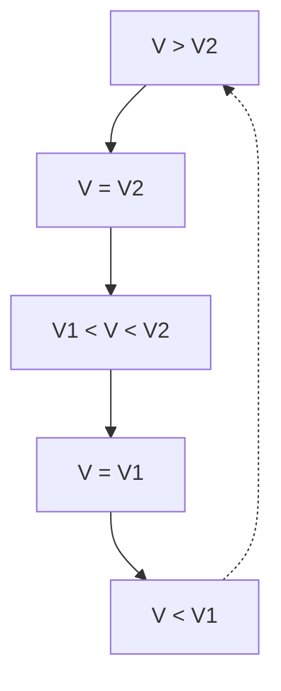

# 8 Gravitation

原始 PDF 第 96–100 页。

Gravitation

## 8.1 Die keplerschen Gesetze der Planetenbewegung und das Gravitationsgesetz

In Abschnitt 4.4 hatten wir zwei Grundeigenschaften der Masse erkannt, die Trägheit und die Schwere. Erstere tritt bei der Beschleunigung oder Abbremsung von Körpern als Bewegungswiderstand auf, letztere bestimmt die Gewichtskraft eines Körpers. Diese hängt nicht von seiner Bewegung ab, sondern ist eine Folge der allgemeinen Massenanziehung, der **Gravitation**. Wo immer zwei Massen einander gegenüberstehen, ziehen sie sich von selbst wechselseitig an. So wie die Erde ihren natürlichen Trabanten, den Mond, anzieht, so zieht nach dem Wechselwirkungsprinzip (4.24) mit der gleichen Kraft der Mond die Erde an. Gleiches gilt für die zwischen der Sonne und den Planeten wirkenden Anziehungskräfte, welche die Ursache für deren Bahnbewegung im Sonnensystem sind.

Die Gesetze der Bewegung der Himmelskörper hat JOHANNES KEPLER (1571–1630) aus den astronomischen Beobachtungen von NIKOLAUS KOPERNIKUS (1473–1543) und speziell an dem Planeten Mars von TYCHO DE BRAHE (1546–1601) empirisch hergeleitet. Es sind dies die drei berühmten **KEPLERschen Gesetze:**

1. Die Planeten bewegen sich auf Ellipsen, in deren einem Brennpunkt die Sonne steht (Bild 8.1).
2. Der von der Sonne zu einem Planeten gezogene Fahrstrahl überstreicht in gleichen Zeiten gleiche Flächen (Flächensatz, Bild 8.1).
3. Die Quadrate der Umlaufzeiten verschiedener Planeten verhalten sich wie die dritten Potenzen der großen Halbachsen ihrer Bahnellipsen:

$$
\frac {T _ {1} ^ {2}}{a _ {1} ^ {3}} = \frac {T _ {2} ^ {2}}{a _ {2} ^ {3}} = \frac {T _ {3} ^ {2}}{a _ {3} ^ {3}} = \dots = \text {const.} \tag {8.1}
$$

text_image

t₁ + Δt
t₁
t₂ + Δt
t₂

Bild 8.1 Zum 1. und 2. keplerschen Gesetz

Die KEPLERschen Gesetze gelten grundsätzlich für alle zum Sonnensystem gehörigen, periodisch wiederkehrenden Himmelskörper (z. B. Kometen) sowie sinngemäß auch für alle die Erde umkreisenden Körper (Mond, künstliche Satelliten). Aus dem Flächensatz folgt, dass die Geschwindigkeit des umlaufenden Körpers im sonnen- bzw. erdnächsten Punkt der Bahn (Pe rihel bzw. Perigäum) am größten, im sonnen- bzw. erdfernsten Punkt (Aphel bzw. Apogäum) am kleinsten ist. Dies steht im Einklang mit dem Energiesatz, wonach die Gesamtenergie des umlaufenden Körpers stets konstant ist: Im Perihel besitzt er ein Minimum, im Aphel ein Ma-

---

94

8 Gravitation

ximum an potenzieller Energie. Demnach muss seine kinetische Energie und damit seine Geschwindigkeit im Perihel am größten, im Aphel am kleinsten sein. Siehe auch Abschnitt 11.4.

Ausgehend von der Erkenntnis, dass die allen Körpern innewohnende universelle Eigenschaft der gegenseitigen Massenanziehung, die **Schwerkraft**, die Ursache für die Bahnbewegung der Himmelskörper ist, gelang es NEWTON (1687), das Kraftgesetz für die Anziehung zweier Massen herzuleiten. Wir wollen dieses Kraftgesetz durch eine stark vereinfachte Überlegung aus dem 3. KEPLERschen Gesetz gewinnen (Bild 8.2): Infolge des Umlaufs eines Planeten der Masse m auf einer (wegen der geringen Exzentrizität der meisten Planetenbahnen) näherungsweise kreisförmig angenommenen Bahn vom Radius r um die Sonne (Masse M) mit der Winkelgeschwindigkeit $\omega = 2 \pi / T \left( T \right.$ Umlaufzeit) wirkt auf den Planeten die von der Sonne weg gerichtete Zentrifugalkraft $m \omega ^ { 2 } r$ , die der ihr entgegengesetzt gerichteten **Gravitationskraft** $F$ das Gleichgewicht hält.

text_image

r
M
F
m
mω²r

Bild 8.2 Zur Herleitung des Gravitationsgesetzes aus dem 3. keplerschen Gesetz

Es gilt daher

$$
F = m \omega^ {2} r = \frac {m (2 \pi) ^ {2} r}{T ^ {2}}
$$

und mit dem 3. KEPLERschen Gesetz (8.1), welches für zwei Planeten auf Kreisbahnen lautet $T _ { 1 } ^ { 2 } : T _ { 2 } ^ { 2 } = r _ { 1 } ^ { 3 } : r _ { 2 } ^ { 3 }$ oder $T ^ { 2 } = \mathrm { c o n s t } \cdot r ^ { 3 }$ :

$$
F = \mathrm{const} \cdot \frac {m}{r ^ {2}}.
$$

Da nach dem Wechselwirkungsgesetz (4.25) die Massen m und M sich wechselseitig anziehen, muss die Gravitationskraft $F$ auch proportional zur Masse M sein; es gilt daher

$$
F = \gamma \frac {m M}{r ^ {2}} \quad (\text {Gravitationsgesetz, Newton 1687}). \tag {8.2}
$$

## Gravitationsgesetz:

**Die zwischen zwei Körpern wirkende Gravitationskraft ist dem Produkt beider Massen proportional und nimmt mit dem Quadrat ihres Abstandes ab.**

Das Gravitationsgesetz (8.2) ist außer für Punktmassen und homogene Kugeln auch für Körper, die wie die Erde aus homogenen Kugelschalen bestehen, streng gültig. Dabei ist r jeweils der Abstand der Kugelmittelpunkte, d. h., die Kugel verhält sich $\mathbf { s o } ,$ als sei ihre gesamte Masse im Mittelpunkt vereinigt.

In Gleichung (8.2) ist $\gamma$ die Gravitationskonstante. Sie ist eine von der Beschaffenheit der Körper unabhängige universelle Naturkonstante, die experimentell bestimmt werden muss. Ihr Wert, der verglichen mit anderen Naturkonstanten nur eine geringe relative Messgenauigkeit von etwa $1 0 ^ { - \widetilde { 4 } }$ aufweist (s. 2.3), beträgt

$$
\gamma = 6, 6 7 4 \cdot 1 0 ^ {- 1 1}   \mathrm{N} \cdot \mathrm{m} ^ {2} / \mathrm{kg} ^ {2} \qquad (\text {Gravitationskonstante}). \tag {8.3}
$$

---

8.1 Die keplerschen Gesetze der Planetenbewegung und das Gravitationsgesetz

95

Die Bestimmung der Gravitationskonstante γ gelang erstmals 1798 dem englischen Physiker CAVENDISH in einem Laborexperiment. Er benutzte dazu eine Drehwaage (Bild 8.3), mit der die Anziehungskraft zwischen je zwei sich gegenüberstehenden schweren und leichten Metallkugeln mit den Massen $m _ { 1 }$ und $m _ { 2 }$ aus der Verdrillung des elastischen Aufhängefadens des Waagebalkens mittels eines daran angebrachten Spiegels über Lichtzeiger gemessen wurde.

An der Erdoberfläche, d. h. für $r = R = 6 { , } 3 8 { \cdot } 1 0 ^ { 6 }$ m (Erdradius), ist mit $M = 5 { , } 9 8 { \cdot } 1 0 ^ { 2 4 }$ kg (Masse der Erde) die **Gewichtskraft** eines Körpers der Masse m nach (8.2) $\gamma m M / R ^ { 2 } = m g$ , womit sich die für alle Körper gleich große Fallbeschleunigung $g$ berechnet zu

$$
g = \frac {\gamma M}{R ^ {2}} = 9, 8 1 \mathrm{m} / \mathrm{s} ^ {2} \quad (\text {Fallbeschleunigung an der Erdoberfläche}). \tag {8.4}
$$

Entsprechend ist in der Höhe h über der Erdoberfläche $g ( h ) = \gamma M / ( R + h ) ^ { 2 }$ bzw. mit (8.4)

$$
g (h) = g \frac {R ^ {2}}{(R + h) ^ {2}} \quad (\text {Fallbeschleunigung in der Höhe} h). \tag {8.5}
$$

text_image

Physics diagram showing a pulley system with masses m1 and m2, a switch S, and light bulbs for motion control.

**Bild 8.3** Cavendish-Experiment zur Bestimmung der Gravitationskonstante $\gamma .$

Cavendish führte sein berühmt gewordenes Experiment, welches Ausdruck der hochentwickelten Experimentierkunst jener Zeit ist, allerdings nicht mit dem Ziel der Bestimmung der Gravitationskonstante $\gamma ,$ sondern der Masse bzw. mittleren Dichte der Erde durch. Aus dem Gravitationsgesetz (8.2) folgte damit aber zugleich auch der Wert für $\gamma$ (vgl. die nachfolgenden Beispiele 8.1/1 und 8.1/2).

## Beispiele 8.1:

1. Bestimme aus der Fallbeschleunigung g (bei bekanntem Erdradius) die mittlere Dichte der Erde $\varrho _ { \mathrm { E } } !$

Lösung: Aus (8.4) folgt $M = g R ^ { 2 } / \gamma$ und damit $\varrho _ { \mathrm { E } } = M / ( 4 \pi R ^ { 3 } / 3 ) = 3 g / ( 4 \pi R \gamma ) = 5 . 5 0   \mathrm { k g / d m } ^ { 3 }$

2. Zeige, wie aus der im oben beschriebenen CAVENDISH-Experiment gemessenen Gravitationskraft F zwischen den (bekannten) Massen $m _ { 1 }$ und $m _ { 2 }$ bei Kenntnis von R und $g$ die mittlere Dichte der Erde $\varrho _ { \mathrm { E } }$ und daraus die Gravitationskonstante $\gamma$ bestimmt werden kann!

Lösung: Aus dem in Beispiel 1 errechneten Ausdruck für $\varrho _ { \mathrm { E } }$ folgt $\gamma = 3 g / ( 4 \pi R \varrho _ { \mathrm { E } } )$ . Dies in (8.2) eingesetzt, ergibt nach Umstellung $\varrho _ { \mathrm { E } } = 3 m _ { 1 } m _ { 2 } g / ( 4 \pi r ^ { 2 } R F )$ mit r als Entfernung der Kugelmittelpunkte von $m _ { 1 }$ und $m _ { 2 }$ . Mit dem so ermittelten Wert für $\varrho _ { \mathrm { E } }$ erhält man $\gamma$ aus der davor stehenden Beziehung.

3. Bestimme mit Hilfe des Gravitationsgesetzes (8.2) den Wert des konstanten Verhältnisses $T ^ { 2 } / a ^ { 3 }$ (Zentralkörperkonstante) im 3. KEPLERschen Gesetz (8.1) für Erdsatelliten auf kreisförmigen Bahnen $( a = r ) ;$ !

Lösung: Die Zentrifugalkraft des Satelliten ist mω $b ^ { 2 } r = m ( 2 \pi / T ) ^ { 2 } r = 4 \pi ^ { 2 } m r / T ^ { 2 }$ . Durch Gleichsetzen mit (8.2) und Umstellen folgt mit der Masse der Erde $M \approx 6   \cdot   1 0 ^ { 2 4 }   \mathrm { k g }$ das für alle

---

96

8 Gravitation

Erdsatelliten gleiche Verhältnis zu $T ^ { 2 } / r ^ { 3 }   =   4 \pi ^ { 2 } / ( \gamma M )   \approx   1 0 ^ { - 1 3 }   \mathrm { s } ^ { 2 } / \mathrm { m } ^ { 3 }$ . Für einen geostationären Fernsehsatelliten in 36 000km Höhe über dem Äquator, d. h. in einem Abstand vom Er<u>dmittelpunkt von</u> $r = 4 2   3 8 0   \mathrm { k m }$ , erhält man daraus die gewünschte Umlaufzeit von $T =$ $\sqrt { 1 0 ^ { - 1 3 } \cdot ( 4 2   3 8 0 \cdot 1 0 ^ { 3 } ) ^ { 3 } }   \mathrm { s } \approx 8 6   4 0 0   \mathrm { s } = 2 4   \mathrm { h }$ □

## Aufgaben

**8.1** Zeige, wie sich aus dem im obigen Beispiel 8.1/3 bestimmten Verhältnis $T ^ { 2 } / r ^ { 3 }$ (für ein beliebiges Kraftzentrum $M )$ die Masse eines unbekannten Planeten $M _ { \mathrm { P l } }$ aus den Bahndaten seines Trabanten (Bahnradius $r _ { \mathrm { \Pi r } }$ und Umlaufdauer $T _ { \mathrm { T r } } )$ bestimmen lässt!
**8.2** Nach welcher Gesetzmäßigkeit nimmt die Bahngeschwindigkeit $\nu ( r )$ der Planeten mit größer werdender Entfernung r von der Sonne ab?
**8.3** Berechne die Fallbeschleunigung g
a) an der Oberfläche des Mondes (Masse $7 { , } 3 8   \cdot   1 0 ^ { 2 2 }$ kg; Radius 1738km);
b) in 36 000km Höhe über dem Erdäquator, dem Orbit für geostationäre Satelliten (Erdradius 6380km)!

## 8.2 Arbeit gegen die Schwerkraft. Kosmische Geschwindigkeiten

Um einen Körper (Masse m) im Schwerefeld der Erde anzuheben, muss Verschiebungsarbeit gegen die Schwerkraft (8.2) verrichtet werden. Soll der Körper von der Entfernung $r _ { 1 }$ bis in die Entfernung $r _ { 2 } > r _ { 1 }$ vom Erdmittelpunkt gebracht werden, so ist die dabei aufzuwendende Arbeit nach (7.3) gleich dem Wegintegral der Kraft

$$
W = - \int_ {r _ {1}} ^ {r _ {2}} \boldsymbol {F} \cdot \mathrm{d} \boldsymbol {r} = - \int_ {r _ {1}} ^ {r _ {2}} F \mathrm{d} r \cos 1 8 0 ^ {\circ} = \gamma m M \int_ {r _ {1}} ^ {r _ {2}} \frac {\mathrm{d} r}{r ^ {2}} = \gamma m M \left(\frac {1}{r _ {1}} - \frac {1}{r _ {2}}\right). \tag {8.6}
$$

Erfolgt die Verschiebung des Körpers von der Erdoberfläche aus bis in die Höhe $h ,$ d. h. $r _ { 1 } = R$ (Erdradius) und $r _ { 2 } = R + h$ , so wird unter Beachtung von Gleichung (8.4)

$$
W = \gamma m M \left(\frac {1}{R} - \frac {1}{R + h}\right) = \frac {\gamma m M}{R} \frac {h}{R + h} = m g R \frac {h}{R + h}. \tag {8.7}
$$

Um diesen Betrag erhöht sich dabei die potenzielle Energie des Körpers, d. h., es ist $W = \Delta E _ { \mathrm { p } } =$ $E _ { \mathrm { p } } ( r _ { 2 } ) - E _ { \mathrm { p } } ( r _ { 1 } )$ . Wenn $h \ll R ,$ , so wird $W = m g h$ , entsprechend dem bekannten Ausdruck für die Hubarbeit bzw. die Änderung der potenziellen Energie bei kleinen Höhenunterschieden.

**Kosmische Geschwindigkeiten.** Die vorstehenden Ausführungen sind von großer Bedeutung für die Beschreibung der Bahnen von ballistischen Flugkörpern (Geschosse, Fernraketen) sowie von Satelliten und Raumsonden. Für diese kommen mehrere Arten von Flugbahnen in Frage. Die Kreisbahn als spezieller Fall einer KEPLER-Ellipse wird erhalten, wenn die auf den umlaufenden Körper (Satelliten) wirkende Fliehkraft in der Höhe h gleich der Schwerkraft ist, wenn also mit (8.5) gilt

$$
\frac {m v ^ {2}}{R + h} = m g (h) = m g \frac {R ^ {2}}{(R + h) ^ {2}}; \quad \nu (h) = \sqrt {\frac {g R ^ {2}}{R + h}}. \tag {8.8}
$$

Die Kreisbahngeschwindigkeit $\nu ( h )$ nimmt, wie man sieht, mit zunehmender Höhe ab. Für einen in sehr geringer Höhe $( h \ll R )$ umlaufenden Satelliten folgt

$$
v _ {1} = \sqrt {g R} = 7, 9 \mathrm{km/s} \quad \text {(1.kosmische Geschwindigkeit).} \tag {8.9}
$$

---

8.2 Arbeit gegen die Schwerkraft. Kosmische Geschwindigkeiten

97

Bei Geschwindigkeiten $\nu > \nu _ { 1 }$ umkreist der Flugkörper die Erde auf einer elliptischen Bahn (Bild 8.4). Für $\nu < \nu _ { 1 }$ kehrt der Körper wieder zur Erde zurück; er durchläuft dabei nur einen Teil der KEPLER-Ellipse. Die beiden Ellipsen für $\nu > \nu _ { 1 }$ und $\nu < \nu _ { 1 }$ unterscheiden sich dadurch, dass im ersten Fall der Mittelpunkt der Erde in dem dem Abschusspunkt näheren, im zweiten Fall im ferneren Ellipsenbrennpunkt liegt. Die Bahnen von Wurfkörpern sind also stets Ellipsen und keine Wurfparabeln, da die Richtung der Fallbeschleunigung über die Bahnkurven veränderlich ist. Für kleine Entfernungen kann näherungsweise die Bahnellipse durch eine Parabel angenähert werden.

flowchart

Bild 8.4 Bahnkurven ballistischer Flugkörper bei horizontalem Einschuss in die Flugbahn.

$\nu _ { 1 }$ 1. kosmische Geschwindigkeit (Kreisbahngeschwindig keit), $$\nu _ { 2 }$ 2.$ kosmische Geschwindigkeit (Parabelgeschwindigkeit)

Die Mindestgeschwindigkeit, die ein Körper erhalten muss, um sich aus dem Anziehungsbereich der Erde völlig entfernen zu können, die sog. Fluchtgeschwindigkeit, folgt aus der Bedingung, dass die kinetische Energie des Körpers so groß sein muss wie die Arbeit, die erforderlich ist, um ihn bis ins Unendliche zu befördern, d. h., es muss mit Gleichung (8.7) gelten

$$
\frac {m v ^ {2}}{2} = \frac {\gamma m M}{R} \frac {h}{R + h} = m g R \frac {h}{R + h} = m g R \frac {1}{(R / h) + 1}, \tag {8.10}
$$

woraus für $h \to \infty$ folgt

$$
v _ {2} = \sqrt {2 g R} = 1 1, 2 \mathrm{km/s} \quad (2. \text {kosmische Geschwindigkeit}). \tag {8.11}
$$

Die zugehörige ballistische Flugbahn ist eine Parabel (Bild 8.4). Für $\nu > \nu _ { 2 }$ entweicht der Flugkörper auf einer hyperbolischen Bahn ebenfalls auf Nimmerwiedersehen in den Weltraum.

Die Geschwindigkeit, die ein im Abstand $r _ { \mathrm { E } }$ von der Sonne befindlicher Flugkörper haben muss, um die Gravitationskraft der Sonne $F _ { \mathrm { S } } = \gamma m M _ { \mathrm { S } } / r _ { \mathrm { E } } ^ { 2 }$ überwinden zu können, die Fluchtgeschwindigkeit $v _ { \mathrm { S } } ,$ berechnet sich analog zu $v _ { 2 }$ gemäß (8.10) für $h \to \infty ;$

$$
\frac {m v _ {\mathrm{S}} ^ {2}}{2} = \frac {\gamma m M _ {\mathrm{S}}}{r _ {\mathrm{E}}}; \quad v _ {\mathrm{S}} = \sqrt {\frac {2 \gamma M _ {\mathrm{S}}}{r _ {\mathrm{E}}}} = 4 2, 1 \mathrm{km/s}.
$$

Dies ist die Fluchtgeschwindigkeit im Bezugssystem der Sonne. In Bezug auf die Erde, die im Sonnensystem selbst bereits die Geschwindigkeit $v_{\mathrm{E}} = 2 \pi r_{\mathrm{E}} / T_{\mathrm{E}} = 29.9   \mathrm{km/s}$ hat, ist die Fluchtgeschwindigkeit $\nu _ { \mathrm { F } } ^ { \prime } = \nu _ { \mathrm { S } } - \nu _ { \mathrm { E } } = 1 2 { , } 2 \mathrm { k m / s }$ . Um von der Erde aus das Sonnensystem verlassen zu können, muss das Gravitationsfeld der Erde und das der Sonne überwunden werden. Dazu benötigt der Flugkörper die kinetische Energie m $\nu _ { 3 } ^ { 2 } / 2 = m \nu _ { 2 } ^ { 2 } / 2 + m \nu _ { \mathrm { F } } ^ { \prime 2 } / 2$ , woraus folgt

$$
v _ {3} = \sqrt {v _ {2} ^ {2} + v _ {\mathrm{F}} ^ {\prime 2}} = 1 6, 6 \mathrm{km/s} \quad \text {(3.kosmische Geschwindigkeit).} \tag {8.12}
$$

## Aufgaben

**8.4** Wie groß ist die zu verrichtende Arbeit, um 1kg Masse von der Erdoberfläche bis in die unendliche Ferne zu befördern? (Erdradius $R = 6380    km$
**8.5** Eine Raumsonde soll aus einer Erdumlaufbahn in $h = R = 6380    km$ Höhe ins All gestartet werden. Berechne die erforderliche Geschwindigkeit!
