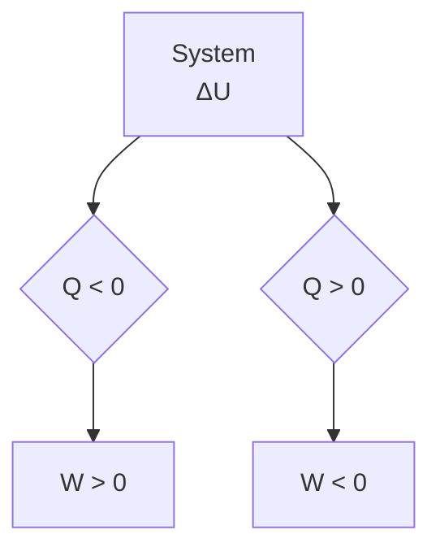

# 17 Der I. Hauptsatz der Thermodynamik (Energiesatz)

原始 PDF 第 187–199 页。

17

# Der I. Hauptsatz der Thermodynamik (Energiesatz)

## 17.1 Wärmemenge und Wärmekapazität

Wärme ist Energie. Ebenso wie aus mechanischer (potenzieller und kinetischer) oder elektri scher Energie kann auch aus Wärme Arbeit gewonnen werden. Wärme ist stets an einen festen, flüssigen oder gasförmigen Körper gebunden. Sie kann mit anderen Körpern ausgetauscht werden, wobei eine bestimmte **Wärme** oder **Wärmemenge** Q, entsprechend einer bestimmten Menge an Energie, vom wärmeren Körper auf den kälteren übergeht. Es ist daher auch die

$$
\text {Einheit der Wärmemenge:} \quad [ Q ] = 1 \mathrm{J} = 1 \mathrm{W} \cdot \mathrm{s} = 1 \mathrm{N} \cdot \mathrm{m}.
$$

Wird einem Körper der Masse m die Wärmemenge Q zugeführt, so erhöht sich seine Temperatur T proportional zu Q und umgekehrt proportional zu m:

$$
\Delta T \sim \frac {1}{m} Q,
$$

d. h., die für eine Temperaturerhöhung $\Delta T$ des Körpers von $T _ { 1 }$ auf $T _ { 2 }$ erforderliche Wärmemenge ist

$$
Q = c m \Delta T = c m (T _ {2} - T _ {1}) \quad (\text {Wärmemenge}). \tag {17.1}
$$

Den Proportionalitätsfaktor c in vorstehender Gleichung, der innerhalb eines bestimmten Temperaturbereiches konstant ist, nennt man **spezifische Wärmekapazität** des Stoffes:

$$
c = \frac {1}{m} \frac {Q}{T _ {2} - T _ {1}} \quad \text {bzw. differenziell} \quad c = \frac {1}{m} \frac {\mathrm{d} Q}{\mathrm{d} T}; \tag {17.2}
$$

$$
\text {Einheit:} \quad [ c ] = 1 \mathrm{J} / (\mathrm{kg} \cdot \mathrm{K}).
$$

## Die spezifische Wärmekapazität gibt zahlenmäßig diejenige Wärmemenge an, die erforderlich ist, um 1 kg des betreffenden Stoffes um 1 K zu erwärmen.

Die in Gleichung (17.1) vorkommende Größe

$$
C = c m, \quad \text {Einheit:} [ C ] = 1 \mathrm{J/K}, \tag {17.3}
$$

ist die **Wärmekapazität des Körpers**; sie gibt diejenige Wärmemenge an, die nötig ist, um den ganzen Körper der Masse m um 1K zu erwärmen. Demnach ist, wenn in (17.3) für m die Molmasse $M = m / n$ und für c der Ausdruck (17.2) eingesetzt wird,

$$
C _ {\mathrm{m}} = c M = \frac {c m}{n} = \frac {1}{n} \frac {\mathrm{d} Q}{\mathrm{d} T} \quad (\text {molare Wärmekapazität (Molwärme)}), \tag {17.4}
$$

$$
\text {Einheit:} \quad [ C _ {\mathrm{m}} ] = 1 \mathrm{J/(mol} \cdot \mathrm{K)}.
$$

---

17.1 Wärmemenge und Wärmekapazität

185

Bei den Gasen haben wir zwischen der spezifischen Wärmekapazität bzw. Molwärme bei konstantem Volumen $( c _ { V }$ bzw. $C _ { \mathrm { m } V } )$ und bei konstantem Druck $( c _ { p }$ bzw. $C _ { \mathrm { m } p } )$ zu unterscheiden. Wir kommen in Abschnitt 17.3 darauf zurück.

**Kalorimetrie.** Die spezifische Wärmekapazität fester und flüssiger Stoffe kann durch Mischung bestimmt werden, z. B. durch Eintauchen eines festen Körpers oder durch Hineingießen einer bestimmten Menge Flüssigkeit (Masse $m )$ mit der unbekannten Wärmekapazität c und der Temperatur $\vartheta$ in eine Flüssigkeit bekannter Wärmekapazität $c _ { \mathrm { { H } } }$ der Temperatur $\vartheta _ { \mathrm { F l } } < \vartheta .$ Bei bekannter Wärmekapazität $C _ { \mathrm { K } }$ des Gefäßes, das die Flüssigkeit enthält (Kalorimeter), lässt sich mit Hilfe des Energieerhaltungssatzes aus der gemessenen Mischungstemperatur $\vartheta _ { \mathbf { M } }$ die spezifische Wärmekapazität c bestimmen. Die vom Körper abgegebene Wärmemenge $Q _ { \mathrm { a b } }$ ist gleich der von Flüssigkeit und Kalorimeter aufgenommenen Wärmemenge $Q _ { \mathrm { a u f ^ { * } } }$

$$
Q _ {\mathrm{ab}} = c m \left(\vartheta - \vartheta_ {\mathrm{M}}\right) = c _ {\mathrm{Fl}} m _ {\mathrm{Fl}} \left(\vartheta_ {\mathrm{M}} - \vartheta_ {\mathrm{Fl}}\right) + C _ {\mathrm{K}} \left(\vartheta_ {\mathrm{M}} - \vartheta_ {\mathrm{Fl}}\right) = Q _ {\mathrm{auf}} \quad (\text {Wärmebilanz}), \tag {17.5}
$$

$$
c = \frac {c _ {\mathrm{Fl}} m _ {\mathrm{Fl}} + C _ {\mathrm{K}}}{m} \frac {\vartheta_ {\mathrm{M}} - \vartheta_ {\mathrm{Fl}}}{\vartheta - \vartheta_ {\mathrm{M}}} \quad (\text {Kalorimeter - Formel}). \tag {17.6}
$$

Voraussetzung für die Gültigkeit dieser Formel ist, dass die Mischung bei konstantem Druck, d. h. also als isobarer Prozess, erfolgt und keine Änderungen des Aggregatzustandes (Schmelzen, Erstarren) der beteiligten Stoffe stattfinden. Treten jedoch derartige Phasenumwandlungen auf, so ist die dabei aufgenommene bzw. abgegebene **Umwandlungswärme** $Q = m q$ (s. Abschnitt 20.3) mit der spezifischen Umwandlungswärme $q \left( = \mathrm { W i a r m e t \ddot { o } n u n g } \right)$ je kg des betreffenden Stoffes) in der Wärmebilanz (17.5) zusätzlich zu berücksichtigen (s. Beispiel $1 7 . 1 / 2 )$

## Beispiele 17.1:

1. Berechne die Zeit, in der ein elektrischer Heißwasserspeicher 8l Wasser $(c = 4,19J/(g \cdot K))$ von $1 0   ^ { \circ } \mathrm { C }$ auf $9 5   ^ { \circ } \mathbf { C }$ erwärmt! Die Heizleistung beträgt $P = 9 5 0 \mathrm { W }$ , der Wirkungsgrad η (infolge von Wärmeverlusten verminderte effektive Heizleistung) 92%.

Lösung: Die bereitgestellte Energie beträgt $E = \eta P t .$ . Sie erscheint als Zunahme der Wärmeenergie des Wassers $Q = c m \Delta \vartheta .$ . Aus $E = Q$ folgt mit $m = 8    kg ,   \Delta \vartheta = 8    K$ und $\eta = 0 { , } 9 2$ für die erforderliche Zeit $t = c m \Delta \vartheta / ( \eta P ) = 5 4$ min18s.

2. Eine bestimmte Menge Eis $(m_{\mathrm{E}} = 100   \mathrm{g};$ spez. Wärmekapazität $c_{\mathrm{E}} = 2,09\mathrm{kJ/(kg \cdot K)};$ spez. Schmelzwärme $q = 3 3 2   \mathrm { k J / k g } )$ wird in siedendes Wasser $(m_{\mathrm{W}}=500\mathrm{g};c_{\mathrm{W}}=4,19\mathrm{kJ}/(\mathrm{kg}\cdot\mathrm{K}))$ gebracht. Als Mischungstemperatur wird $\vartheta _ { \mathrm { M } } = 6 9   ^ { \circ } \mathrm { C }$ ermittelt. Als Kalorimeter dient ein Thermosgefäß, dessen Wärmekapazität zu vernachlässigen ist. Welche Temperatur hatte das Eis?

Lösung: Die vom Eis aufgenommene Wärmemenge ist gleich der vom Wasser abgegebenen Wärmemenge. Erstere besteht aus drei Anteilen: $c _ { \mathrm { E } } m _ { \mathrm { E } }   ( \vartheta _ { 0 } - \vartheta _ { \mathrm { E } } )$ zum Erwärmen des Eises auf die Schmelztemperatur $\vartheta _ { 0 } , m _ { \mathrm { E } } q$ zum Schmelzen des Eises und $c _ { \mathrm { W } } m _ { \mathrm { E } }   ( \vartheta _ { \mathrm { M } }   -   \vartheta _ { 0 } )$ zur Erwärmung des geschmolzenen Eises auf die Mischungstemperatur $\vartheta _ { \mathbf { M } }$ . Die vom siedenden Wasser (Siedetemperatur $\vartheta _ { \mathrm { S } } )$ abgegebene Wärmemenge beträgt $c _ { \mathrm { W } } m _ { \mathrm { W } } ( \vartheta _ { \mathrm { S } }   -   \vartheta _ { \mathrm { M } } )$ . Nach dem Energiesatz gilt also:

$$
c _ {\mathrm{E}} m _ {\mathrm{E}} (\vartheta_ {0} - \vartheta_ {\mathrm{E}}) + m _ {\mathrm{E}} q + c _ {\mathrm{W}} m _ {\mathrm{E}} (\vartheta_ {\mathrm{M}} - \vartheta_ {0}) = c _ {\mathrm{W}} m _ {\mathrm{W}} (\vartheta_ {\mathrm{S}} - \vartheta_ {\mathrm{M}});
$$

$$
\vartheta_ {\mathrm{E}} = \frac {1}{c _ {\mathrm{E}} m _ {\mathrm{E}}} \left[ m _ {\mathrm{E}} q + c _ {\mathrm{W}} m _ {\mathrm{E}} (\vartheta_ {\mathrm{M}} - \vartheta_ {0}) - c _ {\mathrm{W}} m _ {\mathrm{W}} (\vartheta_ {\mathrm{S}} - \vartheta_ {\mathrm{M}}) \right] + \vartheta_ {0}.
$$

Mit $\vartheta _ { 0 } = 0   ^ { \circ } \mathrm { C } ,   \vartheta _ { \mathrm { S } } = 1 0 0   ^ { \circ } \mathrm { C }$ folgt hieraus $\vartheta _ { \mathrm { E } } = - 1 4   ^ { \circ } \mathrm { C }$

---

186

17 Der I. Hauptsatz der Thermodynamik (Energiesatz)

## Aufgabe

**17.1** Ein Kalorimeter ist mit $m _ { \mathrm { k } } = 0 . 5 \mathrm { k g }$ kaltem Wasser der Temperatur $\vartheta _ { \mathrm { k } } = 1 0   ^ { \circ } \mathrm { C }$ gefüllt (spezifische Wärmekapazität des Wassers $c_{W}=4,19\mathrm{kJ/(kg\cdot K)}$ . Zur Bestimmung der Wärmekapazität des Kalorimeters (einschl. Deckel, Rührwerk und Thermometer) werden $m _ { \mathrm { w } } = 0 { , } 5$ kg warmes Wasser von $\vartheta _ { \mathrm { w } }   =   8 0   ^ { \circ } ($ C hinzugegeben. Es wird eine Mischungstemperatur von $\vartheta _ { \mathrm { M } } = 4 2   ^ { \circ } \mathrm { C }$ ermittelt. Wie groß ist die Wärmekapazität des Kalorimeters $C _ { \mathrm { K } ^ { 2 } }$

## 17.2 Innere Energie eines Systems. Formulierung des I. Hauptsatzes

Ausgehend von der Erkenntnis, dass Wärme eine Form der Energie ist, die sich in andere Energieformen umwandeln lässt, formulierte ROBERT MAYER (1842) erstmals das **Prinzip von der Erhaltung der Energie**, welches besagt: In einem abgeschlossenen System bleibt der gesamte Energievorrat, also die Summe aus Wärmeenergie, mechanischer oder anderer Energie, stets konstant. Dies ist die Grundaussage des I. Hauptsatzes der Thermodynamik. Man bezeichnet ihn auch als Satz von der Unmöglichkeit eines Perpetuum mobile 1. Art: Es ist nicht möglich, eine Maschine zu konstruieren, welche Arbeit verrichtet, ohne Energie aus einer äußeren Quelle zu schöpfen.

Um hierfür eine mathematische Formulierung zu gewinnen, beschreiben wir den gesamten Energieinhalt des betrachteten Systems (z. B. einer bestimmten Menge eines Gases) durch eine Größe U, die wir die **innere Energie** des Systems nennen. Diese muss eine eindeutige Funktion der Zustandsgrößen Druck $p ,$ Volumen $V$ und Temperatur $T$ sein; denn wäre der Energieinhalt von der Art abhängig, wie das System in den Zustand gebracht wurde (wäre z. B. der Energieaufwand größer, wenn 1l Luft von $\mathbf { 0 }   ^ { \circ } \mathbf { C }$ zuerst auf $1 0 0   ^ { \circ } \mathrm { C }$ erwärmt und dann auf $1 0   \mathrm { c m } ^ { 3 }$ komprimiert wird, als wenn dieselbe Luftmenge zuerst auf $1 0   \mathrm { c m } ^ { 3 }$ komprimiert und danach auf $1 0 0   ^ { \circ } \mathrm { C }$ erwärmt wird), so könnte man dadurch, dass man die Luft auf dem zweiten, weniger Energie erfordernden Weg in den alten Zustand zurückbringt, die Energiedifferenz gewinnen und hätte damit eine Maschine, die Arbeit aus dem Nichts erzeugt.

Wird also ein System aus einem Zustand 1 in einen anderen Zustand 2 überführt, so ist die dabei auftretende Änderung der inneren Energie $\Delta U = U _ { 2 } - U _ { 1 }$ unabhängig von den dabei durchlaufenen Zwischenzuständen, also unabhängig vom Weg. Hieraus folgt, dass bei jedem **Kreisprozess**, bei dem das System eine Folge von unterschiedlichen Zustandsänderungen durchläuft, die wieder in den Ausgangszustand zurückführen, $\Delta U = 0$ ist.

**Die innere Energie ist eine kalorische Zustandsgröße, die den Energieinhalt eines Systems als eindeutige Funktion seiner thermischen Zustandsgrößen Druck, Volumen und Temperatur beschreibt.**

Jede Änderung der inneren Energie $\Delta U$ eines Systems kann nach dem Energieerhaltungssatz nur so erfolgen, dass dem System aus seiner Umgebung (von außen) Energie teils in Form von Wärme (Q), teils durch Verrichtung mechanischer oder elektrischer Arbeit (W ) zugeführt oder entzogen wird (Bild 17.1). Legen wir ein für allemal fest, dass jede zugeführte Energiemenge –

---

17.2 Innere Energie eines Systems. Formulierung des I. Hauptsatzes

187

gleichgültig in welcher Form – positiv und jede dem System entzogene (vom System abgegebene) Energie negativ gezählt wird, so gilt daher

$$
\Delta U = Q + W \quad (\text {I.Hauptsatz}) \tag {17.7}
$$

oder in differenzieller Form

$$
\mathrm{d} U = \mathrm{d} Q + \mathrm{d} W \quad (\text {Änderung der inneren Energie}). \tag {17.8}
$$

flowchart

Bild 17.1 Zur Erläuterung des I. Hauptsatzes

Im Gegensatz zur inneren Energie U, die eine Zustandsgröße ist, wird durch die Größen Q und W der innere Zustand eines Systems nicht eindeutig bestimmt; denn die bei einer Zustandsänderung z. B. vom System aufgenommene Energie, die nun Teil der inneren Energie U des Systems ist, braucht nicht als Wärme zugeführt worden sein, sondern kann auch in Form mechanischer Arbeit, z. B. bei der Kompression eines Gases, auf das System übertragen worden sein. $Q$ und W sind daher keine Zustandsgrößen, sondern sog. **Prozessgrößen**, die von der Art des durchlaufenen Prozesses bestimmt werden. Mit anderen Worten: Änderungen der inneren Energie eines Körpers ∆U lassen sich gemäß Gleichung (17.7) in Abhängigkeit vom Prozess in Wärmemenge und Arbeit einteilen, während für den gesamten Energieinhalt U des Körpers eine solche Aufteilung nicht möglich ist.

text_image

F
A
ds

Bild 17.2 Zur Volumenarbeit eines Gases (F am Kolben angreifende Kraft, ds Verschiebungsweg des Kolbens mit der Querschnittsfläche A; dV = Ads Volumenänderung)

Bei Gasen besteht die Arbeitsleistung in einer Volumenänderung gegen den äußeren Druck p. Befindet sich das Gas in einem Zylinder mit beweglichem Kolben der Querschnittsfläche A (Bild 17.2), dann ist die vom Gas bei Hebung des Kolbens um ds (Vergrößerung des Volumens von $V _ { 1 }$ auf $V _ { 2 } )$ gegen die äußere Kraft $F = p A$ verrichtete (d. h. nach außen hin abgegebene) **Ausdehnungs-** oder **Volumenarbeit**

$$
W = - \int_ {s _ {1}} ^ {s _ {2}} F \mathrm{d} s = - \int_ {s _ {1}} ^ {s _ {2}} p A \mathrm{d} s = - \int_ {V _ {1}} ^ {V _ {2}} p \mathrm{d} V. \tag {17.9}
$$

In einem **p,V -Diagramm** (Bild 17.3) ist die von einem Gas bzw. an einem Gas verrichtete Arbeit betragsmäßig gleich der Fläche unter der p, V -Kurve. Bei den sog. Kreisprozessen, bei denen das System nach Durchlaufen einer Reihe von Zustandsänderungen in seinen Ausgangszustand zurückkehrt (Bild 17.3c), ist die Volumenarbeit betragsmäßig gleich der von der p, V - Kurve umschlossenen Fläche. Mit (17.9) lautet der I. Hauptsatz (17.8):

$$
\mathrm{d} U = \mathrm{d} Q - p \mathrm{d} V \quad \text {oder} \quad \mathrm{d} Q = \mathrm{d} U + p \mathrm{d} V. \tag {17.10}
$$

---

188

17 Der I. Hauptsatz der Thermodynamik (Energiesatz)

## I. Hauptsatz der Thermodynamik:

**Die Änderung der inneren Energie eines Gases ist gleich der Summe aus zu- bzw. abgeführter Wärmemenge und vom Gas bzw. am Gas verrichteter Volumenarbeit.**

Bild 17.3 Volumenarbeit a) bei isobarer, b) bei isothermer Zustandsänderung eines idealen Gases, c) bei einem Kreisprozess

## Beispiel 17.2:

Siehe Bild 17.4! Wie groß ist für den dort beschriebenen Fall a) die Änderung der inneren Energie des Gases, wenn bei einer zugeführten Wärmemenge von 3kJ die Expansionsarbeit 1kJ verrichtet wird? Berechne für den Fall b) die zugeführte Wärmeenergie und die Arbeit, wenn der Druck im Zustand 1 halb so groß ist wie im Zustand 3!

text_image

P
3
2
1
4
0
V

Bild 17.4 Ein Gas werde vom Zustand 1 in den Zustand 2 überführt, und zwar a) auf dem Weg 1-3-2, b) auf dem Weg 1-4-2. Die Änderung der inneren Energie $\Delta U = U _ { 2 } - U _ { 1 }$ ist unabhängig vom Weg stets gleich groß.

Lösung: a) Aus dem I. Hauptsatz (17.7) ergibt sich mit $Q _ { 1 3 2 } = 3 \mathrm { k J }$ und $W _ { 1 3 2 } = W _ { 3 2 } = - 1 \mathrm { k J } ;$ $U _ { 2 } - U _ { 1 } = \Delta U _ { 1 2 } = Q _ { 1 3 2 } + W _ { 1 3 2 } = 2   \mathrm { k J } .$ b) Aus dem Vergleich der Flächen unter den Geradenabschnitten 1-4 und 3-2 (gemessen von der Abszisse) folgt für die verrichtete Arbeit $W _ { 1 4 2 } =$ $W _ { 1 4 } = ( 1 / 2 ) W _ { 3 2 } = - 0 { , } 5 \mathrm { k J }$ und mit $\Delta U _ { 1 2 } = 2   \mathrm { k J }$ (s. oben): $Q _ { 1 4 2 } = \Delta U _ { 1 2 } - W _ { 1 4 2 } = 2 { , } 5 \mathrm { k J }$ □

## Aufgabe

**17.2** Berechne in obigem Beispiel 17.2 a) die Wärmeenergie und die Arbeit, wenn das Gas entlang der Diagonale 1-2 aus dem Zustand 1 in den Zustand 2 gebracht wird; b) die Änderung der inneren Energie, die Arbeit sowie die zugeführte Wärmeenergie, wenn das Gas den Kreisprozess 1-3-2-4-1 durchläuft!

## 17.3 Spezifische Wärmekapazität des idealen Gases. Kalorische Zustandsgleichung

Die spezifische Wärmekapazität, d. i. die Wärmemenge, die erforderlich ist, um 1kg eines Stoffes um 1K zu erwärmen, hängt davon ab, ob die Zuführung der Wärme unter Konstanthaltung

---

17.3 Spezifische Wärmekapazität des idealen Gases. Kalorische Zustandsgleichung

189

des Volumens oder des Druckes erfolgt, da ein Teil der zugeführten Wärmeenergie, wenn der Körper sich ausdehnen kann, für die von ihm verrichtete Ausdehnungsarbeit gegen den gleich bleibenden äußeren Druck benötigt wird. Die Unterscheidung macht sich vor allem bei den Gasen wegen ihres großen thermischen Ausdehnungskoeffizienten bemerkbar. Unter Anwendung des I. Hauptsatzes (17.10) $\mathrm { d } Q = \mathrm { d } U + p   \mathrm { d } V$ folgt für die spezifische Wärmekapazität (17.2) allgemein

$$
c = \frac {1}{m} \frac {\mathrm{d} Q}{\mathrm{d} T} = \frac {1}{m} \left(\frac {\mathrm{d} U}{\mathrm{d} T} + p \frac {\mathrm{d} V}{\mathrm{d} T}\right), \tag {17.11}
$$

woraus für eine Erwärmung bei Konstanthaltung des Volumens, d. h. d $V = 0 ,$ folgt

$$
c _ {V} = \frac {1}{m} \left(\frac {\mathrm{d} Q}{\mathrm{d} T}\right) _ {V = \text {const}} = \frac {1}{m} \frac {\mathrm{d} U}{\mathrm{d} T} \quad \begin{array}{l} \text {(spezifische Wärmekapazität} \\ \text {bei konstantem Volumen)} \end{array} \tag {17.12}
$$

oder mit (17.4) für die $\ddot { \mathrm { A } }$ nderung der inneren Energie

$$
\mathrm{d} U = m c _ {V} \mathrm{d} T = n C _ {\mathrm{m} V} \mathrm{d} T \quad \begin{array}{l} (\text {kalorische Zustandsgleichung} \\ \text {des idealen Gases}). \end{array} \tag {17.13}
$$

Da die innere Energie U eine Zustandsgröße ist, kann ihre Änderung nicht von der speziellen Art der Zustandsänderung abhängen, so dass Gleichung (17.13) für alle beliebigen Zustandsänderungen gilt. Zusammen mit dem I. Hauptsatz (17.10) erhält man damit

$$
\mathrm{d} Q = m c _ {V} \mathrm{d} T + p \mathrm{d} V. \tag {17.14}
$$

## Die einem Gas zugeführte Wärme hat eine Erhöhung seiner Temperatur und/oder eine Vergrößerung seines Volumens zur Folge.

Aus der Zustandsgleichung (16.21) $p V = m R _ { s } T$ folgt durch Differenziation p d $V + V \mathbf { d } p =$ $m R _ { \mathrm { s } }   \mathrm { d } T$ , bei konstantem Druck $( \mathbf { d } p = 0 )$ also $p   \mathrm { d } V = m R _ { \mathrm { s } }   \mathrm { d } T$ . Dies in (17.11) eingesetzt, ergibt als spezifische Wärmekapazität bei konstantem Druck

$$
\begin{array}{l} c _ {p} = \frac {1}{m} \left(\frac {\mathrm{d} Q}{\mathrm{d} T}\right) _ {p = \text {const}} = \frac {1}{m} \left(\frac {\mathrm{d} U}{\mathrm{d} T} + m R _ {\mathrm{s}}\right) \quad \begin{array}{l} \text {(spezifische Wärmekapazität} \\ \text {bei konstantem Druck)} \end{array} \tag {17.15} \\ = c _ {V} + R _ {\mathrm{s}}, \\ \end{array}
$$

d. h., es ist wegen (17.4) und mit $\mathit { M R } _ { \mathrm { s } } = R$ (M Molmasse):

$$
c _ {p} - c _ {V} = R _ {\mathrm{s}} \quad \text {oder} \quad C _ {\mathrm{m} p} - C _ {\mathrm{m} V} = R. \tag {17.16}
$$

**Die Differenz der Molwärmen bei konstantem Druck und konstantem Volumen ist für das ideale Gas gleich der universellen Gaskonstante. Sie ist zahlenmäßig gleich der Ausdehnungsarbeit von 1 mol idealen Gases bei einer Temperaturerhöhung um 1 Kelvin.**

**Die spezifische Wärmekapazität eines idealen Gases bei konstantem Druck ist stets größer als die spezifische Wärmekapazität bei konstantem Volumen.**

---

190

17 Der I. Hauptsatz der Thermodynamik (Energiesatz)

## Beispiel 17.3:

Welche Arbeit verrichtet 1kg Kohlendioxid $( \mathrm { C O _ { 2 } } )$ bei Erwärmung von $0   ^ { \circ } \mathbf { C }$ auf $2 0   ^ { \circ } \mathbf { C } ,$ wenn es sich bei gleich bleibendem Druck (z. B. Atmosphärendruck) ausdehnen kann?

Lösung: Die isobare Ausdehnungsarbeit von 1kg Gas bei 1K Temperaturerhöhung ist durch die Differenz der spezifischen Wärmekapazitäten $c _ { p } - c _ { V }$ gegeben. Aus (17.16) folgt hierfür $c_{p}-c_{V}=R_{s}=R/M.\mathrm{FirCO_{2}}$ ist nach 16.4 $M = (1 \cdot 12 + 2 \cdot 16)  g/mol  = 44  g/$ mol und damit $R / M =$ 189 $\mathrm { J } / ( \mathrm { k g }   \cdot   \mathrm { K } )$ , in Übereinstimmung mit der Differenz der bei $\mathbf { 0 } ^ { \circ } \mathbf { C }$ für $\mathrm { C O _ { 2 } }$ gemessenen Werte $c_{p}=821\mathrm{J/(kg\cdot K)}$ und $c_{V}=632J/(kg\cdot K)$ . Bei einer Temperaturerhöhung um 20K erhält man als Ausdehnungsarbeit entsprechend das 20-fache dieses Wertes, also $20{\cdot}189\mathrm{J}=3{,}78\mathrm{kJ}$ □

## 17.4 Anwendung des I. Hauptsatzes auf spezielle Zustandsänderungen des idealen Gases

**Isobare Zustandsänderung** $(p = \mathbf{const})$ . Aus der Zustandsgleichung des idealen Gases $p V =$ $m R _ { \mathrm { s } } T$ folgt für konstanten Druck durch Differenziation $p   \mathrm { d } V = m R _ { \mathrm { s } }   \mathrm { d } T$ , womit sich nach dem I. Hauptsatz (17.10) für die zugeführte Wärmemenge

$$
\mathrm{d} Q = \mathrm{d} U + m R _ {\mathrm{s}} \mathrm{d} T
$$

ergibt bzw. mit (17.13) und (17.16)

$$
\mathrm{d} Q = m c _ {p} \mathrm{d} T = n C _ {\mathrm{m} p} \mathrm{d} T.
$$

Es ist also mit (17.13) $\mathbf { d } U / \mathbf { d } Q = c _ { V } / c _ { p } ,$ d. h., die einem Gas zugeführte Wärmemenge dQ geht nicht vollständig in innere Energie des Gases über, sondern nur zu dem Bruchteil $\mathbf { d } U = ( c _ { V } / c _ { p } )   \mathbf { d } Q ;$ die Differenz $\mathrm { d } Q   -   \mathrm { d } U$ entfällt auf die Ausdehnungsarbeit des Gases gegen den konstanten äußeren Druck p (s. Beispiel 17.3 im vorangegangenen Abschnitt).

Im p, V -Diagramm sind die Linien gleichen Druckes, die **Isobaren**, Parallelen zur V -Achse (Bild 17.3a). Die bei Volumenänderung von $V _ { 1 }$ auf $V _ { 2 }$ vom Gas bzw. am Gas isobar verrichtete Arbeit ist

$$
W = - \int_ {V _ {1}} ^ {V _ {2}} p \mathrm{d} V = p (V _ {1} - V _ {2}) = m R _ {\mathrm{s}} (T _ {1} - T _ {2}) = n R (T _ {1} - T _ {2}). \tag {17.17}
$$

Die isobare Zustandsänderung kann durch die Anordnung in Bild 17.5a verwirklicht werden, bei der ein über einen Mechanismus (Zahnrad und Zahnstange) durch ein Gewicht belasteter, reibungsfrei beweglicher Kolben das Gas im $\mathrm { Z y }$ linder unter einen konstanten Innendruck versetzt. Bei Wärmezufuhr Q erhöht sich die Temperatur, und das Volumen $V ( T )$ nimmt bei konstantem Druck p zu, wobei eine Hubarbeit W verrichtet wird. Damit das System im $p , V -$ Diagramm eine Isobare durchläuft, muss die Zustandsänderung **quasistatisch** geführt werden, d. h. genügend langsam und in infinitesimal kleinen Schritten, so dass sich das im Zylinder befindliche Gas hinsichtlich Druck und Temperatur in sich und mit der Umgebung stets im **thermodynamischen Gleichgewicht** befindet. Unter diesen Bedingungen kann die Zustandsänderung ebenso gut auch rückwärts, d. h. reversibel, geleitet werden, was in diesem Falle mit einer Abgabe der Wärmemenge Q bei Absenkung des Gewichts verbunden ist.

---

17.4 Anwendung des I. Hauptsatzes auf spezielle Zustandsänderungen

191

Isobare Vorgänge sind nicht auf Gase beschränkt. Zum Beispiel verlaufen alle Vorgänge in der freien Atmosphäre, u. a. Schmelzen und Verdampfen, isobar.

Bild 17.5 Realisierung der a) isobaren, b) isothermen, c) adiabatischen (isentropen) Zustandsänderung

**Isochore Zustandsänderung** $(V = \mathbf{const})$ . Wegen d $V = 0$ verrichtet das Gas keine Volumenarbeit; der I. Hauptsatz (17.10) nimmt daher bei isochoren Zustandsänderungen die Form

$$
\mathrm{d} U = \mathrm{d} Q
$$

an. Das heißt, die gesamte dem Gas zugeführte (entzogene) Wärme findet sich in der Erhöhung (Erniedrigung) der inneren Energie des Gases wieder. Im $p ,$ V -Diagramm wird diese Zustandsänderung durch eine Parallele zur p-Achse beschrieben.

**Isotherme Zustandsänderung** $(T = \mathbf{const})$ . Ihre Realisierung kann nach Bild 17.5b so erfolgen, dass sich das in einem $\mathrm { Z y }$ linder mit guter Wärmeleitfähigkeit befindliche Gas mit einem Wärmebad großer Wärmekapazität und daher konstanter Temperatur im thermischen Gleichgewicht befindet.

Quasistatische und damit reversible Volumenänderung kann man durch geeignete Belastung des Kolbens entsprechend dem Gasdruck $p ( V )$ erreichen. In Bild 17.5b wird dies durch die dargestellte Kurvenbahn realisiert, auf der das Seil des Gewichts abläuft. Bei richtiger Form der Kurvenbahn wird erreicht, dass der Kolben bei isothermer Expansion oder Kompression in jeder Lage stehen bleibt, gerade so wie eine im indifferenten Gleichgewicht befindliche Waage. Die Zugabe oder Wegnahme eines kleinen Gewichts genügt, um den Kolben bei Gewährleistung des thermodynamischen Gleichgewichts sinken oder steigen zu lassen.

Wegen d $T = 0$ und somit nach (17.13) $\mathbf { i } U = 0$ lautet der I. Hauptsatz (17.10) hier

$$
\mathrm{d} Q = p \mathrm{d} V = - \mathrm{d} W,
$$

d. h., die dem Gas zugeführte Wärme erhöht nicht dessen innere Energie, sondern wird vollständig in Volumenarbeit des Gases umgesetzt. Die bei Volumenänderung von $V _ { 1 }$ auf $V _ { 2 }$ isotherm verrichtete Arbeit errechnet sich mit der Zustandsgleichung (16.21) zu

$$
W = - \int_ {V _ {1}} ^ {V _ {2}} p \mathrm{d} V = - m R _ {\mathrm{s}} T \int_ {V _ {1}} ^ {V _ {2}} \frac {\mathrm{d} V}{V} = m R _ {\mathrm{s}} T \ln \left(\frac {V _ {1}}{V _ {2}}\right) = n R T \ln \left(\frac {V _ {1}}{V _ {2}}\right). \tag {17.18}
$$

---

192

17 Der I. Hauptsatz der Thermodynamik (Energiesatz)

Sie entspricht der in Bild 17.3b schraffierten Fläche unter der zugehörigen **Isotherme**, die durch die Gleichung $pV = mR_{\mathrm{s}}T = \mathrm{const}$ beschrieben wird und im $p ,$ V -Diagramm eine gleichseitige Hyperbel darstellt, die von den Koordinatenachsen umso weiter entfernt liegt, je größer T ist.

**Adiabatische (isentrope) Zustandsänderung.** Wird bei einer Zustandsänderung ein Wärmeaustausch zwischen System und Umgebung verhindert, indem z. B. durch eine entsprechende Wärmeisolation des Gefäßes dafür gesorgt wird, dass das darin enthaltene Gas Wärme weder aufnehmen noch abgeben kann, so spricht man von einer adiabatischen Zustandsänderung (Bild 17.5c). Für sie gilt also $\mathbf { d } Q = 0 ,$ , womit der I. Hauptsatz (17.10) lautet:

$$
\mathrm{d} U = - p \mathrm{d} V = \mathrm{d} W.
$$

Bei einer adiabatischen Expansion verrichtet das Gas Arbeit auf Kosten seiner inneren Energie, wodurch die Temperatur sinkt; adiabatische Kompression erhöht die innere Energie des Gases um den Betrag an aufgewandter Kompressionsarbeit, womit die Temperatur ansteigt. Es ändern sich hierbei also alle drei Zustandsgrößen $p ,$ V und T . Die Zustandsfunktion, die bei den hier betrachteten reversibel adiabatischen Vorgängen konstant bleibt, heißt **Entropie**; sie wird erst in Abschnitt 19.4 eingeführt. Man spricht daher in diesem Fall auch von **isentroper** Zustandsänderung.

Zur Ermittlung des Zusammenhangs zwischen den Zustandsgrößen differenzieren wir die Gasgleichung $p V = m R _ { s } T$ und erhalten d $T = ( p   \mathbf { d } V + V \mathbf { d } p ) / ( m R _ { \mathrm { s } } )$ ; dies in die Beziehung (17.13) d $U = m c _ { V } \mathbf { d } T$ eingesetzt, ergibt mit obiger Gleichung für den I. Hauptsatz:

$$
\mathrm{d} U = \frac {c _ {V}}{R _ {\mathrm{s}}} (p \mathrm{d} V + V \mathrm{d} p) = - p \mathrm{d} V. \tag {17.19}
$$

Setzt man hierin nach (17.16) $R _ { \mathrm { s } } = c _ { p } - c _ { V }$ , so folgt nach Umformung

$$
\frac {c _ {p}}{c _ {V}} \frac {\mathrm{d} V}{V} + \frac {\mathrm{d} p}{p} = 0.
$$

Mit dem **Adiabaten-(Isentropen-)exponenten** $\varkappa = c _ { p } / c _ { V } = C _ { \mathrm { m } p } / C _ { \mathrm { m } V }$ erhält man daraus durch Integration und Umformung

$$
\varkappa \ln V + \ln p = \ln V ^ {\varkappa} + \ln p = \ln (p V ^ {\varkappa}) = \text {const}
$$

oder

$$
p V ^ {\varkappa} = \text {const, d.h.} \quad p _ {1} V _ {1} ^ {\varkappa} = p _ {2} V _ {2} ^ {\varkappa} \quad \text {(POISSONSche Adiabatengleichung).} \tag {17.20}
$$

Mit Hilfe des allgemeinen Gasgesetzes $p V / T =$ const lässt sich diese Gleichung auch auf andere Paare von Zustandsgrößen umrechnen; man erhält so

$$
T V ^ {\varkappa - 1} = \text {const} \quad \text {und} \quad T p ^ {\frac {1 - \varkappa}{\varkappa}} = \text {const}. \tag {17.21}
$$

Da adiabatische Expansion stets mit Abkühlung verbunden ist und der Druck nach der Adiabatengleichung (17.20) umgekehrt proportional zu V wegen $\varkappa > 1$ stärker sinkt als bei isothermer Expansion, verlaufen die sog. **Adiabaten (Isentropen)** im p, V -Diagramm stets steiler als die Isothermen (vgl. Bild 17.6). Die adiabatische Volumenarbeit berechnet sich wegen $\mathbf { d } W = \mathbf { d } U = m c _ { V } \mathbf { d } T = n C _ { \mathbf { m } V }$ dT durch Integration zu

$$
W = m c _ {V} (T _ {2} - T _ {1}) = n C _ {\mathrm{m} V} (T _ {2} - T _ {1}). \tag {17.22}
$$

---

17.4 Anwendung des I. Hauptsatzes auf spezielle Zustandsänderungen

193

line

| V | p (Adiabate) | p (Isotherme) |
| --- | --- | --- |
| Low | High | High |
| Medium-Low | Medium | Medium |
| Medium-High | Low | Medium-Low |
| High | Very Low | Low |

Bild 17.6 Adiabate und Isotherme im p, V -Diagramm

**Polytrope Zustandsänderungen.** Vollkommen adiabatische oder isotherme Zustandsänderungen lassen sich in der Praxis mit Wärmekraftmaschinen nicht verwirklichen. Die tatsächlichen Zustandsänderungen liegen zwischen den beiden Grenzfällen. Die **Polytropen** genannten Kurven im $p ,$ V -Diagramm liegen daher bei technischen Vorgängen zwischen den durch den gleichen Ausgangspunkt gehenden Isothermen und Adiabaten (Bild 17.7). Polytrope Zustandsänderungen gehorchen Zustandsgleichungen der Form

$$
p V ^ {k} = \text {const, d.h.} \quad p _ {1} V _ {1} ^ {k} = p _ {2} V _ {2} ^ {k}, \tag {17.23}
$$

wobei der **Polytropenexponent** k Werte zwischen 1 und κ annimmt.

Formal lassen sich alle behandelten Zustandsänderungen und die ihnen entsprechenden Gleichungen als Sonderfälle der polytropen Zustandsänderung mit

$$
\mathrm{d} Q = m c _ {k} \mathrm{d} T \quad \text {und} \quad c _ {k} = c _ {V} \frac {k - \varkappa}{k - 1} \tag {17.24}
$$

darstellen, wobei der Polytropenexponent Werte im Bereich $0 \leq k < \infty$ annimmt. Bild 17.7 zeigt für eine feste Gasmenge einen Vergleich der Expansionskurven der verschiedenen Zustandsänderungen, ausgehend vom gleichen Druck $p _ { 1 }$ und Volumen $V _ { 1 }$ auf das Volumen $V _ { 2 }$ Nach (17.24) ist bei polytroper Expansion eines Gases für $0 \leq k < \varkappa$ (wegen d $T \leq 0 \mathrm{~f} \mathrm{~if} \; 1 \leq k < \varkappa$ und $\mathrm { d } T \geq 0 \mathrm { f i r } 0 \leq k < 1 )$ Wärme zuzuführen, für $k > \varkappa$ (wegen d $T < 0 )$ Wärme abzuführen.

line

| Condition | Description |
| --- | --- |
| Isobare (k = 0) | Constant pressure level at V1 to V2 |
| k < 1 | Pressure decreases as k increases |
| Isotherme (k = 1) | Pressure decreases as k increases |
| technische Polytrope | Pressure decreases as k increases |
| Isentrope (k = x) | Pressure decreases as k increases |
| k > x | Pressure decreases as k increases |
| Isochore \((k = \infty)\) | Pressure remains constant at P1 across the entire range of V |

Bild 17.7 Polytrope Expansion vom Volumen $V _ { 1 }$ auf das Volumen $V _ { 2 }$ bei verschiedenen Polytropenexponenten $k$

**Der Polytropenexponent ist gleich null für isobare, gleich eins für isotherme, gleich dem Adiabatenexponenten für adiabatische und unendlich für isochore Zustandsänderungen.**

---

194

17 Der I. Hauptsatz der Thermodynamik (Energiesatz)

## Beispiele 17.4:

1. Im DIESELmotor wird die hohe Zündtemperatur im Zylinder durch eine adiabatische Kompression der angesaugten Luft erreicht. Welche Temperatur entsteht, wenn Luft von $2 5   ^ { \circ } \mathbf { C }$ (298K) und einem Anfangsdruck von 100kPa (Atmosphärendruck) auf 3800kPa verdichtet wird? $( \varkappa = 1 , 4 . )$

Lösung: Nach (17.21) ist

$$
\begin{array}{l} T _ {1} p _ {1} ^ {\frac {1 - \varkappa}{\varkappa}} = T _ {2} p _ {2} ^ {\frac {1 - \varkappa}{\varkappa}}; \qquad T _ {2} = T _ {1} \left(\frac {p _ {1}}{p _ {2}}\right) ^ {\frac {1 - \varkappa}{\varkappa}} = T _ {1} \left(\frac {p _ {2}}{p _ {1}}\right) ^ {\frac {\varkappa - 1}{\varkappa}} = 2 9 8 \mathrm{K} \cdot 3 8 ^ {0, 2 8 6} \\ = 2 9 8 \mathrm{K} \cdot 2, 8 3 = 8 4 3, 3 4 \mathrm{K}, \text {entsprechend} \vartheta_ {2} = 5 7 0, 2 ^ {\circ} \mathrm{C}. \\ \end{array}
$$

$2 . \: 3 { , } 0   \mathrm { m } ^ { 3 }$ Luft von 100kPa sollen isotherm auf 500kPa komprimiert werden. Berechne a) das Volumen nach der Verdichtung; b) die erforderliche Kompressionsarbeit; c) die abzuführende Wärmemenge!

Lösung: a) Nach dem BOYLE-MARIOTTEschen Gesetz ist $V _ { 2 } = p _ { 1 } V _ { 1 } / p _ { 2 } = 0 , 6 \mathrm { m } ^ { 3 } ; \mathrm { b } )$ aus (17.18) folgt mit $p _ { 1 } V _ { 1 } = p _ { 2 } V _ { 2 } = m R _ { \mathrm { s } } T \colon W = p _ { 1 } V _ { 1 } \ln { ( p _ { 2 } / p _ { 1 } ) } = 4 8 3   \mathrm { k J } ;$ c) nach dem I. Hauptsatz ist wegen $\mathbf { i } T = 0$ und damit $\mathrm { d } U = 0$ die abzuführende Wärmemenge $\mathbf { d } Q = p   \mathbf { d } V = - \mathbf { d } W$ (s. oben), also betragsmäßig gleich der am Gas verrichteten Arbeit von 483kJ.

$^ { 3 . 1 , 0 } \mathrm { m } ^ { 3 }$ Luft von 300K soll bei konstantem Druck von 100kPa auf 1000K erwärmt werden. Berechne a) das Endvolumen; b) die verrichtete Ausdehnungsarbeit; c) die zuzuführende Wärmemenge! $( \varkappa = 1 , 4 . )$

Lösung: Es handelt sich um eine isobare Zustandsänderung. Daher folgt a) aus (16.13) $V _ { 2 } =$ $V _ { 1 } T _ { 2 } / T _ { 1 } = 3 , 3 3   \mathrm { m } ^ { 3 } ;$ ; b) aus (17.17) $W = p   ( V _ { 1 } - V _ { 2 } ) = - 2 3 3   \mathrm { k J }$ (vom Gas abgegebene Arbeit); c) nach (17.15) ist $Q = m c _ { p } \Delta T$ . Wird hier die aus $p V _ { 1 } = m R _ { \mathrm { s } } T _ { 1 }$ ermittelte Masse $m = p V _ { 1 } / ( R _ { \mathrm { s } } T _ { 1 } )$ eingesetzt, so erhält man mit (17.16) $R _ { \mathrm { s } } = c _ { p } - c _ { V }$ und $\varkappa = c _ { p } / c _ { V } { : }$

$$
Q = \frac {c _ {p} p V _ {1} \Delta T}{(c _ {p} - c _ {V}) T _ {1}} = \frac {1}{1 - (1 / \varkappa)} \frac {p V _ {1} \Delta T}{T _ {1}} = \frac {\varkappa}{\varkappa - 1} \frac {p V _ {1}}{T _ {1}} (T _ {2} - T _ {1}) = 8 1 7 \mathrm{kJ}.
$$

4. $\mathrm { 1 , } 0   \mathrm { m } ^ { 3 }$ Luft von 100kPa und 300K soll durch Temperaturerhöhung auf einen Druck von 300kPa gebracht werden. Wie groß sind a) die erforderliche Temperatur; b) die zuzuführende Wärmemenge? $( \varkappa = 1 , 4 . )$

Lösung: Für die vorliegende isochore Zustandsänderung (V = const) folgt a) nach (16.15) $T _ { 2 } =$ $T_{1}p_{2}/p_{1}=900  K ;$ b) wegen d $V = 0$ und damit d $. W = 0$ ist nach dem I. Hauptsatz $\mathbf { d } Q = \mathbf { d } U =$ mcV dT (s. oben). Aus $p V = m R _ { s } T$ folgt $V \mathbf { d } p = m R _ { \mathrm { s } }$ dT bzw. m d $T = V \mathbf { d } p / R _ { s }$ . Dies zuvor eingesetzt, ergibt mit $R _ { \mathrm { s } } = c _ { p }   -   c _ { V }$ und $\varkappa = c _ { p } / c _ { V } { : }   \mathbf { d } Q = V \mathbf { d } p / ( \varkappa { - } 1 )$ und daraus durch Integration $Q = V ( p _ { 2 } - p _ { 1 } ) / ( \varkappa - 1 ) = 5 0 0   \mathrm { k J }$ □

## Aufgabe

**17.3** Luft (Molmasse $M \approx 2 9   \cdot   1 0 ^ { - 3 }   \mathrm { k g / m o l ) }$ wird von einem Kompressor bei Atmosphärendruck $p _ { 1 } = 1 0 0 0$ hPa und bei der Temperatur $T = 2 9 4 \mathrm { K }$ angesaugt und isotherm auf den Druck $p _ { 2 } = 3 { , } 5$ MPa komprimiert. Welche Wärmemenge Q muss je Kilogramm komprimierter Luft an das Kühlwasser abgegeben werden, und wie groß ist die vom Gas verrichtete Volumenarbeit?

---

17.5 Zustandsänderungen des idealen Gases in offenen Systemen

195

## 17.5 Zustandsänderungen des idealen Gases in offenen Systemen. Technische Arbeit. Enthalpie

Die bisher betrachteten Zustandsänderungen bezogen sich auf gleich bleibende, nach außen abgeschlossene Stoffmengen, auf sog. geschlossene Systeme. Die von diesen Systemen abgegebene Arbeit war reine Volumenarbeit und durch (17.9) gegeben. Im Unterschied dazu sind in der Technik (z. B. beim Luftverdichter oder bei der Kolbendampfmaschine) häufig Vorgänge anzutreffen, bei denen der Arbeitsstoff einen Behälter oder ein Rohrleitungssystem durchströmt. Das durchströmte Volumen bezeichnet man als **offenes System**, den Vorgang auch als **Gleichdruckprozess**. Dieser kann idealisiert anhand von Bild 17.8a und am zugehörigen p, V - Diagramm erläutert werden: Ein Gas strömt aus einem sehr großen Behälter mit konstantem Druck $p _ { 1 }$ durch das Ventil $\mathrm { O _ { 1 } }$ (Ventil $\mathrm { O } _ { 2 }$ geschlossen) in den Zylinder V und schiebt den Kolben K vor sich her. Die verrichtete Verdrängungsarbeit ist $- p _ { 1 } V _ { 1 }$ und durch die Fläche unter der Isobaren AB im p, V -Diagramm gegeben. Nach Absperrung der Ventile wird das Gas einer Zustandsänderung unterworfen, es dehnt sich dabei auf das Volumen $V _ { 2 }$ aus und verrichtet die Ausdehnungsarbeit $- \int _ { V _ { 1 } } ^ { V _ { 2 } } p   \mathrm { d } V$ , entsprechend der Fläche unter der Kurve BC. Der Druck sinkt auf $p _ { 2 }$ . Dann wird das Ventil $\mathrm { O } _ { 2 }$ geöffnet und das Gas unter konstantem Druck $p _ { 2 }$ in einen großen Behälter gleichen Druckes ausgestoßen. Dazu ist die Arbeit $p _ { 2 } V _ { 2 }$ aufzuwenden. Nach Schließen von $\mathrm { O } _ { 2 }$ wird das Ventil $\mathrm { O _ { 1 } }$ zum Behälter mit dem Druck $p _ { 1 }$ wieder geöffnet, der Prozess beginnt erneut mit neuem Arbeitsstoff, die Maschine arbeitet periodisch.

Bild 17.8 Die beim Gleichdruckprozess (a) gewonnene technische Arbeit (b)

Die gesamte abgegebene Arbeit kann für technische Zwecke genutzt werden. Sie wird daher als **technische Arbeit** $W _ { \mathrm { t e c h n } }$ bezeichnet und entspricht dem Flächeninhalt des geschlossenen Kurvenstücks ABC D bzw. der Fläche neben der Kurve BC (s. Bild 17.8b):

$$
W _ {\mathrm{techn}} = - p _ {1} V _ {1} - \int_ {V _ {1}} ^ {V _ {2}} p \mathrm{d} V + p _ {2} V _ {2} = \int_ {p _ {1}} ^ {p _ {2}} V \mathrm{d} p \quad (\text {technischeArbeit}). \tag {17.25}
$$

Wegen d $W _ { \mathrm { t e c h n } } = V \mathrm { d } p$ kann mittels einer kleinen Umformung der I. Hauptsatz in folgende Form gebracht werden:

$$
\begin{array}{l} \mathrm{d} Q = \mathrm{d} U + p \mathrm{d} V + V \mathrm{d} p - V \mathrm{d} p = \mathrm{d} U + \mathrm{d} (p V) - V \mathrm{d} p \\ = \mathrm{d} (U + p V) - V \mathrm{d} p = \mathrm{d} H - \mathrm{d} W _ {\text {techn}} \\ \end{array}
$$

mit der neuen Zustandsgröße

$$
H = U + p V \quad (\text {Enthalpie}). \tag {17.26}
$$

---

196

17 Der I. Hauptsatz der Thermodynamik (Energiesatz)

Das Produkt $p V$ heißt **Verdrängungsarbeit**. Bei isothermen Zustandsänderungen ist die technische Arbeit $W _ { \mathrm { t e c h n } }$ wegen $p _ { 1 } V _ { 1 } = p _ { 2 } V _ { 2 }$ und (17.25) gleich der Volumenarbeit $W ,$ während bei adiabatischen Zustandsänderungen wegen (17.20) $pV^{ 宀 } =$ const gilt $W _ { \mathrm { t e c h n } } = \varkappa W$ und bei polytropen Zustandsänderungen wegen (17.23) $p V ^ { k } =$ const entsprechend $W _ { \mathrm { t e c h n } } = k W$ Für isobare Zustandsänderungen ist $\mathbf { d } W _ { \mathrm { t e c h n } } = 0$ , womit der I. Hauptsatz (17.10) in die Form $\mathbf { d } Q = \mathbf { d } H = \mathbf { d } U + p   \mathbf { d } V$ übergeht.

## Die Enthalpie ist eine Zustandsgröße, deren Differenz aus End- und Anfangszustand gleich der bei konstantem Druck ausgetauschten Wärme ist.

Somit ist die spezifische bzw. molare Wärmekapazität bei konstantem Druck (vgl. 17.3) wie folgt durch die Enthalpieänderung gegeben:

$$
c _ {p} = \frac {1}{m} \frac {\mathrm{d} H}{\mathrm{d} T} \quad \text {bzw.} \quad C _ {\mathrm{mp}} = \frac {1}{n} \frac {\mathrm{d} H}{\mathrm{d} T}. \tag {17.27}
$$

Eine besondere Bedeutung hat die Enthalpie für chemische und metallurgische Prozesse, da viele chemische Reaktionen und Umwandlungsvorgänge in offenen Gefäßen bei konstantem (Atmosphären-)Druck stattfinden. So läuft eine chemische Reaktion unter den gegebenen Bedingungen dann spontan ab, wenn die Enthalpie der Produkte kleiner ist als die Enthalpie der Ausgangsstoffe, wenn also für die Enthalpieänderung $\Delta H \leq 0 \; \mathrm { g i l t } .$

## Beispiel 17.5:

Ein Kompressor mit $V _ { 1 } = 3 1$ Hubraum verdichtet Luft von Normdruck $p _ { 1 } = p _ { 0 } = 1 0 1 { , } 3 2 5$ kPa auf Druckluft von $p _ { 2 } = 4 0 0   \mathrm { k P a }$ , wobei der Kompressionsakt eine polytrope Zustandsänderung mit dem Polytropenexponenten $k = 1 { , } 3$ darstellt. Berechne die Kompressorarbeit $W _ { \mathrm { t e c h n } }$ für einen Arbeitszyklus und vergleiche diese mit der Kompressionsarbeit W !

Lösung: Die Kompressorarbeit für einen Zyklus ist gleich der technischen Arbeit (17.25), für die sich mit der Polytropengleichung (17.23) $\stackrel { \cdot } { p } _ { 1 } V _ { 1 } ^ { k } = \stackrel { \cdot } { p } \stackrel { \cdot } { V } ^ { k }$ der Ausdruck

$$
W _ {\mathrm{techn}} = p _ {1} ^ {1 / k} V _ {1} \int_ {p _ {1}} ^ {p _ {2}} p ^ {- 1 / k} \mathrm{d} p = \frac {k}{k - 1} \left[ \left(\frac {p _ {2}}{p _ {1}}\right) ^ {(k - 1) / k} - 1 \right] p _ {1} V _ {1}
$$

ergibt. Mit den Zahlenwerten folgt daraus $W _ { \mathrm { t e c h n } } = 4 9 1 , 1 1$ . Die Kompressionsarbeit (17.9) ist

$$
W = - \int_ {V _ {1}} ^ {V _ {2}} p \mathrm{d} V = \frac {1}{k} W _ {\mathrm{techn}} = 3 7 7, 8 \mathrm{J}.
$$

Diese ist um den Anteil $(1 - 1/k)W_{\mathrm{techn}} = 113,3$ geringer als die Kompressorarbeit, die zusätzlich noch die Arbeit für das Ansaugen und Ausschieben des Gases beinhaltet. □
