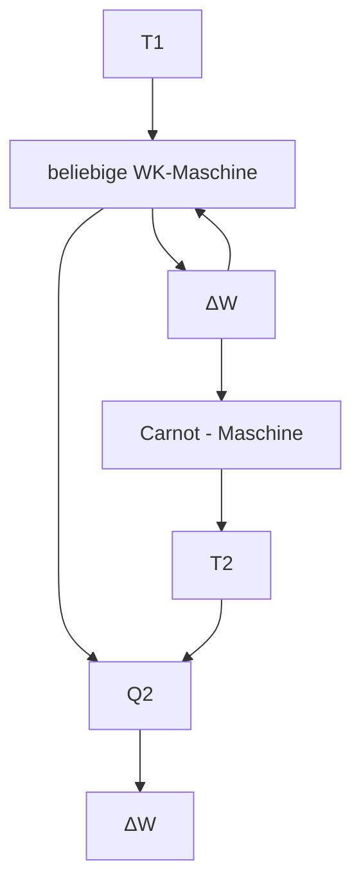

# 19 Der II. Hauptsatz der Thermodynamik (Entropiesatz)

原始 PDF 第 213–230 页。

19

# Der II. Hauptsatz der Thermodynamik (Entropiesatz)

## 19.1 Der Carnot-Kreisprozess. Wärmekraftmaschine, Kältemaschine und Wärmepumpe

Der I. Hauptsatz macht eine Aussage über die Energiebilanz, die bei jeder Umwandlung von mechanischer (oder elektrischer) Energie in Wärme und umgekehrt erfüllt sein muss. Ob eine solche Umwandlung unter gegebenen Bedingungen aber stattfindet und welcher Anteil der Energie umgewandelt wird, darüber gibt der I. Hauptsatz keine Auskunft. Es war aber schon lange vor der Erkenntnis des I. Hauptsatzes bekannt, dass sich zwar mechanische Arbeit z. B. durch Reibung vollständig in Wärme umwandeln lässt, nicht hingegen Wärmeenergie mit Hilfe von Wärmekraftmaschinen vollständig in mechanische Arbeit.

Welcher Bruchteil der Wärme maximal umgewandelt werden kann, lässt sich nach CARNOT (1824) anhand eines Gedankenexperiments ermitteln. Die dazu benutzte Maschine besteht aus einem Zylinder mit verschiebbarem Kolben, der als Arbeitsstoff eine konstante Menge idealen Gases enthält. Durch zwei Wärmespeicher sehr großer Wärmekapazität mit den Temperaturen $T _ { 1 }$ und $T _ { 2 } < T _ { 1 }$ kann das Gas (durch Berührung mit dem einen oder dem anderen Zylinder) entweder auf $T _ { 1 }$ erwärmt oder auf $T _ { 2 }$ abgekühlt werden, ohne dass sich die Temperatur der Speicher ändert (Bild 19.1).

text_image

A
Q₁
B
T₁
D
C
T₂
Q₂
p
V

text_image

AB isotherme Expansion
T₁ → Q₁ →

BC adiabatische Expansion

CD isotherme Kompression

text_image

T₂ < T₁
Q₂

DA adiabatische Kompression

Bild 19.1 Der rechtsläufige Carnot-Prozess (Isothermen AB und C D, Adiabaten BC und D A)

Beim CARNOT-Prozess wird mit dem Gas ein sog. **Kreisprozess** durchlaufen (Bild 17.3c). Man versteht darunter eine Folge unterschiedlicher Zustandsänderungen, durch die das Gas wieder in den Ausgangszustand zurückgeführt wird. Dies gehört zu den wesentlichen Eigenschaften einer Maschine, die beliebig lange arbeiten soll. Die Zustandsänderungen werden quasistatisch geführt, d. h. genügend langsam und in infinitesimal kleinen Schritten, so dass sich das im Zylinder befindliche Gas hinsichtlich Druck und Temperatur in sich und mit der Umgebung (dem Außendruck und der Temperatur des einen oder des anderen Speichers) stets im thermodynamischen Gleichgewicht befindet. Unter diesen Bedingungen können die Zustandsände-

---

19.1 Der Carnot-Kreisprozess. Wärmekraftmaschine, Kältemaschine und Wärmepumpe

211

rungen ebenso gut auch rückwärts, d. h. reversibel, geleitet werden (vgl. 17.4). Außerdem wird von Reibungs- und anderen Verlusten abgesehen.

Von der **rechtsläufigen CARNOT-Maschine** werden bei einem solchen Kreisprozess vier verschiedene Zustandsänderungen entlang von 2 Isothermen und 2 Adiabaten durchlaufen, die wir im $p ,$ V -Diagramm (Bild 19.1) verfolgen wollen: Beginnend im Punkt $A ,$ erfolgt zunächst unter Zufuhr der Wärmemenge $Q _ { 1 }$ aus dem Speicher höherer Temperatur $T _ { 1 }$ eine isotherme Expansion bei dieser Temperatur bis zum Punkt B. Die dabei gewonnene Ausdehnungsarbeit ist nach (17.18)

$$
W _ {A B} = m R T _ {1} \ln \frac {V _ {A}}{V _ {B}} <   0; \quad | W _ {A B} | = Q _ {1}. \tag {19.1}
$$

Es folgt eine adiabatische Expansion zwischen den Punkten B und $C ,$ wobei sich das Gas auf die Temperatur des kälteren Speichers $T _ { 2 }$ abkühlt. Da diese Zustandsänderung unter Wärmeabschluss stattfindet, wird zwischen dem Gas und den Wärmespeichern keine Wärmeenergie ausgetauscht. Danach wird das Gas bei der Temperatur $T _ { 2 }$ zwischen den Punkten C und D unter Aufwendung der Arbeit

$$
W _ {C D} = m R _ {\mathrm{s}} T _ {2} \ln \frac {V _ {C}}{V _ {D}} > 0; \quad W _ {C D} = | Q _ {2} |, \tag {19.2}
$$

isotherm komprimiert, wobei die (negative) Wärmemenge $Q _ { 2 }$ an den mit dem Gaszylinder verbundenen kälteren Speicher der Temperatur $T _ { 2 }$ (Kühlwasser) abgeführt wird. Durch anschließende adiabatische Kompression entlang der Adiabaten $D A$ wird das Gas schließlich in den Ausgangszustand zurückgeführt.

Die gesamte Nutzarbeit nach einem Umlauf errechnet sich als Differenz der zu- und abgeführten Wärmemengen zu

$$
| W | = | W _ {A B} + W _ {C D} | = Q _ {1} - | Q _ {2} | = Q _ {1} + Q _ {2} \quad \text {mit} \quad Q _ {2} <   0. \tag {19.3}
$$

Es spielen also nur die isothermen Arbeitsanteile eine Rolle; die beiden adiabatischen Arbeitsanteile, die sich nach (17.22) zu $W _ { B C } = m c _ { V } ( T _ { 2 } - T _ { 1 } )$ und $W _ { D A } = m c _ { V } ( T _ { 1 } - T _ { 2 } )$ berechnen, heben sich in der Summe auf. Für sie gelten nach (17.21) die POISSONschen Gleichungen

$$
T _ {1} V _ {A} ^ {\varkappa - 1} = T _ {2} V _ {D} ^ {\varkappa - 1}, \qquad T _ {1} V _ {B} ^ {\varkappa - 1} = T _ {2} V _ {C} ^ {\varkappa - 1},
$$

woraus man durch Division der linken und der rechten Seiten $V _ { A } / V _ { B } = V _ { D } / V _ { C }$ erhält. Aus (19.1), (19.2) und (19.3) folgt damit als **Kreisprozessarbeit**

$$
| W | = m R _ {\mathrm{s}} (T _ {1} - T _ {2}) \ln \frac {V _ {A}}{V _ {B}} \qquad (\text {Nutzarbeit}). \tag {19.4}
$$

Der **thermische Wirkungsgrad** ergibt sich als Quotient aus gewonnener mechanischer Arbeit und zugeführter Wärmeenergie nach (19.3) zu

$$
\eta = \frac {| W |}{Q _ {1}} = \frac {Q _ {1} - | Q _ {2} |}{Q _ {1}} = \frac {Q _ {1} + Q _ {2}}{Q _ {1}}, \tag {19.5}
$$

woraus mit (19.1) und (19.4) für die CARNOT-Maschine folgt

$$
\eta_ {\mathrm{C}} = \frac {T _ {1} - T _ {2}}{T _ {1}} \quad \begin{array}{l} (\text {thermischer Wirkungsgrad} \\ \text {der CARNOT - Maschine}). \end{array} \tag {19.6}
$$

---

212

19 Der II. Hauptsatz der Thermodynamik (Entropiesatz)

$\eta _ { \mathrm { C } }$ wird also allein durch die Temperaturen der beiden Wärmespeicher bestimmt und ist stets kleiner als 1 und unabhängig vom Arbeitsstoff. Die Gültigkeit von Gleichung (19.6) ist also nicht auf ideale Gase beschränkt.

Die Verhältnisse lassen sich in einem Energieflussdiagramm veranschaulichen (Bild 19.2a): Nur ein Teil der dem oberen Wärmebehälter entnommenen Wärmeenergie $Q _ { 1 }$ kann durch die den Kreisprozess realisierende (ideale) Wärmekraftmaschine in Nutzarbeit (19.4) umgesetzt werden, der andere Teil $Q _ { 2 } = ( \eta _ { \mathbb { C } } - 1 )   Q _ { 1 } = - ( T _ { 2 } / T _ { 1 } )   Q _ { 1 }$ wird vom Arbeitsstoff bei niedrigerer Temperatur an den unteren Wärmebehälter als Abwärme wieder abgegeben. Um einen hohen Wirkungsgrad zu garantieren, muss die Wärme also bei möglichst hoher Ausgangstemperatur zugeführt und die Abwärme bei möglichst tiefer Temperatur abgeführt werden. Ein Wirkungsgrad nahe 1 könnte nur erreicht werden, wenn $T _ { 2 }$ in der Nähe des absoluten Nullpunktes läge. Für technische Zwecke stehen jedoch nur atmosphärische Luft oder Wasser der Umgebung als Kühlkörper zur Verfügung.

**Der linksläufige CARNOT-Prozess.** Lässt man den Kreisprozess in der umgekehrten Richtung A-D-C-B-A durchlaufen, so kehren sich die Vorzeichen der Wärmemengen Q und Arbeiten W um. Die CARNOT-Maschine arbeitet jetzt als **Kältemaschine** oder **Wärmepumpe**, indem durch Zuführung der mechanischen Arbeit W eine bestimmte Wärmemenge $Q _ { 2 }$ aus dem kälteren Speicher aufgenommen und dem wärmeren Speicher die Wärmemenge $| Q _ { 1 } | = W + Q _ { 2 }$ zugeführt wird (Bild 19.2b und c). Es wird also der kalte Speicher (z. B. das Innere eines Haushaltkühlschrankes) weiter abgekühlt und der wärmere (der Raum, in dem sich der Kühlschrank befindet) weiter erwärmt.

Bild 19.2 Energieflussdiagramme von a) Wärmekraftmaschine, b) Kältemaschine, c) Wärmepumpe. Der hohle Pfeil kennzeichnet jeweils den Nutzeffekt der Maschine.

Im Falle der Kältemaschine (Bild 19.2b) ist die Leistungszahl $\varepsilon _ { \mathrm { K M } } = Q _ { 2 } / W$ maßgebend für den mit der aufgewandten Arbeit W erreichbaren Entzug von Wärme $Q _ { 2 }$ aus einem Kühlraum. Für den CARNOT-Prozess ergibt sich aus den Beziehungen (19.2) und (19.4)

$$
\varepsilon_ {\mathrm{KM}} = \frac {Q _ {2}}{W} = \frac {T _ {2}}{T _ {1} - T _ {2}} \quad (\text {Leistungszahl der Kältemaschine}). \tag {19.7}
$$

Bei der Wärmepumpe (Bild 19.2c) wird der Nutzeffekt der aufgewandten Arbeit durch die an die Heizungsanlage (z. B. Warmwasserheizung) abgegebene Wärmemenge $Q _ { 1 }$ bestimmt. Die

---

19.1 Der Carnot-Kreisprozess. Wärmekraftmaschine, Kältemaschine und Wärmepumpe

213

Leistungszahl der Wärmepumpe ist daher $\varepsilon _ { \mathrm { W P } } = | Q _ { 1 } | / W ;$ für die CARNOT-Maschine ergibt sie sich nach den Gleichungen (19.1) und (19.4) zu

$$
\varepsilon_ {\mathrm{WP}} = \frac {| Q _ {1} |}{W} = \frac {T _ {1}}{T _ {1} - T _ {2}} \quad (\text {Leistungszahl der Wärmepumpe}). \tag {19.8}
$$

Es ist stets $\varepsilon _ { \mathrm { W P } } > 1$ , da sowohl die aus der Umgebung (z. B. See, Erdreich, Grundwasser) entnommene Wärmemenge $Q _ { 2 }$ als auch die dafür aufgewandte Arbeit W als Wärme $| Q _ { 1 } | = Q _ { 2 }   +   W$ der Heizungsanlage zugeführt wird. Beide Leistungskennziffern (19.7) und (19.8) sind umso günstiger, je geringer der Temperaturunterschied zwischen oberem und unterem Wärmebehälter ist.

**Technische Kreisprozesse.** Reale Wärmekraftmaschinen weichen vom CARNOT-Prozess ab. Sie stellen meist offene Systeme dar (vgl. 17.5), bei denen die Arbeitssubstanz nach einem $\mathrm { Z y }$ klus ausgetauscht wird. Die Prozesse verlaufen stark irreversibel (z. B. Wirbelbildung und hohe Druckdifferenzen, Verbrennung), so dass sich kein thermodynamisches Gleichgewicht einstellen kann. Trotzdem lassen sich idealisierte Vergleichsprozesse zur Bewertung technischer Kreisprozesse in realen Maschinen angeben, von denen eine Auswahl in Bild 19.3 dargestellt ist.

Bild 19.3 Idealisierte Vergleichsprozesse für Wärmekraftmaschinen: a) Stirling-Prozess, b) Diesel-Prozess, c) Clausius-Rankine-Prozess

Der STIRLING-Prozess (2 Isothermen, 2 Isochoren, Bild 19.3a) beschreibt eine als geschlossenes System mit annähernd idealen Gasen arbeitende **Heißgasmaschine** (STIRLING-Motor). Sein thermischer Wirkungsgrad ist gleich dem des CARNOT-Prozesses (19.6), wenn durch entsprechende Betriebsbedingungen (interne Wärmeaustauscher) die zur isochoren Aufheizung benötigte Wärme $Q _ { 1 2 }$ durch die bei der isochoren Abkühlung frei werdende Abwärme $Q _ { 3 4 } = - Q _ { 1 2 }$ gedeckt wird (Regeneration). Der umgekehrte STIRLING-Prozess wird in Form der **STIRLING-Gaskältemaschine** (mit Helium als Arbeitsgas) zur Tieftemperaturerzeugung eingesetzt.

Bei einem nach dem DIESEL-Prozess (mit 2 Adiabaten, 1 Isobare, 1 Isochore, Bild 19.3b) arbeitenden **Verbrennungsmotor** wird heiße Luft adiabatisch so hoch verdichtet (1-2), dass der eingespritzte Kraftstoff durch Selbstentzündung nahezu isobar (2-3) verbrennt. Der Austausch der verbrannten Gase durch Frischluft wird als isochore Wärmeabgabe $Q _ { 4 1 }$ angenä- hert. **Dampfkraftanlagen** werden mit dem CLAUSIUS-RANKINE-Prozess unter Berücksichtigung des Phasenwechsels Dampf/Wasser beschrieben (Bild 19.3c; die gestrichelte Linie ist die Dampfdruckkurve, vgl. 20.3). Dabei kennzeichnen 1-2 isobare Verdampfung, 2-3 adiabatische Dampfentspannung in der Turbine, 3-4 isobare Verflüssigung im Kondensor, 4-1 isentrope Druckerhöhung des Wassers von Kondensor- auf Kesseldruck. Der dazu umgekehrte Prozess dient als Vergleichsprozess für Kältemaschinen, welche Kaltdämpfe (z. B. Ammoniak) als Arbeitsmedium verwenden, oder als Wärmepumpe zur reversiblen Heizung.

---

214

19 Der II. Hauptsatz der Thermodynamik (Entropiesatz)

## Beispiele 19.1:

1. In einer Kesselanlage werden stündlich $m = 1 5 0   \mathrm { k g }$ Steinkohle (Heizwert $H = 29    MJ/kg$ verbrannt. Welche Leistung kann aus der dabei erzeugten Wärme mit einer nach dem CARNOT-Kreisprozess zwischen den Temperaturen $\vartheta _ { 1 } = 4 0 0   ^ { \circ } \mathrm { C }$ und $\vartheta _ { 2 } = 2 0   ^ { \circ } \mathrm { C }$ arbeitenden Wärmekraftmaschine gewonnen werden? Wie groß ist die Abwärme?

Lösung: Die der Anlage je Zeiteinheit zugeführte Wärmeenergie beträgt $Q _ { 1 } / t = m H / t =$ $4350 \mathrm{MJ/(3600s) \approx 1,2MW}$ . Mit dem Wirkungsgrad der CARNOT-Maschine (19.6) $\eta _ { \mathrm { C } } = 3 8 0   \mathrm { K } /$ $( 6 7 3 , 1 5 \mathrm { K } ) = 0 , 5 6 5$ ergibt sich somit für die Leistung $P = \eta _ { \mathrm { C } } Q _ { 1 } / t = 0 , 6 8 \mathrm { M W }$ . Die Abwärme je Zeiteinheit beträgt $Q _ { 2 } /   t = ( \eta _ { \mathbb { C } } - 1 )   Q _ { 1 } /   t = - 0 , 5 2   \mathrm { M W }$

2. Welche Energie benötigt ein Haushaltkühlschrank mit einer Leistungszahl von 40% der des CARNOT-Prozesses (19.7), um 1kg Kühlgut der spezifischen Wärmekapazität $c = 4    kJ/(kg \cdot  K )$ (Lebensmittel) von Zimmertemperatur $\vartheta _ { 1 } = 2 0   ^ { \circ } \mathrm { C }$ auf die Kühlschrank-Innenraumtemperatur $\vartheta _ { 2 } = 5   ^ { \circ } \mathrm { C }$ abzukühlen? Welche Wärmemenge gibt dabei der Kühlschrank an das Zimmer ab?

Lösung: Die dem Kühlgut zu entziehende Wärmemenge beträgt nach (17.1) $Q _ { 2 } = c m \left( \vartheta _ { 1 }   -   \vartheta _ { 2 } \right) =$ 60 kJ. Dafür ist nach (19.7) die Arbeit $W = Q _ { 2 } / ( 0 { , } 4 \varepsilon _ { \mathrm { K M } } ) = Q _ { 2 } \left( T _ { 1 } - T _ { 2 } \right) / ( 0 { , } 4 T _ { 2 } ) = 8 { , } 1 7 { \mathrm { k J } }$ erforderlich. Diese dem Kühlschrank zuzuführende Energie wird zusammen mit $Q _ { 2 }$ als Wärme $| Q _ { 1 } | = W + Q _ { 2 } = 6 8 \mathrm { , } 1 7 \mathrm { k J }$ an das Zimmer abgegeben.

3. Eine Wärmepumpe mit einer Antriebsleistung von $P = 7   \mathrm { k W }$ und 40% der Leistungszahl des CARNOT-Prozesses soll ein Haus beheizen, wobei als Wärmereservoir die Außenluft dient. Bis zu welcher Außentemperatur $\vartheta _ { 2 }$ kann eine Innentemperatur von $\vartheta _ { 1 } = 2 1   ^ { \circ } \mathbf { C }$ aufrechterhalten werden, wenn der nötige Wärmestrom $\dot { Q } = Q / t$ der Temperaturdifferenz proportional ist und 1,2kW je 1K Temperaturdifferenz beträgt?

Lösung: Der von der Wärmepumpe erzeugte Wärmestrom beträgt nach (19.8) $\dot { Q } _ { 1 } = Q _ { 1 } / t =$ $0 . 4   \varepsilon _ { \mathrm { W P } } W / t = 0 . 4   ( W / t )   T _ { 1 } / ( T _ { 1 } - T _ { 2 } ) = 0 . 4 P   T _ { 1 } / ( T _ { 1 } - T _ { 2 } )$ . Dieser muss gleich dem zur Heizu<u>ng nötige</u>n Wärmestrom $\dot { Q } = q ( T _ { 1 } - T _ { 2 } )$ mit $q = 1 , 2   \mathrm { k W / K }$ sein. Daraus ergibt sich $T _ { 1 } - T _ { 2 } =$ $\sqrt { 0 ,   4 P T _ { 1 } / q }$ . Mit den angegebenen Werten erhält man hieraus $T _ { 2 } = 2 6 7 { , } 9 5 \mathrm { K }$ bzw. $\vartheta _ { 2 } = - 5 \mathrm { , } 2   ^ { \circ } \mathrm { C }$ Eine elektrische Heizung müsste die Leistung $P = \dot { Q } = 3 1 , 4 \mathrm { k W }$ aufbringen. □

## Aufgabe

**19.1** Berechne den thermischen Wirkungsgrad eines DIESEL-Motors (s. Vergleichsprozess Bild 19.3b), dessen Einspritzverhältnis $V _ { 3 } / V _ { 2 } = 2$ und dessen Verdichtungsverhältnis $V _ { 1 } / V _ { 2 } = 1 0$ beträgt! (Adiabatenexponent $\varkappa = 1 { , } 4 { . } )$

## 19.2 Thermodynamische Temperatur

Eine von den stofflichen Eigenschaften des Messgerätes unabhängige Festlegung der Tempe raturskala und ihres Nullpunktes kann mit Hilfe der CARNOT-Maschine vorgenommen werden, deren Wirkungsgrad, wie wir im vorigen Abschnitt gesehen haben, vom Arbeitsstoff unabhängig ist. Um die Temperaturen $T _ { 1 }$ und $T _ { 2 }$ zweier Wärmebehälter vergleichen zu können, lässt man zwischen ihnen einen CARNOT-Prozess ablaufen und bestimmt dessen Wirkungsgrad. Wird durch entsprechende Unterteilung der Temperaturdifferenz $T _ { 1 } - T _ { 2 }$ die Temperatureinheit festgelegt, können die Temperaturen der Behälter in Einheiten dieser sog. thermodynamischen (stoffunabhängigen) Temperaturskala aus dem Wirkungsgrad ermittelt werden.

---

19.3 Reversible und irreversible Vorgänge. II. Hauptsatz

215

Teilt man z. B. das Temperaturintervall zwischen dem Eispunkt $T _ { 0 }$ und dem Dampfpunkt $T _ { 1 }$ des Wassers nach CELSIUS in 100 Grad ein und fixiert dadurch die Temperatureinheit, so erhält man aus dem Wirkungsgrad

$$
\eta_ {\mathrm{C}} = \frac {T _ {1} - T _ {0}}{T _ {1}} = \frac {1 0 0 \mathrm{K}}{T _ {0} + 1 0 0 \mathrm{K}}
$$

die Temperatur des Eispunktes zu $T _ { 0 } = 2 7 3 ,   1 5   \mathrm { K } .$ Bei einem Wirkungsgrad $\eta _ { \mathrm { C } } = 1$ ist die Temperatur des kälteren Behälters 0K. Damit ist der absolute Nullpunkt festgelegt.

## 19.3 Reversible und irreversible Vorgänge. II. Hauptsatz

Jede mechanische Bewegung materieller Körper hat die bemerkenswerte Eigenschaft, **reversibel**, d. h. vollständig umkehrbar, zu sein. Das bedeutet, dass jede Bahnkurve vom Körper ohne Weiteres auch in der umgekehrten Richtung durchlaufen werden kann. Man erkennt dies z. B. an einem hin- und herschwingenden Fadenpendel oder an einer Stahlkugel, die, wenn man sie aus einiger Höhe auf eine spiegelglatte Glasplatte fallen lässt, nach dem Aufprall von selbst wieder in die Höhe steigt. Völlig anders hingegen verhält sich ein vom Dach herabgefallener Ziegel; er wird niemals wieder auf das Dach zurückspringen. Das liegt daran, dass Vorgänge, bei denen die Wärme als Energieform im Spiel ist, im Allgemeinen **irreversibel**, d. h. nicht umkehrbar, sind. Dazu gehört z. B. die Verwandlung von mechanischer Arbeit in Wärme durch Reibung. In unserem Beispiel steigt der herabgefallene Dachziegel deshalb nicht von selbst wieder nach oben, weil sich die beim Aufprall infolge Reibung erzeugte Wärme nicht selbsttä- tig unter Abkühlung des Ziegels in Hubarbeit zurückverwandelt.

Werden zwei Körper unterschiedlicher Temperatur in Berührung gebracht, so strömt vom wärmeren Körper Wärme auf den kälteren über, dagegen kann von selbst niemals Wärme vom kälteren Körper auf den wärmeren übergehen. Auch die Expansion eines Gases in einen evakuierten Raum ist irreversibel. Nach Öffnung des Ventils verteilt sich das Gas zu beiden Seiten der Trennwand, sammelt sich jedoch nicht von selbst (ohne äußere Eingriffe) wieder in einer Hälfte des Gefäßes an.

## Ein Vorgang ist nicht umkehrbar (irreversibel), wenn er nicht auch in umgekehrter Richtung ablaufen kann, ohne dass eine Arbeitsverrichtung von außen erfolgt.

Allgemein hat jedes sich selbst überlassene System von Körpern die Tendenz, in den Zustand des **thermodynamischen Gleichgewichts** überzugehen, in dem die Körper relativ zueinander ruhen und ihre Temperaturen und Drücke gleich sind. Ein System, das diesen Zustand erreicht hat, kann ihn niemals von selbst (ohne äußere Einwirkungen) wieder verlassen. So gleichen sich Temperaturunterschiede wohl aus, sie entstehen aber nicht von allein. Die Erfahrungstatsache, dass in der Natur derartige irreversible Prozesse auftreten, bezeichnet man als den **II. Hauptsatz der Wärmelehre**. Dieser legt demnach die Richtung des Ablaufs der Naturvorgänge fest, die stets durch eine Annäherung an den Gleichgewichtszustand gekennzeichnet ist. Eine erste Fassung des II. Hauptsatzes, die aus vorstehenden Überlegungen zwangsläufig folgt, ist daher:

---

216

19 Der II. Hauptsatz der Thermodynamik (Entropiesatz)

**Auf Kosten der Energie von Körpern, die untereinander im thermodynamischen Gleichgewicht stehen, kann keine Arbeit gewonnen werden.**

Kreisprozesse bedürfen daher wenigstens zweier Energiespeicher unterschiedlicher Temperatur (vgl. 19.1). THOMSON (1851) und PLANCK (1905) formulierten deshalb den II. Hauptsatz als

**Satz von der Unmöglichkeit eines Perpetuum mobile 2. Art: Es gibt keine periodisch arbeitende Maschine, die nichts weiter leistet, als einem Wärmespeicher Wärme zu entziehen und diese in mechanische Arbeit umzusetzen.**

Ein solches dem I. Hauptsatz nicht widersprechendes, nach dem II. Hauptsatz aber unmögliches Perpetuum mobile 2. Art könnte beispielsweise dem Meerwasser periodisch Wärme entziehen und in mechanische Arbeit (etwa zum Zwecke des Antriebs von Schiffsmotoren) umwandeln.

flowchart

Bild 19.4 Kopplung einer beliebigen reversibel bzw. irreversibel arbeitenden Wärmekraftmaschine mit einer als Wärmepumpe betriebenen Carnot-Maschine

Unter Benutzung des II. Hauptsatzes kann nun bewiesen werden, dass der Wirkungsgrad eines beliebigen reversiblen Kreisprozesses $\eta _ { \mathrm { r e v } }$ gleich dem des CARNOT-Prozesses $\eta _ { \mathrm { C } }$ ist und dieser den Wirkungsgrad aller beliebigen, irreversibel arbeitenden Maschinen übersteigt. Zu diesem Zweck wird die mit einer zunächst beliebigen, reversibel arbeitenden Wärmekraftmaschine erzeugte mechanische Arbeit dazu verwendet, um eine zwischen den gleichen Wärmespeichern als Wärmepumpe arbeitende CARNOT-Maschine zu betreiben (Bild 19.4). Unterstellt man der beliebigen Maschine den höheren Wirkungsgrad, so wäre nur ein Teil (W ) der von ihr gelieferten Arbeit notwendig, um die an den kälteren Wärmespeicher der Temperatur $T _ { 2 }$ abgegebene Wärmemenge $Q _ { 2 }$ durch die CARNOT-Maschine wieder in den wärmeren Speicher der Temperatur $T _ { 1 }$ zurückzuführen; der Rest ∆W verbliebe als Nutzarbeit. Die Maschinenkombination hätte – im Widerspruch zum II. Hauptsatz – ohne weitere Veränderungen allein durch Wärmeentzug aus dem wärmeren Speicher Nutzarbeit erzeugt. Vertauscht man die beiden Maschinen und nimmt für die CARNOT-Maschine den höheren Wirkungsgrad an, widerspricht dies ebenfalls dem II. Hauptsatz. Es gilt also:

**Der Wirkungsgrad beliebiger reversibler Kreisprozesse ist gleich dem Wirkungsgrad** des CARNOT-Prozesses: $\mathbf { \eta _ { r e v } } = \mathbf { \eta _ { C } }$

---

19.4 Entropie

217

Arbeitet die beliebige Wärmekraftmaschine irreversibel, so kann ihr Wirkungsgrad nur ebenso groß oder kleiner als der der CARNOT-Maschine sein. Wäre das erstere der Fall, so würde der CARNOT-Prozess die Veränderungen infolge des ersten Prozesses gerade wieder rückgängig machen; dieser wäre also umkehrbar, was unseren Voraussetzungen widerspricht. Daraus folgt:

**Der Wirkungsgrad einer beliebigen, irreversibel arbeitenden Wärmekraftmaschine ist stets kleiner als der Wirkungsgrad der (reversibel arbeitenden) CARNOT-Maschine.**

$$
\eta_ {\mathrm{irr}} <   \eta_ {\mathrm{rev}} = \eta_ {\mathrm{C}} = \frac {T _ {1} - T _ {2}}{T _ {1}}. \tag {19.9}
$$

Für die aus einer gegebenen Wärmemenge $Q _ { 1 }$ durch eine irreversibel arbeitende Wärmekraftmaschine erzeugte nutzbare Arbeit gilt also mit (19.5) und (19.9):

$$
\left| W _ {\mathrm{irr}} \right| = \eta_ {\mathrm{irr}} Q _ {1} <   \left| W _ {\mathrm{rev}} \right| = \eta_ {\mathrm{rev}} Q _ {1}. \tag {19.10}
$$

Die reversible Prozessführung liefert somit von allen möglichen Prozessführungen die maximale nutzbare Arbeit. In dieser Formulierung hat der II. Hauptsatz besondere Bedeutung für alle technischen Prozesse, bei denen Arbeit gewonnen wird, indem ein System aus einem gegebenen Anfangszustand in das thermodynamische Gleichgewicht mit der Umgebung gebracht wird.

## Beispiel 19.2:

Berechne die maximale Arbeit, die bei der Abkühlung eines Körpers (Masse m, spezifische Wärmekapazität $c )$ der Temperatur $T _ { 1 }$ auf die Umgebungstemperatur $T _ { 2 }$ gewonnen werden kann!

Lösung: Die bei reversibler Prozessführung gewinnbare Arbeit $W _ { \mathrm { m a x } }$ ergibt sich aus der an die Umgebung abzugebenden Wärmemenge $\mathbf { d } Q _ { 1 } = c m   \mathbf { d } T$ nach (19.10) und (19.9) $\mathbf { d } W =$ $\eta _ { \mathrm { r e v } }   \mathrm { d } Q _ { 1 } = ( 1 - T _ { 2 } / T )$ cm dT durch Integration zu

$$
W _ {\max} = \int_ {T _ {1}} ^ {T _ {2}} \left(1 - \frac {T _ {2}}{T}\right) c m \mathrm{d} T = c m \left(T _ {2} - T _ {1} - T _ {2} \ln \frac {T _ {2}}{T _ {1}}\right), \quad \mathrm{d.h.}
$$

$$
| W _ {\mathrm{max}} | <   Q _ {1} = c m (T _ {1} - T _ {2}).
$$

## 19.4 Entropie

Im Abschnitt zuvor wurde gezeigt, dass für eine beliebige Wärmekraftmaschine durch Vergleich ihres Wirkungsgrades (19.5)

$$
\eta = 1 + \frac {Q _ {2}}{Q _ {1}} \quad (Q _ {2} <   0) \tag {19.11}
$$

mit dem Wirkungsgrad der reversibel arbeitenden CARNOT-Maschine (19.6)

$$
\eta_ {\mathrm{C}} = 1 - \frac {T _ {2}}{T _ {1}} \tag {19.12}
$$

---

218

19 Der II. Hauptsatz der Thermodynamik (Entropiesatz)

entschieden werden kann, ob der in ihr durchlaufene Kreisprozess reversibel ist, d. h. von selbst auch in umgekehrter Richtung ablaufen kann, oder nicht. Während nach (19.9) für reversible Prozesse $\eta = \eta _ { \mathrm { C } }$ gilt, nach vorstehenden Gleichungen also $Q _ { 2 } / Q _ { 1 } = -   T _ { 2 } /   T _ { 1 }$ ist, muss für irreversible Prozesse, für die nach (19.9) stets $\eta < \eta _ { \mathrm { C } }   \mathrm { g i l t } ,$ , nach (19.11) und (19.12) $Q _ { 2 } / Q _ { 1 } <$ $- T _ { 2 } / T _ { 1 }$ sein. Dies kann auch in der Form

$$
\frac {Q _ {2}}{T _ {2}} \leq - \frac {Q _ {1}}{T _ {1}} \quad \text {oder} \quad \frac {Q _ {1}}{T _ {1}} + \frac {Q _ {2}}{T _ {2}} \leq 0 \tag {19.13}
$$

geschrieben werden, wobei das Gleichheitszeichen für den reversiblen Prozess steht. Da wir uns hier immer auf den CARNOT-Prozess beziehen, bei dem die Wärme reversibel zu- und abgeführt wird (vgl. 19.1), handelt es sich bei $Q _ { 1 }$ und $Q _ { 2 }$ in (19.13) ebenfalls um reversibel ausgetauschte Wärmemengen $( Q _ { \mathrm { r e v } } )$

Der Begründer der Thermodynamik, CLAUSIUS (1854), erkannte als Erster die weit über den Problemkreis der Wärmekraftmaschinen hinausreichende Bedeutung der Beziehung (19.13). Er definierte den Quotienten aus der einem Körper oder einem System von Körpern reversibel zu- oder abgeführten Wärmemenge und der Temperatur T , bei der dies geschieht, $Q _ { \mathrm { r e v } } / T$ , als Änderung einer neuen physikalischen Größe, der **Entropie** S,

$$
\Delta S = \frac {Q _ {\mathrm{rev}}}{T}; \quad \text {Einheit:} [ S ] = 1 \mathrm{J} / \mathrm{K} \quad (\text {Entropieänderung}) \tag {19.14}
$$

und formulierte auf dieser Grundlage ein eindeutiges Kriterium für die Umkehrbarkeit bzw. Nichtumkehrbarkeit beliebiger Vorgänge in der Natur, bei denen Wärme als Energieform beteiligt ist. Bei Gültigkeit des Gleichheitszeichens in (19.13) entsprechen $\Delta S _ { 1 } = Q _ { \mathrm { r e v 1 } } / T _ { 1 } > 0$ und $\Delta S _ { 2 } = Q _ { \mathrm { r e v 2 } } / T _ { 2 } < 0$ den Entropieänderungen des Gases am oberen und unteren Arbeitspunkt der CARNOT-Maschine (vgl. nachfolgendes Beispiel 19.3/1) oder allgemein zweier Teilvorgänge eines beliebig anderen reversiblen Prozesses. Für die Gesamt-Entropieänderung des (abgeschlossenen) Systems ergibt sich damit nach (19.13) $\Delta S = \Delta S _ { 1 } + \Delta S _ { 2 } = 0$

Der Wärmeaustausch erfolgt jedoch niemals in einem einzigen Schritt bei einer feststehenden Temperatur (wie beim CARNOT-Prozess zwischen Wärmespeicher und Gas), sondern in zahlreichen aufeinander folgenden infinitesimal kleinen (und daher reversibel führbaren) Teilschritten bei jeweils veränderter Temperatur, weshalb in Verallgemeinerung von Gleichung (19.13) für jeden beliebigen reversiblen Kreisprozess gilt:

$$
\sum_ {i} \frac {Q _ {\mathrm{rev} , i}}{T _ {i}} = 0 \qquad \text {bzw.} \qquad \oint \frac {\mathrm{d} Q _ {\mathrm{rev}}}{T} = 0. \tag {19.15}
$$

Wird z. B. ein Gas aus dem Zustand $I \left( p _ { 1 } ,   V _ { 1 } ,   T _ { 1 } \right)$ , in welchem es die Entropie $S _ { 1 }$ hat, reversibel in den Zustand $2   ( p _ { 2 } ,   V _ { 2 } ,   T _ { 2 } )$ mit der Entropie $S _ { 2 }$ entlang dem Kurvenstück (a) in Bild 19.5a überführt und danach entlang dem Kurvenstück (b) zurück in den Ausgangszustand, so gilt für die Summe der dabei stattfindenden infinitesimalen Entropieänderungen $\mathbf { d } S = \mathbf { d } Q _ { \mathrm { r e v } } / T$ nach (19.15):

$$
\int_ {1} ^ {2} \frac {\mathrm{d} Q _ {\text {rev}}}{T} + \int_ {2} ^ {(b)} \frac {\mathrm{d} Q _ {\text {rev}}}{T} = 0 \quad \text {oder} \quad \int_ {1} ^ {2} \frac {\mathrm{d} Q _ {\text {rev}}}{T} = \int_ {1} ^ {(b)} \frac {\mathrm{d} Q _ {\text {rev}}}{T}.
$$

Man kann eine beliebige Kurve im $p ,$ V -Diagramm durch eine Zickzackkurve differenziell kleiner, aufeinander folgender isothermer und adiabatischer Zustandsänderungen annähern und sich auf diese Weise einen beliebigen reversiblen Kreisprozess in eine große Zahl von CARNOT-Prozessen zerlegt

---

19.4 Entropie

219

denken. Für jeden Einzelnen von ihnen bleibt die Entropie ungeändert, somit auch für alle zusammengenommen. Dabei kompensieren sich beim Durchlaufen der einzelnen CARNOT-Prozesse gemäß Bild 19.5b die Beiträge der inneren Kurvenstücke, da sie jeweils zweifach in entgegengesetzten Richtungen durchlaufen werden. Es bleiben somit nur die Beiträge der Randkurven übrig, so dass vorstehende Gleichung für eine beliebige geschlossene Kurve im $p ,$ V -Diagramm gilt.

Folglich hängt die Entropiedifferenz zwischen den Zuständen 1 und 2

$$
\Delta S = S _ {2} - S _ {1} = \int_ {1} ^ {2} \frac {\mathrm{d} Q _ {\text {rev}}}{T} \quad (\text {Entropieänderung}) \tag {19.16}
$$

allein vom Anfangs- und Endzustand ab, nicht aber vom Weg, auf dem die Zustandsänderung vollzogen wird. Eine solche Größe hat die Eigenschaft einer **Zustandsgröße** (vgl. 17.2). Die Entropie kann daher zur Kennzeichnung des Zustandes eines thermodynamischen Systems in gleicher Weise verwendet werden wie die Temperatur oder die innere Energie U, wenn über einen Nullpunkt der Entropieskala verfügt wird; sie ist dann das von diesem Nullpunkt an erstreckte Integral $\overline { { \int   \mathrm { d } Q _ { \mathrm { r e v } } / T } }$

Bild 19.5 a) Beliebiger Kreisprozess im $p ,$ V -Diagramm; b) Kompensation der inneren Beiträge des Kreisprozesses bei seiner Zerlegung in lauter „kleine“ Carnot-Prozesse

Der Nullpunkt der Entropie ist im Prinzip frei wählbar. Nach dem III. Hauptsatz der Thermodynamik ist die Entropie von chemisch reinen, ideal kristallisierten Stoffen, die sich im Gleichgewicht befinden, am absoluten Temperaturnullpunkt gleich null (vgl. 19.7). Wird – wie in der Technik üblich – der Nullpunkt der Entropie willkürlich auf die Temperatur $\mathbf { 0 }   ^ { \circ } \mathbf { C } _ { \mathbf { i } }$ entsprechend $T _ { 0 } = 2 7 3 ,   1 5   \mathrm { K }$ , gelegt, so folgt für einen festen Körper oder eine Flüssigkeit wegen $\mathbf { d } Q = c m \mathbf { d } T$ aus Gleichung (19.16) mit $S _ { 1 } = S ( T _ { 0 } ) = 0$ und $S _ { 2 } = S ( T ) = S { : }$

$$
S = \int_ {T _ {0}} ^ {T} \frac {c m \mathrm{d} T}{T} = c m \ln \frac {T}{T _ {0}} \quad (\text {Entropie}). \tag {19.17}
$$

Für d $\begin{array} { r } { Q _ { \mathrm { r e v } } = 0 , } \end{array}$ , so genannte reversibel adiabatische Vorgänge, auch isentrope Prozesse genannt, folgt aus (19.16):

$$
S _ {2} = S _ {1} \quad \text { bzw. } \quad \Delta S = 0.
$$

**Bei allen umkehrbaren (reversiblen) Vorgängen bleibt die Gesamtentropie der beteiligten Körper konstant.**

---

220

19 Der II. Hauptsatz der Thermodynamik (Entropiesatz)

Wird die Zustandsänderung auf dem Weg (a) und damit der Kreisprozess in Bild 19.5 als Ganzes irreversibel geführt, so ergibt sich wegen (19.13) und mit (19.16):

$$
\oint \frac {\mathrm{d} Q}{T} = \int_ {1} ^ {2} \frac {\mathrm{d} Q}{T} + \int_ {2} ^ {1} \frac {\mathrm{d} Q _ {\mathrm{rev}}}{T} = \int_ {1} ^ {2} \frac {\mathrm{d} Q}{T} + S _ {1} - S _ {2} <   0.
$$

Ist das System abgeschlossen (was man durch Erweiterung des Systems immer erreichen kann) und sich selbst überlassen, so strebt es dem thermischen Gleichgewicht zu, so dass in ihm die Prozesse, als Gesamtheit betrachtet, stets irreversibel verlaufen. Da keine Wärme mit der Umgebung ausgetauscht werden kann, folgt mit $\mathbf { d } Q = 0$ aus vorstehender Gleichung $S _ { \mathrm { 1 } } - S _ { \mathrm { 2 } } < 0$ bzw. entsprechend Gleichung (19.15):

$$
S _ {2} > S _ {1} \quad \text { oder } \quad \Delta S > 0.
$$

Daraus ergibt sich eine quantitative Form des II. Hauptsatzes, der

**Entropiesatz (II. Hauptsatz der Thermodynamik): Bei allen nichtumkehrbaren (irreversiblen) Vorgängen wächst die Gesamtentropie der beteiligten Körper bis zu einem Maximum im thermischen Gleichgewicht. Von selbst verlaufen also nur Vorgänge, bei denen die Entropie zunimmt.**

Der Entropiebegriff ist nicht nur auf Kreisprozesse anwendbar, sondern er gilt verallgemeinert für jeden thermodynamischen Prozess (s. Beispiel 19.3/2 unten).

Je schneller die Entropie wächst, umso stärker wird der Vorgang in eine bestimmte Richtung verlaufen, d. h., umso weniger wird er umkehrbar sein. Die Größe der (positiven) Entropieänderung $\Delta S$ ist damit ein Maß für die Irreversibilität beliebiger Naturvorgänge. Bleibt die Entropie konstant $( \Delta S = 0 )$ , so ist der Vorgang reversibel, d. h., er kann ohne Weiteres auch in umgekehrter Richtung ablaufen. Dies ist nur der Fall, wenn sich das (abgeschlossene) System im thermischen Gleichgewicht befindet. Alle Ausgleichsprozesse hingegen, die über eine Kette von Nichtgleichgewichtszuständen dem Gleichgewicht zustreben (wie Reibung, Wärmeleitung, Diffusion), führen zu einer Erhöhung der Entropie. Die damit verbundene Gerichtetheit sämtlicher Makroprozesse ermöglicht die Festlegung einer **Zeitrichtung**, indem derjenige Zeitpunkt eines Vorgangs der spätere ist, dem die größere Entropie zukommt.

## Beispiele 19.3:

1. Erläutere die beim CARNOT-Kreisprozess auftretende Entropieänderung der beiden Wärmespeicher und des Gases einzeln und zusammengenommen!

Lösung: Dem „oberen“ Speicher wird zum Zwecke der Erzeugung mechanischer Arbeit die Wärmemenge $Q _ { 1 }$ bei der Temperatur $T _ { 1 }$ entzogen und dem Gas zugeführt. Dadurch verringert sich die Entropie des Speichers um $Q _ { 1 } / T _ { 1 }$ , während sich die Entropie des Gases um denselben Betrag erhöht. Bei der Abgabe der Wärmemenge $Q _ { 2 } < 0$ durch das Gas bei der tieferen Temperatur $T _ { 2 }$ an den “unteren“ Speicher verringert sich die Entropie des Gases um $| Q _ { 2 } | / T _ { 2 }$ , und die Entropie des Speichers wächst um diesen Betrag. Da es sich um einen reversiblen Prozess handelt, ist nach (19.13) $Q _ { 1 } / T _ { 1 } = | Q _ { 2 } | / T _ { 2 }$ , weshalb die Entropie des Gases und der beiden Speicher zusammengenommen (abgeschlossenes System) ungeändert bleibt.

---

19.4 Entropie

221

2. Ein glühendes Stück Eisen der Masse $m = 1$ kg und der Temperatur $\vartheta _ { 1 } = 8 0 0   ^ { \circ } \mathrm { C }$ (spezifische Wärmekapazität $c = 470  J /( kg  \cdot  K )$ lässt man in Luft von $\vartheta _ { 2 } = 2 0   ^ { \circ } \mathrm { C }$ abkühlen. Berechne die Entropieänderung des Eisens und der umgebenden Luft sowie des Gesamtsystems Eisen plus Luft!

Lösung: Zur Berechnung der irreversiblen Abkühlung denkt man sich das Eisenstück dadurch reversibel auf die Umgebungstemperatur gebracht, dass in differenziellen Schritten jeweils die Wärmemenge $\mathbf { d } Q _ { \mathrm { r e v } } = c m \mathbf { d } T$ bei der sich ständig ändernden Temperatur T abgegeben wird, so dass man für die Entropieänderung des Eisens nach (19.16) erhält

$$
\Delta S _ {\mathrm{E}} = \int_ {T _ {1}} ^ {T _ {2}} \frac {c m \mathrm{d} T}{T} = c m \ln \frac {T _ {2}}{T _ {1}} = - 6 0 9, 9 \mathrm{J/K}.
$$

Die Entropie des Eisens nimmt also ab. Die umgebende Luft nimmt die vom Eisen abgegebene Wärme $Q = c m ( T _ { 1 } - T _ { 2 } )$ bei der konstanten Temperatur $T _ { 2 }$ auf, ihre Entropie vergrößert sich nach (19.14) um

$$
\Delta S _ {\mathrm{L}} = \frac {Q}{T _ {2}} = \frac {c m (T _ {1} - T _ {2})}{T _ {2}} = + 1 2 5 0, 6 \mathrm{J/K}.
$$

Die Entropieänderung des Gesamtsystems ergibt sich aus der Addition der Einzel-Entropieänderungen zu $\Delta S = \Delta S _ { \mathrm { E } } + \Delta S _ { \mathrm { L } } = 6 4 0 , 7 \mathrm { J / K } > 0$ , d. h., der Abkühlungsvorgang ist nach dem II. Hauptsatz irreversibel.

3. Die Abkühlung des Eisens in Beispiel 19.3/2 werde reversibel geführt. Wie groß sind die an die umgebende Luft abgegebene Wärme Q und die erhaltene Arbeit?

Lösung: Bei reversibel geführter Abkühlung ist die Entropieänderung des Gesamtsystems Eisen plus Luft gleich null, also

$$
\Delta S = c m \ln \frac {T _ {2}}{T _ {1}} + \frac {Q}{T _ {2}} = 0 \quad \text {und somit} \quad Q = c m T _ {2} \ln \frac {T _ {1}}{T _ {2}} = 1 7 8, 8 \mathrm{kJ}.
$$

Die erhaltene Arbeit beträgt $W = cm(T_1 - T_2) - Q = 187, 8 kJ$ . Sie ist zugleich die durch Ausnutzung des Temperaturgefälles zwischen Körper und Umgebung (z. B. mittels einer Wärmekraftmaschine) maximal erhältliche Arbeit.

4. Zeige am Beispiel der Mischung von 1l Wasser von $1 0   ^ { \circ } \mathrm { C }$ mit 1l Wasser von $9 0   ^ { \circ } \mathbf { C }$ (spezifische Wärmekapazität $c = 4187    J/(kgK)$ durch Berechnung der Entropien, dass der Mischvorgang ein irreversibler Prozess ist!

Lösung: Aus (19.17) folgen mit $m = 1 \mathrm { k g }$ und der Bezugstemperatur $T_{0} = 273,15  K  (0^{\circ} C )$ als Entropien für das kalte und heiße Wasser $S _ { 1 } = 1 5 0 { , } 5 5 \mathrm { J / K }$ und $S_{2} = 1192, 44J/K,$ als Gesamtentropie vor dem Mischen also $S _ { 1 } + S _ { 2 } \approx 1 3 4 3 \mathrm { J / K } .$ Nach dem Mischen erhält man für das gesamte Wasser der Temperatur $3 2 3 ,   1 5   \mathrm { K }   ( 5 0   ^ { \circ } \mathrm { C } )$ als Mischungsentropie $S \approx 1 4 0 8 \mathrm { J / K } .$ Die Entropie des Wassers erhöht sich als Folge des Mischvorgangs um $\Delta S \approx 6 5 \mathrm { J / K } ;$ eine Entmischung wird von selbst niemals stattfinden.

5. Stelle den CARNOT-Kreisprozess in einem **T, S-Diagramm** (mit T als Ordinate) dar! Was bedeutet die beim Kreisprozess umfahrene Fläche in diesem Diagramm?

Lösung: Der Kreisprozess erscheint im T,S-Diagramm als Rechteck (Bild 19.6); denn die Isothermen $( T = \mathrm { c o n s t } )$ sind dabei waagrechte, die Adiabaten $( \mathbf { d } Q _ { \mathrm { r e v } } = 0$ und damit wegen (19.17)

---

222

19 Der II. Hauptsatz der Thermodynamik (Entropiesatz)

$S = \mathbf { c o n s t } )$ senkrechte Geraden (Isentropen). Wegen $T \mathbf { d } S = \mathbf { d } Q _ { \mathrm { r e v } }$ beschreibt ein Flächenstück in diesem Diagramm zahlenmäßig eine bestimmte Wärmemenge. Die dem Gas zugeführte Wärmemenge $Q _ { 1 }$ entspricht dem rechteckigen Flächeninhalt $A - D' - C' - B$ , die nicht genutzte, an den „unteren“ Speicher abgeführte Wärmemenge $Q _ { 2 }$ dem Flächeninhalt $D - D' - C' - C$ . Die umlaufene Fläche $A - B - C - D$ gibt daher die Differenz von zu- und abgeführter Wärme $Q _ { 1 } - | Q _ { 2 } |$ und damit ebenso wie im $p ,$ V -Diagramm die Kreisprozessarbeit an. □

area

| Point | X (S) | Y (T) |
| --- | --- | --- |
| A | 0 | T1 |
| B | 1 | T1 |
| C | 1 | T2 |
| D | 0 | T2 |

Bild 19.6 T, S-Diagramm des Carnot-Prozesses

## Aufgaben

**19.2** Ein Stahlteil (spezifische Wärmekapazität $c = 0 , 4 6 \mathrm { k J } / ( \mathrm { k g } \cdot \mathrm { K } )$ von 1kg und $2 0 0   ^ { \circ } \mathbf { C }$ wird mit einem anderen Stahlteil von 4kg und $2 0   ^ { \circ } \mathbf { C }$ gekoppelt, so dass sich die Temperaturen ausgleichen. Berechne die Endtemperatur und die Entropiezunahme des Systems!
**19.3** Welche Endtemperatur stellt sich ein, wenn der Temperaturausgleich zwischen den Körpern in Aufgabe 19.2 reversibel geführt wird?

## 19.5 Entropieänderung des idealen Gases. Irreversible Prozesse

Wie jede Zustandsfunktion kann auch die Entropie durch zwei Zustandsgrößen, z. B. Druck und Temperatur oder Volumen und Temperatur, ausgedrückt werden. Mit dem I. Hauptsatz (17.10) erhalten wir nach (19.14) zunächst

$$
\mathrm{d} S = \frac {\mathrm{d} U + p \mathrm{d} V}{T}. \tag {19.18}
$$

Setzt man hierin nach der Zustandsgleichung $p = n R T / V$ und nach (17.13) $\mathbf { d } U = n C _ { \mathrm { m } V } \mathbf { d } T$ so kann die Differenz der Entropie des idealen Gases zwischen den beiden Zuständen $( V _ { 1 } ,   T _ { 1 } )$ und $( V _ { 2 } ,   T _ { 2 } )$ wie folgt berechnet werden:

$$
\Delta S = \int_ {S _ {1}} ^ {S _ {2}} \mathrm{d} S = n C _ {\mathrm{m} V} \int_ {T _ {1}} ^ {T _ {2}} \frac {\mathrm{d} T}{T} + n R \int_ {V _ {1}} ^ {V _ {2}} \frac {\mathrm{d} V}{V} = n C _ {\mathrm{m} V} \ln \frac {T _ {2}}{T _ {1}} + n R \ln \frac {V _ {2}}{V _ {1}}. \tag {19.19}
$$

Bei reversiblen Zustandsänderungen wird eine durch die Gleichung (19.19) beschriebene Entropiezunahme (-abnahme) ∆S des Gases durch eine entsprechende Entropieabnahme (-zunahme) der Umgebung gerade kompensiert, so dass die Entropie für das abgeschlossene Gesamtsystem „Gas plus Umgebung“ ungeändert bleibt (vgl. Beispiel 19.3/1 im vorangegangenen Abschnitt).

Da die Entropieänderung unabhängig von der Art des Prozesses nur vom Anfangs- und Endzustand abhängt, kann mit der Beziehung (19.19) auch die Entropiezunahme des idealen Gases

---

19.5 Entropieänderung des idealen Gases. Irreversible Prozesse

223

bei irreversibler adiabatischer Expansion des Gases ins Vakuum oder in ein anderes Gas hinein ermittelt werden. Da kein Energieaustausch mit der Umgebung stattfindet $( \mathbf { d } Q = \mathbf { d } W = 0 )$ und somit nach dem I. Hauptsatz die von Druck und Volumen unabhängige innere Energie des idealen Gases konstant bleibt, ändert sich dabei die Temperatur nicht. Eine oberflächliche Betrachtung würde zu der Annahme verleiten, dass die Entropieänderung null ist, da keine Wärme mit der Umgebung ausgetauscht wird. Tatsächlich muss jedoch zur Entropieberechnung die irreversible Expansion durch eine reversible isotherme Ausdehnung $( T _ { 2 } = T _ { 1 }$ $V _ { 2 } / V _ { 1 } = p _ { 1 } / p _ { 2 } )$ ersetzt werden (reversibler Ersatzprozess), so dass nach Gleichung (19.19) die Entropie wächst um

$$
\Delta S = n R \ln \frac {V _ {2}}{V _ {1}} = n R \ln \frac {p _ {1}}{p _ {2}}. \tag {19.20}
$$

Dieses Ergebnis können wir z. B. zur Berechnung der Entropiezunahme bei der irreversiblen **Mischung zweier Gase** verwenden. Zwei (ideale) Gase A und B mit den Stoffmengen $n _ { \mathrm { A } }$ und $n _ { \mathrm { B } }$ , die sich anfänglich bei der gemeinsamen Temperatur T in getrennten Teilvolumina $V _ { \mathrm { A } }$ und $V _ { \mathrm { B } }$ eines abgeschlossenen Systems vom Volumen V befinden (Bild 19.7), diffundieren nach Entfernen der Trennwand ineinander, so dass es ohne äußere Einwirkung zu einer vollständigen Durchmischung der beiden Gase kommt. Da sich nach dem DALTONschen Gesetz (vgl. 18.6) in einem Gasgemisch jedes Gas so verhält, als würde es unabhängig vom anderen das Volumen V allein ausfüllen, kann man sich die Mischung auch als irreversible adiabatische Expansion der Gase von ihrem Anfangsvolumen $V _ { 1 } = V _ { \mathrm { A } }$ bzw. $V _ { 1 } = V _ { \mathrm { B } }$ auf das gemeinsame Endvolumen $V _ { 2 } = V$ entstanden denken. Die genannte Entropiezunahme ergibt sich dann aus der Addition der Einzelentropien nach Gleichung (19.20) zu

$$
\Delta S = n _ {\mathrm{A}} R \ln \frac {V}{V _ {\mathrm{A}}} + n _ {\mathrm{B}} R \ln \frac {V}{V _ {\mathrm{B}}} \quad (\text {Mischungsentropie}). \tag {19.21}
$$

Da $V > V _ { \mathrm { A } }$ und $V > V _ { \mathrm { B } }$ , wird $\Delta S > 0 ,$ d. h., wir haben es in Übereinstimmung mit der Erfahrung mit einem irreversiblen Vorgang zu tun; die Gase mischen sich zwar von selbst, der umgekehrte Vorgang der Entmischung findet aber niemals von allein statt.

text_image

A
B
V_A
V_B
V

Bild 19.7 Zur irreversiblen Mischung zweier Gase A und B

Multipliziert man $\Delta S$ mit der Temperatur $T ,$ so erhält man die mit dem Anwachsen der Entropie verbundene **Dissipationsenergie** $E _ { \mathrm { d i s s } }   =   T   \Delta S .$ Sie ist gleich der Arbeit, die durch reversible isotherme Expansion der Gase in den Endzustand gewonnen werden könnte und nun durch den irreversiblen Mischungsvorgang als nutzbare Arbeit verloren geht. Umgekehrt gibt $E _ { \mathrm { d i s s } }$ die Arbeit an, die man mindestens aufwenden müsste, um das Gasgemisch durch einen (reversiblen) Entmischungsprozess $( \mathbf { Z } .$ B. durch Kompression mittels semipermeabler, d. h. jeweils nur für eine Gasart durchlässiger Trennwände) wieder in seine Komponenten im Anfangszustand zu zerlegen.

## Beispiel 19.4:

Welche Arbeit erfordert die Entmischung von 1kg Luft bei $2 0   ^ { \circ } \mathbf { C }$ in ihre Bestandteile $\mathrm { O } _ { 2 }$ und $\mathrm{N}_{2}$ (23,1% bzw. 76,9%), wenn diese danach denselben Druck und dieselbe Temperatur haben?

Lösung: $m = 1 \mathbf { k g }$ Luft enthält $n_{\mathrm{A}}=0,231m/M_{\mathrm{A}}=7,2\mathrm{mol}O_{2}$ (mit $M _ { \mathrm { A } } = 3 2   \mathrm { g }$ als Molmasse von $\mathrm { O } _ { 2 } )$ und $n _ { \mathrm { B } } = 0 , 7 6 9   m / M _ { \mathrm { B } } = 2 7 , 5$ mol $\mathrm{N}_{2}$ (mit $M _ { \mathrm { B } } = 2 8   \mathrm { g }$ als Molmasse von $\mathrm { N } _ { 2 } )$ . Dividiert man

---

224

19 Der II. Hauptsatz der Thermodynamik (Entropiesatz)

die Zustandsgleichung des Gemisches $p V = ( n _ { \mathrm { A } } + n _ { \mathrm { B } } )$ RT durch die jeweilige Zustandsgleichung der Komponenten nach Entmischung $p V _ { \mathrm { A } } = n _ { \mathrm { A } } R T$ bzw. $p V _ { \mathrm { B } } = n _ { \mathrm { B } } R T$ , so erhält man für die reziproken Volumenanteile $V / V _ { \mathrm { A } } = ( n _ { \mathrm { A } } + n _ { \mathrm { B } } ) / n _ { \mathrm { A } } = 4 , 8 2$ und $V / V _ { \mathrm { B } } = ( n _ { \mathrm { A } } + n _ { \mathrm { B } } ) / n _ { \mathrm { B } } = 1 , 2 6 .$ Eingesetzt in Gleichung (19.21) ergibt dies $\Delta S = 1 4 7 , 0 \mathrm { J / K }$ und somit für die Entmischungsarbeit $W = T   \Delta S = 4 3 ,   1 \mathrm { k J }$ □

## Aufgabe

**19.4** Berechne die Entropieänderung von 1mol eines einatomigen idealen Gases, das a) isobar, b) isotherm, c) adiabatisch auf das doppelte Volumen expandiert!

## 19.6 Entropie und Wahrscheinlichkeit

Die im vorigen Abschnitt betrachtete Expansion eines Gases ins Vakuum oder die selbsttätige Durchmischung zweier Gase durch Diffusion sind Beispiele für die irreversible Annäherung eines abgeschlossenen, sich selbst überlassenen Systems an das thermodynamische Gleichgewicht, wobei die Unumkehrbarkeit des Vorganges nach dem II. Hauptsatz durch ein Anwachsen der Entropie gekennzeichnet ist. Nach den Grundvorstellungen der kinetischen Gastheorie (vgl. Kapitel 18) kann z. B. die irreversible Durchmischung zweier Gase auch als Folge eines statistischen Zufallsprozesses betrachtet werden, der eine zufällige Verteilung von A- und B-Molekülen im Volumen V erzeugt. So wie sich schwarze und weiße Kugeln in einer Schüttelbox nach dem Durchmischen nicht durch weiteres Schütteln wieder entmischen, so werden sich auch die Moleküle infolge ihrer thermischen Molekularbewegung nicht von selbst wieder so ordnen, dass sich der Anfangszustand (vgl. Bild 19.7) einstellt. (Von einer ähnlichen Tatsache zeugt auch mancher Arbeitstisch, wenn die ordnende Hand längere Zeit nicht eingegriffen hat.)

Der Grund für diese Irreversibilität kann darin gesehen werden, dass dem Zustand größerer Unordnung eine größere statistische Wahrscheinlichkeit zukommt, die im Vergleich zum geordneten Zustand umso höher ist, je größer die Anzahl der Teilchen ist. Zwischen Entropie S und Wahrscheinlichkeit W eines thermodynamischen Zustandes muss demzufolge ein funktioneller Zusammenhang $S = f ( W )$ bestehen.

Die Entropie zweier Systeme, die voneinander statistisch unabhängig sind (z. B. zweier Gase, die sich in getrennten Teilvolumina eines Raumes befinden, s. Bild 19.7), ist nach der Defini tion der Entropie als einer additiven Größe gleich der Summe der Entropien der Einzelsysteme, wenn wir die beiden Systeme als eines betrachten. Die Wahrscheinlichkeit dafür, das eine System in dem einen, das andere in dem anderen angegebenen Zustand anzutreffen, ist nach den Regeln der Wahrscheinlichkeitsrechnung gleich dem Produkt der Einzelwahrscheinlichkeiten. Wir haben also

$$
S = S _ {1} + S _ {2} = f (W _ {1}) + f (W _ {2}); \qquad W = W _ {1} W _ {2}.
$$

Die gesuchte Funktion $S = f ( W )$ muss also der Bedingung

$$
f (W) = f (W _ {1} W _ {2}) = f (W _ {1}) + f (W _ {2})
$$

genügen. Dies leistet die Funktion lnW , da ln $( W _ { 1 } W _ { 2 } ) = \ln W _ { 1 } + \ln W _ { 2 }$ ist. Wir setzen daher

$$
S = k \ln W \quad (\text {BOLTZMANN - Gleichung}). \tag {19.22}
$$

---

19.6 Entropie und Wahrscheinlichkeit

225

Der Proportionalitätsfaktor $k$ erweist sich, wie wir noch sehen werden, als die BOLTZMANN-Konstante (18.10) $k = 1 , 3 8 0   6 5 0   \cdot   1 0 ^ { - 2 3 }   \mathrm { J / K }$

## Die Entropie ist ein Maß für die Wahrscheinlichkeit eines Zustandes oder den Grad der Unordnung.

Die Entropieänderung (19.16) kann nach Gleichung (19.22) auch durch das Verhältnis der Wahrscheinlichkeiten oder die Relativwahrscheinlichkeit zweier Zustände ausgedrückt werden:

$$
\Delta S = S _ {2} - S _ {1} = k \ln W _ {2} - k \ln W _ {1} = k \ln \frac {W _ {2}}{W _ {1}}. \tag {19.23}
$$

Zur Verdeutlichung berechnen wir die Entropieänderung (19.23) bei freier Expansion eines sich selbst überlassenen idealen Gases ins Vakuum (vgl. 19.5). Die Wahrscheinlichkeit dafür, ein zufällig herausgegriffenes Molekül im Endvolumen $V _ { 2 }$ vorzufinden, bezogen darauf, es im Anfangsvolumen $V _ { 1 }$ anzutreffen, ist gleich dem Verhältnis der Volumina $V _ { 2 } / V _ { 1 }$ . Für N Moleküle ergibt sich die Relativwahrscheinlichkeit der beiden thermodynamischen Zustände, nämlich das Gas aus N Molekülen im gesamten Endvolumen $V _ { 2 }$ anzutreffen oder nur im Volumen $V _ { 1 }$ , als Produkt der N statistisch unabhängigen Einzelwahrscheinlichkeiten zu

$$
\frac {W _ {2}}{W _ {1}} = \left(\frac {V _ {2}}{V _ {1}}\right) ^ {N}. \tag {19.24}
$$

Damit erhält man für die Entropieänderung (19.23) infolge irreversibler Expansion die Zunahme

$$
\Delta S = k \ln \left(\frac {V _ {2}}{V _ {1}}\right) ^ {N} = N k \ln \frac {V _ {2}}{V _ {1}} = n N _ {\mathrm{A}} k \ln \frac {V _ {2}}{V _ {1}} \tag {19.25}
$$

mit $N =   n N _ { \mathrm { A } }$ (n Stoffmenge, $N _ { \mathrm { A } }$ AVOGADRO-Konstante = molare Teilchenzahl). Gleichung (19.25) stimmt mit der durch thermodynamische Betrachtung gewonnenen Beziehung (19.20) überein, wenn $k = R / N _ { \mathrm { A } }$ , d. h. k nach (18.10) gleich der BOLTZMANN-Konstanten ist.

Die Wahrscheinlichkeit $W _ { 1 }$ bzw. $W _ { 2 }$ eines Zustandes selbst kann, ähnlich wie in Gleichung (19.24), durch die Relativwahrscheinlichkeit in Bezug auf eine nicht weiter zu unterteilende kleine Raumzelle $V _ { 0 }$ ausgedrückt werden, die Teil einer auch die Impulskoordinaten aller Teilchen umfassenden Phasenraumzelle ist. Diese sog. **thermodynamische Wahrscheinlichkeit** ist für ein Vielteilchensystem eine sehr große Zahl und unterscheidet sich daher vom Wahrscheinlichkeitsbegriff der Wahrscheinlichkeitsrechnung, in der die Wahrscheinlichkeit höchstens den Wert 1 (Gewissheit) haben kann.

Die Relativwahrscheinlichkeit (19.24) ist umso höher, je größer die Teilchenzahl N ist. Dies bedeutet umgekehrt, dass bei sehr kleinen Teilchenzahlen oder -dichten die Wahrscheinlichkeit dafür, dass sich trotz des zur Verfügung stehenden größeren Volumens $V _ { 2 }$ alle Teilchen zufällig (und für kurze Zeit) nur im Teilvolumen $V _ { 1 }$ aufhalten, zunimmt, was sich u. a. in zufälligen Dichteschwankungen äußert. Dies zeigt, dass der II. Hauptsatz und seine Folgerungen im Grunde Wahrscheinlichkeitsaussagen beinhalten, die jedoch für makroskopische Systeme $( N \gtrsim N _ { \mathrm { A } } )$ praktisch mit Gewissheit eintreten.

**Die Relativwahrscheinlichkeit, dass sich zwei Gase spontan entmischen, ist größer als null, jedoch extrem klein, nimmt aber mit abnehmender Teilchenzahl zu.**

---

226

19 Der II. Hauptsatz der Thermodynamik (Entropiesatz)

**Entropieverhalten offener Systeme.** Der hohe Grad der Strukturiertheit der uns umgebenden Welt, insbesondere der organischen Materie (z. B. biologische Evolution mit ihrer Entwicklung von niederen zu höheren Lebensformen) scheint im krassen Widerspruch zum II. Hauptsatz zu stehen. Dieser Widerspruch löst sich jedoch sofort auf, wenn man beachtet, dass der II. Hauptsatz in der vorstehenden Fassung für abgeschlossene Systeme gilt. Die meisten in der Natur vorkommenden Systeme sind aber mehr oder weniger offene Systeme, die dadurch gekennzeichnet sind, dass bei ihnen ein Stoff- und Energieaustausch mit der Umgebung stattfindet (z. B. Transportprozesse).

Die gesamte Entropieänderung in offenen Systemen setzt sich aus einem Entropiefluss $( \mathrm { d } S ) _ { \mathbf { a } }$ von oder nach außen und einer Entropieerzeugung $( \mathrm { d } S ) _ { \mathrm { i } }$ im Innern des Systems zusammen: $\mathbf { d } S = ( \mathbf { d } S ) _ { \mathbf { a } } + ( \mathbf { d } S ) _ { \mathbf { j } }$ . Während für die innere Entropieänderung in Übereinstimmung mit dem II. Hauptsatz stets $( \mathbf { d } S ) _ { \mathrm { i } } \geq 0$ gilt, kann die gesamte Entropieänderung auch negativ sein $( \mathbf { d } S < 0 )$ nämlich dann, wenn die Entropieabgabe nach außen $( \mathbf { d } S ) _ { \mathsf { a } } < 0$ die Entropieerzeugung im Innern übersteigt. Trotz der im Systeminnern ablaufenden irreversiblen Prozesse (die immer mit einer Energiedissipation, d. h. einer Umwandlung von zugeführter Energie in Wärme, verbunden sind) kann so die Gesamtentropie des Systems auf Kosten der Entropiezunahme der Umgebung abnehmen und das System in einen makroskopisch höheren Ordnungszustand übergehen.

Im stationären Zustand tritt an die Stelle des thermodynamischen Gleichgewichts das Fließ- gleichgewicht, bei dem die Entropieabgabe die Entropieerzeugung gerade kompensiert: $( \mathrm { d } S ) _ { \mathrm { a } } = - ( \mathrm { d } S ) _ { \mathrm { i } } < 0 ,   \mathrm { d } S = 0$ . Das Entropieverhalten offener Systeme kann sich somit grundsätzlich von dem abgeschlossener Systeme unterscheiden. In offenen Systemen können sich stationäre Nichtgleichgewichtszustände mit hohem Ordnungsgrad herausbilden (sog. dissipative Strukturen).

## Beispiel 19.5:

**Wärmeübergang kalt/warm.** Die Wahrscheinlichkeit des Übergangs der Wärmemenge $Q =$ 1J von einem kälteren Körper der Temperatur $T _ { 1 } = 3 0 0   \mathrm { K }$ auf einen wärmeren der Temperatur $T _ { 2 } = 3 0 1 \mathrm { K }$ soll berechnet werden. Die Entropieabnahme ist dabei nach (19.23)

$$
\Delta S = k \ln \frac {W _ {2}}{W _ {1}} = - \frac {Q}{T _ {1}} + \frac {Q}{T _ {2}} = Q \frac {T _ {1} - T _ {2}}{T _ {1} T _ {2}} \approx - \frac {1}{9} \cdot 1 0 ^ {- 4} \mathrm{J/K},
$$

woraus sich mit $k = 1 { , } 3 8 { \cdot } 1 0 ^ { - 2 3 }$ J/K die Übergangswahrscheinlichkeit ergibt zu

$$
\frac {W _ {2}}{W _ {1}} = \mathrm{e} ^ {\Delta S / k} = \mathrm{e} ^ {- (1 \mathrm{J/K}) / (9 \cdot 1 0 ^ {4} k)} \approx 1: \mathrm{e} ^ {8 \cdot 1 0 ^ {1 7}} \approx 1: 1 0 ^ {3 \cdot 1 0 ^ {1 7}}.
$$

Das Ergebnis besagt, dass der Wärmeübergang kalt/warm im Laufe einer Beobachtungszeit von $1 0 ^ { \overset { - } { 3 } \cdot 1 0 ^ { 1 7 } }$ s nur 1s lang, d. h. also praktisch nie stattfindet! Man bedenke, dass erst seit $1 0 ^ { 1 7 }   \mathfrak { s }$ 56 Leben auf der Erde existiert. □

## Aufgabe

**19.5** Berechne die Relativwahrscheinlichkeit dafür, dass sich 1mg Luft bei konstantem Druck und gleich bleibender Temperatur spontan in seine Bestandteile $\mathrm { O } _ { 2 }$ und $\mathrm{N}_{2}$ entmischt! (Siehe dazu die Beispiele 19.4 und 19.5.)

---

19.7 III. Hauptsatz (Satz von der Unerreichbarkeit des absoluten Nullpunkts)

227

## 19.7 III. Hauptsatz (Satz von der Unerreichbarkeit des absoluten Nullpunkts)

Die Bestimmung der Entropie am absoluten Nullpunkt und die Angabe von Absolutwerten der Entropie ist mit Hilfe des I. und II. Hauptsatzes der Thermodynamik allein nicht möglich. NERNST war zunächst in Verallgemeinerung experimenteller Untersuchungen bei tiefen Temperaturen zu dem Ergebnis gekommen, dass die Entropie beliebiger isothermer Prozesse bei $T = 0 \mathrm { K }$ unabhängig von Volumen, Druck und Aggregatzustand einem universellen Grenzwert zustrebt (**NERNSTsches Wärmetheorem**). Die hierdurch definierte Entropiekonstante kann nach PLANCK – ohne mit der Thermodynamik in Widerspruch zu geraten – gleich null gesetzt werden, so dass die Entropie eines sich im stabilen Gleichgewicht befindlichen Systems bei Annäherung an den absoluten Nullpunkt gegen null geht:

$$
S \to 0 \quad \text {fur} \quad T \to 0 \quad (\text {III. Hauptsatz}). \tag {19.26}
$$

Der Gleichgewichtszustand am absoluten Nullpunkt zeichnet sich durch maximale Ordnung und geringste (thermodynamische) Wahrscheinlichkeit aus, die nach Gleichung (19.22) infolge des III. Hauptsatzes für $T = 0$ den Wert $W = W _ { \mathrm { m i n } } = 1$ annimmt. Mit dem III. Hauptsatz ist der Nullpunkt der Entropieskala festgelegt, so dass sich der Absolutwert der Entropie errechnet aus

$$
S = \int_ {0} ^ {T} \frac {\mathrm{d} Q _ {\mathrm{rev}}}{T} = \int_ {0} ^ {T} \frac {c m}{T} \mathrm{d} T. \tag {19.27}
$$

Für die spezifische Wärmekapazität c kann je nach Zustandsänderung auch $c _ { p }$ oder $c _ { V }$ gesetzt werden. Aus dem Integral (19.27) folgt

$$
c = c _ {p} = c _ {V} \rightarrow 0 \quad \text { für } \quad T \rightarrow 0;
$$

anderenfalls würde das Integral wegen der unteren Grenze $T = 0$ divergieren.

## III. Hauptsatz der Thermodynamik: Bei Annäherung an den absoluten Nullpunkt der Temperatur gehen die Entropie und die spezifischen Wärmekapazitäten aller Stoffe gegen null.

Dieses mit der experimentellen Beobachtung übereinstimmende Verhalten der spezifischen Wärmekapazität lässt sich wie auch der III. Hauptsatz nur auf der Grundlage der Quantentheorie erklären. Das Verschwinden der spezifischen Wärmekapazität bedeutet wegen d $T =$ dQ/(cm), dass der absolute Nullpunkt thermodynamisch instabil ist, d. h., dass bei $T = 0$ bereits die Zufuhr einer beliebig kleinen Wärmemenge eine endliche Temperaturerhöhung bewirkt. Da Körper niemals vollständig energetisch isoliert werden können, ist eine solche Wärmezufuhr unvermeidlich, so dass man sich dem absoluten Nullpunkt zwar beliebig nähern, ihn jedoch in endlicher Zeit niemals erreichen kann.
