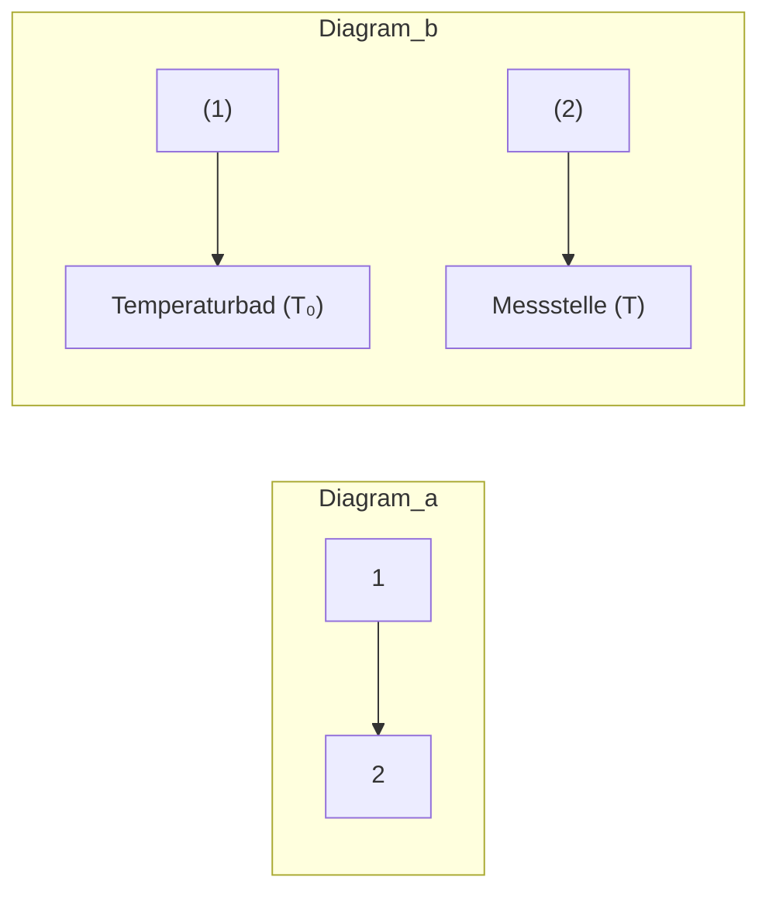

# 26 Elektrische Leitungsvorgänge in Festkörpern und Flüssigkeiten

原始 PDF 第 297–304 页。

26

## Elektrische Leitungsvorgänge in Festkörpern und Flüssigkeiten

**Einteilung der Festkörper.** Nach ihrer Fähigkeit, den elektrischen Strom zu leiten, unterscheidet man **Nichtleiter (Isolatoren)** (Gläser, keramische und polymere Stoffe, Harze usw.), **Leiter** (insbesondere die Metalle) und **Halbleiter**, deren Leitfähigkeit durch strukturelle Defekte oder durch Erwärmung bzw. Einstrahlung von Lichtenergie erhöht wird (z. B. Germanium, Silicium, metallische Nitride, Sulfide und Oxide). Die elektrische Leitfähigkeit der Metalle und der meisten nichtmetallischen Festkörper beruht hauptsächlich auf der **Elektronenleitung**.

Ein natürliches Klassifikationsmerkmal für die Festkörper hinsichtlich ihrer elektrischen Leitfähigkeit bietet die Temperaturabhängigkeit des spezifischen Widerstandes (25.9). Metallische Leiter haben einen positiven Temperaturkoeffizienten α, d. h., der elektrische Widerstand nimmt mit der Temperatur $\mathbf { Z } \mathbf { u } ,$ Halbleiter einen negativen; ihr Widerstand nimmt mit wachsender Temperatur ab bzw. ihre Leitfähigkeit zu. Zwischen Halbleiter und Isolator gibt es physikalisch keinen prinzipiellen Unterschied, sondern lediglich eine messtechnisch festgelegte Grenze. Ein Stoff wird als Halbleiter bezeichnet, wenn er bei Zimmertemperatur einen spezifischen elektrischen Widerstand $\varrho$ zwischen $1 0 ^ { - 1 4 }   \Omega   \cdot   \mathrm { { m } }$ und $1 0 ^ { - 6 }   \Omega   \cdot   \mathbf { m }$ hat.

## 26.1 Klassische Theorie der freien Elektronen in Metallen

Die hervorstechenden physikalischen Merkmale der Metalle sind ihre hohe elektrische Leitfä- higkeit und die große Wärmeleitfähigkeit. Diese Eigenschaften hängen damit zusammen, dass in den Metallen freie, d. h. nicht an die Gitteratome gebundene und somit leicht verschiebbare Elektronen, die **Leitungselektronen**, vorhanden sind, die in ihrer Gesamtheit das sog. **Elektronengas** bilden. Die Leitungselektronen führen innerhalb des Metallgitters, ähnlich wie die Atome eines Gases, eine ungeordnete Bewegung aus, die mit der Temperatur zunimmt. Schreibt man ihnen im Mittel dieselbe thermische Energie zu wie den Gasatomen (18.22) $\overline { { E _ { \mathbf { k } } } } = ( 3 / 2 ) k T$ so erkennt man, dass sie sich im Metall bei Zimmertemperatur mit einer kinetischen Energie von etwa $6 \cdot 1 0 ^ { - 2 1 } \mathrm { J } = 0 , 0 3 7   \mathrm { e V }$ bewegen. Trotz dieser relativ hohen Energie können die Elektronen aber unter normalen Bedingungen nicht aus dem Metall austreten. Die Metalloberfläche wirkt wie die Wand eines Gefäßes, das die Elektronen einschließt und das sie nur verlassen können, wenn sie die für jedes Metall charakteristische **Austrittsarbeit** $W _ { \mathbf { a } }$ aufbringen; diese beträgt bei den Metallen 1eV bis 5eV, sie liegt also weit über der thermischen Energie der Elektronen.

Schematisch wird dieser Sachverhalt durch das Modell des Potenzialtopfes beschrieben (Bild 26.1). Der „Potenzialwall“ an der Oberfläche kommt dadurch zustande, dass die elektrostatischen Potenziale der positiven Gitterionen sich im Innern des Metalls derart überlagern, dass insgesamt eine Erniedrigung des Potenzials gegenüber dem an der Metalloberfläche eintritt (vgl. 46.1).

---

26.1 Klassische Theorie der freien Elektronen in Metallen

295

text_image

W₀
Wₐ
E_F

Bild 26.1 Potenzialtopfmodell der Metalle. $W _ { 0 }$ Austrittsarbeit der Elektronen minimaler Energie; $W _ { \mathbf { a } }$ effektive Austrittsarbeit; $E _ { \mathrm { F } }$ maximale Elektronenenergie am absoluten Nullpunkt (Nullpunkts- oder Fermi-Energie). Freie Elektronen der Energie null befinden sich außerhalb und in Höhe des Topfrandes.

Auf der Grundlage der **klassischen Elektronentheorie der Metalle**, in der dem Elektronengas thermodynamisch die gleichen Eigenschaften zugeschrieben werden wie dem idealen Gas, gelang die Deutung wichtiger Erscheinungen der elektrischen Leitfähigkeit (DRUDE, 1902). Wird an einen Metalldraht eine Spannung angelegt, so überlagert sich der ungeordneten thermischen Bewegung der Leitungselektronen eine geordnete Driftbewegung parallel zur Richtung des elektrischen Feldes E, wobei sich die Elektronen mit der Driftgeschwindigkeit v dem elektrischen Feld entgegen, d. h. vom Minus- zum Pluspol, bewegen; es entsteht ein elektrischer Strom.

Bei ihrer Bewegung durch das Kristallgitter werden die Elektronen durch Wechselwirkung mit den Gitterbausteinen gebremst; hieraus resultiert der elektrische Widerstand, der bei Temperaturerhöhung und Verstärkung der thermischen Gitterschwingungen zunimmt. Im Innern eines Leiters bewirkt die Feldstärke E zunächst eine Beschleunigung $\pmb { a } = q \pmb { E } / m _ { \mathrm { e } }$ der Elektronen mit der Ladung $q = - e$ und der Masse $m _ { \mathrm { e } }$ . Zwischen zwei Stößen mit Gitterbausteinen nimmt dann die Geschwindigkeit in Feldrichtung linear mit der Zeit zu (gleichmäßig beschleunigte Bewegung). Bei einer freien Flugzeit τ ist im Mittel die Driftgeschwindigkeit $\pmb { \nu } = \pmb { a } \tau / 2 = q \pmb { E } \tau / ( 2 m _ { \mathrm { e } } )$ und damit der Feldstärke E direkt proportional:

$$
\boldsymbol {v} = \mu \boldsymbol {E} \quad \text {mit} \quad \mu = q \tau / (2 m _ {\mathrm{e}}). \tag {26.1}
$$

Die Größe $\mu$ nennt man die **Beweglichkeit** der Ladungsträger (Elektronen). Der Zusammenhang (26.1) stellt nach Multiplikation mit $q / \mu$ analog zur Flüssigkeitsströmung durch ein Rohr (15.17) die geschwindigkeitsproportionale Reibungskraft $F _ { \mathrm { R } } = \left( q / \mu \right) \nu = q E$ dar, welche die Feldkraft gerade kompensiert und zu einer konstanten Driftgeschwindigkeit führt.

Wird in der Zeit t die Ladung Q durch einen Leiter der Länge l und vom Querschnitt A (Volumen $V = A l )$ transportiert, so ist die Stromstärke $I = Q / t$ und mit der Driftgeschwindigkeit $\nu = l / t$ die Stromdichte

$$
j = \frac {I}{A} = \frac {Q l}{A l t} = \frac {Q}{V} v, \quad \text {vektoriell} \quad \boldsymbol {j} = (Q / V) \boldsymbol {v}, \tag {26.2}
$$

analog zur Massenstromdichte (15.4) $\pmb { j } _ { \mathrm { m } } = \left( m / V \right) \pmb { v } .$ Sind an der Stromleitung N Ladungsträger (Leitungselektronen) $q = - e$ je Volumeneinheit beteiligt, so ist $n = N / V$ die Ladungsträgerkonzentration oder **Elektronendichte** und $Q / V = N q / V = n q$ die **Ladungsdichte** der beweglichen Ladungen. Setzen wir überdies v nach Gleichung (26.1) in (26.2) ein, so folgt in Übereinstimmung mit (25.10)

$$
\boldsymbol {j} = n q \boldsymbol {v} = n q \mu \boldsymbol {E} = \varkappa \boldsymbol {E} \quad (\text {OHmsches Gesetz}) \tag {26.3}
$$

mit der elektrischen Leitfähigkeit $\varkappa = n q \mu$

Das Leitungsmodell des OHMschen Gesetzes gilt nicht nur für Metalle. Allerdings setzt sich bei $b i p o l a \cdot$ rer Stromleitung, bei der sowohl positive wie negative Ladungsträger (z. B. in Elektrolyten und Halbleitern) beteiligt sind, die Leitfähigkeit aus den Anteilen beider Ladungsträgerarten additiv zusammen. Man beachte, dass bei negativen Ladungsträgern, wie den Elektronen, sowohl die Ladungsdichte nq als auch $\mu$ negativ ist, also $\varkappa > 0$ wird.

---

296

26 Elektrische Leitungsvorgänge in Festkörpern und Flüssigkeiten

Ein weiterer Erfolg der klassischen Elektronentheorie war die Herleitung des zunächst empirisch gefundenen Zusammenhanges zwischen Wärmeleitfähigkeit λ und elektrischer Leitfä- higkeit κ der Metalle

$$
\frac {\lambda}{\varkappa} = 3 \left(\frac {k}{e}\right) ^ {2} T \quad \text {(WIEDEMANN - FRANZsches Gesetz)} \tag {26.4}
$$

mit der Konstante $3 ( k / e ) ^ { 2 } = 2 { , } 2 3 \cdot 1 0 ^ { - 8 } \mathrm { V } ^ { 2 } / \mathrm { K } ^ { 2 }$ . Dieses Gesetz besagt, dass bei konstanter Temperatur T elektrische Leitfähigkeit und Wärmeleitfähigkeit einander proportional sind, d. h., **gute Stromleiter sind auch gute Wärmeleiter** (z. B. Kupfer). Ursache dafür ist, dass in Metallen überwiegend die Leitungselektronen die Übertragung der Energie vom wärmeren zum kälteren Teil des Körpers besorgen (vgl. 21.1).

Beim Versuch allerdings, die spezifische Wärmekapazität der Metalle zu erklären, versagte die klassische Elektronentheorie. Nach den bisherigen Überlegungen müsste ebenso wie dem einatomigen idealen Gas auch dem Elektronengas die Molwärme (3/2)R zukommen, wenn man annimmt, dass jedes Atom ein Elektron an das Elektronengas abgibt. Zusammen mit der Molwärme der Gitterbausteine von 3R ergäbe das insgesamt einen Betrag von (9/2)R für die Molwärme eines Metalls. Dies steht aber in krassem Widerspruch zur experimentell bestätigten DULONG-PETITschen Regel, wonach bei nicht zu tiefen Temperaturen alle Festkörper eine Molwärme von $( 6 / 2 ) R \approx 2 5 \mathrm { J / ( m o l \cdot K ) }$ besitzen (vgl. 18.4). Eine Lösung dieses Widerspruchs sowie die Deutung weiterer mit der klassischen Elektronentheorie nicht erklärbarer Erscheinungen gelang erst durch Anwendung der Quantentheorie auf das Elektronengas. Das betrifft insbesondere auch die exakte Beschreibung der Leitfähigkeitseigenschaften von Festkörpern (s. Ab schnitt 46.2).

## Beispiel 26.1:

Mit welcher Geschwindigkeit bewegen sich die Elektronen bei einer Stromdichte von $j =$ $1 0 \mathrm { A / m m ^ { 2 } }$ durch einen Kupferdraht, wenn jedes Atom ein Elektron zum Elektronengas beisteuert? Dichte von Kupfer $\varrho = 8930    kg/m ^3;$ ; relative Atommasse $A _ { \mathrm { r } } = 6 3 { , } 5 5$

Lösung: Mit der Dichte $\varrho = m / V$ erhält man für die Elektronendichte $n = N / V = N \varrho / m =$ $N _ { \mathrm { A } } \varrho / \dot { M } = 8 . 5 \cdot 1 0 ^ { 2 8 }   \mathrm { m } ^ { - 3 }$ (Molmasse $M = 6 3 , 5 5 \cdot 1 0 ^ { - 3 }   \mathrm { k g } /$ mol; AVOGADRO-Konstante $N _ { \mathrm { A } } = 6 { , } 0 2 2$ $1 0 ^ { 2 3 }   \mathrm { m o l } ^ { - 1 } )$ . Mit $| q | = e = 1 { , } 6 { \cdot } 1 0 ^ { - 1 9 } \mathrm { A } { \cdot }$ s folgt aus (26.3) $\nu = j / ( n e ) \approx 0 { , } 7$ mm/s. Die hohe Übertragungsgeschwindigkeit elektrischer Energie wird demnach nicht durch eine entsprechende Wanderungsgeschwindigkeit der Elektronen, sondern durch die Ausbreitungsgeschwindigkeit des von ihnen getragenen elektrischen Feldes verursacht (vgl. 38.1). □

## 26.2 Thermoelektrische Effekte

Zwei verschiedene Isolatoren polarisieren sich gegenseitig, wenn sie einander innig genug berühren (Reibungselektrizität). Stehen zwei verschiedene Metalle (1) und (2) miteinander in bloßem Kontakt wie in Bild 26.2a, so gehen Elektronen von dem einen Metall (1) auf das andere (2) über, und zwar vom Metall mit der kleineren Austrittsarbeit der Elektronen (vgl. 26.1) auf das mit der größeren Austrittsarbeit. Als Folge lädt sich das erste Metall gegen das zweite positiv auf. Die in der Berührungsschicht entstehende Spannung heißt **Kontaktspannung** (Voltaspannung). Ihre Größe ist von der Temperatur T der Kontaktstelle abhängig: $U = U ( T )$ Werden auch die Enden beider Metalle leitend verbunden, so entsteht eine zweite polarisierte

---

26.2 Thermoelektrische Effekte

297

Berührungsschicht. Es fließt aber insgesamt im Leiterkreis kein Strom, da sich die an den bei den Kontaktstellen auftretenden, einander entgegen wirkenden Kontaktspannungen bei gleicher Temperatur der Kontaktstellen kompensieren.

flowchart

Bild 26.2 a) Entstehung einer Kontaktspannung zwischen zwei sich berührenden Metallen (1) und (2); b) Thermoelement (T Messtemperatur, $T _ { 0 }$ Bezugstemperatur)

Lötet man zwei Drähte aus verschiedenen Metallen wie in Bild 26.2b zu einem **Thermoelement** zusammen, so zeigt das in den Leiterkreis eingeschaltete Galvanometer einen elektrischen Thermostrom an, wenn die Temperaturen an den Lötstellen $T$ und $T _ { 0 }$ verschieden sind (**SEEBECK-Effekt**). Die Stromstärke ist außer von der Temperaturdifferenz $T - T _ { 0 }$ vom Widerstand des Leiterkreises abhängig. Da eine der beiden Kontaktspannungen überwiegt, entsteht eine Thermospannung $U _ { \mathrm { t h e r m } } = U ( T ) - U ( T _ { 0 } )$ , durch welche wie durch eine Spannungsquelle ein Stromfluss aufrechterhalten wird. In engen Grenzen ist die Thermospannung durch $U _ { \mathrm { t h e r m } } = a ( T - T _ { 0 } )$ gegeben. Die Änderung der Thermospannung mit der Temperatur $\mathrm { d } U _ { \mathrm { t h e r m } } / \mathrm { d } T = a$ bezeichnet man als Empfindlichkeit des Thermoelements; ihre Größe liegt für Metalle bei $1 0 ^ { - 5 } \mathrm { V / K }$ bis $1 0 ^ { - 4 } \mathrm { V / K }$ und ist in einem weiten Bereich selbst temperaturabhängig. Für Temperaturmessungen hält man die eine Lötstelle $( T _ { 0 } )$ auf einer festen Temperatur, z. B. derjenigen des schmelzenden Eises von $\mathbf { 0 } ^ { \circ } \mathbf { C } ,$ während man die andere der Messtemperatur T aussetzt.

Thermoelemente werden in den verschiedensten technischen Ausführungen zur Temperaturmessung in Metallschmelzen, Bädern, auf Oberflächen, in Bohrungen u. dgl. verwendet. Benutzt werden Drahtkombinationen (Thermopaare) aus Kupfer/Konstantan für Temperaturen von $- 2 5 0   ^ { \circ } \mathrm { C }$ bis $5 0 0   ^ { \circ } \mathrm { C } ,$ Platin/Platin-Rhodium für Temperaturen bis $1 6 0 0   ^ { \circ } \mathrm { C } ,$ Wolfram/Wolfram-Molybdän für Temperaturen bis $3 3 0 0   ^ { \circ } \mathrm { C } ,$ wobei sich die Auswahl nach dem gewünschten Messbereich richtet. Wird eine Anzahl von Thermoelementen in Reihe geschaltet und die erste, dritte, fünfte usw. Lötstelle der Messtemperatur ausgesetzt, vervielfacht sich die Empfindlichkeit der Anordnung (Thermosäule). In zunehmendem Maße werden wegen ihrer wesentlich höheren Empfindlichkeit Halbleiter-Thermoelemente benutzt, die aus p- und n-leitenden Materialien (s. 46.3) zusammengesetzt sind.

Die Umkehrung des SEEBECK-Effekts ist der **PELTIER-Effekt**. Schaltet man in Bild 26.2b an die Stelle des Galvanometers eine Spannungsquelle ein, dann fließt ein Strom durch jede Kontaktstelle beider Metalle, die sich als Folge dessen je nach Stromrichtung entweder erwärmt oder abkühlt. PELTIER-Elemente auf der Basis von Halbleitermaterialien können z. B. als Kühlaggregate eingesetzt werden.

**Beim SEEBECK-Effekt verursacht eine Temperaturdifferenz eine Thermospannung, beim PELTIER-Effekt führt ein elektrischer Stromfluss zu einer Temperaturdifferenz und somit zu einem Wärmetransport.**

---

298

26 Elektrische Leitungsvorgänge in Festkörpern und Flüssigkeiten

## 26.3 Elektrokinetische Effekte

Zwei verschiedene Stoffe, die sich berühren, laden sich gegeneinander auf. Sie bilden an der Berührungsfläche eine elektrische Doppelschicht, d. h. eine beidseitig mit Ladungen unterschiedlichen Vorzeichens und gleicher Flächenladungsdichte belegte Fläche. Beim Durchgang durch die Doppelschicht ändert sich das Potenzial nahezu sprunghaft. Diese Erscheinung ist auch zwischen festen Teilchen und einer isolierenden Flüssigkeit sowie zwischen der Flüssigkeit und der Gefäßwandung zu beobachten; sie bildet die Grundlage für die nachfolgend beschriebenen elektrokinetischen Effekte.

**Elektrophorese.** Werden molekulare oder kolloide Teilchen in einer Flüssigkeit dispergiert, dann laden sie sich gegenüber dem Dispersionsmittel unter Bildung einer elektrischen Doppelschicht auf und bewegen sich im elektrischen Feld zur gegenpoligen Elektrode (Elektrophorese). Da sich Teilchen unterschiedlicher Substanzen in der Regel auch in ihrer Beweglichkeit unterscheiden, ermöglicht die Elektrophorese eine Trennung von Substanzgemischen. So können z. B. winzige Mengen von Proteingemischen auf diesem Wege qualitativ und quantitativ analysiert werden.

**Elektroosmose.** Durch Kontakt einer Flüssigkeit mit einer festen Wand entsteht ebenfalls eine elektrische Doppelschicht, wobei die geladenen Flüssigkeitsteilchen im Gegensatz zu den an der Wand verbleibenden Ladungen beweglich sind und einem äußeren elektrischen Feld folgen.

text_image

Diagram of electrochemical cell setup showing positive and negative electrodes in electrolyte with gas flow

Bild 26.3 Elektroosmose

text_image

Katode
Anode
- +
-

Bild 26.4 Elektrolyse

Zwei Flüssigkeitsbehälter, in die Anode und Katode hineinragen, seien durch eine dicke, poröse Wand mit großer Benetzungsfläche getrennt (Bild 26.3). Der Ladungsaustausch zwischen Porenwandungen und angrenzender Flüssigkeit soll dort zur Bildung von positiven Ladungen (Ionen) führen, an die sich noch neutrale Moleküle anlagern, z. B. Wassermoleküle durch Hydratation. Die positiv geladenen Teilchen bewegen sich nun im äußeren Feld zur Katode und bilden auf diese Weise einen gerichteten Massenstrom, der den Flüssigkeitsspiegel im linken Gefäß sinken lässt. Die Elektroosmose wird technisch zur Entwässerung von Torf oder von Baugruben genutzt.

## 26.4 Elektrolytische Stromleitung. Faradaysche Gesetze

Wasser, in dem Salze, Säuren oder Basen gelöst sind, ist elektrisch leitend. Der Grund dafür ist, dass die gelösten Stoffe (z. B. CuSO4, HCl oder NaOH) in Lösung dissoziieren, d. h. in negativ und positiv geladene Atome und Moleküle aufspalten, die **Ionen** genannt werden (ARRHENIUS,

---

26.4 Elektrolytische Stromleitung. Faradaysche Gesetze

299

1887). Derartige Leiter heißen **Elektrolyte**. Die gebildeten Ionen tragen jeweils so viel negative bzw. positive Elementarladungen, wie ihre chemische Wertigkeit angibt. So dissoziieren die genannten Stoffe wie folgt: $\mathrm{CuSO_{4}\rightarrow Cu^{++}+SO_{4}^{--};HCl\rightarrow H^{+}+Cl^{-};NaOH\rightarrow Na^{+}+OH^{-}}$

Bringt man in den Elektrolyten zwei Elektroden, die mit den Polen einer Gleichspannungs quelle verbunden sind (Bild 26.4), so kommt es zur elektrolytischen Stromleitung. Sie unterscheidet sich von der elektronischen Stromleitung vor allem dadurch, dass der Ionenstrom mit Massetransport verbunden ist. Die zur Katode wandernden positiven Metall- und H-Ionen heißen **Kationen**, die zur Anode wandernden negativen Säurerest- und OH-Ionen **Anionen**.

Unter der Annahme, dass sich die Ionen im Elektrolyten auf Grund der „Reibung“ mit den Flüssig keitsmolekülen mit konstanter Geschwindigkeit v bewegen, gilt auch hier das OHMsche Gesetz (26.3) $\pmb { j } = \varkappa \pmb { E }$ mit der elektrischen Leitfähigkeit des Elektrolyten $\varkappa = n q ( \mu _ { + } + \mu _ { - } )$ , wobei $\mu _ { + }$ und $\mu _ { - }$ die Ladungsträgerbeweglichkeiten der in gleicher Konzentration n vorliegenden positiven und negativen Ionen sind (binärer Elektrolyt). Die Messung der Leitfähigkeit von Elektrolyten kann wegen der Konzentrationsänderung infolge der Abscheidungsprozesse nur mit Wechselstrom erfolgen.

Die Kationen nehmen an der Katode Elektronen auf, während die Anionen an der Anode durch Elektronenabgabe neutralisiert werden. Auf diese Weise können mittels Elektrolyse Metalle an der Katode abgeschieden werden. In wässrigen Lösungen führen häufig auch Sekundärreaktionen an den Elektroden im Ergebnis der Elektrolyse zur Zersetzung des Wassers, d. h. zur Wasserstoffabscheidung an der Katode und zur Sauerstoffabscheidung an der Anode.

Den Zusammenhang zwischen der an einer Elektrode abgeschiedenen Masse und der transportierten Ladung beschreiben die FARADAYschen Gesetze der Elektrolyse.

## 1. FARADAYsches Gesetz:

**Die abgeschiedenen Massen sind der transportierten Ladung proportional.**

$$
m = K Q = K I t. \tag {26.5}
$$

Der Proportionalitätsfaktor K heißt **elektrochemisches Äquivalent**. Dieses gibt an, wie viel Kilogramm eines Stoffes beim Transport der Ladung 1C abgeschieden werden, also bei einem Strom von 1A und 1s Dauer. Da mit jeder Elementarladung e bzw. mit ze bei einem z-fach geladenen Ion die Masse eines Ions transportiert wird, ist in Gleichung (26.5) m der Molmasse M und Q der Wertigkeit z der Ionen proportional. Damit ist $K = m / Q \sim M / z .$

## 2. FARADAYsches Gesetz:

**Die elektrochemischen Äquivalente verschiedener chemischer Elemente verhalten sich wie deren Äquivalentmassen (= Molmasse/Wertigkeit).**

$$
K _ {1}: K _ {2} = \left(\frac {M _ {1}}{z _ {1}}\right): \left(\frac {M _ {2}}{z _ {2}}\right). \tag {26.6}
$$

Um 1mol eines 1-wertigen Stoffes elektrolytisch abzuscheiden, müssen $\{ N _ { \mathrm { A } } \} = 6 , 0 2 2   1 4 0   7 6$ $1 0 ^ { 2 3 }$ Ionen der Ladung e transportiert werden; es fließt dann also durch den Elektrolyten insgesamt die Ladung

$$
F = N _ {\mathrm{A}} e = 9 6 4 8 5, 3 3 2 1 2 \mathrm{C/mol} \quad (\text {FARADAY - Konstante}). \tag {26.7}
$$

---

300

26 Elektrische Leitungsvorgänge in Festkörpern und Flüssigkeiten

Zur Abscheidung von 1mol eines z-wertigen Stoffes ist demnach die Ladung $Q _ { \mathrm { m } } = z F$ erforderlich. Es ist daher nach (26.5) $M = K Q _ { \mathrm { m } } = K z F$ . Hieraus folgt mit $M _ { \mathrm { r } }$ bzw. $A _ { \Gamma }$ als relative Molekül- bzw. Atommasse:

$$
K = \frac {M}{z F} = \frac {M _ {\mathrm{r}} (\text {bzw.} A _ {\mathrm{r}}) \cdot 1 0 ^ {- 3} \mathrm{kg/mol}}{z F} \quad \text {(elektrochemischesÄquivalent).} \tag {26.8}
$$

Elektrolytische Vorgänge spielen in vielen Zweigen der Technik eine große Rolle, so $\mathbf { z } , \mathbf { B } ,$ bei der elektrolytischen Gewinnung von Kupfer, Zink und Aluminium, bei der elektrolytischen Reinigung und elektroerosiven Bearbeitung von Werkstücken sowie bei der Herstellung metallischer Überzüge (Galvanotechnik).

## Beispiel 26.2:

Welche Menge Silber $( A _ { \mathrm { r } } = 1 0 7 , 9 )$ wird aus einer Silbernitratlösung $\mathrm{(AgNO_{3})}$ bei einem Strom von 1A in 1s elektrolytisch abgeschieden?

Lösung: Mit $z = 1$ der $\mathrm { A g } ^ { + }$ -Ionen erhält man aus (26.7) und (26.8) $K = 1 , 1 1 8   \mathrm { m g / C }$ (historische Definition des A m p e r e als Stromstärkeeinheit aus dem elektrochemischen Äquivalent). □

## Aufgabe

**26.1** Nach welcher Zeit scheidet ein Strom von 1A aus angesäuertem Wasser 1l Wasserstoffgas (im Normzustand) ab? $A _ { \mathrm { r } } = 1 , 0 0 8 ;$ Dichte $\varrho = 0 , 0 8 9 8 7 \mathrm { k g / m ^ { 3 } }$

## 26.5 Elektrochemische Spannungsquellen

**Primärelemente.** Zwischen eingetauchter Metallelektrode und Elektrolyt treten Urspannungen auf. Sie werden dadurch verursacht, dass Metallionen so lange in Lösung gehen, bis das elektrische Feld in der sich bildenden elektrischen Doppelschicht zwischen negativer Elektrode und positivem Elektrolyten den weiteren Austritt der positiven Ionen unterdrückt. Da das Lösungsstreben der Metalle (Lösungstension) unterschiedlich ist, sind die Urspannungen verschieden groß.

An einem solchen „Halbelement“ Metall/Elektrolyt kann die entstehende Urspannung nicht direkt gemessen werden. Es bedarf einer zweiten Elektrode, eines zweiten Halbelements. Als Bezugsbasis wählt man die **Normal-Wasserstoffelektrode**, die aus Platinblech besteht und von gasförmigem Wasserstoff umspült wird. Die Stoffe werden dann nach der Größe ihrer Urspannung gegen diese Normalelektrode in die elektrochemische oder VOLTAsche Spannungsreihe (Bild 26.5) eingeordnet.

line

| Species | Voltage (V) |
| :--- | :--- |
| Li/Li+ | -3,02 |
| K/K+ | -2,92 |
| Na/Na+ | -2,71 |
| Mg/Mg++ | -2,35 |
| Al/Al+++ | -1,66 |
| Zn/Zn++ | -0,76 |
| Fe/Fe++ | -0,44 |
| Cd/Cd+++ | -0,40 |
| Ni/Ni++ | -0,24 |
| Pb/Pb++ | -0,12 |
| H2/2H+ | 0 |
| Cu/Cu++ | +0,34 |
| Ag/Ag+ | +0,80 |
| Hg/Hg++ | +0,86 |
| Au/Au+++ | +1,50 |

Bild 26.5 Elektrochemische Spannungsreihe chemischer Elemente und ihre Normalspannung gegen eine Normal-Wasserstoffelektrode bei wässriger Lösung der Konzentration 1 kmol/m3

---

26.5 Elektrochemische Spannungsquellen

301

Die bei Auflösung des Elektrodenmaterials entstehende Spannung wird in den galvanischen Primärelementen zur Umwandlung chemischer Energie in elektrische genutzt. Eines der bekanntesten Primärelemente ist das **Daniell-Element**. Es besteht aus einer Kupferelektrode in Kupfersulfatlösung, einer Zinkelektrode in Zinksulfatlösung und einer porösen Tonwand, die beide Elektrolyte voneinander trennt. Werden die beiden Elektroden verbunden, dann geht ständig Zink in Lösung, und an der Kupferelektrode wird Kupfer abgeschieden. Ein Strommesser im Stromkreis zeigt bis zur vollständigen Auflösung der Zinkelektrode einen Strom an.

Die Überlegung, dass man die Lebensdauer der Primärelemente durch ständige Zufuhr des Elektrodenmaterials vergrößern könnte, führte zur Entwicklung der **Brennstoffzellen**. Im Gegensatz zu den eigentlichen Primärelementen wird den Brennstoffzellen die chemische Energie nicht in Form fester Metalle oder Metallverbindungen, sondern als gasförmiger oder flüssiger Brennstoff zugeführt.

So z. B. wird in der Wasserstoff-Sauerstoff-Brennstoffzelle (sog. Knallgaszelle) in einem zur Elektrolyse inversen Prozess durch Zuführung von $\mathrm { H } _ { 2 }$ auf der Anodenseite und $\mathrm { O } _ { 2 }$ auf der Katodenseite unter Entstehung von Wasser chemische Energie mit hohem Wirkungsgrad unmittelbar in elektrische Energie umgewandelt. Als Elektroden verwendet man poröse, teilweise mit Platin oder anderen Stoffen imprä- gnierte, als Katalysator wirkende Materialien. Sie bilden die beiden sich gegenüber stehenden Wände der Zelle, durch die hindurch die Reaktionsgase $\mathrm { H } _ { 2 }$ und $\mathrm { O } _ { 2 }$ von außen beidseitig dem dazwischen befindlichen Elektrolyten (z. B. Kalilauge) zugeführt werden.

**Sekundärelemente.** Während in den Primärelementen ein irreversibler chemischer Prozess stattfindet, arbeiten die Sekundärelemente weitgehend reversibel. In ihnen wird die elektrolytische Polarisation, die chemische Veränderung der Elektroden bei Stromdurchgang, zur Energiespeicherung ausgenutzt.

Eines der bekanntesten Sekundärelemente ist der weit verbreitete **Blei-Akkumulator**. Er besteht aus zwei Bleielektroden, die in verdünnte Schwefelsäure eintauchen und sich dabei mit Bleisulfat überziehen. Beim elektrolytischen Stromdurchgang laufen die folgenden chemischen Reaktionen ab:

$$
\text {Anode:} \quad \mathrm{PbSO} _ {4} + 2 \mathrm{H} _ {2} \mathrm{O} \xrightarrow [ \text {Entladen} ]{\text {Aufladen}} \mathrm{PbO} _ {2} + \mathrm{H} _ {2} \mathrm{SO} _ {4} + 2 \mathrm{H} ^ {+} + 2 \mathrm{e} ^ {-}
$$

$$
\text {Katode:} \quad \mathrm{PbSO} _ {4} + 2 \mathrm{e} ^ {-} \xrightarrow [ \text {Entladen} ]{\text {Aufladen}} \mathrm{Pb} + \mathrm{SO} _ {4} ^ {- -}.
$$

Durch das Laden wird an der Anode unter Elektronenabgabe Bleidioxid gebildet $\mathrm{Pb^{++} \rightarrow Pb^{4+} + 2e^{-}}$ Oxidation) und an der Katode nach Elektronenaufnahme metallisches Blei $\mathrm{Pb^{++} + 2~e^- \rightarrow Pb}$ , Reduktion); gleichzeitig steigt die Säurekonzentration (Säuredichte). Es entstehen zwei Elektroden mit unterschiedlichen Oberflächen, die gegeneinander eine Spannung von 2V haben. Eine Stromentnahme ist nun so lange möglich, bis beide Elektroden wieder sulfatiert sind.

Ein anderes wegen seiner Robustheit im Umgang oft genutztes Sekundärelement ist der **Nickel-Eisen-Akkumulator**. Er enthält KOH als Elektrolyt. Im entladenen Zustand bestehen die Anodenoberfläche aus $\mathrm { N i ( O H ) _ { 2 } }$ und die Katodenoberfläche aus Fe(OH)2. Durch das Laden überzieht sich die Anode unter Elektronenabgabe mit $\mathrm{Ni}_{2}\mathrm{O}_{3}\left(2\mathrm{Ni}^{++}\rightarrow2\mathrm{Ni}^{++}+2\mathrm{e}^{-}\right)$ , und an der Katode entsteht unter Elektronenaufnahme metallisches Eisen $\mathrm{(Fe^{++} + 2e^{-} \rightarrow Fe)}$ . Zwischen den Elektroden herrscht eine Spannung von etwa 1,4V, die jedoch während der Entladung weiter sinkt. Bei jedem Stromdurchgang tritt eine Erwärmung auf. Der Wirkungsgrad (= entnommene Energie/aufgenommene Energie) beträgt etwa 75% beim Bleiakkumulator und etwa 50% beim Nickel-Eisen-Akkumulator.
