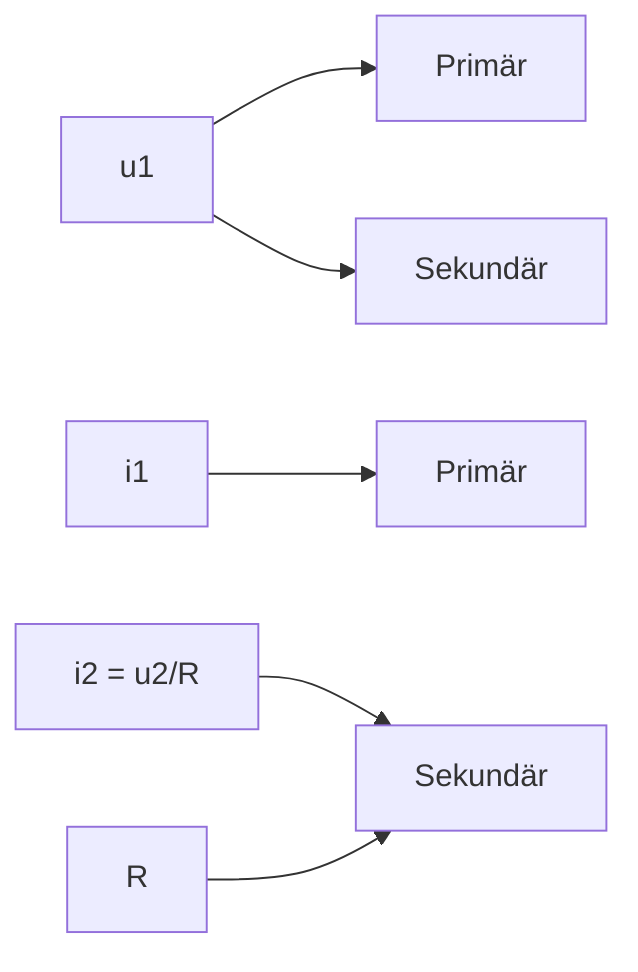

# 31 Der Wechselstromkreis

原始 PDF 第 338–353 页。

31

Der Wechselstromkreis

## 31.1 Wechselspannung, Wechselstrom, Dreiphasenstrom

Die wichtigste Gruppe der instationären Ströme sind die Wechselströme. Die größte technische Bedeutung haben dabei die harmonischen Wechselströme, deren zeitlich periodischer Verlauf durch Sinus- oder Kosinusfunktionen beschrieben wird. Große Wechselstromleistungen bei niedrigen Frequenzen werden mit Dynamomaschinen, geringe Leistungen bei hohen Frequenzen mit elektronischen Schaltungen erzeugt.

line

| Feature | Description |
| --- | --- |
| u | Solid line curve |
| i | Dashed line curve |
| \(\phi\) | Phase shift (dashed line) |
| \(\omega T\) | Total period width (solid line) |
| \(U_{0}\) | Vertical displacement of the first wave |
| \(I_{0}\) | Vertical displacement of the second wave |

Bild 31.1 Zeitlicher Verlauf von Spannung u und Stromstärke i eines harmonischen Wechselstromes. Im Bild beträgt die Phasenverschiebung $\varphi = \omega t = ( 2 \pi / T ) ( T / 4 ) = + \pi / 2$ d. h., die Spannung eilt dem Strom um eine Viertelperiode voraus.

Die in einer gleichförmig im homogenen Magnetfeld rotierenden Leiterschleife induzierte **Wechselspannung** u wird in Abhängigkeit von der Zeit durch Gleichung (30.15) beschrieben:

$$
u (t) = U _ {0} \sin \omega t \quad \text {(Momentanwert der Spannung).} \tag {31.1}
$$

In einem an den Generator angeschlossenen Stromkreis wird durch die Wechselspannung ein **Wechselstrom** i der gleichen Frequenz erzeugt (Bild 31.1):

$$
i (t) = I _ {0} \sin (\omega t - \varphi) \quad \text {(Momentanwert der Stromstärke).} \tag {31.2}
$$

Dabei sind $U _ { 0 }$ und $I _ { 0 }$ die **Scheitelwerte** von Spannung und Stromstärke, auch Spitzenwerte oder Amplituden genannt. Die **Kreisfrequenz** $\omega = 2 \pi f = 2 \pi / T$ entspricht der Winkelgeschwindigkeit des Läufers, bei Mehrpolmaschinen ganzzahligen Vielfachen davon. Der Winkel ϕ gibt die **Phasenverschiebung** der Stromstärke gegenüber der Spannung an. $F \ddot { u } r \varphi > 0$ wie in Bild 31.1 eilt die Spannung dem Strom voraus, für $\varphi < 0$ eilt der Strom der Spannung voraus. Die Phasenverschiebung hängt, wie im Abschnitt 31.3 gezeigt wird, von den im Stromkreis vorhandenen Induktivitäten L und Kapazitäten C ab.

**Drehstrom.** Werden im Ständer eines Wechselspannungsgenerators (s. Abschnitt 30.4) anstelle nur einer Spulenwicklung drei um je $1 2 0 ^ { \circ }$ gegeneinander versetzte gleichartige Wicklungen, die Stränge R, S und T, angeordnet (Bild 31.2a), an denen der Feldmagnet mit seinem

---

336

31 Der Wechselstromkreis

Nord- und Südpol vorbeirotiert, so entsteht in jeder Wicklung eine gesonderte Wechselspannung (Strangspannung) gleicher Amplitude und Frequenz. Die Sinuskurven (31.1) dieser drei Wechselspannungen sind in ihrer Phase ϕ gegeneinander um $1 2 0 ^ { \circ }$ verschoben. Bild 31.2b ver anschaulicht dies anhand eines sog. Zeigerdiagramms (vgl. Bild 31.4), in welchem – wie in der Wechselstromtechnik üblich – die Spannungen (sowie Ströme und Widerstände) geometrisch als Zeiger (Vektorpfeile) dargestellt werden (s. Abschnitt 31.3). Die geometrische Addition der drei Zeiger für die Strangspannungen uOR, uOS, uOT ergibt ein geschlossenes Dreieck, d. h., ihre Summe (und bei gleicher Belastung aller drei Stränge durch die daran angeschlossenen Verbraucher auch die Summe der Ströme) ist in jedem Augenblick gleich null.

Bild 31.2 Erzeugung von Drehstrom. a) Schema eines Drehstromgenerators; b) Zeigerdiagramm der Strangspannungen zwischen dem Nullleiter O und den Strängen R, S und T (Höchstwert U0)

Die drei Wicklungsstränge des Generators (oder die Enden der drei Widerstände von Verbrauchern) lassen sich in zwei unterschiedlichen Schaltungen, der Stern- oder der Dreieckschaltung (Bild 31.3) so verketten, dass jeweils die Rückleiter entfallen können und nur drei Leiter, die Phasen R, S und T, übrig bleiben.

text_image

S
uSO
O
uTO
T
uRO
uRS
R
o
uST
iS
iT
TR
iR
T
S
R

Bild 31.3 Beispiel für ein Dreiphasenwechselstromnetz: Generator in Sternschaltung (links), drei Verbraucher zu einem „Stern“ verschaltet (Mitte), ein Verbraucher, z. B. ein Drehstrommotor, in Dreieckschaltung (rechts)

So werden bei der **Sternschaltung** (Bild 31.3 links) die Anfänge der drei Spulenwicklungen im Sternpunkt O miteinander verbunden (Nullleiter); dieser wird in der Regel geerdet. Die drei anderen Enden R, S und T führen zu den Verbrauchern (Bild 31.3 Mitte). In den drei Stromkreisen zwischen O und R, O und S sowie O und T liegen die zu einem „Stern“ verschalteten Kleinverbraucher an den Strangspannungen uOR, uOS und $u _ { \mathrm { O T } }$ von üblicherweise $U = 2 3 0 \mathrm { V }$ (Effektivwert) bzw. $U _ { 0 } = 3 2 5 \mathrm { V }$ Höchstwert. Großverbraucher liegen dagegen meist am Dreiphasenstromnetz. Dessen Wechselspannungen zwischen jeweils zwei der drei Leiter, also zwi-

---

31.2 Arbeit und Leistung elektrischer Wechselströme

337

schen R und S, S und T sowie T und R, den sog. Leitungsspannungen, betragen das ${ \sqrt { 3 } } .$ fache der Strangspannung, also ca. 400V (Effektivwert).

Für die Differenz zweier Strangspannungen, z. B. zwischen den Zeigern $u _ { \mathrm { O S } }$ und $u _ { \mathrm { O T } }$ , welche gleich der Leitungsspannung $u _ { \mathrm { T S } }$ ist und im Zeigerdiagramm von Bild 31.2b dem Betrag nach gleich der Länge des Zeigers von T nach S im Dreieck TOS, gilt nach dem Kosinussatz:

$$
| u _ {\mathrm{TS}} | = | u _ {\mathrm{OS}} - u _ {\mathrm{OT}} | = \sqrt {U _ {0} ^ {2} + U _ {0} ^ {2} - 2 U _ {0} ^ {2} \cos 1 2 0 ^ {\circ}} = U _ {0} \cdot \sqrt {2 + 2 \cdot \sin 3 0 ^ {\circ}} = \sqrt {3} \cdot U _ {0}.
$$

Das heißt, im Fall einer Strangspannung von $U = 2 3 0 \mathrm { V }$ beträgt die Leitungsspannung 400V. Der in jeder der Leitungen R, S oder T fließende Leitungsstrom ist gleich dem Strom in jeder Phasenwicklung (Strangstrom). Es gilt also bei

**Sternschaltung:**

Leitungsspannun $\mathbf { g } = { \sqrt { \mathbf { 3 } } }$ · **Strangspannung**

**Leitungsstrom = Strangstrom.**

Bei der **Dreieckschaltung** (Bild 31.3 rechts) wird jeweils das Ende der einen mit dem Anfang der in der Phasenlage nächsten Wicklung verbunden. Zwischen je zwei Netzleitungen (R, S oder T) herrscht die Strangspannung, die damit gleich der Leitungsspannung ist.

Bezüglich der Ströme gilt für jeden Eckpunkt des Dreiecks der Knotensatz (25.17), wonach die Summe der dem Knoten zu- und abfließenden Ströme null sein muss. Zum Beispiel fließt dem Eckpunkt T von S her der Strangstrom $i _ { \mathrm { S T } }$ zu und ein anderer $i _ { \mathrm { T R } }$ fließt von ihm nach R hin ab, die Differenz beider geht als Leitungsstrom $i _ { \mathrm { T } }$ in die Leitung. Verschiebt man im Dreieck von Bild 31.3 den Zeiger für $i _ { \mathrm { S T } }$ in Stromrichtung, bis sein Anfangspunkt mit dem Eckpunkt T zusammenfällt, so erkennt man, dass die beiden dem Knoten T zu- und abfließenden Strangströme $i _ { \mathrm { S T } }$ und $i _ { \mathrm { T R } }$ , deren Differenz gleich dem Leitungsstrom $i _ { \mathrm { T } }$ ist, ebenfalls eine Phasendifferenz von $1 2 0 ^ { \circ }$ aufweisen und damit dasselbe Zeigerdiagramm ergeben wie in Bild 31.2b für die Strangspannungen bei der Sternschaltung. Entsprechend erhält man durch geometrische Subtraktion von iST und $i _ { \mathrm { T R } } ,$ dass $| i _ { \mathrm { T } } | = | i _ { \mathrm { T R } } - i _ { \mathrm { S T } } | = \sqrt { 3 } \cdot I _ { 0 }$ mit dem Höchstwert $I _ { 0 }$ als Strangstromstärke. Es gilt also bei

**Dreiecksschaltung:**

**Leitungsspannung = Strangspannung**

Leitungsstromstärk $\mathbf { \hat { z } } = { \sqrt { \mathbf { 3 } } }$ · **Strangstromstärke.**

Nicht nur Generatoren, sondern auch Verbraucher, z. B. größere Motoren $( P > 2 , 5 \mathrm { k W } )$ , werden, wie erwähnt, als Drehstromanlagen ausgeführt und können in Stern- oder Dreieckschaltung betrieben werden. Zur Leistung in Drehstromkreisen vgl. Beispiel 2 im folgenden Abschnitt.

## 31.2 Arbeit und Leistung elektrischer Wechselströme

Messgeräte für Wechselströme zeigen einen zeitlichen Mittelwert, den sog. **Effektivwert** an. Würde man allerdings $i = I _ { 0 }$ sinωt zur Mittelwertbildung über eine Periodendauer integrieren, so ergäbe sich der Wert null; denn es kommen innerhalb dieses Zeitintervalls unter der

---

338

31 Der Wechselstromkreis

Sinuskurve stets gleich große positive wie negative Flächenanteile vor. Bedenkt man aber, dass Wechselströme an OHMschen Widerständen $R$ (Wirkwiderständen) Arbeit verrichten, die z. B. als JOULEsche Wärme auftritt, und geht man davon aus, dass diese **Wirkarbeit** des Wechselstromes sich analog zum Gleichstromkreis nach (25.20) zu $W = U I t = R I ^ { 2 } t$ berechnet, so hat man nicht den zeitlichen Mittelwert von $i ,$ sondern von $i ^ { 2 }$ über eine Periodendauer $T ,$ also den quadratischen Mittelwert $\overline { { i ^ { 2 } } }$ zu bilden. Dieser muss identisch mit dem Quadrat der Stromstärke $I ^ { 2 }$ im Gleichstromkreis sein:

$$
I ^ {2} = \frac {1}{T} \int_ {0} ^ {T} i (t) ^ {2} \mathrm{d} t = \frac {I _ {0} ^ {2}}{T} \int_ {0} ^ {T} \sin^ {2} (\omega t) \mathrm{d} t = \frac {I _ {0} ^ {2}}{2};
$$

$$
I = \frac {I _ {0}}{\sqrt {2}} \approx 0, 7 0 7 I _ {0} \quad \begin{array}{l} \text {(Effektivwert der Stromstärke} \\ \text {harmonischer Wechselströme).} \end{array} \tag {31.3}
$$

## Der Effektivwert eines Wechselstromes entspricht demjenigen Gleichstrom, der die gleiche (thermische oder mechanische) Leistung hervorbringt.

Entsprechend ergibt sich der Effektivwert harmonischer Wechselspannungen zu $U = U _ { 0 } / { \sqrt { 2 } } .$ Allgemein erhält man den zeitlichen Mittelwert der **Leistung des Wechselstromes** bei beliebi ger Phasenverschiebung $\varphi$ zwischen Spannung und Stromstärke, indem man die Arbeit während einer Periode durch die Periodendauer dividiert, mit (31.1) und (31.2) also

$$
\begin{array}{l} P = \frac {1}{T} \int_ {0} ^ {T} u (t) i (t) \mathrm{d} t = \frac {U _ {0} I _ {0}}{T} \int_ {0} ^ {T} \sin \omega t \sin (\omega t - \varphi) \mathrm{d} t \\ = \frac {U _ {0} I _ {0}}{2 T} \left[ \int_ {0} ^ {T} \cos \varphi   \mathrm{d} t - \int_ {0} ^ {T} \cos (2 \omega t - \varphi)   \mathrm{d} t \right]. \\ \end{array}
$$

Der Integrand wurde mit Hilfe der Formel sinα sin $\beta = ( 1 / 2 ) \left[ \cos ( \alpha - \beta ) - \cos ( \alpha + \beta ) \right]$ umgeformt. Während das zweite Integral eine phasenverschobene Sinuskurve enthält, deren Zeitmittel gleich null ist, ergibt sich mit dem ersten Integral

$$
P = \frac {U _ {0} I _ {0}}{2} \cos \varphi = U I \cos \varphi \quad (\text {Wirkleistung}). \tag {31.4}
$$

Der Phasenwinkel $\varphi$ hängt, wie im folgenden Abschnitt gezeigt wird, von den im Stromkreis vorhandenen (Wirk-)Widerständen $R ,$ Induktivitäten L und Kapazitäten C ab. Für $\varphi = 0   \mathrm { n i m m t }$ die Wirkleistung ihren Maximalwert U I an (reiner Wirkwiderstand). Hingegen verschwindet die Wirkleistung für $\varphi = \pm \pi / 2 ;$ die Wechselströme verrichten dann im Zeitmittel keine Arbeit, und es tritt insgesamt auch kein Verlust an elektromagnetischer Energie auf. Das liegt daran, dass die während einer Viertelperiode zum Aufbau des magnetischen bzw. elektrischen Feldes in einer Induktivität L bzw. Kapazität C (reine Blindwiderstände, s. 31.3) von der Stromquelle aufzubringende Feldenergie in der folgenden Viertelperiode beim Abbau der Felder wieder in den Stromkreis zurückfließt. Für die Größe der Leistung ist daher auch der Faktor cos $\pmb { \varphi }$ in Gleichung (31.4) ausschlaggebend; man nennt ihn den **Leistungsfaktor**. Ist dieser niedrig,

---

31.3 Wechselstromwiderstände. Ohmsches Gesetz für Wechselstrom

339

benötigt man für eine bestimmte Wirkleistung wesentlich höhere Stromstärken, die als Blindströme das Leitungsnetz zusätzlich belasten, ohne selbst Arbeit zu verrichten.

Während die Wirkleistung (31.4) denjenigen Teil der elektrischen Arbeit erfasst, der in Wärmeenergie oder in mechanische Arbeit umgesetzt werden kann, kennzeichnet die Blindleistung

$$
Q = U I \sin \varphi \quad (\text {Blindleistung}), \tag {31.5}
$$

gemessen in $\left[ \mathrm{V} \cdot \mathrm{A} = \mathrm{var} \right]$ , den Teil der elektrischen Arbeit, der im Blindwiderstand zum Auf- und Abbau des elektrischen und magnetischen Feldes erforderlich ist. Das Produkt $U I = S$ in den Gleichungen (31.4) und (31.5) ist die **Scheinleistung**. Diese gibt an, wie viel Ampere die betreffende Maschine (Generator, Transformator) bei einer bestimmten Spannung abgeben kann. Welche Wirkleistung bei dieser Stromstärke entnommen wird, bleibt dabei offen; diese ist von dem jeweiligen Verhältnis des Blindstromes zum Wirkstrom bzw. der Blindleistung (31.5) zur Wirkleistung (31.4) Q/P = tanϕ abhängig.

## Beispiele 31.1:

1. Auf welche maximale momentane Spannung lädt sich ein Kondensator auf, der an eine Wechselspannung von $U = 2 3 0 \mathrm { V }$ (Effektivwert) angeschlossen wird?

Lösung: Analog zu (31.3) liegt am Kondensator die Höchstspannung (Spitzenspannung) $U _ { 0 } =$ ${ \sqrt { 2 } } \cdot U = 3 2 5 \mathrm { V   a n }$

2. Ein Drehstrommotor wird mit seinen Wicklungen in Sternschaltung angelassen und dann in Dreieckschaltung betrieben. Um wie viel ändert sich durch die Stern/Dreieck-Umschaltung seine Leistungsaufnahme, wenn sich seine Verbraucherwiderstände dabei nicht ändern?

Lösung: Nehmen wir an, es befinden sich im Stromkreis nur OHMsche Widerstände R, so ist cos $\varphi = 1 ( \mathbf { s } .   \mathbf { o } . )$ , und es gilt das OHMsche Gesetz $I = U / R$ . Damit wird wegen $U _ { \mathrm { R S } } = \sqrt { 3 }   U _ { \mathrm { R O } }$ (URS, URO Effektivwerte von Leitungsspannung und Strangspannung, vgl. 31.1) nach (31.4) bei Sternschaltung $P _ { \mathrm { S t e r n } } = 3   U _ { \mathrm { R O } } ^ { 2 } / R$ (Wirkleistung von drei Strängen), bei Dreieckschaltung $P _ { \mathrm { D r e i e c k } } = 3   U _ { \mathrm { R S } } ^ { 2 } / R = 9   U _ { \mathrm { R O } } ^ { 2 } / R = 3   P _ { \mathrm { S t e r n } }$

3. Ein Elektromotor wird von einem Wechselstrom angetrieben, der mit einer Phasendifferenz von $\varphi = + 2 7 ^ { \circ }$ der angelegten Wechselspannung hinterhereilt. Wie groß ist das Verhältnis von Wirk- zu Blindleistung?

Lösung: Der Leistungsfaktor cosϕ beträgt 0,891. Damit ergibt sich das gesuchte Verhältnis zu $P / Q = U I \cos \varphi / ( U I \sin \varphi ) = \cot \varphi = 1 . 9 6 3$ □

## Aufgabe

**31.1** Ein Einphasen-Wechselstrommotor nimmt an einem 230-V-Netz bei seiner Nennleistung von 180W einen Strom der Stromstärke 1,17A auf. Berechne Leistungsfaktor und Phasenwinkel des Motors!

## 31.3 Wechselstromwiderstände. Ohmsches Gesetz für Wechselstrom

In einem von Wechselstrom durchflossenen Stromkreis, in dem sich außer der Wechselspannungsquelle OHMsche Widerstände R, Induktivitäten L und Kapazitäten C befinden, treten

---

340

31 Der Wechselstromkreis

Spannungsabfälle infolge des Stromflusses nicht nur an den OHMschen Widerständen, sondern auch an den Induktivitäten und Kapazitäten auf. Denn bei wechselstromgespeisten Spulen wirkt der von außen angelegten Spannung die durch die Selbstinduktion in der Spule hervorgerufene Spannung entgegen. Da hierdurch die Stromstärke herabgesetzt wird, ist dies mit einer scheinbaren Erhöhung des Widerstandes der Spule verbunden. Auch ein Kondensator stellt infolge des periodischen Auf- und Entladevorgangs für den Wechselstrom (im Gegensatz zum Gleichstrom) einen endlichen Widerstand dar.

Im Unterschied zum OHMschen Widerstand, dem **Wirkwiderstand** R (Resistanz), bezeichnet man die Widerstände von Induktivität L und Kapazität C als **induktiven** und **kapazitiven Blindwiderstand** $X _ { L }$ und $X _ { C }$ (Reaktanzen). Der aus Wirkwiderstand und Blindwiderständen zusammengesetzte Wechselstromwiderstand heißt **Scheinwiderstand** $Z$ (oder Impedanz) des Wechselstromkreises.

Zur Berechnung von Wechselstromkreisen werden in der Elektrotechnik Stromstärke, Spannung und Widerstand mit Vorteil als komplexe Größen aufgefasst, die als Zeiger in der komplexen (GAUSSschen) Zahlenebene dargestellt werden können (sog. Zeigerdiagramm). Dieses Vorgehen beruht mathematisch auf dem Zusammenhang

$$
\mathrm{e} ^ {\mathrm{j} \phi} = \cos \phi + \mathrm{j} \sin \phi \quad (\text {EULERSche Formel}). \tag {31.6}
$$

Eine **komplexe Zahl** $z = x + \mathrm { j }   y$ mit $\mathbf { j } = + { \sqrt { - 1 } }$ als imaginäre Einheit stellt in der GAUSSschen Zahlenebene einen Punkt dar (Bild 31.4), dessen Abstand von der reellen Zahlengeraden (x-Achse) gleich dem Imaginärteil y und dessen Abstand von der imaginären Zahlengeraden (y-Achse) gleich dem Realteil x ist. Verbindet man den Ursprung der Ebene (Nullpunkt) mit dem Punkt z, so stellt z einen **Zeiger** (Vektor) dar, dessen Länge |z| (Betrag von z) ist und welcher mit der positiven Richtung der reellen Achse den Winkel $\phi$ (Argument von z) einschließt. Komplexe Zahlen bestehen also immer aus einem Paar reeller Zahlen.

line

| Variable | Value |
| --- | --- |
| Real Achse (x) | 0 |
| Imaginary Achse (z) | z |
| Angle \((\phi)\) | \(\varphi\) |

Bild 31.4 Darstellung einer komplexen Zahl $z = x + \mathrm{j} y = |z| \mathrm{e}^{\mathrm{j} \phi}$ in der gaussschen Zahlenebene (Zeigerdiagramm)

Man findet dann mit einfachen trigonometrischen Beziehungen (Definition von Kosinus und Sinus im rechtwinkligen Dreieck) sowie dem Satz des PYTHAGORAS

$$
x = | z | \cos \phi , \qquad y = | z | \sin \phi ; \qquad | z | = \sqrt {x ^ {2} + y ^ {2}}, \qquad \tan \phi = \frac {y}{x};
$$

$$
z = x + \mathrm{j} y = | z | (\cos \phi + \mathrm{j} \sin \phi) = | z | \mathrm{e} ^ {\mathrm{j} \phi}.
$$

Setzt man nun $\phi = \omega t ,$ so rotiert der Zeiger z mit der Winkelgeschwindigkeit ω in der GAUSSschen Zahlenebene, wobei seine Projektionen auf die reelle und imaginäre Achse sich nach einer Kosinusbzw. Sinusfunktion zeitlich ändern: $x(t) = |z| \cos \omega t$ und $y ( t ) = | z | \sin \omega t$

Die physikalischen Größen Wechselspannung (31.1) und Wechselstrom (31.2) können so durch die Zeiger

$$
u = u (t) = U _ {0} \mathrm{e} ^ {\mathrm{j} \omega t} \quad \text {und} \quad i = i (t) = I _ {0} \mathrm{e} ^ {\mathrm{j} (\omega t - \varphi)} \tag {31.7}
$$

---

31.3 Wechselstromwiderstände. Ohmsches Gesetz für Wechselstrom

341

dargestellt werden, deren Imaginärteile die Sinusfunktionen (31.1) und (31.2) ergeben. Analog zum OHMschen Gesetz im Gleichstromkreis erhält man damit für den Widerstand im Wechselstromkreis

$$
Z = \frac {u}{i} = | Z | \mathrm{e} ^ {\mathrm{j} \varphi}, \quad \text {Betrag:} | Z | = \frac {U _ {0}}{I _ {0}} = \frac {U}{I} \quad (\text {Scheinwiderstand, Impedanz}). \tag {31.8}
$$

$U _ { 0 } ,   I _ { 0 }$ sind die Scheitelwerte, $U , I$ die Effektivwerte (31.3) von u und i. Der Winkel ϕ gibt die **Phasenverschiebung** von i gegenüber u an. Für $\varphi > 0$ bleibt nach (31.7) der Strom hinter der Spannung zurück bzw. die Spannung eilt dem Strom voraus; für $\varphi < 0$ eilt der Strom der Spannung voraus.

Bild 31.5 (links) zeigt eine Wechselstrom-Reihenschaltung aus Wirkwiderstand $R ,$ Induktivität L und Kapazität C. Das Verhalten der drei Widerstände wird zunächst einzeln untersucht.

**OHMscher Widerstand im Wechselstromkreis.** Ohne L und C kann ein Spannungsabfall u nur am einzig verbleibenden OHMschen Widerstand R auftreten: $u = u _ { R }$ . Dabei sind die Momentanwerte $u ( t )$ und $i ( t )$ wie im Gleichstromkreis zu jeder Zeit einander proportional: $u = R i$ Nach (31.8) ist also $Z = u / i = R ,$ d. h., der Zeiger $Z$ ist in diesem Fall gleich der rein reellen Größe R (Wirkwiderstand, Resistanz), er weist daher in der komplexen Widerstandsebene (Bild 31.5, Mitte) in Richtung der positiven reellen Achse, äquivalent mit $\varphi = 0$ . Dies bedeutet:

## Spannung und Strom sind phasengleich, wenn in einem Wechselstromkreis nur OHMsche Widerstände vorhanden sind.

Wegen $\varphi = 0 , \; \mathbf { e } ^ { \mathrm { j } \varphi } = 1$ in (31.8) gilt in diesem Fall wie im Gleichstromkreis auch im Wechselstromkreis das OHMsche Gesetz in der Form $| Z | = R = U / I$ mit R als sog. **Wirkwiderstand**.

Bild 31.5 Links: Reihenschaltung aus ohmschem Widerstand R, Induktivität L und Kapazität C. Widerstände (Mitte) und Spannungsabfälle (rechts) im Zeigerdiagramm

**Induktiver Widerstand im Wechselstromkreis.** Ohne OHMschen Widerstand R und Kapazität C ist der Spannungsabfall an einer Spule (Induktivität $L ) u = u _ { L }$ entgegengesetzt gleich der in ihr induzierten Spannung (30.7) $u = - u _ { \mathrm { i n d } } = L ( \mathbf { d } i / \mathbf { d } t )$ . Mit $( 3 1 . 7 ) u = U _ { 0 } \mathbf { e } ^ { \mathbf { j } \omega t }$ und $\mathbf { d } i / \mathbf { d } t =$ $\mathbf { j } \omega I _ { 0 }   \mathbf { e } ^ { \mathbf { j } ( \omega t - \varphi ) } = \mathbf { j }$ ωi folgt daraus für den Scheinwiderstand (31.8):

$$
Z = \frac {u}{i} = \mathrm{j} \omega L, \quad \text {Betrag:} X _ {L} = \omega L \quad \begin{array}{l} (\text {induktiver Schein- bzw.} \\ \text {Blindwiderstand}). \end{array} \tag {31.9}
$$

Der induktive Blindwiderstand $X _ { L }$ ist der Frequenz $f = \omega / ( 2 \pi )$ der Wechselspannung proportional. Das OHMsche Gesetz lautet hier $U _ { L } = X _ { L } I = \omega L I$ . Da $Z$ eine rein (positive) imaginäre Größe ist, weist der zugehörige Zeiger in der Impedanzebene von Bild 31.5 (Mitte) in Richtung

---

342

31 Der Wechselstromkreis

der positiven imaginären Achse, entsprechend einer Phasenverschiebung der Stromstärke gegenüber der Spannung um den Winkel $\varphi = + 9 0 ^ { \circ }$ oder $\varphi = + \pi / 2$ bzw. einem zeitlichen Vorlauf von u gegenüber i um $t = \varphi / \omega = ( + \pi / 2 ) / ( 2 \pi / T ) = + T / 4$ (Bild 31.6b).

## Die Spannung eilt dem Strom um eine Viertelperiode voraus, wenn in einem Wechselstromkreis nur Induktivitäten vorhanden sind.

text_image

a) u
i R
b) u L
i
c) u
i C
u
i
π/2
π/2
ωt

Bild 31.6 Phasengleichheit bzw. Phasenverschiebung zwischen Stromstärke i und Spannung u a) an einem (ohmschen) Wirkwiderstand, b) an einem induktiven und c) an einem kapazitiven Widerstand. Alle drei Wechselstromwiderstände sind in der Darstellung gleich groß: $R = \omega L = 1 / ( \omega C )$

**Kapazitiver Widerstand im Wechselstromkreis.** Nach (23.29) sind Ladung q und Spannung u am Kondensator (Kapazität C) einander proportional: $q = C u$ . Bei fehlendem OHMschen Widerstand R und fehlender Induktivität L im Stromkreis folgt damit wegen (25.1) $i = \mathbf { d } q / \mathbf { d } t =$ C (du/dt), wobei $u = u _ { C }$ . Mit (31.7) $i = I _ { 0 }   \mathbf { e } ^ { \mathbf { j } ( \omega t - \varphi ) }$ und du/d $t = \mathrm{j} \omega U_0 \mathrm{e}^{\mathrm{j} \omega t} = \mathrm{j}$ ωu erhält man daraus für den Scheinwiderstand (31.8):

$$
Z = \frac {u}{i} = \frac {1}{\mathrm{j} \omega C} = - \frac {\mathrm{j}}{\omega C}, \quad \text {Betrag:} X _ {C} = \frac {1}{\omega C} \quad \begin{array}{l} (\text {kapazitiver Schein- bzw.} \\ \text {Blindwiderstand}). \end{array} \tag {31.10}
$$

Der kapazitive Blindwiderstand $X _ { C }$ ist der Frequenz der Wechselspannung umgekehrt proportional. Das OHMsche Gesetz lautet $U _ { C } = X _ { C } I = I / ( \omega C )$ . Z ist hier eine rein (negative) imaginäre Größe, der zugehörige Zeiger in der Impedanzebene (Bild 31.5, Mitte) weist in die negative Richtung der imaginären Achse, entsprechend einer Phasenverschiebung von i gegenüber u um den Winkel $\varphi = - 9 0 ^ { \circ }$ oder $\varphi = - \pi / 2$ bzw. einer zeitlichen Verzögerung von u gegenüber i um $t = - T / 4$ (Bild 31.6c).

## Der Strom eilt der Spannung um eine Viertelperiode voraus, wenn in einem Wechselstromkreis nur Kapazitäten vorhanden sind.

**Reihenschaltung von R, L und C.** Zur Berechnung des resultierenden Scheinwiderstandes Z in Wechselstromkreisen mit OHMschen Widerständen R, Induktivitäten L und Kapazitäten C können die sog. Widerstandsoperatoren R, jωL und 1/(jωC) formal wie Widerstände in Gleichstromkreisen miteinander verknüpft werden, wobei für Reihen- und Parallelschaltung die bekannten Gesetze (25.11) und (25.12) gelten. Der Scheinwiderstand Z ist dann im Allgemeinen eine komplexe Größe. Für die gesamte Reihenschaltung von Bild 31.5 (links) ergibt sich Z als Summe der o. g. Widerstandsoperatoren zu

$$
Z = R + \mathrm{j} \omega L + \frac {1}{\mathrm{j} \omega C} = R + \mathrm{j} \left(\omega L - \frac {1}{\omega C}\right) \quad \begin{array}{l} (\text {Scheinwiderstand} \\ \text {bei Reihenschaltung} \\ \text {von} R, L \text {und} C). \end{array} \tag {31.11}
$$

---

31.3 Wechselstromwiderstände. Ohmsches Gesetz für Wechselstrom

343

In der Impedanzebene von Bild 31.5 (Mitte) ist dies der Zeiger mit dem Wirkwiderstand R als Realteil und dem Gesamt-Blindwiderstand $X = X _ { L } - X _ { C } = \omega L - 1 / ( \omega C )$ als Imaginärteil. Aus dem Bild entnimmt man weiterhin

$$
| Z | = \sqrt {R ^ {2} + \left(\omega L - \frac {1}{\omega C}\right) ^ {2}} \quad (\text {Betrag von} Z), \tag {31.12}
$$

$$
\tan \varphi = \frac {X _ {L} - X _ {C}}{R} = \frac {\omega L - \frac {1}{\omega C}}{R} \quad \begin{array}{l} (\text {Phasenverschiebung} \varphi \\ \text {der Gesamtspannung} \\ \text {gegenüber dem Strom}). \end{array} \tag {31.13}
$$

Das OHMsche Gesetz $U = | Z | I$ lautet somit wegen (31.12)

$$
U = I \sqrt {R ^ {2} + \left(\omega L - \frac {1}{\omega C}\right) ^ {2}} \quad \begin{array}{l} \text {(Klemmenspannung an einer} \\ \text {Reihenschaltung aus} \\ R, L \text {und} C). \end{array} \tag {31.14}
$$

Mit $U _ { R } = R I ,   U _ { L } = X _ { L } I = \omega L I$ und $U _ { C } = X _ { C } I = I / ( \omega C )$ als den Effektivwerten der an R, L und C abgegriffenen Spannungen (s. Bild 31.5, rechts) folgt also

$$
| Z | = \sqrt {R ^ {2} + (X _ {L} - X _ {C}) ^ {2}}, \quad U = \sqrt {U _ {R} ^ {2} + (U _ {L} - U _ {C}) ^ {2}}. \tag {31.15}
$$

**Bei einer Reihenschaltung von Widerständen, Kapazitäten und Induktivitäten addieren sich die Zeiger von Widerständen bzw. Spannungen.**

Bild 31.7 Links: Parallelschaltung aus ohmschem Widerstand R, Induktivität L und Kapazität C. Leitwerte (Mitte) und Stromstärken (rechts) im Zeigerdiagramm

**Parallelschaltung von R, L und C** (Bild 31.7). Analog zum Gleichstromkreis sind hier die Leitwerte (reziproke Widerstände) zum Gesamtleitwert zu addieren. So ergibt sich der komplexe Scheinleitwert $Y = 1 / Z$ als Summe aus dem reellen (OHMschen) Wirkleitwert 1/R und den imaginären Blindleitwerten $1 / ( \mathrm { j } \omega L )$ und $\mathrm { j } \omega C ;$

$$
Y = \frac {1}{Z} = \frac {1}{R} + \frac {1}{\mathrm{j} \omega L} + \mathrm{j} \omega C = \frac {1}{R} + \mathrm{j} \left(\omega C - \frac {1}{\omega L}\right) \quad \begin{array}{l} \text {(Scheinleitwert} \\ \text {bei Parallelschaltung} \\ \text {von R, L und C).} \end{array} \tag {31.16}
$$

Das OHMsche Gesetz $I = U / | Z |$ lautet hier somit

$$
I = U \sqrt {\left(\frac {1}{R}\right) ^ {2} + \left(\omega C - \frac {1}{\omega L}\right) ^ {2}} \quad \begin{array}{l} (\text {Gesamtstrom in einer} \\ \text {Parallelschaltung aus} \\ R, L \text {und} C). \end{array} \tag {31.17}
$$

---

344

31 Der Wechselstromkreis

Bezeichnen wir die Leitwerte $1 / R ,$ ωC und $1 / ( \omega L )$ mit $G ,   B _ { C }$ und $B _ { L }$ , so berechnen sich die Effektivwerte der durch $R ,   C$ und L fließenden Ströme im Einzelnen zu $I _ { R } = G U ,   I _ { C } = B _ { C } U$ und $I _ { L } = B _ { L } U$ . Damit folgt für den komplexen Scheinleitwert $Y = 1 / Z$ und den Gesamtstrom I nach (31.16) und (31.17):

$$
| Y | = \frac {1}{| Z |} = \sqrt {G ^ {2} + (B _ {C} - B _ {L}) ^ {2}}, \quad I = \sqrt {I _ {R} ^ {2} + (I _ {C} - I _ {L}) ^ {2}}. \tag {31.18}
$$

## Bei einer Parallelschaltung von Widerständen, Kapazitäten und Induktivitäten addieren sich die Zeiger von Leitwerten bzw. Stromstärken.

Dem Bild 31.7 entnimmt man weiterhin

$$
\tan \varphi = \frac {B _ {C} - B _ {L}}{G} = R \left(\omega C - \frac {1}{\omega L}\right) \quad \begin{array}{l} (\text {Phasenverschiebung} \varphi \\ \text {des Gesamtstromes} \\ \text {gegenüber der Spannung}). \end{array} \tag {31.19}
$$

## Beispiele 31.2:

1. Für eine Reihenschaltung aus einem Widerstand $R = 1 \mathrm { k } \Omega$ und einer Kapazität $C = 3 { , } 3   \mu \mathrm { F }$ berechne man Betrag |Z| und Phasenwinkel ϕ bei $f = 5 0   \mathrm { H z } .$

Lösung: Mit $\omega = 2 \pi f = 3 1 4   \mathrm { s } ^ { - 1 }$ folgt aus (31.12) $| Z | = \sqrt { R ^ { 2 } + 1 / ( \omega C ) ^ { 2 } } = 1 3 8 9   \Omega$ und aus (31.13) $\varphi = \arctan ( - 1 / ( \omega R C ) ) \approx - 4 4 ^ { \circ }$

2. Legt man eine Gleichspannung $U _ { 1 } = 1 2 \mathrm { V }$ an eine Spule, wird ein Strom $I _ { 1 } = 0 \mathrm { , } 6 \mathrm { A }$ gemessen; wird eine Wechselspannung $( f = 5 0   \mathrm { H z } )$ von $U = 2 3 0 \mathrm { V }$ angelegt, fließt ein Strom von $I   =   1 { , } 9 6 \mathrm { A } .$ Man berechne für die Spule den Wirkwiderstand, den Betrag des Scheinwiderstandes $Z ,$ den Blindwiderstand $X _ { L }$ , die Induktivität L und die Phasenverschiebung $\varphi .$

Lösung: Die Spule kann im Ersatzschaltbild als Reihenschaltung von R <u>und L a</u>ufgefasst werden. Es ist $R = U _ { 1 } / I _ { 1 } = 2 0   \Omega ;   | Z | = U / I = 1 1 2   \Omega ;$ aus (31.15) $X _ { L } = \sqrt { | Z | ^ { 2 }   -   R ^ { 2 } } = 1 1 0   \Omega ;   L =$ $X _ { L } / \omega = X _ { L } / ( 2 \pi f ) = 0 { , } 3 5 \mathrm { H } ;$ aus (31.13) folgt $\varphi = \arctan(X_{L}/R) = 79.7^{\circ}$

3. Durch die Induktivitäten von elektrischen Maschinen ist infolge der (positiven) Phasenverschiebung der Leistungsfaktor cos $\varphi < 1$ . Zu seiner Verbesserung wird die Tatsache technisch genutzt, dass Kondensatoren auf Grund ihrer entgegengesetzten (negativen) Phasenverschiebung den induktiven Blindstrom kompensieren können.

Ein Motor für 230V $( f = 5 0   \mathrm { H z } )$ hat den Leistungsfaktor cos $\varphi = 0 { , } 6 6$ und verbraucht 1,6kW. Man berechne die Stromstärke I, den Scheinwiderstand Z und die Kapazität C des Kondensators, der dem Motor parallel geschaltet werden muss, um den Blindstrom vollständig zu kompensieren.

Lösung: Nach (31.4) ist $I = P / (U \cos \varphi) = 11  A$ , woraus nach dem OHMschen Gesetz $| Z | = U / I =$ 20 Ω folgt. Mit $Z = \left| Z \right| \mathbf { e } ^ { \mathrm { j } \varphi }$ erhält man als Scheinleitwert $1 / Z = \mathrm{e}^{- \mathrm{j} \varphi} / |Z| = (\cos \varphi - \mathrm{j}$ sin ϕ)/|Z|, für dessen Blindkomponente also −j sin $\varphi / | Z | ;$ diese ist durch den Blindleitwert des Kondensators jωC zu kompensieren, also muss gelten ω $C = \sin \varphi / | Z |$ oder mit $\omega = 2 \pi f$

$$
C = \frac {I \sin \varphi}{2 \pi f U} \quad \text {(Kapazität des Phasenschieber - Kondensators).}
$$

Hiernach wird mit $\varphi = \arccos(0,66) = + 48,7^{\circ}$ im vorliegenden Fall C = 120 µF.

---

31.4 Der Transformator

345

## Aufgaben

**31.2** In einem Wechselstromkreis mit der Eingangsspannung $U$ stellt die Reihenschaltung eines OHMschen Widerstandes R und einer Kapazität C einen Spannungsteiler dar (vgl. Bild 25.4a). Man berechne die Ausgangsspannung $U _ { 1 }$ , wenn sie a) über R (Hochpass) und b) über C (Tiefpass) abgegriffen wird.
**31.3** Wechselstromwiderstände können auch mit einer umgerüsteten WHEATSTONE-Brücke (Bild 25.8a) gemessen werden (Wechselstrombrücke), wenn die Gleichspannungsquelle durch eine Wechselspannungsquelle, die OHMschen Widerstände $R _ { 3 }$ und $R _ { 4 }$ durch Scheinwiderstände $Z _ { 3 } = R _ { 3 } + \mathbf { j }   X _ { 3 }$ und $Z _ { 4 } = R _ { 4 } + \mathbf { j }   X _ { 4 }$ sowie das Galvanometer durch ein Wechselspannung anzeigendes Messinstrument, z. B. einen Oszillographen, ersetzt werden. Man leite dafür aus Gleichung (25.19) die zwei Abgleichbedingungen, und zwar für Real- und Imaginärteil, ab. Welcher Kapazitätswert $C _ { 3 }$ wurde mit $C _ { 4 } = 2   \mu \mathrm { F }$ und einem Widerstandsverhältnis $R _ { 1 } / R _ { 2 } = 5$ gemessen? – Anleitung: Da $R _ { 1 } / R _ { 2 }$ reell ist, muss der Imaginärteil von $Z _ { 3 } / Z _ { 4 }$ gleich null sein. Um $Z _ { 3 } / Z _ { 4 }$ in Real- und Imaginärteil zu trennen, werden Zähler und Nenner des Bruches mit $R _ { 4 } - \mathrm { j }   X _ { 4 }$ (konjugiert komplexer Wert von $Z _ { 4 } )$ multipliziert.

## 31.4 Der Transformator

Der Transport elektrischer Energie vom Erzeuger zum Verbraucher erfolgt über Wechselstromnetze, wobei die gleiche Wirkleistung U I entweder bei Hochspannung und niedrigen Strömen oder bei Niederspannung und hohen Strömen übertragen werden kann. Zur Herabsetzung der Übertragungs-Verlustleistung $\boldsymbol { P } = \boldsymbol { R } \boldsymbol { I } ^ { 2 }$ , die in den OHMschen Widerständen R der Leitungen in JOULEsche Wärme umgesetzt wird, wählt man bei relativ geringen Stromstärken die Übertragungsspannung entsprechend hoch. Das erfordert, die Generatorspannung (z. B. 15kV) auf die Übertragungsspannung (z. B. 380kV) hochzutransformieren und diese für die Ortsnetze wieder auf die Netzspannung (z. B. 230/400V) herunterzutransformieren (Umspannstationen).

flowchart

Bild 31.8 Transformator mit Primär- und Sekundärspule

Ein zu diesem Zweck benutzter **Transformator** besteht aus zwei Spulen mit unterschiedlichen Windungszahlen $N _ { 1 }$ und $N _ { 2 }$ und den Induktivitäten $L _ { 1 }$ und $L _ { 2 }$ , die sich auf einem gemeinsamen Eisenkern befinden (Bild 31.8). Jeder Wechselstrom in Primär- und Sekundärspule erzeugt im Eisenkern einen nach (30.5) sinusförmig mit der Zeit veränderlichen magnetischen Fluss $\Phi ,$ der auch die jeweils andere Spule durchsetzt und so die Transformatorwicklungen fest miteinander koppelt. Da beim idealen Transformator (ohne Streufeld) die Induktivitäten zum gleichen magnetischen Kreis gehören, unterscheiden sie sich nach Gleichung (30.6) nur in den Windungszahlen: $L _ { 1 } \sim N _ { 1 } ^ { 2 } , L _ { 2 } \sim N _ { 2 } ^ { 2 } ; L _ { 1 } / L _ { 2 } = ( N _ { 1 } / N _ { 2 } ) ^ { 2 }$

---

346

31 Der Wechselstromkreis

Wird an die Primärspule eine Wechselspannung $u _ { 1 } = U _ { 0 }   \mathbf { e } ^ { \mathbf { j } \omega t }$ angelegt, fließt ein Primärstrom $i _ { 1 } = u _ { 1 } / ( \mathbf { j } \omega L _ { 1 } )$ , der nach (30.5) seinerseits den Magnetfluss $\varPhi = L _ { 1 } i _ { 1 } / N _ { 1 } = u _ { 1 } / ( \mathbf { j } \omega N _ { 1 } )$ erzeugt. Das sich ändernde Magnetfeld induziert sowohl in der Primärspule eine Selbstinduktionsspannung, die in jedem Augenblick der angelegten Spannung $u _ { 1 }$ genau gleich und entgegengerichtet ist, als auch in der Sekundärspule eine Gegeninduktionsspannung $u _ { 2 } = - N _ { 2 } ( \mathbf { d } \phi / \mathbf { d } t ) =$ $- N _ { 2 } ( { \bf d } u _ { 1 } / { \bf d } t ) / ( { \bf j } \omega N _ { 1 } ) = - ( N _ { 2 } / N _ { 1 } )   u _ { 1 }$ . Die Phase des magnetischen Flusses $\Phi$ eilt der Phase der Primärspannung $u _ { 1 }$ um $\pi / 2$ nach und der Phase der Sekundärspannung $u _ { 2 }$ um $\pi / 2$ voraus; also sind $u _ { 1 }$ und $u _ { 2 }$ gegenphasige Wechselspannungen, die sich im Verhältnis der Windungszahlen transformieren:

$$
\ddot {u} = \left| \frac {u _ {1}}{u _ {2}} \right| = \frac {N _ {1}}{N _ {2}} \quad (\text {Übersetzungsverhältnis des Transformers}). \tag {31.20}
$$

Ist ein Verbraucher angeschlossen, fließt ein Sekundärstrom $i _ { 2 }$ über die Sekundärspule und erzeugt in dieser eine Selbstinduktionsspannung, welche das Magnetfeld schwächen müsste (LENZsche Regel). Da aber der Magnetfluss $\varPhi = L _ { 1 } i _ { 1 } / N _ { 1 } + L _ { 2 } i _ { 2 } / N _ { 2 }$ bereits durch $u _ { 1 }$ bestimmt ist, muss sich der Primärstrom $i _ { 1 }$ erhöhen, um die Feldschwächung durch den Sekundärstrom i2 gerade zu kompensieren. Aus $\Delta \varPhi = 0 = L _ { 1 } \Delta i _ { 1 } / N _ { 1 } + L _ { 2 } \Delta i _ { 2 } / N _ { 2 }$ folgt die Stromzunahme $\Delta i _ { 1 } =$ $- L _ { 2 } N _ { 1 } \Delta i _ { 2 } / ( L _ { 1 } N _ { 2 } ) = - ( N _ { 2 } / N _ { 1 } ) \Delta i _ { 2 } ~ ( \mathrm { s . }   \mathrm { o . } )$ . Bei Belastung transformieren sich also die Wechselströme näherungsweise im umgekehrten Verhältnis der Windungszahlen $i _ { 1 } / i _ { 2 } \approx - ( N _ { 2 } / N _ { 1 } )$ und sind nahezu gegenphasig.

Transformatoren haben auch in vielen Bereichen der Elektronik, z. B. in Netzteilen oder als Übertrager und Messwandler, große technische Bedeutung.

## 31.5 Anharmonische Wechselströme in der Elektronik

Neben der Energieerzeugung, -übertragung und -wandlung findet die Physik des Elektromagnetismus eine weitere technische Anwendung in der Elektronik. Ihr Arbeitsgegenstand ist hauptsächlich die Erfassung, Übertragung, Speicherung und Verarbeitung von Informationen (Daten, Nachrichten) mittels Signalen. Da bei harmonischen Vorgängen (Sinusschwingungen) aufeinander folgende Perioden völlig gleich sind, die Verläufe sich also nur in den Kenngrößen Amplitude, Frequenz und Phase unterscheiden, werden Informationen im Allgemeinen durch **anharmonische (nichtsinusförmige) Signale** weitergeleitet, die sich mathematisch durch eine FOURIER-Reihe beschreiben lassen (s. 35.4).

Stromverläufe $i = i ( t )$ und Spannungsverläufe $u = u ( t )$ können eine Information übertragen entweder **direkt** als analoge Signale, wobei lückenlos kontinuierlich jeder Zwischenwert innerhalb eines Bereiches möglich ist, oder als digitale Signale, bei denen diskret gestufte Zwischenwerte durch verbotene Bereiche voneinander getrennt sind; **codiert**, indem die den digitalen Signalen zugeordneten Ziffern und Zeichen verschlüsselt werden, oder **moduliert** durch Veränderung von Amplitude, Frequenz oder Phase. Die Nutzung einer Information setzt eine Vorschrift ihrer Zuordnung (Abbildung) voraus. So können z. B. kurze stoßartige Vorgänge, sog. Impulse, Informationen durch ihre Form, Amplitude oder Breite, ihre Anzahl oder ihren Abstand, ihre Anordnung in einer Folge usw. übertragen. Man denke hier an das historisch bedeutsame Morsealphabet.

Nichtelektrische Vorgänge, wie z. B. der Druck $p = p ( t )$ in der Messtechnik, werden meist in elektrische Verläufe, z. B. eine Spannung $u = u ( t )$ bei der analogen Messwerterfassung, umgewandelt. Das setzt eine eindeutige Zuordnung durch eine Kennlinie $u = f ( p )$ voraus. Die Richtung des Informationsflusses kennzeichnet dabei die eine Größe als Eingangsgröße (hier $p )$ und die andere als Ausgangsgröße (u). Das Verhältnis der Änderungen von Ausgangs- zu Eingangsgröße (Anstieg der Kennlinie) bezeichnet man bei einem Wandler als **Empfindlichkeit** $E = \mathbf { d } u / \mathbf { d } p .$ . Für große Signale wird aus nahe liegenden

---

31.6 Gleichrichter und Verstärker. Elektronische Bauelemente

347

Gründen eine lineare Abhängigkeit $u \sim p$ bevorzugt. Bei kleinen Signaländerungen ∆u und $\Delta p$ kann man davon ausgehen, dass der Kurvenzug jeder Kennlinie zwischen benachbarten Punkten durch eine Gerade ersetzt werden kann und $\Delta u = E \Delta p$ ist. Handelt es sich bei Ausgangs- und Eingangsgröße um dieselbe physikalische Größe, ist die Empfindlichkeit dimensionslos, und man spricht bei $E > 1$ von **Verstärkung**.

Im Gegensatz zu analogen Signalen, zu deren Wandlung und Weiterverarbeitung eine genaue Kenntnis der Kennlinien erforderlich ist, sind bei digitalen Signalen nur zwei Zustände möglich, von denen nur deren Anwesenheit oder Abwesenheit registriert werden muss. Man bezeichnet diese Elementarinformation **1 bit** mit $\mathrm { _ { \bullet } L ^ { \bullet } }$ (logisch „eins“) oder $\mathrm { , } \mathrm { O } ^ { \mathrm { \textlangle } }$ (logisch $\mathrm { ,   n u l l ^ { \mathrm { { \textoneoldstyle } } } ) }$ und charakterisiert sie durch zwei alternative Zustände, z. B. in einem Bauelement durch „stromführend“ oder „stromlos“, an einer Elektrode durch „Spannung anliegend“ oder „abgeschaltet“, in einem Speichermedium durch seine remanente Magnetisierung $\mathrm { { , } i n ^ { \alpha } }$ oder „entgegen“ einer Vorzugsrichtung usw. Damit können Zahlen (und Zeichen) dargestellt werden, die nur die Ziffern $\phantom { } _ { p } 1 ^ { \alpha }$ und $\phantom { } _ { p } 0 ^ { a }$ kennen (Dualsystem).

## 31.6 Gleichrichter und Verstärker. Elektronische Bauelemente

Mit der Erfindung der **Elektronenröhre** nach 1900 begann die Entwicklung der Elektronik. Die einfachste Röhre ist die **Diode**, bestehend aus einem evakuierten Gefäß mit zwei eingeschmolzenen Elektroden, der (Glüh-)Katode, welche durch einen Heizfaden ihre Betriebstemperatur erhält, und der Anode, welche die von der Katode emittierten Elektronen aufnimmt. Bei positiver Anode steigt mit zunehmender Anodenspannung $U _ { \mathrm { a } }$ zwischen Katode und Anode der zwischen beiden Elektroden fließende Anodenstrom $I _ { \mathsf { a } } \sim U _ { \mathsf { a } } ^ { 3 / 2 }$ zunächst langsam, dann schneller an. Wird versuchsweise die Katodentemperatur erniedrigt, stellt man fest, dass $I _ { \mathrm { a } }$ einem Sättigungswert zustrebt, wenn alle aus der Katode emittierten Elektronen zur Anode gelangen. Bei umgekehrter Polung von Anode und Katode kann – abgesehen von einem geringen Anlaufstrom bei kleiner negativer Anodenspannung – kein Anodenstrom durch die Röhre fließen. Auf dieser Ventilwirkung beruht die Anwendung der Diode als **Gleichrichter** für nieder- und hochfrequente Wechselströme und zur Demodulation von Wechselspannungen.

Zum Steuern des Elektronenstromes werden zwischen Katode und Anode (meist als dünne Wendel ausgeführte) zusätzliche Elektroden, sog. Gitter, eingefügt. Mit derartigen Elektronenröhren lässt sich eine Verstärkerwirkung erzielen. Die **Triode** (Dreielektrodenröhre, Bild 31.9) enthält ein (Steuer-)Gitter. Die zwischen Katode und Gitter liegende regelbare Spannung $U _ { \mathrm { g } }$ beeinflusst den Anodenstrom. Dadurch lässt sich die Triode zur Verstärkung von Gleich- oder Wechselspannungen, insbesondere bei hohen Frequenzen und hohen Leistungen, sowie zur Erzeugung nieder- und hochfrequenter Wechselspannungen (Oszillator, s. 34.3) verwenden.

Bild 31.9 a) Schaltung zur Aufnahme der Kennlinie einer Triode (A Anode, G Gitter, K Glühkatode; $U _ { \mathrm { a } }$ Anodenspannung, $I _ { \mathrm { a } }$ Anodenstrom, $U _ { \mathrm { g } }$ Gitterspannung); b) Kennlinien einer Triode bei konstanter Anodenspannung $( U _ { \mathrm { a } }$ als Parameter)

---

348

31 Der Wechselstromkreis

Auf dem Wege zur Mikroelektronik wurde die Elektronenröhre sowohl als Gleichrichter wie auch als Steuerröhre weitgehend durch Halbleiterbauelemente verdrängt. Die **Halbleiterdiode** ist ein Gleichrichter, bestehend aus zwei Schichten eines Halbleitermaterials, z. B. aus Germanium- oder Siliciumkristallen, von denen durch spezielle Technologien die eine Schicht für positive Ladungen (p-)leitend, die andere für negative Ladungen (n-)leitend gemacht wurde (Dotierung, vgl. später 46.3 und 46.4). Der durch einen solchen sog. **pn-Übergang** (s. Bild 46.7) fließende Strom ist von der Polung der angelegten Spannung abhängig (Richtwirkung). Liegt der positive Pol am p- und der negative am n-Leiter, ist der Kristall stromdurchlässig (Durchlassrichtung); wird aber der negative Pol an die p- und der positive an die n-Schicht gelegt, ist die Stromstärke sehr gering (Sperrrichtung). Bild 31.10a zeigt die Strom-Spannungs Kennlinie einer Gleichrichterdiode. Wegen dieser Eigenschaft können Bauelemente mit einem pn-Übergang aus Wechselströmen zeitlich nicht konstante, sog. pulsierende Gleichströme, erzeugen. Dioden sind als Netz-Gleichrichter oder Signal-Gleichrichter einsetzbar.

Bild 31.10 Kennlinien von Halbleiterdioden: a) Gleichrichterdiode; b) Z-Diode (UZ Z-Spannung); c) Vierschichtdiode $( U _ { 1 }$ Zündspannung, $I _ { \mathrm { h } }$ Haltestromstärke)

In einem **Trafonetzteil** (Bild 31.11) liegt an jeder der beiden Sekundärwicklungen des Transformators die benötigte Wechselspannung. Bei offenem Schalter (S) lässt der obere Gleichrichter nur während der positiven Halbwelle einen Stromfluss durch den Verbraucherwiderstand R zu (Einweggleichrichtung). Bei geschlossenem Schalter addiert sich hierzu die Funktion des unteren Sekundär-Stromkreises (Zweiweggleichrichtung), wobei der untere Gleichrichter während der negativen Halbwelle stromdurchlässig ist.

Bild 31.11 a) Schaltung zur Gleichrichtung von Wechselströmen; b) zeitlicher Verlauf des Wechselstromes i und der Gleichströme I nach Einweg- (1) und Zweiweggleichrichtung (2) sowie nach Glättung durch einen Ladekondensator C (3)

Es gibt auch Sonderausführungen von Halbleiterdioden, die ständig entweder in Sperr- oder in Durchlassrichtung betrieben werden. Die Kennlinie von sog. **Z-Dioden** (früher ZENER-Dioden) knickt bei einer bestimmten Sperrspannung ab; danach ist der Spannungsabfall vom Diodenstrom nahezu un-

---

31.6 Gleichrichter und Verstärker. Elektronische Bauelemente

349

abhängig (differenzieller Widerstand $r = \mathbf { d } U / \mathbf { d } I$ sehr klein, Bild 31.10b). Man nutzt sie zur Konstanthaltung einer Spannung (Spannungsstabilisierung). Die **Kapazitätsdioden** verändern ihren Kapazitätswert mit der angelegten Spannung und dienen zur Abstimmung oder automatischen Nachstimmung von Schwingkreisen. **Tunneldioden** haben einen Kennlinienbereich mit fallender Charakteristik (negativer Widerstand, $\mathbf { d } U / \mathbf { d } I < 0 )$ und erregen zusammen mit einer Spannungsquelle Schwingkreise zu ungedämpften Schwingungen.

Die **Vierschichtdiode** ist ein Bauelement mit der Schichtenfolge n-p-n-p. In der üblichen Betriebsart sind die beiden äußeren np-Übergänge in Durchlassrichtung und der innere pn-Übergang in Sperrrichtung gepolt. Sie verhält sich wie eine gesperrte Diode, solange die anliegende Spannung unter ihrer Zündspannung bleibt (s. Bild 31.10c). Wird diese jedoch überschritten, erfolgt ein Ladungsdurchbruch, und sie wirkt dann wie eine in Durchlassrichtung gepolte Diode mit geringem Widerstand. Erst wenn die Stromstärke unter die sog. Haltestromstärke sinkt, kehrt die Diode wieder in den Sperrzustand zurück. Beim **Thyristor**, der als elektronischer Schalter fungiert, kann mit einer vorgespannten Steuerelektrode am mittleren pn-Übergang zusätzlich die Zündspannung in einem weiten Bereich verändert werden.

Ein weiteres wichtiges Halbleiterbauelement, welches die Elektronenröhre z. B. als Verstärker ersetzt, ist der **Bipolartransistor**. Er besteht aus zwei pn-Übergängen, hat also eine Schichtfolge n-p-n oder p-n-p (vgl. später in 46.5). Die mit den Schichten verbundenen und herausgeführten Elektroden werden der Reihe nach als Emitter (E), Basis (B) und Kollektor (C) bezeichnet (Bild 31.12a). Von außen gesehen stellt der npn-Transistor einen Stromknoten mit zufließendem Kollektorstrom $I _ { \mathrm { C } } ,$ zufließendem Basisstrom $I _ { \mathrm { B } }$ und abfließendem Emitterstrom $I _ { \mathrm { E } }$ dar. Nach dem KIRCHHOFFschen Knotensatz (25.17) gilt also $I _ { \mathrm { C } } + I _ { \mathrm { B } } - I _ { \mathrm { E } } = 0$ . Da $I _ { \mathrm { B } }$ im Eingangskreis sehr viel kleiner ist als $I _ { \mathrm { C } }$ im Ausgangskreis (Verstärkungswirkung), folgt $I _ { \mathrm { C } } \approx I _ { \mathrm { E } }$

Bild 31.12 Der Bipolartransistor in Emitterschaltung (links Eingangskreis mit $U _ { \mathrm { B E } } ,   I _ { \mathrm { B } }$ , rechts Ausgangskreis mit $U _ { \mathrm { C E } } ,   I _ { \mathrm { C } } ) { : }$ a) Schaltung zur Aufnahme der Kennlinie; b) Ausgangskennlinienfeld $I _ { \mathrm { C } } = f ( U _ { \mathrm { C E } } , I _ { \mathrm { B } } )$ mit $I _ { \mathrm { B } }$ als Parameter. Beispiel einer Arbeitsgeraden: $U_{\mathrm{b}} = 10 \mathrm{V}, R_{\mathrm{C}} = 100 \Omega$ c) einfache Verstärkerstufe

Je nach der Elektrode des Transistors, welche sowohl Eingangs- wie Ausgangskreis angehört, unterscheidet man Emitter-, Basis- und Kollektorschaltung. Bei der Schaltung in Bild 31.12a

---

350

31 Der Wechselstromkreis

handelt es sich demnach um die oft verwendete Emitterschaltung. Als Steuerspannungen mit dem Emitter als gemeinsame Bezugselektrode fungieren im Eingangskreis die Basis-Emitter-Spannung $U _ { \mathrm { B E } }$ und im Ausgangskreis die Kollektor-Emitter-Spannung $U _ { \mathrm { C E } }$ . Eine Änderung der Stromstärke im Eingangskreis um $\Delta I _ { \mathrm { B } }$ hat eine Stromstärkeänderung $\Delta I _ { \mathrm { C } }$ im Ausgangskreis zur Folge. Die entsprechende Abhängigkeit $I _ { \mathrm { C } } = f ( U _ { \mathrm { C E } } , I _ { \mathrm { B } } )$ beschreibt das in Bild 31.12b für $I _ { \mathrm { B } }$ als Parameter dargestellte **(Ausgangs-)Kennlinienfeld** des Transistors. Als Maß für die Verstärkung bestimmt man das Verhältnis der Stromänderung im Ausgangskreis zu der im Eingangs kreis

$$
\beta = \frac {\Delta I _ {\mathrm{C}}}{\Delta I _ {\mathrm{B}}} \quad \text {bei} \quad U _ {\mathrm{CE}} = \text {const} \quad (\text {Stromverstärkung des Transistors}). \tag {31.21}
$$

Bild 31.12c zeigt einen **einstufigen Transistorverstärker**. Der Arbeitspunkt A des Transistors wird durch den Basiswiderstand $R _ { \mathrm { B } }$ , den Arbeitswiderstand $R _ { \mathrm { C } }$ und die Betriebsspannung $U _ { \mathrm { b } }$ festgelegt. Die Anwendung des KIRCHHOFFschen Maschensatzes (25.18) auf den Ausgangskreis definiert die Arbeitsgerade $U _ { \mathrm { C E } }   +   R _ { \mathrm { C } } I _ { \mathrm { C } } = U _ { \mathrm { b } }$ (Bild 31.12b) mit dem Abszissenschnittpunkt $U _ { \mathrm { C E } } = U _ { \mathrm { b } } ~ ( I _ { \mathrm { C } } = 0$ gesetzt, Transistor gesperrt) und dem Ordinatenschnittpunkt $I _ { \mathrm { C } } = U _ { \mathrm { b } } / R _ { \mathrm { C } }$ $( U _ { \mathrm { C E } } = 0$ gesetzt, Transistor leitend). Alle zeitveränderlichen elektrischen Größen folgen in ihrem Verlauf genau der Arbeitsgeraden durch den Arbeitspunkt A. Die A bestimmende Basisstromstärke wird durch den Basiswiderstand eingestellt: $U _ { \mathrm { B E } } + R _ { \mathrm { B } } I _ { \mathrm { B } } = U _ { \mathrm { b } }$ . Aus dem Kennlinienfeld entnimmt man, dass schon eine geringe Änderung der Basisstromstärke $\Delta I _ { \mathrm { B } }$ , entsprechend einer kleinen Änderung der Eingangsspannung ∆UBE, eine große Änderung des Kollektorstromes $\Delta I _ { \mathrm { C } }$ und damit eine große Änderung der Ausgangsspannung $\Delta U _ { \mathrm { C E } } = U _ { \mathsf { b } } - R _ { \mathrm { C } } \Delta I _ { \mathrm { C } }$ bewirkt.

Der **Unipolartransistor** (Feldeffekttransistor, MOSFET) besteht aus einheitlichem Halbleitermaterial mit einer z. B. n-leitenden Verbindung von sehr geringem Kanalquerschnitt zwischen Source- und Drain-Elektrode, deren Leitfähigkeit durch ein äußeres elektrisches Feld verändert werden kann. Die isoliert aufgesetzte Gate-Elektrode saugt bei positiver Aufladung zusätzlich Elektronen in den Kanal und drängt bei negativer Aufladung Elektronen aus diesem heraus.

Ist die geforderte Verstärkung nicht mit einem einzigen Transistor zu erreichen, werden meh rere Stufen hintereinander geschaltet. Das Ausgangssignal der vorangehenden Stufe liefert das Eingangssignal für die folgende. Dabei kann die Kopplung zwischen beiden galvanisch (über eine leitende Verbindung), induktiv (z. B. über einen Transformator) oder kapazitiv (über Kondensatoren wie in Bild 31.12c) erfolgen. Über kapazitive und induktive Koppelglieder werden nur Wechselströme und Wechselspannungen übertragen.

Schaltungen mit diskreten Bauelementen, die auf Leiterplatten angeordnet sind, werden meist nur noch bei der Verarbeitung von Signalen größerer Leistung benutzt. Kommt es nur auf die Verarbeitung von Informationen an, haben sich die **integrierten Schaltkreise** $( C h i p s )$ durchgesetzt. Die gesamte Schaltung befindet sich in Form einer Mikrostruktur von Funktionselementen (Widerstände, Kapazitäten, pn-Übergänge, Transistoren, Sensoren u. a.) in oder auf einem Halbleiter-Einkristallplättchen. Ein unmittelbarer Zugriff auf die einzelnen Funktionselemente ist in der Mikroelektronik nicht mehr möglich.
