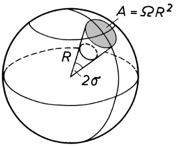
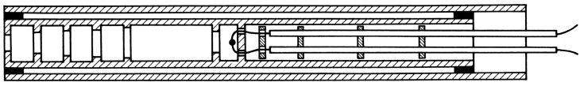
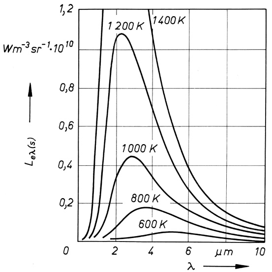
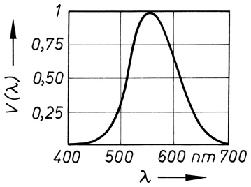

# 42 Die Gesetze der Strahlung

原始 PDF 第 497–509 页。

42

Die Gesetze der Strahlung

## 42.1 Das Wesen der Temperaturstrahlung (Wärmestrahlung)

Jeder Körper tauscht mit seiner Umgebung Energie in Form von Wärme aus, z. B. durch Wärmeleitung, wenn er mit anderen, wärmeren oder kälteren Körpern in Berührung gebracht wird. Befindet sich der Körper im Vakuum, wo jegliche Wärmeleitung ausgeschlossen ist, so erfolgen Energieabgabe und -aufnahme ausschließlich durch Emission und Absorption von elektromagnetischer Strahlung. Da diese ihren Ursprung in der dem Körper innewohnenden Wärmebewegung der Atome hat, spricht man von **Temperaturstrahlung** oder – soweit wir diese im nicht mehr sichtbaren Wellenlängenbereich allein über unser Wärmegefühl wahrnehmen können – auch von **Wärmestrahlung**. Sie enthält elektromagnetische Strahlung aller Wellenlängen und bildet ein **kontinuierliches Spektrum**, d. h., die Atome emittieren eine lückenlose Aufeinanderfolge aller Wellenlängen, was seine Ursache in ihrer engen Packung im Festkörper und der dadurch bedingten gegenseitigen Beeinflussung hat.

**Wärmestrahlung besteht aus elektromagnetischen Wellen, die von den Atomen bzw. Molekülen eines Stoffes infolge ihrer thermischen Bewegung ausgestrahlt werden.**

Während das sichtbare Licht vom violetten bis zum roten Ende des Spektrums den Wellenlängenbereich von 380 bis 780nm umfasst, liegt die vom Temperatursinn unserer Haut als Wärmeempfindung wahrgenommene Strahlung jenseits des roten Lichts im Ultrarot oder Infrarot mit Wellenlängen von 800nm bis 1mm. In diesem Bereich großer Wellenlängen liegt der Schwerpunkt der Ausstrahlung bei niedrigen Temperaturen der Körper, bei höheren Temperaturen verschiebt er sich mehr und mehr zu kürzeren Wellenlängen, und erst ab etwa $5 2 0   ^ { \circ } \mathbf { C }$ liegt ein Teil der Temperaturstrahlung im sichtbaren Spektralbereich (Glühen der Körper). Auch heiße Flüssigkeiten und Gasmassen emittieren Strahlung; man denke nur an die Strahlungsenergie der Sonne, die über kosmische Entfernungen hinweg auf unsere Erde gelangt und die Grundvoraussetzung für das Leben auf unserem Planeten schafft.

Der strahlende Körper muss sich nach dem I. Hauptsatz der Thermodynamik abkühlen, sofern ihm die abgestrahlte Energie nicht aus einem anderen Energievorrat wieder zugeführt wird. Umgekehrt erwärmt sich ein Körper, der Strahlung absorbiert, denn bei der Absorption wird elektromagnetische Strahlungsenergie in Wärmeenergie umgewandelt. Im Gegensatz zur Wärmeleitung, wo Wärmeenergie nur vom wärmeren auf den kälteren Körper übergeht, wird einem Körper Wärmeenergie auch von solchen Körpern seiner Umgebung zugestrahlt, deren Temperatur tiefer ist. Betrachten wir zwei Körper unterschiedlicher Temperatur, so ist die vom wärmeren dem kälteren zugestrahlte Energie größer als diejenige, die vom kälteren auf den wärmeren übergeht. Haben beide Körper die gleiche Temperatur angenommen, so herrscht **Strahlungsgleichgewicht**, d. h., jeder Körper erhält vom anderen denselben Betrag an Strahlungsenergie zugeführt wie er selbst aussendet.

---

42.2 Strahlungsphysikalische Größen

495

## 42.2 Strahlungsphysikalische Größen

Die elektromagnetische Strahlung ist im gesamten Spektralbereich durch ihre physikalischen Parameter wie Energie, Leistung, Wellenlänge usw. charakterisiert. Die Messung dieser energetischen Größen erfolgt mittels physikalischer Strahlungsempfänger (Kalorimeter, Thermoelemente, Photozellen u. a.), mit denen die Strahlungsenergie objektiv gemessen werden kann; zu ihrer Bewertung werden sog. strahlungsphysikalische Größen eingeführt.

Im sichtbaren Spektralbereich wird die (optische) Strahlung durch sog. lichttechnische Größen beschrieben, mit denen eine Bewertung des Helligkeits- und Farbeindrucks auf das menschliche Auge erfolgt. Diese „physiologischen“ Größen sind ganz analog den vorstehend genannten „physikalischen“Strahlungsgrößen definiert und hängen mit diesen zusammen, werden aber zusätzlich ganz wesentlich von der wellenlängenabhängigen Augenempfindlichkeit bestimmt (s. 42.7). Zur Unterscheidung erhalten die Größensymbole der über die Strahlungsenergie definierten strahlungsphysikalischen Grö- ßen den Index $\mathbf { \nabla } _ { \mathbf { \nabla } ^ { \mathbf { \alpha } } } \mathbf { \nabla } _ { \mathbf { \nabla } ^ { \mathbf { \alpha } } }$ und die später in Abschnitt 42.6 behandelten lichttechnischen Größen den Index $\mathbf { \nabla } _ { p } \mathbf { v } ^ { a }$ (von visuell).

Der **Strahlungsfluss** oder die **Strahlungsleistung** $\Phi _ { \mathbf { e } }$ gibt die je Zeiteinheit von einer Strahlungsquelle abgestrahlte oder von einem Empfänger aufgenommene Strahlungsenergie $Q _ { \mathrm { e } }$ an:

$$
\Phi_ {\mathrm{e}} = \frac {\mathrm{d} Q _ {\mathrm{e}}}{\mathrm{d} t}, \quad \text {Einheit:} \quad [ \Phi_ {\mathrm{e}} ] = 1 \mathrm{J/s} = 1 \mathrm{W}. \tag {42.1}
$$

Ein räumlich begrenzter Strahlungsfluss breitet sich in einem Strahlenkegel mit dem Öffnungswinkel 2σ aus (Bild 42.1). Es ist üblich, den Strahlenkegel durch seinen **Raumwinkel** Ω zu beschreiben. Dieser ist definiert als Quotient aus der durchstrahlten Fläche A einer gedachten, konzentrisch um den (punktförmigen) Strahler gelegten Kugel vom Radius R, welches der Kegel mit der Spitze im Kugelmittelpunkt aus der Kugeloberfläche herausschneidet, und dem Quadrat des Kugelradius:

$$
\Omega = \frac {A}{R ^ {2}} \quad (\text {Raumwinkel}), \tag {42.2}
$$

Als Quotient zweier Flächen ist der Raumwinkel dimensionslos. Die Einheit Steradiant kann daher (so wie der R a d i a n t als Einheit des ebenen Winkels, vgl. 3.7) als Größenverhältnis durch die Einheit 1 ersetzt werden, sofern keine Verwechslung zwischen verschiedenartigen Größen, wie z. B. Strahlungsfluss (42.1) und Strahlstärke (42.3), möglich ist.

text_image

A = \u03c6R²
R
2\u03c6

Bild 42.1 Raumwinkel $\Omega = A / R ^ { 2 } = 4 \pi \sin ^ { 2 } ( \sigma / 2 )$ sr. 2σ ist der (ebene) Öffnungswinkel des Strahlenkegels. Ein voller Raumwinkel, entsprechend der Abstrahlung in alle Richtungen, hat wegen $A = 4 \pi R ^ { 2 }$ (gesamte Kugeloberfläche) bzw. $2 \sigma = 3 6 0 ^ { \circ }$ den Wert 4πsr, der Halbraum entsprechend den Raumwinkel 2πsr.

Als **Strahlstärke** $I _ { \mathrm { e } }$ wird der Strahlungsfluss einer im Verhältnis zur Messentfernung kleinen Strahlungsquelle in eine bestimmte Abstrahlrichtung, bezogen auf das durchstrahlte Raum-

---

496

42 Die Gesetze der Strahlung

winkelelement dΩ, bezeichnet:

$$
I _ {\mathrm{e}} = \frac {\mathrm{d} \Phi_ {\mathrm{e}}}{\mathrm{d} \Omega}, \quad \text {Einheit:} \quad [ I _ {\mathrm{e}} ] = 1 \mathrm{W/sr}. \tag {42.3}
$$

Die **Strahldichte** $L _ { \mathrm { e } }$ ist die auf die vom Empfänger aus gesehene scheinbare Strahlerfläche $A _ { \perp }$ bezogene Strahlstärke. Ist $\mathbf { d } A _ { 1 }$ ein Flächenelement der Strahlerfläche und $\alpha _ { 1 }$ der Winkel zwischen der Flächennormale und der Empfangsrichtung, so ist d $A _ { \perp }$ gleich der Projektion von d $A _ { 1 }$ auf die zur Empfangsrichtung senkrecht stehende Ebene, also d $A _ { \perp } = \mathrm { d } A _ { 1 } \cos \alpha _ { 1 }$ . Somit ist mit (42.3)

$$
L _ {\mathrm{e}} = \frac {\mathrm{d} I _ {\mathrm{e}}}{\mathrm{d} A _ {\perp}} = \frac {\mathrm{d} I _ {\mathrm{e}}}{\mathrm{d} A _ {1} \cos \alpha_ {1}} = \frac {\mathrm{d} ^ {2} \varPhi_ {\mathrm{e}}}{\mathrm{d} \Omega \mathrm{d} A _ {1} \cos \alpha_ {1}} \tag {42.4}
$$

Einheit der Strahldichte: $[ L _ { \mathrm { e } } ] = 1 \mathrm { W } / ( \mathrm { m } ^ { 2 } \cdot \mathrm { s r } )$

Der von einem Körper ausgehende Strahlungsfluss ist, wie wir weiter unten sehen werden, für eine vorgegebene Körpertemperatur in bestimmter Weise von der Wellenlänge λ abhängig. Damit sind auch $I _ { \mathrm { e } }$ sowie $L _ { \mathrm { e } }$ Funktionen von λ. Diese Abhängigkeit kann im Fall der Strahldichte $L _ { \mathrm { e } }$ durch die **spektrale Strahldichte**

$$
L _ {\mathrm{e} \lambda} = \frac {\mathrm{d} L _ {\mathrm{e}}}{\mathrm{d} \lambda}, \quad E i n h e i t: \quad [ L _ {\mathrm{e} \lambda} ] = 1 \mathrm{W} / (\mathrm{m} ^ {3} \cdot \mathrm{sr}), \tag {42.5}
$$

ausgedrückt werden. Somit ist $\mathbf { d } L _ { \mathbf { e } } = L _ { \mathbf { e } \lambda }$ dλ die im Wellenlängenintervall dλ zwischen λ und $\lambda + \mathrm { d } \lambda$ vorhandene Strahldichte und $L _ { \mathbf { e } } = \int L _ { \mathbf { e } \lambda }$ dλ die Gesamtstrahldichte in dem durch die Integrationsgrenzen vorgegebenen Wellenlängenbereich.

Die **spezifische Ausstrahlung** oder **Strahlungsflussdichte** $M _ { \mathrm { e } }$ ist der auf die Flächeneinheit bezogene Strahlungsfluss, der von einem strahlenden Flächenelement in den Halbraum abgegeben wird:

$$
M _ {\mathrm{e}} = \frac {\mathrm{d} \varPhi_ {\mathrm{e}}}{\mathrm{d} A _ {1}} = \pi L _ {\mathrm{e}} \varOmega_ {0}, \qquad E i n h e i t: \quad [ M _ {\mathrm{e}} ] = 1 \mathrm{W/m} ^ {2}. \tag {42.6}
$$

$\varOmega _ { 0 }$ ist die Raumwinkeleinheit 1sr. In der Optik wird die Strahlungsflussdichte meist als Intensität I bezeichnet.

Die **Bestrahlungsstärke** $E _ { \mathbf { e } }$ ist der vom Empfänger $\mathbf { j e }$ Flächeneinheit aufgenommene Strahlungsfluss $\Phi _ { \mathbf { e } }$ . Ist $\mathbf { d } A _ { 2 }$ ein Flächenelement der Empfängerfläche, deren Flächennormale mit der Richtung des einfallenden Strahlungsflusses den Winkel $\alpha _ { 2 }$ einschließt, so wird dieses nur von dem Teil d $\Phi _ { \mathbf { e } }$ cos $\alpha _ { 2 }$ des Strahlungsflusses getroffen, der auf die Projektion der Fläche d $A _ { 2 }$ auf die zur Strahlrichtung senkrechte Ebene entfällt. Es ist demnach

$$
E _ {\mathrm{e}} = \frac {\mathrm{d} \varPhi_ {\mathrm{e}}}{\mathrm{d} A _ {2}} \cos \alpha_ {2}, \qquad E i n h e i t: \quad [ E _ {\mathrm{e}} ] = 1 \mathrm{W/m} ^ {2}. \tag {42.7}
$$

Der von der Sonne ausgehende und auf der Erde je Quadratmeter empfangene Strahlungsfluss beträgt (bei völliger Durchlässigkeit der Atmosphäre für alle Wellenlängen und vollständiger Absorption der Sonnenstrahlung sowie minimalem Winkel $\alpha _ { 2 }$ , d. h. mittags bei höchstem Sonnenstand) $E _ { \mathrm { e S } } = 1 3 9 5 \mathrm { W / m ^ { 2 } }$ . Dieser Wert der Bestrahlungsstärke heißt Solarkonstante.

---

42.3 Emission und Absorption von Strahlung. Kirchhoffsches Strahlungsgesetz

497

Die **Energiedichte** $w$ ist die auf die Volumeneinheit bezogene, im Strahlungsfeld enthaltene Energie:

$$
w = \frac {\mathrm{d} Q _ {\mathrm{e}}}{\mathrm{d} V}, \quad \text {Einheit:} [ w ] = 1 \mathrm{J} / \mathrm{m} ^ {3} = 1 \mathrm{N} / \mathrm{m} ^ {2} = 1 \mathrm{Pa}. \tag {42.8}
$$

In einer aus dem Strahlungsfeld herausgegriffenen geraden Säule mit der Grundfläche A und der Hö- he dh ist demnach die Energiemenge $\mathbf { d } Q _ { \mathbf { e } } = w A \mathbf { d } h$ enthalten, wobei, wenn die Säule in Richtung der mit Lichtgeschwindigkeit c sich ausbreitenden Strahlung liegt, dh = c dt und somit $\mathbf { d } Q _ { \mathrm { e } } = w A c \mathbf { d } t$ ist. Hieraus erhält man nach (42.1) für den Strahlungsfluss $\varPhi _ { \mathrm { e } } = w$ Ac und nach (42.7) für die Bestrahlungsstärke $E _ { \mathrm { e } } = w c$ . Für die Energiedichte folgt somit $w = E _ { \mathrm { e } } / c .$ Diese Größe hat, wie man an ihrer Einheit (42.8) erkennt, zugleich die Bedeutung eines Druckes; man bezeichnet sie daher auch als Strahlungsdruck der elektromagnetischen Welle, analog zum Schallstrahlungsdruck (vgl. 37.2). Bei vollständiger Absorption durch die von ihm getroffene Fläche gilt

$$
p = \frac {E _ {\mathrm{e}}}{c} \quad (\text {Strahlungsdruck}). \tag {42.9}
$$

Der Strahlungsdruck entspricht dem durch die elektromagnetische Welle auf die absorbierende Fläche übertragenen Impuls. Bei vollständiger Reflexion wird der doppelte Strahlungsdruck übertragen, da der Impuls der Welle durch die Reflexion sein Vorzeichen wechselt.

Erstmals nachgewiesen wurde die Druckwirkung elektromagnetischer Strahlung durch LEBEDEW (1901). Aus der Solarkonstante (s. o.) erhält man den Strahlungsdruck der Sonne zu $p _ { \mathrm { S } } = E _ { \mathrm { e S } } / c$ ≈ $^ { 4 , 6 5 \cdot 1 0 ^ { - 6 } }$ Pa. Der von den Fixsternen erzeugte Strahlungsdruck wirkt auf alle im Weltraum vorhandenen Gas- und Staubteilchen und bewegt diese in die den Fixsternen abgekehrte Richtung, wodurch z. B. Kometen ihren Schweif erhalten, der bis zu $1 0 ^ { 8 }$ km Länge annehmen kann und stets von der Sonne weg gerichtet ist.

## 42.3 Emission und Absorption von Strahlung. Kirchhoffsches Strahlungsgesetz

Emission und Absorption von Strahlung hängen außer von der Wellenlänge in starkem Maße von der Temperatur und der Oberflächenbeschaffenheit der strahlenden bzw. absorbierenden Körper ab. So erscheint z. B. eine mit Bleistift geschwärzte Stelle eines glühenden Porzellankörpers trotz gleicher Temperatur heller als die ungeschwärzten Teile der Oberfläche, d. h., die geschwärzte Stelle hat zumindest im sichtbaren Teil des Spektrums ein größeres Emissionsvermögen als ihre Umgebung. Ebenso ist bekannt, dass dunkle Körper mit rauer Oberfläche mehr Strahlung absorbieren und sich dadurch stärker erwärmen als helle blanke Körper.

Das unterschiedliche Verhalten der Körper gegenüber Absorption von Strahlung kennzeichnet man durch den **Absorptionsgrad** $\alpha ,$ der das Verhältnis des vom Körper absorbierten Strahlungsflusses $\Phi _ { \mathbf { a } }$ zu dem auf den Körper auftreffenden Strahlungsfluss $\Phi _ { 0 }$ angibt:

$$
\alpha = \frac {\varPhi_ {\mathrm{a}}}{\varPhi_ {0}} \qquad (\text {Absorptionsgrad}). \tag {42.10}
$$

So werden z. B. von Ruß etwa 99% der gesamten auftreffenden Strahlung absorbiert, nur 1% wird also reflektiert. Man definiert:

**Ein Körper, der die gesamte auf ihn auftreffende Strahlung restlos absorbiert, dessen Absorptionsgrad also für alle Wellenlängen und Temperaturen gleich 1 ist, heißt „schwarzer Körper“.**

---

498

42 Die Gesetze der Strahlung

Von allen „nichtschwarzen Körpern“ wird also ein Teil der auftreffenden Strahlung reflektiert bzw. geht durch sie hindurch. Körper, die nicht vollkommen absorbieren, heißen **graue Körper**, sofern α über den gesamten Wellenlängenbereich konstant ist.

Reflektierter und hindurchgehender Anteil des auf einen Körper auftreffenden Strahlungsflusses werden durch seinen **Reflexionsgrad** $\varrho = \varPhi _ { \mathrm { r } } / \varPhi _ { 0 }$ und seinen **Transmissionsgrad** $\tau = \varPhi _ { \mathrm { t r } } / \varPhi _ { 0 }$ beschrieben. Einen Körper mit $\varrho = 1$ nennt man einen weißen oder ideal spiegelnden Körper und einen Körper mit $\tau = 1$ einen absolut durchlässigen Körper. Nach dem Energieerhaltungssatz muss gelten $\alpha + \varrho + \tau = 1$

Im Unterschied zur Reflexion der von außen auf den Körper auffallenden Strahlung erfolgt die Emission von Strahlung durch den Körper selbst vermöge seiner Temperatur. Dieses Verhalten der Körper wird durch ihren **Emissionsgrad** ε beschrieben, welcher als Quotient aus der Strahldichte (42.4) $L _ { \mathrm { e } }$ eines nichtschwarzen Körpers und der Strahldichte $L _ { \mathbf { e } ( \mathbf { s } ) }$ des schwarzen Körpers definiert ist:

$$
\varepsilon = \frac {L _ {\mathrm{e}}}{L _ {\mathrm{e(s)}}} \quad (\text {Emissionsgrad}). \tag {42.11}
$$

Der Emissionsgrad des schwarzen Körpers ist demnach, ebenso wie sein Absorptionsgrad (42.10), definitionsgemäß gleich 1.

Die Erfahrung zeigt nun, dass für alle Körper bei gegebener Temperatur T und Wellenlänge λ der Strahlung das Verhältnis von Emissionsgrad $\varepsilon ( \lambda , T )$ und Absorptionsgrad $\alpha ( \lambda , T )$ gleich groß ist (KIRCHHOFF). Für zwei verschiedene Körper 1 und 2 gilt also

$$
\frac {\varepsilon_ {1} (\lambda , T)}{\alpha_ {1} (\lambda , T)} = \frac {\varepsilon_ {2} (\lambda , T)}{\alpha_ {2} (\lambda , T)}.
$$

Ist einer von beiden Körpern ein schwarzer mit $\varepsilon _ { \mathrm { s } } ( \lambda , T ) = \alpha _ { \mathrm { s } } ( \lambda , T ) = 1$ , so folgt hieraus für jeden beliebigen anderen Körper

$$
\varepsilon (\lambda , T) = \alpha (\lambda , T) \quad \text {(KIRCHHOFFsches Strahlungsgesetz).} \tag {42.12}
$$

## KIRCHHOFFsches Strahlungsgesetz: Unabhängig von den spezifischen Eigenschaften eines Körpers ist bei gegebener Temperatur und Wellenlänge sein Emissionsgrad gleich seinem Absorptionsgrad.

Das heißt, ein Körper, der viel Strahlung absorbiert, kann auch viel Strahlung emittieren und umgekehrt. Für die Strahldichte eines nichtschwarzen Körpers folgt daraus mit (42.11) $L _ { \mathrm { e } } =$ α $L _ { \mathbf { e } ( \mathbf { s } ) }$ , woraus hervorgeht, dass alle Temperaturstrahler wegen $\alpha < 1$ eine geringere Strahldichte als der schwarze Körper aufweisen.

Geschwärzte Oberflächen stellen nur näherungsweise einen schwarzen Körper im physikali schen Sinne dar. Praktisch realisierbar ist ein schwarzer Körper durch die Öffnung eines Hohlkörpers, der so konstruiert ist, dass die in die Öffnung eintretende Strahlung durch Mehrfach reflexionen an den geschwärzten Innenwänden des Hohlraumes nahezu vollständig absorbiert wird. Die Öffnung hat dann nicht nur einen maximalen Absorptionsgrad, sondern gleich zeitig auch einen maximalen Emissionsgrad, den Emissionsgrad $\varepsilon _ { \mathrm { s } }$ des **schwarzen Strahlers**. Die aus der Öffnung tretende Strahlung, die **schwarze Strahlung** oder **Hohlraumstrahlung**, hängt nur von der Temperatur des Strahlers ab und ist unabhängig von der Oberflächenbe schaffenheit des Hohlraumes. Aus den genannten Eigenschaften des schwarzen Strahlers folgt

---

42.4 Das plancksche Strahlungsgesetz

499

seine Bedeutung für die Formulierung quantitativer Zusammenhänge zwischen Temperatur und Strahlung.

In Bild 42.2 ist ein schwarzer Strahler für Temperaturen bis $1 5 0 0   ^ { \circ } \mathrm { C }$ dargestellt. Er besteht aus zwei feuerfesten Zylindern, von denen der innere mit einer Platinfolie überzogen ist, die der Länge nach vom Heizstrom durchflossen wird. Die Lötstelle des Thermoelements liegt vor der Wand, die der Öffnung zustrahlt.

natural_image

Cross-sectional diagram of a mechanical assembly or connector (no text or symbols visible)

Bild 42.2 Hohlraumstrahler als „schwarzer Körper“

## Beispiele 42.1:

1. In einem verdunkelten Raum werden ein durchsichtiger und ein aus dunklem Glas bestehender Stab in einer Bunsenbrennerflamme auf gleiche Temperatur bis zum Glühen erhitzt. Der dunkle Stab glüht dann intensiver als der helle.

chemical

Simple chemical apparatus diagram showing a spherical object with three diamond-shaped components and a base, likely representing a galvanometer or similar scientific apparatus.

Bild 42.3 Lichtmühle: Ein leicht drehbares Flügelrad befindet sich in einem weitgehend evakuierten Glasgefäß. Die Flügel sind auf einer Seite geschwärzt, auf der Rückseite blank. Die geschwärzten Flächen werden durch die auffallende Strahlung (Licht) stärker erwärmt als die blanken und reflektieren wegen der höheren Temperatur die auftreffenden Gasmoleküle mit höherer Geschwindigkeit; durch den Rückstoß weichen die geschwärzten Flächen vor der Strahlung zurück, das Flügelrad dreht sich.

2. Lichtmühle (CROOKES, s. Bild 42.3). Derartige Strahlungsmessgeräte heißen Radiometer. □

## 42.4 Das plancksche Strahlungsgesetz

Die Unabhängigkeit der Hohlraumstrahlung von der Oberflächenbeschaffenheit des Hohlraumes legt es nahe, einen allgemeinen Zusammenhang zwischen der spektralen Strahldichte, der Wellenlänge und der Temperatur zu suchen. Dieser tatsächlich existierende Zusammenhang zur Beschreibung des kontinuierlichen Spektrums der Hohlraumstrahlung konnte von PLANCK zunächst auf Grund experimenteller Befunde als empirische Formel angegeben werden. Eine theoretische Begründung gelang ihm erst, nachdem er im völligen Gegensatz zur klassischen Physik davon ausging, dass die einzelnen schwingenden Atome des Festkörpers bei Emission bzw. Absorption von Strahlung die Energie nicht kontinuierlich abgeben bzw. aufnehmen können, sondern dass der Energieaustausch nur in diskreten „Portionen“ von bestimmter Größe erfolgt. Das bedeutet, dass die **atomaren Oszillatoren** nur in bestimmten Energiezuständen schwingen können.

**Ein Oszillator kann nur Energiebeträge aufnehmen oder abgeben, die ein ganzes Vielfaches der PLANCK-Konstanten sind.**

$$
E = n h f \quad (n = 1, 2, 3, \dots). \tag {42.13}
$$

---

500

42 Die Gesetze der Strahlung

Die in dieser Gleichung enthaltene Konstante h stellt eine universelle Naturkonstante dar; sie hat die Dimension einer Wirkung (Energie mal Zeit) und heißt

$$
\text {elementares Wirkungsquantum} h = 6, 6 2 6   0 7 0   1 5 \cdot 1 0 ^ {- 3 4} \mathrm{Js} \quad (\text {PLANCK - Konstante}).
$$

Aus dieser Quantelung der Energiezustände der Oszillatoren folgt, dass die Strahlung ebenfalls gequantelt sein muss. Man spricht von **Lichtquanten** oder **Photonen**. Diese zunächst als Hypothese entwickelte Vorstellung konnte später im Zusammenhang mit der Deutung des Photoeffekts (vgl. 43.2) bestätigt werden (EINSTEIN, 1905).

**Die Energie einer jeden Strahlung ist gequantelt, d. h., sie setzt sich aus elementaren (unteilbaren) Energieportionen der Größe** $h f$ **zusammen.**

Auf der Grundlage dieser Vorstellungen, mit denen PLANCK die Quantentheorie begründete, gelang ihm die Herleitung seiner berühmten Strahlungsformel (42.14), welche die Verteilung der spektralen Strahldichte (42.5) des schwarzen Körpers auf die verschiedenen Wellenlängen in Abhängigkeit von der Temperatur T des Strahlers richtig wiedergibt. Danach ist die Strahldichte der Hohlraumstrahlung im Wellenlängenbereich zwischen λ und $\lambda   +   \mathbf { d } \lambda$ von der Größe

$$
\mathrm{d} L _ {\mathrm{e(s)}} = L _ {\mathrm{e} \lambda (\mathrm{s})} \mathrm{d} \lambda = \frac {2 h c ^ {2}}{\Omega_ {0} \lambda^ {5}} \frac {1}{\mathrm{e} ^ {h c / (\lambda k T)} - 1} \mathrm{d} \lambda \quad \text {(PLANCKsches Strahlungsgesetz)} \tag {42.14}
$$

mit c als Vakuum-Lichtgeschwindigkeit, k BOLTZMANN-Konstante und $\varOmega _ { 0 }$ Raumwinkeleinheit 1sr. Gleichung (42.14) ist in Bild 42.4 für verschiedene Temperaturen $T$ als Parameter grafisch dargestellt.

## 42.5 Folgerungen aus dem planckschen Strahlungsgesetz

Das PLANCKsche Strahlungsgesetz (42.14) enthält alle anderen Strahlungsgesetze in sich. Wie man aus Bild 42.4 erkennt, verschiebt sich die Lage des Maximums der Strahlungskurven mit steigender Temperatur immer mehr nach dem kurzwelligen Teil des Spektrums. Die Wellenlänge $\lambda _ { \mathrm { m a x } } ,$ , bei der das Maximum der spektralen Strahldichte auftritt, findet man durch Bildung der ersten Ableitung der Funktion (42.14) nach der Wellenlänge λ und Nullsetzen derselben. Man erhält auf diese Weise

$$
\lambda_ {\max} T = b = 2, 8 9 7 7 7 1 9 5 5 \cdot 1 0 ^ {- 3} \mathrm{m} \cdot \mathrm{K} \quad (\text {WIENSches Verschiebungsgesetz}) \tag {42.15}
$$

mit $b = h c / ( 4 , 9 6 5   k )$ als WIEN-Konstante.

Daraus geht hervor, dass bei tieferer Temperatur vom erhitzten Körper vorzugsweise die langwelligen Wärmestrahlen ausgesandt werden, erst bei höheren Temperaturen auch nennenswerte Anteile sichtbaren Lichts, dabei auch zuerst vorzugsweise langwelliges rotes Licht (beginnende Rotglut bei $5 2 5   ^ { \circ } \mathrm { C ) }$ , danach zunehmend gelbes (bei etwa $1 1 0 0   ^ { \circ } \mathrm { C } )$ und erst im Gebiet der Weißglut $( 1 3 0 0 \ldots 1 5 0 0   ^ { \circ } \mathrm { C } )$ verstärkt violettes.

---

42.5 Folgerungen aus dem planckschen Strahlungsgesetz

501

Aus dem PLANCKschen Strahlungsgesetz kann weiterhin durch Integration von (42.14) über alle Wellenlängen von null bis unendlich die von einem schwarzen Körper bei einer bestimmten Temperatur T ausgehende Gesamtstrahldichte $L _ { \mathbf { e } ( \mathbf { s } ) }$ und daraus nach (42.6) die Strahlungsflussdichte $M _ { \mathbf { e } ( \mathbf { s } ) } = \pi L _ { \mathbf { e } ( \mathbf { s } ) } \varOmega _ { 0 }$ berechnet werden. Man erhält

$$
M _ {\mathrm{e(s)}} = \sigma T ^ {4} \quad (\text {STEFAN - BOLTZMANNSches Gesetz}) \tag {42.16}
$$

mit der STEFAN-BOLTZMANN-Konstanten $\sigma = 2 \pi ^ { 5 } k ^ { 4 } / ( 1 5 c ^ { 2 } h ^ { 3 } ) = 5 { , } 6 7 0 \cdot 1 0 ^ { - 8 } \mathrm { W } / ( \mathrm { m } ^ { 2 } \cdot \mathrm { K } ^ { 4 } )$

## Die Gesamtstrahlungsflussdichte des schwarzen Körpers ist der vierten Potenz der absoluten Temperatur proportional.

line

| \(\lambda (\mu m)\) | \(L_e\lambda(s) (Wm^{-3}\)sr⁻¹·10¹⁰) :: 600 K | \(L_e\lambda(s) (Wm^{-3}\)sr⁻¹·10¹⁰) :: 800 K | \(L_e\lambda(s) (Wm^{-3}\)sr⁻¹·10¹⁰) :: 1000 K | \(L_e\lambda(s) (Wm^{-3}\)sr⁻¹·10¹⁰) :: 1200 K | \(L_e\lambda(s) (Wm^{-3}\)sr⁻¹·10¹⁰) :: 1400 K |
| --- | --- | --- | --- | --- | --- |
| 2 | ~0.05 | ~0.15 | ~0.35 | ~0.95 | >1.2 |
| 4 | ~0.08 | ~0.18 | ~0.45 | ~0.75 | ~1.1 |
| 6 | ~0.06 | ~0.12 | ~0.25 | ~0.45 | ~0.6 |
| 10 | ~0.03 | ~0.06 | ~0.12 | ~0.2 | ~0.3 |

Bild 42.4 Strahlungskurven des schwarzen Körpers für verschiedene Temperaturen (plancksches Strahlungsgesetz)

Hieraus folgt wegen (42.6) $M _ { \mathbf { e } ( \mathbf { s } ) } = \mathbf { d } \varPhi _ { \mathbf { e } ( \mathbf { s } ) } / \mathbf { d } A$ für den insgesamt von der Fläche A abgegebenen Strahlungsfluss (Strahlungsleistung)

$$
\varPhi_ {\mathrm{e(s)}} = M _ {\mathrm{e(s)}} A = \sigma A T ^ {4}. \tag {42.17}
$$

Für einen nichtschwarzen Körper mit dem (integralen) Emissionsgrad $\varepsilon < 1$ (s. Tabelle 42.1) gilt

$$
\Phi_ {\mathrm{e}} = \varepsilon \sigma A T ^ {4}. \tag {42.18}
$$

Berücksichtigt man die Temperatur $T _ { 2 }$ der Umgebung, die ihrerseits dem Körper mit der Temperatur $T _ { 1 }$ eine entsprechende Energie zustrahlt, so gilt anstelle von (42.18)

$$
\varPhi_ {\mathrm{e}} = \varepsilon \sigma A (T _ {1} ^ {4} - T _ {2} ^ {4}) \quad (\text {Strahlungsleistung eines Körpers}). \tag {42.19}
$$

Geräte, mit denen man die Strahlung eines Körpers (z. B. von Metallschmelzen) und damit seine Temperatur messen kann, heißen Pyrometer. Mit ihnen können Temperaturen zwischen $7 0 0   ^ { \circ } \mathrm { C }$ und $2 0 0 0   ^ { \circ } \mathrm { C }$ gemessen werden. Auf diese Weise wird allerdings nicht die wahre Temperatur T bestimmt, sondern die stets niedrigere **schwarze Temperatur** $T _ { \mathrm { s } } .$ . Denn ein gewöhnlicher nichtschwarzer Körper strahlt

---

502

42 Die Gesetze der Strahlung

wegen $\varepsilon < 1$ schwächer und muss daher auf höhere Temperaturen erhitzt werden, wenn er die gleiche Helligkeit wie der schwarze Körper haben soll. Da ε von der Wellenlänge abhängt, ist die schwarze Temperatur jeweils nur für bestimmte Wellenlängenbereiche definiert. Es gilt mit Gleichung (42.11):

$$
L _ {\mathrm{e}} (\lambda , T) = L _ {\mathrm{e(s)}} (\lambda , T _ {\mathrm{s}}) = \varepsilon (\lambda , T) L _ {\mathrm{e(s)}} (\lambda , T). \tag {42.20}
$$

## Der nichtschwarze Körper strahlt bei der Temperatur T mit der gleichen Strahldichte wie der schwarze Körper bei der schwarzen Temperatur $T _ { \mathbf { g } } ,$

Wegen der mitunter erheblichen Abweichung der schwarzen von der wahren Temperatur bestimmt man häufig die sog. **Farbtemperatur**. Sie kennzeichnet diejenige Temperatur eines Strahlers, die ein schwarzer Strahler haben müsste, um den gleichen Farbeindruck hervorzurufen. Bei einem schwarzen Strahler stimmen wahre Temperatur und Farbtemperatur überein. Mit der Farbtemperatur werden insbesondere als Temperaturstrahler wirkende technische Lichtquellen und die sichtbaren Sterne gekennzeichnet. Zum Beispiel besitzt Wolfram bei einer wahren Temperatur von 2000K für λ = 665nm eine (optisch gemessene) schwarze Temperatur von 1857K und eine Farbtemperatur von 2033K.

Tabelle 42.1 Emissionsgrad ε verschiedener Stoffe

| Stoff | Temperatur in °C | ε |
| --- | --- | --- |
| Silber, poliert | 20 | 0,02 ... 0,03 |
| Aluminium, poliert | 20 | 0,04 |
| Stahl, poliert | 20 | 0,286 |
| mit Walzhaut | 20 | 0,77 |
| stark verrostet | 20 | 0,85 |
| Lacke, Emaille | 20 | 0,85 |
| Eichenholz | 20 | 0,895 |
| Dachpappe | 20 | 0,93 |
| Ziegel, Putz | 20 | 0,93 |
| Ruß | 100 ... 300 | 0,95 |
| Wasser | 0 ... 100 | 0,95 ... 0,96 |
| Asbestpappe | 20 | 0,96 |

## Beispiele 42.2:

1. Wie viel Watt strahlt ein mit Dachpappe $( \varepsilon = 0 , 9 3 )$ gedecktes Dach je Quadratmeter Fläche ab, wenn dieses bei $2 7   ^ { \circ } \mathbf { C }$ Außentemperatur durch Sonneneinstrahlung auf $7 6   ^ { \circ } \mathbf { C }$ erhitzt wird?
Lösung: Mit $A = 1   \mathrm { m } ^ { 2 } ,   T _ { 1 } = 3 4 9   \mathrm { K }$ und $T _ { 2 } = 3 0 0   \mathrm { K }$ folgt aus (42.19) für die Strahlungsleistung $\phi _ { \mathrm { e } } = 3 5 5   \mathrm { W } .$
2. Welche Temperatur erreicht eine elektrische Kochplatte von 20cm Durchmesser bei einer Leistung von 1000W? Umgebungstemperatur $2 0   ^ { \circ } \mathrm { C } ; \varepsilon = 0 , 5 .$

Lösung: Die strahlende Fläche beträgt $A = 3 , 1 4 \cdot 1 0 ^ { - 2 }   \mathrm { m } ^ { 2 }$ . Damit und mit $T _ { 2 } = 2 9 3   \mathrm { K }$ folgt aus (42.19)

$$
T _ {1} = \sqrt [ 4 ]{\frac {\Phi_ {\mathrm{e}}}{\varepsilon \sigma A} + T _ {2} ^ {4}} \approx 1 0 3 0 \mathrm{K} \quad \text {oder} \quad 7 5 7 ^ {\circ} \mathrm{C}.
$$

---

42.6 Lichttechnische Größen (Photometrie)

503

3. Berechne aus der Solarkonstante $E _ { \mathrm { e S } } = 1 3 9 5 \mathrm { W / m ^ { 2 } }$ (vgl. 42.2) die Strahlungsleistung $\phi _ { \mathrm { e S } }$ der Sonne und daraus deren Oberflächentemperatur! Entfernung Sonne – Erde $1 , 5 \cdot 1 0 ^ { 1 1 }   \mathrm { m } ;$ Sonnenoberfläche $A_{S}=6,1 \cdot 10^{18}  m ^{2}; \varepsilon=1$
Lösung: Nach (42.7) ergibt sich die in alle Richtungen des Raumes von der Sonne abgestrahlte Leistung zu $\phi _ { \mathrm { e S } } = E _ { \mathrm { e S } } A$ , wenn A die Fläche der Kugel um die Sonne mit dem Abstand Sonne – Erde als Radius ist; le<u>tztere betr</u>ägt $A = 2 , 8 2 \cdot 1 0 ^ { 2 3 }   \mathrm { m } ^ { 2 }$ . Damit wird $\phi _ { \mathrm { e S } } = 3 , 9 3 \cdot 1 0 ^ { 2 3 }   \mathrm { k W }$ (!) und nach (42.17) $T _ { \mathrm { S } } = \sqrt [ 4 ] { \phi _ { \mathrm { e S } } / ( \sigma A _ { \mathrm { S } } ) } \approx 5 8 0 0 1$ K. Die auf diese Weise bestimmten Fixsterntemperaturen sind schwarze Temperaturen (s. o.) und im Allgemeinen zu niedrig, da die Fixsterne nicht immer als schwarze Körper mit $\varepsilon = 1$ vorausgesetzt werden können; sie strahlen daher in Wirklichkeit schwächer als ein „schwarzer“ Stern.
4. Bei welcher Wellenlänge liegt das Maximum der spektralen Strahldichte der Sonnenstrahlung? Oberflächentemperatur der Sonne 5800K.

Lösung: Aus dem WIENschen Verschiebungsgesetz (42.15) erhält man die maximale Ausstrahlung bei $\lambda_{ max }=2.9 \cdot 10^{-3}  m  \cdot  K /(5800  K )=500 \cdot 10^{-9}  m =500  nm$ (gelbgrün). Es ist bemerkenswert, dass in diesem Wellenlängenbereich die Empfindlichkeit des menschlichen Auges am größten ist (vgl. Bild 42.5). □

## Aufgaben

**42.1** Welche Temperatur erreicht die Wolframwendel einer Glühlampe von 200W bei Raumtemperatur von $2 0   ^ { \circ } \mathrm { C } _ { \cdot } ^ { 2 }$ Strahlende Oberfläche 300mm2; $\varepsilon = 0 { , } 3$
**42.2** Bei welcher Wellenlänge liegt in der Aufgabe 42.1 das Maximum der Ausstrahlung?
**42.3** Leite aus dem PLANCKschen Strahlungsgesetz (42.14) durch Lösung der Extremwertaufgabe, wie am Beginn des Abschnitts beschrieben, das WIENsche Verschiebungsgesetz (42.15) her!

## 42.6 Lichttechnische Größen (Photometrie)

Auf Grund der für verschiedene Wellenlängen unterschiedlichen spektralen Empfindlichkeit des menschlichen Auges geht der von einem Beobachter empfundene Helligkeitseindruck von Lichtquellen nicht parallel mit dem Strahlungsfluss, d. h. mit dem von der Lichtquelle abge gebenen Energiestrom. Die in Abschnitt 42.2 eingeführten strahlungsphysikalischen Größen können deshalb in der Lichtmessung (Photometrie) nicht verwendet werden. An ihre Stelle treten analog definierte **lichttechnische Größen**, welche nicht von den energetischen Parametern der Lichtstrahlung, sondern von ihrem Lichtreiz auf das Auge abgeleitet sind. Sie werden meist mit dem Index $\mathbf { \nabla } _ { p } \mathbf { v } ^ { a }$ versehen, als Abkürzung für visuell.

Die lichttechnische Grundgröße ist die **Lichtstärke** $I _ { \mathrm { V } } .$ Für sie wurde eine gesonderte SI-Einheit als Basiseinheit, die **Candela (cd)**, eingeführt, die wie folgt definiert ist:

**1 C a n d e l a (cd) ist die in einer Richtung abgegebene Lichtstärke einer Lichtquelle, welche monochromatische Strahlung der Frequenz** $\mathbf { 5 4 0 \cdot 1 0 ^ { 1 2 } }$ **Hz aussendet und deren Strahlstärke in dieser Richtung (1/683) W/sr beträgt.**

Diese Definition bleibt im neuen SI bestehen.

---

504

42 Die Gesetze der Strahlung

Die Lichtstärke ist analog zur Strahlstärke (42.3) definiert:

$$
I _ {\mathrm{v}} = \frac {\mathrm{d} \varPhi_ {\mathrm{v}}}{\mathrm{d} \Omega} \qquad (\text {Lichtstärke}). \tag {42.21}
$$

Dabei ist $\Phi _ { \mathrm { v } }$ der **Lichtstrom**; er entspricht dem vom Auge wahrgenommenen Strahlungsfluss (42.1). Eine punktförmige Lichtquelle der Lichtstärke $I _ { \mathrm { V } }$ sendet in den Raumwinkel dΩ den Lichtstrom d $\Phi _ { \mathrm { v } }$ aus. Der Gesamtlichtstrom wird damit

$$
\varPhi_ {\mathrm{v}} = \int I _ {\mathrm{v}}   \mathrm{d} \Omega \qquad (\text {Lichtstrom}), \tag {42.22}
$$

## 1 Lumen (lm) ist der Lichtstrom, den eine Lichtquelle mit der winkelunabhängigen Lichtstärke 1 cd in den Raumwinkel 1 sr abstrahlt.

Die **Leuchtdichte** $L _ { \mathrm { v } }$ ist das Analogon zur Strahldichte (42.4):

$$
L _ {\mathrm{v}} = \frac {\mathrm{d} I _ {\mathrm{v}}}{\mathrm{d} A _ {1} \cos \alpha_ {1}}, \quad \text {Einheit:} \quad [ L _ {\mathrm{v}} ] = 1 \frac {\mathrm{cd}}{\mathrm{m} ^ {2}}. \tag {42.23}
$$

Dabei ist d $A _ { 1 }$ ein Oberflächenelement der Lichtquelle und $\alpha _ { 1 }$ der Winkel zwischen Flächennormale und Blickrichtung. Somit ist $\mathbf { d } A _ { 1 }$ cos $\alpha _ { 1 }$ die scheinbare strahlende Fläche, d. h. diejenige Fläche, die sich vom Standpunkt des Beobachters aus darbietet. Ein Körper hat die Leuchtdichte $1   \mathrm { c d } / \mathrm { m } ^ { 2 }$ , wenn er in eine bestimmte Richtung bei einer scheinbaren Fläche von $\mathrm { 1 m ^ { 2 } }$ mit der Lichtstärke 1cd strahlt. In der Tabelle 42.2 sind die Leuchtdichten einiger Lichtquellen aufgeführt.

Fällt der Lichtstrom d $\Phi _ { \mathrm { v } }$ auf das Flächenelement $\mathbf { d } A _ { 2 }$ , dessen Normale mit der Richtung des einfallenden Lichts den Winkel $\alpha _ { 2 }$ einschließt, so erzeugt er analog zur Bestrahlungsstärke (42.7) die **Beleuchtungsstärke**

$$
E _ {\mathrm{v}} = \frac {\mathrm{d} \varPhi_ {\mathrm{v}}}{\mathrm{d} A _ {2}} \cos \alpha_ {2}, \quad \text {Einheit:} \quad [ E _ {\mathrm{v}} ] = 1 \frac {\mathrm{lm}}{\mathrm{m} ^ {2}} = 1 \mathrm{Lux(lx)}. \tag {42.24}
$$

## Der Lichtstrom 1 lm erzeugt auf einer Fläche von $\mathbf { 1 m } ^ { 2 }$ die Beleuchtungsstärke 1 Lux (lx).

In der Tabelle 42.3 sind einige Werte für Beleuchtungsstärken zusammengestellt.

Eine in der Photometrie häufig benutzte Beziehung zwischen Beleuchtungsstärke $E _ { \mathrm { v } }$ und Lichtstärke $I _ { \mathrm { v } }$ erhält man, wenn in (42.24) $\mathbf { d } \varPhi _ { \mathbf { v } }$ gemäß (42.22) unter Beachtung des Raumwinkels (42.2) durch $I _ { \mathrm { v } } \mathrm { d } \Omega = I _ { \mathrm { v } } \mathrm { d } A _ { 2 } / r ^ { 2 }$ ersetzt wird, wobei $r$ die Entfernung der Lichtquelle von der beleuchteten Fläche $\mathbf { d } A _ { 2 }$ ist:

$$
E _ {\mathrm{v}} = \frac {I _ {\mathrm{v}} \cos \alpha_ {2}}{r ^ {2}} \qquad (\text {photometrisches Grundgesetz}). \tag {42.25}
$$

**Die Beleuchtungsstärke nimmt bei konstanter Lichtstärke der Quelle mit dem Quadrat der Entfernung ab.**

---

42.6 Lichttechnische Größen (Photometrie)

505

Für zwei Lichtquellen 1 und 2 folgt daher, wenn diese aus unterschiedlichen Entfernungen r auf ein und derselben Fläche unter dem gleichen Einfallswinkel die gleiche Beleuchtungsstärke hervorrufen $( E _ { \mathrm { v 1 } } = E _ { \mathrm { v 2 } } )$

$$
I _ {1}: I _ {2} = r _ {1} ^ {2}: r _ {2} ^ {2}. \tag {42.26}
$$

## Die Lichtstärken zweier Lichtquellen verhalten sich bei gleicher Beleuchtungsstärke wie die Quadrate ihrer Abstände von der beleuchteten Fläche.

Tabelle 42.2 Leuchtdichten $L _ { \mathrm { v } }$ verschiedener Lichtquellen (in cd/m2)

| Fluoreszenz | $10^{-4} \dots 10^{2}$ |
| --- | --- |
| Vollmond | $5 \cdot 10^{3}$ |
| Kerzenflamme | $7 \cdot 10^{3}$ |
| Wolframwendel einer Glühlampe | $10^{7} \dots 3,5 \cdot 10^{7}$ |
| Krater der Kohlebogen-lampe | $1,6 \cdot 10^{8}$ |
| Quecksilber-Höchstdrucklampe | $25 \cdot 10^{8} \dots 10^{9}$ |
| Sonne | $10^{7} \dots 10^{9}$ |
| Xenon-Höchstdrucklampe | $10^{9} \dots 10^{10}$ |

Tabelle 42.3 Beleuchtungsstärken $E _ { \mathrm { V } }$ (in lx)

| mondlose Nacht | etwa 0,0003 |
| --- | --- |
| Nachts bei Vollmond | etwa 0,2 |
| Sonnenlicht im Sommer | $10^{5}$ |
| Nach DIN 5035: |  |
| Parkplatz | 3 |
| Fußwege, Straßen | 5 ...20 |
| Wohnräume | 40 ...150 |
| Lagerräume | 50 ...200 |
| Büro-, Unterrichtsräume | 300 ...500 |
| Messplätze | 750 |
| Feinstmontage | 1000 |

Lichtstärken werden auf einer optischen Bank dadurch gemessen, dass man zwischen eine geeichte Lichtquelle bekannter Lichtstärke $I _ { 1 }$ und die zu messende Lichtquelle mit der Lichtstärke $I _ { 2 }$ ein Pho**tometer** aufstellt. Dieses hat $\mathbf { z } , \mathbf { B } .$ zwei weiße Flächen zu beiden Seiten, die von je einer der beiden Lampen beleuchtet werden. Das Photometer wird so lange verschoben, bis beide Flächen gleich hell erscheinen. Dann sind die Beleuchtungsstärken $E _ { 1 }$ und $E _ { 2 }$ beider Lampen gleich groß, und die unbekannte Lichtstärke $I _ { 2 }$ bestimmt sich aus den Abständen $r _ { 1 }$ und $r _ { 2 }$ der Lichtquellen zum Photometer nach (42.26) zu $I _ { 2 } = I _ { 1 } r _ { 2 } ^ { 2 } / r _ { 1 } ^ { 2 }$ . Oft verwendet man als Photometer einen Schirm aus weißem Papier mit einem großen runden Fettfleck darin. Der Fleck wird unsichtbar, wenn das Papier von beiden Seiten her gleich stark beleuchtet wird (Fettfleckphotometer).

## Beispiel 42.3:

Zum Lesen ist eine Beleuchtungsstärke von 100lx nötig. Es steht eine 100-W-Glühlampe zur Verfügung, die einen gleichmäßig über alle Raumrichtungen verteilten Lichtstrom von 1220lm erzeugt. Berechne a) die Lichtstärke der Lampe; b) die Höhe, in der die Lampe aufgehängt werden muss, damit auf dem senkrecht darunter befindlichen Tisch die vorgeschriebene Beleuchtungsstärke erzielt wird!

Lösung: a) Nach (21) ist die Lichtstärke $I_{\mathrm{v}}=\Phi_{\mathrm{v}}/\Omega=1220\mathrm{lm}/(4\pi\mathrm{sr})=97\mathrm{cd}.$ b) Aus (42.25) folgt mit cos $\alpha _ { 2 } = 1$ (senkrechte Anordnung) und $E _ { \mathrm { v } } = 1 0 0   \mathrm { k g } \cdot r \approx 9 8   \mathrm { c m }$ □

## Aufgabe

**42.4** Eine Glühlampe mit der Lichtstärke 250cd erzeugt auf einem weißen Schirm im Ab stand von 118cm die gleiche Beleuchtungsstärke wie eine zweite Glühlampe im Abstand von 32cm. Wie groß ist die Lichtstärke der zweiten Lampe?

---

506

42 Die Gesetze der Strahlung

## 42.7 Zusammenhang zwischen strahlungsphysikalischen und lichttechnischen Größen

Das menschliche Auge hat in jedem Wellenlängenbereich eine andere Empfindlichkeit. Diese ist im Ergebnis einer Vielzahl von Messungen für einen „Normalbeobachter“ durch die sog. V (λ)-Kurve (Bild 42.5) international festgelegt. In ihr ist der **spektrale Hellempfindlichkeitsgrad** des Auges V (λ) in Abhängigkeit von der Wellenlänge als relatives Maß dargestellt. Aus dem Verlauf dieser Kurve geht hervor, dass das helladaptierte Auge bei der Wellenlänge $\lambda = 555    nm$ (im grünen Farbbereich) am empfindlichsten ist. Die Kurve ist so normiert, dass sie bei dieser Wellenlänge den Wert $V _ { \mathrm { m a x } } = 1$ hat. Mit ihrer Kenntnis wird es möglich, lichttechnische Messungen unabhängig vom menschlichen Auge durchzuführen, sofern die spektrale Empfindlichkeit des Empfängers der V (λ)-Kurve entspricht.

line

| \(\lambda (\)nm) | \(V(\lambda)\) |
| --- | --- |
| 400 | ~0.05 |
| 500 | ~0.35 |
| 550 | 1.00 |
| 600 | ~0.35 |
| 700 | ~0.05 |

Bild 42.5 Spektrale Hellempfindlichkeit des Auges bei Tageslicht. Das Maximum der Empfindlichkeit liegt bei der Wellenlänge 555nm (grün).

Die Umrechnung von strahlungsphysikalischen in lichttechnische Größen kann nun wegen der spektralen Empfindlichkeit des Auges immer nur für eine ganz bestimmte Wellenlänge erfolgen. Für das Maximum der Augenempfindlichkeit, also für $V _ { \mathrm { m a x } } = 1$ , dient als Umrechnungsfaktor das photome**trische Strahlungsäquivalent** $K_{ max } = 683    mm/W$

Es gilt dann

$$
\Phi_ {\mathrm{v}} = K _ {\max} \Phi_ {\mathrm{e}}, \tag {42.27}
$$

d. h., eine monochromatische Strahlungsquelle der Wellenlänge $\lambda = 555  nm$ , die den physikalisch gemessenen Strahlungsfluss $\Phi _ { \mathrm { e } } = 1 \mathsf { W }$ erzeugt, stellt für das Auge eine Lichtquelle mit dem Lichtstrom $\phi _ { \mathrm { v } } = 6 8 3$ lm dar. Für Strahlung beliebiger Wellenlänge gilt anstelle von (42.27) als Umrechnungsvorschrift

$$
\Phi_ {\mathrm{v}} = K _ {\max} V (\lambda) \Phi_ {\mathrm{e}}. \tag {42.28}
$$

Für die Umrechnung von Lichtstrom in Strahlungsfluss bei $\lambda = 5 5 5$ nm dient der Kehrwert von $K _ { \mathrm { m a x } } ,$ das **energetische Strahlungsäquivalent** $M = 1 / K_{ max } = 1.464 \cdot 10^{-3}    W/lm$

Es gibt denjenigen Strahlungsfluss $\Phi _ { \mathbf { e } }$ (in Watt) an, der bei maximaler Empfindlichkeit des Auges von diesem als Lichtstrom $\phi _ { \mathrm { v } } = 1$ lm bewertet wird. Analog zu Strahlungsfluss und Lichtstrom gilt ein entsprechender Zusammenhang auch zwischen den anderen strahlungsphysikalischen und den ihnen zugeordneten lichttechnischen Größen.

## Beispiel 42.4:

Wie viel Lumen liefert ein Strahler, der rotes Licht von λ = 640 nm emittiert, je Watt Strahlungsleistung? Benutze dazu Bild 42.5!

Lösung: Für die betreffende Wellenlänge ist, wie aus der V (λ)-Kurve hervorgeht, die relative Augenempfindlichkeit nur etwa 0,25. Somit wird mit $\Phi _ { \mathrm { e } } = 1 \mathrm { W }$ nach (42.28) $\phi _ { \mathrm { v } } = 6 8 3 \cdot 0 , 2 5$ 1lm ≈ 170lm. □
