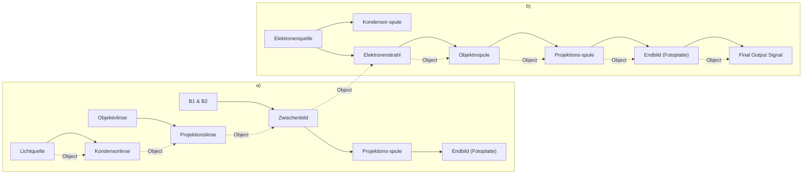

# 43 Der Welle-Teilchen-Dualismus der Mikroobjekte

原始 PDF 第 510–522 页。

43

# Der Welle-Teilchen-Dualismus der Mikroobjekte

## 43.1 Die Teilchennatur des Lichts. Lichtquanten (Photonen)

Eine Reihe experimenteller Tatsachen und theoretischer Überlegungen, die ihren Ausgangspunkt vor allem in der physikalischen Begründung des lichtelektrischen Effekts und in der PLANCKschen Hypothese der Energiequanten hatten, führten EINSTEIN im Jahre 1905 zu der Erkenntnis, dass die Energie des von einer Lichtquelle ausgestrahlten Lichts nicht kontinuierlich über die den Raum durcheilende Lichtwelle verteilt ist, sondern dass sie in diskreten „Portionen“ (Quanten) von der Lichtwelle mitgeführt wird. In Übereinstimmung mit dieser unstetigen Natur des Lichts formulierte er seine **Lichtquantentheorie**, in der dem Licht korpuskulare (teilchenhafte) Eigenschaften zugeschrieben werden.

Danach bildet das Licht einen Strom von Teilchen, **Lichtquanten** oder **Photonen** genannt, deren Energie im Sinne der PLANCKschen Quantenbedingung (42.13) der Frequenz $f$ der Lichtwelle proportional ist:

$$
E = h f \quad \text {mit} \quad h = 6, 6 2 6   0 7 0   1 5 \cdot 1 0 ^ {- 3 4}   \mathrm{J} \cdot \mathrm{s}. \tag {43.1}
$$

Mit $c$ als Vakuum-Lichtgeschwindigkeit ergibt sich die auch einem Photon im Vakuum zugeordnete „Wellenlänge“ nach der für eine Welle gültigen Beziehung (36.3) zu

$$
\lambda = \frac {c}{f}. \tag {43.2}
$$

Ordnet man wie jedem Teilchen auch dem Lichtquant der Frequenz f eine bestimmte (endliche) Masse m zu, so hat es damit den Impuls

$$
p = m c \tag {43.3}
$$

und nach dem aus der Relativitätstheorie folgenden Äquivalenzprinzip von Masse und Energie (7.21) die Energie

$$
E = m c ^ {2}. \tag {43.4}
$$

Mit (43.1) und (43.2) folgt somit für **Masse und Impuls eines Lichtquants**

$$
m = \frac {h f}{c ^ {2}} = \frac {h}{\lambda c}; \quad p = \frac {h f}{c} = \frac {h}{\lambda}. \tag {43.5}
$$

Für ein Quant sichtbaren Lichts errechnet man eine Masse von etwa $5 { \cdot } 1 0 ^ { - 3 6 }   \mathrm { k g } ,$ das ist etwa der 5millionste Teil der Elektronenmasse. Ein Quant harter Gammastrahlung besitzt hingegen, wie unten stehendes Rechenbeispiel zeigt, eine Masse, die ein Mehrfaches der Elektronenmasse betragen kann. Nach der relativistischen Massebeziehung (6.17)

$$
m = \frac {m _ {0}}{\sqrt {1 - (\nu / c) ^ {2}}} \tag {43.6}
$$

---

508

43 Der Welle-Teilchen-Dualismus der Mikroobjekte

würde aber ein materielles Teilchen der Ruhmasse $m _ { 0 } \neq 0$ bei einer Geschwindigkeit $\nu ,$ die gleich der Lichtgeschwindigkeit c ist, eine unendlich große Masse annehmen. Dem Photon dagegen, das sich mit Lichtgeschwindigkeit bewegt, wird nach der Lichtquantentheorie eine endliche Masse zugeordnet. Dieser Widerspruch wird gelöst, indem man fordert:

## Die Ruhmasse des Photons ist gleich null.

Denn es folgt aus (43.5) und (43.6):

$$
m _ {0} = \frac {h f}{c ^ {2}} \sqrt {1 - \frac {v ^ {2}}{c ^ {2}}} = 0 \quad \text {f ü r} \quad v = c. \tag {43.7}
$$

Das Photon hat also keine Ruhmasse, sondern nur „bewegte“ Masse; Photonen sind im Ruhezustand nicht existent, sondern sie bewegen sich stets mit Lichtgeschwindigkeit, wie die ihnen zugeordnete elektromagnetische Welle.

Wir kommen also zu dem Schluss, dass uns das Licht sowohl als Welle als auch als Teilchen begegnet (**Dualismus des Lichts**). Dabei zeigt sich, dass bei Wechselwirkungen zwischen dem Licht und irgendwelchen Körpern die korpuskulare Natur umso deutlicher hervortritt, je kurzwelliger das Licht ist, während sich die Wellennatur umso deutlicher bemerkbar macht, je grö- ßer die Wellenlänge im Vergleich zu den Abmessungen dieser Körper ist.

Schon NEWTON vertrat in seiner **Emissionstheorie** die Auffassung von der korpuskularen Natur des Lichts. Die Tatsache jedoch, dass sich alle Ausbreitungsvorgänge, wie $\mathbf { z } , \mathbf { B } .$ die Beugung und die Brechung des Lichts, mit Hilfe der Korpuskulartheorie nicht erklären lassen, wohl aber mit Hilfe der Wellentheorie von HUYGENS, führte dazu, dass man die NEWTONsche Auffassung bald verließ und bis zur Begründung der Lichtquantentheorie durch EINSTEIN dem Licht ausschließlich Wellencharakter zuschrieb. Andererseits werden die Prozesse der Lichtemission und -absorption, wie überhaupt alle mit der Entstehung des Lichts und seinen Wechselwirkungen mit den Atomen und Molekülen zusammenhängenden Fragen, nur vom Standpunkt der korpuskularen Auffassung des Lichts aus verständlich. Beide Vorstellungen oder Modelle, die wir uns vom Licht machen, bestehen also zu Recht. Die heutige Theorie des Lichts beinhaltet daher sowohl die Wellentheorie als auch die Quantentheorie.

Zu den Erscheinungen, die die korpuskulare Eigenschaft des Lichts beweisen, gehören vor allem die Wechselwirkungen zwischen Licht und Elektronen, worauf in den folgenden beiden Abschnitten eingegangen wird.

## Beispiel 43.1:

Vergleiche die Masse eines energiereichen Quants von Gammastrahlung (γ-Quant) der Wellenlänge $\lambda = 1 0 ^ { - 1 2 }$ m mit der Ruhmasse des Elektrons $m_{\mathrm{e}}=0.9 \cdot 10^{-30}   \mathrm{kg}$

Lösung: Aus (43.5) folgt mit $c = 3 \cdot 1 0 ^ { 8 }   \mathrm { m / s }$ für die Masse des Gammaquants $m \approx 2 , 2 \cdot 1 0 ^ { - 3 0 }   \mathrm { k g } ;$ das ist etwa das 2,4-fache der Elektronenmasse! □

## 43.2 Der lichtelektrische Effekt (Photoeffekt)

Wird eine negativ aufgeladene Metallplatte, die mit einem Elektrometer verbunden ist, mit kurzwelligem (d. h. energiereichem) Licht bestrahlt, so beobachtet man einen Verlust ihrer Ladung; eine positiv aufgeladene Metallplatte hingegen verliert ihre Ladung nicht (HALLWACHS,

---

43.2 Der lichtelektrische Effekt (Photoeffekt)

509

1888). Durch das Licht werden also aus dem Metall (den Atomen) negative Ladungen (Elektronen) entfernt (Bild 43.1). Die Geschwindigkeit der ausgelösten **Photoelektronen** kann mit der sog. Gegenfeldmethode gemessen werden: Die freigesetzten Elektronen lässt man gegen eine Elektrode anlaufen, die gegen das Metall negativ aufgeladen ist. Bei geringer Gegenspannung können die Elektronen auf Grund ihrer kinetischen Energie die Elektrode erreichen, bei zu großer Gegenspannung dagegen nicht. Ist U diejenige Spannung, bei der gerade keine Elektronen mehr auf die Elektrode gelangen, so ist die kinetische Energie der Elektronen

$$
\frac {m _ {\mathrm{e}} v ^ {2}}{2} = e U. \tag {43.8}
$$

Wollte man diesen als **äußeren Photoeffekt** bezeichneten lichtelektrischen Effekt vom Standpunkt der klassischen Wellentheorie des Lichts aus erklären, so müsste die gemessene kinetische Energie der Photoelektronen von der Intensität des Lichts abhängen, die dem Quadrat der Amplitude der einwirkenden elektromagnetischen Welle proportional ist; denn diese Welle ruft erzwungene Schwingungen der Elektronen im Metall hervor, die bei Resonanz zwischen der Eigenfrequenz der Elektronenschwingung und der Frequenz der Lichtwelle so groß werden, dass die Elektronen aus dem Metallverband gelöst werden und austreten können. Die Versuche ergaben aber, dass eine Erhöhung der Intensität des eingestrahlten Lichts lediglich die Anzahl, nicht dagegen die Energie der Photoelektronen erhöht (LENARD, 1902).

chemical

Diagram of photoelectron interaction with electron density formula

Bild 43.1 Photoeffekt: Freisetzung eines Photoelektrons aus dem Atomverband durch Einstrahlung von Licht

Vom Standpunkt der Quantentheorie des Lichts bereitet die Erklärung des Photoeffekts keine Schwierigkeiten: Das vom Metall absorbierte Photon überträgt beim „Stoß“ mit einem Elektron diesem seine gesamte Quantenenergie $h f$ . Ist diese Energie groß genug, so kann das Elektron die Metalloberfläche verlassen. Da die Absorption zweier Photonen durch ein einziges Elektron praktisch nicht vorkommt, erhält somit jedes befreite Elektron seine Energie von einem Photon. Die Absorption des Lichts erfolgt also unstetig, d. h., die Elektronen speichern nicht die einströmende Energie der Lichtwelle, bis diese zu ihrer Herauslösung aus dem Metall ausreicht, sondern sie nehmen die Energie stets nur in festen Beträgen $h f$ auf, die eine bestimmte Mindestgröße haben müssen, um die Elektronen aus dem Metall freizusetzen.

## Licht wechselwirkt mit Elektronen und anderen atomaren Teilchen in diskreten (unteilbaren) Energiequanten $h f$

Da für die Herauslösung eines Elektrons aus dem Metall eine bestimmte Energie, die sog. **Austrittsarbeit** $W _ { \mathbf { a } }$ , erforderlich ist (vgl. 26.1), ist die gemessene kinetische Energie der Photoelektronen um $W _ { \mathbf { a } }$ kleiner als die Quantenenergie $h f$ des eingestrahlten Lichts, so dass mit (43.8) die folgende Energiebilanz gilt:

$$
h f - W _ {\mathrm{a}} = \frac {m _ {\mathrm{e}} v ^ {2}}{2} = e U \quad (\text {EINSTEINScheGleichung}). \tag {43.9}
$$

---

510

43 Der Welle-Teilchen-Dualismus der Mikroobjekte

Die kleinste Frequenz, die gerade noch ausreicht, um Elektronen aus dem Metall freizusetzen, ohne ihnen also kinetische Energie mitzuteilen, nennt man **Grenzfrequenz** $f _ { \mathrm { G } }$ :

$$
h f _ {\mathrm{G}} - W _ {\mathrm{a}} = 0; \quad f _ {\mathrm{G}} = \frac {W _ {\mathrm{a}}}{h}. \tag {43.10}
$$

Der Photoeffekt tritt nicht nur bei den Metallen auf, sondern auch bei elektrisch nichtleitenden Stoffen und bei Gasen. Die Ablösearbeit $W _ { \mathbf { a } }$ ist bei ihnen größer als bei Metallen. Der Grund hierfür ist, dass $W _ { \mathbf { a } }$ sich im Allgemeinen aus zwei Anteilen zusammensetzt, der Ablösearbeit des Elektrons vom Atom (Ionisierungsenergie $E _ { \mathrm { i } } )$ und der Austrittsarbeit des Elektrons aus der Oberfläche des Körpers. Bei einem Gas entfällt der zweite Anteil, und es ist $W _ { \mathrm { a } } = E _ { \mathrm { i } }$ . Die Metalle haben dagegen freie Leitungselektronen, so dass bei ihnen $E _ { \mathrm { i } } = 0$ gesetzt werden kann und daher für den Photoeffekt lediglich die Austrittsarbeit aufgewandt werden muss. Dieselbe Austrittsarbeit ist z. B. auch bei der Aussendung von Elektronen durch glühende Körper (Thermoemission) erforderlich (vgl. RICHARDSON-Effekt in 27.2).

Nach (43.9) besteht zwischen der Spannung U des Gegenfeldes bzw. der Elektronenenergie eU und der Frequenz $f$ der Lichtquanten ein linearer Zusammenhang, der in Bild 43.2 dargestellt ist. Aus dem Abszissenabschnitt kann die Grenzfrequenz $f _ { \mathrm { G } }$ und aus ihr nach (43.10) die Austrittsarbeit $W _ { \mathbf { a } }$ für den betreffenden Stoff bestimmt werden. Der Anstieg der Geraden liefert die Größe des PLANCKschen Wirkungsquantums h.

line

| Frequency f \(( \times 10^14 s^-1)\) | Electron energy (eV) | Wavelength \((\lambda)\) |
| --- | --- | --- |
| ~5.5 | ~0.4 | 546 nm |
| ~6.9 | ~0.9 | 436 nm |
| ~7.3 | ~1.1 | 405 nm |
| ~8.2 | ~1.5 | 365 nm |
| ~9.6 | ~2.1 | 313 nm |
| ~11.8 | ~3.0 | 254 nm |

Bild 43.2 Abhängigkeit der Maximalenergie der Photoelektronen eU von der Frequenz $f$ des eingestrahlten Lichts (Millikan, 1916)

Da die Anzahl der Photoelektronen der Anzahl der absorbierten Quanten proportional ist, kann der Photoeffekt zur Messung von Lichtintensitäten genutzt werden. Man verwendet dazu sog. **Photozellen** (Bild 43.3). Diese bestehen aus einem hochevakuierten Quarzglasgehäuse (Röhre), in dem sich die mit dem negativen Pol einer Stromquelle verbundene Photokatode (K) mit einem Belag aus Natrium, Kalium oder Caesium und ihr gegenüber eine mit dem positiven Pol verbundene ringförmige Anode (A) befinden; Letztere fängt die aus K ausgelösten Photoelektronen auf. Über ein in den Stromkreis eingeschaltetes Galvanometer kann der Photostrom gemessen werden. Photozellen dienen als lichtelektrische Messwandler zur Überwachung und Regelung von lichtgesteuerten Vorgängen.

text_image

K
A
Licht
- - +

Bild 43.3 Prinzip der Photozelle mit Katode K und Anode A

---

43.3 Der Compton-Effekt

511

## Beispiel 43.2:

Welche Geschwindigkeit hat ein Photoelektron $( m _ { \mathrm { e } } = 0 , 9 \cdot 1 0 ^ { - 3 0 }   \mathrm { k g } )$ , das durch Bestrahlung mit grünem Licht der Wellenlänge 500nm aus einer Caesium-Photokatode $( W _ { \mathrm { a } } = 1 , 8   \mathrm { e V } )$ freigesetzt wurde? (1 $\mathbf { e } \mathrm { V } \approx 1 { , } 6 \cdot 1 0 ^ { - 1 \bar { 9 } } \mathrm { J } . )$ 1

Lösung: Aus (43.9) f<u>olgt mit</u> $f = c / \lambda$ zunächst für die kinetische Energie $E_{\mathrm{k}} = h c / \lambda - W_{\mathrm{a}} \approx 0.7   \mathrm{eV}$ und hieraus $\nu = \sqrt { 2 E _ { \mathrm { k } } / m _ { \mathrm { e } } } \approx 5 0 0   \mathrm { k m / s }$ □

## Aufgabe

**43.1** Welches ist im obigen Beispiel 43.2 die Grenzfrequenz $f _ { \mathrm { G } }$ und die zugehörige Grenzwellenlänge?

## 43.3 Der Compton-Effekt

Als überzeugender Beweis für die korpuskulare Natur des Lichts kann die von COMPTON (1923) entdeckte Streuung von Photonen an (locker gebundenen) Elektronen angesehen werden. Wenn das Licht aus Teilchen besteht, so müssen bei einem Zusammenstoß mit frei beweglichen Elektronen auch für sie die aus der klassischen Mechanik bekannten Gesetze für den elastischen Stoß (vgl. 9.2) Gültigkeit haben, die aus den Erhaltungssätzen für Energie und Impuls folgen. Wegen der Kleinheit der Photonenmasse von normalem Licht im Vergleich zur Masse des Elektrons tritt ein solcher Austausch von Impuls und Energie beim Zusammenstoß allerdings nur bei sehr kurzwelligen und damit massereichen Photonen der RÖNTGEN- und Gammastrahlen merklich in Erscheinung.

chemical

Diagram of Compton electron interaction showing photon emission and electron transfer with mathematical formula

Bild 43.4 Compton-Effekt

text_image

hf
c
hf'
c
φ
e⁻
φ
hf
c
mₑv

Bild 43.5 Impulserhaltung beim Compton-Effekt

Trifft nach Bild 43.4 und 43.5 ein Photon der Frequenz $f$ auf ein ruhend gedachtes Elektron, so erhält dieses einen Impuls $m _ { \mathrm { e } } \nu$ und eine kinetische Energie $m _ { \mathrm { e } } \upsilon ^ { 2 } / 2$ , während das unter dem Winkel ϑ gestreute Photon seine Energie und infolgedessen auch seine Frequenz verringert $( f ^ { \prime } < f )$ . Die Energiebilanz lautet

$$
h f = h f ^ {\prime} + \frac {m _ {\mathrm{e}} v ^ {2}}{2} \tag {43.11}
$$

und die Impulsbilanz, wenn die Impulsvektoren von Photon und Elektron in Komponenten bezüglich der Einstrahlungsrichtung und der dazu senkrechten Richtung zerlegt werden,

$$
\frac {h f}{c} = \frac {h f ^ {\prime}}{c} \cos \vartheta + m _ {\mathrm{e}} \nu \cos \varphi \tag {43.12}
$$

---

512

43 Der Welle-Teilchen-Dualismus der Mikroobjekte

$$
0 = \frac {h f ^ {\prime}}{c} \sin \vartheta - m _ {\mathrm{e}} \nu \sin \varphi . \tag {43.13}
$$

Da uns nur die Frequenz des Streulichts $f ^ { \prime }$ als Funktion der Streurichtung $\vartheta$ interessiert, eliminieren wir aus (43.12) und (43.13) den Winkel $\varphi$ und erhalten

$$
m _ {\mathrm{e}} ^ {2} v ^ {2} = \frac {h ^ {2}}{c ^ {2}} (f ^ {2} + f ^ {\prime 2} - 2 f f ^ {\prime} \cos \vartheta). \tag {43.14}
$$

Für nicht zu kurzwelliges Licht ist $f - f ^ { \prime } \ll f$ , so dass in (43.14) näherungsweise $f ^ { \prime }$ durch $f$ ersetzt werden darf; wir erhalten damit

$$
\frac {m _ {\mathrm{e}} v ^ {2}}{2} \approx \frac {h ^ {2} f ^ {2}}{m _ {\mathrm{e}} c ^ {2}} (1 - \cos \vartheta).
$$

Dies in (43.11) eingesetzt, ergibt als Energiebilanz

$$
h f = h f ^ {\prime} + \frac {h ^ {2} f ^ {2}}{m _ {\mathrm{e}} c ^ {2}} (1 - \cos \vartheta). \tag {43.15}
$$

Somit folgt für die Frequenzänderung des gestreuten Photons

$$
\Delta f = f ^ {\prime} - f = - \frac {h f ^ {2}}{m _ {\mathrm{e}} c ^ {2}} (1 - \cos \vartheta) = - \frac {2 h f ^ {2}}{m _ {\mathrm{e}} c ^ {2}} \sin^ {2} \frac {\vartheta}{2}
$$

und wegen $\lambda = c / f$ bzw. nach Differenziation $\Delta \lambda = - c \Delta f / f ^ { 2 } ;$

$$
\Delta \lambda = \frac {2 h}{m _ {\mathrm{e}} c} \sin^ {2} \frac {\vartheta}{2} = 2 \lambda_ {\mathrm{C}} \sin^ {2} \frac {\vartheta}{2} \quad \begin{array}{l} (\text {Wellenlängenänderung infolge} \\ \text {COMPTON - Streuung}) \end{array} \tag {43.16}
$$

mit der sog. COMPTON-Wellenlänge des Elektrons

$$
\lambda_ {\mathrm{C}} = \frac {h}{m _ {\mathrm{e}} c} = 2, 4 2 6   3 1 0 \cdot 1 0 ^ {- 1 2}   \mathrm{m}. \tag {43.17}
$$

Diese hat die Bedeutung der Wellenlänge derjenigen Strahlung, deren Lichtquant die träge Masse des Elektrons besitzt; denn es ist nach (43.5) die Masse des Lichtquants $m = h / ( \lambda _ { \mathrm { C } } c ) =$ $h m _ { \mathrm { e } } c / ( h c ) = m _ { \mathrm { e } }$

Obwohl Gleichung (43.16) unter vereinfachten Bedingungen hergeleitet wurde, kommt ihr strenge Gültigkeit zu; man erhält sie in dieser Form auch ohne jede Vernachlässigung und bei zusätzlicher Berücksichtigung der relativistischen Massenänderung des Elektrons.

Bei einer Spektraluntersuchung mit monochromatischer RÖNTGENstrahlung, die an einem Element mit kleiner relativer Atommasse (z. B. Graphit) gestreut wird, tritt neben der ungestreuten Linie eine zweite, genau um den durch (43.16) angegebenen Betrag zu größeren Wellenlängen verschobene Linie auf (COMPTON-Effekt). Aus dem Experiment kann die COMP-TON-Wellenlänge (43.17) und daraus bei Kenntnis des Wirkungsquantums $h$ die Ruhmasse des Elektrons bestimmt werden.

## 43.4 Rückstoß durch Quantenemission. Mößbauer-Effekt

Jede von einem Atom emittierte Spektrallinie hat hinsichtlich ihrer Frequenz bzw. Energie eine natürliche Unschärfe oder Eigenbreite $\Delta E ,$ die nach dem HEISENBERGschen Unbestimmtheitsprinzip (s. später in 43.6) durch die „mittlere Lebensdauer“ des betreffenden Zustandes (mittlere Verweilzeit des Elektrons in einem bestimmten Energiezustand des Atoms) gegeben ist.

---

43.4 Rückstoß durch Quantenemission. Mößbauer-Effekt

513

Das gilt auch für die von angeregten Atomkernen emittierten γ-Strahlen, wobei die Eigenbreite der γ-Linien noch um mehrere Größenordnungen kleiner ist als die der schärfsten Atomspektrallinien. Während die relative Ungenauigkeit der Energie ∆E/E oder wegen $E = h f$ auch die der Frequenz $\Delta f / f$ bei sichtbaren Spektrallinien bestenfalls $1 0 ^ { - 1 0 }$ beträgt, liegt sie dagegen bei den γ-Quanten in der Größenordnung $1 0 ^ { - 1 3 }$ . Dementsprechend können von den Kernen auch nur γ-Quanten gleicher Schärfe absorbiert werden. Eine geringfügige Abweichung („Verstimmung“) der Frequenz eines von einem Kern emittierten γ-Quants, die über die Eigenbreite des betreffenden Zustandes hinausgeht, führt dazu, dass das Quant von einem anderen, gleichartigen Kern nicht mehr absorbiert oder zumindest die Wahrscheinlichkeit für die Absorption stark herabgesetzt wird.

Eine derartige „Verstimmung“ des γ-Quants kann schon durch den Rückstoß verursacht werden, den der Kern und damit nach dem Impulserhaltungssatz auch das Quant bei der Emission erfahren. Nach (43.1) und (43.5) sind den γ-Quanten wegen ihrer im Vergleich zum sichtbaren Licht etwa um den Faktor $1 0 ^ { 5 }$ größeren Frequenzen bzw. kleineren Wellenlängen sehr große Energie- und Impulsbeträge zuzuordnen, so dass bei ihrer Aussendung der Kern einen merklichen Rückstoß erfährt. Die kinetische Energie, die er dabei aufnimmt, entnimmt er der Energie des emittierten γ-Quants.

Der Impuls, den das Quant der Energie $E = h f$ beim Verlassen des Kerns der Masse $m _ { \mathrm { K } }$ auf diesen überträgt, ist nach (43.3) und (43.4) gleich $p = E / c$ . Damit ergibt sich nach der allgemeinen Beziehung zwischen kinetischer Energie und Impuls $E _ { \mathbf { k } } = p ^ { 2 } / ( 2 m )$ die **Rückstoßenergie des Kerns** zu

$$
(E _ {\mathrm{k}}) _ {\mathrm{K}} = \frac {E ^ {2}}{2 m _ {\mathrm{K}} c ^ {2}}. \tag {43.18}
$$

Das ist gerade der Betrag, um den die Quantenenergie E gegenüber dem Wert, der ohne Rückstoß zu erwarten wäre, verschoben ist, also

$$
\Delta E = \frac {E ^ {2}}{2 m _ {\mathrm{K}} c ^ {2}} \quad \begin{array}{l} (\text {Verschiebung der Quantenenergie durch} \\ \text {Rückstoß des emittierenden Kerns}). \end{array} \tag {43.19}
$$

So erhält man z. B. für die von den Kernen des Eisenisotops 57Fe emittierten γ-Quanten der Energie $E = 1 4 { , } 4$ keV für deren Verstimmung $\Delta E \approx 5 \cdot 1 0 ^ { - 3 }   \mathrm { e V }$ und für die relative Änderung $\Delta E / E \approx 4 \cdot 1 0 ^ { - 7 }$ . Dieser Wert liegt aber um mehrere Größenordnungen über der oben angegebenen Eigenbreite der Energieniveaus, deren genauer Wert in diesem Falle $3 \cdot { { 1 0 } ^ { - 1 3 } }$ ist. Die durch den Rückstoß bewirkte Verschiebung der Quantenenergie ist also so groß, dass die Quanten durch andere, gleichartige Kerne nicht mehr absorbiert werden.

1958 entdeckte MÖSSBAUER, dass der Rückstoß der Kerne zunichte gemacht wird, wenn das strahlende Atom in das Kristallgitter eines Festkörpers eingebaut ist. Der Rückstoß wird dann nicht mehr vom einzelnen Atom, sondern vom gesamten Kristall abgefangen. In (43.18) ist jetzt für $m _ { \mathrm { K } }$ nicht mehr die Masse des strahlenden Kerns, sondern die ungeheuer viel größere Masse des Kristalls einzusetzen, womit die Rückstoßenergie und damit die Verstimmung der emittierten Quanten praktisch auf unmessbar kleine Werte absinken. Voraussetzung hierfür ist jedoch u. a., dass der Kristall auf sehr tiefe Temperaturen (z. B. des flüssigen Wasserstoffs) abgekühlt wird und damit die thermischen Gitterschwingungen, die die Atome im Kristall ausführen, weitgehend „eingefroren“ werden. Auf diese Weise wird verhindert, dass eine Übertragung der Rückstoßenergie an das einzelne schwingende Atom stattfindet.

---

514

43 Der Welle-Teilchen-Dualismus der Mikroobjekte

Ein auf diese Weise erzeugtes rückstoßfreies γ-Quant ist frei von der durch (43.19) ausgedrückten Verstimmung seiner Energie, und es wird daher eine Linie von außerordentlicher Schärfe, die nur durch die Eigenbreite des betreffenden Niveaus gegeben ist, registriert. Da das Quant nicht verstimmt ist, kann es von einem gleichen, nicht γ-aktiven Kern mit gleicher Schärfe (Selektivität) absorbiert werden (rückstoßfreie Resonanzabsorption).

Wegen der extremen Resonanzschärfe rückstoßfreier γ-Quanten kann der MÖSSBAUER-Effekt zur hochempfindlichen Messung kleinster Frequenzänderungen benutzt werden. Ist die Frequenz der zu vermessenden γ-Quanten durch irgendwelche Einflüsse ein wenig verstimmt, so dass diese von einem entsprechenden Absorber nicht mehr absorbiert werden, kann durch eine Bewegung des Strahlers relativ zum Absorber infolge DOPPLER-Effekt (vgl. 37.6) die Frequenzänderung kompensiert und auf diese Weise genau vermessen werden. Dazu reicht schon eine Relativgeschwindigkeit zwischen Strahler und Absorber von wenigen Zentimetern je Sekunde aus.

Eines der ersten Aufsehen erregenden Experimente mit Hilfe des MÖSSBAUER-Effekts war die mit herkömmlichen Methoden aussichtslose Messung der Frequenzänderung eines Lichtquants als Folge der Beeinflussung durch das Schwerefeld der Erde. So konnten POUND und REBKA (1960) mit Hilfe des Eisenisotops 57Fe als Strahlungsquelle am Fuß und einem entsprechenden Absorber an der Spitze eines 22,5m hohen Turms für diesen Höhenunterschied eine relative Frequenz- bzw. Energieabnahme des von der Quelle emittierten, gegen das Schwerefeld anlaufenden Strahlungsquants nachweisen, die genau dem relativen Zuwachs an potenzieller Energie $\Delta E _ { \mathrm { p } } = m g h$ ist, den das Photon der Masse $m = E / c ^ { 2 }$ beim „Anheben“ auf die Höhe $h = 2 2 ,$ 5m im Schwerefeld der Erde erfährt, nämlich $\Delta E _ { \mathrm { p } } / E =$ $m g h / ( m c ^ { 2 } ) = g h / c ^ { 2 } = 2 { , } 4 5 \cdotp 1 0 ^ { - 1 5 }$ (gravitative Rotverschiebung, vgl. 22.4). Beim $\mathrm { ,   F a l l ^ { \omega } }$ des Photons im Schwerefeld, wenn also Strahlungsquelle und Absorber vertauscht werden, gewinnt es diesen Energiebetrag, und es ergibt sich eine Frequenzverschiebung in umgekehrter Richtung. Indem die Experimentatoren die Strahlungsquelle einmal am Fuß und einmal an der Spitze des Turmes anbrachten, maßen sie insgesamt eine relative Frequenzverschiebung von $( 5 ,   1 \pm 0 ,   5 ) \cdot 1 0 ^ { - 1 5 }$ , in vorzüglicher Übereinstimmung mit dem theoretischen Wert $^ { 4 , 9 \cdot 1 0 ^ { - 1 5 } }$ . Damit war auf eindrucksvolle Weise bewiesen, dass auch die Lichtquanten dem Einfluss des Gravitationsfeldes unterliegen, wie es von EINSTEIN vorausgesagt wurde. Zugleich ist dies ein Beweis für die Gleichheit von schwerer und träger Masse; denn in der zuletzt angeschriebenen Gleichung steht im Zähler, der die potenzielle Energie enthält, die schwere und im Nenner nach den Ausführungen in Abschnitt 7.5 die träge Masse. Beide Massen dürfen aber nur unter der Voraussetzung ihrer Identität gegeneinander gekürzt werden, wie das hier getan wurde.

## 43.5 Die Wellennatur der Teilchen

Nachdem der Doppelcharakter (Dualismus) des Lichts durch den lichtelektrischen Effekt, den COMPTON-Effekt und andere Erscheinungen, die die korpuskulare Natur des Lichts einerseits und durch Beugungsexperimente, die die Wellennatur andererseits belegen, überzeugend bestätigt worden war, wurde bald darauf mit der Entdeckung der **Beugung von Elektronenstrahlen** an Kristallen durch DAVISSON und GERMER (1927) der Nachweis erbracht, dass Elektronen neben korpuskularen zugleich auch Welleneigenschaften besitzen. Das Bild 43.6 zeigt ein auf einer fotografischen Platte aufgenommenes Beugungsbild einer dünnen Metallfolie, die mit einem eng ausgeblendeten Elektronenbündel durchstrahlt wurde. Die Interferenzringe entsprechen den DEBYE-SCHERRER-Linien der RÖNTGENstrahlen-Interferenzen (vgl. Bild 41.13). Heute wissen wir, dass Strahlen von Mikroteilchen jeglicher Art, z. B. von Neutronen, Protonen und selbst von Atomen, die gleichen Beugungserscheinungen hervorrufen wie Licht oder RÖNTGENstrahlen.

---

43.5 Die Wellennatur der Teilchen

515

natural_image

Concentric circular pattern with gradient shading (no text or symbols)

Bild 43.6 Beugung von Elektronen (100kV Beschleunigungsspannung) an einer Goldaufdampfschicht

Die Elektronenbeugungsversuche von DAVISSON und GERMER waren eine nachträgliche glänzende Bestätigung der bereits 1924 von DE BROGLIE aufgestellten kühnen Hypothese, wonach nicht nur den Photonen, sondern ausnahmslos allen Mikroobjekten ein Doppelcharakter eigen ist, indem diese einerseits Eigenschaften diskreter Teilchen, andererseits Welleneigenschaften annehmen. Damit wurde der Gegensatz zwischen Teilchen- und Wellenbild beseitigt und eine Vereinigung der beiden experimentell nachgewiesenen Erscheinungsformen nicht nur für das Licht, sondern auch für alle mit Ruhmasse behafteten Objekte herbeigeführt.

## Jedes Mikroteilchen (Photon, Elektron, Kernteilchen usw.) ist zugleich Korpuskel und Welle.

Die Wellenlänge der den Elektronen (oder anderen Teilchen) zugeordneten **Materiewelle** oder **Teilchenwelle** kann aus Beugungsdiagrammen bei bekannter Gitterkonstante des durchstrahlten Kristalls nach der für die Beugung von RÖNTGENstrahlen angegebenen Beziehung (41.30) bestimmt werden. Dabei zeigt sich, dass – wie von DE BROGLIE auf Grund theoretischer Überlegungen vorausgesagt – zwischen der Wellenlänge λ und dem Impuls $p = m v$ der Elektronen der gleiche Zusammenhang (43.5) besteht wie beim Licht zwischen Wellenlänge und Impuls der Photonen:

$$
\lambda = \frac {h}{p} = \frac {h}{m v} \quad (\textbf {D E - B R O G L I E - B e z i e h u n g}). \tag {43.20}
$$

λ wird **DE-BROGLIE-Wellenlänge** des Teilchens genannt. Bei schnell bewegten Teilchen muss in (43.20) für m deren relativistische Masse eingesetzt werden; nur für $\nu \ll c$ darf mit der Ruhmasse m0 gerechnet werden.

Die DE-BROGLIE-Wellenlänge ist bei den gewöhnlichen, makroskopischen Körpern außerordentlich klein; z. B. beträgt sie für ein Masseteilchen von 1g bei einer Geschwindigkeit von 1m/s größenordnungsmäßig $1 0 ^ { - 3 0 }   \mathrm { m }$ , für die bewegte Erdkugel $( m _ { 0 } \approx 6 \cdot 1 0 ^ { 2 4 }   \mathrm { k g } ,   \nu \approx 3 \cdot 1 0 ^ { 4 }   \mathrm { m } / \mathrm { s } )$ sogar nur $3 \cdot 1 0 ^ { - 6 3 }$ m! Daher macht sich bei solchen Körpern die Wellennatur nicht bemerkbar. Demgegenüber erhält man für ein Wasserstoffmolekül $( m _ { 0 } \approx 3   \cdot   1 0 ^ { - 2 7 }   \mathrm { k g } )$ , das sich bei $0   ^ { \circ } \mathbf { C }$ nach der kinetischen Gastheorie mit einer Geschwindigkeit von etwa $2 \cdot 1 0 ^ { 3 }   \mathrm { m / s }$ bewegt, eine DE-BROGLIE-Wellenlänge von der Größenordnung $1 0 ^ { - 1 0 } \mathrm { m }$ , d. h., sie stimmt mit den Abmessungen des Moleküls überein. Für Elektronen, die durch ein elektrisches Feld der Spannung U beschleunigt werden, gilt bei Vernachlässigung der relativistischen Massenänderung $( \nu < 0 ,   1 c )$ mit (43.20)

$$
\frac {m _ {\mathrm{e}} v ^ {2}}{2} = e U, \quad p = m _ {\mathrm{e}} v = \sqrt {2 e U m _ {\mathrm{e}}}, \quad \lambda = \frac {h}{\sqrt {2 e U m _ {\mathrm{e}}}}. \tag {43.21}
$$

---

516

43 Der Welle-Teilchen-Dualismus der Mikroobjekte

Hiernach erhält man mit $m _ { \mathrm { e } } = 9 , 1 \cdot 1 0 ^ { - 3 1 }$ kg und $e = 1 { , } 6 \cdot 1 0 ^ { - 1 9 } \mathrm { A } \cdot \mathrm { s }$ für eine Beschleunigungsspannung von $U = 1 5 0 \mathrm { V }$ eine DE-BROGLIE-Wellenlänge der Elektronen von $\lambda = 10^{-10}    m  =$ 0,1nm. Diese Wellenlänge ist mit derjenigen weicher RÖNTGENstrahlen vergleichbar, was das Auftreten von Beugungserscheinungen bei der Durchstrahlung von Kristallen mit Elektronen verständlich macht.

Wir ersehen daraus, dass die Körper umso mehr ein „wellenmäßiges“ Verhalten zeigen, je mehr sich ihre DE-BROGLIE-Wellenlängen den Körperabmessungen annähern. Das ist im Bereich der Mikrophysik der Fall. In diesem Bereich der Elektronen, Atome und Moleküle sind die Gesetze der klassischen Mechanik ebenso wenig anwendbar wie die Gesetze der geometrischen Optik bei der Beschreibung der Lichtausbreitung, wenn die Abmessungen der Körper, gegen die das Licht anläuft, mit der Lichtwellenlänge vergleichbar werden (Beugung). So wie in diesem Fall die geometrische Optik durch die allgemeinere Wellenoptik ersetzt werden muss, ebenso muss daher im mikrophysikalischen Bereich die klassische Mechanik durch eine allgemeinere Mechanik, die **Wellenmechanik** oder **Quantenmechanik**, ersetzt werden (vgl. Kapitel 45).

Die Tatsache, dass Gleichung (43.20) nicht nur für Licht gilt (mit $\nu = c )$ , sondern auch für ruhmassebehaftete Teilchen, legt nahe, die Beziehung für die Energie einer Lichtwelle $E = h f$ auch für Materiewellen als gültig anzuerkennen. Ihre Verknüpfung mit dem Äquivalenzprinzip von Masse und Energie (7.21) ergibt

$$
h f = m c ^ {2}; \quad f = \frac {m c ^ {2}}{h}.
$$

Damit und mit (43.20) folgt als **Phasengeschwindigkeit der Materiewelle**

$$
u = f \lambda = \frac {m c ^ {2}}{h} \frac {h}{m v} = \frac {c ^ {2}}{v}. \tag {43.22}
$$

Wegen $\nu < c$ ist u stets $g r \ddot { o } \beta e r$ als die Vakuumlichtgeschwindigkeit. Lediglich für Photonen im Vakuum ist $v = c$ und damit $u = c .$ Das Ergebnis $u > c$ für stoffliche Teilchen bedeutet keinen Widerspruch zur Relativitätstheorie; denn das, was sich im vorliegenden Fall mit Überlichtgeschwindigkeit fortpflanzt, ist die Phase der dem Teilchen zugeordneten DE-BROGLIE-Welle und nicht die mit der Welle übertragene Energie. Die Relativitätstheorie fordert nur, dass jede mit Energie- bzw. Massentransport verbundene Geschwindigkeit, die physikalisch messbar ist, nicht größer sein darf als die Vakuumlichtgeschwindigkeit (vgl. 6.1 und 6.3).

Eine wichtige Anwendung der Erkenntnisse über die Wellennatur der Elektronen findet man im **Elektronenmikroskop**. Die Abbildung erfolgt hier durch Elektronenlinsen, in denen Elektronenstrahlen durch inhomogene, rotationssymmetrische elektrische oder magnetische Felder abgelenkt werden, analog zur Ablenkung von Lichtstrahlen in normalen optischen Linsen. Elektrische Linsen bestehen aus (im einfachsten Fall zwei) durchbohrten Kondensatorplatten, die je nach Polung als Sammel- oder Zerstreuungslinse wirken; magnetische Linsen sind stromdurchflossene Spulen, deren Magnetfeld durch die LORENTZ-Kraft die Elektronenstrahlen auf einer Schraubenbahn ablenkt.

Beim Durchstrahlungsverfahren (Bild 43.7) treten Elektronen aus einer Glühkatode aus, durchsetzen nach einer Bündelung im Kondensor das Objekt, werden dort gebeugt oder absorbiert, durchlaufen die Objektiv- und Projektionslinse und treffen schließlich auf einen Leuchtschirm. Das erhaltene Bild wird meist noch optisch nachvergrößert. Da das Elektronenmikroskop der durch die Beugung bedingten Begrenzung des Auflösungsvermögens des Lichts (vgl. 41.5) im verwendeten Vergrößerungs bereich nicht unterliegt, können damit Vergrößerungen in unverzerrter, ähnlicher Abbildung hergestellt werden, deren Abbildungsmaßstab den der Lichtmikroskope um fast zwei Zehnerpotenzen übertrifft. Da das Auflösungsvermögen eines Mikroskops mit kleiner werdender Wellenlänge zunimmt, ist

---

43.6 Das heisenbergsche Unbestimmtheitsprinzip (Unschärferelation)

517

dieses beim Elektronenmikroskop wegen der gegenüber der Lichtwellenlänge sehr viel kleineren DE-BROGLIE-Wellenlänge der Elektronen erheblich größer als beim Lichtmikroskop. Die gerätetechnische Ausführung heutiger Elektronenmikroskope (insbesondere die Korrektur der Abbildungsfehler und die Stabilität der elektronischen Schaltungen zur Erzeugung der Beschleunigungsspannung sowie der Magnetfelder der Linsen) erlaubt eine Auflösung von Strukturen bis $\mathbf { z } \mathbf { u } \approx \widetilde { 1 0 ^ { - 1 0 } } \widetilde { \mathbf { m } }$

flowchart

Bild 43.7 Strahlengang im lichtoptischen Durchlichtmikroskop (a) und Durchstrahlungs-Elektronenmikroskop (b)

## 43.6 Das heisenbergsche Unbestimmtheitsprinzip (Unschärferelation)

In der klassischen Mechanik kann den Teilchen (Punktmassen) zu jeder beliebigen Zeit ein bestimmter Ort und ein wohldefinierter Impuls zugeordnet werden, die zusammen den $\mathbf { , } \mathbf { Z u } \mathbf { \cdot }$ stand“ des Teilchens charakterisieren. Sind zusätzlich die auf das Teilchen wirkenden Kräfte in Abhängigkeit von Ort und Zeit bekannt, so kann der raumzeitliche Bewegungsablauf (die Flugbahn) des Teilchens prinzipiell berechnet werden (vgl. 4.6). 1927 zeigte HEISENBERG, dass dies für Mikroteilchen (Lichtquanten, Elektronen u. a.) keineswegs zutrifft. Für diese ist es prinzipiell unmöglich, mit den herkömmlichen Begriffen der klassischen Mechanik den Bewegungsablauf exakt zu beschreiben. Wir wollen dies im Folgenden an einem speziellen, von HEISENBERG selbst angeführten Beispiel, der Beugung eines Mikroteilchens am Spalt, verdeutlichen.

Lässt man Mikroteilchen durch einen schmalen Spalt der Breite $\Delta x$ hindurchtreten (Bild 43.8), so werden sie, da sie Welleneigenschaften besitzen, gebeugt. Nach der Wellentheorie gilt für die Lage des unter dem Winkel α auftretenden 1. Beugungsminimums die Gleichung (41.13)

$$
\sin \alpha = \frac {\lambda}{\Delta x}. \tag {43.23}
$$

---

518

43 Der Welle-Teilchen-Dualismus der Mikroobjekte

text_image

Maximum
1.0rdnung
1.Minimum
Maximum
0.0rdnung
1.Minimum
Maximum
1.0rdnung
Δx
Δp
p

Bild 43.8 Zum heisenbergschen Unbestimmtheitsprinzip: Beugung von Mikroteilchen beim Durchgang durch einen Spalt

Im Teilchenbild gesehen bedeutet die Beugung, dass nicht alle Teilchen mit dem Impuls p unabgelenkt durch den Spalt hindurchgehen, sondern dass ein Teil von ihnen eine seitliche Ablenkung von unterschiedlicher Größe erleidet, und zwar bevorzugt in denjenigen Richtungen, unter denen auf dem dahinter stehenden Schirm Beugungsmaxima auftreten. Betrachten wir nur die in den Bereich des Maximums 0. Ordnung fallenden Teilchen, so erfahren diese eine maximale seitliche Impulsänderung von

$$
\Delta p = p \tan \alpha \approx p \sin \alpha \quad (\alpha \text {ist sehr klein}).
$$

Fassen wir nun $\Delta p$ als Betrag der mittleren Impulsänderung aller auf dem Schirm ankommenden Teilchen auf, so erhält man durch Einsetzen von sin $\alpha = \Delta p / p$ in Gleichung (43.23) $\Delta p \Delta x \approx \lambda p$ und mit der DE-BROGLIE-Beziehung $\lambda = h / p ;$

$$
\Delta p \Delta x \approx h \quad (\text {HEISENBERGsche Unschärferelation}). \tag {43.24}
$$

Hierbei ist die Spaltbreite $\Delta x$ als „Unbestimmtheit“ oder „Unschärfe“ der augenblicklichen Lage des Teilchens beim „Passieren“ des Spalts aufzufassen und $\Delta p$ als Unbestimmtheit (Unschärfe) der x-Komponente des Teilchenimpulses. Eine genauere Untersuchung ergibt anstelle von (43.24) $\Delta p   \Delta x \geq h / ( 4 \pi )$ . Diese Gleichung besagt, dass niemals Ort und Impuls eines Mikroteilchens genau bekannt sein können. Soll sich das Teilchen innerhalb des räumlichen Intervalls $\Delta x$ aufhalten, so kann sein Impuls nur mit einer Unsicherheit $\Delta p$ angegeben werden, wie sie aus (43.24) folgt.

**HEISENBERGsches Unbestimmtheitsprinzip (Unschärferelation):** Das Produkt aus der Unbestimmtheit $\Delta p$ des augenblicklichen Impulses eines Teil**chens und der Unbestimmtheit ∆x seiner augenblicklichen Ortskoordinate ist mindestens von der Größenordnung des PLANCKschen Wirkungsquantums h.**

Das heißt, jede Steigerung der Genauigkeit in der Ortsbestimmung eines Teilchens (Verkleinerung von $\Delta x )$ geht stets auf Kosten der Genauigkeit in der Impulsbestimmung und umgekehrt. Gleichzeitig ergibt sich daraus, dass der Bahnbegriff im mikrophysikalischen Bereich ohne physikalischen Sinn ist; denn er setzt gerade die gleichzeitige exakte Messbarkeit von Ort und Impuls voraus.

Die aus dem Unbestimmtheitsprinzip folgende Messbarkeitsbeschränkung der beiden Größen Ort und Impuls hat nichts mit der praktischen Messungenauigkeit (Unzulänglichkeit der Messinstrumente, mangelndes Geschick der Beobachter) zu tun. Vielmehr bringt die Gleichung (43.24) die charakteristische, objektiv reale Eigenschaft mikrophysikalischer Objekte zum Ausdruck, wonach Wechselwirkungen zwischen den Messapparaturen und den Messobjekten im Bereich der Mikrophysik nicht vernachlässigt werden dürfen.

---

43.6 Das heisenbergsche Unbestimmtheitsprinzip (Unschärferelation)

519

Es sei hier nur vermerkt, dass eine zu (43.24) analoge Beziehung zwischen der Unbestimmtheit der Energie eines Teilchens ∆E und der Zeitdauer für die Energiemessung ∆t besteht:

$$
\Delta E \Delta t \approx h \quad (\text {Energie - Zeit - Unschärferelation}); \tag {43.25}
$$

d. h., je größer die Messzeit, desto genauer ist die Energie des Teilchens (und damit auch seine Masse $m = E / c ^ { 2 } )$ festgelegt.

Das HEISENBERGsche Unbestimmtheitsprinzip, welches ein allgemein gültiges Prinzip der Quantenmechanik darstellt, steht im völligen Widerspruch zur Bewegungsauffassung der klassischen Mechanik, da sie die dort vorherrschende Ursache-Wirkung-Beziehung im Bereich des atomaren Geschehens ausschließt und somit dem klassischen Kausalitätsprinzip der Physik widerspricht. Die Bewegung eines Körpers ist in der klassischen Mechanik charakterisiert durch Ort und Impuls zu einem bestimmten Zeitpunkt, woraus sich mit Hilfe der NEWTONschen Bewegungsgesetze eindeutig der künftige Bewegungszustand des Körpers, d. h. Ort und Impuls zu einem späteren Zeitpunkt, voraussagen lässt (Beispiel: Gesetze der Planetenbewegung). Nach dem Unbestimmtheitsprinzip ist aber eine genaue Festlegung von Ort und Impuls eines Mikroteilchens nicht möglich.

Der mechanische Determinismus, der die strenge Vorausberechenbarkeit aller zukünftigen Zustände eines Körpers als notwendiges und hinreichendes Kriterium für das Vorhandensein kausaler Zusammenhänge beinhaltet, schließt den Zufall völlig aus. Aber gerade die Anerkennung des objektiv existierenden Zufalls, wie er sich z. B. in der Unmöglichkeit der Vorhersage der Flugbahn eines Mikroteilchens nach dem Durchgang durch einen Beugungsspalt zeigt, ist ein wesentliches Merkmal der neuen Determinismusauffassung, welche die Einheit von dynamischen und statistischen Gesetzen zum Inhalt hat. Anstelle des Kausalzusammenhangs der klassischen Mechanik tritt daher in der Quantenmechanik eine „statistische Kausalität“, d. h. Gesetze von statistischem Charakter, die nur über eine große Anzahl von Mikroprozessen etwas aussagen.

## Beispiele 43.3:

1. Die Lage eines Teilchens der Masse 1g soll auf 1 µm genau festgelegt werden. Wie groß ist dann die Unbestimmtheit seiner Geschwindigkeit?

Lösung: Mit dem Teilchenimpuls $p = m v$ folgt aus (43.24) $m \Delta \nu   \Delta x \approx h$ und hieraus $\Delta \nu$ ≈ $h / ( m \Delta x ) = 6 . 6 \cdot 1 0 ^ { - 2 5 }   \mathrm { m / s }$ . Eine solche Ungenauigkeit in der Geschwindigkeit liegt weit außerhalb der Grenzen der Messmöglichkeit. Bei makroskopischen Körpern spielt also das Unbestimmtheitsprinzip keine Rolle.

2. Eine der Konsequenzen, die sich aus dem Unbestimmtheitsprinzip (43.24) ergeben, ist die Tatsache, dass ein Elektron, welches sich nur in einem endlichen Raumbereich aufhalten kann, auch am absoluten Nullpunkt, wo ihm keine thermische Energie zugeführt wird, notwendigerweise eine von null verschiedene kinetische Mindestenergie, die **Nullpunktsenergie**, haben muss, d. h. also niemals in Ruhe sein kann. Denn würde das Elektron ruhen, hätte es eine bestimmte Koordinate x, und die Unbestimmtheit in der Ortsangabe $\Delta x$ wäre null. Das aber würde bedeuten, dass ein Zustand existiert, in dem sowohl die Lage des Teilchens als auch der Impuls genau bestimmt sind. Dies widerspricht jedoch dem Unbestimmtheitsprinzip.

Bestimme die Geschwindigkeit und daraus die Nullpunktsenergie für ein Elektron, das „gezwungen“ ist, sich auf einer endlichen Strecke der Länge $L = 1 0 ^ { - 1 0 }   \mathrm { m }$ (Größenordnung des Atomdurchmessers) zu bewegen!

Lösung: Aus (43.24) folgt mit $\Delta x = L$ und $\Delta p = \Delta ( m _ { \mathrm { e } } \nu ) = m _ { \mathrm { e } } \Delta \nu$ für die Mindestgeschwindigkeit $\Delta \nu \approx h / ( m _ { \mathrm { e } } L )$ . Damit wird die Nullpunktsenergie $E _ { 0 } = m _ { \mathrm { e } } ( \Delta \nu ) ^ { 2 } / 2 \approx h ^ { 2 } / ( 2 m _ { \mathrm { e } } L ^ { 2 } )$ . Mit dem angegebenen Wert für L und $m _ { \mathrm { e } } = 9 . 1 \cdot 1 0 ^ { - 3 1 }$ kg sowie $h = 6 { , } 6 2 6 \cdot 1 0 ^ { - 3 4 } \mathrm { J } \cdot$ s erhält man $\Delta \nu \approx 7 { , } 3   \cdot   1 0 ^ { 6 }   \mathrm { m } / \mathrm { s }$ und $E _ { 0 } \approx 2 . 4 \cdot 1 0 ^ { - 1 7 } \mathrm { J } = 1 5 0   \mathrm { e V } .$ □
