# 46 Elektrische und magnetische Eigenschaften von Festkörpern

原始 PDF 第 562–582 页。

46

# Elektrische und magnetische Eigenschaften von Festkörpern

Elektrische Leitfähigkeit und Magnetismus gehören neben Festigkeit und Verformbarkeit (vgl. 13.6) zu den wichtigsten Festkörpereigenschaften. Ihre Untersuchung ist Gegenstand der **Festkörperphysik**, desjenigen Zweiges der Physik, der die vielfältigen natürlichen und technologisch geschaffenen Eigenschaften fester Körper (z. B. der Metalle und Halbleiter) von Grund auf, d. h. aus der Elektronenstruktur ihrer atomaren Bausteine und der Gitterstruktur des von ihnen gebildeten Kristallgitters, zu erklären versucht.

## 46.1 Elektrische Leitfähigkeit. Das Modell des Elektronengases

Messungen der elektrischen Leitfähigkeit von Festkörpern ergeben bei Raumtemperatur Werte im Bereich von etwa $1 0 ^ { - 1 8 }   \mathrm { S / m }$ (Bernstein) bis $6 2 { , } 5 { \cdot } 1 0 ^ { 6 }   \mathrm { S / m }$ (Silber). Bei sehr tiefen Temperaturen zeigen die sog. Supraleiter (s. 46.8) sogar eine unendlich große elektrische Leitfähigkeit. Zur Erklärung dieses großen Wertebereichs, den keine andere Materialeigenschaft aufweist, ist eine Untersuchung der Wechselwirkung der im Festkörper angeordneten Atome erforderlich.

Zu diesem Zweck vergleichen wir zunächst ein isoliertes Atom mit einem eindimensionalen Modell des Festkörpers, der linearen Atomkette. Der energetische Zustand eines isolierten Atoms lässt sich mit Hilfe eines sog. Potenzial- oder Energietrichters veranschaulichen, der den Verlauf des Potenzials bzw. der potenziellen Energie eines Elektrons im COULOMB-Feld des Atomkerns in Abhängigkeit von der Entfernung r von diesem gemäß (45.12) durch −1/r beschreibt (Bild 45.1b).

Bild 46.1 zeigt den Energietrichter eines im Grundzustand befindlichen Natriumatoms. Die Energieniveaus der K- und L-Schale sind mit Elektronen voll besetzt, während das 3s-Niveau mit einem Elektron nur halb gefüllt ist und die übrigen Niveaus der M-Schale unbesetzt sind.

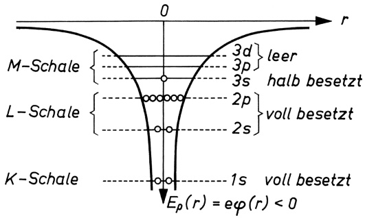

<details>
<summary>funnel</summary>

| State | Energy Level (r) |
| --- | --- |
| M-Schale | 3d |
| M-Schale | 3p |
| M-Schale | 3s |
| L-Schale | 2p |
| L-Schale | 2s |
| K-Schale | 1s |
| K-Schale | \(E\rho(r) = e\varphi(r) < 0\) |
</details>

Bild 46.1 Schema des „Energietrichters“eines isolierten Na-Atoms mit Elektronenbesetzungszahlen

Treten viele Einzelatome zu einem Kristall zusammen, so kommt es zu einer Überlagerung der Potenzial- bzw. Energiewerte. Den resultierenden Energieverlauf für einen eindimensionalen Natrium-„Kristall“ zeigt Bild 46.2. Im Innern des Kristalls werden die Potenzial- oder Energie-

---

560

46 Elektrische und magnetische Eigenschaften von Festkörpern

wälle durch Überlagerung so weit abgebaut, dass sie die Energieniveaus der M-Schale nicht mehr unterbrechen. Infolgedessen ist das 3s-Elektron nicht mehr an einen bestimmten Atomrumpf gebunden, sondern als Kristallelektron oder Leitungselektron ohne zusätzliche Ionisierungsarbeit im ganzen Kristall frei beweglich. Da im Mittel jedes (einwertige) Kristallatom ein Elektron an den Kristall abgibt, entsteht auf diese Weise ein **Elektronengas**, das die Gesamtheit der positiven Ionen des Kristallgitters einhüllt.

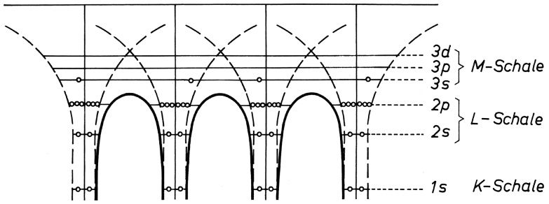

<details>
<summary>text_image</summary>

3d} M-Schale
3p 3s
2p} L-Schale
2s
1s K-Schale
</details>

Bild 46.2 Schema des Energieverlaufs in einem eindimensionalen Na-„Kristall“ mit frei beweglichem 3s-Elektron

Diese Vorstellungen sind Grundlage der klassischen Elektronentheorie der Metalle. Mit ihrer Hilfe können wir nicht nur die große elektrische Leitfähigkeit der Metalle verstehen, sondern auch den Potenzialwall an der Metalloberfläche erklären, der das Elektronengas am Austritt aus dem Metall hindert (vgl. 26.1). Andere grundlegende Erscheinungen, wie die Temperaturabhängigkeit der Leitfähigkeit und die geringe Leitfähigkeit der Halbleiter und Isolatoren, können dagegen nur auf der Grundlage einer quantenmechanischen Verfeinerung des Modells des Festkörpers gedeutet werden.

## 46.2 Bändermodell des Festkörpers. Metalle, Halbleiter, Isolatoren

Von den Energieniveaus weit voneinander entfernter, isolierter Atome wissen wir, dass sie eine Folge diskreter, d. h. einzelner, scharf voneinander getrennter Linien bilden (vgl. z. B. das Termschema in Bild 44.8). Diese Energieniveaus werden beim Annähern und Zusammenrücken vieler Atome zum Festkörper durch **Austauschwechselwirkung** zunehmend in so viele Unterniveaus aufgespalten, wie Atome im Kristallgitter miteinander in Wechselwirkung treten. Diese quantenmechanisch begründete Erscheinung lässt sich auf folgende Weise klassisch veranschaulichen: Werden zwei Pendel ursprünglich gleicher Eigenfrequenz z. B. mittels einer Feder gekoppelt, so weist das nun entstandene schwingungsfähige System zwei Eigenfrequenzen auf, eine aus gleichsinniger Schwingung der Pendel resultierend, die andere aus gegensinniger Schwingung (vgl. 35.2). Dabei ist die Aufspaltung umso größer, je stärker gekoppelt wird. Bei Kopplung von N gleichen Pendeln wird analog die eine Eigenfrequenz der ungekoppelten Pendel in N Eigenfrequenzen aufgespalten.

Bild 46.3a zeigt schematisch die Aufspaltung der diskreten Energieniveaus von Atomen für den Fall, dass 6 Atome einander angenähert werden. Der Atomabstand im Festkörper, der sich aus dem Gleichgewicht von Anziehungs- und Abstoßungskräften ergibt, heißt Gitterkonstante (vgl. 12.2). Die zugehörigen Energiewerte E gelten an jedem Orte x des betreffenden Festkörpers.

---

46.2 Bändermodell des Festkörpers. Metalle, Halbleiter, Isolatoren

561

Dabei ist zu beachten, dass die Zahl der Atome in realen Festkörpern sehr groß ist $( N \approx 1 0 ^ { 2 2 }$ je $\mathbf { c m } ^ { 3 } )$ , so dass die diskreten Energieniveaus der isolierten Atome – ganz gleich, ob diese von Elektronen besetzt sind oder nicht – in eine entsprechend große Zahl eng beieinander liegender Einzelterme aufspalten und so quasikontinuierliche Energiebänder bilden. Deshalb wird die Darstellung E(x) in Bild 46.3b **Bändermodell** des Festkörpers genannt.

## Jedes Energieniveau eines aus N Atomen bestehenden Kristalls spaltet in N eng benachbarte Niveaus auf und verbreitert sich dadurch zu einem quasikontinuierlichen Energieband.

Wie breit ein solches Band ist, hängt von der Lage des Niveaus in der Atomhülle ab. Die in Kernnähe sehr stark gebundenen Elektronen ergeben relativ schmale Bänder, die am weitesten außen liegenden Valenzelektronen bilden das breiteste Band, da sie am stärksten miteinander in Wechselwirkung treten.

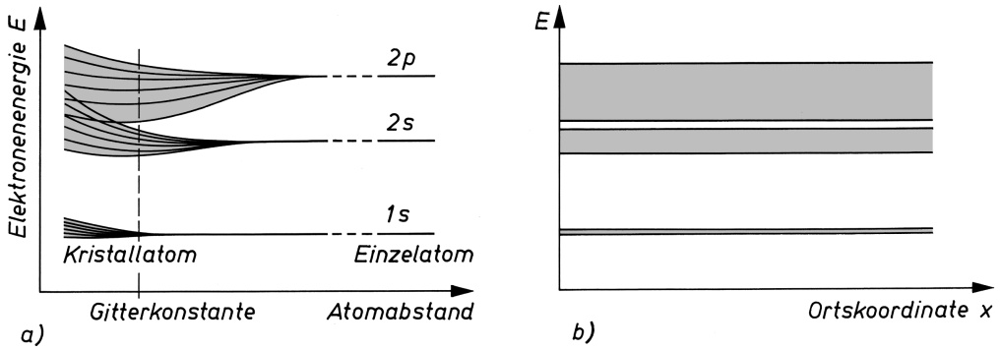

Bild 46.3 Zum Energiebändermodell: a) Aufspaltung der diskreten Energieniveaus isolierter Atome zu quasikontinuierlichen Energiebändern im Festkörper; b) Energie-Bändermodell

Die Entstehung der Energiebänder folgt mit zwingender Notwendigkeit auch aus dem PAU-LI-Prinzip (vgl. 44.10), welches nicht nur für das einzelne Atom, sondern auch für den ganzen Kristall gilt. Es verlangt strikt, dass die Energiezustände aller Atome des Kristallgitters sich in ihren Quantenzahlen unterscheiden. Die Energieniveaus 1s, 2s, 2p usw. müssen daher von Atom zu Atom etwas voneinander abweichen, da sie (mit Ausnahme der beiden Spinrichtungen) nicht doppelt oder gar mehrfach besetzt werden dürfen. Befinden sich also im Kristall N Atome, so gibt es in jedem Energieband N Einzelterme, von denen jeder maximal von zwei Elektronen mit entgegengesetztem Spin besetzt werden kann.

Hieraus resultieren ganz ungewöhnliche Eigenschaften für das Elektronengas: Während bei ei nem normalen, einem sog. klassischen Gas, die Energie aller Teilchen am absoluten Nullpunkt gleich null ist, können im Elektronengas den Energiewert null höchstens zwei Elektronen annehmen. Allen übrigen Elektronen werden innerhalb des gegebenen Energiebandes durch das PAULI-Prinzip Plätze höherer Energie zugewiesen. Die kinetische Energie, welche die freien Elektronen am absoluten Nullpunkt maximal annehmen können, ist beträchtlich; sie liegt bei den meisten Metallen zwischen 0,5 und 1,1aJ (3 und 7eV). Man bezeichnet sie als **Nullpunkts**oder **Fermi-Energie** $E _ { \mathrm { F } }$ (s. Bild 26.1).

---

562

46 Elektrische und magnetische Eigenschaften von Festkörpern

## Das höchste, bei der Temperatur 0 K mit Elektronen besetzte Energieniveau eines Kristalls heißt Nullpunktsenergie oder FERMI-Niveau.

Dem angegebenen (oberen) Wert für $E _ { \mathrm { F } }$ entsprechen Elektronengeschwindigkeiten in der Grö- ßenordnung von $1 0 ^ { 6 }   \mathrm { m } / \mathrm { s }$ . Ein gewöhnliches Gas müsste danach bei gleich großer Teilchendichte eine Temperatur von 80 000K haben. Dieses vom klassischen Gas stark abweichende Verhalten des Elektronengases heißt Entartung.

Die Besonderheiten des Elektronengases liegen darin begründet, dass die Elektronen einer anderen Statistik gehorchen als die Teilchen eines klassischen Gases. Die Statistik regelt die Besetzung der verschiedenen Energiezustände durch die Teilchen des Gases in Abhängigkeit von der Temperatur. Während im klassischen Fall die Besetzungswahrscheinlichkeit eines bestimmten Energiezustandes E bei der Temperatur $T$ durch eine Funktion der Gestalt

$$
f = \mathrm{e} ^ {- E / (k T)} \quad \begin{array}{l} (\text {Verteilungsfunktion der} \\ \text {MAXWELL - BOLTZMANN - Statistik}) \end{array} \tag {46.1}
$$

(k BOLTZMANN-Konstante) beschrieben wird (vgl. 18.3), d. h. durch eine Exponentialfunktion, die vom Anfangswert +1 an (für $E = 0 )$ abfällt (Bild 46.4a), lautet die Verteilungsfunktion der Quantenstatistik für Teilchen mit halbzahligem Spin, also z. B. für Elektronen,

$$
f = \frac {1}{\mathrm{e} ^ {(E - E _ {\mathrm{F}}) / (k T)} + 1} \quad \begin{array}{l} (\text {Verteilungsfunktion der} \\ \text {FERMI - DIRAC - Statistik}). \end{array} \tag {46.2}
$$

In Bild 46.4b ist die Verteilung (46.2) grafisch dargestellt. Danach sind bei $T = 0   \mathrm { K }$ alle untersten Quantenzustände bis zur Grenzenergie $E _ { \mathrm { F } }$ besetzt, entsprechend der Besetzungswahrscheinlichkeit $f = 1$ für $E < E _ { \mathrm { F } }$ , und alle Zustände $E > E _ { \mathrm { F } }$ leer $( f = 0 )$ . Bei höheren Temperaturen lockert die Verteilung zunehmend auf, d. $\mathbf { h } ,$ anstelle der scharfen „FERMI-Kante“ gibt es in der Umgebung der Energie $E _ { \mathrm { F } }$ einen allmählichen Übergang zwischen besetzten und unbesetzten Energieniveaus. Für Temperaturen, die über der sog. **Entartungstemperatur** $T _ { \mathrm { e } }$ liegen, welche durch $E _ { \mathrm { F } } = k T _ { \mathrm { e } }$ definiert ist und bei den Metallen weit mehr als 10 000K beträgt, geht die quantenmechanische Verteilung (46.2) in die klassische Verteilung (46.1) über, wenn in (46.2) $E _ { \mathrm { F } }$ gegenüber E und die 1 gegenüber der e-Funktion vernachlässigt werden können.

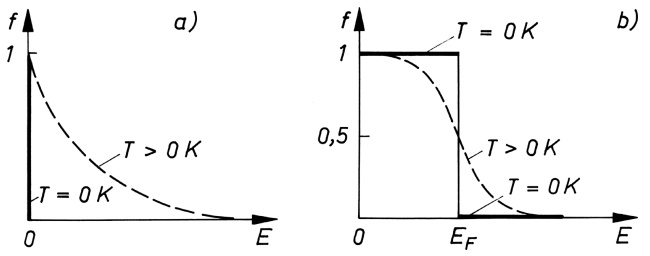

Bild 46.4 a) Maxwell-Boltzmann-Verteilung, b) Fermi-Dirac-Verteilung bei $T = 0 \mathrm { K }$ (dick ausgezogen) und $T > 0 \mathrm { K } ,$ z. B. Raumtemperatur (gestrichelt gezeichnet)

Eine Einteilung der Festkörper nach ihrer Fähigkeit, den elektrischen Strom zu leiten, ergibt sich nun aus den Besetzungsverhältnissen der Energiebänder. Ein vollständig besetztes Band kann zur Stromleitung nicht beitragen, da jedes Beschleunigen eines Elektrons im elektrischen Feld dieses auf ein höheres, aber schon besetztes Energieniveau heben müsste. Dies verbietet jedoch das PAULI-Prinzip. Deshalb braucht man bei der Untersuchung von Leitungsvorgängen

---

46.2 Bändermodell des Festkörpers. Metalle, Halbleiter, Isolatoren

563

vollständig besetzte Bänder nicht zu berücksichtigen. Das höchste Energieband, das (zumindest bei tiefen Temperaturen) vollständig gefüllt ist, wird **Valenzband** genannt. Das darauf folgende, nur teilweise gefüllte oder leere Band heißt **Leitungsband**. Die Energiewerte zwischen diesen „erlaubten“ Bändern sind für Elektronen „verboten“ und bilden eine „verbotene Zone“, die als **Energielücke** („gap“) bezeichnet wird (Bild 46.5).

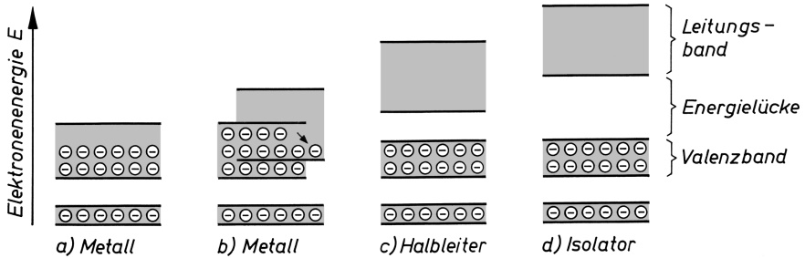

<details>
<summary>bar</summary>

| Material | Energy Level |
| --- | --- |
| a) Metall | Leitungsband |
| b) Metall | Energielücke |
| c) Halbleiter | Leitungsband |
| d) Isolator | Leitungsband |
</details>

Bild 46.5 Bändermodell für Metalle, Halbleiter und Isolatoren

Ist das höchste besetzte Band nur teilweise mit Elektronen gefüllt oder wird das höchste vollständig besetzte Band von einem darüber liegenden leeren Band überlappt (Bild 46.5a und b), dann können die Elektronen beschleunigt werden und im Band höhere Plätze einnehmen; es tritt **metallische Leitfähigkeit** auf. Das heißt:

## Bei den Metallen liegt das FERMI-Niveau innerhalb eines Energiebandes.

Folgt auf das letzte vollständig gefüllte Band ein leeres (Bild 46.5c und d), dann ist eine elektronische Leitfähigkeit nur möglich, wenn den Elektronen z. B. durch Wärme oder Licht solche Energiebeträge zugeführt werden, dass sie die verbotene Zone zwischen Valenzband und Leitungsband überwinden können. Solche Stoffe mit genügend schmaler Energielücke (z. B. $0 , 1 2   \mathrm { a J } \approx 0 , 7   \mathrm { e V }$ bei Germanium und $0 ,   1 8   \mathrm { a J } \approx 1 ,   \mathrm { i }$ 1eV bei Silicium) werden **Halbleiter** genannt.

Ist dagegen die Energielücke größer als die thermische Anregungsenergie kT bzw. die Energie der optischen Anregung hf , so bleibt das Leitungsband leer, und man spricht von einem **Isolator**.

## Beispiele 46.1:

1. Wie groß ist bei 300K die Besetzungswahrscheinlichkeit f für verschiedene Energieniveaus, die a) 0,01aJ $( \approx 0 , 0 6   \mathrm { e V } )$ unter dem FERMI-Niveau $E _ { \mathrm { F } }$ liegen, b) sich in der Höhe von $E _ { \mathrm { F } }$ befinden und c) 0,01aJ oberhalb von E<sub>F</sub> angeordnet sind?

Lösung: Durch Einsetzen von $E - E_{\mathrm{F}} = -0,01; 0; 0,01\mathrm{a}$ J in (46.2) erhält man a) $f = 0 , 9 1 8 ;$ b) $0 , 5 ; \mathrm { c )   0 , } 0 8 2$ , entsprechend einer Besetzung von 91,8%, 50% bzw. 8,2%. Das heißt, schon dicht unterhalb des FERMI-Niveaus sind bei Raumtemperatur nahezu alle Niveaus mit Elektronen besetzt, während nur wenig darüber die meisten Niveaus unbesetzt sind.

2. Wie ändert sich die Besetzungswahrscheinlichkeit von Niveaus an der unteren Kante des Leitungsbandes in Germanium und Silicium bei Temperaturerhöhung von 300 auf 500K, wenn das FERMI-Niveau in der Mitte der Energielücke (Werte s. o.) liegt?

Lösung: Ist $E _ { \mathrm { C } }$ die Energie der unteren Leitungsbandkante, so folgt mit $E _ { \mathrm { C } } - E _ { \mathrm { F } } = 0 , 0 6   \mathrm { a J }$ (Ge) bzw. $E _ { \mathrm { C } }   -   E _ { \mathrm { F } }   = 0 , 0 9   \mathrm { a J }$ (Si) aus (46.2), dass sich f in Germanium von $^ { 5 , 1 \cdot 1 0 ^ { - 7 } }$ auf $^ { 1 , 7 \cdot 1 0 ^ { - 4 } }$ und in

---

564

46 Elektrische und magnetische Eigenschaften von Festkörpern

Silicium von $^ { 3 , 6 \cdot 1 0 ^ { - 1 0 } }$ auf $^ { 2 , 2 \cdot 1 0 ^ { - 6 } }$ erhöht. Die relative Zunahme der Elektronen im Leitungsband ist also beträchtlich, was den Halbleitereffekt dieser Stoffe (Anwachsen der elektrischen Leitfähigkeit bei Temperaturerhöhung) verständlich macht. □

## 46.3 Elektrische Ströme in Halbleitern. Eigenleitung, Störstellenleitung

Ist ein Halbleiter chemisch absolut rein, so verhält er sich bei tiefsten Temperaturen wie ein Isolator. Stromleitung ist bei solchen Stoffen nur möglich, wenn Elektronen (Symbol ⊖) durch Zufuhr von Wärme- (oder auch Licht-)Energie aus dem vollbesetzten Valenzband befreit und in das darüber liegende leere Leitungsband „angehoben“ werden (Prozess 1 in Bild 46.6). Ein Elektron im Leitungsband kann unter dem Einfluss des äußeren elektrischen Feldes am Stromfluss teilnehmen (Prozess 2). In die durch den Prozess 1 im Valenzband entstandene Lücke können nun benachbarte Elektronen nachrücken (Prozess 3), so dass sich die Lücke wie ein positiver Ladungsträger verhält und daher in der entgegengesetzten Richtung wie das Elektron wandert. Damit trägt die als **Defektelektron** oder **Loch** bezeichnete Lücke (Symbol ⊕) im Valenzband zum elektrischen Strom ebenso bei wie das Elektron im Leitungsband. Dieser Leitungsmechanismus, bei dem die Ladungsträger von Energieband zu Energieband angeregt werden, heißt **Eigenleitung**.

**Ursache der Eigenleitung ist die Entstehung von freien Elektronen und Löchern durch Band-Band-Anregung im ungestörten Kristallgitter infolge Aufnahme von Wärmeenergie.**

Dies erklärt, weshalb der spezifische Widerstand der Eigenleiter im Gegensatz zu den Metallen mit steigender Temperatur abnimmt. Solche Halbleiter werden daher z. B. als Widerstandsthermometer benutzt. Da auch die Bestrahlung mit Licht den Widerstand von Halbleitern herabsetzt, ist es möglich, elektrische Ströme mit Hilfe von Licht zu steuern (Widerstandsphotozellen, Selenzellen).

Der chemisch reine Halbleiter ist das Grundmaterial der Halbleitertechnik. Es erhält die für die technischen Anwendungen so wertvollen Eigenschaften erst durch den kontrollierten Einbau von Fremdatomen, so genannter **Störstellen**, in das Kristallgitter (Dotierung). Dadurch kommt es zur Bildung von zusätzlichen (Stör-)Energieniveaus in der Energielücke des Halbleiters, aus denen ebenfalls Ladungsträger freigesetzt werden können, die zu einem erheblichen Anwachsen der Leitfähigkeit führen. Man spricht in diesem Falle von **Störstellenleitung**.

Besondere Bedeutung haben die Substitutionsstörstellen; sie sind durch Ersetzen (Substitution) regulärer Gitterbausteine durch Fremdatome auch gezielt erzeugbar. Bringt man z. B. in das Gitter des vierwertigen Siliciums anstelle eines Si-Atoms ein fünfwertiges Atom (z. B. ein Phosphor-Atom), so sind vier der zugehörigen Elektronen in den Paarbindungen mit den Si-Nachbarn fest gebunden, während das fünfte Elektron nur relativ lose gebunden ist und vom Atom bereits bei geringer Energiezufuhr (Ionisation) abgegeben wird (Prozess 4 in Bild 46.6a). Man bezeichnet ein solches Atom daher als **Donator** (lat. „donare“ schenken, geben). Tritt dagegen an die Stelle eines Si-Atoms ein dreiwertiges Atom (z. B. ein Aluminium-Atom), so stehen für die vier Elektronenpaarbindungen mit den vier Nachbaratomen nur drei Elektronen

---

46.3 Elektrische Ströme in Halbleitern. Eigenleitung, Störstellenleitung

565

zur Verfügung, und ein viertes Elektron wird relativ leicht eingebaut (Prozess 5 in Bild 46.6a). Das betreffende Atom heißt dann **Akzeptor** (lat. „acceptor“ Empfänger).

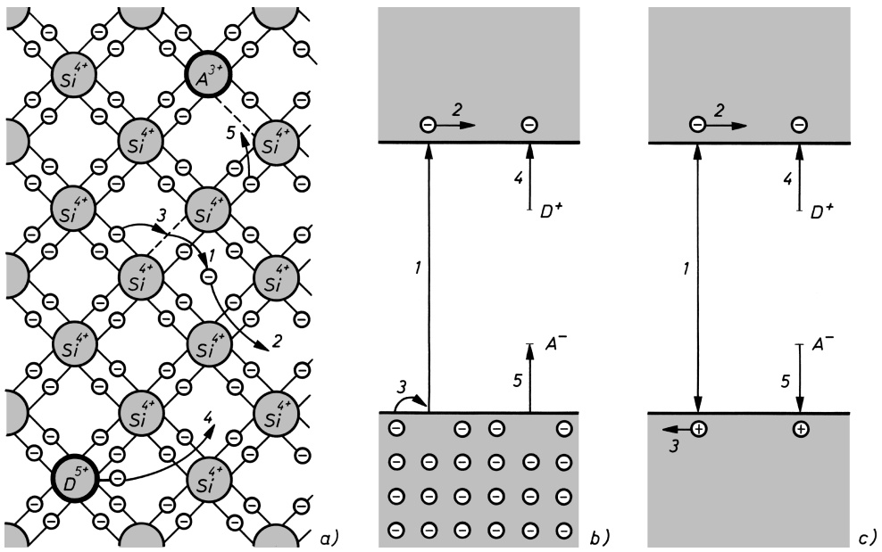

Bild 46.6 Leitungsvorgänge im Halbleiter: a) atomistisches Modell für Silicium; b) Bändermodell mit Elektronendarstellung; c) Bändermodell mit Elektron-Loch-Darstellung (1 Elektronenbefreiung, 2 Elektronenwanderung, 3 Löcherwanderung, 4 Elektronenabgabe durch Donator, 5 Elektronenaufnahme durch Akzeptor)

Da die diskreten Donator-Niveaus $E _ { \mathrm { D ^ { + } } }$ dicht unterhalb der Leitungsbandkante und die diskreten Akzeptor-Niveaus $E _ { \mathrm { A ^ { - } } }$ nur wenig oberhalb der Valenzbandkante liegen (s. Bild $^ { 4 6 . 6 \mathrm { b , c ) } }$ und zwar größenordnungsmäßig um 0,01eV, reicht die mittlere thermische Energie eines Elektrons bei Raumtemperatur von (3/2) $k T = 0$ ,039eV völlig aus, um praktisch alle Donatoren und Akzeptoren zu ionisieren, d. h. Elektronen ins Leitungsband zu heben oder Löcher im Valenzband freizusetzen (Prozesse 4 und 5 in Bild $^ { 4 6 . 6 \mathrm { b , c ) } }$

**Ursache der Störstellenleitung ist das Vorhandensein von Fremdatomen im Kristallgitter des reinen Halbleiters (Donatoren und Akzeptoren) mit diskreten Energieniveaus dicht unterhalb der Leitungsbandkante (Donator-Niveaus) und wenig oberhalb der Valenzbandkante (Akzeptor-Niveaus).**

Falls Ladungsträger überwiegend durch Donator-Anregung befreit werden, spricht man von einem Überschussleiter oder **n-Leiter**. In diesem Fall sind die Elektronen die sog. Majoritätsträger. Die Minoritätsträger, das sind hier die Löcher, spielen wegen ihrer wesentlich geringeren Konzentration nur eine untergeordnete Rolle.

**Im n-Leiter überwiegt der Einfluss der Donatoren; der Stromfluss wird daher hauptsächlich von Elektronen getragen.**

---

566

46 Elektrische und magnetische Eigenschaften von Festkörpern

Wenn anderenfalls in einem Halbleiter die Akzeptoren dominieren, so werden durch diese mehr Elektronen aus dem energetisch niedriger liegenden Valenzband aufgenommen, als durch vorhandene Donatoren an das Leitungsband abgegeben werden. Ursache der elektrischen Leitfähigkeit sind dann vor allem die positiven Löcher als Majoritätsträger, und der Halbleiter wird als Mangelleiter oder **p-Leiter** bezeichnet.

## Im p-Leiter überwiegt der Einfluss der Akzeptoren; der Stromfluss wird daher hauptsächlich von Löchern getragen.

Die Konzentrationen der Ladungsträger in Halbleitern werden bei Eigenleitung ebenso wie bei Störstellenleitung durch zwei gegenläufige Prozesse bestimmt. Durch thermische Anregung oder **Generation** werden ständig neue Ladungsträger befreit. Die Anregungsgeschwindigkeit oder Generationsrate g , d. i. die Anzahl der $\mathbf { j e }$ Volumen- und Zeiteinheit befreiten Ladungsträ- ger, hängt von der thermischen Energie und damit von der Temperatur ab, so dass $g = g ( T )$ gilt. Der Gegenprozess, bei dem Elektronen aus dem Leitungsband in das Valenzband zurückfallen und sich dort mit Löchern wieder vereinigen, heißt **Rekombination**. Die Rekombinationsrate $r ,$ d. i. die Anzahl der je Volumen- und Zeiteinheit „vernichteten“ Ladungsträger, ist umso größer, je häufiger ein Elektron ein Loch trifft, d. h., je größer die Konzentration $p$ der Löcher ist. Ebenso ist die Wahrscheinlichkeit dafür, dass ein Loch auf ein Elektron trifft, der Elektronenkonzentration n proportional. Daraus folgt für die Rekombinationsrate $r = r _ { 0 } n p$ wobei die Proportionalitätskonstante $r _ { 0 }$ eine konzentrationsunabhängige Materialkonstante ist. Im Gleichgewicht muss dann die Generationsrate $g$ gleich der Rekombinationsrate r sein, also $g ( T ) = r _ { 0 } n p$ . Nach Zusammenfassen von $g$ und $r _ { 0 }$ zu einer temperaturabhängigen Materialkonstante $n _ { \mathrm { i } } ( T ) = \sqrt { g ( T ) / r _ { 0 } }$ , die die Dimension einer Konzentration hat, ergibt sich das **Massenwirkungsgesetz** der Ladungsträger in Halbleitern:

$$
n p = n _ {\mathrm{i}} ^ {2} (T) = \text {const} \quad \text {fur} \quad T = \text {const}. \tag {46.3}
$$

## Das Produkt der Konzentrationen der Elektronen und Löcher in einem Halbleiter ist bei gleich bleibender Temperatur konstant.

So hat z. B. eine Erhöhung der Elektronenkonzentration durch Dotieren mit Donatoren über eine verstärkte Rekombination automatisch eine entsprechend geringere Löcherkonzentration zur Folge.

Die Konstante $n _ { \mathrm { i } } ( T )$ wird Inversionsdichte genannt, da beim Übergang vom Zustand $n > n _ { \mathrm { i } } > p$ zu $n < n _ { \mathrm { i } } < p$ an der Stelle $n = n _ { \mathrm { i } } = p$ eine Umkehr (Inversion) des Leitungstyps von der n-Leitung zur p-Leitung auftritt. Auch die Bezeichnung Intrinsicdichte, Intrinsic-Konzentration oder Eigenleitungskonzentration ist gebräuchlich, da durch

$$
n = p = n _ {\mathrm{i}} (T) \tag {46.4}
$$

die Eigenleitung charakterisiert werden kann $( s , \mathbf { o } . )$ . Bei einer Temperatur von 300K hat die Intrinsicdichte in Germanium den Wert $n _ { \mathrm { i } } = 2 , 4 \cdot 1 0 ^ { 1 9 }   \mathrm { m } ^ { - 3 }$ und in Silicium $\bar { n _ { \mathrm { i } } } = 1 , 4 \cdot 1 0 ^ { 1 6 }   \mathrm { m } ^ { - 3 }$

**Die Intrinsicdichte** $\pmb { n _ { i } }$ **charakterisiert die Umkehr (Inversion) des Leitungstyps von der n-Leitung** $( n > n _ { \mathrm { i } } > p )$ **zur p-Leitung** $( n < n _ { \mathrm { i } } < p )$ **an d**er Stelle $\pmb { n } = \pmb { n } _ { \mathrm { i } } = \pmb { p }$ (Zustand **der Eigenleitung).**

---

46.4 Der pn-Übergang

567

Gleichung (46.3) könnte zu dem Trugschluss verleiten, dass z. B. ein n-Leiter negativ geladen sei, weil die Elektronenkonzentration n die Löcherkonzentration p übersteigt. Tatsächlich aber bewirken im homogenen Halbleiter die positiv geladenen Donatoren der Konzentration $n _ { \mathrm { D } } ^ { + }$ bzw. die negativ geladenen Akzeptoren der Konzentration $n _ { \mathrm { A } } ^ { - }$ eine elektrische Neutralität. Es gilt die **Neutralitätsbedingung**

$$
n + n _ {\mathrm{A} ^ {-}} = p + n _ {\mathrm{D} ^ {+}}. \tag {46.5}
$$

Im n-Leiter mit $n \gg p$ und $n _ { \mathrm { D ^ { + } } } \gg n _ { \mathrm { A ^ { - } } }$ vereinfacht sich (46.5) zu $n \approx n _ { \mathrm { D ^ { + } } }$ , und im p-Leiter gilt analog $p \approx n _ { \mathrm { A ^ { - } } }$

## Beispiel 46.2:

Silicium sei mit Aluminium-Atomen einer Konzentration $3   \cdot   1 0 ^ { 1 7 }   \mathrm { m } ^ { - 3 }$ dotiert. Wie groß sind die Ladungsträgerkonzentrationen n und $p ,$ wenn alle Störstellen aktiviert sind, d. h. bei Störstellenerschöpfung ? $( n _ { \mathrm { i } } = 1 , 4 \cdot 1 0 ^ { 1 6 }   \mathrm { m } ^ { - 3 } )$ )

Lösung: Aluminium-Atome haben drei Außenelektronen (Gruppe IIIb des Periodensystems) und wirken deshalb im vierwertigen Silicium als Akzeptoren. Durch Einsetzen der Neutralitätsbedingung (46.5) $p   =   n + n _ { \mathrm { A } }$ in das Massenwirkungsgesetz (46.3) $n p = n _ { \mathrm { i } } ^ { 2 }$ erhält man $n ^ { 2 } + n n _ { \mathrm { A ^ { - } } } = n _ { \mathrm { i } } ^ { 2 }$ und mit $n _ { \mathrm { A ^ { - } } } = 3 \cdot 1 0 ^ { 1 7 }   \mathrm { m } ^ { - 3 }$ als Lösung $n = - ( n _ { \mathrm { A ^ { - } } } / 2 ) + \sqrt { ( n _ { \mathrm { A ^ { - } } } / 2 ) ^ { 2 } + n _ { \mathrm { i } } ^ { 2 } } = 6 { , } 5$ $1 0 ^ { 1 4 }   \mathrm { m } ^ { - 3 }$ (negatives Vorzeichen der Wurzel wäre physikalisch sinnlos). Einsetzen des Ergebnisses in (46.5) ergibt $p = 3 { , } 0 \cdot 1 0 ^ { 1 7 }   \mathrm { m } ^ { - 3 }$ . Es handelt sich um p-Silicium mit $n _ { \mathrm { A } ^ { - } } \approx p \gg n$ □

## Aufgabe

**46.1** Durch Dotierung von Silicium $( n _ { \mathrm { i } } = 1 , 4 \cdot 1 0 ^ { 1 6 }   \mathrm { m } ^ { - 3 } )$ mit Donatoratomen werde eine Elektronenkonzentration von $n = 1 0 ^ { 2 1 }   \mathrm { m } ^ { - 3 }$ erzeugt. Wie groß ist dann die Gesamtzahl der Ladungsträger, und auf welchen Bruchteil wird die Anzahl der Löcher reduziert?

## 46.4 Der pn-Übergang

Von besonderer praktischer Bedeutung sind die Erscheinungen am Übergang zwischen einem p-leitenden und einem n-leitenden Gebiet eines Halbleiterkristalls, dem sog. **pn-Übergang**. Vereinfachend betrachten wir einen symmetrischen Übergang, dessen p-leitendes Gebiet gleich stark mit Akzeptoren dotiert ist wie dessen n-leitendes Gebiet mit Donatoren. Bild 46.7 zeigt im linken Teil schematisch einen solchen pn-Übergang in drei unterschiedlichen Zuständen, rechts daneben das jeweils zugehörige Bändermodell.

**Der stromlose pn-Übergang.** Wir betrachten zunächst den pn-Übergang ohne äußere Spannungsquelle (Bild 46.7a). Die hohe Konzentration von Löchern im p-Gebiet fällt am Übergang vom p- zum n-leitenden Gebiet stark ab; das dadurch bedingte Konzentrationsgefälle verursacht eine ständige Diffusion von Löchern von links nach rechts in das n-Gebiet hinein. Das entgegengesetzte Konzentrationsgefälle der Elektronen bewirkt eine Diffusion von Elektronen von rechts nach links in das p-Gebiet. Unter Berücksichtigung der Vorzeichen der Ladungsträ- ger ergibt sich so insgesamt ein nach rechts, d. h. vom p- in das n-Gebiet gerichteter elektrischer **Diffusionsstrom** (technische Stromrichtung, gleichbedeutend mit der Bewegungsrichtung der positiven Ladungsträger).

Da die in das n-Gebiet eindringenden Löcher dort ebenso mit Elektronen rekombinieren wie die in das p-Gebiet eintretenden Elektronen mit den dort vorhandenen Löchern, verarmt die

---

568

46 Elektrische und magnetische Eigenschaften von Festkörpern

Umgebung des pn-Übergangs insgesamt an beweglichen Ladungsträgern, wodurch der elektrische Widerstand dieses Gebietes stark anwächst. Es entsteht eine elektrische Doppelschicht oder **Sperrschicht**. In ihr herrscht ein Überschuss an (negativen) Akzeptoren am Rande des p-Gebiets und an (positiven) Donatoren am Rande des n-Gebiets, zwischen denen sich eine elektrische Spannung, die sog. Diffusionsspannung $U _ { \mathrm { D } }$ , ausbildet, analog zur Entstehung einer Thermospannung an der Kontaktstelle zweier Metalle (vgl. 26.2). Der Diffusionsspannung entspricht ein elektrisches Feld, dessen Feldvektor E von der n- zur p-Seite zeigt. Es verursacht (unter Beachtung der Vorzeichen der Ladungsträger) einen in Feldrichtung, d. h. entgegengesetzt zum Diffusionsstrom, gerichteten **Feldstrom** (oder Driftstrom, vgl. 21.3).

## Wenn am pn-Übergang keine äußere Spannung anliegt, heben sich Diffusionsstrom und Feldstrom gegenseitig auf.

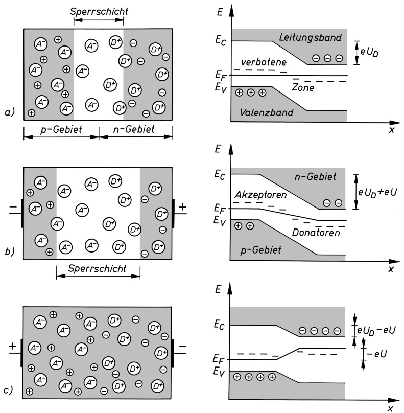

Bild 46.7 Schema eines pn-Übergangs (links) mit zugehörigem Bändermodell (rechts): a) stromloser Fall; b) in Sperrrichtung gepolt; c) in Durchlassrichtung gepolt

Dieses dynamische Gleichgewicht der Ströme nennt man den stromlosen Fall des pn-Übergangs. Da sich Elektronen und Löcher im Gleichgewicht befinden, muss das Niveau mit der Besetzungswahrscheinlichkeit 0,5 (das FERMI-Niveau $E _ { \mathrm { F } }$ in Bild 46.4) im p- wie im n-Gebiet die gleiche energetische Lage haben und daher in Bild 46.7a als waagrechte Gerade verlaufen. Die Besetzungswahrscheinlichkeit für die untere Kante des Leitungsbandes $E _ { \mathrm { C } }$ ist im p-Gebiet

---

46.5 Halbleiterdiode, Transistor

569

geringer als im n-Gebiet, weil im p-Gebiet die Akzeptoren statt der Elektronen Träger der negativen Ladung sind. Das drückt sich im Bändermodell dadurch aus, dass $E _ { \mathrm { C } }$ im p-Gebiet weiter von $E _ { \mathrm { F } }$ entfernt ist als im n-Gebiet und eine energetische Stufe von $e U _ { \mathrm { D } }$ auftritt. Eine analoge Überlegung gilt für die obere Kante des Valenzbandes $E _ { \mathrm { V } }$

**Der pn-Übergang bei Stromfluss.** Wir verbinden nun den Kristall mit einer Spannungsquelle der Spannung U in der Art, dass der Pluspol an das n-Gebiet und der Minuspol an das p-Gebiet angeschlossen wird (Bild 46.7b). Die Elektronen werden dadurch aus dem Bereich des pn-Übergangs nach rechts (zum Pluspol hin) und die Löcher nach links (zum Minuspol) herausgezogen, wodurch sich die an beweglichen Ladungsträgern verarmte Sperrschicht verbreitert und ihr elektrischer Widerstand stark zunimmt. Wie das zugehörige Bändermodell zeigt, müsste den Elektronen und Löchern gegenüber dem stromlosen Fall eine um eU grö- ßere Energie zugeführt werden, damit sie die Sperrschicht überwinden können.

Im Fall entgegengesetzter Polung der Spannungsquelle werden Löcher aus dem p-Gebiet und Elektronen aus dem n-Gebiet in die Grenzschicht getrieben. Dadurch verschwindet die Sperrschicht (Bild 46.7c), und der elektrische Widerstand sinkt.

```txt
Beim Anlegen des Pluspols einer Spannungsquelle an das p-Gebiet und des n-Gebiet Minuspols an das n-Gebiet eines pn-Übergangs wird dieser in Durchlassrichtung Sperrrichtung gepolt und erhält so einen kleinen großen elektrischen Widerstand.
```

## 46.5 Halbleiterdiode, Transistor

Da der elektrische Widerstand eines pn-Übergangs von der Polung der angelegten Spannung abhängt (s. o.), wirkt er als Richtleiter. Wird ein pn-Übergang in einen Wechselstromkreis eingeschaltet, so ist er während der einen Halbwelle in Durchlassrichtung, während der anderen in Sperrrichtung gepolt, und es fließt in der einen Richtung ein großer Strom, in der anderen Richtung dagegen nur der sehr kleine Sperrstrom. Der pn-Übergang wird deshalb in **Dioden** und in **Leistungsgleichrichtern** technisch genutzt.

In einigen Halbleitermaterialien wird die bei der Rekombination von Elektronen und Löchern im pn-Übergang frei werdende Energie in Form von Licht abgestrahlt. Die Wellenlänge des von einer solchen **Laserdiode** emittierten Lichts hängt von der Energielücke des Materials ab und beträgt z. B. für Galliumarsenid 0,85 µm und für Indiumantimonid 5,2 µm.

Halbleiterbauelemente, die aus einer Kombination von zwei hochdotierten n-Gebieten mit einem dazwischen liegenden niedrigdotierten p-Gebiet (oder umgekehrt aus zwei p-Gebieten und einem n-Gebiet) bestehen, von denen jedes mit einem eigenen Kontakt versehen ist, heißen **Transistoren**. Äußere Form, Anordnung und Schaltung der drei Gebiete können je nach Transistortyp verschieden sein. Man unterscheidet zwischen bipolaren und unipolaren Transistoren, je nachdem, ob beide Ladungsträgerarten (Elektronen und Löcher) den Stromfluss tragen oder nur eine Sorte von Ladungsträgern daran beteiligt ist. Ein **Bipolar-Transistor** kann als Serienschaltung zweier gegeneinander geschalteter pn-Übergänge aufgefasst werden. Bild

---

570

46 Elektrische und magnetische Eigenschaften von Festkörpern

46.8 zeigt den prinzipiellen Aufbau eines npn-Flächentransistors (SHOCKLEY, BARDEEN, BRAT-TAIN, 1947). Die drei nur einige Mikrometer dicken elektronen-(n)- bzw. löcher-(p)-leitenden Schichten bzw. ihre zugehörigen Elektroden heißen Emitter, Basis und Kollektor.

Bei der in Bild 46.8 gezeigten Basisschaltung des Transistors als Verstärker liegt die Basis an Erdpotenzial (Massepotenzial), und der np-Übergang zwischen Emitter und Basis, der Emitterübergang, ist in Durchlassrichtung gepolt, der pn-Übergang zwischen Basis und Kollektor, der Kollektorübergang, dagegen in Sperrrichtung. Trotzdem kann ein erheblicher Strom zwischen Emitter und Kollektor fließen; denn die vom Emitter in die Basis „injizierten“ Elektronen diffundieren dort als überschüssige Minoritätsträger in Richtung zum Kollektorübergang, da sie wegen der positiven Vorspannung des Kollektors von diesem angezogen werden. Allerdings nimmt ihre Konzentration in der Basis wegen der Rekombination mit Löchern mit wachsendem Abstand vom Übergang ab, jedoch erreichen bei genügend dünner Basiszone die meisten von ihnen den Kollektorübergang. Als Minoritätsträger treten sie leicht durch den in Sperrrichtung gepolten Übergang und werden vom Kollektor „eingesammelt“. Auf diese Weise entsteht im Kollektorkreis ein Strom $I _ { \mathrm { K } }$ von fast gleicher Größe wie im Emitterkreis $I _ { \mathrm { E } }$ . Da der elektrische Widerstand des Kollektorübergangs wegen der unterschiedlichen Polung sehr viel größer ist als der des Emitterübergangs, gilt für die zugehörigen Spannungen $U _ { \mathrm { K } } \gg U _ { \mathrm { E } }$ . Mit einer relativ kleinen Eingangsleistung $U _ { \mathrm { E } } I _ { \mathrm { E } }$ kann daher eine ihr annähernd proportionale, relativ große Ausgangsleistung $U _ { \mathrm { K } } I _ { \mathrm { K } }$ erzielt werden, und ein am Emitter angelegtes Eingangssignal $U _ { \mathrm { e } }$ wird entsprechend hoch verstärkt. Bei der hier besprochenen Basisschaltung des Transistors wirkt also der Emitter gleichzeitig als Quelle für die Ladungsträger und als Steuerorgan.

Da der Emitterstrom bei guten Transistoren nicht wesentlich vom Kollektorstrom verschieden ist, bestimmen sich Spannungs- und Leistungsverstärkung aus dem Verhältnis der Spannungsänderung am Arbeitswiderstand R des Kollektorstromkreises zur Spannungsänderung am Eingang (vgl. hierzu auch Abschnitt 31.6).

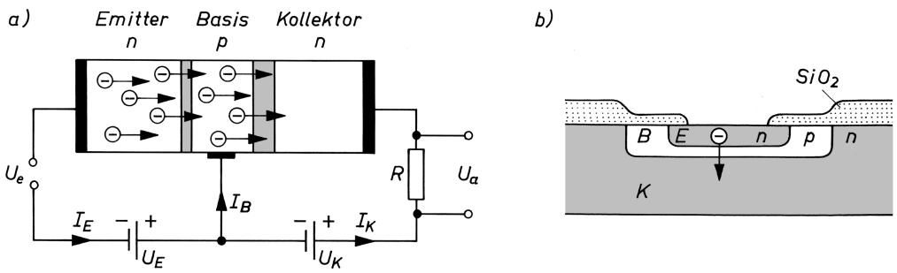

Bild 46.8 a) Schematische Darstellung eines npn-Bipolar-Transistors mit n-leitendem Emitter, p-leitender Basis und n-leitendem Kollektor; b) Querschnitt durch einen durch Aufdampfen und fraktioniertes Ätzen hergestellten npn-Planar-Transistors (E Emitter, B Basis, K Kollektor)

In Emitterschaltung, bei der ebenfalls Emitter und Basis den Eingangskreis bilden, jedoch Emitter und Kollektor über Spannungsquelle und Arbeitswiderstand zum zweiten Stromkreis zusammengeschaltet sind (Bild 31.12a), ähnelt ein solcher npn-Transistor in gewisser Hinsicht der Wirkungsweise einer **Dreielektroden-Elektronenröhre** (Triode, vgl. 31.6): Der Emitter liefert die Ladungsträger an die Basiszone und übernimmt die Funktion der Katode der Elektronenröhre; die an den Basiskontakt angelegte Signalspannung (bzw. der damit verbundene Basisstrom) steuert den Emitter-Kollektor-Strom leistungsarm, ähnlich zur Wirkung der Steuerspannung am Gitter einer Röhre, und am Kollektorkontakt werden die Ladungsträger analog wie bei der Anode der Röhre gesammelt.

---

46.6 Magnetische Eigenschaften. Dia- und Paramagnetismus

571

Ein wesentlicher Unterschied zwischen Transistor und Elektronenröhre besteht jedoch darin, dass der Steuerungsmechanismus beim Transistor nicht auf elektrostatischer Beeinflussung des Trägertransports beruht, sondern auf einer Änderung der Ladungsträgerdichten und der Stromanteile an den pn-Übergängen. Transistoren dieser Bauart sind demnach stromgesteuerte Bauelemente.

Der **Unipolar-Transistor** (Feldeffekttransistor z. B. als MOSFET) besteht aus einem durchgehend einheitlichen, z. B. n-leitenden Halbleitermaterial zwischen Source- und Drain-Elektrode. Dabei hat die leitende Verbindung zwischen beiden einen sehr geringen Kanalquerschnitt, so dass deren Leitfähigkeit durch ein äußeres elektrisches Feld verändert werden kann. Dazu „saugt“ die isoliert aufgesetzte Gate-Elektrode bei positiver Aufladung zusätzlich Elektronen in den Kanal und drängt bei negativer Aufladung Elektronen aus diesem heraus. Für die Anwendung der Unipolartransistoren ist bedeutsam, dass an der Gate-Elektrode nur eine Steuerspannung anliegt, ohne dass wie beim Bipolartransistor auch ein Steuerstrom fließt, und damit auch keine elektrische Steuerleistung erforderlich ist.

Durch Zusammenfassen von Halbleiterdioden, Transistoren, Widerständen usw. in einen einzigen Komplex, der jedoch als funktionelle Einheit entworfen und gefertigt und nicht aus diskreten Bauelementen zusammengesetzt wird, gelangt man zur integrierten Halbleiterschaltung. Sie weist im Vergleich zu den nach konventionellen Methoden hergestellten Schaltungen Mikrodimensionen und zugleich eine höhere Zuverlässigkeit auf. Die integrierte Schaltung bildete eine wesentliche Voraussetzung für die Entwicklung der Mikroelektronik.

## 46.6 Magnetische Eigenschaften. Dia- und Paramagnetismus

Das magnetische Verhalten der Stoffe liegt in den atomaren Vorgängen begründet, die sich in ihnen unter der Einwirkung eines äußeren Magnetfeldes abspielen. Schon AMPÈRE (1820) hat den Magnetismus durch die Annahme elektrischer Kreisströme in atomaren Bereichen gedeutet (AMPÈREsche Molekularströme), d. h. also auf dieselbe Weise wie das Zustandekommen des Magnetismus von stromdurchflossenen Leiterschleifen oder Spulen. Heute wissen wir, dass diese Kreisströme in Form der umlaufenden Elektronen in der Atomhülle tatsächlich vorhanden sind und dass sie zur Entstehung magnetischer Momente Anlass geben. Jedoch rührt der Magnetismus nicht nur von diesen magnetischen Bahnmomenten, sondern vor allem von den magnetischen Spinmomenten der Elektronen her. Des Weiteren haben auch die Atomkerne ein magnetisches Moment, das (allerdings in sehr geringem Maße) zum magnetischen Gesamtmoment eines Atoms beiträgt.

Die entsprechenden magnetischen Momente der Bahn- und Spinbewegung sind – wie wir in 44.6 und 44.7 gesehen haben – gequantelt, ihre wirksamen Komponenten bezüglich der Richtung eines äußeren Magnetfeldes können nur ganze Vielfache des BOHRschen Magnetons $\mu _ { \mathrm { B } } ^ { \prime }$ betragen. Abgeschlossene, d. h. vollbesetzte Elektronenschalen und Unterschalen haben weder einen resultierenden Bahndrehimpuls L und ein resultierendes magnetisches Bahnmoment $\mu _ { L }$ noch einen resultierenden Spin S und ein zugehöriges magnetisches Gesamtspinmoment $\mu _ { S } ,$ da sich die Beiträge der einzelnen Elektronen gerade kompensieren (vgl. 44.8). Das magnetische Moment eines Atoms wird daher, wenn wir von dem geringen magnetischen Moment des Atomkerns absehen, von den Elektronen der nichtabgeschlossenen äußeren Schale oder durch unbesetzte Plätze in einer inneren Schale erzeugt; es ergibt sich als Summe aus resultierendem Bahnmoment $\mu _ { L }$ und resultierendem Spinmoment $\mu _ { S }$ dieser Elektronen. Wegen der magnetomechanischen Anomalie (vgl. 44.7) liefert dabei, bezogen auf die Größe des Drehimpulses, die Spinbewegung ein doppelt so großes magnetisches Moment wie die Bahnbewegung.

---

572

46 Elektrische und magnetische Eigenschaften von Festkörpern

Wasserstoff- und Alkaliatome haben z. B. kein magnetisches Bahnmoment, da ihr einzelnes äußeres s-Elektron wegen $l = 0$ keinen Drehimpuls hat; sie haben jedoch ein magnetisches Spinmoment von der Größe $\mu _ { \mathrm { B } } ^ { \prime }$ . Wasserstoffmoleküle $( \mathrm { H } _ { 2 } )$ haben dagegen kein magnetisches Moment, da sich die Spins der beiden Bindungselektronen kompensieren.

**Diamagnetismus.** Die diamagnetischen Stoffe sind dadurch gekennzeichnet, dass ihre Ato me ohne äußeres Magnetfeld kein resultierendes magnetisches Moment haben, was mit einer vollständigen gegenseitigen Absättigung aller Bahn- und Spinmomente der Hüllenelektronen zu erklären ist. Lassen wir auf diese Atome ein äußeres Magnetfeld einwirken, so wird in ihnen ein magnetisches Moment hervorgerufen, das dem äußeren Feld entgegengerichtet ist. Dies rührt daher, dass die Elektronenbahnen, ähnlich wie mechanische Kreisel unter Einwirkung der Schwerkraft, eine zusätzliche Bewegung ausführen, indem sie um die Richtung des einwirkenden Magnetfeldes präzedieren (LARMOR-Präzession, vgl. Bild 44.14).

Diamagnetika verhalten sich so wie ein geschlossener Leiter, in dem durch ein äußeres Magnetfeld ein elektrischer Strom induziert wird, dessen Magnetfeld dem LENZschen Gesetz zufolge so gerichtet ist, dass gegenüber dem äußeren erregenden Feld Abstoßung erfolgt. Man erkennt daher auch die diamagnetischen Stoffe daran, dass sie aus einem inhomogenen Magnetfeld herausgedrängt werden.

Der diamagnetische Effekt ist bei allen Atomarten, gleichgültig welche Elektronenkonfiguration diese haben, vorhanden. Er wird aber bei denjenigen Atomen, die resultierende magnetische Momente aufweisen, durch diese völlig überdeckt. Diamagnetisch sind die meisten organischen Stoffe, fast alle Gase, viele kristalline Festkörper, darunter auch einige Metalle, wie Kupfer, Zink und Bismut. Da die Diamagnetika erst im Magnetfeld ein magnetisches Dipolmoment erhalten, ähneln sie in dieser Beziehung den Dielektrika mit Verschiebungspolarisation.

**Paramagnetismus.** Im Gegensatz zu den diamagnetischen Atomen gibt es Atome, die auch ohne äußeres Magnetfeld ein permanentes magnetisches Dipolmoment haben, was auf eine nicht vollständige Kompensation der magnetischen Bahn- und Spinmomente der Hüllenelektronen zurückzuführen ist. Solche Atome nennt man paramagnetisch. Zu den Paramagnetika gehören alle Stoffe, deren Atome bzw. Moleküle eine ungerade Anzahl von Elektronen haben, so dass ihr Spin S nicht null ist, da mindestens der Spin eines Elektrons nicht kompensiert wird, sowie Stoffe, deren Atome oder Ionen teilweise gefüllte innere Elektronenschalen aufweisen, wie z. B. die sog. Übergangselemente (s. 44.10). Von den Metallen sind z. B. Aluminium, Zinn und Magnesium paramagnetisch; bei ihnen wird der Paramagnetismus vorwiegend von den weitgehend frei beweglichen Leitungselektronen hervorgerufen.

Auch die Paramagnetika zeigen, ebenso wie die Diamagnetika, makroskopisch keine Magne tisierung, solange kein äußeres Magnetfeld auf sie einwirkt. Das liegt daran, dass die vorhandenen Atommomente infolge der Wärmebewegung völlig regellos orientiert sind, so dass sich ihre Wirkung nach außen hin aufhebt. Erst mit wachsender äußerer Feldstärke stellen sich die vornehmlich durch die Spinmomente verkörperten Elementarmagnete immer weiter in die Feldrichtung ein, womit eine schwache positive Magnetisierung verbunden ist. Die positive Magnetisierung ergibt sich daraus, dass der dem äußeren Feld gleich gerichtete paramagnetische Effekt sich dem stets auch vorhandenen Diamagnetismus (der eine negative Magnetisierung hervorruft) überlagert und dabei im Allgemeinen überwiegt.

**Diamagnetische Stoffe werden aus einem inhomogenen Magnetfeld herausgedrängt, paramagnetische Stoffe hineingezogen.**

---

46.7 Ferromagnetismus, Antiferro- und Ferrimagnetismus

573

Da die Wärmebewegung dem orientierenden Einfluss des äußeren Magnetfeldes entgegenwirkt, ist die paramagnetische Suszeptibilität temperaturabhängig. Unter Beachtung der Richtungsquantelung der möglichen Einstellungen der atomaren magnetischen Momente zum äußeren Feld liefert eine statistische Rechnung für die paramagnetische Suszeptibilität den Ausdruck

$$
\chi_ {\mathrm{m}} = \frac {N}{\mu_ {0} V} \frac {\mu^ {2}}{3 k T} = \frac {C}{T} \quad (\text {CURIESches Gesetz}). \tag {46.6}
$$

Darin ist N die Zahl der Atome im Volumen V , µ das atomare magnetische Dipolmoment, T die absolute Temperatur und k die BOLTZMANN-Konstante. C nennt man die CURIE-Konstante. Die paramagnetische Suszeptibilität nimmt demnach (bei nicht zu hoher Feldstärke) mit der absoluten Temperatur umgekehrt proportional ab. In dieser Hinsicht ähneln die Paramagnetika den Dielektrika mit Orientierungspolarisation.

## 46.7 Ferromagnetismus, Antiferro- und Ferrimagnetismus

Die gegenüber den dia- und paramagnetischen Stoffen unvergleichlich höhere Magnetisierung der **Ferromagnetika** schon bei kleinen Feldstärken deutet darauf hin, dass neue, bisher nicht berücksichtigte Kräfte wirksam sein müssen, die den Ferromagnetismus verursachen. In der Tat reichen zur Erklärung des Ferromagnetismus die bisher entwickelten Vorstellungen von den magnetischen Eigenschaften der Atome allein nicht aus, sondern es müssen die mit klassischen Vorstellungen nicht mehr erfassbaren Wechselwirkungseffekte zusätzlich berücksichtigt werden, die sich aus der räumlichen Anordnung der Atome im Kristallgitter des Festkörpers ergeben.

Ebenso wie der Paramagnetismus kann auch der Ferromagnetismus nur von Elektronen in nichtabgeschlossenen Schalen herrühren, da vollständig besetzte Schalen weder durch ein Bahnmoment noch durch ein Spinmoment zum magnetischen Gesamtmoment eines Atoms beitragen. Wie experimentell nachgewiesen wurde (EINSTEIN-DE-HAAS-Versuch), liefern die nicht abgesättigten Spinmomente den größten Anteil zum magnetischen Gesamtmoment des Atoms, während der Einfluss des Bahnmoments und die magnetische Wirkung des Atomkerns dagegen äußerst gering sind. So z. B. sind beim Eisenatom die zehn Plätze der 3d-Unterschale mit 6 Elektronen besetzt, von denen 5 eine einheitliche Spinorientierung haben, während durch das sechste Elektron einer der Zustände doppelt besetzt wird, weshalb dieses Elektron nach dem PAULI-Prinzip (vgl. 44.10) die entgegengesetzte Spinrichtung haben muss. Somit hat das Eisenatom ein atomares Spinmoment der Größe von 4 BOHRschen Magnetonen.

Infolge der Anordnung der Atome im Kristallgitter treten bei den Ferromagnetika zusätzliche Kopplungskräfte zwischen den nicht abgesättigten Elektronenspins auf, die entgegen der desorientierenden Wirkung der Wärmebewegung unterhalb einer bestimmten Temperatur, der sog. **CURIE-Temperatur** (CURIE-Punkt) $T _ { \mathrm { C } } ,$ bereits ohne äußeres Magnetfeld zu einer vollständigen Ausrichtung der Spinmomente innerhalb kleiner Bereiche von der Größenordnung $1 0 ^ { - 4 }$ m im Durchmesser, der sog. **WEISSschen Bezirke** oder **Domänen**, führen (Bild 46.9).

**Die CURIE-Temperatur ist diejenige Temperatur, oberhalb der der Ferromagnetismus verschwindet, bei der also Gleichgewicht zwischen den Kräften herrscht, die die Parallelstellung der Elektronenspins hervorrufen wollen, und den durch die Wärmebewegung bedingten Kräften, die eine regellose Orientierung der Spinmomente herbeizuführen bestrebt sind.**

---

574

46 Elektrische und magnetische Eigenschaften von Festkörpern

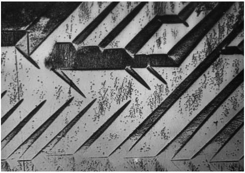

<details>
<summary>natural_image</summary>

Abstract geometric pattern with diagonal lines and a central rectangular structure (no text or symbols)
</details>

Bild 46.9 Domänenstruktur eines Eisen-Einkristalls (150-fach vergrößert; sichtbar gemacht mit Hilfe der Methode der Bitterschen Streifen)

Oberhalb des CURIE-Punktes verhalten sich die ferromagnetischen Stoffe paramagnetisch. Für Temperaturen $T > T _ { \mathrm { C } }$ gilt daher für die Temperaturabhängigkeit ihrer Suszeptibilitäten ein zu (46.6) analoges Gesetz, wenn man anstelle der absoluten Temperatur T ihren Überschuss über die CURIE-Temperatur einsetzt:

$$
\chi_ {\mathrm{m}} = \frac {C}{T - T _ {\mathrm{C}}} \quad (\text {CURIE - WEISSsches Gesetz}). \tag {46.7}
$$

Der CURIE-Punkt ist stark legierungsabhängig. Es gibt ferromagnetische Legierungen, deren CURIE-Punkt unterhalb Raumtemperatur liegt, d. h., dass sie bei dieser Temperatur bereits ihren Ferromagnetismus verlieren und paramagnetisch werden. Der CURIE-Punkt von reinem Eisen liegt bei $7 7 4   ^ { \circ } \mathrm { C } ,$ von Nickel bei $372 ^{\circ} C ;$ bei den sog. HEUSLERschen Legierungen, die ausschließlich aus nichtferromagnetischen Metallen bestehen, aber dennoch ferromagnetisch sind, ist $T _ { \mathrm { C } } < 1 0 0   ^ { \circ } \mathrm { C } .$

Es zeigt sich, dass Ferromagnetismus bei denjenigen Elementen auftritt, bei denen das Verhältnis der Gitterkonstante a des Kristallgitters zum Radius der äußeren, nicht voll besetzten Elektronenschale r zwischen $^ { 3 , 2 }$ und $^ { 6 , 2 }$ liegt. Dies ist der Fall bei Eisen, Nickel und Cobalt, bei den ferromagnetischen Legierungen dieser Elemente sowie bei den Metallen der Seltenen Erden. Bei größeren Werten von a/r stellt sich paramagnetisches Verhalten ein, da bei größeren Entfernungen der Atome die Kopplungskräfte nicht mehr ausreichen, um eine Parallelstellung der Spinmomente herbeizuführen.

Verkleinert sich jedoch das Verhältnis $a / r$ unter den Wert von etwa 3,2, so stellen sich benachbarte Spinmomente in die energetisch günstigere antiparallele Lage ein; man spricht dann von **Antiferromagnetismus**. Typische Vertreter dieser Gruppe sind Mangan (Mn), die Verbindungen MnO und $\mathrm { M n F _ { 2 } }$ sowie $\alpha -Fe _2 O _3$ . Diese Antiferromagnetika zeichnen sich, ebenso wie die Ferromagnetika, durch eine spontane Magnetisierung aus, obwohl sie nach außen hin diamagnetisch erscheinen. Das liegt daran, dass das Atomgitter dieser Stoffe aus zwei ferromagnetischen „Untergittern“ zusammengesetzt ist, die gegeneinander verschoben sind und deren Gitterbausteine zwar parallelen, aber entgegengesetzten Spin haben, so dass sich die entsprechenden magnetischen Wirkungen nach außen hin völlig kompensieren.

Unterscheiden sich die beiden Untergitter mit antiparallelem Spin durch unterschiedliche Stärke oder Anzahl ihrer atomaren Momente, so dass sie sich jetzt nicht mehr gegenseitig kompensieren, sondern ein Differenzmoment wirksam wird, so gelangt man zur Erscheinung des **Ferrimagnetismus**. Die entsprechenden Vertreter nennt man Ferrite. Sie zeigen ein den ferromagnetischen Stoffen ähnliches Verhalten.

Trotz der vollständigen Ausrichtung der Spinmomente in den WEISSschen Bezirken sind Ferromagnetika nach außen hin unmagnetisch, solange kein Magnetfeld auf sie einwirkt. Das ist darauf zurückzuführen, dass diese Bezirke hinsichtlich ihrer Magnetisierungsrichtungen im

---

46.7 Ferromagnetismus, Antiferro- und Ferrimagnetismus

575

Stoff eine völlig regellose Verteilung zeigen, wodurch sich die Effekte nach außen hin aufheben (Bild 46.10a). Da eine sprunghafte Änderung der Magnetisierungsrichtung von einem Bezirk zum anderen energetisch ungünstig ist, befinden sich zwischen den WEISSschen Bezirken Grenzschichten, die sog. **BLOCH-Wände**, innerhalb derer ein stetiger Übergang der Spinorientierung erfolgt (Bild 46.11).

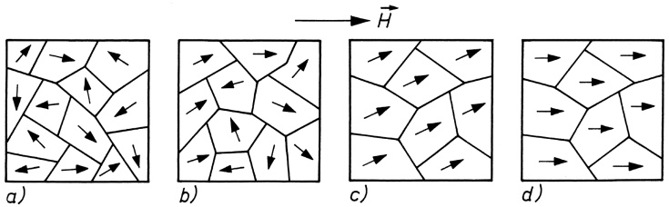

<details>
<summary>flowchart</summary>

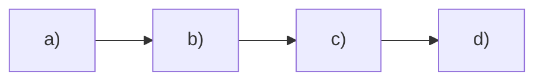
</details>

Bild 46.10 Stadien des Magnetisierungsvorgangs in Eisen:

a) regellose Orientierungsverteilung der resultierenden magnetischen Momente innerhalb der weissschen Bezirke (Domänen)

b) schwache Magnetisierung im Bereich der reversiblen Wandverschiebungen

c) Umklappen der Spinmomente in eine energetisch günstige Lage im Bereich der irreversiblen Wandverschiebungen

d) Eindrehen der Spinmomente in die Richtung des äußeren Magnetfeldes (Sättigung)

Durch Anlegen eines zunächst schwachen äußeren Magnetfeldes findet ein Ausrichten einzelner Bezirke in Richtung des angelegten Feldes statt, wodurch eine geringe makroskopische Magnetisierung auftritt (Bild 46.10b). Dabei wächst die Anzahl derjenigen Bezirke, die mit ihrer spontanen Magnetisierungsrichtung den kleinsten Winkel zum äußeren Magnetfeld bilden, auf Kosten benachbarter Bezirke mit weniger günstiger Lage der magnetischen Momente. Dieser Mechanismus beruht auf einer Verschiebung der BLOCH-Wände.

Diese Wandverschiebungen sind bei kleinen Feldstärken reversibel, d. h., bei Wegnahme des äußeren Feldes wandern die Wände zurück. Bei weiterer Erhöhung der Feldstärke verschieben sich die BLOCH-Wände weiter zu Gunsten der energetisch bevorzugten Bereiche, indem die Mehrzahl der magnetischen Momente in die energetisch günstige Richtung umklappt (Bild 46.10c). Dies ist der Bereich der sog. irreversiblen BARKHAUSEN-Sprünge. Infolge dieses Umklappvorgangs der magnetischen Momente werden in einer die magnetisierte Eisenprobe umgebenden Induktionsspule geringe Spannungsstöße induziert, die nach entsprechender Verstärkung mit Hilfe eines Lautsprechers als prasselndes Geräusch hörbar gemacht werden können (BARKHAUSEN-Effekt).

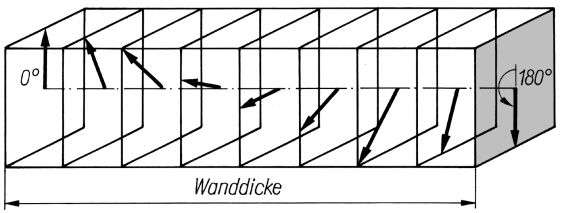

<details>
<summary>text_image</summary>

0°
180°
Wanddicke
</details>

Bild 46.11 Stetiger Übergang der Magnetisierungsrichtung innerhalb einer 180◦-Bloch-Wand

Bei noch höheren Feldstärken setzen die reinen Drehprozesse ein, indem die Momente der spontanen Magnetisierung fast vollständig in die Feldrichtung eingestellt werden (Bild 46.10d). Damit ist die Sättigung erreicht (vgl. Bild 29.2). Lässt man nun die Feldstärke wie-

---

576

46 Elektrische und magnetische Eigenschaften von Festkörpern

der auf null zurückgehen, so werden dadurch zwar die Drehprozesse und die zum Teil noch vorhandenen reversiblen Wandverschiebungen rückgängig gemacht, nicht dagegen die irreversiblen, so dass ein bestimmter Restbetrag an Magnetisierung, die Remanenz, erhalten bleibt. Der remanente Magnetismus kann durch ein ihm entgegengerichtetes äußeres Magnetfeld von der Größe der Koerzitivfeldstärke $H _ { \mathrm { K } }$ wieder zum Verschwinden gebracht werden (Hysterese, vgl. 29.2).

## 46.8 Supraleitung. Der Josephson-Effekt

1911 beobachtete KAMERLINGH ONNES bei Experimenten im Bereich tiefster Temperaturen, dass der elektrische Widerstand von reinem Quecksilber mit sinkender Temperatur immer mehr abnimmt, um dann bei Unterschreiten von 4,2K, der sog. Sprungtemperatur oder kritischen Temperatur $T _ { \mathrm { c } }$ des Quecksilbers, sprunghaft auf einen unmessbar kleinen Wert abzufallen. Eine Folge dieser als **Supraleitfähigkeit** bezeichneten Erscheinung ist, dass ein in einem supraleitenden Ring induzierter elektrischer Strom als Dauerstrom über Jahre praktisch konstant fließen kann. Weiterhin wurde bereits 1933 die Fähigkeit von Supraleitern beobachtet, Magnetfelder aus ihrem Inneren zu verdrängen (MEISSNER-OCHSENFELD-Effekt, Bild 46.12a,b). Wenn jedoch ein äußeres Magnetfeld einen bestimmten Wert, die kritische Induktion $B _ { \mathrm { { C } } } ,$ übersteigt, geht die Supraleitung schlagartig in die Normalleitung über, und der Körper wird vom äußeren Magnetfeld wieder vollständig durchsetzt. (Bild 46.12c). Auch das vom Suprastrom erzeugte eigene Magnetfeld wird in dieser Weise verdrängt. Daher wird bei Überschreiten einer kritischen Stromdichte $j _ { \mathrm { c } }$ , wenn an der Oberfläche des Leiters die kritische Induktion $B _ { \mathrm { c } }$ erreicht ist, die Supraleitung ebenfalls schlagartig aufgehoben. Stoffe mit diesen Eigenschaften bezeichnet man als **Supraleiter I. Art**.

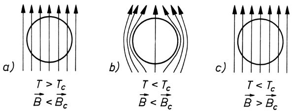

Bild 46.12 Meissner-Ochsenfeld-Effekt: Supraleiter im äußeren Magnetfeld oberhalb und unterhalb der kritischen Temperatur $T _ { \mathrm { c } }$ und der kritischen Induktion $B _ { \mathrm { c } }$

1957 gelang BARDEEN, COOPER und SCHRIEFFER erstmals die Aufstellung einer mikroskopischen Theorie der Supraleitung, kurz **BCS-Theorie** genannt, die davon ausgeht, dass sich unterhalb der Sprungtemperatur $T _ { \mathrm { c } }$ je zwei Elektronen von entgegengesetzt gleichem Impuls und Spin durch den Austausch von (virtuellen) Phononen – den Schwingungsquanten des Kristallgitters – und teilweiser Überwindung der COULOMB-Abstoßung anziehen und je ein sog. **COOPER-Paar** mit dem Spin null bilden. Alle COOPER-Paare befinden sich im gleichen Quantenzustand, d. h., sie haben gleiche Energie und gleichen Impuls. Beim Anlegen einer elektrischen Spannung nehmen sie allesamt den gleichen Impuls auf. Damit ist es unmöglich, dass ein einzelnes oder einige von ihnen mit dem Kristallgitter in Wechselwirkung treten, da sie dann in einen anderen Zustand übergehen müssten. Das hat zur Folge, dass sich das Gesamtsystem der COOPER-Paare widerstandsfrei durch das Gitter bewegt. Erst oberhalb $T _ { \mathrm { c } }$ reicht die

---

46.8 Supraleitung. Der Josephson-Effekt

577

thermische Energie aus, um alle COOPER-Paare zu trennen und den supraleitenden Zustand zu beenden.

Die in den Supraleitern I. Art möglichen Stromdichten sind für großtechnische Anwendungen zu gering. Wichtigen Auftrieb für die technische Anwendung der Supraleitung gab die Entdeckung von Materialien wie Nb-Ti, $\mathrm { N b _ { 3 } A l }$ oder $\mathrm { N b _ { 3 } S n } ,$ welche im Unterschied zu den Supraleitern I. Art zum Teil sehr hohe Magnetfelder aushalten, ohne normalleitend zu werden. Bei ihnen dringt mit wachsender Induktion B das Magnetfeld nur allmählich in den Supraleiter ein, bis es den Körper völlig durchdrungen hat, worauf dieser erst dann normalleitend wird. Davor existiert ein „Mischzustand“ aus supraleitenden und normalleitenden Gebieten, wobei die normalleitenden Gebiete im Supraleiter ein regelmäßiges Muster aus sog. Flussschläuchen bilden, von denen jeder die kleinste Einheit des magnetischen Flusses, das **Flussquant** $\varPhi _ { 0 } = h / ( 2 e )$ , vgl. 44.3, bzw. ein ganzzahliges Vielfaches desselben führt (Bild 46.13). Jeder dieser Flussschläuche ist von Ringströmen im Supraleiter umgeben. Solche Materialien nennt man **Supraleiter II. Art**.

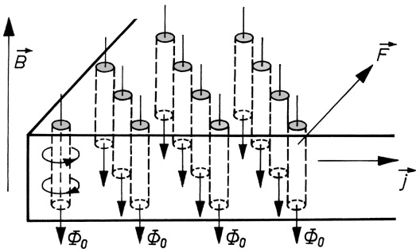

<details>
<summary>text_image</summary>

B
F
j
Φ₀
Φ₀
Φ₀
Φ₀
</details>

Bild 46.13 Schema eines Flussschlauchgitters in Supraleitern II. und III. Art. Die Flussschläuche sind normalleitend. (B magnetische Induktion, $j$ Stromdichte, F auf die Flussschläuche wirkende Lorentz-Kraft, $\Phi _ { 0 }$ Flussquant)

Schickt man einen Strom mit der Stromdichte j durch den Supraleiter im Mischzustand, so übt er auf jeden Flussschlauch eine LORENTZ-Kraft F senkrecht zu B und j aus (Bild 46.13), unter deren Wirkung die Flussschläuche quer zur Stromrichtung durch den Supraleiter hindurchwandern. Diese Bewegung ist verlustbehaftet, und es entsteht ein elektrischer Widerstand. Um dies zu verhindern, werden durch gezielte Erzeugung von Haftstellen (Pinning-Zentren) in Form von Materialinhomogenitäten wie $\mathbf { Z } .$ B. Versetzungen (vgl. 13.6), Ausscheidungen oder Korngrenzen die Flussschläuche verankert, wodurch die Supraleitung erhalten bleibt (sog. **harte Supraleiter** oder **Supraleiter III. Art**).

Der entscheidende Durchbruch in den jahrzehntelangen Bemühungen um eine Erhöhung der Sprungtemperatur $T _ { \mathrm { c } }$ gelang BEDNORZ/MÜLLER (1986) mit der Entdeckung der Hochtemperatur-Supraleitung (ebenfalls Supraleitung II. Art) an La-Ba-Sr-Cu-Oxiden bei 35K. Inzwischen wurden an oxidkeramischen Supraleitern Sprungtemperaturen oberhalb der Siedetemperatur des flüssigen Stickstoffs (77K) erreicht. Damit entfällt bei Funktionselementen aus hoch- $T _ { \mathrm { c } }$ -supraleitenden Materialien die kryotechnisch aufwändige und teure Kühlung mit flüssigem Helium (Siedetemperatur 4K). Die bei den Hoch- $\cdot T _ { \mathrm { C } ^ { 1 } }$ **-**Supraleitern beobachteten hohen Sprungtemperaturen (an einer Hochdruckphase von $\mathrm { H } _ { 2 } S$ bisher maximal 203K erreicht) vermag allerdings die oben beschriebene BCS-Theorie allein nicht zu erklären. Daher werden gegenwärtig mehrere andere Mechanismen für die Paarbildung untersucht.

**JOSEPHSON-Effekt.** Durch eine nur wenige Atomabstände dicke Isolationsschicht zwischen zwei supraleitenden Metallen können nach JOSEPHSON (1962) nicht nur Einzelelektronen, sondern auch COOPER-Paare hindurch„tunneln“ (Tunneleffekt, vgl. 45.4). Durch den Tunnelkontakt zwischen den beiden übereinander liegenden Metallstreifen 1 und 2 eines JOSEPH-

---

578

46 Elektrische und magnetische Eigenschaften von Festkörpern

SON-Elements (Bild 46.14) kann bei der Spannung $U = 0$ ein verlustloser Supragleichstrom fließen. Sein Maximalwert ist abhängig vom äußeren Magnetfeld. Dies führt zu den derzeit empfindlichsten Detektoren für den magnetischen Fluss $\Phi ,$ den so genannten SQUIDs (Supraleitende **Qu**anten-Interferenz-Detektoren). Nach Überschreiten eines kritischen Stromes tritt am Tunnelkontakt ein Spannungsabfall auf, der von einem hochfrequenten COOPER-Paar-Wechselstrom begleitet ist. Seine Frequenz,

$$
f = \frac {2 e U _ {\mathrm{J}}}{i h}, i = 1, 2, 3, \dots \quad (\text {JOSEPHSON - Gleichung}), \tag {46.8}
$$

ist der am Kontakt anliegenden Spannung $U _ { \mathrm { J } }$ proportional und hängt bemerkenswerterweise nur noch von den Elementarkonstanten e und h ab, womit sich u. a. hoch präzise Spannungsnormale herstellen lassen (s. unten). Mit dieser Frequenz wird auch die dem Kontakt zugeführte Energie in Form elektromagnetischer Strahlung abgegeben, die – ähnlich der Laserstrahlung – kohärent ist. Auf der Basis der JOSEPHSON-Effekte ergeben sich zahlreiche praktische Anwendungsmöglichkeiten wie die Konstruktion von Sendern und Empfängern höchster Empfindlichkeit im Mikrowellenbereich, schnelle Digitalelektronik, Datenspeicher, Präzisionsmessung physikalischer Elementarkonstanten u. a. m.

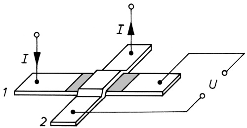

<details>
<summary>text_image</summary>

I
1
2
I
U
</details>

Bild 46.14 Josephson-Element (Dicke der Isolationsschicht zwischen den beiden supraleitenden Stoffen 1 und 2 etwa 1 ... 10 nm)

**Das Internationale Einheitensystem (SI).** Auf dem JOSEPHSON-Effekt beruht in Verbindung mit dem Quanten-HALL-Effekt (s. 28.8) eine Neudefinition der Basiseinheiten A m p e r e (A) und K i l o g r a m m (kg) auf der Grundlage von universellen Naturkonstanten (s. 2.1 und 2.3). Die Wechselspannung $U _ { \mathrm { J } }$ eines COOPER-Paar-Wechselstroms durch einen supraleitenden Tunnelkontakt ist mit ihrer Frequenz $f$ gemäß der JOSEPHSON-Gleichung (46.8) $U _ { \mathrm { J } } = i h f / ( 2 e )$ $i = 1 , 2 , 3 , \ldots$ , verknüpft. Wählt man als Frequenz $f$ die die Zeiteinheit S e k u n d e definierende Frequenz $f _ { \mathrm { C s } }$ des Hyperfeinstrukturübergangs von $^ { 1 3 3 } \mathrm { C s } \; ( \mathrm { s . } \; 3 . 1 )$ , so lässt sich auf dieser Grundlage ein Spannungsnormal definieren, das die Einheit der elektrischen Spannung V o l t (V) direkt mit der Elementarladung e und dem PLANCKschen Wirkungsquantum h verknüpft. Der elektrische Strom durch eine HALL-Sonde in einem sehr starken Magnetfeld, deren HALL-Spannung gleich dieser JOSEPHSON-Spannung ist, $U _ { \mathrm { H } } = U _ { \mathrm { J } } = i h f _ { \mathrm { C s } } / ( 2 e )$ , hat nach (28.24) im Bereich des Quanten-HALL-Effektes die Stromstärke $I = U _ { \mathrm { { J } } } / R _ { \mathrm { { H } } } = i z h f _ { \mathrm { { C s } } } / ( 2 e R _ { \mathrm { { H 0 } } } ) = i z e f _ { \mathrm { { C s } } } ,$ womit die SI-Basiseinheit A m p e r e (s. Abschnitt 28.6) direkt auf die Elementarladung e und das die Zeiteinheit festlegende Frequenznormal $f _ { \mathrm { C s } }$ zurückgeführt ist; es ergibt sich $1 \mathrm { A } = 6 . 7 8 9   6 8 7 \cdot 1 0 ^ { 8 } e f _ { \mathrm { C s } }$

Darüber hinaus ermöglichen Präzisionsmessungen mittels JOSEPHSON-Elementen und einem V. KLITZING-Widerstandsnormal $R _ { \mathrm { H 0 } }$ (s. 28.8) gemäß der JOSEPHSON-Gleichung (46.8) $U _ { \mathrm { J } } =$ $i h f / ( 2 e ) \approx h f /$ e bzw. derjenigen für den Quanten-HALL-Widerstand (28.26) $R _ { \mathrm { H } } = h / ( z e ^ { 2 } )$ die Rückführung der elektrischen Leistung $P = U I = U ^ { 2 } / R \left( \mathbf { s } .   2 5 . 4 \right)$ allein auf das PLANCKsche Wirkungsquantum h und die Caesium-Frequenz $f _ { \mathrm { C s } } ; P \approx h f _ { \mathrm { C s } } ^ { 2 }$ . Andererseits enthält der entsprechende Ausdruck für die mechanische Leistung $P = F \nu = m a \nu$ (s. 7.2) einer unter der Wirkung

---

46.9 Supraflüssigkeit

579

der Kraft $F$ mit der Geschwindigkeit v sich bewegenden Masse m (wie eine einfache Einheitenanalyse $[ P ] = [ m ] [ a ] [ \nu ] = \mathbf { k g m } ^ { 2 } \mathbf { s } ^ { - 3 }$ in Verbindung mit der Zeit- und Meterdefinition in Abschnitt 3.1 zeigt) neben $f _ { \mathrm { C s } }$ und der Lichtgeschwindigkeit c auch die Masse des Kilogramm-Prototyps $m \approx m _ { \mathrm { k g } } = 1$ kg (s. 4.3): $P \approx m _ { \mathrm { k g } } c ^ { 2 } f _ { \mathrm { C s } }$ . Aus dem Vergleich der beiden Ausdrücke für $P$ ergibt sich die Möglichkeit der Rückführung der Einheit der Masse auf die Naturkonstanten $h ,   c$ und $f _ { \mathrm { C s } } { : } m _ { \mathrm { k g } } \approx h c ^ { - 2 } f _ { \mathrm { C s } }$ . Mit den aus CODATA 2018 stammenden Werten für $h ,$ c und $f _ { \mathrm { C s } }$ ergibt sich $1 \mathrm { k g } = 1 . 4 7 5   5 2 1 4 \cdot 1 0 ^ { 4 0 } h c ^ { - 2 } f _ { \mathrm { C s } }$

Die experimentelle Realisierung dieser Kilogrammdefinition erfolgt mittels einer sog. Wattoder KIBBLE-Waage, bei der sich eine im Gravitationsfeld der Feldstärke G mit konstanter Geschwindigkeit v bewegende Masse im Gleichgewicht mit der LORENTZ-Kraft $F _ { \mathrm { L } } = I I B = U I / \nu$ (s. Abschnitte 28.6 und 30.4) auf einen durch diese Bewegung im Magnetfeld B induzierten elektrischen Strom I befindet: m $G = U I / \nu$

## 46.9 Supraflüssigkeit

Gewöhnliches Helium geht unterhalb von 2,2K in **Helium II** über, es wird supraflüssig und hat dann abnorme Eigenschaften, durch die es von allen anderen Flüssigkeiten stark abweicht. Auf Grund seiner überaus geringen Viskosität $( 0 \ldots 1 0 ^ { - 6 } \mathrm { P a } \cdot \mathrm { s } )$ kann Helium II wie eine ideale Flüssigkeit praktisch reibungsfrei durch engste Kapillaren fließen, und ein Wirbel in ihm bleibt unbegrenzt lange erhalten, ähnlich wie Ströme in supraleitenden Ringen ohne Spannungsquelle jahrelang fließen können. Wegen der verschwindend geringen Zähigkeit kriecht Helium II in einer sehr dünnen Schicht an den Gefäßwänden hoch, gelangt an wärmere Stellen und verdampft dort. Mit nur $0 ,   1 \mathrm { g } / \mathrm { c m } ^ { 3 }$ hat Helium II die kleinste Dichte aller Flüssigkeiten.

Die Supraflüssigkeit, die nur beim Heliumisotop $\mathrm { _ 2 ^ { 4 } H e }$ (nicht dagegen bei $\mathrm { { } _ { 2 } ^ { 3 } H e ) }$ auftritt, ist darauf zurückzuführen, dass in diesem Isotop die DE-BROGLIE-Wellenlänge (43.20) $\lambda = h / p$ der Heliumatome die Größenordnung der mittleren Atomabstände erreicht, was makroskopische Quanteneffekte zur Folge hat. Sie führen dazu, dass flüssiges Helium bis zu beliebig tiefen Temperaturen existieren kann. Nach der klassischen Mechanik müssten alle Substanzen in der Nä- he von $T = 0 1$ K wegen der fehlenden kinetischen Energie und der Forderung minimaler potenzieller Energie kristallisieren (Wasserstoff z. B. bei 13,9K). Die Existenz von flüssigem Helium bis zu beliebig tiefen Temperaturen beruht einerseits auf der geringen Atommasse, andererseits auf der schwachen Wechselwirkung der Edelgasatome untereinander.
