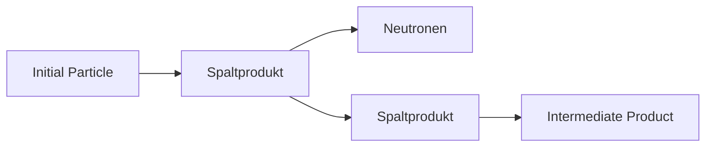

# 49 Künstliche Kernumwandlungen

原始 PDF 第 602–609 页。

49

Künstliche Kernumwandlungen

## 49.1 Arten künstlicher Kernumwandlungen

Die erste künstliche Kernumwandlung wurde 1919 von RUTHERFORD entdeckt. Er wies nach, dass sich durch Beschuss von Stickstoffatomen mit energiereichen α-Teilchen der Stickstoffkern bei Abgabe eines Protons in einen Sauerstoffkern umwandelt:

$$
{ } _ { 7 } ^ { 1 4 } \mathrm{N} + { } _ { 2 } ^ { 4 } \alpha \rightarrow { } _ { 8 } ^ { 1 7 } \mathrm{O} + { } _ { 1 } ^ { 1 } \mathrm{p} \tag {49.1}
$$

oder in einfacherer Schreibweise

$$
{ } _ { 7 } ^ { 1 4 } \mathrm{N} (\alpha , \mathrm{p}) _ { 8 } ^ { 1 7 } \mathrm{O}
$$

(hier steht links in der Klammer das eingeschossene, rechts das emittierte Teilchen). Die Kernumwandlung vollzieht sich dabei $\mathbf { s o } ,$ dass zunächst das anregende Teilchen, wenn seine Energie zur Überwindung des Potenzialwalls des Kerns groß genug ist, vom Atomkern eingefangen wird. Es bildet sich ein **Zwischenkern** (im vorliegenden Fall $^ { 1 8 } _ { 9 } \mathrm { F ) }$ , der instabil ist, weswegen er seinen Zustand in äußerst kurzer Zeit (etwa $1 0 ^ { - 1 \widetilde { 2 } }   \mathbf { s } )$ ändert. Für die Umbildung des Zwischenkerns in den Endkern bestehen nun mehrere Möglichkeiten:

1. Das eingeschossene Teilchen a (oder ein bereits im Kern enthaltenes gleichartiges Teilchen) wird vom Kern mit gleicher Energie wieder emittiert, jedoch in einer Richtung, die im Allgemeinen von der des eintretenden Teilchens abweicht. In Analogie zum Stoß zweier elastischer Kugeln wird dieser Prozess als **elastische Kernstreuung** bezeichnet. Die Kernreaktion ist vom Typ $\mathrm { K } _ { \mathsf { a } } ( \mathsf { a } , \mathsf { a } ) \mathrm { K } _ { \mathsf { e } }$ mit $\mathrm { K _ { a } }$ als Ausgangskern (Targetkern) und $\mathrm { K } _ { \mathrm { e } }$ als Endkern.
2. Der Zwischenkern emittiert das gleiche Teilchen bzw. ein Teilchen gleicher Sorte, das er absorbiert hat, aber ein Teil der kinetischen Energie bleibt im Kern zurück. Der Kern wird dadurch „angeregt“. Diese Anregungsenergie wird als γ-Strahlung emittiert **(unelastische Kernstreuung)**. Diese Reaktion ist vom Typ $\mathrm { K } _ { \mathrm { a } } ( \mathrm { a } , \mathrm { a } ^ { \prime } ) \mathrm { K } _ { \mathrm { e } }$ , wobei $\mathsf { a } ^ { \prime }$ eine geringere Energie hat als a.

Die beiden Arten von Kernstreuungen stellen keine Kernumwandlungen im eigentlichen Sinne dar, da Ausgangs- und Endkern identisch sind. Anders verlaufen jene Reaktionen, bei denen das eingeschossene Teilchen im Zwischenkern verbleibt und andere Teilchensorten emittiert werden. Dabei unterscheidet man die folgenden beiden Fälle:

3. Der Zwischenkern emittiert ein anderes Teilchen als das eingeschossene. Der hoch angeregte Kern sendet häufig außerdem noch γ-Strahlung aus. Diese Kernreaktion ist vom Typ $\mathrm { K _ { a } ( a , b ) K _ { e } }$ und heißt **Austauschreaktion**. Ein Beispiel dafür ist die erste künstliche Kernumwandlung (49.1).

4. Der Zwischenkern emittiert kein Teilchen, sondern lediglich γ-Strahlung. Das eingefangene Teilchen wird in den Kern eingebaut (**Einfangreaktion** $\mathrm { K _ { a } ( a , y ) K _ { e } ) }$ . Beispiel: Der Neutronen-Einfang durch Cadmium-Regelstäbe im Kernreaktor $\stackrel { 1 1 3 } { _ { 4 8 } } \mathrm { C d } ( \stackrel { \cdot } { \mathbf { n } } , \gamma ) _ { \quad 4 8 } ^ { 1 1 4 }$ Cd (stabil).

---

600

49 Künstliche Kernumwandlungen

Bei diesen Reaktionen kann auch aus dem kurzlebigen Zwischenkern ein instabiler, erst nach einer messbaren mittleren Lebensdauer zerfallender Kern entstehen. Wegen der Verwandtschaft dieses Vorgangs mit der natürlichen Radioaktivität wird dieser Prozess als **künstliche Radioaktivität** bezeichnet. Sie wurde 1934 von dem Forscherehepaar IRÈNE und FRÉDÉRIC JOLIOT-CURIE entdeckt.

5. Schließlich sei vermerkt, dass auch durch γ-Strahlung Kernumwandlungen hervorgerufen und dabei Kernteilchen aus dem Kern herausgeschleudert werden können. Man spricht von **Kernphotoeffekt** $\mathrm { K } _ { \mathrm { a } } ( \mathrm {  { \gamma } } , \mathrm {  { b } } ) \mathrm { K } _ { \mathrm { e } } ,$ gewissermaßen als Umkehrung der Einfangreaktion 4. Beispiel: $\mathrm { _ { 1 } ^ { 2 } D ( \gamma , n ) _ { 1 } ^ { 1 } H }$ (D Deuterium).

Weitere, besonders wichtige Kernreaktionen sind die **Kernspaltung** und die **Kernfusion**. Sie werden in Abschnitt 49.3 und 49.5 gesondert behandelt.

Im Allgemeinen reichen für die Erzeugung von gezielten Kernumwandlungen sowohl die Ausbeuten als auch die Energien der natürlichen Strahlenquellen (z. B. α-Teilchen mit etwa 8MeV) bei weitem nicht aus, sondern es ist für ausgedehnte und systematische Untersuchungen notwendig, Kerngeschosse verschiedener Art, wie α-Teilchen, Deuteronen, Tritonen, Protonen und Neutronen, mit hohen Energien künstlich zu erzeugen. Diesem Zweck dienen die **Teilchenbeschleuniger** (Linear- bzw. Kreisbeschleuniger, je nachdem, ob die Teilchen während ihrer Beschleunigung geradeaus fliegen oder auf kreisbzw. spiralförmigen Bahnen geführt werden; vgl. Zyklotron und Synchrotron in Abschnitt 28.7).

## 49.2 Massen- und Energiebilanz von Kernreaktionen. Wirkungsquerschnitt

Wie bei chemischen Reaktionen unterscheidet man auch bei den Kernreaktionen zwischen exo- und endothermen Reaktionen. Sind $m _ { 1 }$ und $m _ { 2 }$ die Massen der Reaktionspartner (Ausgangskern und Stoßteilchen) und $m _ { 1 } ^ { \prime }$ und $m _ { 2 } ^ { \prime }$ die Massen der Reaktionsprodukte (Endkern und emittiertes Teilchen einschließlich γ-Quanten), ist weiterhin E die kinetische Energie der Kerne vor der Reaktion und $E ^ { \prime }$ die kinetische Energie der Kerne einschließlich Strahlungsenergie nach der Reaktion, so muss nach dem Energiesatz gelten

$$
m _ {1} + m _ {2} + \frac {E}{c ^ {2}} = m _ {1} ^ {\prime} + m _ {2} ^ {\prime} + \frac {E ^ {\prime}}{c ^ {2}} \tag {49.2}
$$

(c Vakuum-Lichtgeschwindigkeit). Daraus ergibt sich für die Energietönung der Reaktion

$$
Q = E ^ {\prime} - E = [ (m _ {1} + m _ {2}) - (m _ {1} ^ {\prime} + m _ {2} ^ {\prime}) ] c ^ {2} \quad (\text {Reaktionsenergie}). \tag {49.3}
$$

Die Reaktion ist **exotherm** für $Q > 0$ und **endotherm** für $Q < 0$

## Beispiele 49.1:

$I . \; _ { 3 } ^ { 7 } \mathrm { { \bf { L i } } } + { } _ { 1 } ^ { 1 } \mathrm { { \bf { H } } } \left( \mathrm { { \bf { P r o t o n } } } \right) \; \rightarrow \; 2 \: _ { 2 } ^ { 4 } \mathrm { { \bf { H e } } } + Q . \; - \mathrm { { \bf { D i e } } }$ rechte Seite hat, wie man anhand von Tabellenwerten für die Kern- bzw. Teilchenmassen errechnet, eine um $0 { , } 0 1 8 7 \mathrm { { u } } ( \mathrm { { u } } = 1 { , } 6 6 \cdot 1 0 ^ { - 2 7 }$ kg atomare Masseneinheit) zu kleine Masse, was nach (47.4) einer Energie von 17,4MeV entspricht, die in Form von kinetischer Energie $E ^ { \prime }$ der beiden entstehenden α-Teilchen frei wird. Zu berücksichtigen ist noch die kinetische Energie von $E = 0 , 4   \mathrm { M e V } ,$ die aufzuwenden ist, damit das Proton in den Kern eindringen kann. Es ist also hier $Q = 1 7 , 0 \mathrm { M e V }$ (exotherm).

---

49.3 Kernspaltung. Gewinnung von Kernspaltungsenergie

601

$2 . \mathrm {  ~ _ 3 ^ 7 ~ L i + \mathrm {  ~ _ 1 ^ 1 ~ H ~ } \rightarrow \mathrm {  ~ _ 4 ^ 7 ~ B e + n + Q . ~ } ~ }$ – Experimentell wurde festgestellt, dass die Energie E des Protons mindestens $1 { , } 7 6 \mathrm { M e V }$ betragen muss, während die des Neutrons $E ^ { \prime }$ nur 0,16MeV beträgt, d. h., nach (49.3) ist $Q < 0$ (endotherm). Folglich muss die Summe der Massen auf der linken Seite um 0,0017u kleiner sein als die auf der rechten, womit die Masse des instabilen Be-Kerns berechnet werden kann (wichtige Methode zur Bestimmung von Kernmassen ohne Massenspektrograph). □

**Wirkungsquerschnitt.** Nur ein kleiner Bruchteil der Kerngeschosse löst die gewünschte Kernreaktion aus, bei geladenen Teilchen meist nur eins von $1 0 ^ { 4 }$ bis $1 0 ^ { 7 }$ Geschossen. Wegen der Kleinheit der Kerne sind direkte Treffer sehr selten. Als Maß für die Ausbeute von Kernreaktionen definiert man den Wirkungsquerschnitt $\sigma$ als Anzahl der herbeigeführten Kernreaktionen (Treffer) bezogen auf die Schusszahl $\mathrm { j e \; m } ^ { 2 }$ Querschnittsfläche (Trefferwahrscheinlichkeit). Sind z. B. 10 Schuss auf eine Scheibe von $1   \mathrm { c m } ^ { 2 }$ nötig, um einen Treffer zu erzielen, so ist $\sigma = 1   \mathrm{Treffer} / (10   \mathrm{Schuss} / \mathrm{cm}^2) = 1   \mathrm{Treffer} / (10^5   \mathrm{Schuss} / \mathrm{m}^2) = 10^{-5}   \mathrm{m}^2$ . Das ist diejenige Querschnittsfläche, die ein (hier auf $1   \mathrm { c m } ^ { 2 }$ Querschnitt vergrößert gedachter) Kern einem auf ihn gerichteten Geschossstrom effektiv entgegenstellt, um eine Kernreaktion auszulösen. Maßgebend ist also nicht der wirkliche Querschnitt des Kerns, sondern sein Wirkungsquerschnitt $\sigma ,$ der ganz davon abhängt, wie viele der aufgeschossenen Teilchen wirklich zu einer Reaktion führen.

## Der Wirkungsquerschnitt ist ein Maß für die Wahrscheinlichkeit, dass ein aufgeschossenes Teilchen eine bestimmte Reaktion auslöst.

Ist N die Anzahl der im Volumen V enthaltenen Atome, z die Anzahl der auftreffenden Teilchen und ∆z die Teilchenzahl, die in der Schichtdicke ∆x Reaktionen auslöst, so gilt

$$
\sigma = \frac {V \Delta z}{z N \Delta x} \quad (\text {Wirkungsquerschnitt}). \tag {49.4}
$$

$\sigma$ ist von der Energie der Stoßteilchen und der Art der Kernumwandlung abhängig und liegt meist zwischen $1 0 ^ { - 2 8 }$ und $1 0 ^ { - 3 1 }   \mathrm { { m } ^ { 2 } }$ . Eine häufig verwendete SI-fremde Einheit für σ ist das B a r n (b): 1b $=$ $10^{-28}    m ^2 = 100    fm ^2$

Je nach Art der erzielten Wirkung spricht man im Einzelnen vom Streuquerschnitt $\sigma _ { S }$ , Einfangquerschnitt (Absorptionsquerschnitt) $\sigma _ { \mathrm { A } } ,$ , Spaltquerschnitt $\sigma _ { \mathrm { F } }$ usw. Der **totale Wirkungsquerschnitt** σT gibt dann die Wahrscheinlichkeit dafür an, dass das Teilchen auf irgendeine Weise mit dem Kern reagiert, und ist gleich der Summe $\sigma _ { \mathrm { T } } = \sigma _ { \mathrm { S } }   +   \sigma _ { \mathrm { A } }   +   \sigma _ { \mathrm { F } }$

## 49.3 Kernspaltung. Gewinnung von Kernspaltungsenergie

Eine Kernreaktion ganz anderer Art als die in Abschnitt 49.1 beschriebenen ist die 1938/39 von HAHN, STRASSMANN und MEITNER entdeckte **Kernspaltung**. Auf der Suche nach Transuranen fanden sie, dass der einem Neutronenbeschuss ausgesetzte Kern des $^ { 2 3 5 } _ { 9 2 } \mathrm { U }$ in zwei meist ungleich schwere Teile zerfällt und dabei mehrere weitere Neutronen frei werden (Bild 49.1). Stellt man sich den Atomkern als Flüssigkeitstropfen vor (Tröpfchenmodell, vgl. 47.7), so gerät dieser beim Eindringen eines Neutrons zunächst in Kapillarschwingungen, bei denen er eine lang gestreckte Form annimmt. Infolge der überhand nehmenden COULOMBschen Abstoßung der Protonen des stark deformierten Kerntropfens schnürt sich dieser etwa in der Mitte ab,

---

602

49 Künstliche Kernumwandlungen

und beide Bruchstücke fliegen mit großer kinetischer Energie auseinander. Beim Uran 235 genügt zur Auslösung des Spaltungsvorgangs bereits die Bindungsenergie eines eingeschossenen Neutrons von etwa 7MeV, ja, sie übertrifft sogar die Deformationsenergie. Deshalb braucht das Neutron keine weitere kinetische Energie für diesen Spaltungsprozess mitzubringen.

flowchart

Bild 49.1 Spaltung eines schweren Atomkerns: Der ursprünglich kugelförmige Kern„tropfen“gerät durch das Eindringen des Neutrons in pulsierende Schwingungen und schnürt sich schließlich in zwei ungleich große Teile ab.

Drei der vielen Möglichkeiten der Spaltung eines U-235-Kerns zeigen die folgenden Beispiele:

$$
\mathrm{n} + _ {9 2} ^ {2 3 5} \mathrm{U} \rightarrow_ {5 5} ^ {1 4 0} \mathrm{Cs} ^ {*} + _ {3 7} ^ {9 4} \mathrm{Rb} ^ {*} + 2 \mathrm{n}
$$

$$
\mathrm{n} + \stackrel {2 3 5} {_ {9 2}} \mathrm{U} \rightarrow \stackrel {1 4 5} {_ {5 6}} \mathrm{Ba} ^ {*} + \stackrel {8 8} {_ {3 6}} \mathrm{Kr} ^ {*} + 3 \mathrm{n} \tag {49.5}
$$

$$
\mathrm{n} + _ {9 2} ^ {2 3 5} \mathrm{U} \rightarrow_ {5 7} ^ {1 4 5} \mathrm{La} ^ {*} + _ {3 5} ^ {8 7} \mathrm{Br} ^ {*} + 4 \mathrm{n}
$$

Der Stern ( ) an den Symbolen der bei der Spaltung entstehenden Tochterkerne deutet an, dass diese stets radioaktiv sind; denn mit den bei der Spaltung frei werdenden Neutronen ist der Neutronenüberschuss noch nicht beseitigt, weshalb die Bruchstücke häufig Ausgangspunkt einer kleinen $\beta ^ { - }$ -aktiven Zerfallsreihe sind. Außerdem geben sie einen Teil ihrer Energie in Form von γ-Strahlung ab. Die meisten der bei der Spaltung frei werdenden Neutronen haben eine Energie von etwa 0,7MeV, bei vielen reicht sie auch bis zu mehreren MeV, womit sie selbst wieder neue Kerne spalten können.

Derartige Spaltungsprozesse werden in den **Kernreaktoren** zur Erzeugung von Kernenergie ausgenutzt. Da, wie aus Bild 47.1 hervorgeht, die schweren, spaltbaren Kerne eine Bindungsenergie je Nukleon von etwa 7MeV und die mittelschweren Spaltprodukte dagegen eine solche von etwa 8MeV haben, wird bei der Spaltung eines schweren Kerns in zwei mittelschwere je Nukleon eine Energie von etwa 1MeV freigesetzt. Bei der Spaltung eines Uranatoms wird daher eine Energie von etwa 200MeV frei. Diese erscheint als kinetische Energie der auseinander fliegenden Spaltprodukte und wandelt sich in Wärme um. Bei vollständiger Spaltung von 1kg U 235 entstehen rund $^ { 2 , 4 \cdot 1 0 ^ { 7 } }$ kWh (entspricht einem Heizwert von 2500t Steinkohle).

Ebenso wie Uran 235 lassen sich auch Uran 233 und Plutonium 239 leicht spalten, sämtlich Kerne mit ungerader Massenzahl vom Typ gu. Hierzu genügen bereits sehr langsame, sog. **thermische Neutronen**, d. h. solche, deren Geschwindigkeit derjenigen von Gasmolekülen bei Raumtemperatur (300K) entspricht mit einer kinetischen Energie von $k T = 0 , 0 2 5   \mathrm { e V }$ . Bringt das Neutron neben der Bindungsenergie noch eine kinetische Energie von 1,5 bzw. 2MeV in die Reaktion mit ein, so sind auch Uran 238 bzw. Thorium 232 spaltbar. Somit kann man zwischen Spaltungen mit langsamen und schnellen, energiereichen Neutronen unterscheiden. Der technisch einfachere Prozess ist der der Spaltung mit langsamen Neutronen.

Von den genannten Spaltmaterialien sind das Uranisotop 238, das Uranisotop 235 und das Thoriumisotop 232 natürlich vorkommend. Natururan besteht im Wesentlichen aus U 238 und nur zu 0,7% aus dem so effektiv zur Spaltung geeigneten U 235. Plutonium 239 und Uran 233 sind über sog. **Brutreak-**

---

49.3 Kernspaltung. Gewinnung von Kernspaltungsenergie

603

**tionen** aus U 238 bzw. Th 232 im Reaktor zu erzeugen:

$$
^ {2 3 8} \mathrm{U} + \mathrm{n} \quad \rightarrow \quad {} ^ {2 3 9} \mathrm{U} + \gamma \quad \xrightarrow {\beta^ {-}} \quad {} ^ {2 3 9} \mathrm{Np} \quad \xrightarrow {\beta^ {-}} \quad {} ^ {2 3 9} \mathrm{Pu}; \tag {49.6}
$$

$$
{ } ^ { 2 3 2 } \mathrm{Th} + \mathrm{n} \quad \rightarrow \quad { } ^ { 2 3 3 } \mathrm{Th} \quad \xrightarrow { \beta ^ { - } } \quad { } ^ { 2 3 3 } \mathrm{Pa} \quad \xrightarrow { \beta ^ { - } } \quad { } ^ { 2 3 3 } \mathrm{U} .
$$

**Die Kettenreaktion.** Die bei der Kernspaltung frei werdenden Neutronen können ihrerseits weitere Spaltungen einleiten. Da dabei nach (49.5) im Mittel mehr Neutronen erzeugt als verbraucht werden, kann die Zahl der Neutronen lawinenartig anwachsen; es entsteht eine Kettenreaktion. Werden durch einen Spaltungsprozess in der „ersten Generation“ im Mittel 2,5 neue Neutronen erzeugt, so erzeugt jedes von ihnen wieder 2,5 Neutronen, so dass die zweite Generation $^ { 2 , 5 ^ { 2 } } = 6 ,   2 5$ Neutronen zählt, die zehnte bereits $2 { , } 5 ^ { 1 0 } \approx 9 5 0 0$ Eine ungesteuerte, frei ablaufende Kettenreaktion spaltet in einigen Millisekunden einige Kilogramm Uran, es kommt zur augenblicklichen Detonation **(Kernspaltungsbombe)**. Dies tritt ein, wenn man so viel Spaltmaterial zu einer Kugel anhäuft, dass die mittleren freien Weglängen der Neutronen zwischen zwei Spaltungen (17cm in U 235 bzw. 10cm in Pu 239) innerhalb des Materials liegen. Der derart mindestens benötigte Durchmesser der kugelförmigen Materialmenge legt die kritische Masse fest.

## Die kritische Masse ist die Menge Spaltstoff, die zum Ablauf einer Kettenreaktion mindestens benötigt wird.

Für die technische Gewinnung von Kernenergie kommt nur die **gesteuerte Kettenreaktion** in Frage, bei der die Anzahl der sekundlich entstehenden Neutronen gleich der verbrauchten Anzahl ist. Damit ist auch die Zahl der je Zeiteinheit gespaltenen Kerne und die Leistung der Anlage konstant. Ob sich eine Kettenreaktion entwickeln kann oder nicht, lässt sich zahlenmäßig durch den Vermehrungsfaktor (Multiplikationsfaktor) k ausdrücken. Ist $N _ { n }$ die Zahl der absorbierten Neutronen der n-ten Generation, die eine Spaltung verursachen, und $N _ { n + 1 }$ die der (n + 1)-ten Generation, so ist $k = N _ { n + 1 } / N _ { n }$

## Der Vermehrungsfaktor gibt an, auf das Wievielfache die Anzahl der zur Kernspaltung führenden Neutronen von einer „Generation“ zur nächsten anwächst.

Bedingung für eine ungesteuerte Kettenreaktion ist $k \approx 1$ . Der normale Reaktorbetrieb erfolgt mit $k = 1$ für $k < 1$ erlischt der Reaktor.

Die bei der Spaltung frei werdenden Neutronen werden vermöge ihrer großen Energie (≈ 0,5... 10MeV) vorzugsweise von den Kernen des U 238 eingefangen und gehen demnach für den Fortgang der Reaktion verloren. Um dies zu verhindern, bremst man diese schnellen Neutronen zuvor bis auf die Energie von thermischen Neutronen $( \approx 0 , 0 2 5   \mathrm { e V } )$ ab, indem man sie durch Schichten von geeigneten Substanzen, sog. **Moderatoren**, laufen lässt, mit deren Kernen sie elastische Stöße ausführen und die überschüssige Energie abgeben. Die thermischen Neutronen werden von den U-235-Kernen auf Grund ihres großen Wirkungsquerschnitts $\sigma _ { \mathrm { F } }$ (Spaltquerschnitt, vgl. 49.2) von $5 9   0 0 0   \mathrm { f m } ^ { 2 }$ sehr viel stärker eingefangen als von natürlichem Uran, bestehend aus 99,3% U 238, mit einem Wirkungsquerschnitt von nur 390 fm2.

Eine **künstliche Steuerung des Reaktionsablaufes** in einem Kernreaktor ist durch Einsatz stark Neutronen absorbierender Stoffe (Absorber) möglich, deren Kerne einen besonders großen Absorptionsquerschnitt $\sigma _ { \mathrm { A } }$ (vgl. 49.2) aufweisen. Hierzu werden Regelstäbe aus Cadmium oder Borstahl benutzt, die mehr oder weniger tief in den Reaktor eingesenkt werden und die Reaktion erforderlichenfalls völlig zum Stillstand bringen. Eine **natürliche Selbstregelung** der Reaktion ist dadurch gegeben, dass neben den „prompten“ Neutronen $^ { 0 , 7 5 }$ % der gebildeten Neutronen erst mit einer gewissen Verzögerung

---

604

49 Künstliche Kernumwandlungen

(10...20s nach der Spaltung) frei werden. Da der Vermehrungsfaktor k im praktischen Betrieb bei genau 1 liegt, wird jede Steigerung darüber hinaus zuerst von diesen verzögerten Neutronen bewirkt, womit die Leistung nicht explosionsartig, sondern nur langsam anwächst.

## Aufgabe

**49.1** Berechne die bei der Spaltung eines U-235-Kerns frei werdende Energie! Die Spaltung soll nach der Reaktion $\mathrm{^{235}_{92}U+n\rightarrow_{40}^{94}Zr+^{140}_{58}Ce+2n+6e^{-}}$ verlaufen. Die relativen Atommassen $A _ { \Gamma }$ sind für U 235: 235,0439; für Zr 94: 93,9063; für Ce 140: 139,9054.

## 49.4 Arten von Kernreaktoren

Bei der Vielzahl und Verschiedenartigkeit der bisher gebauten Kernreaktoren unterscheidet man

1. nach dem **Verwendungszweck** zwischen den Forschungsreaktoren und den Leistungsreaktoren (Kernkraftwerke), bei Letzteren zwischen den derzeit noch überwiegend in Betrieb befindlichen thermischen Reaktoren und den schnellen Reaktoren, den sog. Brutreaktoren oder schnellen Brütern, in denen Brennmaterial für thermische Reaktoren nach den Einfangreaktionen (49.6), Plutonium 239 und Uran 233, erzeugt („erbrütet“) wird;
2. nach dem **Kernbrennstoff**, wobei natürliches Uran, leicht und hoch angereichertes Uran (an U 235), Plutonium 239, Uran 233, Uran- oder Plutoniumlegierungen mit anderen Metallen, Uransalze in wässriger Lösung sowie Uranmetall in flüssigem Bismut gelöst in Frage kommen;
3. nach dem **Moderator**; als solche kommen in Frage Graphit, gewöhnliches Wasser, schweres Wasser $\mathrm { D _ { 2 } O }$ , Beryllium oder auch kein Moderator (Schnellneutronen-Reaktor);
4. nach der **Verteilung des Brennstoffs** in heterogene Reaktoren (Brennstoff und Moderator sind räumlich getrennt) und homogene Reaktoren (Brennstoff ist im Moderator gelöst oder suspendiert);
5. nach dem **wärmeabführenden Medium**, welches die im Reaktor erzeugte Wärme (mehrere hundert ◦C) in einem zum Primärkreislauf gehörenden Rohrleitungssystem mit Umwälzpumpe aufnimmt und – da es radioaktiv verseucht ist – über einen Wärmeaustauscher in einen zweiten, getrennten Kreislauf, den Sekundärkreislauf, geleitet wird, in dem hochgespannter Dampf erzeugt wird, der dann Turbogeneratoren üblicher Bauart betreibt. Als zir kulierendes wärmeübertragendes Medium kann gewöhnliches Wasser bei normalem Druck (Siedewasserreaktor), Wasser unter hohem Druck (Druckwasserreaktor), Kohlendioxidgas $\mathrm { ( C O _ { 2 } ) }$ oder flüssiges Natrium dienen. Andere Reaktoren arbeiten ohne besonderes Kühlsystem; die Uran-Brennstoffstäbe hängen in einem großen Wassertank. Bei einigen Reaktoren wirkt das Wasser gleichzeitig als Moderator.

**Kernkraftwerke** werden überwiegend zur Elektroenergieerzeugung eingesetzt. Ihr großer Vorteil ist zum einen, dass sie statt z. B. 1000t Steinkohle je Tag nur 1kg U 235 benötigen, und zum anderen, dass die direkte Umweltverschmutzung nur in Form von Kühlwassererwärmung zu berücksichtigen ist. Ihr Nachteil sind die hohen Aufwendungen für eine nachhaltige Entsorgung (Wiederaufbereitung, Zwischenlagerung oder Endlagerung) radioaktiver Abfälle, die u. a. als Spaltprodukte, erbrüteter Kernbrennstoff und andere Aktivierungsprodukte auftreten. Die abgegebene elektrische Leistung beträgt nur etwa ein Viertel der im Reaktor aus Kernreaktionen hervorgehenden thermischen Leistung, so dass der Wirkungsgrad eines Kernkraftwerkes üblicherweise mit 25% angegeben werden kann.

---

49.5 Kernfusion

605

## 49.5 Kernfusion

Neben der Kernspaltung stellt auch die Kernverschmelzung (Kernfusion) der leichtesten Atomkerne eine energieliefernde Kernreaktion dar. So z. B. wird, wie sich aus dem Massendefekt errechnet, bei der Fusion von 4 Wasserstoffkernen zu Helium je Kilogramm Helium eine Energie von rund $2   \cdot   1 0 ^ { 8 }$ kWh freigesetzt. Voraussetzung für das Eintreten einer solchen Verschmelzung ist, dass die reaktionsfähigen Kerne entgegen den elektrostatischen Abstoßungskräften ihrer Ladungen einander auf außerordentlich kleine Entfernungen angenähert werden. Die hierzu erforderlichen hohen Relativgeschwindigkeiten der Teilchen erfordern Temperaturen von mehreren $1 0 ^ { 8 } \mathrm { K } ,$ wie wir sie beispielsweise im Innern der Sonne vorfinden. Daher spielen derartige **thermonukleare Reaktionen** bei der Energieerzeugung der Sterne eine bedeutsame Rolle. Dabei sind mehrere Reaktionszyklen möglich, z. B. der sog. **BETHE-WEIZSÄCKER-Zyklus**

$$
\begin{array}{l} { } _ { 6 } ^ { 1 2 } \mathrm{C} + \mathrm{p} \rightarrow { } _ { 7 } ^ { 1 3 } \mathrm{N} ^ { + } \rightarrow { } _ { 6 } ^ { 1 3 } \mathrm{C} + \mathrm{e} ^ { + } \\ \begin{array}{l}_ {6} ^ {1 3} \mathrm{C} + \mathrm{p} \rightarrow {} _ {7} ^ {1 4} \mathrm{N}\\_ {1 4} ^ {1 5}\end{array}\tag {49.7} \\ { } _ { 7 } ^ { 1 4 } \mathrm{N} + \mathrm{p} \rightarrow { } _ { 8 } ^ { 1 5 } \mathrm{O} ^ { + } \rightarrow { } _ { 7 } ^ { 1 5 } \mathrm{N} + \mathrm{e} ^ { + } \\ { } _ { 7 } ^ { 1 5 } \mathrm{N} + \mathrm{p} \rightarrow { } _ { 6 } ^ { 1 2 } \mathrm{C} + _ { 2 } ^ { 4 } \mathrm{He}. \\ \end{array}
$$

Der Ausgangskern $^ { 1 2 } _ { 6 } \mathrm { C }$ erscheint danach am Ende der Reaktion wieder, wirkt also gewissermaßen als Katalysator, während im Übrigen eine Synthese von 4 Protonen zu einem Heliumkern $\mathrm { _ 2 ^ { 4 } H e }$ stattfindet, bei der eine Energie von 25MeV frei wird. In jeder Sekunde werden so im Innern der Sonne $6 { , } 7 { \cdot } 1 0 ^ { 1 1 }$ kg Wasserstoff „verarbeitet“ und die dabei entstehende Energie von $4   \cdot   1 0 ^ { 2 6 } \mathrm { J } \approx 1 0 ^ { 2 0 }$ kWh (!) in Form von Strahlung in den Weltraum abgegeben.

**Lithium-Deuterium-Fusionskette**. Eine andere, für die Gewinnung von Energie aus der Kernfusion wichtige thermonukleare Reaktion ist die Synthese von Helium aus Deuterium und Lithium. Dabei wird in einer ersten Brutreaktion Tritium und Helium durch Neutronenbeschuss von Lithium erzeugt (mittels eines Lithiummantels um das Reaktorgefäß):

$$
\mathrm {\Omega} _ {3} ^ {6} \mathrm{Li} + \mathrm{n} \rightarrow \mathrm {\Omega} _ {1} ^ {3} \mathrm{T} + \mathrm {\Omega} _ {2} ^ {4} \mathrm{He} + 4, 7 \mathrm{MeV}. \tag {49.8}
$$

Das dabei entstehende Tritium wird in einer zweiten Reaktion benötigt, um mit Deuterium nochmals zu Helium zu fusionieren und die für die Brutreaktion (49.8) erforderlichen Neutronen zu produzieren:

$$
^ 2 _ {1} \mathrm{D} + ^ {3} _ {1} \mathrm{T} \rightarrow^ {4} _ {2} \mathrm{He} + \mathrm{n} + 1 7, 6 \mathrm{MeV}. \tag {49.9}
$$

Deuterium ist im normalen Wasser als $\mathrm { D _ { 2 } O }$ zu 0,015% anstelle von Wasserstoff enthalten. Das scheint wenig, würde aber ausreichen, um die Menschheit auf ewige Zeiten mit Energie zu versorgen. Auf dieser Lithium-Deuterium-Fusionskette, bei der in einem Li-D-Gemisch gleichzeitig die Reaktionen (49.8) und (49.9) ablaufen und nur Li und D verbraucht wird, beruht die Wirkung der Fusionsbombe **(Wasserstoffbombe)**. Zur Erzielung der hohen, für die Fusion erforderlichen Temperatur enthält diese Waffe als Zünder eine Kernspaltungsbombe auf Plutoniumbasis. In 1kg LiD (Lithiumdeuterid) ist die Sprengwirkung von 50kt TNT (Trinitrotoluol) enthalten.

Um eine Fusionsreaktion einzuleiten, müssen die Kerne einander so dicht angenähert werden, dass sie über die Kernkräfte miteinander wechselwirken, wozu die COULOMB-Abstoßung

---

606

49 Künstliche Kernumwandlungen

der Protonen überwunden werden muss. Dazu ist es notwendig, das Gasgemisch auf so hohe Temperaturen zu erhitzen, dass die Teilchen mit einer kinetischen Energie von etwa 0,1MeV zusammenstoßen. Dies entspricht einer Temperatur von $^ { 7 , 7 \cdot 1 0 ^ { 8 } } \mathrm { K } .$ Bei dieser Temperatur befindet sich die Materie im vollständig ionisierten Zustand, dem Plasmazustand (vgl. Abschnitt 27.4). Ein Plasma solch hoher Temperatur lässt sich nicht mehr in einem gewöhnlichen Gefäß einschließen. Da alle Teilchen elektrisch geladen sind, kann das Plasma aber mittels eines starken Magnetfeldes geführt und zusammengehalten werden. Wird das Magnetfeld durch eine Ringspule (Toroid) erzeugt, so bewegen sich die Teilchen längs der Feldlinien im Spuleninnern auf Kreisbahnen. Diese Möglichkeit des Einschlusses des Plasmas (Confinement) wird in den Kernfusionsanlagen vom Typ **Tokamak** angewandt.

Entscheidend für das Zustandekommen einer thermonuklearen Fusion in einem Plasma ist, dass abhängig von der Temperatur das Plasma gegen seinen Expansionsdruck durch das Magnetfeld lange genug, mindestens für die Zeit τ (Einschlusszeit), zusammengehalten und dabei eine bestimmte Mindestteilchendichte n (Anzahl der Teilchen je Volumeneinheit) erreicht wird. Es gilt das Einschlusskriterium nach LAWSON, wonach das Produkt aus Teilchendichte und Einschlusszeit von der Größe

$$
n \tau \approx 3 \cdot 1 0 ^ {2 0} \mathrm{s/m} ^ {3} \quad (\text {LAWSON - Kriterium}) \tag {49.10}
$$

sein muss, damit das Plasma ohne äußere Energieeinspeisung, d. h. durch Eigenerwärmung, selbstständig weiter „brennt“. Erstmals gelang Ende 1991 in Culham (England) die kontrollierte Kernfusion von Tritium und Deuterium, wobei eine Sekunde lang eine Plasmatemperatur von etwa $^ { 1 , 8 \cdot 1 0 ^ { 8 } }$ K erreicht wurde.

## Beispiel 49.2:

a) Stelle die Bilanzgleichung der aus den thermonuklearen Reaktionen (49.8) und (49.9) bestehenden Lithium-Deuterium-Fusionskette auf und berechne die insgesamt frei werdende Reaktionsenergie $Q = Q _ { 1 } + Q _ { 2 } !$ b) Wie viel Kilogramm Deuterium und Lithium werden in einem auf dieser Fusionskette basierenden Fusionsreaktor in einer Sekunde verbraucht, um eine Leistung von 1MW zu erzeugen? Welcher Jahresverbrauch ergibt sich daraus für die Bundesrepublik Deutschland mit einer jährlichen Energieerzeugung von $^ { 1 , 6 \cdot 1 0 ^ { 6 } }$ TJ? Relative Atommassen: $A_{\mathrm{r}}(_{1}^{2}\mathrm{D}) = 2,014102; A_{\mathrm{r}}(_{2}^{4}\mathrm{He}) = 4,002603; A_{\mathrm{r}}(_{3}^{6}\mathrm{Li}) = 6,015125$

Lösung: a) Beide Reaktionsgleichungen lassen sich zusammenfassen zu

$$
{ } _ { 3 } ^ { 6 } \mathrm{Li} + { } _ { 0 } ^ { 1 } \mathrm{n} + { } _ { 1 } ^ { 2 } \mathrm{D} + { } _ { 1 } ^ { 3 } \mathrm{T} \rightarrow { } _ { 1 } ^ { 3 } \mathrm{T} + { } _ { 2 } ^ { 4 } \mathrm{He} + { } _ { 2 } ^ { 4 } \mathrm{He} + { } _ { 0 } ^ { 1 } \mathrm{n} + Q _ { 1 } + Q _ { 2 },
$$

woraus die Bilanzgleichung

$$
{ } _ { 3 } ^ { 6 } \mathrm{Li} + { } _ { 1 } ^ { 2 } \mathrm{D} \rightarrow 2 { } _ { 2 } ^ { 4 } \mathrm{He} + Q
$$

resultiert; somit $Q = Q _ { 1 } + Q _ { 2 } = [ A _ { \mathrm { r } } ( { \bf \Phi } _ { 3 } ^ { 6 } { \bf L i } ) + A _ { \mathrm { r } } ( { \bf \Phi } _ { 1 } ^ { 2 } { \bf D } ) - 2 A _ { \mathrm { r } } ( { \bf \Phi } _ { 2 } ^ { 4 } { \bf H e } ) ] { \bf u } c ^ { 2 } = 3 , 5 8 \cdot 1 0 ^ { - 1 2 } { \bf J } = 2 2 , 4 { \bf M e V } . { \bf b } _ { 3 } ^ { 2 } = 2 2 , 5 8 \cdot 1 0 ^ { - 1 2 } { \bf J } = 2 2 , 5 8 \cdot 1 0 ^ { - 1 2 } { \bf J } = 2 2 , 5 8 \cdot 1 0 ^ { - 1 2 } { \bf J } = 2 2 , 5 8 \cdot 1 0 ^ { - 1 2 } { \bf J } = 2 2 , 5 8 \cdot 1 0 ^ { - 1 2 } { \bf J } = 2 2 , 5 8 \cdot 1 0 ^ { - 1 2 } { \bf J } = 2 2 , 5 8 \cdot 1 0 ^ { - 1 2 } { \bf J } = 2 2 , 5 8 \cdot 1 0 ^ { - 1 2 } { \bf J } = 2 2 , 5 8 \cdot 1 0 ^ { - 1 2 } { \bf J } = 2 2 , 5 8 \cdot 1 0 ^ { - 1 2 } { \bf J } = 2 2 , 5 8 \cdot 1 0 ^ { - 1 2 } { \bf J } = 2 2 , 5 8 \cdot 1 0 ^ { - 1 2 } { \bf J } = 2 2 , 5 8 \cdot 1 0 ^ { - 1 2 } { \bf J } = 2 2 , 5 8 \cdot 1 0 ^ { - 1 2 } { \bf J } = 2 2 , 5 8 \cdot 1 0 ^ { - 1 2 } { \bf J } = 2 2 , 5 8 \cdot 1 0 ^ { - 1 2 } { \bf J } = 2 2 , 5 8 \cdot 1 0 ^ { - 1 2 } { \bf J } = 2 2 , 5 8 \cdot 1 0 ^ { - 1 2 } { \bf J } = 2 2 , 5 8 \cdot 1 0 ^ { - 1 2 } { \bf J } = 2 2 , 5 8 \cdot 1 0 ^ { - 1 2 } { \bf J } = 2 2 , 5 8 \cdot 1 0 ^ { - 1 2 } { \bf J } = 2 2 , 5 8 \cdot 1 0 ^ { - 1 2 } { \bf J } = 2 2 , 5 8 \cdot 1 0 ^ { - 1 2 } { \bf J } = 2 2 , 5 8 \cdot 1 0 ^ { - 1 2 } { \bf J } = 2 2 , 5 8 \cdot 1 0 ^ { - 1 2 } { \bf J } = 2 2 , 5 8 \cdot 1 0 ^ { - 1 2 } { \bf J } = 2 2 , 5 8 \cdot 1 0 ^ { - 1 2 } { \bf J } = 2 2 , 5 8 \cdot 1 0 ^ { - 1 2 } { \bf J } = 2 2 , 5 8 \cdot 1 0 ^ { - 1 2 } { \bf J } = 2 2 , 2 2 \cdot 1 0 ^ { - 1 2 } { \bf J } = 2 2 , 2 2 \cdot 1 0 ^ { } { \bf J } = 2 2 , 5 2 \cdot 1 0 ^ { - 1 } 1 0 ^$ ) Mit der bei N Reaktionsabläufen frei werdenden Energie $E = N Q$ und der Leistung $P = E / t = 1$ MW ergibt sich für die erforderliche Reaktionsrate $R = N / t = P / Q = 2 . 7 9 \cdot 1 0 ^ { 1 7 }$ Reaktionen je Sekunde. Hieraus folgt für den zeitlichen Masseverbrauch von Deuterium und Lithium $m ( _ { 1 } ^ { 2 } \mathrm { D } ) /   t =$ $R A _ { \mathrm { r } } ( _ { 1 } ^ { 2 } \mathrm { D } ) \mathrm { u } = 9 . 3 3 \cdot 1 0 ^ { - 1 0 }   \mathrm { k g } / \mathrm { s }$ bzw. $m(_{3}^{6}\mathrm{Li}) / t = RA_{r}(_{3}^{6}\mathrm{Li})\mathrm{u} = 2.79 \cdot 10^{-9}\mathrm{kg/s}$ . Dies ergibt bei der Energieerzeugung von $E = 1 { , } 6 { \cdot } 1 0 ^ { 6 } \mathrm { T J }$ einen jährlichen Verbrauch von $m ( _ { 1 } ^ { 2 } \mathrm { D } ) = E [ m ( _ { 1 } ^ { 2 } \mathrm { D } ) / t ] / P =$ $A _ { \mathrm { r } } ( _ { 1 } ^ { 2 } \mathrm { D } ) \mathrm { u } E / Q = 1 4 9 5 \mathrm { k g } \approx 1 . 5 \mathrm { t }$ Deuterium und $m(_{3}^{6}\mathrm{Li}) = 4464\mathrm{kg} \approx 4.5\mathrm{t}$ Lithium. □
