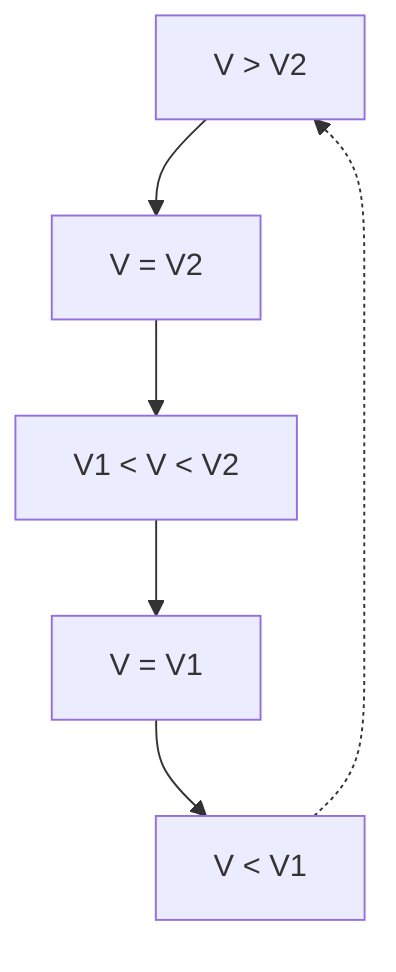

ximum an potenzieller Energie. Demnach muss seine kinetische Energie und damit seine Geschwindigkeit im Perihel am größten, im Aphel am kleinsten sein. Siehe auch Abschnitt 11.4.

Ausgehend von der Erkenntnis, dass die allen Körpern innewohnende universelle Eigenschaft der gegenseitigen Massenanziehung, die **Schwerkraft**, die Ursache für die Bahnbewegung der Himmelskörper ist, gelang es NEWTON (1687), das Kraftgesetz für die Anziehung zweier Massen herzuleiten. Wir wollen dieses Kraftgesetz durch eine stark vereinfachte Überlegung aus dem 3. KEPLERschen Gesetz gewinnen (Bild 8.2): Infolge des Umlaufs eines Planeten der Masse m auf einer (wegen der geringen Exzentrizität der meisten Planetenbahnen) näherungsweise kreisförmig angenommenen Bahn vom Radius r um die Sonne (Masse M) mit der Winkelgeschwindigkeit $\omega = 2 \pi / T \left( T \right.$ Umlaufzeit) wirkt auf den Planeten die von der Sonne weg gerichtete Zentrifugalkraft $m \omega ^ { 2 } r$ , die der ihr entgegengesetzt gerichteten **Gravitationskraft** $F$ das Gleichgewicht hält.

text_image

r
M
F
m
mω²r

Bild 8.2 Zur Herleitung des Gravitationsgesetzes aus dem 3. keplerschen Gesetz

Es gilt daher

$$
F = m \omega^ {2} r = \frac {m (2 \pi) ^ {2} r}{T ^ {2}}
$$

und mit dem 3. KEPLERschen Gesetz (8.1), welches für zwei Planeten auf Kreisbahnen lautet $T _ { 1 } ^ { 2 } : T _ { 2 } ^ { 2 } = r _ { 1 } ^ { 3 } : r _ { 2 } ^ { 3 }$ oder $T ^ { 2 } = \mathrm { c o n s t } \cdot r ^ { 3 }$ :

$$
F = \mathrm{const} \cdot \frac {m}{r ^ {2}}.
$$

Da nach dem Wechselwirkungsgesetz (4.25) die Massen m und M sich wechselseitig anziehen, muss die Gravitationskraft $F$ auch proportional zur Masse M sein; es gilt daher

$$
F = \gamma \frac {m M}{r ^ {2}} \quad (\text {Gravitationsgesetz, Newton 1687}). \tag {8.2}
$$

## Gravitationsgesetz:

**Die zwischen zwei Körpern wirkende Gravitationskraft ist dem Produkt beider Massen proportional und nimmt mit dem Quadrat ihres Abstandes ab.**

Das Gravitationsgesetz (8.2) ist außer für Punktmassen und homogene Kugeln auch für Körper, die wie die Erde aus homogenen Kugelschalen bestehen, streng gültig. Dabei ist r jeweils der Abstand der Kugelmittelpunkte, d. h., die Kugel verhält sich $\mathbf { s o } ,$ als sei ihre gesamte Masse im Mittelpunkt vereinigt.

In Gleichung (8.2) ist $\gamma$ die Gravitationskonstante. Sie ist eine von der Beschaffenheit der Körper unabhängige universelle Naturkonstante, die experimentell bestimmt werden muss. Ihr Wert, der verglichen mit anderen Naturkonstanten nur eine geringe relative Messgenauigkeit von etwa $1 0 ^ { - \widetilde { 4 } }$ aufweist (s. 2.3), beträgt

$$
\gamma = 6, 6 7 4 \cdot 1 0 ^ {- 1 1}   \mathrm{N} \cdot \mathrm{m} ^ {2} / \mathrm{kg} ^ {2} \qquad (\text {Gravitationskonstante}). \tag {8.3}
$$

Die Bestimmung der Gravitationskonstante γ gelang erstmals 1798 dem englischen Physiker CAVENDISH in einem Laborexperiment. Er benutzte dazu eine Drehwaage (Bild 8.3), mit der die Anziehungskraft zwischen je zwei sich gegenüberstehenden schweren und leichten Metallkugeln mit den Massen $m _ { 1 }$ und $m _ { 2 }$ aus der Verdrillung des elastischen Aufhängefadens des Waagebalkens mittels eines daran angebrachten Spiegels über Lichtzeiger gemessen wurde.

An der Erdoberfläche, d. h. für $r = R = 6 { , } 3 8 { \cdot } 1 0 ^ { 6 }$ m (Erdradius), ist mit $M = 5 { , } 9 8 { \cdot } 1 0 ^ { 2 4 }$ kg (Masse der Erde) die **Gewichtskraft** eines Körpers der Masse m nach (8.2) $\gamma m M / R ^ { 2 } = m g$ , womit sich die für alle Körper gleich große Fallbeschleunigung $g$ berechnet zu

$$
g = \frac {\gamma M}{R ^ {2}} = 9, 8 1 \mathrm{m} / \mathrm{s} ^ {2} \quad (\text {Fallbeschleunigung an der Erdoberfläche}). \tag {8.4}
$$

Entsprechend ist in der Höhe h über der Erdoberfläche $g ( h ) = \gamma M / ( R + h ) ^ { 2 }$ bzw. mit (8.4)

$$
g (h) = g \frac {R ^ {2}}{(R + h) ^ {2}} \quad (\text {Fallbeschleunigung in der Höhe} h). \tag {8.5}
$$

text_image

Physics diagram showing a pulley system with masses m1 and m2, a switch S, and light bulbs for motion control.

**Bild 8.3** Cavendish-Experiment zur Bestimmung der Gravitationskonstante $\gamma .$

Cavendish führte sein berühmt gewordenes Experiment, welches Ausdruck der hochentwickelten Experimentierkunst jener Zeit ist, allerdings nicht mit dem Ziel der Bestimmung der Gravitationskonstante $\gamma ,$ sondern der Masse bzw. mittleren Dichte der Erde durch. Aus dem Gravitationsgesetz (8.2) folgte damit aber zugleich auch der Wert für $\gamma$ (vgl. die nachfolgenden Beispiele 8.1/1 und 8.1/2).

## Beispiele 8.1:

1. Bestimme aus der Fallbeschleunigung g (bei bekanntem Erdradius) die mittlere Dichte der Erde $\varrho _ { \mathrm { E } } !$

Lösung: Aus (8.4) folgt $M = g R ^ { 2 } / \gamma$ und damit $\varrho _ { \mathrm { E } } = M / ( 4 \pi R ^ { 3 } / 3 ) = 3 g / ( 4 \pi R \gamma ) = 5 . 5 0   \mathrm { k g / d m } ^ { 3 }$

2. Zeige, wie aus der im oben beschriebenen CAVENDISH-Experiment gemessenen Gravitationskraft F zwischen den (bekannten) Massen $m _ { 1 }$ und $m _ { 2 }$ bei Kenntnis von R und $g$ die mittlere Dichte der Erde $\varrho _ { \mathrm { E } }$ und daraus die Gravitationskonstante $\gamma$ bestimmt werden kann!

Lösung: Aus dem in Beispiel 1 errechneten Ausdruck für $\varrho _ { \mathrm { E } }$ folgt $\gamma = 3 g / ( 4 \pi R \varrho _ { \mathrm { E } } )$ . Dies in (8.2) eingesetzt, ergibt nach Umstellung $\varrho _ { \mathrm { E } } = 3 m _ { 1 } m _ { 2 } g / ( 4 \pi r ^ { 2 } R F )$ mit r als Entfernung der Kugelmittelpunkte von $m _ { 1 }$ und $m _ { 2 }$ . Mit dem so ermittelten Wert für $\varrho _ { \mathrm { E } }$ erhält man $\gamma$ aus der davor stehenden Beziehung.

3. Bestimme mit Hilfe des Gravitationsgesetzes (8.2) den Wert des konstanten Verhältnisses $T ^ { 2 } / a ^ { 3 }$ (Zentralkörperkonstante) im 3. KEPLERschen Gesetz (8.1) für Erdsatelliten auf kreisförmigen Bahnen $( a = r ) ;$ !

Lösung: Die Zentrifugalkraft des Satelliten ist mω $b ^ { 2 } r = m ( 2 \pi / T ) ^ { 2 } r = 4 \pi ^ { 2 } m r / T ^ { 2 }$ . Durch Gleichsetzen mit (8.2) und Umstellen folgt mit der Masse der Erde $M \approx 6   \cdot   1 0 ^ { 2 4 }   \mathrm { k g }$ das für alle

Erdsatelliten gleiche Verhältnis zu $T ^ { 2 } / r ^ { 3 }   =   4 \pi ^ { 2 } / ( \gamma M )   \approx   1 0 ^ { - 1 3 }   \mathrm { s } ^ { 2 } / \mathrm { m } ^ { 3 }$ . Für einen geostationären Fernsehsatelliten in 36 000km Höhe über dem Äquator, d. h. in einem Abstand vom Er<u>dmittelpunkt von</u> $r = 4 2   3 8 0   \mathrm { k m }$ , erhält man daraus die gewünschte Umlaufzeit von $T =$ $\sqrt { 1 0 ^ { - 1 3 } \cdot ( 4 2   3 8 0 \cdot 1 0 ^ { 3 } ) ^ { 3 } }   \mathrm { s } \approx 8 6   4 0 0   \mathrm { s } = 2 4   \mathrm { h }$ □

## Aufgaben

**8.1** Zeige, wie sich aus dem im obigen Beispiel 8.1/3 bestimmten Verhältnis $T ^ { 2 } / r ^ { 3 }$ (für ein beliebiges Kraftzentrum $M )$ die Masse eines unbekannten Planeten $M _ { \mathrm { P l } }$ aus den Bahndaten seines Trabanten (Bahnradius $r _ { \mathrm { \Pi r } }$ und Umlaufdauer $T _ { \mathrm { T r } } )$ bestimmen lässt!
**8.2** Nach welcher Gesetzmäßigkeit nimmt die Bahngeschwindigkeit $\nu ( r )$ der Planeten mit größer werdender Entfernung r von der Sonne ab?
**8.3** Berechne die Fallbeschleunigung g
a) an der Oberfläche des Mondes (Masse $7 { , } 3 8   \cdot   1 0 ^ { 2 2 }$ kg; Radius 1738km);
b) in 36 000km Höhe über dem Erdäquator, dem Orbit für geostationäre Satelliten (Erdradius 6380km)!

## 8.2 Arbeit gegen die Schwerkraft. Kosmische Geschwindigkeiten

Um einen Körper (Masse m) im Schwerefeld der Erde anzuheben, muss Verschiebungsarbeit gegen die Schwerkraft (8.2) verrichtet werden. Soll der Körper von der Entfernung $r _ { 1 }$ bis in die Entfernung $r _ { 2 } > r _ { 1 }$ vom Erdmittelpunkt gebracht werden, so ist die dabei aufzuwendende Arbeit nach (7.3) gleich dem Wegintegral der Kraft

$$
W = - \int_ {r _ {1}} ^ {r _ {2}} \boldsymbol {F} \cdot \mathrm{d} \boldsymbol {r} = - \int_ {r _ {1}} ^ {r _ {2}} F \mathrm{d} r \cos 1 8 0 ^ {\circ} = \gamma m M \int_ {r _ {1}} ^ {r _ {2}} \frac {\mathrm{d} r}{r ^ {2}} = \gamma m M \left(\frac {1}{r _ {1}} - \frac {1}{r _ {2}}\right). \tag {8.6}
$$

Erfolgt die Verschiebung des Körpers von der Erdoberfläche aus bis in die Höhe $h ,$ d. h. $r _ { 1 } = R$ (Erdradius) und $r _ { 2 } = R + h$ , so wird unter Beachtung von Gleichung (8.4)

$$
W = \gamma m M \left(\frac {1}{R} - \frac {1}{R + h}\right) = \frac {\gamma m M}{R} \frac {h}{R + h} = m g R \frac {h}{R + h}. \tag {8.7}
$$

Um diesen Betrag erhöht sich dabei die potenzielle Energie des Körpers, d. h., es ist $W = \Delta E _ { \mathrm { p } } =$ $E _ { \mathrm { p } } ( r _ { 2 } ) - E _ { \mathrm { p } } ( r _ { 1 } )$ . Wenn $h \ll R ,$ , so wird $W = m g h$ , entsprechend dem bekannten Ausdruck für die Hubarbeit bzw. die Änderung der potenziellen Energie bei kleinen Höhenunterschieden.

**Kosmische Geschwindigkeiten.** Die vorstehenden Ausführungen sind von großer Bedeutung für die Beschreibung der Bahnen von ballistischen Flugkörpern (Geschosse, Fernraketen) sowie von Satelliten und Raumsonden. Für diese kommen mehrere Arten von Flugbahnen in Frage. Die Kreisbahn als spezieller Fall einer KEPLER-Ellipse wird erhalten, wenn die auf den umlaufenden Körper (Satelliten) wirkende Fliehkraft in der Höhe h gleich der Schwerkraft ist, wenn also mit (8.5) gilt

$$
\frac {m v ^ {2}}{R + h} = m g (h) = m g \frac {R ^ {2}}{(R + h) ^ {2}}; \quad \nu (h) = \sqrt {\frac {g R ^ {2}}{R + h}}. \tag {8.8}
$$

Die Kreisbahngeschwindigkeit $\nu ( h )$ nimmt, wie man sieht, mit zunehmender Höhe ab. Für einen in sehr geringer Höhe $( h \ll R )$ umlaufenden Satelliten folgt

$$
v _ {1} = \sqrt {g R} = 7, 9 \mathrm{km/s} \quad \text {(1.kosmische Geschwindigkeit).} \tag {8.9}
$$

Bei Geschwindigkeiten $\nu > \nu _ { 1 }$ umkreist der Flugkörper die Erde auf einer elliptischen Bahn (Bild 8.4). Für $\nu < \nu _ { 1 }$ kehrt der Körper wieder zur Erde zurück; er durchläuft dabei nur einen Teil der KEPLER-Ellipse. Die beiden Ellipsen für $\nu > \nu _ { 1 }$ und $\nu < \nu _ { 1 }$ unterscheiden sich dadurch, dass im ersten Fall der Mittelpunkt der Erde in dem dem Abschusspunkt näheren, im zweiten Fall im ferneren Ellipsenbrennpunkt liegt. Die Bahnen von Wurfkörpern sind also stets Ellipsen und keine Wurfparabeln, da die Richtung der Fallbeschleunigung über die Bahnkurven veränderlich ist. Für kleine Entfernungen kann näherungsweise die Bahnellipse durch eine Parabel angenähert werden.

flowchart

Bild 8.4 Bahnkurven ballistischer Flugkörper bei horizontalem Einschuss in die Flugbahn.

$\nu _ { 1 }$ 1. kosmische Geschwindigkeit (Kreisbahngeschwindig keit), $$\nu _ { 2 }$ 2.$ kosmische Geschwindigkeit (Parabelgeschwindigkeit)

Die Mindestgeschwindigkeit, die ein Körper erhalten muss, um sich aus dem Anziehungsbereich der Erde völlig entfernen zu können, die sog. Fluchtgeschwindigkeit, folgt aus der Bedingung, dass die kinetische Energie des Körpers so groß sein muss wie die Arbeit, die erforderlich ist, um ihn bis ins Unendliche zu befördern, d. h., es muss mit Gleichung (8.7) gelten

$$
\frac {m v ^ {2}}{2} = \frac {\gamma m M}{R} \frac {h}{R + h} = m g R \frac {h}{R + h} = m g R \frac {1}{(R / h) + 1}, \tag {8.10}
$$

woraus für $h \to \infty$ folgt

$$
v _ {2} = \sqrt {2 g R} = 1 1, 2 \mathrm{km/s} \quad (2. \text {kosmische Geschwindigkeit}). \tag {8.11}
$$

Die zugehörige ballistische Flugbahn ist eine Parabel (Bild 8.4). Für $\nu > \nu _ { 2 }$ entweicht der Flugkörper auf einer hyperbolischen Bahn ebenfalls auf Nimmerwiedersehen in den Weltraum.

Die Geschwindigkeit, die ein im Abstand $r _ { \mathrm { E } }$ von der Sonne befindlicher Flugkörper haben muss, um die Gravitationskraft der Sonne $F _ { \mathrm { S } } = \gamma m M _ { \mathrm { S } } / r _ { \mathrm { E } } ^ { 2 }$ überwinden zu können, die Fluchtgeschwindigkeit $v _ { \mathrm { S } } ,$ berechnet sich analog zu $v _ { 2 }$ gemäß (8.10) für $h \to \infty ;$

$$
\frac {m v _ {\mathrm{S}} ^ {2}}{2} = \frac {\gamma m M _ {\mathrm{S}}}{r _ {\mathrm{E}}}; \quad v _ {\mathrm{S}} = \sqrt {\frac {2 \gamma M _ {\mathrm{S}}}{r _ {\mathrm{E}}}} = 4 2, 1 \mathrm{km/s}.
$$

Dies ist die Fluchtgeschwindigkeit im Bezugssystem der Sonne. In Bezug auf die Erde, die im Sonnensystem selbst bereits die Geschwindigkeit $v_{\mathrm{E}} = 2 \pi r_{\mathrm{E}} / T_{\mathrm{E}} = 29.9   \mathrm{km/s}$ hat, ist die Fluchtgeschwindigkeit $\nu _ { \mathrm { F } } ^ { \prime } = \nu _ { \mathrm { S } } - \nu _ { \mathrm { E } } = 1 2 { , } 2 \mathrm { k m / s }$ . Um von der Erde aus das Sonnensystem verlassen zu können, muss das Gravitationsfeld der Erde und das der Sonne überwunden werden. Dazu benötigt der Flugkörper die kinetische Energie m $\nu _ { 3 } ^ { 2 } / 2 = m \nu _ { 2 } ^ { 2 } / 2 + m \nu _ { \mathrm { F } } ^ { \prime 2 } / 2$ , woraus folgt

$$
v _ {3} = \sqrt {v _ {2} ^ {2} + v _ {\mathrm{F}} ^ {\prime 2}} = 1 6, 6 \mathrm{km/s} \quad \text {(3.kosmische Geschwindigkeit).} \tag {8.12}
$$

## Aufgaben

**8.4** Wie groß ist die zu verrichtende Arbeit, um 1kg Masse von der Erdoberfläche bis in die unendliche Ferne zu befördern? (Erdradius $R = 6380    km$
**8.5** Eine Raumsonde soll aus einer Erdumlaufbahn in $h = R = 6380    km$ Höhe ins All gestartet werden. Berechne die erforderliche Geschwindigkeit!

## Dynamik der Punktmassen-Systeme

Wir betrachten nun die Bewegung eines Systems, bestehend aus einer Anzahl von Teilchen, deren gegenseitige Lage veränderlich ist. Die Teilchen des Systems können aufeinander Kräfte ausüben, die dem Wechselwirkungsgesetz gehorchen (**innere Kräfte** des Systems), des weiteren können an den Teilchen **äußere Kräfte** angreifen, die von Kraftzentren herrühren, die sich außerhalb des Systems befinden. Wirken auf keines der Teilchen äußere Kräfte, so ist das System abgeschlossen.

## 9.1 Impulserhaltungssatz. Massenmittelpunkt

Das System bestehe der Einfachheit halber aus nur zwei Massen $m _ { 1 }$ und $m _ { 2 }$ (Bild 9.1), die ohne Reibung auf einer Unterlage gleiten und über eine elastische Kopplungsfeder (innere) Kräfte $F ^ { \mathrm { i } }$ aufeinander ausüben können. Wird die Feder gespannt und sodann freigegeben, so führen die Massen gegeneinander Schwingungen aus, wobei nach dem Wechselwirkungsgesetz für die abstoßenden bzw. anziehenden Kräfte, die auf die beiden Massen wirken, gilt

$$
F _ {1} ^ {\mathrm{i}} = - F _ {2} ^ {\mathrm{i}}, \quad \text {also nach (4.9)} \quad \frac {\mathrm{d} (m _ {1} v _ {1})}{\mathrm{d} t} = - \frac {\mathrm{d} (m _ {2} v _ {2})}{\mathrm{d} t} \quad \text {oder} \tag {9.1}
$$

$$
\frac {\mathrm{d}}{\mathrm{d} t} (m _ {1} v _ {1} + m _ {2} v _ {2}) = 0, \quad \text {d.h.} \quad m _ {1} v _ {1} + m _ {2} v _ {2} = \text {const.} \tag {9.2}
$$

Die Summe der Impulse beider Massen ist also stets konstant. Verallgemeinernd gilt der

## Impulserhaltungssatz:

**In einem abgeschlossenen System, in dem nur innere Kräfte wirken, bleibt – welche Vorgänge sich innerhalb des Systems auch immer abspielen mögen – der Gesamtimpuls (Vektorsumme aller Einzelimpulse** $m _ { i } \nu _ { i } )$ **ungeändert.**

text_image

S
m₁ m₂

Bild 9.1 Zum Impulserhaltungssatz. S ist der gemeinsame Massenmittelpunkt (Schwerpunkt) der Massen $m _ { 1 }$ und $m _ { 2 }$

Waren in unserem Beispiel vor dem Entspannen der Feder die Geschwindigkeiten und damit die Impulse beider Massen (also auch ihre Summe) gleich null, so gilt auch für jeden anderen Zeitpunkt nach Freigabe der Feder

$$
m _ {1} v _ {1} + m _ {2} v _ {2} = 0 \quad \text {oder} \quad m _ {1} v _ {1} = - m _ {2} v _ {2}, \tag {9.3}
$$

d. h., die Impulse der Massen sind in jedem Augenblick einander entgegengesetzt gleich und heben sich somit stets auf. Die Einwirkung der Federkraft, welche eine innere Kraft ist, hat also den Gesamtimpuls nicht geändert.

Aus (9.2) folgt, wenn die Lagen der beiden Massen zur Zeit t durch die Koordinaten $x _ { 1 }$ und $x _ { 2 }$ gegeben sind:

$$
m _ {1} \frac {\mathrm{d} x _ {1}}{\mathrm{d} t} + m _ {2} \frac {\mathrm{d} x _ {2}}{\mathrm{d} t} = \frac {\mathrm{d}}{\mathrm{d} t} (m _ {1} x _ {1} + m _ {2} x _ {2}) = \text {const.} \tag {9.4}
$$

Wir definieren nun durch die Koordinate

$$
x _ {S} = \frac {m _ {1} x _ {1} + m _ {2} x _ {2}}{m _ {1} + m _ {2}} \tag {9.5}
$$

einen zwischen den beiden Massen gelegenen Punkt, den wir den **Massenmittelpunkt** (S) des Systems nennen (s. Bild 9.1). Lassen wir diesen mit dem Nullpunkt des Koordinatensystems zusammenfallen, also $x _ { S } = 0$ , so erkennen wir aus (9.5), dass für die Teilstrecken zwischen S und den beiden Massen stets gilt $| x _ { 1 } | / | x _ { 2 } | = m _ { 2 } / m _ { 1 }$ , d. h., der Massenmittelpunkt zweier Massen teilt deren Verbindungsstrecke im umgekehrten Verhältnis der Massen.

Für die Geschwindigkeit des Massenmittelpunkts folgt nun aus (9.4) und (9.5)

$$
v _ {S} = \frac {\mathrm{d} x _ {S}}{\mathrm{d} t} = \text {const}, \tag {9.6}
$$

d. h., bei allen Bewegungen der beiden Massen bleibt ihr gemeinsamer Massenmittelpunkt in Ruhe (sofern die Konstante den Wert null hat), oder er bewegt sich geradlinig mit konstanter Geschwindigkeit. Für Systeme, deren Teilchen sich nur unter der Wirkung innerer Kräfte verschieben, gilt demnach der

## Erhaltungssatz des Massenmittelpunkts:

## Der Massenmittelpunkt eines abgeschlossenen Systems ist in Ruhe oder bewegt sich geradlinig und gleichförmig.

Bei der Explosion einer Bombe fliegen (durch das Wirken innerer Kräfte) ihre Teile nach allen Seiten auseinander, ihr gemeinsamer Massenmittelpunkt aber bleibt erhalten. – Platzt ein Körper im Fluge, so bewegt sich, wenn keine äußeren Kräfte hinzukommen, der Massenmittelpunkt des „Systems“ weiter, als ob nichts geschehen wäre.

Der Massenmittelpunkt eines Vielteilchensystems verhält sich demnach so wie eine einzelne Punktmasse; er befolgt das Trägheitsgesetz, sofern keine äußeren Kräfte auf das System einwirken (abgeschlossenes System). Greifen hingegen an den Teilchen des Systems äußere Kräfte $F _ { i } ^ { \mathrm { a } }$ an, deren Resultierende gleich $\boldsymbol { F } ^ { \mathtt { a } } = \sum \boldsymbol { F } _ { i } ^ { \mathtt { a } }$ ist, so gilt, da innere Kräfte auf die Bewegung des Massenmittelpunkts keinen Einfluss haben, nach dem 2. NEWTONschen Axiom (4.14)

$$
m \frac {\mathrm{d} \boldsymbol {v} _ {S}}{\mathrm{d} t} = \boldsymbol {F} ^ {\mathrm{a}} \quad (\text {Bewegungsgleichung des Vielteilchensystems}). \tag {9.7}
$$

Dabei ist m die Gesamtmasse des Systems. Gleichung (9.7) besagt:

**Bei Einwirkung äußerer Kräfte auf ein System von Punktmassen bewegt sich dessen Massenmittelpunkt so, als sei die gesamte Masse des Systems in ihm vereinigt und als greife die resultierende Gesamtkraft an ihm an.**

Für das abgeschlossene System $( F ^ { \mathbf { a } } = 0 )$ folgt aus Gleichung (9.7) wieder der Erhaltungssatz des Massenmittelpunkts (9.6). Da die häufigste Kraft die Schwerkraft ist, bezeichnet man den Massenmittelpunkt gewöhnlich auch als **Schwerpunkt** und den zuletzt formulierten Satz daher auch als **Schwerpunktsatz**.

## Beispiele 9.1:

1. Von einer mit der Geschwindigkeit $v = 8000    m/s$ fliegenden dritten Stufe einer Rakete, bestehend aus Antriebsteil $(m_{1} = 500   kg )$ und kegelförmiger Bugkapsel $( m _ { 2 } = 1 0 \mathrm { k g } )$ , wird die Bugkapsel mit der Geschwindigkeit 0,51m/s abgestoßen (Bild 9.2). Wie groß sind die Geschwindigkeiten von Antriebsteil und Kapsel danach?

Lösung: Antriebsteil und Kapsel bilden ein abgeschlossenes System. Es gilt daher der Impuls erhaltungssatz, wonach der Gesamtimpuls vor dem Abstoßen der Kapsel gleich dem Impuls beider Massen danach sein muss: $( m _ { 1 } + m _ { 2 } )   \nu = m _ { 1 }   \nu _ { 1 } ^ { \prime } + m _ { 2 }   \nu _ { 2 } ^ { \prime }$ . Mit der gegebenen Relativgeschwindigkeit $\Delta \nu = \nu _ { 2 } ^ { \prime } - \nu _ { 1 } ^ { \prime } = 0 { , } 5 1$ m/s erhält man, indem $\nu _ { 2 } ^ { \prime } = \nu _ { 1 } ^ { \prime } + \Delta \nu$ in die Impulsbilanz eingesetzt wird:

$$
v _ {1} ^ {\prime} = v - \frac {m _ {2}}{m _ {1} + m _ {2}} \Delta v = 7 9 9 9, 9 9 \mathrm{m/s}; \quad v _ {2} ^ {\prime} = 8 0 0 0, 5 0 \mathrm{m/s}.
$$

Der Massenmittelpunkt des Systems hat weiterhin die Geschwindigkeit v.

flowchart

Bild 9.2 Trennung von Antriebsteil und Bugkapsel einer Raketenstufe in der Umlaufbahn

2. Ein Polonium-212-Kern emittiert beim radioaktiven Zerfall ein α-Teilchen mit der Ge schwindigkeit $2 \cdot 10^{7}    m/s. a$ Berechne die Rückstoßgeschwindigkeit des Kerns! b) Welchen Anteil hat prozentual die kinetische Energie des α-Teilchens $E _ { \alpha }$ und des Kerns $E _ { \mathrm { K } }$ an der Gesamtenergie $E = E _ { \alpha } + E _ { \mathrm { K } } { \mathfrak { k } }$ Das Massenverhältnis von Kern und α-Teilchen beträgt 53.

Lösung: a) Nach dem Impulserhaltungssatz (9.3) sind die Impulse von Kern und α-Teilchen dem Betrage nach gleich: $p = M \nu _ { \mathrm { K } } = m \nu _ { \alpha } ;$ hieraus folgt $v _ { \mathrm { K } } = ( m / M )   v _ { \alpha } = 3 , 7 7 \cdot 1 0 ^ { 5 }   \mathrm { m / s }$

b) Für die Gesamtenergie E gilt mit

$$
E _ {\mathrm{K}} = M v _ {\mathrm{K}} ^ {2} / 2 = p ^ {2} / (2 M) \quad \text {und} \quad E _ {\alpha} = m v _ {\alpha} ^ {2} / 2 = p ^ {2} / (2 m):
$$

$$
E = \frac {p ^ {2}}{2 m} + \frac {p ^ {2}}{2 M} = \frac {M + m}{m} \frac {p ^ {2}}{2 M} = \frac {M + m}{M} \frac {p ^ {2}}{2 m} = \left(1 + \frac {M}{m}\right) E _ {\mathrm{K}} = \left(1 + \frac {m}{M}\right) E _ {\alpha}.
$$

Damit wird $E _ { \alpha } / E = 9 8 , 1 5 \%$ und $E_{\mathrm{K}} / E = 1, 85\%$

## 9.2 Die Gesetze des Stoßes

Als Stoß bezeichnet man in der Physik eine sich rasch vollziehende Wechselwirkung zwischen Teilchen bzw. Körpern, in deren Folge es zu Impuls- und Energieänderungen der Körper kommt. Dabei kann es sich sowohl um das unmittelbare Aufeinanderprallen fester Körper als auch um eine kurzzeitige gegenseitige Beeinflussung durch elektrostatische oder andere Kräfte handeln. Man denke hierbei an die Wechselwirkung von hochbeschleunigten Elementarteilchen untereinander oder mit Atomkernen.

Im folgenden beschränken wir uns zunächst auf den **zentralen (geraden) Stoß**; bei ihm fällt die Stoßrichtung in die Verbindungsgerade der Kugelmittelpunkte (Bild 9.3). Beim nichtzentralen (schiefen) Stoß bildet die Bewegungsrichtung des stoßenden Körpers mit der Mittelpunktsgeraden einen Winkel (s. dazu unten Bild 9.6).

Zwei Kugeln mit den Massen $m _ { 1 }$ und $m _ { 2 }$ bewegen sich mit den Geschwindigkeiten $\pmb { v } _ { 1 }$ und $\nu _ { 2 }$ auf einer Geraden entweder aufeinander zu (dann haben $\pmb { v } _ { 1 }$ und $\pmb { v } _ { 2 }$ , also auch die Impulse $m _ { 1 } \pmb { v } _ { 1 }$ und $m _ { 2 } \pmb { v } _ { 2 }$ , entgegengesetzte Richtung), oder die erste Kugel bewegt sich hinter der zweiten her, dann muss, damit ein Zusammenstoß erfolgen kann, $\nu _ { 1 } > \nu _ { 2 }$ sein (Bild 9.3).

Beim Fehlen äußerer Einwirkungen, z. B. der Schwerkraft, gilt für das aus den beiden Kugeln bestehende System der Impulserhaltungssatz (9.2). Es ist also, wenn wir die Geschwindigkeiten nach dem Stoß mit $c _ { 1 }$ und $c _ { 2 }$ bezeichnen:

$$
m _ {1} v _ {1} + m _ {2} v _ {2} = m _ {1} c _ {1} + m _ {2} c _ {2}. \tag {9.8}
$$

Diese Gleichung reicht zur Bestimmung von $c _ { 1 }$ und $c _ { 2 }$ nicht aus. Aus der Undurchdringlichkeit der Kugeln können wir lediglich folgern $c _ { 1 } \leq c _ { 2 }$ . Für die beiden Grenzfälle, den elastischen und den unelastischen Stoß, lassen sich jedoch weitere Aussagen treffen.

text_image

m₁
m₂
v₁
v₂

Bild 9.3 Zentraler (gerader) Stoß zweier Kugeln: Die Bewegungsrichtung der stoßenden Kugel $( m _ { 1 } )$ liegt in der Verbindungsgeraden der Kugelmittelpunkte.

**Der unelastische Stoß.** Ist das Material der Kugeln so beschaffen, dass die Kugeln nicht voneinander abprallen, sondern nach dem Stoß mit gemeinsamer Geschwindigkeit in Richtung der Bewegung der stoßenden Kugel ihren Weg fortsetzen, dann bezeichnen wir den Stoß als vollkommen unelastisch. Dies tritt z. B. ein, wenn die stoßenden Körper aus einem bildsamen Material bestehen, das sich beim Stoß bleibend verformt. Dabei geht ein Teil der Bewegungsenergie in Verformungsarbeit bzw. Wärme über. Daher gilt:

## Beim unelastischen Stoß bleibt der Impuls, nicht hingegen die Bewegungsenergie erhalten.

Bezeichnen wir die gemeinsame Geschwindigkeit $c _ { 1 } = c _ { 2 }$ der Kugeln nach dem vollkommen unelastischen Stoß mit $c ,$ so folgt aus dem Impulssatz (9.8)

$$
m _ {1} v _ {1} + m _ {2} v _ {2} = (m _ {1} + m _ {2}) c; \quad c = \frac {m _ {1} v _ {1} + m _ {2} v _ {2}}{m _ {1} + m _ {2}}. \tag {9.9}
$$

Bei einem teilweise unelastischen Stoß ist die Differenz der Geschwindigkeiten $c _ { 1 }   -   c _ { 2 }$ nach dem Stoß betragsmäßig um einen Faktor $\varepsilon ,$ der Stoßzahl, kleiner als die Differenz der Geschwindigkeiten $\nu _ { 1 } - \nu _ { 2 }$ vor dem Stoß:

$$
c _ {1} - c _ {2} = - \varepsilon (v _ {1} - v _ {2}) \quad \text {oder} \quad \varepsilon = - \frac {c _ {1} - c _ {2}}{v _ {1} - v _ {2}} \quad (\text {Stoßzahl}). \tag {9.10}
$$

Die Stoßzahl ε gibt den „Grad“ der Energieerhaltung beim Stoßvorgang an: $\varepsilon = 0$ (gleichbedeutend mit $c _ { 1 } = c _ { 2 } )$ kennzeichnet den vollkommen unelastischen Stoß, $\varepsilon = 1$ den elastischen Stoß (s. u.) und ein Wert $0 < \varepsilon < 1$ steht für einen teilweise unelastischen Stoß. Der Impulssatz (9.8) ergibt dann zusammen mit (9.10) für die Geschwindigkeiten nach dem Stoß:

$$
c _ {1} = \frac {(m _ {1} - \varepsilon m _ {2}) v _ {1} + (1 + \varepsilon) m _ {2} v _ {2}}{m _ {1} + m _ {2}}; \quad c _ {2} = \frac {(1 + \varepsilon) m _ {1} v _ {1} + (m _ {2} - \varepsilon m _ {1}) v _ {2}}{m _ {1} + m _ {2}}. \tag {9.11}
$$

Die beim unelastischen Stoß zur Formänderung bzw. Erwärmung der Körper aufgewendete Arbeit ergibt sich als Differenz der Bewegungsenergien beider Körper vor und nach dem Stoß:

$$
\Delta E = \frac {m _ {1} v _ {1} ^ {2}}{2} + \frac {m _ {2} v _ {2} ^ {2}}{2} - \frac {m _ {1} c _ {1} ^ {2}}{2} - \frac {m _ {2} c _ {2} ^ {2}}{2}.
$$

Setzt man hier die Werte für $c _ { 1 }$ und $c _ { 2 }$ nach (9.11) ein, so folgt nach einigen Umformungen

$$
\Delta E = (1 - \varepsilon^ {2}) \frac {m _ {1} m _ {2}}{2 (m _ {1} + m _ {2})} (\nu_ {1} - \nu_ {2}) ^ {2}, \tag {9.12}
$$

ein Ausdruck, der stets positiv ist.

## Beispiele 9.2:

1. Zur Bestimmung der Geschwindigkeit eines Geschosses $( m _ { 1 } = 5 { , } 0 \mathrm { g } )$ wird dieses in einen pendelnd aufgehängten Holzklotz $( m _ { 2 } = 2 , 5   \mathrm { k g } )$ geschossen, der dadurch aus seiner Ruhelage um die Strecke $s = 3 0$ cm ausgelenkt und dabei um h angehoben wird (ballistisches Pendel, Bild 9.4). Die Pendellänge ist l = 1m. Berechne die Geschossgeschwindigkeit $\nu _ { 1 } !$

Lösung: Da das Geschoss im Holzklotz stecken bleibt und sich somit nach dem Einschlag zusammen mit ihm fortbewegt, liegt ein vollkommen unelastischer S<u>toß</u> vor. Mit $\nu _ { 2 } = 0$ und wegen $m _ { 1 } \ll m _ { 2 }$ folgt aus (9.9) $\nu _ { 1 } = ( m _ { 2 } / m _ { 1 } ) c$ . Außerdem gilt $c = { \sqrt { 2 g h } } .$ h muss durch die bekannten Größen s und l ausgedrückt werden. Aus dem Bi<u>ld li</u>est man ab: $s ^ { 2 } = l ^ { 2 } - ( l - h ) ^ { 2 } =$ $2 l h - h ^ { 2 } \approx 2 l h$ (wegen $h \ll l )$ . Somit folgt $\nu _ { 1 } = ( m _ { 2 } / m _ { 1 } ) \sqrt { 2 g h } = ( m _ { 2 } / m _ { 1 } ) s \sqrt { g / l } = 4 7 5   \mathbf { m } / \mathbf { s }$

Bild 9.4 Ballistisches Pendel

2. Wie groß ist im obigen Beispiel derjenige Anteil der anfänglichen kinetischen Energie des Geschosses, der nicht in Bewegungsenergie des Pendelkörpers übergeführt, sondern in Wärme umgewandelt wird?

Lösung: Aus (9.12) folgt mit $\nu _ { 2 } = 0$ und $\varepsilon = 0 ;$

$$
\Delta E = \frac {m _ {2}}{m _ {1} + m _ {2}} \frac {m _ {1} v _ {1} ^ {2}}{2} = \frac {m _ {2}}{m _ {1} + m _ {2}} E; \quad \frac {\Delta E}{E} = \frac {m _ {2}}{m _ {1} + m _ {2}} = 0, 9 9 8;
$$

d. h., es gehen 99,8% der Geschossenergie als Wärme verloren.

## Aufgabe

**9.1** Zur Auslösung einer speziellen Kernreaktion wird ein Elementarteilchen (Masse m) auf einen schweren Targetkern (Massenverhältnis $M / m = 2 4 0 )$ geschossen, in welchem es verbleibt. Gib denjenigen Teil der anfänglichen kinetischen Energie des Kerngeschosses an, der nicht als Bewegungsenergie des sich bildenden Zwischenkerns verloren geht, sondern zur inneren Umwandlung des Targetkerns führt!

**Der elastische Stoß.** Ein Stoß heißt elastisch, wenn die beiden Körper durch den Stoß weder erwärmt noch bleibend deformiert werden. Es wird also beim elastischen Stoß keine Bewegungsenergie in eine andere Energieform umgewandelt. Daher gilt neben dem Impulssatz (9.8) der Energiesatz der Mechanik

$$
\frac {m _ {1} v _ {1} ^ {2}}{2} + \frac {m _ {2} v _ {2} ^ {2}}{2} = \frac {m _ {1} c _ {1} ^ {2}}{2} + \frac {m _ {2} c _ {2} ^ {2}}{2}. \tag {9.13}
$$

## Beim elastischen Stoß bleiben Impuls und Bewegungsenergie erhalten.

Durch Umstellung der Glieder in (9.8) und (9.13) erhalten wir zunächst

$$
m _ {1} (v _ {1} - c _ {1}) = m _ {2} (c _ {2} - v _ {2})
$$

$$
m _ {1} (v _ {1} ^ {2} - c _ {1} ^ {2}) = m _ {2} (c _ {2} ^ {2} - v _ {2} ^ {2})
$$

und nach Division der zweiten Gleichung durch die erste

$$
v _ {1} + c _ {1} = c _ {2} + v _ {2} \quad \text {oder (nach (9.10))} \quad \varepsilon = - \frac {c _ {1} - c _ {2}}{v _ {1} - v _ {2}} = 1.
$$

Mit Hilfe dieser Beziehung kann man nun aus (9.8) entweder $c _ { 1 }$ oder $c _ { 2 }$ eliminieren. Man erhält (vgl. (9.11) mit $\varepsilon = 1 )$

$$
c _ {1} = \frac {(m _ {1} - m _ {2}) v _ {1} + 2 m _ {2} v _ {2}}{m _ {1} + m _ {2}}; \quad c _ {2} = \frac {(m _ {2} - m _ {1}) v _ {2} + 2 m _ {1} v _ {1}}{m _ {1} + m _ {2}}. \tag {9.14}
$$

**Sonderfälle.** Ist $m _ { \mathrm { 1 } } = m _ { \mathrm { 2 } }$ , so wird $c _ { 1 } = v _ { 2 }$ und $c _ { 2 } = v _ { 1 }$ , d. h., beide Körper vertauschen ihre Geschwindigkeiten. Ist $m _ { 2 }$ vor dem Stoß in Ruhe, also $\nu _ { 2 } = 0 ,$ , so vereinfachen sich die Gleichungen (9.12) zu

$$
c _ {1} = v _ {1} \frac {(m _ {1} / m _ {2}) - 1}{(m _ {1} / m _ {2}) + 1}; \quad c _ {2} = v _ {1} \frac {2 (m _ {1} / m _ {2})}{(m _ {1} / m _ {2}) + 1}. \tag {9.15}
$$

Geht $m _ { 2 } \rightarrow \infty$ und ist $\nu _ { 2 } = 0$ (Körper stößt gegen feststehende Wand), so wird $c _ { 1 } = - v _ { 1 }$ , d. h., die Geschwindigkeit kehrt sich um (Reflexion). Ist dagegen $m _ { 1 } \to \infty$ und $\nu _ { 2 } = 0$ (sehr großer Körper stößt auf ruhenden, sehr kleinen Körper), so wird $c _ { 1 } \approx v _ { 1 }$ und $c _ { 2 } \approx 2 \nu _ { 1 }$

## Beispiel 9.3:

Bei dem in Bild 9.5 gezeigten Apparat sind mehrere elastische Kugeln gleicher Masse unmittelbar nebeneinander aufgehängt. Lässt man die erste Kugel (A) auf die Übrigen stoßen, so wird die letzte (C) bis zur Ausgangshöhe von (A) emporgeschleudert. Lässt man gleichzeitig zwei Kugeln mit der Geschwindigkeit $\nu _ { 1 }$ auf die Übrigen stoßen, so werden nun die beiden letzten

text_image

A
C

Bild 9.5 Perkussionspendel zur Demonstration von Energie- und Impulsübertragung beim elastischen Stoß

Kugeln mit der gleichen Geschwindigkeit $\nu _ { 1 }$ fortgestoßen, und nicht etwa nur die letzte mit der entsprechend größeren Geschwindigkeit $\nu _ { 1 } \sqrt { 2 }$ , was mit dem Energiesatz durchaus in Einklang wäre; denn es gilt $2 ( m \nu _ { 1 } ^ { 2 } / 2 ) = m ( \nu _ { 1 } \sqrt { 2 } ) ^ { 2 } / 2$ . Beweise, dass dies allgemein auch bei n Kugeln der Fall ist!

Lösung: Es bleibt neben der Energie auch der Impuls erhalten. Ist m die Masse einer Kugel, $n _ { 1 }$ die Anzahl und $\nu _ { 1 }$ die Geschwindigkeit der stoßenden Kugeln, $n _ { 2 }$ die Anzahl und $v _ { 2 }$ die Geschwindigkeit der fortfliegenden Kugeln, so ist

$$
n _ {1} \cdot m v _ {1} = n _ {2} \cdot m v _ {2}, \qquad n _ {1} \cdot \frac {m v _ {1} ^ {2}}{2} = n _ {2} \cdot \frac {m v _ {2} ^ {2}}{2}.
$$

Hieraus folgt $\nu _ { 1 } = \nu _ { 2 }$ und $n _ { 1 } = n _ { 2 }$

**Der nichtzentrale (schiefe) elastische Stoß.** Nach einem schiefen elastischen Stoß bewegen sich die Stoßpartner in verschiedenen Richtungen (Bild 9.6a). Bei der mathematischen Behandlung haben wir deshalb den Impulssatz (9.8) in vektorieller Form anzuschreiben.

Bild 9.6 Geschwindigkeitsvektoren beim nichtzentralen (schiefen) elastischen Stoß für den Fall $m _ { \mathrm { 1 } } = m _ { \mathrm { 2 } }$

Ist $m _ { 2 }$ vor dem Stoß in Ruhe $( \pmb { v } _ { 2 } = 0 )$ , so gilt also

$$
m _ {1} \boldsymbol {v} _ {1} = m _ {1} \boldsymbol {c} _ {1} + m _ {2} \boldsymbol {c} _ {2}. \tag {9.16}
$$

Darüber hinaus gilt wieder der Energiesatz der Mechanik

$$
\frac {m _ {1} v _ {1} ^ {2}}{2} = \frac {m _ {1} c _ {1} ^ {2}}{2} + \frac {m _ {2} c _ {2} ^ {2}}{2}. \tag {9.17}
$$

Für den Sonderfall gleicher Massen $( m _ { 1 } = m _ { 2 } )$ gehen die Gleichungen (9.16) und (9.15) über in

$$
\boldsymbol {v} _ {1} = \boldsymbol {c} _ {1} + \boldsymbol {c} _ {2}; \quad v _ {1} ^ {2} = c _ {1} ^ {2} + c _ {2} ^ {2}. \tag {9.18}
$$

In Bild 9.6b ist das zugehörige Dreieck der Geschwindigkeitsvektoren dargestellt. In ihm steht $\mathbf { c } _ { 1 }$ senkrecht auf $c _ { 2 } ;$ denn die rechtsstehende Beziehung (9.18) gilt nur im rechtwinkligen Dreieck. Daher laufen $\mathbf { z } .$ B. beim Billardspiel die mit dem Queue gestoßene Kugel und die anfänglich ruhende Kugel nach einem schiefen Stoß unter einem Winkel von $9 0 ^ { \circ }$ auseinander. Diese

Bedingung ist umso besser erfüllt, je weniger kinetische Energie beim Stoß in Drehbewegung der Kugeln übergeht. Besonders gut erreicht wird dies beim Stoß zwischen zwei gleichen Atomen (Bild 9.7).

natural_image

Black-and-white astronomical image showing star clusters and geometric lines (no text or symbols)

Bild 9.7 Blasenkammeraufnahme der Spur eines Protons, das nacheinander mit anderen Protonen zusammenstößt, die ursprünglich in Ruhe waren

## 9.3 Raketenantrieb

Die an einer Rakete angreifende Kraft setzt sich zusammen aus der in der Nähe von Himmelskörpern stets vorhandenen Schwerkraft, dem Schub des Triebwerks und gegebenenfalls einem Anteil der Luftreibung. Befindet sich die Rakete sehr weit von der Erde entfernt im luftleeren Raum, so können Schwerkraft und Luftreibung vernachlässigt werden (kräftefreie Rakete). Damit ist das aus der Rakete samt den noch vorhandenen und bereits verbrauchten Treibstoffvorräten bestehende Gesamtsystem abgeschlossen, sein Gesamtimpuls also konstant.

Der Raketenantrieb beruht auf dem sog. **Rückstoßprinzip**: Der Treibstoff wird als Abgas in Form eines Teilchenstrahls aus der Düse des Raketentriebwerks ausgestoßen, was das Auftreten einer Rückstoßkraft zur Folge hat, welche die Rakete beschleunigt. Es gilt hier das NEW-TONsche Grundgesetz bei veränderlicher Masse (vgl. Abschnitt 4.5). Die entsprechende Bewegungsgleichung (4.13) lautet für die kräftefreie Rakete $( F = 0 )$ sowie mit $\nu   -   \nu ^ { \prime } = c$ als Ausströmgeschwindigkeit der Verbrennungsgase relativ zur Rakete:

$$
0 = m \frac {\mathrm{d} v}{\mathrm{d} t} + \frac {\mathrm{d} m}{\mathrm{d} t} c, \quad \text { also } \quad m \frac {\mathrm{d} v}{\mathrm{d} t} = - c \frac {\mathrm{d} m}{\mathrm{d} t}.
$$

Die letzte Gleichung entspricht dem Grundgesetz der Dynamik in der Form (4.4) $m a = F _ { \mathrm { R \ddot { u } } }$ mit

$$
F _ {\mathrm{Rü}} = - c \frac {\mathrm{d} m}{\mathrm{d} t} \quad (\text {Rückstoßkraft}). \tag {9.19}
$$

Mit der momentanen Raketenmasse $m = m _ { 0 } - \dot { m } t \left( m _ { 0 } \right.$ Anfangsmasse, ṁ sog. Massenstrom = sekundlicher Treibstoffverbrauch) folgt:

$$
(m _ {0} - \dot {m} t) \frac {\mathrm{d} v}{\mathrm{d} t} = \dot {m} c, \quad \mathrm{d} v = \frac {\dot {m} c}{m _ {0} - \dot {m} t} \mathrm{d} t
$$

und für ṁ = const nach Integration

$$
\nu = - c \ln (m _ {0} - \dot {m} t) + C.
$$

Ist die Anfangsgeschwindigkeit bei Brennbeginn gleich null, also $v = 0   if   t = 0$ , so wird die Integrationskonstante $C = c \ln m _ { 0 }$ , und wir erhalten die Geschwindigkeit der Rakete nach Ablauf der Zeit t zu

$$
v (t) = c \ln \frac {m _ {0}}{m _ {0} - \dot {m} t} \quad \begin{array}{l} (\text {Geschwindigkeit - Zeit - Gesetz} \\ \text {einer kräftefreien Rakete}). \end{array} \tag {9.20}
$$

Ist in der Zeit $t = t _ { \mathrm { E } }$ der Treibsatz mit der Masse $m _ { \mathrm { T } } = { \dot { m } }$ t  E ausgebrannt, so beträgt die Endmasse $m _ { \mathrm { E } } = m _ { 0 } - m _ { \mathrm { T } }$ , und die Rakete hat die Endgeschwindigkeit (Brennschlussgeschwindigkeit)

$$
v _ {\mathrm{E}} = c \ln \frac {m _ {0}}{m _ {\mathrm{E}}} = c \ln \left(1 + \frac {m _ {\mathrm{T}}}{m _ {\mathrm{E}}}\right) \quad \begin{array}{l} (\text {Grundgleichung des idealen} \\ \text {Raketenantriebs}). \end{array} \tag {9.21}
$$

Bei senkrechtem Aufstieg der Rakete wird infolge der Erdanziehung die ideale Raketengeschwindigkeit (9.20) um die Fallgeschwindigkeit $g t$ verringert, wenn die Fallbeschleunigung g als konstant vorausgesetzt wird (auf 100km Höhenunterschied ändert sich g nach Gl. (8.5) lediglich um rund $0 ,   3   \mathrm { m } / \mathrm { s } ^ { 2 } )$ . Es gilt dann also

$$
v (t) = c \ln \frac {m _ {0}}{m _ {0} - \dot {m} t} - g t. \tag {9.22}
$$

Zusätzlich wird die Rakete durch den Luftwiderstand gebremst.

## Beispiel 9.4:

Welchen Wert muss das als ZIOLKOWSKI-Zahl Z bezeichnete Massenverhältnis von vollgetankter und leergebrannter Rakete $m _ { 0 } / m _ { \mathrm { E } }$ haben, wenn die Raketenendgeschwindigkeit $\nu _ { \mathrm { E } }$ die Ausströmgeschwindigkeit c erreichen soll?

Lösung: Aus (9.21) folgt $Z = m _ { 0 } / m _ { \mathrm { E } } = \mathbf { e } ^ { \nu _ { \mathrm { E } } / c }$ . Für $v _ { \mathrm { E } } = c$ wird $Z = \mathbf { e } = 2 \mathbf { , } 7 2$ , also $m _ { 0 } = 2 { , } 7 2   m _ { \mathrm { E } }$ Das bedeutet, dass der Treibstoff allein etwa zwei Drittel der Gesamtmasse der Rakete ausmacht. Bei $c = 3 0 0 0   \mathrm { m } / \mathrm { s }$ (maximal erreichbarer Wert) würde man also mit diesem Massenverhältnis (theoretisch) eine Endgeschwindigkeit von 3km/s erreichen; dies ist im Verhältnis zur 1. kosmischen Geschwindigkeit (≈ 8km/s, vgl. Abschnitt 8.2) wenig. □

Einen Ausweg bietet die Mehrstufenrakete. Sie besteht aus mehreren (zwei bis vier) hintereinander geschalteten Stufen mit eigenem Antrieb. Nach dem Verbrauch ihres Treibstoffes wird die jeweils ausgebrannte Stufe abgeworfen und die nächste Stufe gezündet. Die Rakete, bestehend aus den restlichen Stufen und erleichtert um die Leermasse der abgebrannten Stufe, fliegt weiter und kann eine größere Geschwindigkeit erreichen, als es mit dem Ballast der ausgebrannten Brennstoffbehälter möglich wäre. Für das Mehrstufenprinzip gilt anstelle von (9.21): $\nu _ { \mathrm { E } } = c \ln ( Z _ { 1 } Z _ { 2 } \cdots Z _ { n } )$ mit $Z _ { i }$ als Massenverhältnis der i-ten Stufe. So kann mit Hilfe einer Dreistufenrakete mit $c = 3 0 0 0   \mathrm { m } / \mathrm { s }$ und $Z = 3$ für alle Stufen – wie man leicht nachrechnet – die 1. kosmische Geschwindigkeit mühelos erreicht werden.

Der starre Körper kann modellmäßig als System starr gekoppelter Punktmassen aufgefasst werden. In Wirklichkeit gibt es jedoch keinen Körper, bei dem die Teilchen, aus denen er aufgebaut ist (Atome, Moleküle, Ionen), gegeneinander völlig unbeweglich wären. Man kann aber in vielen Fällen von den kaum wahrnehmbaren Dehnungen, Verdrehungen usw. der als starr betrachteten Teile des Körpers absehen, weil sie für die mit dem Körper als Ganzem vorzunehmenden Ortsveränderungen keine Bedeutung haben. Kräfte, die an einem starren Körper angreifen, können daher keine Deformationen hervorrufen, sondern nur beschleunigte Verschiebungen (Translationen) und beschleunigte Drehungen (Rotationen).

## 10.1 Freiheitsgrade des starren Körpers

Die Anzahl der zur eindeutigen Angabe der Lage aller Teilchen eines Systems erforderlichen Parameter (Lagekoordinaten, Winkel bei Drehbewegungen usw.) ist die Anzahl der Freiheitsgrade des Systems. Eine einzelne Punktmasse, die sich nur auf einer geraden Bahn bewegen kann, hat nur einen Freiheitsgrad; denn es genügt, von einem einmal festgelegten Punkt der Geraden aus die zurückgelegte Strecke anzugeben. Entsprechend hat eine Punktmasse, die sich in einer Fläche bewegt, zwei und eine im Raum frei bewegliche Punktmasse drei Freiheitsgrade.

Auch beim starren Körper hat ein beliebig herausgegriffenes Teilchen (Punktmasse $m _ { 1 } )$ drei Freiheitsgrade der Translation. Wird $m _ { 1 }$ festgehalten, so kann sich ein zweites Teilchen $m _ { 2 }$ nur noch auf einer Kugel mit dem Abstand beider Teilchen als Radius um $m _ { 1 }$ bewegen; es hat, entsprechend den Längen- und Breitenkreisen der Kugel, nur zwei Freiheitsgrade. Wird auch $m _ { 2 }$ festgehalten, so kann ein drittes Teilchen, das nicht auf der durch $m _ { 1 }$ und $m _ { 2 }$ gehenden Geraden liegt, nur noch eine Drehbewegung um diese Gerade ausführen, es hat also nur noch einen Freiheitsgrad. Da die relativen Lagen der einzelnen Teilchen infolge der Starrheit ungeändert bleiben, ist durch die Lage der drei Teilchen auch die Lage aller übrigen Teilchen eindeutig festgelegt. Daraus ergibt sich:

**Der starre Körper hat insgesamt 6 Freiheitsgrade. Drei von ihnen entfallen auf die Translationsbewegung, drei auf die Rotationsbewegung.**

## 10.2 Kräfte am starren Körper. Drehmoment. Gleichgewichtsbedingungen

Wir betrachten zwei gleich große, entgegengesetzt wirkende Kräfte $F _ { 1 }$ und $\pmb { F } _ { 2 } = - \pmb { F } _ { 1 }$ , die an zwei Punkten eines starren Körpers auf gleicher Wirkungslinie angreifen (Bild 10.1a). Verschiebt man die nach rechts gerichtete Kraft $F _ { 2 }$ von ihrem Angriffspunkt $A _ { 2 }$ nach $A _ { 3 }$ (Bild

10.1b), so hat diese Verschiebung keinen Einfluss auf den Bewegungszustand des Körpers, weil sich sowohl vor wie nach der Verschiebung die nach links und rechts gerichteten Kräfte aufheben: $\pmb { F } _ { 1 } + \pmb { F } _ { 2 } = 0$

text_image

a)
b)

Bild 10.1 Zwei entgegengesetzt gleich große Kräfte auf gleicher Wirkungslinie

Es gilt somit die

## Linienflüchtigkeit des Kraftvektors:

**Kräfte, die an einem starren Körper angreifen, können in ihrer Wirkungslinie beliebig verschoben werden, ohne dass sich dabei die Wirkungen der Kräfte auf den Körper verändern.**

Dagegen ist diese Verschiebung der Kräfte im Falle eines deformierbaren Körpers von Einfluss auf die Verformung desselben; im Fall a) wird der Körper zwischen $A _ { 1 }$ und $A _ { 2 }$ auf Zug beansprucht und dadurch gedehnt, im Fall b) nur zwischen $A _ { 1 }$ und $A _ { 3 }$ . Untersuchungen über Beanspruchungen und Verformungen gehören in das Gebiet der Festigkeitslehre.

**Zusammensetzen von Kräften.** Kräfte, die in einem Punkt des starren Körpers angreifen, können entsprechend den Gesetzen der Vektoraddition zu einer Resultierenden zusammengesetzt werden (vgl. 4.1). Das zugehörige Krafteck, welches man durch Aneinanderreihen der Kraftvektoren erhält, liefert die Resultierende F (Bild 4.2).

Für die Ermittlung der Resultierenden zweier in verschiedenen Punkten des starren Körpers angreifenden Kräfte, deren Wirkungslinien in einer Ebene liegen, werden die Kräfte zunächst längs ihrer Wirkungslinien bis zum gemeinsamen Schnittpunkt verschoben; danach können sie zur Resultierenden zusammengesetzt werden. Dass der Schnittpunkt außerhalb des Körpers liegen kann, stört dabei nicht; denn die Resultierende kann wieder in ihrer Wirkungslinie verschoben werden, bis sie in einem Punkt des starren Körpers angreift.

**Statisches Gleichgewicht.** Wenn die Wirkungslinien der am starren Körper angreifenden Kräf te sich in einem Punkt schneiden und die Resultierende der Kräfte verschwindet, das Krafteck also geschlossen ist, befindet sich der Körper im statischen Gleichgewicht. Es treten dann am Körper weder beschleunigte Translationsbewegungen noch beschleunigte Rotationsbewegungen auf. Greifen die Kräfte am starren Körper so an, dass ihre Wirkungslinien sich nicht in einem Punkt schneiden, so ist für das Gleichgewicht außer der Forderung, dass die Resultierende aller (in einem Punkt angreifend gedachten) Kräfte verschwindet, noch eine weitere Bedingung zu erfüllen.

Zur Formulierung dieser Bedingung betrachten wir zwei parallele Kräfte $F _ { 1 }$ und $F _ { 2 } ,$ die in gleicher Richtung an verschiedenen Stellen des Körpers angreifen (Bild 10.2a). Gesucht ist eine Kraft $F _ { 3 }$ , die den beiden Kräften das Gleichgewicht hält. Aus oben Gesagtem folgt zunächst, dass $F _ { 3 }$ entgegengesetzt gleich der Resultierenden F aus $F _ { 1 }$ und $F _ { 2 }$ sein muss, also

$$
\boldsymbol {F} _ {3} = - \boldsymbol {F} = - (\boldsymbol {F} _ {1} + \boldsymbol {F} _ {2}), \quad \text {d.h.} \quad \boldsymbol {F} _ {1} + \boldsymbol {F} _ {2} + \boldsymbol {F} _ {3} = 0. \tag {10.1}
$$

Bild 10.2 Zur Herleitung der Gleichgewichtsbedingungen für den starren Körper

Zur grafischen Bestimmung der Resultierenden $F _ { 1 } + F _ { 2 }$ und ihres Angriffspunktes werden in den Punkten A und $B ,$ in denen $F _ { 1 }$ und $F _ { 2 }$ angreifen (Bild 10.2b), die dem Betrage nach willkürlich angenommenen, in der Verbindungslinie von A und B liegenden Hilfskräfte $F ^ { \prime }$ und $- \boldsymbol { F } ^ { \prime }$ (die sich in ihrer Wirkung aufheben) zu $F _ { 1 }$ und $F _ { 2 }$ addiert, womit zwei neue Kräfte $F _ { 1 } ^ { \prime }$ und $F _ { 2 } ^ { \prime }$ entstehen, deren Wirkungslinien nun nicht mehr parallel verlaufen, sondern deren Schnittpunkt den gesuchten Angriffspunkt C der resultierenden Kraft ergibt. Dieser kann auch in den Punkt O auf der Verbindungslinie AB, den Mittelpunkt der parallelen Kräfte, verlegt werden. Aus der Ähnlichkeit der Dreiecke C AO und C BO mit ADE und B HG folgt mit ${ \overline { { C O } } } \equiv a ;$

$$
\frac {a}{l _ {1}} = \frac {F _ {1}}{F ^ {\prime}}; \quad \frac {a}{l _ {2}} = \frac {F _ {2}}{F ^ {\prime}}
$$

und hieraus

$$
l _ {1}: l _ {2} = F _ {2}: F _ {1} \quad \text {oder} \quad F _ {1} l _ {1} = F _ {2} l _ {2}. \tag {10.2}
$$

Das bedeutet:

## Die Resultierende zweier paralleler Kräfte ist zu diesen ebenfalls parallel und teilt deren Abstand im umgekehrten Verhältnis der Beträge der Kräfte.

Für das Gleichgewicht des starren Körpers in Bild 10.2a ist also außer Gl. (10.1) zusätzlich die Bedingung (10.2) zu erfüllen, durch welche die Wirkungslinie der Unterstützungskraft $F _ { 3 }$ festgelegt wird.

**Das Drehmoment.** Fassen wir in Bild 10.2 den Punkt O als Drehpunkt des starren Körpers auf, so sind die Kräfte $F _ { 1 }$ und $F _ { 2 }$ bestrebt, den Körper um diesen Punkt zu drehen. Dabei hängt die Drehwirkung einer Kraft nicht nur von ihrem Betrag ab, sondern auch vom Abstand l, den ihre Wirkungslinie vom Drehpunkt hat. Das Produkt aus dem Betrag der Kraft F und diesem Abstand l, der gelegentlich als Kraftarm bezeichnet wird, nennt man **Drehmoment** oder **Moment** der Kraft F:

$$
M = F l \quad (\text {Betrag des Drehmoments}). \tag {10.3}
$$

Man beachte, dass l der senkrechte Abstand der Wirkungslinie der Kraft vom Drehpunkt ist. Aus Gl. (10.3) ergibt sich als

Einheit des Drehmoments: [M] = 1N · m.

Verschiebt man in Bild 10.3a den Angriffspunkt der Kraft längs ihrer Wirkungslinie von A nach $A ^ { \prime } ,$ so dass nun der vom Drehpunkt O zum Angriffspunkt $A ^ { \prime }$ gerichtete Radiusvektor r mit dem Kraftvektor F keinen rechten Winkel mehr bildet, sondern mit ihm den Winkel α einschließt, so ändert sich am Betrag des Drehmoments nichts. Mit l = r sinα schreibt sich Gl. (10.3) jetzt lediglich in der Form

$$
M = F r \sin \alpha \quad (\text {Betrag des Drehmoments}). \tag {10.4}
$$

Bild 10.3 Zur Definition des Drehmoments M

In Bild 10.2a unterscheiden sich die von den Kräften $F _ { 1 }$ und $F _ { 2 }$ erzeugten Drehmomente in Bezug auf den Punkt O im **Drehsinn**; $M _ { 1 } = F _ { 1 } l _ { 1 }$ ist ein linksdrehendes Moment, $M _ { 2 } = F _ { 2 }   l _ { 2 }$ ein rechtsdrehendes. Linksdrehende Momente erhalten positives, rechtsdrehende negatives Vorzeichen. Fassen wir das Drehmoment als einen axialen Vektor auf, der mit der Drehachse zusammenfällt (wie die Winkelgeschwindigkeit ω, vgl. 3.7), so kann es durch das Vektorprodukt

$$
\boldsymbol {M} = \boldsymbol {r} \times \boldsymbol {F} \quad (\text {Vektor des Drehmoments}) \tag {10.5}
$$

ausgedrückt werden, dessen Betrag $| \pmb { M } | = M$ nach Gl. (10.4) zu berechnen ist. Gemäß der Definition des Vektorprodukts steht M senkrecht auf den Vektoren r und F und bildet mit diesen ein Rechtssystem (Bild 10.3b). Es gilt die

## Rechte-Hand-Regel:

**Umfasst die rechte Hand die Drehachse so, dass die gekrümmten Finger den Drehsinn angeben, so zeigt der gestreckte Daumen in die Richtung des Vektors des Drehmoments.**

Bei dem starren Körper in Bild 10.2 ist also wegen Gl. (10.2) $M _ { 1 } = - M _ { 2 }$ , d. h. $M _ { 1 } + M _ { 2 } = 0$ . Das Moment $M _ { 3 }$ der Kraft $F _ { 3 }$ in Bezug auf O verschwindet in diesem Fall, da der Abstand ihrer Wirkungslinie von O gleich null ist. Für das Gleichgewicht folgt also

$$
\boldsymbol {M} _ {1} + \boldsymbol {M} _ {2} + \boldsymbol {M} _ {3} = 0. \tag {10.6}
$$

Die **Gleichgewichtsbedingungen** für einen starren Körper lauten somit wegen Gl. (10.1) und (10.6):

$$
\sum \boldsymbol {F} _ {i} = 0, \quad \sum \boldsymbol {M} _ {i} = 0. \tag {10.7}
$$

**Ein starrer Körper befindet sich im statischen Gleichgewicht, wenn die Vektorsumme aller angreifenden Kräfte sowie aller Drehmomente (in Bezug auf einen beliebig gewählten Drehpunkt) verschwindet.**

Für die praktische Handhabung der Gln. (10.7) ist es oft erforderlich, alle Kraft- und Drehmomentenvektoren in Komponenten bezüglich der Achsen eines rechtwinkligen Koordinatensystems zu zerlegen. Im Gleichgewicht muss dann die Summe ihrer Komponenten für jede Achsenrichtung verschwinden.

Bild 10.4 Zum Gleichgewicht einer Leiter, die im Punkt A durch die Gewichtskraft G belastet wird (siehe Beispiel 10.1)

## Beispiel 10.1:

Ein Mann (Gewichtskraft $G = 6 0 0   \mathrm { N } )$ steht bei A auf einer 4m langen Leiter (Bild 10.4a). Am Boden (im Punkt O) sorgt die horizontale Reibungskraft $F _ { \mathrm { R } }$ dafür, dass die Leiter unterhalb einer bestimmten Belastung nicht wegrutscht. In den Endpunkten O und B, wo die Leiter aufsitzt bzw. an der Wand anliegt, greifen die Reaktionskräfte (Auflagerkräfte) −G und $F _ { W }$ an. Wie weit kann der Mann hinaufsteigen, ohne dass die Leiter wegrutscht, wenn die Reibungskraft $F _ { \mathrm { R } } = 2 0 0   \mathrm { N }$ beträgt?

Lösung: Für die Berechnung der Drehmomente wählen wir O als Drehpunkt. Dann ist das von $F _ { \mathrm { W } }$ erzeugte linksdrehende Moment nach Gl. (10.4) und Bild 10.4b gleich $F _ { W } r _ { 2 }$ sin $1 2 0 ^ { \circ } =$ $\sqrt { 3 } F _ { W } r _ { 2 } / 2$ und das von G erzeugte rechtsdrehende Moment gleich $- G r _ { 1 }$ sin $1 5 0 ^ { \circ } = - G r _ { 1 } / 2$ . Im Gleichgewicht muss die Summe aller Drehmomente verschwinden, d. h. $\sqrt { 3 } F _ { \mathrm { W } } r _ { 2 } / 2 - G r _ { 1 } / 2 =$ 0, woraus $r _ { 1 } = \sqrt { 3 } F _ { \mathrm { W } } r _ { 2 } / G$ folgt. Für das Gleichgewicht der Kräfte muss gelten: in horizontaler Richtung $F _ { \mathrm { R } } - F _ { W } = 0$ , d. h. $F _ { W } = F _ { \mathrm { R } }$ , in vertikaler Richtung ist $G - G = 0$ . Somit wird $r _ { 1 } = \sqrt { 3 } F _ { \mathrm { R } } r _ { 2 } / G$ . Mit den Zahlenwerten erhält man $r _ { 1 } = 2 , 3 0   \mathrm { m }$ □

text_image

C
F₄ A F₅ a F₁ F₃ F₃' B F₃"
F₃'
l
α
B
F₂

## Bild 10.5 Zur Aufgabe 10.1:

Zerlege zunächst die Seilkraft $F _ { 3 }$ in eine Horizontal- und eine Vertikalkomponente und stelle dann je eine Gleichgewichtsbedingung für alle horizontalen und vertikalen Kraftkomponenten auf. Wähle Punkt B als Drehpunkt und formuliere die Bedingung für das Gleichgewicht der von $F _ { 1 }$ und $F _ { 5 }$ herrührenden Drehmomente!

## Aufgaben

**10.1** An einer im Punkt A der Wand befestigten Stange AB (Bild 10.5), die durch ein Drahtseil BC in horizontaler Lage gehalten wird, greift im Abstand $a = l / 3$ von A (l Länge der Stange) die Gewichtskraft $F _ { 1 } = 1 5 0   \mathrm { N }$ und in B die Gewichtskraft $F _ { 2 } = 1 0 0   \mathrm { N }$ an. Wie groß sind die Spannkraft (Haltekraft) $F _ { 3 }$ im Seil und die Stützkräfte $F _ { 4 }$ und $F _ { 5 }$ im Punkt

A der Wand? $\alpha = 3 0 ^ { \circ }$ ; die Gewichtskraft der Stange werde vernachlässigt. Zeichne das zugehörige Krafteck und überprüfe daran das Ergebnis!

**10.2** Überprüfe bei dem in Bild 7.4 dargestellten Perpetuum mobile durch die zahlenmäßige Bestimmung und Aufsummierung aller rechts- und linksdrehenden Momente, ob sich das Karussell wirklich – wie vom Erfinder behauptet – im Uhrzeigersinn dreht!

## 10.3 Kräftepaar

Zwei parallele Kräfte von gleichem Betrag, aber entgegengesetzter Richtung, $F _ { 1 }$ und $\boldsymbol { F } _ { 2 } = - \boldsymbol { F } _ { 1 }$ deren Wirkungslinien nicht zusammenfallen, bilden ein Kräftepaar (Bild 10.6). Ein Kräftepaar bewirkt keine Translationsbewegung des Körpers, an dem es angreift, da $\pmb { F } _ { 1 }   +   \pmb { F } _ { 2 } = 0$ , aber eine Drehung desselben; denn die beiden Angriffspunkte der Kräfte werden in entgegengesetzte Richtungen beschleunigt. Das resultierende Drehmoment bezüglich eines Punktes $O ,$ der in der Ebene beider Kräfte liegt, ist, wenn $r _ { 1 }$ und $r _ { 2 }$ die von O nach den Kraftangriffspunkten weisenden Vektoren sind, nach Gl. (10.5)

$$
\boldsymbol {M} = \boldsymbol {r} _ {1} \times \boldsymbol {F} _ {1} + \boldsymbol {r} _ {2} \times \boldsymbol {F} _ {2} = \boldsymbol {r} _ {1} \times \boldsymbol {F} _ {1} + \boldsymbol {r} _ {2} \times (- \boldsymbol {F} _ {1}) = (\boldsymbol {r} _ {1} - \boldsymbol {r} _ {2}) \times \boldsymbol {F} _ {1}, \tag {10.8}
$$

es ist somit unabhängig vom gewählten Bezugspunkt O und gleich dem Drehmoment von $F _ { 1 }$ um den Angriffspunkt von $F _ { 2 }$ bzw. umgekehrt. Sein Betrag ist nach Gl. (10.4) mit $l =$ $| \boldsymbol { r } _ { 1 } - \boldsymbol { r } _ { 2 } |$ sinα (vgl. Bild 10.6) und $F _ { 1 } = F _ { 2 }$ :

$$
M = F _ {1} | \boldsymbol {r} _ {1} - \boldsymbol {r} _ {2} | \sin \alpha = F _ {1} l = F _ {2} l. \tag {10.9}
$$

text_image

l
α
F₁ = -F₁
r₁ - r₂
r₂
F₁
r₁
0

Bild 10.6 Kräftepaar, bestehend aus den beiden antiparallelen Kräften $F _ { 1 }$ und $- F _ { 1 }$

Im Gleichgewicht gehalten wird ein Kräftepaar nur durch ein anderes Kräftepaar von gleichem Betrag des Drehmoments, aber entgegengesetztem Drehsinn.

## 10.4 Der Schwerpunkt

Denkt man sich einen Körper in viele Massenelemente $m _ { i }$ zerlegt, so wirkt auf jedes die Schwerkraft $F _ { i }   =   m _ { i } g$ . Wir setzen zwei von diesen parallelen Kräften zusammen; mit der nach Bild 10.2b gebildeten Ersatzkraft vereinigen wir die an einem beliebigen dritten Massenelement angreifende Kraft usw. Schließlich erhalten wir eine Resultierende, die gleich der Gewichtskraft des ganzen Körpers ist und in einem Punkt angreift, der als Schwerpunkt bezeichnet wird. Es ist für das Ergebnis gleichgültig, in welcher Reihenfolge man die vielen Einzelkräfte zusammensetzt und in welche Lage man den Körper vorher gebracht hat.

Die Lage des Schwerpunkts soll anhand eines einfachen Modellkörpers berechnet werden. Dieser bestehe aus nur zwei Massen $m _ { 1 }$ und $m _ { 2 }$ , die durch eine (gewichtslose) Stange starr miteinander verbunden sind (Bild 10.7). Die Resultierende der beiden an $m _ { 1 }$ und $m _ { 2 }$ angreifenden parallelen Gewichtskräfte $F _ { 1 }$ und $F _ { 2 }$ teilt die Stange nach Gl. (10.2) im umgekehrten Verhältnis der Beträge der Kräfte in einem Punkt S, der gleich dem Schwerpunkt ist. Wird der Körper in S unterstützt, so ist er im Gleichgewicht, da die durch $F _ { 1 } = m _ { 1 } g$ und $F _ { 2 } = m _ { 2 } g$ hervorgerufenen Drehmomente (Gl. (10.3)) von entgegengesetztem Drehsinn und dem Betrage nach gleich sind:

$$
m _ {1} g l _ {1} = m _ {2} g l _ {2} \quad \text {oder} \quad m _ {1} l _ {1} = m _ {2} l _ {2}. \tag {10.10}
$$

text_image

x2
xS
x1
0
m1
l1
S
l2
m2
x

Bild 10.7 Bestimmung des Schwerpunkts S zweier Massen $m _ { 1 }$ und $m _ { 2 }$

Führen wir ein Koordinatensystem ein, in welchem $x _ { 1 }$ und $x _ { 2 }$ die Koordinaten von $m _ { 1 }$ und $m _ { 2 }$ sind, so folgt damit aus Gl. (10.10) für die Schwerpunktkoordinate $x _ { S } ;$

$$
m _ {1} (x _ {S} - x _ {1}) = m _ {2} (x _ {2} - x _ {S}) \quad \text {oder} \quad x _ {S} = \frac {m _ {1} x _ {1} + m _ {2} x _ {2}}{m _ {1} + m _ {2}}. \tag {10.11}
$$

Diese Beziehung stimmt mit derjenigen für die Koordinate des Massenmittelpunkts (9.5) überein; Schwerpunkt und Massenmittelpunkt sind also identisch.

Für den Schwerpunkt von N Massen, die auf einer Geraden angeordnet sind, gilt

$$
x _ {S} = \frac {m _ {1} x _ {1} + m _ {2} x _ {2} + \cdots + m _ {N} x _ {N}}{m _ {1} + m _ {2} + \cdots + m _ {N}} = \frac {\sum m _ {i} x _ {i}}{\sum m _ {i}}. \tag {10.12a}
$$

Ganz entsprechend erhält man, wenn die Massen statt auf einer Geraden irgendwie im Raum verteilt sind, die y- und z-Koordinate des Schwerpunkts zu

$$
y _ {S} = \frac {\sum m _ {i} y _ {i}}{\sum m _ {i}}, \quad z _ {S} = \frac {\sum m _ {i} z _ {i}}{\sum m _ {i}}. \tag {10.12b}
$$

Aus den vorstehenden Überlegungen geht hervor:

**Der Schwerpunkt eines Körpers ist derjenige Punkt, auf den bezogen die Vektorsumme aller Drehmomente, welche die an seinen Massenelementen angreifenden Gewichtskräfte bewirken, null ist.**

Ein im Schwerpunkt unterstützter Körper befindet sich daher in jeder Lage im Gleichgewicht.

Wird ein Körper um eine nicht durch den Schwerpunkt S gehende Achse drehbar aufgehängt, so erzeugt die in S angreifende Gewichtskraft ein Drehmoment, das den Körper so weit dreht, bis S genau unter der Drehachse liegt. Hieraus ergibt sich ein **Verfahren zur experimentellen Bestimmung des Schwerpunkts**: Wird der Körper an einem Faden aufgehängt, so liegt S genau in der Verlängerung des Fadens unterhalb des Aufhängepunktes. Hängt man den Körper nacheinander an zwei verschiedenen

Punkten auf, so liegt S im Schnittpunkt der Verlängerungen des Aufhängefadens. Der Schwerpunkt, der ja ein gedachter Punkt ist, kann dabei sowohl innerhalb als auch außerhalb des Körpers liegen.

**Schwerpunktberechnung.** Für einen räumlich ausgedehnten Körper ist wegen der Vielzahl der Masseteilchen eine Schwerpunktberechnung praktisch nur möglich, wenn wir uns diesen homogen mit Masse ausgefüllt denken und anstelle der Punktmassen $m _ { i }$ kleine Volumenelemente $\Delta V _ { i }$ mit der Masse $\Delta m _ { i } = \varrho \Delta V _ { i }$ (ϱ Massendichte) betrachten. Beim Grenzübergang $\Delta V _ { i } \rightarrow 0$ gehen die Summen in den Gln. (10.12a) und (10.12b) über in Integrale; es wird also z. B. in Gl. (10.12a) für konstante Dichte $\varrho ;$

$$
\lim _ {\Delta V \to 0} \sum \varrho \Delta V _ {i} x _ {i} = \varrho \int x \mathrm{d} V; \quad \lim _ {\Delta V \to 0} \sum \varrho \Delta V _ {i} = \varrho \int \mathrm{d} V = \varrho V
$$

mit V als Gesamtvolumen des Körpers. Die Schwerpunktkoordinaten sind somit

$$
x _ {S} = \frac {1}{V} \int x \mathrm{d} V, \quad y _ {S} = \frac {1}{V} \int y \mathrm{d} V, \quad z _ {S} = \frac {1}{V} \int z \mathrm{d} V. \tag {10.13}
$$

## Beispiele 10.2:

1. Die Masse des Mondes beträgt 1,2% der Erdmasse, der Abstand Erde–Mond ist 384000km. In welcher Entfernung vom Erdmittelpunkt liegt der Schwerpunkt des Systems Erde–Mond?

Lösung: Kennzeichnen $m _ { 1 }$ die Masse und $x _ { 1 } = 0$ die Lage der Erde, $m _ { 2 }$ die Masse und $x _ { 2 } =$ 384 000km die Lage des Mondes, so folgt mit $m _ { 2 } / m _ { 1 } = 0 , 0 1 2$ aus Gl. (10.11)

$$
x _ {S} = \frac {m _ {2} x _ {2}}{m _ {1} + m _ {2}} = \frac {(m _ {2} / m _ {1}) x _ {2}}{1 + (m _ {2} / m _ {1})} = 4 1 2 0 \mathrm{km}.
$$

Da der Erdradius 6380km beträgt, liegt der gemeinsame Schwerpunkt von Erde und Mond noch innerhalb der Erde. Nach dem Erhaltungssatz des Massenmittelpunkts (vgl. 9.1), auch Schwerpunktsatz genannt, ist S in Ruhe, d. h., Erdmittelpunkt und Mond umkreisen ihren Schwerpunkt einmal innerhalb eines Monats.

text_image

y
dx
O
y
r
x
dV
h

Bild 10.8 Schwerpunktberechnung für den Kegel: Der Kegel vom Radius r und der Höhe h entsteht durch Rotation der Geraden $y = ( r / h ) x$ um die x-Achse. $\mathbf { d } V = \pi y ^ { 2 }$ dx ist ein scheibchenförmiges Volumenelement vom Radius y und der Dicke dx.

2. Berechnung des Schwerpunkts eines Kreiskegels: siehe Bild 10.8! Wegen der Rotationssymmetrie muss der Schwerpunkt auf der x-Achse liegen; es ist also $y _ { S } = z _ { S } = 0$ . Nach Gl. (10.13) erhält man mit dem Volumen des Kegels $V = \pi r ^ { 2 } h / 3$ und $y = ( r / h ) x ;$

$$
x _ {S} = \frac {3}{\pi r ^ {2} h} \int_ {0} ^ {h} \pi x y ^ {2} \mathrm{d} x = \frac {3}{h ^ {3}} \int_ {0} ^ {h} x ^ {3} \mathrm{d} x = \frac {3}{4} h.
$$

S liegt also auf der Mittellinie um $h / 4$ über der Grundfläche des Kegels.

## Aufgabe

**10.3** Berechne die Lage des Schwerpunkts S einer homogenen Halbkugel vom Radius R!

## 10.5 Arten des Gleichgewichts

Wird ein Körper aus seiner Gleichgewichtslage verschoben, so ist gegen die im Schwerpunkt angreifende Gewichtskraft die Arbeit W zu verrichten, was zu einer Änderung der potenziellen Energie des Körpers $\Delta E _ { \mathtt { p } } = W$ führt. Das Vorzeichen von W hängt davon ab, ob der Schwerpunkt bei der Verschiebung aus der Gleichgewichtslage gehoben, gesenkt oder der Höhe nach beibehalten wird. Dementsprechend unterscheidet man drei Gleichgewichtsarten:

1. $W > \mathbf { 0 } ;$ Der Körper kann nur durch Erhöhung seiner potenziellen Energie, d. h. unter Arbeitsaufwand, aus der Gleichgewichtslage verschoben werden (**stabiles Gleichgewicht,** Bild 10.9a).
2. $\boldsymbol{W}=\mathbf{0};$ Der Körper befindet sich immer in einer Gleichgewichtslage (indifferentes Gleich**gewicht,** Bild 10.9b).
3. $W < \mathbf { 0 } ;$ Bei einer kleinen Störung des Gleichgewichtszustandes entfernt sich der Körper unter Energieabgabe noch weiter aus der Gleichgewichtslage (**labiles Gleichgewicht,** Bild 10.9c).

Bild 10.9 Arten des Gleichgewichts: a) stabiles, b) indifferentes, c) labiles Gleichgewicht

Aus der Gleichgewichtsbedingung $F = - \mathbf { d } W / \mathbf { d } q = - \mathbf { d } E _ { \mathbf { p } } / \mathbf { d } q = 0$ , wobei q die Lagekoordinate ist (z. B. Höhe h, Drehwinkel ϕ usw.), folgt, dass die potenzielle Energie in allen drei Fällen ein Extremum annimmt.

## Das stabile Gleichgewicht ist durch ein Minimum, das labile durch ein Maximum der potenziellen Energie in der Gleichgewichtslage gekennzeichnet.

Über die Art des Gleichgewichts gibt die zweite Ableitung der potenziellen Energie $E _ { \mathrm { p } }$ nach q Auskunft. D. h., es gilt für die Gleichgewichtslagen $q _ { 0 } ;$

$$
\left(\frac {\mathrm{d} ^ {2} E _ {\mathrm{p}}}{\mathrm{d} q ^ {2}}\right) _ {q _ {0}} \left\{ \begin{array}{l} > 0: E _ {\mathrm{p}} \text {-Minimum, stables Gleichgewicht bei } q = q _ {0}, \\ <   0: E _ {\mathrm{p}} \text {-Maximum, labiles Gleichgewicht bei } q = q _ {0}. \end{array} \right.
$$

## Beispiel 10.3:

Zeige, dass eine an einem Ende drehbar aufgehängte Stange (Länge l, Masse m) im stabilen Gleichgewicht ist!

Lösung: Beim Herausdrehen der Stange aus der Senkrechten um den Winkel ϕ wird der in ihrer Mitte liegende Schwerpunkt um $h = ( l / 2 ) ( 1 - \cos \varphi )$ angehoben. Damit wird $E_{\mathrm{p}} = mgh =$ $mg(l/2)(1 - \cos \varphi)$ , wenn zuvor $E _ { \mathrm { p } } = 0$ war. Aus der Extremwertbedingung $\begin{array} { r } { \mathbf { d } E _ { \mathrm { p } } / \mathbf { d } \varphi = 0 , } \end{array}$ d. h. $m g ( l / 2 )$ sin $\varphi = 0$ , folgen zwei Gleichgewichtslagen: $\varphi _ { 0 1 } = 0 ^ { \circ }$ und $\varphi _ { 0 2 } = 1 8 0 ^ { \circ }$ . Für $\varphi _ { 0 1 }$ wird $\mathrm { d } ^ { 2 } E _ { \mathrm { p } } / \mathrm { d } \varphi ^ { 2 } = m g ( l / 2 )$ cosϕ positiv, d. h. stabiles Gleichgewicht, für $\varphi _ { 0 2 }$ negativ, labiles Gleichgewicht. □

## 11.1 Bewegung eines frei beweglichen Körpers bei Einwirkung einer Kraft

Greift an einem Körper eine Kraft F an, so lässt sich diese durch ein Drehmoment bezüglich des Schwerpunkts und eine im Schwerpunkt angreifende Einzelkraft ersetzen. Um dies zu zeigen, werden im Schwerpunkt S (Bild 11.1) zwei zu F parallele, entgegengesetzt gleiche Kräfte F und $- \boldsymbol { F } ^ { \prime }$ angefügt, deren Betrag mit dem von F übereinstimmt. An der Gesamtwirkung auf den Körper ändert sich dadurch nichts. F und $- \boldsymbol { F } ^ { \prime }$ bilden zusammen ein Kräftepaar, das nach (10.8) und (10.9) dem Drehmoment $\boldsymbol { M } = \boldsymbol { r } \times \boldsymbol { F }$ vom Betrage M = F l äquivalent ist. Es verbleibt die im Schwerpunkt angreifende Einzelkraft $F ^ { \prime }$ . Daraus folgt, dass die Bewegung eines Körpers durch Überlagerung einer Rotation um den Schwerpunkt und einer Translation beschrieben werden kann.

text_image

-F'
S
l
r
F'
F'

Bild 11.1 Umformung einer Einzelkraft in eine im Schwerpunkt angreifende Kraft und ein Kräftepaar

Greifen am Körper mehrere Kräfte $F _ { i }$ an, so kann jede von ihnen analog behandelt werden. Es wirkt dann eine im Schwerpunkt angreifende resultierende Kraft $\boldsymbol { F } = \sum \boldsymbol { F } _ { i } ^ { \prime } = \sum \boldsymbol { F } _ { i }$ und ein Drehmoment $\boldsymbol { M } = \sum \boldsymbol { r } _ { i } \times \boldsymbol { F } _ { i }$ um eine durch den Schwerpunkt gehende Achse.

## 11.2 Kinetische Energie der Drehbewegung. Massenträgheitsmoment

Eine Punktmasse $m ,$ die sich im Abstand r um eine feste Achse A mit gleich bleibender Winkelgeschwindigkeit ω dreht (Bild 11.2), hat die kinetische Energie (Rotationsenergie)

$$
E _ {\mathrm{k}} = \frac {1}{2} m v ^ {2} = \frac {1}{2} m (\omega r) ^ {2} = \frac {1}{2} (m r ^ {2}) \omega^ {2} = \frac {1}{2} J \omega^ {2}. \tag {11.1}
$$

Die darin vorkommende Größe

$$
J = m r ^ {2}, \quad \text {Einheit:} \quad [ J ] = 1 \mathrm{kg} \cdot \mathrm{m} ^ {2} \tag {11.2}
$$

nennt man das **Massenträgheitsmoment** der umlaufenden Punktmasse.

Zur Berechnung des Trägheitsmoments eines starren Körpers denken wir uns diesen in viele kleine Massenelemente $\Delta m _ { i }$ zerlegt, die von der Drehachse A den Abstand $r _ { i }$ haben (Bild

text_image

A
r
m
ω

Bild 11.2 Auf einer Kreisbahn umlaufende Punktmasse

text_image

A
r_i
Δm_i

Bild 11.3 Zum Massenträgheitsmoment eines starren Körpers

11.3). J ergibt sich dann als Summe oder – bei Annahme einer kontinuierlichen Massenverteilung mit differenziell kleinen Massenelementen $\mathbf { d } m = \varrho \mathbf { d } V$ (ϱ konstante Massendichte) – als Integral der Trägheitsmomente aller Massenelemente:

$$
J = \sum \Delta m _ {i} r _ {i} ^ {2} \quad \text {bzw.} \quad J = \int r ^ {2} \mathrm{d} m \quad (\text {Massenträgheitsmoment}). \tag {11.3}
$$

Wie aus Gl. (11.1) hervorgeht, spielt das Trägheitsmoment bei der Drehbewegung eines Körpers eine analoge Rolle wie die Masse bei fortschreitender Bewegung. J ist aber außer von der Masse zusätzlich von der Form und den Abmessungen des Körpers sowie von der Massenverteilung im Körper und der Lage der Drehachse abhängig.

## Das Massenträgheitsmoment kennzeichnet den Bewegungswiderstand eines um eine vorgegebene Achse rotierenden Körpers gegenüber einer Änderung der Drehzahl.

Für das **Trägheitsmoment eines Zylinders (Kreisscheibe)** mit homogener Massenverteilung bei Rotation um die Zylinderachse erhält man, wenn als Massenelement ein Hohlzylinder mit dem Innenradius r und der Dicke dr gewählt wird (Bild 11.4), also $\mathrm{d}m = \varrho \mathrm{d}V = 2\pi \varrho h r \mathrm{d}r$ (h Höhe des Zylinders bzw. Dicke der Kreisscheibe), nach Gl. (11.3)

$$
J = 2 \pi \varrho h \int_ {0} ^ {R} r ^ {3} \mathrm{d} r = \frac {\pi}{2} \varrho h R ^ {4} \qquad (R \text {Zylinderradius}).
$$

Da $\pi \varrho R ^ { 2 } h = m$ die Masse des Zylinders ist, folgt $J = ( 1 / 2 )   m R ^ { 2 }$

text_image

dr
r
h
R

Bild 11.4 Zur Berechnung des Massenträgheitsmoments eines um seine Symmetrieachse rotierenden Zylinders bzw. Hohlzylinders

Für den **Hohlzylinder** sind in der obigen Rechnung der Innenradius r und der Außenradius R als Integrationsgrenzen zu wählen. Man erhält mit $m = \pi \varrho h ( R ^ { 2 } - r ^ { 2 } )$

$$
J = \frac {\pi}{2} \varrho h (R ^ {4} - r ^ {4}) = \frac {\pi}{2} \varrho h (R ^ {2} + r ^ {2}) (R ^ {2} - r ^ {2}) = \frac {1}{2} m (R ^ {2} + r ^ {2}).
$$

Bei einem sehr dünnwandigen Hohlzylinder ist $r \approx R$ und somit $J \approx m R ^ { 2 }$

Die Trägheitsmomente bezüglich einer Schwerpunktachse sind für die **Kugel** $J = ( 2 / 5 )   m R ^ { 2 }$ für den Quader $J = ( 1 / 1 2 ) m ( a ^ { 2 } + b ^ { 2 } )$ mit a und b als Kantenlängen senkrecht zur Drehachse, für den **langen dünnen Stab** $J = ( 1 / 1 2 )   m l ^ { 2 }$ (l Stablänge).

## Beispiel 11.1:

Berechne die Endgeschwindigkeit, die ein zylindrischer Körper (Masse $m ,$ Radius R) hat, nachdem er aus der Höhe h auf einer schiefen Ebene herabgerollt ist (Bild 11.5)!

Lösung: Beim Herabrollen wandelt sich seine potenzielle Energie mg h in Bewegungsenergie um, wobei letztere sich aus der kinetischen Energie der Translation $m \nu ^ { 2 } / 2$ und der kinetischen Energie der Rotation um den Schwerpunkt $\bar { J \omega ^ { 2 } / 2 }$ zusammensetzt. Nach dem Energiesatz gilt daher mit $\nu = \omega R$ (Rollbedingung):

$$
m g h = \frac {m v ^ {2}}{2} + \frac {J \omega^ {2}}{2} = \frac {v ^ {2}}{2} \left(m + \frac {J}{R ^ {2}}\right); \quad \nu = \sqrt {\frac {2 g h}{1 + [ J / (m R ^ {2}) ]}}.
$$

Für einen Vollzylinder mit $J = m R ^ { 2 } / 2$ wird $\nu = \sqrt { 4 g h / 3 }$ , für einen sehr dünnwandigen Hohlzylinder mit $J = m R ^ { 2 }$ wird $\nu = { \sqrt { g h } } .$ Der Hohlzylinder rollt also langsamer als der Vollzylinder, obwohl die Masse beider Körper gleich groß ist. Dieses Beispiel zeigt deutlich, dass die Energie der Rotationsbewegung entscheidend von der Massenverteilung im Körper abhängig ist, was in den unterschiedlichen Trägheitsmomenten zum Ausdruck kommt. □

text_image

R
mg
h

Bild 11.5 Auf schiefer Ebene herabrollender Zylinder

text_image

A
s
S

Bild 11.6 Zum steinerschen Satz

Wenn der Zylinder nicht rollt, sondern reibungsfrei auf der Ebene herabgleitet, entfällt der Rotationsanteil der kinetischen Energie (entsprechend $J = 0$ in ob<u>iger</u> Gleichung), und es ergibt sich die bekannte Endgeschwindigkeit für den freien Fall $\nu = \sqrt { 2 g h }$ , vgl. (3.10).

**Satz von STEINER.** Rotiert ein Körper mit der Winkelgeschwindigkeit ω um eine innerhalb oder außerhalb desselben verlaufende Achse A, die nicht durch den Schwerpunkt S geht (Bild 11.6), so führt einerseits S eine translatorische Bewegung auf einer Kreisbahn mit der Geschwindig keit $v = \omega s$ um A aus (s Abstand zwischen A und S), wobei man sich die gesamte Masse des Körpers in S vereinigt zu denken hat, zum anderen dreht sich der Körper mit der gleichen Winkelgeschwindigkeit um die zu A parallele, durch S gehende Achse. Dementsprechend ergibt sich die kinetische Energie der Bewegung als Summe aus Translations- und Rotationsenergie zu

$$
E _ {\mathrm{k}} = \frac {m v ^ {2}}{2} + \frac {J _ {S} \omega^ {2}}{2} = \frac {1}{2} (m s ^ {2} + J _ {S}) \omega^ {2} = \frac {1}{2} J _ {A} \omega^ {2}.
$$

Der in Klammern stehende Ausdruck ist das zur Achse A gehörige Trägheitsmoment $J _ { A }$ , während $J _ { S }$ das Trägheitsmoment bezüglich der Schwerpunktachse bezeichnet. Es ist also

$$
J _ {A} = J _ {S} + m s ^ {2} \quad (\text {STEINERScher Satz}). \tag {11.4}
$$

## STEINERscher Satz:

**Das Trägheitsmoment eines Körpers setzt sich additiv zusammen aus dem Trägheitsmoment** $J _ { S }$ **bezüglich der Schwerpunktachse und dem Trägheitsmoment** $\pmb { m s ^ { 2 } }$ **der im Schwerpunkt vereinigt gedachten Gesamtmasse m des Körpers bezüglich der zur Schwerpunktachse parallelen Drehachse im Abstand s (Bild 11.6).**

Ist also $J _ { S }$ bekannt, so kann das Trägheitsmoment in Bezug auf jede andere zur Schwerpunktachse parallele Achse nach diesem Satz berechnet werden.

## Beispiele 11.2:

1. Wie groß ist das Trägheitsmoment einer 2m langen Stange (Masse 4,5kg), wenn sie sich um ihren Endpunkt dreht?

Lösung: Mit $J _ { S } = m l ^ { 2 } / 1 2$ (s. oben) ist nach Gl. (11.4)

$$
J = \frac {m l ^ {2}}{1 2} + m \left(\frac {l}{2}\right) ^ {2} = \frac {m l ^ {2}}{3} = 4 J _ {S} = 6 \mathrm{kg} \cdot \mathrm{m} ^ {2}.
$$

2. Mit welcher Geschwindigkeit trifft der Endpunkt eines ursprünglich senkrecht stehenden Bleistiftes (Länge $l = 1 7   \mathrm { c m } )$ beim Umfallen auf die Tischplatte auf?

Lösung: Gleichsetzen von potenzieller Energie mg l/2 (= Arbeit beim Anheben der im Schwerpunkt vereinigt gedachten Masse des Bleistiftes auf die Höhe des Schwerpunkts l/2) und kinetischer Energie $J { \omega } ^ { 2 } / 2$ mit $J = m l ^ { 2 } / 3$ (s. Beispiel 11.2/1) beim Auftreffen sowie $\omega = \nu / l$ ergibt $\nu = \sqrt { 3 g l } = 2 \mathrm { , } 2$ 4m/s $( \approx 8   \mathrm { k m / h } )$ und mit $\nu = \sqrt { 2 a l }$ für die (Tangential-)Beschleunigung $a = 1 , 5 g = 1 4 , 7 \mathrm { m } / \mathrm { s } ^ { 2 }$ . Diese Werte sind größer als bei einem freien Fall aus der Höhe l und somit die Ursache, weshalb z. B. Schornsteine beim Umfallen auseinanderbrechen können. □

## Aufgabe

**11.1** Löse die im obigen Beispiel 11.1 behandelte Aufgabe des auf der schiefen Ebene herabrollenden Zylinders, indem als Drehachse die auf der schiefen Ebene aufliegende Mantellinie des Zylinders gewählt wird (Anwendung des STEINERschen Satzes))!

## 11.3 Arbeit und Leistung bei der Drehbewegung. Grundgesetz der Dynamik

Bei der Drehbewegung eines Körpers um eine fest mit ihm verbundene Achse wird seine jeweilige Lage durch den Drehwinkel ϕ gegen eine willkürlich gewählte Anfangslage beschrieben, und es haben alle Teilchen des Körpers dieselbe Winkelgeschwindigkeit $\omega = \mathbf { d } \varphi / \mathbf { d } t \equiv { \dot { \varphi } }$ und dieselbe Winkelbeschleunigung $\alpha = \mathbf { d } \omega / \mathbf { d } t \equiv { \dot { \omega } } = { \ddot { \varphi } } .$ . Zurückgelegte Weglänge s, Geschwindigkeit v und Beschleunigung a eines Körperteilchens sind von dessen Abstand r von der Drehachse wie folgt abhängig (vgl. Gleichungen (3.37)):

$$
s = r \varphi ; \quad v = r \omega ; \quad a = r \alpha .
$$

Die **Arbeit bei der Drehbewegung** berechnet sich mit dem Drehmoment $M = F r \; \mathbf { z } \mathbf { u }$

$$
\mathrm{d} W = F \mathrm{d} s = F r \mathrm{d} \varphi = M \mathrm{d} \varphi ; \quad W = \int M \mathrm{d} \varphi . \tag {11.5}
$$

Aus ihr folgt für die Leistung nach Gl. (7.9)

$$
P = \frac {\mathrm{d} W}{\mathrm{d} t} = M \frac {\mathrm{d} \varphi}{\mathrm{d} t} = M \omega \qquad (\text {Momentanleistung}). \tag {11.6}
$$

Der verrichteten Arbeit W entspricht (bei fehlenden Reibungswiderständen) ein gleich großer Zuwachs an kinetischer Energie (Gl. (11.1)), der – bezogen auf die Zeit – gleich der Leistung (Gl. (11.6)) sein muss:

$$
P = \frac {\mathrm{d} E _ {\mathrm{k}}}{\mathrm{d} t} = \frac {\mathrm{d}}{\mathrm{d} t} \left(\frac {J}{2} \omega^ {2}\right) = J \omega \dot {\omega} = M \omega . \tag {11.7}
$$

Hieraus entnimmt man als Bewegungsgleichung für den rotierenden Körper

$$
M = J \dot {\omega} = J \alpha \quad \begin{array}{l} (\text {Grundgesetz der Dynamik} \\ \text {für die Rotationsbewegung}). \end{array} \tag {11.8}
$$

Bei gleichmäßig beschleunigter Drehbewegung, d. h. bei konstantem Drehmoment M, ist die Winkelbeschleunigung $\alpha = ( \omega   -   \omega _ { 0 } ) /   t$ (ω0 Anfangswinkelgeschwindigkeit) und damit

$$
M = J \frac {\omega - \omega_ {0}}{t}. \tag {11.9}
$$

Der Gl. (11.8) entspricht das Grundgesetz $F = m a$ für die fortschreitende Bewegung. Die vorstehenden Betrachtungen spiegeln die völlige Analogie der Größen und Gesetzmäßigkeiten der Rotationsbewegung zu denen der Translationsbewegung wider.

Die folgende Tabelle 11.1 gibt eine entsprechende Übersicht.

Tabelle 11.1 Analoge Größen für Translations- und Rotationsbewegung

| Translation |  | Rotation |  |
| --- | --- | --- | --- |
| Weg | s | Drehwinkel | $\varphi$ |
| Geschwindigkeit | $v = \dot{s}$ | Winkelgeschwindigkeit | $\omega = \dot{\varphi}$ |
| Beschleunigung | $a = \dot{v} = \ddot{s}$ | Winkelbeschleunigung | $\alpha = \dot{\omega} = \ddot{\varphi}$ |
| Masse | m | Trägheitsmoment | J |
| Impuls | $p = mv$ | Drehimpuls | $L = J\omega$ |
| Kraft | $F = ma$ | Drehmoment | $M = J\alpha$ |
| $Arbeit^1$ | $W = Fs$ | $Arbeit^1$ | $W = M\varphi$ |
| $Leistung^1$ | $P = Fv$ | $Leistung^1$ | $P = M\omega$ |
| kinetische Energie | $E_k = \frac{m}{2}v^2$ | Rotationsenergie | $E_k = \frac{J}{2}\omega^2$ |

1 Die angegebenen Beziehungen gelten nur für einen ganz speziellen Fall (vgl. 7.1 und 7.2).

## Beispiele 11.3:

1. Eine Schwungscheibe $(J = 1000   kg  \cdot  m ^2)$ wird durch ein konstantes Drehmoment vom Betrag $M = 2000    N  \cdot  m$ für die Dauer von 20s in Rotation versetzt. Wie groß ist die kinetische

Energie der Scheibe nach dieser Zeit, und wie groß ist die aufgebrachte Leistung am Ende des Beschleunigungsvorganges?

Lösung: Aus Gl. (11.9) folgt $\omega = M t / J$ und damit aus Gl. (11.1) $E _ { \mathrm { k } } = M ^ { 2 }   t ^ { 2 } / ( 2 J ) = 8   \cdot   1 0 ^ { 5 }   \mathrm { N }   \cdot   \mathrm { m } .$ Die Endleistung ergibt sich mit Gl. (11.7) zu $P = M ^ { 2 } t / J = 8 \cdot 1 0 ^ { 4 }   \mathrm { N } \cdot \mathrm { m } / \mathrm { s } = 8 0   \mathrm { k W } .$

2. Leistungsmessung mit dem PRONYschen Zaum: Wie groß ist die Leistung eines Motors, der bei einer Anpresskraft der Bremsbacken an die Welle von $F = 5 3 0 \mathrm { N }$ eine Drehzahl von $n =$ $9 0 0   \mathrm { m i n } ^ { - 1 }$ hat? Radius der Welle $r = 0,10    m ;$ Reibungszahl $\mu = 0 { , } 4 0$

Lösung: Das durch die Reibungskraft (4.28) hervorgerufene bremsende Drehmoment beträgt $M = F _ { \mathrm { R } } r = \mu F r . \mathrm { M i t }   \omega = 2 \pi n   ( n = 1 5   \mathrm { s } ^ { - 1 } )$ folgt aus Gl. (11.7) $P = 2 \pi \mu F r n \approx 2   \mathrm { k W } .$ □

## 11.4 Der Drehimpuls (Drall). Drehimpulserhaltungssatz

Die Bewegungsgleichung (Gl. (11.8)) für die Drehbewegung eines starren Körpers lautet für ein konstantes Trägheitsmoment J in vektorieller Form

$$
\boldsymbol {M} = J \frac {\mathrm{d} \boldsymbol {\omega}}{\mathrm{d} t} = \frac {\mathrm{d} (J \boldsymbol {\omega})}{\mathrm{d} t} = \frac {\mathrm{d} \boldsymbol {L}}{\mathrm{d} t} \quad (\text {Grundgesetz der Drehbewegung}) \tag {11.10}
$$

in Analogie zum 2. NEWTONschen Axiom (4.9) $\boldsymbol { F } = \mathrm { d } \boldsymbol { p } / \mathrm { d } t$ . Die hier eingeführte vektorielle Grö- ße

$$
\boldsymbol {L} = J \omega , \quad \text {Einheit:} \quad [ L ] = 1 \mathrm{N} \cdot \mathrm{m} \cdot \mathrm{s} \tag {11.11}
$$

heißt **Drehimpuls** oder **Drall**. Der Drehimpuls L ist – wie das Drehmoment M (vgl. Bild 10.3) – ein axialer Vektor, dessen Richtung mit der des Vektors der Winkelgeschwindigkeit ω übereinstimmt (Rechtsschraube, vgl. Bild 3.12). Im Gegensatz zu den sog. freien Vektoren, die beliebig parallelverschoben werden können, ist ein axialer Vektor immer an die Drehachse gebunden.

Das Grundgesetz der Drehbewegung (Gl. (11.10)) sagt aus:

**Die zeitliche Änderung des Drehimpulses eines um eine feste Achse drehbaren Körpers ist gleich dem Gesamtdrehmoment aller am Körper angreifenden äußeren Kräfte.**

Für $M = 0$ ist nach Gl. (11.10) dL/dt = 0, d. h. L = const. Es gilt somit der

**Drehimpulserhaltungssatz: Wirken auf ein rotierendes System von außen keine Drehmomente, so bleibt sein Drehimpuls nach Größe und Richtung konstant.**

Für ein abgeschlossenes System mehrerer Körper gilt analog dem Impulserhaltungssatz (vgl. 9.1), dass der Gesamtdrehimpuls (Vektorsumme aller Einzeldrehimpulse $J _ { i } \omega _ { i } )$ stets konstant bleibt.

**Experimente zum Drehimpulserhaltungssatz:** 1. Einer auf einem Drehschemel sitzenden Versuchsperson (Bild 11.7) werde ein rotierendes Rad (z. B. von einem Fahrrad, dessen Felgen mit Blei beschwert sind) übergeben, und zwar so, dass die Drehachse horizontal, also senkrecht zur Achse des Drehschemels steht. Beim Aufrichten des Rades (Parallelstellen der Achsen) beginnt der Schemel im entgegengesetzten Sinn wie das Rad zu rotieren. Umkehr der Radachse um 180◦ bewirkt Umkehr des Drehsinns des Schemels. Erklärung: In dem Maße, wie die Radachse aus der horizontalen Lage gebracht wird, tritt eine Drehimpulskomponente in Richtung der Schemelachse auf. Da der Gesamtdrehimpuls des abgeschlossenen Systems Rad – Versuchsperson, der ursprünglich gleich null war, nicht geändert werden darf, muss die Versuchsperson einen der Richtung nach entgegengesetzten Drehimpuls erhalten.

natural_image

Two silhouettes showing a person performing seated barbell exercise, one using a lever and the other holding a stick (no text or symbols)

Bild 11.7 Experiment zur Demonstration des Drehimpulserhaltungssatzes

2. Eine auf dem Drehschemel sitzende Person, welche mit ausgestreckten Armen in jeder Hand eine kleine Hantel hält, werde durch Anstoßen in Drehbewegung versetzt. Beim Anziehen der Arme zur Brust hin vergrößert sich infolge des kleiner werdenden Trägheitsmoments die Winkelgeschwindigkeit der Drehbewegung; das Produkt aus J und ω, der Drehimpuls L, bleibt ungeändert.

Der Drehimpuls ist nicht nur für ausgedehnte Körper definiert, sondern auch für einzelne Teilchen, die sich auf beliebigen gekrümmten Bahnen (z. B. Ellipsen) um ein Drehzentrum bewegen. Für eine Punktmasse m, die sich auf einer Kreisbahn mit konstanter Geschwindigkeit $v = \omega   r$ bewegt, folgt aus Gl. (11.11) mit Gl. (11.2):

$$
L = m r ^ {2} \omega = r m v = r p \tag {11.12}
$$

mit dem Impuls der Punktmasse $p = m v .$ Vektoriell lautet Gl. (11.12):

$$
\boldsymbol {L} = \boldsymbol {r} \times \boldsymbol {p} = m \boldsymbol {r} \times \boldsymbol {v} \quad \begin{array}{l} (\text {Vektor des Bahndrehimpulses} \\ \text {einer Punktmasse}). \end{array} \tag {11.13}
$$

Mit dieser Form des Drehimpulses L lässt sich das 2. KEPLERsche Gesetz, der Flächensatz (s. Abschnitt 8.1), unmittelbar aus dem Drehimpulserhaltungssatz L = const ableiten, indem $| \boldsymbol { L } | / ( 2 m ) = | \boldsymbol { r } \times \boldsymbol { v } | / 2 =$ $| \boldsymbol { r } \times \mathrm { d } \boldsymbol { r } / \mathrm { d } t | / 2 = \mathrm { d } A / \mathrm { d } t$ als „überstrichene Fläche pro $\mathrm { Z e i t ^ { \it { a } } }$ interpretiert wird.

## Beispiele 11.4:

1. Auf einem Drehschemel sitzt – wie in Bild 11.7 – eine Person und hält bei ausgestreckten Armen in jeder Hand, 75cm von der Drehachse des Schemels entfernt, eine Hantel von 2kg Masse. Person und Schemel werden durch einen einmaligen Anstoß so in Drehung versetzt, dass in jeder Sekunde eine halbe Umdrehung stattfindet. Wie ändert sich die Drehzahl, wenn die Person die Hanteln beiderseits um 65cm zur Brust hin anzieht? Trägheitsmoment von Person und Schemel: $J _ { \mathrm { P } } = 1 . 9 5 \mathrm { k g } \cdot \mathrm { m } ^ { 2 } , J _ { \mathrm { S } } = 0 . 2 7 \mathrm { k g } \cdot \mathrm { m } ^ { 2 }$ . Reibung wird vernachlässigt.

Lösung: Mit m als Masse einer Hantel, $r _ { 1 } = 0 , 7 5 \mathrm { m }$ und $r_{2}=0.10  m$ als Entfernungen der Hanteln von der Drehachse in den beiden Positionen der Hanteln ergeben sich die zugehörigen

Gesamt-Trägheitsmomente (Schemel, Person mit Hanteln) zu $J_{1} = J_{\mathrm{P}} + J_{\mathrm{S}} + 2mr_{1}^{2} = 4.47\mathrm{kg} \cdot \mathrm{m}^{2}$ und $J_{2}=J_{\mathrm{P}}+J_{\mathrm{S}}+2mr_{2}^{2}=2,26\mathrm{kg}\cdot\mathrm{m}^{2}$ . Nach dem Drehimpulserhaltungssatz gilt mit Gl. (11.11) $L = J _ { 1 } \omega _ { 1 } = J _ { 2 } \omega _ { 2 } = \mathbf { c o n s t }$ , woraus mit $\omega = 2 \pi n$ für die Drehzahlen folgt: $n _ { 2 } = ( J _ { 1 } / J _ { 2 } ) n _ { 1 } \approx 2 n _ { 1 }$ Die Drehzahl erhöht sich also von anfänglich $n _ { 1 } = 0 { , } 5   \mathrm { s } ^ { - 1 }$ auf $n _ { 2 } = 1   \mathrm { s } ^ { - 1 }$ (Pirouetten-Effekt).

2. Zwei Schwungräder mit den Trägheitsmomenten $J _ { 1 }$ und $J _ { 2 }$ drehen sich gleichsinnig mit den Winkelgeschwindigkeiten $\omega _ { 1 }$ und $\omega _ { 2 }$ . Durch eine Reibkupplung werden sie aneinander angekuppelt. a) Berechne die gemeinsame Winkelgeschwindigkeit ω der Schwungräder nach dem Ankuppeln! b) Wie ändert sich dabei die kinetische Energie des Systems? c) Wie müsste das Verhältnis $\omega _ { 1 } : \omega _ { 2 }$ sein, wenn nach dem Ankuppeln Stillstand eintreten soll? d) Wie groß ist im Fall c) die in Wärme umgewandelte Energie?

## Lösung:

a) Der Vorgang ist ein Analogon zum vollkommen unelastischen Stoß (vgl. 9.2). Es gilt der Drehimpulserhaltungssatz, d. h., es ist mit Gl. (11.11) $J _ { 1 } \omega _ { 1 } + J _ { 2 } \omega _ { 2 } = ( J _ { 1 } + J _ { 2 } ) \omega$ , woraus sich ω berechnet.
b) Die Änderung der kinetischen Energie erhält man durch formale Übertragung der Gleichung (9.12) (mit $\varepsilon = 0 )$ auf den hier vorliegenden unelastischen „Drehstoß“ zu

$$
\Delta E _ {\mathrm{rot}} = \frac {J _ {1} J _ {2}}{2 (J _ {1} + J _ {2})} (\omega_ {1} - \omega_ {2}) ^ {2}.
$$

c) Für $\omega = 0$ folgt aus a) $\omega _ { 1 } : \omega _ { 2 } = - ( J _ { 2 } : J _ { 1 } )$ mit $\omega _ { 2 } < 0$ , d. h. gegensinnige Rotation. d) Die gesamte ursprünglich vorhandene Rotationsenergie wird in Wärme umgewandelt. Die erzeugte Wärmemenge beträgt daher nach Gl. (11.1) $Q = J _ { 1 } \omega _ { 1 } ^ { 2 } / 2 + J _ { 2 } \omega _ { 2 } ^ { 2 } / 2$

3. Nach dem BOHRschen Atommodell „besteht“ ein Wasserstoffatom aus einem Proton als Atomkern und einem Elektron, welches den Atomkern umkreist. Das Elektron (Masse $m _ { \mathrm { e } } =$ $^ { 9 , 1 \cdot 1 0 ^ { - 3 1 } }$ kg) hat im Grundzustand die kinetische Energie $E _ { \mathrm { k 1 } } = 2 , 1 8 \cdot 1 0 ^ { - 1 8 }$ und den Bahndrehimpuls $L _ { 1 } = 1 { , } 0 5 { \cdot } 1 0 ^ { - 3 4 } \mathrm { J }$ · s. Man bestimme den Radius $r _ { 1 }$ des H-Atoms! Wie groß ist $L _ { n }$ auf der n-ten Elektronenbahn, wenn für diese gilt $r _ { n } = n ^ { 2 } r _ { 1 }$ und $\nu _ { n } = \nu _ { 1 } / n ? \; ( n = 1 , 2 , 3 , \ldots )$

Lösung: Aus dem Bahndrehimpuls in Gl. (11.12) $L _ { 1 } = m _ { \mathrm { e } } \nu _ { 1 } r _ { 1 }$ und der kinetischen Energie des Elektrons $E _ { \mathrm { k 1 } } = m _ { \mathrm { e } } v _ { \mathrm { 1 } } ^ { 2 } / 2$ erhält man durch Elimination von $\nu _ { 1 }$ den sog. BOHRschen Radius $r _ { 1 } = L _ { 1 } / \sqrt { 2 m _ { \mathrm { e } } E _ { \mathrm { k 1 } } } = 0 . 5 3 \cdot 1 0 ^ { - 1 0 }   \mathrm { { r } }$ m. Analog dazu folgt mit $E _ { \mathbf { k } n } = m _ { \mathbf { e } } \nu _ { n } ^ { 2 } / 2 = E _ { \mathbf { k } 1 } / n ^ { 2 } ;   L _ { n } =$ $r _ { n } { \sqrt { 2 m _ { \mathbf { e } } E _ { \mathbf { k } n } } } = n ^ { 2 } r _ { 1 } { \sqrt { 2 m _ { \mathbf { e } } E _ { \mathbf { k } 1 } / n ^ { 2 } } } = n r _ { 1 } { \sqrt { 2 m _ { \mathbf { e } } E _ { \mathbf { k } 1 } } } = n L _ { 1 }$ . Für den Drehimpuls des Elektrons sind also nur ganzzahlige Vielfache des kleinsten Drehimpulses $L _ { 1 }$ möglich (Drehimpulsquantelung, vgl. 44.3). □

## 11.5 Kreiselbewegungen. Freie Achsen

Der im vorangegangenen Abschnitt dargelegte Zusammenhang zwischen Drehmoment und Drehimpuls lässt sich anschaulich am **Kreisel** demonstrieren. Unter einem Kreisel verstehen wir einen starren Körper, der sich völlig frei oder um höchstens einen Punkt, in dem er festgehalten wird, dreht. Er hat drei Freiheitsgrade der Rotation um diesen Punkt, wobei die Drehachse im Zeitablauf ihre Lage im Raum und relativ zum Kreisel ändern kann.

Jeder Körper hat zwei aufeinander senkrechte, durch den Schwerpunkt gehende Achsen, von denen die eine zum größten, die andere zum kleinsten Trägheitsmoment gehört. Zusammen mit einer dritten Achse, die auf den beiden anderen senkrecht steht, bilden sie die sog. **Hauptträgheitsachsen** oder **Hauptachsen** des Körpers. Sie sind fest mit dem Körper verbunden. Jede Symmetrieachse ist auch Hauptträgheitsachse.

Sind $x , y , z$ die Koordinaten eines rechtwinkligen Koordinatensystems, das mit den Hauptträgheitsachsen des Körpers zusammenfällt, so gehorchen die zu diesen Achsen gehörigen Hauptträgheitsmomente $J _ { 1 } , J _ { 2 }$ und $J _ { 3 }$ der Beziehung

$$
J _ {1} x ^ {2} + J _ {2} y ^ {2} + J _ {3} z ^ {2} = 1, \tag {11.14}
$$

die hier nicht hergeleitet werden kann. Dies ist die Gleichung eines Ellipsoids, des sog. Trägheitsellipsoids des Körpers, mit den Halbachsen

$$
a = \frac {1}{\sqrt {J _ {1}}}, \quad b = \frac {1}{\sqrt {J _ {2}}}, \quad c = \frac {1}{\sqrt {J _ {3}}}. \tag {11.15}
$$

Dabei können zwei oder auch alle drei Hauptträgheitsmomente gleich sein. Im ersten Fall sprechen wir von einem **symmetrischen Kreisel**, im zweiten Fall von einem **Kugelkreisel**. So ist jeder auf einer Drehmaschine gefertigte Körper ein symmetrischer Kreisel; sein Trägheitsellipsoid ist ein Rotationsellipsoid, da zwei Halbachsen gleich groß sind. Die Symmetrieachse des Kreisels wird **Figurenachse** genannt.

text_image

-F_L
ω
S
-F_Z
a)
F_Z
-F_Z
FL
b)
ω
F_Z
-F_Z
c)
ω
F_Z

Bild 11.8 Einfluss der Zentrifugalkräfte auf die Stabilität der Drehbewegung einer Kreisscheibe a) um eine beliebig orientierte Schwerpunktachse b) um die Hauptachse mit dem größten Trägheitsmoment c) um die Hauptachse mit dem kleinsten Trägheitsmoment

Bild 11.8a zeigt eine Kreisscheibe, die um eine Schwerpunktachse rotiert, die keine Symme trieachse, also keine Hauptträgheitsachse, ist. Die infolge der Rotation auftretenden Fliehkräfte $F _ { Z }$ und $- F _ { Z }$ bilden ein Kräftepaar, dessen Moment, das sog. Zentrifugalmoment, bewirkt, dass der Kreisel sich um die im Schwerpunkt S senkrecht auf der Zeichenebene stehende Achse dreht. Hat der Kreisel die Endlage b) in Bild 11.8 erreicht, so verschwindet wegen der nun in einer Wirkungslinie liegenden Zentrifugalkräfte das Zentrifugalmoment, und die Rotation kann stabil erfolgen. Bei fester Achsenlagerung wird das Zentrifugalmoment durch ein entgegengesetztes Drehmoment aufgehoben, das durch Zwangskräfte in der Achse erzeugt wird (Lagerreaktion $F _ { \mathrm { L } }$ , Bild 11.8a).

Diese Überlegungen zeigen, dass der Körper eine stabile Drehbewegung nur um solche Achsen ausführen kann, für die das Drehmoment der Zentrifugalkräfte verschwindet. Dies ist nur bei der Rotation des Körpers um die Achse seines größten oder kleinsten Trägheitsmoments der Fall, entsprechend Bild 11.8b und c. Die Drehachse braucht dann nicht mehr in Lagern gehaltert zu werden, weshalb diese stabilen Drehachsen als **freie Achsen** bezeichnet werden.

**Die Drehachsen eines starren Körpers, auf welche dieser keinerlei Kraftwirkung infolge von Fliehkräften ausübt, heißen freie Achsen. Es sind dies die durch den Schwerpunkt gehenden, zum größten und kleinsten Trägheitsmoment des Körpers gehörigen Drehachsen.**

Dies kann an folgendem einfachen Experiment demonstriert werden (Bild 11.9): Wird ein quaderförmiger Körper derart nach oben geworfen, dass er sich um jeweils eine seiner drei Symmetrieachsen 1, 2 oder 3 dreht, so zeigt sich, dass er eine stabile Drehbewegung nur um die Achse 1 mit dem größten und die Achse 3 mit dem kleinsten Trägheitsmoment ausführt, während er um die Achse 2 mit dem mittleren Trägheitsmoment torkelt (labile Bewegung).

natural_image

Line drawing of a hand holding a rectangular object next to a 3D block with numbered components (no text or symbols)

Bild 11.9 Starrer Körper mit zugehörigen Hauptträgheitsachsen 1, 2 und 3. Die Achsen 1 und 3 sind freie Achsen.

Eine wirklich stabile Drehachse ist allerdings nur die zum größten Trägheitsmoment gehörige (Bild 11.8b); denn in diese Lage stellt sich der Körper bei einer Störung der Drehbewegung stets auch dann ein, wenn er um die an sich stabile Achse 3 seines kleinsten Trägheitsmoments rotiert. Jede Störung dieser stabilen Lage ruft sofort ein Drehmoment hervor, das die ursprüngliche Lage wieder herzustellen versucht.

## 11.6 Bewegung des symmetrischen Kreisels

**Kräftefreier Kreisel.** Greifen am Kreisel keine seinen Bewegungszustand ändernden Kräfte bzw. Drehmomente an, so wird er als kräftefrei bezeichnet. Kräftefreiheit kann durch eine spezielle Konstruktion erreicht werden, bei der der Schwerpunkt mit dem Unterstützungspunkt des Kreisels zusammenfällt.

Das Fehlen äußerer Kräfte hat die Erhaltung von Energie (hier nur Rotationsenergie) und Drehimpuls zur Folge. Da der Drehimpuls ein Vektor ist, ergibt sich daraus, dass dieser bei noch so komplizierten Kreiselbewegungen sowohl dem Betrage als auch der Richtung nach konstant bleibt. Die durch den Kreiselschwerpunkt in Richtung des Drehimpulsvektors L weisende Gerade mit unveränderlicher Richtung bezeichnet man daher als raumfeste Impulsachse (s. Bild 11.10).

Die Symmetrieachse des Kreisels mit dem größten Trägheitsmoment $J _ { 1 }$ , die Figurenachse, braucht aber bei der Kreiselbewegung nicht unbedingt mit der raumfesten Impulsachse L zusammenzufallen, sondern sie kann auf einem Kegelmantel um den im Raum feststehenden Vektor L umlaufen. Man nennt diese Bewegung des kräftefreien Kreisels **Nutation**. Fallen zu Beginn der Kreiselbewegung Figurenachse und Drehimpulsachse zusammen, so erfolgt die Drehbewegung nutationsfrei, d. h., die Figurenachse behält ihre Richtung im Raum bei.

Die Achse, um welche in einem bestimmten Augenblick die Drehung des Kreisels erfolgt, ist jedoch im Allgemeinen weder die Figurenachse noch die Impulsachse, sondern eine dritte Achse, die als momentane Drehachse bezeichnet wird. D. h., der Vektor der Winkelgeschwindigkeit