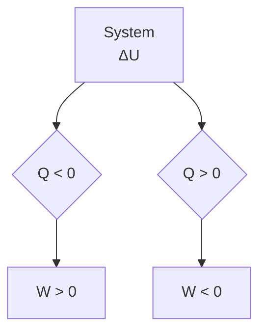

Daraus folgen die **HELMHOLTZschen Wirbelsätze**:

1. Wirbel können nicht erzeugt werden.
2. Vorhandene Wirbel können nicht vernichtet werden.
3. Bei abnehmendem Querschnitt π $R ^ { 2 }$ eines Wirbels erhöht sich entsprechend der Konstanz von Γ seine Winkelgeschwindigkeit ω.

Eine **wirbelfreie Strömung** liegt dann vor, wenn für jedes Flüssigkeitselement die Zirkulation null ist.

## 15.2 Strömungen idealer Flüssigkeiten und Gase. Kontinuitätsgleichung

Für die praktische Behandlung von Strömungsvorgängen genügt es in vielen Fällen, vom idealen Gas bzw. von der idealen Flüssigkeit auszugehen, wodurch die Verhältnisse erheblich vereinfacht werden.

Das **ideale Gas** ist ein Modellgas, bei dem das Eigenvolumen der Gasmoleküle und – mit Ausnahme elastischer Stöße – auch die Wechselwirkung zwischen den Gasmolekülen vernachlässigt werden, so dass bei Strömungsvorgängen von den bei realen Gasen vorhandenen Reibungskräften abgesehen werden kann. Bei genügend hohen Temperaturen und geringen Drücken verhalten sich reale Gase annähernd wie ideale.

Die **ideale Flüssigkeit** ist ein Modell, bei dem die Flüssigkeit als ein nicht zusammendrückbares (inkompressibles), reibungsfreies Medium angesehen wird. Bei weit über dem Schmelzpunkt liegenden Temperaturen und nicht zu hohen Druckdifferenzen werden diese Bedingungen auch durch reale Flüssigkeiten annähernd erfüllt.

Bei den praktischen Problemen der Strömungsmechanik kann in den meisten Fällen auch die Kompressibilität der Gase vernachlässigt werden, wenn die Strömungsgeschwindigkeiten die halbe Schallgeschwindigkeit nicht übersteigen, so dass es fast immer genügt, von „Flüssigkeiten“ zu sprechen. So beträgt die Dichteänderung der Luft bei einer Strömungsgeschwindigkeit von 150m/s nur etwa 1%.

Strömende Flüssigkeiten und Gase werden zusammenfassend als **Fluide** bezeichnet. Als ideales Fluid ist ein reibungsfrei strömendes, inkompressibles Medium anzusehen.

Wir betrachten eine Strömung, bei der sich die Teilchen mit der konstanten Geschwindigkeit $\nu = s / t$ bewegen. Stellt man eine Fläche A senkrecht zu den Stromlinien, so tritt durch diese in der Zeit t das Flüssigkeitsvolumen $V = A s = A \nu t$ hindurch. Somit folgt als **(Volumen-) Stromstärke** oder **Volumenstrom**

$$
I _ {\mathrm{V}} = \frac {\mathrm{d} V}{\mathrm{d} t} = \nu A; \quad \text {Einheit:} \quad [ I _ {\mathrm{V}} ] = 1 \frac {\mathrm{m} ^ {3}}{\mathrm{s}}. \tag {15.1}
$$

Ist $\varrho$ die (konstante) Dichte der Flüssigkeit, so ergibt sich die **Massenstromstärke**

$$
I _ {\mathrm{m}} = \frac {\mathrm{d} m}{\mathrm{d} t} = \varrho \frac {\mathrm{d} V}{\mathrm{d} t} = \varrho I _ {\mathrm{V}} = \varrho \nu A; \quad \text {Einheit:} [ I _ {\mathrm{m}} ] = 1 \frac {\mathrm{kg}}{\mathrm{s}}. \tag {15.2}
$$

Hieraus folgt als **Massenstromdichte**

$$
j _ {\mathrm{m}} = \frac {\mathrm{d} I _ {\mathrm{m}}}{\mathrm{d} A} = \varrho v; \quad \text {Einheit:} \quad [ j _ {\mathrm{m}} ] = 1 \frac {\mathrm{kg}}{\mathrm{m} ^ {2} \mathrm{s}}. \tag {15.3}
$$

Da der Massenstrom stets die Richtung der Teilchengeschwindigkeit v hat, gilt vektoriell

$$
\boldsymbol {j} _ {\mathrm{m}} = \varrho \boldsymbol {v} \quad (\text {Vektor der Massenstromdichte}). \tag {15.4}
$$

Wir betrachten jetzt den allgemeinen Fall, dass sich die Strömungsgeschwindigkeit v nach Größe und Richtung ändert, die Stromlinien also keine parallelen Geraden sind, und die Flä- che A, welche auch gekrümmt sein kann, nicht notwendig senkrecht durchströmt wird (Bild 15.3a). Die Massenstromstärke durch ein kleines gerichtetes Flächenelement dA mit dem Normaleneinheitsvektor $\mathbf { e _ { n } }$ ist dann, da in Wirklichkeit nur das zu $j _ { \mathrm { m } }$ senkrechte Flächenelement d $A ^ { \prime } = \mathbf { d } A$ cosα durchströmt wird (Bild 15.3b), nach (15.3)

$$
\mathrm{d} I _ {\mathrm{m}} = | \boldsymbol {j} _ {\mathrm{m}} | \mathrm{d} A ^ {\prime} = | \boldsymbol {j} _ {\mathrm{m}} | \mathrm{d} A \cos \alpha = \boldsymbol {j} _ {\mathrm{m}} \cdot \mathrm{d} A, \tag {15.5}
$$

also gleich dem Skalarprodukt aus dem Stromdichtevektor $j _ { \mathrm { m } }$ und dem Flächenvektor dA. Wird $j _ { \mathrm { m } }$ über eine geschlossene Fläche $A _ { 0 }$ integriert, so erhält man den gesamten ein- und austretenden Massenstrom durch diese Fläche. Es bedeutet dann

$$
I _ {\mathrm{m}} = \oint_ {A _ {0}} \boldsymbol {j} _ {\mathrm{m}} \cdot \mathrm{d} \boldsymbol {A} \left\{ \begin{array}{l l} > 0: & \text {Im umschlossenen Gebiet befinden sich Quellen.} \\ <   0: & \text {Im umschlossenen Gebiet befinden sich Senken.} \\ = 0: & \text {Das umschlossene Gebiet ist quellenfrei.} \end{array} \right.
$$

text_image

a)
e_n
j_m
dA

text_image

b)
dA'
e_n
α
α
dA
j_m

Bild 15.3 Durchströmung (Durchflutung) eines Flä- chenelements dA; $\mathbf { e _ { n } }$ Normaleneinheitsvektor des Flächenelements

text_image

A₁
v₁
A₂
v₂
s₁
s₂

Bild 15.4 Zur Kontinuitätsgleichung $\nu _ { 1 } A _ { 1 } = \nu _ { 2 } A _ { 2 }$ in einer Stromröhre

Der mathematische Ausdruck dafür, dass durch die Begrenzungsflächen eines bestimmten Raumelements zu jeder Zeit nicht mehr Flüssigkeit ein- als ausströmt (bzw. umgekehrt), ist also

$$
I _ {\mathrm{m}} = \frac {\mathrm{d} m}{\mathrm{d} t} = \oint \boldsymbol {j} _ {\mathrm{m}} \cdot \mathrm{d} \boldsymbol {A} = \oint \varrho \boldsymbol {v} \cdot \mathrm{d} \boldsymbol {A} = 0. \tag {15.6}
$$

Diese Beziehung nennt man die **Kontinuitätsgleichung** für Massenströme. Sie beinhaltet den Satz von der Erhaltung der Masse, wenn das umschlossene Gebiet quellenfrei ist.

Bei Anwendung der Gleichung (15.6) auf die sich verengende Stromröhre in Bild 15.4 reduziert sich die Integration auf eine Summation der Massenströme durch die beiden Rohröffnungen mit den Querschnittsflächen $A _ { 1 }$ und $A _ { 2 }$ , welche mit den Geschwindigkeiten $\nu _ { 1 }$ und $\nu _ { 2 }$ durchströmt werden. Bei der Bildung der beiden skalaren Produkte v ·A ist zu beachten, dass die

Flächenvektoren $A _ { 1 }$ und $A _ { 2 }$ jeweils nach außen orientiert sind. Für eine inkompressible Flüssigkeit, d. h. für $\varrho = \mathbf { c o n s t } ,$ folgt damit nach (15.6):

$$
v _ {1} A _ {1} \cos 1 8 0 ^ {\circ} + v _ {2} A _ {2} \cos 0 ^ {\circ} = - v _ {1} A _ {1} + v _ {2} A _ {2} = 0,
$$

$$
v _ {1} A _ {1} = v _ {2} A _ {2} \quad \text {oder} \quad v A = \text {const} \quad (\text {Kontinuitätsgleichung}). \tag {15.7}
$$

## In einer Stromröhre verhalten sich die Strömungsgeschwindigkeiten umgekehrt proportional zu den Querschnittsflächen.

Mit $\nu = s / t$ folgt aus Gleichung (15.7)

$$
\frac {s _ {1} A _ {1}}{t} = \frac {s _ {2} A _ {2}}{t}, \quad \text {d.h.} \quad \frac {V _ {1}}{t} = \frac {V _ {2}}{t} \quad \text {oder} \quad I _ {V} = \frac {V}{t} = \nu A = \text {const.} \tag {15.8}
$$

## In gleichen Zeiten werden alle Querschnitte einer Stromröhre von gleichen Volumina durchsetzt.

Bei stationär strömenden Gasen müssen Dichteschwankungen berücksichtigt werden. Es gilt dann anstelle der Kontinuitätsgleichung (15.7) für zwei Querschnitte einer Stromröhre nach dem Satz von der Erhaltung der Masse (15.6)

$$
\varrho_ {1} v _ {1} A _ {1} = \varrho_ {2} v _ {2} A _ {2}. \tag {15.9}
$$

## 15.3 Die bernoullische Gleichung. Druckmessung

Eine Flüssigkeit bewege sich durch ein Rohr (Stromröhre) mit veränderlichem Querschnitt unter der Wirkung einer Druckdifferenz $p _ { 1 }   -   p _ { 2 }$ , die durch zwei Kolben an den Rohrenden mit den Querschnitten $A _ { 1 }$ und $A _ { 2 }$ durch die Kräfte $F _ { 1 }$ und $F _ { 2 }$ erzeugt wird (Bild 15.5). Beim Verschie-

text_image

A₂ → v₂ = F₂
s₂
F₁ = A₁ → v₁
h₁
s₁
h₂

Bild 15.5 Zur Herleitung der bernoullischen Gleichung

ben des Kolbens 1 um die Strecke $s _ { 1 }$ wird die Arbeit $F _ { 1 } s _ { 1 } = p _ { 1 } A _ { 1 } s _ { 1 } = p _ { 1 } V$ auf die Flüssigkeit übertragen und bei der gleichzeitig stattfindenden Bewegung des Kolbens $2 \mathrm { ~ u m ~ } s _ { 2 }$ von der (inkompressiblen) Flüssigkeit die Arbeit $F _ { 2 } s _ { 2 } = p _ { 2 } A _ { 2 } s _ { 2 } = p _ { 2 } V$ abgegeben; der Differenzbetrag $( p _ { 1 }   -   p _ { 2 } ) V$ tritt als Zuwachs an kinetischer Energie (wegen $\nu _ { 2 } > \nu _ { 1 } )$ und an potenzieller Energie der Flüssigkeitsteilchen zwischen den Höhenniveaus $h _ { 1 }$ und $h _ { 2 }$ in Erscheinung:

$$
(p _ {1} - p _ {2}) V = \frac {m}{2} (v _ {2} ^ {2} - v _ {1} ^ {2}) + m g (h _ {2} - h _ {1}).
$$

Ordnen der Größen und Division durch das Volumen V führt von der Energiebilanz zu der Druckbilanz

$$
p _ {1} + \frac {\varrho}{2} v _ {1} ^ {2} + \varrho g h _ {1} = p _ {2} + \frac {\varrho}{2} v _ {2} ^ {2} + \varrho g h _ {2} \quad (\text {BERNOULLischeGleichung}). \tag {15.10}
$$

Verläuft die Stromröhre horizontal wie in Bild 15.4, also $h _ { 1 } = h _ { 2 }$ , so wird

$$
p _ {1} + \frac {\varrho}{2} v _ {1} ^ {2} = p _ {2} + \frac {\varrho}{2} v _ {2} ^ {2} \tag {15.11}
$$

oder

$$
p + \frac {\varrho}{2} v ^ {2} = p _ {\mathrm{g}} = \text {const.} \tag {15.12}
$$

Darin ist $p$ der statische Druck (Kolbendruck), die Größe $\varrho \nu ^ { 2 } / 2$ wird als dynamischer Druck oder Staudruck bezeichnet. Die in der ganzen Strömung konstante Summe aus beiden Drücken kennzeichnet den Gesamtdruck; er ist gleich dem statischen Druck in der ruhenden Flüssigkeit, wenn also $\nu = 0$ ist.

## In einer horizontalen Stromröhre ist der Gesamtdruck, das ist die Summe aus statischem Druck und Staudruck, überall gleich.

Je größer also an einer bestimmten Stelle die Strömungsgeschwindigkeit und damit der Staudruck ist, umso kleiner ist dort der statische Druck und umgekehrt. Trifft z. B. die Strömung auf ein ihr entgegenstehendes Hindernis, an dem in einem bestimmten Punkt die Strömungsgeschwindigkeit $\nu _ { 2 } = 0$ ist, so muss der dort herrschende statische Druck $p _ { 2 }$ nach (15.11) gleich der Summe aus statischem Druck und Staudruck $p _ { 1 } + \varrho v _ { 1 } ^ { 2 } / 2$ in der übrigen Strömung sein. Der Druckanstieg $\Delta p = p _ { 2 } - p _ { 1 }$ in diesem als **Staupunkt** bezeichneten Hindernispunkt ist der Staudruck.

## Im einem Staupunkt herrscht der größte statische Druck, der in der gesamten Strö- mung überhaupt auftreten kann.

**Druckmessung.** Die verschiedenen Druckgrößen in einer Strömung (statischer Druck, Staudruck und Gesamtdruck) lassen sich mit Hilfe der in Bild 15.6 dargestellten Vorrichtungen messen. Die im Bildteil a gezeigte **Druckmesssonde**, deren Öffnung tangential zur Strömung liegt, gestattet die Messung des statischen Druckes $p ,$ indem dieser über ein U-Rohr-Manometer mit dem äußeren Luftdruck $p _ { 0 }$ verglichen wird. Ist die Öffnung der Sonde der Strömung zugewandt (Bildteil b), so kann mit dem sog. **PITOT-Rohr** die Differenz zwischen Gesamtdruck $p _ { \mathrm { g } }$ und dem äußeren Druck gemessen werden. Das **PRANDTLsche Staurohr** (Bildteil c) ist eine Kombination der beiden vorgenannten Strömungsmesssonden. Die von ihm angezeigte Differenz von Gesamtdruck und statischem Druck ist nach (15.12) gleich dem Staudruck $\varrho \nu ^ { 2 } / 2$ . Mit dieser Sonde kann daher an jeder Stelle des Strömungsfeldes die Strömungsgeschwindigkeit v gemessen werden. Für die als **VENTURI-Düse** bekannte Querschnittsverengung des Rohres (Bildteil d) ergibt sich nach (15.1) und (15.11) am Manometer die Druckdifferenz

$$
p _ {1} - p _ {2} = \frac {\varrho}{2} \left(v _ {2} ^ {2} - v _ {1} ^ {2}\right) = \frac {\varrho I ^ {2}}{2} \left(\frac {1}{A _ {2} ^ {2}} - \frac {1}{A _ {1} ^ {2}}\right).
$$

Bild 15.6 Druckmesssonden: b) Pitot-Rohr; c) prandtlsches Staurohr; d) Venturi-Düse (s. Text)

Als Funktion bekannter oder leicht messbarer Größen folgt daraus der Volumenstrom

$$
I _ {\mathrm{V}} = \frac {V}{t} = A _ {1} A _ {2} \sqrt {\frac {2 (p _ {1} - p _ {2})}{\varrho (A _ {1} ^ {2} - A _ {2} ^ {2})}}.
$$

**Anwendungen der BERNOULLIschen Gleichung.** Es gibt zahlreiche Erscheinungen und Vorrichtungen, die darauf beruhen, dass bei einer Zunahme des Staudruckes bzw. der Strömungsgeschwindigkeit gemäß (15.12) der statische Druck abnimmt. Als Beispiel zeigt Bild 15.7a einen **Zerstäuber**: Der durch das waagrechte Rohr strömende Luftstrom wird mittels einer Düse eingeengt und beschleunigt, so dass der am oberen Rand des Steigrohres wirkende statische Druck kleiner ist als der auf die Flüssigkeitsoberflä- che im Becherglas wirkende äußere Druck bzw. Gesamtdruck; die Flüssigkeit wird durch das Steigrohr nach oben gedrückt und an der Düse versprüht.

text_image

Luft
Wasser
a)
Luft
Rezipient
b)

Bild 15.7 a) Zerstäuber; b) Wasserstrahlpumpe

Bei der **Wasserstrahlpumpe** (Bild 15.7b) wird ein Wasserstrahl mittels einer Düse eingeschnürt. Infolge des verminderten statischen Druckes werden die Gasmoleküle der Umgebung angesaugt und mitgerissen. Der angeschlossene Rezipient kann so annähernd bis auf den Dampfdruck des Wassers (etwa 37hPa bei 300K) evakuiert werden.

Als **aerodynamisches Paradoxon** wird die Erscheinung bezeichnet, dass ein Gas- oder Flüssigkeitsstrahl, der aus einem Rohr gegen eine quer gestellte bewegliche Platte strömt (Bild 15.8), diese nicht wegbläst, sondern im Gegenteil sogar anzieht, da der von unten gegen die Platte wirkende äußere Druck $p _ { 0 }$ den von oben wirkenden statischen Druck in der Strömung übertrifft.

text_image

P₀

Bild 15.8 Aerodynamisches Paradoxon

**MAGNUS-Effekt.** Wird ein rotierender Zylinder von einer Flüssigkeit oder einem Gas umströmt, so stellt sich in der Umgebung desselben das in Bild 15.9 dargestellte Stromlinienbild ein. Da die Stromlinien oberhalb des Zylinders dichter und unterhalb weniger dicht als im Falle des ruhenden Zylinders verlaufen, ist nach der BERNOULLIschen Gleichung der statische Druck oberhalb des Zylinders kleiner als unterhalb, und der Zylinder erfährt eine nach oben quer zur Strömung gerichtete Kraft. In gleicher Weise lässt sich auch die von der normalen Wurfparabel abweichende Flugbahn eines mit Effet gespielten Tennis- oder Fußballs erklären.

natural_image

Diagram showing fluid flow around a circular object with directional arrows, no text or symbols present

Bild 15.9 Magnus-Effekt

## Beispiele 15.1:

1. Berechne die Geschwindigkeit $\nu _ { 0 } ,$ , mit der ein Gas aus einem Gefäß, in welchem es unter dem Druck $p$ steht, in den freien Raum (Atmosphärendruck $p _ { 0 } )$ ausströmt! Das Gas soll sich im Innern des Gefäßes in Ruhe befinden.

Lösung: Für eine horizontal verlaufende Stromlinie ist nach (15.12) $p = p _ { 0 } + \varrho v _ { 0 } ^ { 2 } / 2$ . Mit $\Delta p =$ $p - p _ { 0 }$ als Überdruck im Gefäß folgt hieraus

$$
v _ {0} = \sqrt {\frac {2 \Delta p}{\varrho}} \quad (\text {BUNSENSches Ausströmungsgesetz}). \tag {15.13}
$$

2. Durch ein Rohr vom Querschnitt $A = 1   \mathrm { d m } ^ { 2 }$ strömt eine ideale Flüssigkeit. Zwei Flüssigkeitsmanometer der in Bild 15.10 gezeigten Art zeigen eine Höhendifferenz von $\Delta h = 3 5$ cm an. Welches Flüssigkeitsvolumen strömt je Sekunde durch das Rohr?

text_image

Δh
A

Bild 15.10 Durchflussmessung

Lösung: Da das vorn liegende Manometer den Gesamtdruck und das dahinter liegende nur den statischen Druck anzeigt, liefert die Differenz beider Anzeigen den <u>Staudr</u>uck: $\varrho v ^ { 2 } / 2 = \varrho g \Delta h$ (nach (14.3)). Daraus folgt für die Strömungsgeschwindigkeit $\nu = \sqrt { 2 g \Delta h } = 2 { , } 6 2   \mathrm { m / s } .$ Aus der Kontinuitätsgleichung (15.8) erhält man hiermit $V/t = \nu A = 0.0262    m ^3/ s  = 26.21/ s$ □

## Aufgaben

**15.1** Wie ändern sich im Bild 15.10 die Manometeranzeigen, wenn durch Schließen eines Ventils am Ende der Leitung die Strömung unterbrochen wird?
**15.2** Berechne mit Hilfe der BERNOULLIschen Gleichung (15.10) die Ausflussgeschwindigkeit $\nu _ { 1 }$ durch die Seitenöffnung eines oben offenen Gefäßes in den freien Raum (Atmosphä- rendruck $p _ { 0 } ) \}$ Die Ausflussöffnung soll um $\Delta h = h _ { 2 } - h _ { 1 }$ unter dem Flüssigkeitsspiegel liegen, und ihr Querschnitt soll im Vergleich zu dem des Gefäßes sehr klein sein, so dass die Absinkgeschwindigkeit des Spiegels vernachlässigt werden kann $( \nu _ { 2 } \approx 0 )$

## 15.4 Strömungen realer Flüssigkeiten und Gase. Laminare Strömung

Bei der Bewegung realer Fluide werden zwischenmolekulare Wechselwirkungskräfte zwischen den Teilchen wirksam, die man unter dem Begriff der inneren Reibung zusammenfasst. Auf ihnen beruht die **Viskosität** (Zähflüssigkeit) der Flüssigkeiten und Gase. Diese ist z. B. bei Wasser nicht so auffällig wie bei dickflüssigen Stoffen (Sirup, Pech), deren innere Reibung besonders groß ist.

Die innere Reibung einer Flüssigkeit spielt bei der **laminaren (schlichten) Strömung** eine dominierende Rolle. Im Gegensatz zur turbulenten Strömung, bei welcher der Hauptbewegung der Flüssigkeitsteilchen eine ungeordnete Mischbewegung überlagert ist, gleiten in der laminaren Strömung Flüssigkeitsschichten (Lamellen) mit verschiedenen Geschwindigkeiten übereinander hinweg, ohne sich zu durchmischen (Bild 15.11). Die Flüssigkeitsteilchen bewegen sich nur in Strömungsrichtung, haben also keine Geschwindigkeitskomponente quer zur Strömungsrichtung.

text_image

v
Δh
Δv
v=0
h

Bild 15.11 Zur Herleitung des newtonschen Reibungsgesetzes (15.14) für die laminare Strömung

Eine solche Strömung kann z. B. dadurch erzeugt werden, dass nach Bild 15.11 zwei ebene Platten, zwischen denen sich eine Flüssigkeitsschicht der Höhe h befindet, relativ zueinander langsam tangential bewegt werden. Die obere, mit der Geschwindigkeit v bewegte Platte nimmt die an ihr wegen der Adhäsionskräfte fest haftende Flüssigkeitsschicht, die sog. **Grenzschicht**, mit, die nun ihrerseits infolge Reibung die darunter befindliche Flüssigkeitslamelle zu einer gleich gerichteten Bewegung mit einer um $\Delta \nu$ kleineren Geschwindigkeit veranlasst usw. An der unteren (ruhenden) Platte haftet die Flüssigkeit ebenfalls und ist daher dort in Ruhe. Auf diese Weise entsteht in der Flüssigkeit ein Geschwindigkeitsgefälle v/h bzw. $\Delta \nu / \Delta h ,$ das jedoch nicht notwendig linear (wie in Bild 15.11) zu sein braucht; es wird daher besser durch dv/dh beschrieben.

Die der Bewegung entgegengesetzte **Reibungskraft** $F _ { \mathrm { R } }$ , welche den Bewegungswiderstand der zähen Flüssigkeit verkörpert, ist dem Geschwindigkeitsgefälle und der Fläche A, mit der die Platte die Flüssigkeit berührt, proportional:

$$
F _ {\mathrm{R}} = \eta A \frac {\mathrm{d} v}{\mathrm{d} h} \quad (\text {NEWTONsches Reibungsgesetz}). \tag {15.14}
$$

In der sog. stationären Parallelströmung gemäß Bild 15.11 greift also an jeder Flüssigkeitsschicht in Strömungsrichtung eine Schubspannung (13.11) $\tau = F _ { \mathrm { R } } / A = \eta ( \mathbf { d } \nu / \mathbf { d } h )$ an, die dem örtlichen Geschwindigkeitsgefälle proportional ist.

η ist dabei eine Stoffkonstante; sie wird **dynamische Viskosität** genannt und hat die

$$
\text {Einheit:} \quad [ \eta ] = 1 \mathrm{N} \cdot \mathrm{s} / \mathrm{m} ^ {2} = 1 \mathrm{Pa} \cdot \mathrm{s}.
$$

Der Kehrwert von $\eta$ wird $F l u i d i t \ddot { a } t$ und der Quotient $\nu = \eta / \varrho$ (ϱ Dichte) kinematische Visko**sität** genannt (Einheit: $[ \nu ] = 1   \mathrm { m } ^ { 2 } / \mathrm { s } )$

Die Tabelle 15.1 gibt für eine Auswahl von Stoffen eine Übersicht über die Viskositätswerte.

Tabelle 15.1 Dynamische und kinematische Viskosität einiger Stoffe bei verschiedenen Temperaturen ϑ

<table><tr><td>Stoff</td><td> $\vartheta$  (°C)</td><td> $\eta$  (mPa s)</td><td> $\nu$  (mm2/s)</td></tr><tr><td rowspan="3">Luft</td><td>0</td><td>0,0172</td><td>13</td></tr><tr><td>20</td><td>0,0182</td><td>15</td></tr><tr><td>100</td><td>0,0218</td><td>23</td></tr><tr><td rowspan="2">Wasserdampf</td><td>100</td><td>0,0172</td><td>29</td></tr><tr><td>250</td><td>0,0184</td><td>44</td></tr><tr><td>Helium</td><td>20</td><td>0,0220</td><td>123,2</td></tr><tr><td>Ethanol</td><td>20</td><td>1,16</td><td>1,47</td></tr><tr><td rowspan="3">Wasser</td><td>0</td><td>1,792</td><td>1,794</td></tr><tr><td>20</td><td>1,005</td><td>1,007</td></tr><tr><td>100</td><td>0,284</td><td>0,296</td></tr><tr><td>Motorenöl</td><td>20</td><td>20 ... 10 000</td><td>20 ... 10 000</td></tr><tr><td>Rizinusöl</td><td>20</td><td>950</td><td>1 090</td></tr><tr><td>Geräteglas</td><td>700</td><td> $10^8$ </td><td> $0,4 \cdot 10^8$ </td></tr><tr><td>Pech</td><td>20</td><td> $3 \cdot 10^{10}$ </td><td> $2,5 \cdot 10^{10}$ </td></tr></table>

## 15.5 Gesetze von Hagen-Poiseuille und Stokes

Eine wichtige praktische Anwendung findet das NEWTONsche Reibungsgesetz (15.14) bei der Behandlung der laminaren Durchströmung eines Rohres. HAGEN und POISEUILLE bestimmten den Volumenstrom durch ein Rohr der Länge l und vom Radius R unter dem Einfluss eines Druckgefälles $( p _ { 1 } - p _ { 2 } ) / l$ zwischen den Rohrenden zu

$$
I _ {\mathrm{V}} = \frac {V}{t} = \frac {\pi R ^ {4} (p _ {1} - p _ {2})}{8 \eta l} \quad (\text {Gesetz von HAGEN - POISEUILLE}). \tag {15.15}
$$

Bei der Herleitung dieser zunächst experimentell gefundenen Beziehung wird davon ausgegangen, dass – wie in Bild 15.12 dargestellt – koaxiale zylindrische Flüssigkeitsschichten langsam aufeinander abgleiten. Als Volumenelement im Rohrinnern betrachten wir einen Flüssigkeitszylinder mit dem Radius $r < R ,$ der am angrenzenden Hohlzylinder der Dicke dr abgleitet. Die auf dieses Volumenelement wirkende Druckkraft (Druckdifferenz mal Zylinderquerschnitt) hält der am Zylindermantel (Fläche A) angreifenden Reibungskraft (15.14) das Gleichgewicht:

$$
(p _ {1} - p _ {2}) \pi r ^ {2} = - \eta A \frac {\mathrm{d} v}{\mathrm{d} r} = - \eta \cdot 2 \pi r l \frac {\mathrm{d} v}{\mathrm{d} r}.
$$

Das negative Vorzeichen bei der Reibungskraft bedeutet, dass die Geschwindigkeit der Schichten mit wachsendem Radius abnimmt. Daraus folgt nach Umstellung

$$
r \mathrm{d} r = - \frac {2 \eta l}{p _ {1} - p _ {2}} \mathrm{d} v \quad \text {und nach Integration} \quad r ^ {2} = - \frac {4 \eta l}{p _ {1} - p _ {2}} v + C.
$$

Die Integrationskonstante C findet man aus der Haftbedingung $\nu = 0$ für $r = R$ zu $C = R ^ { 2 }$ . Damit erhält man für die Geschwindigkeit in Abhängigkeit vom Abstand r von der Rohrmitte:

$$
v (r) = \frac {p _ {1} - p _ {2}}{4 \eta l} \left(R ^ {2} - r ^ {2}\right) \quad (\text {parabolisches Geschwindigkeitsgefälle}). \tag {15.16}
$$

Die Volumenstromstärke durch ein Flächenelement des Rohrquerschnitts d $A = 2 \pi r$ dr beträgt nach (15.1) $\mathrm { d } I _ { \mathrm { V } } = \nu ( r )   \mathrm { d } A = 2 \pi r   \mathrm { d } r   \nu ( r )$ . Mit (15.16) folgt hieraus für den gesamten Volumenstrom durch das Rohr

$$
I _ {\mathrm{V}} = \int_ {0} ^ {R} \frac {\pi (p _ {1} - p _ {2})}{2 \eta l} (R ^ {2} - r ^ {2}) r \mathrm{d} r = \frac {\pi R ^ {4} (p _ {1} - p _ {2})}{8 \eta l}.
$$

Das HAGEN-POISEUILLEsche Gesetz spielt u. a. in der Physiologie des Blutkreislaufs eine wichtige Rolle; geringfügige Veränderungen der Gefäßquerschnitte bewirken wegen $I _ { \mathrm { V } } \sim R ^ { 4 }$ große Veränderungen im Blutdurchsatz.

text_image

R
dr
r
v(r)
dA

Bild 15.12 Laminare Durchströmung eines Rohres (parabolisches Geschwindigkeitsprofil)

Definiert man nach Gleichung (15.1) durch $I _ { \mathrm { V } } = \bar { \nu } \pi R ^ { 2 }$ eine mittlere Strömungsgeschwindigkeit v¯ im Rohr und berücksichtigt, dass π ${ : } R ^ { 2 }   ( p _ { 1 }   -   p _ { 2 } )$ die an der Flüssigkeit im Rohr von außen angreifende Kraft ist, welche aus Gleichgewichtsgründen dem Betrage nach gleich dem Reibungswiderstand $F _ { \mathrm { R } }$ sein muss, so folgt aus (15.15)

$$
F _ {\mathrm{R}} = 8 \pi \eta l \bar {\nu} \quad (\text {Reibungskraft der Rohrströmung}). \tag {15.17}
$$

Einen ähnlichen Ausdruck erhält man für die Reibungskraft bei der Umströmung einer Kugel, wobei anstelle der Rohrlänge l der Kugelradius R als charakteristische Länge eingeht:

$$
F _ {\mathrm{R}} = 6 \pi \eta R v \quad (\text {STOKESSches Reibungsgesetz}). \tag {15.18}
$$

Dabei ist es gleichgültig, ob die Kugel in Ruhe ist und von der Flüssigkeit umströmt wird oder ob sie sich mit der Geschwindigkeit v durch die ruhende Flüssigkeit bewegt.

## Beispiele 15.2:

1. Wie ändert sich der Volumenstrom durch ein zylindrisches Rohr, wenn sich der Rohrdurchmesser infolge von Ablagerungen um 15% verringert?

Lösung: Nach (15.15) gilt $I _ { \mathrm { V } 2 } : I _ { \mathrm { V } 1 } = R _ { 2 } ^ { 4 } : R _ { 1 } ^ { 4 } = ( 0 , 8 5 R _ { 1 } ) ^ { 4 } : R _ { 1 } ^ { 4 } = 0 , 8 5 ^ { 4 } = 0 , 5 2$ . Der Volumenstrom verringert sich demnach auf 52% des ursprünglichen Wertes.

2. Mit dem Kugelfallviskosimeter wird die Zähigkeit einer Flüssigkeit dadurch bestimmt, dass man eine Kugel in der Flüssigkeit zu Boden sinken lässt und dabei die sich einstellende konstante Sinkgeschwindigkeit misst. Diese folgt aus dem Gleichgewicht zwischen der nach unten gerichteten Gewichtskraft der Kugel $G = \varrho _ { \mathrm { K } } V _ { \mathrm { K } } g$ einerseits und den nach oben gerichteten Kräften an der Kugel, der Reibungskraft (15.18) $F _ { \mathrm { R } } = 6 \pi \eta R \nu$ und der Auftriebskraft (14.4) $F _ { \mathrm { A } } = \varrho _ { \mathrm { F l } } V _ { \mathrm { K } } g$ andererseits, also $G = F _ { \mathrm { R } } + F _ { \mathrm { A } }$ , mit $V _ { \mathrm { K } } = 4 \pi R ^ { 3 } / 3$ z u

$$
v = \frac {2 \left(\varrho_ {\mathrm{K}} - \varrho_ {\mathrm{Fl}}\right) R ^ {2} g}{9 \eta} \quad \text {(stationäre Sinkgeschwindigkeit einer Kugel).} \tag {15.19}
$$

Wie groß ist die dynamische Viskosität von Motorenöl $( \varrho _ { \mathrm { F l } } = 0 , 8 5   \mathrm { g } / \mathrm { c m } ^ { 3 } )$ , wenn die Kugel vom Radius $R = 3$ mm und der Dichte $\varrho_{\mathrm{K}}=2.5 \mathrm{~g} / \mathrm{cm}^{3}$ in 8,5s eine Strecke von 30cm durchfällt?

Lösung: Mit $\nu = s / t$ folgt aus (15.19) nach Umstellung $\eta = 0 , 9 2 \mathrm { P a } \cdot \mathrm { s } .$

## Aufgabe

**15.3** Eine Staumauer hat 1,5m unter dem Wasserspiegel eine röhrenförmige Öffnung von 2mm Radius und 2m Länge. Wie viel Wasser $( \eta = 1 0 ^ { - 3 }   \mathrm { P a }   \cdot   \mathrm { s } )$ geht hierdurch an einem Tag verloren?

## 15.6 Umströmung durch reale Flüssigkeiten und Gase. Reynolds-Zahl

Umströmt eine reale Flüssigkeit oder ein reales Gas z. B. einen Kreiszylinder (Bild 15.13), dann rufen – im Unterschied zur Umströmung durch eine ideale Flüssigkeit oder ein ideales Gas – die durch Reibung entstehenden Wirbel eine unsymmetrische Druckverteilung vor und hinter dem Zylinder hervor, was dazu führt, dass auf diesen in Strömungsrichtung eine Kraft, der **Strömungswiderstand** $F _ { \mathrm { W } }$ , ausgeübt wird. Dabei ist $F _ { \mathrm { W } }$ dem Staudruck $\varrho \nu ^ { 2 } / 2$ sowie der Stirnfläche A des Strömungskörpers (d. i. der größte, der Strömung entgegenstehende Querschnitt) proportional:

$$
F _ {\mathrm{W}} = c _ {\mathrm{W}} A \frac {\varrho v ^ {2}}{2} \quad (\text {Strömungswiderstand}). \tag {15.20}
$$

Bild 15.13 Umströmung eines Zylinders a) durch eine ideale Flüssigkeit, b) durch eine reale Flüssigkeit (Wirbelbildung)

Die dimensionslose Zahl cW ist der **Widerstandsbeiwert**, der weitgehend durch die Form des Körpers bestimmt wird. Er wird im Allgemeinen durch Versuche im Strömungs- bzw. Windkanal, in dem der Körper aufgehängt und dabei umströmt wird, ermittelt. Durch Wahl einer günstigen Form für den umströmten Körper (Stromlinienform) kann die Wirbelbildung stark verringert und der Strömungswiderstand merklich herabgesetzt werden. Für einige Körper sind die $c _ { W ^ { - } } \mathrm { W e r t e }$ in der Tabelle 15.2 angegeben.

Tabelle 15.2 Widerstandsbeiwerte $c _ { W }$ einiger Körper

| Dünne ebene Kreisplatte | 1,11 |
| --- | --- |
| Halbkugel, Rundung gegen die Strömung | 0,40 |
| Rundung von der Strömung abgewandt | 1,17 |
| Kugel | 0,2 ... 0,4 |
| Halbkugelschale, Rundung gegen die Strömung | 0,34 |
| Höhlung gegen die Strömung | 1,3 ... 1,6 |
| Kraftwagen |  |
| offen, alte Form | 1,0 |
| geschlossene, leicht gerundete Form | 0,4 ... 0,5 |
| Stromlinienform | 0,2 |
| Stromlinienkörper | 0,055 |

Erreicht die Strömungsgeschwindigkeit die Schallgeschwindigkeit, so steigt $c _ { W }$ zunächst stark an (**Schallmauer**), um dann wieder etwas abzufallen. Gibt man die Geschwindigkeit v im Verhältnis zur Schallgeschwindigkeit c an, so erhält man die sog. **MACH-Zahl** $M a = \nu / c .$ Von $M a \approx 0 { , } 7$ an darf Luft nicht mehr als inkompressibel angesehen werden, sie wird in zunehmendem Maße auf der Stirnseite des bewegten Körpers komprimiert, was mit einem Knall und mit zum Teil wesentlicher Erwärmung verbunden ist.

**Ähnliche Strömungen.** Da im Allgemeinen die Berechnung des Strömungswiderstandes (15.20) mathematisch sehr aufwändig ist, zieht man Messungen vor, die bei größeren Objekten (wie Raketen, Flugzeugen, Schiffen) zunächst an einem verkleinerten Modell durchgeführt werden. Dabei ist zu beachten, dass eine geometrische Ähnlichkeit zwischen Original- und Modellkörper noch keine hydrodynamische Ähnlichkeit zwischen Original- und Modellströ- mung garantiert. Hierzu ist zusätzlich erforderlich, dass das Verhältnis von kinetischer Energie des strömenden Mediums zur Reibungsarbeit desselben für die Original- und Modellströmung gleich ist.

Kennzeichnet man eine für den Widerstandskörper charakteristische Abmessung von Original und Modell (z. B. Spannweite eines Flugzeuges oder Radius eines Rohres) durch die Längen $l _ { 0 }$ und $l _ { \mathbf { M } } ,$ , so ist $l _ { 0 } / l _ { \mathrm { M } }$ das geometrische Ähnlichkeitsverhältnis beider Körper, das auch für alle anderen Längen gelten muss. Original- und Modellströmung sind dann hydrodynamisch ähnlich, wenn gilt

$$
\frac {\varrho_ {\mathrm{O}} l _ {\mathrm{O}} v _ {\mathrm{O}}}{\eta_ {\mathrm{O}}} = \frac {\varrho_ {\mathrm{M}} l _ {\mathrm{M}} v _ {\mathrm{M}}}{\eta_ {\mathrm{M}}}, \tag {15.21}
$$

d. h., wenn die Werte der dimensionslosen Größe

$$
R e = \frac {\varrho l \nu}{\eta} \quad (\text {REYNOLDS - Zahl}) \tag {15.22}
$$

für Original- und Modellströmung gleich sind. Wird also im Modell l kleiner gewählt, so muss, um das gleiche Strömungsbild wie beim Original zu erhalten, im Modellversuch die Strö- mungsgeschwindigkeit v oder die Dichte ϱ des strömenden Mediums entsprechend erhöht oder dessen Zähigkeit η herabgesetzt werden.

**Geometrisch ähnliche Körper erzeugen hydrodynamisch ähnliche Strömungen, wenn ihre REYNOLDS-Zahlen gleich sind.**

In diesem Fall sind auch die Widerstandsbeiwerte $c _ { W }$ gleich; denn es folgt z. B. für eine umströmte Kugel durch Gleichsetzen der Reibungswiderstände (15.18) und (15.20)

$$
6 \pi \eta R \nu = c _ {\mathrm{W}} (\pi R ^ {2}) \frac {\varrho}{2} \nu^ {2}; \qquad c _ {\mathrm{W}} = 1 2 \frac {\eta}{\varrho R \nu},
$$

d. h., $c _ { W } \sim 1 / R e$ . In einer laminaren Strömung sind die Reibungskräfte dominierend und daher die REYNOLDS-Zahlen klein. Oberhalb einer kritischen REYNOLDS-Zahl, wenn z. B. die Strömungsgeschwindigkeit eine gewisse Grenze überschreitet, wird die Strömung instabil, sie schlägt von der laminaren in die mit Wirbelbildung verbundene turbulente Strömungsform um (bei der Rohrströmung z. B. bei $R e = 1 1 6 0$ , wenn für l in (15.22) der Rohrhalbmesser eingesetzt wird).

## Beispiele 15.3:

1. Der Strömungswiderstand eines Kraftwagens bei einer Geschwindigkeit von 108km/h soll am Modell im Windkanal bestimmt werden. Der Durchmesser der maximalen Querschnittsfläche ist beim Kraftwagen $d _ { \mathrm { K } } = 1 , 5   \mathrm { m }$ , beim Modell $d _ { \mathrm { M } } = 1 , 0 \mathrm { m }$ . Berechne die erforderliche Strömungsgeschwindigkeit $\nu _ { \mathrm { M } }$ im Windkanal!

Lösung: Nach (15.22) ist $Re_{\mathrm{K}} = (1,5 \mathrm{m}) \cdot (30 \mathrm{m/s}) \varrho / \eta$ und $R e _ { \mathrm { M } } = ( 1 , 0 \mathrm { m } ) v _ { \mathrm { M } } \varrho / \eta$ . Mit (15.21) $R e _ { \mathrm { K } } =$ $R e _ { \mathrm { M } }$ wird $v_{\mathrm{M}}=45 \mathrm{~m} / \mathrm{s}=162 \mathrm{~km} / \mathrm{h}$

2. Berechne die zur Überwindung des Luftwiderstandes eines Kraftwagens (Stirnfläche $2   \mathrm { m } ^ { 2 } ;$ $c _ { W } = 0 , 4 5 )$ erforderliche Antriebsleistung bei einer Geschwindigkeit von 100km/h! $\varrho _ { \mathrm { L u f t } } \approx$ $1 { , } 3 \mathrm { k g / m ^ { 3 } }$

Lösung: Nach (7.10) und (15.20) ist die Leistung $P = F _ { \mathrm { W } } v = c _ { \mathrm { W } } A \varrho v ^ { 3 } / 2 \approx 1 2 { , } 5 \mathrm { k W } .$

## Aufgaben

**15.4** Welches Volumen darf je Minute maximal durch ein Wasserleitungsrohr vom Durchmesser 4cm fließen, damit die Strömung noch als laminar angesehen werden kann? $\eta = 10^{-3}  Pa  \cdot  s ; \varrho = 1  kg /  dm ^3$ ; kritische REYNOLDS-Zahl s. oben.
**15.5** Berechne die Sinkgeschwindigkeit eines Fallschirms $( c _ { \mathrm { W } } = 1 { , } 3 5 )$ von $5 0   \mathrm { m } ^ { 2 }$ Stirnfläche, der mit 800N belastet ist, a) in Bodennähe, b) in 5,5km Höhe (halber Luftdruck)! Dichte $\varrho = 1 , 3   \mathrm { k g } / \mathrm { m } ^ { 3 }$

## 15.7 Die Bewegungsgleichung eines Fluids

Die vollständige Beschreibung des Strömungsfeldes einer Flüssigkeit oder eines Gases, d. h. die Angabe des Geschwindigkeits- oder Druckzustandes an jedem Ort x, $y , z   \mathrm { z u }$ einem beliebigen Zeitpunkt t, erfordert die Lösung der Bewegungsgleichung des Fluids. Zu ihrer Aufstellung gehen wir von den Kräften aus, die an einem bewegten Fluidelement mit den Kantenlängen dx, $\mathbf { d } y ,$ dz und der Masse $\mathbf { d } m = \varrho \mathbf { d } V = \varrho$ dx dy dz (Dichte ϱ) angreifen. Es sind dies zum einen äußere (eingeprägte) Kräfte dF (z. B. die Schwerkraft g dm), zum anderen als „innere“ Kräfte die Trägheitskraft $(5.4) $- { \pmb a } { \bf d } m = - ( { \bf d } { \pmb v } / { \bf d } t )$$ dm sowie die Druckkraft. Die x-Komponente der Druckkraft ergibt sich aus der Differenz der Drücke auf die beiden in x-Richtung orientierten, im Abstand dx liegenden Begrenzungsflächen $\mathbf { d } A _ { x } = \mathbf { d } y   \mathbf { d } ;$ z des Fluidelements (Bild 15.14):

$$
p \mathrm{d} A _ {x} - \left(p + \frac {\partial p}{\partial x} \mathrm{d} x\right) \mathrm{d} A _ {x} = - \frac {\partial p}{\partial x} \mathrm{d} x \mathrm{d} A _ {x} = - \frac {\partial p}{\partial x} \mathrm{d} V;
$$

entsprechendes gilt für die $y -$ und z-Komponente. (Dabei ist $\partial p / \partial x$ die sog. partielle Ableitung; sie wird gebildet, indem bei der Differenziation nach x die übrigen Variablen $y ,$ z und t konstant gehalten werden.) Für den Vektor der Druckkraft folgt somit $( i , j ,$ k Einheitsvektoren):

$$
- \left(\frac {\partial p}{\partial x} \boldsymbol {i} + \frac {\partial p}{\partial y} \boldsymbol {j} + \frac {\partial p}{\partial z} \boldsymbol {k}\right) \mathrm{d} V = - (\operatorname{grad} p) \mathrm{d} V \quad \text {(Druckkraft).}
$$

text_image

p
p + \frac{\partial p}{\partial x} dx
dx

Bild 15.14 Auf ein Fluidelement in x-Richtung wirkende Druckkraft

Dabei ist gradp der Druckgradient, ein Vektor, der stets in die Richtung größter Druckzunahme weist. Für jedes Fluidelement muss aus Gleichgewichtsgründen gefordert werden, dass die Vektorsumme aller an ihm angreifenden Kräfte, also von äußerer Kraft, Druckkraft und Trägheitskraft, gleich null ist $\mathrm { ( D ^ { \prime } }$ ALEMBERTsches Prinzip, vgl. 5.1). Als Bewegungsgleichung folgt daraus, wenn alle Kräfte noch durch die Masse dm dividiert werden:

$$
\boldsymbol {f} - \frac {1}{\varrho} \operatorname{grad} p - \frac {\mathrm{d} \boldsymbol {v}}{\mathrm{d} t} = 0 \quad (\text {Bewegungsgleichung}). \tag {15.23}
$$

Dabei ist $\pmb { f } = \mathbf { d } \pmb { F } / \mathbf { d } m$ die sog. Massenkraft, $\varrho \boldsymbol { f } = \mathrm { d } \boldsymbol { F } / \mathrm { d } V$ die Volumenkraft.

Für $\pmb { v } = 0$ erhält man aus (15.23) die Grundgleichung der Hydrostatik $\varrho \boldsymbol{f} = \operatorname{grad} p.$ Ist $F = m { \pmb g }$ die Schwerkraft in (−z)-Richtung und somit $f _ { z } = F / m = - g$ , so folgt mit (grad $p ) _ { z } = \partial p / \partial z$ die Änderung des Schweredrucks $( 1 4 . 3 ) - \Delta p = \varrho g   \Delta z$ (Druckabnahme bei Zunahme der Höhe z in der Flüssigkeit).

Mit dem totalen Differenzial des Vektors der Strömungsgeschwindigkeit $\pmb { v } ( x , y , z , t )$

$$
\mathrm{d} \boldsymbol {v} = \frac {\partial \boldsymbol {v}}{\partial t} \mathrm{d} t + \frac {\partial \boldsymbol {v}}{\partial x} \mathrm{d} x + \frac {\partial \boldsymbol {v}}{\partial y} \mathrm{d} y + \frac {\partial \boldsymbol {v}}{\partial z} \mathrm{d} z
$$

und dx/d $t = \nu _ { x }$ usw. folgt für die Beschleunigung eines Fluidelements

$$
\frac {\mathrm{d} \boldsymbol {v}}{\mathrm{d} t} = \frac {\partial \boldsymbol {v}}{\partial t} + v _ {x} \frac {\partial \boldsymbol {v}}{\partial x} + v _ {y} \frac {\partial \boldsymbol {v}}{\partial y} + v _ {z} \frac {\partial \boldsymbol {v}}{\partial z} \tag {15.24}
$$

und damit aus Gleichung (15.23)

$$
\boldsymbol {f} - \frac {1}{\varrho} \operatorname{grad} p = \frac {\partial \boldsymbol {v}}{\partial t} + v _ {x} \frac {\partial \boldsymbol {v}}{\partial x} + v _ {y} \frac {\partial \boldsymbol {v}}{\partial y} + v _ {z} \frac {\partial \boldsymbol {v}}{\partial z} \quad \begin{array}{l} (\text {EULERsche Gleichung} \\ \text {der Hydrodynamik}). \end{array} \tag {15.25}
$$

Die Vektorgleichung liefert drei skalare Gleichungen für die insgesamt fünf Größen $\varrho , p , v _ { x } , v _ { y }$ $\nu _ { z } ,$ so dass für die Berechnung von Strömungsvorgängen zwei weitere Gleichungen erforderlich sind. Es sind dies die Kontinuitätsgleichung (vgl. 15.2) und die Zustandsgleichung. Letztere lautet für eine ideale Flüssigkeit $\varrho = \mathbf { c o n s t }$ , für ein ideales Gas bei der Temperatur $T$ gemäß (16.21) $p = \varrho R T$

Ergänzt man die EULERsche Gleichung (15.25) durch einen Term der inneren Reibung

$$
\nu \Delta \pmb {v} = \nu \left(\frac {\partial^ {2} \pmb {v}}{\partial x ^ {2}} + \frac {\partial^ {2} \pmb {v}}{\partial y ^ {2}} + \frac {\partial^ {2} \pmb {v}}{\partial z ^ {2}}\right)
$$

(NEWTONsche Reibungskraft (15.14) je Masseneinheit mit $\nu = \eta / \varrho$ als kinematische Viskosität, vgl. 15.4), so erhält man

$$
\boldsymbol {f} - \frac {1}{\varrho} \operatorname{grad} p + \nu \Delta \boldsymbol {v} = \frac {\partial \boldsymbol {v}}{\partial t} + \nu_ {x} \frac {\partial \boldsymbol {v}}{\partial x} + \nu_ {y} \frac {\partial \boldsymbol {v}}{\partial y} + \nu_ {z} \frac {\partial \boldsymbol {v}}{\partial z} \quad \begin{array}{l} (\text {NAVIER - STOKES-} \\ \text {Gleichung}), \end{array} \tag {15.26}
$$

die als Ausgangspunkt für Strömungsberechnungen in realen Flüssigkeiten dient.

Auf der rechten Seite von Gleichung (15.24), (15.25) und (15.26) ist $\partial \pmb { v } / \partial t$ die sog. lokale Änderung, die die Geschwindigkeit v in einem festen Punkt $( x , y , z )$ mit fortschreitender Zeit erfährt, während die drei anderen Glieder die Änderung von v zum Ausdruck bringen, die sich durch eine Ortsveränderung ergibt; man nennt sie die konvektive Änderung. Lokale und konvektive Änderung zusammen ergeben die substanzielle Änderung (15.24) dv/dt. Eine solche Zerlegung gilt nicht nur für die Änderung der Geschwindigkeit, sondern für jede Größe, die ein Maß für eine bestimmte, dem bewegten Teilchen anhaftende Eigenschaft darstellt.

text_image

ds
f̄s
α
dh
f̄
v
s

Bild 15.15 Komponente $f _ { s }$ der Schwerkraft f tangential zur Stromlinie

Als Anwendung der EULERschen Gleichung (15.25) wollen wir zeigen, dass die in Abschnitt 15.3 hergeleitete BERNOULLIsche Gleichung (15.12) bzw. (15.10) und (15.11) als Spezialfall in (15.25) enthalten ist. Dazu betrachten wir ein Flüssigkeitsteilchen, auf welches als einzige Massenkraft die in negative z-Richtung weisende Schwerkraft bzw. Massenkraft $\pmb { f } = \pmb { g } = - g \pmb { k }$ wirkt. Bezeichnet s den Weg entlang einer Stromlinie (Bild 15.15), welche in allen Punkten vom Geschwindigkeitsvektor v tangiert wird und zu einem bestimmten Zeitpunkt t mit der Richtung der Schwerkraft den Winkel α einschließt, und ist ferner $\boldsymbol { \nu } = \boldsymbol { \nu } ( s , t )$ der Betrag der Geschwindigkeit an der Stelle s der Stromlinie zum Zeitpunkt $t ,$ so gilt für die Wegkomponente der Massenkraft $f_{s}=f\cos\alpha=-g\cos\alpha=-g(\mathrm{d}h/\mathrm{d}s)$ , und die EULERsche Gleichung (15.25) nimmt mit (grad $p ) _ { s } = \partial p / \partial s$ die Form

$$
- g \frac {\mathrm{d} h}{\mathrm{d} s} - \frac {1}{\varrho} \frac {\partial p}{\partial s} = \frac {\partial v}{\partial t} + v \frac {\partial v}{\partial s} \quad \text { oder } \quad g \frac {\mathrm{d} h}{\mathrm{d} s} + \frac {1}{\varrho} \frac {\partial p}{\partial s} + \frac {1}{2} \frac {\partial (v ^ {2})}{\partial s} + \frac {\partial v}{\partial t} = 0
$$

an. Durch Integration zwischen den Punkten $s _ { 1 }$ und $s _ { 2 }$ der Stromlinie erhält man daraus

$$
\begin{array}{l} \int_ {s _ {1}} ^ {s _ {2}} \frac {\partial}{\partial s} \left(\frac {v ^ {2}}{2} + g h\right) \mathrm{d} s + \int_ {s _ {1}} ^ {s _ {2}} \left(\frac {1}{\varrho} \frac {\partial p}{\partial s} + \frac {\partial v}{\partial t}\right) \mathrm{d} s \\ = \left[ \frac {v ^ {2}}{2} + g h \right] _ {s _ {1}} ^ {s _ {2}} + \int_ {s _ {1}} ^ {s _ {2}} \frac {\mathrm{d} p}{\varrho} + \int_ {s _ {1}} ^ {s _ {2}} \frac {\partial v}{\partial t} \mathrm{d} s = 0 \\ \end{array}
$$

oder

$$
\frac {v _ {1} ^ {2}}{2} + g h _ {1} = \frac {v _ {2} ^ {2}}{2} + g h _ {2} + \int_ {s _ {1}} ^ {s _ {2}} \frac {\mathrm{d} p}{\varrho} + \int_ {s _ {1}} ^ {s _ {2}} \frac {\partial v}{\partial t} \mathrm{d} s. \tag {15.27}
$$

Dies ist die BERNOULLIsche Gleichung für die instationäre Strömung eines kompressiblen Fluids. Instationäre Strömungen, bei denen der Trägheitsterm ∂v/∂t wesentlich ist, sind $\mathbf { Z } .$ B. die Schwingungen einer Flüssigkeit in kommunizierenden Röhren und Gefäßen sowie das Ausfließen aus einem Behälter (s. nachfolgendes Beispiel 15.4). Für die stationäre Strömung, bei der sich das Stromlinienbild zeitlich nicht ändert, gilt $\partial \nu / \partial t = 0$ , und Gleichung (15.27) geht damit und mit $\varrho = \mathrm { c o n s t }$ (inkompressibles Fluid) wegen $\int _ { s _ { 1 } } ^ { s _ { 2 } } \mathrm { d } p / \varrho = ( p _ { 2 } - p _ { 1 } ) / \varrho$ in die schon vorher mit Hilfe des Energiesatzes gefundene Form (15.10) der BERNOULLIschen Gleichung über.

## Beispiel 15.4:

Aus einem großen Gefäß (Bild 15.16; Querschnitt $A _ { 1 } \gg A _ { 2 } ;   h = 5   \mathrm { m } )$ beginnt die (ideale) Flüssigkeit nach plötzlichem Öffnen des Absperrventils bei 2 durch das Rohr $(l = 10    m )$ abzufließen.

a) Man ermittle mit Hilfe der BERNOULLIschen Gleichung (15.27) die Abflussgeschwindigkeit $\nu _ { 2 }$ als Funktion der Zeit! b) Nach welcher Zeit hat $\nu _ { 2 }$ 90% der stationären Geschwindigkeit erreicht?

text_image

A₁
1
s
h
1'
A₂
2
l

Bild 15.16 Zur Berechnung der Ausflussgeschwindigkeit (instationäre Strömung)

Lösung: a) Mit $\nu _ { 1 } \approx 0$ (wegen $A _ { 1 } \gg A _ { 2 } ) ,   h _ { 1 } = h ,   h _ { 2 } = 0 ,   \varrho = \mathbf { c o n s t }$ und $p _ { 1 } = p _ { 2 } = p _ { 0 }$ als Atmosphärendruck lautet die BERNOULLIsche Gleichung (15.27)

$$
g h = \frac {v _ {2} ^ {2}}{2} + \int_ {s _ {1}} ^ {s _ {2}} \frac {\partial v}{\partial t} \mathrm{d} s = \frac {v _ {2} ^ {2}}{2} + \int_ {s _ {1}} ^ {s _ {1 ^ {\prime}}} \frac {\partial v}{\partial t} \mathrm{d} s + \int_ {s _ {1 ^ {\prime}}} ^ {s _ {2}} \frac {\partial v}{\partial t} \mathrm{d} s.
$$

Nach der Kontinuitätsgleichung (15.7) gilt für die Strömungsgeschwindigkeit längs der Stromlinie s innerhalb des Gefäßes zwischen 1 und $I ^ { \prime } ~ \nu = \nu _ { 1 } \approx 0$ und im Rohr zwischen $I ^ { \prime }$ und $z$ $v = v _ { 2 }$ , so dass

$$
\int_ {s _ {1}} ^ {s _ {1 ^ {\prime}}} \frac {\partial v}{\partial t} \mathrm{d} s = 0 \quad \text {und} \quad \int_ {s _ {1 ^ {\prime}}} ^ {s _ {2}} \frac {\partial v}{\partial t} \mathrm{d} t = \frac {\mathrm{d} v _ {2}}{\mathrm{d} t} \int_ {s _ {1 ^ {\prime}}} ^ {s _ {2}} \mathrm{d} s = \frac {\mathrm{d} v _ {2}}{\mathrm{d} t} l.
$$

Damit folgt

$$
g h = \frac {v _ {2} ^ {2}}{2} + \frac {\mathrm{d} v _ {2}}{\mathrm{d} t} l \quad \text {oder} \quad \frac {\mathrm{d} v _ {2}}{2 g h - v _ {2} ^ {2}} = \frac {\mathrm{d} t}{2 l},
$$

und nach Integration mit $\nu _ { 2 } ( t = 0 ) = 0$ für die Abflussgeschwindigkeit $v _ { 2 }$ als Funktion der Zeit:

$$
\frac {1}{\sqrt {2 g h}} \operatorname{Artanh} \left(\frac {v _ {2}}{\sqrt {2 g h}}\right) = \frac {t}{2 l} \quad \text {bzw.} \quad v _ {2} = \sqrt {2 g h} \tanh \left(\frac {\sqrt {2 g h}}{2 l} t\right), \tag {15.28}
$$

wobei $x = \operatorname { A r t a n h } ( y )$ $( { \it { p } } { \it { \Delta } } ^ { \it { \Delta } } )$ reatangens h<u>yper</u>bolicus“) die inverse Funktion zu $y = \tanh(x)$ ist. b) Nach $t = ( 2 l / \sqrt { 2 g h } )$ Artanh $(v_{2}/\sqrt{2gh}) = 2,019\mathrm{Artanh}(0,9)\mathrm{s} \approx 3\mathrm{s}$ werden 90% der stationären Geschwindigkeit $v _ { 2 } ( t \rightarrow \infty ) = \sqrt { 2 g h } = 9 . 9 \mathrm { m / s }$ (Ausflussformel) erreicht. □

**Teil IV**

# Wärme

# Thermodynamik und Gaskinetik

Die Theorie der Wärme lässt sich von zwei verschiedenen Seiten her entwickeln: Die **phänomenologische Thermodynamik** geht von Begriffen wie Temperatur, Wärmemenge, Druck u. a. aus, die sämtlich der makroskopischen Beobachtungswelt entnommen sind und direkt gemessen werden können. Sie leitet ihre Schlussfolgerungen aus wenigen Erfahrungstatsachen (Axiomen) her, zu denen insbesondere die Hauptsätze der Thermodynamik gehören. Dabei wird vom atomaren bzw. molekularen Aufbau der Stoffe vollständig abgesehen, was oft den „Nachteil“ der Unanschaulichkeit und das Bedürfnis nach tieferer Erklärung in sich birgt. Diese tiefere Einsicht liefert die molekularkinetische Betrachtungsweise, welche Gegenstand der **statistischen Thermodynamik** ist und hier nur am Beispiel der kinetischen Gastheorie behandelt wird. Oft ist es aber auch schon bei der Behandlung der phänomenologischen Theorie angebracht, einen Seitenblick auf die statistische Betrachtungsweise zu werfen, wie wir das auch hier tun wollen.

# Verhalten der Körper bei Temperaturänderung

## 16.1 Die Temperatur und ihre Messung

Berühren wir einen Körper, so haben wir Wärme- oder Kälteempfindungen. Wir führen diese Empfindungen auf den Wärmezustand des Körpers zurück, der, wie wir später sehen werden, allein durch die kinetische Energie der sich fortgesetzt bewegenden Moleküle des Körpers bestimmt und makroskopisch durch seine **Temperatur** gemessen wird. Die Temperatur kennzeichnet den Wärmezustand eines Körpers unabhängig davon, um welchen Stoff es sich handelt und auf welche Weise der Körper in den betreffenden Zustand gelangte, ob durch Berührung mit einem Körper höherer bzw. niedrigerer Temperatur, durch eine plötzliche Volumenänderung (bei Gasen) oder anderweitig. Man nennt die Temperatur daher eine Zustandsgröße.

## Die Temperatur ist ein Maß für den Wärmezustand eines Körpers.

Werden zwei oder mehrere Körper miteinander in Berührung (in thermischen Kontakt) gebracht, so stellt sich in dem nun aus ihnen zusammen gebildeten thermodynamischen System ein Gleichgewichtszustand derart ein, dass (nach hinreichend langer Zeit) alle Körper dieselbe Temperatur annehmen. Die Körper stehen dann untereinander im **thermischen Gleichgewicht**. Dies lässt darauf schließen, dass in jedem System eine im Vergleich zur Mechanik neue Zustandsgröße, die Temperatur, existiert, derenzufolge es zu einer neuen Art von Wechselwirkung zwischen den Körpern kommt, die sich von den anderen bekannten Wechselwirkungen vom Wesen her unterscheidet. Gleichheit der Temperatur im gesamten System ist notwendige Voraussetzung für die Existenz des thermischen Gleichgewichts. Diese Aussage wird oft als **0. Hauptsatz der Thermodynamik** bezeichnet. Er stellt die Existenz der Temperatur als Zustandsgröße in thermodynamischen Systemen fest.

Das thermische Gleichgewicht ist als ein Spezialfall des allgemeineren thermodynamischen Gleichgewichts anzusehen, bei dem neben der Temperatur weitere makroskopische Zustandsgrößen wie Volumen, Druck u. a. betrachtet werden (vgl. 19.3).

Diese Erfahrungstatsache wenden wir zum Beispiel unbewusst an, wenn wir mit Hilfe unseres Tastsinns auf Grund der Unterscheidung „wärmer“ oder „kälter“ mehrere Körper unterschiedlicher Temperatur so ordnen, dass jeweils der folgende eine höhere Temperatur hat als der vorangehende. Zur quantitativen und genauen Messung von Temperaturen reichen jedoch unsere Sinnesorgane nicht aus. Es bedarf hierfür physikalischer Methoden, mit denen die mit Tempe raturänderungen verbundenen Eigenschaftsänderungen eines Stoffes quantitativ erfasst werden können. So zeigt beispielsweise ein bestimmtes Volumen oder ein bestimmter Druck eines Gases, ein bestimmter elektrischer Widerstand oder eine bestimmte Farbe eines Körpers eine ganz bestimmte Temperatur an. Die entsprechenden Messgeräte heißen **Thermometer**.

Im täglichen Leben begegnen uns am häufigsten Thermometer, bei denen zur Temperaturanzeige die mit einer Temperaturänderung verbundene Volumenänderung einer „thermometrischen Substanz“, meist einer Flüssigkeit, benutzt wird. Am bekanntesten ist das Quecksilberthermometer. Auf dem Glasrohr, welches das Quecksilber enthält, befindet sich eine Skala, die auf folgende Weise erhalten wird (Bild 16.1): Man bringt das Thermometer einmal in schmelzendes Eis und dann in den Dampf des bei Normalluftdruck von 1013,15hPa siedenden Wassers und markiert in beiden Fällen den Stand des Quecksilberspiegels. Die so erhaltenen zwei Punkte der Temperaturskala heißen **Fundamentalpunkte** oder **Fixpunkte** (Eispunkt und Dampfpunkt). Der Abstand dieser beiden Punkte wird nach CELSIUS (1742) in 100 gleiche Teile geteilt; die Teilstrecke gibt die **Einheit der CELSIUS-Temperatur**, den G r a d C e l s i u s (◦C), an.

text_image

0°
100°
0°
50°
0°

Bild 16.1 Fixpunkte der Celsius-Skala: $0   ^ { \circ } \mathrm { C }$ (Eispunkt) und $1 0 0   ^ { \circ } \mathbf { C }$ (Dampfpunkt) des Wassers bei Normalluftdruck

Dem Eispunkt ordnet man die Temperatur $\mathbf { 0 } ^ { \circ } \mathbf { C }$ zu (Nullpunkt der CELSIUS-Skala), womit dem Dampfpunkt des Wassers die Temperatur $1 0 0   ^ { \circ } \mathbf { C }$ zukommt. (Die seit 1990 gültige Internationale Temperaturskala weist als Siedepunkt des Wassers genau $^ { 9 9 , 9 7 5 }   ^ { \circ } \mathrm { C }$ aus.) Indem die für $1   ^ { \circ } \mathbf { C }$ gefundene Teilstrecke über die Fixpunkte hinaus abgetragen wird, ergeben sich für Temperaturen unter $\mathbf { 0 }   ^ { \circ } \mathbf { C }$ negative Werte.

Im Jahre 1954 wurde anstelle des Eispunktes der um $^ { 0 , 0 1   ^ { \circ } \mathrm { C } }$ darüber liegende Tripelpunkt von reinem Wasser (vgl. 20.4) als Fixpunkt eingeführt, was jedoch innerhalb der Messgenauigkeit auf die gleiche Skala führt wie die frühere Definition.

Die Wahl der Thermometerflüssigkeit und die gleichmäßige Unterteilung des Abstandes der Fundamentalpunkte zum Zwecke der Festlegung einer Temperaturskala sind im Grunde willkürlich. Füllt man jedoch Thermometerröhren statt mit Quecksilber mit anderen Flüssigkeiten (z. B. Alkohol), bestimmt für jede die Lage der Fundamentalpunkte und teilt ihren Abstand in 100 gleiche Teile, so stimmen die Angaben der Thermometer nicht überein. Eine von der Thermometersubstanz weitgehend unabhängige Temperaturskala erhält man mit dem Gasthermometer (vgl. 16.3) bei Benutzung von Gasen, die in ihrem Verhalten dem des idealen Gases sehr nahe kommen, wie z. B. Helium.

Von WILLIAM THOMSON (LORD KELVIN, 1848) wurde aus später ersichtlichen Gründen (vgl. 19.2) eine andere Temperaturskala eingeführt, die auf dem **absoluten Nullpunkt** als einzigem Fixpunkt aufbauende, nur positive Temperaturwerte enthaltende thermodynamische, absolute oder KELVIN-Skala. Die Einheit der Temperatur ist hierbei das **Kelvin (K)**. Bis 2019 war 1 K e l v i n der 273,16te Teil der thermodynamischen Temperatur des Tripelpunktes bzw. der 273,15te Teil des Eispunktes von Wasser.

Im SI wird die Einheit der Temperatur auf atomare Naturkonstanten, des Caesium-Frequenz-Standards $f _ { \mathrm { C s } }$ (s. 3.1), des PLANCKschen Wirkungsquantums h (s. 42.4) sowie der BOLTZMANN-Konstanten k (s. 18.2) zurückgeführt (vgl. Abschnitt 2.3).

Das Kelvin ist eine der sieben SI-Basiseinheiten und betragsmäßig genauso groß wie der Grad Celsius. Daher stimmen in Kelvin angegebene Temperaturdifferenzen mit den entsprechenden Angaben in $^ \circ \mathrm { C }$ überein:

## Einheit der Temperaturdifferenz: 1 Kelvin (K).

Wir bezeichnen Temperaturen in der CELSIUS-Skala mit $\vartheta ,$ in der KELVIN-Skala (absolute Temperaturen) mit $T .$ Da der absolute Nullpunkt $T = 0 \mathrm { K }$ bei $\vartheta = - 2 7 3 { , } 1 5   ^ { \circ } \mathrm { C }$ liegt (s. 16.3), gilt für den Zusammenhang zwischen absoluter Temperatur $T$ und CELSIUS-Temperatur ϑ:

$$
T / \mathrm{K} = \vartheta / ^ {\circ} \mathrm{C} + 2 7 3, 1 5 \quad \text {und} \quad \Delta T = \Delta \vartheta . \tag {16.1}
$$

$\vartheta = 0   ^ { \circ } \mathbf { C }$ entspricht somit der absoluten Temperatur $T _ { 0 } = 2 7 3 { , } 1 5 \mathrm { K }$

Außer Flüssigkeits- und Gasthermometern werden zu Temperaturmessungen auch Widerstandsthermometer benutzt. Diese beruhen auf der Zunahme des elektrischen Widerstandes von Metalldrähten mit steigender Temperatur (vgl. 25.2); hauptsächlich verwendet werden Platin- und Nickeldrähte. Die Widerstandsänderung wird dabei mittels einer WHEATSTONE-Brücke (s. Bild 25.8a im Abschnitt 25.3) gemessen. Bei den Thermoelementen wird zur Temperaturmessung der SEEBECK-Effekt ausgenutzt (vgl. 26.2). Für sehr hohe Temperaturen werden Strahlungspyrometer verwendet, mit denen die vom Körper ausgesandte Wärmestrahlung gemessen wird (vgl. 42.5).

## 16.2 Thermische Ausdehnung fester und flüssiger Körper

Im Allgemeinen dehnen sich Körper bei Temperaturerhöhung aus. Da die Ausdehnung (mit Ausnahme der nichtregulären Kristalle) in allen Richtungen gleich ist, ist die Gestalt eines festen Körpers bei erhöhter Temperatur der ursprünglichen ähnlich. Für den Regelfall genügt daher die Feststellung der Ausdehnung in einer Richtung (lineare Ausdehnung). Betrachtet man z. B. einen prismatischen Stab der Länge $l _ { 0 } ,$ so stellt man fest, dass der Längenzuwachs $\Delta l = l   -   l _ { 0 }$ innerhalb eines bestimmten Temperaturbereiches der ursprünglichen Länge $l _ { 0 }$ und der Temperaturzunahme $\Delta \vartheta = \vartheta - \vartheta _ { 0 }$ ziemlich genau proportional ist:

$$
\Delta l = \alpha l _ {0} \Delta \vartheta \quad (\text {Längenänderung}) \tag {16.2}
$$

bzw. mit (13.2)

$$
\varepsilon = \frac {\Delta l}{l _ {0}} = \frac {l - l _ {0}}{l _ {0}} = \alpha \Delta \vartheta \quad (\text {Wärmedehnung}). \tag {16.3}
$$

Für den stoffabhängigen Proportionalitätsfaktor, den **linearen thermischen Ausdehnungskoeffizienten** $\alpha _ { 1 }$ , folgt somit

$$
\alpha = \frac {1}{l _ {0}} \frac {\Delta l}{\Delta \vartheta}, \quad \text {Einheit:} [ \alpha ] = 1 \mathrm{K} ^ {- 1}. \tag {16.4}
$$

Die Gesamtlänge bei der Temperatur $\vartheta$ ist damit, wenn $l _ { 0 }$ die Länge bei $\vartheta _ { 0 } = 0   ^ { \circ } \mathrm { C }$ ist (wobei dann $\Delta \vartheta = \vartheta - \vartheta _ { 0 } = \vartheta )$

$$
l = l _ {0} + \Delta l = l _ {0} (1 + \alpha \vartheta). \tag {16.5}
$$

Bei Abkühlung ist $\vartheta < 0$ , womit sich eine Längenabnahme (Verkürzung) ergibt. Die linearen Ausdehnungskoeffizienten einiger Stoffe enthält die folgende Tabelle 16.1.

Tabelle 16.1 Mittlerer linearer Ausdehnungskoeffizient $\alpha$ (in $1 0 ^ { - 6 }   \mathrm { K } ^ { - 1 } )$ einiger Stoffe zwischen 0 und $1 0 0   ^ { \circ } \mathbf { C }$

| Aluminium | 23,1 | Platin | 9 |
| --- | --- | --- | --- |
| Beton | 12 | Polyamide | 110 |
| Chromstahl | 10,0 | PVC | 80 |
| Diamant | 1,3 | Porzellan | 3 |
| Eisen | 11,9 | Quarzglas | 0,5 |
| Glas | 9 | Silber | 19 |
| Graphit | 2 | Silicium | 2 |
| Kupfer | 16 | Stahl | 16 |

**Räumliche (kubische) Ausdehnung.** Betrachtet man die durch die thermische Ausdehnung verursachte Volumenänderung $\Delta V = V - V _ { 0 }$ von festen, flüssigen und gasförmigen Körpern bei konstantem Druck, so haben wir dieses Verhalten durch einen räumlichen oder kubischen Ausdehnungskoeffizienten zu beschreiben. Analog zu (16.4) ist dieser durch

$$
\gamma = \frac {1}{V _ {0}} \frac {\Delta V}{\Delta \vartheta}, \quad \text {Einheit:} [ \gamma ] = 1 \mathrm{K} ^ {- 1}, \tag {16.6}
$$

definiert, womit sich für das Volumen bei der Temperatur $\vartheta$ ergibt, wenn $V _ { 0 }$ das Volumen bei $0   ^ { \circ } \mathbf { C }$ bezeichnet:

$$
V = V _ {0} + \Delta V = V _ {0} (1 + \gamma \vartheta). \tag {16.7}
$$

Für einen Würfel mit der Kantenlänge $l _ { 0 }$ eines isotropen Stoffes, der also in allen drei Richtungen das gleiche Ausdehnungsverhalten zeigt, gilt mit (16.5):

$$
V = l ^ {3} = l _ {0} ^ {3} (1 + \alpha \vartheta) ^ {3} = V _ {0} (1 + 3 \alpha \vartheta + 3 \alpha^ {2} \vartheta^ {2} + \alpha^ {3} \vartheta^ {3}).
$$

Wegen der sehr kleinen Werte von α können in der Klammer das quadratische und erst recht das kubische Glied vernachlässigt werden, womit man erhält:

$$
V = V _ {0} (1 + 3 \alpha \vartheta). \tag {16.8}
$$

Der kubische Ausdehnungskoeffizient eines festen Körpers ist also (fast genau) dreimal so groß wie der lineare: $\gamma = 3 \alpha$

Da flüssige (und gasförmige) Körper keine bestimmte Gestalt haben, kann man bei ihnen nur den räumlichen Ausdehnungskoeffizienten aus der Volumenänderung messen. Die Raumausdehnungskoeffizienten einiger Flüssigkeiten enthält die Tabelle 16.2.

Tabelle 16.2 Raumausdehnungskoeffizient $\gamma$ (in $1 0 ^ { - 3 }   \mathrm { K ^ { - 1 } ) }$ einiger Flüssigkeiten bei $2 0   ^ { \circ } \mathsf { C }$

| Benzol | 1,23 | Propanon | 1,49 |
| --- | --- | --- | --- |
| Essigsäure | 1,07 | Quecksilber | 0,182 |
| Ethanol | 1,10 | Silikonöl | 1,0 |
| Glycerin | 0,50 | Wasser | 0,21 |

**Abhängigkeit der Dichte von der Temperatur.** Die Dichte eines Stoffes ist $\varrho = \mathrm { M a s s e } / \mathrm { V o l u m e n }$ $= m / V$ . Es gilt daher mit (16.7) folgende Abhängigkeit von der Temperatur:

$$
\varrho (\vartheta) = \frac {m}{V (\vartheta)} = \frac {m}{V _ {0} (1 + \gamma \vartheta)} = \frac {\varrho_ {0}}{1 + \gamma \vartheta}; \tag {16.9}
$$

die Dichte nimmt also mit wachsender Temperatur ab.

Eine Ausnahme bildet das **Wasser** bei Temperaturen zwischen $0   ^ { \circ } \mathrm { C }$ und $4   ^ { \circ } \mathrm { C } ,$ In diesem Bereich dehnt es sich mit abnehmender Temperatur aus (Anomalie des Wassers). Bei 4 $\mathrm { { } ^ { 1   ^ { \circ } C } }$ (genau $^ { 3 , 9 8 }   ^ { \circ } \mathrm { C ) }$ hat das Wasser die größte Dichte, nämlich $9 9 9 , 9 7 2   \mathrm { k g } / \mathrm { m } ^ { 3 } \; ( \approx 1   \mathrm { k g } / \mathrm { d m } ^ { 3 } )$ . Infolge dieser Anomalie findet während des Erstarrens des Wassers eine Ausdehnung um etwa 9% (entsprechend einer linearen Ausdehnung von etwa 3%) statt, was eine starke Sprengwirkung eingeschlossenen Wassers (Verursachung von Spannungen) zur Folge hat. Eis schwimmt auf dem Schmelzwasser, da seine Dichte kleiner ist als die des Wassers.

## Beispiel 16.1:

Eine lückenlos verlegte Eisenbahnschiene werde durch Sonneneinstrahlung um 20K erwärmt. Wie groß sind die dadurch im Gleis hervorgerufenen Druckspannungen? (Elastizitätsmodul von Stahl $E = 206 \cdot 10^{3}    MPa ; \alpha = 12 \cdot 10^{-6}    K ^{-1}$

Lösung: Aus (16.3) folgt zunächst für die (verhinderte) Wärmedehnung $\varepsilon = \alpha \Delta \vartheta$ und hieraus nach (13.4) für die Wärmespannung $\sigma = E \varepsilon = E \alpha \Delta \vartheta \approx 5 0   \mathrm { M P a } ;$ dies ist etwa 1/10 der Streckgrenze von Schienenstahl. □

## Aufgaben

**16.1** Wie viel Gramm Quecksilber müssen bei $0   ^ { \circ } \mathbf { C }$ (Dichte $\varrho_{0}=13,546\mathrm{~g}/\mathrm{cm}^{3}$ in einem Thermometer eingeschlossen sein, wenn bei einem Kapillardurchmesser von $d =$ 0,5mm ein Temperaturanstieg von 1K einen Vorlauf des Quecksilberfadens von 1mm bewirken soll? Die thermische Ausdehnung des Glaskörpers ist zu vernachlässigen.
**16.2** Welche Längen müssen bei $0   ^ { \circ } \mathbf { C }$ ein Aluminium- und ein Stahlstab haben, damit der Stahlstab bei beliebiger Temperaturänderung immer um 10cm länger ist als der Aluminiumstab $( \alpha _ { \mathrm { A l } } = 2 3 , 1 \cdot 1 0 ^ { - 6 }   \mathrm { K } ^ { - 1 } ,   \alpha _ { \mathrm { S t } } = 1 2 \cdot 1 0 ^ { - 6 }   \mathrm { K } ^ { - 1 } ) ?$

## 16.3 Durch Änderung der Temperatur bewirkte Zustandsänderungen der Gase. Der absolute Nullpunkt

Wird ein Gas erwärmt, so dehnt es sich wie die festen und flüssigen Körper aus, oder es steigt, wenn seine Ausdehnung verhindert wird, der Druck. Außer der Temperatur können sich also bei einer Zustandsänderung des Gases das Volumen und der Druck des Gases ändern. Die Größen **Druck**, **Volumen** und **Temperatur** kennzeichnen den Zustand eines Gases eindeutig; man nennt sie daher die **thermischen Zustandsgrößen**. Diese sind jedoch nicht unabhängig voneinander, sondern es besteht zwischen ihnen eine Beziehung, die man als Zustandsgleichung bezeichnet. In einfachen Fällen bleibt jeweils eine der drei Zustandsgrößen konstant. Je nachdem, ob der Druck, das Volumen oder die Temperatur konstant gehalten wird, sprechen wir von einer isobaren, isochoren oder isothermen Zustandsänderung.

**1. Erwärmung bei konstantem Druck.** Wird ein Gas unter konstantem Druck von $\mathbf { 0 } ^ { \circ } \mathbf { C }$ auf die Temperatur ϑ erwärmt, so nimmt sein Volumen von $V _ { 0 }$ auf V zu gemäß der Beziehung (16.7)

$$
V = V _ {0} (1 + \gamma \vartheta). \tag {16.10}
$$

Der Raumausdehnungskoeffizient $\gamma$ der Gase ist erheblich größer als der von festen und flüssigen Stoffen und unterscheidet sich zwischen den einzelnen Gasen sehr wenig. Die Unterschiede sind umso geringer, je niedriger der Druck ist. Im Grenzfall verschwindenden Druckes hat er – bezogen auf das Anfangsvolumen bei $0   ^ { \circ } \mathbf { C } -$ für alle Gase den gleichen Wert

$$
\gamma = 0, 0 0 3 6 6 1 \mathrm{K} ^ {- 1} = \frac {1}{2 7 3 , 1 5 \mathrm{K}} \quad \begin{array}{l} (\text {Ausdehnungskoeffizient} \\ \text {des idealen Gases}). \end{array} \tag {16.11}
$$

Damit erhalten wir aus (16.10)

$$
V = V _ {0} \left(1 + \frac {\vartheta}{2 7 3 , 1 5 \mathrm{K}}\right) \quad (\textbf {1 . G A Y - L U S S A C s c h e s G e s e t z}). \tag {16.12}
$$

Gase, die dem Gesetz (16.12) genügen, verhalten sich ideal in dem Sinne, dass sie sich zur Festlegung einer einheitlichen, von der Art des Gases unabhängigen Temperaturskala eignen. Der Geltungsbereich der Beziehung (16.12) und damit die Verwendbarkeit eines Gases als ideale Thermometersubstanz ist aber auf Temperaturen beschränkt, die weit genug vom Siedepunkt, an dem Verflüssigung des Gases eintritt, entfernt sind. Trägt man für konstanten Druck das Gasvolumen gegen die Temperatur auf (Bild 16.2), so kann durch Extrapolation der erhaltenen Geraden das GAY-LUSSACsche Gesetz (16.12) zur Festlegung der Temperaturskala auch im Bereich tiefer Temperaturen unterhalb des Siedepunktes verwendet werden. Auf diese Weise wird über die Beziehung (16.12) ein idealisiertes Modellgas definiert, das **ideale Gas**, dessen Volumen bei $\vartheta = - 2 7 3 { , } 1 5   ^ { \circ } \mathrm { C }$ den Wert null hat. Da das Gasvolumen nicht negativ werden kann, ist dieser Wert zugleich die tiefstmögliche Temperatur der so definierten absoluten Temperaturskala, der **absolute Nullpunkt** $T = 0   \mathrm { K } .$

line

| T | V |
| --- | --- |
| -273,15 \({}^{\circ}C\) | 0 |
| 0 \({}^{\circ}C\) | ~273,15 K |
| 100 \({}^{\circ}C\) | ~373,15 K |

Bild 16.2 Zusammenhang zwischen Volumen V und Temperatur ϑ bzw. T für ein verdünntes Gas bei konstantem Druck. Die Extrapolation zu tieferen Temperaturen hin führt zum absoluten Nullpunkt $T = 0   \mathrm { K }$ bei $\vartheta = - 2 7 3 { , } 1 5   ^ { \circ } \mathrm { C }$

Der tiefere Sinn des absoluten Nullpunkts liegt darin, dass hier die Gasmoleküle keine kinetische Energie mehr haben, d. h., völliger Stillstand der Molekularbewegung eintritt. Das durch die Gültigkeit des GAY-LUSSACschen Gesetzes (16.12) für alle Temperaturen (und beliebige Drücke) definierte ideale Gas entspricht den gaskinetischen Modellannahmen, dass die Gasmoleküle kein Eigenvolumen haben und zwischen ihnen keinerlei molekularen Kräfte wirken. Einatomige Gase, wie z. B. Helium, verhalten sich nahezu wie ein ideales Gas.

Der Nullpunkt der CELSIUS-Skala liegt damit bei $T _ { 0 } = 2 7 3 ,   1 5   \mathrm { K }$ . Gleichung (16.12) kann somit wie folgt umgeformt werden:

$$
V = V _ {0} \frac {2 7 3 , 1 5 \mathrm{K} + \vartheta}{2 7 3 , 1 5 \mathrm{K}} = V _ {0} \frac {T}{T _ {0}}
$$

oder

$$
\frac {V _ {0}}{T _ {0}} = \frac {V}{T} = \text {const} \quad (\textbf {1 . G A Y - L U S S A C s c h e s G e s e t z}). \tag {16.13}
$$

**2. Erwärmung bei konstantem Volumen.** Im Gegensatz zu den flüssigen und festen Körpern kann man ohne große Schwierigkeiten ein Gas bei konstantem Volumen erwärmen. Dabei zeigt sich, dass die beobachtete Druckzunahme der Temperaturerhöhung proportional ist, und zwar ergibt sich bei genauer Messung z. B. an Helium, dass bei nicht zu hohen Drücken die Druckzunahme je Kelvin Temperaturerhöhung genau 1/273,15 des Druckes bei $0   ^ { \circ } \mathbf { C }$ beträgt. Daraus ergibt sich: Steht das Gas bei $0   ^ { \circ } \mathbf { C }$ unter dem Druck $p _ { 0 }$ , so beträgt der Gasdruck bei der Temperatur $\vartheta$

$$
p = p _ {0} (1 + \beta \vartheta) = p _ {0} \left(1 + \frac {\vartheta}{2 7 3 , 1 5 \mathrm{K}}\right) \quad \text {(2. GAY - LUSSACsches Gesetz).} \tag {16.14}
$$

Der sog. **Spannungskoeffizient** $\beta$ hat für verdünnte Gase, wie das Experiment zeigt, den gleichen Wert wie der Ausdehnungskoeffizient (16.11). Gleichung (16.14) nimmt daher nach einer entsprechenden Umformung wie bei den Gleichungen (16.12) und (16.13) die folgende Form an:

$$
\frac {p _ {0}}{T _ {0}} = \frac {p}{T} = \text {const.} \tag {16.15}
$$

Hier ist jeweils der absolute Druck, d. h. einschließlich des äußeren Luftdruckes, einzusetzen.

text_image

G
S-
M₁
M₂

Bild 16.3 Gasthermometer: Eine mit trockener Luft gefüllte Glaskugel G wird über einen Gummischlauch mit einem verschiebbaren Glasrohr $\mathsf { M } _ { 2 }$ verbunden. Der Schlauch ist mit Quecksilber gefüllt, das in dem Ansatzrohr $\mathsf { M } _ { 1 }$ bis zu einer Marke $\mathbb { S }$ reicht, wenn die Glaskugel von schmelzendem Eis $( 0   ^ { \circ } \mathrm { C } )$ umgeben ist. Wird die Luft in der Glaskugel erwärmt, so steigt das Quecksilber im Manometerrohr $\mathsf { M } _ { 2 } , \mathsf { M } _ { 2 }$ wird nun so weit angehoben, bis der Quecksilberspiegel in $\mathsf { M } _ { 1 }$ wieder die Marke S erreicht. Die Luft nimmt jetzt wieder das gleiche Volumen ein und steht unter einem Druck, der gleich dem Atmosphärendruck, vermehrt um den durch das Manometer als Niveauunterschied zwischen $\mathsf { M } _ { 1 }$ und $\mathsf { M } _ { 2 }$ angezeigten Druck ist.

Die in Bild 16.3 beschriebene Vorrichtung kann zur genauen Temperaturmessung benutzt werden: Man misst den Druck für die Temperatur des schmelzenden Eises und für eine Flüssigkeit unbekannter Temperatur $\vartheta ,$ welche die das Gas enthaltende Glaskugel G umgibt. Aus den erhaltenen Messwerten $p _ { 0 }$ und $p$ kann dann aus (16.14) ϑ bzw. aus (16.15) T bestimmt werden. Bei diesem Gasthermometer konstanter Dichte wird die Temperatur also nicht über eine Volumenänderung wie beim Flüssigkeitsthermometer, sondern über eine Druckänderung gemessen. Da die mit dem Gasthermometer (z. B. mit Heliumfüllung) gemessene Temperatur sehr genau der thermodynamischen Temperatur (vgl. 19.2) entspricht, verwendet man selbiges als Primärthermometer zur sorgfältigen Messung der Temperaturen von definierenden Fixpunkten (Tripel-, Siede- und Erstarrungspunkte von bestimmten Stoffen) als Bezugspunkte zur Eichung (Kalibrierung) von Sekundärthermometern.

## Beispiel 16.2:

Die Luft in einem Autoreifen stehe bei $2 5   ^ { \circ } \mathbf { C }$ unter einem Überdruck von 280kPa. Wie ändert sich der Reifendruck bei Abkühlung auf $- 1 0   ^ { \circ } \mathrm { C } ?$ (Die Änderung des Reifenvolumens werde vernachlässigt.)

Lösung: In Gleichung (16.15) ist der absolute Druck, d. h. einschließlich des äußeren Luftdruckes, einzusetzen. Nimmt man diesen mit 100kPa an, so folgt aus $p _ { 1 } / T _ { 1 }   =   p _ { 2 } / T _ { 2 }$ mit $p_{1} = 380  kPa , T_{1} = 298  K$ und $T _ { 2 } = 2 6 3   \mathrm { K } \mathrm { : } p _ { 2 } = p _ { 1 }   T _ { 2 } /   T _ { 1 } = 3 3 5 , 4   \mathrm { k P a }$ . Dem entspricht ein Überdruck von 235,4kPa. Der Reifendruck verringert sich also um 44,6kPa. □

## Aufgabe

**16.3** Zeige durch Betrachtung zweier aufeinander folgender Zustandsänderungen, dass das 2. GAY-LUSSACsche Gesetz (16.14) und damit die Gleichheit von Ausdehnungskoeffizient γ und Spannungskoeffizient $\beta$ des idealen Gases auch aus dem 1. GAY-LUSSACschen Gesetz (16.10) bzw. (16.12) in Verbindung mit dem BOYLE-MARIOTTEschen Gesetz (14.5) folgt!

## 16.4 Die thermische Zustandsgleichung des idealen Gases

Wir betrachten nun eine konstante, unveränderliche Menge idealen Gases (geschlossenes System) bei Veränderung aller drei Zustandsgrößen p, V und ϑ. Dazu stellen wir uns vor, dass zunächst die Temperatur des Gases bei gleich bleibendem Volumen eine Veränderung erfährt und danach bei gleich bleibender Temperatur das Volumen. Für den ersten Vorgang gilt nach (16.14) $p _ { \vartheta } = p _ { 0 } \left( 1 + \beta \vartheta \right)$ . Für die darauf folgende Volumenänderung von $V _ { 0 }$ auf $V$ bei der konstant gehaltenen Temperatur $\vartheta ,$ bei der sich der Druck nochmals von $p _ { \vartheta }$ auf $p$ verändert, gilt das BOYLE-MARIOTTEsche Gesetz (14.5)

$$
p _ {\vartheta} V _ {0} = p V.
$$

Setzt man hier für $p _ { \vartheta }$ den vorher gefundenen Ausdruck ein, so folgt

$$
p V = p _ {0} V _ {0} (1 + \beta \vartheta). \tag {16.16}
$$

Mit $\beta = 1 / ( 2 7 3 ,   1 5   \mathrm { K } )$ und Einführung der absoluten Temperatur $T = ( \partial / ^ { \circ } \mathrm { C } + 2 7 3 , 1 5 ) \mathrm { K }$ sowie $T _ { 0 } = 2 7 3 ,   1 5   \mathrm { K }$ (entsprechend $\vartheta = 0   ^ { \circ } \mathrm { C } )$ erhalten wir Gleichung (16.16) in der Form

$$
\frac {p V}{T} = \frac {p _ {0} V _ {0}}{T _ {0}} \quad \begin{array}{l} (\text {thermische Zustandsgleichung} \\ \text {des idealen Gases}). \end{array} \tag {16.17}
$$

**Das Produkt aus dem absoluten Druck und dem Volumen, dividiert durch die absolute Temperatur, hat für alle nur möglichen Zustände einer konstanten Gasmenge den gleichen Wert.**

Die Zustandsgleichung (16.17) gilt unabhängig davon, in welcher Reihenfolge man die Änderungen des Druckes oder des Volumens oder der Temperatur vornimmt; sie gilt auch, wenn man alle drei Größen gleichzeitig verändert. Mit anderen Worten: Die Gleichung gilt unabhängig vom Weg, auf dem das Gas aus dem Zustand $( p _ { 0 } , \: V _ { 0 } , \: T _ { 0 } )$ in den neuen Zustand $( p ,$ V , T ) überführt wird. Sie geht für $p = p _ { 0 }$ (**isobare** Zustandsänderung) und $V = V _ { 0 }$ (**isochore** Zustandsänderung) in je eine der beiden Formen des GAY-LUSSACschen Gesetzes, für $T = T _ { 0 }$ (**isotherme** Zustandsänderung) in das BOYLE-MARIOTTEsche Gesetz über.

Der Ausdruck $p V / T$ in Gleichung (16.17) ist eine extensive, d. h. eine der Gasmenge proportionale Größe. Beziehen wir uns auf eine feste, durch eine bestimmte Anzahl von Molekülen gegebene Gasmenge, so hat der Quotient (16.17) für alle Gase den gleichen Wert. Als eine solche feste Gasmenge wählen wir **1 mol**. Das M o l ist SI-Basiseinheit für die **Stoffmenge** n und war bis 2019 definiert als diejenige Stoffmenge, die ebenso viele gleichartige Teilchen (z. B. Gasmoleküle) enthält, wie Atome in 12 g des Kohlenstoffisotops $\check { \mathrm { { 1 2 } } } _ { \mathrm { { C } } }$ enthalten sind; es sind dies genau 6,022 140 $7 6   \cdot   1 0 ^ { 2 3 }$ Teilchen.

Im neuen SI (seit 2019) wird das Mol direkt aus der AVOGADRO-Konstanten (s. 18.1) abgeleitet, zu deren experimenteller Realisierung gegenwärtig die Siliciumkugel genutzt wird (s. 2.3).

## Das Mol als Einheit der Stoffmenge gibt eine bestimmte Anzahl von Teilchen an. Sie ist gegeben durch die AVOGADRO-Konstante $N _ { \mathrm { A } } = 6 , 0 2 2   1 4 0   7 6 \cdot 1 0 ^ { 2 3 }   \mathrm { m o l } ^ { - 1 }$

Nach einem von AVOGADRO gefundenen Gesetz (vgl. 18.2) nimmt 1mol eines idealen Gases, unabhängig von dessen chemischer Beschaffenheit, im **Normzustand**, d. h. bei der Temperatur des schmelzenden Eises $T _ { 0 } = 2 7 3 { , } 1 5   \mathrm { K }$ und Normalluftdruck $p _ { 0 } = 1 0 1 3 , 2 5 \mathrm { h P a }$ , das gleiche Volumen ein, nämlich

$$
V _ {\mathrm{m0}} = 2 2, 4 1 4 \cdot 1 0 ^ {- 3}   \mathrm{m} ^ {3} / \mathrm{mol} \quad \begin{array}{l} (\text {molares Normvolumen} \\ \text {des idealen Gases}) \end{array} \tag {16.18}
$$

(vgl. Gl. (18.13)). Mit diesen Werten folgt für den mit R bezeichneten Quotienten (16.17)

$$
R = \frac {p _ {0} V _ {\mathrm{m0}}}{T _ {0}} = 8, 3 1 4 5 \mathrm{J/(mol} \cdot \mathrm{K)} \quad \begin{array}{l} (\text {universelle oder molare} \\ \text {Gaskonstante}), \end{array} \tag {16.19}
$$

und die Zustandsgleichung (16.17) lautet, bezogen auf 1mol des Gases, $p V _ { \mathrm { m } } = R T$ . Für eine beliebige Gasmenge, bestehend aus n Molen mit dem zugehörigen Volumen $V = n V _ { \mathrm { m } }$ , gilt demnach

$$
p V = n R T \quad (\text {allgemeine Zustandsgleichung des idealen Gases}). \tag {16.20}
$$

Benutzt man als Mengenangabe des Gases nicht – wie in (16.20) – die Stoffmenge n (in mol), sondern die Masse $m = n M$ (in kg) mit M als **Molmasse** des betreffenden Gases (letztere beträgt so viel Gramm, wie die relative Atom- bzw. Molekülmasse angibt, vgl. 18.1), so nimmt die Zustandsgleichung (16.20) die Form

$$
p V = \frac {m}{M} R T = m R _ {\mathrm{s}} T \quad \text {oder} \quad p = \varrho R _ {\mathrm{s}} T \tag {16.21}
$$

an mit der – von Gas zu Gas verschiedenen – **speziellen (spezifischen) Gaskonstante** $R _ { \mathrm { { s } } } = R / M$ und der Dichte des Gases $\varrho = m / V$

Für Gasgemische berechnet sich die spezielle Gaskonstante, wenn $m _ { i } = \varrho _ { i } V$ die Massen, $\varrho _ { i }$ die nach (16.9) berechneten Dichten und $R _ { s i } = R / M _ { i }$ die speziellen Gaskonstanten mit $M _ { i }$ als Molmassen der verschiedenen Gase sind, zu

$$
R _ {\mathrm{s}} = \frac {m _ {1} R _ {\mathrm{s} 1} + m _ {2} R _ {\mathrm{s} 2} + \cdots}{m _ {1} + m _ {2} + \cdots} \quad (\text {vgl. Abschnitt 18.6}). \tag {16.22}
$$

Alle realen Gase zeigen in ihrem Verhalten Abweichungen von der Zustandsgleichung (16.20) bzw. (16.21), die aber umso geringer sind, je kleiner ihr Druck und je höher ihre Temperatur ist.

## Beispiele 16.3:

1. Eine Stahlflasche von 10l enthält 40g Wasserstoff. Bei welcher Temperatur erreicht der Überdruck 5MPa, wenn der äußere Luftdruck zu 0,1MPa angenommen wird?

Lösung: Mit der Molmasse des Wasserstoffs $( \mathrm { H } _ { 2 } ) M = 2 \mathrm { g } / \mathrm { m o l }$ folgt für die spezielle Gaskonstante von Wasserstoff mit (16.19) $R_{s}=R/M \approx 4,2\mathrm{kJ/(kg \cdot K)}$ . Damit erhalten wir nach (16.21) $T = p V / ( m R _ { s } ) = 2 9 7 , 6 2 \mathrm { K } \approx 2 4 , 5 ^ { \circ } \mathrm { C } .$

2. Die in einem Wohnraum von $V _ { 1 } = 6 0   \mathrm { m } ^ { 3 }$ bei der Temperatur $\vartheta _ { 1 } = 1 0   ^ { \circ } \mathrm { C }$ und dem Normalluftdruck $p _ { 1 } = p _ { 0 } = 1 0 1 3 { , } 2 5$ mbar (hPa) befindliche Menge Luft (Molmasse 28,85g/mol) wird bei gleich bleibendem Druck durch eine Raumheizung auf die Temperatur $\vartheta _ { 2 } = 2 5   ^ { \circ } \mathrm { C }$ erwärmt. a) Wie groß sind Masse $m _ { 1 }$ und Dichte $\varrho _ { 1 }$ der sich im Zimmer befindlichen Luft vor der Erwärmung? b) Auf welchen Wert $\varrho _ { 2 }$ ändert sich die Dichte der Luft nach der Erwärmung und welche Luftmenge entweicht dem Raum? c) Welcher Druck würde nach der Erwärmung herrschen, wenn der Wohnraum so isoliert wäre, dass kein Druckausgleich mit der Umgebung stattfinden könnte?

Lösung: a) Mit den absoluten Temperaturen $T _ { 1 } = 2 8 3 , 1 5   \mathrm { K }$ und $T _ { 2 } = 2 9 8 , 1 5 \mathrm { K }$ und der spezifischen Gaskonstante von Luft $R _ { \mathrm { s } } = R / M = 2 8 8 , 2 \mathrm { J } / ( \mathrm { k g } \cdot \mathrm { K } )$ folgt aus der Zustandsgleichung (16.21) für Masse und Dichte der Luft vor der Erwärmung

$$
m _ {1} = \frac {p _ {0} V _ {1}}{R _ {\mathrm{s}} T _ {1}} = 7 4, 5 \mathrm{kg}, \quad \varrho_ {1} = \frac {p _ {0}}{R _ {\mathrm{s}} T _ {1}} = 1, 2 4 2 \mathrm{kg/m} ^ {3}.
$$

b) Die Dichte der Luft sinkt nach der Erwärmung auf $\varphi _ { 2 } = p _ { 0 } / ( R _ { s } T _ { 2 } ) = \varphi _ { 1 } ( T _ { 1 } / T _ { 2 } ) = 1 , 1 7 9   \mathrm { k g / m } ^ { 3 }$ während die Gesamtmasse der Luft $m _ { 1 } = \varrho _ { 1 } V _ { 1 } = \varrho _ { 2 } V _ { 2 }$ unverändert bleibt. Es entweichen dem Wohnraum

$$
\Delta m = \varrho_ {2} \Delta V = \varrho_ {2} (V _ {2} - V _ {1}) = \varrho_ {2} V _ {2} - \varrho_ {2} V _ {1} = \varrho_ {1} V _ {1} - \varrho_ {2} V _ {1} = (\varrho_ {1} - \varrho_ {2}) V _ {1} = 3, 7 5 \mathrm{kg}
$$

Luft bzw. $\Delta V = V _ { 1 } ( 1 - T _ { 1 } / T _ { 2 } ) = 3 { , } 0 1 9   \mathrm { m } ^ { 3 }$ Luft der Dichte $\varrho _ { 1 }$ (isobare Expansion).

c) $p = m _ { 1 } R _ { s } T _ { 2 } / V _ { 1 } = p _ { 1 } ( T _ { 2 } / T _ { 1 } ) = 1 0 6 6 { , } 9 3   \mathrm { h P a }$ (isochore Erwärmung); dies entspräche einer Druckerhöhung um $\Delta p = 5 3 , 6 8 \mathrm { h P a }$ , also von $\Delta p / p _ { 0 } = 5 { , } 3 \%$ □

## Aufgabe

**16.4** Bei $\mathrm { 3 0   ^ { \circ } C }$ hat eine in 5dm3eingeschlossene bestimmte Menge Luft (Molmasse $M =$ 28,85g/mol) einen Druck von 17,5MPa. Welches Volumen nimmt die Luft a) im Normzustand ${ \bf \Phi } ( 0   ^ { \circ } \mathbf { C }$ und 1013,25hPa), b) bei $1 0 0   ^ { \circ } \mathbf { C }$ und 50,0MPa ein? c) Um welche Luftmenge handelt es sich?

# Der I. Hauptsatz der Thermodynamik (Energiesatz)

## 17.1 Wärmemenge und Wärmekapazität

Wärme ist Energie. Ebenso wie aus mechanischer (potenzieller und kinetischer) oder elektri scher Energie kann auch aus Wärme Arbeit gewonnen werden. Wärme ist stets an einen festen, flüssigen oder gasförmigen Körper gebunden. Sie kann mit anderen Körpern ausgetauscht werden, wobei eine bestimmte **Wärme** oder **Wärmemenge** Q, entsprechend einer bestimmten Menge an Energie, vom wärmeren Körper auf den kälteren übergeht. Es ist daher auch die

$$
\text {Einheit der Wärmemenge:} \quad [ Q ] = 1 \mathrm{J} = 1 \mathrm{W} \cdot \mathrm{s} = 1 \mathrm{N} \cdot \mathrm{m}.
$$

Wird einem Körper der Masse m die Wärmemenge Q zugeführt, so erhöht sich seine Temperatur T proportional zu Q und umgekehrt proportional zu m:

$$
\Delta T \sim \frac {1}{m} Q,
$$

d. h., die für eine Temperaturerhöhung $\Delta T$ des Körpers von $T _ { 1 }$ auf $T _ { 2 }$ erforderliche Wärmemenge ist

$$
Q = c m \Delta T = c m (T _ {2} - T _ {1}) \quad (\text {Wärmemenge}). \tag {17.1}
$$

Den Proportionalitätsfaktor c in vorstehender Gleichung, der innerhalb eines bestimmten Temperaturbereiches konstant ist, nennt man **spezifische Wärmekapazität** des Stoffes:

$$
c = \frac {1}{m} \frac {Q}{T _ {2} - T _ {1}} \quad \text {bzw. differenziell} \quad c = \frac {1}{m} \frac {\mathrm{d} Q}{\mathrm{d} T}; \tag {17.2}
$$

$$
\text {Einheit:} \quad [ c ] = 1 \mathrm{J} / (\mathrm{kg} \cdot \mathrm{K}).
$$

## Die spezifische Wärmekapazität gibt zahlenmäßig diejenige Wärmemenge an, die erforderlich ist, um 1 kg des betreffenden Stoffes um 1 K zu erwärmen.

Die in Gleichung (17.1) vorkommende Größe

$$
C = c m, \quad \text {Einheit:} [ C ] = 1 \mathrm{J/K}, \tag {17.3}
$$

ist die **Wärmekapazität des Körpers**; sie gibt diejenige Wärmemenge an, die nötig ist, um den ganzen Körper der Masse m um 1K zu erwärmen. Demnach ist, wenn in (17.3) für m die Molmasse $M = m / n$ und für c der Ausdruck (17.2) eingesetzt wird,

$$
C _ {\mathrm{m}} = c M = \frac {c m}{n} = \frac {1}{n} \frac {\mathrm{d} Q}{\mathrm{d} T} \quad (\text {molare Wärmekapazität (Molwärme)}), \tag {17.4}
$$

$$
\text {Einheit:} \quad [ C _ {\mathrm{m}} ] = 1 \mathrm{J/(mol} \cdot \mathrm{K)}.
$$

Bei den Gasen haben wir zwischen der spezifischen Wärmekapazität bzw. Molwärme bei konstantem Volumen $( c _ { V }$ bzw. $C _ { \mathrm { m } V } )$ und bei konstantem Druck $( c _ { p }$ bzw. $C _ { \mathrm { m } p } )$ zu unterscheiden. Wir kommen in Abschnitt 17.3 darauf zurück.

**Kalorimetrie.** Die spezifische Wärmekapazität fester und flüssiger Stoffe kann durch Mischung bestimmt werden, z. B. durch Eintauchen eines festen Körpers oder durch Hineingießen einer bestimmten Menge Flüssigkeit (Masse $m )$ mit der unbekannten Wärmekapazität c und der Temperatur $\vartheta$ in eine Flüssigkeit bekannter Wärmekapazität $c _ { \mathrm { { H } } }$ der Temperatur $\vartheta _ { \mathrm { F l } } < \vartheta .$ Bei bekannter Wärmekapazität $C _ { \mathrm { K } }$ des Gefäßes, das die Flüssigkeit enthält (Kalorimeter), lässt sich mit Hilfe des Energieerhaltungssatzes aus der gemessenen Mischungstemperatur $\vartheta _ { \mathbf { M } }$ die spezifische Wärmekapazität c bestimmen. Die vom Körper abgegebene Wärmemenge $Q _ { \mathrm { a b } }$ ist gleich der von Flüssigkeit und Kalorimeter aufgenommenen Wärmemenge $Q _ { \mathrm { a u f ^ { * } } }$

$$
Q _ {\mathrm{ab}} = c m \left(\vartheta - \vartheta_ {\mathrm{M}}\right) = c _ {\mathrm{Fl}} m _ {\mathrm{Fl}} \left(\vartheta_ {\mathrm{M}} - \vartheta_ {\mathrm{Fl}}\right) + C _ {\mathrm{K}} \left(\vartheta_ {\mathrm{M}} - \vartheta_ {\mathrm{Fl}}\right) = Q _ {\mathrm{auf}} \quad (\text {Wärmebilanz}), \tag {17.5}
$$

$$
c = \frac {c _ {\mathrm{Fl}} m _ {\mathrm{Fl}} + C _ {\mathrm{K}}}{m} \frac {\vartheta_ {\mathrm{M}} - \vartheta_ {\mathrm{Fl}}}{\vartheta - \vartheta_ {\mathrm{M}}} \quad (\text {Kalorimeter - Formel}). \tag {17.6}
$$

Voraussetzung für die Gültigkeit dieser Formel ist, dass die Mischung bei konstantem Druck, d. h. also als isobarer Prozess, erfolgt und keine Änderungen des Aggregatzustandes (Schmelzen, Erstarren) der beteiligten Stoffe stattfinden. Treten jedoch derartige Phasenumwandlungen auf, so ist die dabei aufgenommene bzw. abgegebene **Umwandlungswärme** $Q = m q$ (s. Abschnitt 20.3) mit der spezifischen Umwandlungswärme $q \left( = \mathrm { W i a r m e t \ddot { o } n u n g } \right)$ je kg des betreffenden Stoffes) in der Wärmebilanz (17.5) zusätzlich zu berücksichtigen (s. Beispiel $1 7 . 1 / 2 )$

## Beispiele 17.1:

1. Berechne die Zeit, in der ein elektrischer Heißwasserspeicher 8l Wasser $(c = 4,19J/(g \cdot K))$ von $1 0   ^ { \circ } \mathrm { C }$ auf $9 5   ^ { \circ } \mathbf { C }$ erwärmt! Die Heizleistung beträgt $P = 9 5 0 \mathrm { W }$ , der Wirkungsgrad η (infolge von Wärmeverlusten verminderte effektive Heizleistung) 92%.

Lösung: Die bereitgestellte Energie beträgt $E = \eta P t .$ . Sie erscheint als Zunahme der Wärmeenergie des Wassers $Q = c m \Delta \vartheta .$ . Aus $E = Q$ folgt mit $m = 8    kg ,   \Delta \vartheta = 8    K$ und $\eta = 0 { , } 9 2$ für die erforderliche Zeit $t = c m \Delta \vartheta / ( \eta P ) = 5 4$ min18s.

2. Eine bestimmte Menge Eis $(m_{\mathrm{E}} = 100   \mathrm{g};$ spez. Wärmekapazität $c_{\mathrm{E}} = 2,09\mathrm{kJ/(kg \cdot K)};$ spez. Schmelzwärme $q = 3 3 2   \mathrm { k J / k g } )$ wird in siedendes Wasser $(m_{\mathrm{W}}=500\mathrm{g};c_{\mathrm{W}}=4,19\mathrm{kJ}/(\mathrm{kg}\cdot\mathrm{K}))$ gebracht. Als Mischungstemperatur wird $\vartheta _ { \mathrm { M } } = 6 9   ^ { \circ } \mathrm { C }$ ermittelt. Als Kalorimeter dient ein Thermosgefäß, dessen Wärmekapazität zu vernachlässigen ist. Welche Temperatur hatte das Eis?

Lösung: Die vom Eis aufgenommene Wärmemenge ist gleich der vom Wasser abgegebenen Wärmemenge. Erstere besteht aus drei Anteilen: $c _ { \mathrm { E } } m _ { \mathrm { E } }   ( \vartheta _ { 0 } - \vartheta _ { \mathrm { E } } )$ zum Erwärmen des Eises auf die Schmelztemperatur $\vartheta _ { 0 } , m _ { \mathrm { E } } q$ zum Schmelzen des Eises und $c _ { \mathrm { W } } m _ { \mathrm { E } }   ( \vartheta _ { \mathrm { M } }   -   \vartheta _ { 0 } )$ zur Erwärmung des geschmolzenen Eises auf die Mischungstemperatur $\vartheta _ { \mathbf { M } }$ . Die vom siedenden Wasser (Siedetemperatur $\vartheta _ { \mathrm { S } } )$ abgegebene Wärmemenge beträgt $c _ { \mathrm { W } } m _ { \mathrm { W } } ( \vartheta _ { \mathrm { S } }   -   \vartheta _ { \mathrm { M } } )$ . Nach dem Energiesatz gilt also:

$$
c _ {\mathrm{E}} m _ {\mathrm{E}} (\vartheta_ {0} - \vartheta_ {\mathrm{E}}) + m _ {\mathrm{E}} q + c _ {\mathrm{W}} m _ {\mathrm{E}} (\vartheta_ {\mathrm{M}} - \vartheta_ {0}) = c _ {\mathrm{W}} m _ {\mathrm{W}} (\vartheta_ {\mathrm{S}} - \vartheta_ {\mathrm{M}});
$$

$$
\vartheta_ {\mathrm{E}} = \frac {1}{c _ {\mathrm{E}} m _ {\mathrm{E}}} \left[ m _ {\mathrm{E}} q + c _ {\mathrm{W}} m _ {\mathrm{E}} (\vartheta_ {\mathrm{M}} - \vartheta_ {0}) - c _ {\mathrm{W}} m _ {\mathrm{W}} (\vartheta_ {\mathrm{S}} - \vartheta_ {\mathrm{M}}) \right] + \vartheta_ {0}.
$$

Mit $\vartheta _ { 0 } = 0   ^ { \circ } \mathrm { C } ,   \vartheta _ { \mathrm { S } } = 1 0 0   ^ { \circ } \mathrm { C }$ folgt hieraus $\vartheta _ { \mathrm { E } } = - 1 4   ^ { \circ } \mathrm { C }$

## Aufgabe

**17.1** Ein Kalorimeter ist mit $m _ { \mathrm { k } } = 0 . 5 \mathrm { k g }$ kaltem Wasser der Temperatur $\vartheta _ { \mathrm { k } } = 1 0   ^ { \circ } \mathrm { C }$ gefüllt (spezifische Wärmekapazität des Wassers $c_{W}=4,19\mathrm{kJ/(kg\cdot K)}$ . Zur Bestimmung der Wärmekapazität des Kalorimeters (einschl. Deckel, Rührwerk und Thermometer) werden $m _ { \mathrm { w } } = 0 { , } 5$ kg warmes Wasser von $\vartheta _ { \mathrm { w } }   =   8 0   ^ { \circ } ($ C hinzugegeben. Es wird eine Mischungstemperatur von $\vartheta _ { \mathrm { M } } = 4 2   ^ { \circ } \mathrm { C }$ ermittelt. Wie groß ist die Wärmekapazität des Kalorimeters $C _ { \mathrm { K } ^ { 2 } }$

## 17.2 Innere Energie eines Systems. Formulierung des I. Hauptsatzes

Ausgehend von der Erkenntnis, dass Wärme eine Form der Energie ist, die sich in andere Energieformen umwandeln lässt, formulierte ROBERT MAYER (1842) erstmals das **Prinzip von der Erhaltung der Energie**, welches besagt: In einem abgeschlossenen System bleibt der gesamte Energievorrat, also die Summe aus Wärmeenergie, mechanischer oder anderer Energie, stets konstant. Dies ist die Grundaussage des I. Hauptsatzes der Thermodynamik. Man bezeichnet ihn auch als Satz von der Unmöglichkeit eines Perpetuum mobile 1. Art: Es ist nicht möglich, eine Maschine zu konstruieren, welche Arbeit verrichtet, ohne Energie aus einer äußeren Quelle zu schöpfen.

Um hierfür eine mathematische Formulierung zu gewinnen, beschreiben wir den gesamten Energieinhalt des betrachteten Systems (z. B. einer bestimmten Menge eines Gases) durch eine Größe U, die wir die **innere Energie** des Systems nennen. Diese muss eine eindeutige Funktion der Zustandsgrößen Druck $p ,$ Volumen $V$ und Temperatur $T$ sein; denn wäre der Energieinhalt von der Art abhängig, wie das System in den Zustand gebracht wurde (wäre z. B. der Energieaufwand größer, wenn 1l Luft von $\mathbf { 0 }   ^ { \circ } \mathbf { C }$ zuerst auf $1 0 0   ^ { \circ } \mathrm { C }$ erwärmt und dann auf $1 0   \mathrm { c m } ^ { 3 }$ komprimiert wird, als wenn dieselbe Luftmenge zuerst auf $1 0   \mathrm { c m } ^ { 3 }$ komprimiert und danach auf $1 0 0   ^ { \circ } \mathrm { C }$ erwärmt wird), so könnte man dadurch, dass man die Luft auf dem zweiten, weniger Energie erfordernden Weg in den alten Zustand zurückbringt, die Energiedifferenz gewinnen und hätte damit eine Maschine, die Arbeit aus dem Nichts erzeugt.

Wird also ein System aus einem Zustand 1 in einen anderen Zustand 2 überführt, so ist die dabei auftretende Änderung der inneren Energie $\Delta U = U _ { 2 } - U _ { 1 }$ unabhängig von den dabei durchlaufenen Zwischenzuständen, also unabhängig vom Weg. Hieraus folgt, dass bei jedem **Kreisprozess**, bei dem das System eine Folge von unterschiedlichen Zustandsänderungen durchläuft, die wieder in den Ausgangszustand zurückführen, $\Delta U = 0$ ist.

**Die innere Energie ist eine kalorische Zustandsgröße, die den Energieinhalt eines Systems als eindeutige Funktion seiner thermischen Zustandsgrößen Druck, Volumen und Temperatur beschreibt.**

Jede Änderung der inneren Energie $\Delta U$ eines Systems kann nach dem Energieerhaltungssatz nur so erfolgen, dass dem System aus seiner Umgebung (von außen) Energie teils in Form von Wärme (Q), teils durch Verrichtung mechanischer oder elektrischer Arbeit (W ) zugeführt oder entzogen wird (Bild 17.1). Legen wir ein für allemal fest, dass jede zugeführte Energiemenge – gleichgültig in welcher Form – positiv und jede dem System entzogene (vom System abgegebene) Energie negativ gezählt wird, so gilt daher

$$
\Delta U = Q + W \quad (\text {I.Hauptsatz}) \tag {17.7}
$$

oder in differenzieller Form

$$
\mathrm{d} U = \mathrm{d} Q + \mathrm{d} W \quad (\text {Änderung der inneren Energie}). \tag {17.8}
$$

flowchart

Bild 17.1 Zur Erläuterung des I. Hauptsatzes

Im Gegensatz zur inneren Energie U, die eine Zustandsgröße ist, wird durch die Größen Q und W der innere Zustand eines Systems nicht eindeutig bestimmt; denn die bei einer Zustandsänderung z. B. vom System aufgenommene Energie, die nun Teil der inneren Energie U des Systems ist, braucht nicht als Wärme zugeführt worden sein, sondern kann auch in Form mechanischer Arbeit, z. B. bei der Kompression eines Gases, auf das System übertragen worden sein. $Q$ und W sind daher keine Zustandsgrößen, sondern sog. **Prozessgrößen**, die von der Art des durchlaufenen Prozesses bestimmt werden. Mit anderen Worten: Änderungen der inneren Energie eines Körpers ∆U lassen sich gemäß Gleichung (17.7) in Abhängigkeit vom Prozess in Wärmemenge und Arbeit einteilen, während für den gesamten Energieinhalt U des Körpers eine solche Aufteilung nicht möglich ist.

text_image

F
A
ds

Bild 17.2 Zur Volumenarbeit eines Gases (F am Kolben angreifende Kraft, ds Verschiebungsweg des Kolbens mit der Querschnittsfläche A; dV = Ads Volumenänderung)

Bei Gasen besteht die Arbeitsleistung in einer Volumenänderung gegen den äußeren Druck p. Befindet sich das Gas in einem Zylinder mit beweglichem Kolben der Querschnittsfläche A (Bild 17.2), dann ist die vom Gas bei Hebung des Kolbens um ds (Vergrößerung des Volumens von $V _ { 1 }$ auf $V _ { 2 } )$ gegen die äußere Kraft $F = p A$ verrichtete (d. h. nach außen hin abgegebene) **Ausdehnungs-** oder **Volumenarbeit**

$$
W = - \int_ {s _ {1}} ^ {s _ {2}} F \mathrm{d} s = - \int_ {s _ {1}} ^ {s _ {2}} p A \mathrm{d} s = - \int_ {V _ {1}} ^ {V _ {2}} p \mathrm{d} V. \tag {17.9}
$$

In einem **p,V -Diagramm** (Bild 17.3) ist die von einem Gas bzw. an einem Gas verrichtete Arbeit betragsmäßig gleich der Fläche unter der p, V -Kurve. Bei den sog. Kreisprozessen, bei denen das System nach Durchlaufen einer Reihe von Zustandsänderungen in seinen Ausgangszustand zurückkehrt (Bild 17.3c), ist die Volumenarbeit betragsmäßig gleich der von der p, V - Kurve umschlossenen Fläche. Mit (17.9) lautet der I. Hauptsatz (17.8):

$$
\mathrm{d} U = \mathrm{d} Q - p \mathrm{d} V \quad \text {oder} \quad \mathrm{d} Q = \mathrm{d} U + p \mathrm{d} V. \tag {17.10}
$$

## I. Hauptsatz der Thermodynamik:

**Die Änderung der inneren Energie eines Gases ist gleich der Summe aus zu- bzw. abgeführter Wärmemenge und vom Gas bzw. am Gas verrichteter Volumenarbeit.**

Bild 17.3 Volumenarbeit a) bei isobarer, b) bei isothermer Zustandsänderung eines idealen Gases, c) bei einem Kreisprozess

## Beispiel 17.2:

Siehe Bild 17.4! Wie groß ist für den dort beschriebenen Fall a) die Änderung der inneren Energie des Gases, wenn bei einer zugeführten Wärmemenge von 3kJ die Expansionsarbeit 1kJ verrichtet wird? Berechne für den Fall b) die zugeführte Wärmeenergie und die Arbeit, wenn der Druck im Zustand 1 halb so groß ist wie im Zustand 3!

text_image

P
3
2
1
4
0
V

Bild 17.4 Ein Gas werde vom Zustand 1 in den Zustand 2 überführt, und zwar a) auf dem Weg 1-3-2, b) auf dem Weg 1-4-2. Die Änderung der inneren Energie $\Delta U = U _ { 2 } - U _ { 1 }$ ist unabhängig vom Weg stets gleich groß.

Lösung: a) Aus dem I. Hauptsatz (17.7) ergibt sich mit $Q _ { 1 3 2 } = 3 \mathrm { k J }$ und $W _ { 1 3 2 } = W _ { 3 2 } = - 1 \mathrm { k J } ;$ $U _ { 2 } - U _ { 1 } = \Delta U _ { 1 2 } = Q _ { 1 3 2 } + W _ { 1 3 2 } = 2   \mathrm { k J } .$ b) Aus dem Vergleich der Flächen unter den Geradenabschnitten 1-4 und 3-2 (gemessen von der Abszisse) folgt für die verrichtete Arbeit $W _ { 1 4 2 } =$ $W _ { 1 4 } = ( 1 / 2 ) W _ { 3 2 } = - 0 { , } 5 \mathrm { k J }$ und mit $\Delta U _ { 1 2 } = 2   \mathrm { k J }$ (s. oben): $Q _ { 1 4 2 } = \Delta U _ { 1 2 } - W _ { 1 4 2 } = 2 { , } 5 \mathrm { k J }$ □

## Aufgabe

**17.2** Berechne in obigem Beispiel 17.2 a) die Wärmeenergie und die Arbeit, wenn das Gas entlang der Diagonale 1-2 aus dem Zustand 1 in den Zustand 2 gebracht wird; b) die Änderung der inneren Energie, die Arbeit sowie die zugeführte Wärmeenergie, wenn das Gas den Kreisprozess 1-3-2-4-1 durchläuft!

## 17.3 Spezifische Wärmekapazität des idealen Gases. Kalorische Zustandsgleichung

Die spezifische Wärmekapazität, d. i. die Wärmemenge, die erforderlich ist, um 1kg eines Stoffes um 1K zu erwärmen, hängt davon ab, ob die Zuführung der Wärme unter Konstanthaltung des Volumens oder des Druckes erfolgt, da ein Teil der zugeführten Wärmeenergie, wenn der Körper sich ausdehnen kann, für die von ihm verrichtete Ausdehnungsarbeit gegen den gleich bleibenden äußeren Druck benötigt wird. Die Unterscheidung macht sich vor allem bei den Gasen wegen ihres großen thermischen Ausdehnungskoeffizienten bemerkbar. Unter Anwendung des I. Hauptsatzes (17.10) $\mathrm { d } Q = \mathrm { d } U + p   \mathrm { d } V$ folgt für die spezifische Wärmekapazität (17.2) allgemein

$$
c = \frac {1}{m} \frac {\mathrm{d} Q}{\mathrm{d} T} = \frac {1}{m} \left(\frac {\mathrm{d} U}{\mathrm{d} T} + p \frac {\mathrm{d} V}{\mathrm{d} T}\right), \tag {17.11}
$$

woraus für eine Erwärmung bei Konstanthaltung des Volumens, d. h. d $V = 0 ,$ folgt

$$
c _ {V} = \frac {1}{m} \left(\frac {\mathrm{d} Q}{\mathrm{d} T}\right) _ {V = \text {const}} = \frac {1}{m} \frac {\mathrm{d} U}{\mathrm{d} T} \quad \begin{array}{l} \text {(spezifische Wärmekapazität} \\ \text {bei konstantem Volumen)} \end{array} \tag {17.12}
$$

oder mit (17.4) für die $\ddot { \mathrm { A } }$ nderung der inneren Energie

$$
\mathrm{d} U = m c _ {V} \mathrm{d} T = n C _ {\mathrm{m} V} \mathrm{d} T \quad \begin{array}{l} (\text {kalorische Zustandsgleichung} \\ \text {des idealen Gases}). \end{array} \tag {17.13}
$$

Da die innere Energie U eine Zustandsgröße ist, kann ihre Änderung nicht von der speziellen Art der Zustandsänderung abhängen, so dass Gleichung (17.13) für alle beliebigen Zustandsänderungen gilt. Zusammen mit dem I. Hauptsatz (17.10) erhält man damit

$$
\mathrm{d} Q = m c _ {V} \mathrm{d} T + p \mathrm{d} V. \tag {17.14}
$$

## Die einem Gas zugeführte Wärme hat eine Erhöhung seiner Temperatur und/oder eine Vergrößerung seines Volumens zur Folge.

Aus der Zustandsgleichung (16.21) $p V = m R _ { s } T$ folgt durch Differenziation p d $V + V \mathbf { d } p =$ $m R _ { \mathrm { s } }   \mathrm { d } T$ , bei konstantem Druck $( \mathbf { d } p = 0 )$ also $p   \mathrm { d } V = m R _ { \mathrm { s } }   \mathrm { d } T$ . Dies in (17.11) eingesetzt, ergibt als spezifische Wärmekapazität bei konstantem Druck

$$
\begin{array}{l} c _ {p} = \frac {1}{m} \left(\frac {\mathrm{d} Q}{\mathrm{d} T}\right) _ {p = \text {const}} = \frac {1}{m} \left(\frac {\mathrm{d} U}{\mathrm{d} T} + m R _ {\mathrm{s}}\right) \quad \begin{array}{l} \text {(spezifische Wärmekapazität} \\ \text {bei konstantem Druck)} \end{array} \tag {17.15} \\ = c _ {V} + R _ {\mathrm{s}}, \\ \end{array}
$$

d. h., es ist wegen (17.4) und mit $\mathit { M R } _ { \mathrm { s } } = R$ (M Molmasse):

$$
c _ {p} - c _ {V} = R _ {\mathrm{s}} \quad \text {oder} \quad C _ {\mathrm{m} p} - C _ {\mathrm{m} V} = R. \tag {17.16}
$$

**Die Differenz der Molwärmen bei konstantem Druck und konstantem Volumen ist für das ideale Gas gleich der universellen Gaskonstante. Sie ist zahlenmäßig gleich der Ausdehnungsarbeit von 1 mol idealen Gases bei einer Temperaturerhöhung um 1 Kelvin.**

**Die spezifische Wärmekapazität eines idealen Gases bei konstantem Druck ist stets größer als die spezifische Wärmekapazität bei konstantem Volumen.**