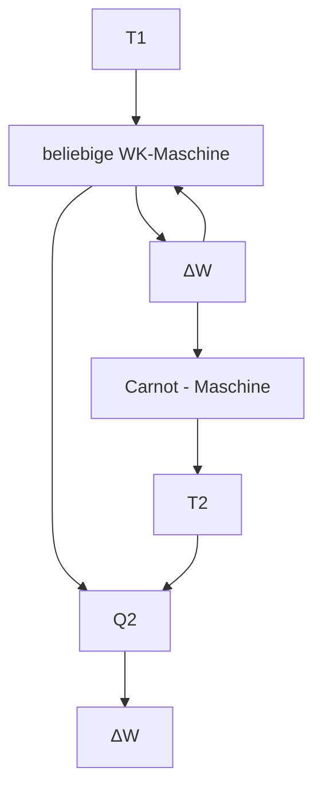

## Beispiel 17.3:

Welche Arbeit verrichtet 1kg Kohlendioxid $( \mathrm { C O _ { 2 } } )$ bei Erwärmung von $0   ^ { \circ } \mathbf { C }$ auf $2 0   ^ { \circ } \mathbf { C } ,$ wenn es sich bei gleich bleibendem Druck (z. B. Atmosphärendruck) ausdehnen kann?

Lösung: Die isobare Ausdehnungsarbeit von 1kg Gas bei 1K Temperaturerhöhung ist durch die Differenz der spezifischen Wärmekapazitäten $c _ { p } - c _ { V }$ gegeben. Aus (17.16) folgt hierfür $c_{p}-c_{V}=R_{s}=R/M.\mathrm{FirCO_{2}}$ ist nach 16.4 $M = (1 \cdot 12 + 2 \cdot 16)  g/mol  = 44  g/$ mol und damit $R / M =$ 189 $\mathrm { J } / ( \mathrm { k g }   \cdot   \mathrm { K } )$ , in Übereinstimmung mit der Differenz der bei $\mathbf { 0 } ^ { \circ } \mathbf { C }$ für $\mathrm { C O _ { 2 } }$ gemessenen Werte $c_{p}=821\mathrm{J/(kg\cdot K)}$ und $c_{V}=632J/(kg\cdot K)$ . Bei einer Temperaturerhöhung um 20K erhält man als Ausdehnungsarbeit entsprechend das 20-fache dieses Wertes, also $20{\cdot}189\mathrm{J}=3{,}78\mathrm{kJ}$ □

## 17.4 Anwendung des I. Hauptsatzes auf spezielle Zustandsänderungen des idealen Gases

**Isobare Zustandsänderung** $(p = \mathbf{const})$ . Aus der Zustandsgleichung des idealen Gases $p V =$ $m R _ { \mathrm { s } } T$ folgt für konstanten Druck durch Differenziation $p   \mathrm { d } V = m R _ { \mathrm { s } }   \mathrm { d } T$ , womit sich nach dem I. Hauptsatz (17.10) für die zugeführte Wärmemenge

$$
\mathrm{d} Q = \mathrm{d} U + m R _ {\mathrm{s}} \mathrm{d} T
$$

ergibt bzw. mit (17.13) und (17.16)

$$
\mathrm{d} Q = m c _ {p} \mathrm{d} T = n C _ {\mathrm{m} p} \mathrm{d} T.
$$

Es ist also mit (17.13) $\mathbf { d } U / \mathbf { d } Q = c _ { V } / c _ { p } ,$ d. h., die einem Gas zugeführte Wärmemenge dQ geht nicht vollständig in innere Energie des Gases über, sondern nur zu dem Bruchteil $\mathbf { d } U = ( c _ { V } / c _ { p } )   \mathbf { d } Q ;$ die Differenz $\mathrm { d } Q   -   \mathrm { d } U$ entfällt auf die Ausdehnungsarbeit des Gases gegen den konstanten äußeren Druck p (s. Beispiel 17.3 im vorangegangenen Abschnitt).

Im p, V -Diagramm sind die Linien gleichen Druckes, die **Isobaren**, Parallelen zur V -Achse (Bild 17.3a). Die bei Volumenänderung von $V _ { 1 }$ auf $V _ { 2 }$ vom Gas bzw. am Gas isobar verrichtete Arbeit ist

$$
W = - \int_ {V _ {1}} ^ {V _ {2}} p \mathrm{d} V = p (V _ {1} - V _ {2}) = m R _ {\mathrm{s}} (T _ {1} - T _ {2}) = n R (T _ {1} - T _ {2}). \tag {17.17}
$$

Die isobare Zustandsänderung kann durch die Anordnung in Bild 17.5a verwirklicht werden, bei der ein über einen Mechanismus (Zahnrad und Zahnstange) durch ein Gewicht belasteter, reibungsfrei beweglicher Kolben das Gas im $\mathrm { Z y }$ linder unter einen konstanten Innendruck versetzt. Bei Wärmezufuhr Q erhöht sich die Temperatur, und das Volumen $V ( T )$ nimmt bei konstantem Druck p zu, wobei eine Hubarbeit W verrichtet wird. Damit das System im $p , V -$ Diagramm eine Isobare durchläuft, muss die Zustandsänderung **quasistatisch** geführt werden, d. h. genügend langsam und in infinitesimal kleinen Schritten, so dass sich das im Zylinder befindliche Gas hinsichtlich Druck und Temperatur in sich und mit der Umgebung stets im **thermodynamischen Gleichgewicht** befindet. Unter diesen Bedingungen kann die Zustandsänderung ebenso gut auch rückwärts, d. h. reversibel, geleitet werden, was in diesem Falle mit einer Abgabe der Wärmemenge Q bei Absenkung des Gewichts verbunden ist.

Isobare Vorgänge sind nicht auf Gase beschränkt. Zum Beispiel verlaufen alle Vorgänge in der freien Atmosphäre, u. a. Schmelzen und Verdampfen, isobar.

Bild 17.5 Realisierung der a) isobaren, b) isothermen, c) adiabatischen (isentropen) Zustandsänderung

**Isochore Zustandsänderung** $(V = \mathbf{const})$ . Wegen d $V = 0$ verrichtet das Gas keine Volumenarbeit; der I. Hauptsatz (17.10) nimmt daher bei isochoren Zustandsänderungen die Form

$$
\mathrm{d} U = \mathrm{d} Q
$$

an. Das heißt, die gesamte dem Gas zugeführte (entzogene) Wärme findet sich in der Erhöhung (Erniedrigung) der inneren Energie des Gases wieder. Im $p ,$ V -Diagramm wird diese Zustandsänderung durch eine Parallele zur p-Achse beschrieben.

**Isotherme Zustandsänderung** $(T = \mathbf{const})$ . Ihre Realisierung kann nach Bild 17.5b so erfolgen, dass sich das in einem $\mathrm { Z y }$ linder mit guter Wärmeleitfähigkeit befindliche Gas mit einem Wärmebad großer Wärmekapazität und daher konstanter Temperatur im thermischen Gleichgewicht befindet.

Quasistatische und damit reversible Volumenänderung kann man durch geeignete Belastung des Kolbens entsprechend dem Gasdruck $p ( V )$ erreichen. In Bild 17.5b wird dies durch die dargestellte Kurvenbahn realisiert, auf der das Seil des Gewichts abläuft. Bei richtiger Form der Kurvenbahn wird erreicht, dass der Kolben bei isothermer Expansion oder Kompression in jeder Lage stehen bleibt, gerade so wie eine im indifferenten Gleichgewicht befindliche Waage. Die Zugabe oder Wegnahme eines kleinen Gewichts genügt, um den Kolben bei Gewährleistung des thermodynamischen Gleichgewichts sinken oder steigen zu lassen.

Wegen d $T = 0$ und somit nach (17.13) $\mathbf { i } U = 0$ lautet der I. Hauptsatz (17.10) hier

$$
\mathrm{d} Q = p \mathrm{d} V = - \mathrm{d} W,
$$

d. h., die dem Gas zugeführte Wärme erhöht nicht dessen innere Energie, sondern wird vollständig in Volumenarbeit des Gases umgesetzt. Die bei Volumenänderung von $V _ { 1 }$ auf $V _ { 2 }$ isotherm verrichtete Arbeit errechnet sich mit der Zustandsgleichung (16.21) zu

$$
W = - \int_ {V _ {1}} ^ {V _ {2}} p \mathrm{d} V = - m R _ {\mathrm{s}} T \int_ {V _ {1}} ^ {V _ {2}} \frac {\mathrm{d} V}{V} = m R _ {\mathrm{s}} T \ln \left(\frac {V _ {1}}{V _ {2}}\right) = n R T \ln \left(\frac {V _ {1}}{V _ {2}}\right). \tag {17.18}
$$

Sie entspricht der in Bild 17.3b schraffierten Fläche unter der zugehörigen **Isotherme**, die durch die Gleichung $pV = mR_{\mathrm{s}}T = \mathrm{const}$ beschrieben wird und im $p ,$ V -Diagramm eine gleichseitige Hyperbel darstellt, die von den Koordinatenachsen umso weiter entfernt liegt, je größer T ist.

**Adiabatische (isentrope) Zustandsänderung.** Wird bei einer Zustandsänderung ein Wärmeaustausch zwischen System und Umgebung verhindert, indem z. B. durch eine entsprechende Wärmeisolation des Gefäßes dafür gesorgt wird, dass das darin enthaltene Gas Wärme weder aufnehmen noch abgeben kann, so spricht man von einer adiabatischen Zustandsänderung (Bild 17.5c). Für sie gilt also $\mathbf { d } Q = 0 ,$ , womit der I. Hauptsatz (17.10) lautet:

$$
\mathrm{d} U = - p \mathrm{d} V = \mathrm{d} W.
$$

Bei einer adiabatischen Expansion verrichtet das Gas Arbeit auf Kosten seiner inneren Energie, wodurch die Temperatur sinkt; adiabatische Kompression erhöht die innere Energie des Gases um den Betrag an aufgewandter Kompressionsarbeit, womit die Temperatur ansteigt. Es ändern sich hierbei also alle drei Zustandsgrößen $p ,$ V und T . Die Zustandsfunktion, die bei den hier betrachteten reversibel adiabatischen Vorgängen konstant bleibt, heißt **Entropie**; sie wird erst in Abschnitt 19.4 eingeführt. Man spricht daher in diesem Fall auch von **isentroper** Zustandsänderung.

Zur Ermittlung des Zusammenhangs zwischen den Zustandsgrößen differenzieren wir die Gasgleichung $p V = m R _ { s } T$ und erhalten d $T = ( p   \mathbf { d } V + V \mathbf { d } p ) / ( m R _ { \mathrm { s } } )$ ; dies in die Beziehung (17.13) d $U = m c _ { V } \mathbf { d } T$ eingesetzt, ergibt mit obiger Gleichung für den I. Hauptsatz:

$$
\mathrm{d} U = \frac {c _ {V}}{R _ {\mathrm{s}}} (p \mathrm{d} V + V \mathrm{d} p) = - p \mathrm{d} V. \tag {17.19}
$$

Setzt man hierin nach (17.16) $R _ { \mathrm { s } } = c _ { p } - c _ { V }$ , so folgt nach Umformung

$$
\frac {c _ {p}}{c _ {V}} \frac {\mathrm{d} V}{V} + \frac {\mathrm{d} p}{p} = 0.
$$

Mit dem **Adiabaten-(Isentropen-)exponenten** $\varkappa = c _ { p } / c _ { V } = C _ { \mathrm { m } p } / C _ { \mathrm { m } V }$ erhält man daraus durch Integration und Umformung

$$
\varkappa \ln V + \ln p = \ln V ^ {\varkappa} + \ln p = \ln (p V ^ {\varkappa}) = \text {const}
$$

oder

$$
p V ^ {\varkappa} = \text {const, d.h.} \quad p _ {1} V _ {1} ^ {\varkappa} = p _ {2} V _ {2} ^ {\varkappa} \quad \text {(POISSONSche Adiabatengleichung).} \tag {17.20}
$$

Mit Hilfe des allgemeinen Gasgesetzes $p V / T =$ const lässt sich diese Gleichung auch auf andere Paare von Zustandsgrößen umrechnen; man erhält so

$$
T V ^ {\varkappa - 1} = \text {const} \quad \text {und} \quad T p ^ {\frac {1 - \varkappa}{\varkappa}} = \text {const}. \tag {17.21}
$$

Da adiabatische Expansion stets mit Abkühlung verbunden ist und der Druck nach der Adiabatengleichung (17.20) umgekehrt proportional zu V wegen $\varkappa > 1$ stärker sinkt als bei isothermer Expansion, verlaufen die sog. **Adiabaten (Isentropen)** im p, V -Diagramm stets steiler als die Isothermen (vgl. Bild 17.6). Die adiabatische Volumenarbeit berechnet sich wegen $\mathbf { d } W = \mathbf { d } U = m c _ { V } \mathbf { d } T = n C _ { \mathbf { m } V }$ dT durch Integration zu

$$
W = m c _ {V} (T _ {2} - T _ {1}) = n C _ {\mathrm{m} V} (T _ {2} - T _ {1}). \tag {17.22}
$$

line

| V | p (Adiabate) | p (Isotherme) |
| --- | --- | --- |
| Low | High | High |
| Medium-Low | Medium | Medium |
| Medium-High | Low | Medium-Low |
| High | Very Low | Low |

Bild 17.6 Adiabate und Isotherme im p, V -Diagramm

**Polytrope Zustandsänderungen.** Vollkommen adiabatische oder isotherme Zustandsänderungen lassen sich in der Praxis mit Wärmekraftmaschinen nicht verwirklichen. Die tatsächlichen Zustandsänderungen liegen zwischen den beiden Grenzfällen. Die **Polytropen** genannten Kurven im $p ,$ V -Diagramm liegen daher bei technischen Vorgängen zwischen den durch den gleichen Ausgangspunkt gehenden Isothermen und Adiabaten (Bild 17.7). Polytrope Zustandsänderungen gehorchen Zustandsgleichungen der Form

$$
p V ^ {k} = \text {const, d.h.} \quad p _ {1} V _ {1} ^ {k} = p _ {2} V _ {2} ^ {k}, \tag {17.23}
$$

wobei der **Polytropenexponent** k Werte zwischen 1 und κ annimmt.

Formal lassen sich alle behandelten Zustandsänderungen und die ihnen entsprechenden Gleichungen als Sonderfälle der polytropen Zustandsänderung mit

$$
\mathrm{d} Q = m c _ {k} \mathrm{d} T \quad \text {und} \quad c _ {k} = c _ {V} \frac {k - \varkappa}{k - 1} \tag {17.24}
$$

darstellen, wobei der Polytropenexponent Werte im Bereich $0 \leq k < \infty$ annimmt. Bild 17.7 zeigt für eine feste Gasmenge einen Vergleich der Expansionskurven der verschiedenen Zustandsänderungen, ausgehend vom gleichen Druck $p _ { 1 }$ und Volumen $V _ { 1 }$ auf das Volumen $V _ { 2 }$ Nach (17.24) ist bei polytroper Expansion eines Gases für $0 \leq k < \varkappa$ (wegen d $T \leq 0 \mathrm{~f} \mathrm{~if} \; 1 \leq k < \varkappa$ und $\mathrm { d } T \geq 0 \mathrm { f i r } 0 \leq k < 1 )$ Wärme zuzuführen, für $k > \varkappa$ (wegen d $T < 0 )$ Wärme abzuführen.

line

| Condition | Description |
| --- | --- |
| Isobare (k = 0) | Constant pressure level at V1 to V2 |
| k < 1 | Pressure decreases as k increases |
| Isotherme (k = 1) | Pressure decreases as k increases |
| technische Polytrope | Pressure decreases as k increases |
| Isentrope (k = x) | Pressure decreases as k increases |
| k > x | Pressure decreases as k increases |
| Isochore \((k = \infty)\) | Pressure remains constant at P1 across the entire range of V |

Bild 17.7 Polytrope Expansion vom Volumen $V _ { 1 }$ auf das Volumen $V _ { 2 }$ bei verschiedenen Polytropenexponenten $k$

**Der Polytropenexponent ist gleich null für isobare, gleich eins für isotherme, gleich dem Adiabatenexponenten für adiabatische und unendlich für isochore Zustandsänderungen.**

## Beispiele 17.4:

1. Im DIESELmotor wird die hohe Zündtemperatur im Zylinder durch eine adiabatische Kompression der angesaugten Luft erreicht. Welche Temperatur entsteht, wenn Luft von $2 5   ^ { \circ } \mathbf { C }$ (298K) und einem Anfangsdruck von 100kPa (Atmosphärendruck) auf 3800kPa verdichtet wird? $( \varkappa = 1 , 4 . )$

Lösung: Nach (17.21) ist

$$
\begin{array}{l} T _ {1} p _ {1} ^ {\frac {1 - \varkappa}{\varkappa}} = T _ {2} p _ {2} ^ {\frac {1 - \varkappa}{\varkappa}}; \qquad T _ {2} = T _ {1} \left(\frac {p _ {1}}{p _ {2}}\right) ^ {\frac {1 - \varkappa}{\varkappa}} = T _ {1} \left(\frac {p _ {2}}{p _ {1}}\right) ^ {\frac {\varkappa - 1}{\varkappa}} = 2 9 8 \mathrm{K} \cdot 3 8 ^ {0, 2 8 6} \\ = 2 9 8 \mathrm{K} \cdot 2, 8 3 = 8 4 3, 3 4 \mathrm{K}, \text {entsprechend} \vartheta_ {2} = 5 7 0, 2 ^ {\circ} \mathrm{C}. \\ \end{array}
$$

$2 . \: 3 { , } 0   \mathrm { m } ^ { 3 }$ Luft von 100kPa sollen isotherm auf 500kPa komprimiert werden. Berechne a) das Volumen nach der Verdichtung; b) die erforderliche Kompressionsarbeit; c) die abzuführende Wärmemenge!

Lösung: a) Nach dem BOYLE-MARIOTTEschen Gesetz ist $V _ { 2 } = p _ { 1 } V _ { 1 } / p _ { 2 } = 0 , 6 \mathrm { m } ^ { 3 } ; \mathrm { b } )$ aus (17.18) folgt mit $p _ { 1 } V _ { 1 } = p _ { 2 } V _ { 2 } = m R _ { \mathrm { s } } T \colon W = p _ { 1 } V _ { 1 } \ln { ( p _ { 2 } / p _ { 1 } ) } = 4 8 3   \mathrm { k J } ;$ c) nach dem I. Hauptsatz ist wegen $\mathbf { i } T = 0$ und damit $\mathrm { d } U = 0$ die abzuführende Wärmemenge $\mathbf { d } Q = p   \mathbf { d } V = - \mathbf { d } W$ (s. oben), also betragsmäßig gleich der am Gas verrichteten Arbeit von 483kJ.

$^ { 3 . 1 , 0 } \mathrm { m } ^ { 3 }$ Luft von 300K soll bei konstantem Druck von 100kPa auf 1000K erwärmt werden. Berechne a) das Endvolumen; b) die verrichtete Ausdehnungsarbeit; c) die zuzuführende Wärmemenge! $( \varkappa = 1 , 4 . )$

Lösung: Es handelt sich um eine isobare Zustandsänderung. Daher folgt a) aus (16.13) $V _ { 2 } =$ $V _ { 1 } T _ { 2 } / T _ { 1 } = 3 , 3 3   \mathrm { m } ^ { 3 } ;$ ; b) aus (17.17) $W = p   ( V _ { 1 } - V _ { 2 } ) = - 2 3 3   \mathrm { k J }$ (vom Gas abgegebene Arbeit); c) nach (17.15) ist $Q = m c _ { p } \Delta T$ . Wird hier die aus $p V _ { 1 } = m R _ { \mathrm { s } } T _ { 1 }$ ermittelte Masse $m = p V _ { 1 } / ( R _ { \mathrm { s } } T _ { 1 } )$ eingesetzt, so erhält man mit (17.16) $R _ { \mathrm { s } } = c _ { p } - c _ { V }$ und $\varkappa = c _ { p } / c _ { V } { : }$

$$
Q = \frac {c _ {p} p V _ {1} \Delta T}{(c _ {p} - c _ {V}) T _ {1}} = \frac {1}{1 - (1 / \varkappa)} \frac {p V _ {1} \Delta T}{T _ {1}} = \frac {\varkappa}{\varkappa - 1} \frac {p V _ {1}}{T _ {1}} (T _ {2} - T _ {1}) = 8 1 7 \mathrm{kJ}.
$$

4. $\mathrm { 1 , } 0   \mathrm { m } ^ { 3 }$ Luft von 100kPa und 300K soll durch Temperaturerhöhung auf einen Druck von 300kPa gebracht werden. Wie groß sind a) die erforderliche Temperatur; b) die zuzuführende Wärmemenge? $( \varkappa = 1 , 4 . )$

Lösung: Für die vorliegende isochore Zustandsänderung (V = const) folgt a) nach (16.15) $T _ { 2 } =$ $T_{1}p_{2}/p_{1}=900  K ;$ b) wegen d $V = 0$ und damit d $. W = 0$ ist nach dem I. Hauptsatz $\mathbf { d } Q = \mathbf { d } U =$ mcV dT (s. oben). Aus $p V = m R _ { s } T$ folgt $V \mathbf { d } p = m R _ { \mathrm { s } }$ dT bzw. m d $T = V \mathbf { d } p / R _ { s }$ . Dies zuvor eingesetzt, ergibt mit $R _ { \mathrm { s } } = c _ { p }   -   c _ { V }$ und $\varkappa = c _ { p } / c _ { V } { : }   \mathbf { d } Q = V \mathbf { d } p / ( \varkappa { - } 1 )$ und daraus durch Integration $Q = V ( p _ { 2 } - p _ { 1 } ) / ( \varkappa - 1 ) = 5 0 0   \mathrm { k J }$ □

## Aufgabe

**17.3** Luft (Molmasse $M \approx 2 9   \cdot   1 0 ^ { - 3 }   \mathrm { k g / m o l ) }$ wird von einem Kompressor bei Atmosphärendruck $p _ { 1 } = 1 0 0 0$ hPa und bei der Temperatur $T = 2 9 4 \mathrm { K }$ angesaugt und isotherm auf den Druck $p _ { 2 } = 3 { , } 5$ MPa komprimiert. Welche Wärmemenge Q muss je Kilogramm komprimierter Luft an das Kühlwasser abgegeben werden, und wie groß ist die vom Gas verrichtete Volumenarbeit?

## 17.5 Zustandsänderungen des idealen Gases in offenen Systemen. Technische Arbeit. Enthalpie

Die bisher betrachteten Zustandsänderungen bezogen sich auf gleich bleibende, nach außen abgeschlossene Stoffmengen, auf sog. geschlossene Systeme. Die von diesen Systemen abgegebene Arbeit war reine Volumenarbeit und durch (17.9) gegeben. Im Unterschied dazu sind in der Technik (z. B. beim Luftverdichter oder bei der Kolbendampfmaschine) häufig Vorgänge anzutreffen, bei denen der Arbeitsstoff einen Behälter oder ein Rohrleitungssystem durchströmt. Das durchströmte Volumen bezeichnet man als **offenes System**, den Vorgang auch als **Gleichdruckprozess**. Dieser kann idealisiert anhand von Bild 17.8a und am zugehörigen p, V - Diagramm erläutert werden: Ein Gas strömt aus einem sehr großen Behälter mit konstantem Druck $p _ { 1 }$ durch das Ventil $\mathrm { O _ { 1 } }$ (Ventil $\mathrm { O } _ { 2 }$ geschlossen) in den Zylinder V und schiebt den Kolben K vor sich her. Die verrichtete Verdrängungsarbeit ist $- p _ { 1 } V _ { 1 }$ und durch die Fläche unter der Isobaren AB im p, V -Diagramm gegeben. Nach Absperrung der Ventile wird das Gas einer Zustandsänderung unterworfen, es dehnt sich dabei auf das Volumen $V _ { 2 }$ aus und verrichtet die Ausdehnungsarbeit $- \int _ { V _ { 1 } } ^ { V _ { 2 } } p   \mathrm { d } V$ , entsprechend der Fläche unter der Kurve BC. Der Druck sinkt auf $p _ { 2 }$ . Dann wird das Ventil $\mathrm { O } _ { 2 }$ geöffnet und das Gas unter konstantem Druck $p _ { 2 }$ in einen großen Behälter gleichen Druckes ausgestoßen. Dazu ist die Arbeit $p _ { 2 } V _ { 2 }$ aufzuwenden. Nach Schließen von $\mathrm { O } _ { 2 }$ wird das Ventil $\mathrm { O _ { 1 } }$ zum Behälter mit dem Druck $p _ { 1 }$ wieder geöffnet, der Prozess beginnt erneut mit neuem Arbeitsstoff, die Maschine arbeitet periodisch.

Bild 17.8 Die beim Gleichdruckprozess (a) gewonnene technische Arbeit (b)

Die gesamte abgegebene Arbeit kann für technische Zwecke genutzt werden. Sie wird daher als **technische Arbeit** $W _ { \mathrm { t e c h n } }$ bezeichnet und entspricht dem Flächeninhalt des geschlossenen Kurvenstücks ABC D bzw. der Fläche neben der Kurve BC (s. Bild 17.8b):

$$
W _ {\mathrm{techn}} = - p _ {1} V _ {1} - \int_ {V _ {1}} ^ {V _ {2}} p \mathrm{d} V + p _ {2} V _ {2} = \int_ {p _ {1}} ^ {p _ {2}} V \mathrm{d} p \quad (\text {technischeArbeit}). \tag {17.25}
$$

Wegen d $W _ { \mathrm { t e c h n } } = V \mathrm { d } p$ kann mittels einer kleinen Umformung der I. Hauptsatz in folgende Form gebracht werden:

$$
\begin{array}{l} \mathrm{d} Q = \mathrm{d} U + p \mathrm{d} V + V \mathrm{d} p - V \mathrm{d} p = \mathrm{d} U + \mathrm{d} (p V) - V \mathrm{d} p \\ = \mathrm{d} (U + p V) - V \mathrm{d} p = \mathrm{d} H - \mathrm{d} W _ {\text {techn}} \\ \end{array}
$$

mit der neuen Zustandsgröße

$$
H = U + p V \quad (\text {Enthalpie}). \tag {17.26}
$$

Das Produkt $p V$ heißt **Verdrängungsarbeit**. Bei isothermen Zustandsänderungen ist die technische Arbeit $W _ { \mathrm { t e c h n } }$ wegen $p _ { 1 } V _ { 1 } = p _ { 2 } V _ { 2 }$ und (17.25) gleich der Volumenarbeit $W ,$ während bei adiabatischen Zustandsänderungen wegen (17.20) $pV^{ 宀 } =$ const gilt $W _ { \mathrm { t e c h n } } = \varkappa W$ und bei polytropen Zustandsänderungen wegen (17.23) $p V ^ { k } =$ const entsprechend $W _ { \mathrm { t e c h n } } = k W$ Für isobare Zustandsänderungen ist $\mathbf { d } W _ { \mathrm { t e c h n } } = 0$ , womit der I. Hauptsatz (17.10) in die Form $\mathbf { d } Q = \mathbf { d } H = \mathbf { d } U + p   \mathbf { d } V$ übergeht.

## Die Enthalpie ist eine Zustandsgröße, deren Differenz aus End- und Anfangszustand gleich der bei konstantem Druck ausgetauschten Wärme ist.

Somit ist die spezifische bzw. molare Wärmekapazität bei konstantem Druck (vgl. 17.3) wie folgt durch die Enthalpieänderung gegeben:

$$
c _ {p} = \frac {1}{m} \frac {\mathrm{d} H}{\mathrm{d} T} \quad \text {bzw.} \quad C _ {\mathrm{mp}} = \frac {1}{n} \frac {\mathrm{d} H}{\mathrm{d} T}. \tag {17.27}
$$

Eine besondere Bedeutung hat die Enthalpie für chemische und metallurgische Prozesse, da viele chemische Reaktionen und Umwandlungsvorgänge in offenen Gefäßen bei konstantem (Atmosphären-)Druck stattfinden. So läuft eine chemische Reaktion unter den gegebenen Bedingungen dann spontan ab, wenn die Enthalpie der Produkte kleiner ist als die Enthalpie der Ausgangsstoffe, wenn also für die Enthalpieänderung $\Delta H \leq 0 \; \mathrm { g i l t } .$

## Beispiel 17.5:

Ein Kompressor mit $V _ { 1 } = 3 1$ Hubraum verdichtet Luft von Normdruck $p _ { 1 } = p _ { 0 } = 1 0 1 { , } 3 2 5$ kPa auf Druckluft von $p _ { 2 } = 4 0 0   \mathrm { k P a }$ , wobei der Kompressionsakt eine polytrope Zustandsänderung mit dem Polytropenexponenten $k = 1 { , } 3$ darstellt. Berechne die Kompressorarbeit $W _ { \mathrm { t e c h n } }$ für einen Arbeitszyklus und vergleiche diese mit der Kompressionsarbeit W !

Lösung: Die Kompressorarbeit für einen Zyklus ist gleich der technischen Arbeit (17.25), für die sich mit der Polytropengleichung (17.23) $\stackrel { \cdot } { p } _ { 1 } V _ { 1 } ^ { k } = \stackrel { \cdot } { p } \stackrel { \cdot } { V } ^ { k }$ der Ausdruck

$$
W _ {\mathrm{techn}} = p _ {1} ^ {1 / k} V _ {1} \int_ {p _ {1}} ^ {p _ {2}} p ^ {- 1 / k} \mathrm{d} p = \frac {k}{k - 1} \left[ \left(\frac {p _ {2}}{p _ {1}}\right) ^ {(k - 1) / k} - 1 \right] p _ {1} V _ {1}
$$

ergibt. Mit den Zahlenwerten folgt daraus $W _ { \mathrm { t e c h n } } = 4 9 1 , 1 1$ . Die Kompressionsarbeit (17.9) ist

$$
W = - \int_ {V _ {1}} ^ {V _ {2}} p \mathrm{d} V = \frac {1}{k} W _ {\mathrm{techn}} = 3 7 7, 8 \mathrm{J}.
$$

Diese ist um den Anteil $(1 - 1/k)W_{\mathrm{techn}} = 113,3$ geringer als die Kompressorarbeit, die zusätzlich noch die Arbeit für das Ansaugen und Ausschieben des Gases beinhaltet. □

Bereits im 17. Jahrhundert wurde von HOOKE die Hypothese formuliert, dass sich die Atome oder Moleküle eines Gases in ständiger ungeordneter Bewegung befinden; sie wurde jedoch erst in der Mitte des 19. Jahrhunderts durch JOULE, CLAUSIUS und MAXWELL endgültig bewiesen und in eine mathematische Form gebracht. Bei der Erwärmung eines Gases wird die zugeführte Energie in kinetische Energie der Teilchen umgesetzt. So kann z. B. unter dem Mikroskop beobachtet werden, dass gerade noch sichtbare Teilchen eines in einem Gas befindlichen anderen Stoffes (z. B. Rauch in Luft) kleine unregelmäßige Bewegungen ausführen. Diese kommen durch Stöße mit aufprallenden Molekülen zustande und sind umso lebhafter, je höher die Temperatur des Gases ist (BROWNsche Molekularbewegung, Bild 18.1).

Dies lässt darauf schließen, dass Temperatur und mittlere kinetische Energie der Translationsbewegung der Teilchen in einem engen Zusammenhang stehen. Ausgehend hiervon werden in der kinetischen Gastheorie die makroskopischen Zustandseigenschaften der Gase sowie die Gesetze der Thermodynamik auf die Bewegung der Moleküle und damit die Wärme als Energieform auf rein mechanische Vorgänge zurückgeführt.

natural_image

Abstract line drawing with geometric shapes and directional arrows, no text or symbols present

Bild 18.1 Brownsche Molekularbewegung

In der kinetischen Gastheorie treten erstmalig die für viele Gebiete der modernen Physik typischen statistischen Überlegungen auf: Man kennt von keinem Molekül die Anfangsbedingungen, d. h. Ort und Impuls (bzw. Geschwindigkeit) zu irgendeinem Zeitpunkt, so dass es unmöglich ist, das Schicksal einzelner Moleküle zu verfolgen. Für die mikrophysikalische Deutung makroskopisch beobachtbarer Grö- ßen ist die Kenntnis des Bewegungszustandes individueller Moleküle aber gar nicht erforderlich. Zur Druckberechnung genügt es beispielsweise zu wissen, welcher Impuls je Zeiteinheit durch alle auf die Wandfläche treffenden Moleküle übertragen wird. Die Kenntnis, wie viel und welche Teilchen mit welchem Impuls auftreffen, ist überflüssig. Statt dessen interessieren das durchschnittliche Verhalten aller Moleküle, d. h. der Mittelwert einer physikalischen Größe über ein bestimmtes Zeitintervall oder über eine Gesamtheit von Teilchen, und die Verteilung der Moleküle auf bestimmte Raum-, Energie- oder Geschwindigkeitsbereiche. Deren Bestimmung ist Gegenstand der **statistischen Mechanik**. Die statistische Methode liefert Wahrscheinlichkeitsaussagen, die den zu erwartenden Mikrozustand quantitativ charakterisieren.

## 18.1 Die Masse der Atome und Moleküle

Die Massen der Atome natürlich vorkommender Elemente liegen zwischen $1 { , } 6 7   \cdot   1 0 ^ { - 2 7 }$ kg für das leichteste aller Atome, den Wasserstoff, und $3 { , } 9 5   \cdot   1 0 ^ { - 2 5 }$ kg für Uran; die Massen der Atome von Transuranen sind noch ein wenig größer. Wegen dieser außerordentlich kleinen Massenwerte eignet sich das Kilogramm in der Atomphysik als Masseneinheit wenig. 1962 hat man das Kohlenstoffisotop $^ { 1 2 } \mathrm { C }$ als Bezugsatom für alle Atommassen festgesetzt und definiert den 12. Teil der Masse dieses Atoms als

$$
\text {atomare Masseneinheit} \quad \mathrm{u} = 1, 6 6 0   5 3 9 \cdot 1 0 ^ {- 2 7}   \mathrm{kg}. \tag {18.1}
$$

Den Quotienten aus der Masse eines Atoms $\mu$ und der atomaren Masseneinheit u bezeichnet man als relative Atommasse $A _ { \mathbf { r } } .$ Sie ist eine dimensionslose Größe und gibt an, wievielmal grö- ßer die Masse eines Atoms ist als der 12. Teil der Masse des Kohlenstoffatoms 12C. Kohlenstoff 12 selbst hat demnach die relative Atommasse $A _ { \mathrm { r } } = 1 2$ . Es ist also allgemein

$$
\mu = A _ {\mathrm{r}} \mathrm{u} \quad (\text {Atommasse}). \tag {18.2}
$$

Zur Kennzeichnung der Masse der Moleküle wird entsprechend die **relative Molekülmasse** Mr benutzt, die als Summe der relativen Atommassen aller im Molekül vereinigten Atome errechnet wird. Damit gilt analog zu (18.2)

$$
\mu = M _ {\mathrm{r}} \mathrm{u} \quad (\text {Molekülmasse}). \tag {18.3}
$$

Setzt sich ein Körper (der Stoffmenge n) aus N Atomen bzw. Molekülen zusammen, so gibt die **molare Teilchenzahl**

$$
N _ {\mathrm{A}} = \frac {N}{n} = 6, 0 2 2 1 4 0 7 6 \cdot 1 0 ^ {2 3} \mathrm{mol} ^ {- 1} \quad (\text {AVOGADRO - Konstante}) \tag {18.4}
$$

die Anzahl der Teilchen in der Stoffmengeneinheit n = 1mol an (vgl. 16.4). Damit ergeben sich als **molare Masse (Molmasse)** M gerade so viel Gramm, wie die relative Atom- bzw. Molekülmasse angibt; denn es gilt mit der Beziehung (18.2) bzw. (18.3) und wegen $N_{\mathrm{A}} \mathrm{u} = 1 \mathrm{~g} / \mathrm{mol}$

$$
M = N _ {\mathrm{A}} \mu = N _ {\mathrm{A}} \mathrm{u} A _ {\mathrm{r}} (\mathrm{bzw.} M _ {\mathrm{r}}) = A _ {\mathrm{r}} (\mathrm{bzw.} M _ {\mathrm{r}}) \mathrm{g/mol}. \tag {18.5}
$$

Aus der Dichte $\varrho = m / V$ (mit m als der Masse und V dem Volumen des Körpers) und der Molmasse (18.5) $M = m / n$ erhält man mit der AVOGADRO-Konstante (18.4) das Volumen je Teilchen

$$
V ^ {\prime} = \frac {V}{N} = \frac {m}{\varrho N} = \frac {M}{\varrho N _ {\mathrm{A}}} \quad (\text {scheinbares Atomvolumen}). \tag {18.6}
$$

## 18.2 Druck und mittlere quadratische Geschwindigkeit der Gasmoleküle. Grundgleichung der kinetischen Gastheorie

Die kinetische Gastheorie geht vom Modell des **idealen Gases** aus; das bedeutet, die Atome bzw. Moleküle werden als Punktmassen (also ohne Eigenvolumen) angesehen, die aufeinander keinerlei zwischenmolekulare Kräfte ausüben, sondern lediglich elastische Stöße auf die Gefäßwand ausführen. Zusammenstöße zwischen den Molekülen sollen ebenfalls vollkommen elastisch erfolgen, jedoch so selten sein, dass sich die Moleküle im Gas überwiegend frei bewegen können. Jedes hinreichend verdünnte Gas erfüllt damit die Bedingungen für ein ideales Gas.

Der **Druck** des Gases auf eine Wand ist durch die mittlere Kraft gegeben, die die Moleküle bei ihrem Aufprall auf die Wand ausüben. Um ihn zu berechnen, betrachten wir zunächst ein einzelnes Molekül der Masse $\mu ,$ das sich in einem Kasten bewegt, der in x-Richtung die Länge l hat und von Wänden der Fläche A begrenzt wird (Bild 18.2). Trifft es mit der Geschwindigkeit v unter irgendeinem Winkel auf die senkrecht zur x-Richtung stehende Wand auf, so wird es von dieser mit der dem Betrage nach gleichen Geschwindigkeit $\nu ^ { \prime }$ reflektiert, und zwar so, dass v und $\boldsymbol { v } ^ { \prime }$ mit der Wand denselben Winkel bilden (Reflexionsgesetz). Dabei wird lediglich die x-Komponente $\nu _ { x }$ des Geschwindigkeitsvektors geändert, indem diese ihr Vorzeichen umkehrt, während die beiden anderen Komponenten $\nu _ { y }$ und $\nu _ { z }$ ungeändert bleiben. Der beim Stoß auf die Wand übertragene Impuls ist gleich der Impulsänderung des Teilchens

$$
\Delta p _ {x} = \mu \nu_ {x} - \mu (- \nu_ {x}) = 2 \mu \nu_ {x}.
$$

text_image

μ
vₓ
vy
v̄
A
-vₓ
v̄'
vy
l

Bild 18.2 Zur Berechnung des durch den Aufprall von Gasmolekülen (Masse $\mu )$ auf die Wand eines Behälters (Fläche A) ausgeübten Druckes

Da das Molekül die Strecke l zwischen zwei gegenüberliegenden Wänden in der Zeit $l / \nu _ { x }$ zurücklegt, beträgt die Zeit, die zwischen zwei aufeinander folgenden Zusammenstößen mit derselben Wand verstreicht, $\Delta t = 2 l / \nu _ { x }$ . Nach dem 2. NEWTONschen Axiom (4.9) beträgt daher die von einem Molekül auf die Wand ausgeübte mittlere Kraft

$$
F = \frac {\Delta p _ {x}}{\Delta t} = \frac {2 \mu v _ {x}}{2 l / v _ {x}} = \frac {\mu v _ {x} ^ {2}}{l},
$$

und der mittlere Druck, der durch dieses Teilchen verursacht wird, ist

$$
p = \frac {F}{A} = \frac {\mu v _ {x} ^ {2}}{A l} = \frac {\mu v _ {x} ^ {2}}{V},
$$

wobei $V = A l$ das Volumen des Kastens ist. Befinden sich im Kasten N Moleküle, dann gilt für den Druck

$$
p = \frac {N \mu \overline {{v _ {x} ^ {2}}}}{V}. \tag {18.7}
$$

Hierbei ist $\overline { { \nu _ { x } ^ { 2 } } }$ der Mittelwert von $\nu _ { x } ^ { 2 }$ für die N Moleküle. Mit dem Quadrat des Geschwindigkeitsvektors $\stackrel { \leftrightarrow } { \nu } { } ^ { 2 } = \nu _ { x } ^ { 2 } + \nu _ { y } ^ { 2 } + \nu _ { z } ^ { 2 }$ erhält man das sog. mittlere Geschwindigkeitsquadrat

$$
\overline {{\nu^ {2}}} = \overline {{\nu_ {x} ^ {2}}} + \overline {{\nu_ {y} ^ {2}}} + \overline {{\nu_ {z} ^ {2}}}.
$$

Da die Bewegung der Moleküle zufälliger (statistischer) Natur ist, sind alle Flugrichtungen gleich wahrscheinlich, weshalb gilt $\overline { { \nu _ { x } ^ { 2 } } } = \overline { { \nu _ { y } ^ { 2 } } } = \overline { { \nu _ { z } ^ { 2 } } }$ und damit $\overline { { \nu ^ { 2 } } } = \overline { { 3 \nu _ { x } ^ { 2 } } }$ oder $\overline { { \nu _ { x } ^ { 2 } } } = \overline { { \nu ^ { 2 } } } / 3$ . Dies in Gleichung (18.7) eingesetzt, ergibt

$$
p V = \frac {1}{3} N \mu \overline {{v ^ {2}}} \quad (\text {Grundgleichung der kinetischen Gastheorie}). \tag {18.8}
$$

Da die Wurzel aus dem mittleren Geschwindigkeitsquadrat $\sqrt { \overline { { \nu ^ { 2 } } } } ,$ die sog. mittlere quadrati**sche Geschwindigkeit**, für gleich bleibende Temperatur $T$ einen bestimmten Wert hat, steht auf der rechten Seite von (18.8), wenn wir uns auf eine bestimmte Gasmenge beziehen, eine Konstante. Gleichung (18.8) stellt daher das bekannte BOYLE-MARIOTTEsche Gesetz (14.5) $p V = \mathrm { c o n s t }$ für $T = \mathbf { c o n s t }$ dar.

Den Zusammenhang zwischen Temperatur und mittlerem Geschwindigkeitsquadrat erhält man, wenn Gleichung (18.8) mit der Zustandsgleichung des idealen Gases (16.20) $p V = n R T$ kombiniert wird. Durch Gleichsetzen der rechten Seiten folgt

$$
\overline {{v ^ {2}}} = \frac {3 R T}{\mu (N / n)} = \frac {3 R T}{\mu N _ {\mathrm{A}}} = \frac {3 k T}{\mu} \quad \text {(mittleres Geschwindigkeitsquadrat)} \tag {18.9}
$$

mit der AVOGADRO-Konstante (18.4) und

$$
k = \frac {R}{N _ {\mathrm{A}}} = 1, 3 8 0   6 5 0 \cdot 1 0 ^ {- 2 3}   \mathrm{J/K} \quad (\text {BOLTZMANN - Konstante}). \tag {18.10}
$$

Mit der Beziehung (18.9) geht Gleichung (18.8) über in eine neue Form der Zustandsgleichung, welche die Teilchenzahl N enthält:

$$
p V = N k T. \tag {18.11}
$$

Diese Zustandsgleichung gilt allgemein, da sie keine von der Natur des Gases abhängige Grö- ßen enthält. Aus ihr folgt unmittelbar die

## Regel von AVOGADRO:

**Gleiche Volumina verschiedener (idealer) Gase enthalten bei gleichem Druck und gleicher Temperatur dieselbe Anzahl von Molekülen.**

Speziell ergibt sich hieraus die Anzahl der Moleküle in der Volumeneinheit $\mathrm { 1 m ^ { 3 } }$ eines beliebigen idealen Gases im Normzustand, d. h. bei der Temperatur $\mathbf { 0 }   ^ { \circ } \mathbf { C } ,$ entsprechend $T _ { 0 } = 2 7 3 , 1 5   \mathrm { K } ,$ und Normdruck $p _ { 0 } = 1 0 1 3 , 2 5 \mathrm { h P a }$

$$
N _ {\mathrm{L}} = \frac {p _ {0}}{k T _ {0}} = 2, 6 8 6 7 7 7 \cdot 1 0 ^ {2 5} \mathrm{m} ^ {- 3} \quad (\text {LOSCHMIDT - Konstante}). \tag {18.12}
$$

Weiterhin kann mit Hilfe dieser Größen aus Gleichung (18.11) das Volumen, das 1mol idealen Gases $( N = N _ { \mathrm { A } } )$ im Normzustand einnimmt, leicht berechnet werden:

$$
V _ {\mathrm{m0}} = \frac {N _ {\mathrm{A}} k T _ {0}}{p _ {0}} = \frac {R T _ {0}}{p _ {0}} = 2 2, 4 1 4 \cdot 1 0 ^ {- 3} \mathrm{m} ^ {3} / \mathrm{mol} \quad (\text {molares Normvolumen}). \tag {18.13}
$$

## Beispiele 18.1:

1. Berechne die mittlere quadratische Geschwindigkeit der Moleküle des Sauerstoffs bei $2 0   ^ { \circ } \mathbf { C } !$ Lösung: Mit der relativen Atommasse des Sauerstoffs $A _ { \mathrm { r } } \approx 1 6$ (vgl. Periodensystem der Elemente, Seite 539) ergibt sich nach (18.5) für das $\mathrm { O } _ { 2 }$ -Molekül die Molmasse von $M = 32    g/mol$ Damit und mit $T = 2 9 3   \mathrm { K }$ folgt aus den Beziehungen (18.5) und (18.9)

$$
\sqrt {\overline {{v ^ {2}}}} = \sqrt {\frac {3 R T}{M}} = 4 7 8 \mathrm{m/s}.
$$

Die mittlere quadratische Geschwindigkeit $\sqrt { \overline { { \nu ^ { 2 } } } }$ ist stets größer als die Geschwindigkeit $\bar { \nu } ,$ die als mittlere Geschwindigkeit (<u>arithmetisches</u> Mittel der Geschwindigkeitsbeträge) bezeichnet wird; z. B. ist für 3 Moleküle $\sqrt { ( 2 ^ { 2 } + 6 ^ { 2 } + 9 ^ { 2 } ) / 3 } > ( 2 + 6 + 9 ) / 3 ;$ vgl. 18.3.

2. Wie ändert sich die mittlere quadratische Geschwindigkeit von Gasmolekülen, wenn das Gas bei konstantem Druck so weit erhitzt wird, bis sich das Volumen vervierfacht hat?

Lösung: Für isobare Zustandsänderungen $( p = p _ { 0 } )$ gilt $V _ { 0 } / T _ { 0 } = V / T$ . Für $V = 4 V _ { 0 }$ folgt $T = 4 T _ { 0 }$ Nach (18.9) ist somit

$$
\overline {{v ^ {2}}} / \overline {{v _ {0} ^ {2}}} = 4 \qquad \text {oder} \qquad \sqrt {\overline {{v ^ {2}}}} = 2 \sqrt {\overline {{v _ {0} ^ {2}}}}.
$$

Die Molekülgeschwindigkeit wird also verdoppelt.

3. Wie viel Luftmoleküle befinden sich noch in einer evakuierten RÖNTGENröhre vom Volumen 4l, wenn in dieser bei $2 0   ^ { \circ } \mathbf { C }$ ein Restdruck von 1Pa herrscht?

Lösung: Die Anzahl der Moleküle beträgt nach (18.11) $N = p V / ( k T ) = 1 0 ^ { 1 8 } .$

## Aufgabe

**18.1** In einem Behälter von 2l Inhalt befindet sich 1mol Argongas, dessen Moleküle eine mittlere quadratische Geschwindigkeit von 400m/s haben. a) Wie groß sind Druck und Temperatur des Gases? b) Wie ändert sich die mittlere quadratische Geschwindigkeit bei einer adiabatischen Expansion des Gases auf das vierfache Volumen? (Adiabatenexponent $\varkappa = 1 , 6 6 ;   A _ { \mathrm { r } } = 3 9 , 1 4 8 .$ )

## 18.3 Die Geschwindigkeitsverteilung der Gasmoleküle

Unter den Gasmolekülen kommen innerhalb eines von der Temperatur abhängigen, mehr oder weniger großen Bereiches alle Geschwindigkeiten vor. Damit ist die Wahrscheinlichkeit, ein Molekül mit genau einer bestimmten Geschwindigkeit v anzutreffen, praktisch gleich null. Man kann daher stets nur Aussagen darüber gewinnen, mit welcher Wahrscheinlichkeit eine bestimmte Molekülgeschwindigkeit innerhalb eines vorgegebenen Geschwindigkeitsintervalls dv liegt. Die Verteilung der Moleküle auf die einzelnen Geschwindigkeitsintervalle in Ab hängigkeit von der Temperatur T ist von MAXWELL (1860) angegeben worden. Danach sind alle Richtungen gleich wahrscheinlich, und von N Teilchen (Masse $\mu )$ je Volumeneinheit haben bei der Temperatur T

$$
\mathrm{d} N _ {\nu} = 4 \pi N \left(\frac {\mu}{2 \pi k T}\right) ^ {3 / 2} \nu^ {2} \mathrm{e} ^ {- \frac {\mu \nu^ {2}}{2 k T}} \mathrm{d} \nu \quad \begin{array}{l} (\text {MAXWELLSche Geschwindigkeits - } \\ \text {verteilung}) \end{array} \tag {18.14}
$$

Teilchen eine Geschwindigkeit zwischen v und $\nu   +   \mathrm { d } \nu .$ Die Verteilung der Geschwindigkeiten ist demnach von der Molekülmasse und von der Temperatur abhängig.

In Bild 18.3a ist die Verteilung (18.14) für Sauerstoff bei drei Temperaturen für ein Geschwindigkeitsintervall der Breite d $v = 100    m/s$ dargestellt, wobei auf der Ordinate der Anteil an der Gesamtzahl der Moleküle $\mathbf { d } N _ { v } / N$ im Intervall dv in Prozent aufgetragen ist. Man entnimmt der Darstellung, dass $\mathbf { z } , \mathbf { B } .$ bei $\mathbf { 0 }   ^ { \circ } \mathbf { C }$ etwa 18% der Moleküle eine Geschwindigkeit zwischen 500 und $6 0 0   \mathrm { m } / \mathrm { s }$ haben. Man erkennt, dass es nur wenige Moleküle mit sehr kleinen Geschwindigkeiten gibt und dass auch die Anzahl der Moleküle mit großen Werten von $\nu$ rasch abnimmt.

Mit steigender Temperatur verschiebt sich das Maximum der Verteilung zu immer höheren Geschwindigkeiten, und die Kurve wird flacher.

Bei der Herleitung von (18.14) wird davon ausgegangen, dass die im thermischen Gleichgewicht stets gleich bleibende Anzahl von Molekülen $\mathrm { I } N _ { \nu }$ , die eine Geschwindigkeit zwischen v und v + dv haben, der Gesamtteilchenzahl $N ,$ der Breite des Geschwindigkeitsintervalls dv und einer Funktion $f ( \nu )$ , der sog. Verteilungsfunktion, proportional ist, die außer von v noch von der Temperatur T abhängt:

$$
\mathrm{d} N _ {\nu} = N f (\nu) \mathrm{d} \nu . \tag {18.15}
$$

Um die unbekannte Verteilungsfunktion zu bestimmen, betrachten wir zunächst die räumliche Verteilung der Luftmoleküle im Schwerefeld der Erde, die durch die barometrische Höhenformel (14.9) beschrieben wird. Indem aus dieser mit Hilfe der Zustandsgleichung des idealen Gases (18.11) der Druck $p = ( N / V )   k T = n k T$ (n ist hier die Teilchenzahldichte) und die Massendichte $\varrho = N \mu / V = n \mu$ eliminiert werden, erhält man mit $E _ { \mathrm { p } } = \mu g h$ als potenzieller Energie eines Moleküls als Verteilungsgesetz für die Teilchenzahldichte

$$
n = n _ {0} \mathrm{e} ^ {- E _ {\mathrm{p}} / (k T)} \quad (\text {BOLTZMANNSches Verteilungsgesetz}). \tag {18.16}
$$

In dieser Form hängt n nicht mehr von den speziellen Größen h und $g$ ab; die Beziehung (18.16) ist daher für ein beliebiges konservatives Kraftfeld gültig. Hieraus und aus der Definition der Teilchenzahldichte $n = \mathbf { d } N _ { \pmb { r } } / \mathbf { d } V$ (der Index bei N drückt die Abhängigkeit von den Ortskoordinaten durch den Ortsvektor r aus) folgt, dass die Anzahl der Moleküle $\mathbf { d } N _ { \pmb { r } }$ im Volumenelement $\mathbf { d } V = \mathbf { d } x   \mathbf { d } y   \mathbf { d } z$ an der Stelle r des Raumes dem BOLTZMANN-Faktor exp $[ - E _ { \mathbf { p } } ( \pmb { r } ) / ( k T ) ]$ und der Größe des Volumenelements selbst proportional ist: d $\begin{array} { r } { \mathrm { l } N _ { \pmb { r } } \sim \exp [ - E _ { \mathsf { p } } / ( k T ) ] } \end{array}$ dx dy dz.

Bild 18.3 Maxwellsche Geschwindigkeitsverteilung für Sauerstoff

a) bei 3 Temperaturen für eine Intervallbreite von $\Delta v = 100    m/s$

b) vˆ wahrscheinlichste Geschwindigkeit, v¯ mittlere Geschwindigkeit, $\sqrt { \overline { { \nu ^ { 2 } } } }$ mittlere quadratische Geschwindigkeit. Die schraffierte Fläche unter der $f ( \nu )$ -Kurve gibt den Anteil $\Delta N / ( N \Delta v )$ an Molekülen mit einer Geschwindigkeit $\nu \geq \nu _ { 0 } \; { \mathsf { a n } }$

Es liegt nun nahe, denselben Ausdruck als Ansatz für die Verteilung der Geschwindigkeiten der Gasmoleküle zu verwenden, wobei die ortsabhängige Größe $E _ { \mathrm { p } }$ durch die geschwindigkeitsabhängige Größe $E _ { \mathbf { k } } = \mu v ^ { 2 } / 2$ , die kinetische Energie eines Moleküls, und das Volumenelement dx dy dz durch das Volumenelement im „Geschwindigkeitsraum“ $\mathbf { d } v _ { x } \mathbf { d } v _ { y } \mathbf { d } v _ { z }$ zu ersetzen sind mit $v _ { x } , v _ { y } , v _ { z }$ als Komponenten des Geschwindigkeitsvektors v. Danach ist die Anzahl der Moleküle d $. N _ { V }$ , deren Geschwindigkeitskomponenten in den Intervallen zwischen $\nu _ { x }$ und $\nu _ { x } + \mathbf { d } \nu _ { x } ,   \nu _ { y }$ und $\nu _ { y } + \mathbf { d } \nu _ { y }$ sowie $\nu _ { z }$ und $\nu _ { z }   +   \mathbf { d } \nu _ { z }$ liegen, gleich

$$
\mathrm{d} N _ {v} = C \mathrm{e} ^ {- E _ {\mathrm{k}} / (k T)} \mathrm{d} v _ {x} \mathrm{d} v _ {y} \mathrm{d} v _ {z} = C \mathrm{e} ^ {- \mu (v _ {x} ^ {2} + v _ {y} ^ {2} + v _ {z} ^ {2}) / (2 k T)} \mathrm{d} v _ {x} \mathrm{d} v _ {y} \mathrm{d} v _ {z}. \tag {18.17}
$$

Der Proportionalitätsfaktor C lässt sich aus der Bedingung bestimmen, dass die Integration von Gleichung (18.17) über alle Geschwindigkeiten gerade <u>die Ges</u>amtteilche<u>nzahl N</u> ergeben <u>muss (N</u>ormierungsbedingung). Nach Substitution von $\xi = \nu _ { x } \sqrt { \mu / ( 2 k T ) } ,   \eta = \nu _ { y } \sqrt { \mu / ( 2 k T ) } ,   \zeta = \nu _ { z } \sqrt { \mu / ( 2 k T ) }$ erhält man somit wegen ${ \int _ { - \infty } ^ { + \infty } } \mathbf { e } ^ { - \xi ^ { 2 } }   \mathbf { d } \xi = { \sqrt { \pi } } { : }$

$$
\int \mathrm{d} N _ {\nu} = N = \frac {C}{\sqrt {[ \mu / (2 k T) ] ^ {3}}} \int_ {- \infty} ^ {\infty} \mathrm{e} ^ {- \xi^ {2}} \mathrm{d} \xi \int_ {- \infty} ^ {\infty} \mathrm{e} ^ {- \eta^ {2}} \mathrm{d} \eta \int_ {- \infty} ^ {\infty} \mathrm{e} ^ {- \zeta^ {2}} \mathrm{d} \zeta = C \sqrt {\frac {\pi^ {3}}{[ \mu / (2 k T) ] ^ {3}}};
$$

$$
C = N \bigg (\frac {\mu}{2 \pi k T} \bigg) ^ {3 / 2}.
$$

Um die mit (18.15) eingeführte Verteilungsfunktion für den Betrag der Geschwindigkeit v zu erhalten, ist in (18.17) das rechtwinklige „Volumenelement“ $\mathbf { d } v _ { x } \mathbf { d } v _ { y } \mathbf { d } v _ { z }$ durch das kugelförmige Element im Geschwindigkeitsraum 4π $\nu ^ { 2 }$ dv (Kugelschicht der Dicke dv mit der Oberfläche 4π $\nu ^ { 2 } )$ zu ersetzen. Man erhält dann die gesuchte Verteilungsfunktion (18.14)

$$
f (\nu) = \frac {\mathrm{d} N _ {\nu}}{N \mathrm{d} \nu} = 4 \pi \left(\frac {\mu}{2 \pi k T}\right) ^ {3 / 2} \nu^ {2} \mathrm{e} ^ {- \frac {\mu \nu^ {2}}{2 k T}} \quad \text {(MAXWELLSche Geschwindigkeitsverteilung).}
$$

Das Maximum der Verteilung liegt bei der wahrscheinlichsten (am häufigsten vorkommenden) $G e -$ schwindigkeit $\hat { \nu } ;$ diese folgt aus der Extremalbedingung $\mathbf { d } f ( \boldsymbol { \nu } ) / \mathbf { d } \boldsymbol { \nu } = 0$ z u

$$
\hat {v} = \sqrt {\frac {2 k T}{\mu}} \quad (\text {wahrscheinlichste Geschwindigkeit}). \tag {18.18}
$$

Der Mittelwert der Geschwindigkeitsbeträge ist gegeben durch

$$
\bar {v} = \frac {1}{N} \int v \mathrm{d} N _ {v} = \int_ {0} ^ {\infty} v f (v) \mathrm{d} v = \sqrt {\frac {8 k T}{\pi \mu}} = 1, 1 3 \hat {v} \quad \text {(mittlere Geschwindigkeit).} \tag {18.19}
$$

Für die Wurzel aus dem mittleren Geschwindigkeitsquadrat ergibt sich

$$
\sqrt {\overline {{\nu^ {2}}}} = \sqrt {\frac {1}{N} \int \nu^ {2} \mathrm{d} N _ {\nu}} = \sqrt {\int_ {0} ^ {\infty} \nu^ {2} f (\nu) \mathrm{d} \nu} = \sqrt {\frac {3 k T}{\mu}} = 1, 2 3 \hat {\nu} \quad \begin{array}{l} \text {(mittlere} \\ \text {quadratische} \\ \text {(Geschwindigkeit)}, \end{array} \tag {18.20}
$$

in Übereinstimmung mit dem aus anderen Überlegungen bereits erhaltenen Ergebnis (18.9).

**Die mittlere Geschwindigkeit v¯ der Gasmoleküle ist ein wenig größer als die wahr**scheinlichste (am häufigsten vorkommende) Geschwindigkeit $\hat { \boldsymbol { v } } ,$ die mittlere quadratische Geschwindigkeit $\sqrt { \overline { { v ^ { 2 } } } }$ **ein wenig größer als die mittlere Geschwindigkeit v¯ (Bild 18.3b).**

## Beispiele 18.2:

1. Wie viel Prozent aller Moleküle des Sauerstoffs $( 0 _ { 2 } )$ haben bei $2 0   ^ { \circ } \mathbf { C }$ eine Geschwindigkeit zwischen 200 und 300m/s?

Lösung: In der MAXWELLschen Geschwindigkeitsverteilung (18.14) haben wir zu setzen $\nu =$ $2 5 0   \mathrm { m } / \mathrm { s }$ (Mittelwert des Geschwindigkeitsintervalls) und für die Intervallbreite d $\nu \approx \Delta \nu =$ $1 0 0   \mathrm { m } / \mathrm { s } .$ . Mit $\mu / k = N _ { \mathrm { A } } \mu / ( N _ { \mathrm { A } } k ) = M / R$ (nach Gleichung (18.4) und (18.10)), $M = 2 \cdot 1 6   \mathrm { g } /$ mol und den übrigen Zahlenwerten folgt aus (18.14) $\Delta N / N \approx \mathbf { d } N _ { \nu } / N = 1 5 { , } 7 4 \%$

2. In eine zylindrische Zentrifuge (Radius $R_{0} = 0.5    m ;$ Winkelgeschwindigkeit $\omega = 300    rad/s$ wird gasförmiges Uran-Hexafluorid $\mathrm{^{238}UF_{6}} (M = 0, 352  \mathrm{kg/mol})$ der anfänglichen Dichte $\varrho _ { 0 } =$ $1 2 \mathrm { k g } / \mathrm { m } ^ { 3 }$ und der Temperatur $\vartheta = 8 0   ^ { \circ } \mathrm { C }$ gebracht. Wie hängt nach Einstellung des stationären Zustandes die Gasdichte vom Ort ab? Man berechne die Dichte im Zentrum und am Rand der Zentrifuge!

Lösung: Im stationären Zustand rotiert das Gas mit der Winkelgeschwindigkeit $\omega$ der $\mathrm { Z e n } \cdot$ trifuge, wobei auf ein Molekül der Masse $\mu$ im Abstand r vom Zentrum die Zentrifugalkraft $F _ { \mathrm { Z } } = \mu \omega ^ { 2 } r$ wirkt. Dem entspricht eine potenzielle Energie des Moleküls in Bezug auf das Zentrum von $E _ { \mathrm { p } } = - \int F _ { \mathrm { Z } }   \mathrm { d } r = - \mu \omega ^ { 2 } r ^ { 2 } / 2$ , sodass nach dem BOLTZMANNschen Verteilungsgesetz für die Abhängigkeit der Gasdichte vom Abstand r gilt

$$
\varrho (r) = \varrho (0) \mathrm{e} ^ {- \frac {E _ {\mathrm{p}}}{k T}} = \varrho (0) \mathrm{e} ^ {\frac {\mu \omega^ {2} r ^ {2}}{2 k T}} \tag {18.21}
$$

mit $\varrho ( 0 )$ als der Dichte bei $r = 0$ . Setzt man (18.21) in die Bedingung für die Teilchenzahlerhaltung $\int _ { 0 } ^ { R _ { 0 } } \varrho ( r )   2 \pi r   \mathrm { d } r = \varrho _ { 0 } \pi R _ { 0 } ^ { 2 }$ (Normierung) ein, so erhält man nach Ausführung der Integration

$$
\varrho (0) = \varrho_ {0} \frac {\mu \omega^ {2} R _ {0} ^ {2}}{2 k T} \left(\mathrm{e} ^ {\frac {\mu \omega^ {2} R _ {0} ^ {2}}{2 k T}} - 1\right) ^ {- 1}.
$$

Mit $\mu / k = ( N _ { \mathrm { A } } \mu ) / ( N _ { \mathrm { A } } k ) = M / R , R = 8 { , } 3 1 4 5 { \mathrm { J } } / ( { \mathrm { m o l } }   { \mathrm { K } } )$ und den angegebenen Zahlenwerten findet man im Zentrum $\varrho ( 0 ) = 0 , 4 7 3 \varrho _ { 0 } = 5 , 6 7 \mathrm { k g } / \mathrm { m } ^ { 3 }$ und damit nach (18.21) am Rand

$$
\varrho (R _ {0}) = \varrho (0) \mathrm{e} ^ {\frac {\mu \omega^ {2} R _ {0} ^ {2}}{2 k T}} = \varrho (0) \mathrm{e} ^ {\frac {\omega^ {2} R _ {0} ^ {2} M}{2 R T}} = 3, 8 5 2 \varrho (0) = 1, 8 2 3 \varrho_ {0} = 2 1, 9 \mathrm{kg/m} ^ {3}.
$$

## Aufgabe

**18.2** a) Bei welcher Geschwindigkeit der $\mathrm{O}_{2} - \mathrm{Molewhile}$ liegt bei $2 0   ^ { \circ } \mathbf { C }$ das Maximum der Geschwindigkeitsverteilung? b) Wie viel Prozent der Moleküle liegen im Geschwindigkeitsintervall $\pm 5 0   \mathrm { m } / \mathrm { s }$ um das Maximum der Verteilung? c) Bei welcher Temperatur liegen noch 15% der $\mathrm{O}_{2} - \mathrm{Molewhile}$ in dem betreffenden Geschwindigkeitsintervall? – Anleitung: Setze zur Ermittlung der Temperaturabhängigkeit in (18.14) den Ausdruck (18.18) für die wahrscheinlichste Geschwindigkeit vˆ ein.

## 18.4 Molekularenergie und Temperatur. Wärmekapazität der Körper

Multipliziert man die Gleichung (18.9) für das mittlere Geschwindigkeitsquadrat $\overline { { \nu ^ { 2 } } } = 3 k T / \mu$ mit $\mu / 2 ,$ , so erhält man

$$
\overline {{E _ {\mathrm{k}}}} = \frac {\mu \overline {{v ^ {2}}}}{2} = \frac {3}{2} k T \quad (\text {mittlere kinetische Energie eines Teilchens}). \tag {18.22}
$$

Diese Gleichung sagt aus:

**Die mittlere kinetische Energie der Moleküle eines Körpers hängt nur von dessen absoluter Temperatur ab und ist dieser proportional.**

Damit ist die wichtige Zustandsgröße „Temperatur“ molekularkinetisch erklärt. Für 1mol eines **einatomigen Gases** (z. B. Helium, welches keine Moleküle bildet) erhält man eine mittlere kinetische Energie von

$$
\overline {{E _ {\mathrm{k}}}} / \mathrm{mol} = N _ {\mathrm{A}} \cdot \frac {3}{2} k T = \frac {3}{2} R T. \tag {18.23}
$$

Wenn man von der durch das Schwerefeld bedingten, äußerst geringen potenziellen Energie der Gasmoleküle absieht, gibt dieser Ausdruck die gesamte innere Energie U eines einatomigen Gases an. Es ist also

$$
U = \frac {3}{2} n R T \quad (\text {innere Energie eines einatomigen Gases}), \tag {18.24}
$$

wenn {n} die Anzahl der Mole angibt. Damit haben wir die Möglichkeit, die **Molwärme** einatomiger Gase bei konstantem Volumen $C _ { \mathrm { m } V }$ zu berechnen. Mit der Beziehung (17.13) folgt

$$
C _ {\mathrm{m} V} = \frac {1}{n} \frac {\mathrm{d} U}{\mathrm{d} T} = \frac {3}{2} R = 1 2, 5 \mathrm{J/(mol} \cdot \mathrm{K)} \tag {18.25}
$$

und damit wegen (17.16) die Molwärme bei konstantem Druck

$$
C _ {\mathrm{m} p} = C _ {\mathrm{m} V} + R = \frac {5}{2} R = 2 0, 8 \mathrm{J/(mol} \cdot \mathrm{K)}. \tag {18.26}
$$

Bei **mehratomigen Molekülen** weichen die gemessenen Molwärmen von diesen Werten ab. Das ist darauf zurückzuführen, dass diese Moleküle neben Translationsbewegungen zusätzlich noch Rotationsbewegungen ausführen, deren kinetische Energie mit in Rechnung zu stellen ist. Sämtliche Bewegungsmöglichkeiten eines Körpers und ebenso eines Moleküls sind durch dessen Freiheitsgrade gegeben (vgl. 10.1). Jeder frei bewegliche, ausgedehnte Körper hat insgesamt 6 Freiheitsgrade, und zwar 3 Freiheitsgrade der Translation und 3 der Rotation. Die praktisch ausdehnungslosen Teilchen der einatomigen Gase haben lediglich 3 Freiheitsgrade der Translation, so dass nach (18.22) auf jeden Freiheitsgrad eine mittlere kinetische Energie von $k T / 2$ entfällt. Derselbe Energiebetrag kommt bei den mehratomigen Molekülen auch jedem Rotationsfreiheitsgrad zu; es gilt der

## Gleichverteilungssatz:

**Die einem Körper zugeführte Wärmeenergie verteilt sich gleichmäßig auf alle Freiheitsgrade seiner Atome oder Moleküle und beträgt je Teilchen und Freiheitsgrad** kT /2, je Mol und Freiheitsgrad $N _ { \mathrm { A } } k T / 2 = R T / 2 .$

Bei den **zweiatomigen Molekülen**, wie $\mathrm { z .   B .   H _ { 2 } ,   O _ { 2 } }$ und $\mathrm{N}_{2}$ , die man durch ein sog. Hantelmodell darstellen kann (Bild 18.4), entfällt der Rotationsfreiheitsgrad um die Längsachse, da wegen der fehlenden Ausdehnung das Trägheitsmoment bezüglich dieser Achse und damit nach (11.2) die zugehörige Rotationsenergie gleich null ist. Somit gibt es bei ihnen 5 Freiheitsgrade, denen je Mol des Gases eine Energie von (5/2)RT und daher eine Molwärme von $C _ { \mathrm { m } V } = ( 5 / 2 ) R$ bzw. $C _ { \mathrm { m } p } = ( 7 / 2 ) R$ zukommt. Hieraus ergibt sich ein Adiabatenexponent von $\varkappa = C _ { \mathrm { m } p } / C _ { \mathrm { m } V } = 7 / 5 = 1 { , } 4$ (z. B. für Luft). Diese Werte stimmen mit den experimentell gewonnenen vorzüglich überein. Bei höheren Temperaturen wirkt sich bei den zweiatomigen Gasen noch ein weiterer Freiheitsgrad aus, der auf Schwingungen der Atome des Moleküls gegeneinander zurückzuführen ist (Freiheitsgrad der Oszillation).

text_image

vy
vx
vz
vy
ωz
vx
vz
ωy
C
vz
ωz
vy
vx
vz
ωy

Bild 18.4 Freiheitsgrade ein-, zwei- und dreiatomiger Moleküle

**Molwärme fester Körper.** Die Bausteine im Kristallgitter eines Festkörpers führen unter dem Einfluss der Wärme quasi-elastische Schwingungen um ihre festen Ruhelagen aus, sie haben im einfachsten Fall 3 Schwingungsfreiheitsgrade in den drei Raumrichtungen. Die schwingenden Atome besitzen infolge des Wirkens der Bindungskräfte aber zusätzlich potenzielle Energie, die im zeitlichen Mittel gleich der kinetischen Energie ist (vgl. 33.2). Somit ergibt sich eine Molwärme für alle Festkörper von

$$
C _ {\mathrm{m} V} = \frac {6}{2} R = 3 R \approx 2 5 \mathrm{J/(mol} \cdot \mathrm{K)} \quad (\text {DULONG - PETITSche Regel}). \tag {18.27}
$$

Bei tiefen Temperaturen zeigen sich jedoch größere Abweichungen von diesem Wert; die Molwärme geht mit Annäherung an den absoluten Nullpunkt gegen null. Diese Erscheinung lässt sich nur auf der Grundlage der Quantentheorie erklären.

## Beispiele 18.3:

1. Berechne auf der Grundlage des Gleichverteilungssatzes $c _ { V }$ und $c _ { p }$ für gasförmigen Stickstoff $( A _ { \mathrm { r } } = 1 4 ) !$

Lösung: Für $\mathrm{N}_{2}$ ist $C _ { \mathrm { m } V } = ( 5 / 2 ) R$ und $C _ { \mathrm { m } p } = ( 7 / 2 ) R ,$ s. oben. Nach Gleichung (17.4) gilt $c =$ $C _ { \mathrm { m } } / M$ , wobei die Molmasse hier gleich $2 \cdot 0 { , } 0 1 4   \mathrm { k g } /$ mol ist. Damit folgt $c_{V}=0,742\mathrm{kJ}/(\mathrm{kg}\cdot\mathrm{K})$ und $c_{p}=1,039\mathrm{kJ/(kg\cdot K)}$

2. Der Adiabatenexponent eines Gases wird zu $\varkappa = 1 { , } 3 3$ ermittelt. Bestimme die Zahl der Freiheitsgrade der Gasmoleküle!

Lösung: Ist f die Anzahl der Freiheitsgrade, so ist nach dem Gleichverteilungssatz die molare Energie gleich (f /2)RT und somit

$$
C _ {\mathrm{m} V} = \frac {f}{2} R; \qquad C _ {\mathrm{m} p} = \frac {f}{2} R + R = \frac {f + 2}{2} R; \qquad \varkappa = \frac {C _ {\mathrm{m} p}}{C _ {\mathrm{m} V}} = \frac {f + 2}{f}.
$$

Hieraus folgt $f = 2 / ( \varkappa - 1 ) = 2 / 0 { , } 3 3 \approx 6$ . Es handelt sich also um ein drei- oder mehratomiges Gas. □

## Aufgaben

**18.3** In einem Gas, bestehend aus Wasserstoff- und Sauerstoffmolekülen, haben die Wasserstoffmoleküle eine mittlere quadratische Geschwindigkeit von 300m/s. Wie groß ist die mittlere quadratische Geschwindigkeit der Sauerstoffmoleküle?

**18.4** Berechne mit Hilfe des Gleichverteilungssatzes die innere Energie von 1mol des Gases in Aufgabe 18.3, wenn es die gleiche Anzahl von Wasserstoff- und Sauerstoffmolekülen enthält!
**18.5** Ermittle unter Anwendung der DULONG-PETITschen Regel (18.27), aus welchem Material ein Metallkörper gefertigt ist, für dessen spezifische Wärmekapazität mit einem Kalorimeter der Wert $c = 0 , 9 2 6 \mathrm { k J } / ( \mathrm { k g } \cdot \mathrm { K } )$ gemessen wurde!

## 18.5 Stoßzahl und mittlere freie Weglänge

Auf seinem Wege durch das Gas erleidet ein Molekül zahlreiche Zusammenstöße, was zur Folge hat, dass es trotz seiner hohen Geschwindigkeit nur kleine Wegstrecken ungestört zurücklegen kann. Für die Berechnung der durchschnittlichen Anzahl der Zusammenstöße je Zeiteinheit, der **Stoßzahl** $z ,$ ist es erforderlich, das Eigenvolumen der Moleküle zu berücksichtigen. Behandelt man die Moleküle als elastische Kugeln mit dem Radius $r _ { 0 } ,$ so haben im Augenblick des Zusammenstoßes die Mittelpunkte zweier Moleküle den Abstand $d = 2 r _ { 0 }$ . Betrachten wir zunächst alle Moleküle bis auf ein herausgegriffenes in Ruhe, so wird ein Zusammenstoß desselben nur mit denjenigen Molekülen erfolgen, deren Mittelpunkte innerhalb eines vom **Stoß-** oder **Wirkungsquerschnitt** $A _ { \mathrm { S } } = \pi d ^ { 2 } = 4 \pi r _ { 0 } ^ { 2 }$ des sich bewegenden Moleküls überstrichenen Kreiszylinders liegen (Bild 18.5).

text_image

d
As
v̅

Bild 18.5 Zur Definition des Stoß- oder Wirkungsquerschnitts $A _ { \mathrm { S } } ;$ Ein Molekül stößt mit allen Molekü- len zusammen, deren Mittelpunkte innerhalb des von $A _ { \mathbb { S } }$ überstrichenen Kreiszylinders liegen (ausgezogene Kreise) und verfehlt die übrigen (gestrichelte Kreise).

Hat das herausgegriffene Molekül die mittlere Geschwindigkeit $\bar { \nu } ,$ so beträgt das je Zeiteinheit überstrichene Zylindervolumen $A _ { S }   \bar { v } .$ . Multiplizieren wir dieses mit der Anzahl der Moleküle je Volumeneinheit N/V (Teilchenzahldichte), so erhalten wir die Anzahl der je Zeiteinheit erfolgenden Zusammenstöße: $z = ( N / V ) A _ { \mathrm { S } } \bar { \nu } = 4 \pi r _ { 0 } ^ { 2 } ( N / V ) \bar { \nu }$ . Die genauere Rechnung, die auch die Bewegung der übrigen Moleküle berücksichtigt, liefert zusätzlich den Faktor $\sqrt { 2 } .$ . Drücken wir ferner die Teilchenzahldichte N/V und die mittlere Geschwindigkeit $\bar { \nu }$ mit Hilfe der Gleichungen (18.11) und (18.19) durch die Zustandsgrößen Druck $p$ und Temperatur $T$ aus, so erhalten wir

$$
z = 4 \pi \sqrt {2} r _ {0} ^ {2} \frac {N}{V} \bar {\nu} = 1 6 \sqrt {\pi} r _ {0} ^ {2} \frac {p}{\sqrt {\mu k T}} \quad (\text {Stoßzahl}). \tag {18.28}
$$

Der reziproke Wert von z gibt die durchschnittliche Zeit zwischen zwei Zusammenstößen, die sog. **Stoßzeit** $\tau = 1 / z$ , an. Die Strecke, die ein Molekül in dieser Zeit, also zwischen zwei $\mathbf { Z u } \cdot$ sammenstößen, zurücklegt, bezeichnet man als mittlere freie Weglänge Λ. Sie ergibt sich aus den Gleichungen (18.28) und (18.11) zu

$$
\Lambda = \frac {\bar {\nu}}{z} = \frac {1}{4 \pi \sqrt {2} r _ {0} ^ {2} (N / V)} = \frac {k T}{4 \sqrt {2} \pi r _ {0} ^ {2} p} \quad (\text {mittlere freie Weglänge}). \tag {18.29}
$$

## Die mittlere freie Weglänge ist umso größer, je geringer die Teilchenzahldichte des Gases und je kleiner der Wirkungsquerschnitt der Moleküle ist. Bei konstanter Temperatur ist sie dem Druck umgekehrt proportional.

Von der mittleren freien Weglänge hängen wichtige Transporterscheinungen in Gasen ab wie die innere Reibung (vgl. 15.4), die Wärmeleitung (vgl. 21.1) und die Diffusion (vgl. 21.3).

## Beispiel 18.4:

In einem Gefäß mit der maximalen Ausdehnung 20cm befindet sich Stickstoff (Molekülradius $r _ { 0 } = 1 , 8 9 \cdot 1 0 ^ { - 1 0 }   \mathrm { m } )$ unter normalem Atmosphärendruck $( p _ { 0 } = 1 0 1 3 , 2 5 \mathrm { h P a } )$ bei $2 0   ^ { \circ } \mathbf { C } ,$ a) Wie groß ist die mittlere freie Weglänge Λ der Stickstoffmoleküle? b) Wie viel Zusammenstöße erleidet ein Molekül beim einmaligen Durchqueren des Gefäßes? c) Auf welchen Wert müsste man den Gasdruck mindestens reduzieren, damit ein Molekül unterwegs keinen Zusammenstoß erleidet?

Lösung: a) Aus (18.29) folgt $\Lambda = 6 , 2 9 \cdot 1 0 ^ { - 8 }   \mathrm { m } = 3 , 3 3 \cdot 1 0 ^ { 2 }   r _ { 0 }$ . b) Die Zahl der Zusammenstöße beträgt $(0,2m)/\Lambda = 3.18 \cdot 10^{6}$ . c) Wir haben jetzt zu setzen $\Lambda = 0,2\mathrm{m};$ durch Umstellung von Gleichung (18.29) ergibt sich damit $p _ { 1 } = 3 { , } 2 { \cdot } 1 0 ^ { - 2 } \mathrm { P a }$ □

## 18.6 Gemische idealer Gase. Gesetz von Dalton

Bei der Herleitung der Zustandsgleichung idealer Gase wurde nicht vorausgesetzt, dass alle Moleküle gleich sein müssen. Befindet sich im Volumen V ein Gemisch verschiedener Gase im thermischen Gleichgewicht, d. h., ist die mittlere kinetische Energie der Gasmoleküle aller Sorten gleich (und damit kT ), so lässt sich die Zustandsgleichung für das Gemisch in der Form (18.11)

$$
p V = N k T \quad (\text {Zustandsgleichung des Gasgemisches}) \tag {18.30}
$$

darstellen. Darin ist p der Gesamtdruck und $N = \sum N _ { i }$ die Summe der Molekülzahlen aller Komponenten. Nimmt die Teilchenart i das Volumen V allein ein, gilt

$$
p _ {i} V = N _ {i} k T.
$$

Durch Summation und Vergleich mit (18.30) findet man

$$
p = \sum_ {i} p _ {i} \quad (\text {Gesamtdruck des Gasgemisches}). \tag {18.31}
$$

$p _ { i }$ ist hier der **Partialdruck** der i-ten Komponente des Gasgemisches. Er ist derjenige Druck, den das i-te Gas ausüben würde, wenn es das gesamte Volumen V allein ausfüllte. Gleichung (18.31) beinhaltet das

**Gesetz von DALTON: Der Gesamtdruck eines Gemisches idealer Gase ist gleich der Summe der Partialdrücke.**

Ist $R _ { s i }$ die spezielle Gaskonstante der i-ten Gasart und $m _ { i }$ deren Masse, so gilt die Zustandsgleichung

$$
p _ {i} V = m _ {i} R _ {\mathrm{si}} T, \tag {18.32}
$$

woraus durch Summation und unter Verwendung von Gleichung (18.31) die Beziehung $p V =$ $\sum m _ { i } R _ { \mathrm { s } i } T$ entsteht. Mit $m = \sum m _ { i }$ als Gesamtmasse des Gasgemisches lässt sich diese in die Form der Zustandsgleichung $p V = m R _ { s } T$ überführen. Darin ist $R _ { \mathrm { s } }$ die spezielle Gaskonstante des Gasgemisches (16.22):

$$
R _ {\mathrm{s}} = \frac {\sum_ {i} m _ {i} R _ {\mathrm{s} i}}{\sum_ {i} m _ {i}} = \sum_ {i} \frac {m _ {i}}{m} R _ {\mathrm{s} i} \quad (\text {mittlere Gaskonstante}). \tag {18.33}
$$

Das Verhältnis $m _ { i } / m$ ist der Massenanteil der i-ten Gasart am Gemisch.

Die innere Energie U eines Gasgemisches ist gleich der Summe der Energien der Komponenten des Gemisches. Für ideale Gase mit den konstanten Molwärmen $C _ { \mathrm { m } V i }$ im thermischen Gleichgewicht gilt daher in Verallgemeinerung von Gleichung (18.24) und (18.25)

$$
U = \sum_ {i} n _ {i} C _ {\mathrm{m} V i} T \quad \text {oder} \quad U = n C _ {\mathrm{m} V} T \tag {18.34}
$$

mit

$$
C _ {\mathrm{m} V} = \frac {\sum_ {i} n _ {i} C _ {\mathrm{m} V i}}{\sum_ {i} n _ {i}} = \sum_ {i} \frac {n _ {i}}{n} C _ {\mathrm{m} V i} \quad (\text {mittlere Molwärme}). \tag {18.35}
$$

## Beispiel 18.5:

Luft besteht im Wesentlichen aus $\mathrm { O } _ { 2 }$ und $\mathrm { N } _ { 2 }$ mit den Massenanteilen 23,1% bzw. 76,9%. Berechne die spezielle Gaskonstante von Luft sowie die Partialdrücke von $\mathrm { O } _ { 2 }$ und $\mathrm{N}_{2}$ im Normzustand!

Lösung: Mit den Molmassen von ${ \bf O } _ { 2 } \; M _ { 1 } = 3 2   { \bf g } /$ mol und von $\mathrm { N } _ { 2 } \; M _ { 2 } = 2 8$ g/mol ergibt sich für die speziellen Gaskonstanten von $\mathrm { O } _ { 2 }$ und $\mathrm { N } _ { 2 } \mathrm { : } R _ { \mathrm { s } 1 } = R / M _ { 1 } = 0 \mathrm { , } 2 5 9 8 \mathrm { k J } / ( \mathrm { k g } \cdot \mathrm { K } ) \mathrm { ; } R _ { \mathrm { s } 2 } = R / M _ { 2 } =$ $0 , 2 9 6 9 \mathrm { k J } / ( \mathrm { k g } \cdot \mathrm { K } )$ . Mit den Massenanteilen $m_{1}/m = 0,231\mathrm{~f}\mathrm{i}\mathrm{r}\mathrm{~O}_{2}$ und $m _ { 2 } / m = 0 , 7$ 769 für $\mathrm{N}_{2}$ folgt nach Gleichung (18.33) $R_{\mathrm{s}}=(m_{1}/m)R_{\mathrm{s}1}+(m_{2}/m)R_{\mathrm{s}2}=0.2883\mathrm{kJ}/(\mathrm{kg}\cdot\mathrm{K})$ . Die Partialdrücke erhält man nach Division von Gleichung (18.32) durch $p V = m R _ { s } T$ zu $p _ { i } = ( m _ { i } / m ) ( R _ { \mathrm { s } i } / R _ { \mathrm { s } } ) p ,$ woraus mit dem Normdruck $p = p_{0} = 1013, 25 \mathrm{hPa}$ die Partialdrücke $p _ { 1 } = 2 1 0 , 9 0 \mathrm { h P a }$ für $\mathrm { O } _ { 2 }$ und $p _ { 2 } = 8 0 2 , 3 5 \mathrm { h P a }$ für $\mathrm{N}_{2}$ folgen. Die Kontrolle ergibt $p _ { 1 } + p _ { 2 } = p _ { 0 }$ □

## Aufgabe

**18.6** Durch Mischung von 10l Argon (Ar) bei einem Druck von 5,0MPa und einer Temperatur von $2 0   ^ { \circ } \mathbf { C }$ mit 10 l Sauerstoff $( \mathrm { O } _ { 2 } )$ bei 0,2MPa und $- 2 5   ^ { \circ } \mathrm { C }$ in einem Behälter von 50l wird ein Argon-Sauerstoff-Mischgas zum Schutzgasschweißen hergestellt. a) Welche Temperatur und welchen Druck hat das Mischgas, wenn der Behälter wärmeisoliert ist? b) Wie groß ist die mittlere Molwärme $C _ { \mathrm { m } V }$ des Mischgases?

# Der II. Hauptsatz der Thermodynamik (Entropiesatz)

## 19.1 Der Carnot-Kreisprozess. Wärmekraftmaschine, Kältemaschine und Wärmepumpe

Der I. Hauptsatz macht eine Aussage über die Energiebilanz, die bei jeder Umwandlung von mechanischer (oder elektrischer) Energie in Wärme und umgekehrt erfüllt sein muss. Ob eine solche Umwandlung unter gegebenen Bedingungen aber stattfindet und welcher Anteil der Energie umgewandelt wird, darüber gibt der I. Hauptsatz keine Auskunft. Es war aber schon lange vor der Erkenntnis des I. Hauptsatzes bekannt, dass sich zwar mechanische Arbeit z. B. durch Reibung vollständig in Wärme umwandeln lässt, nicht hingegen Wärmeenergie mit Hilfe von Wärmekraftmaschinen vollständig in mechanische Arbeit.

Welcher Bruchteil der Wärme maximal umgewandelt werden kann, lässt sich nach CARNOT (1824) anhand eines Gedankenexperiments ermitteln. Die dazu benutzte Maschine besteht aus einem Zylinder mit verschiebbarem Kolben, der als Arbeitsstoff eine konstante Menge idealen Gases enthält. Durch zwei Wärmespeicher sehr großer Wärmekapazität mit den Temperaturen $T _ { 1 }$ und $T _ { 2 } < T _ { 1 }$ kann das Gas (durch Berührung mit dem einen oder dem anderen Zylinder) entweder auf $T _ { 1 }$ erwärmt oder auf $T _ { 2 }$ abgekühlt werden, ohne dass sich die Temperatur der Speicher ändert (Bild 19.1).

text_image

A
Q₁
B
T₁
D
C
T₂
Q₂
p
V

text_image

AB isotherme Expansion
T₁ → Q₁ →

BC adiabatische Expansion

CD isotherme Kompression

text_image

T₂ < T₁
Q₂

DA adiabatische Kompression

Bild 19.1 Der rechtsläufige Carnot-Prozess (Isothermen AB und C D, Adiabaten BC und D A)

Beim CARNOT-Prozess wird mit dem Gas ein sog. **Kreisprozess** durchlaufen (Bild 17.3c). Man versteht darunter eine Folge unterschiedlicher Zustandsänderungen, durch die das Gas wieder in den Ausgangszustand zurückgeführt wird. Dies gehört zu den wesentlichen Eigenschaften einer Maschine, die beliebig lange arbeiten soll. Die Zustandsänderungen werden quasistatisch geführt, d. h. genügend langsam und in infinitesimal kleinen Schritten, so dass sich das im Zylinder befindliche Gas hinsichtlich Druck und Temperatur in sich und mit der Umgebung (dem Außendruck und der Temperatur des einen oder des anderen Speichers) stets im thermodynamischen Gleichgewicht befindet. Unter diesen Bedingungen können die Zustandsänderungen ebenso gut auch rückwärts, d. h. reversibel, geleitet werden (vgl. 17.4). Außerdem wird von Reibungs- und anderen Verlusten abgesehen.

Von der **rechtsläufigen CARNOT-Maschine** werden bei einem solchen Kreisprozess vier verschiedene Zustandsänderungen entlang von 2 Isothermen und 2 Adiabaten durchlaufen, die wir im $p ,$ V -Diagramm (Bild 19.1) verfolgen wollen: Beginnend im Punkt $A ,$ erfolgt zunächst unter Zufuhr der Wärmemenge $Q _ { 1 }$ aus dem Speicher höherer Temperatur $T _ { 1 }$ eine isotherme Expansion bei dieser Temperatur bis zum Punkt B. Die dabei gewonnene Ausdehnungsarbeit ist nach (17.18)

$$
W _ {A B} = m R T _ {1} \ln \frac {V _ {A}}{V _ {B}} <   0; \quad | W _ {A B} | = Q _ {1}. \tag {19.1}
$$

Es folgt eine adiabatische Expansion zwischen den Punkten B und $C ,$ wobei sich das Gas auf die Temperatur des kälteren Speichers $T _ { 2 }$ abkühlt. Da diese Zustandsänderung unter Wärmeabschluss stattfindet, wird zwischen dem Gas und den Wärmespeichern keine Wärmeenergie ausgetauscht. Danach wird das Gas bei der Temperatur $T _ { 2 }$ zwischen den Punkten C und D unter Aufwendung der Arbeit

$$
W _ {C D} = m R _ {\mathrm{s}} T _ {2} \ln \frac {V _ {C}}{V _ {D}} > 0; \quad W _ {C D} = | Q _ {2} |, \tag {19.2}
$$

isotherm komprimiert, wobei die (negative) Wärmemenge $Q _ { 2 }$ an den mit dem Gaszylinder verbundenen kälteren Speicher der Temperatur $T _ { 2 }$ (Kühlwasser) abgeführt wird. Durch anschließende adiabatische Kompression entlang der Adiabaten $D A$ wird das Gas schließlich in den Ausgangszustand zurückgeführt.

Die gesamte Nutzarbeit nach einem Umlauf errechnet sich als Differenz der zu- und abgeführten Wärmemengen zu

$$
| W | = | W _ {A B} + W _ {C D} | = Q _ {1} - | Q _ {2} | = Q _ {1} + Q _ {2} \quad \text {mit} \quad Q _ {2} <   0. \tag {19.3}
$$

Es spielen also nur die isothermen Arbeitsanteile eine Rolle; die beiden adiabatischen Arbeitsanteile, die sich nach (17.22) zu $W _ { B C } = m c _ { V } ( T _ { 2 } - T _ { 1 } )$ und $W _ { D A } = m c _ { V } ( T _ { 1 } - T _ { 2 } )$ berechnen, heben sich in der Summe auf. Für sie gelten nach (17.21) die POISSONschen Gleichungen

$$
T _ {1} V _ {A} ^ {\varkappa - 1} = T _ {2} V _ {D} ^ {\varkappa - 1}, \qquad T _ {1} V _ {B} ^ {\varkappa - 1} = T _ {2} V _ {C} ^ {\varkappa - 1},
$$

woraus man durch Division der linken und der rechten Seiten $V _ { A } / V _ { B } = V _ { D } / V _ { C }$ erhält. Aus (19.1), (19.2) und (19.3) folgt damit als **Kreisprozessarbeit**

$$
| W | = m R _ {\mathrm{s}} (T _ {1} - T _ {2}) \ln \frac {V _ {A}}{V _ {B}} \qquad (\text {Nutzarbeit}). \tag {19.4}
$$

Der **thermische Wirkungsgrad** ergibt sich als Quotient aus gewonnener mechanischer Arbeit und zugeführter Wärmeenergie nach (19.3) zu

$$
\eta = \frac {| W |}{Q _ {1}} = \frac {Q _ {1} - | Q _ {2} |}{Q _ {1}} = \frac {Q _ {1} + Q _ {2}}{Q _ {1}}, \tag {19.5}
$$

woraus mit (19.1) und (19.4) für die CARNOT-Maschine folgt

$$
\eta_ {\mathrm{C}} = \frac {T _ {1} - T _ {2}}{T _ {1}} \quad \begin{array}{l} (\text {thermischer Wirkungsgrad} \\ \text {der CARNOT - Maschine}). \end{array} \tag {19.6}
$$

$\eta _ { \mathrm { C } }$ wird also allein durch die Temperaturen der beiden Wärmespeicher bestimmt und ist stets kleiner als 1 und unabhängig vom Arbeitsstoff. Die Gültigkeit von Gleichung (19.6) ist also nicht auf ideale Gase beschränkt.

Die Verhältnisse lassen sich in einem Energieflussdiagramm veranschaulichen (Bild 19.2a): Nur ein Teil der dem oberen Wärmebehälter entnommenen Wärmeenergie $Q _ { 1 }$ kann durch die den Kreisprozess realisierende (ideale) Wärmekraftmaschine in Nutzarbeit (19.4) umgesetzt werden, der andere Teil $Q _ { 2 } = ( \eta _ { \mathbb { C } } - 1 )   Q _ { 1 } = - ( T _ { 2 } / T _ { 1 } )   Q _ { 1 }$ wird vom Arbeitsstoff bei niedrigerer Temperatur an den unteren Wärmebehälter als Abwärme wieder abgegeben. Um einen hohen Wirkungsgrad zu garantieren, muss die Wärme also bei möglichst hoher Ausgangstemperatur zugeführt und die Abwärme bei möglichst tiefer Temperatur abgeführt werden. Ein Wirkungsgrad nahe 1 könnte nur erreicht werden, wenn $T _ { 2 }$ in der Nähe des absoluten Nullpunktes läge. Für technische Zwecke stehen jedoch nur atmosphärische Luft oder Wasser der Umgebung als Kühlkörper zur Verfügung.

**Der linksläufige CARNOT-Prozess.** Lässt man den Kreisprozess in der umgekehrten Richtung A-D-C-B-A durchlaufen, so kehren sich die Vorzeichen der Wärmemengen Q und Arbeiten W um. Die CARNOT-Maschine arbeitet jetzt als **Kältemaschine** oder **Wärmepumpe**, indem durch Zuführung der mechanischen Arbeit W eine bestimmte Wärmemenge $Q _ { 2 }$ aus dem kälteren Speicher aufgenommen und dem wärmeren Speicher die Wärmemenge $| Q _ { 1 } | = W + Q _ { 2 }$ zugeführt wird (Bild 19.2b und c). Es wird also der kalte Speicher (z. B. das Innere eines Haushaltkühlschrankes) weiter abgekühlt und der wärmere (der Raum, in dem sich der Kühlschrank befindet) weiter erwärmt.

Bild 19.2 Energieflussdiagramme von a) Wärmekraftmaschine, b) Kältemaschine, c) Wärmepumpe. Der hohle Pfeil kennzeichnet jeweils den Nutzeffekt der Maschine.

Im Falle der Kältemaschine (Bild 19.2b) ist die Leistungszahl $\varepsilon _ { \mathrm { K M } } = Q _ { 2 } / W$ maßgebend für den mit der aufgewandten Arbeit W erreichbaren Entzug von Wärme $Q _ { 2 }$ aus einem Kühlraum. Für den CARNOT-Prozess ergibt sich aus den Beziehungen (19.2) und (19.4)

$$
\varepsilon_ {\mathrm{KM}} = \frac {Q _ {2}}{W} = \frac {T _ {2}}{T _ {1} - T _ {2}} \quad (\text {Leistungszahl der Kältemaschine}). \tag {19.7}
$$

Bei der Wärmepumpe (Bild 19.2c) wird der Nutzeffekt der aufgewandten Arbeit durch die an die Heizungsanlage (z. B. Warmwasserheizung) abgegebene Wärmemenge $Q _ { 1 }$ bestimmt. Die

Leistungszahl der Wärmepumpe ist daher $\varepsilon _ { \mathrm { W P } } = | Q _ { 1 } | / W ;$ für die CARNOT-Maschine ergibt sie sich nach den Gleichungen (19.1) und (19.4) zu

$$
\varepsilon_ {\mathrm{WP}} = \frac {| Q _ {1} |}{W} = \frac {T _ {1}}{T _ {1} - T _ {2}} \quad (\text {Leistungszahl der Wärmepumpe}). \tag {19.8}
$$

Es ist stets $\varepsilon _ { \mathrm { W P } } > 1$ , da sowohl die aus der Umgebung (z. B. See, Erdreich, Grundwasser) entnommene Wärmemenge $Q _ { 2 }$ als auch die dafür aufgewandte Arbeit W als Wärme $| Q _ { 1 } | = Q _ { 2 }   +   W$ der Heizungsanlage zugeführt wird. Beide Leistungskennziffern (19.7) und (19.8) sind umso günstiger, je geringer der Temperaturunterschied zwischen oberem und unterem Wärmebehälter ist.

**Technische Kreisprozesse.** Reale Wärmekraftmaschinen weichen vom CARNOT-Prozess ab. Sie stellen meist offene Systeme dar (vgl. 17.5), bei denen die Arbeitssubstanz nach einem $\mathrm { Z y }$ klus ausgetauscht wird. Die Prozesse verlaufen stark irreversibel (z. B. Wirbelbildung und hohe Druckdifferenzen, Verbrennung), so dass sich kein thermodynamisches Gleichgewicht einstellen kann. Trotzdem lassen sich idealisierte Vergleichsprozesse zur Bewertung technischer Kreisprozesse in realen Maschinen angeben, von denen eine Auswahl in Bild 19.3 dargestellt ist.

Bild 19.3 Idealisierte Vergleichsprozesse für Wärmekraftmaschinen: a) Stirling-Prozess, b) Diesel-Prozess, c) Clausius-Rankine-Prozess

Der STIRLING-Prozess (2 Isothermen, 2 Isochoren, Bild 19.3a) beschreibt eine als geschlossenes System mit annähernd idealen Gasen arbeitende **Heißgasmaschine** (STIRLING-Motor). Sein thermischer Wirkungsgrad ist gleich dem des CARNOT-Prozesses (19.6), wenn durch entsprechende Betriebsbedingungen (interne Wärmeaustauscher) die zur isochoren Aufheizung benötigte Wärme $Q _ { 1 2 }$ durch die bei der isochoren Abkühlung frei werdende Abwärme $Q _ { 3 4 } = - Q _ { 1 2 }$ gedeckt wird (Regeneration). Der umgekehrte STIRLING-Prozess wird in Form der **STIRLING-Gaskältemaschine** (mit Helium als Arbeitsgas) zur Tieftemperaturerzeugung eingesetzt.

Bei einem nach dem DIESEL-Prozess (mit 2 Adiabaten, 1 Isobare, 1 Isochore, Bild 19.3b) arbeitenden **Verbrennungsmotor** wird heiße Luft adiabatisch so hoch verdichtet (1-2), dass der eingespritzte Kraftstoff durch Selbstentzündung nahezu isobar (2-3) verbrennt. Der Austausch der verbrannten Gase durch Frischluft wird als isochore Wärmeabgabe $Q _ { 4 1 }$ angenä- hert. **Dampfkraftanlagen** werden mit dem CLAUSIUS-RANKINE-Prozess unter Berücksichtigung des Phasenwechsels Dampf/Wasser beschrieben (Bild 19.3c; die gestrichelte Linie ist die Dampfdruckkurve, vgl. 20.3). Dabei kennzeichnen 1-2 isobare Verdampfung, 2-3 adiabatische Dampfentspannung in der Turbine, 3-4 isobare Verflüssigung im Kondensor, 4-1 isentrope Druckerhöhung des Wassers von Kondensor- auf Kesseldruck. Der dazu umgekehrte Prozess dient als Vergleichsprozess für Kältemaschinen, welche Kaltdämpfe (z. B. Ammoniak) als Arbeitsmedium verwenden, oder als Wärmepumpe zur reversiblen Heizung.

## Beispiele 19.1:

1. In einer Kesselanlage werden stündlich $m = 1 5 0   \mathrm { k g }$ Steinkohle (Heizwert $H = 29    MJ/kg$ verbrannt. Welche Leistung kann aus der dabei erzeugten Wärme mit einer nach dem CARNOT-Kreisprozess zwischen den Temperaturen $\vartheta _ { 1 } = 4 0 0   ^ { \circ } \mathrm { C }$ und $\vartheta _ { 2 } = 2 0   ^ { \circ } \mathrm { C }$ arbeitenden Wärmekraftmaschine gewonnen werden? Wie groß ist die Abwärme?

Lösung: Die der Anlage je Zeiteinheit zugeführte Wärmeenergie beträgt $Q _ { 1 } / t = m H / t =$ $4350 \mathrm{MJ/(3600s) \approx 1,2MW}$ . Mit dem Wirkungsgrad der CARNOT-Maschine (19.6) $\eta _ { \mathrm { C } } = 3 8 0   \mathrm { K } /$ $( 6 7 3 , 1 5 \mathrm { K } ) = 0 , 5 6 5$ ergibt sich somit für die Leistung $P = \eta _ { \mathrm { C } } Q _ { 1 } / t = 0 , 6 8 \mathrm { M W }$ . Die Abwärme je Zeiteinheit beträgt $Q _ { 2 } /   t = ( \eta _ { \mathbb { C } } - 1 )   Q _ { 1 } /   t = - 0 , 5 2   \mathrm { M W }$

2. Welche Energie benötigt ein Haushaltkühlschrank mit einer Leistungszahl von 40% der des CARNOT-Prozesses (19.7), um 1kg Kühlgut der spezifischen Wärmekapazität $c = 4    kJ/(kg \cdot  K )$ (Lebensmittel) von Zimmertemperatur $\vartheta _ { 1 } = 2 0   ^ { \circ } \mathrm { C }$ auf die Kühlschrank-Innenraumtemperatur $\vartheta _ { 2 } = 5   ^ { \circ } \mathrm { C }$ abzukühlen? Welche Wärmemenge gibt dabei der Kühlschrank an das Zimmer ab?

Lösung: Die dem Kühlgut zu entziehende Wärmemenge beträgt nach (17.1) $Q _ { 2 } = c m \left( \vartheta _ { 1 }   -   \vartheta _ { 2 } \right) =$ 60 kJ. Dafür ist nach (19.7) die Arbeit $W = Q _ { 2 } / ( 0 { , } 4 \varepsilon _ { \mathrm { K M } } ) = Q _ { 2 } \left( T _ { 1 } - T _ { 2 } \right) / ( 0 { , } 4 T _ { 2 } ) = 8 { , } 1 7 { \mathrm { k J } }$ erforderlich. Diese dem Kühlschrank zuzuführende Energie wird zusammen mit $Q _ { 2 }$ als Wärme $| Q _ { 1 } | = W + Q _ { 2 } = 6 8 \mathrm { , } 1 7 \mathrm { k J }$ an das Zimmer abgegeben.

3. Eine Wärmepumpe mit einer Antriebsleistung von $P = 7   \mathrm { k W }$ und 40% der Leistungszahl des CARNOT-Prozesses soll ein Haus beheizen, wobei als Wärmereservoir die Außenluft dient. Bis zu welcher Außentemperatur $\vartheta _ { 2 }$ kann eine Innentemperatur von $\vartheta _ { 1 } = 2 1   ^ { \circ } \mathbf { C }$ aufrechterhalten werden, wenn der nötige Wärmestrom $\dot { Q } = Q / t$ der Temperaturdifferenz proportional ist und 1,2kW je 1K Temperaturdifferenz beträgt?

Lösung: Der von der Wärmepumpe erzeugte Wärmestrom beträgt nach (19.8) $\dot { Q } _ { 1 } = Q _ { 1 } / t =$ $0 . 4   \varepsilon _ { \mathrm { W P } } W / t = 0 . 4   ( W / t )   T _ { 1 } / ( T _ { 1 } - T _ { 2 } ) = 0 . 4 P   T _ { 1 } / ( T _ { 1 } - T _ { 2 } )$ . Dieser muss gleich dem zur Heizu<u>ng nötige</u>n Wärmestrom $\dot { Q } = q ( T _ { 1 } - T _ { 2 } )$ mit $q = 1 , 2   \mathrm { k W / K }$ sein. Daraus ergibt sich $T _ { 1 } - T _ { 2 } =$ $\sqrt { 0 ,   4 P T _ { 1 } / q }$ . Mit den angegebenen Werten erhält man hieraus $T _ { 2 } = 2 6 7 { , } 9 5 \mathrm { K }$ bzw. $\vartheta _ { 2 } = - 5 \mathrm { , } 2   ^ { \circ } \mathrm { C }$ Eine elektrische Heizung müsste die Leistung $P = \dot { Q } = 3 1 , 4 \mathrm { k W }$ aufbringen. □

## Aufgabe

**19.1** Berechne den thermischen Wirkungsgrad eines DIESEL-Motors (s. Vergleichsprozess Bild 19.3b), dessen Einspritzverhältnis $V _ { 3 } / V _ { 2 } = 2$ und dessen Verdichtungsverhältnis $V _ { 1 } / V _ { 2 } = 1 0$ beträgt! (Adiabatenexponent $\varkappa = 1 { , } 4 { . } )$

## 19.2 Thermodynamische Temperatur

Eine von den stofflichen Eigenschaften des Messgerätes unabhängige Festlegung der Tempe raturskala und ihres Nullpunktes kann mit Hilfe der CARNOT-Maschine vorgenommen werden, deren Wirkungsgrad, wie wir im vorigen Abschnitt gesehen haben, vom Arbeitsstoff unabhängig ist. Um die Temperaturen $T _ { 1 }$ und $T _ { 2 }$ zweier Wärmebehälter vergleichen zu können, lässt man zwischen ihnen einen CARNOT-Prozess ablaufen und bestimmt dessen Wirkungsgrad. Wird durch entsprechende Unterteilung der Temperaturdifferenz $T _ { 1 } - T _ { 2 }$ die Temperatureinheit festgelegt, können die Temperaturen der Behälter in Einheiten dieser sog. thermodynamischen (stoffunabhängigen) Temperaturskala aus dem Wirkungsgrad ermittelt werden.

Teilt man z. B. das Temperaturintervall zwischen dem Eispunkt $T _ { 0 }$ und dem Dampfpunkt $T _ { 1 }$ des Wassers nach CELSIUS in 100 Grad ein und fixiert dadurch die Temperatureinheit, so erhält man aus dem Wirkungsgrad

$$
\eta_ {\mathrm{C}} = \frac {T _ {1} - T _ {0}}{T _ {1}} = \frac {1 0 0 \mathrm{K}}{T _ {0} + 1 0 0 \mathrm{K}}
$$

die Temperatur des Eispunktes zu $T _ { 0 } = 2 7 3 ,   1 5   \mathrm { K } .$ Bei einem Wirkungsgrad $\eta _ { \mathrm { C } } = 1$ ist die Temperatur des kälteren Behälters 0K. Damit ist der absolute Nullpunkt festgelegt.

## 19.3 Reversible und irreversible Vorgänge. II. Hauptsatz

Jede mechanische Bewegung materieller Körper hat die bemerkenswerte Eigenschaft, **reversibel**, d. h. vollständig umkehrbar, zu sein. Das bedeutet, dass jede Bahnkurve vom Körper ohne Weiteres auch in der umgekehrten Richtung durchlaufen werden kann. Man erkennt dies z. B. an einem hin- und herschwingenden Fadenpendel oder an einer Stahlkugel, die, wenn man sie aus einiger Höhe auf eine spiegelglatte Glasplatte fallen lässt, nach dem Aufprall von selbst wieder in die Höhe steigt. Völlig anders hingegen verhält sich ein vom Dach herabgefallener Ziegel; er wird niemals wieder auf das Dach zurückspringen. Das liegt daran, dass Vorgänge, bei denen die Wärme als Energieform im Spiel ist, im Allgemeinen **irreversibel**, d. h. nicht umkehrbar, sind. Dazu gehört z. B. die Verwandlung von mechanischer Arbeit in Wärme durch Reibung. In unserem Beispiel steigt der herabgefallene Dachziegel deshalb nicht von selbst wieder nach oben, weil sich die beim Aufprall infolge Reibung erzeugte Wärme nicht selbsttä- tig unter Abkühlung des Ziegels in Hubarbeit zurückverwandelt.

Werden zwei Körper unterschiedlicher Temperatur in Berührung gebracht, so strömt vom wärmeren Körper Wärme auf den kälteren über, dagegen kann von selbst niemals Wärme vom kälteren Körper auf den wärmeren übergehen. Auch die Expansion eines Gases in einen evakuierten Raum ist irreversibel. Nach Öffnung des Ventils verteilt sich das Gas zu beiden Seiten der Trennwand, sammelt sich jedoch nicht von selbst (ohne äußere Eingriffe) wieder in einer Hälfte des Gefäßes an.

## Ein Vorgang ist nicht umkehrbar (irreversibel), wenn er nicht auch in umgekehrter Richtung ablaufen kann, ohne dass eine Arbeitsverrichtung von außen erfolgt.

Allgemein hat jedes sich selbst überlassene System von Körpern die Tendenz, in den Zustand des **thermodynamischen Gleichgewichts** überzugehen, in dem die Körper relativ zueinander ruhen und ihre Temperaturen und Drücke gleich sind. Ein System, das diesen Zustand erreicht hat, kann ihn niemals von selbst (ohne äußere Einwirkungen) wieder verlassen. So gleichen sich Temperaturunterschiede wohl aus, sie entstehen aber nicht von allein. Die Erfahrungstatsache, dass in der Natur derartige irreversible Prozesse auftreten, bezeichnet man als den **II. Hauptsatz der Wärmelehre**. Dieser legt demnach die Richtung des Ablaufs der Naturvorgänge fest, die stets durch eine Annäherung an den Gleichgewichtszustand gekennzeichnet ist. Eine erste Fassung des II. Hauptsatzes, die aus vorstehenden Überlegungen zwangsläufig folgt, ist daher:

**Auf Kosten der Energie von Körpern, die untereinander im thermodynamischen Gleichgewicht stehen, kann keine Arbeit gewonnen werden.**

Kreisprozesse bedürfen daher wenigstens zweier Energiespeicher unterschiedlicher Temperatur (vgl. 19.1). THOMSON (1851) und PLANCK (1905) formulierten deshalb den II. Hauptsatz als

**Satz von der Unmöglichkeit eines Perpetuum mobile 2. Art: Es gibt keine periodisch arbeitende Maschine, die nichts weiter leistet, als einem Wärmespeicher Wärme zu entziehen und diese in mechanische Arbeit umzusetzen.**

Ein solches dem I. Hauptsatz nicht widersprechendes, nach dem II. Hauptsatz aber unmögliches Perpetuum mobile 2. Art könnte beispielsweise dem Meerwasser periodisch Wärme entziehen und in mechanische Arbeit (etwa zum Zwecke des Antriebs von Schiffsmotoren) umwandeln.

flowchart

Bild 19.4 Kopplung einer beliebigen reversibel bzw. irreversibel arbeitenden Wärmekraftmaschine mit einer als Wärmepumpe betriebenen Carnot-Maschine

Unter Benutzung des II. Hauptsatzes kann nun bewiesen werden, dass der Wirkungsgrad eines beliebigen reversiblen Kreisprozesses $\eta _ { \mathrm { r e v } }$ gleich dem des CARNOT-Prozesses $\eta _ { \mathrm { C } }$ ist und dieser den Wirkungsgrad aller beliebigen, irreversibel arbeitenden Maschinen übersteigt. Zu diesem Zweck wird die mit einer zunächst beliebigen, reversibel arbeitenden Wärmekraftmaschine erzeugte mechanische Arbeit dazu verwendet, um eine zwischen den gleichen Wärmespeichern als Wärmepumpe arbeitende CARNOT-Maschine zu betreiben (Bild 19.4). Unterstellt man der beliebigen Maschine den höheren Wirkungsgrad, so wäre nur ein Teil (W ) der von ihr gelieferten Arbeit notwendig, um die an den kälteren Wärmespeicher der Temperatur $T _ { 2 }$ abgegebene Wärmemenge $Q _ { 2 }$ durch die CARNOT-Maschine wieder in den wärmeren Speicher der Temperatur $T _ { 1 }$ zurückzuführen; der Rest ∆W verbliebe als Nutzarbeit. Die Maschinenkombination hätte – im Widerspruch zum II. Hauptsatz – ohne weitere Veränderungen allein durch Wärmeentzug aus dem wärmeren Speicher Nutzarbeit erzeugt. Vertauscht man die beiden Maschinen und nimmt für die CARNOT-Maschine den höheren Wirkungsgrad an, widerspricht dies ebenfalls dem II. Hauptsatz. Es gilt also:

**Der Wirkungsgrad beliebiger reversibler Kreisprozesse ist gleich dem Wirkungsgrad** des CARNOT-Prozesses: $\mathbf { \eta _ { r e v } } = \mathbf { \eta _ { C } }$

Arbeitet die beliebige Wärmekraftmaschine irreversibel, so kann ihr Wirkungsgrad nur ebenso groß oder kleiner als der der CARNOT-Maschine sein. Wäre das erstere der Fall, so würde der CARNOT-Prozess die Veränderungen infolge des ersten Prozesses gerade wieder rückgängig machen; dieser wäre also umkehrbar, was unseren Voraussetzungen widerspricht. Daraus folgt:

**Der Wirkungsgrad einer beliebigen, irreversibel arbeitenden Wärmekraftmaschine ist stets kleiner als der Wirkungsgrad der (reversibel arbeitenden) CARNOT-Maschine.**

$$
\eta_ {\mathrm{irr}} <   \eta_ {\mathrm{rev}} = \eta_ {\mathrm{C}} = \frac {T _ {1} - T _ {2}}{T _ {1}}. \tag {19.9}
$$

Für die aus einer gegebenen Wärmemenge $Q _ { 1 }$ durch eine irreversibel arbeitende Wärmekraftmaschine erzeugte nutzbare Arbeit gilt also mit (19.5) und (19.9):

$$
\left| W _ {\mathrm{irr}} \right| = \eta_ {\mathrm{irr}} Q _ {1} <   \left| W _ {\mathrm{rev}} \right| = \eta_ {\mathrm{rev}} Q _ {1}. \tag {19.10}
$$

Die reversible Prozessführung liefert somit von allen möglichen Prozessführungen die maximale nutzbare Arbeit. In dieser Formulierung hat der II. Hauptsatz besondere Bedeutung für alle technischen Prozesse, bei denen Arbeit gewonnen wird, indem ein System aus einem gegebenen Anfangszustand in das thermodynamische Gleichgewicht mit der Umgebung gebracht wird.

## Beispiel 19.2:

Berechne die maximale Arbeit, die bei der Abkühlung eines Körpers (Masse m, spezifische Wärmekapazität $c )$ der Temperatur $T _ { 1 }$ auf die Umgebungstemperatur $T _ { 2 }$ gewonnen werden kann!

Lösung: Die bei reversibler Prozessführung gewinnbare Arbeit $W _ { \mathrm { m a x } }$ ergibt sich aus der an die Umgebung abzugebenden Wärmemenge $\mathbf { d } Q _ { 1 } = c m   \mathbf { d } T$ nach (19.10) und (19.9) $\mathbf { d } W =$ $\eta _ { \mathrm { r e v } }   \mathrm { d } Q _ { 1 } = ( 1 - T _ { 2 } / T )$ cm dT durch Integration zu

$$
W _ {\max} = \int_ {T _ {1}} ^ {T _ {2}} \left(1 - \frac {T _ {2}}{T}\right) c m \mathrm{d} T = c m \left(T _ {2} - T _ {1} - T _ {2} \ln \frac {T _ {2}}{T _ {1}}\right), \quad \mathrm{d.h.}
$$

$$
| W _ {\mathrm{max}} | <   Q _ {1} = c m (T _ {1} - T _ {2}).
$$

## 19.4 Entropie

Im Abschnitt zuvor wurde gezeigt, dass für eine beliebige Wärmekraftmaschine durch Vergleich ihres Wirkungsgrades (19.5)

$$
\eta = 1 + \frac {Q _ {2}}{Q _ {1}} \quad (Q _ {2} <   0) \tag {19.11}
$$

mit dem Wirkungsgrad der reversibel arbeitenden CARNOT-Maschine (19.6)

$$
\eta_ {\mathrm{C}} = 1 - \frac {T _ {2}}{T _ {1}} \tag {19.12}
$$

entschieden werden kann, ob der in ihr durchlaufene Kreisprozess reversibel ist, d. h. von selbst auch in umgekehrter Richtung ablaufen kann, oder nicht. Während nach (19.9) für reversible Prozesse $\eta = \eta _ { \mathrm { C } }$ gilt, nach vorstehenden Gleichungen also $Q _ { 2 } / Q _ { 1 } = -   T _ { 2 } /   T _ { 1 }$ ist, muss für irreversible Prozesse, für die nach (19.9) stets $\eta < \eta _ { \mathrm { C } }   \mathrm { g i l t } ,$ , nach (19.11) und (19.12) $Q _ { 2 } / Q _ { 1 } <$ $- T _ { 2 } / T _ { 1 }$ sein. Dies kann auch in der Form

$$
\frac {Q _ {2}}{T _ {2}} \leq - \frac {Q _ {1}}{T _ {1}} \quad \text {oder} \quad \frac {Q _ {1}}{T _ {1}} + \frac {Q _ {2}}{T _ {2}} \leq 0 \tag {19.13}
$$

geschrieben werden, wobei das Gleichheitszeichen für den reversiblen Prozess steht. Da wir uns hier immer auf den CARNOT-Prozess beziehen, bei dem die Wärme reversibel zu- und abgeführt wird (vgl. 19.1), handelt es sich bei $Q _ { 1 }$ und $Q _ { 2 }$ in (19.13) ebenfalls um reversibel ausgetauschte Wärmemengen $( Q _ { \mathrm { r e v } } )$

Der Begründer der Thermodynamik, CLAUSIUS (1854), erkannte als Erster die weit über den Problemkreis der Wärmekraftmaschinen hinausreichende Bedeutung der Beziehung (19.13). Er definierte den Quotienten aus der einem Körper oder einem System von Körpern reversibel zu- oder abgeführten Wärmemenge und der Temperatur T , bei der dies geschieht, $Q _ { \mathrm { r e v } } / T$ , als Änderung einer neuen physikalischen Größe, der **Entropie** S,

$$
\Delta S = \frac {Q _ {\mathrm{rev}}}{T}; \quad \text {Einheit:} [ S ] = 1 \mathrm{J} / \mathrm{K} \quad (\text {Entropieänderung}) \tag {19.14}
$$

und formulierte auf dieser Grundlage ein eindeutiges Kriterium für die Umkehrbarkeit bzw. Nichtumkehrbarkeit beliebiger Vorgänge in der Natur, bei denen Wärme als Energieform beteiligt ist. Bei Gültigkeit des Gleichheitszeichens in (19.13) entsprechen $\Delta S _ { 1 } = Q _ { \mathrm { r e v 1 } } / T _ { 1 } > 0$ und $\Delta S _ { 2 } = Q _ { \mathrm { r e v 2 } } / T _ { 2 } < 0$ den Entropieänderungen des Gases am oberen und unteren Arbeitspunkt der CARNOT-Maschine (vgl. nachfolgendes Beispiel 19.3/1) oder allgemein zweier Teilvorgänge eines beliebig anderen reversiblen Prozesses. Für die Gesamt-Entropieänderung des (abgeschlossenen) Systems ergibt sich damit nach (19.13) $\Delta S = \Delta S _ { 1 } + \Delta S _ { 2 } = 0$

Der Wärmeaustausch erfolgt jedoch niemals in einem einzigen Schritt bei einer feststehenden Temperatur (wie beim CARNOT-Prozess zwischen Wärmespeicher und Gas), sondern in zahlreichen aufeinander folgenden infinitesimal kleinen (und daher reversibel führbaren) Teilschritten bei jeweils veränderter Temperatur, weshalb in Verallgemeinerung von Gleichung (19.13) für jeden beliebigen reversiblen Kreisprozess gilt:

$$
\sum_ {i} \frac {Q _ {\mathrm{rev} , i}}{T _ {i}} = 0 \qquad \text {bzw.} \qquad \oint \frac {\mathrm{d} Q _ {\mathrm{rev}}}{T} = 0. \tag {19.15}
$$

Wird z. B. ein Gas aus dem Zustand $I \left( p _ { 1 } ,   V _ { 1 } ,   T _ { 1 } \right)$ , in welchem es die Entropie $S _ { 1 }$ hat, reversibel in den Zustand $2   ( p _ { 2 } ,   V _ { 2 } ,   T _ { 2 } )$ mit der Entropie $S _ { 2 }$ entlang dem Kurvenstück (a) in Bild 19.5a überführt und danach entlang dem Kurvenstück (b) zurück in den Ausgangszustand, so gilt für die Summe der dabei stattfindenden infinitesimalen Entropieänderungen $\mathbf { d } S = \mathbf { d } Q _ { \mathrm { r e v } } / T$ nach (19.15):

$$
\int_ {1} ^ {2} \frac {\mathrm{d} Q _ {\text {rev}}}{T} + \int_ {2} ^ {(b)} \frac {\mathrm{d} Q _ {\text {rev}}}{T} = 0 \quad \text {oder} \quad \int_ {1} ^ {2} \frac {\mathrm{d} Q _ {\text {rev}}}{T} = \int_ {1} ^ {(b)} \frac {\mathrm{d} Q _ {\text {rev}}}{T}.
$$

Man kann eine beliebige Kurve im $p ,$ V -Diagramm durch eine Zickzackkurve differenziell kleiner, aufeinander folgender isothermer und adiabatischer Zustandsänderungen annähern und sich auf diese Weise einen beliebigen reversiblen Kreisprozess in eine große Zahl von CARNOT-Prozessen zerlegt denken. Für jeden Einzelnen von ihnen bleibt die Entropie ungeändert, somit auch für alle zusammengenommen. Dabei kompensieren sich beim Durchlaufen der einzelnen CARNOT-Prozesse gemäß Bild 19.5b die Beiträge der inneren Kurvenstücke, da sie jeweils zweifach in entgegengesetzten Richtungen durchlaufen werden. Es bleiben somit nur die Beiträge der Randkurven übrig, so dass vorstehende Gleichung für eine beliebige geschlossene Kurve im $p ,$ V -Diagramm gilt.

Folglich hängt die Entropiedifferenz zwischen den Zuständen 1 und 2

$$
\Delta S = S _ {2} - S _ {1} = \int_ {1} ^ {2} \frac {\mathrm{d} Q _ {\text {rev}}}{T} \quad (\text {Entropieänderung}) \tag {19.16}
$$

allein vom Anfangs- und Endzustand ab, nicht aber vom Weg, auf dem die Zustandsänderung vollzogen wird. Eine solche Größe hat die Eigenschaft einer **Zustandsgröße** (vgl. 17.2). Die Entropie kann daher zur Kennzeichnung des Zustandes eines thermodynamischen Systems in gleicher Weise verwendet werden wie die Temperatur oder die innere Energie U, wenn über einen Nullpunkt der Entropieskala verfügt wird; sie ist dann das von diesem Nullpunkt an erstreckte Integral $\overline { { \int   \mathrm { d } Q _ { \mathrm { r e v } } / T } }$

Bild 19.5 a) Beliebiger Kreisprozess im $p ,$ V -Diagramm; b) Kompensation der inneren Beiträge des Kreisprozesses bei seiner Zerlegung in lauter „kleine“ Carnot-Prozesse

Der Nullpunkt der Entropie ist im Prinzip frei wählbar. Nach dem III. Hauptsatz der Thermodynamik ist die Entropie von chemisch reinen, ideal kristallisierten Stoffen, die sich im Gleichgewicht befinden, am absoluten Temperaturnullpunkt gleich null (vgl. 19.7). Wird – wie in der Technik üblich – der Nullpunkt der Entropie willkürlich auf die Temperatur $\mathbf { 0 }   ^ { \circ } \mathbf { C } _ { \mathbf { i } }$ entsprechend $T _ { 0 } = 2 7 3 ,   1 5   \mathrm { K }$ , gelegt, so folgt für einen festen Körper oder eine Flüssigkeit wegen $\mathbf { d } Q = c m \mathbf { d } T$ aus Gleichung (19.16) mit $S _ { 1 } = S ( T _ { 0 } ) = 0$ und $S _ { 2 } = S ( T ) = S { : }$

$$
S = \int_ {T _ {0}} ^ {T} \frac {c m \mathrm{d} T}{T} = c m \ln \frac {T}{T _ {0}} \quad (\text {Entropie}). \tag {19.17}
$$

Für d $\begin{array} { r } { Q _ { \mathrm { r e v } } = 0 , } \end{array}$ , so genannte reversibel adiabatische Vorgänge, auch isentrope Prozesse genannt, folgt aus (19.16):

$$
S _ {2} = S _ {1} \quad \text { bzw. } \quad \Delta S = 0.
$$

**Bei allen umkehrbaren (reversiblen) Vorgängen bleibt die Gesamtentropie der beteiligten Körper konstant.**

Wird die Zustandsänderung auf dem Weg (a) und damit der Kreisprozess in Bild 19.5 als Ganzes irreversibel geführt, so ergibt sich wegen (19.13) und mit (19.16):

$$
\oint \frac {\mathrm{d} Q}{T} = \int_ {1} ^ {2} \frac {\mathrm{d} Q}{T} + \int_ {2} ^ {1} \frac {\mathrm{d} Q _ {\mathrm{rev}}}{T} = \int_ {1} ^ {2} \frac {\mathrm{d} Q}{T} + S _ {1} - S _ {2} <   0.
$$

Ist das System abgeschlossen (was man durch Erweiterung des Systems immer erreichen kann) und sich selbst überlassen, so strebt es dem thermischen Gleichgewicht zu, so dass in ihm die Prozesse, als Gesamtheit betrachtet, stets irreversibel verlaufen. Da keine Wärme mit der Umgebung ausgetauscht werden kann, folgt mit $\mathbf { d } Q = 0$ aus vorstehender Gleichung $S _ { \mathrm { 1 } } - S _ { \mathrm { 2 } } < 0$ bzw. entsprechend Gleichung (19.15):

$$
S _ {2} > S _ {1} \quad \text { oder } \quad \Delta S > 0.
$$

Daraus ergibt sich eine quantitative Form des II. Hauptsatzes, der

**Entropiesatz (II. Hauptsatz der Thermodynamik): Bei allen nichtumkehrbaren (irreversiblen) Vorgängen wächst die Gesamtentropie der beteiligten Körper bis zu einem Maximum im thermischen Gleichgewicht. Von selbst verlaufen also nur Vorgänge, bei denen die Entropie zunimmt.**

Der Entropiebegriff ist nicht nur auf Kreisprozesse anwendbar, sondern er gilt verallgemeinert für jeden thermodynamischen Prozess (s. Beispiel 19.3/2 unten).

Je schneller die Entropie wächst, umso stärker wird der Vorgang in eine bestimmte Richtung verlaufen, d. h., umso weniger wird er umkehrbar sein. Die Größe der (positiven) Entropieänderung $\Delta S$ ist damit ein Maß für die Irreversibilität beliebiger Naturvorgänge. Bleibt die Entropie konstant $( \Delta S = 0 )$ , so ist der Vorgang reversibel, d. h., er kann ohne Weiteres auch in umgekehrter Richtung ablaufen. Dies ist nur der Fall, wenn sich das (abgeschlossene) System im thermischen Gleichgewicht befindet. Alle Ausgleichsprozesse hingegen, die über eine Kette von Nichtgleichgewichtszuständen dem Gleichgewicht zustreben (wie Reibung, Wärmeleitung, Diffusion), führen zu einer Erhöhung der Entropie. Die damit verbundene Gerichtetheit sämtlicher Makroprozesse ermöglicht die Festlegung einer **Zeitrichtung**, indem derjenige Zeitpunkt eines Vorgangs der spätere ist, dem die größere Entropie zukommt.

## Beispiele 19.3:

1. Erläutere die beim CARNOT-Kreisprozess auftretende Entropieänderung der beiden Wärmespeicher und des Gases einzeln und zusammengenommen!

Lösung: Dem „oberen“ Speicher wird zum Zwecke der Erzeugung mechanischer Arbeit die Wärmemenge $Q _ { 1 }$ bei der Temperatur $T _ { 1 }$ entzogen und dem Gas zugeführt. Dadurch verringert sich die Entropie des Speichers um $Q _ { 1 } / T _ { 1 }$ , während sich die Entropie des Gases um denselben Betrag erhöht. Bei der Abgabe der Wärmemenge $Q _ { 2 } < 0$ durch das Gas bei der tieferen Temperatur $T _ { 2 }$ an den “unteren“ Speicher verringert sich die Entropie des Gases um $| Q _ { 2 } | / T _ { 2 }$ , und die Entropie des Speichers wächst um diesen Betrag. Da es sich um einen reversiblen Prozess handelt, ist nach (19.13) $Q _ { 1 } / T _ { 1 } = | Q _ { 2 } | / T _ { 2 }$ , weshalb die Entropie des Gases und der beiden Speicher zusammengenommen (abgeschlossenes System) ungeändert bleibt.

2. Ein glühendes Stück Eisen der Masse $m = 1$ kg und der Temperatur $\vartheta _ { 1 } = 8 0 0   ^ { \circ } \mathrm { C }$ (spezifische Wärmekapazität $c = 470  J /( kg  \cdot  K )$ lässt man in Luft von $\vartheta _ { 2 } = 2 0   ^ { \circ } \mathrm { C }$ abkühlen. Berechne die Entropieänderung des Eisens und der umgebenden Luft sowie des Gesamtsystems Eisen plus Luft!

Lösung: Zur Berechnung der irreversiblen Abkühlung denkt man sich das Eisenstück dadurch reversibel auf die Umgebungstemperatur gebracht, dass in differenziellen Schritten jeweils die Wärmemenge $\mathbf { d } Q _ { \mathrm { r e v } } = c m \mathbf { d } T$ bei der sich ständig ändernden Temperatur T abgegeben wird, so dass man für die Entropieänderung des Eisens nach (19.16) erhält

$$
\Delta S _ {\mathrm{E}} = \int_ {T _ {1}} ^ {T _ {2}} \frac {c m \mathrm{d} T}{T} = c m \ln \frac {T _ {2}}{T _ {1}} = - 6 0 9, 9 \mathrm{J/K}.
$$

Die Entropie des Eisens nimmt also ab. Die umgebende Luft nimmt die vom Eisen abgegebene Wärme $Q = c m ( T _ { 1 } - T _ { 2 } )$ bei der konstanten Temperatur $T _ { 2 }$ auf, ihre Entropie vergrößert sich nach (19.14) um

$$
\Delta S _ {\mathrm{L}} = \frac {Q}{T _ {2}} = \frac {c m (T _ {1} - T _ {2})}{T _ {2}} = + 1 2 5 0, 6 \mathrm{J/K}.
$$

Die Entropieänderung des Gesamtsystems ergibt sich aus der Addition der Einzel-Entropieänderungen zu $\Delta S = \Delta S _ { \mathrm { E } } + \Delta S _ { \mathrm { L } } = 6 4 0 , 7 \mathrm { J / K } > 0$ , d. h., der Abkühlungsvorgang ist nach dem II. Hauptsatz irreversibel.

3. Die Abkühlung des Eisens in Beispiel 19.3/2 werde reversibel geführt. Wie groß sind die an die umgebende Luft abgegebene Wärme Q und die erhaltene Arbeit?

Lösung: Bei reversibel geführter Abkühlung ist die Entropieänderung des Gesamtsystems Eisen plus Luft gleich null, also

$$
\Delta S = c m \ln \frac {T _ {2}}{T _ {1}} + \frac {Q}{T _ {2}} = 0 \quad \text {und somit} \quad Q = c m T _ {2} \ln \frac {T _ {1}}{T _ {2}} = 1 7 8, 8 \mathrm{kJ}.
$$

Die erhaltene Arbeit beträgt $W = cm(T_1 - T_2) - Q = 187, 8 kJ$ . Sie ist zugleich die durch Ausnutzung des Temperaturgefälles zwischen Körper und Umgebung (z. B. mittels einer Wärmekraftmaschine) maximal erhältliche Arbeit.

4. Zeige am Beispiel der Mischung von 1l Wasser von $1 0   ^ { \circ } \mathrm { C }$ mit 1l Wasser von $9 0   ^ { \circ } \mathbf { C }$ (spezifische Wärmekapazität $c = 4187    J/(kgK)$ durch Berechnung der Entropien, dass der Mischvorgang ein irreversibler Prozess ist!

Lösung: Aus (19.17) folgen mit $m = 1 \mathrm { k g }$ und der Bezugstemperatur $T_{0} = 273,15  K  (0^{\circ} C )$ als Entropien für das kalte und heiße Wasser $S _ { 1 } = 1 5 0 { , } 5 5 \mathrm { J / K }$ und $S_{2} = 1192, 44J/K,$ als Gesamtentropie vor dem Mischen also $S _ { 1 } + S _ { 2 } \approx 1 3 4 3 \mathrm { J / K } .$ Nach dem Mischen erhält man für das gesamte Wasser der Temperatur $3 2 3 ,   1 5   \mathrm { K }   ( 5 0   ^ { \circ } \mathrm { C } )$ als Mischungsentropie $S \approx 1 4 0 8 \mathrm { J / K } .$ Die Entropie des Wassers erhöht sich als Folge des Mischvorgangs um $\Delta S \approx 6 5 \mathrm { J / K } ;$ eine Entmischung wird von selbst niemals stattfinden.

5. Stelle den CARNOT-Kreisprozess in einem **T, S-Diagramm** (mit T als Ordinate) dar! Was bedeutet die beim Kreisprozess umfahrene Fläche in diesem Diagramm?

Lösung: Der Kreisprozess erscheint im T,S-Diagramm als Rechteck (Bild 19.6); denn die Isothermen $( T = \mathrm { c o n s t } )$ sind dabei waagrechte, die Adiabaten $( \mathbf { d } Q _ { \mathrm { r e v } } = 0$ und damit wegen (19.17)