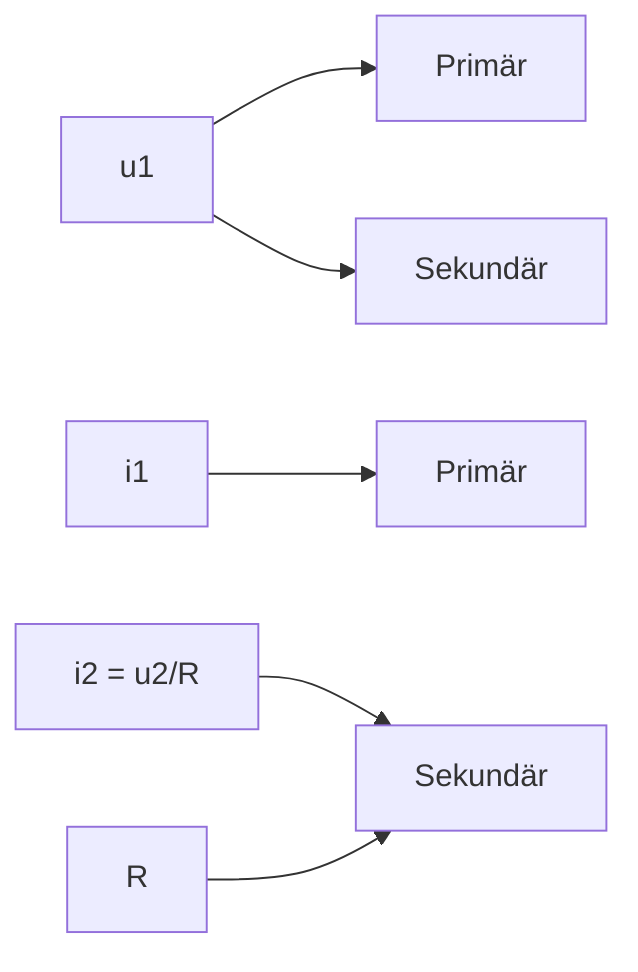

text_image

H
A
I

Bild 28.5 Magnetfeld eines Kreisstromes (I Stromstärke, A Flächenvektor)

text_image

0
A
φ
N
S

Bild 28.6 Drehspulgalvanometer

um den Ausschlagwinkel ϕ gespannten Feder gleich sind. Da die B-Linien senkrecht aus den Polschuhen aus- und senkrecht in den zylindrischen Spulenkern eintreten, den Luftspalt also in radialer Richtung durchqueren, steht das magnetische Moment m stets senkrecht auf H (bzw. $A \perp B )$ . Das rückstellende Moment der Federn ist dem Drehwinkel proportional: $M = D \varphi ,$ wobei D die Winkelrichtgröße der Rückstellfedern ist. Somit lautet die Gleichgewichtsbedingung $M = N I A B = D \varphi$ , woraus $\varphi = k I$ mit $k = N A B / D$ als Gerätekonstante folgt.

## 28.7 Bewegung freier Ladungsträger im magnetischen Feld. Lorentz-Kraft

Die Kraft, die ein stromführender Leiter im Magnetfeld erfährt, greift an dessen Ladungsträ- gern an. Sie ist daher auch vorhanden, wenn sich die Ladungsträger außerhalb des Leiters, d. h. frei im Raum, bewegen. Mit der Stromstärke $I = \mathbf { d } Q .$ /dt und der Geschwindigkeit der Ladungsträger $\pmb { v } = \mathbf { d } \pmb { l } / \mathbf { d } t$ lässt sich die Gleichung (28.16) wie folgt schreiben:

$$
\mathrm{d} \boldsymbol {F} = I (\mathrm{d} \boldsymbol {l} \times \boldsymbol {B}) = \mathrm{d} Q \left(\frac {\mathrm{d} \boldsymbol {l}}{\mathrm{d} t} \times \boldsymbol {B}\right) = \mathrm{d} Q (\boldsymbol {v} \times \boldsymbol {B}).
$$

Das heißt, auf eine mit der Geschwindigkeit v relativ zum Magnetfeld B bewegte Ladung q (für Elektronen ist $q = - e$ zu setzen) wirkt eine Kraft

$$
\boldsymbol {F} _ {\mathrm{L}} = q (\boldsymbol {v} \times \boldsymbol {B}) \quad \text {(LORENTZ - Kraft).} \tag {28.22}
$$

## Die LORENTZ-Kraft wirkt stets senkrecht zur momentanen Bewegungsrichtung des Ladungsträgers und senkrecht zur Richtung des Magnetfeldes.

Das geladene Teilchen wird durch die LORENTZ-Kraft immer senkrecht zur momentanen Geschwindigkeit beschleunigt, wodurch sich nur die Richtung, nicht jedoch der Betrag seiner Geschwindigkeit ändert. Deshalb verrichtet das magnetische Feld (im Gegensatz zum elektrischen Feld) keine Arbeit am bewegten Ladungsträger.

Nach (28.22) ist die LORENTZ-Kraft gleich null, wenn die Ladung relativ zum Magnetfeld ruht oder sich genau in Feldrichtung bewegt. Wird hingegen ein frei fliegendes geladenes Teilchen senkrecht zu den Feldlinien in ein homogenes Magnetfeld eingeschossen, so wird es durch die LORENTZ-Kraft mit konstanter Geschwindigkeit auf einer Kreisbahn herumgeführt.

In den sog. **Kreisbeschleunigern** werden geladene atomare Teilchen (Protonen, Deuteronen, „künstliche“ α-Teilchen usw.) mit Hilfe elektrischer Wechselfelder periodisch wiederkehrend beschleunigt. Dabei werden die Kreisbahnen der Teilchen durch homogene Magnetfelder hervorgerufen. Das Zyklotron nach LAWRENCE (Bild 28.7a) arbeitet mit einem zeitlich konstanten Magnetfeld, so dass die Teilchen zwischen zwei Beschleunigungsphasen Halbkreise durchlaufen, deren Radien mit wachsender Geschwindigkeit zunehmen. Dadurch entsteht eine aus Halbkreisen zusammengesetzte spiralförmige Bahn. Will man zu Teilchenenergien im relativistischen Bereich $( \nu \approx c ,$ der Lichtgeschwindigkeit) vorstoßen, so nimmt infolge der relativistischen Massenzunahme die Winkelgeschwindigkeit $\omega$ der Teilchen ab. Um die Beschleunigungsphasen weiter synchron aufrechtzuerhalten, muss die Frequenz des elektrischen Wechselfeldes ebenfalls abnehmen (Synchrozyklotron).

Die riesigen Abmessungen des magnetischen Führungsfeldes werden beim Synchrotron (Bild 28.7b) vermieden. Es arbeitet mit einem zeitlich anwachsenden Magnetfeld, dessen Stärke mit der Zeit derart zunimmt, dass trotz wachsender Geschwindigkeit die Teilchen auf einem Kreis mit konstantem Radius, dem Sollkreis, geführt werden können. Ein Synchrotron zur Beschleunigung von Elektronen besitzt einen relativ kleinen Sollkreis und erzeugt sog. „künstliche“ β- Strahlung.

text_image

Teilchenstrahl
lonenquelle
a)
Beschleunigungsrohr
Querschnitt durch
einen Magneten
Beschleunigungsstrecke
b)

Bild 28.7 Prinzip von a) Zyklotron, b) Synchrotron

## Beispiel 28.4:

Für die Kreisbewegung eines geladenen Teilchens der Ladung $q$ und der Ruhmasse $m _ { 0 }$ in einem homogenen Magnetfeld $\boldsymbol{B} = \operatorname{const}$ berechne man den Radius r (Bahnbedingung) und die Winkelgeschwindigkeit ω (Synchronbedingung) für Geschwindigkeiten $\nu \ll c$ und $\nu \approx c$ (c Lichtgeschwindigkeit).

Lösung: Die LORENTZ-Kraft wirkt als Zentripetalkraft in radialer Richtung: $q \nu B   =   m \nu ^ { 2 } / r$ Hieraus folgt für den Radius der Kreisbahn

$$
r = \frac {m v}{q B} \quad (\text {Sollkreisradius}) \tag {28.23}
$$

und für die Winkelgeschwindigkeit der Kreisbewegung $\omega = \nu / r = ( q / m ) B .$ . Für sog. „klassische“ Teilchen mit $m = m _ { 0 }$ ist die Umlauffrequenz $f = \omega / ( 2 \pi )$ von der Geschwindigkeit des Teilchens unabhängig, da bei höherer Geschwindigkeit zwangsläufig ein größerer Kreis durchlaufen wird<u>, so dass</u> das Verhältnis $\nu / r$ konstant bleibt. Für sog. „relativistische“ Teilchen mit $m = m _ { 0 } / \sqrt { 1 - ( \nu / c ) ^ { 2 } }$ (vgl. 6.3) nimmt mit Annäherung an die Lichtgeschwindigkeit der Radius der Kreisbahn nur noch infolge der relativistischen Massenänderung zu und die Winkelge schwindigkeit $\omega \approx c / r$ ab. □

## Aufgabe

**28.2** In einer Nebelkammer, die sich in einem Magnetfeld der Feldstärke $H = 1 , 9 9 \cdot 1 0 ^ { 6 } \mathrm { A / m }$ befindet, hinterlässt ein atomares Teilchen, das mit einer Geschwindigkeit von $\nu =$ $1 0 ^ { 7 }   \mathrm { m } / \mathrm { s }$ fliegt, eine kreisförmige Bahnspur mit dem Radius $r = 8 , 3   \mathrm { c m }$ . Gesucht ist die spezifische Ladung q/m des Teilchens.

## 28.8 Galvano- und thermomagnetische Effekte. Hall-Effekt. Quanten-Hall-Effekt

Galvanomagnetische Effekte treten in einem stromdurchflossenen Leiter oder Halbleiter auf, der zusätzlich einem äußeren Magnetfeld ausgesetzt ist. Fließt ein konstanter elektrischer Strom durch ein senkrecht zur Stromrichtung verlaufendes Magnetfeld der Flussdichte B, wirkt auf die Ladungsträger die LORENTZ-Kraft (28.22) $\pmb { F } _ { \mathrm { L } } = q \left( \pmb { v } \times \pmb { B } \right)$ . Sie lenkt die Ladungen in einer Leiterplatte (Dicke $d ,$ Breite b, Bild 28.8) senkrecht zur Strom- und Feldrichtung ab und verursacht sowohl in als auch senkrecht zur Stromflussrichtung zusätzliche Potenzialdifferenzen. Zwischen den Stellen 1 und 2 der Leiterplatte stellt man eine Erhö- hung des elektrischen Widerstandes fest (**THOMSON-Effekt**). Zwischen 3 und 4 misst man eine Spannung $U _ { \mathrm { H } }$ (**HALL-Effekt**). Mit (23.2) und (23.17) folgt aus der LORENTZ-Kraft (28.22) $F _ { \mathrm { L } } / q = E = U _ { \mathrm { H } } / b = \nu B$ und hieraus wegen (26.3) und $j = I / ( b d )$

$$
U _ {\mathrm{H}} = \nu B b = \frac {I B}{n q d} \quad (\text {HALL - Spannung}). \tag {28.24}
$$

Von den jeweiligen Versuchsbedingungen unabhängig ist dabei die HALL-Konstante $A _ { \mathrm { H } } =$ $1 / ( n q ) = \mu / \varkappa$ mit nq als Ladungsdichte, $\mu$ Ladungsträgerbeweglichkeit und κ elektrische Leitfähigkeit (vgl. 26.1). Die Messung der HALL-Konstante $A _ { \mathrm { H } }$ bietet die Möglichkeit, die Konzentration n und das Vorzeichen der Ladungsträger, z. B. zwecks Unterscheidung zwischen n- und p-leitenden Halbleitermaterialien (vgl. 46.3), zu bestimmen. Außerdem werden HALL-Sonden wegen der Proportionalität zwischen $U _ { \mathrm { H } }$ und magnetischer Flussdichte B bzw. Feldstärke $H = B / \mu _ { 0 }$ zum Ausmessen von Magnetfeldern benutzt.

text_image

I
1
e⁻
e⁻
kalt
+
4
-
B
3
warm
b
d
2
UH
-

Bild 28.8 Normaler Hall-Effekt (Elektronenleiter mit $q = - e$ und AH < 0)

Da die LORENTZ-Kraft von der Geschwindigkeit der Ladungsträger abhängt, gelangen die langsameren Elektronen vorwiegend auf die eine Seite der Probe und die schnelleren auf die andere, so dass zum einen eine transversale, d. h. senkrecht zu Stromrichtung und Magnetfeld verlaufende **Temperaturdifferenz** entsteht (**ETTINGSHAUSEN-Effekt**) und gleichzeitig eine longitudinale Temperaturdifferenz in Richtung des elektrischen Stromes (**NERNST-Effekt**). Sind elektrischer Strom und Magnetfeld parallel, dann wäre in Gleichung (28.22) $\pmb { v } \times \pmb { B } = 0$ . Die Ladungsträger im Festkörper ändern aber infolge von Stößen häufig ihre Richtung, so dass unter dem Einfluss der LORENTZ-Kraft zusätzliche longitudinale Potenzial- und Temperaturdifferenzen entstehen.

Bisher wurde davon ausgegangen, dass der Ladungsträgerstrom durch ein äußeres elektrisches Feld verursacht wird. Aber auch ein Temperaturgradient (Wärmestrom) führt infolge von Ladungsträgerdiffusion zu einem Ladungsträgerstrom (homogener thermoelektrischer Effekt), welcher der LORENTZ-Kraft unterliegt. In Analogie zu den galvanomagnetischen Effekten treten dann die thermomagnetischen Effekte auf. Die galvano- und thermomagnetischen Effekte sind für die Direktumwandlung von thermischer Energie in Elektroenergie und umgekehrt von Bedeutung.

**Quanten-HALL-Effekt.** In sehr dünnen („zweidimensionalen“) HALL-Sonden $( d \approx 1 0 0 \: \mathrm { A }$ tomschichten) tritt bei sehr starken Magnetfeldern eine überraschende Abweichung auf: Die HALL-Spannung $U _ { \mathrm { H } }$ steigt nicht linear mit B an, sondern in charakteristischen Stufen. Schreibt man Gleichung (28.24) als OHMsches Gesetz $U _ { \mathrm { H } } = R _ { \mathrm { H } } I$ und bestimmt die Werte des so definierten Widerstands

$$
R _ {\mathrm{H}} = \frac {U _ {\mathrm{H}}}{I} = \frac {B}{n q d} \quad (\text {HALL - Widerstand}) \tag {28.25}
$$

aus den beobachteten „Stufenspannungen“, so nimmt $R _ { \mathrm { H } }$ nur ganzzahlige $( z = 1 , 2 , 3 , \ldots )$ oder gebrochen rationale Teile $( z = 1 / 3 , 2 / 3 , 2 / 5 , 5 / 2 , \ldots )$ eines festen Wertes $R _ { \mathrm { H } 0 } = 2 5   8 1 2 { , } 8 \Omega$ an: $R _ { \mathrm { H } } = R _ { \mathrm { H } 0 } / z .$

Dieser durch V. KLITZING u. a. 1980 entdeckte Effekt lässt sich durch folgende vereinfachte Betrachtung erklären. Bei sehr hoher Flussdichte B durchlaufen die Ladungsträger in der Fläche der HALL-Sonde liegende geschlossene Kreisbahnen, die der BOHRschen Quantenbedingung (44.5), $m \nu r = z \hbar , z = 1 , 2 , 3 , \ldots ,$ , u<u>nterliege</u>n. Infolgedessen kann der Sollkreisradius (28.23) nur die erlaubten Werte $r = r _ { z } = \sqrt { z \hbar / ( q B ) } = z ^ { 1 / 2 } r _ { 1 }$ annehmen. Der magnetische Fluss durch die jeweils umschlossene Kreisfläche $A _ { z } = \pi r _ { z } ^ { 2 } = z \pi r _ { 1 } ^ { 2 } = z A _ { 1 }$ ist $\varPhi _ { z } = B A _ { z } = z \varPhi _ { 0 }$ und umfasst daher je nach Quantenzahl z ein oder mehrere Flussquanten $\varPhi _ { 0 } = B A _ { 1 } = h / ( 2 q ) \approx h / q$ (vgl. Beispiel 44.1). Der gesamte magnetische Fluss durch die Probe beträgt demzufolge das Vielfache eines Flussquants, $\varPhi = N _ { \varPhi } \varPhi _ { 0 }$ , wobei die Anzahl der Flussquanten $N _ { \phi }$ im Maximalfall, wenn sich alle Ladungsträger im Grundzustand $z = 1$ befinden, gleich der Anzahl der Ladungsträger $N = n A d$ der HALL-Sonde ist und mit sinkender Magnetfeldstärke stufenweise abnimmt. Denn für die Fläche A der HALL-Sonde gilt $A = N A _ { 1 } = N _ { \varPhi } A _ { z } = N _ { \varPhi } z A _ { 1 }$ und somit $N _ { \varPhi } = N / z = n A d / z$ . Für die Flussdichte folgt daraus $B = \varPhi / A = N _ { \varPhi } \varPhi _ { 0 } / A \approx n d h / ( z q )$ , womit nach (28.25) der Ausdruck

$$
R _ {\mathrm{H}} = \frac {h}{z q ^ {2}} \quad (\text {Quanten - HALL - Widerstand}) \tag {28.26}
$$

resultiert. Er ist unabhängig von Materialparametern und der konkreten Stärke des angeleg ten Magnetfeldes und stimmt für $q = e$ mit dem exakten Ausdruck für den Quanten-HALL-Widerstand $R _ { \mathrm { H } } = R _ { \mathrm { H } 0 } / z$ mit der sog. VON-KLITZING-Konstanten $R _ { \mathrm { H } 0 } = h / e ^ { 2 }$ überein. Damit ist das O h m (Ω) als Einheit des elektrischen Widerstandes auf zwei Elementarkonstanten, die PLANCK-Konstante h und die Elementarladung e, zurückgeführt (Widerstandsnormal).

## 29.1 Magnetische Polarisation der Stoffe

So wie ein Stoff, der in ein elektrisches Feld gebracht wird, nach (24.8) eine Elektrisierung $\pmb { E } _ { \mathrm { P } } = - \chi _ { \mathrm { e } } \pmb { E }$ erfährt, führt das Einbringen eines Stoffes in ein magnetisches Feld zu einer Magnetisierung M desselben, die in analoger Weise durch

$$
\boldsymbol {M} = \chi_ {\mathrm{m}} \boldsymbol {H} \quad (\text {Magnetisierung}) \tag {29.1}
$$

beschrieben werden kann. $\chi _ { \mathrm { m } }$ ist die **magnetische Suszeptibilität** des Stoffes.

Die Magnetisierung der Stoffe ist auf magnetische Dipole der Atome zurückzuführen, die sich unter Einwirkung des äußeren Magnetfeldes bilden oder ausrichten (vgl. 46.6). Zu ihrer Untersuchung benutzen wir eine von einem Gleichstrom durchflossene Ringspule (Bild 28.3b), deren Innenraum einmal leer und einmal vollständig mit dem betreffenden Stoff gefüllt ist. Nach dem Durchflutungsgesetz (28.8) ändert sich bei gleicher Stromstärke die Feldstärke H in der Ringspule durch das Einbringen des Stoffes nicht. Messen wir jedoch den magnetischen Fluss der stoffgefüllten Spule $( \mathbf { z } , \mathbf { B } .$ in einem Induktionsversuch, vgl. 30.1), so erhalten wir in dieser gegenüber der leeren Spule eine um die **magnetische Polarisation J** veränderte magnetische Flussdichte B. Diese hat sich gegenüber der Flussdichte (28.14) $\mu _ { 0 } H$ im Vakuum um den Faktor $\mu _ { \mathrm { r } }$ im Innern des Stoffes geändert:

$$
\boldsymbol {B} = \mu_ {0} \boldsymbol {H} + \boldsymbol {J} = \mu_ {\mathrm{r}} \mu_ {0} \boldsymbol {H} \quad \text {oder} \quad \boldsymbol {B} = \mu \boldsymbol {H}. \tag {29.2}
$$

Die dimensionslose Größe $\mu _ { \mathrm { r } }$ heißt **Permeabilitätszahl**, $\mu = \mu _ { \mathrm { r } } \mu _ { 0 }$ ist die **Permeabilität** des Stoffes. Man erkennt daraus:

**Wird der gesamte vom Magnetfeld erfüllte leere Raum mit einem Stoff gefüllt, so tritt** in allen Gesetzmäßigkeiten anstelle von $\mu _ { 0 }$ das Produkt $\pmb { \mu } = \pmb { \mu } _ { \mathrm { { r } } } \pmb { \mu } _ { 0 }$

Aus (29.2) folgt für den Zusammenhang zwischen magnetischer Polarisation und Magnetisierung (29.1) mit der magnetischen Suszeptibilität $\chi _ { \mathrm { m } } = \mu _ { \mathrm { r } } - 1$ :

$$
\boldsymbol {J} = \boldsymbol {B} - \mu_ {0} \boldsymbol {H} = (\mu_ {\mathrm{r}} - 1) \mu_ {0} \boldsymbol {H} = \chi_ {\mathrm{m}} \mu_ {0} \boldsymbol {H} = \mu_ {0} \boldsymbol {M}. \tag {29.3}
$$

Nach dem unterschiedlichen Verhalten der Stoffe im Magnetfeld, wie es $\mathbf { z } , \mathbf { B } ,$ im Bild 29.1 zum Ausdruck kommt, unterscheidet man

Nach (29.3) ist die durch die Magnetisierung M hervorgerufene magnetische Polarisation J bei den Dia- und Paramagnetika der Feldstärke proportional. Bei den Ferromagnetika sind jedoch $\mu _ { \mathrm { r } }$ und $\chi _ { \mathrm { m } }$ stark von der Feldstärke und von ihrer Vorgeschichte abhängig und somit keine Konstanten. In den Diamagnetika sind die Vektoren M und J wegen $\chi _ { \mathrm { m } } < 0$ dem Feldstärkevektor H entgegengerichtet, in den Para- und Ferromagnetika wegen $\chi _ { \mathrm { m } } > 0$ ihm gleichgerichtet.

Bild 29.1 Kugel a) aus diamagnetischem, b) aus paramagnetischem, c) aus ferromagnetischem Material im Vakuum. Das B-Feld ist in allen Fällen innerhalb und in großer Entfernung von der Kugel homogen.

Ein bedeutsamer Magnetisierungseffekt tritt nur bei ferromagnetischen Stoffen auf; bei ihnen kommen Permeabilitätszahlen der Größenordnung $\mu _ { \mathrm { r } } = 1 0 ^ { 2 } \ldots 1 0 ^ { 5 }$ vor. Für Para- und Diamagnetika dagegen ist $\mu _ { \mathrm { r } } \approx 1 , \chi _ { \mathrm { m } }$ also nur wenig von null verschieden. So liegen die Suszeptibilitäten von festen und flüssigen Diamagnetika (z. B. Cu, Zn, Bi, $\mathrm { H _ { 2 } O ) }$ in der Größenordnung von $- \chi _ { \mathrm { m } } = 1 0 ^ { - 5 } \dots 1 0 ^ { - 4 }$ , bei diamagnetischen Gasen (z. B. $\mathrm { H _ { 2 } } ,   \mathrm { N _ { 2 } } )$ im Normzustand in der Größenordnung von einigen $- 1 0 ^ { - 9 }$ . Die festen, flüssigen und gasförmigen Paramagnetika (z. B. Sn, Al, Mn, $\mathrm { O } _ { 2 } )$ haben Suszeptibilitäten in der Grö- ßenordnung $\tilde { \chi _ { \mathrm { m } } } = { 1 0 } ^ { - 6 } \dots { 1 0 } ^ { - 3 }$ . Die Anwesenheit dia- und paramagnetischer Stoffe (z. B. von Luft) hat daher praktisch keinen Einfluss auf die magnetischen Erscheinungen; es kann meist in guter Näherung $\mu _ { \mathrm { r } } = 1$ und $\chi _ { \mathrm { m } } = 0$ gesetzt werden.

## 29.2 Magnetisierung der Ferromagnetika. Hysterese

Ferromagnetika zeichnen sich gegenüber den dia- und paramagnetischen Stoffen durch eine wesentlich höhere magnetische Polarisation (29.3) schon bei relativ kleinen Feldstärken aus. Zu ihnen gehören Eisen, Cobalt und Nickel, einige $\mathrm { F e _ { 2 } O _ { 3 } }$ enthaltende Mischoxide (z. B. die Ferrite) und Legierungen der ferromagnetischen Metalle, aber auch einige Legierungen, die ausschließlich aus nichtferromagnetischen Metallen bestehen, z. B. die HEUSLERschen Legierungen $\mathrm{Cu_{2}AlMn}$ und $\mathrm{Cu_{2}SnMn}$ . Oberhalb der sog. **Curie-Temperatur** $T _ { \mathrm { C } }$ (bei Eisen $7 6 8   ^ { \circ } \mathrm { C ) }$ verhalten sich die unterhalb $T _ { \mathrm { C } }$ ferromagnetischen Stoffe paramagnetisch (vgl. 46.7).

Der Ferromagnetismus ist an die kristalline Struktur des Festkörpers gebunden. Eisenionen (in Lösungen) und Eisenatome (in Dämpfen) verhalten sich paramagnetisch.

Die Abhängigkeit der magnetischen Polarisation J von der Feldstärke H, wie sie für Ferromagnetika charakteristisch ist, kann man an Hand ihrer **Magnetisierungskurve** verfolgen (Bild 29.2): Bei erstmaliger Magnetisierung des Materials bewegen wir uns mit wachsender Feldstärke entlang der sog. Neukurve (N) von O nach S. Bewirkt eine Feldstärkeerhöhung im Weiteren keine höhere Magnetisierung, dann ist im Punkt S die Sättigungspolarisation $J _ { \mathrm { S } }$ bei der Sättigungsfeldstärke $H _ { \mathrm { S } }$ erreicht. Geht man mit der Feldstärke wieder auf $H = 0$ zurück, so verschwindet nur der temporäre Magnetismus $J _ { \mathrm { S } }   -   J _ { \mathrm { R } }$ , und es bleibt ein Restbetrag an Polarisation, die Remanenz $J _ { \mathrm { R } } ,$ erhalten. Das bedeutet, dass wir uns nicht mehr auf der Neukurve, sondern entlang des absteigenden Astes (1) der Magnetisierungskurve bewegen. Der remanente

Magnetismus kann durch ein ihm entgegengerichtetes Magnetfeld mit der Koerzitivfeldstärke $- H _ { \mathrm { K } }$ (z. B. durch Umkehren der Stromrichtung in der Magnetisierungsspule) wieder zum Verschwinden gebracht werden. Bei weiterer Erhöhung der Feldstärke in umgekehrter Richtung ergibt sich ein Bereich negativer Polarisation mit einem Kurvenverlauf, der antisymmetrisch zu dem bei positiver Polarisation ist.

Die Neukurve $( N )$ wird bei einem solchen Auf- und Ummagnetisierungsprozess eines ursprünglich unmagnetischen Ferromagnetikums also nur einmal durchlaufen. Jeder weitere Ummagnetisierungszyklus ist immer mit einem vollen Umlauf der durch die Äste (1) und (2) gebildeten sog. **Hysteresisschleife** verbunden.

line

| Point | H | J |
| --- | --- | --- |
| (-HS) | 0 | -JS |
| (-HK) | -HK | -JR |
| (1) | -HK | JR |
| (N) | 0 | N/A |
| (2) | HK | JR |
| (S) | HS | JS |

Bild 29.2 Verlauf der Aufmagnetisierungskurve entlang der Neukurve $( N )$ bis zur Sättigung S und der Ummagnetisierung entlang der Äste $( 1 )$ und (2) der Hysteresisschleife.

$J _ { \mathrm { S } }$ Sättigungspolarisation, $J _ { \mathrm { R } }$ Remanenz; $H _ { \mathbb { S } }$ Sättigungsfeldstärke, $H _ { \mathrm { K } }$ Koerzitivfeldstärke

Die **Hysterese** spielt für die magnetischen Werkstoffe eine große Rolle. Hartmagnetische Werkstoffe haben breite Hysteresisschleifen mit großen Koerzitivfeldstärken $H _ { \mathrm { K } }$ und eignen sich deshalb vor allem als Dauermagnete (Permanentmagnete). Weichmagnetische Werkstoffe zeichnen sich durch schmale Hysteresisschleifen mit kleinen Koerzitivfeldstärken aus. Sie werden vorwiegend in der Wechselstromtechnik eingesetzt, wo die Hysteresisschleife bei der ständigen Ummagnetisierung des Eisens in Spulen, Transformatoren, Motoren usw. durch den Wechselstrom entsprechend seiner Frequenz in jeder Sekunde viele Male durchlaufen wird. Da die von der Hysteresisschleife eingeschlossene Fläche gleich der während eines Ummagnetisierungszyklus aufzuwendenden Arbeit je Volumeneinheit

$$
w = \oint H \mathrm{d} J \tag {29.4}
$$

ist, die bei jedem vollen Umlauf in Wärme umgesetzt wird, können die damit verbundenen **Hysteresisverluste** trotz schmaler Hysteresisschleifen zu beträchtlicher Erwärmung der Eisenkerne führen.

Bild 29.3 Technische Magnetisierungskurve (a) und Permeabilitätszahl (b) von Dynamoblech. Links: Graphische Bestimmung von H und B in einem magnetischen Kreis mit Luftspalt (vgl. 29.3, Beispiel 29.2/2)

Wie man aus der Hysteresisschleife (Bild 29.2) erkennt, ist die magnetische Polarisation J und damit auch die Flussdichte $B = \mu _ { 0 } H + J$ keine eindeutige Funktion der Feldstärke H. Technische Magnetisierungskurven wie in Bild 29.3a stellen deshalb eine Mittelung der beiden Kurvenäste (1) und (2) der Hysteresisschleife dar. Damit lässt sich für die Beträge von Flussdichte und Feldstärke die Gleichung (29.2) $B = \mu _ { \mathrm { r } } \mu _ { 0 } H$ formal aufrechterhalten, wenn man die Permeabilitätszahl $\mu _ { \mathrm { r } } = B / ( \mu _ { 0 } H )$ als Funktion der Feldstärke H auffasst und sie aus der technischen Magnetisierungskurve berechnet (Bild 29.3b). Dabei durchläuft $\mu _ { \mathrm { r } }$ mit wachsendem H zunächst ein ausgeprägtes Maximum, um dann im Sättigungsbereich dem Verlauf $\mu _ { \mathrm { r } } = 1 + J _ { \mathrm { S } } / ( \mu _ { 0 } H )$ zu folgen.

## Beispiel 29.1:

In einer stromdurchflossenen Ringspule aus 200 Windungen mit einem geschlossenen Eisenkern (Dynamoblech) von 20cm mittlerem Umfang herrscht die Flussdichte $B = 1 { , } 0 \mathrm { T }$ . Man ermittle die Feldstärke H in der Spule, die Stromstärke sowie die Permeabilitätszahl $\mu _ { \mathrm { r } }$ des Kerns. Wie groß werden Flussdichte B und Permeabilitätszahl $\mu _ { \mathrm { r } }$ bei Verdopplung der Stromstärke?

Lösung: Aus Bild 29.3a und b liest man $H = 300    A/m$ und $\mu _ { \mathrm { r } } = 2 7 0 0 \; \mathrm { a b }$ . Die Stromstärke ergibt sich aus (28.8) $N I = H l$ zu $I = 0 { , } 3 \mathrm { A }$ . Für $I = 0 { , } 6 \mathrm { A }$ ist dann $H = 600\mathrm{A/m}$ und (nach Bild 29.3a und b) $B = 1 { , } 2 4 \mathrm { T }$ $\mu _ { \mathrm { r } } = 1 6 5 0$ . Eine Steigerung der Stromstärke im Sättigungsbereich führt nur zu einer geringfügigen Erhöhung der magnetischen Flussdichte. □

## Aufgabe

**29.1** Die Hysteresisschleife eines hartmagnetischen Werkstoffs habe die Form eines Paral lelogramms mit horizontaler Sättigungscharakteristik. Berechne die Hysteresisverluste je Ummagnetisierungszyklus für $H _ { \mathrm { K } } = 7 5 0 \mathrm { A / m }$ und $J _ { \mathrm { S } } = 0 , 9   \mathrm { T } !$

## 29.3 Der magnetische Kreis. Entmagnetisierung

Man kann die Bündelung der magnetischen Flusslinien in ferromagnetischen Materialien so deuten, als ob der Stoff mit $\mu \gg \mu _ { 0 }$ gegenüber dem Vakuum eine hohe „Leitfähigkeit“ für den Durchtritt der Flusslinien besitzt. Analog zum OHMschen Gesetz (25.10) $\pmb { j } = \varkappa \pmb { E }$ mit j als Stromdichte und E als elektrischer Feldstärke führt dann entsprechend $\pmb { B } = \mu \pmb { H }$ bei gleicher magnetischer Feldstärke H eine große Permeabilität $\mu$ (analog der elektrischen Leitfähigkeit $\varkappa )$ zu hoher magnetischer Flussdichte B. Für den magnetischen Fluss $\varPhi = B A$ (anstelle der elektrischen Stromstärke $I = j A ;$ A Leiterquerschnitt) folgt so mit der magnetischen Span**nung** $U _ { \mathrm { m } } = H l$ (anstelle der elektrischen Spannung $U = E l ;$ l Leiterlänge)

$$
\Phi = \frac {U _ {\mathrm{m}}}{R _ {\mathrm{m}}} \quad (\text {OHmsches Gesetz der Magnetostatik}) \tag {29.5}
$$

mit

$$
R _ {\mathrm{m}} = \frac {1}{\mu} \frac {l}{A} \quad (\text {magnetischer Widerstand}), \tag {29.6}
$$

analog zum elektrischen Widerstand (25.8) $R = l / ( \varkappa A )$

Eine Anordnung, die alle in sich geschlossenen B-Linien gebündelt aufnimmt, bezeichnet man als **magnetischen Kreis** (Bild 29.4a). Wegen der Quellenfreiheit des B-Feldes ist überall der magnetische Fluss $\Phi = \mathrm{const};$ im Stromkreis gilt analog für die Stromstärke $I = \mathrm { c o n s t } .$

Ist wie bei einem Elektromagneten der Kreis stückweise aus Gliedern der Längen $l _ { i } ,$ der Querschnitte $A _ { i }$ und der Permeabilitäten $\mu _ { i }$ zusammengesetzt, so gilt nach dem Durchflutungsgesetz (28.7) mit (29.5) und (29.6):

$$
U _ {\mathrm{m}} = \oint \boldsymbol {H} \cdot \mathrm{d} \boldsymbol {r} = \sum_ {i} H _ {i} l _ {i} = \sum_ {i} U _ {\mathrm{m} i} = \Phi \sum_ {i} R _ {\mathrm{m} i} = \Phi R _ {\mathrm{m}} = N I. \tag {29.7}
$$

Das heißt, die Summe der magnetischen Spannungsabfälle $U _ { \mathrm { m } i } = R _ { \mathrm { m } i } \phi$ ist gleich der magnetischen Umlaufspannung N I. Die Glieder des magnetischen Kreises wirken wie die Teilwiderstände eines „magnetischen Spannungsteilers“, in denen die magnetische Feldstärke $H _ { i } = U _ { \mathfrak { m } i } / l _ { i } = R _ { \mathfrak { m } i } \phi / l _ { i } = \varPhi / ( \mu _ { i } A _ { i } )$ leicht zu berechnen ist. Allerdings ist das OHMsche Gesetz (5) mit Vorsicht anzuwenden, weil oft Streufelder auftreten, also der magnetische Fluss im magnetischen Kreis nicht so gut „geführt“ ist wie der Strom im Stromkreis.

Bild 29.4 Verhalten des Magnetfeldes an Grenzflächen a) im magnetischen Kreis; b) bei der Entmagnetisierung

**Verhalten von B und H an Grenzflächen.** Wird aus einem geschlossenen Eisenkreis ein Segment herausgeschnitten (Bild 29.4a) und nur der Restkörper magnetisiert, so ist im Luftspalt die magnetische Polarisation $J = 0$ . Dann geht zwar die Flussdichte B als quellenfreies Vektorfeld stetig durch die beiden Grenzflächen, nicht hingegen wegen Gleichung (29.2) die magnetische Feldstärke H. Diese erleidet an den Grenzflächen einen Sprung, da an der Oberfläche des magnetisierten Stoffes Pole nicht durch Gegenpole kompensiert werden und damit die freien Nordpole Quellen und die freien Südpole Senken eines zusätzlichen H-Feldes darstellen (vgl. 28.1). Die Verhältnisse sind analog denen beim Durchgang des elektrischen Feldes durch die Grenzfläche zweier Stoffe (s. 24.3); man braucht sich nur in allen Aussagen, wie z. B. in den Gleichungen (24.9) und (24.10), E durch H, D durch B und ε durch $\mu$ ersetzt zu denken. Analog zum elektrischen Feld gilt:

## Die Tangentialkomponente des H-Feldes und die Normalkomponente des B-Feldes treten stetig durch die Grenzfläche zweier Stoffe.

**Entmagnetisierung.** Bringt man ein Stück weichmagnetischen Materials der Suszeptibilität $\chi _ { \mathrm { m } }$ in ein homogenes Feld $H _ { 0 } ,$ , so erhält es nicht die Magnetisierung $\chi _ { \mathrm { m } } H _ { 0 }$ gemäß Gleichung (29.1); denn in diese ist nicht die äußere Feldstärke $H _ { 0 }$ , sondern die Feldstärke H im Material einzusetzen, die sich infolge der eintretenden Magnetisierung wesentlich von $H _ { 0 }$ unterscheidet. Das Material wird, wie oben ausgeführt, selbst zu einem magnetischen Dipol mit freien

Nord- und Südpolen an den Endflächen (Bild 29.4b). Das von diesen Quellen ausgehende Gegenfeld $- \beta M$ ist der Magnetisierung proportional und schwächt das äußere Feld $H _ { 0 } .   \beta$ ist dabei der Entmagnetisierungsfaktor. Es ist also im Stoff $\boldsymbol { H } = \boldsymbol { H } _ { 0 } - \beta \boldsymbol { M } = \boldsymbol { H } _ { 0 } - \beta \chi _ { \mathrm { m } } \boldsymbol { H }$ , woraus folgt

$$
\boldsymbol {H} = \frac {1}{1 + \beta \chi_ {\mathrm{m}}} \boldsymbol {H} _ {0} \quad (\text {Feldstärke im Innern eines magnetisierten Körpers}). \tag {29.8}
$$

Die Größe und die Verteilung von H im Körper ist im Allgemeinen von dessen Gestalt abhängig; nur bei einem Rotationsellipsoid ist auch das Innenfeld homogen (Bild 29.4b). β liegt im Intervall $0 \leq \beta \leq 1$ . Die beiden Grenzfälle sind leicht überschaubar: Für ein lang gestrecktes Drahtstück in Feldrichtung gilt wegen der Stetigkeit der Tangentialkomponente von H an der Mantelfläche des Drahtes auch im Drahtinnern $H = H _ { 0 }$ , also $\beta = 0 ;$ für eine dünne Platte quer zur Feldrichtung gilt wegen der Stetigkeit der Normalkomponenten von B an der Grenzfläche der Platte $\mu _ { 0 } \pmb { H } _ { 0 } = \mu _ { 0 } \mu _ { \mathrm { r } } \pmb { H }$ , also $\beta = 1$ (wegen $\chi _ { \mathrm { m } } = \mu _ { \mathrm { r } }   -   1 )$ . Für eine Kugel liefert die exakte Rechnung $\beta = 1 / 3$

## Beispiele 29.2:

1. Eine vom Strom I durchflossene Spule (Windungszahl N) habe einen Eisenkern (mittlerer Eisenweg l, Permeabilitätszahl $\mu _ { \mathrm { r } } )$ mit einem Luftspalt der Breite d (vgl. Bild 29.4a). Man berechne allgemein die Feldstärken $H _ { \mathrm { L } }$ im Luftspalt und $H _ { \mathrm { E } }$ im Eisenkern nach dem OHMschen Gesetz (29.5) und vergleiche sie mit der Feldstärke in der Ringspule (28.8).

Lösung: Die Reihenschaltung der magnetischen Widerstände (29.6) von Eisenkern und Luftspalt ergibt den Gesamtwiderstand $R _ { \mathrm { m } } = l / ( \mu _ { \mathrm { r } } \mu _ { 0 } A ) + d / ( \mu _ { 0 } A )$ . Der magnetische Fluss beträgt nach (29.7) $\varPhi = N I / R _ { \mathrm { m } }$ . Andererseits ist $\varPhi = B A = \mu _ { \mathrm { r } } \mu _ { 0 } H _ { \mathrm { E } } A$ (im Eisen) $) = \mu _ { 0 } H _ { \mathrm { L } } A$ (im Luftspalt), woraus folgt $H _ { \mathrm { E } } = \varPhi / ( \mu _ { \mathrm { r } } \mu _ { 0 } A ) = N I / ( l + \mu _ { \mathrm { r } } d )$ und eine $\mu _ { \mathrm { r } }$ -fach $( 1 0 ^ { 2 } \ldots 1 0 ^ { 5 } \mathrm { - f a c h } )$ so hohe Feldstärke im Luftspalt $H _ { \mathrm { L } } = \varPhi / ( \mu _ { 0 } A ) = N I / ( l / \mu _ { \mathrm { r } } + d ) = \mu _ { \mathrm { r } } H _ { \mathrm { E } }$ . Für $d \ll l / \mu _ { \mathrm { r } }$ ist $H _ { \mathrm { E } } \approx N I / l$ und für $l \gg d \gg l / \mu _ { \mathrm { r } }$ ist $H _ { \mathrm { L } } \approx N I / d$ . Die Feldstärken entsprechen denen in leeren Spulen der Längen l bzw. d.

2. Man bestimme die Größen $H _ { \mathrm { E } } ,   H _ { \mathrm { L } }$ und B des magnetischen Kreises in Bild 29.4a, wenn auch $\mu _ { \mathrm { r } }$ unbekannt ist, anhand der Magnetisierungskurve $B = B ( H _ { \mathrm { E } } )$ in Bild 29.3a mit $I = 2 { , } 4 \mathrm { A }$ $N = 500,   l = 80    cm     and   d = 1    mm$

Lösung: Mit der magnetischen Feldstärke im Luftspalt $H _ { \mathrm { L } } = B / \mu _ { 0 }$ folgt aus (29.7) $H _ { \mathrm { E } } l + B d / \mu _ { 0 } =$ N I. Die Unbekannten $H _ { \mathrm { E } }$ und B liegen in Bild 29.3a auf der Geraden durch den Abszissenschnittpunkt $H_{0} = NI/l = 1500A/m \ (B = 0$ gesetzt) und den Ordinatenschnittpunkt $B _ { 0 } = \mu _ { 0 } N I / d = 1 . 5 \mathrm { T } \; ( H _ { \mathrm { E } } = 0 \; \mathrm { g e s e t z t } )$ . Der Schnittpunkt der Gerade mit der Magnetisierungskurve liefert $H_{\mathrm{E}}=400\mathrm{A/m}\mathrm{~um}\mathrm{~B}=1,1\mathrm{T}$ . Daraus folgt $H _ { \mathrm { L } } = 8 . 8 \cdot 1 0 ^ { 5 } \mathrm { A / m }$ und wegen $B _ { \mathrm { E } } = B _ { \mathrm { L } }$ d. h. $\mu _ { \mathrm { r } } \mu _ { 0 } H _ { \mathrm { E } } = \mu _ { 0 } H _ { \mathrm { L } } ,   \mu _ { \mathrm { r } } = H _ { \mathrm { L } } / H _ { \mathrm { E } } = 2 2 0 0$ □

## Aufgabe

**29.2** Eine von Gleichstrom durchflossene Spule mit Eisenkern soll zusätzlich für Wechselstrom einen sehr hohen Widerstand haben (Drossel). Dazu wird die magnetische Feldstärke vom Wert $H_{0}=1200\mathrm{A/m}$ im geschlossenen Eisenkern aus Dynamoblech (Bild 29.3b) durch einen Luftspalt auf $H _ { \mathrm { E } } = 1 5 0 \mathrm { A / m }$ gesenkt, um den Maximalwert der Permeabilität zu nutzen. Wie groß ist das Verhältnis von Spaltbreite zu Eisenweg d/l? Die Berechnung von $H _ { \mathrm { L } }$ demonstriert, welch hohe Feldstärken in einem Luftspalt auftreten.

## 30.1 Das faradaysche Induktionsgesetz

1831 erkannte FARADAY durch eine Reihe zielgerichteter Experimente, dass durch zeitlich veränderliche Magnetfelder elektrische Spannungen (Felder) erregt werden. Man nennt diese Erscheinung elektromagnetische Induktion. Wird zum Beispiel, wie in Bild 30.1a veranschaulicht, die in einem Magnetfeld befindliche Leiterschleife plötzlich aus dem Feld herausgezogen, so lässt sich mit einem angeschlossenen ballistischen Galvanometer (s. 23.1) ein **Spannungsstoß** $\int u _ { \mathrm { i n d } }$ dt messen (Bild 30.1b). Dieser hängt nur davon ab, wie viele Feldlinien durch die von der Leiterschleife umrandete Fläche A anfänglich hindurchtraten, er ist also durch den magnetischen Fluss $\varPhi = \int u _ { \mathrm { i n d } }$ dt innerhalb dieser Fläche gegeben. Diese Beobachtung ist bekannt als

## FARADAYsches Induktionsgesetz:

**Die induzierte Spannung in einem geschlossenen Leiterkreis, der den sich zeitlich ändernden magnetischen Fluss umrandet, ist gleich der negativen Änderungsgeschwindigkeit des magnetischen Flusses.**

$$
u _ {\mathrm{ind}} = - \frac {\mathrm{d} \varPhi}{\mathrm{d} t} \quad (\text {FARADAYSches Induktionsgesetz}). \tag {30.1}
$$

Bild 30.1 a) Induktionsversuch zur Messung der magnetischen Flussdichte (Induktion) B. b) Mit einem ballistischen Galvanometer gemessener Spannungsstoß beim Herausziehen der Schleife aus dem Magnetfeld. Der magnetische Fluss Φ entspricht der Fläche unter der u(t)-Kurve, 1 bei schneller Bewegung, 2 bei langsamer Bewegung der Schleife; die Flächeninhalte unter beiden Kurven sind gleich. Vgl. Aufgabe 33.4.

Bei einer Spule mit N Windungen addieren sich die erregten Induktionsspannungen in den einzelnen Windungen zur Gesamtspannung

$$
u _ {\text {ind}} = - N \frac {\mathrm{d} \Phi}{\mathrm{d} t} \quad (\text {Induktionsspannung in einer Spule}). \tag {30.2}
$$

Auf dem oben beschriebenen und in Bild 30.1 dargestellten Prinzip beruhen die Flussmesser, wobei anstelle der Leiterbewegung auch das Magnetfeld ein- oder ausgeschaltet werden kann.

Der dabei gemessene Spannungsstoß ist aber erst dann ein Maß für die Stärke des Magnetfeldes, wenn man ihn auf die vom Leiter umrandete und von den Feldlinien senkrecht durchsetzte Querschnittsfläche A bezieht. So erhält man eine weitere Messmethode zur Bestimmung der **magnetischen Flussdichte** oder **Induktion** (28.11) vom Betrage $B = \varPhi / A$

Im geschlossenen Leiterkreis ruft die Induktionsspannung nach dem OHMschen Gesetz einen Induktionsstrom hervor. Die induzierten Spannungen und Ströme sind im Allgemeinen (bei nichtlinearer Flussänderung) ebenfalls zeitlich veränderlich. Sie sollen, wie im Folgenden alle zeitlich veränderlichen Spannungen und Ströme, durch Kleinbuchstaben u und i gekennzeichnet werden.

Das Minuszeichen in (30.1) und (30.2) bringt den Energieerhaltungssatz zum Ausdruck, der hier speziell als **LENZsche Regel** über die Richtung der induzierten Spannungen und Ströme Auskunft gibt.

**LENZsche Regel: Der induzierte Strom ist stets so gerichtet, dass das von ihm erzeugte Magnetfeld der Ursache seiner Entstehung entgegenwirkt.**

text_image

i
N
H

Bild 30.2 Zur lenzschen Regel: Sowohl bei Annäherung des Stabmagneten an den Drahtring als auch bei Entfernung desselben ist mechanische Arbeit zu verrichten.

Wird z. B. nach Bild 30.2 ein Stabmagnet mit dem Nordpol voran gegen einen Drahtring geführt, so wird in diesem ein Induktionsstrom i erregt, welcher um den Leiter herum ein Magnetfeld H erzeugt. Der Kreisstrom ist damit einem magnetischen Dipol äquivalent (s. 28.6), der seinen Nordpol auf der dem Stabmagneten zugewandten Seite hat. Daher muss bei Annäherung der gleichnamigen Magnetpole gegen die Abstoßungskraft mechanische Arbeit verrichtet werden; sie liefert die Energie für den sich ausbildenden Induktionsstrom im Drahtring. Wird der Nordpol vom Drahtring wegbewegt, kehrt sich die Stromrichtung in ihm um, so dass dem Nordpol des Magneten jetzt ein Südpol des Kreisstromes gegenübersteht, die sich gegenseitig anziehen; auch hierbei muss also Arbeit verrichtet werden.

Drückt man den magnetischen Fluss Φ nach (28.12) durch die magnetische Flussdichte B aus, so erhält das Induktionsgesetz (30.1) die Form

$$
u _ {\mathrm{ind}} = - \frac {\mathrm{d} \varPhi}{\mathrm{d} t} = - \frac {\mathrm{d}}{\mathrm{d} t} \int \boldsymbol {B} \cdot \mathrm{d} \boldsymbol {A} = - \frac {\mathrm{d}}{\mathrm{d} t} \int B \mathrm{d} A \cos \alpha . \tag {30.3}
$$

α ist der Winkel zwischen der Richtung von B und der Flächennormale der Fläche A, durch die der veränderliche magnetische Fluss Φ tritt. Aus Gleichung (30.3) lesen wir ab, dass Induktionsspannungen erzeugt werden können

1. durch zeitliche Änderung des Betrages B der magnetischen Flussdichte, z. B. infolge Ände rung des elektrischen Stromes, der das Magnetfeld erzeugt (vgl. 30.2), oder wegen (29.2) infolge Änderung der Art des Stoffes innerhalb des felderfüllten Raumes (Permeabilitätsänderung);

2. durch zeitliche Änderung der Größe der Fläche A, die vom magnetischen Fluss durchsetzt wird, z. B. infolge der Bewegung eines Leiters relativ zum Magnetfeld (vgl. 30.4);
3. durch zeitliche Änderung des Winkels α zwischen Feldrichtung und Flächennormale, z. B. durch Drehen einer Leiterschleife im Magnetfeld (vgl. 30.4).

Induktionsspannungen bzw. -ströme können also entweder in relativ zum Magnetfeld ruhenden Leitern durch zeitlich veränderliche Magnetfelder (Transformatorprinzip) oder bei zeitlich konstanten Magnetfeldern durch Bewegung von Leitern relativ zum Magnetfeld (Generatorprinzip) erzeugt werden.

## Beispiel 30.1:

Der magnetische Fluss, der eine Leiterschleife durchsetzt, wächst in den ersten 2s gleichförmig von 0 auf 7Wb an, bleibt dann 3s konstant, um in den folgenden 4s gleichförmig bis auf −3Wb abzusinken. Man berechne die Spannungen, die während dieser drei Zeitintervalle in der Leiterschleife induziert werden.

Lösung: Bei einer gleichförmigen Änderung des Flusses vereinfacht sich das Induktionsgesetz (30.1) zu $u _ { \mathrm { i n d } } = - \Delta \varPhi / \Delta t$ . Während der ersten 2s wird wegen $\Delta \varPhi = 7 \mathrm { W b }$ die konstante Spannung von $- 3 { , } 5 \mathrm { V _ { i } }$ , in den letzten 4s wegen $\Delta \phi = - 1 0 \mathrm { W b }$ eine solche von +2,5V und bei konstantem magnetischen Fluss keine Spannung induziert. □

## 30.2 Selbstinduktion

Jeder stromführende Leiter ist von einem Magnetfeld umgeben, dessen Fluss der Stromstärke im Leiter proportional ist:

$$
\Phi = L I. \tag {30.4}
$$

Den Proportionalitätsfaktor L nennt man die Induktivität des Leiters. Aus der Einheitengleichung zu (30.4) folgt als

$$
\text {Einheit der Induktivität:} \quad [ L ] = [ \Phi ] / [ I ] = 1 \mathrm{V} \cdot \mathrm{s} / \mathrm{A} = 1 \text {Henry(H)}.
$$

Ist der Leiter zu einer **Spule** von N Windungen aufgewickelt, so ist bei gleicher Stromstärke der magnetische Fluss N-mal so groß. Es gilt dann anstelle von (30.4)

$$
N \Phi = L I \quad \text {bzw.} \quad N \Phi = L i. \tag {30.5}
$$

Die Induktivität eines Leiters wird nur durch seine Geometrie (Abmessungen, Gestalt) und die Art des Stoffes, der vom Magnetfeld durchsetzt wird (z. B. den Spulenkern), bestimmt.

## Beispiel 30.2:

Man berechne die Induktivität einer langen Zylinderspule (Bild 28.3a) mit $l = 5   \mathrm { c m }$ , Durchmesser $d = 6    mm ,   N = 500$

Lösung: Da das Feld im Innern der Spule hinreichend homogen ist, ergibt sich mit (30.5), (28.11) und (28.14) sowie (28.7)

$$
L = \frac {N \Phi}{I} = \frac {N B A}{I} = \frac {N \mu_ {0} H A}{I} = \frac {\mu_ {0} N ^ {2} A}{l} \quad \begin{array}{l} (\text {Induktivität einer} \\ \text {leeren Zylinderspule}). \end{array} \tag {30.6}
$$

Mit $A = \pi d ^ { 2 } / 4$ und den angegebenen Zahlenwerten folgt $L = 0 , 1 8   \mathrm { m H }$

Ändert sich in einer Spule die elektrische Stromstärke, so ändert sich im Innern der Spule auch gleichzeitig der magnetische Fluss. Nach dem Induktionsgesetz wird deshalb in der felderzeugenden Spule selbst eine Spannung induziert (Selbstinduktion). Für sie folgt mit Gleichung (30.5) aus dem Induktionsgesetz (30.2)

$$
u _ {\mathrm{ind}} = - L \frac {\mathrm{d} i}{\mathrm{d} t} \quad (\text {Selbstinduktionsspannung}). \tag {30.7}
$$

Diese Spannung ruft in der Spule einen sekundären Induktionsstrom hervor, der nach der LENZschen Regel der primären Stromänderung entgegenwirkt. Er ist also dem Primärstrom entgegengerichtet, wenn dieser zunimmt, und gleichgerichtet, wenn dieser abnimmt. Wäre dies nicht $\mathbf { s o } ,$ käme es durch eine zufällige Erhöhung der Stromstärke zu einer fortwährenden Verstärkung des Stromes, was dem Energiesatz widersprechen würde. Infolge der Selbstinduktion kann die Stromstärke in einer Spule niemals sprunghaft, sondern immer nur mit einer gewissen zeitlichen Verzögerung ansteigen, so dass eine bestimmte Zeit vergeht, bis die Stromstärke ihren Maximalwert nahezu erreicht hat. Andererseits fließt beim plötzlichen Ausschalten des Spulenstroms der Induktionsstrom kurzzeitig weiter, wobei sehr hohe Selbstinduktionsspannungen z. B. zu Funkenentladungen an den Schaltkontakten führen.

Bild 30.3 Zur Wirkung der Selbstinduktion im Stromkreis beim Einschaltvorgang (1) und beim Ausschaltvorgang (2): a) Schaltskizze, b) zeitlicher Verlauf des Stromes. Die Gleichrichterstrecke (Diode, s. 31.6) schützt den Schalter (Funkenlöschung); beim Einschaltvorgang ist sie in Sperrrichtung und beim Ausschaltvorgang in Durchlassrichtung gepolt.

Beim **Einschaltvorgang** (s. Bild 30.3a) ist die Summe aus dem Spannungsabfall an der Spule $- u _ { \mathrm { i n d } } =$ $L ( \mathbf { d } i / \mathbf { d } t )$ und dem Spannungsabfall am Widerstand Ri gleich der BetriebsspannungU0, d. h. L(di /dt)+ $R i = U _ { 0 }$ (inhomogene Differenzialgleichung für die Stromstärke). Mit $i = I _ { 0 }   -   i _ { \mathrm { i n d } }$ und $I _ { 0 } = U _ { 0 } / R = \mathrm { c o n s t }$ (Maximalwert der Stromstärke) lässt sie sich in die homogene Form $L ( \mathrm { d } i _ { \mathrm { i n d } } / \mathrm { d } t ) + R i _ { \mathrm { i n d } } = 0$ bringen, welche nach Trennung der Variablen in $\mathrm { d } i _ { \mathrm { i n d } } / i _ { \mathrm { i n d } } = - ( R / L )$ dt übergeht und mit der Anfangsbedingung $i = 0 = ( U _ { 0 } / R ) - i _ { \mathrm { i n d } }$ für $t = 0$ durch direkte Integration lösbar ist. Es ergibt sich ln $i_{\mathrm{ind}} - \ln(U_0 / R) =$ $- ( R / L )   t$ und hieraus die Lösung

$$
i = \frac {U _ {0}}{R} \left(1 - \mathrm{e} ^ {- \frac {R}{L} t}\right) = I _ {0} \left(1 - \mathrm{e} ^ {- \frac {R}{L} t}\right) \quad \begin{array}{l} (\text {Stromstärke beim} \\ \text {Einschaltvorgang}). \end{array} \tag {30.8}
$$

Man erkennt ein allmähliches Anwachsen der Stromstärke i bis zum Maximalwert $I _ { 0 }$ (Bild 30.3b, (1)). Beim **Ausschaltvorgang** $( U _ { 0 } = 0 )$ fließt dann der Induktionsstrom $i = - i _ { \mathrm { i n d } }$ über die Gleichrichterstrecke ab (bei vernachlässigbarem Widerstand der Diode, vgl. Bild 30.3a). Mit der Anfangsbedingung $i = I _ { 0 }$ für $t = 0$ ergibt sich aus $L ( { \bf d } i / { \bf d } t ) + R i = 0$ analog zu obiger Rechnung

$$
i = I _ {0} \mathrm{e} ^ {- \frac {R}{L} t} \quad \begin{array}{l} (\text {Stromstärke beim} \\ \text {Ausschaltvorgang}), \end{array} \tag {30.9}
$$

wonach beim Ausschalten des Gleichstromes die Stromstärke monoton auf null abklingt (Bild 30.3b, Kurve (2)). Die Geschwindigkeit der Stromänderung hängt in beiden Fällen wesentlich vom Quotienten $\tau = L / R$ ab, welcher die Dimension einer Zeit hat und Zeitkonstante des Stromkreises heißt.

## 30.3 Energieinhalt des magnetischen Feldes

Zum Aufbau eines Magnetfeldes in einer Spule ist ein Spulenstrom erforderlich. Beim Einschalten des Stromes muss durch die Stromquelle Arbeit gegen die Wirkung der Selbstinduktion der Spule verrichtet werden. Diese Arbeit wird als **magnetische Feldenergie** im Magnetfeld der Spule gespeichert. Die Zunahme der Stromstärke i um di ist mit einer Erhöhung des magnetischen Flusses um dΦ verbunden, wobei die äußere Spannung u die Selbstinduktionsspannung (30.7) $u _ { \mathrm { i n d } } = - N ( \mathrm { d } \phi / \mathrm { d } t ) = - L ( \mathrm { d } i / \mathrm { d } t )$ kompensieren muss: $u + u _ { \mathrm { i n d } } = 0$ . Dazu ist nach (25.17) die Arbeit

$$
\mathrm{d} W = u i \mathrm{d} t = - u _ {\mathrm{ind}} i \mathrm{d} t = L \frac {\mathrm{d} i}{\mathrm{d} t} i \mathrm{d} t = L i \mathrm{d} i
$$

erforderlich. Die aufzuwendende Gesamtarbeit und damit die insgesamt im Magnetfeld gespeicherte Energie ist mit $L = \mathrm{const};$

$$
W _ {\mathrm{m}} = \int_ {0} ^ {I} L i \mathrm{d} i = \frac {1}{2} L I ^ {2} \quad (\text {magnetische Feldenergie}). \tag {30.10}
$$

Mit der Induktivität der Spule (30.6) $L = \mu _ { 0 } N ^ { 2 } A / l$ und mit (28.7) $I = H l / N$ folgt hieraus, wenn man die Feldenergie $W _ { \mathrm { m } }$ noch durch das Spulenvolumen $V = A l$ dividiert:

$$
w _ {\mathrm{m}} = \frac {1}{2} \mu_ {0} H ^ {2} = \frac {1}{2} B H \quad (\text {Energiedichte des magnetischen Feldes}). \tag {30.11}
$$

Diese Gleichung hat keinen Bezug mehr zur Spule und gilt allgemein für beliebige Magnetfelder im Vakuum. Für Stoffe mit konstanter Permeabilität ist $\mu _ { 0 }$ durch $\mu = \mu _ { \mathrm { r } } \mu _ { 0 }$ zu ersetzen.

## Beispiel 30.3:

Bestimme die Tragkraft eines als Hufeisenmagnet ausgeführten Elektromagneten (magnetisches Joch), dessen beide Polschuhe durch den zu tragenden (ferromagnetischen) Körper (Anker) zu einem magnetischen Kreis geschlossen werden. Man gehe davon aus, dass die im engen Luftspalt zwischen Polschuh und Anker vorhandene magnetische Energiedichte (30.11) gleich dem Anpressdruck $p$ zwischen Joch und Anker ist. Daten des Magnetkreises: Stromstärke $I = 4 \mathrm { A }$ , Windungszahl der Magnetspule $N = 2 0 0$ , geschlossener Eisenweg $l = 70    cm$ Eisenquerschnitt $A = 7    cm ^2;$ die Flussdichte entnehme man dem Bild 29.3a.

Lösung: Im Luftspalt ist B genauso groß wie im Eisen, so dass dort gilt $H = B / \mu _ { 0 }$ und nach (30.11) $w _ { \mathrm { m } } = p = B ^ { 2 } / ( 2 \mu _ { 0 } )$ . Die Tragkraft für beide Polflächen ist $F = 2 p A$ , also

$$
F = \frac {1}{\mu_ {0}} B ^ {2} A \quad (\text {Tragkraft eines Magnetjochs}). \tag {30.12}
$$

Mit den Zahlenwerten folgt aus (28.7) $H = N I / l = 1 1 4 3 \mathrm { A / m }$ und aus Bild 29.3a: B = 1,4T. Somit wird $F = 1 { , } 1 \mathrm { k N }$ □

## Aufgabe

**30.1** Um beim Abschalten von Spulen Funkenbildungen zwischen den Schaltkontakten zu vermeiden, werden z. B. parallel zu den Kontakten Kondensatoren geschaltet. Wie groß muss die Prüfspannung eines Funkenlöschkondensators mit $C = 4   \mu \mathrm { F }$ für eine vom Strom $I = 2 \mathrm { A }$ durchflossene Spule mit L = 1H sein? – Anleitung: Die beim Abschalten des Spulenstromes frei werdende magnetische Feldenergie muss im Kondensator als elektrische Feldenergie zwischengespeichert werden.

## 30.4 Elektromagnetische Induktion in einem bewegten Leiter

Wird ein gerades Drahtstück der Länge l senkrecht zu einem zeitlich konstanten, homogenen Magnetfeld B mit der Geschwindigkeit $\nu = \mathbf { d } s / \mathbf { d } t$ bewegt (Bild 30.4a), so überstreicht dieses in der Zeit dt das Flächenelement d $A = l \mathbf { d } s$ . Damit nimmt das Induktionsgesetz (30.1) wegen $\varPhi = B A$ die spezielle Form an:

$$
u _ {\mathrm{ind}} = - \frac {\mathrm{d} (B A)}{\mathrm{d} t} = - B \frac {\mathrm{d} A}{\mathrm{d} t} = - B l \frac {\mathrm{d} s}{\mathrm{d} t} = - B l v. \tag {30.13}
$$

Das Zustandekommen der Induktionsspannung im bewegten Leiter lässt sich wie folgt erklä- ren: Auf die frei verschiebbaren Leitungselektronen innerhalb des Drahtes, die gemeinsam mit dem Draht relativ zum Feld bewegt werden, wirkt die LORENTZ-Kraft (28.22) $\pmb { F } _ { \mathrm { L } } = - e ( \pmb { v } \times \pmb { B } )$ Dies führt während der Bewegung zu einer Ladungstrennung und damit zur Ausbildung eines elektrischen Feldes $E _ { \mathrm { i n d } }$ im Leiter. Gleichgewicht stellt sich ein, wenn die an den Elektronen angreifende resultierende Kraft $\boldsymbol { F } = - e \boldsymbol { E } _ { \mathrm { i n d } } + \boldsymbol { F } _ { \mathrm { L } } = 0$ wird bzw. $\pmb { E } _ { \mathrm { i n d } } = - ( \pmb { v } \times \pmb { B } )$ gilt. Zwischen den Leiterenden tritt demzufolge eine elektrische Induktionsspannung $u _ { \mathrm { i n d } } = E _ { \mathrm { i n d } } l$ auf. Für die Bewegung des Leiters mit der Geschwindigkeit v senkrecht zu B ergibt sich hieraus wieder Gleichung (30.13).

Werden die Leiterenden, zwischen denen eine Induktionsspannung auftritt, außerhalb des Feldes miteinander verbunden, so fließt in dem geschlossenen Kreis ein Induktionsstrom.

Am Widerstand des Kreises (Verbraucher) wird dann eine elektrische Leistung umgesetzt, die gleich der mechanischen Leistung ist, die zur Aufrechterhaltung der Bewegung des stromdurchflossenen Leiters im Magnetfeld aufgewendet werden muss.

Bild 30.4 Induktion in einem im Magnetfeld bewegten Leiter a) bei Translationsbewegung, b) bei Rotationsbewegung (Prinzip des Wechselspannungsgenerators)

**Erzeugung von Wechselspannungen.** Zur laufenden Gewinnung elektrischer Energie aus mechanischer Arbeit muss eine periodische Bewegung von Leiterschleifen relativ zu einem Magnetfeld erfolgen. Ein einfaches Modell eines Wechselspannungsgenerators besteht aus einer mit konstanter Winkelgeschwindigkeit $\omega = \alpha / t$ (α Drehwinkel) rotierenden Schleife der Fläche A (Normalenvektor der Schleifenfläche mit dem Betrag A) in einem homogenen Magnetfeld der Induktion B (Bild 30.4b). Der die Leiterschleife durchsetzende magnetische Fluss Φ ändert sich dabei periodisch mit der Kreisfrequenz $\omega = 2 \pi f$ . Entsprechend (28.12) ist

$$
\varPhi = \varPhi (t) = \boldsymbol {B} \cdot \boldsymbol {A} = B A \cos \alpha = \varPhi_ {0} \cos \omega t. \tag {30.14}
$$

Nach dem Induktionsgesetz (30.1) entsteht an den Schleifenenden eine **Wechselspannung**

$$
u (t) = - \frac {\mathrm{d} \varPhi}{\mathrm{d} t} = \omega \varPhi_ {0} \sin \omega t = U _ {0} \sin \omega t, \tag {30.15}
$$

deren Maximalwert $U _ { 0 } = \omega \varPhi _ { 0 } = \omega B A$ proportional zur Winkelgeschwindigkeit, magnetischen Flussdichte und Schleifenfläche ist.

## Eine gleichförmig im Magnetfeld rotierende Leiterschleife erzeugt eine harmonische Wechselspannung.

Wird am Wechselspannungsgenerator von außen ein Verbraucher mit dem Widerstand R angeschlossen, fließt ein **Wechselstrom** $i ( t ) = I _ { 0 }$ sinωt mit dem Maximalwert $I _ { 0 } = U _ { 0 } / R .$ . Bei der technischen Ausführung von Generatoren (Dynamomaschinen) sind viele Schleifen als Induktionsspulen (Anker) der Windungszahl N zur Vergrößerung der Maximalspannung $U _ { 0 } =$ ω $N \varPhi _ { 0 } = \omega N B A$ vereinigt. Der Permanentmagnet wird durch Elektromagnete ersetzt, wobei das Erregerfeld B zur Senkung des magnetischen Widerstandes bis auf kleine Luftspalte in einem geschlossenen Eisenkreis verläuft (vgl. 29.3). Da es nur auf die Relativbewegung von Leiterschleifen und Magnetfeld ankommt, werden Induktionsspulen meist am Ständer (Stator) des Generators fest verlegt, während sich die Erregerspulen auf dem Läufer (Rotor) befinden und sich an den Induktionsspulen vorbeidrehen. So kann die erzeugte Wechselspannung bequem am Ständer abgegriffen werden, während die geringen Erregerströme über Schleifringe dem Läufer zuzuführen sind.

## Beispiel 30.4:

Auf einem Tisch liegt eine kreisringförmige, isolierte Leiterschleife und darüber, entlang eines Durchmessers der Schleife, ein gerader langer Draht, durch den ein Wechselstrom $i ( t ) =$ $I _ { 0 }$ sinωt fließt. a) Welche induzierte Spannung zeigt ein an die Leiterschleife angeschlossenes Voltmeter in dieser Anordnung an? Was zeigt das Voltmeter an, wenn b) der Draht nicht durch den Schleifenmittelpunkt führt, c) der Draht den Tisch senkrecht durchsetzt?

Lösung: a) Das den Draht umgebende magnetische Wechselfeld durchsetzt die beiden halb kreisförmigen Hälften der Schleifenfläche mit den zeitlich veränderlichen Flüssen $\varPhi _ { 1 } ( t )$ und $\varPhi _ { 2 } ( t ) = - \varPhi _ { 1 } ( t )$ . Der Gesamtfluss $\varPhi _ { 1 } + \varPhi _ { 2 }$ durch die Schleife ist also zu jedem Zeitpunkt gleich null; es wird daher keine Spannung angezeigt. b) In diesem Fall ist der Gesamtfluss durch die Schleife ungleich null, und das Voltmeter zeigt eine Spannung an. c) Die magnetischen Feldlinien um den geraden Draht verlaufen jetzt in der gleichen Ebene wie die Drahtschleife (bzw. dazu parallelen Ebenen), durchsetzen diese also nicht, weshalb der Magnetfluss null ist und keine Induktionsspannung entsteht. □

## Aufgaben

**30.2** Ein gerader Draht bewegt sich mit einer Geschwindigkeit von 40cm/s senkrecht zur Drahtachse und senkrecht zu den Feldlinien durch ein 5cm breites homogenes Magnetfeld, wobei das an den Drahtenden angeschlossene Galvanometer von 1kΩ Innenwiderstand einen Strom von 10 µA anzeigt. Welche Stärke hat das Feld?
**30.3** Der Anker einer Dynamomaschine mit 1000 Windungen und einer Querschnittsfläche von $1 0 0   \mathrm { c m } ^ { 2 }$ rotiert in einem homogenen Magnetfeld um eine zum Feld senkrechte Achse mit einer Drehzahl von $6 0 0 0   \mathrm { \bar { m i n } ^ { - 1 } }$ . Wie groß muss die magnetische Flussdichte sein, damit der Scheitelwert der induzierten Spannung 100V beträgt?

## 31.1 Wechselspannung, Wechselstrom, Dreiphasenstrom

Die wichtigste Gruppe der instationären Ströme sind die Wechselströme. Die größte technische Bedeutung haben dabei die harmonischen Wechselströme, deren zeitlich periodischer Verlauf durch Sinus- oder Kosinusfunktionen beschrieben wird. Große Wechselstromleistungen bei niedrigen Frequenzen werden mit Dynamomaschinen, geringe Leistungen bei hohen Frequenzen mit elektronischen Schaltungen erzeugt.

line

| Feature | Description |
| --- | --- |
| u | Solid line curve |
| i | Dashed line curve |
| \(\phi\) | Phase shift (dashed line) |
| \(\omega T\) | Total period width (solid line) |
| \(U_{0}\) | Vertical displacement of the first wave |
| \(I_{0}\) | Vertical displacement of the second wave |

Bild 31.1 Zeitlicher Verlauf von Spannung u und Stromstärke i eines harmonischen Wechselstromes. Im Bild beträgt die Phasenverschiebung $\varphi = \omega t = ( 2 \pi / T ) ( T / 4 ) = + \pi / 2$ d. h., die Spannung eilt dem Strom um eine Viertelperiode voraus.

Die in einer gleichförmig im homogenen Magnetfeld rotierenden Leiterschleife induzierte **Wechselspannung** u wird in Abhängigkeit von der Zeit durch Gleichung (30.15) beschrieben:

$$
u (t) = U _ {0} \sin \omega t \quad \text {(Momentanwert der Spannung).} \tag {31.1}
$$

In einem an den Generator angeschlossenen Stromkreis wird durch die Wechselspannung ein **Wechselstrom** i der gleichen Frequenz erzeugt (Bild 31.1):

$$
i (t) = I _ {0} \sin (\omega t - \varphi) \quad \text {(Momentanwert der Stromstärke).} \tag {31.2}
$$

Dabei sind $U _ { 0 }$ und $I _ { 0 }$ die **Scheitelwerte** von Spannung und Stromstärke, auch Spitzenwerte oder Amplituden genannt. Die **Kreisfrequenz** $\omega = 2 \pi f = 2 \pi / T$ entspricht der Winkelgeschwindigkeit des Läufers, bei Mehrpolmaschinen ganzzahligen Vielfachen davon. Der Winkel ϕ gibt die **Phasenverschiebung** der Stromstärke gegenüber der Spannung an. $F \ddot { u } r \varphi > 0$ wie in Bild 31.1 eilt die Spannung dem Strom voraus, für $\varphi < 0$ eilt der Strom der Spannung voraus. Die Phasenverschiebung hängt, wie im Abschnitt 31.3 gezeigt wird, von den im Stromkreis vorhandenen Induktivitäten L und Kapazitäten C ab.

**Drehstrom.** Werden im Ständer eines Wechselspannungsgenerators (s. Abschnitt 30.4) anstelle nur einer Spulenwicklung drei um je $1 2 0 ^ { \circ }$ gegeneinander versetzte gleichartige Wicklungen, die Stränge R, S und T, angeordnet (Bild 31.2a), an denen der Feldmagnet mit seinem

Nord- und Südpol vorbeirotiert, so entsteht in jeder Wicklung eine gesonderte Wechselspannung (Strangspannung) gleicher Amplitude und Frequenz. Die Sinuskurven (31.1) dieser drei Wechselspannungen sind in ihrer Phase ϕ gegeneinander um $1 2 0 ^ { \circ }$ verschoben. Bild 31.2b ver anschaulicht dies anhand eines sog. Zeigerdiagramms (vgl. Bild 31.4), in welchem – wie in der Wechselstromtechnik üblich – die Spannungen (sowie Ströme und Widerstände) geometrisch als Zeiger (Vektorpfeile) dargestellt werden (s. Abschnitt 31.3). Die geometrische Addition der drei Zeiger für die Strangspannungen uOR, uOS, uOT ergibt ein geschlossenes Dreieck, d. h., ihre Summe (und bei gleicher Belastung aller drei Stränge durch die daran angeschlossenen Verbraucher auch die Summe der Ströme) ist in jedem Augenblick gleich null.

Bild 31.2 Erzeugung von Drehstrom. a) Schema eines Drehstromgenerators; b) Zeigerdiagramm der Strangspannungen zwischen dem Nullleiter O und den Strängen R, S und T (Höchstwert U0)

Die drei Wicklungsstränge des Generators (oder die Enden der drei Widerstände von Verbrauchern) lassen sich in zwei unterschiedlichen Schaltungen, der Stern- oder der Dreieckschaltung (Bild 31.3) so verketten, dass jeweils die Rückleiter entfallen können und nur drei Leiter, die Phasen R, S und T, übrig bleiben.

text_image

S
uSO
O
uTO
T
uRO
uRS
R
o
uST
iS
iT
TR
iR
T
S
R

Bild 31.3 Beispiel für ein Dreiphasenwechselstromnetz: Generator in Sternschaltung (links), drei Verbraucher zu einem „Stern“ verschaltet (Mitte), ein Verbraucher, z. B. ein Drehstrommotor, in Dreieckschaltung (rechts)

So werden bei der **Sternschaltung** (Bild 31.3 links) die Anfänge der drei Spulenwicklungen im Sternpunkt O miteinander verbunden (Nullleiter); dieser wird in der Regel geerdet. Die drei anderen Enden R, S und T führen zu den Verbrauchern (Bild 31.3 Mitte). In den drei Stromkreisen zwischen O und R, O und S sowie O und T liegen die zu einem „Stern“ verschalteten Kleinverbraucher an den Strangspannungen uOR, uOS und $u _ { \mathrm { O T } }$ von üblicherweise $U = 2 3 0 \mathrm { V }$ (Effektivwert) bzw. $U _ { 0 } = 3 2 5 \mathrm { V }$ Höchstwert. Großverbraucher liegen dagegen meist am Dreiphasenstromnetz. Dessen Wechselspannungen zwischen jeweils zwei der drei Leiter, also zwischen R und S, S und T sowie T und R, den sog. Leitungsspannungen, betragen das ${ \sqrt { 3 } } .$ fache der Strangspannung, also ca. 400V (Effektivwert).

Für die Differenz zweier Strangspannungen, z. B. zwischen den Zeigern $u _ { \mathrm { O S } }$ und $u _ { \mathrm { O T } }$ , welche gleich der Leitungsspannung $u _ { \mathrm { T S } }$ ist und im Zeigerdiagramm von Bild 31.2b dem Betrag nach gleich der Länge des Zeigers von T nach S im Dreieck TOS, gilt nach dem Kosinussatz:

$$
| u _ {\mathrm{TS}} | = | u _ {\mathrm{OS}} - u _ {\mathrm{OT}} | = \sqrt {U _ {0} ^ {2} + U _ {0} ^ {2} - 2 U _ {0} ^ {2} \cos 1 2 0 ^ {\circ}} = U _ {0} \cdot \sqrt {2 + 2 \cdot \sin 3 0 ^ {\circ}} = \sqrt {3} \cdot U _ {0}.
$$

Das heißt, im Fall einer Strangspannung von $U = 2 3 0 \mathrm { V }$ beträgt die Leitungsspannung 400V. Der in jeder der Leitungen R, S oder T fließende Leitungsstrom ist gleich dem Strom in jeder Phasenwicklung (Strangstrom). Es gilt also bei

**Sternschaltung:**

Leitungsspannun $\mathbf { g } = { \sqrt { \mathbf { 3 } } }$ · **Strangspannung**

**Leitungsstrom = Strangstrom.**

Bei der **Dreieckschaltung** (Bild 31.3 rechts) wird jeweils das Ende der einen mit dem Anfang der in der Phasenlage nächsten Wicklung verbunden. Zwischen je zwei Netzleitungen (R, S oder T) herrscht die Strangspannung, die damit gleich der Leitungsspannung ist.

Bezüglich der Ströme gilt für jeden Eckpunkt des Dreiecks der Knotensatz (25.17), wonach die Summe der dem Knoten zu- und abfließenden Ströme null sein muss. Zum Beispiel fließt dem Eckpunkt T von S her der Strangstrom $i _ { \mathrm { S T } }$ zu und ein anderer $i _ { \mathrm { T R } }$ fließt von ihm nach R hin ab, die Differenz beider geht als Leitungsstrom $i _ { \mathrm { T } }$ in die Leitung. Verschiebt man im Dreieck von Bild 31.3 den Zeiger für $i _ { \mathrm { S T } }$ in Stromrichtung, bis sein Anfangspunkt mit dem Eckpunkt T zusammenfällt, so erkennt man, dass die beiden dem Knoten T zu- und abfließenden Strangströme $i _ { \mathrm { S T } }$ und $i _ { \mathrm { T R } }$ , deren Differenz gleich dem Leitungsstrom $i _ { \mathrm { T } }$ ist, ebenfalls eine Phasendifferenz von $1 2 0 ^ { \circ }$ aufweisen und damit dasselbe Zeigerdiagramm ergeben wie in Bild 31.2b für die Strangspannungen bei der Sternschaltung. Entsprechend erhält man durch geometrische Subtraktion von iST und $i _ { \mathrm { T R } } ,$ dass $| i _ { \mathrm { T } } | = | i _ { \mathrm { T R } } - i _ { \mathrm { S T } } | = \sqrt { 3 } \cdot I _ { 0 }$ mit dem Höchstwert $I _ { 0 }$ als Strangstromstärke. Es gilt also bei

**Dreiecksschaltung:**

**Leitungsspannung = Strangspannung**

Leitungsstromstärk $\mathbf { \hat { z } } = { \sqrt { \mathbf { 3 } } }$ · **Strangstromstärke.**

Nicht nur Generatoren, sondern auch Verbraucher, z. B. größere Motoren $( P > 2 , 5 \mathrm { k W } )$ , werden, wie erwähnt, als Drehstromanlagen ausgeführt und können in Stern- oder Dreieckschaltung betrieben werden. Zur Leistung in Drehstromkreisen vgl. Beispiel 2 im folgenden Abschnitt.

## 31.2 Arbeit und Leistung elektrischer Wechselströme

Messgeräte für Wechselströme zeigen einen zeitlichen Mittelwert, den sog. **Effektivwert** an. Würde man allerdings $i = I _ { 0 }$ sinωt zur Mittelwertbildung über eine Periodendauer integrieren, so ergäbe sich der Wert null; denn es kommen innerhalb dieses Zeitintervalls unter der

Sinuskurve stets gleich große positive wie negative Flächenanteile vor. Bedenkt man aber, dass Wechselströme an OHMschen Widerständen $R$ (Wirkwiderständen) Arbeit verrichten, die z. B. als JOULEsche Wärme auftritt, und geht man davon aus, dass diese **Wirkarbeit** des Wechselstromes sich analog zum Gleichstromkreis nach (25.20) zu $W = U I t = R I ^ { 2 } t$ berechnet, so hat man nicht den zeitlichen Mittelwert von $i ,$ sondern von $i ^ { 2 }$ über eine Periodendauer $T ,$ also den quadratischen Mittelwert $\overline { { i ^ { 2 } } }$ zu bilden. Dieser muss identisch mit dem Quadrat der Stromstärke $I ^ { 2 }$ im Gleichstromkreis sein:

$$
I ^ {2} = \frac {1}{T} \int_ {0} ^ {T} i (t) ^ {2} \mathrm{d} t = \frac {I _ {0} ^ {2}}{T} \int_ {0} ^ {T} \sin^ {2} (\omega t) \mathrm{d} t = \frac {I _ {0} ^ {2}}{2};
$$

$$
I = \frac {I _ {0}}{\sqrt {2}} \approx 0, 7 0 7 I _ {0} \quad \begin{array}{l} \text {(Effektivwert der Stromstärke} \\ \text {harmonischer Wechselströme).} \end{array} \tag {31.3}
$$

## Der Effektivwert eines Wechselstromes entspricht demjenigen Gleichstrom, der die gleiche (thermische oder mechanische) Leistung hervorbringt.

Entsprechend ergibt sich der Effektivwert harmonischer Wechselspannungen zu $U = U _ { 0 } / { \sqrt { 2 } } .$ Allgemein erhält man den zeitlichen Mittelwert der **Leistung des Wechselstromes** bei beliebi ger Phasenverschiebung $\varphi$ zwischen Spannung und Stromstärke, indem man die Arbeit während einer Periode durch die Periodendauer dividiert, mit (31.1) und (31.2) also

$$
\begin{array}{l} P = \frac {1}{T} \int_ {0} ^ {T} u (t) i (t) \mathrm{d} t = \frac {U _ {0} I _ {0}}{T} \int_ {0} ^ {T} \sin \omega t \sin (\omega t - \varphi) \mathrm{d} t \\ = \frac {U _ {0} I _ {0}}{2 T} \left[ \int_ {0} ^ {T} \cos \varphi   \mathrm{d} t - \int_ {0} ^ {T} \cos (2 \omega t - \varphi)   \mathrm{d} t \right]. \\ \end{array}
$$

Der Integrand wurde mit Hilfe der Formel sinα sin $\beta = ( 1 / 2 ) \left[ \cos ( \alpha - \beta ) - \cos ( \alpha + \beta ) \right]$ umgeformt. Während das zweite Integral eine phasenverschobene Sinuskurve enthält, deren Zeitmittel gleich null ist, ergibt sich mit dem ersten Integral

$$
P = \frac {U _ {0} I _ {0}}{2} \cos \varphi = U I \cos \varphi \quad (\text {Wirkleistung}). \tag {31.4}
$$

Der Phasenwinkel $\varphi$ hängt, wie im folgenden Abschnitt gezeigt wird, von den im Stromkreis vorhandenen (Wirk-)Widerständen $R ,$ Induktivitäten L und Kapazitäten C ab. Für $\varphi = 0   \mathrm { n i m m t }$ die Wirkleistung ihren Maximalwert U I an (reiner Wirkwiderstand). Hingegen verschwindet die Wirkleistung für $\varphi = \pm \pi / 2 ;$ die Wechselströme verrichten dann im Zeitmittel keine Arbeit, und es tritt insgesamt auch kein Verlust an elektromagnetischer Energie auf. Das liegt daran, dass die während einer Viertelperiode zum Aufbau des magnetischen bzw. elektrischen Feldes in einer Induktivität L bzw. Kapazität C (reine Blindwiderstände, s. 31.3) von der Stromquelle aufzubringende Feldenergie in der folgenden Viertelperiode beim Abbau der Felder wieder in den Stromkreis zurückfließt. Für die Größe der Leistung ist daher auch der Faktor cos $\pmb { \varphi }$ in Gleichung (31.4) ausschlaggebend; man nennt ihn den **Leistungsfaktor**. Ist dieser niedrig, benötigt man für eine bestimmte Wirkleistung wesentlich höhere Stromstärken, die als Blindströme das Leitungsnetz zusätzlich belasten, ohne selbst Arbeit zu verrichten.

Während die Wirkleistung (31.4) denjenigen Teil der elektrischen Arbeit erfasst, der in Wärmeenergie oder in mechanische Arbeit umgesetzt werden kann, kennzeichnet die Blindleistung

$$
Q = U I \sin \varphi \quad (\text {Blindleistung}), \tag {31.5}
$$

gemessen in $\left[ \mathrm{V} \cdot \mathrm{A} = \mathrm{var} \right]$ , den Teil der elektrischen Arbeit, der im Blindwiderstand zum Auf- und Abbau des elektrischen und magnetischen Feldes erforderlich ist. Das Produkt $U I = S$ in den Gleichungen (31.4) und (31.5) ist die **Scheinleistung**. Diese gibt an, wie viel Ampere die betreffende Maschine (Generator, Transformator) bei einer bestimmten Spannung abgeben kann. Welche Wirkleistung bei dieser Stromstärke entnommen wird, bleibt dabei offen; diese ist von dem jeweiligen Verhältnis des Blindstromes zum Wirkstrom bzw. der Blindleistung (31.5) zur Wirkleistung (31.4) Q/P = tanϕ abhängig.

## Beispiele 31.1:

1. Auf welche maximale momentane Spannung lädt sich ein Kondensator auf, der an eine Wechselspannung von $U = 2 3 0 \mathrm { V }$ (Effektivwert) angeschlossen wird?

Lösung: Analog zu (31.3) liegt am Kondensator die Höchstspannung (Spitzenspannung) $U _ { 0 } =$ ${ \sqrt { 2 } } \cdot U = 3 2 5 \mathrm { V   a n }$

2. Ein Drehstrommotor wird mit seinen Wicklungen in Sternschaltung angelassen und dann in Dreieckschaltung betrieben. Um wie viel ändert sich durch die Stern/Dreieck-Umschaltung seine Leistungsaufnahme, wenn sich seine Verbraucherwiderstände dabei nicht ändern?

Lösung: Nehmen wir an, es befinden sich im Stromkreis nur OHMsche Widerstände R, so ist cos $\varphi = 1 ( \mathbf { s } .   \mathbf { o } . )$ , und es gilt das OHMsche Gesetz $I = U / R$ . Damit wird wegen $U _ { \mathrm { R S } } = \sqrt { 3 }   U _ { \mathrm { R O } }$ (URS, URO Effektivwerte von Leitungsspannung und Strangspannung, vgl. 31.1) nach (31.4) bei Sternschaltung $P _ { \mathrm { S t e r n } } = 3   U _ { \mathrm { R O } } ^ { 2 } / R$ (Wirkleistung von drei Strängen), bei Dreieckschaltung $P _ { \mathrm { D r e i e c k } } = 3   U _ { \mathrm { R S } } ^ { 2 } / R = 9   U _ { \mathrm { R O } } ^ { 2 } / R = 3   P _ { \mathrm { S t e r n } }$

3. Ein Elektromotor wird von einem Wechselstrom angetrieben, der mit einer Phasendifferenz von $\varphi = + 2 7 ^ { \circ }$ der angelegten Wechselspannung hinterhereilt. Wie groß ist das Verhältnis von Wirk- zu Blindleistung?

Lösung: Der Leistungsfaktor cosϕ beträgt 0,891. Damit ergibt sich das gesuchte Verhältnis zu $P / Q = U I \cos \varphi / ( U I \sin \varphi ) = \cot \varphi = 1 . 9 6 3$ □

## Aufgabe

**31.1** Ein Einphasen-Wechselstrommotor nimmt an einem 230-V-Netz bei seiner Nennleistung von 180W einen Strom der Stromstärke 1,17A auf. Berechne Leistungsfaktor und Phasenwinkel des Motors!

## 31.3 Wechselstromwiderstände. Ohmsches Gesetz für Wechselstrom

In einem von Wechselstrom durchflossenen Stromkreis, in dem sich außer der Wechselspannungsquelle OHMsche Widerstände R, Induktivitäten L und Kapazitäten C befinden, treten

Spannungsabfälle infolge des Stromflusses nicht nur an den OHMschen Widerständen, sondern auch an den Induktivitäten und Kapazitäten auf. Denn bei wechselstromgespeisten Spulen wirkt der von außen angelegten Spannung die durch die Selbstinduktion in der Spule hervorgerufene Spannung entgegen. Da hierdurch die Stromstärke herabgesetzt wird, ist dies mit einer scheinbaren Erhöhung des Widerstandes der Spule verbunden. Auch ein Kondensator stellt infolge des periodischen Auf- und Entladevorgangs für den Wechselstrom (im Gegensatz zum Gleichstrom) einen endlichen Widerstand dar.

Im Unterschied zum OHMschen Widerstand, dem **Wirkwiderstand** R (Resistanz), bezeichnet man die Widerstände von Induktivität L und Kapazität C als **induktiven** und **kapazitiven Blindwiderstand** $X _ { L }$ und $X _ { C }$ (Reaktanzen). Der aus Wirkwiderstand und Blindwiderständen zusammengesetzte Wechselstromwiderstand heißt **Scheinwiderstand** $Z$ (oder Impedanz) des Wechselstromkreises.

Zur Berechnung von Wechselstromkreisen werden in der Elektrotechnik Stromstärke, Spannung und Widerstand mit Vorteil als komplexe Größen aufgefasst, die als Zeiger in der komplexen (GAUSSschen) Zahlenebene dargestellt werden können (sog. Zeigerdiagramm). Dieses Vorgehen beruht mathematisch auf dem Zusammenhang

$$
\mathrm{e} ^ {\mathrm{j} \phi} = \cos \phi + \mathrm{j} \sin \phi \quad (\text {EULERSche Formel}). \tag {31.6}
$$

Eine **komplexe Zahl** $z = x + \mathrm { j }   y$ mit $\mathbf { j } = + { \sqrt { - 1 } }$ als imaginäre Einheit stellt in der GAUSSschen Zahlenebene einen Punkt dar (Bild 31.4), dessen Abstand von der reellen Zahlengeraden (x-Achse) gleich dem Imaginärteil y und dessen Abstand von der imaginären Zahlengeraden (y-Achse) gleich dem Realteil x ist. Verbindet man den Ursprung der Ebene (Nullpunkt) mit dem Punkt z, so stellt z einen **Zeiger** (Vektor) dar, dessen Länge |z| (Betrag von z) ist und welcher mit der positiven Richtung der reellen Achse den Winkel $\phi$ (Argument von z) einschließt. Komplexe Zahlen bestehen also immer aus einem Paar reeller Zahlen.

line

| Variable | Value |
| --- | --- |
| Real Achse (x) | 0 |
| Imaginary Achse (z) | z |
| Angle \((\phi)\) | \(\varphi\) |

Bild 31.4 Darstellung einer komplexen Zahl $z = x + \mathrm{j} y = |z| \mathrm{e}^{\mathrm{j} \phi}$ in der gaussschen Zahlenebene (Zeigerdiagramm)

Man findet dann mit einfachen trigonometrischen Beziehungen (Definition von Kosinus und Sinus im rechtwinkligen Dreieck) sowie dem Satz des PYTHAGORAS

$$
x = | z | \cos \phi , \qquad y = | z | \sin \phi ; \qquad | z | = \sqrt {x ^ {2} + y ^ {2}}, \qquad \tan \phi = \frac {y}{x};
$$

$$
z = x + \mathrm{j} y = | z | (\cos \phi + \mathrm{j} \sin \phi) = | z | \mathrm{e} ^ {\mathrm{j} \phi}.
$$

Setzt man nun $\phi = \omega t ,$ so rotiert der Zeiger z mit der Winkelgeschwindigkeit ω in der GAUSSschen Zahlenebene, wobei seine Projektionen auf die reelle und imaginäre Achse sich nach einer Kosinusbzw. Sinusfunktion zeitlich ändern: $x(t) = |z| \cos \omega t$ und $y ( t ) = | z | \sin \omega t$

Die physikalischen Größen Wechselspannung (31.1) und Wechselstrom (31.2) können so durch die Zeiger

$$
u = u (t) = U _ {0} \mathrm{e} ^ {\mathrm{j} \omega t} \quad \text {und} \quad i = i (t) = I _ {0} \mathrm{e} ^ {\mathrm{j} (\omega t - \varphi)} \tag {31.7}
$$

dargestellt werden, deren Imaginärteile die Sinusfunktionen (31.1) und (31.2) ergeben. Analog zum OHMschen Gesetz im Gleichstromkreis erhält man damit für den Widerstand im Wechselstromkreis

$$
Z = \frac {u}{i} = | Z | \mathrm{e} ^ {\mathrm{j} \varphi}, \quad \text {Betrag:} | Z | = \frac {U _ {0}}{I _ {0}} = \frac {U}{I} \quad (\text {Scheinwiderstand, Impedanz}). \tag {31.8}
$$

$U _ { 0 } ,   I _ { 0 }$ sind die Scheitelwerte, $U , I$ die Effektivwerte (31.3) von u und i. Der Winkel ϕ gibt die **Phasenverschiebung** von i gegenüber u an. Für $\varphi > 0$ bleibt nach (31.7) der Strom hinter der Spannung zurück bzw. die Spannung eilt dem Strom voraus; für $\varphi < 0$ eilt der Strom der Spannung voraus.

Bild 31.5 (links) zeigt eine Wechselstrom-Reihenschaltung aus Wirkwiderstand $R ,$ Induktivität L und Kapazität C. Das Verhalten der drei Widerstände wird zunächst einzeln untersucht.

**OHMscher Widerstand im Wechselstromkreis.** Ohne L und C kann ein Spannungsabfall u nur am einzig verbleibenden OHMschen Widerstand R auftreten: $u = u _ { R }$ . Dabei sind die Momentanwerte $u ( t )$ und $i ( t )$ wie im Gleichstromkreis zu jeder Zeit einander proportional: $u = R i$ Nach (31.8) ist also $Z = u / i = R ,$ d. h., der Zeiger $Z$ ist in diesem Fall gleich der rein reellen Größe R (Wirkwiderstand, Resistanz), er weist daher in der komplexen Widerstandsebene (Bild 31.5, Mitte) in Richtung der positiven reellen Achse, äquivalent mit $\varphi = 0$ . Dies bedeutet:

## Spannung und Strom sind phasengleich, wenn in einem Wechselstromkreis nur OHMsche Widerstände vorhanden sind.

Wegen $\varphi = 0 , \; \mathbf { e } ^ { \mathrm { j } \varphi } = 1$ in (31.8) gilt in diesem Fall wie im Gleichstromkreis auch im Wechselstromkreis das OHMsche Gesetz in der Form $| Z | = R = U / I$ mit R als sog. **Wirkwiderstand**.

Bild 31.5 Links: Reihenschaltung aus ohmschem Widerstand R, Induktivität L und Kapazität C. Widerstände (Mitte) und Spannungsabfälle (rechts) im Zeigerdiagramm

**Induktiver Widerstand im Wechselstromkreis.** Ohne OHMschen Widerstand R und Kapazität C ist der Spannungsabfall an einer Spule (Induktivität $L ) u = u _ { L }$ entgegengesetzt gleich der in ihr induzierten Spannung (30.7) $u = - u _ { \mathrm { i n d } } = L ( \mathbf { d } i / \mathbf { d } t )$ . Mit $( 3 1 . 7 ) u = U _ { 0 } \mathbf { e } ^ { \mathbf { j } \omega t }$ und $\mathbf { d } i / \mathbf { d } t =$ $\mathbf { j } \omega I _ { 0 }   \mathbf { e } ^ { \mathbf { j } ( \omega t - \varphi ) } = \mathbf { j }$ ωi folgt daraus für den Scheinwiderstand (31.8):

$$
Z = \frac {u}{i} = \mathrm{j} \omega L, \quad \text {Betrag:} X _ {L} = \omega L \quad \begin{array}{l} (\text {induktiver Schein- bzw.} \\ \text {Blindwiderstand}). \end{array} \tag {31.9}
$$

Der induktive Blindwiderstand $X _ { L }$ ist der Frequenz $f = \omega / ( 2 \pi )$ der Wechselspannung proportional. Das OHMsche Gesetz lautet hier $U _ { L } = X _ { L } I = \omega L I$ . Da $Z$ eine rein (positive) imaginäre Größe ist, weist der zugehörige Zeiger in der Impedanzebene von Bild 31.5 (Mitte) in Richtung der positiven imaginären Achse, entsprechend einer Phasenverschiebung der Stromstärke gegenüber der Spannung um den Winkel $\varphi = + 9 0 ^ { \circ }$ oder $\varphi = + \pi / 2$ bzw. einem zeitlichen Vorlauf von u gegenüber i um $t = \varphi / \omega = ( + \pi / 2 ) / ( 2 \pi / T ) = + T / 4$ (Bild 31.6b).

## Die Spannung eilt dem Strom um eine Viertelperiode voraus, wenn in einem Wechselstromkreis nur Induktivitäten vorhanden sind.

text_image

a) u
i R
b) u L
i
c) u
i C
u
i
π/2
π/2
ωt

Bild 31.6 Phasengleichheit bzw. Phasenverschiebung zwischen Stromstärke i und Spannung u a) an einem (ohmschen) Wirkwiderstand, b) an einem induktiven und c) an einem kapazitiven Widerstand. Alle drei Wechselstromwiderstände sind in der Darstellung gleich groß: $R = \omega L = 1 / ( \omega C )$

**Kapazitiver Widerstand im Wechselstromkreis.** Nach (23.29) sind Ladung q und Spannung u am Kondensator (Kapazität C) einander proportional: $q = C u$ . Bei fehlendem OHMschen Widerstand R und fehlender Induktivität L im Stromkreis folgt damit wegen (25.1) $i = \mathbf { d } q / \mathbf { d } t =$ C (du/dt), wobei $u = u _ { C }$ . Mit (31.7) $i = I _ { 0 }   \mathbf { e } ^ { \mathbf { j } ( \omega t - \varphi ) }$ und du/d $t = \mathrm{j} \omega U_0 \mathrm{e}^{\mathrm{j} \omega t} = \mathrm{j}$ ωu erhält man daraus für den Scheinwiderstand (31.8):

$$
Z = \frac {u}{i} = \frac {1}{\mathrm{j} \omega C} = - \frac {\mathrm{j}}{\omega C}, \quad \text {Betrag:} X _ {C} = \frac {1}{\omega C} \quad \begin{array}{l} (\text {kapazitiver Schein- bzw.} \\ \text {Blindwiderstand}). \end{array} \tag {31.10}
$$

Der kapazitive Blindwiderstand $X _ { C }$ ist der Frequenz der Wechselspannung umgekehrt proportional. Das OHMsche Gesetz lautet $U _ { C } = X _ { C } I = I / ( \omega C )$ . Z ist hier eine rein (negative) imaginäre Größe, der zugehörige Zeiger in der Impedanzebene (Bild 31.5, Mitte) weist in die negative Richtung der imaginären Achse, entsprechend einer Phasenverschiebung von i gegenüber u um den Winkel $\varphi = - 9 0 ^ { \circ }$ oder $\varphi = - \pi / 2$ bzw. einer zeitlichen Verzögerung von u gegenüber i um $t = - T / 4$ (Bild 31.6c).

## Der Strom eilt der Spannung um eine Viertelperiode voraus, wenn in einem Wechselstromkreis nur Kapazitäten vorhanden sind.

**Reihenschaltung von R, L und C.** Zur Berechnung des resultierenden Scheinwiderstandes Z in Wechselstromkreisen mit OHMschen Widerständen R, Induktivitäten L und Kapazitäten C können die sog. Widerstandsoperatoren R, jωL und 1/(jωC) formal wie Widerstände in Gleichstromkreisen miteinander verknüpft werden, wobei für Reihen- und Parallelschaltung die bekannten Gesetze (25.11) und (25.12) gelten. Der Scheinwiderstand Z ist dann im Allgemeinen eine komplexe Größe. Für die gesamte Reihenschaltung von Bild 31.5 (links) ergibt sich Z als Summe der o. g. Widerstandsoperatoren zu

$$
Z = R + \mathrm{j} \omega L + \frac {1}{\mathrm{j} \omega C} = R + \mathrm{j} \left(\omega L - \frac {1}{\omega C}\right) \quad \begin{array}{l} (\text {Scheinwiderstand} \\ \text {bei Reihenschaltung} \\ \text {von} R, L \text {und} C). \end{array} \tag {31.11}
$$

In der Impedanzebene von Bild 31.5 (Mitte) ist dies der Zeiger mit dem Wirkwiderstand R als Realteil und dem Gesamt-Blindwiderstand $X = X _ { L } - X _ { C } = \omega L - 1 / ( \omega C )$ als Imaginärteil. Aus dem Bild entnimmt man weiterhin

$$
| Z | = \sqrt {R ^ {2} + \left(\omega L - \frac {1}{\omega C}\right) ^ {2}} \quad (\text {Betrag von} Z), \tag {31.12}
$$

$$
\tan \varphi = \frac {X _ {L} - X _ {C}}{R} = \frac {\omega L - \frac {1}{\omega C}}{R} \quad \begin{array}{l} (\text {Phasenverschiebung} \varphi \\ \text {der Gesamtspannung} \\ \text {gegenüber dem Strom}). \end{array} \tag {31.13}
$$

Das OHMsche Gesetz $U = | Z | I$ lautet somit wegen (31.12)

$$
U = I \sqrt {R ^ {2} + \left(\omega L - \frac {1}{\omega C}\right) ^ {2}} \quad \begin{array}{l} \text {(Klemmenspannung an einer} \\ \text {Reihenschaltung aus} \\ R, L \text {und} C). \end{array} \tag {31.14}
$$

Mit $U _ { R } = R I ,   U _ { L } = X _ { L } I = \omega L I$ und $U _ { C } = X _ { C } I = I / ( \omega C )$ als den Effektivwerten der an R, L und C abgegriffenen Spannungen (s. Bild 31.5, rechts) folgt also

$$
| Z | = \sqrt {R ^ {2} + (X _ {L} - X _ {C}) ^ {2}}, \quad U = \sqrt {U _ {R} ^ {2} + (U _ {L} - U _ {C}) ^ {2}}. \tag {31.15}
$$

**Bei einer Reihenschaltung von Widerständen, Kapazitäten und Induktivitäten addieren sich die Zeiger von Widerständen bzw. Spannungen.**

Bild 31.7 Links: Parallelschaltung aus ohmschem Widerstand R, Induktivität L und Kapazität C. Leitwerte (Mitte) und Stromstärken (rechts) im Zeigerdiagramm

**Parallelschaltung von R, L und C** (Bild 31.7). Analog zum Gleichstromkreis sind hier die Leitwerte (reziproke Widerstände) zum Gesamtleitwert zu addieren. So ergibt sich der komplexe Scheinleitwert $Y = 1 / Z$ als Summe aus dem reellen (OHMschen) Wirkleitwert 1/R und den imaginären Blindleitwerten $1 / ( \mathrm { j } \omega L )$ und $\mathrm { j } \omega C ;$

$$
Y = \frac {1}{Z} = \frac {1}{R} + \frac {1}{\mathrm{j} \omega L} + \mathrm{j} \omega C = \frac {1}{R} + \mathrm{j} \left(\omega C - \frac {1}{\omega L}\right) \quad \begin{array}{l} \text {(Scheinleitwert} \\ \text {bei Parallelschaltung} \\ \text {von R, L und C).} \end{array} \tag {31.16}
$$

Das OHMsche Gesetz $I = U / | Z |$ lautet hier somit

$$
I = U \sqrt {\left(\frac {1}{R}\right) ^ {2} + \left(\omega C - \frac {1}{\omega L}\right) ^ {2}} \quad \begin{array}{l} (\text {Gesamtstrom in einer} \\ \text {Parallelschaltung aus} \\ R, L \text {und} C). \end{array} \tag {31.17}
$$

Bezeichnen wir die Leitwerte $1 / R ,$ ωC und $1 / ( \omega L )$ mit $G ,   B _ { C }$ und $B _ { L }$ , so berechnen sich die Effektivwerte der durch $R ,   C$ und L fließenden Ströme im Einzelnen zu $I _ { R } = G U ,   I _ { C } = B _ { C } U$ und $I _ { L } = B _ { L } U$ . Damit folgt für den komplexen Scheinleitwert $Y = 1 / Z$ und den Gesamtstrom I nach (31.16) und (31.17):

$$
| Y | = \frac {1}{| Z |} = \sqrt {G ^ {2} + (B _ {C} - B _ {L}) ^ {2}}, \quad I = \sqrt {I _ {R} ^ {2} + (I _ {C} - I _ {L}) ^ {2}}. \tag {31.18}
$$

## Bei einer Parallelschaltung von Widerständen, Kapazitäten und Induktivitäten addieren sich die Zeiger von Leitwerten bzw. Stromstärken.

Dem Bild 31.7 entnimmt man weiterhin

$$
\tan \varphi = \frac {B _ {C} - B _ {L}}{G} = R \left(\omega C - \frac {1}{\omega L}\right) \quad \begin{array}{l} (\text {Phasenverschiebung} \varphi \\ \text {des Gesamtstromes} \\ \text {gegenüber der Spannung}). \end{array} \tag {31.19}
$$

## Beispiele 31.2:

1. Für eine Reihenschaltung aus einem Widerstand $R = 1 \mathrm { k } \Omega$ und einer Kapazität $C = 3 { , } 3   \mu \mathrm { F }$ berechne man Betrag |Z| und Phasenwinkel ϕ bei $f = 5 0   \mathrm { H z } .$

Lösung: Mit $\omega = 2 \pi f = 3 1 4   \mathrm { s } ^ { - 1 }$ folgt aus (31.12) $| Z | = \sqrt { R ^ { 2 } + 1 / ( \omega C ) ^ { 2 } } = 1 3 8 9   \Omega$ und aus (31.13) $\varphi = \arctan ( - 1 / ( \omega R C ) ) \approx - 4 4 ^ { \circ }$

2. Legt man eine Gleichspannung $U _ { 1 } = 1 2 \mathrm { V }$ an eine Spule, wird ein Strom $I _ { 1 } = 0 \mathrm { , } 6 \mathrm { A }$ gemessen; wird eine Wechselspannung $( f = 5 0   \mathrm { H z } )$ von $U = 2 3 0 \mathrm { V }$ angelegt, fließt ein Strom von $I   =   1 { , } 9 6 \mathrm { A } .$ Man berechne für die Spule den Wirkwiderstand, den Betrag des Scheinwiderstandes $Z ,$ den Blindwiderstand $X _ { L }$ , die Induktivität L und die Phasenverschiebung $\varphi .$

Lösung: Die Spule kann im Ersatzschaltbild als Reihenschaltung von R <u>und L a</u>ufgefasst werden. Es ist $R = U _ { 1 } / I _ { 1 } = 2 0   \Omega ;   | Z | = U / I = 1 1 2   \Omega ;$ aus (31.15) $X _ { L } = \sqrt { | Z | ^ { 2 }   -   R ^ { 2 } } = 1 1 0   \Omega ;   L =$ $X _ { L } / \omega = X _ { L } / ( 2 \pi f ) = 0 { , } 3 5 \mathrm { H } ;$ aus (31.13) folgt $\varphi = \arctan(X_{L}/R) = 79.7^{\circ}$

3. Durch die Induktivitäten von elektrischen Maschinen ist infolge der (positiven) Phasenverschiebung der Leistungsfaktor cos $\varphi < 1$ . Zu seiner Verbesserung wird die Tatsache technisch genutzt, dass Kondensatoren auf Grund ihrer entgegengesetzten (negativen) Phasenverschiebung den induktiven Blindstrom kompensieren können.

Ein Motor für 230V $( f = 5 0   \mathrm { H z } )$ hat den Leistungsfaktor cos $\varphi = 0 { , } 6 6$ und verbraucht 1,6kW. Man berechne die Stromstärke I, den Scheinwiderstand Z und die Kapazität C des Kondensators, der dem Motor parallel geschaltet werden muss, um den Blindstrom vollständig zu kompensieren.

Lösung: Nach (31.4) ist $I = P / (U \cos \varphi) = 11  A$ , woraus nach dem OHMschen Gesetz $| Z | = U / I =$ 20 Ω folgt. Mit $Z = \left| Z \right| \mathbf { e } ^ { \mathrm { j } \varphi }$ erhält man als Scheinleitwert $1 / Z = \mathrm{e}^{- \mathrm{j} \varphi} / |Z| = (\cos \varphi - \mathrm{j}$ sin ϕ)/|Z|, für dessen Blindkomponente also −j sin $\varphi / | Z | ;$ diese ist durch den Blindleitwert des Kondensators jωC zu kompensieren, also muss gelten ω $C = \sin \varphi / | Z |$ oder mit $\omega = 2 \pi f$

$$
C = \frac {I \sin \varphi}{2 \pi f U} \quad \text {(Kapazität des Phasenschieber - Kondensators).}
$$

Hiernach wird mit $\varphi = \arccos(0,66) = + 48,7^{\circ}$ im vorliegenden Fall C = 120 µF.

## Aufgaben

**31.2** In einem Wechselstromkreis mit der Eingangsspannung $U$ stellt die Reihenschaltung eines OHMschen Widerstandes R und einer Kapazität C einen Spannungsteiler dar (vgl. Bild 25.4a). Man berechne die Ausgangsspannung $U _ { 1 }$ , wenn sie a) über R (Hochpass) und b) über C (Tiefpass) abgegriffen wird.
**31.3** Wechselstromwiderstände können auch mit einer umgerüsteten WHEATSTONE-Brücke (Bild 25.8a) gemessen werden (Wechselstrombrücke), wenn die Gleichspannungsquelle durch eine Wechselspannungsquelle, die OHMschen Widerstände $R _ { 3 }$ und $R _ { 4 }$ durch Scheinwiderstände $Z _ { 3 } = R _ { 3 } + \mathbf { j }   X _ { 3 }$ und $Z _ { 4 } = R _ { 4 } + \mathbf { j }   X _ { 4 }$ sowie das Galvanometer durch ein Wechselspannung anzeigendes Messinstrument, z. B. einen Oszillographen, ersetzt werden. Man leite dafür aus Gleichung (25.19) die zwei Abgleichbedingungen, und zwar für Real- und Imaginärteil, ab. Welcher Kapazitätswert $C _ { 3 }$ wurde mit $C _ { 4 } = 2   \mu \mathrm { F }$ und einem Widerstandsverhältnis $R _ { 1 } / R _ { 2 } = 5$ gemessen? – Anleitung: Da $R _ { 1 } / R _ { 2 }$ reell ist, muss der Imaginärteil von $Z _ { 3 } / Z _ { 4 }$ gleich null sein. Um $Z _ { 3 } / Z _ { 4 }$ in Real- und Imaginärteil zu trennen, werden Zähler und Nenner des Bruches mit $R _ { 4 } - \mathrm { j }   X _ { 4 }$ (konjugiert komplexer Wert von $Z _ { 4 } )$ multipliziert.

## 31.4 Der Transformator

Der Transport elektrischer Energie vom Erzeuger zum Verbraucher erfolgt über Wechselstromnetze, wobei die gleiche Wirkleistung U I entweder bei Hochspannung und niedrigen Strömen oder bei Niederspannung und hohen Strömen übertragen werden kann. Zur Herabsetzung der Übertragungs-Verlustleistung $\boldsymbol { P } = \boldsymbol { R } \boldsymbol { I } ^ { 2 }$ , die in den OHMschen Widerständen R der Leitungen in JOULEsche Wärme umgesetzt wird, wählt man bei relativ geringen Stromstärken die Übertragungsspannung entsprechend hoch. Das erfordert, die Generatorspannung (z. B. 15kV) auf die Übertragungsspannung (z. B. 380kV) hochzutransformieren und diese für die Ortsnetze wieder auf die Netzspannung (z. B. 230/400V) herunterzutransformieren (Umspannstationen).

flowchart

Bild 31.8 Transformator mit Primär- und Sekundärspule

Ein zu diesem Zweck benutzter **Transformator** besteht aus zwei Spulen mit unterschiedlichen Windungszahlen $N _ { 1 }$ und $N _ { 2 }$ und den Induktivitäten $L _ { 1 }$ und $L _ { 2 }$ , die sich auf einem gemeinsamen Eisenkern befinden (Bild 31.8). Jeder Wechselstrom in Primär- und Sekundärspule erzeugt im Eisenkern einen nach (30.5) sinusförmig mit der Zeit veränderlichen magnetischen Fluss $\Phi ,$ der auch die jeweils andere Spule durchsetzt und so die Transformatorwicklungen fest miteinander koppelt. Da beim idealen Transformator (ohne Streufeld) die Induktivitäten zum gleichen magnetischen Kreis gehören, unterscheiden sie sich nach Gleichung (30.6) nur in den Windungszahlen: $L _ { 1 } \sim N _ { 1 } ^ { 2 } , L _ { 2 } \sim N _ { 2 } ^ { 2 } ; L _ { 1 } / L _ { 2 } = ( N _ { 1 } / N _ { 2 } ) ^ { 2 }$

Wird an die Primärspule eine Wechselspannung $u _ { 1 } = U _ { 0 }   \mathbf { e } ^ { \mathbf { j } \omega t }$ angelegt, fließt ein Primärstrom $i _ { 1 } = u _ { 1 } / ( \mathbf { j } \omega L _ { 1 } )$ , der nach (30.5) seinerseits den Magnetfluss $\varPhi = L _ { 1 } i _ { 1 } / N _ { 1 } = u _ { 1 } / ( \mathbf { j } \omega N _ { 1 } )$ erzeugt. Das sich ändernde Magnetfeld induziert sowohl in der Primärspule eine Selbstinduktionsspannung, die in jedem Augenblick der angelegten Spannung $u _ { 1 }$ genau gleich und entgegengerichtet ist, als auch in der Sekundärspule eine Gegeninduktionsspannung $u _ { 2 } = - N _ { 2 } ( \mathbf { d } \phi / \mathbf { d } t ) =$ $- N _ { 2 } ( { \bf d } u _ { 1 } / { \bf d } t ) / ( { \bf j } \omega N _ { 1 } ) = - ( N _ { 2 } / N _ { 1 } )   u _ { 1 }$ . Die Phase des magnetischen Flusses $\Phi$ eilt der Phase der Primärspannung $u _ { 1 }$ um $\pi / 2$ nach und der Phase der Sekundärspannung $u _ { 2 }$ um $\pi / 2$ voraus; also sind $u _ { 1 }$ und $u _ { 2 }$ gegenphasige Wechselspannungen, die sich im Verhältnis der Windungszahlen transformieren:

$$
\ddot {u} = \left| \frac {u _ {1}}{u _ {2}} \right| = \frac {N _ {1}}{N _ {2}} \quad (\text {Übersetzungsverhältnis des Transformers}). \tag {31.20}
$$

Ist ein Verbraucher angeschlossen, fließt ein Sekundärstrom $i _ { 2 }$ über die Sekundärspule und erzeugt in dieser eine Selbstinduktionsspannung, welche das Magnetfeld schwächen müsste (LENZsche Regel). Da aber der Magnetfluss $\varPhi = L _ { 1 } i _ { 1 } / N _ { 1 } + L _ { 2 } i _ { 2 } / N _ { 2 }$ bereits durch $u _ { 1 }$ bestimmt ist, muss sich der Primärstrom $i _ { 1 }$ erhöhen, um die Feldschwächung durch den Sekundärstrom i2 gerade zu kompensieren. Aus $\Delta \varPhi = 0 = L _ { 1 } \Delta i _ { 1 } / N _ { 1 } + L _ { 2 } \Delta i _ { 2 } / N _ { 2 }$ folgt die Stromzunahme $\Delta i _ { 1 } =$ $- L _ { 2 } N _ { 1 } \Delta i _ { 2 } / ( L _ { 1 } N _ { 2 } ) = - ( N _ { 2 } / N _ { 1 } ) \Delta i _ { 2 } ~ ( \mathrm { s . }   \mathrm { o . } )$ . Bei Belastung transformieren sich also die Wechselströme näherungsweise im umgekehrten Verhältnis der Windungszahlen $i _ { 1 } / i _ { 2 } \approx - ( N _ { 2 } / N _ { 1 } )$ und sind nahezu gegenphasig.

Transformatoren haben auch in vielen Bereichen der Elektronik, z. B. in Netzteilen oder als Übertrager und Messwandler, große technische Bedeutung.

## 31.5 Anharmonische Wechselströme in der Elektronik

Neben der Energieerzeugung, -übertragung und -wandlung findet die Physik des Elektromagnetismus eine weitere technische Anwendung in der Elektronik. Ihr Arbeitsgegenstand ist hauptsächlich die Erfassung, Übertragung, Speicherung und Verarbeitung von Informationen (Daten, Nachrichten) mittels Signalen. Da bei harmonischen Vorgängen (Sinusschwingungen) aufeinander folgende Perioden völlig gleich sind, die Verläufe sich also nur in den Kenngrößen Amplitude, Frequenz und Phase unterscheiden, werden Informationen im Allgemeinen durch **anharmonische (nichtsinusförmige) Signale** weitergeleitet, die sich mathematisch durch eine FOURIER-Reihe beschreiben lassen (s. 35.4).

Stromverläufe $i = i ( t )$ und Spannungsverläufe $u = u ( t )$ können eine Information übertragen entweder **direkt** als analoge Signale, wobei lückenlos kontinuierlich jeder Zwischenwert innerhalb eines Bereiches möglich ist, oder als digitale Signale, bei denen diskret gestufte Zwischenwerte durch verbotene Bereiche voneinander getrennt sind; **codiert**, indem die den digitalen Signalen zugeordneten Ziffern und Zeichen verschlüsselt werden, oder **moduliert** durch Veränderung von Amplitude, Frequenz oder Phase. Die Nutzung einer Information setzt eine Vorschrift ihrer Zuordnung (Abbildung) voraus. So können z. B. kurze stoßartige Vorgänge, sog. Impulse, Informationen durch ihre Form, Amplitude oder Breite, ihre Anzahl oder ihren Abstand, ihre Anordnung in einer Folge usw. übertragen. Man denke hier an das historisch bedeutsame Morsealphabet.

Nichtelektrische Vorgänge, wie z. B. der Druck $p = p ( t )$ in der Messtechnik, werden meist in elektrische Verläufe, z. B. eine Spannung $u = u ( t )$ bei der analogen Messwerterfassung, umgewandelt. Das setzt eine eindeutige Zuordnung durch eine Kennlinie $u = f ( p )$ voraus. Die Richtung des Informationsflusses kennzeichnet dabei die eine Größe als Eingangsgröße (hier $p )$ und die andere als Ausgangsgröße (u). Das Verhältnis der Änderungen von Ausgangs- zu Eingangsgröße (Anstieg der Kennlinie) bezeichnet man bei einem Wandler als **Empfindlichkeit** $E = \mathbf { d } u / \mathbf { d } p .$ . Für große Signale wird aus nahe liegenden

Gründen eine lineare Abhängigkeit $u \sim p$ bevorzugt. Bei kleinen Signaländerungen ∆u und $\Delta p$ kann man davon ausgehen, dass der Kurvenzug jeder Kennlinie zwischen benachbarten Punkten durch eine Gerade ersetzt werden kann und $\Delta u = E \Delta p$ ist. Handelt es sich bei Ausgangs- und Eingangsgröße um dieselbe physikalische Größe, ist die Empfindlichkeit dimensionslos, und man spricht bei $E > 1$ von **Verstärkung**.

Im Gegensatz zu analogen Signalen, zu deren Wandlung und Weiterverarbeitung eine genaue Kenntnis der Kennlinien erforderlich ist, sind bei digitalen Signalen nur zwei Zustände möglich, von denen nur deren Anwesenheit oder Abwesenheit registriert werden muss. Man bezeichnet diese Elementarinformation **1 bit** mit $\mathrm { _ { \bullet } L ^ { \bullet } }$ (logisch „eins“) oder $\mathrm { , } \mathrm { O } ^ { \mathrm { \textlangle } }$ (logisch $\mathrm { ,   n u l l ^ { \mathrm { { \textoneoldstyle } } } ) }$ und charakterisiert sie durch zwei alternative Zustände, z. B. in einem Bauelement durch „stromführend“ oder „stromlos“, an einer Elektrode durch „Spannung anliegend“ oder „abgeschaltet“, in einem Speichermedium durch seine remanente Magnetisierung $\mathrm { { , } i n ^ { \alpha } }$ oder „entgegen“ einer Vorzugsrichtung usw. Damit können Zahlen (und Zeichen) dargestellt werden, die nur die Ziffern $\phantom { } _ { p } 1 ^ { \alpha }$ und $\phantom { } _ { p } 0 ^ { a }$ kennen (Dualsystem).

## 31.6 Gleichrichter und Verstärker. Elektronische Bauelemente

Mit der Erfindung der **Elektronenröhre** nach 1900 begann die Entwicklung der Elektronik. Die einfachste Röhre ist die **Diode**, bestehend aus einem evakuierten Gefäß mit zwei eingeschmolzenen Elektroden, der (Glüh-)Katode, welche durch einen Heizfaden ihre Betriebstemperatur erhält, und der Anode, welche die von der Katode emittierten Elektronen aufnimmt. Bei positiver Anode steigt mit zunehmender Anodenspannung $U _ { \mathrm { a } }$ zwischen Katode und Anode der zwischen beiden Elektroden fließende Anodenstrom $I _ { \mathsf { a } } \sim U _ { \mathsf { a } } ^ { 3 / 2 }$ zunächst langsam, dann schneller an. Wird versuchsweise die Katodentemperatur erniedrigt, stellt man fest, dass $I _ { \mathrm { a } }$ einem Sättigungswert zustrebt, wenn alle aus der Katode emittierten Elektronen zur Anode gelangen. Bei umgekehrter Polung von Anode und Katode kann – abgesehen von einem geringen Anlaufstrom bei kleiner negativer Anodenspannung – kein Anodenstrom durch die Röhre fließen. Auf dieser Ventilwirkung beruht die Anwendung der Diode als **Gleichrichter** für nieder- und hochfrequente Wechselströme und zur Demodulation von Wechselspannungen.

Zum Steuern des Elektronenstromes werden zwischen Katode und Anode (meist als dünne Wendel ausgeführte) zusätzliche Elektroden, sog. Gitter, eingefügt. Mit derartigen Elektronenröhren lässt sich eine Verstärkerwirkung erzielen. Die **Triode** (Dreielektrodenröhre, Bild 31.9) enthält ein (Steuer-)Gitter. Die zwischen Katode und Gitter liegende regelbare Spannung $U _ { \mathrm { g } }$ beeinflusst den Anodenstrom. Dadurch lässt sich die Triode zur Verstärkung von Gleich- oder Wechselspannungen, insbesondere bei hohen Frequenzen und hohen Leistungen, sowie zur Erzeugung nieder- und hochfrequenter Wechselspannungen (Oszillator, s. 34.3) verwenden.

Bild 31.9 a) Schaltung zur Aufnahme der Kennlinie einer Triode (A Anode, G Gitter, K Glühkatode; $U _ { \mathrm { a } }$ Anodenspannung, $I _ { \mathrm { a } }$ Anodenstrom, $U _ { \mathrm { g } }$ Gitterspannung); b) Kennlinien einer Triode bei konstanter Anodenspannung $( U _ { \mathrm { a } }$ als Parameter)

Auf dem Wege zur Mikroelektronik wurde die Elektronenröhre sowohl als Gleichrichter wie auch als Steuerröhre weitgehend durch Halbleiterbauelemente verdrängt. Die **Halbleiterdiode** ist ein Gleichrichter, bestehend aus zwei Schichten eines Halbleitermaterials, z. B. aus Germanium- oder Siliciumkristallen, von denen durch spezielle Technologien die eine Schicht für positive Ladungen (p-)leitend, die andere für negative Ladungen (n-)leitend gemacht wurde (Dotierung, vgl. später 46.3 und 46.4). Der durch einen solchen sog. **pn-Übergang** (s. Bild 46.7) fließende Strom ist von der Polung der angelegten Spannung abhängig (Richtwirkung). Liegt der positive Pol am p- und der negative am n-Leiter, ist der Kristall stromdurchlässig (Durchlassrichtung); wird aber der negative Pol an die p- und der positive an die n-Schicht gelegt, ist die Stromstärke sehr gering (Sperrrichtung). Bild 31.10a zeigt die Strom-Spannungs Kennlinie einer Gleichrichterdiode. Wegen dieser Eigenschaft können Bauelemente mit einem pn-Übergang aus Wechselströmen zeitlich nicht konstante, sog. pulsierende Gleichströme, erzeugen. Dioden sind als Netz-Gleichrichter oder Signal-Gleichrichter einsetzbar.

Bild 31.10 Kennlinien von Halbleiterdioden: a) Gleichrichterdiode; b) Z-Diode (UZ Z-Spannung); c) Vierschichtdiode $( U _ { 1 }$ Zündspannung, $I _ { \mathrm { h } }$ Haltestromstärke)

In einem **Trafonetzteil** (Bild 31.11) liegt an jeder der beiden Sekundärwicklungen des Transformators die benötigte Wechselspannung. Bei offenem Schalter (S) lässt der obere Gleichrichter nur während der positiven Halbwelle einen Stromfluss durch den Verbraucherwiderstand R zu (Einweggleichrichtung). Bei geschlossenem Schalter addiert sich hierzu die Funktion des unteren Sekundär-Stromkreises (Zweiweggleichrichtung), wobei der untere Gleichrichter während der negativen Halbwelle stromdurchlässig ist.

Bild 31.11 a) Schaltung zur Gleichrichtung von Wechselströmen; b) zeitlicher Verlauf des Wechselstromes i und der Gleichströme I nach Einweg- (1) und Zweiweggleichrichtung (2) sowie nach Glättung durch einen Ladekondensator C (3)

Es gibt auch Sonderausführungen von Halbleiterdioden, die ständig entweder in Sperr- oder in Durchlassrichtung betrieben werden. Die Kennlinie von sog. **Z-Dioden** (früher ZENER-Dioden) knickt bei einer bestimmten Sperrspannung ab; danach ist der Spannungsabfall vom Diodenstrom nahezu unabhängig (differenzieller Widerstand $r = \mathbf { d } U / \mathbf { d } I$ sehr klein, Bild 31.10b). Man nutzt sie zur Konstanthaltung einer Spannung (Spannungsstabilisierung). Die **Kapazitätsdioden** verändern ihren Kapazitätswert mit der angelegten Spannung und dienen zur Abstimmung oder automatischen Nachstimmung von Schwingkreisen. **Tunneldioden** haben einen Kennlinienbereich mit fallender Charakteristik (negativer Widerstand, $\mathbf { d } U / \mathbf { d } I < 0 )$ und erregen zusammen mit einer Spannungsquelle Schwingkreise zu ungedämpften Schwingungen.

Die **Vierschichtdiode** ist ein Bauelement mit der Schichtenfolge n-p-n-p. In der üblichen Betriebsart sind die beiden äußeren np-Übergänge in Durchlassrichtung und der innere pn-Übergang in Sperrrichtung gepolt. Sie verhält sich wie eine gesperrte Diode, solange die anliegende Spannung unter ihrer Zündspannung bleibt (s. Bild 31.10c). Wird diese jedoch überschritten, erfolgt ein Ladungsdurchbruch, und sie wirkt dann wie eine in Durchlassrichtung gepolte Diode mit geringem Widerstand. Erst wenn die Stromstärke unter die sog. Haltestromstärke sinkt, kehrt die Diode wieder in den Sperrzustand zurück. Beim **Thyristor**, der als elektronischer Schalter fungiert, kann mit einer vorgespannten Steuerelektrode am mittleren pn-Übergang zusätzlich die Zündspannung in einem weiten Bereich verändert werden.

Ein weiteres wichtiges Halbleiterbauelement, welches die Elektronenröhre z. B. als Verstärker ersetzt, ist der **Bipolartransistor**. Er besteht aus zwei pn-Übergängen, hat also eine Schichtfolge n-p-n oder p-n-p (vgl. später in 46.5). Die mit den Schichten verbundenen und herausgeführten Elektroden werden der Reihe nach als Emitter (E), Basis (B) und Kollektor (C) bezeichnet (Bild 31.12a). Von außen gesehen stellt der npn-Transistor einen Stromknoten mit zufließendem Kollektorstrom $I _ { \mathrm { C } } ,$ zufließendem Basisstrom $I _ { \mathrm { B } }$ und abfließendem Emitterstrom $I _ { \mathrm { E } }$ dar. Nach dem KIRCHHOFFschen Knotensatz (25.17) gilt also $I _ { \mathrm { C } } + I _ { \mathrm { B } } - I _ { \mathrm { E } } = 0$ . Da $I _ { \mathrm { B } }$ im Eingangskreis sehr viel kleiner ist als $I _ { \mathrm { C } }$ im Ausgangskreis (Verstärkungswirkung), folgt $I _ { \mathrm { C } } \approx I _ { \mathrm { E } }$

Bild 31.12 Der Bipolartransistor in Emitterschaltung (links Eingangskreis mit $U _ { \mathrm { B E } } ,   I _ { \mathrm { B } }$ , rechts Ausgangskreis mit $U _ { \mathrm { C E } } ,   I _ { \mathrm { C } } ) { : }$ a) Schaltung zur Aufnahme der Kennlinie; b) Ausgangskennlinienfeld $I _ { \mathrm { C } } = f ( U _ { \mathrm { C E } } , I _ { \mathrm { B } } )$ mit $I _ { \mathrm { B } }$ als Parameter. Beispiel einer Arbeitsgeraden: $U_{\mathrm{b}} = 10 \mathrm{V}, R_{\mathrm{C}} = 100 \Omega$ c) einfache Verstärkerstufe

Je nach der Elektrode des Transistors, welche sowohl Eingangs- wie Ausgangskreis angehört, unterscheidet man Emitter-, Basis- und Kollektorschaltung. Bei der Schaltung in Bild 31.12a