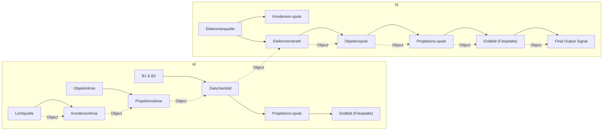

Die kleinste Frequenz, die gerade noch ausreicht, um Elektronen aus dem Metall freizusetzen, ohne ihnen also kinetische Energie mitzuteilen, nennt man **Grenzfrequenz** $f _ { \mathrm { G } }$ :

$$
h f _ {\mathrm{G}} - W _ {\mathrm{a}} = 0; \quad f _ {\mathrm{G}} = \frac {W _ {\mathrm{a}}}{h}. \tag {43.10}
$$

Der Photoeffekt tritt nicht nur bei den Metallen auf, sondern auch bei elektrisch nichtleitenden Stoffen und bei Gasen. Die Ablösearbeit $W _ { \mathbf { a } }$ ist bei ihnen größer als bei Metallen. Der Grund hierfür ist, dass $W _ { \mathbf { a } }$ sich im Allgemeinen aus zwei Anteilen zusammensetzt, der Ablösearbeit des Elektrons vom Atom (Ionisierungsenergie $E _ { \mathrm { i } } )$ und der Austrittsarbeit des Elektrons aus der Oberfläche des Körpers. Bei einem Gas entfällt der zweite Anteil, und es ist $W _ { \mathrm { a } } = E _ { \mathrm { i } }$ . Die Metalle haben dagegen freie Leitungselektronen, so dass bei ihnen $E _ { \mathrm { i } } = 0$ gesetzt werden kann und daher für den Photoeffekt lediglich die Austrittsarbeit aufgewandt werden muss. Dieselbe Austrittsarbeit ist z. B. auch bei der Aussendung von Elektronen durch glühende Körper (Thermoemission) erforderlich (vgl. RICHARDSON-Effekt in 27.2).

Nach (43.9) besteht zwischen der Spannung U des Gegenfeldes bzw. der Elektronenenergie eU und der Frequenz $f$ der Lichtquanten ein linearer Zusammenhang, der in Bild 43.2 dargestellt ist. Aus dem Abszissenabschnitt kann die Grenzfrequenz $f _ { \mathrm { G } }$ und aus ihr nach (43.10) die Austrittsarbeit $W _ { \mathbf { a } }$ für den betreffenden Stoff bestimmt werden. Der Anstieg der Geraden liefert die Größe des PLANCKschen Wirkungsquantums h.

line

| Frequency f \(( \times 10^14 s^-1)\) | Electron energy (eV) | Wavelength \((\lambda)\) |
| --- | --- | --- |
| ~5.5 | ~0.4 | 546 nm |
| ~6.9 | ~0.9 | 436 nm |
| ~7.3 | ~1.1 | 405 nm |
| ~8.2 | ~1.5 | 365 nm |
| ~9.6 | ~2.1 | 313 nm |
| ~11.8 | ~3.0 | 254 nm |

Bild 43.2 Abhängigkeit der Maximalenergie der Photoelektronen eU von der Frequenz $f$ des eingestrahlten Lichts (Millikan, 1916)

Da die Anzahl der Photoelektronen der Anzahl der absorbierten Quanten proportional ist, kann der Photoeffekt zur Messung von Lichtintensitäten genutzt werden. Man verwendet dazu sog. **Photozellen** (Bild 43.3). Diese bestehen aus einem hochevakuierten Quarzglasgehäuse (Röhre), in dem sich die mit dem negativen Pol einer Stromquelle verbundene Photokatode (K) mit einem Belag aus Natrium, Kalium oder Caesium und ihr gegenüber eine mit dem positiven Pol verbundene ringförmige Anode (A) befinden; Letztere fängt die aus K ausgelösten Photoelektronen auf. Über ein in den Stromkreis eingeschaltetes Galvanometer kann der Photostrom gemessen werden. Photozellen dienen als lichtelektrische Messwandler zur Überwachung und Regelung von lichtgesteuerten Vorgängen.

text_image

K
A
Licht
- - +

Bild 43.3 Prinzip der Photozelle mit Katode K und Anode A

## Beispiel 43.2:

Welche Geschwindigkeit hat ein Photoelektron $( m _ { \mathrm { e } } = 0 , 9 \cdot 1 0 ^ { - 3 0 }   \mathrm { k g } )$ , das durch Bestrahlung mit grünem Licht der Wellenlänge 500nm aus einer Caesium-Photokatode $( W _ { \mathrm { a } } = 1 , 8   \mathrm { e V } )$ freigesetzt wurde? (1 $\mathbf { e } \mathrm { V } \approx 1 { , } 6 \cdot 1 0 ^ { - 1 \bar { 9 } } \mathrm { J } . )$ 1

Lösung: Aus (43.9) f<u>olgt mit</u> $f = c / \lambda$ zunächst für die kinetische Energie $E_{\mathrm{k}} = h c / \lambda - W_{\mathrm{a}} \approx 0.7   \mathrm{eV}$ und hieraus $\nu = \sqrt { 2 E _ { \mathrm { k } } / m _ { \mathrm { e } } } \approx 5 0 0   \mathrm { k m / s }$ □

## Aufgabe

**43.1** Welches ist im obigen Beispiel 43.2 die Grenzfrequenz $f _ { \mathrm { G } }$ und die zugehörige Grenzwellenlänge?

## 43.3 Der Compton-Effekt

Als überzeugender Beweis für die korpuskulare Natur des Lichts kann die von COMPTON (1923) entdeckte Streuung von Photonen an (locker gebundenen) Elektronen angesehen werden. Wenn das Licht aus Teilchen besteht, so müssen bei einem Zusammenstoß mit frei beweglichen Elektronen auch für sie die aus der klassischen Mechanik bekannten Gesetze für den elastischen Stoß (vgl. 9.2) Gültigkeit haben, die aus den Erhaltungssätzen für Energie und Impuls folgen. Wegen der Kleinheit der Photonenmasse von normalem Licht im Vergleich zur Masse des Elektrons tritt ein solcher Austausch von Impuls und Energie beim Zusammenstoß allerdings nur bei sehr kurzwelligen und damit massereichen Photonen der RÖNTGEN- und Gammastrahlen merklich in Erscheinung.

chemical

Diagram of Compton electron interaction showing photon emission and electron transfer with mathematical formula

Bild 43.4 Compton-Effekt

text_image

hf
c
hf'
c
φ
e⁻
φ
hf
c
mₑv

Bild 43.5 Impulserhaltung beim Compton-Effekt

Trifft nach Bild 43.4 und 43.5 ein Photon der Frequenz $f$ auf ein ruhend gedachtes Elektron, so erhält dieses einen Impuls $m _ { \mathrm { e } } \nu$ und eine kinetische Energie $m _ { \mathrm { e } } \upsilon ^ { 2 } / 2$ , während das unter dem Winkel ϑ gestreute Photon seine Energie und infolgedessen auch seine Frequenz verringert $( f ^ { \prime } < f )$ . Die Energiebilanz lautet

$$
h f = h f ^ {\prime} + \frac {m _ {\mathrm{e}} v ^ {2}}{2} \tag {43.11}
$$

und die Impulsbilanz, wenn die Impulsvektoren von Photon und Elektron in Komponenten bezüglich der Einstrahlungsrichtung und der dazu senkrechten Richtung zerlegt werden,

$$
\frac {h f}{c} = \frac {h f ^ {\prime}}{c} \cos \vartheta + m _ {\mathrm{e}} \nu \cos \varphi \tag {43.12}
$$

$$
0 = \frac {h f ^ {\prime}}{c} \sin \vartheta - m _ {\mathrm{e}} \nu \sin \varphi . \tag {43.13}
$$

Da uns nur die Frequenz des Streulichts $f ^ { \prime }$ als Funktion der Streurichtung $\vartheta$ interessiert, eliminieren wir aus (43.12) und (43.13) den Winkel $\varphi$ und erhalten

$$
m _ {\mathrm{e}} ^ {2} v ^ {2} = \frac {h ^ {2}}{c ^ {2}} (f ^ {2} + f ^ {\prime 2} - 2 f f ^ {\prime} \cos \vartheta). \tag {43.14}
$$

Für nicht zu kurzwelliges Licht ist $f - f ^ { \prime } \ll f$ , so dass in (43.14) näherungsweise $f ^ { \prime }$ durch $f$ ersetzt werden darf; wir erhalten damit

$$
\frac {m _ {\mathrm{e}} v ^ {2}}{2} \approx \frac {h ^ {2} f ^ {2}}{m _ {\mathrm{e}} c ^ {2}} (1 - \cos \vartheta).
$$

Dies in (43.11) eingesetzt, ergibt als Energiebilanz

$$
h f = h f ^ {\prime} + \frac {h ^ {2} f ^ {2}}{m _ {\mathrm{e}} c ^ {2}} (1 - \cos \vartheta). \tag {43.15}
$$

Somit folgt für die Frequenzänderung des gestreuten Photons

$$
\Delta f = f ^ {\prime} - f = - \frac {h f ^ {2}}{m _ {\mathrm{e}} c ^ {2}} (1 - \cos \vartheta) = - \frac {2 h f ^ {2}}{m _ {\mathrm{e}} c ^ {2}} \sin^ {2} \frac {\vartheta}{2}
$$

und wegen $\lambda = c / f$ bzw. nach Differenziation $\Delta \lambda = - c \Delta f / f ^ { 2 } ;$

$$
\Delta \lambda = \frac {2 h}{m _ {\mathrm{e}} c} \sin^ {2} \frac {\vartheta}{2} = 2 \lambda_ {\mathrm{C}} \sin^ {2} \frac {\vartheta}{2} \quad \begin{array}{l} (\text {Wellenlängenänderung infolge} \\ \text {COMPTON - Streuung}) \end{array} \tag {43.16}
$$

mit der sog. COMPTON-Wellenlänge des Elektrons

$$
\lambda_ {\mathrm{C}} = \frac {h}{m _ {\mathrm{e}} c} = 2, 4 2 6   3 1 0 \cdot 1 0 ^ {- 1 2}   \mathrm{m}. \tag {43.17}
$$

Diese hat die Bedeutung der Wellenlänge derjenigen Strahlung, deren Lichtquant die träge Masse des Elektrons besitzt; denn es ist nach (43.5) die Masse des Lichtquants $m = h / ( \lambda _ { \mathrm { C } } c ) =$ $h m _ { \mathrm { e } } c / ( h c ) = m _ { \mathrm { e } }$

Obwohl Gleichung (43.16) unter vereinfachten Bedingungen hergeleitet wurde, kommt ihr strenge Gültigkeit zu; man erhält sie in dieser Form auch ohne jede Vernachlässigung und bei zusätzlicher Berücksichtigung der relativistischen Massenänderung des Elektrons.

Bei einer Spektraluntersuchung mit monochromatischer RÖNTGENstrahlung, die an einem Element mit kleiner relativer Atommasse (z. B. Graphit) gestreut wird, tritt neben der ungestreuten Linie eine zweite, genau um den durch (43.16) angegebenen Betrag zu größeren Wellenlängen verschobene Linie auf (COMPTON-Effekt). Aus dem Experiment kann die COMP-TON-Wellenlänge (43.17) und daraus bei Kenntnis des Wirkungsquantums $h$ die Ruhmasse des Elektrons bestimmt werden.

## 43.4 Rückstoß durch Quantenemission. Mößbauer-Effekt

Jede von einem Atom emittierte Spektrallinie hat hinsichtlich ihrer Frequenz bzw. Energie eine natürliche Unschärfe oder Eigenbreite $\Delta E ,$ die nach dem HEISENBERGschen Unbestimmtheitsprinzip (s. später in 43.6) durch die „mittlere Lebensdauer“ des betreffenden Zustandes (mittlere Verweilzeit des Elektrons in einem bestimmten Energiezustand des Atoms) gegeben ist.

Das gilt auch für die von angeregten Atomkernen emittierten γ-Strahlen, wobei die Eigenbreite der γ-Linien noch um mehrere Größenordnungen kleiner ist als die der schärfsten Atomspektrallinien. Während die relative Ungenauigkeit der Energie ∆E/E oder wegen $E = h f$ auch die der Frequenz $\Delta f / f$ bei sichtbaren Spektrallinien bestenfalls $1 0 ^ { - 1 0 }$ beträgt, liegt sie dagegen bei den γ-Quanten in der Größenordnung $1 0 ^ { - 1 3 }$ . Dementsprechend können von den Kernen auch nur γ-Quanten gleicher Schärfe absorbiert werden. Eine geringfügige Abweichung („Verstimmung“) der Frequenz eines von einem Kern emittierten γ-Quants, die über die Eigenbreite des betreffenden Zustandes hinausgeht, führt dazu, dass das Quant von einem anderen, gleichartigen Kern nicht mehr absorbiert oder zumindest die Wahrscheinlichkeit für die Absorption stark herabgesetzt wird.

Eine derartige „Verstimmung“ des γ-Quants kann schon durch den Rückstoß verursacht werden, den der Kern und damit nach dem Impulserhaltungssatz auch das Quant bei der Emission erfahren. Nach (43.1) und (43.5) sind den γ-Quanten wegen ihrer im Vergleich zum sichtbaren Licht etwa um den Faktor $1 0 ^ { 5 }$ größeren Frequenzen bzw. kleineren Wellenlängen sehr große Energie- und Impulsbeträge zuzuordnen, so dass bei ihrer Aussendung der Kern einen merklichen Rückstoß erfährt. Die kinetische Energie, die er dabei aufnimmt, entnimmt er der Energie des emittierten γ-Quants.

Der Impuls, den das Quant der Energie $E = h f$ beim Verlassen des Kerns der Masse $m _ { \mathrm { K } }$ auf diesen überträgt, ist nach (43.3) und (43.4) gleich $p = E / c$ . Damit ergibt sich nach der allgemeinen Beziehung zwischen kinetischer Energie und Impuls $E _ { \mathbf { k } } = p ^ { 2 } / ( 2 m )$ die **Rückstoßenergie des Kerns** zu

$$
(E _ {\mathrm{k}}) _ {\mathrm{K}} = \frac {E ^ {2}}{2 m _ {\mathrm{K}} c ^ {2}}. \tag {43.18}
$$

Das ist gerade der Betrag, um den die Quantenenergie E gegenüber dem Wert, der ohne Rückstoß zu erwarten wäre, verschoben ist, also

$$
\Delta E = \frac {E ^ {2}}{2 m _ {\mathrm{K}} c ^ {2}} \quad \begin{array}{l} (\text {Verschiebung der Quantenenergie durch} \\ \text {Rückstoß des emittierenden Kerns}). \end{array} \tag {43.19}
$$

So erhält man z. B. für die von den Kernen des Eisenisotops 57Fe emittierten γ-Quanten der Energie $E = 1 4 { , } 4$ keV für deren Verstimmung $\Delta E \approx 5 \cdot 1 0 ^ { - 3 }   \mathrm { e V }$ und für die relative Änderung $\Delta E / E \approx 4 \cdot 1 0 ^ { - 7 }$ . Dieser Wert liegt aber um mehrere Größenordnungen über der oben angegebenen Eigenbreite der Energieniveaus, deren genauer Wert in diesem Falle $3 \cdot { { 1 0 } ^ { - 1 3 } }$ ist. Die durch den Rückstoß bewirkte Verschiebung der Quantenenergie ist also so groß, dass die Quanten durch andere, gleichartige Kerne nicht mehr absorbiert werden.

1958 entdeckte MÖSSBAUER, dass der Rückstoß der Kerne zunichte gemacht wird, wenn das strahlende Atom in das Kristallgitter eines Festkörpers eingebaut ist. Der Rückstoß wird dann nicht mehr vom einzelnen Atom, sondern vom gesamten Kristall abgefangen. In (43.18) ist jetzt für $m _ { \mathrm { K } }$ nicht mehr die Masse des strahlenden Kerns, sondern die ungeheuer viel größere Masse des Kristalls einzusetzen, womit die Rückstoßenergie und damit die Verstimmung der emittierten Quanten praktisch auf unmessbar kleine Werte absinken. Voraussetzung hierfür ist jedoch u. a., dass der Kristall auf sehr tiefe Temperaturen (z. B. des flüssigen Wasserstoffs) abgekühlt wird und damit die thermischen Gitterschwingungen, die die Atome im Kristall ausführen, weitgehend „eingefroren“ werden. Auf diese Weise wird verhindert, dass eine Übertragung der Rückstoßenergie an das einzelne schwingende Atom stattfindet.

Ein auf diese Weise erzeugtes rückstoßfreies γ-Quant ist frei von der durch (43.19) ausgedrückten Verstimmung seiner Energie, und es wird daher eine Linie von außerordentlicher Schärfe, die nur durch die Eigenbreite des betreffenden Niveaus gegeben ist, registriert. Da das Quant nicht verstimmt ist, kann es von einem gleichen, nicht γ-aktiven Kern mit gleicher Schärfe (Selektivität) absorbiert werden (rückstoßfreie Resonanzabsorption).

Wegen der extremen Resonanzschärfe rückstoßfreier γ-Quanten kann der MÖSSBAUER-Effekt zur hochempfindlichen Messung kleinster Frequenzänderungen benutzt werden. Ist die Frequenz der zu vermessenden γ-Quanten durch irgendwelche Einflüsse ein wenig verstimmt, so dass diese von einem entsprechenden Absorber nicht mehr absorbiert werden, kann durch eine Bewegung des Strahlers relativ zum Absorber infolge DOPPLER-Effekt (vgl. 37.6) die Frequenzänderung kompensiert und auf diese Weise genau vermessen werden. Dazu reicht schon eine Relativgeschwindigkeit zwischen Strahler und Absorber von wenigen Zentimetern je Sekunde aus.

Eines der ersten Aufsehen erregenden Experimente mit Hilfe des MÖSSBAUER-Effekts war die mit herkömmlichen Methoden aussichtslose Messung der Frequenzänderung eines Lichtquants als Folge der Beeinflussung durch das Schwerefeld der Erde. So konnten POUND und REBKA (1960) mit Hilfe des Eisenisotops 57Fe als Strahlungsquelle am Fuß und einem entsprechenden Absorber an der Spitze eines 22,5m hohen Turms für diesen Höhenunterschied eine relative Frequenz- bzw. Energieabnahme des von der Quelle emittierten, gegen das Schwerefeld anlaufenden Strahlungsquants nachweisen, die genau dem relativen Zuwachs an potenzieller Energie $\Delta E _ { \mathrm { p } } = m g h$ ist, den das Photon der Masse $m = E / c ^ { 2 }$ beim „Anheben“ auf die Höhe $h = 2 2 ,$ 5m im Schwerefeld der Erde erfährt, nämlich $\Delta E _ { \mathrm { p } } / E =$ $m g h / ( m c ^ { 2 } ) = g h / c ^ { 2 } = 2 { , } 4 5 \cdotp 1 0 ^ { - 1 5 }$ (gravitative Rotverschiebung, vgl. 22.4). Beim $\mathrm { ,   F a l l ^ { \omega } }$ des Photons im Schwerefeld, wenn also Strahlungsquelle und Absorber vertauscht werden, gewinnt es diesen Energiebetrag, und es ergibt sich eine Frequenzverschiebung in umgekehrter Richtung. Indem die Experimentatoren die Strahlungsquelle einmal am Fuß und einmal an der Spitze des Turmes anbrachten, maßen sie insgesamt eine relative Frequenzverschiebung von $( 5 ,   1 \pm 0 ,   5 ) \cdot 1 0 ^ { - 1 5 }$ , in vorzüglicher Übereinstimmung mit dem theoretischen Wert $^ { 4 , 9 \cdot 1 0 ^ { - 1 5 } }$ . Damit war auf eindrucksvolle Weise bewiesen, dass auch die Lichtquanten dem Einfluss des Gravitationsfeldes unterliegen, wie es von EINSTEIN vorausgesagt wurde. Zugleich ist dies ein Beweis für die Gleichheit von schwerer und träger Masse; denn in der zuletzt angeschriebenen Gleichung steht im Zähler, der die potenzielle Energie enthält, die schwere und im Nenner nach den Ausführungen in Abschnitt 7.5 die träge Masse. Beide Massen dürfen aber nur unter der Voraussetzung ihrer Identität gegeneinander gekürzt werden, wie das hier getan wurde.

## 43.5 Die Wellennatur der Teilchen

Nachdem der Doppelcharakter (Dualismus) des Lichts durch den lichtelektrischen Effekt, den COMPTON-Effekt und andere Erscheinungen, die die korpuskulare Natur des Lichts einerseits und durch Beugungsexperimente, die die Wellennatur andererseits belegen, überzeugend bestätigt worden war, wurde bald darauf mit der Entdeckung der **Beugung von Elektronenstrahlen** an Kristallen durch DAVISSON und GERMER (1927) der Nachweis erbracht, dass Elektronen neben korpuskularen zugleich auch Welleneigenschaften besitzen. Das Bild 43.6 zeigt ein auf einer fotografischen Platte aufgenommenes Beugungsbild einer dünnen Metallfolie, die mit einem eng ausgeblendeten Elektronenbündel durchstrahlt wurde. Die Interferenzringe entsprechen den DEBYE-SCHERRER-Linien der RÖNTGENstrahlen-Interferenzen (vgl. Bild 41.13). Heute wissen wir, dass Strahlen von Mikroteilchen jeglicher Art, z. B. von Neutronen, Protonen und selbst von Atomen, die gleichen Beugungserscheinungen hervorrufen wie Licht oder RÖNTGENstrahlen.

natural_image

Concentric circular pattern with gradient shading (no text or symbols)

Bild 43.6 Beugung von Elektronen (100kV Beschleunigungsspannung) an einer Goldaufdampfschicht

Die Elektronenbeugungsversuche von DAVISSON und GERMER waren eine nachträgliche glänzende Bestätigung der bereits 1924 von DE BROGLIE aufgestellten kühnen Hypothese, wonach nicht nur den Photonen, sondern ausnahmslos allen Mikroobjekten ein Doppelcharakter eigen ist, indem diese einerseits Eigenschaften diskreter Teilchen, andererseits Welleneigenschaften annehmen. Damit wurde der Gegensatz zwischen Teilchen- und Wellenbild beseitigt und eine Vereinigung der beiden experimentell nachgewiesenen Erscheinungsformen nicht nur für das Licht, sondern auch für alle mit Ruhmasse behafteten Objekte herbeigeführt.

## Jedes Mikroteilchen (Photon, Elektron, Kernteilchen usw.) ist zugleich Korpuskel und Welle.

Die Wellenlänge der den Elektronen (oder anderen Teilchen) zugeordneten **Materiewelle** oder **Teilchenwelle** kann aus Beugungsdiagrammen bei bekannter Gitterkonstante des durchstrahlten Kristalls nach der für die Beugung von RÖNTGENstrahlen angegebenen Beziehung (41.30) bestimmt werden. Dabei zeigt sich, dass – wie von DE BROGLIE auf Grund theoretischer Überlegungen vorausgesagt – zwischen der Wellenlänge λ und dem Impuls $p = m v$ der Elektronen der gleiche Zusammenhang (43.5) besteht wie beim Licht zwischen Wellenlänge und Impuls der Photonen:

$$
\lambda = \frac {h}{p} = \frac {h}{m v} \quad (\textbf {D E - B R O G L I E - B e z i e h u n g}). \tag {43.20}
$$

λ wird **DE-BROGLIE-Wellenlänge** des Teilchens genannt. Bei schnell bewegten Teilchen muss in (43.20) für m deren relativistische Masse eingesetzt werden; nur für $\nu \ll c$ darf mit der Ruhmasse m0 gerechnet werden.

Die DE-BROGLIE-Wellenlänge ist bei den gewöhnlichen, makroskopischen Körpern außerordentlich klein; z. B. beträgt sie für ein Masseteilchen von 1g bei einer Geschwindigkeit von 1m/s größenordnungsmäßig $1 0 ^ { - 3 0 }   \mathrm { m }$ , für die bewegte Erdkugel $( m _ { 0 } \approx 6 \cdot 1 0 ^ { 2 4 }   \mathrm { k g } ,   \nu \approx 3 \cdot 1 0 ^ { 4 }   \mathrm { m } / \mathrm { s } )$ sogar nur $3 \cdot 1 0 ^ { - 6 3 }$ m! Daher macht sich bei solchen Körpern die Wellennatur nicht bemerkbar. Demgegenüber erhält man für ein Wasserstoffmolekül $( m _ { 0 } \approx 3   \cdot   1 0 ^ { - 2 7 }   \mathrm { k g } )$ , das sich bei $0   ^ { \circ } \mathbf { C }$ nach der kinetischen Gastheorie mit einer Geschwindigkeit von etwa $2 \cdot 1 0 ^ { 3 }   \mathrm { m / s }$ bewegt, eine DE-BROGLIE-Wellenlänge von der Größenordnung $1 0 ^ { - 1 0 } \mathrm { m }$ , d. h., sie stimmt mit den Abmessungen des Moleküls überein. Für Elektronen, die durch ein elektrisches Feld der Spannung U beschleunigt werden, gilt bei Vernachlässigung der relativistischen Massenänderung $( \nu < 0 ,   1 c )$ mit (43.20)

$$
\frac {m _ {\mathrm{e}} v ^ {2}}{2} = e U, \quad p = m _ {\mathrm{e}} v = \sqrt {2 e U m _ {\mathrm{e}}}, \quad \lambda = \frac {h}{\sqrt {2 e U m _ {\mathrm{e}}}}. \tag {43.21}
$$

Hiernach erhält man mit $m _ { \mathrm { e } } = 9 , 1 \cdot 1 0 ^ { - 3 1 }$ kg und $e = 1 { , } 6 \cdot 1 0 ^ { - 1 9 } \mathrm { A } \cdot \mathrm { s }$ für eine Beschleunigungsspannung von $U = 1 5 0 \mathrm { V }$ eine DE-BROGLIE-Wellenlänge der Elektronen von $\lambda = 10^{-10}    m  =$ 0,1nm. Diese Wellenlänge ist mit derjenigen weicher RÖNTGENstrahlen vergleichbar, was das Auftreten von Beugungserscheinungen bei der Durchstrahlung von Kristallen mit Elektronen verständlich macht.

Wir ersehen daraus, dass die Körper umso mehr ein „wellenmäßiges“ Verhalten zeigen, je mehr sich ihre DE-BROGLIE-Wellenlängen den Körperabmessungen annähern. Das ist im Bereich der Mikrophysik der Fall. In diesem Bereich der Elektronen, Atome und Moleküle sind die Gesetze der klassischen Mechanik ebenso wenig anwendbar wie die Gesetze der geometrischen Optik bei der Beschreibung der Lichtausbreitung, wenn die Abmessungen der Körper, gegen die das Licht anläuft, mit der Lichtwellenlänge vergleichbar werden (Beugung). So wie in diesem Fall die geometrische Optik durch die allgemeinere Wellenoptik ersetzt werden muss, ebenso muss daher im mikrophysikalischen Bereich die klassische Mechanik durch eine allgemeinere Mechanik, die **Wellenmechanik** oder **Quantenmechanik**, ersetzt werden (vgl. Kapitel 45).

Die Tatsache, dass Gleichung (43.20) nicht nur für Licht gilt (mit $\nu = c )$ , sondern auch für ruhmassebehaftete Teilchen, legt nahe, die Beziehung für die Energie einer Lichtwelle $E = h f$ auch für Materiewellen als gültig anzuerkennen. Ihre Verknüpfung mit dem Äquivalenzprinzip von Masse und Energie (7.21) ergibt

$$
h f = m c ^ {2}; \quad f = \frac {m c ^ {2}}{h}.
$$

Damit und mit (43.20) folgt als **Phasengeschwindigkeit der Materiewelle**

$$
u = f \lambda = \frac {m c ^ {2}}{h} \frac {h}{m v} = \frac {c ^ {2}}{v}. \tag {43.22}
$$

Wegen $\nu < c$ ist u stets $g r \ddot { o } \beta e r$ als die Vakuumlichtgeschwindigkeit. Lediglich für Photonen im Vakuum ist $v = c$ und damit $u = c .$ Das Ergebnis $u > c$ für stoffliche Teilchen bedeutet keinen Widerspruch zur Relativitätstheorie; denn das, was sich im vorliegenden Fall mit Überlichtgeschwindigkeit fortpflanzt, ist die Phase der dem Teilchen zugeordneten DE-BROGLIE-Welle und nicht die mit der Welle übertragene Energie. Die Relativitätstheorie fordert nur, dass jede mit Energie- bzw. Massentransport verbundene Geschwindigkeit, die physikalisch messbar ist, nicht größer sein darf als die Vakuumlichtgeschwindigkeit (vgl. 6.1 und 6.3).

Eine wichtige Anwendung der Erkenntnisse über die Wellennatur der Elektronen findet man im **Elektronenmikroskop**. Die Abbildung erfolgt hier durch Elektronenlinsen, in denen Elektronenstrahlen durch inhomogene, rotationssymmetrische elektrische oder magnetische Felder abgelenkt werden, analog zur Ablenkung von Lichtstrahlen in normalen optischen Linsen. Elektrische Linsen bestehen aus (im einfachsten Fall zwei) durchbohrten Kondensatorplatten, die je nach Polung als Sammel- oder Zerstreuungslinse wirken; magnetische Linsen sind stromdurchflossene Spulen, deren Magnetfeld durch die LORENTZ-Kraft die Elektronenstrahlen auf einer Schraubenbahn ablenkt.

Beim Durchstrahlungsverfahren (Bild 43.7) treten Elektronen aus einer Glühkatode aus, durchsetzen nach einer Bündelung im Kondensor das Objekt, werden dort gebeugt oder absorbiert, durchlaufen die Objektiv- und Projektionslinse und treffen schließlich auf einen Leuchtschirm. Das erhaltene Bild wird meist noch optisch nachvergrößert. Da das Elektronenmikroskop der durch die Beugung bedingten Begrenzung des Auflösungsvermögens des Lichts (vgl. 41.5) im verwendeten Vergrößerungs bereich nicht unterliegt, können damit Vergrößerungen in unverzerrter, ähnlicher Abbildung hergestellt werden, deren Abbildungsmaßstab den der Lichtmikroskope um fast zwei Zehnerpotenzen übertrifft. Da das Auflösungsvermögen eines Mikroskops mit kleiner werdender Wellenlänge zunimmt, ist dieses beim Elektronenmikroskop wegen der gegenüber der Lichtwellenlänge sehr viel kleineren DE-BROGLIE-Wellenlänge der Elektronen erheblich größer als beim Lichtmikroskop. Die gerätetechnische Ausführung heutiger Elektronenmikroskope (insbesondere die Korrektur der Abbildungsfehler und die Stabilität der elektronischen Schaltungen zur Erzeugung der Beschleunigungsspannung sowie der Magnetfelder der Linsen) erlaubt eine Auflösung von Strukturen bis $\mathbf { z } \mathbf { u } \approx \widetilde { 1 0 ^ { - 1 0 } } \widetilde { \mathbf { m } }$

flowchart

Bild 43.7 Strahlengang im lichtoptischen Durchlichtmikroskop (a) und Durchstrahlungs-Elektronenmikroskop (b)

## 43.6 Das heisenbergsche Unbestimmtheitsprinzip (Unschärferelation)

In der klassischen Mechanik kann den Teilchen (Punktmassen) zu jeder beliebigen Zeit ein bestimmter Ort und ein wohldefinierter Impuls zugeordnet werden, die zusammen den $\mathbf { , } \mathbf { Z u } \mathbf { \cdot }$ stand“ des Teilchens charakterisieren. Sind zusätzlich die auf das Teilchen wirkenden Kräfte in Abhängigkeit von Ort und Zeit bekannt, so kann der raumzeitliche Bewegungsablauf (die Flugbahn) des Teilchens prinzipiell berechnet werden (vgl. 4.6). 1927 zeigte HEISENBERG, dass dies für Mikroteilchen (Lichtquanten, Elektronen u. a.) keineswegs zutrifft. Für diese ist es prinzipiell unmöglich, mit den herkömmlichen Begriffen der klassischen Mechanik den Bewegungsablauf exakt zu beschreiben. Wir wollen dies im Folgenden an einem speziellen, von HEISENBERG selbst angeführten Beispiel, der Beugung eines Mikroteilchens am Spalt, verdeutlichen.

Lässt man Mikroteilchen durch einen schmalen Spalt der Breite $\Delta x$ hindurchtreten (Bild 43.8), so werden sie, da sie Welleneigenschaften besitzen, gebeugt. Nach der Wellentheorie gilt für die Lage des unter dem Winkel α auftretenden 1. Beugungsminimums die Gleichung (41.13)

$$
\sin \alpha = \frac {\lambda}{\Delta x}. \tag {43.23}
$$

text_image

Maximum
1.0rdnung
1.Minimum
Maximum
0.0rdnung
1.Minimum
Maximum
1.0rdnung
Δx
Δp
p

Bild 43.8 Zum heisenbergschen Unbestimmtheitsprinzip: Beugung von Mikroteilchen beim Durchgang durch einen Spalt

Im Teilchenbild gesehen bedeutet die Beugung, dass nicht alle Teilchen mit dem Impuls p unabgelenkt durch den Spalt hindurchgehen, sondern dass ein Teil von ihnen eine seitliche Ablenkung von unterschiedlicher Größe erleidet, und zwar bevorzugt in denjenigen Richtungen, unter denen auf dem dahinter stehenden Schirm Beugungsmaxima auftreten. Betrachten wir nur die in den Bereich des Maximums 0. Ordnung fallenden Teilchen, so erfahren diese eine maximale seitliche Impulsänderung von

$$
\Delta p = p \tan \alpha \approx p \sin \alpha \quad (\alpha \text {ist sehr klein}).
$$

Fassen wir nun $\Delta p$ als Betrag der mittleren Impulsänderung aller auf dem Schirm ankommenden Teilchen auf, so erhält man durch Einsetzen von sin $\alpha = \Delta p / p$ in Gleichung (43.23) $\Delta p \Delta x \approx \lambda p$ und mit der DE-BROGLIE-Beziehung $\lambda = h / p ;$

$$
\Delta p \Delta x \approx h \quad (\text {HEISENBERGsche Unschärferelation}). \tag {43.24}
$$

Hierbei ist die Spaltbreite $\Delta x$ als „Unbestimmtheit“ oder „Unschärfe“ der augenblicklichen Lage des Teilchens beim „Passieren“ des Spalts aufzufassen und $\Delta p$ als Unbestimmtheit (Unschärfe) der x-Komponente des Teilchenimpulses. Eine genauere Untersuchung ergibt anstelle von (43.24) $\Delta p   \Delta x \geq h / ( 4 \pi )$ . Diese Gleichung besagt, dass niemals Ort und Impuls eines Mikroteilchens genau bekannt sein können. Soll sich das Teilchen innerhalb des räumlichen Intervalls $\Delta x$ aufhalten, so kann sein Impuls nur mit einer Unsicherheit $\Delta p$ angegeben werden, wie sie aus (43.24) folgt.

**HEISENBERGsches Unbestimmtheitsprinzip (Unschärferelation):** Das Produkt aus der Unbestimmtheit $\Delta p$ des augenblicklichen Impulses eines Teil**chens und der Unbestimmtheit ∆x seiner augenblicklichen Ortskoordinate ist mindestens von der Größenordnung des PLANCKschen Wirkungsquantums h.**

Das heißt, jede Steigerung der Genauigkeit in der Ortsbestimmung eines Teilchens (Verkleinerung von $\Delta x )$ geht stets auf Kosten der Genauigkeit in der Impulsbestimmung und umgekehrt. Gleichzeitig ergibt sich daraus, dass der Bahnbegriff im mikrophysikalischen Bereich ohne physikalischen Sinn ist; denn er setzt gerade die gleichzeitige exakte Messbarkeit von Ort und Impuls voraus.

Die aus dem Unbestimmtheitsprinzip folgende Messbarkeitsbeschränkung der beiden Größen Ort und Impuls hat nichts mit der praktischen Messungenauigkeit (Unzulänglichkeit der Messinstrumente, mangelndes Geschick der Beobachter) zu tun. Vielmehr bringt die Gleichung (43.24) die charakteristische, objektiv reale Eigenschaft mikrophysikalischer Objekte zum Ausdruck, wonach Wechselwirkungen zwischen den Messapparaturen und den Messobjekten im Bereich der Mikrophysik nicht vernachlässigt werden dürfen.

Es sei hier nur vermerkt, dass eine zu (43.24) analoge Beziehung zwischen der Unbestimmtheit der Energie eines Teilchens ∆E und der Zeitdauer für die Energiemessung ∆t besteht:

$$
\Delta E \Delta t \approx h \quad (\text {Energie - Zeit - Unschärferelation}); \tag {43.25}
$$

d. h., je größer die Messzeit, desto genauer ist die Energie des Teilchens (und damit auch seine Masse $m = E / c ^ { 2 } )$ festgelegt.

Das HEISENBERGsche Unbestimmtheitsprinzip, welches ein allgemein gültiges Prinzip der Quantenmechanik darstellt, steht im völligen Widerspruch zur Bewegungsauffassung der klassischen Mechanik, da sie die dort vorherrschende Ursache-Wirkung-Beziehung im Bereich des atomaren Geschehens ausschließt und somit dem klassischen Kausalitätsprinzip der Physik widerspricht. Die Bewegung eines Körpers ist in der klassischen Mechanik charakterisiert durch Ort und Impuls zu einem bestimmten Zeitpunkt, woraus sich mit Hilfe der NEWTONschen Bewegungsgesetze eindeutig der künftige Bewegungszustand des Körpers, d. h. Ort und Impuls zu einem späteren Zeitpunkt, voraussagen lässt (Beispiel: Gesetze der Planetenbewegung). Nach dem Unbestimmtheitsprinzip ist aber eine genaue Festlegung von Ort und Impuls eines Mikroteilchens nicht möglich.

Der mechanische Determinismus, der die strenge Vorausberechenbarkeit aller zukünftigen Zustände eines Körpers als notwendiges und hinreichendes Kriterium für das Vorhandensein kausaler Zusammenhänge beinhaltet, schließt den Zufall völlig aus. Aber gerade die Anerkennung des objektiv existierenden Zufalls, wie er sich z. B. in der Unmöglichkeit der Vorhersage der Flugbahn eines Mikroteilchens nach dem Durchgang durch einen Beugungsspalt zeigt, ist ein wesentliches Merkmal der neuen Determinismusauffassung, welche die Einheit von dynamischen und statistischen Gesetzen zum Inhalt hat. Anstelle des Kausalzusammenhangs der klassischen Mechanik tritt daher in der Quantenmechanik eine „statistische Kausalität“, d. h. Gesetze von statistischem Charakter, die nur über eine große Anzahl von Mikroprozessen etwas aussagen.

## Beispiele 43.3:

1. Die Lage eines Teilchens der Masse 1g soll auf 1 µm genau festgelegt werden. Wie groß ist dann die Unbestimmtheit seiner Geschwindigkeit?

Lösung: Mit dem Teilchenimpuls $p = m v$ folgt aus (43.24) $m \Delta \nu   \Delta x \approx h$ und hieraus $\Delta \nu$ ≈ $h / ( m \Delta x ) = 6 . 6 \cdot 1 0 ^ { - 2 5 }   \mathrm { m / s }$ . Eine solche Ungenauigkeit in der Geschwindigkeit liegt weit außerhalb der Grenzen der Messmöglichkeit. Bei makroskopischen Körpern spielt also das Unbestimmtheitsprinzip keine Rolle.

2. Eine der Konsequenzen, die sich aus dem Unbestimmtheitsprinzip (43.24) ergeben, ist die Tatsache, dass ein Elektron, welches sich nur in einem endlichen Raumbereich aufhalten kann, auch am absoluten Nullpunkt, wo ihm keine thermische Energie zugeführt wird, notwendigerweise eine von null verschiedene kinetische Mindestenergie, die **Nullpunktsenergie**, haben muss, d. h. also niemals in Ruhe sein kann. Denn würde das Elektron ruhen, hätte es eine bestimmte Koordinate x, und die Unbestimmtheit in der Ortsangabe $\Delta x$ wäre null. Das aber würde bedeuten, dass ein Zustand existiert, in dem sowohl die Lage des Teilchens als auch der Impuls genau bestimmt sind. Dies widerspricht jedoch dem Unbestimmtheitsprinzip.

Bestimme die Geschwindigkeit und daraus die Nullpunktsenergie für ein Elektron, das „gezwungen“ ist, sich auf einer endlichen Strecke der Länge $L = 1 0 ^ { - 1 0 }   \mathrm { m }$ (Größenordnung des Atomdurchmessers) zu bewegen!

Lösung: Aus (43.24) folgt mit $\Delta x = L$ und $\Delta p = \Delta ( m _ { \mathrm { e } } \nu ) = m _ { \mathrm { e } } \Delta \nu$ für die Mindestgeschwindigkeit $\Delta \nu \approx h / ( m _ { \mathrm { e } } L )$ . Damit wird die Nullpunktsenergie $E _ { 0 } = m _ { \mathrm { e } } ( \Delta \nu ) ^ { 2 } / 2 \approx h ^ { 2 } / ( 2 m _ { \mathrm { e } } L ^ { 2 } )$ . Mit dem angegebenen Wert für L und $m _ { \mathrm { e } } = 9 . 1 \cdot 1 0 ^ { - 3 1 }$ kg sowie $h = 6 { , } 6 2 6 \cdot 1 0 ^ { - 3 4 } \mathrm { J } \cdot$ s erhält man $\Delta \nu \approx 7 { , } 3   \cdot   1 0 ^ { 6 }   \mathrm { m } / \mathrm { s }$ und $E _ { 0 } \approx 2 . 4 \cdot 1 0 ^ { - 1 7 } \mathrm { J } = 1 5 0   \mathrm { e V } .$ □

## 44.1 Die Streuexperimente von Lenard und Rutherford. Das rutherfordsche Atommodell

Anfang des vorigen Jahrhunderts lag umfangreiches experimentelles Material vor, das Aufschlüsse über Größe und Bau der Atome zuließ. Dazu gehören neben spektroskopischen Daten vor allem die Ergebnisse von **Streuexperimenten** mit Elektronen (LENARD, 1903) und mit α- Teilchen (RUTHERFORD, 1911) an dünnen Metallfolien. LENARD schoss Elektronen, die in einer Gasentladungsröhre erzeugt wurden, auf Metallfolien (Dicke etwa 1 µm) und untersuchte die Absorption der Elektronen beim Durchgang durch die Folien in Abhängigkeit von der Foliendicke, der Art des Folienmaterials und der Geschwindigkeit der Elektronen. Dabei kam er zu dem Ergebnis, dass die Atome über den von ihnen beanspruchten Raum nicht homogen mit Masse ausgefüllt sind, sondern sehr „luftige“ Gebilde sind. Ihr Radius wurde zu $1 0 ^ { - 1 0 }$ bis $1 0 ^ { - 9 }$ m abgeschätzt. Nur ein geringer Teil des Atoms erwies sich für schnelle Elektronen (Beschleunigungsspannungen von etwa $1 0 ^ { 4 } \mathrm { V ) }$ als undurchdringlich. Für den Durchmesser des undurchdringlichen Teils ergab sich die Größenordnung $1 0 ^ { - \bar { 1 } 4 }$ m. Nach unseren heutigen Kenntnissen handelt es sich bei diesem Teil des Atoms um den Atomkern.

Angeregt durch die Experimente LENARDS untersuchten RUTHERFORD und seine Schüler GEIGER und MARSDEN die Streuung von α-Teilchen, d. h. die Ablenkung, die diese Teilchen beim Durchgang durch eine dünne Goldfolie erfahren. Bei den α-Teilchen handelt es sich um Helium-Ionen mit doppelt-positiver Elektronenladung, wie sie von natürlich-radioaktiven Elementen wie Radium oder Polonium ausgesandt werden (vgl. 48.1). Es zeigte sich, dass die meisten α-Teilchen die Folie ohne wesentliche Ablenkung durchdringen; nur wenige von ihnen erfahren starke Richtungsänderungen, ja sogar Rückstreuungen, woraus RUTHERFORD folgerte, dass im Innern der Atome sehr kleine, positiv geladene und massereiche Zentren, die Atomkerne, existieren, durch welche die gleichfalls positiv geladenen α-Teilchen infolge der gegenseitigen elektrostatischen Abstoßung auf hyperbolischen Bahnen abgelenkt werden (Bild 44.1). Sehr starke Ablenkungen (entsprechend großen Streuwinkeln) erfahren nur jene Teilchen, die dem Kern sehr nahe kommen. Die Tatsache, dass um 180◦abgelenkte α-Teilchen beinahe ohne Geschwindigkeitsverluste reflektiert werden, bedeutet nach den Gesetzen des elastischen Stoßes, dass die Kernmasse gegenüber der Masse des α-Teilchens sehr groß sein muss.

Im Falle eines zentralen Stoßes mit dem Kern kann das α-Teilchen bis auf einen minimalen Abstand $R _ { \mathrm { m i n } }$ gegen das COULOMB-Potenzial des Kerns anlaufen, bevor es reflektiert wird. Dabei wird seine gesamte kinetische Energie $E _ { \alpha }$ aufgebraucht. Durch Gleichsetzen von $E _ { \alpha }$ mit dem Gewinn an potenzieller Energie beim kleinsten Kernabstand ergibt sich nach dem COU-LOMBschen Gesetz $E _ { \alpha } = ( z Z e ^ { 2 } ) / ( 4 \pi \varepsilon _ { 0 } R _ { \mathrm { m i n } } )$ mit den Ordnungszahlen im Periodensystem der Elemente $z = 2$ für das α-Teilchen und Z für den Kern. Danach können sich die energiereichsten α-Strahlen z. B. des Poloniums $( E _ { \alpha } \approx 7 \mathrm { M e V } )$ den Kernen der Goldatome $( Z = 7 9 )$ bis auf

$R _ { \mathrm { m i n } } \approx 3 \cdot 1 0 ^ { - 1 4 }$ m nähern. Dies ist zugleich die Größenordnung des Kernradius (vgl. das Rechenbeispiel 2 in Abschnitt 23.7).

Bild 44.1 Ablenkung von α-Teilchen im Coulomb-Feld des Atomkerns a) beim Durchgang durch eine Metallfolie; b) bei Annäherung an einen Kern (1 kernnaher „elastischer Stoß“, 2 kernfernere Wechselwirkung)

Aus den Experimenten konnte insgesamt geschlussfolgert werden:

**Der Atomkern ist positiv geladen und vereinigt in sich fast die gesamte Masse des Atoms. Sein Radius beträgt etwa** $\mathbf { 1 0 ^ { - 1 4 } }$ **m, der des gesamten Atoms etwa 10-1**<strong>0</strong> **m.**

Hiernach muss man schließen, dass das Atom weitgehend „leer“ ist. Die Streuversuche erlauben zugleich auch die Bestimmung der **Kernladungszahl** Z (in Vielfachen der Elementarladung e ausgedrückte Kernladung) der streuenden Atome (CHADWICK, 1920). Es ergab sich:

**Die Kernladungszahl ist gleich der Ordnungszahl des betreffenden Elements im Periodensystem.**

Da das Atom als Ganzes elektrisch neutral ist, wird der Atomkern von ebenfalls Z Elektronen, die je eine negative Elementarladung e tragen, umgeben. Diese Elektronen bilden die negativ geladene Atomhülle. Dass Elektronen Bausteine der Atome sind, folgt auch daraus, dass man die Atome ionisieren, d. h. Elektronen von ihnen abspalten kann.

**Die Anzahl der Elektronen in der Atomhülle eines neutralen Atoms ist gleich der Kernladungszahl.**

Diese Erkenntnisse führten RUTHERFORD zu einer modellmäßigen Vorstellung vom Bau der Atome (Atommodell). Da die Elektronen der Hülle wegen der elektrischen Anziehung zwischen Kern und Elektron unmöglich ruhen können, nahm er an, dass sie den Kern umkreisen, ähnlich wie die Planeten die Sonne (Planetenmodell des Atoms). Dieses Modell widerspricht aber in einem wesentlichen Punkt der klassischen Elektrodynamik, nach der diese Elektronen als beschleunigt bewegte elektrische Ladungen Oszillatoren darstellen, die durch Abstrahlung von elektromagnetischen Wellen – in diesem Falle Licht – dauernd Energie verlieren müssten. Die Elektronenbahnen würden schrumpfen, und die Umlauffrequenz, die in diesem Falle gleich der Frequenz des ausgestrahlten Lichts ist, müsste mit Annäherung der Elektronen an den Kern stetig zunehmen (3. KEPLERsches Gesetz). Das käme einem kontinuierlichen Spektrum mit stetig veränderlicher Wellenlänge gleich. Tatsächlich aber senden die Atome Spektren aus, die aus einzelnen (diskreten) Spektrallinien bestehen (Linienspektrum). Das RUTHERFORDsche Atommodell erwies sich also in dieser Form für die Erklärung der Atomspektren als nicht geeignet. Dennoch bildet dieses **Kern-Hülle-Modell** den Ursprung aller modernen Theorien vom Atombau.

## 44.2 Das Spektrum des Wasserstoffatoms

Die augenfälligste Erscheinung, die von den Atomen ausgeht, ist die Ausstrahlung von Licht. Wird das von einem Körper ausgesandte Licht mittels eines Prismen- oder Gitterspektrographen (vgl. 41.7) in seine Farbanteile zerlegt, so erhält man das für die betreffende Atomart charakteristische **Spektrum**. Während glühende Flüssigkeiten und Festkörper sowie Gase unter hohem Druck ein kontinuierliches Spektrum aussenden, in dem innerhalb eines gewissen Bereiches alle Frequenzen bzw. Wellenlängen vorkommen (Regenbogenspektrum), emittieren zum Leuchten angeregte einatomige Gase ein **Linienspektrum** mit einzelnen, getrennt voneinander liegenden Spektrallinien. Wir richten im Folgenden unser Augenmerk auf die Deutung dieser Linienspektren, da sie uns nähere Aufschlüsse über den Bau eines Atoms geben können.

Von allen Atomen sendet atomarer Wasserstoff das einfachste Spektrum aus. Als Beispiel eines teilweise im sichtbaren Spektralbereich liegenden Linienspektrums des H-Atoms ist in Bild 44.2 die sog. **BALMER-Serie** schematisch dargestellt. Wir bemerken einzelne mit $\mathrm { H } _ { \alpha } ,   \mathrm { H } _ { \beta } ,   \mathrm { H } _ { \gamma } ,$. . . bezeichnete Linien, die mit abnehmender Wellenlänge, d. h. mit zunehmender Frequenz, immer näher aneinander rücken und bei einer bestimmten Grenze, der sog. Seriengrenze, eine Häufungsstelle haben. BALMER ist es 1885 gelungen, die Frequenzen der Spektrallinien dieser Serie durch die empirische Formel

$$
f = R _ {\mathrm{H}} \left(\frac {1}{2 ^ {2}} - \frac {1}{m ^ {2}}\right) \quad (\text {Frequenzen der BALMER - Serie}) \tag {44.1}
$$

zu beschreiben, wobei für die ersten vier Linien, die im sichtbaren Teil des Spektrums liegen, $m = 3 , 4 , 5 ,$ 6 zu setzen ist. $R _ { \mathrm { H } }$ ist die **RYDBERG-Frequenz**; ihr Wert ergibt sich aus experimentellen Daten für alle Spektralserien des Wasserstoffs $( \mathbf { s } , \mathbf { u } . )$ zu $R _ { \mathrm { H } } = 3 , 2 8 9   8 4 2 \cdot 1 0 ^ { 1 5 }   \mathrm { s } ^ { - 1 }$

other

| Wavelength Range (nm) | Transition |
| --- | --- |
| 390~410 | \(H\zeta\) |
| 410~430 | \(H\epsilon\) |
| 430~480 | \(H\delta\) |
| 480~490 | \(H\gamma\) |
| 490~650 | \(H\beta\) |
| 650~660 | \(H\alpha\) |

Bild 44.2 Linienspektrum der Balmer-Serie des Wasserstoffs

Mit der weiteren Vervollkommnung der Geräte zum spektrografischen Nachweis auch solcher Linien, die nicht im sichtbaren Spektralbereich liegen, fanden später andere Forscher weitere Wasserstoffserien, die sich sämtlich durch eine zu Gleichung (44.1) analoge Beziehung, die **Serienformel des Wasserstoffspektrums**

$$
f = R _ {\mathrm{H}} \left(\frac {1}{n ^ {2}} - \frac {1}{m ^ {2}}\right), \quad m > n; m \text {und} n \text {ganzahlig}, \tag {44.2}
$$

beschreiben lassen. So erhält man, indem $n = 1$ und für die Laufzahl m der Reihe nach 2, 3, 4,. . . gesetzt wird, die Frequenzen der **LYMAN-Serie** im Ultraviolett (entdeckt 1906), deren erste Linie bei der Wellenlänge $\lambda = c / f = 121  ,  6   nm$ liegt. Mit $n = 2$ und $m = 3 ,   4 ,   5 ,   . .$ . erhält man die **BALMER-Serie** (44.1); ihre Linien liegen im Rot $( \mathrm { H } _ { \alpha } )$ , im Grün $( \mathrm { H } _ { \mathrm { \beta } } )$ , im Blau $( \mathrm { H } _ { \mathrm { Y } } )$ usw. Als weitere Serien des Wasserstoffs ergeben sich mit $n = 3$ als Festzahl die **PASCHEN-Serie** (1908), deren Linien im nahen Infrarot liegen, für $n = 4$ die BRACKETT-Serie (1922) und für $n = 5$ die **PFUND-Serie** (1924), beide im Infrarot. Viel später wurde noch eine weitere Serie mit $n = 6$ gefunden; ihre erste Linie $( m = 7 )$ liegt bei der Wellenlänge 11,7 µm.

Die Serienformel (44.2) gilt nicht nur für die Emission, sondern auch für die Absorption von Licht, das von außen her auf das Atom trifft. Fällt ein Lichtquant irgendeiner beliebigen Frequenz auf das Atom, so übt es im Allgemeinen keinerlei Wirkung aus. Stimmt seine Frequenz aber mit einer solchen überein, die das Atom gemäß (44.2) selbst aussenden kann, so wird die Energie des Quants absorbiert, indem das Atom aus seinem energieärmsten Zustand mit $n = 1$ , dem **Grundzustand**, in einen energiehöheren **angeregten Zustand** übergeht (Resonanzabsorption).

bar

| State | Energy Level (eV) |
| --- | --- |
| n | -13.6 |
| m | -10 |
| n | -4 |
| m | -2 |
| n | 0 |
| m | -1 |
| n | 0 |
| m | -1 |
| n | 0 |
| m | -1 |
| n | 0 |
| m | -1 |
| n | 0 |
| m | -1 |
| n | 0 |
| m | -1 |
| n | 0 |
| m | -1 |
| n | 0 |
| m | -1 |
| n | 0 |
| m | -1 |
| n, m | -13.6 |
| RH / \(1^{2}\) Grundzustand | -13.6 |
| RH / \(2^{2}\) | -2 |
| RH / \(3^{2}\) | -3 |
| RH / \(4^{2}\) | -4 |
| RH / \(1^{2}\) | -13.6 |

Bild 44.3 Termschema des Wasserstoffatoms

Die verschiedenen Anregungszustände eines Atoms pflegt man in übersichtlicher Weise im sog. **Termschema** darzustellen. Die Energie des ausgestrahlten Lichtquants entstammt der Änderung der „inneren Energie“ des Atoms, die sich mit (44.2) in der Form

$$
h f = \frac {h R _ {\mathrm{H}}}{n ^ {2}} - \frac {h R _ {\mathrm{H}}}{m ^ {2}} = h (T _ {n} - T _ {m}) = E _ {m} - E _ {n} \tag {44.3}
$$

schreibt. Der Ausdruck $E _ { n } = - h R _ { \mathrm { H } } / n ^ { 2 } = - h T _ { n }$ wird als **Energieterm** bezeichnet; er kennzeichnet einen möglichen diskreten Energiezustand des Atoms. Der Ausdruck $T _ { n } = - E _ { n } / h = R _ { \mathrm { H } } / n ^ { 2 }$ heißt **Frequenzterm**. Nach (44.3) wird eine Spektralserie stets durch zwei Frequenzterme beschrieben, nämlich durch den konstanten Term $T _ { n }$ , der die betreffende Serie kennzeichnet, und den mit m veränderlichen Term $T _ { m }$ (Laufterm), der mit wachsendem m immer kleiner werdende Werte annimmt und schließlich für m → ∞ dem Grenzwert null zustrebt. Jeder Differenz zweier Terme $T _ { n } - T _ { m } = f$ entspricht somit eine bestimmte Spektrallinie (RITZsches Kombinationsprinzip).

Bild 44.3 zeigt das Termschema des Wasserstoffs. Auf der rechten Seite der Darstellung sind auf der Ordinate die Frequenzterme $T _ { n }$ aufgetragen. Sie entsprechen denjenigen Energien, die erforderlich sind, um das Atom aus dem Grundzustand $n = 1$ auf ein höheres Energieniveau anzuheben. Dem Grundzustand kommt die Energie $E _ { 1 } = - h R _ { \mathrm { H } } = - 1 3 { , } 6   \mathrm { e V   z u }$ , dem Zustand $n \to \infty$ die Energie $E _ { \infty } = 0$ . Weitere Erläuterungen s. Abschnitt 44.3.

## 44.3 Das bohrsche Atommodell

N. BOHR (1913) erkannte als Erster die Notwendigkeit, die Gesetze der klassischen Physik in einschneidender Weise abzuändern, um – ausgehend vom RUTHERFORDschen Atommodell – zu einem Modell für ein stabiles Atom zu gelangen, das in der Lage ist, die Linienspektren einfach gebauter Atome zu erklären. Obwohl die BOHRsche Theorie vom heutigen Standpunkt überholt ist, da sie eine merkwürdige Mischung von klassischer Mechanik und Begriffen der Quantentheorie darstellt und aus diesem Grunde logisch nicht befriedigend ist, wird sie we gen ihrer großen Anschaulichkeit und ihrer Erfolge, die sie bei der quantitativen Beschreibung der Energiezustände des Wasserstoffatoms zweifellos aufweisen kann, auch heute noch häufig benutzt.

text_image

E₃ - E₂ = hf
3
2
n = 1
E₃
E₂
rₙ
+ Ze
r
e⁻
Coulombkraft
Ze²/(4πε₀r²)
Fliehkraft
mω²r

Bild 44.4 Bohrsches Atommodell

Nach BOHR soll sich das negative Elektron um den Z-fach positiv geladenen Kern auf Kreisbahnen bewegen (Bild 44.4), wobei sich elektrostatische Anziehungskraft (COULOMB-Kraft (23.27) mit $q = e$ und $Q = Z e )$ und Zentrifugalkraft (5.6) das Gleichgewicht halten:

$$
\frac {Z e ^ {2}}{4 \pi \varepsilon_ {0} r ^ {2}} = \frac {m _ {\mathrm{e}} v ^ {2}}{r} \tag {44.4}
$$

$( m _ { \mathrm { e } }$ Elektronenmasse, v Elektronengeschwindigkeit auf der Kreisbahn mit dem Radius r ). Die Stabilität des Atoms sowie das Auftreten diskreter Energieniveaus im Atom werden im BOHRschen Modell durch einige Zusatzforderungen erzwungen, die der klassischen Mechanik und Elektrodynamik fremd sind. Es sind dies die folgenden zwei **BOHRschen Postulate**:

1. Von allen klassisch möglichen Elektronenbahnen sind nur diejenigen als erlaubt anzusehen (auf denen die Elektronen strahlungsfrei kreisen können), für die der Betrag des Drehimpulses |l| der Elektronen ein ganzzahliges Vielfaches des Drehimpulsquantums $\hbar = h / ( 2 \pi )$

(PLANCKsches Wirkungsquantum h geteilt durch 2π) ist:

$$
| \boldsymbol {l} | = m _ {\mathrm{e}} v r = n \frac {h}{2 \pi} = n \hbar \quad \text {(BOHRsche Quantenbedingung).} \tag {44.5}
$$

$n = 1 , 2 , 3 , \ldots$ heißt Quantenzahl oder (im Hinblick auf später noch einzuführende weitere Quantenzahlen) genauer **Hauptquantenzahl**; durch sie wird die jeweilige Kreisbahn festgelegt.

2. Das Elektron kann von einer Bahn auf eine andere „springen“ (Quantensprünge). Bei Anregung durch Stöße oder durch Absorption eines Lichtquants springt das Elektron in eine Bahn höherer Energie. $\mathrm { ,   F \ddot { a } l l t ^ { a } }$ es von einer Bahn höherer Energie $E _ { m }$ (der Index m steht hier ebenfalls für eine Quantenzahl) auf eine Bahn niedrigerer Energie $E _ { n }$ , so wird vom Atom ein Lichtquant ausgestrahlt, dessen Energie $h f$ mit der Energiedifferenz zwischen Anfangsund Endzustand des Elektrons übereinstimmt (Bild 44.4):

$$
E _ {m} - E _ {n} = h f \quad (\text {BOHRsche Frequenzbedingung}). \tag {44.6}
$$

Damit erhalten die zunächst formalen Spektralterme $T _ { n } = - E _ { n } / h$ in (44.3) eine einfache Interpretation; sie entsprechen mithin den diskreten Energiezuständen, in denen sich die Elektronen im Atom befinden können.

Bild 44.5 Franck-Hertz-Versuch: a) Versuchsaufbau, b) Versuchsergebnis

Eine wesentliche Stütze erhielten die BOHRschen Postulate 1913 durch den experimentellen Nachweis der diskreten Energieniveaus im **FRANCK-HERTZ-Versuch** (Bild 44.5): In einer mit Quecksilberdampf gefüllten Vakuumröhre werden mittels einer Glühkatode Elektronen erzeugt und durch eine regelbare elektrische Spannung zwischen zwei Elektroden beschleunigt. Es konnte gezeigt werden, dass die Elektronen beim Zusammenstoß mit den Hg-Atomen erst dann ihre kinetische Energie an die Atome abgeben, wenn die Beschleunigungsspannung einen ganz bestimmten Wert, die sog. Anregungsspannung, erreicht, welche beim Quecksilber 4,9V beträgt. Dies entspricht einer Anhebung der Hg-Atome auf eine bestimmte Anregungsstufe um den Betrag $\Delta E = 4 . 9   \mathrm { e V } ( = 7 . 8 5 \cdot 1 0 ^ { - 1 9 }   \mathrm { J } )$ Diese absorbierte Energie wird beim Übergang vom angeregten Zustand in den Grundzustand als Anregungsleuchten wieder ausgestrahlt. Die dabei gemessene Wellenlänge $\lambda = 253{,}6{\rm nm}$ der im fernen Ultraviolett liegenden Emissionslinie folgt direkt aus der BOHRschen Frequenzbedingung (44.6) $\Delta E = h f = h c / \lambda$ . Weitere Atomanregungen treten beim Doppelten, Dreifachen usw. der Anregungsspannung durch nacheinander mehrmalige Energieabgabe eines Elektrons auf.

Aus (44.4) und (44.5) berechnen sich, indem einmal $\nu ,$ das andere Mal r eliminiert wird, die Radien der erlaubten Kreisbahnen und die zugehörigen Elektronengeschwindigkeiten zu

$$
r _ {n} = \frac {\varepsilon_ {0} h ^ {2}}{\pi Z e ^ {2} m _ {\mathrm{e}}} n ^ {2} = \frac {a _ {\mathrm{H}}}{Z} n ^ {2}; \quad \nu_ {n} = \frac {Z e ^ {2}}{2 \varepsilon_ {0} h} \frac {1}{n}. \tag {44.7}
$$

Die Bahnradien wachsen danach mit dem Quadrat der Hauptquantenzahl n an, die Elektronengeschwindigkeiten nehmen umgekehrt proportional zu n ab. Für ein im Grundzustand $( n = 1 )$ befindliches **Wasserstoffatom** $( Z = 1 )$ erhält man aus (44.7)

$$
r _ {1} (\mathrm{H}) \equiv a _ {\mathrm{H}} = 0, 5 2 9   1 7 7 \cdot 1 0 ^ {- 1 0}   \mathrm{m}; \quad \nu_ {1} (\mathrm{H}) \approx 2, 2 \cdot 1 0 ^ {6}   \mathrm{m/s}. \tag {44.8}
$$

Das Verhältnis von $\nu _ { 1 } ( \mathrm { H } )$ zur Lichtgeschwindigkeit,

$$
\alpha = \frac {v _ {1} (\mathrm{H})}{c} = \frac {e ^ {2}}{2 \varepsilon_ {0} h c} = 7, 2 9 7 3 5 \cdot 1 0 ^ {- 3} \approx \frac {1}{1 3 7},
$$

ist die SOMMERFELDsche Feinstrukturkonstante (s. 44.7). Der für den **BOHRschen Radius** $a _ { \mathrm { H } }$ erhaltene Wert befriedigt außerordentlich, da er mit dem aus Messungen nach der kinetischen Gastheorie bestimmten Radius des H-Atoms gut übereinstimmt.

Aus (44.4) berechnet sich die kinetische Energie des Elektrons auf der n-ten Bahn zu

$$
E _ {\mathrm{k} (n)} = \frac {m _ {\mathrm{e}} \nu_ {n} ^ {2}}{2} = \frac {Z e ^ {2}}{8 \pi \varepsilon_ {0} r _ {n}}.
$$

Für die potenzielle Energie des Elektrons im Abstand $r _ { n }$ vom Kern erhält man

$$
E _ {\mathrm{p} (n)} = \int_ {\infty} ^ {r _ {n}} F \mathrm{d} r = \int_ {\infty} ^ {r _ {n}} \frac {Z e ^ {2}}{4 \pi \varepsilon_ {0} r ^ {2}} \mathrm{d} r = - \frac {Z e ^ {2}}{4 \pi \varepsilon_ {0} r _ {n}} = - 2 E _ {\mathrm{k} (n)}.
$$

Die **Energieniveaus im Atom** sind durch die Werte der Gesamtenergie des Elektrons auf den erlaubten Bahnen $E _ { n } = E _ { \mathbf { k } ( n ) } + E _ { \mathbf { p } ( n ) } = - E _ { \mathbf { k } ( n ) } = - Z e ^ { 2 } / ( 8 \pi \varepsilon _ { 0 } r _ { n } )$ definiert. Mit dem Radius $r _ { n }$ nach (44.7) errechnet man hierfür

$$
E _ {n} = - \frac {e ^ {4} m _ {\mathrm{e}}}{8 \varepsilon_ {0} ^ {2} h ^ {2}} \frac {Z ^ {2}}{n ^ {2}} = - 1 3, 6 \frac {Z ^ {2}}{n ^ {2}} \mathrm{eV}. \tag {44.9}
$$

Dieses Ergebnis liefert mit $Z = 1$ das richtige Energiespektrum des Wasserstoffs. Da $E _ { n }$ negativ ist, folgt, dass die Energie mit wachsendem n gegen den Wert null hin zunimmt. Die **Frequenzen der emittierten Spektrallinien** berechnen sich damit nach (44.6) zu

$$
f = Z ^ {2} R _ {\mathrm{H}} \left(\frac {1}{n ^ {2}} - \frac {1}{m ^ {2}}\right) \quad \text {mit} \quad R _ {\mathrm{H}} = \frac {e ^ {4} m _ {\mathrm{e}}}{8 \varepsilon_ {0} ^ {2} h ^ {3}} = 3, 2 8 9 8 4 2 \cdot 1 0 ^ {1 5} \mathrm{Hz}. \tag {44.10}
$$

Diese Beziehung ist für $Z = 1$ identisch mit der Serienformel des Wasserstoffspektrums (44.2). Die RYDBERG-Frequenz $R _ { \mathrm { H } }$ konnte damit auf bekannte Naturkonstanten zurückgeführt werden; der theoretische Wert stimmt sehr gut mit dem spektroskopisch ermittelten überein.

**Ionisierungsenergie. Grenzkontinuum.** Wird vom Atom ein Lichtquant so hoher Energie absorbiert, dass dadurch ein Elektron aus dem Atomverband vollständig herausgelöst wird, so wird das Atom ionisiert. Dies ist beim Photoeffekt (vgl. 43.2) der Fall, wo durch Bestrahlen eines Stoffes mit Licht Elektronen aus dessen Atomen freigesetzt werden. Dieser Vorgang ist gleichbedeutend damit, dass ein Elektron von einem Zustand der Energie $E _ { n }$ in einen Zustand mit $m \to \infty ,$ d. h. bis zur Seriengrenze mit der Energie $E _ { \infty } = 0 ,$ „angehoben“ wird (vgl. Bild 44.3). Die dazu erforderliche Energie $E _ { \infty } - E _ { n } = - E _ { n } > 0$ bezeichnet man als Ionisierungsenergie oder Ionisierungsarbeit Wi des Atoms; sie ist gleich der **Bindungsenergie des Elektrons** in dem zur Quantenzahl n gehörigen Zustand. Sie ist am größten für den Grundzustand mit $n = 1$ , in dem sich das Atom gewöhnlich befindet. Für das H-Atom $( Z = 1 )$ erhält man nach (44.9) $W _ { \mathrm { i } } = - E _ { 1 } = 1 3 { , } 6   \mathrm { e V }$ . Ist die Frequenz des eingestrahlten Lichtquants größer als die zur Ionisierung erforderliche Grenzfrequenz $f _ { \mathrm { G } } = W _ { \mathrm { i } } / h$ , so wird die „überschüssige“ Energie in Form von kinetischer Energie $m _ { \mathrm { e } } \upsilon ^ { 2 } / 2$ auf das freigesetzte Photoelektron übertragen.

Den Frequenzbereich $f > f _ { \mathrm { G } }$ (in Bild 44.3 schraffiert) nennt man das **Grenzkontinuum**. Er erfasst die Energiezustände, bei denen das Elektron nicht mehr an den Wasserstoffkern gebunden ist. In diesem Bereich sind alle Energien erlaubt, was sich optisch darin äußert, dass das Spektrum keine Linienstruktur mehr zeigt.

**Das BOHRsche Korrespondenzprinzip.** Es besagt, dass bei großen Werten der Quantenzahl n alle aufgestellten Quantengesetze in die entsprechenden klassischen Gesetze übergehen müssen, da dann die Quantelung physikalischer Größen (z. B. Energie oder Drehimpuls) praktisch bedeutungslos wird. Berechnet man nach (44.10) die Frequenz f für einen Übergang zwischen zwei benachbarten Zuständen n und $m = n + 1$ für den Fall, dass n eine sehr große Zahl ist, so erhält man

$$
f = R _ {\mathrm{H}} \left(\frac {1}{n ^ {2}} - \frac {1}{(n + 1) ^ {2}}\right) = R _ {\mathrm{H}} \frac {n ^ {2} + 2 n + 1 - n ^ {2}}{n ^ {2} (n + 1) ^ {2}} \approx 2 R _ {\mathrm{H}} \frac {1}{n ^ {3}};
$$

dies ist aber nach (44.7) und (44.10) gerade der Wert der Umlauffrequenz des kreisenden Elektrons

$$
f = \frac {\omega}{2 \pi} = \frac {\nu}{2 \pi r} = \frac {m _ {\mathrm{e}} e ^ {4}}{4 \varepsilon_ {0} ^ {2} h ^ {3}} \frac {1}{n ^ {3}} = 2 R _ {\mathrm{H}} \frac {1}{n ^ {3}},
$$

die sich bei großen n für benachbarte Zustände nur sehr wenig unterscheidet. Das BOHRsche Atommodell lässt also für hohe Quantenzahlen die Emission von Wellen mit sehr kleiner Frequenz, d. h. mit sehr großer Wellenlänge (z. B. im cm-Bereich) zu, wie man sie auch mit einem HERTZschen Dipol (vgl. 38.3) erzeugen kann. In diesem Frequenzbereich wird die Abstrahlung von elektromagnetischen Wellen durch die klassische Elektrodynamik, speziell durch die MAX-WELLschen Gleichungen (32.3) und (32.5), beschrieben. Es besteht also für große Quantenzahlen Übereinstimmung (Korrespondenz) zwischen den klassisch erwarteten und den quantentheoretisch berechneten Frequenzen.

Die Bedeutung des BOHRschen Korrespondenzprinzips für die weitere Entwicklung der Atomtheorie lag vor der Schaffung der Quantenmechanik vor allem darin, dass es auf seiner Grund lage gelang, Aussagen auch über die Intensität und die Polarisation der Spektrallinien zu erhalten und Auswahlregeln für diese Linien aufzustellen.

**Mängel des BOHRschen Modells.** Das BOHRsche Atommodell konnte in der Folge nicht gehalten werden, da es in wesentlichen Punkten experimentellen Befunden widerspricht und seine Anwendbarkeit auf solche Fälle beschränkt bleibt, wo die Reduktion auf ein Einelektronenproblem möglich ist, wie bei den Alkalimetallen. Hierfür liefert das Modell zwar die richtigen Energieniveaus, aber es stimmen z. B. die nach (44.5) erhaltenen Werte für den Elektronendrehimpuls nicht mit der Erfahrung überein (vgl. 44.4).

Die BOHRsche Theorie weist aber prinzipielle Mängel auf, die damit zusammenhängen, dass in ihr Begriffe und Vorstellungen der Makrophysik auf den mikrophysikalischen Bereich übertragen werden. So ist es nach den Ausführungen in 43.5 und 43.6 absolut unreal, im Bereich der Atome die Elektronen als Punktmassen aufzufassen und für sie gemäß (44.7) definierte Flugbahnen vorzuschreiben, auf denen sie sich mit genau angebbaren Geschwindigkeiten bewegen. So fordert das HEISENBERGsche Unbestimmtheitsprinzip (43.24) bei einer Unsicherheit in der Ortsangabe des Elektrons von der Größe des Atomdurchmessers $( 1 0 ^ { - 1 0 }   \mathrm { m } )$ – wie in 43.6 an dem dort gerechneten Beispiel 2 gezeigt – eine Unbestimmtheit der Elektronengeschwindigkeit von mindestens $7 . 3   \cdot   1 0 ^ { 6 }   \mathrm { m } / \mathrm { s }$ . Die BOHRsche Theorie liefert aber für die Elektronengeschwindigkeit gemäß (44.8) einen Wert, der unterhalb dieser Schranke liegt; sie steht damit im Widerspruch zu einem grundlegenden Prinzip der Quantenmechanik.

In Abschnitt 43.5 wurde gezeigt, dass in atomaren Dimensionen allein die wellenmechanische Auffas sung Gültigkeit hat. Dies kommt in eindrucksvoller Weise in der von DE BROGLIE gegebenen Erklä- rung für die stationären Elektronenbahnen im Atom, im Besonderen die BOHRsche Kreisbahn im Wasserstoffatom, zum Ausdruck: Das Elektron umläuft den Atomkern in Form einer Welle und kommt auf der Kreisbahn mit sich selbst zur Interferenz (Bild 44.6). Ein stationärer Zustand ergibt sich nur dann, wenn der Kreisumfang ein ganzzahliges Vielfaches der DE-BROGLIE-Wellenlänge (43.20) des Elektrons ist, der Wellenzug also in sich geschlossen verläuft. Anderenfalls würde sich die Elektronenwelle durch Interferenz vernichten. Es muss also gelten $2 \pi r = n \lambda = n h / ( m _ { \mathrm { e } } \nu )$ mit $n = 1 , 2 , 3 , \ldots$ . oder $m _ { \mathrm { e } } \nu r = n h / ( 2 \pi )$ . Dies ist genau die BOHRsche Quantenbedingung (44.5), die auf der Grundlage der klassischen Physik nur mit Hilfe der Zusatzannahme strahlungsfreier Elektronenbahnen gewonnen werden konnte, jetzt aber zwanglos aus dem wellenmechanischen Modell folgt.

Bild 44.6 Elektronenwelle um den Atomkern beim Wasserstoffatom:

a) stationärer Zustand (in sich geschlossener Wellenzug);
b) nichtstationärer Zustand (sich auslöschende Welle)

## Beispiel 44.1:

Ein Elektron soll nicht wie beim Wasserstoffatom durch die elektrostatische Anziehungskraft des Atomkerns, sondern durch die LORENTZ-Kraft eines konstanten Magnetfeldes (Induktion B) auf einer Kreisbahn gehalten werden (s. 28.7). Berechne durch Anwendung der BOHRschen Quantenbedingung a) den zu einer bestimmten Induktion B gehörigen kleinstmöglichen Bahnradius, b) den dazugehörigen minimalen magnetischen Fluss $\phi _ { 0 } !$

Lösung: a) Für die als Radialkraft wirkende LORENTZ-Kraft gilt $m _ { \mathrm { e } } \upsilon ^ { 2 } / r = e \upsilon B$ , d. h. $m _ { \mathrm { e } } \nu = e r B$ Die Quantenbedingung lautet $m _ { \mathrm { e } } \nu = n h / ( 2 \pi r )$ . Gleichsetzen beider Ausdrücke für $m _ { \mathrm { e } } \nu$ ergibt $r = \sqrt { h / ( 2 \pi e B ) }$ . b) Die von der Elektronenbahn umschlossene Fläche ist $A = \pi r ^ { 2 }$ ; damit erhält man für den magnetischen Fluss nach (28.11) $\phi _ { 0 } = B A = h / ( 2 e ) = 2 { , } 0 7 { \cdot } 1 0 ^ { - 1 5 } \mathrm { V } { \cdot } \mathrm { s }$ . Diese Größe nennt man das magnetische Flussquant. □

## Aufgabe

**44.1** In welchem Verhältnis stehen die Frequenzen der von einem Wasserstoffatom und einem einfach-ionisierten Heliumatom $\mathrm { H e } ^ { + } \left( Z = 2 \right)$ emittierten Spektren?

## 44.4 Die Spektren der Alkaliatome. Bahndrehimpulsquantenzahl

Ein Atom, das aus einem mehrfach geladenen Kern und einer entsprechenden Anzahl von Elektronen „besteht“, vermag eine viel größere Anzahl von Spektralserien zu emittieren als das Wasserstoffatom. Am einfachsten sind die Spektren der Alkalimetalle (Lithium, Natrium, Kalium, Rubidium, Caesium). Ihre Atome ähneln in gewissem Sinne dem Wasserstoffatom; denn sie bestehen aus einem stabilen Atomrumpf , der vom Kern und dem Hauptteil der Elektronenhülle aus lauter „abgeschlossenen Elektronenschalen“ gebildet wird, und einem einzelnen Elektron, das den Rumpf umkreist und verhältnismäßig locker gebunden ist, dem Leuchtelektron oder – wegen seiner chemischen Wirkung – auch Valenzelektron genannt. Die Spektrallinien im ultravioletten, sichtbaren und infraroten Spektralbereich kommen durch Übergänge des Leuchtelektrons zwischen den erlaubten Energieniveaus zustande.

Die Alkalispektren unterscheiden sich vom Wasserstoffspektrum dadurch, dass eine größere Mannigfaltigkeit von Termwerten $T _ { n }$ (vgl. 44.2) vorkommt, so dass es nicht mehr möglich ist, die Terme durch nur eine Quantenzahl n zu charakterisieren. Im Unterschied zu $T _ { n } =$ $R _ { \mathrm { H } } / n ^ { 2 }$ für das Wasserstoffatom gehorchen (nach RYDBERG, 1900) die Termwerte der Alkaliatome dem Bildungsgesetz $T _ { n l } = R / ( n   +   a _ { l } ) ^ { 2 }$ , wobei R die RYDBERG-Frequenz des betreffenden Atoms ist. Die in dieser Termformel auftretenden Korrekturwerte $a _ { l }$ sind auf den unterschiedlichen Bahndrehimpuls l der Elektronen mit gleicher Hauptquantenzahl n zurückzuführen. Dieser kann nach der Quantentheorie und in Übereinstimmung mit dem Experiment – jedoch abweichend von der BOHRschen Theorie (44.5) – betragsmäßig nur die Werte

$$
| \boldsymbol {l} | = \sqrt {l (l + 1)} \hbar \quad \text {mit} \quad l = 0, 1, 2, 3, \dots , (n - 1) \tag {44.11}
$$

annehmen. $\hbar = h / ( 2 \pi )$ (lies: h quer) ist das PLANCKsche Drehimpulsquantum. Die diskreten l-Werte heißen **Bahndrehimpulsquantenzahlen** oder **Nebenquantenzahlen**. (Es sind dies nicht etwa die Beträge vom Bahndrehimpulsvektor l!). Die Korrekturwerte $a _ { l }$ in obiger Termformel nehmen mit wachsendem l rasch ab und mit steigender Ordnungszahl des Elements, d. h. mit steigender Anzahl der Rumpfelektronen, zu. So ist $\mathbf { z } , \mathbf { B } .$ für Lithium (2 Rumpfelektronen) $a _ { 0 } = 0 , 4 ;   a _ { 1 } = 0 , 0 1$ und für Caesium (54 Rumpfelektronen) $a _ { 0 } = 0 , 8 7 ; a _ { 1 } = 0 , 3$ . Die $a _ { 2 1 }$ - und $a _ { 3 1 }$ Werte sind nur bei den schwersten Alkaliatomen von null merklich verschieden. Aus (44.11) geht hervor, dass zu einer bestimmten Hauptquantenzahl n genau n verschiedene Elektronenzustände mit unterschiedlichem Drehimpuls gehören.

## Für jede Hauptquantenzahl n gibt es n verschiedene Nebenquantenzahlen l.

Ihnen allen ist beim Wasserstoffatom, wenn keine Störungen des Hüllenelektrons von außen (z. B. durch elektrische oder magnetische Felder) vorhanden sind, ein und dieselbe Energie zugeordnet; denn nach (44.9) hängt die Energie nur von der Hauptquantenzahl n ab. Solche Zustände gleicher Energie werden **„entartete“ Zustände** genannt. Es heißt dann, das durch n gekennzeichnete Energieniveau ist n-fach belegt oder (n − 1)-fach entartet.

Durch Störungen der Elektronenbewegung im Atom kann die Entartung (zumindest teilweise) aufgehoben werden. Die Folge davon ist eine **Aufspaltung der Terme**, d. h., man beobachtet für jeden Energieterm nicht mehr nur eine einzelne Spektrallinie, sondern eine bestimmte Anzahl dicht nebeneinander liegender diskreter Linien von geringfügig unterschiedlicher Energie, ein sog. Multiplett. Eine solche Störung der Elektronenbewegung tritt beim Leuchtelektron in den wasserstoffähnlichen Alkaliatomen auf, indem dieses Wechselwirkungen nicht nur mit dem Atomkern, sondern auch mit den übrigen Elektronen des Atomrumpfes eingeht. Dadurch wird die Entartung der Energieniveaus aufgehoben, und es treten n verschiedene Terme $T _ { n l }$ auf, deren Energie außer von n noch von l abhängt.

Eine anschauliche Erklärung fanden die Spektralterme der Alkaliatome in der von SOMMERFELD (1915) vorgenommenen Erweiterung des BOHRschen Atommodells auf den allgemeineren Fall **elliptischer Elektronenbahnen**, wonach jedem Wert der Hauptquantenzahl n gerade so viel verschiedene Ellipsenbahnen mit unterschiedlicher Exzentrizität und beim Wasserstoff gleicher Energie zugeordnet sind, wie es zum vorgegebenen n nach (44.11) verschiedene Werte für die Drehimpulsquantenzahl l gibt, nämlich genau n (Bild 44.7). Das Verhältnis von kleiner zu großer Halbachse der Ellipsen ist $( l + 1 ) / n ;$

die Bahnen mit l = 0 haben somit die größte Exzentrizität, die mit dem größten l-Wert n −1 sind Kreisbahnen.

Wegen der abschirmenden Wirkung der in den „abgeschlossenen Schalen“ befindlichen Rumpfelektronen herrscht außerhalb des Rumpfes das gleiche elektrische Feld wie beim Wasserstoffatom, innerhalb aber ein stärkeres, da dort die größere Kernladung von den Rumpfelektronen nur teilweise abgeschirmt wird. Da nun die Elektronen auf elliptischen Bahnen je nach Exzentrizität der Bahnellipse vorübergehend unterschiedlich tief in den Rumpf „eintauchen“ (sog. „Tauchbahnen“), und zwar umso mehr, je kleiner l ist, wird die Energie der Bahn in Abhängigkeit von l stark beeinflusst und die Bahnentartung aufgehoben. Dabei liegen die Zustände mit kleinstem l energetisch am tiefsten.

text_image

l=0
n=1
l=0
l=1
n=2
l=0
l=1
l=2
n=3

Bild 44.7 Mögliche Elektronenbahnen für n = 1, 2, 3

Man bezeichnet die Elektronenzustände, denen die Werte $l = 0 , 1 , 2 , 3 , 4 , \ldots$ zugeordnet sind, der Reihe nach als $\mathrm { s } \mathrm { - } , \mathrm { p } \mathrm { - } , \mathrm { d } \mathrm { - } , \mathrm { f } \mathrm { - } , \mathrm { g } \mathrm { - } , \ldots \mathrm { - Z u s t i a n d e }$ . Damit lassen sich die Terme durch die Symbole 1s; 2s, 2p; 3s, 3p, 3d; 4s, . . . ; allgemein ns, np, . . . ausdrücken (die voranstehende Ziffer gibt die Hauptquantenzahl an). Die beobachteten Spektrallinien zeigen, dass nicht zwischen beliebigen dieser Zustände Strahlungsübergänge erfolgen, sondern nur zwischen solchen, bei denen sich l nur um 1 ändert (im Unterschied zu n, das sich um eine beliebige ganze Zahl ändern kann). Die nach dieser **Auswahlregel** möglichen Übergänge können aus dem Energieniveauschema (Bild 44.8) abgelesen werden, in dem der Übersichtlichkeit halber die Termfolgen für die vier in den Serien vorkommenden Zustände s, p, d und f nebeneinander gezeichnet sind.

other

| State | Energy Level (eV) |
| --- | --- |
| s1/2 | -0.5 |
| 5s1/2 | -1.0 |
| 4s1/2 | -2.0 |
| 3s1/2 | -5.0 |
| 3p3/2,1/2 | -3.0 |
| 4p3/2,1/2 | -1.5 |
| 3d5/2,3/2 | -1.5 |
| 4d5/2,3/2 | -1.0 |
| 5f7/2,5/2 | -0.5 |
| 4f7/2,5/2 | -0.5 |

Bild 44.8 Termschema des Na-Atoms mit Feinstruktur (vgl. 44.7). Die gestrichelt gezeichneten Übergänge sind (optisch) verboten.

Beim Natrium z. B. ist nur eine der zahlreichen auftretenden Spektrallinien sichtbar. Es ist die bekannte **Natrium-D-Linie** (λ ≈ 589nm), die eine gelbe Färbung der Flamme hervorruft, wenn man ein wenig Kochsalz hineinstreut. Bei genügend hoher Auflösung des Spektrometers erkennt man, dass diese aus zwei eng beieinander liegenden Linien, einem sog. Dublett, besteht (Feinstruktur der Spektrallinien, vgl. 44.7). Sie kommen durch den Übergang 3p → 3s zustande.

## Aufgabe

**44.2** Berechne aus der Energiedifferenz der Zustände 3s und 3p, deren Größe dem Termschema in Bild 44.8 zu entnehmen ist, die Wellenlänge der Natrium-D-Linie!

## 44.5 Richtungsquantelung des Bahndrehimpulses der Elektronen

Außer dem Betrag des Bahndrehimpulsvektors l ist auch seine Komponente bezüglich einer physikalisch ausgezeichneten Richtung, z. B. der Richtung eines äußeren Magnetfeldes, gequantelt. Im Allgemeinen lässt man diese Richtung mit der z-Achse zusammenfallen. Für diese **z-Komponente des Bahndrehimpulsvektors** $l _ { z }$ sind nur die folgenden (diskreten) Werte möglich:

$$
l _ {z} = m _ {l} \hbar \quad \text {mit} \quad m _ {l} = 0, \pm 1, \pm 2, \dots , \pm l. \tag {44.12}
$$

$m _ { l }$ heißt **magnetische Quantenzahl** oder **Orientierungsquantenzahl**. Sie legt (in einer halbklassischen Veranschaulichung) die Orientierung des Drehimpulses l gegenüber der z-Richtung fest (Bild 44.9). Bei gegebener Betragsquantenzahl l hat der Drehimpuls, wie aus (44.12) hervorgeht, (2l + 1) verschiedene Einstellmöglichkeiten bezüglich der z-Richtung. Ohne äußeres Feld ist daher jeder zu einem bestimmten Wert von l gehörige Term 2l-fach entartet. Beim Einschalten eines Magnetfeldes wird diese Entartung aufgehoben, und es kommt zur Feinstrukturaufspaltung der Spektrallinien (ZEEMAN-Effekt, vgl. 44.9).

**Für jede Nebenquantenzahl l gibt es 2l** + **1 verschiedene magnetische Quantenzah**len (Orientierungsquantenzahlen) $m _ { l }$

text_image

z - Richtung
l_z = m_l ħ
α
√(l(l+1)ħ ħ

Bild 44.9 Richtung des quantisierten Drehimpulsvektors l in Abhängigkeit von den Quantenzahlen l und $m _ { l }$ . Für den Winkel α ergeben sich (2l + 1) diskrete Werte gemäß cos $\alpha = m _ { l } / \sqrt { l ( l + 1 ) }$

Während in der klassischen Mechanik alle drei Drehimpulskomponenten $l _ { x } , l _ { y } , l _ { z }$ beliebig vorgebbare, dann aber eindeutig bestimmte Werte haben, können in der Quantenmechanik nur noch der Betrag und eine Komponente des Drehimpulses bestimmte Werte haben, die beiden anderen Komponenten sind dann notwendig unbestimmt. Dieser Sachverhalt kann in einem einfachen halbklassischen Bild veranschaulicht werden: Betrachtet man einen Drehimpuls vektor, der eine **Präzessionsbewegung** auf einem Kegelmantel um die z-Achse ausführt (Bild 44.10), so hat man gerade eine Situation, in der |l| und $l _ { z }$ feste Werte haben, während $l _ { x }$ und $l _ { y }$ bei der Präzessionsbewegung dauernd ihr Vorzeichen wechseln. In der BOHRschen Theorie entsprechen den verschiedenen Orientierungen des Drehimpulses und damit den verschiedenen Werten der Quantenzahl $m _ { l }$ verschiedene Neigungen der Bahnebene des Elektrons gegenüber der z-Achse.

text_image

z
m=3
m=2
m=1
m=0
m=-1
m=-2
m=-3

Bild 44.10 Richtungsquantelung, dargestellt für den Fall $l = 3$ Es ergeben sich $2 l + 1 = 7$ Werte für $m _ { l }$ und damit ebenso viele Einstellmöglichkeiten für den Drehimpulsvektor.

## Beispiel 44.2:

Wie viel verschiedene Elektronenzustände (die sich in den Quantenzahlen l und $m _ { l }$ unterscheiden) gibt es für $n = 2 ?$

Lösung: Für $n = 2$ sind nach (44.11) nur zwei l-Werte möglich, $l = 0$ und $l = 1$ . Für $l = 0$ ist nach (44.12) nur $m _ { l } = 0$ erlaubt. Für $l = 1$ kann $m _ { l }$ die drei Werte −1, 0 und +1 annehmen. Insgesamt existieren also vier mögliche Zustände $( , \mathrm { B a h n e n } ^ { a } )$ für ein Elektron mit der Hauptquantenzahl $n = 2$ □

## 44.6 Das magnetische Bahnmoment der Elektronen. Bohrsches Magneton

Eine auf einer Kreisbahn vom Radius r mit der Kreisfrequenz $\omega = 2 \pi / T$ umlaufende elektrische Ladung $q$ stellt einen elektrischen Kreisstrom von der Stärke $I = q / T = q \omega / ( 2 \pi )$ dar, welcher nach (28.20) ein (makroskopisches) magnetisches Dipolmoment der Größe

$$
| \boldsymbol {m} | = \mu_ {0} I \pi r ^ {2} = \frac {1}{2} \mu_ {0} q r ^ {2} \omega \tag {44.13}
$$

bewirkt. m wird als **magnetisches Bahnmoment** bezeichnet. Da der mechanische Bahndrehimpuls L der auf der Kreisbahn umlaufenden Punktladung (Masse $m _ { q } )$ dem Betrage nach gleich $| { \pmb L } | = m _ { q } r ^ { 2 } \omega$ ist, folgt durch Einsetzen in (44.13)

$$
| \boldsymbol {m} | = \frac {\mu_ {0} q | \boldsymbol {L} |}{2 m _ {q}} \quad \begin{array}{l} (\text {magnetisches Bahnmoment einer} \\ \text {kreisenden Punktladung}). \end{array} \tag {44.14}
$$

Diese Gleichung ist auch gültig, wenn in ihr anstelle der Beträge von m und L die Vektoren selbst stehen, sofern die Ladung $q$ vorzeichenbehaftet eingesetzt wird. Es folgt als sog.

## magnetomechanischer Parallelismus:

**Drehimpulsvektor und Vektor des magnetischen Moments einer kreisenden Punktladung sind einander gleich- bzw. entgegengerichtet und starr miteinander verbunden.**

Wenden wir nun diese aus der Makrophysik gewonnene Beziehung auf die Elektronen im Atom an, deren Bahndrehimpulse l gemäß (44.11) und (44.12) gequantelt sind, so folgt für die **atomaren magnetischen Bahnmomente der Elektronen** $\mu _ { l }$ hinsichtlich ihres Betrages und ihrer z-Komponente

$$
\left| \boldsymbol {\mu} _ {l} \right| = \frac {\mu_ {0} e | \boldsymbol {l} |}{2 m _ {\mathrm{e}}} = \sqrt {l (l + 1)} \frac {\mu_ {0} e \hbar}{2 m _ {\mathrm{e}}} = \sqrt {l (l + 1)} \mu_ {\mathrm{B}} ^ {\prime} \tag {44.15}
$$

und

$$
\mu_ {l, z} = m _ {l} \mu_ {\mathrm{B}} ^ {\prime} = \frac {l _ {z} \mu_ {\mathrm{B}} ^ {\prime}}{\hbar}. \tag {44.16}
$$

Dabei ist

$$
\mu_ {\mathrm{B}} ^ {\prime} = \frac {\mu_ {0} e \hbar}{2 m _ {\mathrm{e}}} = 1, 1 6 5 4 0 6 \cdot 1 0 ^ {- 2 9} \mathrm{V} \cdot \mathrm{s} \cdot \mathrm{m} \quad \begin{array}{l} (\text {magnetisches Moment} \\ \text {des Elektrons auf der} \\ \text {BOHRschen Kreisbahn}). \end{array} \tag {44.17}
$$

Die Größe $\mu _ { \mathrm { B } }   =   e \hbar / ( 2 m _ { \mathrm { e } } )   =   9 { , } 2 7 4 \cdot 1 0 ^ { - 2 4 } { \mathrm { J } } \cdot { \mathrm { T } } ^ { - 1 }$ , also ohne den Faktor $\mu _ { 0 }$ in (44.17), heißt **BOHRsches Magneton**. (Diese Größe hat aber nicht die Dimension eines magnetischen Moments gemäß der Definition (28.2)).

text_image

I
μl
e⁻

Bild 44.11 Richtung des Bahndrehimpulses l und des zugehörigen magnetischen Moments $\mu _ { l }$ eines kreisenden Elektrons. Die für I eingezeichnete Richtung gibt die technische Stromrichtung des zugehörigen Kreisstromes an.

Die experimentellen Befunde beweisen, dass der aus der Makrophysik folgende magnetomechanische Parallelismus (44.14) auch für den atomaren Bereich gültig ist (s. Bild 44.11). Jedoch sind im Gegensatz zur Makrophysik die atomaren magnetischen Momente (ebenso wie die Drehimpulse) gequantelt. Aus (44.15) und (44.16) geht weiterhin hervor, dass alle Atome und Moleküle, deren Gesamtbahndrehimpuls (Vektorsumme aller Bahndrehimpulse der Elektronen im Atom bzw. Molekül) verschwindet, kein magnetisches Bahnmoment besitzen.

## 44.7 Elektronenspin und magnetisches Spinmoment. Die Feinstruktur der Atomspektren

Aus zahlreichen experimentellen Befunden geht hervor, dass das Elektron außer dem mit seiner Bewegung verknüpften Bahndrehimpuls noch einen stets konstant bleibenden Eigendrehimpuls, den sog. **Spin**, besitzt. Dieser ist eine typisch quantenphysikalische Größe. Wie das Experiment zeigt, gibt es für den Spinvektor s beim Einzelelektron nur zwei Einstellmöglichkeiten zu einem äußeren Magnetfeld (Bild 44.12a). Da sich nach (44.12) die z-Komponente des Drehimpulsvektors in atomaren Systemen immer nur um ganzzahlige Vielfache von ħ ändern kann, müssen den beiden Einstellmöglichkeiten des Spins s die **Orientierungsquantenzahlen** $m _ { s } = + \frac { 1 } { 2 }$ und $m _ { s } = - \frac { 1 } { 2 }$ zugeordnet werden:

$$
s _ {z} = m _ {s} \hbar = \pm \frac {1}{2} \hbar \quad (z - \text {Komponente des Elektronenspins}). \tag {44.18}
$$

Für den **Betrag des Elektronenspins** gilt analog zu (44.11)

$$
\left| \boldsymbol {s} \right| = \sqrt {s (s + 1)} \hbar \quad \text {mit der Spinquantenzahl} s = \frac {1}{2}. \tag {44.19}
$$

Der Elektronenspin wird anschaulich (aus der Sicht der Quantenmechanik allerdings nicht korrekt, da es für ihn kein klassisches Analogon gibt) durch eine Kreiselbewegung des kugelförmig angenommenen Elektrons um seine Symmetrieachse interpretiert. Dieses Modell erklärt auf einfache Weise das mit dem Spin verbundene magnetische Spinmoment $\mu _ { s } ,$ , da eine rotierende geladene Kugel einem System vieler Kreisströme äquivalent ist und jeder Kreisstrom ein magnetisches Moment erzeugt (vgl. 44.6).

Bild 44.12 Elektronenspin: a) Die beiden möglichen Spineinstellungen; b) Atomstrahlversuch von Stern und Gerlach (O Ofen, M Magnet, S Auffangschirm)

Die Spinhypothese wurde 1925 von UHLENBECK und GOUDSMIT eingeführt. Den experimentellen Nachweis erbrachte bereits 1921 der **Stern-Gerlach-Versuch** (Bild 44.12b): Ein durch Verdampfung in einem Ofen (O) und anschließende scharfe Ausblendung erzeugter feiner Strahl von Silberatomen wird durch ein stark inhomogenes Magnetfeld, das mittels eines Magneten mit unterschiedlich ausgebildeten Polschuhen erzeugt wird, auf einen Schirm (S) gelenkt, wo die Atome haften bleiben. Bei den Silberatomen befindet sich ähnlich wie bei den Alkaliatomen über den abgeschlossenen Schalen des Rumpfes ein Leuchtelektron, dessen Zustand, wenn sich das Atom im Grundzustand befindet, durch die Drehimpulsquantenzahl $l = 0$ beschrieben wird. Nach (44.15) hat demnach ein Silberatom im Grundzustand kein magnetisches Bahnmoment, es sollte daher durch das Magnetfeld nicht beeinflusst werden. Trotz des Fehlens eines magnetischen Bahnmoments tritt aber eine Ablenkung der Silberatome im inhomogenen Magnetfeld auf, und zwar in Form einer Aufspaltung des Atomstrahls in zwei entgegengesetzte Richtungen. Daraus muss geschlossen werden, dass noch eine andere Art eines magnetischen Moments bei den Elektronen mit genau zwei Einstellmöglichkeiten zum Magnetfeld existiert; es ist dies das magnetische Spinmoment $\mu _ { s }$

Die Größe des magnetischen Spinmoments kann aus dem STERN-GERLACH-Versuch bestimmt werden. Man findet für die z-Komponente $\mu _ { s , z }$ einen Wert von einem (nicht einem halben!) BOHRschen Magneton (44.17), d. h., es gilt

$$
\mu_ {s, z} = 2 m _ {s} \mu_ {\mathrm{B}} ^ {\prime} \quad \text {mit} \quad m _ {s} = \pm \frac {1}{2} \quad \begin{array}{l} (z - \text {Komponente des} \\ \text {magnetischen Spinmoments}). \end{array} \tag {44.20}
$$

Während der Quotient aus magnetischem Moment und zugehörigem mechanischen Drehimpuls (das sog. gyromagnetische Verhältnis) für die Bahnbewegung des Elektrons nach (44.15) und (44.16) den Wert $| \pmb { \mu } _ { l } | / | \pmb { l } | = \mu _ { l , z } / l _ { z } = \mu _ { \mathrm { B } } ^ { \prime } / \hbar$ hat, ist er beim Elektronenspin mit (44.18) und (44.20) gleich $\mu _ { s , z } / s _ { z } = | \pmb { \mu } _ { s } | / | \pmb { s } | = 2 \mu _ { \mathrm { B } } ^ { \prime } / \hbar$ (magnetomechanische Anomalie). Für den **Betrag des magnetischen Spinmoments** folgt damit

$$
\left| \boldsymbol {\mu} _ {s} \right| = \frac {2 \mu_ {\mathrm{B}} ^ {\prime}}{\hbar} \left| \boldsymbol {s} \right| = 2 \sqrt {s (s + 1)} \mu_ {\mathrm{B}} ^ {\prime} \quad \text {mit} \quad s = \frac {1}{2}. \tag {44.21}
$$

Außer dem Elektron ist auch anderen atomaren Teilchen, so z. B. den Kernbausteinen Proton und Neutron, ein Spin mit halbzahliger Betrags- und Orientierungsquantenzahl zuzuordnen. Man bezeichnet alle Teilchen mit halbzahligem Spin als **Fermionen** (nach dem Physiker E. FERMI), im Unterschied zu den Teilchen mit ganzzahligem Spin, den **Bosonen** (nach dem Physiker J. C. BOSE). Interessant ist, dass nicht nur das Elektron und das (positiv geladene) Proton, sondern auch das elektrisch neutrale Neutron ein magnetisches Spinmoment besitzt (vgl. 47.1).

**Feinstruktur durch Spin-Bahn-Kopplung.** Eine genaue Untersuchung der Spektren der Alkalimetalle zeigt, dass die in Bild 44.8 eingezeichneten Energieterme (bis auf die s-Terme) in zwei Unterterme aufgespalten sind. So z. B. besteht die bekannte gelbe Natrium-D-Linie (vgl. 44.4) aus zwei eng beieinander liegenden Linien (einem sog. Dublett), die einen Abstand von etwa 0,6nm haben. Diese **Feinstruktur** der Spektrallinien erklärt sich daraus, dass die Vektoren des Bahn- und Spindrehimpulses eines Elektrons (anschaulich gesprochen) nicht jede Lage zueinander einnehmen können. Man kommt bei den Einelektronensystemen in Übereinstimmung mit dem Experiment, wenn man den Bahndrehimpulsvektor l und den Spinvektor s des Leuchtelektrons zu einem **Gesamtdrehimpuls j** derart zusammensetzt, dass der Betrag von j nur die Werte

$$
| \boldsymbol {j} | = \sqrt {j (j + 1)} \hbar \quad \text {mit} \quad j = l + m _ {s} = l \pm \frac {1}{2} \tag {44.22}
$$

annehmen kann. j heißt **Quantenzahl des Gesamtdrehimpulses** oder **innere Quantenzahl**. Für den Gesamtdrehimpuls j gilt analog zur Richtungsquantelung des Bahndrehimpulsvektors l (vgl. 44.5) die Vorschrift, dass seine Projektionen auf die z-Richtung in Einheiten ħ die **Orientierungsquantenzahlen** $m _ { j }$ von −j bis +j in Schritten $| \Delta j | = 1$ durchlaufen:

$$
j _ {z} = m _ {j} \hbar \quad \text {mit} \quad m _ {j} = - j, - j + 1, \dots , j - 1, j. \tag {44.23}
$$

Daraus ergeben sich $( 2 j + 1 )$ Einstellungen von j gegenüber der z-Richtung. Dabei kommt bei Einelektronensystemen, bei denen nach (44.22) j stets halbzahlig und daher die Zahl der Einstellmöglichkeiten $( 2 j + 1 )$ immer geradzahlig ist, die senkrechte Einstellung zur z-Richtung $( m _ { j } = 0 )$ nicht vor.

Für den s-Term (l = 0) hat j nur den einen Wert 1/2 (nicht +1/2 und −1/2), weil für die Spineinstellung wegen des fehlenden Bahndrehimpulses die Bezugsrichtung fehlt. Für den p-Term (l = 1) gibt es nach (44.22) für j die beiden Werte 1/2 und 3/2, für den d-Term (l = 2) die Werte 3/2 und 5/2 und für den f-Term $( l = 3 )$ die Werte 5/2 und 7/2. Das heißt, bis auf die s-Terme haben alle Terme der Alkaliatome Dublettcharakter.

Die **Hyperfeinstruktur** der Spektrallinien entsteht durch magnetische Wechselwirkung zwischen Atomkern und Elektronen infolge unterschiedlicher Orientierungen des Spinmoments des Atomkerns (Kernspin) gegenüber dem Gesamtdrehimpuls der Elektronen. Die Hyperfeinstrukturaufspaltung der Spektrallinien ist um den Faktor $1 0 ^ { - 3 }$ kleiner als die Feinstrukturaufspaltung.

## 44.8 Mehrelektronensysteme

Bei Atomen mit mehreren Außenelektronen, deren Anzahl für das Spektrum des betreffenden Atoms besonders kennzeichnend ist, stellen sich die Spinvektoren s der einzelnen Elektronen parallel oder antiparallel zueinander ein und addieren sich vektoriell zum **Gesamtspin S**. Ebenso ergibt sich der **Gesamtbahndrehimpuls L** der Elektronenhülle des Atoms durch vektorielle Addition aus den Bahndrehimpulsen l aller Einzelelektronen. L und S wiederum setzen sich vektoriell zusammen zum **Gesamtelektronendrehimpuls J** des Atoms. Dieses Kopplungsschema nennt man L-S- oder RUSSELL-SAUNDERS-Kopplung. Für L, S und J gelten dabei hinsichtlich ihres Betrages (mit L, S und J als Betragsquantenzahlen) und ihrer z-Komponenten analoge Quantisierungsvorschriften wie für l, s und j beim Einzelelektron. Da abgeschlossene Schalen in ihrer Besetzung mit Elektronen so beschaffen sind, dass sich sowohl alle Spins als auch alle Bahndrehimpulse der Einzelelektronen in ihnen gerade kompensieren, brauchen bei der Ermittlung von L und S nur die äußeren Elektronen (Leuchtelektronen) des Atoms berücksichtigt zu werden.

**In „abgeschlossenen Elektronenschalen“ des Atoms kompensieren sich alle Drehimpulse und alle magnetischen Momente der Einzelelektronen. Atome, welche nur aus abgeschlossenen Schalen bestehen, haben daher kein nach außen hin wirksames magnetisches Moment.**

Während bei den Atomen der Alkalimetalle Wechselwirkungen nur zwischen dem (einen) Leuchtelektron und dem Atomrumpf auftreten (vgl. 44.4), kommen bei den Atomen und Ionen mit mehr als einem Leuchtelektron die Wechselwirkungen der Leuchtelektronen untereinander hinzu. Daher werden die Spektren hier sehr viel komplizierter, was sich neben einem größeren Linienreichtum vor allem darin äußert, dass die Spektrallinien eine unterschiedliche Feinstruktur haben. Diese Feinstruktur entsteht, indem ein Energieterm, der zu einer bestimmten Hauptquantenzahl n und Bahndrehimpulsquantenzahl L gehört, infolge Wechselwirkung zwischen dem zu L gehörigen magnetischen Bahnmoment und dem zu S gehörigen magnetischen Spinmoment in mehrere Energieniveaus aufspaltet, die sich in ihren inneren Quantenzahlen J unterscheiden. Die Vielfachheit (Multiplizität) der Aufspaltung hängt daher von der Anzahl der möglichen Werte J bei festem L und S ab; sie beträgt 2S + 1.

Beim Zweielektronensystem (Heliumatom, Erdalkaliatome, Wasserstoffmolekül usw.) treten zwei Termsysteme auf. Das eine ist dadurch gekennzeichnet, dass z. B. beim Heliumatom die Spinvektoren der beiden Elektronen antiparallel zueinander ausgerichtet sind (sog. Parhelium); in diesem Fall ist S = 0. Es existiert kein magnetisches Gesamtspinmoment und damit auch keine Wechselwirkung mit dem magnetischen Bahnmoment, weshalb keine Aufspaltung der Terme eintritt. Da also in diesem durch S = 0 gekennzeichneten System jeder Term L > 0 nur aus einem Energieniveau besteht (Multiplizität 1), spricht man vom **Singulettsystem**.

Das zweite Termsystem ist dadurch ausgezeichnet, dass die Spinvektoren der beiden Elektronen des Heliumatoms parallel zueinander ausgerichtet sind, d. h., es ist S = 1 (sog. Orthohelium), und es sind drei Einstellmöglichkeiten von S und L möglich mit den Orientierungsquantenzahlen $m _ { S } = 1 ,   0 ,   - 1$ und den inneren Quantenzahlen $J = L + m _ { S } = 2 ,$ 1, 0 für einen P-Zustand (L = 1). Dies ergibt eine Aufspaltung der Terme in drei Energieniveaus (Multiplizität 3). Man spricht deshalb hier von einem **Triplettsystem**.

In der Spektroskopie ist es üblich, die Energieniveaus durch Symbole wie $2 ^ { 3 } \mathrm { P _ { 1 } }$ usw., allgemein $n ^ { ( 2 S + 1 ) } { L _ { J } } ^ { 2 }$ zu kennzeichnen. Die erste Zahl gibt die Hauptquantenzahl an; für die Bahndrehimpulsquantenzahl L steht das zugehörige Buchstabensymbol (S, P, D, F, . . . ), an welches links oben die Multiplizität der Aufspaltung 2S + 1 angefügt wird, also 1 für Singulett, 2 für Dublett, 3 für Triplett, 4 für Quartett usw.; der untere Index kennzeichnet die innere Quantenzahl. S-Terme (L = 0) sind stets einfach; es wird jedoch in der Regel auch ihnen die Multiplizität des Termsystems beigefügt, zu dem sie gehören. So z. B. bezeichnet $1 ^ { \tilde { 2 } } \mathrm { S } _ { 1 / 2 }$ den S-Term eines Dublettsystems mit dem Gesamtdrehimpuls J = 1/2 (beim H-Atom).

## 44.9 Aufspaltung der Spektrallinien im Magnetfeld (Zeeman-Effekt)

Befinden sich die Atome in einem Magnetfeld, so zeigen die von ihnen emittierten Spektren eine zusätzliche Feinstrukturaufspaltung (ZEEMAN, 1896). Der einfachste Fall magnetischer Aufspaltung liegt bei den Atomen und Ionen mit gerader Elektronenzahl vor, die also kein resultierendes Spinmoment besitzen (z. B. Singulett-Terme des Heliumatoms, vgl. 44.8). Wir sprechen dann vom **normalen ZEEMAN-Effekt**. In diesem Fall spaltet jede Spektrallinie in drei Linien auf (normales LORENTZ-Triplett): Die ursprünglich vorhandene Linie erscheint auch bei angelegtem Magnetfeld, links und rechts von ihr befindet sich in gleichem Abstand je eine neue Linie (Bild 44.13). Der Frequenzunterschied $\Delta \omega = 2 \pi \Delta f$ zwischen den aufgespaltenen Linien hängt von der Stärke des äußeren Magnetfeldes H (bzw. Flussdichte $B = \mu _ { 0 } H )$ wie folgt ab:

$$
\Delta \omega = \frac {\Delta W}{\hbar} = \pm \frac {\mu_ {\mathrm{B}} ^ {\prime} H}{\hbar} = \pm \frac {1}{2} \frac {e}{m _ {\mathrm{e}}} B. \tag {44.24}
$$

text_image

ω₀ - Δω
ω₀
ω₀ + Δω

Bild 44.13 Aufspaltung einer Spektrallinie im Magnetfeld (normales Lorentz-Triplett beim Zeeman-Effekt)

Das Magnetfeld bewirkt, dass der Bahndrehimpulsvektor L der Elektronenhülle des Atoms um die Feldrichtung präzediert (Bild 44.14). Diese Präzessionsbewegung kann mit der eines rotierenden symmetrischen Kreisels um die Richtung der Schwerkraft verglichen werden (s. Bild 11.12). Die Ursache ist in beiden Fällen ein Drehmoment M, das im Falle des „Elektronenkreisels“ dadurch zustande kommt, dass das mit L verknüpfte magnetische Dipolmoment $\mu _ { L }$ versucht, sich in die Richtung des Magnetfeldes einzustellen. Der Betrag des Drehmoments ist bei senkrechter Einstellung $( \alpha = 9 0 ^ { \circ } )$ nach (28.3) $| { \pmb M } | = | { \pmb \mu } _ { L } | H .$ Weiterhin ist nach (44.15) und (44.17) $| \pmb { \mu } _ { L } | / | \pmb { L } | = \mu _ { \mathrm { B } } ^ { \prime } / \hbar$ , womit sich die Präzessionsfrequenz, die sog. **LARMOR-Frequenz**, aus (11.17) berechnet zu

$$
\omega_ {\mathrm{L}} = \frac {| \boldsymbol {M} |}{| \boldsymbol {L} |} = \frac {| \boldsymbol {\mu} _ {L} | H}{| \boldsymbol {L} |} = \frac {\mu_ {\mathrm{B}} ^ {\prime} H}{\hbar} = \frac {e \mu_ {0} H}{2 m _ {\mathrm{e}}} = \frac {1}{2} \frac {e}{m _ {\mathrm{e}}} B. \tag {44.25}
$$

text_image

H
L
α

Bild 44.14 Larmor-Präzession des Vektors des Gesamtbahndrehimpulses L der Elektronen um die Richtung des äußeren Magnetfeldes. Der Winkel α unterliegt dabei der Richtungsquantelung (s. Bild 44.9 und 44.10).

Sie ist also gerade gleich der beim normalen ZEEMAN-Effekt auftretenden Frequenzänderung (44.24). Bei Berücksichtigung der Richtungsquantelung für die Raumlage von L erhält man für die Frequenzänderung anstelle von (44.24) und $( 4 4 . 2 5 ) \: \Delta \omega = m _ { L } \omega _ { \mathrm { L } }$ , wobei die magnetische Quantenzahl $m _ { L }$ analog zu (44.12) die Werte $0 , \pm 1 , \pm 2 , \ldots , \pm L   ( L$ Gesamtdrehimpulsquantenzahl) annehmen kann. Für die Berechnung der möglichen Übergänge zwischen den Energiestufen gilt die Auswahlregel $\Delta m _ { L } = 0 ,   \pm 1$ Für L = 1, d. h. $m _ { L } = - 1 , 0 ,$ 1, erscheint daher beiderseits der Spektrallinie mit unveränderter Frequenz ω0 $( m _ { L } = 0 )$ je eine weitere Linie mit der Frequenz $\omega _ { 0 } - \omega _ { \mathrm { L } }$ und $\omega _ { 0 } + \omega _ { \mathrm { L } }$ (s. Bild 44.13).

Bei den meisten Atomen wird eine Aufspaltung in eine größere Zahl von Komponenten (Quartetts, Sextetts usw.) beobachtet; man spricht dann vom **anomalen ZEEMAN-Effekt**. Dieser tritt immer dann auf, wenn die Aufspaltung vom Elektronenspin beeinflusst wird, was bei allen Atomen mit ungerader Elektronenzahl der Fall ist, wo sich die Spinvektoren nicht paarweise kompensieren.

Durch sehr starke Magnetfelder wird die Kopplung zwischen L und S (vgl. 44.8) gelöst, es wird kein Gesamtdrehimpuls J gebildet. In diesem Fall präzedieren L und S für sich allein richtungsgequantelt zum äußeren Magnetfeld um die Feldrichtung (PASCHEN-BACK-Effekt). Dies führt zu einer anderen Termaufspaltung als beim ZEEMAN-Effekt.

Die Aufspaltung der Spektrallinien infolge Beeinflussung der Atome durch ein elektrisches Feld nennt man STARK-Effekt.

## Beispiel 44.3:

Die von einer mit Helium gefüllten Gasentladungsröhre emittierten Spektrallinien zeigen, wenn die Entladungsröhre in ein Magnetfeld gebracht wird, einen normalen ZEEMAN-Effekt. Bei einer magnetischen Flussdichte von B = 1T wird mittels eines Spektralapparates eine Frequenzaufspaltung der Größe $| \Delta \omega | = 8 . 8 \cdot 1 0 ^ { 1 0 }   \mathrm { s } ^ { - 1 }$ zwischen Spektrallinie und einer der beiden auftretenden Satellitenlinien beobachtet. Man bestimme daraus die spezifische Ladung des Elektrons.

Lösung: Aus (44.24) erhalten wir $e / m _ { \mathrm { e } }   =   2   | \Delta \omega | / B   =   2 \cdot 8 . 8 \cdot 1 0 ^ { 1 0 }   \mathrm { s } ^ { - 1 } / ( 1 \mathrm { V }   \cdot   \mathrm { s }   \cdot   \mathrm { m } ^ { - 2 } )   =   1 . 7 6$ $1 0 ^ { 1 1 } \mathrm { A }   \cdot   \mathrm { s } / \mathrm { k g }$ □

## 44.10 Das Pauli-Prinzip und das Periodensystem der Elemente

Ordnet man die chemischen Elemente nach steigenden relativen Atommassen $A _ { \Gamma }$ in mehreren Reihen so, dass jeweils eine neue Reihe mit einem solchen Element beginnt, das dem ersten Element in der vorangegangenen Reihe in seinen chemischen Eigenschaften ähnlich ist, so entsteht das von L. MEYER (1864) und D. J. MENDELEJEW (1869) entdeckte **Periodensystem der Elemente** (Tabelle 44.1 auf der folgenden Seite). Es besteht aus 7 Reihen, genannt Perioden, die untereinander angeordnet sind. Die jeweils untereinander stehenden, zu einer Gruppe gehörigen Elemente erweisen sich als chemisch verwandt. Die Elemente werden, mit dem leichtesten Element, dem Wasserstoff H, beginnend, i. Allg. mit steigender relativer Atommasse durchnummeriert; die auf diese Weise jedem Element zugeordnete „Platzziffer“ im Periodensystem heißt Ordnungszahl.

In der ersten Periode befinden sich 2, in der zweiten und dritten je 8, in der vierten und fünften je 18, in der sechsten 32 Elemente; die siebente Periode ist noch unvollständig. In der 6. Periode muss man die 14 sog. seltenen Erden von der Ordnungszahl 58 (Ce) bis zur Ordnungszahl 71 (Lu) auslassen, um die Verwandtschaftsbeziehungen der Elemente innerhalb der Gruppen aufrechtzuerhalten.

Die Elemente einer Gruppe zeichnen sich nicht nur durch chemische Verwandtschaft aus, sondern auch durch eine Ähnlichkeit im Aufbau der optischen Spektren. Des weiteren findet man außer der Periodizität der chemischen Eigenschaften auch eine solche hinsichtlich vieler physikalischer Eigenschaften wie Dichte, Härte, Kompressibilität, thermische Ausdehnung, Lichtbrechung, elektrische Leitfähigkeit, Magnetismus und viele andere. Diese Tatsache erklärt sich aus der Ähnlichkeit der Atome innerhalb einer Gruppe im Aufbau der Elektronenhülle.

Die Erklärung für den Hüllenaufbau der Atome kann mit Hilfe der in den vorangegangenen Abschnitten behandelten vier Quantenzahlen n, l, $m _ { l }$ und $m _ { s }$ , welche die Energiezustände

44.1 Periodensystem der Ele

densystem der Elem

<table><tr><td rowspan="2">K</td><td rowspan="2">1 HWasserstoff1,0079</td><td rowspan="2" colspan="4">IIa</td><td rowspan="2" colspan="10">Legende:</td><td colspan="2">0</td><td></td></tr><tr><td colspan="2">2HeHelium4,0026022</td><td></td></tr><tr><td>L</td><td>3LiLithium6,9412-1</td><td colspan="2">4BeBeryllium9,01218312-2</td><td colspan="3">Ordnungszahl——→Symbol——→relative Atommasse (IUPAC, 2013)——→Elektronenkonfiguration——→</td><td>26FeEisen55,8452-8-14-2</td><td colspan="5">Bei nicht in der Naturvorkommenden radioaktivenElementen ist die Masse desstabilsten Isotops angegeben.</td><td>5BBor10,8112-3</td><td>6CKohlenstoff12,0112-4</td><td>7NStickstoff14,0072-5</td><td>8OSauerstoff15,9992-6</td><td>9FFluor18,9984032-7</td><td>10NeNeon20,17972-8</td></tr><tr><td>M</td><td>11NaNatrium22,9897692-8-1</td><td colspan="2">12MgMagnesium24,3052-8-2</td><td colspan="9">IIIa IVa Va Vla VIIa———VIIIa———Ib IIb</td><td>13AIAIuminium26,98152-8-3</td><td>14SiSilicium28,0862-8-4</td><td>15PPhosphor30,9737622-8-5</td><td>16SSchwefel32,0652-8-6</td><td>17CIClChlor35,4532-8-7</td><td>18ArArgon39,9482-8-8</td></tr><tr><td>N</td><td>19KKalium39,09832-8-8-1</td><td>20CaCalcium40,0782-8-8-2</td><td>21ScScandium44,9559082-8-8-9-2</td><td>22TiTitan47,8672-8-8-10-2</td><td>23VVanadium50,94152-8-8-11-2</td><td>24CrChrom51,99612-8-8-13-1</td><td>25MnMangan54,9380442-8-8-13-2</td><td>26FeEisen55,8452-8-8-14-2</td><td>27CoCobalt58,9331942-8-8-15-2</td><td>28NiNickel58,69342-8-8-16-2</td><td>29CuKupfer63,5462-8-8-18-1</td><td>30ZnZink65,382-8-8-18-2</td><td>31GaGallium69,7232-8-8-18-3</td><td>32GeGermanium72,6302-8-8-18-4</td><td>33AsArsen74,9215952-8-8-18-5</td><td>34SeSelen78,9712-8-8-18-6</td><td>35BrBrom79,9042-8-8-18-7</td><td>36KrKrypton83,7982-8-8-18-8</td></tr><tr><td>O</td><td>37RbRubidium85,46782-8-18-8-1</td><td>38SrStrontium87,622-8-18-8-2</td><td>39YYttrium88,905842-8-8-18-9-2</td><td>40ZrZirconium91,2242-8-8-18-10-2</td><td>41NbNiob92,906372-8-8-18-12-1</td><td>42MoMolybdän95,952-8-8-18-13-1</td><td>43TcTechnetium(98,91)2-8-8-18-13-2</td><td>44RuRuthenium101,072-8-8-18-15-1</td><td>45RhRhodium102,905502-8-8-18-16-1</td><td>46PdPalladium106,422-8-8-18-18</td><td>47AgSilber107,86822-8-8-18-18-1</td><td>48CdCadmium112,4142-8-8-18-18-2</td><td>49InIndium114,8182-8-8-18-18-3</td><td>50SnZinn118,7102-8-8-18-18-4</td><td>51SbAntimon121,7602-8-8-18-18-5</td><td>52TeTellur127,602-8-8-18-18-6</td><td>53Iod126,904472-8-8-18-18-7</td><td>54XeXenon131,2932-8-8-18-18-8</td></tr><tr><td>P</td><td>55CsCäsium132,9054522-8-18-18-8-1</td><td>56BaBarium137,3272-8-18-18-8-2</td><td></td><td>72HfHafnium178,492-8-18-32-10-2</td><td>73TaTantal180,947882-8-18-32-11-2</td><td>74W Wolfram183,842-8-18-32-12-2</td><td>75Re Rhenium186,2072-8-18-32-13-2</td><td>76Os Osmium190,232-8-18-32-14-2</td><td>77Ir Iridium192,2172-8-18-32-15-2</td><td>78Pt Platin195,0842-8-18-32-17-1</td><td>79Au Gold196,9665692-8-18-32-18-1</td><td>80HgQuecksilber200,5922-8-18-32-18-2</td><td>81TIThallium204,38332-8-18-32-18-3</td><td>82PbBlei207,22-8-18-32-18-4</td><td>83BiBismut208,980402-8-18-32-18-5</td><td>84PoPolonium(209)2-8-18-32-18-6</td><td>85AtAstat(210)2-8-18-32-18-7</td><td>86RnRadon(222)2-8-18-32-18-8</td></tr><tr><td>Q</td><td>87FrFrancium(223)-18-32-18-8-1</td><td>88RaRadium(226)-18-32-18-8-2</td><td></td><td>104RfRutherfordium(265)-18-32-32-10-2</td><td>105DbDubnium(268)-18-32-32-11-2</td><td>106SgSeaborgium(271)-18-32-32-12-2</td><td>107BhBohrium(270)-18-32-32-13-2</td><td>108HsHassium(277)-18-32-32-14-2</td><td>109MtMeitnerium(276)-18-32-32-15-2</td><td>110DsDarmstadtium(281)-18-32-32-17-1</td><td>111RgRöntgenium(280)-18-32-32-18-1</td><td>112CnCopernicium(285)-18-32-32-18-2</td><td>113NhNihonium(284)-18-32-32-18-3</td><td>114FlFlerovium(289)-18-32-32-18-4</td><td>115McMoscovium(288)-18-32-32-18-5</td><td>116LvLivermorium(293)-18-32-32-18-6</td><td>117TsTenness(292)-18-32-32-18-7</td><td>118OgOganesson(294)-18-32-32-18-8</td></tr></table>

| 57 LaLanthan138,905472-8-18-18-9-2 | 58 CeCer140,1162-8-18-20-8-2 | 59 PrPraseodym140,907662-8-18-21-8-2 | 60 NdNeodym144,2422-8-18-22-8-2 | 61 PmPromethium(145)2-8-18-23-8-2 | 62 SmSamarium150,362-8-18-24-8-2 | 63 EuEuropium151,9642-8-18-25-8-2 | 64 GdGadolinium157,252-8-18-25-9-2 | 65 TbTerbium158,925352-8-18-27-8-2 | 66 DyDysprosium162,5002-8-18-28-8-2 | 67 HoHolmium164,930332-8-18-29-8-2 | 68 ErErbium167,2592-8-18-30-8-2 | 69 TmThulium168,934222-8-18-31-8-2 | 70 YbYtterbium173,0542-8-18-32-8-2 | 71 LuLutetium174,96682-8-18-32-9-2 |
| --- | --- | --- | --- | --- | --- | --- | --- | --- | --- | --- | --- | --- | --- | --- |
| 89 AcActinium(227)-18-32-18-9-2 | 90 ThThorium232,0377-18-32-18-10-2 | 91 PaProtactinium231,03588-18-32-20-9-2 | 92 UUran238,02891-18-32-21-9-2 | 93 NpNeptunium(237)-18-32-22-9-2 | 94 PuPlutonium(244)-18-32-24-8-2 | 95 AmAmericium(243)-18-32-25-8-2 | 96 CmCurium(247)-18-32-25-9-2 | 97 BkBerkelium(247)-18-32-26-9-2 | 98 CfCalifornium(251)-18-32-28-8-2 | 99 EsEinsteinium(252)-18-32-29-8-2 | 100 FmFermium(257)-18-32-30-8-2 | 101 MdMendelevium(258)-18-32-31-8-2 | 102 NoNobelium(259)-18-32-32-8-2 | 103 LrLawrencium(262)-18-32-32-9-2 |

angeben, die ein einzelnes Elektron in der Hülle einnehmen kann, sowie auf der Grundlage des von PAULI (1925) formulierten Eindeutigkeits- oder Ausschließungsprinzips gegeben werden. Es gilt das fundamentale, die gesamte Atomphysik beherrschende

## PAULI-Prinzip:

**Innerhalb eines Atoms kann sich in jedem möglichen Zustand, der durch die Quan**tenzahlen $n , l , m _ { l } , m _ { s }$ **beschrieben wird, nur ein Elektron befinden.**

Oder anders ausgedrückt: Innerhalb eines Atoms dürfen keine Elektronen in allen vier Quantenzahlen miteinander übereinstimmen. Folglich kann sich, wenn der betreffende Zustand schon von einem Elektron besetzt ist, ein zweites Elektron nur in einem Zustand befinden, der sich mindestens in einer der vier Quantenzahlen vom ersten unterscheidet. Diesem Prinzip sind nicht nur die Elektronen, sondern alle atomaren Teilchen mit halbzahligem Spin (also auch die Protonen und Neutronen im Atomkern und die aus ihnen zusammengesetzten Systeme) unterworfen.

Demnach gehorchen auch Atomkerne mit ungerader Massenzahl dem PAULI-Prinzip, solche mit gerader Massenzahl aber nicht.

Ausgehend davon, dass die Ordnungszahl Z eines Elements zugleich die Anzahl der Hüllenelektronen der betreffenden Atomart angibt, erhalten wir die Atome der einzelnen Elemente in der Reihenfolge des Periodensystems, wenn wir schrittweise, mit $Z = 1$ beginnend, jeweils ein weiteres Elektron in die Hülle einbauen. Es ist dabei üblich, alle zu einer Hauptquantenzahl n gehörenden Elektronen nahezu gleicher Energie zu einer $\mathbf { , } \mathbf { S c h a l e } ^ { \omega }$ (Hauptschale) zusammenzufassen. Man bezeichnet die zu n = 1, 2, 3, 4, 5, 6, 7 gehörigen Schalen der Reihe nach als K-, L-, M-, N-, O-, P- bzw. Q-Schale. Entsprechend der Nebenquantenzahl l unterteilen sich die Hauptschalen in **Unterschalen**.

Das Wasserstoff atom (H) hat ein Elektron. Im Grundzustand (Zustand kleinster Energie) haben seine Quantenzahlen die kleinsten möglichen Werte $n = 1 ,   l = 0 ,   m _ { l } = 0 ,   m _ { s } = + \frac { 1 } { 2 }$ oder $m _ { s } = - \frac { 1 } { 2 }$ . Dieser Zustand wird durch das Symbol 1s gekennzeichnet. Das nächste Atom, das Helium (He), hat zwei Elektronen; die Quantenzahlen n = 1, l = 0, $m _ { l } = 0$ können gleich sein, jedoch muss $m _ { s }$ den $\mathrm { W e r t + } \frac { 1 } { 2 }$ für das eine Elektron und den Wert $-\frac{1}{2}$ für das andere Elektron annehmen. Dann befinden sich beide Elektronen im Zustand 1s; sie bilden zusammen eine abgeschlossene K-Schale.

Beim Lithiumatom (Li), mit dem die zweite Periode beginnt, muss das dritte Elektron schon auf der folgenden Schale (L) mit den Quantenzahlen n = 2, l = 0, ml = 0, $m _ { s } = + \frac { 1 } { 2 }$ oder $m _ { s } =$ $-\frac{1}{2}$ untergebracht werden (Zustand 2s). Wie in diesem Fall gilt allgemein, dass n am Anfang einer jeden Periode um 1 zunimmt. Die ersten zwei Elektronen des Berylliumatoms (Be) gehen wieder in die K-Schale ein, die beiden anderen in die L-Schale. Das fünfte Elektron des Boratoms (B) ist „gezwungen“, ein höheres Energieniveau, nämlich 2p mit $n = 2,   l = 1,   m_s =$ $\pm { \frac { 1 } { 2 } }$ , einzunehmen. In diesem Niveau können sich im Ganzen 6 Elektronen befinden; denn für $l \stackrel { - } { = } 1$ kann $m _ { l }$ die Werte −1, 0, +1 annehmen, entsprechend drei Zuständen, von denen jeder wegen $m _ { s } = \pm \frac { 1 } { 2 }$ doppelt besetzt werden kann. Es bilden also beim Edelgas Neon (Ne), mit dem die zweite Periode abschließt, 2 Elektronen die K-Schale, 2 Elektronen gehen in die erste Gruppe der L-Schale (2s) ein, 6 Elektronen in die zweite Gruppe der L-Schale (2p).

Ganz allgemein gilt, dass jede Schale mit einem Alkalimetall (ein Elektron in der äußersten Schale, s-Niveau) beginnt und mit der vollständigen Besetzung des jeweiligen p-Niveaus (8 Elektronen in der äußersten Schale) abschließt, womit eine besonders stabile Elektronenkonfiguration erreicht ist. Diese ist typisch für die jeweils am Ende einer Periode stehenden Edelgase, die sich durch ihre chemische Trägheit, d. h. äußerst selten Verbindungen mit anderen Atomen einzugehen, auszeichnen. Bei jedem auf ein Edelgas folgenden Element wird stets eine neue Schale angefangen, bevor die darunter liegenden voll aufgefüllt werden (vgl. die Elektronenkonfigurationen der Edelgas- und Alkaliatome im Periodensystem, Seite 539). So z. B. beschließt Krypton $( \mathrm { K r } ,   Z = 3 6 )$ die Unterschale 4p. Es folgt jetzt aber, beginnend mit Rubidium (Rb, $Z = 3 7 )$ , erst die Besetzung der Unterschale 5s, da diese energetisch niedriger liegt als die Unterschalen 4d und 4f, die erst danach mit steigender Ordnungszahl aufgefüllt werden.

Eine Besonderheit ergibt sich bei den sog. **Übergangselementen**, die allesamt Metalle sind. Beginnend mit Scandium $( \mathbf { S c } ,$ vierte Periode, $Z = 2 1 )$ wird zunächst die 3d-Unterschale, die energetisch unter der 4p-Schale liegt, aufgefüllt, bevor von Gallium (Ga, $Z = 3 1 )$ bis zum Edelgas Krypton $( \mathrm { K r } ,   Z = 3 6 )$ die 4. Schale vollständig besetzt wird $( \mathbf { s } . \mathbf { o } . )$ . Ähnliches passiert bei den “4d-Übergangsmetallen“, deren 4d-Unterschalen energetisch unter den 5p-Schalen liegen, den Lanthanoiden oder Metallen der Seltenen Erden (4f unterhalb 5d) und den Actinoiden (5f unterhalb 6d). Jedoch auch innerhalb dieser Reihen gibt es Ausnahmen, wie z. B. beim Chrom $( \mathrm { C r } ,   Z = 2 4 )$ , das auf Vanadium $( \mathrm { V } ,   Z = 2 3 )$ folgt und dabei gleich zwei 3d-Elektronen auf Kosten eines 4s-Elektrons besetzt.

Allgemein ergibt sich die Zahl der Elemente, die in einer Periode enthalten sind, aus der Anzahl der nach dem PAULI-Prinzip für einen bestimmten Wert der Hauptquantenzahl n möglichen Elektronenzustände: Zu jedem Wert von l gehören nach (44.12) 2l+1 Werte von $m _ { l } ,$ , also wegen $l = 0 , 1 , 2 , \ldots , n - 1$ insgesamt $\sum _ { l = 0 } ^ { n - 1 } ( 2 l   +   1 ) ^ { l }$ Werte, womit sich wegen der beiden Möglichkeiten für den Spin die Anzahl der Elektronen, die sich mindestens in einer Quantenzahl unterscheiden, ergibt zu $2 \sum _ { l = 0 } ^ { n - 1 } ( 2 l + 1 ) = 2 [ 1 + 3 + 5 + \cdots + ( 2 n - 1 ) ] = 2 n ^ { 2 }$ (Summe einer arithmetischen Folge). Da die Reihenfolge der Auffüllung der Unterschalen

$$
[ 1 \mathrm{s} ], [ 2 \mathrm{s}, 2 \mathrm{p} ], [ 3 \mathrm{s}, 3 \mathrm{p} ], [ 4 \mathrm{s}, 3 \mathrm{d}, 4 \mathrm{p} ], [ 5 \mathrm{s}, 4 \mathrm{d}, 5 \mathrm{p} ], [ 6 \mathrm{s}, 4 \mathrm{f}, 5 \mathrm{d}, 6 \mathrm{p} ], [ 7 \mathrm{s}, 5 \mathrm{f}, 6 \mathrm{d}, 7 \mathrm{p} ]
$$

ist (die eckigen Klammern geben jeweils Beginn und Ende einer Periode an), beträgt die Anzahl der chemischen Elemente in der n-ten Hauptschale des Periodensystems: 2, $2+6=8,2+6=8,$ $2+10+6=18, 2+10+6=18, 2+14+10+6=32, 2+14+10+6=32$ (s. nachfolgendes Beispiel 44.4), oder kumulativ die richtigen Ordnungszahlen der Edelgase: 2 (He), 10 (Ne), 18 (Ar), 36 (Kr), 54 (Xe), 86 (Rn), 118 (Og).

## Beispiel 44.4:

Wie groß ist die Zahl der zu einem bestimmten Wert von l gehörigen Elektronen in einer Unterschale, d. h., wie viel $s - , p - , d -$ , f-Elektronen gibt es maximal?

Lösung: Da es zu einem bestimmten Wert von l stets 2l + 1 Werte von $m _ { l }$ gibt, die sich noch in der Spinorientierung unterscheiden können, kann die Zahl der Elektronen in der zu l gehörigen Unterschale maximal $2 ( 2 l + 1 )$ betragen; es gibt also mit l = 0, 1, 2, 3 maximal $2 \mathrm { ~ s - ~ }$ Elektronen, 6 p-Elektronen, 10 d-Elektronen, 14 f-Elektronen usw. □