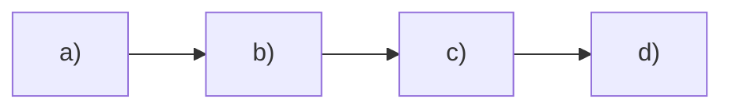
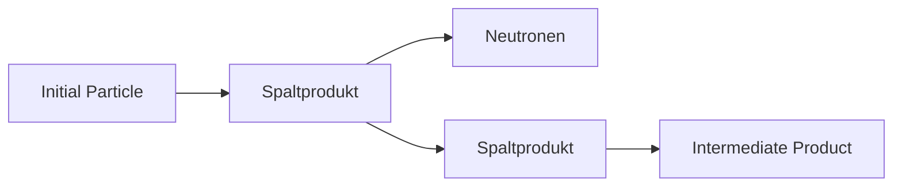

natural_image

Abstract geometric pattern with diagonal lines and a central rectangular structure (no text or symbols)

Bild 46.9 Domänenstruktur eines Eisen-Einkristalls (150-fach vergrößert; sichtbar gemacht mit Hilfe der Methode der Bitterschen Streifen)

Oberhalb des CURIE-Punktes verhalten sich die ferromagnetischen Stoffe paramagnetisch. Für Temperaturen $T > T _ { \mathrm { C } }$ gilt daher für die Temperaturabhängigkeit ihrer Suszeptibilitäten ein zu (46.6) analoges Gesetz, wenn man anstelle der absoluten Temperatur T ihren Überschuss über die CURIE-Temperatur einsetzt:

$$
\chi_ {\mathrm{m}} = \frac {C}{T - T _ {\mathrm{C}}} \quad (\text {CURIE - WEISSsches Gesetz}). \tag {46.7}
$$

Der CURIE-Punkt ist stark legierungsabhängig. Es gibt ferromagnetische Legierungen, deren CURIE-Punkt unterhalb Raumtemperatur liegt, d. h., dass sie bei dieser Temperatur bereits ihren Ferromagnetismus verlieren und paramagnetisch werden. Der CURIE-Punkt von reinem Eisen liegt bei $7 7 4   ^ { \circ } \mathrm { C } ,$ von Nickel bei $372 ^{\circ} C ;$ bei den sog. HEUSLERschen Legierungen, die ausschließlich aus nichtferromagnetischen Metallen bestehen, aber dennoch ferromagnetisch sind, ist $T _ { \mathrm { C } } < 1 0 0   ^ { \circ } \mathrm { C } .$

Es zeigt sich, dass Ferromagnetismus bei denjenigen Elementen auftritt, bei denen das Verhältnis der Gitterkonstante a des Kristallgitters zum Radius der äußeren, nicht voll besetzten Elektronenschale r zwischen $^ { 3 , 2 }$ und $^ { 6 , 2 }$ liegt. Dies ist der Fall bei Eisen, Nickel und Cobalt, bei den ferromagnetischen Legierungen dieser Elemente sowie bei den Metallen der Seltenen Erden. Bei größeren Werten von a/r stellt sich paramagnetisches Verhalten ein, da bei größeren Entfernungen der Atome die Kopplungskräfte nicht mehr ausreichen, um eine Parallelstellung der Spinmomente herbeizuführen.

Verkleinert sich jedoch das Verhältnis $a / r$ unter den Wert von etwa 3,2, so stellen sich benachbarte Spinmomente in die energetisch günstigere antiparallele Lage ein; man spricht dann von **Antiferromagnetismus**. Typische Vertreter dieser Gruppe sind Mangan (Mn), die Verbindungen MnO und $\mathrm { M n F _ { 2 } }$ sowie $\alpha -Fe _2 O _3$ . Diese Antiferromagnetika zeichnen sich, ebenso wie die Ferromagnetika, durch eine spontane Magnetisierung aus, obwohl sie nach außen hin diamagnetisch erscheinen. Das liegt daran, dass das Atomgitter dieser Stoffe aus zwei ferromagnetischen „Untergittern“ zusammengesetzt ist, die gegeneinander verschoben sind und deren Gitterbausteine zwar parallelen, aber entgegengesetzten Spin haben, so dass sich die entsprechenden magnetischen Wirkungen nach außen hin völlig kompensieren.

Unterscheiden sich die beiden Untergitter mit antiparallelem Spin durch unterschiedliche Stärke oder Anzahl ihrer atomaren Momente, so dass sie sich jetzt nicht mehr gegenseitig kompensieren, sondern ein Differenzmoment wirksam wird, so gelangt man zur Erscheinung des **Ferrimagnetismus**. Die entsprechenden Vertreter nennt man Ferrite. Sie zeigen ein den ferromagnetischen Stoffen ähnliches Verhalten.

Trotz der vollständigen Ausrichtung der Spinmomente in den WEISSschen Bezirken sind Ferromagnetika nach außen hin unmagnetisch, solange kein Magnetfeld auf sie einwirkt. Das ist darauf zurückzuführen, dass diese Bezirke hinsichtlich ihrer Magnetisierungsrichtungen im

Stoff eine völlig regellose Verteilung zeigen, wodurch sich die Effekte nach außen hin aufheben (Bild 46.10a). Da eine sprunghafte Änderung der Magnetisierungsrichtung von einem Bezirk zum anderen energetisch ungünstig ist, befinden sich zwischen den WEISSschen Bezirken Grenzschichten, die sog. **BLOCH-Wände**, innerhalb derer ein stetiger Übergang der Spinorientierung erfolgt (Bild 46.11).

flowchart

Bild 46.10 Stadien des Magnetisierungsvorgangs in Eisen:

a) regellose Orientierungsverteilung der resultierenden magnetischen Momente innerhalb der weissschen Bezirke (Domänen)

b) schwache Magnetisierung im Bereich der reversiblen Wandverschiebungen

c) Umklappen der Spinmomente in eine energetisch günstige Lage im Bereich der irreversiblen Wandverschiebungen

d) Eindrehen der Spinmomente in die Richtung des äußeren Magnetfeldes (Sättigung)

Durch Anlegen eines zunächst schwachen äußeren Magnetfeldes findet ein Ausrichten einzelner Bezirke in Richtung des angelegten Feldes statt, wodurch eine geringe makroskopische Magnetisierung auftritt (Bild 46.10b). Dabei wächst die Anzahl derjenigen Bezirke, die mit ihrer spontanen Magnetisierungsrichtung den kleinsten Winkel zum äußeren Magnetfeld bilden, auf Kosten benachbarter Bezirke mit weniger günstiger Lage der magnetischen Momente. Dieser Mechanismus beruht auf einer Verschiebung der BLOCH-Wände.

Diese Wandverschiebungen sind bei kleinen Feldstärken reversibel, d. h., bei Wegnahme des äußeren Feldes wandern die Wände zurück. Bei weiterer Erhöhung der Feldstärke verschieben sich die BLOCH-Wände weiter zu Gunsten der energetisch bevorzugten Bereiche, indem die Mehrzahl der magnetischen Momente in die energetisch günstige Richtung umklappt (Bild 46.10c). Dies ist der Bereich der sog. irreversiblen BARKHAUSEN-Sprünge. Infolge dieses Umklappvorgangs der magnetischen Momente werden in einer die magnetisierte Eisenprobe umgebenden Induktionsspule geringe Spannungsstöße induziert, die nach entsprechender Verstärkung mit Hilfe eines Lautsprechers als prasselndes Geräusch hörbar gemacht werden können (BARKHAUSEN-Effekt).

text_image

0°
180°
Wanddicke

Bild 46.11 Stetiger Übergang der Magnetisierungsrichtung innerhalb einer 180◦-Bloch-Wand

Bei noch höheren Feldstärken setzen die reinen Drehprozesse ein, indem die Momente der spontanen Magnetisierung fast vollständig in die Feldrichtung eingestellt werden (Bild 46.10d). Damit ist die Sättigung erreicht (vgl. Bild 29.2). Lässt man nun die Feldstärke wieder auf null zurückgehen, so werden dadurch zwar die Drehprozesse und die zum Teil noch vorhandenen reversiblen Wandverschiebungen rückgängig gemacht, nicht dagegen die irreversiblen, so dass ein bestimmter Restbetrag an Magnetisierung, die Remanenz, erhalten bleibt. Der remanente Magnetismus kann durch ein ihm entgegengerichtetes äußeres Magnetfeld von der Größe der Koerzitivfeldstärke $H _ { \mathrm { K } }$ wieder zum Verschwinden gebracht werden (Hysterese, vgl. 29.2).

## 46.8 Supraleitung. Der Josephson-Effekt

1911 beobachtete KAMERLINGH ONNES bei Experimenten im Bereich tiefster Temperaturen, dass der elektrische Widerstand von reinem Quecksilber mit sinkender Temperatur immer mehr abnimmt, um dann bei Unterschreiten von 4,2K, der sog. Sprungtemperatur oder kritischen Temperatur $T _ { \mathrm { c } }$ des Quecksilbers, sprunghaft auf einen unmessbar kleinen Wert abzufallen. Eine Folge dieser als **Supraleitfähigkeit** bezeichneten Erscheinung ist, dass ein in einem supraleitenden Ring induzierter elektrischer Strom als Dauerstrom über Jahre praktisch konstant fließen kann. Weiterhin wurde bereits 1933 die Fähigkeit von Supraleitern beobachtet, Magnetfelder aus ihrem Inneren zu verdrängen (MEISSNER-OCHSENFELD-Effekt, Bild 46.12a,b). Wenn jedoch ein äußeres Magnetfeld einen bestimmten Wert, die kritische Induktion $B _ { \mathrm { { C } } } ,$ übersteigt, geht die Supraleitung schlagartig in die Normalleitung über, und der Körper wird vom äußeren Magnetfeld wieder vollständig durchsetzt. (Bild 46.12c). Auch das vom Suprastrom erzeugte eigene Magnetfeld wird in dieser Weise verdrängt. Daher wird bei Überschreiten einer kritischen Stromdichte $j _ { \mathrm { c } }$ , wenn an der Oberfläche des Leiters die kritische Induktion $B _ { \mathrm { c } }$ erreicht ist, die Supraleitung ebenfalls schlagartig aufgehoben. Stoffe mit diesen Eigenschaften bezeichnet man als **Supraleiter I. Art**.

Bild 46.12 Meissner-Ochsenfeld-Effekt: Supraleiter im äußeren Magnetfeld oberhalb und unterhalb der kritischen Temperatur $T _ { \mathrm { c } }$ und der kritischen Induktion $B _ { \mathrm { c } }$

1957 gelang BARDEEN, COOPER und SCHRIEFFER erstmals die Aufstellung einer mikroskopischen Theorie der Supraleitung, kurz **BCS-Theorie** genannt, die davon ausgeht, dass sich unterhalb der Sprungtemperatur $T _ { \mathrm { c } }$ je zwei Elektronen von entgegengesetzt gleichem Impuls und Spin durch den Austausch von (virtuellen) Phononen – den Schwingungsquanten des Kristallgitters – und teilweiser Überwindung der COULOMB-Abstoßung anziehen und je ein sog. **COOPER-Paar** mit dem Spin null bilden. Alle COOPER-Paare befinden sich im gleichen Quantenzustand, d. h., sie haben gleiche Energie und gleichen Impuls. Beim Anlegen einer elektrischen Spannung nehmen sie allesamt den gleichen Impuls auf. Damit ist es unmöglich, dass ein einzelnes oder einige von ihnen mit dem Kristallgitter in Wechselwirkung treten, da sie dann in einen anderen Zustand übergehen müssten. Das hat zur Folge, dass sich das Gesamtsystem der COOPER-Paare widerstandsfrei durch das Gitter bewegt. Erst oberhalb $T _ { \mathrm { c } }$ reicht die thermische Energie aus, um alle COOPER-Paare zu trennen und den supraleitenden Zustand zu beenden.

Die in den Supraleitern I. Art möglichen Stromdichten sind für großtechnische Anwendungen zu gering. Wichtigen Auftrieb für die technische Anwendung der Supraleitung gab die Entdeckung von Materialien wie Nb-Ti, $\mathrm { N b _ { 3 } A l }$ oder $\mathrm { N b _ { 3 } S n } ,$ welche im Unterschied zu den Supraleitern I. Art zum Teil sehr hohe Magnetfelder aushalten, ohne normalleitend zu werden. Bei ihnen dringt mit wachsender Induktion B das Magnetfeld nur allmählich in den Supraleiter ein, bis es den Körper völlig durchdrungen hat, worauf dieser erst dann normalleitend wird. Davor existiert ein „Mischzustand“ aus supraleitenden und normalleitenden Gebieten, wobei die normalleitenden Gebiete im Supraleiter ein regelmäßiges Muster aus sog. Flussschläuchen bilden, von denen jeder die kleinste Einheit des magnetischen Flusses, das **Flussquant** $\varPhi _ { 0 } = h / ( 2 e )$ , vgl. 44.3, bzw. ein ganzzahliges Vielfaches desselben führt (Bild 46.13). Jeder dieser Flussschläuche ist von Ringströmen im Supraleiter umgeben. Solche Materialien nennt man **Supraleiter II. Art**.

text_image

B
F
j
Φ₀
Φ₀
Φ₀
Φ₀

Bild 46.13 Schema eines Flussschlauchgitters in Supraleitern II. und III. Art. Die Flussschläuche sind normalleitend. (B magnetische Induktion, $j$ Stromdichte, F auf die Flussschläuche wirkende Lorentz-Kraft, $\Phi _ { 0 }$ Flussquant)

Schickt man einen Strom mit der Stromdichte j durch den Supraleiter im Mischzustand, so übt er auf jeden Flussschlauch eine LORENTZ-Kraft F senkrecht zu B und j aus (Bild 46.13), unter deren Wirkung die Flussschläuche quer zur Stromrichtung durch den Supraleiter hindurchwandern. Diese Bewegung ist verlustbehaftet, und es entsteht ein elektrischer Widerstand. Um dies zu verhindern, werden durch gezielte Erzeugung von Haftstellen (Pinning-Zentren) in Form von Materialinhomogenitäten wie $\mathbf { Z } .$ B. Versetzungen (vgl. 13.6), Ausscheidungen oder Korngrenzen die Flussschläuche verankert, wodurch die Supraleitung erhalten bleibt (sog. **harte Supraleiter** oder **Supraleiter III. Art**).

Der entscheidende Durchbruch in den jahrzehntelangen Bemühungen um eine Erhöhung der Sprungtemperatur $T _ { \mathrm { c } }$ gelang BEDNORZ/MÜLLER (1986) mit der Entdeckung der Hochtemperatur-Supraleitung (ebenfalls Supraleitung II. Art) an La-Ba-Sr-Cu-Oxiden bei 35K. Inzwischen wurden an oxidkeramischen Supraleitern Sprungtemperaturen oberhalb der Siedetemperatur des flüssigen Stickstoffs (77K) erreicht. Damit entfällt bei Funktionselementen aus hoch- $T _ { \mathrm { c } }$ -supraleitenden Materialien die kryotechnisch aufwändige und teure Kühlung mit flüssigem Helium (Siedetemperatur 4K). Die bei den Hoch- $\cdot T _ { \mathrm { C } ^ { 1 } }$ **-**Supraleitern beobachteten hohen Sprungtemperaturen (an einer Hochdruckphase von $\mathrm { H } _ { 2 } S$ bisher maximal 203K erreicht) vermag allerdings die oben beschriebene BCS-Theorie allein nicht zu erklären. Daher werden gegenwärtig mehrere andere Mechanismen für die Paarbildung untersucht.

**JOSEPHSON-Effekt.** Durch eine nur wenige Atomabstände dicke Isolationsschicht zwischen zwei supraleitenden Metallen können nach JOSEPHSON (1962) nicht nur Einzelelektronen, sondern auch COOPER-Paare hindurch„tunneln“ (Tunneleffekt, vgl. 45.4). Durch den Tunnelkontakt zwischen den beiden übereinander liegenden Metallstreifen 1 und 2 eines JOSEPH-

SON-Elements (Bild 46.14) kann bei der Spannung $U = 0$ ein verlustloser Supragleichstrom fließen. Sein Maximalwert ist abhängig vom äußeren Magnetfeld. Dies führt zu den derzeit empfindlichsten Detektoren für den magnetischen Fluss $\Phi ,$ den so genannten SQUIDs (Supraleitende **Qu**anten-Interferenz-Detektoren). Nach Überschreiten eines kritischen Stromes tritt am Tunnelkontakt ein Spannungsabfall auf, der von einem hochfrequenten COOPER-Paar-Wechselstrom begleitet ist. Seine Frequenz,

$$
f = \frac {2 e U _ {\mathrm{J}}}{i h}, i = 1, 2, 3, \dots \quad (\text {JOSEPHSON - Gleichung}), \tag {46.8}
$$

ist der am Kontakt anliegenden Spannung $U _ { \mathrm { J } }$ proportional und hängt bemerkenswerterweise nur noch von den Elementarkonstanten e und h ab, womit sich u. a. hoch präzise Spannungsnormale herstellen lassen (s. unten). Mit dieser Frequenz wird auch die dem Kontakt zugeführte Energie in Form elektromagnetischer Strahlung abgegeben, die – ähnlich der Laserstrahlung – kohärent ist. Auf der Basis der JOSEPHSON-Effekte ergeben sich zahlreiche praktische Anwendungsmöglichkeiten wie die Konstruktion von Sendern und Empfängern höchster Empfindlichkeit im Mikrowellenbereich, schnelle Digitalelektronik, Datenspeicher, Präzisionsmessung physikalischer Elementarkonstanten u. a. m.

text_image

I
1
2
I
U

Bild 46.14 Josephson-Element (Dicke der Isolationsschicht zwischen den beiden supraleitenden Stoffen 1 und 2 etwa 1 ... 10 nm)

**Das Internationale Einheitensystem (SI).** Auf dem JOSEPHSON-Effekt beruht in Verbindung mit dem Quanten-HALL-Effekt (s. 28.8) eine Neudefinition der Basiseinheiten A m p e r e (A) und K i l o g r a m m (kg) auf der Grundlage von universellen Naturkonstanten (s. 2.1 und 2.3). Die Wechselspannung $U _ { \mathrm { J } }$ eines COOPER-Paar-Wechselstroms durch einen supraleitenden Tunnelkontakt ist mit ihrer Frequenz $f$ gemäß der JOSEPHSON-Gleichung (46.8) $U _ { \mathrm { J } } = i h f / ( 2 e )$ $i = 1 , 2 , 3 , \ldots$ , verknüpft. Wählt man als Frequenz $f$ die die Zeiteinheit S e k u n d e definierende Frequenz $f _ { \mathrm { C s } }$ des Hyperfeinstrukturübergangs von $^ { 1 3 3 } \mathrm { C s } \; ( \mathrm { s . } \; 3 . 1 )$ , so lässt sich auf dieser Grundlage ein Spannungsnormal definieren, das die Einheit der elektrischen Spannung V o l t (V) direkt mit der Elementarladung e und dem PLANCKschen Wirkungsquantum h verknüpft. Der elektrische Strom durch eine HALL-Sonde in einem sehr starken Magnetfeld, deren HALL-Spannung gleich dieser JOSEPHSON-Spannung ist, $U _ { \mathrm { H } } = U _ { \mathrm { J } } = i h f _ { \mathrm { C s } } / ( 2 e )$ , hat nach (28.24) im Bereich des Quanten-HALL-Effektes die Stromstärke $I = U _ { \mathrm { { J } } } / R _ { \mathrm { { H } } } = i z h f _ { \mathrm { { C s } } } / ( 2 e R _ { \mathrm { { H 0 } } } ) = i z e f _ { \mathrm { { C s } } } ,$ womit die SI-Basiseinheit A m p e r e (s. Abschnitt 28.6) direkt auf die Elementarladung e und das die Zeiteinheit festlegende Frequenznormal $f _ { \mathrm { C s } }$ zurückgeführt ist; es ergibt sich $1 \mathrm { A } = 6 . 7 8 9   6 8 7 \cdot 1 0 ^ { 8 } e f _ { \mathrm { C s } }$

Darüber hinaus ermöglichen Präzisionsmessungen mittels JOSEPHSON-Elementen und einem V. KLITZING-Widerstandsnormal $R _ { \mathrm { H 0 } }$ (s. 28.8) gemäß der JOSEPHSON-Gleichung (46.8) $U _ { \mathrm { J } } =$ $i h f / ( 2 e ) \approx h f /$ e bzw. derjenigen für den Quanten-HALL-Widerstand (28.26) $R _ { \mathrm { H } } = h / ( z e ^ { 2 } )$ die Rückführung der elektrischen Leistung $P = U I = U ^ { 2 } / R \left( \mathbf { s } .   2 5 . 4 \right)$ allein auf das PLANCKsche Wirkungsquantum h und die Caesium-Frequenz $f _ { \mathrm { C s } } ; P \approx h f _ { \mathrm { C s } } ^ { 2 }$ . Andererseits enthält der entsprechende Ausdruck für die mechanische Leistung $P = F \nu = m a \nu$ (s. 7.2) einer unter der Wirkung der Kraft $F$ mit der Geschwindigkeit v sich bewegenden Masse m (wie eine einfache Einheitenanalyse $[ P ] = [ m ] [ a ] [ \nu ] = \mathbf { k g m } ^ { 2 } \mathbf { s } ^ { - 3 }$ in Verbindung mit der Zeit- und Meterdefinition in Abschnitt 3.1 zeigt) neben $f _ { \mathrm { C s } }$ und der Lichtgeschwindigkeit c auch die Masse des Kilogramm-Prototyps $m \approx m _ { \mathrm { k g } } = 1$ kg (s. 4.3): $P \approx m _ { \mathrm { k g } } c ^ { 2 } f _ { \mathrm { C s } }$ . Aus dem Vergleich der beiden Ausdrücke für $P$ ergibt sich die Möglichkeit der Rückführung der Einheit der Masse auf die Naturkonstanten $h ,   c$ und $f _ { \mathrm { C s } } { : } m _ { \mathrm { k g } } \approx h c ^ { - 2 } f _ { \mathrm { C s } }$ . Mit den aus CODATA 2018 stammenden Werten für $h ,$ c und $f _ { \mathrm { C s } }$ ergibt sich $1 \mathrm { k g } = 1 . 4 7 5   5 2 1 4 \cdot 1 0 ^ { 4 0 } h c ^ { - 2 } f _ { \mathrm { C s } }$

Die experimentelle Realisierung dieser Kilogrammdefinition erfolgt mittels einer sog. Wattoder KIBBLE-Waage, bei der sich eine im Gravitationsfeld der Feldstärke G mit konstanter Geschwindigkeit v bewegende Masse im Gleichgewicht mit der LORENTZ-Kraft $F _ { \mathrm { L } } = I I B = U I / \nu$ (s. Abschnitte 28.6 und 30.4) auf einen durch diese Bewegung im Magnetfeld B induzierten elektrischen Strom I befindet: m $G = U I / \nu$

## 46.9 Supraflüssigkeit

Gewöhnliches Helium geht unterhalb von 2,2K in **Helium II** über, es wird supraflüssig und hat dann abnorme Eigenschaften, durch die es von allen anderen Flüssigkeiten stark abweicht. Auf Grund seiner überaus geringen Viskosität $( 0 \ldots 1 0 ^ { - 6 } \mathrm { P a } \cdot \mathrm { s } )$ kann Helium II wie eine ideale Flüssigkeit praktisch reibungsfrei durch engste Kapillaren fließen, und ein Wirbel in ihm bleibt unbegrenzt lange erhalten, ähnlich wie Ströme in supraleitenden Ringen ohne Spannungsquelle jahrelang fließen können. Wegen der verschwindend geringen Zähigkeit kriecht Helium II in einer sehr dünnen Schicht an den Gefäßwänden hoch, gelangt an wärmere Stellen und verdampft dort. Mit nur $0 ,   1 \mathrm { g } / \mathrm { c m } ^ { 3 }$ hat Helium II die kleinste Dichte aller Flüssigkeiten.

Die Supraflüssigkeit, die nur beim Heliumisotop $\mathrm { _ 2 ^ { 4 } H e }$ (nicht dagegen bei $\mathrm { { } _ { 2 } ^ { 3 } H e ) }$ auftritt, ist darauf zurückzuführen, dass in diesem Isotop die DE-BROGLIE-Wellenlänge (43.20) $\lambda = h / p$ der Heliumatome die Größenordnung der mittleren Atomabstände erreicht, was makroskopische Quanteneffekte zur Folge hat. Sie führen dazu, dass flüssiges Helium bis zu beliebig tiefen Temperaturen existieren kann. Nach der klassischen Mechanik müssten alle Substanzen in der Nä- he von $T = 0 1$ K wegen der fehlenden kinetischen Energie und der Forderung minimaler potenzieller Energie kristallisieren (Wasserstoff z. B. bei 13,9K). Die Existenz von flüssigem Helium bis zu beliebig tiefen Temperaturen beruht einerseits auf der geringen Atommasse, andererseits auf der schwachen Wechselwirkung der Edelgasatome untereinander.

## 47.1 Masse, Ladung und Zusammensetzung der Kerne

Im Jahre 1911 fand RUTHERFORD aus Streuversuchen mit α-Teilchen (vgl. 44.1), dass fast die gesamte Masse eines Atoms im Atomkern vereinigt ist und dass der Atomkern genau so viele positive Elementarladungen trägt, wie die Ordnungszahl Z des betreffenden Atoms im Periodensystem der Elemente angibt. Um jedoch über den Bau des Atomkerns Näheres zu erfahren, müssen Vorgänge untersucht werden, die im Innern der Kerne stattfinden. Als solche Vorgänge sind uns heute der natürliche radioaktive Zerfall der schweren Elemente, die mit Hilfe von Teilchenbeschleunigern hervorgerufenen künstlichen Kernreaktionen und die durch die kosmische Strahlung verursachten Kernprozesse bekannt. Aber bereits die sehr früh erkannte Tatsache, dass die relativen Atommassen häufig angenähert ganzzahlige Vielfache der Atommasse des leichtesten aller Elemente, des Wasserstoffs, sind, ließ Rückschlüsse darauf zu, dass die Atomkerne zusammengesetzte Gebilde sind.

Der Kern des Wasserstoffatoms, das **Proton**, kam jedoch als alleiniger Kernbaustein nicht in Betracht, da bei den schwereren Kernen das Verhältnis Ladung/Masse stets kleiner als 1 ist (z. B. hat der Heliumkern etwa die vierfache Masse des Protons, aber nur die doppelte Ladung). Die zunächst gemachte Annahme, dass die Atomkerne außer Protonen auch noch Elektronen enthalten, die zur Masse kaum beitragen, aber die überschüssigen Ladungen kompensieren, konnte aus theoretischen und experimentellen Gründen nicht aufrechterhalten werden.

Nach der Entdeckung des **Neutrons**, eines elektrisch neutralen Teilchens mit etwa gleich großer Masse wie die des Protons, durch CHADWICK (1932) schlugen HEISENBERG und IWA-NENKO noch im gleichen Jahr ein **Proton-Neutron-Modell** für den Atomkern vor. Proton und Neutron werden heute als verschiedene Ladungszustände eines einheitlichen Kernteilchens, des **Nukleons**, aufgefasst. Seine Ruhmasse ist etwa 1837-mal größer als die Ruhmasse des Elektrons. Masse und Ladung sind charakteristische Eigenschaften aller Elementarteilchen. Beide Nukleonen haben, wie das Elektron, einen Eigendrehimpuls, den Spin, sowie damit gekoppelt ein magnetisches Moment. Das magnetische Moment des Protons ist anschaulich verständlich, das des Neutrons hingegen nicht, da keine Ladung vorhanden ist (vgl. dazu Abschnitt 47.7). Diese einfachsten Eigenschaften von Neutron und Proton sind in Tabelle 47.1 zusammengefasst.

Jeder zusammengesetzte Kern, bestehend aus der Anzahl A von Nukleonen, enthält somit eine bestimmte Anzahl von Protonen Z und eine bestimmte Anzahl von Neutronen N:

$$
A = Z + N \quad (\text {Massenzahl des Atomkerns}). \tag {47.1}
$$

Die Massenzahl A ist gleich der auf ganze Zahlen auf- bzw. abgerundeten relativen Atommasse $A _ { \Gamma }$ des betreffenden Elements (vgl. 18.1). Z nennt man die **Kernladungszahl**; sie ist gleich der Ordnungszahl des betreffenden Elements im Periodensystem und bei einem nach außen hin elektrisch neutralen Atom gleich der Anzahl seiner Hüllenelektronen. Die Anzahl der Neutronen im Kern ist demnach gleich $N = A - Z$

Um einen Atomkern eindeutig zu kennzeichnen, schreibt man die Massenzahl oben links und die Kernladungszahl unten links vor das betreffende Symbol des chemischen Elements (z. B. ${ } _ { 1 } ^ { 1 } \mathrm { H } , { } _ { 2 } ^ { 4 } \mathrm { H e } ,$ 94 Be usw.). Häufig lässt man auch die Ordnungszahl weg und setzt die Massenzahl hochgestellt vor oder hinter oder auch in gleicher Höhe hinter das Symbol, $\mathrm { z .   B .   } ^ { 2 3 5 } \mathrm { U }$ oder U 235.

Aus Streuversuchen mit α-Teilchen oder auch mit Elektronen fand man, dass sich der Kernradius durch die empirische Formel

$$
R _ {\mathrm{K}} = r _ {0} \sqrt [ 3 ]{A} \quad (\text {Kernradius}) \quad \text {mit} r _ {0} \approx 1, 3 \cdot 1 0 ^ {- 1 5} \mathrm{m} \tag {47.2}
$$

bestimmen lässt. Hiernach haben selbst die schwersten Kerne $( A \approx 2 5 0 )$ Radien, die etwa $1 0 ^ { 4 }$ mal kleiner sind als die Radien der Atomhülle. Daraus erhält man als Dichte der Atomker**ne** $\varrho _ { \mathrm { K } } = m _ { \mathrm { K } } / V _ { \mathrm { K } }$ mit der Kernmasse $m _ { \mathrm { K } } \approx A \mathbf { u }$ $( \mathbf { u } = 1 { , } 6 6 \cdot { 1 0 } ^ { - 2 7 }$ kg atomare Masseneinheit, vgl. 18.1) und dem kugelförmigen Kernvolumen $V _ { \mathrm { K } } = ( 4 \pi / 3 ) R _ { \mathrm { K } } ^ { 3 } = ( 4 \pi / 3 )   r _ { 0 } ^ { 3 } A$ den für alle Atomkerne nahezu gleichen, enorm hohen Wert $\varrho _ { \mathrm { K } } = 3 \mathbf { u } / ( 4 \pi r _ { 0 } ^ { 3 } ) \approx 2 \cdot 1 0 ^ { 1 7 }   \mathrm { k g / m ^ { 3 } }$ . Derartig hohe Massendichten erreichen Neutronensterne, in denen durch extrem große Massenansammlungen die Gravitationskraft alle anderen Kräfte übertrifft und die Atome bis auf ihre Kernabstände aneinander gepresst werden.

Tabelle 47.1 Einfachste Eigenschaften der Nukleonen

| Nukleon | Ruhmasse m in kg | Relative Atommasse $A_r = m/u$ | Ladung in Einheiten e | Drehimpuls (Spin) in Einheiten h | Magnetisches Moment in Einheiten $\mu_K$ |
| --- | --- | --- | --- | --- | --- |
| Neutron (n) | 1,674 927 498 · $10^{-27}$ | 1,008 664 916 | 0 | ± 1/2 | -1,913 |
| Proton (p) | 1,672 621 924 · $10^{-27}$ | 1,007 276 467 | + 1 | ± 1/2 | 2,793 |

Es ist: $\mathbf { u } = 1 { , } 6 6 0   5 3 9   0 6 6 6 \cdot 1 0 ^ { - 2 7 }$ kg die atomare Masseneinheit, $e = 1 { , } 6 0 2   1 7 6   6 3 4 \cdot 1 0 ^ { - 1 9 }   \mathrm { C }$ die elektrische Elementarladung, $\hbar = h / ( 2 \pi ) = 1 , 0 5 4 5 7 1 8 1 7 \cdot 1 0 ^ { - 3 4 } ]$ · s das PLANCKsche Drehimpulsquantum und $\mu _ { \mathrm { N } } = e \hbar / ( 2 m _ { \mathrm { p } } ) = 5 , 0 5 0   7 8 3   7 4 6 1 \cdot 1 0 ^ { - 2 7 }   \mathrm { J } \cdot \mathrm { T } ^ { - 1 }$ das sog. Kernmagneton, analog dem BOHRschen Magneton (44.17), jedoch mit der Protonenmasse $m _ { \mathrm { p } }$ anstelle der Elektronenmasse $m _ { \mathrm { e } }$ (CODATA 2018).

## 47.2 Isotope

Isotope sind verschiedene Atomarten ein und desselben chemischen Elements, d. h. Atome bzw. Kerne mit gleicher Ordnungszahl (Kernladungszahl) $Z ,$ aber verschiedener Massenzahl A, wodurch sie sich in ihren relativen Atommassen $A _ { \mathbf { r } }$ voneinander unterscheiden. Aus (47.1) ergibt sich somit:

## Isotope Kerne haben bei gleicher Protonenzahl eine unterschiedliche Anzahl von Neutronen.

So z. B. kennt man beim Wasserstoff die folgenden drei Isotope: den normalen Wasserstoff mit dem Kern ${ } _ { 1 } ^ { 1 } \mathrm { H } ,$ dem Proton (p); den „schweren Wasserstoff“, genannt **Deuterium**, mit dem Kern ${ } _ { 1 } ^ { 2 } \mathrm { D } ,$ , dem sog. Deuteron (d) der Zusammensetzung $\mathbf { p }   +   \mathbf { n } ;$ und das (nicht natürlich vorkommende) **Tritium** mit dem Kern $^ 3 _ { 1 } \mathrm { T } ,$ dem sog. Triton (t) mit der Zusammensetzung $\mathbf { p }   +   2 \mathbf { n } .$ Außer den natürlichen gibt es praktisch von allen Elementen noch künstliche (z. B. durch Kernbeschuss erzeugte) Isotope. Diese sind jedoch meist instabil, d. h. radioaktiv. Aus ihnen entstehen mehr oder weniger rasch unter Aussendung von Strahlen stabile Kerne anderer Elemente.

Die Zahl der Isotope eines Elements begrenzt die

## ASTONsche Isotopenregel: Elemente mit ungerader Ordnungszahl haben höchstens zwei stabile Isotope, solche mit gerader Ordnungszahl können wesentlich mehr als zwei Isotope haben.

Die meisten der in der Natur vorkommenden Elemente sind Mischungen aus mehreren Isotopen. Dies erklärt, weshalb die relativen Atommassen $A _ { \mathrm { r } }$ in der Regel starke Abweichungen von der Ganzzahligkeit aufweisen. Da sich Isotope in ihrem chemischen Verhalten nicht voneinander unterscheiden, können zur Trennung bzw. Reindarstellung nur physikalische Verfahren herangezogen werden, mit denen kleinste Massenunterschiede feststellbar sind.

**Isotopen-Trennverfahren.** Ein sehr effektives großtechnisches Verfahren zur Isotopentrennung ist die wiederholte Diffusion des im gasförmigen Zustand vorliegenden Isotopengemisches durch eine poröse Wand, wobei sich die leichten Isotope hinter der Trennwand anreichern. Auf diesem Wege wird $\mathbf { z } , \mathbf { B } .$ aus dem gasförmigen Uranhexafluorid $( \mathrm { U F } _ { 6 } )$ das Isotop Uran 235 als Spaltstoff für Kernreaktoren und Atombomben angereichert oder isoliert. Bei der Ultrazentrifuge werden auf Grund der wirkenden Fliehkräfte außen die leichteren Isotope, die sich leichter beschleunigen lassen, in Achsennähe dagegen die schwereren angereichert. Beim Wasser kann man den unterschiedlichen Siedepunkt des normalen Wassers $\mathrm { ( H _ { 2 } O ) }$ von $^ { 1 0 0 , 0   ^ { \circ } \mathrm { C } }$ und des schweren Wassers $\mathrm { ( D _ { 2 } O ) }$ von $^ { 1 0 1 , 4   ^ { \circ } \mathrm { C } }$ zur Trennung dieser isotopen Moleküle ausnutzen, ebenso die elektrolytische Zerlegung des Wassers. Genaueste Methode ist die Massenspektroskopie, die jedoch nicht produktiv für große Mengen eingesetzt werden kann. Sie beruht auf der massenabhängigen Ablenkung der durch Verdampfen und Ionisieren des zu trennenden Materials entstehenden Ionen beim Durchgang durch ein elektrostatisches und magnetisches Feld.

## 47.3 Isobare, Isotone, Nuklide, Isomere

Kerne mit gleicher Massenzahl A, aber unterschiedlicher Kernladungszahl Z bezeichnet man als Isobare (z. B. $^ { 4 0 } _ { 1 8 } \mathrm { A r } , \mathrm { ^ { 4 0 } _ { 1 9 } K } , \mathrm { ^ { 4 0 } _ { 2 0 } C a }$ , Kerne mit gleicher Neutronenzahl, aber verschiedener Protonenzahl als Isotone $\mathrm{(z.B.\_{17}^{37}Cl,\_{18}^{38}Ar,\_{19}^{39}K,\_{20}^{40}Ca)}$ ; bei ihnen ist $N = A - Z = \mathrm { c o n s t } .$ Allgemein werden Kerne mit einer bestimmten Protonen- und Neutronenzahl als Nuklide bezeichnet. Isomere sind Nuklide, die sich nur im Energieinhalt, d. h. in ihrem Anregungszustand, unterscheiden.

## Aufgabe

**47.1** Welche der nachfolgend aufgeführten Kerne sind a) Isotope, b) Isotone, c) Isobare? $^ 9 _ { 4 } \mathrm { B e }$ ${ } _ { 6 } ^ { 1 0 } \mathrm { C } , { } _ { 5 } ^ { 1 0 } \mathrm { B } , { } _ { 3 } ^ { 8 } \mathrm { L i } , { } _ { 5 } ^ { 1 1 } \mathrm { B } , { } _ { 4 } ^ { 1 0 } \bar { \mathrm { B e } } , { } _ { 6 } ^ { 1 1 } \mathrm { C } , { } _ { 5 } ^ { 1 \bar { 2 } } \mathrm { B } .$

## 47.4 Massendefekt und Bindungsenergie der Kerne

Um einen Atomkern in seine Bausteine zu zerlegen, muss man die den Kern zusammenhaltenden Kräfte, die Kernkräfte, überwinden. Die gesamte zur Zerlegung des Kerns in seine einzelnen Nukleonen aufzuwendende Arbeit ist dem Betrage nach gleich seiner **Bindungsenergie**

$E _ { \mathrm { B } }$ . Diese lässt sich aus dem sog. **Massendefekt** B einfach bestimmen. Dieser gibt die Massendifferenz an, die zwischen der Summe der Massen aller im Kern enthaltenen Nukleonen im ungebundenen Zustand $( Z m _ { \mathrm { p } } + N m _ { \mathrm { n } } )$ und der Masse $M _ { \mathrm { K } }$ des Kerns als Ganzem besteht:

$$
B = Z m _ {\mathrm{p}} + N m _ {\mathrm{n}} - M _ {\mathrm{K}} \quad (\text {Massendefekt}). \tag {47.3}
$$

## Die Masse eines Atomkerns ist um den Massendefekt kleiner als die Summe der Massen der Nukleonen im ungebundenen Zustand.

Der Massendefekt erklärt sich daraus, dass bei der Bildung des Kerns aus den einzelnen Nukleonen gemäß der EINSTEINschen Beziehung (7.20) $E = m c ^ { 2 }$ ein wenig Masse in Form von Energie frei wird. Diese Energie ist (mit negativem Vorzeichen versehen, da es sich um ein Massen- bzw. Energiedefizit des Kerns handelt) gleich der Bindungsenergie des Kerns:

$$
E _ {\mathrm{B}} = B c ^ {2} \quad (\text {Bindungsenergie des Atomkerns}). \tag {47.4}
$$

Für die Berechnung des Massendefekts und der Bindungsenergie ist es zweckmäßig, die Nukleonenmassen in Vielfachen der atomaren Masseneinheit (18.1)

$$
1 \mathrm{u} = 1, 6 6 0 5 3 9 \cdot 1 0 ^ {- 2 7} \mathrm{kg}, \tag {47.5}
$$

d. h. durch ihre relative Atommasse $A _ { \mathbf { r } } ,$ anzugeben. Setzt man in (47.4) für B die atomare Masseneinheit (47.5), so ergibt sich:

## Einem Massendefekt von der Größe der atomaren Masseneinheit 1 u entspricht eine Kernbindungsenergie von $\mathbf { u } c ^ { 2 } = \mathbf { 9 3 1 }$ ,494 MeV.

Hierbei ist $1 \mathrm { M e V } ( = 1 0 ^ { 6 } \mathrm { e V } ) = 1 . 6 0 2 \cdot 1 0 ^ { - 1 3 } \mathrm { J } = 4 . 4 4 \cdot 1 0 ^ { - 2 0 }$ kWh die in der Kernphysik meist verwendete Energieeinheit. (Zur Definition der Einheit E l e k t r o n v o l t (eV) vgl. 23.4).

Zur Beurteilung der Stabilität eines Atomkerns ist nicht die Bindungsenergie $E _ { \mathrm { B } }$ maßgeblich, sondern die Größe **Bindungsenergie je Nukleon** $E _ { \mathrm { B } } / A \left( \mathbf { s } \right.$ . Bild 47.1, obere Kurve). Diese Kurve weist ein bemerkenswertes Maximum mit 8,794MeV beim Nuklid $^ { 6 2 } _ { 2 8 } \mathrm { N i }$ auf (nicht etwa $_ { 2 6 } ^ { 5 6 } \mathrm { F e } _ { : }$ das es noch um 0,004MeV übertrifft), weshalb Nickel-62 als der stabilste aller Atomkerne angesehen werden kann. Die Kurve fällt zu leichteren Massenzahlen $A$ ab (5,332MeV bei $^ 6 _ { 3 } \mathrm { L i }$ bis 1,112MeV bei Deuterium ${ } _ { 1 } ^ { 2 } \mathrm { D }$ , dem leichtesten Kern mit mindestens zwei Nukleonen). Da leichtere Kerne einen höheren Anteil ihrer Nukleonen an der Oberfläche des Kerns haben, nimmt die bindende Kraft ihrer Nachbarn ab (s. 47.7). Dies bedeutet, dass bei der Spaltung mittelschwerer Kerne $( A \approx 6 0 )$ Energie aufgewendet werden muss bzw., in umgekehrter Richtung, dass bei der Kernfusion Energie frei wird (vgl. 49.5).

Zu größeren Massenzahlen hin $( A > 6 0 )$ nimmt die Bindungsenergie je Nukleon gleichfalls ab und erreicht 7,570MeV beim Kern $^ { 2 3 8 } _ { 9 2 } \mathbf { U }$ . Bei schweren Kernen übertrifft die abstoßende, langreichweitige COULOMB-Kraft der Protonen die starke, aber kurzreichweitige anziehende Kraft der unmittelbaren Nachbarn. Dies hat zur Folge, dass bei der Kernspaltung schwerer Kerne ebenfalls Energie frei wird (s. 49.3).

line

| Masszahl A | Binding Energy (MeV) |
| --- | --- |
| ~2 | ~-1.5 |
| ~4 | ~-3.5 |
| ~6 | ~-5.0 |
| ~8 | ~-6.0 |
| ~10 | ~-7.0 |
| ~12 | ~-7.5 |
| ~14 | ~-8.0 |
| ~16 | ~-8.2 |
| ~18 | ~-8.3 |
| ~20 | ~-8.4 |
| ~25 | ~-8.5 |
| ~30 | ~-8.6 |
| ~40 | ~-8.7 |
| ~50 | ~-8.8 |
| ~60 | ~-8.9 |
| ~70 | ~-9.0 |
| ~80 | ~-9.1 |
| ~90 | ~-9.2 |
| ~100 | ~-9.3 |
| ~120 | ~-9.4 |
| ~140 | ~-9.5 |
| ~160 | ~-9.6 |
| ~180 | ~-9.7 |
| ~200 | ~-9.8 |
| ~220 | ~-9.9 |
| ~240 | ~-10.0 |

Bild 47.1 Bindungsenergie je Nukleon in Abhängigkeit von der Massenzahl des Kerns (obere Kurve). Die gestrichelten Kurven beziehen sich auf das Tröpfchenmodell des Atomkerns in 47.7.

## Beispiel 47.1:

Berechne die Bindungsenergie des α-Teilchens $_ \mathrm { ( _ 2 ^ { 4 } H e - K e r n ) }$ mit der Masse $6 { , } 6 4 4   6 5 7 \times 1 0 ^ { - 2 7 }$ kg)! Lösung: Wir berechnen zunächst aus den in Tabelle 47.1 angegebenen Nukleonenmassen bzw. relativen Atommassen $A _ { \mathrm { r } }$ den Massendefekt (47.3). Der Heliumkern besteht aus

2 Protonen zu je 1,007 276u = 2,014 552u

2 Neutronen zu je 1,008 665u = <u>2,017 330u</u>

Gesamtmasse der freien Nukleonen: 4,031 882u

Masse des Heliumkerns: <u>4,001 506u</u>

Massendefekt: $B = 0 { , } 0 3 0   3 7 6   \mathrm { u } .$

Dem entspricht eine Bindungsenergie von $E _ { \mathrm { B } } = 0 , 0 3 0   3 7 6 \cdot 9 3 1 , 4 9 4   \mathrm { M e V } = 2 8 , 2 9 5   \mathrm { M e V }$ oder $E _ { \mathrm { B } } / A = 7 , 0 7 4   \mathrm { M e V } ,$ d. h., der leichte Heliumkern ist relativ stabil. □

## Aufgabe

**47.2** Berechne die Bindungsenergie der isobaren Kerne a) $^ 3 _ { 1 } \mathrm { H }$ (Tritium) mit der relativen Atommasse $A _ { \mathbf { r } } = 3 { , } 0 1 5   5 0 1 ; \mathrm { b } )   _ { 2 } ^ { 3 }$ He mit $A _ { \mathrm { r } } = 3 { , } 0 1 4   9 3 2$ . Welcher der Kerne ist stabiler?

## 47.5 Stabilitätskriterien. Kernsystematik

Für den Zusammenhalt der Kerne ist in erster Linie die starke Bindung der einzelnen **Proton-Neutron-Paare** maßgebend. Besonders muss sich dieser Umstand bei den leichten Kernen bemerkbar machen, da schon wenige hinzukommende überzählige Neutronen dieses Verhältnis stark stören. Das bedeutet, dass unter den leichten Kernen diejenigen am stabilsten sind, deren Proton-Neutron-Verhältnis bei 1 liegt. Beispiele sind die oben bereits genannten Kerne

42He, $^ { 1 2 } _ { 6 } \mathrm { C }$ und $^ { 1 6 } _ { 8 } \mathrm { O }$ . Bei den schweren Kernen macht sich jedoch mit der wachsenden Zahl von Protonen die zwischen ihnen wirkende elektrostatische Abstoßung immer stärker bemerkbar, wodurch ihre Stabilität abnimmt. Stabile Kerne existieren nur bis zur Ordnungszahl 83 (Bi), und zwar zu jeder Ordnungszahl mindestens einer (mit Ausnahme der Ordnungszahlen 43 und 61). Von $Z = 8 4$ an sind alle Kerne instabil, indem sie dem **radioaktiven Zerfall** unterliegen.

scatter

| Z | A (Stable) | A (Radioactive) |
| --- | --- | --- |
| 1 | 0 | 2 |
| 1 | 1 | 3 |
| 2 | 1 | 4 |
| 2 | 2 | 5 |
| 3 | 2 | 6 |
| 3 | 3 | 7 |
| 4 | 3 | 8 |
| 4 | 4 | 9 |
| 5 | 4 | 10 |
| 5 | 5 | 11 |
| 6 | 5 | 12 |
| 6 | 6 | 13 |
| 7 | 6 | 14 |
| 7 | 7 | 15 |
| 8 | 7 | 16 |
| 8 | 8 | 17 |
| 9 | 8 | 18 |
| 9 | 9 | 19 |
| 10 | 9 | 20 |
| 10 | 10 | 21 |
| 10 | 11 | 22 |
| 10 | 12 | 23 |

Bild 47.2 Proton-Neutron-Diagramm der Atomkerne (Nuklidkarte) der Ordnungszahlen 1 bis 10. Mit steigender Protonenzahl Z nimmt der Neutronenüberschuss $N   -   Z \; z { \mathsf { u } }$

In Bild 47.2 ist für die stabilen und radioaktiven Kernarten der ersten zehn Elemente des Periodensystems die Neutronenzahl in Abhängigkeit von der Kernladungszahl dargestellt (Proton-Neutron-Diagramm oder Nuklidkarte). Sämtliche Nuklide bedecken in der Darstellung nur einen schmalen Streifen, dessen (unterbrochen gezeichnete) Mittellinie die sog. **Stabilitätslinie** ist. Sie verläuft bei den leichtesten Kernen entlang der Linie $N = Z$ , entfernt sich dann aber mit zunehmender Ordnungszahl immer weiter von ihr in Richtung zunehmenden Neutronenüberschusses. Bei den schwersten Kernen $( \mathrm { z .   B . ~ } _ { 9 2 } ^ { 2 3 8 } \mathrm { U } )$ erreicht in der Nähe der Stabilitätslinie die Neutronenzahl etwa das 1,6-fache der Protonenzahl.

Einen tieferen Einblick in die energetischen Verhältnisse und die damit zusammenhängende Stabilität der Atomkerne erhält man, wenn man senkrecht zur Z,N-Ebene in Bild 47.2 in jedem zu einem bestimmten Atomkern gehörigen Punkt die Bindungsenergie des betreffenden Kerns aufträgt. Es entsteht auf diese Weise eine räumliche Fläche von der Art eines Tales, dessen Sohle sich über dem Streifen der stabilen Kerne hinzieht und dessen parabelförmige Flanken die seitlich der Stabilitätslinie liegenden radioaktiven Kerne enthalten (Bild 47.3). Die räumliche Fläche nennt man die **Energiefläche** der Kerne.

text_image

-E_B
N
A=const
Z

Bild 47.3 Talförmige Energiefläche mit eingezeichneten Isobarenschnitten A = const.

Legt man Diagonalschnitte durch die Energiefläche in Richtung $N + Z = A = \mathbf { c o n s t }$ (Isobarenschnitte), so erhält man die in den Bildern 47.4 und 47.5 gezeichneten Energiekurven. Für ungerade Massenzahl A ergibt sich eine, für geradzahliges A ergeben sich zwei Schnittkurven. Der Grund hierfür ist, dass ein geradzahliges $A = Z   +   N$ entweder durch eine gerade (g) Anzahl von Protonen und eine gerade Anzahl von Neutronen (sog. **gg-Kerne**) oder durch eine ungerade (u) Anzahl von Protonen und ungerade Anzahl von Neutronen (sog. **uu-Kerne**) erreicht wird, und die Stabilität der uu-Kerne geringer ist als die der gg-Kerne. Den uu-Kernen entspricht daher die obere, den gg-Kernen die untere Energiekurve. Bei ungeradem A handelt es sich entweder um **ug-** oder um **gu-Kerne**. Da sie energetisch gleichwertig sind, resultiert nur eine Schnittkurve. Dies ist der Grund, weshalb $\hbar \ddot { u } r$ eine ungerade Massenzahl jeweils nur ein stabiles Nuklid existiert, während zu geraden Massenzahlen gewöhnlich mehrere stabile Isobare gehören, deren Kernladungszahlen jeweils um 2 (gelegentlich sogar um 4) Einheiten auseinander liegen.

contour

| Element | Neutron number (N-Z) | Binding energy (EB) |
| --- | --- | --- |
| Tc | 5 | ~0.8 |
| Mo | 7 | ~0.4 |
| Nb | 9 | ~0.1 |
| Zr | 11 | ~0.1 |
| V | 13 | ~0.4 |
| Sr | 15 | ~0.8 |

Bild 47.4 Isobarenschnitt für ungerade Massenzahl (ug- oder gu-Kerne)

contour

| Element | Neutron number (N-Z) | Binding energy (EB) |
| --- | --- | --- |
| Tc | ~6.5 | ~1.2 |
| Mo | 8 | ~0.4 |
| Nb | 10 | ~0.3 |
| Y | 14 | ~0.7 |
| Sr | 16 | ~1.1 |
| Zr | 12 | ~0.1 |

Bild 47.5 Isobarenschnitt für gerade Massenzahl (gg- oder uu-Kerne)

Dies lässt sich leicht begründen: Der energetisch am tiefsten liegende, d. h. in unmittelbarer Nähe des Minimums der jeweiligen Schnittkurve gelegene Kern ist der stabilste. Daher werden alle anderen, energetisch höher liegenden instabilen Kerne der gleichen Massenzahl bestrebt sein, durch Abbau des zu großen Neutronenüberschusses bei den Kernen auf der rechten Hälfte der Kurve bzw. des zu großen Protonenüberschusses bei den Kernen auf der linken Hälfte in diesen energetisch stabilen Zustand überzugehen, indem sie in einem oder mehreren aufeinander folgenden Zerfallsprozessen jeweils ein negatives Elektron $( \beta ^ { - } \text { -Tecl i c h e n } )$ bzw. ein positives Elektron (Positron, $\beta ^ { + }$ -Teilchen) emittieren, welches durch eine Neutron–Proton- bzw. eine Proton–Neutron-Umwandlung im Kern entsteht (β-Zerfall, s. Abschnitt 48.2). Im Beispiel von Bild 47.4 entsteht dadurch der stabile Endkern $\mathbf { Z r } ,$ im Falle von Bild 47.5 entstehen die beiden stabilen Kerne Mo und $\mathbf { Z r } .$ Auf ähnliche Weise wie für die Isobare ermöglicht eine Betrachtung der (gestrichelt gezeichneten) Talsohle der Energiefläche in Bild 47.3 auch Aussagen über die Anzahl der stabilen Isotope.

## 47.6 Kernkräfte

Die Tatsache, dass die Protonen trotz der gegenseitigen elektrostatischen Abstoßung im Atomkern eine dichte und feste Packung bilden, lässt sich nur durch die Annahme eines grundlegend neuen Kraftgesetzes erklären. Die neuen Kräfte, die die Nukleonen im Kern zusammenhalten, werden als **Kernkräfte** oder als **starke Wechselwirkung** bezeichnet. Sie ist eine von den vier in der Natur vorkommenden unterschiedlichen Arten von Wechselwirkungen zwischen Elementarteilchen, auf die in Abschnitt 50.5 im Einzelnen näher eingegangen wird.

Wie durch Streuversuche (s. 44.1) nachgewiesen, haben die Kernkräfte eine äußerst geringe Reichweite von nur etwa $1 ,   5 \cdot 1 0 ^ { - 1 5 }   \mathrm { m }$ . Bereits in $2 \hdots 3 \cdot { { 1 0 } ^ { - 1 5 } }$ m Entfernung vom Kernmittelpunkt bricht ihr Wirkungsbereich nahezu plötzlich ab, entgegen der nur sehr allmählichen Abnahme der elektrostatischen Kräfte.

Sieht man von der vergleichsweise schwachen elektrostatischen Abstoßung ab, so sind die starken Proton–Proton-, Proton–Neutron- und Neutron–Neutron-Kernkräfte alle gleich groß. Es liegt daher nahe, Proton und Neutron als zwei verschiedene Zustände ein und desselben Nukleons aufzufassen, die sich durch Aufnahme bzw. Abgabe eines von ihnen erzeugten geladenen Teilchens ineinander umwandeln. Ähnlich wie im Falle der kovalenten chemischen Bindung z. B. von zwei H-Atomen zu einem Wasserstoffmolekül, bei der die Kraftwirkung zwischen den Atomen durch den Austausch von Elektronen zwischen den Bindungspartnern im Molekül beschrieben werden kann, betrachtete YUKAWA (1935) die Kernkräfte als **Austauschkräfte** zwischen Nukleonen. Wegen der außerordentlich starken Bindung müssen jedoch die ausgetauschten Teilchen rund 300mal schwerer sein als die Elektronen. Derartige neue Elementarteilchen wurden kurz nach ihrer Vorhersage in der kosmischen Strahlung entdeckt; es handelt sich um die Mesonen (mittelschwere Teilchen), hier speziell um die positiven oder negativen π-**Mesonen** $( \pi ^ { + } ,   \pi ^ { - } )$ mit der 273-fachen Elektronenmasse. Sie können von den Nukleonen „abgespalten“ und zwischen ihnen ausgetauscht werden, womit eine p–n- bzw. n–p-Umwandlung verbunden ist (Bild 47.6).

**Die für die Bindung der Nukleonen verantwortliche Austauschkraft beruht auf einer sehr schnell aufeinander folgenden gegenseitigen Umwandlung von Proton und Neutron als Folge des Austausches (virtueller)** π**-Mesonen zwischen diesen Teilchen.**

Bild 47.6 Erklärung der Nukleonenbindung durch π-Mesonenaustausch (rechts), analog der $\mathbf { H } _ { 2 } ^ { + } .$ Molekülbindung zwischen einem Wasserstoffatom und einem Wasserstoffion durch ständigen Wechsel des einzigen Elektrons von einem Atom zum anderen (links)

Auf ähnliche Weise lassen sich auch Bindungskräfte zwischen gleichartigen Nukleonen konstruieren, wobei dann ein neutrales Meson $( \pi ^ { 0 } )$ auftritt. Es ist jedoch wenig wahrscheinlich, dass die Mesonen im Kern wirklich in Teilchenform vorliegen, sondern vielmehr muss angenommen werden, dass sie dort als Kraftfelder existieren, auf die die starken Wechselwirkungen zurückzuführen sind.

## 47.7 Kernmodelle

**Das Tröpfchenmodell.** Um die Bindungsenergie, die Stabilität und andere Eigenschaften eines beliebigen Atomkerns berechnen zu können, ist ein Kernmodell erforderlich. Die beiden Tatsachen, dass die Kernkräfte nur zwischen benachbarten Nukleonen wirken und dass die Dichte der Kernmaterie konstant ist (s. 47.1), legen es nahe, den Atomkern mit einem Flüssigkeitstropfen zu vergleichen. Im Unterschied zu den Flüssigkeitsteilchen tragen jedoch die Protonen im „Kerntropfen“ eine elektrische Ladung, so dass neben den Kernkräften, welche die Nukleonen im Kern zusammenhalten, zwei Eigenschaften des Kerntropfens zu berücksichtigen sind, die die Kernbindung lockern: die Oberflächenspannung und die elektrostatische Abstoßung der Protonen untereinander (s. Bild 47.1).

Mit diesem Modell konnten die ersten drei Glieder der halbempirisch gewonnenen sog. **BETHE-WEIZSÄCKER-Formel**

$$
E _ {\mathrm{B}} = b _ {\mathrm{V}} A + b _ {\mathrm{S}} A ^ {2 / 3} + b _ {\mathrm{C}} Z (Z - 1) A ^ {- 1 / 3} + b _ {\mathrm{sym}} (N - Z) ^ {2} A ^ {- 1} + b _ {\mathrm{P}} \delta A ^ {- 1 / 2} \tag {47.6}
$$

mit den Koeffizienten $b _ { \mathrm { V } } = + 1 5 , 8 \mathrm { M e V } ,$ $b _ { \mathrm { S } } = - 1 8 , 3 \mathrm { M e V } ,$ $b _ { \mathrm { C } } = - 0 , 7 1   \mathrm { M e V } ,$ $b _ { \mathrm { s y m } } = - 2 3 { , } 2 \mathrm { M e V }$ und $b _ { \mathrm { P } } = + 1 2 , 0   \mathrm { M e V }$ erklärt werden, nach der die Bindungsenergie $E _ { \mathrm { B } }$ , mit negativem Vorzeichen versehen, für einen beliebigen Atomkern der Massenzahl A mit Z Protonen und N Neutronen berechnet werden kann, wenn bei gg-Kernen (vgl. 47.5) $\delta = + 1$ , bei uu-Kernen $\delta = - 1$ und bei ug- oder gu-Kernen $\delta = 0$ gesetzt wird. Die Koeffizienten sind so angepasst, dass die experimentellen Werte (s. obere Kurve in Bild 47.1) für alle Kerne oberhalb $A = 1 5$ möglichst gut wiedergegeben werden.

**Das Schalenmodell.** Es gibt experimentelle Beweise dafür, dass die Nukleonen ebenso wie die Elektronen einen Eigendrehimpuls oder **Spin** besitzen. Außerdem nimmt man an, dass die Nukleonen innerhalb des Kerns nicht ruhen, sondern ähnlich wie die Elektronen in der Atomhülle komplizierte, in den Einzelheiten noch nicht geklärte Bahnbewegungen ausführen, mit denen ein zusätzlicher **Bahndrehimpuls** verknüpft ist, so dass sich der gesamte Drehimpuls des Kerns aus dem Bahndrehimpuls und dem Spin der einzelnen Nukleonen zusammensetzt. Dabei ist der Spin von Proton und Neutron gleich groß (vgl. Tabelle 47.1), und der Gesamtdrehimpuls des Kerns beträgt stets ein ganzzahliges Vielfaches des Drehimpulses eines einzelnen Nukleons. Die Drehimpulse $j e$ zweier Protonen oder zweier Neutronen sättigen sich gegenseitig ab, d. h. ergeben jeweils den Gesamtbetrag null. Daraus folgt, dass der Gesamtdrehimpuls des Kerns von den jeweils ungepaarten Nukleonen bestimmt wird. gg-Kerne enthalten nur gepaarte Protonen und Neutronen, woraus ihre besondere Stabilität resultiert (s. 47.5); uu-Kerne enthalten sowohl ein ungepaartes Proton als auch ein ungepaartes Neutron, von ihnen gibt es daher nur wenige stabile Kerne.

Mit dem mechanischen Drehimpuls ist bei elektrisch geladenen Teilchen, wie wir in 44.6 und 44.7 sahen, ein **magnetisches Moment** verbunden. Ein solches magnetisches Moment haben aber nicht nur die Protonen, sondern auch die Neutronen, obwohl diese nach außen hin elektrisch neutral erscheinen. Der Grund hierfür ist, dass ein Neutron kein beständiges Gebilde ist, sondern fortgesetzt ein elektrisch geladenes π-Meson aufzunehmen und abzugeben im Begriff ist (vgl. 47.6), das einen Anteil seines magnetischen Moments auf das Neutron überträgt.

Das sog. Schalenmodell des Atomkerns geht von der Vorstellung aus, dass der Kern in „Schalen“ unterteilt ist, innerhalb derer die Nukleonen gruppiert sind und sich wie die Elektronen um den Atomkern innerhalb des Kerns auf stationären Bahnen bewegen, denen diskrete Energiezustände entsprechen. Mehrere Zustände ungefähr gleicher Energie gehören zu einer Schale. Für ein solches Modell spricht folgende experimentell belegte Tatsache:

## Kerne mit 2, 8, 20, (28), 50, 82 und 126 Neutronen oder Protonen sind überdurchschnittlich stabil; sie treten daher in der Natur besonders häufig auf.

Es ist anzunehmen, dass diesen sog. **magischen Zahlen** abgeschlossene Schalen (analog den abgeschlossenen Elektronenhüllen der Edelgasatome) entsprechen, in denen sich sowohl die Drehimpulse als auch die magnetischen Momente aller Nukleonen paarweise absättigen. Beispiel für Kerne mit „magischen“ Nukleonenzahlen sind $^ { 4 \cdot } _ { 2 1 }$ He, $\mathrm { _ { 8 } ^ { 1 6 } O , _ { 2 0 } ^ { 4 0 } C a u n d _ { 8 2 } ^ { 2 0 8 } P b }$ . Hierbei handelt es sich sogar um doppelt-magische Kerne, für die sowohl Z als auch N eine magische Zahl ist; diese sind von ganz besonderer Stabilität.

Während sich das Tröpfchenmodell z. B. besonders gut für die Erklärung der Kernspaltung eignet (s. 49.3), erklärt das Schalenmodell die unsymmetrische Massenverteilung der bei der Spaltung entstehenden beiden Bruchstücke. Diese haben bevorzugt eine solche Massenverteilung, dass sich Kerne mit magischen Zahlen bilden. Ein weiteres, häufig benutztes Kernmodell ist das **Potenzialtopfmodell**. Es wird im Zusammenhang mit dem radioaktiven α-Zerfall im folgenden Abschnitt behandelt.

## Beispiel 47.2:

a) Ermittle mit Hilfe der BETHE-WEIZSÄCKER-Formel (47.6) das stabilste Isobar für eine gegebene ungerade Massenzahl A (gu- oder ug-Kerne)! b) Welche sind die stabilsten Kerne für die Massenzahlen $A = 1 7 , 2 7$ ,45 und 75? Überprüfe anhand einer Tabelle der Atomkerne (Nuklidkarte), dass es sich tatsächlich um stabile Nuklide handelt und keine gegenüber β-Zerfall instabilen Isobare, die mit einer um $\Delta z = \pm 1$ höheren oder niedrigeren Ordnungszahl vorkommen!

Lösung: a) Mit $N = A - Z$ und $\delta = 0$ in (47.6) folgt für A = const aus der Extremalforderung

$$
\frac {\mathrm{d} E _ {\mathrm{B}}}{\mathrm{d} Z} = b _ {\mathrm{C}} (2 Z - 1) A ^ {- 1 / 3} - 4 b _ {\mathrm{sym}} (A - 2 Z) A ^ {- 1} = 0
$$

die Beziehung

$$
Z = \frac {A}{2} \cdot \frac {A ^ {- 1 / 3} + (4 b _ {\mathrm{sym}} / b _ {\mathrm{c}})}{A ^ {2 / 3} + (4 b _ {\mathrm{sym}} / b _ {\mathrm{c}})} = \frac {A}{2} \cdot \frac {A ^ {- 1 / 3} + 1 3 0 , 7}{A ^ {2 / 3} + 1 3 0 , 7}.
$$

b) $A = 1 7 : Z = 8 \mathrm { , } 1 \approx 8 \mathrm { , ~ } _ { 8 } ^ { 1 7 } \mathrm { O }$ ist stabil (neben $^ { 1 6 } _ { 8 } \mathrm { O }$ und $^ { 1 8 } _ { 8 } \mathrm { O }$ eines der drei stabilen Sauerstoffisotope), $^ { 1 7 } _ { 7 } \mathrm { N }$ und $^ { 1 7 } _ { 9 } \mathrm { F }$ sind instabil (z. B. ist $^ { 1 7 } _ { 9 } \mathrm { F } \rightarrow \mathrm { ~ \bf \Delta ^ { 1 \tilde { 7 } } _ { 8 } O ~ } + \mathrm { ~ \bf \Delta ^ { 0 } _ { + 1 } e ~ }$ ein bekannter typischer $\beta ^ { + } \mathrm { - Z e r f a l l }$ mit einer Halbwertszeit von $T _ { 1 / 2 } = 6 5   \mathrm { s } ) ;   \stackrel { \circ } { A } = 2 7 ;   \stackrel { \circ } { Z } = 1 2 ,   \stackrel { \sim } { 7 } \approx 1 3 ,   _ { 1 3 } ^ { 2 7 } \mathrm { A l }$ stabil, $_ { 1 2 } ^ { 2 \bar { 7 } }$ Mg und $\dot { 2 7 \atop 1 4 }$ Si instabil; $A = 4 5 { : } Z = 2 0 { , } 6 \approx 2 1 { , } _ { 2 1 } ^ { 4 5 } \mathrm { S c }$ stabil, $^ { 4 5 } _ { 2 0 } \mathrm { C a }$ und $^ { 4 5 } _ { 2 2 } \mathrm { T i }$ instabil; $A = 7 5 { : } ~ Z = 3 3 , 1 \approx 3 3 ,$ $^ { 7 5 } _ { 3 3 } \mathrm { A s }$ stabil, $^ { 7 5 } _ { 3 2 }$ Ge und $^ { 7 5 } _ { 3 4 }$ Se instabil. □

Die instabilen Atomkerne wandeln sich von selbst (spontan) in andere Kerne um. Dabei emittieren sie Teilchen und sehr kurzwellige Strahlung. Man nennt diese 1896 von BECQUEREL entdeckte und vor allem durch das Forscherehepaar MARIE und PIERRE CURIE genauer untersuchte Erscheinung **natürliche Radioaktivität**. Die emittierten Teilchen sind entweder α- oder β**-Teilchen**. Die α-Teilchen konnten sehr bald als zweifach positiv geladene Atomkerne des Heliums erkannt werden, die β-Teilchen als schnelle Elektronen.

## 48.1 Der α-Zerfall der schweren Kerne

Wie mehrfach hervorgehoben, nimmt die Stabilität der Kerne mit zunehmender Größe immer mehr ab. Dies ist aus dem Abfall der Bindungsenergie je Nukleon mit zunehmender Massenzahl (Bild 47.1) zu erklären. Noch deutlicher wird das, wenn man die Bindungsenergie der letzten 30 Nukleonen berechnet, die vom Blei $^ { 2 0 8 } _ { 8 2 } \mathrm { P b }$ an bis zum Uran $^ { 2 3 8 } _ { 9 2 } \mathbf { U }$ in den Kern eingebaut werden. Wie man aus dem Massendefekt errechnet, beträgt die Bindungsenergie des $^ { 2 0 8 } _ { 8 2 }$ Pb 1650MeV und die des $^ { 2 3 8 } _ { 9 2 } \mathbf { U }$ 1809MeV. Von diesem Zuwachs der Bindungsenergie um 159MeV entfällt also auf eines der 30 Nukleonen der Betrag von 5,3MeV. Vier solcher Nukleonen können nun zusammen innerhalb des Kerns ein α-Teilchen 42He bilden, wobei eine Bindungsenergie von $4 \cdot 5 . 3   \mathrm { M e V } = 2 1 . 2   \mathrm { M e V }$ frei würde. Wird dagegen ein α-Teilchen außerhalb des Kerns gebildet, so wird, wie in Abschnitt 47.4 gezeigt, eine Bindungsenergie von 28,3MeV frei. Es besteht somit die Möglichkeit, dass sich innerhalb der schweren Kerne α-Teilchen bilden, die bei ihrem Freiwerden aus dem Kern eine Energie von (28,3 − 21,2)MeV = 7,1MeV gewinnen. In der Tat führt die zu geringe Bindungsenergie der letzten Nukleonen in einem schweren Kern zur Emission eines α-Teilchens mit einer Energie, die mit der hier berechneten recht gut übereinstimmt. Durch eine entsprechende Rechnung lässt sich leicht zeigen, dass α-Strahlung bei Kernen unterhalb A = 210 nicht mehr möglich ist.

## Durch Abgabe eines α-Teilchens verringert der zurückbleibende Kern seine Massenzahl um 4 und seine Kernladungszahl um 2.

Der neu entstandene Kern rutscht damit gegenüber dem radioaktiven Ausgangskern im Periodensystem um zwei Plätze zurück. Ist ${ \bf _ { Z } ^ { A } K _ { a } }$ der Ausgangskern und $\mathrm { K } _ { \mathrm { e } }$ der Endkern, so lautet demnach die Reaktionsgleichung für den α-Zerfall

$$
\underset {Z} {\overset {A} {\mathrm{K}}} _ {\mathrm{a}} \rightarrow \underset {Z - 2} {\overset {A - 4} {\mathrm{K}}} _ {\mathrm{e}} + \underset {2} {\overset {4} {\alpha}} \quad \text {(Beispiel:} \underset {9 2} {\overset {2 3 8} {\mathrm{U}}} \rightarrow \underset {9 0} {\overset {2 3 4} {\mathrm{Th}}} + \underset {2} {\overset {4} {\alpha}}). \tag {48.1}
$$

Der zuvor beschriebene Sachverhalt, wonach die α-Teilchen nur mit einer Energie von 7,1MeV ausgestoßen werden, ist mit den Anschauungen der klassischen Physik nicht zu erklären. Jeder Atomkern lässt sich modellmäßig durch einen **Energietopf** oder **Potenzialtopf** beschreiben, der für ein außerhalb des Kerns befindliches, positiv geladenes Teilchen (Proton, α-Teilchen) mit einem Potenzialwall, der sog. COULOMB-Barriere, umgeben ist (Bild 48.1, rechte Hälfte). Für ein elektrisch neutrales Teilchen, z. B. ein Neutron, existiert dieser Wall nicht (Bild 48.1, linke Hälfte).

line

| Feature | Description |
| --- | --- |
| Y-axis | E (Energy) |
| X-axis | r (Radial position) |
| Curve | E = z_α Z_K e^2 / (4π ε_0 r) |
| Wall | Coulomb - Wall |
| Tunnel-Effect | Tunnel-effekt |
| Niveau | freie Niveaus |
| Niveau | besetzte Energieniveaus |
| Teilen | neutrales Teilchen |
| Teilen | positives Teilchen |

Bild 48.1 Potenzialtopfmodell des Atomkerns für ein elektrisch neutrales Teilchen (links) und ein positiv geladenes Teilchen, z. B. ein α-Teilchen (rechts)

Ein auf den Atomkern zu fliegendes positiv geladenes Teilchen kann sich wegen der Abstoßung durch den ebenfalls positiv geladenen Kern erst ab einer gewissen kinetischen Energie dem Kern so weit nähern, dass es in den Bereich der abrupt einsetzenden, anziehenden Kernkräfte gerät und in den Potenzialtopf des Kerns „hineinstürzt“ und vom Kern gebunden wird. Die gleiche kinetische Energie erhält das Teilchen, wenn es über den oberen Rand des Potenzialwalls aus dem Kern austritt und vergleichsweise wie eine Kugel den Hang des Potenzialwalls hinabrollt. Nach dem COULOMBschen Gesetz berechnet sich diese Barrierenenergie zu $E _ { \mathrm { C B } } = z Z _ { \mathrm { K } } e ^ { 2 } / ( 4 \pi \varepsilon _ { 0 } R _ { \mathrm { K } } )$ mit dem Kernradius $R _ { \mathrm { K } }$ nach (47.2), z als Ladungszahl des austretenden Teilchens und $Z _ { \mathrm { K } }$ als Ladungszahl des verbleibenden Restkerns. Für ein von einem $^ { 2 3 8 } _ { 9 2 } \mathrm { U } .$ -Kern emittiertes α-Teilchen erhält man danach mit $z = 2$ und $Z _ { \mathrm { K } } = 9 2 - 2 = 9 0$ eine Barrierenenergie von $E _ { \mathrm { C B } } = 3 2 , 1 \mathrm { M e V }$ . Demgegenüber haben aber die ausgestoßenen α-Teilchen, wie oben gezeigt, nur eine Energie von $E _ { \alpha } = 7 , 1 \mathrm { M e V } ,$ , was bedeutet, dass sie von einem sehr viel tieferen Niveau des Potenzialwalls aus „starten“. Dies ist aber nur möglich, wenn sie den Wall in der Höhe $E _ { \alpha }$ „durchtunneln“ (vgl. Tunneleffekt, Abschnitt 45.4).

## 48.2 Der β-Zerfall. Gammastrahlung

Kerne, die im Z,N-Diagramm (Bild 47.2) oberhalb der Stabilitätslinie liegen, weisen einen Neutronenüberschuss auf. Die Folge davon ist die Umwandlung eines Neutrons in ein Proton. Der Erhaltungssatz der Ladung fordert dann die Erzeugung einer negativen Ladung, es entsteht ein negatives Elektron $( \beta ^ { - }   -   T e i l c h e n )$ , das vom Kern als **β-Strahlung** ausgestrahlt wird.

**Durch Abgabe eines β-Teilchens erhöht sich die Kernladungszahl um 1, während die Massenzahl unverändert bleibt.**

Das entstehende stabile Isobar rutscht daher gegenüber dem instabilen im Periodensystem um einen Platz nach rechts.

Während die von den Kernen desselben radioaktiven Elements emittierten α-Teilchen sich durch eine geringe Anzahl scharf getrennter Energiewerte auszeichnen, haben die $\beta ^ { - }$ -Teilchen keine einheitliche Energie. Ihre kinetische Energie liegt im Intervall von null bis zu einem Maximalwert, der durch den Massenunterschied des Kerns vor und nach seinem $\beta ^ { - } \mathrm { { - Z e r f a l l } }$ bestimmt ist. Das Energiespektrum der $\beta ^ { - }$ -Strahlen ist also kontinuierlich. Da nun aber für ein bestimmtes radioaktives Element der Ausgangskern wie der Endkern bei der $\beta ^ { - }$ -Umwandlung immer dieselben sind, sollte auch stets die gleiche Energie frei werden. Diese muss dann gleich der maximalen Energie in der kontinuierlichen Energieverteilung sein.

Das Auftreten von $\beta ^ { - }$ -Teilchen geringerer Energie kann man nur verstehen, wenn angenommen wird, dass gleichzeitig mit den $\beta { \cdot }$ Teilchen noch ein weiteres Teilchen, das sog. **Elektron-**Neutrino $( \nu _ { \mathrm { e } } )$ , ein elektrisch neutrales Teilchen mit der Ruhmasse null (oder zumindest verschwindend kleiner Ruhmasse), emittiert wird, das den Fehlbetrag an Energie aufnimmt (PAULI, 1933). Außer dem Energieerhaltungssatz sichert das Neutrino beim β-Zerfall aber gleichzeitig auch die Gültigkeit des Drehimpulserhaltungssatzes: Das Neutron sowie das daraus hervorgehende Proton haben je einen Drehimpuls von gleicher Größe, der Spin der Nukleonen wird also nicht geändert. Mit dem Erscheinen des Elektrons, das ebenfalls einen Spin von gleicher Größe wie die Nukleonen hat, müsste aber an den beteiligten Nukleonen eine Drehimpulsänderung von entgegengesetzt gleicher Größe auftreten. Dieser Widerspruch löst sich von selbst, wenn man annimmt, dass das Neutrino diese Drehimpulsänderung aufnimmt. Die Gleichung des $\beta ^ { - }$ -Zerfalls lautet somit

$$
\mathrm{n} \rightarrow \mathrm{p} + \mathrm{e} ^ {-} + \overline {{\nu}} _ {\mathrm{e}} \tag {48.2}
$$

oder allgemein für einen Ausgangskern $\mathrm { K _ { a } }$ und den Endkern $\mathrm { K } _ { \mathrm { e } }$ :

$$
\stackrel {A} {Z} \mathrm{K} _ {\mathrm{a}} \rightarrow \stackrel {A} {Z + 1} \mathrm{K} _ {\mathrm{e}} + \mathrm{e} ^ {-} + \overline {{\nu}} _ {\mathrm{e}} \quad \text {(Beispiel:} \stackrel {6 4} {2 9} \mathrm{Cu} \rightarrow \stackrel {6 4} {3 0} \mathrm{Zn} + \mathrm{e} ^ {-} + \overline {{\nu}} _ {\mathrm{e}}). \tag {48.3}
$$

Dabei handelt es sich bei $\overline { { \nu } } _ { \mathbf { e } }$ , wie wir später in 50.2 noch sehen werden, nicht um das Neutrino selbst, sondern um das zugehörige Antiteilchen, das Anti-Elektron-Neutrino, was durch den Querstrich über dem Symbol angedeutet ist. Eine Wechselwirkung von der Art (48.2), die den Übergang von Teilchen in Elektronen und Neutrinos bewirkt, ist ein spezieller Fall der sog. schwachen Wechselwirkung (s. später in 50.6).

Künstlich hergestellte radioaktive Nuklide können auch positive Elektronen $\mathbf { e } ^ { + }$ (Positronen) emittieren. Dieser $\mathfrak { g } ^ { + }$ **-Zerfall** tritt bei Kernen mit Protonenüberschuss auf (Kerne unterhalb der Stabilitätslinie in Bild 47.2). Für die Erklärung des $\beta ^ { + }$ -Zerfalls könnte man geneigt sein anzunehmen, dass sich ein Proton durch Abgabe eines Positrons in ein Neutron umwandelt. Dem steht jedoch entgegen, dass die Masse des Protons kleiner ist als die des Neutrons. Vielmehr muss angenommen werden, dass aus überschüssiger Kernenergie $\Delta E$ nach der EINSTEINschen Masse-Energie-Beziehung (7.20) ein Elektronenpaar, bestehend aus einem negativen und einem positiven Elektron, sowie ein Neutrinopaar, bestehend aus Elektron-Neutrino $\nu _ { \mathrm { e } }$ und Anti-Elektron-Neutrino $\overline { { \nu } } _ { \mathbf { e } } ,$ , gebildet wird und das Elektron sich dann mit dem Proton und dem Anti-Elektron-Neutrino gemäß Gleichung (48.2) mit umgekehrter Pfeilrichtung zu einem Neutron vereinigt, während das Positron und das Elektron-Neutrino vom Kern emittiert werden:

$$
\mathrm{p} + \Delta E \rightarrow \mathrm{p} + \mathrm{e} ^ {-} + \mathrm{e} ^ {+} + \overline {{\nu}} _ {\mathrm{e}} + \nu_ {\mathrm{e}} \rightarrow \mathrm{n} + \mathrm{e} ^ {+} + \nu_ {\mathrm{e}}. \tag {48.4}
$$

Die Reaktionsgleichung lautet somit für den $\beta ^ { + } { - } Z$ erfall:

$$
\mathrm {_ {Z} ^ {A} K_ {a}} \rightarrow \mathrm {_ {Z - 1} ^ {A} K_ {e}} + \mathrm{e} ^ {+} + \nu_ {\mathrm{e}} \quad \text {(Beispiel:} \mathrm {_ {29} ^ {64} Cu} \rightarrow \mathrm {_ {28} ^ {64} Ni} + \mathrm{e} ^ {+} + \nu_ {\mathrm{e}}). \tag {48.5}
$$

Statt durch Ausstrahlung eines Positrons kann der instabile Kern auch durch Einfangen eines Elektrons aus der K-Schale der Atomhülle ein Proton in ein Neutron umwandeln (Elektronen- oder K-Einfang). Die ohne $\beta ^ { + }$ -Strahlung erfolgende Umwandlung hat die Emission von charakteristischer RÖNTGENstrahlung des neu entstehenden Atoms zur Folge.

**Gammastrahlung** (s. Abschnitt 38.5) entsteht in Verbindung mit $\alpha -$ oder $\beta .$ -Strahlung oder mit anderen Kernprozessen. Ihre Emission verändert jedoch die Stellung des radioaktiven Kerns im Periodensystem nicht. Sie tritt auf, wenn der Atomkern nach Abgabe eines α- oder β-Teilchens in einem angeregten Zustand zurückbleibt, der sich vom Grundzustand durch eine höhere Energie unterscheidet. Beim Übergang des Kerns vom energiereicheren in den energieärmeren Zustand wird die Energiedifferenz in Form von $\Upsilon ^ { - }$ Strahlung abgegeben.

chemical

Energy level diagram of 60Co and 60Ni nuclear reactions with beta decay coefficients and gamma-ray energies

Bild 48.2 $\beta ^ { - }$ -Zerfallsschema des $^ { 6 0 } \mathbf { C o }$

Bild 48.2 zeigt das Zerfallsschema des Radionuklids $^ { 6 0 } _ { 2 7 }$ Co mit einer Halbwertszeit (vgl. 48.3) von 5,24Jahren, das aus dem in der Natur vorkommenden $^ { 5 9 } _ { 2 7 } \mathrm { C o }$ durch Bestrahlung mit Neutronen im Kernreaktor entsteht und sich durch $\beta ^ { - } \mathrm { { - Z e r f a l l } }$ in $\mathrm { { ^ 6 _ { 2 8 } \hat { N i } } ^ { \cdot } }$ umwandelt. Es treten zwei Gruppen von $\beta ^ { - } \mathrm { - T e i l c h e n }$ auf, die zu verschiedenen Anregungsniveaus des Folgekerns $^ { 6 0 } _ { 2 8 } \mathrm { N i }$ führen, aus denen dieser unter Aussendung zweier γ-Quanten unterschiedlicher Energie in den Grundzustand übergeht. Es laufen also hier zwei Zerfallsvorgänge nebeneinander her, wobei ein geringer Prozentsatz der $\beta ^ { - }$ -Teilchen mit erheblich größerer Energie emittiert wird.

$\Upsilon ^ { - }$ Quanten können von Atomkernen nicht nur emittiert, sondern auch absorbiert werden. Soll ein Proton in ein (freies) höheres Energieniveau des Kerns gehoben werden (s. Energietopfmodell, Bild 48.1), so muss die entsprechende Energie $\Delta E$ durch Absorption eines entsprechenden $\Upsilon ^ { - }$ Quants $\Delta E = h f$ oder auf andere Weise aufgenommen werden.

## Aufgabe

**48.1** Gib anhand des Proton-Neutron-Diagramms (Bild 47.2) und des Periodensystems der Elemente (S. 539) die Reaktionsgleichungen an, nach denen die beiden instabilen isobaren Kerne mit der Massenzahl $A = 1 9$ durch $\beta .$ -Zerfall in das entsprechende stabile Isobar übergehen!

## 48.3 Das Zerfallsgesetz. Spezifische Aktivität

Der radioaktive Zerfall ist statistischer Natur, d. h., die Kerne wandeln sich unabhängig voneinander mit einer bestimmten Zerfallswahrscheinlichkeit um. Diese Zerfallswahrscheinlichkeit ist für alle gleichartigen Kerne gleich und bestimmt deren mittlere Lebensdauer. Hieraus folgt, dass der Bruchteil dN der Atomkerne eines Nuklids, die sich in einem kleinen Zeitintervall dt umwandeln, proportional zur Anzahl N der jeweils vorhandenen radioaktiven Kerne ist:

$$
- \frac {\mathrm{d} N}{\mathrm{d} t} = \lambda N \quad \text {mit} \lambda \text {als Zerfallskonstante.} \tag {48.6}
$$

Das Minuszeichen bringt zum Ausdruck, dass die Anzahl der radioaktiven Kerne mit der Zeit abnimmt. Nach Trennung der Variablen wird d $N / N = - \lambda$ dt, woraus mit $N _ { 0 }$ als der Anzahl der radioaktiven Kerne zum Zeitpunkt $t = 0$ durch Integration (in den Grenzen $N _ { 0 }$ bis $N$ und null bis t) folgt: ln $( N / N _ { 0 } ) = - \lambda t ,$ d. h.

$$
N = N _ {0} \mathrm{e} ^ {- \lambda t} \quad (\text {Gesetz des radioaktiven Zerfalls}). \tag {48.7}
$$

Eine Eigenschaft dieses Exponentialgesetzes ist, dass in gleichen Zeitintervallen stets der gleiche Bruchteil an Kernen zerfällt. Man benutzt daher für die Angabe der Lebensdauer eines Radionuklids die sog. Halbwertszeit $T _ { 1 / 2 } )$ :

## Die Halbwertszeit ist diejenige Zeitspanne, in der jeweils die Hälfte der vorhandenen Atomkerne zerfällt.

Für sie gilt also $N = N _ { 0 } / 2 ,$ womit sich aus (48.7) ergibt

$$
T _ {1 / 2} = \frac {\ln 2}{\lambda} \approx \frac {0 , 6 9 3}{\lambda} \quad (\text {Halbwertszeit}). \tag {48.8}
$$

Mitunter rechnet man auch mit der mittleren Lebensdauer $\tau _ { \mathrm { m } } = 1 / \lambda ;$ sie ist ein wenig länger als die Halbwertszeit.

Die Halbwertszeiten aller bekannten Radionuklide liegen in dem sehr weiten Bereich zwischen $1 0 ^ { - 1 0 }$ s und $1 0 ^ { 1 6 }  \text{? }$ a (Jahre). Am häufigsten sind allerdings Halbwertszeiten von einigen Minuten bis zu einigen Jahren. Aus Gleichung (48.6) folgt für die Zerfallskonstante $\lambda = - ( \mathbf { d } N / N ) / \mathbf { d } t ,$ d. h.:

## Die Zerfallskonstante gibt an, welcher Bruchteil dN/N einer bestimmten Anzahl N von Kernen je Sekunde zerfällt.

Zur Beurteilung der Stärke eines radioaktiven Präparats definiert man die Aktivität A als Anzahl der Kernzerfälle je Sekunde, d. h. mit (48.6) und (48.8)

$$
A = - \frac {\mathrm{d} N}{\mathrm{d} t} = \lambda N = \frac {\ln 2}{T _ {1 / 2}} N \quad (\text {Aktivität}) \tag {48.9}
$$

Früher war die Einheit C u r i e (Ci) gebräuchlich. Ein Präparat eines beliebigen Nuklids hat die Aktivität 1Ci, wenn sich $\mathbf { j e }$ Sekunde $^ { 3 , 7 \cdot 1 \widetilde { 0 } ^ { 1 0 } }$ Zerfallsprozesse ereignen (entspricht etwa der Aktivität von $1 \mathbf { g }$ Radium).

Da es sich bei den radioaktiven Stoffen meist um Gemische aus aktiven und stabilen Nukliden sowie Zerfallsprodukten handelt, gibt man zweckmäßigerweise die Aktivität des strahlenden Stoffes je Masseneinheit, die spezifische Aktivität $a = A / m = \lambda N / m$ , an. Wegen $N / m = N _ { \mathrm { A } } / M$ mit M als molarer Masse und $N _ { \mathrm { A } } = 6 { , } 0 2 \cdot 1 0 ^ { 2 3 }   \mathrm { m o l } ^ { - 1 }$ als molarer Teilchenzahl (AVOGADRO-Konstante, vgl. 18.2) ist

$$
a = \frac {A}{m} = \frac {\lambda N _ {\mathrm{A}}}{M} = \frac {\ln 2}{T _ {1 / 2}} \frac {N _ {\mathrm{A}}}{M} \quad \text {(spezifische Aktivität)} \tag {48.10}
$$

## Beispiele 48.1:

1. Welcher Bruchteil einer bestimmten Menge Radium $(T_{1/2} = 1590   a  = 5 \cdot 10^{10}   s )$ zerfällt in hundert Jahren?

Lösung: Der Bruchteil dN/N, der je Sekunde zerfällt, ist durch die Zerfallskonstante λ gegeben; diese beträgt nach (48.8) für das Radium $\lambda \approx 1 { , } 3 8   \cdot   1 0 ^ { - 1 1 }   \mathrm { { s } ^ { - 1 } }$ . Bezogen auf $1 0 0   \mathrm { a } \approx 3   \cdot   1 0 ^ { 9 }$ s erhält man somit $1 { , } 3 8 \cdot 1 0 ^ { - 1 1 } \cdot 3 \cdot 1 0 ^ { 9 } \approx 0 { , } 0 4$ , entsprechend 4%.

2. GEIGER-MÜLLER-Zählrohre haben auch beim Fehlen eines radioaktiven Präparats einen bestimmten Pegel, der durch kosmische Strahlung und radioaktive Verunreinigungen hervorgerufen wird (Nulleffekt). Welcher Menge Radon (gasförmiges Zerfallsprodukt des Radiums) entspricht ein Pegel von 1 Impuls in 5 Sekunden? Spezifische Aktivität von Radon: $a = 5 { , } 7$ $1 0 ^ { 1 8 }   \mathrm { B q / k g }$

Lösung: Die Aktivität beträgt nach (48.9) $A = 1 / ( 5 \mathrm { s } ) = 0 , 2 \mathrm { B q } ,$ das entspricht nach (48.10) der Aktivität von $m = 0 , 2 / ( 5 , 7 \cdot 1 0 ^ { 1 8 } )   \mathrm { k g } = 3 , 5 \cdot 1 0 ^ { - 2 0 }$ kg Radon.

3. Die Halbwertszeit des Nuklids $^ { 6 0 } _ { 2 7 } \mathrm { C o }$ beträgt 5,3 a. Wie groß ist die Aktivität einer Cobalt-60- Quelle von anfänglich 0,8GBq nach 2 Jahren?

Lösung: Aus dem Zerfallsgesetz (48.7) folgt wegen (48.9) $A = A_{0} \mathrm{e}^{-\lambda t} . \mathrm{Mit} (48.8) \lambda = 0.693 / (1.67)$ $10^{8}\mathrm{s}) = 4.15 \cdot 10^{-9}\mathrm{s}^{-1}, A_{0} = 0.8 \cdot 10^{9}\mathrm{Bq}$ und $t = 6 { , } 3 { \cdot } 1 0 ^ { 7 }$ s erhält man $A = 0 , 6 \mathrm { G B q }$

4. Altersbestimmung. Das Mengenverhältnis von in der festen Erdkruste vorhandenem natürlichen Uran $( T _ { 1 / 2 } = 4 { , } 5 { \cdot } 1 0 ^ { 9 }   \mathrm { a } )$ und daraus durch eine Reihe von Zerfallsprozessen entstandenem stabilen Blei beträgt $N _ { \mathrm { P b } } / N _ { \mathrm { U } } = 0 { , } 8 5$ . Berechne das Alter der Erdrinde!

Lösung: Das Uran zerfällt nach der Gleichung (48.7) $N _ { \mathrm { U } } = N _ { \mathrm { U } 0 }   \mathbf { e } ^ { - \lambda t }$ , wobei für jeden Zeitpunkt $N _ { \mathrm { U 0 } } = N _ { \mathrm { U } } + N _ { \mathrm { P b } }$ ist. Durch Umstellung nach der Zeit erhält man daraus $t = ( 1 / \lambda )$ ln(1+ $N _ { \mathrm { P b } } / N _ { \mathrm { U } } )$ . Nach (48.8) errechnet sich mit $\bar { T _ { 1 / 2 } } = 1 { , } 4 2 \cdotp 1 0 ^ { 1 7 }$ s die Zerfallskonstante zu $\lambda = 4 { , } 8 8$ $1 0 ^ { - 1 8 }   \mathrm { s } ^ { - 1 }$ , womit das Alter $t = 1 , 2 6 \cdot 1 0 ^ { 1 7 }   \mathrm { s } = 4$ Milliarden Jahre folgt. □

## Aufgabe

**48.2** Wie viel von 1 Million Polonium-Atomen zerfallen in 24 Stunden? Die Halbwertszeit des Po beträgt 138d (Tage).

## 48.4 Radioaktive Zerfallsreihen und radioaktives Gleichgewicht

In vielen Fällen bildet sich als Produkt einer radioaktiven Umwandlung wieder ein Radionuklid. Aus den natürlichen strahlenden Substanzen Uran und Thorium leiten sich so ganze Zerfallsreihen aufeinander folgender instabiler Nuklide ab, bevor ein stabiles Nuklid entsteht, mit dem die Zerfallsreihe endet.

Die überwiegende Mehrzahl der 45 natürlichen radioaktiven Elemente gehört zu vier Zerfallsreihen, von denen drei mit dem stabilen Blei $^ { 2 0 7 } _ { 8 2 }$ Pb enden. Die am längsten bekannte ist die **Uran-Radium-Reihe**, die mit dem $\alpha - Z e r f a l l$ des $\left[ \begin{matrix} { 2 3 8 } \\ { 9 2 } \\ \end{matrix} \mathbf { U } \right]$ mit einer Halbwertszeit von $T _ { 1 / 2 } =$ $^ { 4 , 5 \cdot 1 0 ^ { 9 } }$ a beginnt und nach vier weiteren Zerfällen das Radium erreicht, welches ebenfalls α-aktiv ist und weiter zerfällt. Die Massenzahlen der Vertreter dieser Reihe ergeben sich aus $A = 4 n + 2$ mit $n = 5 9 \ldots 5 1$ . Die **Uran-Actinium-Reihe** $( A = 4 n + 3$ mit $n = 5 8 \ldots 5 1 )$ beginnt mit dem Uranisotop $^ { 2 3 5 } _ { 9 2 } \mathrm { U }   ( T _ { 1 / 2 } = 7 ,   0 4   \cdot   1 0 ^ { 8 }   \mathrm { a } )$ . Bei der **Thorium-Reihe** $( A = 4 n$ mit $n = 5 8 \ldots 5 2 )$ ist Ausgangsnuklid $\stackrel { \circ } { \underset { 9 0 } { \rightleftharpoons } } \stackrel { \circ } { \underset { \mathrm { T h } } { } }$ mit $T _ { 1 / 2 } = 1 { , } 3 9 \cdot 1 0 ^ { 1 0 }   \mathrm { a }$ . Die vierte Zerfallsreihe mit $A = 4 n + 1$ und $n = 6 0 \ldots 5 2$ geht aus dem künstlich hergestellten **Neptunium** $( T _ { 1 / 2 } = 2 { , } 2 \cdot 1 0 ^ { 6 }   \mathrm { a } )$ hervor und endet beim $\mathrm { { ^ { 2 0 9 } _ { 8 3 } B i } }$

Im Uranerz, das sich seit Jahrmilliarden in der Erdkruste befindet, kommen sämtliche Glieder einer Zerfallsreihe vor. Dabei sind Elemente mit großen Halbwertszeiten in größerer Menge vorhanden als solche mit kleineren Halbwertszeiten, da letztere schneller zerfallen. Aber selbst wenn die Halbwertszeit noch so kurz ist, wird stets ein wenig von der Substanz vorhanden sein, da durch Umwandlung ihrer langlebigen Muttersubstanz ständig wieder neue Tochternuklide gebildet werden. Es stellt sich so im Laufe der Zeit ein Gleichgewicht derart ein, dass $j e$ Zeiteinheit ebenso viele Tochterkerne neu gebildet werden wie im gleichen Zeitraum zerfallen. Die Aktivitäten $( 4 8 . 9 )$ von Mutter- und Tochtersubstanz müssen daher im Gleichgewicht gleich sein: $\lambda _ { 1 } N _ { 1 } = \lambda _ { 2 } N _ { 2 }$ bzw. $N _ { 1 } / N _ { 2 } = ( T _ { 1 / 2 } ) _ { 1 } / ( T _ { 1 / 2 } ) _ { 2 }$ . Da die Teilchenzahl N über die Stoffmenge $n = m / M$ mit der Molmasse M durch die Beziehung $N = n N _ { \mathrm { A } } =$ m $N _ { \mathrm { A } } / M$ verknüpft ist $( N _ { \mathrm { A } }$ AVOGADRO-Konstante), gilt

$$
\frac {n _ {1}}{n _ {2}} = \frac {(T _ {1 / 2}) _ {1}}{(T _ {1 / 2}) _ {2}} \quad \text {oder} \quad \frac {m _ {1}}{m _ {2}} = \frac {M _ {1} (T _ {1 / 2}) _ {1}}{M _ {2} (T _ {1 / 2}) _ {2}} \quad (\text {radioaktives Gleichgewicht}). \tag {48.11}
$$

## Die im radioaktiven Gleichgewicht vorhandenen Mengen verschiedener Nuklide verhalten sich zueinander wie die entsprechenden Halbwertszeiten.

## Aufgabe

**48.3** Wie viel Radium $( T _ { 1 / 2 ( \mathrm { R a } ) } = 1 5 9 0   \mathrm { a } )$ enthält 1kg natürliches Uran $( T _ { 1 / 2 ( \mathrm { U } ) } = 4 , 5 \cdot 1 0 ^ { 9 }   \mathrm { a } ) ?$

## 48.5 Dosimetrie und biologische Wirkung ionisierender Strahlung

Den Strahlen radioaktiver Stoffe (α-, β- und γ-Strahlen) sowie Neutronen und auch RÖNT-GENstrahlen ist gemeinsam, im durchstrahlten Stoff Ionen zu bilden, wodurch sie in diesem physikalische, chemische und biologische Wirkungen hervorrufen. Dabei hat man zwischen **direkt** und **indirekt** ionisierenden Strahlungen zu unterscheiden. Erstere sind geladene Teilchen (Elektronen, Protonen, α-Teilchen u. a.), deren kinetische Energie ausreicht, um im Stoff Ionisation durch Stoß zu bewirken, letztere sind ungeladene Teilchen oder Quanten (Neutronen, Photonen), die im Stoff direkt ionisierende Teilchen (z. B. Sekundärelektronen) freisetzen oder eine Kernumwandlung einleiten können.

Das wichtigste Messverfahren der Dosimetrie beruht auf der Messung der Ionisation von Gasen, insbesondere von Luft. Ist $\mathrm { d } Q _ { \mathrm { L } }$ die Summe aller durch Photonenstrahlung (RÖNTGEN- und Gammastrahlung) in einem Luftvolumen dV (Dichte $\varrho _ { \mathrm { L } } )$ der Masse d $m _ { \mathrm { L } } = \varrho _ { \mathrm { L } } \mathbf { d } V$ gebildeten

Ionenladungen eines Vorzeichens, so definiert man als Messgröße die **Ionendosis**

$$
J = \frac {\mathrm{d} Q _ {\mathrm{L}}}{\mathrm{d} m _ {\mathrm{L}}} = \frac {1}{\varrho_ {\mathrm{L}}} \frac {\mathrm{d} Q _ {\mathrm{L}}}{\mathrm{d} V}; \quad \text {Einheit:} \quad 1 \mathrm{C/kg} = 1 \mathrm{As/kg} \tag {48.12}
$$

(frühere, SI-fremde Einheit: 1 R ö n t $\mathrm { ~ g ~ e ~ n ~ } ( \mathrm { R } ) = 2 . 5 8 \cdot 1 0 ^ { - 4 }   \mathrm { C / k g }$ . Die Größe $\dot { J } = \mathbf { d } J / \mathbf { d } t$ (Einheit: $1 \mathrm { A } / \mathrm { k g } )$ ist die Ionendosisleistung.

Ist andererseits dE die Energie, die durch ionisierende Strahlung infolge Absorption einem Massenelement d $m = \varrho \mathbf { d } V$ eines beliebigen Stoffes der Dichte ϱ zugeführt wird, so beträgt die für alle Strahlenarten definierte **Energiedosis**

$$
D = \frac {\mathrm{d} E}{\mathrm{d} m} = \frac {1}{\varrho} \frac {\mathrm{d} E}{\mathrm{d} V}; \quad \text {Einheit:} \quad 1 \mathrm{J} / \mathrm{kg} = 1 \text {Gray (Gy)} \tag {48.13}
$$

(frühere, SI-fremde Einheit: 1 R a d $( \mathrm { r d } ) = 1 0 ^ { - 2 }   \mathrm { G y }$ . Die je Sekunde auf den Körper übertragene Energiedosis ist die **Energiedosisleistung**

$$
\dot {D} = \frac {\mathrm{d} D}{\mathrm{d} t}; \quad \text {Einheit:} \quad 1 \mathrm{W/kg} = 1 \mathrm{Gy/s}.
$$

Energiedosis D und Ionendosis J lassen sich durch die Beziehung

$$
D = f J \quad \text {mit dem Ionisierungsäquivalent} f \tag {48.14}
$$

ineinander umrechnen. f ist wegen der unterschiedlichen Ionisierungsarbeit vom jeweiligen Stoff und von der Energie der RÖNTGEN- bzw. Gammaquanten abhängig und muss aus Tabellen entnommen werden.

Die **biologische Wirkung** ionisierender Strahlung wird nicht allein durch die Energiedosis (48.13), sondern maßgeblich auch durch die Strahlungsart bestimmt. So rufen bei gleicher Energiedosis schwere geladene Teilchen und Neutronen im gleichen biologischen Material wesentlich stärkere biologische Wirkungen hervor als Elektronen- oder RÖNTGEN- und Gammastrahlung. Für die Belange des Strahlenschutzes wurde daher zur Beurteilung des Strahlenrisikos die **Äquivalentdosis**

$$
H = Q D \quad \text { mit   dem   Qualitätsfaktor } Q \tag {48.15}
$$

eingeführt. Die dimensionslosen Q-Faktoren sind entsprechenden Tabellen zu entnehmen (z. B. $Q =$ 1 für RÖNTGEN- und Gammastrahlung sowie Betastrahlung, $Q = 3 . . . 5$ für langsame Neutronen, $Q =$ 10 für Alphastrahlung sowie schnelle Neutronen und Protonen). Die Äquivalentdosis H hat dieselbe Dimension wie die Energiedosis D. Um jedoch deutlich zu machen, dass es sich um unterschiedliche physikalische Größen handelt, wurde für die Äquivalentdosis H die eigene SI-Einheit S i e v e r t (Sv) eingeführt. Gleichung (48.15) schreibt man daher besser in der Form $H/\mathrm{SV}=QD/\mathrm{Gy}$ . Man definiert:

**1 S i e v e r t (Sv) ist diejenige Äquivalentdosis der betreffenden Strahlung, welche die gleiche biologische Wirkung hervorruft wie 1 Gy RÖNTGENstrahlung der Quantenenergie 0,2 MeV, d. h.** $Q = 1   \mathrm { S v / G y }$ **für 0,2-MeV-RÖNTGENstrahlung.**

Für den Menschen liegt die untere Gefährdungsgrenze bei einmaliger Bestrahlung bei $H_{ max } = 0.25    SV ,$ die absolut tödliche Dosis bei $6 . . . 8 \mathrm { S v }$ . Bei ständiger Arbeit unter Einwirkung ionisierender Strahlung sollte die Äquivalentdosisleistung $\dot { H } = Q \dot { D }$ unter $2.8 \cdot 10^{-5}   \mathrm{SV/h} \approx 0.008   \mu \mathrm{W/h}$ kg gehalten werden.

So wie die Intensität einer punktförmigen Lichtquelle nimmt auch die durch eine punktförmige Gammastrahlenquelle bewirkte Ionendosis (48.12) mit dem Quadrat des Abstandes r von der Quelle ab. Ist A die Aktivität (48.9) der Strahlenquelle, so gilt bei Vernachlässigung der Luftabsorption

$$
J = \Gamma \frac {A t}{r ^ {2}} \quad \text {bzw.} \quad \dot {J} = \Gamma \frac {A}{r ^ {2}}. \tag {48.16}
$$

Hierbei ist $T$ die vom Strahler abhängige **spezifische Gammastrahlenkonstante** (Einheit: $1 \mathrm { C }   \cdot   \mathrm { m } ^ { 2 } / \mathrm { k g } )$ , die aus Tabellen zu entnehmen ist. Das Produkt $f T$ bzw. $Q f T$ ist die Dosis**leistungskonstante** $T _ { D }$ bzw. $T _ { H } ,$ Einheit: $\mathrm{Gy} \cdot \mathrm{m}^{2} / (\mathrm{s} \cdot \mathrm{Bq})$ bzw. $\mathrm{SV} \cdot \mathrm{m}^2 / (\mathrm{s} \cdot \mathrm{BQ})$ . Sie dient nach (48.14), (48.15) und (48.16) der Berechnung der Energie- bzw. Äquivalentdosisleistung ${ \dot { D } } =$ $T _ { D } A / r ^ { 2 }$ bzw. $\dot { H } = \varGamma _ { H } A / r ^ { 2 }$ , die eine Strahlenquelle der Aktivität A im Abstand r in einem Stoff erzeugt.

Befindet sich zwischen Strahlenquelle und Messstelle eine Absorberschicht der Dicke $d ,$ die nach dem Schwächungsgesetz (44.29) die ursprüngliche Strahlungsintensität $\psi _ { 0 }$ um den **Schwächungsfaktor** $k   =   \psi / \psi _ { 0 }   =   \mathrm { e } ^ { - \mu d }$ (µ Schwächungskoeffizient des Absorbermaterials) herabsetzt, so gilt anstelle von $( 4 8 . 1 6 ) ~ \dot { J } = k \Gamma A / r ^ { 2 }$ , und die Äquivalentdosisleistung errechnet sich mit (48.14) und (48.15) zu

$$
\dot {H} = k Q f \Gamma \frac {A}{r ^ {2}} \quad \begin{array}{l} (\text {Äquivalentdosisleistung im Abstand r} \\ \text {von der Strahlenquelle}). \end{array} \tag {48.17}
$$

## Beispiele 48.2:

1. Im Abstand von 2,50m von einer (punktförmig angenommenen) Cobalt-60-Strahlenquelle mit einer Aktivität von 400MBq befindet sich ein Arbeitsplatz. Zur Beurteilung der Strahlengefährdung ist die von der Strahlenquelle in Muskelgewebe erzeugte Äquivalentdosis für einen Arbeitstag (6h) zu berechnen. Aus Tabellen entnimmt man: $f \approx 3 7   \mathrm { G y } / ( \mathrm { C }   \cdot   \mathrm { k g } ^ { - 1 } )$ für Muskel, $Q = 1$ für Gammastrahlung und $\Gamma = 2 , 5 6 \cdot 1 0 ^ { - 1 8 }   \mathrm { C } \cdot \mathrm { m } ^ { 2 }$ /kg für das Nuklid Co 60.

Lösung: Mit $k \approx 1$ (keine Abschirmung) errechnet sich aus (48.17) die Äquivalentdosisleistung zu $\dot { H } = 6 . 1 \cdot 1 0 ^ { - 9 }   \mathrm { S v / s }$ . In $t = 6 \mathbf { h } = 2 1$ 600s ergibt dies eine Äquivalentdosis von $H = \dot { H } t =$ $0 ,   1 3 2   \mathrm { m S v } .$

2. In einem Strahlenschutzbehälter aus Blei mit 3cm Wandstärke befindet sich eine Iridium-192-Strahlenquelle. Mit einem Dosimeter wird im Abstand 1m vom geschlossenen Behälter in 6 Tagen eine Ionendosis J von $0 , 2 6   \mu \mathrm { C } / \mathrm { k g }$ gemessen. Wie groß ist die Aktivität des radioaktiven Präparats? Der Schwächungskoeffizient von Blei beträgt für die betreffende Strahlung $\mu = 1 , 1   \mathrm { c m } ^ { - 1 }$ und die Gammastrahlenkonstante $\Gamma = 1 { , } 0 6 \cdot 1 0 ^ { - 1 \bar { 8 } } \mathrm { C } \cdot \mathrm { m } ^ { 2 } / \mathrm { k g }$

Lösung: Aus (48.16) folgt bei Berücksichtigung des Schwächungsfaktors $k = \mathbf { e } ^ { - \mu d }$ , analog zu Gleichung (48.17), mit $t = 5 1 { , } 8 4 { \cdot } 1 0 ^ { 4 }$ s:

$$
J = k \Gamma \frac {A t}{r ^ {2}}; \qquad A = \frac {J r ^ {2}}{\Gamma t} \mathrm{e} ^ {\mu d} = 1 2, 8 \mathrm{MBq}.
$$

## Aufgaben

**48.4** Wie groß ist die Dosisleistung in einer Entfernung von $^ { 0 , 4 }$ m von der Quelle, wenn in 1,0m Entfernung 2,5mGy/h gemessen werden? Die Quelle ist annähernd punktförmig.
**48.5** Entscheide, ob bei einem Grenzwert der Äquivalentdosis von 0,05Sv der Arbeitsplatz in Beispiel 48.2/1 bei 30h Arbeitszeit je Woche über 1 Jahr strahlengefährdet ist!

## 49.1 Arten künstlicher Kernumwandlungen

Die erste künstliche Kernumwandlung wurde 1919 von RUTHERFORD entdeckt. Er wies nach, dass sich durch Beschuss von Stickstoffatomen mit energiereichen α-Teilchen der Stickstoffkern bei Abgabe eines Protons in einen Sauerstoffkern umwandelt:

$$
{ } _ { 7 } ^ { 1 4 } \mathrm{N} + { } _ { 2 } ^ { 4 } \alpha \rightarrow { } _ { 8 } ^ { 1 7 } \mathrm{O} + { } _ { 1 } ^ { 1 } \mathrm{p} \tag {49.1}
$$

oder in einfacherer Schreibweise

$$
{ } _ { 7 } ^ { 1 4 } \mathrm{N} (\alpha , \mathrm{p}) _ { 8 } ^ { 1 7 } \mathrm{O}
$$

(hier steht links in der Klammer das eingeschossene, rechts das emittierte Teilchen). Die Kernumwandlung vollzieht sich dabei $\mathbf { s o } ,$ dass zunächst das anregende Teilchen, wenn seine Energie zur Überwindung des Potenzialwalls des Kerns groß genug ist, vom Atomkern eingefangen wird. Es bildet sich ein **Zwischenkern** (im vorliegenden Fall $^ { 1 8 } _ { 9 } \mathrm { F ) }$ , der instabil ist, weswegen er seinen Zustand in äußerst kurzer Zeit (etwa $1 0 ^ { - 1 \widetilde { 2 } }   \mathbf { s } )$ ändert. Für die Umbildung des Zwischenkerns in den Endkern bestehen nun mehrere Möglichkeiten:

1. Das eingeschossene Teilchen a (oder ein bereits im Kern enthaltenes gleichartiges Teilchen) wird vom Kern mit gleicher Energie wieder emittiert, jedoch in einer Richtung, die im Allgemeinen von der des eintretenden Teilchens abweicht. In Analogie zum Stoß zweier elastischer Kugeln wird dieser Prozess als **elastische Kernstreuung** bezeichnet. Die Kernreaktion ist vom Typ $\mathrm { K } _ { \mathsf { a } } ( \mathsf { a } , \mathsf { a } ) \mathrm { K } _ { \mathsf { e } }$ mit $\mathrm { K _ { a } }$ als Ausgangskern (Targetkern) und $\mathrm { K } _ { \mathrm { e } }$ als Endkern.
2. Der Zwischenkern emittiert das gleiche Teilchen bzw. ein Teilchen gleicher Sorte, das er absorbiert hat, aber ein Teil der kinetischen Energie bleibt im Kern zurück. Der Kern wird dadurch „angeregt“. Diese Anregungsenergie wird als γ-Strahlung emittiert **(unelastische Kernstreuung)**. Diese Reaktion ist vom Typ $\mathrm { K } _ { \mathrm { a } } ( \mathrm { a } , \mathrm { a } ^ { \prime } ) \mathrm { K } _ { \mathrm { e } }$ , wobei $\mathsf { a } ^ { \prime }$ eine geringere Energie hat als a.

Die beiden Arten von Kernstreuungen stellen keine Kernumwandlungen im eigentlichen Sinne dar, da Ausgangs- und Endkern identisch sind. Anders verlaufen jene Reaktionen, bei denen das eingeschossene Teilchen im Zwischenkern verbleibt und andere Teilchensorten emittiert werden. Dabei unterscheidet man die folgenden beiden Fälle:

3. Der Zwischenkern emittiert ein anderes Teilchen als das eingeschossene. Der hoch angeregte Kern sendet häufig außerdem noch γ-Strahlung aus. Diese Kernreaktion ist vom Typ $\mathrm { K _ { a } ( a , b ) K _ { e } }$ und heißt **Austauschreaktion**. Ein Beispiel dafür ist die erste künstliche Kernumwandlung (49.1).

4. Der Zwischenkern emittiert kein Teilchen, sondern lediglich γ-Strahlung. Das eingefangene Teilchen wird in den Kern eingebaut (**Einfangreaktion** $\mathrm { K _ { a } ( a , y ) K _ { e } ) }$ . Beispiel: Der Neutronen-Einfang durch Cadmium-Regelstäbe im Kernreaktor $\stackrel { 1 1 3 } { _ { 4 8 } } \mathrm { C d } ( \stackrel { \cdot } { \mathbf { n } } , \gamma ) _ { \quad 4 8 } ^ { 1 1 4 }$ Cd (stabil).

Bei diesen Reaktionen kann auch aus dem kurzlebigen Zwischenkern ein instabiler, erst nach einer messbaren mittleren Lebensdauer zerfallender Kern entstehen. Wegen der Verwandtschaft dieses Vorgangs mit der natürlichen Radioaktivität wird dieser Prozess als **künstliche Radioaktivität** bezeichnet. Sie wurde 1934 von dem Forscherehepaar IRÈNE und FRÉDÉRIC JOLIOT-CURIE entdeckt.

5. Schließlich sei vermerkt, dass auch durch γ-Strahlung Kernumwandlungen hervorgerufen und dabei Kernteilchen aus dem Kern herausgeschleudert werden können. Man spricht von **Kernphotoeffekt** $\mathrm { K } _ { \mathrm { a } } ( \mathrm {  { \gamma } } , \mathrm {  { b } } ) \mathrm { K } _ { \mathrm { e } } ,$ gewissermaßen als Umkehrung der Einfangreaktion 4. Beispiel: $\mathrm { _ { 1 } ^ { 2 } D ( \gamma , n ) _ { 1 } ^ { 1 } H }$ (D Deuterium).

Weitere, besonders wichtige Kernreaktionen sind die **Kernspaltung** und die **Kernfusion**. Sie werden in Abschnitt 49.3 und 49.5 gesondert behandelt.

Im Allgemeinen reichen für die Erzeugung von gezielten Kernumwandlungen sowohl die Ausbeuten als auch die Energien der natürlichen Strahlenquellen (z. B. α-Teilchen mit etwa 8MeV) bei weitem nicht aus, sondern es ist für ausgedehnte und systematische Untersuchungen notwendig, Kerngeschosse verschiedener Art, wie α-Teilchen, Deuteronen, Tritonen, Protonen und Neutronen, mit hohen Energien künstlich zu erzeugen. Diesem Zweck dienen die **Teilchenbeschleuniger** (Linear- bzw. Kreisbeschleuniger, je nachdem, ob die Teilchen während ihrer Beschleunigung geradeaus fliegen oder auf kreisbzw. spiralförmigen Bahnen geführt werden; vgl. Zyklotron und Synchrotron in Abschnitt 28.7).

## 49.2 Massen- und Energiebilanz von Kernreaktionen. Wirkungsquerschnitt

Wie bei chemischen Reaktionen unterscheidet man auch bei den Kernreaktionen zwischen exo- und endothermen Reaktionen. Sind $m _ { 1 }$ und $m _ { 2 }$ die Massen der Reaktionspartner (Ausgangskern und Stoßteilchen) und $m _ { 1 } ^ { \prime }$ und $m _ { 2 } ^ { \prime }$ die Massen der Reaktionsprodukte (Endkern und emittiertes Teilchen einschließlich γ-Quanten), ist weiterhin E die kinetische Energie der Kerne vor der Reaktion und $E ^ { \prime }$ die kinetische Energie der Kerne einschließlich Strahlungsenergie nach der Reaktion, so muss nach dem Energiesatz gelten

$$
m _ {1} + m _ {2} + \frac {E}{c ^ {2}} = m _ {1} ^ {\prime} + m _ {2} ^ {\prime} + \frac {E ^ {\prime}}{c ^ {2}} \tag {49.2}
$$

(c Vakuum-Lichtgeschwindigkeit). Daraus ergibt sich für die Energietönung der Reaktion

$$
Q = E ^ {\prime} - E = [ (m _ {1} + m _ {2}) - (m _ {1} ^ {\prime} + m _ {2} ^ {\prime}) ] c ^ {2} \quad (\text {Reaktionsenergie}). \tag {49.3}
$$

Die Reaktion ist **exotherm** für $Q > 0$ und **endotherm** für $Q < 0$

## Beispiele 49.1:

$I . \; _ { 3 } ^ { 7 } \mathrm { { \bf { L i } } } + { } _ { 1 } ^ { 1 } \mathrm { { \bf { H } } } \left( \mathrm { { \bf { P r o t o n } } } \right) \; \rightarrow \; 2 \: _ { 2 } ^ { 4 } \mathrm { { \bf { H e } } } + Q . \; - \mathrm { { \bf { D i e } } }$ rechte Seite hat, wie man anhand von Tabellenwerten für die Kern- bzw. Teilchenmassen errechnet, eine um $0 { , } 0 1 8 7 \mathrm { { u } } ( \mathrm { { u } } = 1 { , } 6 6 \cdot 1 0 ^ { - 2 7 }$ kg atomare Masseneinheit) zu kleine Masse, was nach (47.4) einer Energie von 17,4MeV entspricht, die in Form von kinetischer Energie $E ^ { \prime }$ der beiden entstehenden α-Teilchen frei wird. Zu berücksichtigen ist noch die kinetische Energie von $E = 0 , 4   \mathrm { M e V } ,$ die aufzuwenden ist, damit das Proton in den Kern eindringen kann. Es ist also hier $Q = 1 7 , 0 \mathrm { M e V }$ (exotherm).

$2 . \mathrm {  ~ _ 3 ^ 7 ~ L i + \mathrm {  ~ _ 1 ^ 1 ~ H ~ } \rightarrow \mathrm {  ~ _ 4 ^ 7 ~ B e + n + Q . ~ } ~ }$ – Experimentell wurde festgestellt, dass die Energie E des Protons mindestens $1 { , } 7 6 \mathrm { M e V }$ betragen muss, während die des Neutrons $E ^ { \prime }$ nur 0,16MeV beträgt, d. h., nach (49.3) ist $Q < 0$ (endotherm). Folglich muss die Summe der Massen auf der linken Seite um 0,0017u kleiner sein als die auf der rechten, womit die Masse des instabilen Be-Kerns berechnet werden kann (wichtige Methode zur Bestimmung von Kernmassen ohne Massenspektrograph). □

**Wirkungsquerschnitt.** Nur ein kleiner Bruchteil der Kerngeschosse löst die gewünschte Kernreaktion aus, bei geladenen Teilchen meist nur eins von $1 0 ^ { 4 }$ bis $1 0 ^ { 7 }$ Geschossen. Wegen der Kleinheit der Kerne sind direkte Treffer sehr selten. Als Maß für die Ausbeute von Kernreaktionen definiert man den Wirkungsquerschnitt $\sigma$ als Anzahl der herbeigeführten Kernreaktionen (Treffer) bezogen auf die Schusszahl $\mathrm { j e \; m } ^ { 2 }$ Querschnittsfläche (Trefferwahrscheinlichkeit). Sind z. B. 10 Schuss auf eine Scheibe von $1   \mathrm { c m } ^ { 2 }$ nötig, um einen Treffer zu erzielen, so ist $\sigma = 1   \mathrm{Treffer} / (10   \mathrm{Schuss} / \mathrm{cm}^2) = 1   \mathrm{Treffer} / (10^5   \mathrm{Schuss} / \mathrm{m}^2) = 10^{-5}   \mathrm{m}^2$ . Das ist diejenige Querschnittsfläche, die ein (hier auf $1   \mathrm { c m } ^ { 2 }$ Querschnitt vergrößert gedachter) Kern einem auf ihn gerichteten Geschossstrom effektiv entgegenstellt, um eine Kernreaktion auszulösen. Maßgebend ist also nicht der wirkliche Querschnitt des Kerns, sondern sein Wirkungsquerschnitt $\sigma ,$ der ganz davon abhängt, wie viele der aufgeschossenen Teilchen wirklich zu einer Reaktion führen.

## Der Wirkungsquerschnitt ist ein Maß für die Wahrscheinlichkeit, dass ein aufgeschossenes Teilchen eine bestimmte Reaktion auslöst.

Ist N die Anzahl der im Volumen V enthaltenen Atome, z die Anzahl der auftreffenden Teilchen und ∆z die Teilchenzahl, die in der Schichtdicke ∆x Reaktionen auslöst, so gilt

$$
\sigma = \frac {V \Delta z}{z N \Delta x} \quad (\text {Wirkungsquerschnitt}). \tag {49.4}
$$

$\sigma$ ist von der Energie der Stoßteilchen und der Art der Kernumwandlung abhängig und liegt meist zwischen $1 0 ^ { - 2 8 }$ und $1 0 ^ { - 3 1 }   \mathrm { { m } ^ { 2 } }$ . Eine häufig verwendete SI-fremde Einheit für σ ist das B a r n (b): 1b $=$ $10^{-28}    m ^2 = 100    fm ^2$

Je nach Art der erzielten Wirkung spricht man im Einzelnen vom Streuquerschnitt $\sigma _ { S }$ , Einfangquerschnitt (Absorptionsquerschnitt) $\sigma _ { \mathrm { A } } ,$ , Spaltquerschnitt $\sigma _ { \mathrm { F } }$ usw. Der **totale Wirkungsquerschnitt** σT gibt dann die Wahrscheinlichkeit dafür an, dass das Teilchen auf irgendeine Weise mit dem Kern reagiert, und ist gleich der Summe $\sigma _ { \mathrm { T } } = \sigma _ { \mathrm { S } }   +   \sigma _ { \mathrm { A } }   +   \sigma _ { \mathrm { F } }$

## 49.3 Kernspaltung. Gewinnung von Kernspaltungsenergie

Eine Kernreaktion ganz anderer Art als die in Abschnitt 49.1 beschriebenen ist die 1938/39 von HAHN, STRASSMANN und MEITNER entdeckte **Kernspaltung**. Auf der Suche nach Transuranen fanden sie, dass der einem Neutronenbeschuss ausgesetzte Kern des $^ { 2 3 5 } _ { 9 2 } \mathrm { U }$ in zwei meist ungleich schwere Teile zerfällt und dabei mehrere weitere Neutronen frei werden (Bild 49.1). Stellt man sich den Atomkern als Flüssigkeitstropfen vor (Tröpfchenmodell, vgl. 47.7), so gerät dieser beim Eindringen eines Neutrons zunächst in Kapillarschwingungen, bei denen er eine lang gestreckte Form annimmt. Infolge der überhand nehmenden COULOMBschen Abstoßung der Protonen des stark deformierten Kerntropfens schnürt sich dieser etwa in der Mitte ab, und beide Bruchstücke fliegen mit großer kinetischer Energie auseinander. Beim Uran 235 genügt zur Auslösung des Spaltungsvorgangs bereits die Bindungsenergie eines eingeschossenen Neutrons von etwa 7MeV, ja, sie übertrifft sogar die Deformationsenergie. Deshalb braucht das Neutron keine weitere kinetische Energie für diesen Spaltungsprozess mitzubringen.

flowchart

Bild 49.1 Spaltung eines schweren Atomkerns: Der ursprünglich kugelförmige Kern„tropfen“gerät durch das Eindringen des Neutrons in pulsierende Schwingungen und schnürt sich schließlich in zwei ungleich große Teile ab.

Drei der vielen Möglichkeiten der Spaltung eines U-235-Kerns zeigen die folgenden Beispiele:

$$
\mathrm{n} + _ {9 2} ^ {2 3 5} \mathrm{U} \rightarrow_ {5 5} ^ {1 4 0} \mathrm{Cs} ^ {*} + _ {3 7} ^ {9 4} \mathrm{Rb} ^ {*} + 2 \mathrm{n}
$$

$$
\mathrm{n} + \stackrel {2 3 5} {_ {9 2}} \mathrm{U} \rightarrow \stackrel {1 4 5} {_ {5 6}} \mathrm{Ba} ^ {*} + \stackrel {8 8} {_ {3 6}} \mathrm{Kr} ^ {*} + 3 \mathrm{n} \tag {49.5}
$$

$$
\mathrm{n} + _ {9 2} ^ {2 3 5} \mathrm{U} \rightarrow_ {5 7} ^ {1 4 5} \mathrm{La} ^ {*} + _ {3 5} ^ {8 7} \mathrm{Br} ^ {*} + 4 \mathrm{n}
$$

Der Stern ( ) an den Symbolen der bei der Spaltung entstehenden Tochterkerne deutet an, dass diese stets radioaktiv sind; denn mit den bei der Spaltung frei werdenden Neutronen ist der Neutronenüberschuss noch nicht beseitigt, weshalb die Bruchstücke häufig Ausgangspunkt einer kleinen $\beta ^ { - }$ -aktiven Zerfallsreihe sind. Außerdem geben sie einen Teil ihrer Energie in Form von γ-Strahlung ab. Die meisten der bei der Spaltung frei werdenden Neutronen haben eine Energie von etwa 0,7MeV, bei vielen reicht sie auch bis zu mehreren MeV, womit sie selbst wieder neue Kerne spalten können.

Derartige Spaltungsprozesse werden in den **Kernreaktoren** zur Erzeugung von Kernenergie ausgenutzt. Da, wie aus Bild 47.1 hervorgeht, die schweren, spaltbaren Kerne eine Bindungsenergie je Nukleon von etwa 7MeV und die mittelschweren Spaltprodukte dagegen eine solche von etwa 8MeV haben, wird bei der Spaltung eines schweren Kerns in zwei mittelschwere je Nukleon eine Energie von etwa 1MeV freigesetzt. Bei der Spaltung eines Uranatoms wird daher eine Energie von etwa 200MeV frei. Diese erscheint als kinetische Energie der auseinander fliegenden Spaltprodukte und wandelt sich in Wärme um. Bei vollständiger Spaltung von 1kg U 235 entstehen rund $^ { 2 , 4 \cdot 1 0 ^ { 7 } }$ kWh (entspricht einem Heizwert von 2500t Steinkohle).

Ebenso wie Uran 235 lassen sich auch Uran 233 und Plutonium 239 leicht spalten, sämtlich Kerne mit ungerader Massenzahl vom Typ gu. Hierzu genügen bereits sehr langsame, sog. **thermische Neutronen**, d. h. solche, deren Geschwindigkeit derjenigen von Gasmolekülen bei Raumtemperatur (300K) entspricht mit einer kinetischen Energie von $k T = 0 , 0 2 5   \mathrm { e V }$ . Bringt das Neutron neben der Bindungsenergie noch eine kinetische Energie von 1,5 bzw. 2MeV in die Reaktion mit ein, so sind auch Uran 238 bzw. Thorium 232 spaltbar. Somit kann man zwischen Spaltungen mit langsamen und schnellen, energiereichen Neutronen unterscheiden. Der technisch einfachere Prozess ist der der Spaltung mit langsamen Neutronen.

Von den genannten Spaltmaterialien sind das Uranisotop 238, das Uranisotop 235 und das Thoriumisotop 232 natürlich vorkommend. Natururan besteht im Wesentlichen aus U 238 und nur zu 0,7% aus dem so effektiv zur Spaltung geeigneten U 235. Plutonium 239 und Uran 233 sind über sog. **Brutreaktionen** aus U 238 bzw. Th 232 im Reaktor zu erzeugen:

$$
^ {2 3 8} \mathrm{U} + \mathrm{n} \quad \rightarrow \quad {} ^ {2 3 9} \mathrm{U} + \gamma \quad \xrightarrow {\beta^ {-}} \quad {} ^ {2 3 9} \mathrm{Np} \quad \xrightarrow {\beta^ {-}} \quad {} ^ {2 3 9} \mathrm{Pu}; \tag {49.6}
$$

$$
{ } ^ { 2 3 2 } \mathrm{Th} + \mathrm{n} \quad \rightarrow \quad { } ^ { 2 3 3 } \mathrm{Th} \quad \xrightarrow { \beta ^ { - } } \quad { } ^ { 2 3 3 } \mathrm{Pa} \quad \xrightarrow { \beta ^ { - } } \quad { } ^ { 2 3 3 } \mathrm{U} .
$$

**Die Kettenreaktion.** Die bei der Kernspaltung frei werdenden Neutronen können ihrerseits weitere Spaltungen einleiten. Da dabei nach (49.5) im Mittel mehr Neutronen erzeugt als verbraucht werden, kann die Zahl der Neutronen lawinenartig anwachsen; es entsteht eine Kettenreaktion. Werden durch einen Spaltungsprozess in der „ersten Generation“ im Mittel 2,5 neue Neutronen erzeugt, so erzeugt jedes von ihnen wieder 2,5 Neutronen, so dass die zweite Generation $^ { 2 , 5 ^ { 2 } } = 6 ,   2 5$ Neutronen zählt, die zehnte bereits $2 { , } 5 ^ { 1 0 } \approx 9 5 0 0$ Eine ungesteuerte, frei ablaufende Kettenreaktion spaltet in einigen Millisekunden einige Kilogramm Uran, es kommt zur augenblicklichen Detonation **(Kernspaltungsbombe)**. Dies tritt ein, wenn man so viel Spaltmaterial zu einer Kugel anhäuft, dass die mittleren freien Weglängen der Neutronen zwischen zwei Spaltungen (17cm in U 235 bzw. 10cm in Pu 239) innerhalb des Materials liegen. Der derart mindestens benötigte Durchmesser der kugelförmigen Materialmenge legt die kritische Masse fest.

## Die kritische Masse ist die Menge Spaltstoff, die zum Ablauf einer Kettenreaktion mindestens benötigt wird.

Für die technische Gewinnung von Kernenergie kommt nur die **gesteuerte Kettenreaktion** in Frage, bei der die Anzahl der sekundlich entstehenden Neutronen gleich der verbrauchten Anzahl ist. Damit ist auch die Zahl der je Zeiteinheit gespaltenen Kerne und die Leistung der Anlage konstant. Ob sich eine Kettenreaktion entwickeln kann oder nicht, lässt sich zahlenmäßig durch den Vermehrungsfaktor (Multiplikationsfaktor) k ausdrücken. Ist $N _ { n }$ die Zahl der absorbierten Neutronen der n-ten Generation, die eine Spaltung verursachen, und $N _ { n + 1 }$ die der (n + 1)-ten Generation, so ist $k = N _ { n + 1 } / N _ { n }$

## Der Vermehrungsfaktor gibt an, auf das Wievielfache die Anzahl der zur Kernspaltung führenden Neutronen von einer „Generation“ zur nächsten anwächst.

Bedingung für eine ungesteuerte Kettenreaktion ist $k \approx 1$ . Der normale Reaktorbetrieb erfolgt mit $k = 1$ für $k < 1$ erlischt der Reaktor.

Die bei der Spaltung frei werdenden Neutronen werden vermöge ihrer großen Energie (≈ 0,5... 10MeV) vorzugsweise von den Kernen des U 238 eingefangen und gehen demnach für den Fortgang der Reaktion verloren. Um dies zu verhindern, bremst man diese schnellen Neutronen zuvor bis auf die Energie von thermischen Neutronen $( \approx 0 , 0 2 5   \mathrm { e V } )$ ab, indem man sie durch Schichten von geeigneten Substanzen, sog. **Moderatoren**, laufen lässt, mit deren Kernen sie elastische Stöße ausführen und die überschüssige Energie abgeben. Die thermischen Neutronen werden von den U-235-Kernen auf Grund ihres großen Wirkungsquerschnitts $\sigma _ { \mathrm { F } }$ (Spaltquerschnitt, vgl. 49.2) von $5 9   0 0 0   \mathrm { f m } ^ { 2 }$ sehr viel stärker eingefangen als von natürlichem Uran, bestehend aus 99,3% U 238, mit einem Wirkungsquerschnitt von nur 390 fm2.

Eine **künstliche Steuerung des Reaktionsablaufes** in einem Kernreaktor ist durch Einsatz stark Neutronen absorbierender Stoffe (Absorber) möglich, deren Kerne einen besonders großen Absorptionsquerschnitt $\sigma _ { \mathrm { A } }$ (vgl. 49.2) aufweisen. Hierzu werden Regelstäbe aus Cadmium oder Borstahl benutzt, die mehr oder weniger tief in den Reaktor eingesenkt werden und die Reaktion erforderlichenfalls völlig zum Stillstand bringen. Eine **natürliche Selbstregelung** der Reaktion ist dadurch gegeben, dass neben den „prompten“ Neutronen $^ { 0 , 7 5 }$ % der gebildeten Neutronen erst mit einer gewissen Verzögerung (10...20s nach der Spaltung) frei werden. Da der Vermehrungsfaktor k im praktischen Betrieb bei genau 1 liegt, wird jede Steigerung darüber hinaus zuerst von diesen verzögerten Neutronen bewirkt, womit die Leistung nicht explosionsartig, sondern nur langsam anwächst.

## Aufgabe

**49.1** Berechne die bei der Spaltung eines U-235-Kerns frei werdende Energie! Die Spaltung soll nach der Reaktion $\mathrm{^{235}_{92}U+n\rightarrow_{40}^{94}Zr+^{140}_{58}Ce+2n+6e^{-}}$ verlaufen. Die relativen Atommassen $A _ { \Gamma }$ sind für U 235: 235,0439; für Zr 94: 93,9063; für Ce 140: 139,9054.

## 49.4 Arten von Kernreaktoren

Bei der Vielzahl und Verschiedenartigkeit der bisher gebauten Kernreaktoren unterscheidet man

1. nach dem **Verwendungszweck** zwischen den Forschungsreaktoren und den Leistungsreaktoren (Kernkraftwerke), bei Letzteren zwischen den derzeit noch überwiegend in Betrieb befindlichen thermischen Reaktoren und den schnellen Reaktoren, den sog. Brutreaktoren oder schnellen Brütern, in denen Brennmaterial für thermische Reaktoren nach den Einfangreaktionen (49.6), Plutonium 239 und Uran 233, erzeugt („erbrütet“) wird;
2. nach dem **Kernbrennstoff**, wobei natürliches Uran, leicht und hoch angereichertes Uran (an U 235), Plutonium 239, Uran 233, Uran- oder Plutoniumlegierungen mit anderen Metallen, Uransalze in wässriger Lösung sowie Uranmetall in flüssigem Bismut gelöst in Frage kommen;
3. nach dem **Moderator**; als solche kommen in Frage Graphit, gewöhnliches Wasser, schweres Wasser $\mathrm { D _ { 2 } O }$ , Beryllium oder auch kein Moderator (Schnellneutronen-Reaktor);
4. nach der **Verteilung des Brennstoffs** in heterogene Reaktoren (Brennstoff und Moderator sind räumlich getrennt) und homogene Reaktoren (Brennstoff ist im Moderator gelöst oder suspendiert);
5. nach dem **wärmeabführenden Medium**, welches die im Reaktor erzeugte Wärme (mehrere hundert ◦C) in einem zum Primärkreislauf gehörenden Rohrleitungssystem mit Umwälzpumpe aufnimmt und – da es radioaktiv verseucht ist – über einen Wärmeaustauscher in einen zweiten, getrennten Kreislauf, den Sekundärkreislauf, geleitet wird, in dem hochgespannter Dampf erzeugt wird, der dann Turbogeneratoren üblicher Bauart betreibt. Als zir kulierendes wärmeübertragendes Medium kann gewöhnliches Wasser bei normalem Druck (Siedewasserreaktor), Wasser unter hohem Druck (Druckwasserreaktor), Kohlendioxidgas $\mathrm { ( C O _ { 2 } ) }$ oder flüssiges Natrium dienen. Andere Reaktoren arbeiten ohne besonderes Kühlsystem; die Uran-Brennstoffstäbe hängen in einem großen Wassertank. Bei einigen Reaktoren wirkt das Wasser gleichzeitig als Moderator.

**Kernkraftwerke** werden überwiegend zur Elektroenergieerzeugung eingesetzt. Ihr großer Vorteil ist zum einen, dass sie statt z. B. 1000t Steinkohle je Tag nur 1kg U 235 benötigen, und zum anderen, dass die direkte Umweltverschmutzung nur in Form von Kühlwassererwärmung zu berücksichtigen ist. Ihr Nachteil sind die hohen Aufwendungen für eine nachhaltige Entsorgung (Wiederaufbereitung, Zwischenlagerung oder Endlagerung) radioaktiver Abfälle, die u. a. als Spaltprodukte, erbrüteter Kernbrennstoff und andere Aktivierungsprodukte auftreten. Die abgegebene elektrische Leistung beträgt nur etwa ein Viertel der im Reaktor aus Kernreaktionen hervorgehenden thermischen Leistung, so dass der Wirkungsgrad eines Kernkraftwerkes üblicherweise mit 25% angegeben werden kann.

## 49.5 Kernfusion

Neben der Kernspaltung stellt auch die Kernverschmelzung (Kernfusion) der leichtesten Atomkerne eine energieliefernde Kernreaktion dar. So z. B. wird, wie sich aus dem Massendefekt errechnet, bei der Fusion von 4 Wasserstoffkernen zu Helium je Kilogramm Helium eine Energie von rund $2   \cdot   1 0 ^ { 8 }$ kWh freigesetzt. Voraussetzung für das Eintreten einer solchen Verschmelzung ist, dass die reaktionsfähigen Kerne entgegen den elektrostatischen Abstoßungskräften ihrer Ladungen einander auf außerordentlich kleine Entfernungen angenähert werden. Die hierzu erforderlichen hohen Relativgeschwindigkeiten der Teilchen erfordern Temperaturen von mehreren $1 0 ^ { 8 } \mathrm { K } ,$ wie wir sie beispielsweise im Innern der Sonne vorfinden. Daher spielen derartige **thermonukleare Reaktionen** bei der Energieerzeugung der Sterne eine bedeutsame Rolle. Dabei sind mehrere Reaktionszyklen möglich, z. B. der sog. **BETHE-WEIZSÄCKER-Zyklus**

$$
\begin{array}{l} { } _ { 6 } ^ { 1 2 } \mathrm{C} + \mathrm{p} \rightarrow { } _ { 7 } ^ { 1 3 } \mathrm{N} ^ { + } \rightarrow { } _ { 6 } ^ { 1 3 } \mathrm{C} + \mathrm{e} ^ { + } \\ \begin{array}{l}_ {6} ^ {1 3} \mathrm{C} + \mathrm{p} \rightarrow {} _ {7} ^ {1 4} \mathrm{N}\\_ {1 4} ^ {1 5}\end{array}\tag {49.7} \\ { } _ { 7 } ^ { 1 4 } \mathrm{N} + \mathrm{p} \rightarrow { } _ { 8 } ^ { 1 5 } \mathrm{O} ^ { + } \rightarrow { } _ { 7 } ^ { 1 5 } \mathrm{N} + \mathrm{e} ^ { + } \\ { } _ { 7 } ^ { 1 5 } \mathrm{N} + \mathrm{p} \rightarrow { } _ { 6 } ^ { 1 2 } \mathrm{C} + _ { 2 } ^ { 4 } \mathrm{He}. \\ \end{array}
$$

Der Ausgangskern $^ { 1 2 } _ { 6 } \mathrm { C }$ erscheint danach am Ende der Reaktion wieder, wirkt also gewissermaßen als Katalysator, während im Übrigen eine Synthese von 4 Protonen zu einem Heliumkern $\mathrm { _ 2 ^ { 4 } H e }$ stattfindet, bei der eine Energie von 25MeV frei wird. In jeder Sekunde werden so im Innern der Sonne $6 { , } 7 { \cdot } 1 0 ^ { 1 1 }$ kg Wasserstoff „verarbeitet“ und die dabei entstehende Energie von $4   \cdot   1 0 ^ { 2 6 } \mathrm { J } \approx 1 0 ^ { 2 0 }$ kWh (!) in Form von Strahlung in den Weltraum abgegeben.

**Lithium-Deuterium-Fusionskette**. Eine andere, für die Gewinnung von Energie aus der Kernfusion wichtige thermonukleare Reaktion ist die Synthese von Helium aus Deuterium und Lithium. Dabei wird in einer ersten Brutreaktion Tritium und Helium durch Neutronenbeschuss von Lithium erzeugt (mittels eines Lithiummantels um das Reaktorgefäß):

$$
\mathrm {\Omega} _ {3} ^ {6} \mathrm{Li} + \mathrm{n} \rightarrow \mathrm {\Omega} _ {1} ^ {3} \mathrm{T} + \mathrm {\Omega} _ {2} ^ {4} \mathrm{He} + 4, 7 \mathrm{MeV}. \tag {49.8}
$$

Das dabei entstehende Tritium wird in einer zweiten Reaktion benötigt, um mit Deuterium nochmals zu Helium zu fusionieren und die für die Brutreaktion (49.8) erforderlichen Neutronen zu produzieren:

$$
^ 2 _ {1} \mathrm{D} + ^ {3} _ {1} \mathrm{T} \rightarrow^ {4} _ {2} \mathrm{He} + \mathrm{n} + 1 7, 6 \mathrm{MeV}. \tag {49.9}
$$

Deuterium ist im normalen Wasser als $\mathrm { D _ { 2 } O }$ zu 0,015% anstelle von Wasserstoff enthalten. Das scheint wenig, würde aber ausreichen, um die Menschheit auf ewige Zeiten mit Energie zu versorgen. Auf dieser Lithium-Deuterium-Fusionskette, bei der in einem Li-D-Gemisch gleichzeitig die Reaktionen (49.8) und (49.9) ablaufen und nur Li und D verbraucht wird, beruht die Wirkung der Fusionsbombe **(Wasserstoffbombe)**. Zur Erzielung der hohen, für die Fusion erforderlichen Temperatur enthält diese Waffe als Zünder eine Kernspaltungsbombe auf Plutoniumbasis. In 1kg LiD (Lithiumdeuterid) ist die Sprengwirkung von 50kt TNT (Trinitrotoluol) enthalten.

Um eine Fusionsreaktion einzuleiten, müssen die Kerne einander so dicht angenähert werden, dass sie über die Kernkräfte miteinander wechselwirken, wozu die COULOMB-Abstoßung