# Kapitel 0A – Motivation Elektrotechnik

原始 PDF 第 1–52 页。

## Herzlich Willkommen zum Studium

**an der Fakultät Elektrotechnik und Informationstechnik**

**an der Rheinisch-Westfälischen Technischen Hochschule (RWTH) Aachen**

1

|G1 0A V1 Dirk Uwe Sauer

Lehrstuhl für Elektrochemische Energiewandlung und Speichersystemtechnik

iSEA

Stromrichtertechnik und Elektrische Antriebe

RWTHAACHEN UNIVERSITY

---

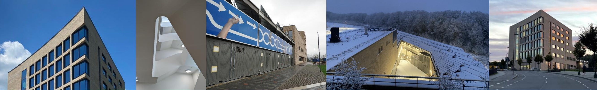

<details>
<summary>natural_image</summary>

Five modern architectural photos showing different building designs and landscapes: a modern building with windows, a white building with a hand pointing to a blue road sign, a snow-covered building at dusk, and a modern multi-story building with a road.
</details>

Alterung • Modelle • Diagnostik Packdesign Elektromobilität Stationäre Energiespeicher • Energiesystemanalyse

## Grundgebiete der Elektrotechnik 1 – Einführung in die Schaltungstechnik

**Was ist Elektrotechnik und Informationstechnik? – Eine Motivation**

G1 0A V1

Dirk Uwe Sauer

**Center for Ageing, Reliability and Lifetime Prediction of Electrochemical and Power Electronic Systems (CARL)**

CARL

Center for Ageing, Reliability and Lifetime Prediction of Electrochemical and Power Electronic Systems

RWTHAACHEN UNIVERSITY

---

## Persönliche Vorstellung

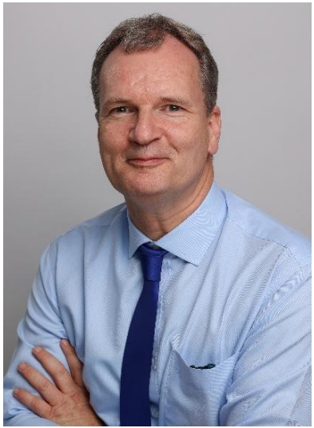

<details>
<summary>natural_image</summary>

Portrait of a man in a light blue shirt and dark blue tie, arms crossed (no text or symbols visible)
</details>

## ■ Prof. Dr. Dirk Uwe Sauer

**Ausbildung und Werdegang**

**1989 – 1994 Physikstudium an der TH Darmstadt**

**1992 – 2003 Fraunhofer-Institut für Solar Energiesysteme ISE / Freiburg**

**2003 Promotion in Elektrochemie an der Uni Ulm**

**2003 – 2009 Juniorprofessor an der RWTH Aachen**

**Seit 2009 Professor an der RWTH Aachen in der Fakultät für Elektrotechnik und Informationstechnik**


Stromrichtertechnik und Elektrische Antriebe


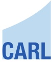

Center for Ageing, Reliability and Lifetime Prediction of Electrochemical and Power Electronic Systems


E.ON Energy Research Center

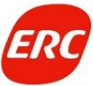


JÜLICH Forschungszentrum

HELMHOLTZ-INSTITUT MÜNSTER

**Verschiedene sonstige Aufgaben (Auswahl)**

- **Sprecher der Elektrischen Energietechnik der Fakultät**
**Wissenschaftlicher Leiter des Masterstudiengangs** „Battery Science and Technology in Engineering
- **Wissenschaftlicher Leiter einer jährlicher Konferenzen**
- **Editor eines Wissenschaftsjournals zu Energiespeichern (2015 – 2022)**

3

|Dirk Uwe SauerG1 0A V1

Lehrstuhl für Elektrochemische Energiewandlung und Speichersystemtechnik

JARAR司

Jülich Aachen

Research

Alliance

iSEA

Stromrichtertechnik und Elektrische Antriebe

RWTHAACHEN UNIVERSITY

---

Was ist Elektrotechnik?

## Aufgaben der Physik

- Beschreibung der Natur in ihren Eigenschaften, Erscheinungen und Zuständen möglichst anhand messbarer Größen
- Auffindung von Gesetzmäßigkeiten in den Beziehungen zwischen den Größen, z.B. $U   =   R \cdot I$ oder $E   =   m \cdot c ^ { 2 }$

## Aufgabe der Technik bzw. des Ingenieurwesens

\- Anwendung physikalischer Erkenntnisse z. B. Realisierung elektronischer Bauelemente und Schaltungen, Kraftwerke, Fahrzeuge etc.

4

|G1 0A V1 Dirk Uwe Sauer

Lehrstuhl für Elektrochemische Energiewandlung und Speichersystemtechnik

iSEA

Stromrichtertechnik und Elektrische Antriebe

RWTHAACHEN UNIVERSITY

---

Was ist Elektrotechnik?

## Grundlagen der Elektrotechnik

• Elektrischer Strom und elektrische Spannung
• Netzwerke
• Bauelemente
• Elektrische und magnetische Felder
• Elektromagnetische Wellen

5

|G1 0A V1 Dirk Uwe Sauer

Lehrstuhl für Elektrochemische Energiewandlung und Speichersystemtechnik

iSEA

Stromrichtertechnik und Elektrische Antriebe

RWTHAACHEN UNIVERSITY

---

## Was ist Elektrotechnik?

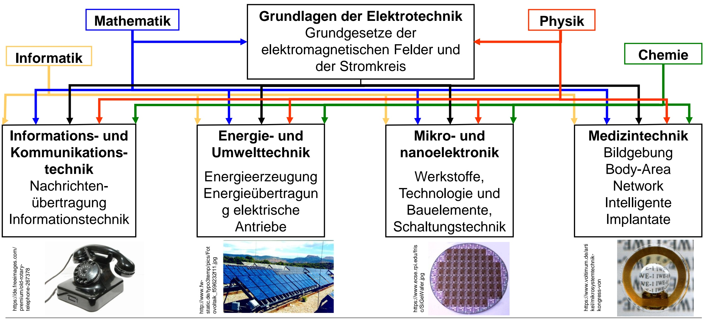

<details>
<summary>flowchart</summary>

```mermaid
graph TD
  subgraph Mathematik["Mathematik"]
  A1["Mathematik"] --> B["Grundlagen der Elektrotechnik\nGrundgesetze der elektromagnetischen Felder und der Stromkreis"]
  end

  subgraph Informatik["Informatik"]
  C1["Informatik"] --> D["Informations- und Kommunikations-technik\nNachrichtenübertragung\nInformationstechnik"]
  C2["Informatik"] --> D
  C3["Physik"] --> D
  C4["Chemie"] --> D
  end

  subgraph Energie["Energie- und Umwelttechnik\nEnergieerzeugung\nEnergieübertragung elektrische Antriebe"]
    E1["Energie- und Umwelttechnik"]
    E2["Mikro- und nanoelektronik\nWerkstoffe,\nTechnologie und Bauelemente,\nSchaltungstechnik"]
    E3["Medizintechnik\nBildgebung\nBody-Area\nNetwork\nIntelligente Implantate"]

  subgraph Physik["Physik"]
  F1["Physik"] --> G["Grundlagen der Elektrotechnik\nGrundgesetze der elektromagnetischen Felder und der Stromkreis"]
  end

  subgraph Information["Informationstechnik"]
    I1["Informations- und Kommunikations-technik\nNachrichtenübertragung\nInformationstechnik"]
    I2["Energie- und Umwelttechnik\nEnergieerzeugung\nEnergieübertragung elektrische Antriebe"]
    I3["Mikro- und nanoelektronik\nWerkstoffe,\nTechnologie und Bauelemente,\nSchaltungstechnik"]
    I4["Medizintechnik\nBildgebung\nBody-Area\nNetwork\nIntelligente Implantate"]
  end

  subgraph Chemie["Chemie"]
    J1["Chemie"]
    J2["Physik"]
    J3["Informatik"]
    J4["Informatik"]
  end

  subgraph Data["Data Source: https://de.freeimages.com/premium/old-rotary-telephone-267378"]
  end

  subgraph Images["Image Data: http://www.fw-static.de/typo3temp/pics/Fotovoltaik_f596232f11.jpg"]
  end

  subgraph Images["Image Data: https://www.ecse.rpi.edu/frisc/SiGeWafer.jpg"]
  end

  subgraph Images["Image Data: https://www.voltimum.de/artikel/mikrosystemtechnik-kongress-von"]
  end
```
</details>

6

|G1 0A V1 Dirk Uwe Sauer

Lehrstuhl für Elektrochemische Energiewandlung und Speichersystemtechnik

iSEA

Stromrichtertechnik und Elektrische Antriebe

RWTHAACHEN UNIVERSITY

---

## Was ist Elektrotechnik?

## Energietechnik

7

|G1 0A V1 Dirk Uwe Sauer

Lehrstuhl für Elektrochemische Energiewandlung und Speichersystemtechnik

iSEA

Stromrichtertechnik und Elektrische Antriebe

RWTHAACHEN UNIVERSITY

---

## Elektrische Energietechnik – Stromerzeugung aus Laufwasserkraftwerken

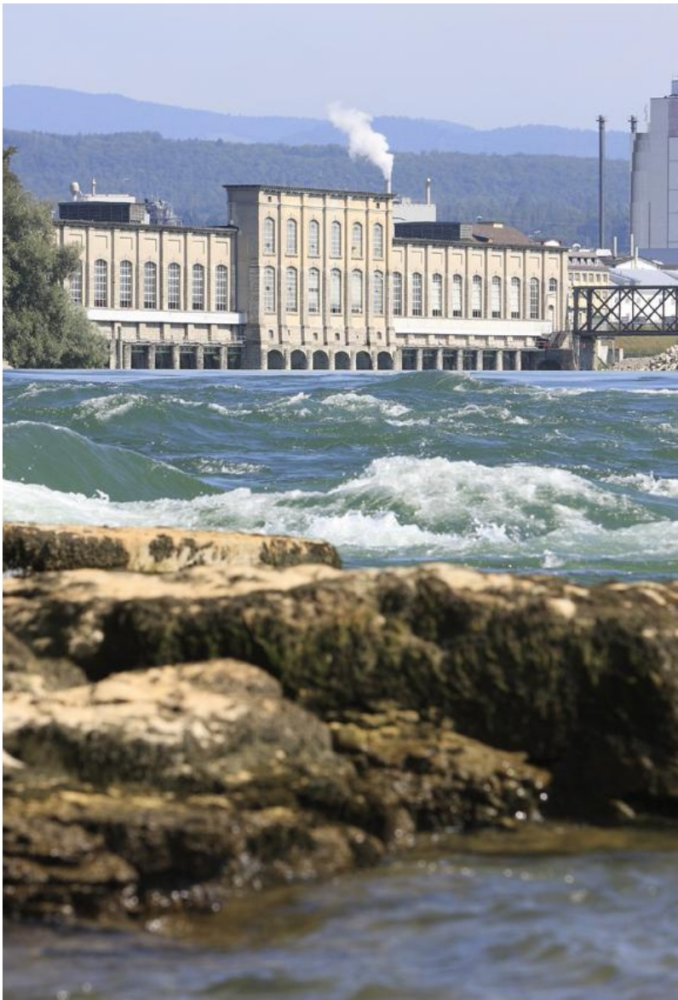

<details>
<summary>natural_image</summary>

Exterior view of a modern industrial complex with smokestacks and factory buildings, partially obscured by waves crashing on rocky shore (no signage or text visible)
</details>

Erstes großes Flusskraftwerk Rheinfelden (25 MW)

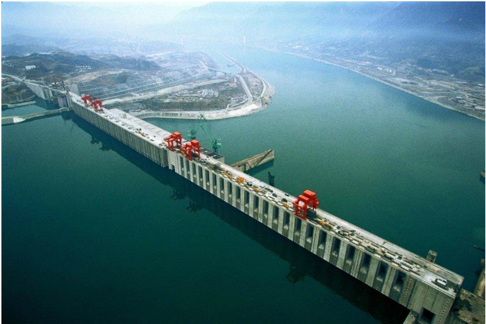

<details>
<summary>natural_image</summary>

Aerial view of a large hydroelectric dam under construction spanning a wide river, with red cranes and surrounding hills (no visible text or symbols)
</details>

Quelle: http://cdn4.spiegel.de/images/image-116677-galleryV9-kcem.jpg

Drei-Schluchten-Staudamm am Jangtse-Fluss (85 Milliarden kWh/Jahr)

8

|G1 0A V1 Dirk Uwe Sauer

Lehrstuhl für Elektrochemische Energiewandlung und Speichersystemtechnik

iSEA

Stromrichtertechnik und Elektrische Antriebe

RWTHAACHEN UNIVERSITY

---

## Elektrische Energietechnik – Kraftwerk mit fossilen Brennstoffen

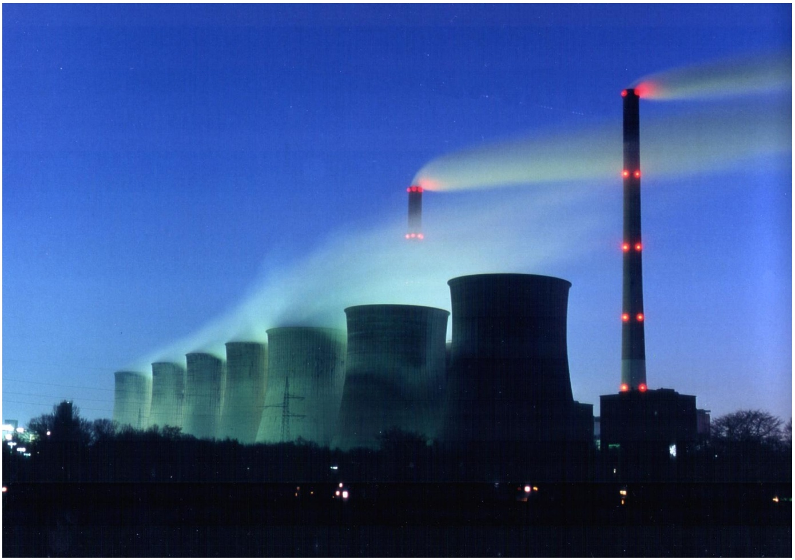

<details>
<summary>natural_image</summary>

Nighttime industrial cooling plant with multiple cooling towers emitting smoke, featuring a tall red-topped tower and multiple cooling towers in the background (no visible text or symbols)
</details>

Quelle: http://www.gelsenzentrum.de/eon\_kohlekraftwerk\_scholven.jpg

Kohlekraftwerk Scholven bei Gelsenkirchen

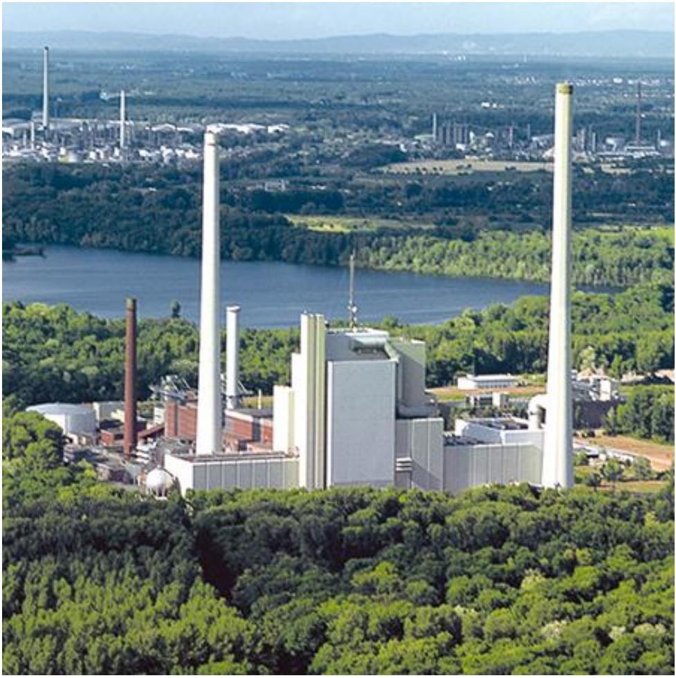

<details>
<summary>natural_image</summary>

Aerial view of an industrial power plant with two tall chimneys beside a lake, surrounded by greenery and distant hills (no visible text or symbols).
</details>

EnBW-Kohlekraftwerk & Stora Enso Müllkraftwerk in Karlsruhe

9

|G1 0A V1 Dirk Uwe Sauer

Lehrstuhl für Elektrochemische Energiewandlung und Speichersystemtechnik

iSEA

Stromrichtertechnik und Elektrische Antriebe

RWTHAACHEN UNIVERSITY

---

## Elektrische Energietechnik – Gasturbine und Hochspannungstechnik

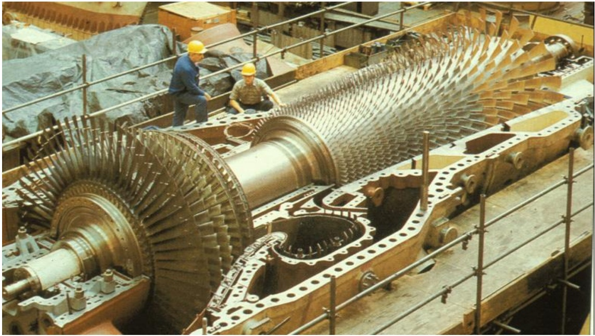

<details>
<summary>natural_image</summary>

Industrial scene showing two workers in hard hats inspecting a large turbine engine component (no visible text or symbols)
</details>

Quelle: https://img.fotocommunity.com/wasserkraftwerk-rheinfelden-4916df70-d6bc-4314-b0d9-6ec69ebd66a1.jpg?width=148&height=148

Kraftwerksturbine

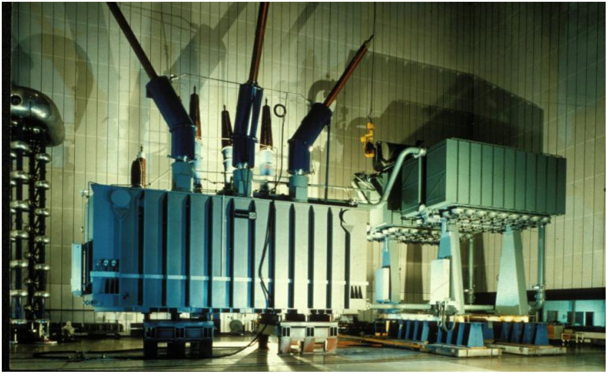

<details>
<summary>natural_image</summary>

Interior view of an industrial facility featuring a large blue electrical substation with transmission lines and overhead structures (no visible text or symbols)
</details>

Transformator

10

|G1 0A V1 Dirk Uwe Sauer

Lehrstuhl für Elektrochemische Energiewandlung und Speichersystemtechnik

iSEA

Stromrichtertechnik und Elektrische Antriebe

RWTHAACHEN UNIVERSITY

---

## Elektrische Energietechnik – Stromnetze

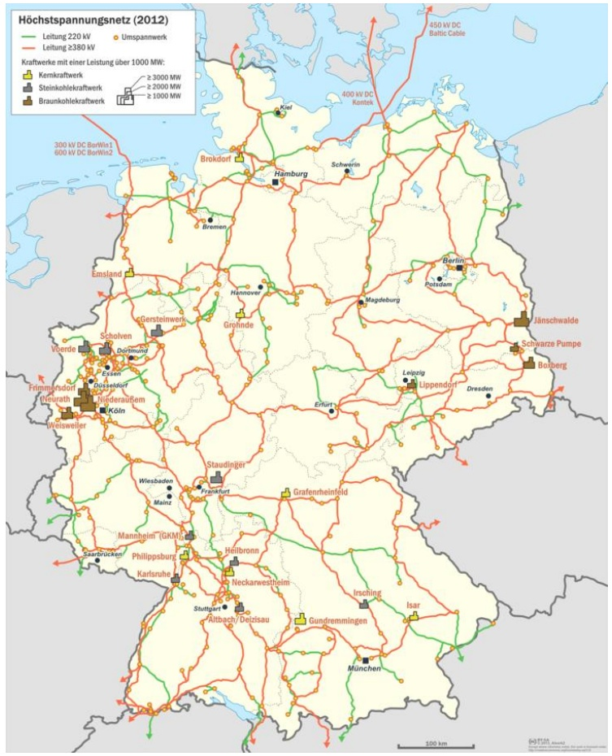

<details>
<summary>text_image</summary>

Höchstspannungsnetz (2012)
Leitung 220 kV
Umspanwerk
Kraftwerke mit einer Leistung über 1000 MW:
Kernkraftwerk
Steinkohlekraftwerk
Braunkohlekraftwerk
300 kV DC BorWin1
600 kV DC BorWin2
450 kV DC
Baltic Cable
400 kV DC
Kontok
Kiel
Schwerin
Bremen
Hamburg
Emsland
Gersteinwerk
Grohnde
Hannover
Magdeburg
Berlin
Peltström
Jänschwalde
Schwarze Pumpe
Borberg
Leipzig
Lippendorf
Dresden
Voerde
Scholven
Dorimung
Espan
Düsseldorf
Nünderaußam
Köln
Weltsweiter
Staudinger
Frankfurt
Grafenheinfeld
Wiesbader
Malz
Mannhelm (GKM)
Philippsburg
Heilbronn
Neckarwestholm
Karlsruhe
Stuttgart
Aitbach/Detzisau
Gundremmingen
Isar
München
Irching
München
</details>

Quelle: Von Alexrk2 - own work, usingOpenstreetmap data, CC BY-SA 3.0, https://commons.wikimedia.org/w/index.php?curid=27611251

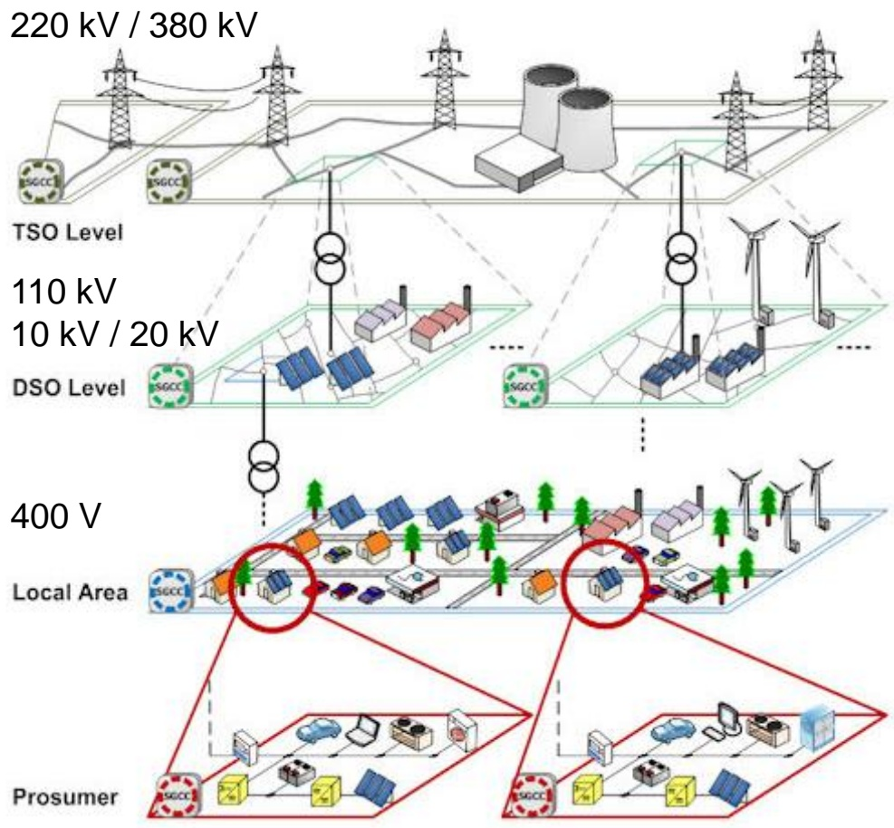

<details>
<summary>flowchart</summary>

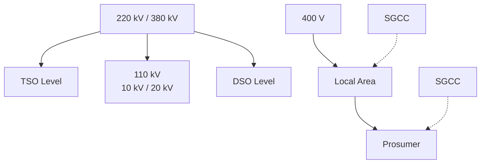
</details>

Selbstähnlichkeit der Netztopologie

©FH-Südwestfalen -FB Energieversorgung

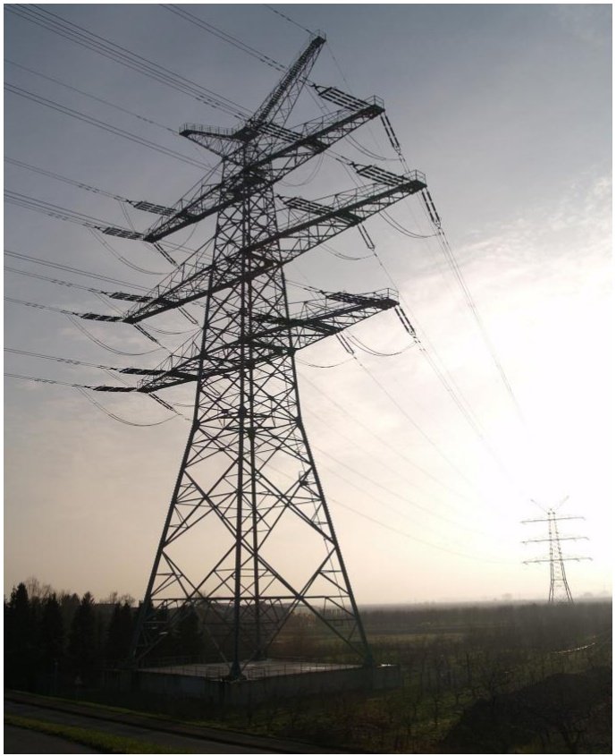

<details>
<summary>natural_image</summary>

Silhouette of a high-voltage electricity pylon at sunset, with no visible text or symbols
</details>

Quelle: https://encrypted-tbn0.gstatic.com/images?q=tbn:ANd9GcQUxu4Hp Sjzj6yirKpf3B5Nt6vkohIqtUlsaT-LjM4bezIRKHwy2w

11

|G1 0A V1 Dirk Uwe Sauer

Lehrstuhl für Elektrochemische Energiewandlung und Speichersystemtechnik

iSEA

Stromrichtertechnik und Elektrische Antriebe

RWTHAACHEN UNIVERSITY

---

## Elektrische Energietechnik – Erneuerbare Energien

Photovoltaik-Freiflächenanlagen

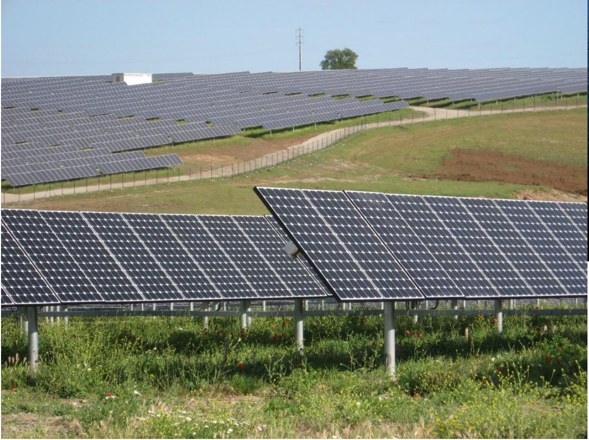

<details>
<summary>natural_image</summary>

Rows of solar panels installed on a grassy field under clear sky (no text or symbols visible)
</details>

Quelle: Von Ceinturion, CC BY-SA 3.0, https://commons.wikimedia.org/w/index.php?curid=3181924

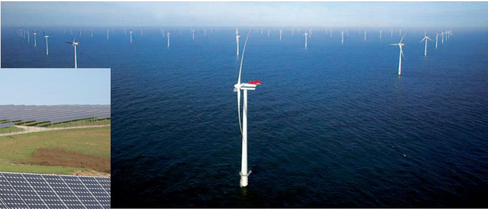

<details>
<summary>natural_image</summary>

Aerial view of an offshore wind farm with multiple turbines on calm blue water, alongside a close-up of solar panels and a small inset image (no text or symbols visible)
</details>

Quelle: http://www.fvee.de/fileadmin/publikationen/Themenhefte/th2006/th2006\_02\_03.pdf

Dänischer Offshore Windpark Hornsrev

12

|G1 0A V1 Dirk Uwe Sauer

Lehrstuhl für Elektrochemische Energiewandlung und Speichersystemtechnik

iSEA

Stromrichtertechnik und Elektrische Antriebe

RWTHAACHEN UNIVERSITY

---

## Elektrische Energietechnik – Netzferne Stromversorgung

■ Technische Geräte
■ Abgelegene Häuser und Bauernhöfe
■ Elektrifizierung im ländlichen Raum
■ Telekommunikation

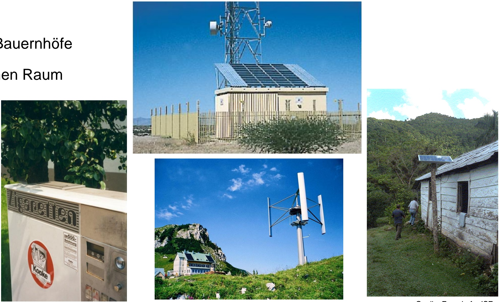

Quelle: Fraunhofer ISE

13

|G1 0A V1 Dirk Uwe Sauer

Lehrstuhl für Elektrochemische Energiewandlung und Speichersystemtechnik

iSEA

Stromrichtertechnik und Elektrische Antriebe

RWTHAACHEN UNIVERSITY

---

## Leistungselektronik: Der Taktgeber der Energiewende

## Ohne sie kein E-Auto, kein Windpark, kein grüner Wasserstoff, keine KI

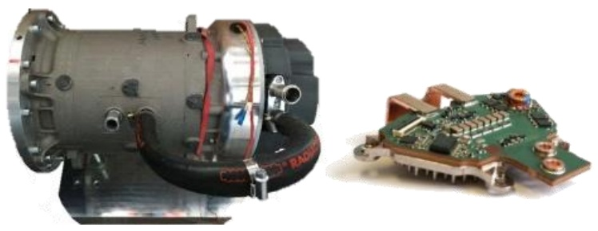

<details>
<summary>natural_image</summary>

Two views of a mechanical device and a circuit board (no visible text or symbols)
</details>

## Elektromobilität

**17 Mio. neue E-Autos weltweit (2024)**

SiC-Wechselrichter integriert im E-Motor

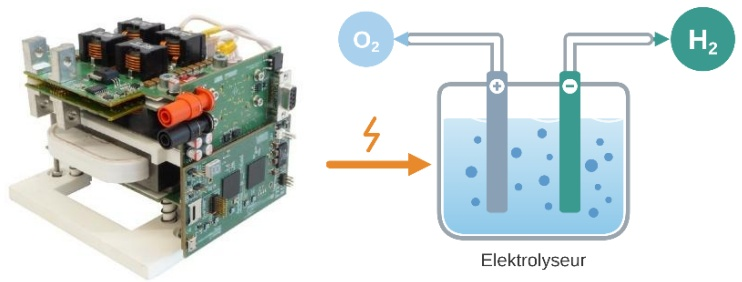

<details>
<summary>flowchart</summary>

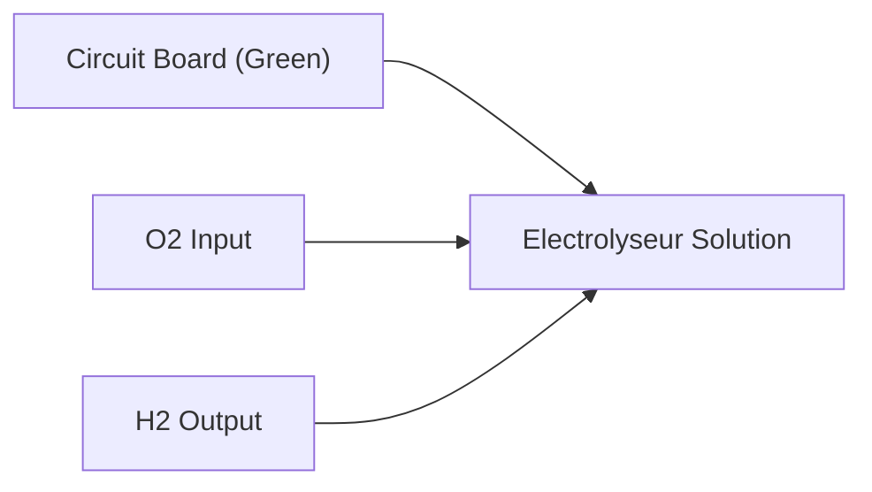
</details>

## Grüner Wasserstoff

**Klimafreundlicher Stahl und Chemie ohne CO**₂

GaN-Wandler speist Elektrolyseure

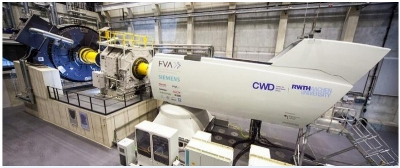

<details>
<summary>natural_image</summary>

Interior of a large industrial facility with a CWD-branded machine and Siemens branding, no visible text or symbols on the machine itself.
</details>

## Nachhaltige Energieerzeugung

**Über 50 % des Stroms in DE erneuerbar**

Megawatt-Umrichter im Gondel-Prüfstand

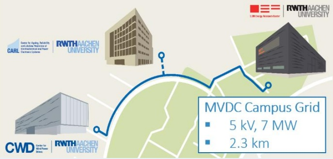

<details>
<summary>text_image</summary>

CARL
Corteir for Aging, Solidality and Climate Protection of Environmental and Power Facilities & Systems
RWNTHAACHEN UNIVERSITY
CWD
Corteir for 500kW Power Units
RWNTHAACHEN UNIVERSITY
MVDC Campus Grid
• 5 kV, 7 MW
• 2.3 km
</details>

## Gleichstromnetze

**Das 50 Hz Netz stößt an seine Grenzen**

Forschungsnetz auf dem RWTH Campus

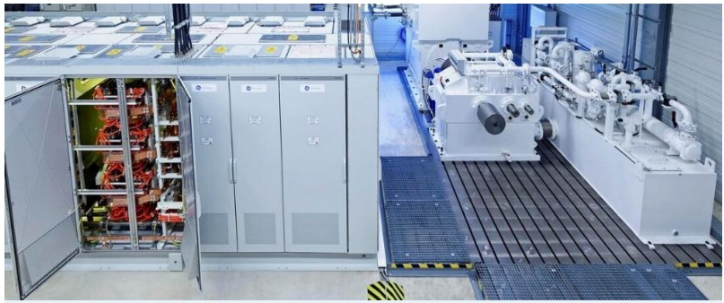

<details>
<summary>natural_image</summary>

Interior view of an industrial facility with large electrical cabinets and machinery (no visible text or symbols)
</details>

## Energieversorgung für Data Center

**Rechenzentren 2030: Strombedarf wie Japan**

5 MW und 5 kV Mittelspannungsumrichter

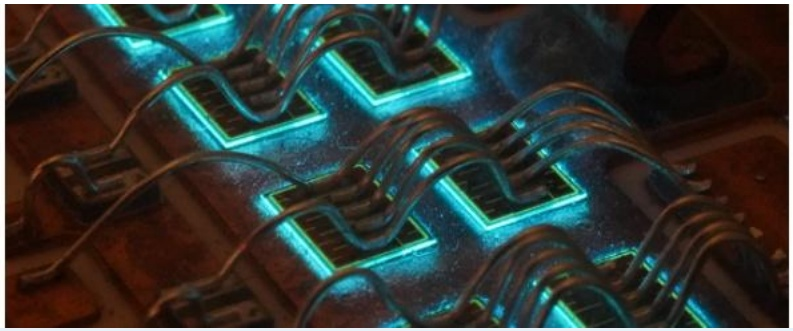

<details>
<summary>natural_image</summary>

Close-up of glowing blue circuit lines on a dark surface, no visible text or symbols
</details>

## Leistungshalbleiter

**SiC und GaN schalten in Nanosekunden**

Licht verräten Temperatur, Strom & Alterung

14

|G1 0A V1 Dirk Uwe Sauer

Chair of Power Electronic Systems

E.ON Energy Research Center

ERC

CARL

Center for Ageing, Reliability and Lifetime Prediction of Electrochemical and Power Electronic Systems

iSEA

RWTHAACHEN UNIVERSITY

---

## Batterietechnik – Post Mortem Laboratory

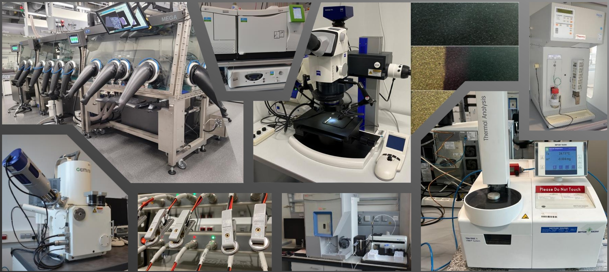

15

G1 0A V1 Dirk Uwe Sauer

Center for Ageing, Reliability and Lifetime Prediction of Electrochemical and Power Electronic Systems (CARL)

CARL

Center for Ageing, Reliability and Lifetime Prediction of Electrochemical and Power Electronic Systems

RWTHAACHEN UNIVERSITY

---

## Utility Scale Research Battery Storage – M5Bat

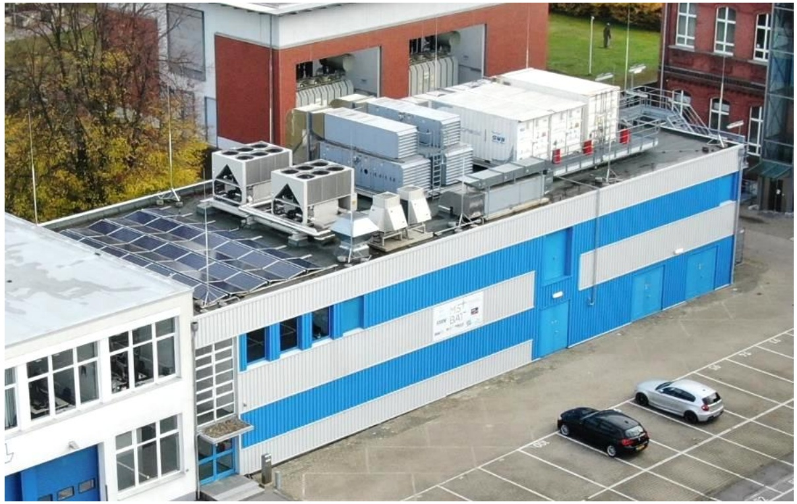

<details>
<summary>natural_image</summary>

Aerial view of a modern industrial building with blue and white buildings, solar panels on rooftop, and parked cars in the foreground (no visible text or symbols)
</details>

## Technical data

■ Power: approx. 6 MW
■ Energy: approx. 7.5 MWh
■ 5 Battery technologies (Li-Ion & lead-acid)
■ 10 independent battery units

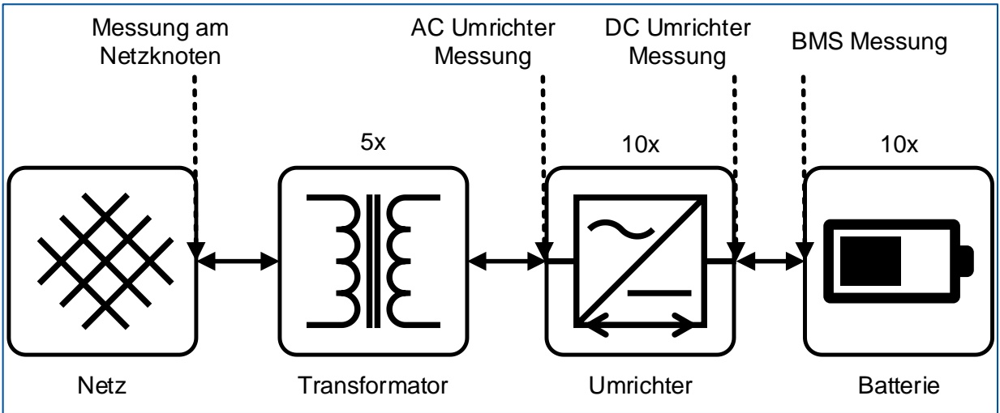

<details>
<summary>flowchart</summary>


</details>

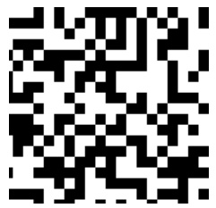

<details>
<summary>text_image</summary>

QR code image containing encoded data, no visible human-readable text
</details>


## Operation

■ System services
■ 3 MW FCR (frequency containment reserve)
■ Intraday trading (15 min market)
■ In preparation: aFRR (frequency restoration)

16

G1 0A V1 Dirk Uwe Sauer

Center for Ageing, Reliability and Lifetime Prediction of Electrochemical and Power Electronic Systems (CARL)

CARL

Center for Ageing, Reliability and Lifetime Prediction of Electrochemical and Power Electronic Systems

RWTHAACHEN UNIVERSITY

---

## Overview of sector coupling in industry applications: everything is connect

ed!

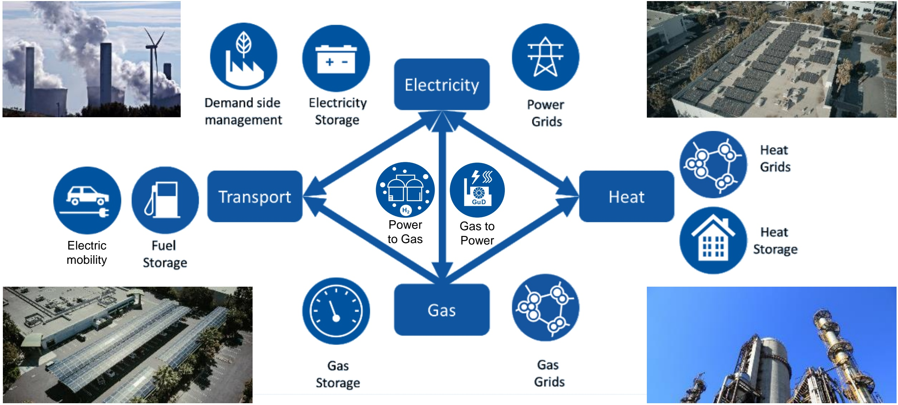

17

G1 0A V1 Dirk Uwe Sauer

Center for Ageing, Reliability and Lifetime Prediction of Electrochemical and Power Electronic Systems (CARL)

CARL

Center for Ageing, Reliability and Lifetime Prediction of Electrochemical and Power Electronic Systems

RWTHAACHEN UNIVERSITY

---

## Information for public, media and industry


Center for Ageing, Reliability and Lifetime Prediction of Electrochemical and Power Electronic Systems

RWTHAACHEN UNIVERSITY

Home

Battery Charts Revenue Index

Battery Storage M5BAT

Mobility Charts

ISEA Tools

About us


Installed Battery Energy Capacity in Germany

20.52 GWh

Current aggregated energy capacity in large- and home storage systems registered in Germany


Cross-market Battery Revenue Potential in Germany

297.29 k€/MW/a

For a 2h system with 2 cycles per day marketed on FCR, aFRR and Intraday Continous


Registered EV Battery Energy Capacity in Germany

115.47 GWh

Current aggregated energy capacity in electric vehicles (EVs) registered in Germany

18

G1 0A V1 Dirk Uwe Sauer

Center for Ageing, Reliability and Lifetime Prediction of Electrochemical and Power Electronic Systems (CARL)

CARL

Center for Ageing, Reliability and Lifetime Prediction of Electrochemical and Power Electronic Systems

RWTHAACHEN UNIVERSITY

---

## Was ist Elektrotechnik?

## Mikro- und Nanotechologie

19

|G1 0A V1 Dirk Uwe Sauer

Lehrstuhl für Elektrochemische Energiewandlung und Speichersystemtechnik

iSEA

Stromrichtertechnik und Elektrische Antriebe

RWTHAACHEN UNIVERSITY

---

## Mikroelektronik – Grundlage der Digitaltechnik

## Moore's Law: The number of transistors on microchips doubles every two years

Our World in Data

Transistor count

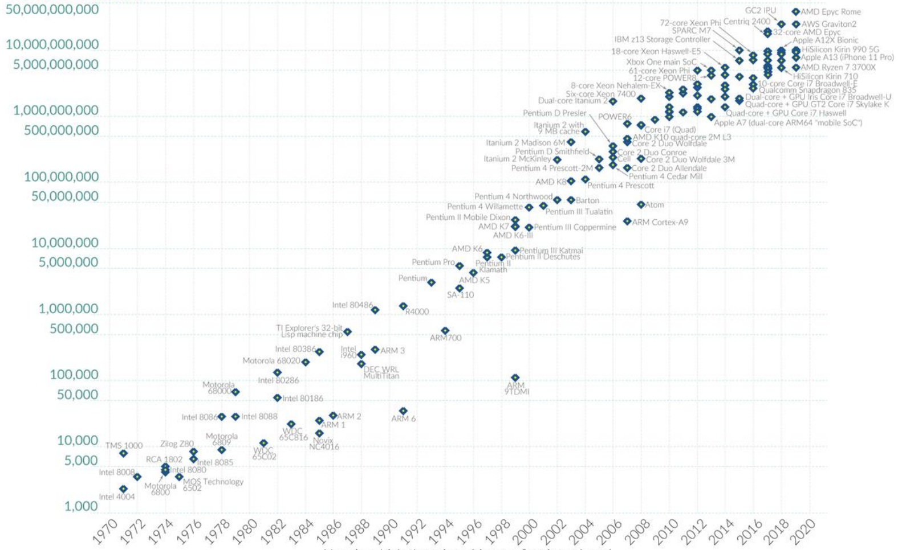

<details>
<summary>scatter</summary>

| Year | Processor / Architecture | Power Capacity (10^4) |
| --- | --- | --- |
| ~1971 | Intel 4004 | ~2,000 |
| ~1972 | Intel 8008 | ~3,500 |
| ~1973 | Intel 6800 | ~4,000 |
| ~1974 | Motorola 6502 | ~4,500 |
| ~1975 | Intel 8080 | ~5,000 |
| ~1976 | Intel 8085 | ~6,000 |
| ~1977 | Zilog Z80 | ~7,000 |
| ~1978 | Intel 8086 | ~25,000 |
| ~1979 | Motorola 6809 | ~8,000 |
| ~1981 | Intel 80286 | ~50,000 |
| ~1982 | Intel 80186 | ~15,000 |
| ~1983 | WDC 65C816 | ~20,000 |
| ~1984 | Intel 80386 | ~25,000 |
| ~1985 | Novix NC4016 | ~25,000 |
| ~1986 | ARM 1 | ~30,000 |
| ~1987 | ARM 2 | ~35,000 |
| ~1988 | DEC WRL MultiTitan | ~40,000 |
| ~1989 | ARM 3 | ~45,000 |
| ~1991 | ARM 700 | ~50,000 |
| ~1992 | R4000 | ~1,200,000 |
| ~1993 | Pentium | ~2,500,000 |
| ~1994 | SA-110 | ~3,500,000 |
| ~1995 | AMD K5 | ~4,500,000 |
| ~1996 | Pentium II Klamath | ~5,500,000 |
| ~1997 | Pentium II Deschutes | ~6,500,000 |
| ~1998 | Pentium III Katmai | ~7,500,000 |
| ~1999 | Pentium III Coppermine | ~8,500,000 |
| ~2000 | Pentium III Tualatin | ~9,500,000 |
| ~2001 | Pentium 4 Willamette | ~12,500,000 |
| ~2002 | Pentium 4 Northwood | ~15,000,000 |
| ~2003 | Pentium 4 Prescott-2M | ~25,000,000 |
| ~2004 | Pentium 4 Cedar Mill | ~35,000,000 |
| ~2005 | Pentium 4 Allendale | ~45,000,000 |
| ~2006 | Core 2 Duo Allendale | ~55,000,000 |
| ~2007 | Cell | ~65,000,000 |
| ~2008 | Core 2 Duo Conroe | ~75,000,000 |
| ~2009 | Core 2 Duo Wolrdale 3M | ~85,000,000 |
| ~2010 | Core 2 Duo Wolrdale | ~95,000,000 |
| ~2011 | Core 2 Duo Wolrdale | ~115,000,000 |
| ~2012 | Core 2 Duo Wolrdale L3 | ~135,000,000 |
| ~2013 | Core i7 (Quad) | ~165,000,000 |
| ~2014 | Apple A7 (dual-core ARM64 "mobile SoC") | ~215,000,000 |
| ~2015 | Dual-core + GPU GT2 Core i7 Skylake K Quad-core + GPU Core i7 Haswell | ~265,000,000 |
| ~2016 | Dual-core + GPU Iris Core i7 Broadwell-U Quad-core + GPU GT2 Core i7 Skylake K Quad-core + GPU Core i7 Haswell | ~335,000,000 |
| ~2017 | Qualcomm Snapdragon 835 Qualcomm i7 Broadwell-E Qualcomm Snapdragon 835 | ~415,000,000 |
</details>

Year in which the microchip was first introduced

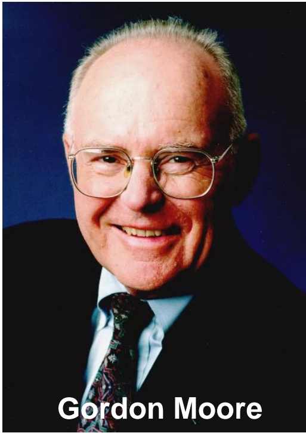

<details>
<summary>text_image</summary>

Gordon Moore
</details>

Foto: Gordon Moore. Courtesy of Intel

“Die Zahl der Transistoren auf einem Chip verdoppelt sich etwa alle 24 Monate.”

20

|G1 0A V1 Dirk Uwe Sauer

Lehrstuhl für Elektrochemische Energiewandlung und Speichersystemtechnik

iSEA

Stromrichtertechnik und Elektrische Antriebe

RWTHAACHEN UNIVERSITY

Quelle: https://www.thoughtco.com/biography-of-gordon-moore-1992167

---

## Mikroelektronik – Produktionstechnik

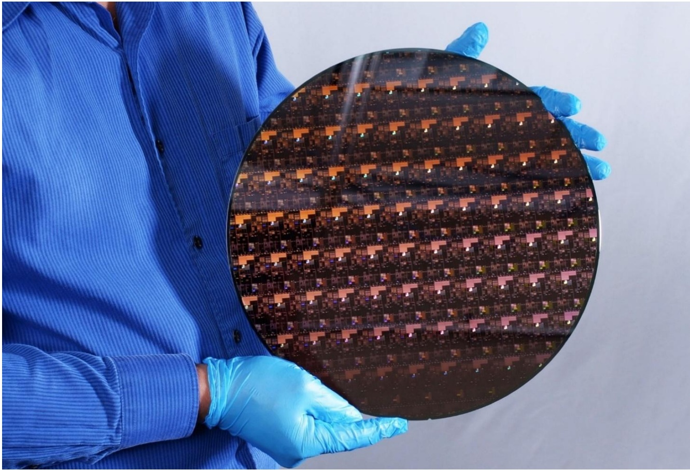

<details>
<summary>natural_image</summary>

Person in blue cleanroom suit holding a large circular semiconductor wafer (no text or symbols visible)
</details>

Quelle: https://www.notebookcheck.com/IBM-fertigt-den-weltweit-ersten-2-nm-Chip-mit-eindrucksvoller-Transistordichte.537675.0.html#news\_intro\_image

IBM hat als erstes Unternehmen ein 2 nm-Verfahren entwickelt, das die Transistordichte von Chips deutlich erhöht: 333 Millionen Transistoren pro mm<sup>2</sup>

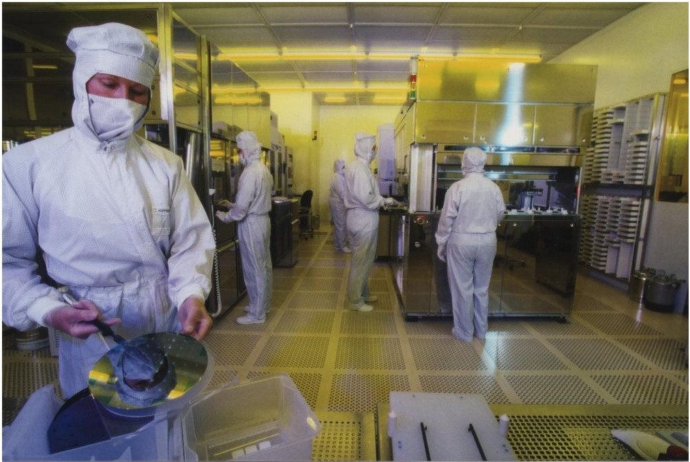

<details>
<summary>natural_image</summary>

Interior of a cleanroom facility with workers in full protective suits operating equipment (no visible text or symbols)
</details>

Quelle: http://perpetuapower.com/wp-content/uploads/2016/02/UseCase\_ConsElectr\_750x750.jpg

## IC-Fertigung auf 300-mm-Wafer

IBM hat den laut eigener Aussage ersten 2 nm-Chip der Welt vorgestellt, der bei einer identischen Performance 75 Prozent weniger Energie benötigen soll als ein konventioneller 7 nm-Chip.

21

|G1 0A V1 Dirk Uwe Sauer

Lehrstuhl für Elektrochemische Energiewandlung und Speichersystemtechnik

iSEA

Stromrichtertechnik und Elektrische Antriebe

RWTHAACHEN UNIVERSITY

---

Materials

Microelectronics

Nanostructures

Characterization

## Halbleiter

Process Development

Device Integration

Reliability

Brain-Inspired

Al Hardware

## Neuromorphic Computing

Low-Power Electronics

In-Memory Computing

Edge Computing

Novel Devices

Quantum Materials

Qubits

# Quantum Computing

Integrated Photonics

Quantum Devices

Scalable Platforms

Cryogenic Technologies

Integrated Circuits

Advanced Materials

Heterogeneous Integration

## Microelectronics

Packaging

System Integration

Test & Reliability

Light-Matter Interaction

Optical Components

## Photonics

Imaging

Communication

Integrated Photonics

Quantum Photonics

8

ELD

Chair of Electronic Devices

Chair of Integrated Digital Systems and Circuit Design

RWTHAACHEN

---

KI für nachhaltiges Bauen


## CARE

## Exzellenzcluster für klimaneutrales und ressourceneffizientes Bauen

RWTH Aachen University und TU Dresden

## CoHManD

## Mit der Baustelle sprechen

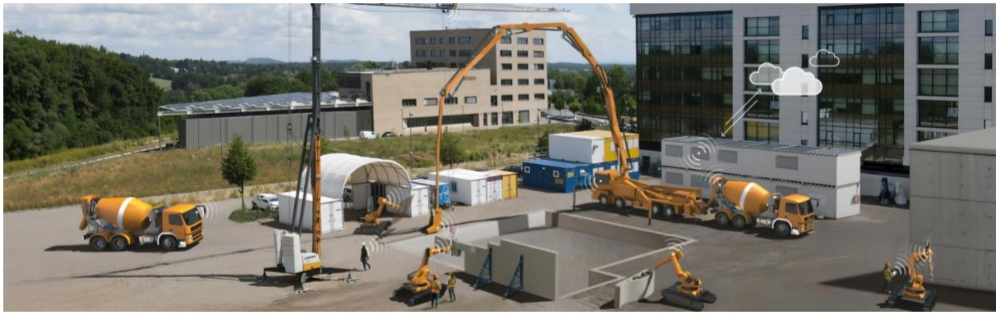

<details>
<summary>natural_image</summary>

Exterior view of a modern industrial facility with concrete mixer trucks and surrounding buildings (no signage or text visible)
</details>

**Was tun, wenn etwas unerwartetes passiert?**

**Z.B. wenn eine Betonlieferung zu spät kommt?**

Sprache und Baustellendaten verknüpfen

Mit KI kommende Abläufe vorhersagen

**Ziel: Störungen früh erkennen und besser planen**

## D-DREAM

## Bauteile intelligent fertigen

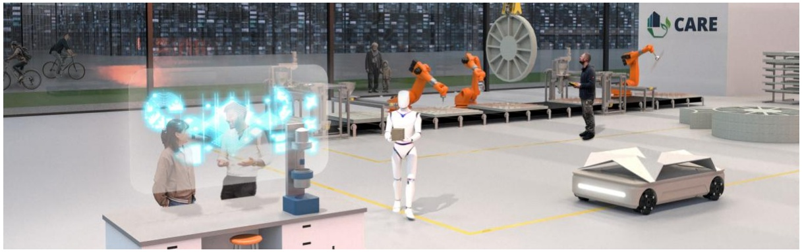

<details>
<summary>natural_image</summary>

Interior of a modern automated factory with robotic arms and workers, featuring digital overlays and a 'CARE' sign in the background (no readable text on main subjects)
</details>

**Wie fertigen wir mit neuen Baustoffen zuverlässig gute Bauteile?**

Sensordaten mit Materialdaten verknüpfen Fertigung im digitalen Zwilling optimieren

**Ziel: Bauteilqualität gezielt verbessern**

INDA – Lehrstuhl für Informationstheorie und Datenanalytik

INDA

Chair of

Information Theory

and Data Analytics

RWTHAACHEN

UNIVERSITY

---

NeuroSys – Teilprojekt D


## Neuro Sys

## Effiziente KI-Methoden für neuromorphes Computing in der Praxis

Forschung für energiesparende, nachhaltige und souveräne KI.

• Methodik

− Distributed Machine Learning
Datenkompression
− Kommunikationsprotokolle
− Informationstheorie

• Anwendungen

− Sprachtechnologien
− Bildverarbeitung
− Medizintechnik

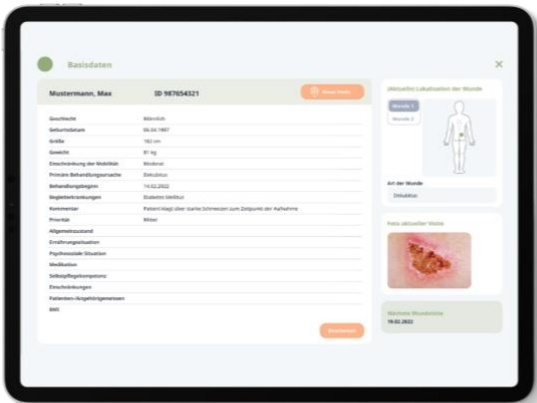

<details>
<summary>text_image</summary>

Basisdaten
Mustermann, Max ID 167654321
Gesichte Männlich
Geräuterdatum 65.01.1987
Größe 182 cm
Gewicht R7 kg
Derechnung der Wechselkmal Modell
Prüme Behandlungserahe Seduktion
Behandlungsteigen 142,000
Biogestrierungen Einstufen Mittel
Komponenter Patient nicht über verschiedene Schmesser zum Zeitpunkt der Aufnahme
Prezent Miozi
Allgemeinskaufend
Erfolgsgehaltung
Psychosatistik Situation
Medication
Sociofahrgeschäftszunzung
Diseinflösungen
Patienten-/Augsbezogenommen
BMI
Anteilzeit Lifikation der Wandite
Werte 1
Werte 2
Art der Wandite
Omkünfte
Feste aktuelle Werte
Wertene Wandische
16.02.2022
</details>

Interface für medizinisches Personal zur Human-AI-Interaction<sup>1</sup>

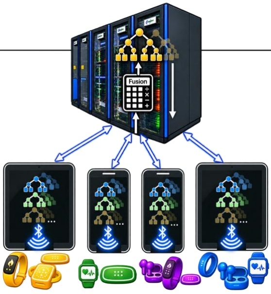

<details>
<summary>flowchart</summary>

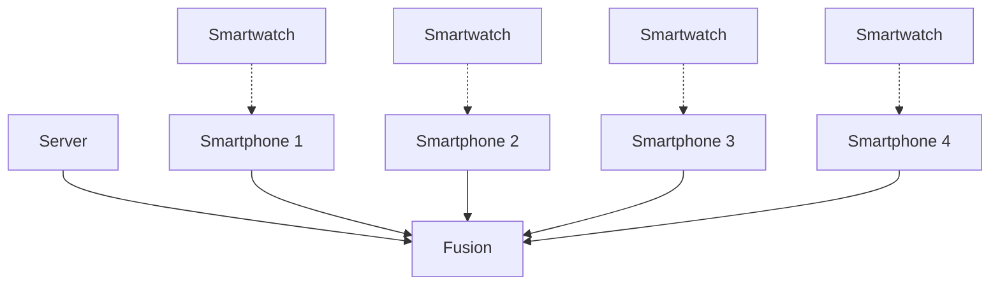
</details>

Private und personalisierte Verarbeitung von Wearables-Sensordaten zum medizinischen Monitoring im Alltag<sup>2</sup>

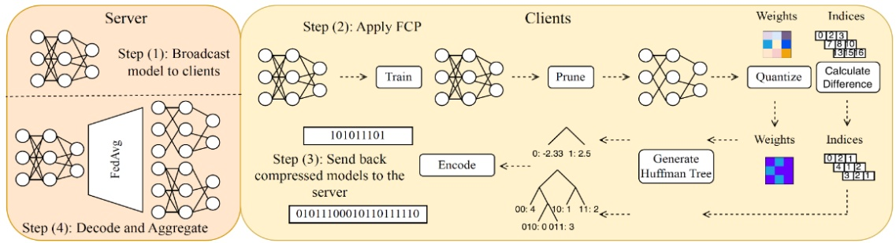

<details>
<summary>flowchart</summary>

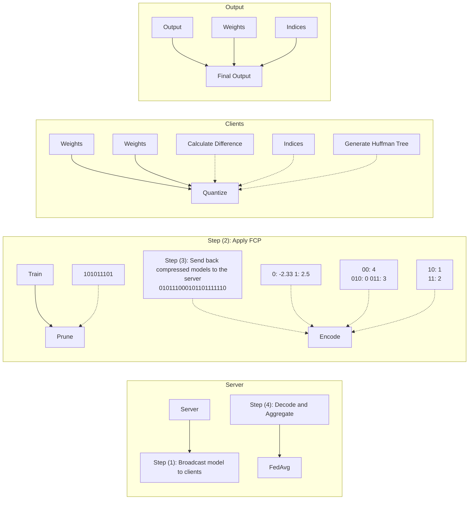
</details>

Datenkompressionspipeline für Machine Learning Modell Komprimierung zum verteilten Lernen<sup>3</sup>

INDA – Lehrstuhl für Informationstheorie und Datenanalytik

1. Daniel Blase, medIT, 2026

2. F. Walger, M. Ejtehadi, A. Schmeink and D. Paez-Granados, "FedSCS-XGB – Federated Server-centric surrogate XGBoost for continual health monitoring“, IEEE EMBC 2026

3. E. Colybes, S. Salehi and A. Schmeink, “A Full Compression Pipeline for Green Federated Learning in Communication-Constrained Environments“, IEEE ICMLCN 2026

INDA

Chair of

Information Theory

and Data Analytics

RWTHAACHEN UNIVERSITY

---

## AIXTRON enables the Megatrends Digitization, Energy Efficiency and Electromobility

**49 In**

**Indium 114.82**

**15**P

**Phosphor us**

**30.97**

**31**

**Ga**

**Gallium 69.723**

**33**

**Arsenic 74.922**


▪ **Optical Data Communications**
▪ **3D Sensing** (Consumer, Automotive)

**31**

**Ga**

**Gallium 69.723**

7N

**Nitrogen 14.007**

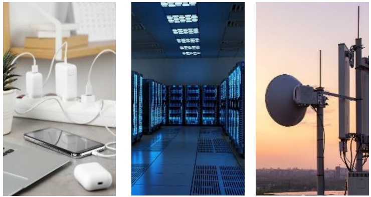

▪ **Power Electronics**
**RF Electronics and Communications**

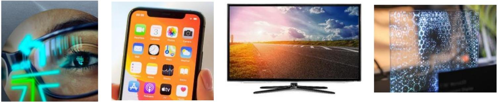

**14**

**Si**

**Silicon 28.085**

6

**Carbon 12.011**

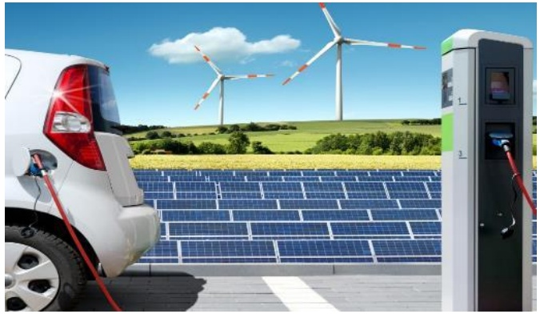

<details>
<summary>natural_image</summary>

Electric vehicle charging at a renewable energy station with solar panels and wind turbines in the background (no text or symbols visible)
</details>

▪ **Electromobility**
▪ **Clean Energy / Power Electronics**
**Several cooperations within IPCEI AST**

25

G1 0A V1

Dirk Uwe Sauer

Lehrstuhl für Elektrochemische Energiewandlung und Speichersystemtechnik

iSEA

Stromrichtertechnik und Elektrische Antriebe

Source: AIXTRON UNIVERSITY

---

## We address a comprehensive set of growth applications with our G10 family of products

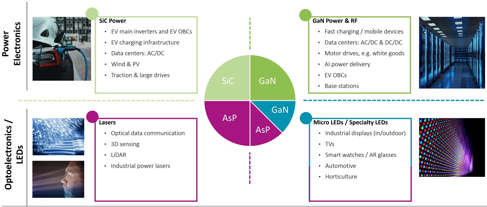

<details>
<summary>pie</summary>

| Category | Material Type | Application |
| --- | --- | --- |
| Power Electronics | SiC | EV main inverters and EV OBCs |
| Power Electronics | SiC | EV charging infrastructure |
| Power Electronics | SiC | Data centers: AC/DC |
| Power Electronics | SiC | Wind & PV |
| Power Electronics | SiC | Traction & large drives |
| Power Electronics | GaN | Fast charging / mobile devices |
| Power Electronics | GaN | Data centers: AC/DC & DC/DC |
| Power Electronics | GaN | Motor drives, e.g. white goods |
| Power Electronics | GaN | AI power delivery |
| Power Electronics | GaN | EV OBCs |
| Power Electronics | GaN | Base stations |
| Optoelectronics / LEDs | AsP | Optical data communication |
| Optoelectronics / LEDs | AsP | 3D sensing |
| Optoelectronics / LEDs | AsP | LiDAR |
| Optoelectronics / LEDs | AsP | Industrial power lasers |
| Optoelectronics / LEDs | Micro LEDs / Specialty LEDs | Industrial displays (in/outdoor) |
| Optoelectronics / LEDs | Micro LEDs / Specialty LEDs | TVs |
| Optoelectronics / LEDs | Micro LEDs / Specialty LEDs | Smart watches / AR glasses |
| Optoelectronics / LEDs | Micro LEDs / Specialty LEDs | Automotive |
| Optoelectronics / LEDs | Micro LEDs / Specialty LEDs | Horticulture |
</details>

26

|G1 0A V1 Dirk Uwe Sauer

Lehrstuhl für Elektrochemische Energiewandlung und Speichersystemtechnik

iSEA

Stromrichtertechnik und Elektrische Antriebe

RWTHAACHEN UNIVERSITY

---

## Leading MOCVD Equipment Innovation for 40 Years

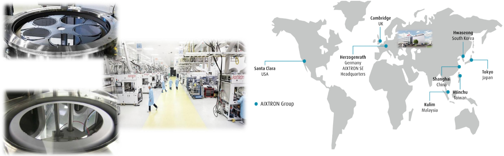

▪ **founded 1983** next to RWTH Aachen University – evolved to be the Global Market and Technology Leader for MOCVD
▪ We are a **Pure Play** MOCVD Equipment Manufacturer.
▪ **strong Company Growth foreseen-** designing Solutions together with Partners to enable most demanding Compound Semiconductor Materials and new Products

27

|G1 0A V1 Dirk Uwe Sauer

Lehrstuhl für Elektrochemische Energiewandlung und Speichersystemtechnik

iSEA

Stromrichtertechnik und Elektrische Antriebe

RWTHAACHEN UNIVERSITY

---

## Mikroelektronik – Mikrocontroller

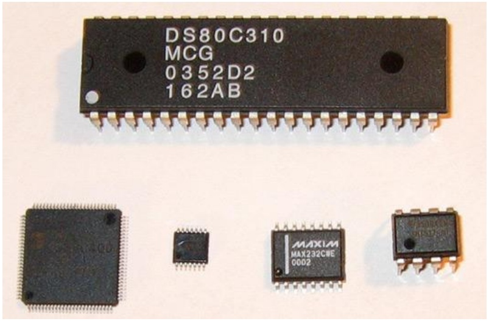

<details>
<summary>text_image</summary>

DS80C310
MCG
0352D2
162AB
MAXIM
MAX232CWE
00D2
</details>

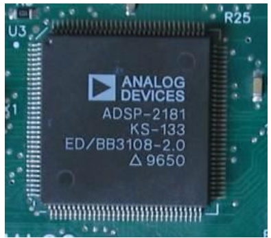

<details>
<summary>text_image</summary>

ANALOG
DEVICES
ADSP-2181
KS-133
ED/BB3108-2.0
Δ 9650
</details>

Quelle: http://www.carnut.info/star/CIMG1751\_DSP\_My-PCB\_ASSEMBLED\_SML-2.jpg

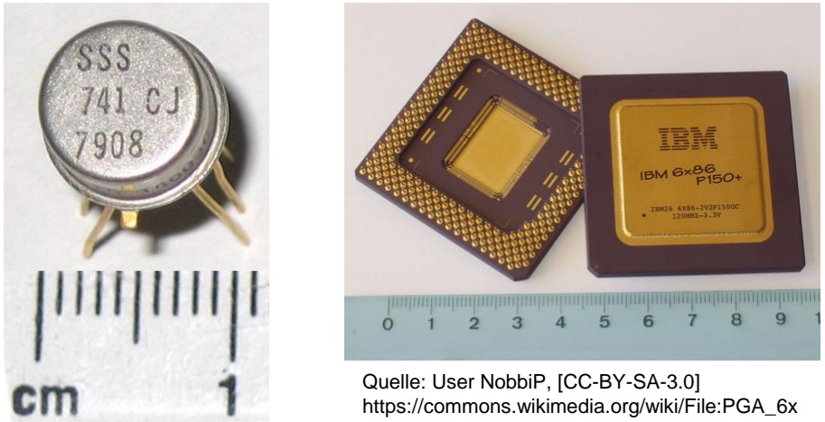

Quelle:

86\_IBM.jpg

https://dic.academic.ru/pictures/wiki/files/49/120p

x-741\_op-amp\_in\_TO-

5\_metal\_can\_package\_close-up.jpg

## IC-Gehäuse

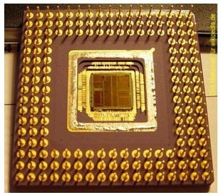

<details>
<summary>natural_image</summary>

Close-up of a microchip or integrated circuit chip with gold-colored traces and a central gold-colored cavity (no visible text or symbols)
</details>

Quelle:

486\_DX\_2\_66\_MHz\_opened.jpg

https://commons.wikimedia.org/wiki/File:AMD\_


<details>
<summary>natural_image</summary>

Microchip chip layout showing various microstructures and components (no visible text or symbols)
</details>

Intel Pentium 4

Quelle: https://www.theune.uni-hannover.de/filleadm/institut/pdf/Nonoday2005\_Panliz\_06.10.2005.pdf

28

|G1 0A V1 Dirk Uwe Sauer

Lehrstuhl für Elektrochemische Energiewandlung und Speichersystemtechnik

iSEA

Stromrichtertechnik und Elektrische Antriebe

RWTHAACHEN UNIVERSITY

---

## Mikroelektronik – Entwicklungslabore

https://www.forschungsfabrik-mikroelektronik.de/de/unser-angebot.html https://www.iisb.fraunhofer.de/de/netzwerk-kooperationen/fmd.html


<details>
<summary>natural_image</summary>

Interior of a cleanroom manufacturing facility with workers in full protective suits operating machinery (no visible text or symbols)
</details>

Forschungsfabrik Mikroelektronik Deutschland der Fraunhofer-Gesellschaft


<details>
<summary>natural_image</summary>

Scientist in cleanroom suit operating a high-tech laboratory with optical equipment and computer monitors (no visible text or symbols)
</details>

© Kurt Fuchs / Fraunhofer IISB

Hoch-Raten Xenon-Plasma FIB-Anlage (Focused Ion Beam) mit Mikro-Zug-Modul

29

|G1 0A V1 Dirk Uwe Sauer

Lehrstuhl für Elektrochemische Energiewandlung und Speichersystemtechnik

iSEA

Stromrichtertechnik und Elektrische Antriebe

RWTHAACHEN UNIVERSITY

---

## Mikroelektronik – Platinen


<details>
<summary>natural_image</summary>

Industrial Samsung 320 laser machine with coiled blue cables and control panel (no visible text or symbols)
</details>

Platinenbestückungsautomat


<details>
<summary>natural_image</summary>

Close-up of a semiconductor manufacturing line with multiple circuit boards and a laser beam interacting with them (no visible text or symbols)
</details>


<details>
<summary>text_image</summary>

9SAJ
AT49BV322A
70TI
0417
</details>

Bestückte Platine mit SMD-Bauteilen

30

|G1 0A V1 Dirk Uwe Sauer

Lehrstuhl für Elektrochemische Energiewandlung und Speichersystemtechnik

iSEA

Stromrichtertechnik und Elektrische Antriebe

RWTHAACHEN UNIVERSITY

---

## Mikroelektronik – Komplexe Steuerungs- und Navigationssysteme


<details>
<summary>natural_image</summary>

Interior view of an aircraft cockpit with control panels and dashboard (no visible text or symbols)
</details>

Quelle: User: Plenumchamber, CC-BY-SA-3.0

https://commons.wikimedia.org/wiki/File:Fly\_by\_wire\_A321\_cockpit.jpg

GPS-Navigationssystem

Fly by Wire


<details>
<summary>text_image</summary>

DISPLAY
Navigation plus
FM1 1 SWR3 TP
63 60 MAINZ
GAU-BISCHPESHEIM
420 43 BISCHOF
NACKENHEIM 2km
TONE RETURN
NAVIGATION
</details>

Quelle: https://i0.wp.com/obhur-mag.com/wp-content/uploads/2017/04/%D8%B9%D9%84%D9%85-%D8%A7%D9%84%D9%85%D9%84%D8%A7%D8%AD%D8%A96.jpg?resize=660%2C330&ssl=1

31

|G1 0A V1 Dirk Uwe Sauer

Lehrstuhl für Elektrochemische Energiewandlung und Speichersystemtechnik

iSEA

Stromrichtertechnik und Elektrische Antriebe

RWTHAACHEN UNIVERSITY

---

## Was ist Elektrotechnik?

# Information, Kommunikation und Elektronik

32

|G1 0A V1 Dirk Uwe Sauer

Lehrstuhl für Elektrochemische Energiewandlung und Speichersystemtechnik

iSEA

Stromrichtertechnik und Elektrische Antriebe

RWTHAACHEN UNIVERSITY

---

## ATRIUM – „Hardware-in-the-Loop“ Test-System für Automotive Radar

Echtzeitfähiger realitätsnaher Radarzielgenerator

▪ Ultraschnelle asymptotische EM-Modellierung
Darstellung komplexer Objekte und bewegter Szenarien
Signatur-Datenbank mit umfangreicher Objektbibliothek (Fahrzeuge, Radfahrer, Fußgänger, etc.)
Verringerter Bedarf an Testfahrten bei Verbesserungen am System
Replay kritischer Situationen zur Optimierung von Algorithmen und Sensorik


Overview | Slide #33

Chair of Radar Systems Engineering

Prof. Dr.-Ing. Peter Knott | 11 October 2026

N

Fraunhofer

FHR

RCT

RWTNIVECHEN

---

## Radarsysteme zur Erfassung der Weltraumlage

Radar-Sensoren erlauben die Erfassung und Beobachtung von Objekten auch in großer Entfernung, z.B. Satelliten:

Entwicklung und Betrieb des Tracking and Imaging Radar (TIRA)

Europas leistungsfähigstes Radar mit mechanisch gesteuerter Parabolantenne
Hochpräzise Zielverfolgung und Bahnbestimmung einzelner Objekte
▪ Hochauflösende Abbildung mit ISAR-Verfahren


<details>
<summary>natural_image</summary>

3D visualization of a satellite with glowing red glow against black background (no text or symbols)
</details>


<details>
<summary>natural_image</summary>

Interior view of a large satellite dish antenna with green structural framework and metal tower (no visible text or symbols)
</details>

Elektronisch gesteuertes Radar mit Phased-Array-Antenne (GESTRA)

▪ Voll-digitale und schnelle elektronische Strahlschwenkung für kontinuierliche Überwachung
Entdeckung und Katalogisierung großer Anzahl von Objekten


<details>
<summary>natural_image</summary>

Circular panel with grid of small square components and a red LED display in the top-left corner (no readable text or symbols)
</details>

Overview | Slide #34

Chair of Radar Systems Engineering

Prof. Dr.-Ing. Peter Knott | 11 October 2026

N

Fraunhofer

FHR

RCT

RWTNIVECHEN

---

## Kommunikationstechnik – Mobilfunk


<details>
<summary>natural_image</summary>

Exterior view of a tall industrial tower with metal scaffolding and antenna array (no visible text or symbols)
</details>

Quelle: https://commons.wikimedia.org/wiki/File:Mobilfunkturm-Schoeppingen.jpg


<details>
<summary>natural_image</summary>

Exterior view of a tall telecommunications tower against a clear blue sky, surrounded by trees (no signage or text visible)
</details>

Quelle: http://www.medienwerkstatt-online.de/lws\_wissen/bilder/24596-1.jpg

Mobilfunktürme

Smartphones


<details>
<summary>text_image</summary>

artphones
</details>

Quelle: https://cdn.arstechnica.net/wp-content/uploads/2017/09/8-2.jpg

Radioteleskop Effelsberg

effelsberg/effelsberg\_radioteleskop.jpg content/gallery/radioteleskop-Quelle: https://www.juergen-wohlfahrt.de/wp-


<details>
<summary>natural_image</summary>

Exterior view of a large radio telescope dish under a blue sky with scattered clouds, surrounded by trees (no signage or text visible)
</details>

35

|G1 0A V1 Dirk Uwe Sauer

Lehrstuhl für Elektrochemische Energiewandlung und Speichersystemtechnik

iSEA

Stromrichtertechnik und Elektrische Antriebe

RWTHAACHEN UNIVERSITY

---

## ICE Mission: Application-Specific System Design


<details>
<summary>flowchart</summary>


</details>

Programming tools


<details>
<summary>flowchart</summary>


</details>

System-on-chip design


<details>
<summary>text_image</summary>

Laptop screen displaying a data dashboard and app interface with charts and graphs on the left, alongside a smartphone screen showing a mobile app.
</details>

Virtual prototyping


<details>
<summary>flowchart</summary>


</details>

Hardware security

36

MICE

RWTHAACHEN

UNIVERSITY

---

Sample products including ICE technology

synoPSYS


<details>
<summary>flowchart</summary>


</details>

ASIP Designer: Embedded Processor Design Automation


<details>
<summary>natural_image</summary>

Close-up of hands assembling a green electronic circuit board with visible components and connectors (no readable text or symbols)
</details>

MiG-V: Secure RISC-V processor

37

MICE

RWTHVEACHIEN

---

Federal Ministry of Research, Technology and Space

## Transition from 5G to 6G

From defining new standards over algorithmic design to system demonstration ...... in various application fields:


<details>
<summary>text_image</summary>

Production
Intralogistics
Mobility
Rescue-Robotics
</details>


6GEM


<details>
<summary>flowchart</summary>

This image displays a five-step organizational or leadership process flow, starting from the RWTH AACHEN UNIVERSITY down to the final contact.
</details>


<details>
<summary>other</summary>

| Category | Value |
| --- | --- |
| Peak 1 | Yellow |
| Peak 2 | Green |
| Peak 3 | Blue-Green |
| Peak 4 | Blue |
| Peak 5 | Purple |
</details>

THS aliio DSP

Chair for Distributed Signal Processing

INDA

Chair of Information Theory and Data Analytics

Chair of Integrated Digital Systems and Circuit Design

RWTHAACHEN UNIVERSITY

---

## Basic 6G research

**creation of new ideas…**

## 6G Systems

## Proof-of-principle

**Basic concepts, algorithms, system design, testing, and validation**


<details>
<summary>natural_image</summary>

Office desk with computer monitors, electronic devices, and wiring on circuit boards (no visible text or symbols)
</details>

**Define 6G concept in labs**

## Proof-of-concept

**Demonstrator, IPR**


<details>
<summary>natural_image</summary>

Group of engineers and technicians in a robotics lab setting, observing a VR headset on a robotic platform (no visible text or symbols)
</details>

**Validate and test 6G technology in RWTH testfields with industry**

## 6G Technology

## Innovation

**Transfer to industry, startups**


<details>
<summary>text_image</summary>

Screenshot of a computer lab setup with drone display, interactive equipment, and a presentation screen showing task information and video feeds.
</details>

**Successful R&D with Startups**

RWTH Aachen University

Email : harisg@dsp.rwth-aachen.de

Web : www.dsp.rwth-aachen.de

DSP

Chair for Distributed Signal Processing

RWTHACHEN

---

## Going beyond 6G connectivity

Soft-radio MIMO infrastructure


On-device machine learning development

Distributed learning with efficient computing


<details>
<summary>flowchart</summary>


</details>

Immersive sensing and communication


<details>
<summary>flowchart</summary>


</details>

AI-driven XR applications


<details>
<summary>flowchart</summary>


</details>

AI-based distributed resource allocation


<details>
<summary>text_image</summary>

Receive antenna
Transmit antenna
mmWave
Downconverter
Transceiver
Upconverter
</details>

RWTH Aachen University

Email : harisg@dsp.rwth-aachen.de

Web : www.dsp.rwth-aachen.de

DSP

Chair for Distributed Signal Processing

RWTHAACHEN UNIVERSITY

---

## 6GEM+ programmable application lab

## Research on:

▪ Industrial wireless
▪ Localization
▪ Sensing


<details>
<summary>text_image</summary>

Load Area
Auto Recharging Area
Waiting Area
Text
</details>

RWTH Aachen University

Email : harisg@dsp.rwth-aachen.de

Web : www.dsp.rwth-aachen.de

DSP

Chair for Distributed Signal Processing

RWTHVEACHIEY

---

## Was ist Elektrotechnik?

## Medizintechnik

42

|G1 0A V1 Dirk Uwe Sauer

Lehrstuhl für Elektrochemische Energiewandlung und Speichersystemtechnik

iSEA

Stromrichtertechnik und Elektrische Antriebe

RWTHAACHEN UNIVERSITY

---

## Probleme

## POPULATION AGED 67+ IN GERMANY

Source: Destatis and Dall E, Nano Banana2

20.9M

2038

(peak in 2038)


<details>
<summary>text_image</summary>

+37
</details>

15.2M

2021

+37.5%

INCREASE

in the population

aged 67 and over

(from 15.2 million in 2021

to 20.9 million in 2038)


<details>
<summary>text_image</summary>

Illustration showing an elderly person using a cane to push a walking person, with a warning symbol indicating danger.
</details>

Instabiler Gang

## Reduzierte Haptik


<details>
<summary>text_image</summary>

Source: Dall E
</details>

Fragile Haut und Knochen


<details>
<summary>text_image</summary>

Illustration showing a person with pain and two hand gestures: one using a magnifying glass to touch the eye, and another using a magnifying glass to touch the mouth.
</details>

Source: Dall E


<details>
<summary>natural_image</summary>

Illustration of an elderly man in a humanoid walker using a device, seated on a chair (no text or symbols on the figure itself)
</details>

Integrierte Sensoren


<details>
<summary>natural_image</summary>

Medical device on human leg with attached sensors and cable (no visible text or symbols)
</details>


<details>
<summary>natural_image</summary>

3D CAD rendering of a mechanical assembly with cylindrical components and internal housing (no visible text or symbols)
</details>

Weiche Aktoren


<details>
<summary>natural_image</summary>

Close-up of a small electronic device mounted on a foot, showing wiring, sensors, and a circuit board (no visible text or symbols)
</details>

## Automatisches Anziehen


<details>
<summary>natural_image</summary>

Man in a robotic vacuum cleaner suit standing beside a vehicle with laptop and wiring (no visible text or symbols)
</details>

Smarte

Rollatoren

## Lösungen

43

Highlights @ MedIT

mediT

RWTHAACHEN

UNIVERSITY

---

## Probleme


<details>
<summary>natural_image</summary>

Interior view of a car showing the driver's steering wheel and dashboard, with a blurred background of trees (no visible text or symbols)
</details>


<details>
<summary>natural_image</summary>

Patient in hospital bed with EEG earphones and medical equipment visible (no text or symbols)
</details>

Source: https://blog.css.ch/content/uploads/2014/12/cssm\_4\_2014\_schlaflabor.jpg

## Kabel können stören

**Ist der Fahrer noch fahrtüchtig?**


<details>
<summary>natural_image</summary>

Close-up of a newborn baby's skin with visible red lesions and surgical instruments (no text or symbols)
</details>

Source: L. Scalise, Non Contact Heart Monitoring, 2012

**Elektroden können schädigen**

**Sensoren im Autositz**


<details>
<summary>natural_image</summary>

Interior view of a car showing a black seat with red trim and a person adjusting the seat (no visible text or symbols)
</details>

Kameras im Inkubator


<details>
<summary>natural_image</summary>

Medical illustration of a patient lying in a hospital bed with a monitor displaying ECG waveform (no text or symbols on the monitor or surroundings)
</details>


<details>
<summary>natural_image</summary>

3D rendering of a medical incubator with robotic arm and monitor (no visible text or symbols)
</details>

Monitoring im Bett

**Kontakt-freie**

**Lösungen**

44

Highlights @ MedIT

mediT

RWTIVERHIEN

---

## KI in der Medizin: Bilder verstehen

Neuronale Netze werten Röntgen-, CT-, MRT- und Mikroskopiebilder aus: Sie erkennen Tumoren, vermessen Organe und finden, was das menschliche Auge leicht übersieht.


<details>
<summary>natural_image</summary>

Medical X-ray image of breast tissue showing bilateral breast structures (no text or annotations)
</details>

Mammographie

Brustkrebs früh erkennen


<details>
<summary>natural_image</summary>

Medical scan image showing two cross-sectional views with green overlay highlighting a specific anatomical region (no text or symbols present)
</details>

Brust-MRT

Drüsengewebe erkennen


<details>
<summary>natural_image</summary>

Microscopic tissue section stained with hematoxylin and eosin, showing cellular structures and extracellular matrix (no text or labels)
</details>

Gewebeschnitt

Tumorgenetik ablesen


<details>
<summary>natural_image</summary>

Medical scan image showing a highlighted liver region with color-coded intensity (yellow to blue), no visible text or symbols.
</details>

Leber-MRT

Fettanteil messen


<details>
<summary>natural_image</summary>

Medical CT scan image showing lung and thoracic anatomy with green overlay (no text or symbols)
</details>

Lungen-CT

Lunge vermessen


<details>
<summary>natural_image</summary>

Chest X-ray image showing lung fields and a highlighted region (no text or symbols present)
</details>

Röntgen-Thorax

Übersehenes markieren


<details>
<summary>natural_image</summary>

X-ray image of a human knee joint showing bone structure (no text or labels visible)
</details>

Röntgen-Knie

Knochenmaße bestimmen


<details>
<summary>natural_image</summary>

3D dental model of a human jaw with color-coded regions (purple, green, purple) indicating different areas or zones of the jaw structure.
</details>

3D-Zahnscan

Zähne einzeln erkennen

Beispiele aus dem Labor für KI in der Medizin, Uniklinik RWTH Aachen

Prof. Dr. Daniel Truhn · Uniklinik RWTH Aachen

---

## KI in der Medizin: Sprachmodelle als Assistenten

Große Sprachmodelle lesen Befunde, Leitlinien und Fachliteratur, nutzen Bildanalyse-Werkzeuge und schlagen eine Behandlung vor – als Unterstützung für Ärztinnen und Ärzte.


<details>
<summary>natural_image</summary>

Illustration of a female doctor in a white coat and stethoscope, no text or symbols present
</details>

Patientin, 53 Jahre, Darmkrebs. Bilder, Gewebeschnitte und Gendaten liegen vor – welche Therapie ist die beste?


<details>
<summary>natural_image</summary>

Illustration of a cartoon robot character wearing a white coat and stethoscope, holding a clipboard (no text or symbols present)
</details>

KI-Agent

Fachliteratur durchsuchen

Leitlinien lesen

CT-Bilder auswerten

Gewebeschnitte analysieren

Lebermetastasen im CT, MSI-Tumor laut Gewebeund Gendaten → Leitlinie empfiehlt Immuntherapie.

Beispiel nach Ferber et al., Nature Cancer (2025)

Prof. Dr. Daniel Truhn · Uniklinik RWTH Aachen

---

\-

Hearing Technology and Acoustics

## Generation of virtual acoustic environments for hearing research – Bringing the real life into the lab


<details>
<summary>natural_image</summary>

Interior of an anechoic chamber with a person seated in a chair, surrounded by stacked acoustic foam panels and a stand (no visible text or symbols)
</details>

Fast Individual Measurements

of the head-related transfer functions: **Fast**

**Measurement System** with 64 loudspeakers


<details>
<summary>natural_image</summary>

Interior of an acoustic chamber with suspended metallic instruments and a central human figure, surrounded by brick wall panels (no text or symbols visible)
</details>

68 loudspeaker array for 3D audio reproduction:

**SCaLAr** – A loudspeaker array for flexible generation

and evaluation of virtual acoustic environments.

## Hearing Research and Neuroscience

**Goal:** To understand the effect of acoustics on cognitive processes

## Hearing Technology for Spatial

## Audio, ENT, and Audiology

**Goal:** Improvement of fitting methods of hearing aids / cochlear implants

## Noise Research und

## Psychoacoustics

**Goal:** Evaluation, analysis and understanding of noise sources on well-being and cognitive processes (work / learning / rehabilitation)

47

Univ.-Prof. Dr.-Ing. Janina Fels | October 2026 |

Institute for Hearing Technology and Acoustics | RWTH Aachen University |

IHTA

Institute for

Hearing Technology

and Acoustics

RWUTIVEACHIEYN

---

$b \geq -3, b < c$

How to create complex acoustic scenes in the lab

## Goal: Physically-based acoustic simulation and plausible auralization of a complex virtual scene


Scene Definition


<details>
<summary>natural_image</summary>

Illustration of speech bubbles with sound waves and speech lines, no text or symbols present
</details>

Propagation Simulation


<details>
<summary>natural_image</summary>

Interior architectural rendering of a multi-level building with exposed beams and structural elements (no text or symbols)
</details>

Rendering Framework


<details>
<summary>flowchart</summary>


</details>

3D Audio Reproduction


<details>
<summary>natural_image</summary>

Two black headphones: one in front, and a close-up of a mechanical assembly with gold ingots (no visible text or symbols)
</details>


Scene Definition


<details>
<summary>natural_image</summary>

Illustration of a busy indoor beverage shop scene with customers and staff, no visible text or signage
</details>

Animation and Visualization


<details>
<summary>natural_image</summary>

Sequence of five identical 3D renderings showing a man in standing posture, no text or symbols present
</details>

Rendering Framework


3D Video Reproduction


<details>
<summary>natural_image</summary>

Exterior view of a modern office building (no signage)
</details>

48

Univ.-Prof. Dr.-Ing. Janina Fels | October 2026 |

Institute for Hearing Technology and Acoustics | RWTH Aachen University

IHTA

Institute for

Hearing Technology

and Acoustics

RWUTIVACHIEYN

---

Medizintechnik – Infrarot-Fieberthermometer


IR-Sensor der Firma

HL-Planar Technik, Dortmund

49

|G1 0A V1 Dirk Uwe Sauer

Lehrstuhl für Elektrochemische Energiewandlung und Speichersystemtechnik

iSEA

Stromrichtertechnik und Elektrische Antriebe

RWTHAACHEN UNIVERSITY

---

## Medizintechnik – Drahtlose Endoskopie


<details>
<summary>text_image</summary>

givenimaging.com
11 mm X 30 mm
</details>

Quelle: givenimaging.com

M2A<sup>TM</sup> -Kapsel mit Batterie, Lichtquelle, CMOS-Kamera, Antenne, Transmitter Einheit

(Hersteller: Giving Imaging Ltd. Atlanta)


<details>
<summary>natural_image</summary>

Cross-sectional diagram of a cylindrical vehicle or battery pack, showing internal components and internal structure (no text or labels)
</details>

Quelle: givenimaging.com


<details>
<summary>text_image</summary>

76 5 5 4 2 1
3
3
</details>

1. Optik
2. Linse
3. Beleuchtungs-LEDs
4. CMOS-Kamera
5. Batterie
6. ASIC-Transmitter
7. Antenne


<details>
<summary>natural_image</summary>

Close-up medical image of a human skin lesion with visible redness and surrounding tissue (no text or symbols)
</details>

Quelle: givenimaging.com


<details>
<summary>natural_image</summary>

Endoscopic view of internal tissue with a bright lesion (no text or symbols visible)
</details>

Quelle: givenimaging.com

50

|G1 0A V1 Dirk Uwe Sauer

Lehrstuhl für Elektrochemische Energiewandlung und Speichersystemtechnik

iSEA

Stromrichtertechnik und Elektrische Antriebe

RWTHAACHEN UNIVERSITY

---

## Medizintechnik – Retina Implant


<details>
<summary>text_image</summary>

transmitter coil
receiver chip
from transmitter unit
retina tack
stimulation electrodes
receiver coil
stimulation chip
micro cable
</details>


<details>
<summary>natural_image</summary>

Close-up of a transparent electronic component with circuit board and soldered handle (no visible text or symbols)
</details>

Before folding and encapsulation


<details>
<summary>natural_image</summary>

Golden ornamental object with a circular handle and textured handle, isolated on white background (no text or symbols)
</details>

After folding of the front part and encapsulation with silicone

51

|G1 0A V1 Dirk Uwe Sauer

Lehrstuhl für Elektrochemische Energiewandlung und Speichersystemtechnik

iSEA

Stromrichtertechnik und Elektrische Antriebe

RWTHAACHEN UNIVERSITY

---

## Noch Fragen?

## Sie erreichen uns wie folgt:

iSEA

Stromrichtertechnik und Elektrische Antriebe

RWTHAACHEN UNIVERSITY

## Kontakt

**Dirk Uwe Sauer**

Tel.: +49 241 80-96977

dirkuwe.sauer@isea.rwth-aachen.de

**Dominic Peltzer**

et1@isea.rwth-aachen.de

Lehrstuhl für Elektrochemische Energiewandlung

und Speichersystemtechnik

RWTH Aachen University

Campus-Boulevard 89, 52074 Aachen

www.isea.rwth-aachen.de


## Fragen, Anregungen, Fehler

**Bitte schauen Sie zunächst in unserem Vorlesungs-FAQ im moodle-Lernraum, ob es zu Ihrem Anliegen dort schon einen Eintrag gibt.**

**Wenn das nicht der Fall ist, dann schreiben Sie bitte eine Email an**

[**et1@isea.rwth-aachen.de**](mailto:xxxx@isea.rwth-aachen.de)

**Die Antwort wird in unser Vorlesungs-FAQ eingearbeitet und wird damit auch allen anderen zur Verfügung stehen. Das Vorlesungs-FAQ wird also kontinuierlich wachsen.**

iSEA

Stromrichtertechnik und Elektrische Antriebe

RWTHAACHEN UNIVERSITY
