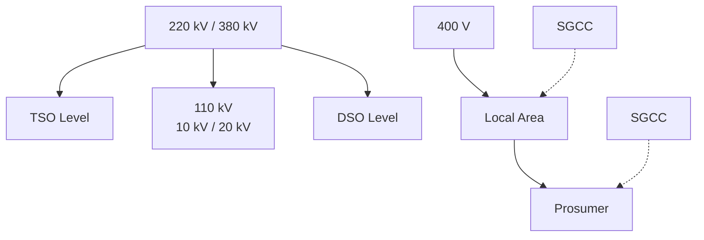
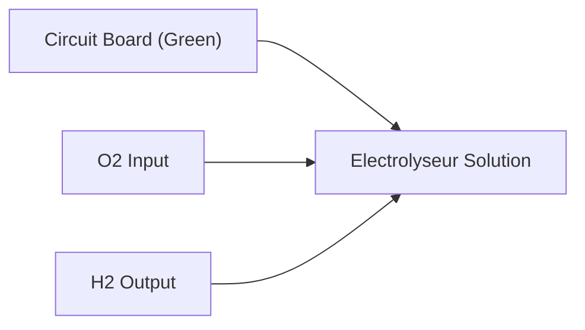
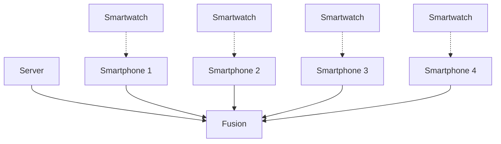
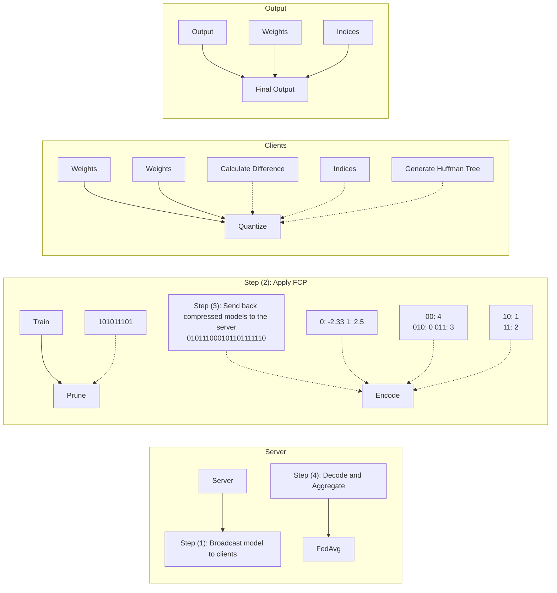

## Herzlich Willkommen zum Studium

**an der Fakultät Elektrotechnik und Informationstechnik**

**an der Rheinisch-Westfälischen Technischen Hochschule (RWTH) Aachen**


<details>
<summary>natural_image</summary>

Five modern architectural photos showing different building designs and landscapes: a modern building with windows, a white building with a hand pointing to a blue road sign, a snow-covered building at dusk, and a modern multi-story building with a road.
</details>

Alterung • Modelle • Diagnostik Packdesign Elektromobilität Stationäre Energiespeicher • Energiesystemanalyse

## Grundgebiete der Elektrotechnik 1 – Einführung in die Schaltungstechnik

**Was ist Elektrotechnik und Informationstechnik? – Eine Motivation**

G1 0A V1

Dirk Uwe Sauer

**Center for Ageing, Reliability and Lifetime Prediction of Electrochemical and Power Electronic Systems (CARL)**

CARL

Center for Ageing, Reliability and Lifetime Prediction of Electrochemical and Power Electronic Systems

RWTHAACHEN UNIVERSITY

## Persönliche Vorstellung


<details>
<summary>natural_image</summary>

Portrait of a man in a light blue shirt and dark blue tie, arms crossed (no text or symbols visible)
</details>

## ■ Prof. Dr. Dirk Uwe Sauer

**Ausbildung und Werdegang**

**1989 – 1994 Physikstudium an der TH Darmstadt**

**1992 – 2003 Fraunhofer-Institut für Solar Energiesysteme ISE / Freiburg**

**2003 Promotion in Elektrochemie an der Uni Ulm**

**2003 – 2009 Juniorprofessor an der RWTH Aachen**

**Seit 2009 Professor an der RWTH Aachen in der Fakultät für Elektrotechnik und Informationstechnik**


Stromrichtertechnik und Elektrische Antriebe


Center for Ageing, Reliability and Lifetime Prediction of Electrochemical and Power Electronic Systems


E.ON Energy Research Center


JÜLICH Forschungszentrum

HELMHOLTZ-INSTITUT MÜNSTER

**Verschiedene sonstige Aufgaben (Auswahl)**

- **Sprecher der Elektrischen Energietechnik der Fakultät**
**Wissenschaftlicher Leiter des Masterstudiengangs** „Battery Science and Technology in Engineering
- **Wissenschaftlicher Leiter einer jährlicher Konferenzen**
- **Editor eines Wissenschaftsjournals zu Energiespeichern (2015 – 2022)**

## Aufgaben der Physik

- Beschreibung der Natur in ihren Eigenschaften, Erscheinungen und Zuständen möglichst anhand messbarer Größen
- Auffindung von Gesetzmäßigkeiten in den Beziehungen zwischen den Größen, z.B. $U   =   R \cdot I$ oder $E   =   m \cdot c ^ { 2 }$

## Aufgabe der Technik bzw. des Ingenieurwesens

\- Anwendung physikalischer Erkenntnisse z. B. Realisierung elektronischer Bauelemente und Schaltungen, Kraftwerke, Fahrzeuge etc.

## Grundlagen der Elektrotechnik

• Elektrischer Strom und elektrische Spannung
• Netzwerke
• Bauelemente
• Elektrische und magnetische Felder
• Elektromagnetische Wellen

## Was ist Elektrotechnik?


<details>
<summary>flowchart</summary>

```mermaid
graph TD
  subgraph Mathematik["Mathematik"]
  A1["Mathematik"] --> B["Grundlagen der Elektrotechnik\nGrundgesetze der elektromagnetischen Felder und der Stromkreis"]
  end

  subgraph Informatik["Informatik"]
  C1["Informatik"] --> D["Informations- und Kommunikations-technik\nNachrichtenübertragung\nInformationstechnik"]
  C2["Informatik"] --> D
  C3["Physik"] --> D
  C4["Chemie"] --> D
  end

  subgraph Energie["Energie- und Umwelttechnik\nEnergieerzeugung\nEnergieübertragung elektrische Antriebe"]
    E1["Energie- und Umwelttechnik"]
    E2["Mikro- und nanoelektronik\nWerkstoffe,\nTechnologie und Bauelemente,\nSchaltungstechnik"]
    E3["Medizintechnik\nBildgebung\nBody-Area\nNetwork\nIntelligente Implantate"]

  subgraph Physik["Physik"]
  F1["Physik"] --> G["Grundlagen der Elektrotechnik\nGrundgesetze der elektromagnetischen Felder und der Stromkreis"]
  end

  subgraph Information["Informationstechnik"]
    I1["Informations- und Kommunikations-technik\nNachrichtenübertragung\nInformationstechnik"]
    I2["Energie- und Umwelttechnik\nEnergieerzeugung\nEnergieübertragung elektrische Antriebe"]
    I3["Mikro- und nanoelektronik\nWerkstoffe,\nTechnologie und Bauelemente,\nSchaltungstechnik"]
    I4["Medizintechnik\nBildgebung\nBody-Area\nNetwork\nIntelligente Implantate"]
  end

  subgraph Chemie["Chemie"]
    J1["Chemie"]
    J2["Physik"]
    J3["Informatik"]
    J4["Informatik"]
  end

  subgraph Data["Data Source: https://de.freeimages.com/premium/old-rotary-telephone-267378"]
  end

  subgraph Images["Image Data: http://www.fw-static.de/typo3temp/pics/Fotovoltaik_f596232f11.jpg"]
  end

  subgraph Images["Image Data: https://www.ecse.rpi.edu/frisc/SiGeWafer.jpg"]
  end

  subgraph Images["Image Data: https://www.voltimum.de/artikel/mikrosystemtechnik-kongress-von"]
  end
```
</details>

## Was ist Elektrotechnik?

## Energietechnik

## Elektrische Energietechnik – Stromerzeugung aus Laufwasserkraftwerken


<details>
<summary>natural_image</summary>

Exterior view of a modern industrial complex with smokestacks and factory buildings, partially obscured by waves crashing on rocky shore (no signage or text visible)
</details>

Erstes großes Flusskraftwerk Rheinfelden (25 MW)


<details>
<summary>natural_image</summary>

Aerial view of a large hydroelectric dam under construction spanning a wide river, with red cranes and surrounding hills (no visible text or symbols)
</details>

Quelle: http://cdn4.spiegel.de/images/image-116677-galleryV9-kcem.jpg

Drei-Schluchten-Staudamm am Jangtse-Fluss (85 Milliarden kWh/Jahr)

## Elektrische Energietechnik – Kraftwerk mit fossilen Brennstoffen


<details>
<summary>natural_image</summary>

Nighttime industrial cooling plant with multiple cooling towers emitting smoke, featuring a tall red-topped tower and multiple cooling towers in the background (no visible text or symbols)
</details>

Quelle: http://www.gelsenzentrum.de/eon\_kohlekraftwerk\_scholven.jpg

Kohlekraftwerk Scholven bei Gelsenkirchen


<details>
<summary>natural_image</summary>

Aerial view of an industrial power plant with two tall chimneys beside a lake, surrounded by greenery and distant hills (no visible text or symbols).
</details>

EnBW-Kohlekraftwerk & Stora Enso Müllkraftwerk in Karlsruhe

## Elektrische Energietechnik – Gasturbine und Hochspannungstechnik


<details>
<summary>natural_image</summary>

Industrial scene showing two workers in hard hats inspecting a large turbine engine component (no visible text or symbols)
</details>

Quelle: https://img.fotocommunity.com/wasserkraftwerk-rheinfelden-4916df70-d6bc-4314-b0d9-6ec69ebd66a1.jpg?width=148&height=148

Kraftwerksturbine


<details>
<summary>natural_image</summary>

Interior view of an industrial facility featuring a large blue electrical substation with transmission lines and overhead structures (no visible text or symbols)
</details>

Transformator

## Elektrische Energietechnik – Stromnetze


<details>
<summary>text_image</summary>

Höchstspannungsnetz (2012)
Leitung 220 kV
Umspanwerk
Kraftwerke mit einer Leistung über 1000 MW:
Kernkraftwerk
Steinkohlekraftwerk
Braunkohlekraftwerk
300 kV DC BorWin1
600 kV DC BorWin2
450 kV DC
Baltic Cable
400 kV DC
Kontok
Kiel
Schwerin
Bremen
Hamburg
Emsland
Gersteinwerk
Grohnde
Hannover
Magdeburg
Berlin
Peltström
Jänschwalde
Schwarze Pumpe
Borberg
Leipzig
Lippendorf
Dresden
Voerde
Scholven
Dorimung
Espan
Düsseldorf
Nünderaußam
Köln
Weltsweiter
Staudinger
Frankfurt
Grafenheinfeld
Wiesbader
Malz
Mannhelm (GKM)
Philippsburg
Heilbronn
Neckarwestholm
Karlsruhe
Stuttgart
Aitbach/Detzisau
Gundremmingen
Isar
München
Irching
München
</details>

Quelle: Von Alexrk2 - own work, usingOpenstreetmap data, CC BY-SA 3.0, https://commons.wikimedia.org/w/index.php?curid=27611251


<details>
<summary>flowchart</summary>


</details>

Selbstähnlichkeit der Netztopologie

©FH-Südwestfalen -FB Energieversorgung


<details>
<summary>natural_image</summary>

Silhouette of a high-voltage electricity pylon at sunset, with no visible text or symbols
</details>

Quelle: https://encrypted-tbn0.gstatic.com/images?q=tbn:ANd9GcQUxu4Hp Sjzj6yirKpf3B5Nt6vkohIqtUlsaT-LjM4bezIRKHwy2w

## Elektrische Energietechnik – Erneuerbare Energien

Photovoltaik-Freiflächenanlagen


<details>
<summary>natural_image</summary>

Rows of solar panels installed on a grassy field under clear sky (no text or symbols visible)
</details>

Quelle: Von Ceinturion, CC BY-SA 3.0, https://commons.wikimedia.org/w/index.php?curid=3181924


<details>
<summary>natural_image</summary>

Aerial view of an offshore wind farm with multiple turbines on calm blue water, alongside a close-up of solar panels and a small inset image (no text or symbols visible)
</details>

Quelle: http://www.fvee.de/fileadmin/publikationen/Themenhefte/th2006/th2006\_02\_03.pdf

Dänischer Offshore Windpark Hornsrev

## Elektrische Energietechnik – Netzferne Stromversorgung

■ Technische Geräte
■ Abgelegene Häuser und Bauernhöfe
■ Elektrifizierung im ländlichen Raum
■ Telekommunikation


Quelle: Fraunhofer ISE

## Leistungselektronik: Der Taktgeber der Energiewende

## Ohne sie kein E-Auto, kein Windpark, kein grüner Wasserstoff, keine KI


<details>
<summary>natural_image</summary>

Two views of a mechanical device and a circuit board (no visible text or symbols)
</details>

## Elektromobilität

**17 Mio. neue E-Autos weltweit (2024)**

SiC-Wechselrichter integriert im E-Motor


<details>
<summary>flowchart</summary>


</details>

## Grüner Wasserstoff

**Klimafreundlicher Stahl und Chemie ohne CO**₂

GaN-Wandler speist Elektrolyseure


<details>
<summary>natural_image</summary>

Interior of a large industrial facility with a CWD-branded machine and Siemens branding, no visible text or symbols on the machine itself.
</details>

## Nachhaltige Energieerzeugung

**Über 50 % des Stroms in DE erneuerbar**

Megawatt-Umrichter im Gondel-Prüfstand


<details>
<summary>text_image</summary>

CARL
Corteir for Aging, Solidality and Climate Protection of Environmental and Power Facilities & Systems
RWNTHAACHEN UNIVERSITY
CWD
Corteir for 500kW Power Units
RWNTHAACHEN UNIVERSITY
MVDC Campus Grid
• 5 kV, 7 MW
• 2.3 km
</details>

## Gleichstromnetze

**Das 50 Hz Netz stößt an seine Grenzen**

Forschungsnetz auf dem RWTH Campus


<details>
<summary>natural_image</summary>

Interior view of an industrial facility with large electrical cabinets and machinery (no visible text or symbols)
</details>

## Energieversorgung für Data Center

**Rechenzentren 2030: Strombedarf wie Japan**

5 MW und 5 kV Mittelspannungsumrichter


<details>
<summary>natural_image</summary>

Close-up of glowing blue circuit lines on a dark surface, no visible text or symbols
</details>

## Leistungshalbleiter

**SiC und GaN schalten in Nanosekunden**

Licht verräten Temperatur, Strom & Alterung

## Batterietechnik – Post Mortem Laboratory


## Utility Scale Research Battery Storage – M5Bat


<details>
<summary>natural_image</summary>

Aerial view of a modern industrial building with blue and white buildings, solar panels on rooftop, and parked cars in the foreground (no visible text or symbols)
</details>

## Technical data

■ Power: approx. 6 MW
■ Energy: approx. 7.5 MWh
■ 5 Battery technologies (Li-Ion & lead-acid)
■ 10 independent battery units


<details>
<summary>flowchart</summary>


</details>


<details>
<summary>text_image</summary>

QR code image containing encoded data, no visible human-readable text
</details>


## Operation

■ System services
■ 3 MW FCR (frequency containment reserve)
■ Intraday trading (15 min market)
■ In preparation: aFRR (frequency restoration)

## Overview of sector coupling in industry applications: everything is connect


## Information for public, media and industry


Center for Ageing, Reliability and Lifetime Prediction of Electrochemical and Power Electronic Systems

RWTHAACHEN UNIVERSITY

Home

Battery Charts Revenue Index

Battery Storage M5BAT

Mobility Charts

ISEA Tools

About us


Installed Battery Energy Capacity in Germany

20.52 GWh

Current aggregated energy capacity in large- and home storage systems registered in Germany


Cross-market Battery Revenue Potential in Germany

297.29 k€/MW/a

For a 2h system with 2 cycles per day marketed on FCR, aFRR and Intraday Continous


Registered EV Battery Energy Capacity in Germany

115.47 GWh

Current aggregated energy capacity in electric vehicles (EVs) registered in Germany

## Was ist Elektrotechnik?

## Mikro- und Nanotechologie

## Mikroelektronik – Grundlage der Digitaltechnik

## Moore's Law: The number of transistors on microchips doubles every two years

Our World in Data

Transistor count


<details>
<summary>scatter</summary>

| Year | Processor / Architecture | Power Capacity (10^4) |
| --- | --- | --- |
| ~1971 | Intel 4004 | ~2,000 |
| ~1972 | Intel 8008 | ~3,500 |
| ~1973 | Intel 6800 | ~4,000 |
| ~1974 | Motorola 6502 | ~4,500 |
| ~1975 | Intel 8080 | ~5,000 |
| ~1976 | Intel 8085 | ~6,000 |
| ~1977 | Zilog Z80 | ~7,000 |
| ~1978 | Intel 8086 | ~25,000 |
| ~1979 | Motorola 6809 | ~8,000 |
| ~1981 | Intel 80286 | ~50,000 |
| ~1982 | Intel 80186 | ~15,000 |
| ~1983 | WDC 65C816 | ~20,000 |
| ~1984 | Intel 80386 | ~25,000 |
| ~1985 | Novix NC4016 | ~25,000 |
| ~1986 | ARM 1 | ~30,000 |
| ~1987 | ARM 2 | ~35,000 |
| ~1988 | DEC WRL MultiTitan | ~40,000 |
| ~1989 | ARM 3 | ~45,000 |
| ~1991 | ARM 700 | ~50,000 |
| ~1992 | R4000 | ~1,200,000 |
| ~1993 | Pentium | ~2,500,000 |
| ~1994 | SA-110 | ~3,500,000 |
| ~1995 | AMD K5 | ~4,500,000 |
| ~1996 | Pentium II Klamath | ~5,500,000 |
| ~1997 | Pentium II Deschutes | ~6,500,000 |
| ~1998 | Pentium III Katmai | ~7,500,000 |
| ~1999 | Pentium III Coppermine | ~8,500,000 |
| ~2000 | Pentium III Tualatin | ~9,500,000 |
| ~2001 | Pentium 4 Willamette | ~12,500,000 |
| ~2002 | Pentium 4 Northwood | ~15,000,000 |
| ~2003 | Pentium 4 Prescott-2M | ~25,000,000 |
| ~2004 | Pentium 4 Cedar Mill | ~35,000,000 |
| ~2005 | Pentium 4 Allendale | ~45,000,000 |
| ~2006 | Core 2 Duo Allendale | ~55,000,000 |
| ~2007 | Cell | ~65,000,000 |
| ~2008 | Core 2 Duo Conroe | ~75,000,000 |
| ~2009 | Core 2 Duo Wolrdale 3M | ~85,000,000 |
| ~2010 | Core 2 Duo Wolrdale | ~95,000,000 |
| ~2011 | Core 2 Duo Wolrdale | ~115,000,000 |
| ~2012 | Core 2 Duo Wolrdale L3 | ~135,000,000 |
| ~2013 | Core i7 (Quad) | ~165,000,000 |
| ~2014 | Apple A7 (dual-core ARM64 "mobile SoC") | ~215,000,000 |
| ~2015 | Dual-core + GPU GT2 Core i7 Skylake K Quad-core + GPU Core i7 Haswell | ~265,000,000 |
| ~2016 | Dual-core + GPU Iris Core i7 Broadwell-U Quad-core + GPU GT2 Core i7 Skylake K Quad-core + GPU Core i7 Haswell | ~335,000,000 |
| ~2017 | Qualcomm Snapdragon 835 Qualcomm i7 Broadwell-E Qualcomm Snapdragon 835 | ~415,000,000 |
</details>

Year in which the microchip was first introduced


<details>
<summary>text_image</summary>

Gordon Moore
</details>

Foto: Gordon Moore. Courtesy of Intel

“Die Zahl der Transistoren auf einem Chip verdoppelt sich etwa alle 24 Monate.”

## Mikroelektronik – Produktionstechnik


<details>
<summary>natural_image</summary>

Person in blue cleanroom suit holding a large circular semiconductor wafer (no text or symbols visible)
</details>

Quelle: https://www.notebookcheck.com/IBM-fertigt-den-weltweit-ersten-2-nm-Chip-mit-eindrucksvoller-Transistordichte.537675.0.html#news\_intro\_image

IBM hat als erstes Unternehmen ein 2 nm-Verfahren entwickelt, das die Transistordichte von Chips deutlich erhöht: 333 Millionen Transistoren pro mm<sup>2</sup>


<details>
<summary>natural_image</summary>

Interior of a cleanroom facility with workers in full protective suits operating equipment (no visible text or symbols)
</details>

Quelle: http://perpetuapower.com/wp-content/uploads/2016/02/UseCase\_ConsElectr\_750x750.jpg

## IC-Fertigung auf 300-mm-Wafer

IBM hat den laut eigener Aussage ersten 2 nm-Chip der Welt vorgestellt, der bei einer identischen Performance 75 Prozent weniger Energie benötigen soll als ein konventioneller 7 nm-Chip.

Materials

Microelectronics

Nanostructures

Characterization

## Halbleiter

Process Development

Device Integration

Reliability

Brain-Inspired

Al Hardware

## Neuromorphic Computing

Low-Power Electronics

In-Memory Computing

Edge Computing

Novel Devices

Quantum Materials

Qubits

# Quantum Computing

Integrated Photonics

Quantum Devices

Scalable Platforms

Cryogenic Technologies

Integrated Circuits

Advanced Materials

Heterogeneous Integration

## Microelectronics

Packaging

System Integration

Test & Reliability

Light-Matter Interaction

Optical Components

## Photonics

Imaging

Communication

Integrated Photonics

Quantum Photonics


## CARE

## Exzellenzcluster für klimaneutrales und ressourceneffizientes Bauen

RWTH Aachen University und TU Dresden

## CoHManD

## Mit der Baustelle sprechen


<details>
<summary>natural_image</summary>

Exterior view of a modern industrial facility with concrete mixer trucks and surrounding buildings (no signage or text visible)
</details>

**Was tun, wenn etwas unerwartetes passiert?**

**Z.B. wenn eine Betonlieferung zu spät kommt?**

Sprache und Baustellendaten verknüpfen

Mit KI kommende Abläufe vorhersagen

**Ziel: Störungen früh erkennen und besser planen**

## D-DREAM

## Bauteile intelligent fertigen


<details>
<summary>natural_image</summary>

Interior of a modern automated factory with robotic arms and workers, featuring digital overlays and a 'CARE' sign in the background (no readable text on main subjects)
</details>

**Wie fertigen wir mit neuen Baustoffen zuverlässig gute Bauteile?**

Sensordaten mit Materialdaten verknüpfen Fertigung im digitalen Zwilling optimieren

**Ziel: Bauteilqualität gezielt verbessern**


## Neuro Sys

## Effiziente KI-Methoden für neuromorphes Computing in der Praxis

Forschung für energiesparende, nachhaltige und souveräne KI.

• Methodik

− Distributed Machine Learning
Datenkompression
− Kommunikationsprotokolle
− Informationstheorie

• Anwendungen

− Sprachtechnologien
− Bildverarbeitung
− Medizintechnik


<details>
<summary>text_image</summary>

Basisdaten
Mustermann, Max ID 167654321
Gesichte Männlich
Geräuterdatum 65.01.1987
Größe 182 cm
Gewicht R7 kg
Derechnung der Wechselkmal Modell
Prüme Behandlungserahe Seduktion
Behandlungsteigen 142,000
Biogestrierungen Einstufen Mittel
Komponenter Patient nicht über verschiedene Schmesser zum Zeitpunkt der Aufnahme
Prezent Miozi
Allgemeinskaufend
Erfolgsgehaltung
Psychosatistik Situation
Medication
Sociofahrgeschäftszunzung
Diseinflösungen
Patienten-/Augsbezogenommen
BMI
Anteilzeit Lifikation der Wandite
Werte 1
Werte 2
Art der Wandite
Omkünfte
Feste aktuelle Werte
Wertene Wandische
16.02.2022
</details>

Interface für medizinisches Personal zur Human-AI-Interaction<sup>1</sup>


<details>
<summary>flowchart</summary>


</details>

Private und personalisierte Verarbeitung von Wearables-Sensordaten zum medizinischen Monitoring im Alltag<sup>2</sup>


<details>
<summary>flowchart</summary>


</details>

Datenkompressionspipeline für Machine Learning Modell Komprimierung zum verteilten Lernen<sup>3</sup>

## AIXTRON enables the Megatrends Digitization, Energy Efficiency and Electromobility

**49 In**

**Indium 114.82**

**15**P

**Phosphor us**

**30.97**

**31**

**Ga**

**Gallium 69.723**

**33**

**Arsenic 74.922**


▪ **Optical Data Communications**
▪ **3D Sensing** (Consumer, Automotive)

**31**

**Ga**

**Gallium 69.723**

7N

**Nitrogen 14.007**


▪ **Power Electronics**
**RF Electronics and Communications**


**14**

**Si**

**Silicon 28.085**

6

**Carbon 12.011**


<details>
<summary>natural_image</summary>

Electric vehicle charging at a renewable energy station with solar panels and wind turbines in the background (no text or symbols visible)
</details>

▪ **Electromobility**
▪ **Clean Energy / Power Electronics**
**Several cooperations within IPCEI AST**

## We address a comprehensive set of growth applications with our G10 family of products


<details>
<summary>pie</summary>

| Category | Material Type | Application |
| --- | --- | --- |
| Power Electronics | SiC | EV main inverters and EV OBCs |
| Power Electronics | SiC | EV charging infrastructure |
| Power Electronics | SiC | Data centers: AC/DC |
| Power Electronics | SiC | Wind & PV |
| Power Electronics | SiC | Traction & large drives |
| Power Electronics | GaN | Fast charging / mobile devices |
| Power Electronics | GaN | Data centers: AC/DC & DC/DC |
| Power Electronics | GaN | Motor drives, e.g. white goods |
| Power Electronics | GaN | AI power delivery |
| Power Electronics | GaN | EV OBCs |
| Power Electronics | GaN | Base stations |
| Optoelectronics / LEDs | AsP | Optical data communication |
| Optoelectronics / LEDs | AsP | 3D sensing |
| Optoelectronics / LEDs | AsP | LiDAR |
| Optoelectronics / LEDs | AsP | Industrial power lasers |
| Optoelectronics / LEDs | Micro LEDs / Specialty LEDs | Industrial displays (in/outdoor) |
| Optoelectronics / LEDs | Micro LEDs / Specialty LEDs | TVs |
| Optoelectronics / LEDs | Micro LEDs / Specialty LEDs | Smart watches / AR glasses |
| Optoelectronics / LEDs | Micro LEDs / Specialty LEDs | Automotive |
| Optoelectronics / LEDs | Micro LEDs / Specialty LEDs | Horticulture |
</details>

## Leading MOCVD Equipment Innovation for 40 Years


▪ **founded 1983** next to RWTH Aachen University – evolved to be the Global Market and Technology Leader for MOCVD
▪ We are a **Pure Play** MOCVD Equipment Manufacturer.
▪ **strong Company Growth foreseen-** designing Solutions together with Partners to enable most demanding Compound Semiconductor Materials and new Products

## Mikroelektronik – Mikrocontroller


<details>
<summary>text_image</summary>

DS80C310
MCG
0352D2
162AB
MAXIM
MAX232CWE
00D2
</details>


<details>
<summary>text_image</summary>

ANALOG
DEVICES
ADSP-2181
KS-133
ED/BB3108-2.0
Δ 9650
</details>

Quelle: http://www.carnut.info/star/CIMG1751\_DSP\_My-PCB\_ASSEMBLED\_SML-2.jpg


Quelle:

86\_IBM.jpg

https://dic.academic.ru/pictures/wiki/files/49/120p

x-741\_op-amp\_in\_TO-

5\_metal\_can\_package\_close-up.jpg

## IC-Gehäuse


<details>
<summary>natural_image</summary>

Close-up of a microchip or integrated circuit chip with gold-colored traces and a central gold-colored cavity (no visible text or symbols)
</details>

Quelle:

486\_DX\_2\_66\_MHz\_opened.jpg

https://commons.wikimedia.org/wiki/File:AMD\_


<details>
<summary>natural_image</summary>

Microchip chip layout showing various microstructures and components (no visible text or symbols)
</details>

Intel Pentium 4

## Mikroelektronik – Entwicklungslabore

https://www.forschungsfabrik-mikroelektronik.de/de/unser-angebot.html https://www.iisb.fraunhofer.de/de/netzwerk-kooperationen/fmd.html


<details>
<summary>natural_image</summary>

Interior of a cleanroom manufacturing facility with workers in full protective suits operating machinery (no visible text or symbols)
</details>

Forschungsfabrik Mikroelektronik Deutschland der Fraunhofer-Gesellschaft


<details>
<summary>natural_image</summary>

Scientist in cleanroom suit operating a high-tech laboratory with optical equipment and computer monitors (no visible text or symbols)
</details>

© Kurt Fuchs / Fraunhofer IISB

Hoch-Raten Xenon-Plasma FIB-Anlage (Focused Ion Beam) mit Mikro-Zug-Modul

## Mikroelektronik – Platinen


<details>
<summary>natural_image</summary>

Industrial Samsung 320 laser machine with coiled blue cables and control panel (no visible text or symbols)
</details>

Platinenbestückungsautomat


<details>
<summary>natural_image</summary>

Close-up of a semiconductor manufacturing line with multiple circuit boards and a laser beam interacting with them (no visible text or symbols)
</details>


<details>
<summary>text_image</summary>

9SAJ
AT49BV322A
70TI
0417
</details>

Bestückte Platine mit SMD-Bauteilen

## Mikroelektronik – Komplexe Steuerungs- und Navigationssysteme


<details>
<summary>natural_image</summary>

Interior view of an aircraft cockpit with control panels and dashboard (no visible text or symbols)
</details>

Quelle: User: Plenumchamber, CC-BY-SA-3.0

https://commons.wikimedia.org/wiki/File:Fly\_by\_wire\_A321\_cockpit.jpg

GPS-Navigationssystem

Fly by Wire


<details>
<summary>text_image</summary>

DISPLAY
Navigation plus
FM1 1 SWR3 TP
63 60 MAINZ
GAU-BISCHPESHEIM
420 43 BISCHOF
NACKENHEIM 2km
TONE RETURN
NAVIGATION
</details>

Quelle: https://i0.wp.com/obhur-mag.com/wp-content/uploads/2017/04/%D8%B9%D9%84%D9%85-%D8%A7%D9%84%D9%85%D9%84%D8%A7%D8%AD%D8%A96.jpg?resize=660%2C330&ssl=1

## Was ist Elektrotechnik?

# Information, Kommunikation und Elektronik