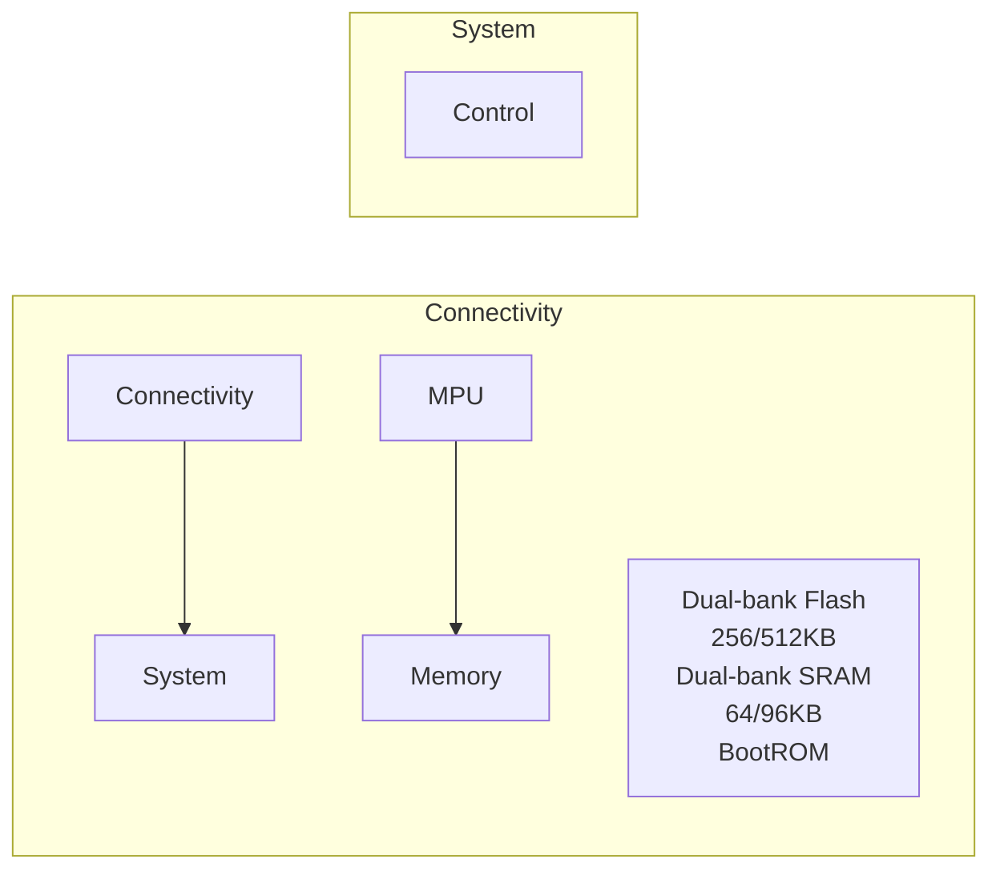
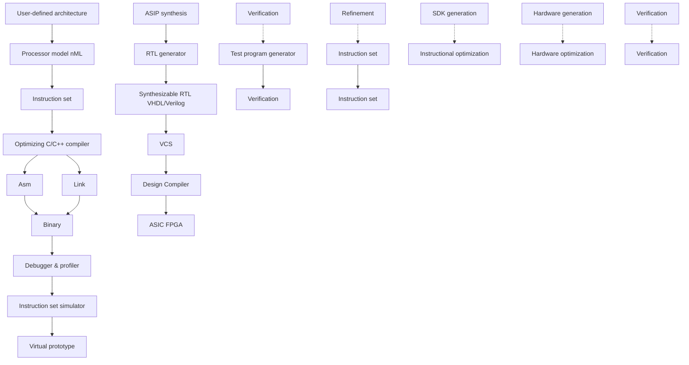
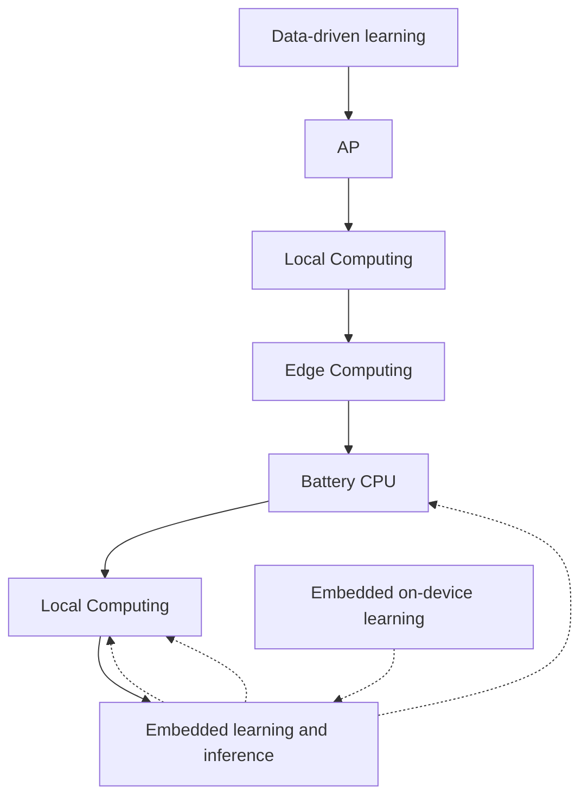
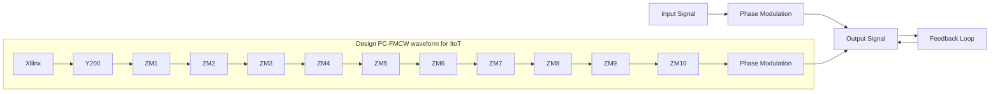
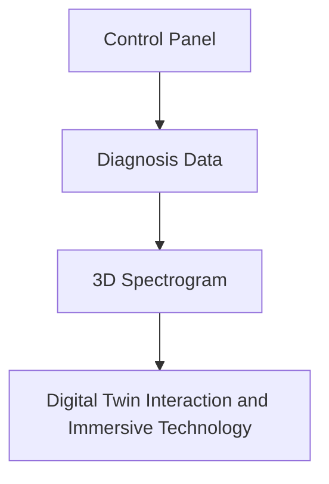
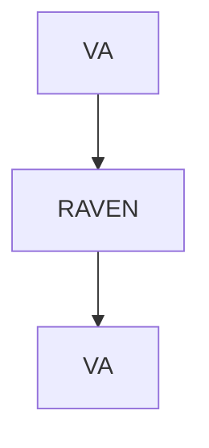

## ATRIUM – „Hardware-in-the-Loop“ Test-System für Automotive Radar

Echtzeitfähiger realitätsnaher Radarzielgenerator

▪ Ultraschnelle asymptotische EM-Modellierung
Darstellung komplexer Objekte und bewegter Szenarien
Signatur-Datenbank mit umfangreicher Objektbibliothek (Fahrzeuge, Radfahrer, Fußgänger, etc.)
Verringerter Bedarf an Testfahrten bei Verbesserungen am System
Replay kritischer Situationen zur Optimierung von Algorithmen und Sensorik

## Radarsysteme zur Erfassung der Weltraumlage

Radar-Sensoren erlauben die Erfassung und Beobachtung von Objekten auch in großer Entfernung, z.B. Satelliten:

Entwicklung und Betrieb des Tracking and Imaging Radar (TIRA)

Europas leistungsfähigstes Radar mit mechanisch gesteuerter Parabolantenne
Hochpräzise Zielverfolgung und Bahnbestimmung einzelner Objekte
▪ Hochauflösende Abbildung mit ISAR-Verfahren

natural_image

3D visualization of a satellite with glowing red glow against black background (no text or symbols)

natural_image

Interior view of a large satellite dish antenna with green structural framework and metal tower (no visible text or symbols)

Elektronisch gesteuertes Radar mit Phased-Array-Antenne (GESTRA)

▪ Voll-digitale und schnelle elektronische Strahlschwenkung für kontinuierliche Überwachung
Entdeckung und Katalogisierung großer Anzahl von Objekten

natural_image

Circular panel with grid of small square components and a red LED display in the top-left corner (no readable text or symbols)

## Kommunikationstechnik – Mobilfunk

natural_image

Exterior view of a tall industrial tower with metal scaffolding and antenna array (no visible text or symbols)

Quelle: https://commons.wikimedia.org/wiki/File:Mobilfunkturm-Schoeppingen.jpg

natural_image

Exterior view of a tall telecommunications tower against a clear blue sky, surrounded by trees (no signage or text visible)

Quelle: http://www.medienwerkstatt-online.de/lws\_wissen/bilder/24596-1.jpg

Mobilfunktürme

Smartphones

text_image

artphones

Quelle: https://cdn.arstechnica.net/wp-content/uploads/2017/09/8-2.jpg

Radioteleskop Effelsberg

effelsberg/effelsberg\_radioteleskop.jpg content/gallery/radioteleskop-Quelle: https://www.juergen-wohlfahrt.de/wp-

natural_image

Exterior view of a large radio telescope dish under a blue sky with scattered clouds, surrounded by trees (no signage or text visible)

## ICE Mission: Application-Specific System Design

flowchart

Programming tools

flowchart

System-on-chip design

text_image

Laptop screen displaying a data dashboard and app interface with charts and graphs on the left, alongside a smartphone screen showing a mobile app.

Virtual prototyping

flowchart

Hardware security

synoPSYS

flowchart

ASIP Designer: Embedded Processor Design Automation

natural_image

Close-up of hands assembling a green electronic circuit board with visible components and connectors (no readable text or symbols)

MiG-V: Secure RISC-V processor

## Transition from 5G to 6G

From defining new standards over algorithmic design to system demonstration ...... in various application fields:

text_image

Production
Intralogistics
Mobility
Rescue-Robotics

6GEM

flowchart

This image displays a five-step organizational or leadership process flow, starting from the RWTH AACHEN UNIVERSITY down to the final contact.

other

| Category | Value |
| --- | --- |
| Peak 1 | Yellow |
| Peak 2 | Green |
| Peak 3 | Blue-Green |
| Peak 4 | Blue |
| Peak 5 | Purple |

## Basic 6G research

**creation of new ideas…**

## 6G Systems

## Proof-of-principle

**Basic concepts, algorithms, system design, testing, and validation**

natural_image

Office desk with computer monitors, electronic devices, and wiring on circuit boards (no visible text or symbols)

**Define 6G concept in labs**

## Proof-of-concept

**Demonstrator, IPR**

natural_image

Group of engineers and technicians in a robotics lab setting, observing a VR headset on a robotic platform (no visible text or symbols)

**Validate and test 6G technology in RWTH testfields with industry**

## 6G Technology

## Innovation

**Transfer to industry, startups**

text_image

Screenshot of a computer lab setup with drone display, interactive equipment, and a presentation screen showing task information and video feeds.

**Successful R&D with Startups**

## Going beyond 6G connectivity

Soft-radio MIMO infrastructure

On-device machine learning development

Distributed learning with efficient computing

flowchart

Immersive sensing and communication

flowchart

AI-driven XR applications

flowchart

AI-based distributed resource allocation

text_image

Receive antenna
Transmit antenna
mmWave
Downconverter
Transceiver
Upconverter

## 6GEM+ programmable application lab

## Research on:

▪ Industrial wireless
▪ Localization
▪ Sensing

text_image

Load Area
Auto Recharging Area
Waiting Area
Text

## Was ist Elektrotechnik?

## Medizintechnik

## Probleme

## POPULATION AGED 67+ IN GERMANY

Source: Destatis and Dall E, Nano Banana2

20.9M

2038

(peak in 2038)

text_image

+37

15.2M

2021

+37.5%

INCREASE

in the population

aged 67 and over

(from 15.2 million in 2021

to 20.9 million in 2038)

text_image

Illustration showing an elderly person using a cane to push a walking person, with a warning symbol indicating danger.

Instabiler Gang

## Reduzierte Haptik

text_image

Source: Dall E

Fragile Haut und Knochen

text_image

Illustration showing a person with pain and two hand gestures: one using a magnifying glass to touch the eye, and another using a magnifying glass to touch the mouth.

Source: Dall E

natural_image

Illustration of an elderly man in a humanoid walker using a device, seated on a chair (no text or symbols on the figure itself)

Integrierte Sensoren

natural_image

Medical device on human leg with attached sensors and cable (no visible text or symbols)

natural_image

3D CAD rendering of a mechanical assembly with cylindrical components and internal housing (no visible text or symbols)

Weiche Aktoren

natural_image

Close-up of a small electronic device mounted on a foot, showing wiring, sensors, and a circuit board (no visible text or symbols)

## Automatisches Anziehen

natural_image

Man in a robotic vacuum cleaner suit standing beside a vehicle with laptop and wiring (no visible text or symbols)

Smarte

Rollatoren

## Lösungen

## Probleme

natural_image

Interior view of a car showing the driver's steering wheel and dashboard, with a blurred background of trees (no visible text or symbols)

natural_image

Patient in hospital bed with EEG earphones and medical equipment visible (no text or symbols)

Source: https://blog.css.ch/content/uploads/2014/12/cssm\_4\_2014\_schlaflabor.jpg

## Kabel können stören

**Ist der Fahrer noch fahrtüchtig?**

natural_image

Close-up of a newborn baby's skin with visible red lesions and surgical instruments (no text or symbols)

Source: L. Scalise, Non Contact Heart Monitoring, 2012

**Elektroden können schädigen**

**Sensoren im Autositz**

natural_image

Interior view of a car showing a black seat with red trim and a person adjusting the seat (no visible text or symbols)

Kameras im Inkubator

natural_image

Medical illustration of a patient lying in a hospital bed with a monitor displaying ECG waveform (no text or symbols on the monitor or surroundings)

natural_image

3D rendering of a medical incubator with robotic arm and monitor (no visible text or symbols)

Monitoring im Bett

**Kontakt-freie**

**Lösungen**

## KI in der Medizin: Bilder verstehen

Neuronale Netze werten Röntgen-, CT-, MRT- und Mikroskopiebilder aus: Sie erkennen Tumoren, vermessen Organe und finden, was das menschliche Auge leicht übersieht.

natural_image

Medical X-ray image of breast tissue showing bilateral breast structures (no text or annotations)

Mammographie

Brustkrebs früh erkennen

natural_image

Medical scan image showing two cross-sectional views with green overlay highlighting a specific anatomical region (no text or symbols present)

Brust-MRT

Drüsengewebe erkennen

natural_image

Microscopic tissue section stained with hematoxylin and eosin, showing cellular structures and extracellular matrix (no text or labels)

Gewebeschnitt

Tumorgenetik ablesen

natural_image

Medical scan image showing a highlighted liver region with color-coded intensity (yellow to blue), no visible text or symbols.

Leber-MRT

Fettanteil messen

natural_image

Medical CT scan image showing lung and thoracic anatomy with green overlay (no text or symbols)

Lungen-CT

Lunge vermessen

natural_image

Chest X-ray image showing lung fields and a highlighted region (no text or symbols present)

Röntgen-Thorax

Übersehenes markieren

natural_image

X-ray image of a human knee joint showing bone structure (no text or labels visible)

Röntgen-Knie

Knochenmaße bestimmen

natural_image

3D dental model of a human jaw with color-coded regions (purple, green, purple) indicating different areas or zones of the jaw structure.

3D-Zahnscan

Zähne einzeln erkennen

## KI in der Medizin: Sprachmodelle als Assistenten

Große Sprachmodelle lesen Befunde, Leitlinien und Fachliteratur, nutzen Bildanalyse-Werkzeuge und schlagen eine Behandlung vor – als Unterstützung für Ärztinnen und Ärzte.

natural_image

Illustration of a female doctor in a white coat and stethoscope, no text or symbols present

Patientin, 53 Jahre, Darmkrebs. Bilder, Gewebeschnitte und Gendaten liegen vor – welche Therapie ist die beste?

natural_image

Illustration of a cartoon robot character wearing a white coat and stethoscope, holding a clipboard (no text or symbols present)

KI-Agent

Fachliteratur durchsuchen

Leitlinien lesen

CT-Bilder auswerten

Gewebeschnitte analysieren

Lebermetastasen im CT, MSI-Tumor laut Gewebeund Gendaten → Leitlinie empfiehlt Immuntherapie.

## Generation of virtual acoustic environments for hearing research – Bringing the real life into the lab

natural_image

Interior of an anechoic chamber with a person seated in a chair, surrounded by stacked acoustic foam panels and a stand (no visible text or symbols)

Fast Individual Measurements

of the head-related transfer functions: **Fast**

**Measurement System** with 64 loudspeakers

natural_image

Interior of an acoustic chamber with suspended metallic instruments and a central human figure, surrounded by brick wall panels (no text or symbols visible)

68 loudspeaker array for 3D audio reproduction:

**SCaLAr** – A loudspeaker array for flexible generation

and evaluation of virtual acoustic environments.

## Hearing Research and Neuroscience

**Goal:** To understand the effect of acoustics on cognitive processes

## Hearing Technology for Spatial

## Audio, ENT, and Audiology

**Goal:** Improvement of fitting methods of hearing aids / cochlear implants

## Noise Research und

## Psychoacoustics

**Goal:** Evaluation, analysis and understanding of noise sources on well-being and cognitive processes (work / learning / rehabilitation)

## Goal: Physically-based acoustic simulation and plausible auralization of a complex virtual scene

Scene Definition

natural_image

Illustration of speech bubbles with sound waves and speech lines, no text or symbols present

Propagation Simulation

natural_image

Interior architectural rendering of a multi-level building with exposed beams and structural elements (no text or symbols)

Rendering Framework

flowchart

3D Audio Reproduction

natural_image

Two black headphones: one in front, and a close-up of a mechanical assembly with gold ingots (no visible text or symbols)

Scene Definition

natural_image

Illustration of a busy indoor beverage shop scene with customers and staff, no visible text or signage

Animation and Visualization

natural_image

Sequence of five identical 3D renderings showing a man in standing posture, no text or symbols present

Rendering Framework

3D Video Reproduction

natural_image

Exterior view of a modern office building (no signage)

IR-Sensor der Firma

HL-Planar Technik, Dortmund

## Medizintechnik – Drahtlose Endoskopie

text_image

givenimaging.com
11 mm X 30 mm

Quelle: givenimaging.com

M2ATM -Kapsel mit Batterie, Lichtquelle, CMOS-Kamera, Antenne, Transmitter Einheit

(Hersteller: Giving Imaging Ltd. Atlanta)

natural_image

Cross-sectional diagram of a cylindrical vehicle or battery pack, showing internal components and internal structure (no text or labels)

Quelle: givenimaging.com

text_image

76 5 5 4 2 1
3
3

1. Optik
2. Linse
3. Beleuchtungs-LEDs
4. CMOS-Kamera
5. Batterie
6. ASIC-Transmitter
7. Antenne

natural_image

Close-up medical image of a human skin lesion with visible redness and surrounding tissue (no text or symbols)

Quelle: givenimaging.com

natural_image

Endoscopic view of internal tissue with a bright lesion (no text or symbols visible)

Quelle: givenimaging.com

## Medizintechnik – Retina Implant

text_image

transmitter coil
receiver chip
from transmitter unit
retina tack
stimulation electrodes
receiver coil
stimulation chip
micro cable

natural_image

Close-up of a transparent electronic component with circuit board and soldered handle (no visible text or symbols)

Before folding and encapsulation

natural_image

Golden ornamental object with a circular handle and textured handle, isolated on white background (no text or symbols)

After folding of the front part and encapsulation with silicone

## Noch Fragen?

## Sie erreichen uns wie folgt:

## Kontakt

**Dirk Uwe Sauer**

Tel.: +49 241 80-96977

dirkuwe.sauer@isea.rwth-aachen.de

**Dominic Peltzer**

et1@isea.rwth-aachen.de

Lehrstuhl für Elektrochemische Energiewandlung

und Speichersystemtechnik

RWTH Aachen University

Campus-Boulevard 89, 52074 Aachen

www.isea.rwth-aachen.de

## Fragen, Anregungen, Fehler

**Bitte schauen Sie zunächst in unserem Vorlesungs-FAQ im moodle-Lernraum, ob es zu Ihrem Anliegen dort schon einen Eintrag gibt.**

**Wenn das nicht der Fall ist, dann schreiben Sie bitte eine Email an**

[**et1@isea.rwth-aachen.de**](mailto:xxxx@isea.rwth-aachen.de)

**Die Antwort wird in unser Vorlesungs-FAQ eingearbeitet und wird damit auch allen anderen zur Verfügung stehen. Das Vorlesungs-FAQ wird also kontinuierlich wachsen.**