# G1 Kapitel 1 – Lehrstuhl Sauer

MinerU 4.0.12 Advanced；FULL 视图保留页眉、页脚、页码和边栏。


Ageing • Models Diagnostics Pack Design Electromobility Stationary Energy Storage Energy System Analysis

## Grundgebiete der Elektrotechnik 1 – Einführung in die Schaltungstechnik

Kapitel 1 – Was der Lehrstuhl für Elektrochemische Energiewandlung & Speichersystemtechnik macht

G1 1 V8

Prof. Dirk Uwe Sauer

Lehrstuhl für Elektrochemische Energiewandlung

und Speichersystemtechnik1

iSEA

Stromrichter-

technik und

Elektrische

Antriebe

RWTHAACHEN

UNIVERSITY

---

## Was der Lehrstuhl für Elektrochemische Energiewandlung und Speichersystemtechnik (Prof. Dr. Dirk Uwe Sauer) macht

2

G1 1 V8 |Prof. Dirk Uwe Sauer

Lehrstuhl für Elektrochemische Energiewandlung und Speichersystemtechnik

iSEA

Stromrichtertechnik und Elektrische Antriebe

RWTHAACHEN UNIVERSITY

---

## Lehrstuhl als Teil des Instituts für Stromrichtertechnik und Elektrische Antriebe (ISEA)

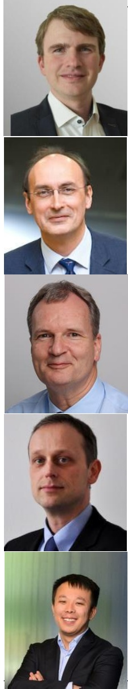

■ Univ.-Prof. Dr.-Ing. Christoph van der Broeck

□ Chair for Power Electronic Systems
□ Director of ISEA

■ Univ.-Prof. Dr. ir. Dr. h. c. Rik De Doncker

□ Chair for Power Electronics and Electrical Drives
□ Director Research Campus “Flexible Electrical Networks”

■ Univ.-Prof. Dr. rer. nat. Dirk Uwe Sauer

□ Chair for Electrochemical Energy Conversion and Storage Systems
□ Director Research Center CARL

■ Univ.-Prof. Dr. rer. nat. Egbert Figgemeier

□ Teaching and Research Area for Ageing and Lifetime Prediction of Batteries
□ Research Group Leader “Cell Systems and Ageing” @ Helmholtz Center Jülich

Jun.-Prof. Dr.-Ing. Weihan Li

□ Artificial Intelligence and Digitalization for Batteries

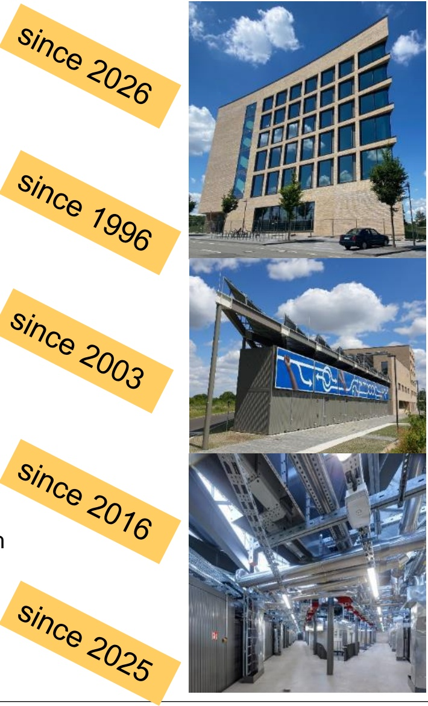

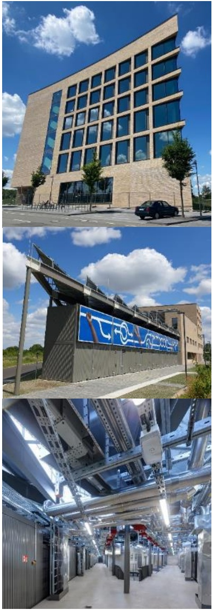

3

G1 1 V8 |Prof. Dirk Uwe Sauer

Lehrstuhl für Elektrochemische Energiewandlung und Speichersystemtechnik

iSEA

Stromrichtertechnik und Elektrische Antriebe

RWTHAACHEN UNIVERSITY

---

Aufgaben eines Lehrstuhls

## ■Lehre

□ Vorlesungen & Übungen
□ Praktika & Seminare
□ Betreuung von Bachelor- und Masterarbeiten
□ Ausbildung von Wissenschaftlerinnen und Wissenschaftlern (Promotionen)

## ■Berufliche Weiterbildung

□ Seminarangebote für Unternehmen zur Weiterbildung der Mitarbeiterinnen und Mitarbeiter

## ■Veranstaltung von Tagungen und Konferenzen

□ Wissenschaftliche Konferenzen
□ Tagungen zum Netzwerken zwischen akademischen Einrichtungen und Industrie

## ■Veranstaltungen für die Nachwuchsgewinnung

□ Sommerschulen
□ Berufsinformationstage
□ „Girls Day“

## ■Beteiligung an der universitären Selbstverwaltung

4

G1 1 V8 |Prof. Dirk Uwe Sauer

Lehrstuhl für Elektrochemische Energiewandlung und Speichersystemtechnik

iSEA

Stromrichtertechnik und Elektrische Antriebe

RWTHAACHEN UNIVERSITY

---

Aufgaben eines Lehrstuhls

## ■Forschung & Entwicklung

□ Grundlagenforschung (primär für den Erkenntnisgewinn, in den Ingenieurswissenschaften aber eher selten)
□ Schreiben von wissenschaftlichen Veröffentlichungen, die den Stand der Technik dann für alle erweitern
□ Angewandte Forschung (Erforschung neuer Verfahren, Materialien, Algorithmen oder Software als Grundlage für neue Produkte oder Dienstleistungen)
□ Entwicklungsunterstützung für Unternehmen (konkrete Beteiligung an der Entwicklung neuer Produkte oder Dienstleistungen)
□ Entwicklung von Patenten zur Sicherung geistigen Eigentums

## ■Unterstützung und Motivation zur Gründung von Spin-off-Firmen

□ Am Lehrstuhl entwickeltes Know-how wird zusammen mit qualifizierten Mitarbeiterinnen und Mitarbeitern ausgegründet und kommerziell angeboten
□ Lehrstuhl unterstützt zunächst mit Infrastruktur (Labore, Werkstätten, Verwaltung) Kontakten und Übergabe von entwickelten Produkten, Modellen oder Software als Basis für die Unternehmung

## ■Information und Beratung von Politik und Gesellschaft

□ Wissenschaft hat eine gesellschaftliche Verantwortung und wird zu wesentlichen Teilen aus Steuergeldern bezahlt

5

G1 1 V8 |Prof. Dirk Uwe Sauer

Lehrstuhl für Elektrochemische Energiewandlung und Speichersystemtechnik

iSEA

Stromrichtertechnik und Elektrische Antriebe

RWTHAACHEN UNIVERSITY

---

## Center for Ageing, Reliability and Lifetime Prediction for Electrochemical and Power Electronic Systems – Supporting battery applications, production and material design

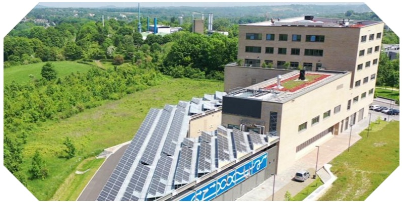

<details>
<summary>natural_image</summary>

Aerial view of a modern industrial building with solar panels installed on rooftops, surrounded by greenery and vehicles (no visible text or symbols)
</details>

■ State government and Federal government invest about 110 Million Euros for building this center in Aachen
■ 5000 m<sup>2</sup> of net area for laboratories and offices
■ 5000 battery testing channels and environmental stress lab
■ Chemical labs for post-mortem analysis and material analysis
■ Clean room & Dry room, CT & Microscopy
■ Largest university research group in Europe for battery system technologies

□ More than 30 years of experience in battery system technologies
□ More than 80 researchers
□ More than 10 million € total budget per year ■ Interdisciplinary team from chemistry, physics, mathematics, material science, electrical and mechanical engineering

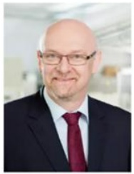

<details>
<summary>natural_image</summary>

Portrait of a bald man wearing glasses, suit, and tie (no visible text or symbols)
</details>

Prof. Martin Winter


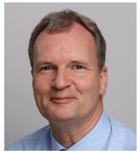

<details>
<summary>natural_image</summary>

Portrait of a man in a light blue shirt (no text or symbols visible)
</details>

Prof. Dirk Uwe Sauer


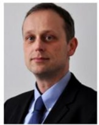

<details>
<summary>natural_image</summary>

Portrait of a man in business attire (no text or symbols visible)
</details>

Prof. Egbert Figgemeier


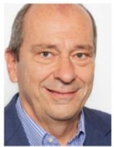

<details>
<summary>natural_image</summary>

Portrait of a smiling man in a suit and striped shirt (no text or symbols visible)
</details>

Prof. Joachim Mayer

GFE


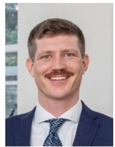

<details>
<summary>natural_image</summary>

Portrait of a smiling man in a suit and tie (no text or symbols visible)
</details>

Prof. Hans-Georg Steinrück


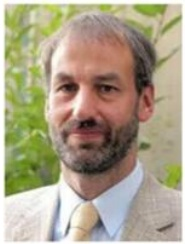

<details>
<summary>natural_image</summary>

Portrait of a man with beard wearing a suit and tie, outdoors with green foliage background (no text or symbols visible)
</details>

Prof. Christoph Broeckmann


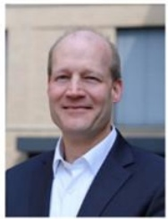

<details>
<summary>natural_image</summary>

Portrait of a smiling man in a suit and white shirt, standing outdoors with no visible text or symbols.
</details>

PD Dr. Gunther Brunklaus


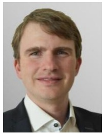

<details>
<summary>natural_image</summary>

Portrait of a man in formal attire (no visible text or symbols)
</details>

Prof. Christoph van der Broeck


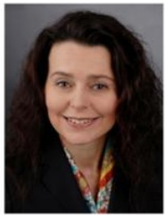

<details>
<summary>natural_image</summary>

Portrait of a woman with long dark hair wearing a patterned blouse (no text or symbols visible)
</details>

Prof. Maria Kateri


<details>
<summary>natural_image</summary>

Portrait of a smiling man in business attire (no text or symbols visible)
</details>

Prof. Weihan Li


6

G1 1 V8

Prof. Dirk Uwe Sauer

Lehrstuhl für Elektrochemische Energiewandlung und Speichersystemtechnik

CARL

Center for Ageing, Reliability and Lifetime Prediction of Electrochemical and Power Electronic Systems

RWTHAACHEN UNIVERSITY

---

## Center for Ageing, Reliability and Lifetime Prediction for Electrochemical and Power Electronic Systems – Supporting battery applications, production and material design

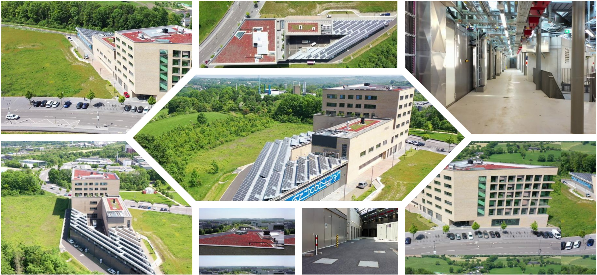

7

G1 1 V8

Prof. Dirk Uwe Sauer

d Speichersys

Power Electronics and Electrical Drives

RWTHAACHEN UNIVERSITY

Home of

JÜLICH

HELMHOLTZ-INSTITUTE MÜNSTER

in Aachen

CARL

Center for Ageing, Reliability and Lifetime Prediction of Electrochemical and Power Electronic Systems

RWTHAACHEN UNIVERSITY

---

## Center for Ageing, Reliability and Lifetime Prediction for Electrochemical and Electronics systems – Supporting battery applications and battery production

■ 2150m<sup>2</sup> office area
■ 2750m<sup>2</sup>laboratory area
■ >150 researchers
■ 110 Mio. € investment
■ Opened in 2022

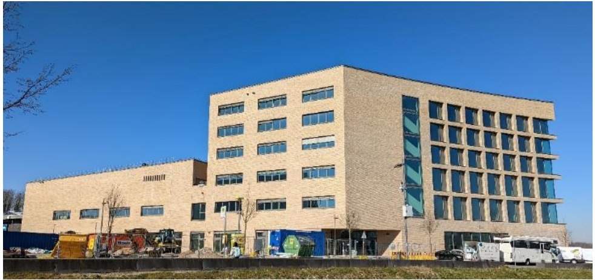

<details>
<summary>natural_image</summary>

Exterior view of a modern brick building under construction, with adjacent vehicles and landscaped grounds (no visible signage or text)
</details>

■ >5000 battery testing channels
■ Environmental stress lab
■ Chemistry lab
■ Clean room & Drying room
■ CT & Microscopy

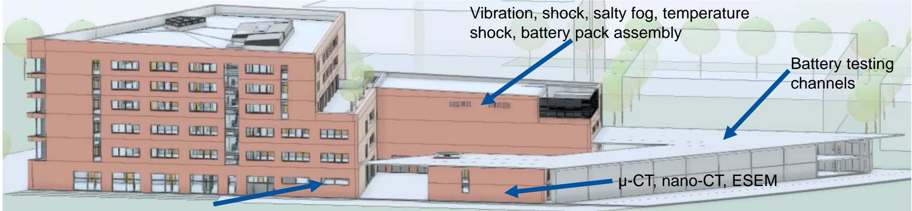

<details>
<summary>text_image</summary>

Vibration, shock, salty fog, temperature
shock, battery pack assembly
Battery testing
channels
μ-CT, nano-CT, ESEM
</details>

Mechanical & electrical workshops

8

G1 1 V8

Prof. Dirk Uwe Sauer

Lehrstuhl für Elektrochemische Energiewandlung und Speichersystemtechnik

CARL

Center for Ageing, Reliability and Lifetime Prediction of Electrochemical and Power Electronic Systems

RWTHAACHEN UNIVERSITY

---

## Battery research at CARL –

## Multi disciplinary. Physics based. Experimental. Data. Artificial Intelligence

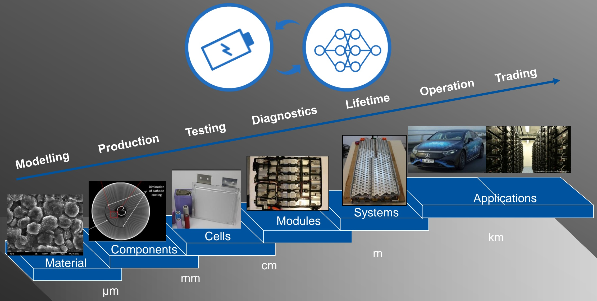

<details>
<summary>flowchart</summary>

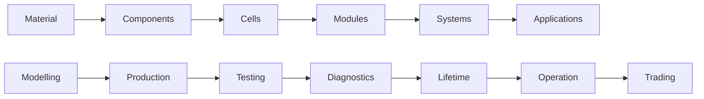
</details>

9

G1 1 V8

Prof. Dirk Uwe Sauer

Center for Ageing, Reliability and Lifetime Prediction of Electrochemical and Power Electronic Systems (CARL)

CARL

Center for Ageing, Reliability and Lifetime Prediction of

Electrochemical and Power

Electronic Systems

RWTHAACHEN

UNIVERSITY

---

Circle of Innovation

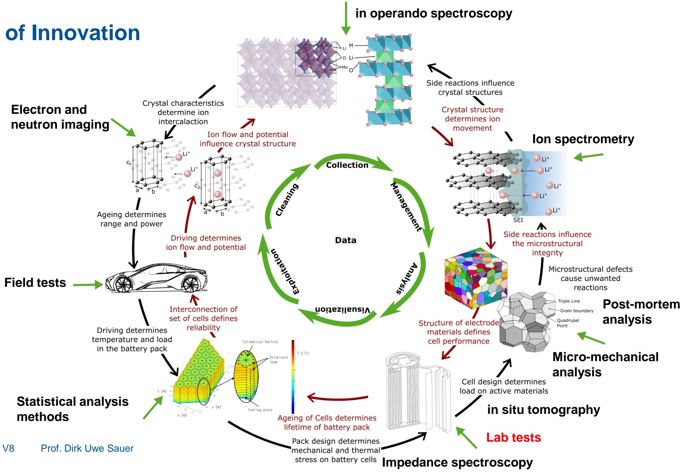

<details>
<summary>flowchart</summary>

This flowchart illustrates the process of ion spectroscopy and post-mortem analysis for battery pack design, showing steps from field tests to data collection and analysis.
</details>

10

G1 1 V8

Prof. Dirk Uwe Sauer

---

## Battery Sections at ISEA

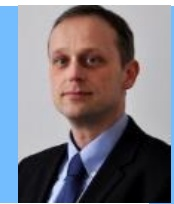

Ageing and Lifetime Prediction of Batteries

## Electrochemical Energy Conversion and Storage Systems (ESS)

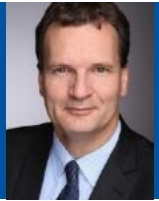

Artificial Intelligence and Digitalization for Batteries


| Advanced electrode manufacturing | Ageing and Lifetime Prediction of Batteries | Battery Modelling, Analytics and Lifetime Prediction | Battery System Design and Vehicle Integration | Battery Grid Integration and Storage System Analysis | Artificial Intelligence for Batteries |
| --- | --- | --- | --- | --- | --- |

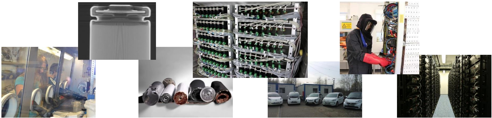

<details>
<summary>natural_image</summary>

Collage of industrial and laboratory scenes including battery packs, server racks, workers in protective gear, and parking areas (no visible text or symbols)
</details>

11

G1 1 V8

Prof. Dirk Uwe Sauer

Lehrstuhl für Elektrochemische Energiewandlung und Speichersystemtechnik

iSEA

Stromrichtertechnik und Elektrische Antriebe

RWTHAACHEN UNIVERSITY

---

## Chair Electrochemical Energy Conversion and Storage Systems – Prof. Dirk Uwe Sauer

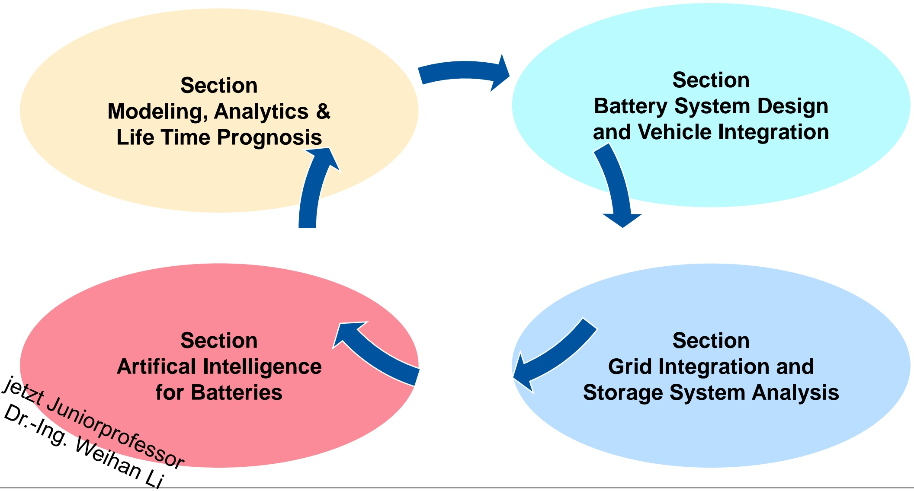

<details>
<summary>flowchart</summary>

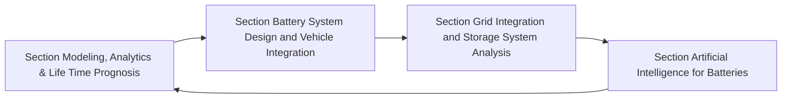
</details>

12

G1 1 V8

Prof. Dirk Uwe Sauer

Lehrstuhl für Elektrochemische Energiewandlung und Speichersystemtechnik

iSEA

Stromrichtertechnik und Elektrische Antriebe

RWTHAACHEN UNIVERSITY

---

## Overview: Battery Analytics in the Laboratory

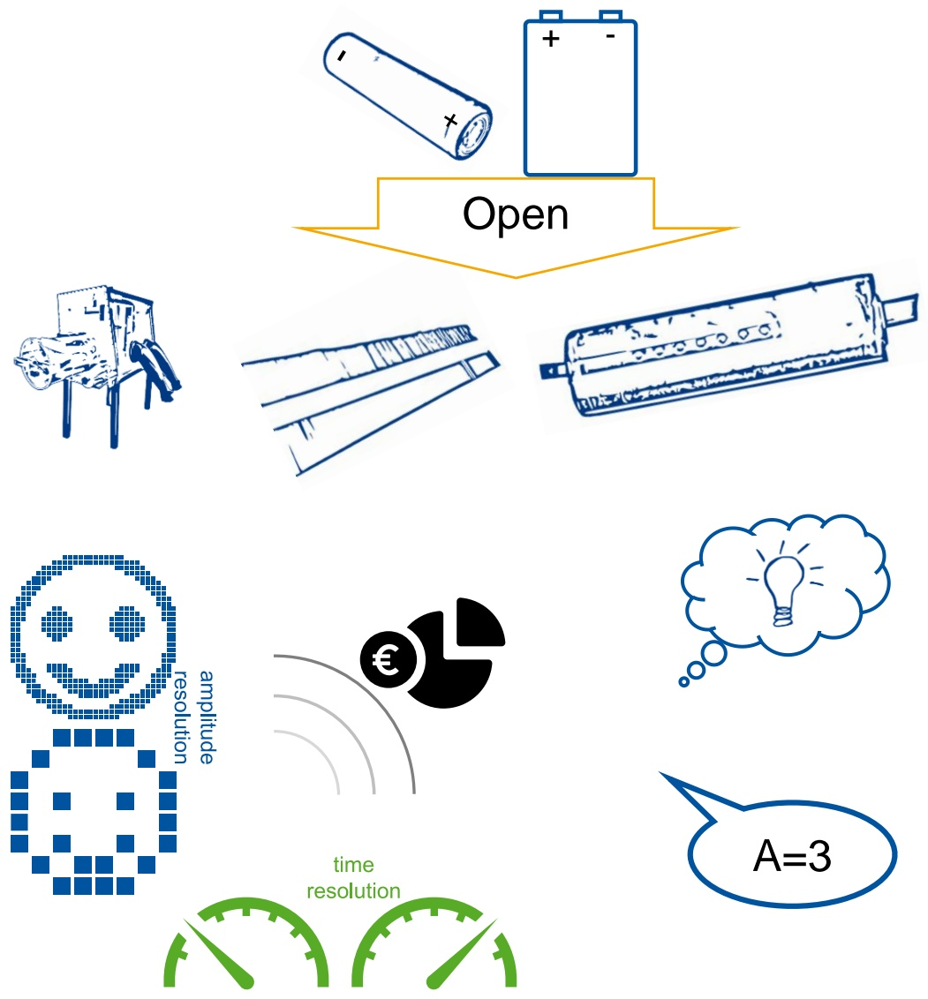

<details>
<summary>flowchart</summary>

This flowchart illustrates a process for solving electrical components using an open circuit, involving battery, capacitor, and time resolution with associated visual examples.
</details>

Analyse

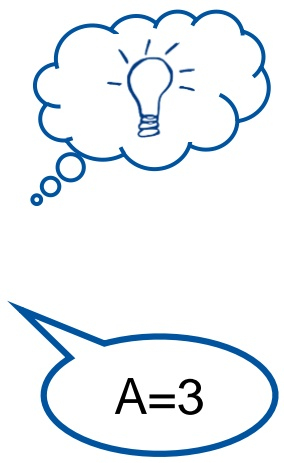

<details>
<summary>text_image</summary>

A=3
</details>

Evaluate

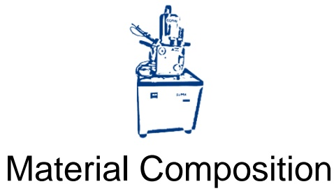

<details>
<summary>text_image</summary>

Material Composition
</details>

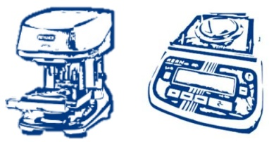

<details>
<summary>natural_image</summary>

Line drawings of two industrial appliances: a microwave oven and a control panel (no text or symbols)
</details>

Surface Structure/Topology


<details>
<summary>natural_image</summary>

Abstract blue line drawing of a golf club and a hammer (no text or symbols)
</details>

Geometrical Data

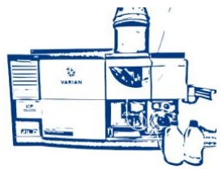

<details>
<summary>natural_image</summary>

Line drawing of a mechanical device with components and a central component (no text or symbols)
</details>

Lithium Distribution

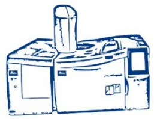

<details>
<summary>natural_image</summary>

Line drawing of a laboratory instrument with a cylindrical component and control panel (no text or symbols)
</details>

Electrolyte Composition

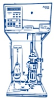

Porosity

13

G1 1 V8

Prof. Dirk Uwe Sauer

Lehrstuhl für Elektrochemische Energiewandlung und Speichersystemtechnik

iSEA

Stromrichtertechnik und Elektrische Antriebe

RWTHAACHEN UNIVERSITY

---

## Post Mortem Laboratory

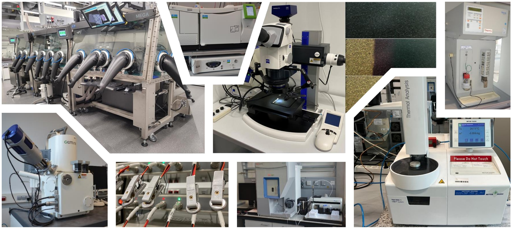

14

G1 1 V8

Prof. Dirk Uwe Sauer

Lehrstuhl für Elektrochemische Energiewandlung und Speichersystemtechnik

CARL

Center for Ageing, Reliability and Lifetime Prediction of Electrochemical and Power Electronic Systems

RWTHAACHEN UNIVERSITY

---

## Overview Battery Testing

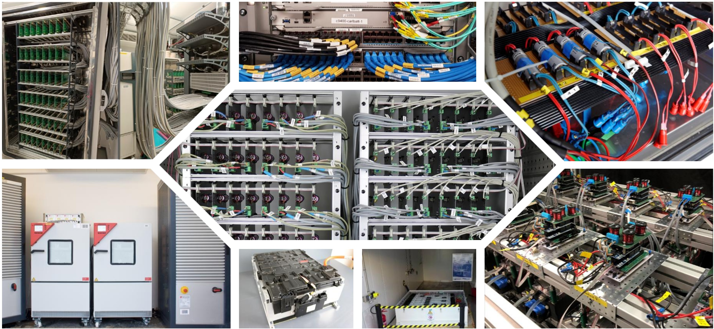

15

G1 1 V8

Prof. Dirk Uwe Sauer

Lehrstuhl für Elektrochemische Energiewandlung und Speichersystemtechnik

CARL

Center for Ageing, Reliability and Lifetime Prediction of Electrochemical and Power Electronic Systems

RWTHAACHEN UNIVERSITY

---

## Feedback made in CARL

AIB

Section Artificial Intelligence for Batteries

ESS

Section Modeling, Analytics & Life Time Prognosis

Section Battery System Design and Vehicle Integration

Section Grid Integration and Storage System Analysis

■ Over 5 000 circuits
□ From nA to kA
□ From mV to kV
■ Hundreds of climate chambers
■ Circuits with EIS
■ Temperature logging at each battery

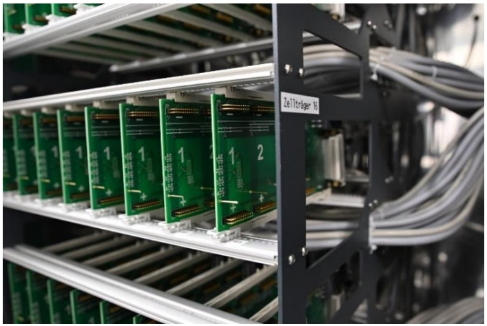

<details>
<summary>natural_image</summary>

Interior view of a server rack with green circuit boards and cables, no visible text or symbols on the main components.
</details>

■ Influence of ripple current on battery aging

□ Various materials
□ AC frequency
□ AC amplitude

■ In-house designed ripple current generator

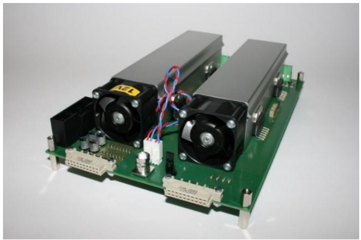

<details>
<summary>natural_image</summary>

Electronic circuit board with two black modules and connectors, no visible text or symbols
</details>

■ Post mortem analysis
■ Mechanical stress tests

■ New Parameters / Chemistries

■ Ramp Up Production

■ Quality Assurance

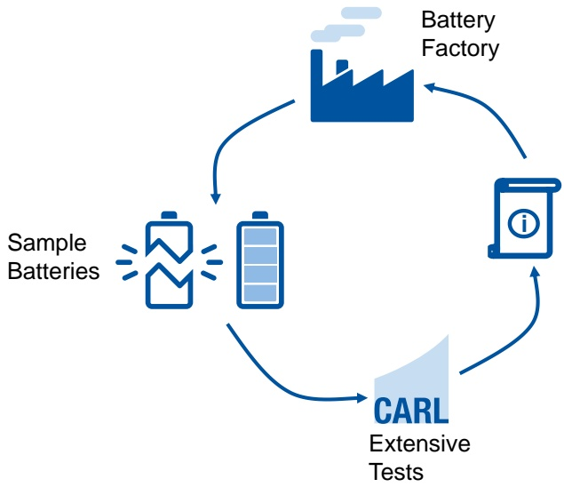

<details>
<summary>flowchart</summary>

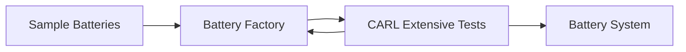
</details>

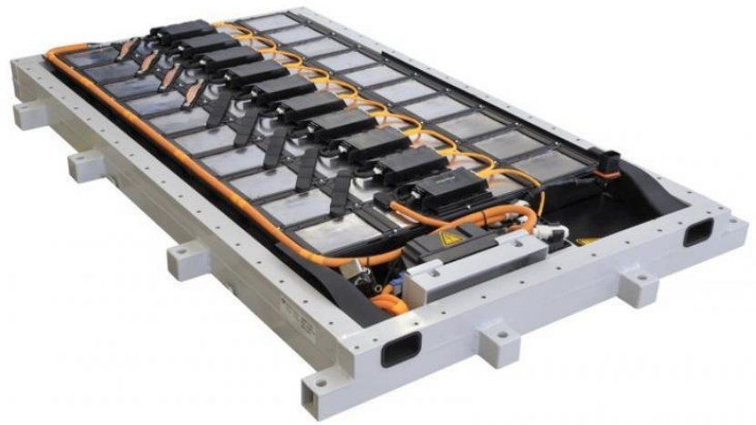

<details>
<summary>natural_image</summary>

Exterior view of a battery pack with internal battery cells and orange cables (no text or symbols visible)
</details>

16

G1 1 V8

Prof. Dirk Uwe Sauer

Lehrstuhl für Elektrochemische Energiewandlung und Speichersystemtechnik

iSEA

Stromrichtertechnik und Elektrische Antriebe

RWTHAACHEN UNIVERSITY

---

## Overview Battery Sensors

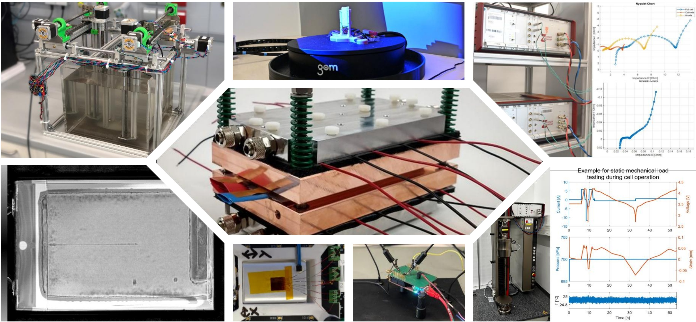

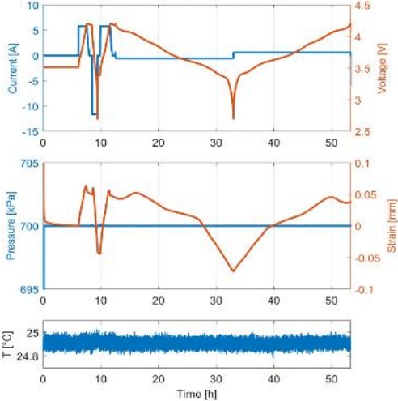

17

G1 1 V8

Prof. Dirk Uwe Sauer

Lehrstuhl für Elektrochemische Energiewandlung und Speichersystemtechnik

CARL

Center for Ageing, Reliability and Lifetime Prediction of Electrochemical and Power Electronic Systems

RWTHAACHEN UNIVERSITY

---

## Battery Sensors - Overview

AIB

Section Artificial Intelligence for Batteries

ESS

Section Modeling, Analytics & Life Time Prognosis

Section Battery System Design and Vehicle Integration

Section Grid Integration and Storage System Analysis

Ultra sound Sensing in Operando

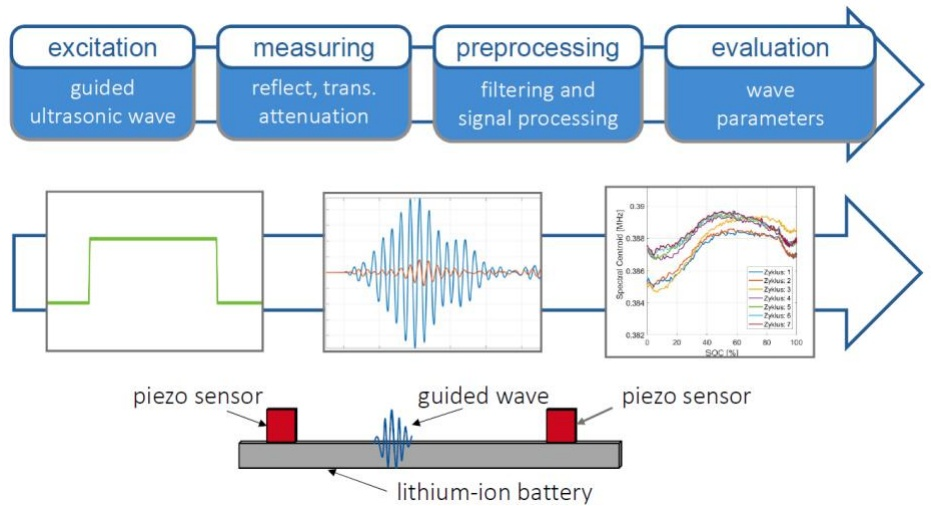

<details>
<summary>flowchart</summary>

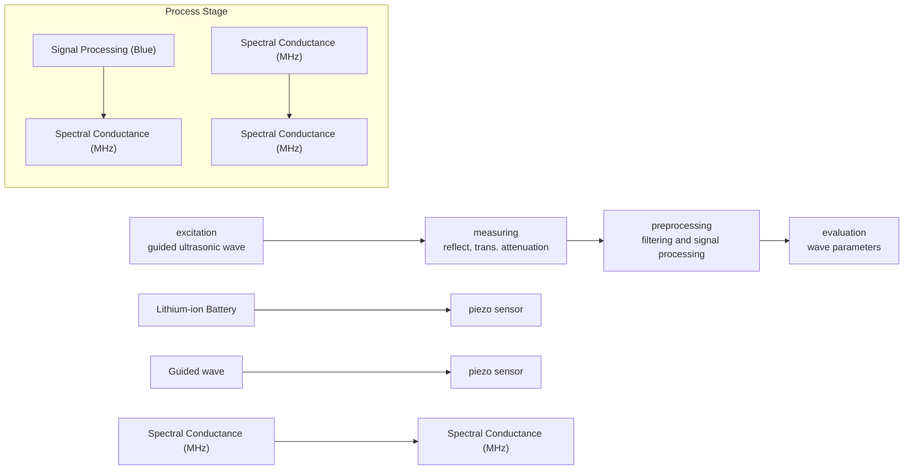
</details>

Ultra sound Imaging

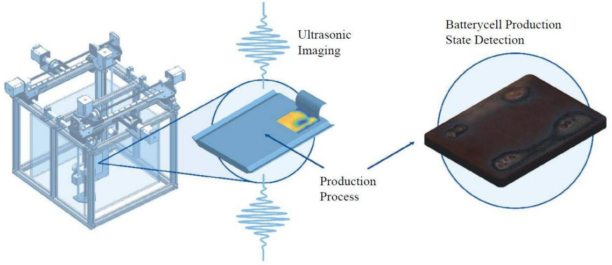

<details>
<summary>flowchart</summary>

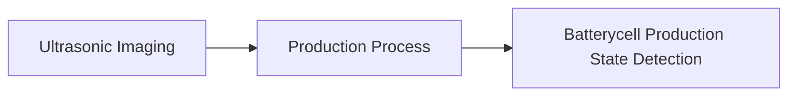
</details>

Multi-Sine EIS

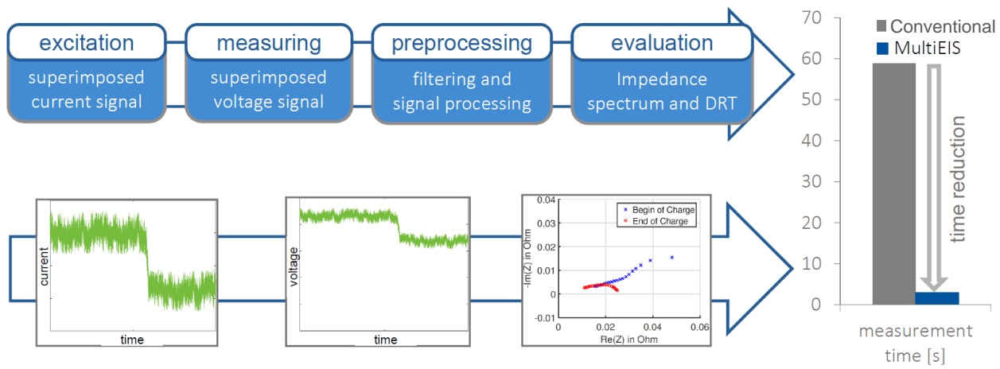

<details>
<summary>flowchart</summary>

```mermaid
graph LR
  A["excitation\nsuperimposed current signal"] --> B["measuring\nsuperimposed voltage signal"]
  B --> C["preprocessing\nfiltering and signal processing"]
  C --> D["evaluation\nImpedance spectrum and DRT"]
  E["&quot;measurement time [s"]"] --> F["&quot;MultiEIS measurement time [s"]"]
  
  subgraph Process_1
  G["current (time)"] --> H["current (time)"]
  I["voltage (time)"] --> J["voltage (time)"]
  end
  
  subgraph Process_2
  K["Re(Z) in Ohm (start)"] --> L["-Im(Z) in Ohm (start)"]
  M["Begin of Charge (Re(Z))"] --> N["End of Charge (Re(Z))"]
  O["End of Charge (Re(Z))"] --> P["End of Charge (Re(Z))"]
  end
  
  F --> Q["time reduction"]
  N --> Q
  P --> Q
```
</details>

Dilatation Measurement Stripes

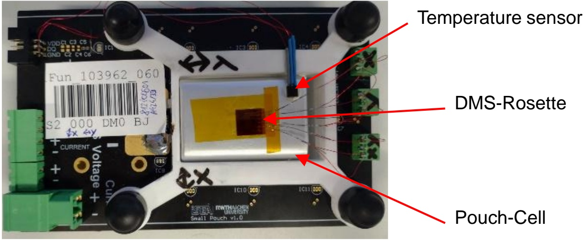

<details>
<summary>text_image</summary>

Temperature sensor
DMS-Rosette
Pouch-Cell
Fun 103962 060
S2 000 DMO BJ
CURRENT Voltage Cun
SEA ROTHMACHEN UNIVERSITY
Small Pouch v1.0
</details>

18

G1 1 V8

Prof. Dirk Uwe Sauer

Lehrstuhl für Elektrochemische Energiewandlung und Speichersystemtechnik

iSEA

Stromrichtertechnik und Elektrische Antriebe

RWTHAACHEN UNIVERSITY

---

## Overview Battery System Design

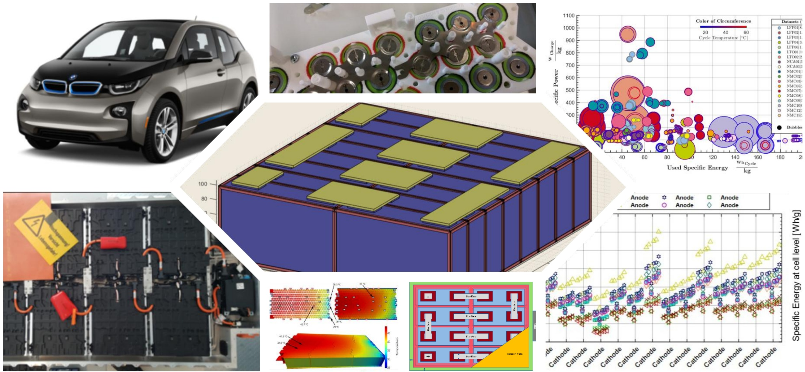

19

G1 1 V8

Prof. Dirk Uwe Sauer

Lehrstuhl für Elektrochemische Energiewandlung und Speichersystemtechnik

CARL

Center for Ageing, Reliability and Lifetime Prediction of Electrochemical and Power Electronic Systems

RWTHAACHEN UNIVERSITY

---

## Battery System Design - Overview

Teardown of Real World Electric Cars

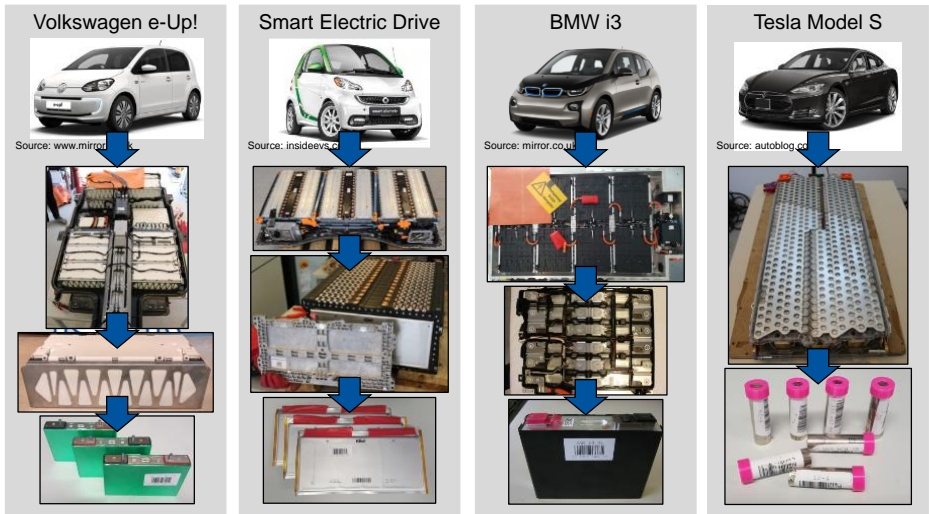

<details>
<summary>flowchart</summary>

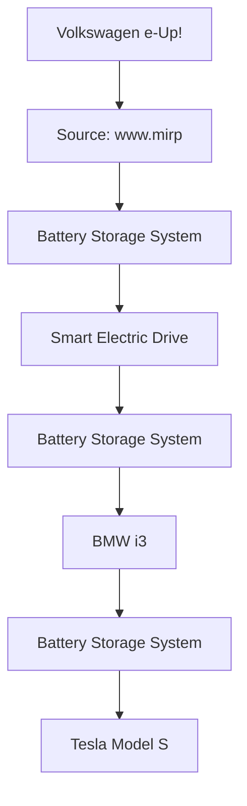
</details>

Digital Twin of Batteries

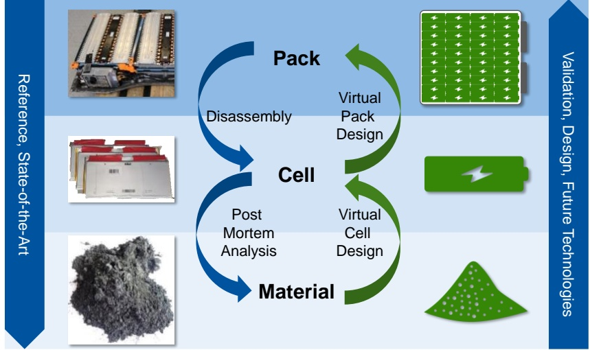

<details>
<summary>flowchart</summary>


</details>

AIB

Section Artificial Intelligence for Batteries

ESS

Section Modeling, Analytics & Life Time Prognosis

Section Battery System Design and Vehicle Integration

Section Grid Integration and Storage System Analysis

Database to Create Virtual Cells


<details>
<summary>flowchart</summary>


</details>

Benchmarking


<details>
<summary>scatter</summary>

| Cathode 2 | ~0.01, ~0.02, ~0.03, ~0.04, ~0.05, ~0.06, ~0.07, ~0.08, ~0.09, ~0.10, ~0.11, ~0.12, ~0.13, ~0.14, ~0.15, ~0.16, ~0.17, ~0.18, ~0.19, ~0.20, ~0.21, ~0.22, ~0.23, ~0.24, ~0.25, ~0..26, ~0.27, ~0.28, ~0.29, ~0.30, ~0.31, ~0.32, ~0.33, ~0.34, ~0.35, ~0.36, ~0.37, ~0.38, ~0.39, ~0.40 |
| --- | --- |
| Cathode 3 | ~0.15, ~0.16, ~0.17, ~0.18, ~0.19, ~0.20, ~0.21, ~0.22, ~0.23, ~0.24, ~0.25, ~0.26, ~0.27, ~0.28, ~0.29, ~0.30, ~0.29, ~0.28, ~0.27, ~0.26, ~0.25 |
| Cathode 4 | ~0.16, ~0.17, ~0.18, ~0.19, ~0.20, ~0.21, ~0.22 |
| Cathode 5 | ~0.17, ~0.18, ~0.19, ~0.20, ~0.21 |
| Cathode 6 | ~0.18, ~0.19, ~0.20 |
| Cathode 7 | ~0.19, ~0.20 |
| Cathode 8 | ~0.20 |
| Cathode 9 | ~0.21 |
| Cathode 10 | ~0.22 |
| Cathode 11 | ~0.23 |
| Cathode 12 | ~0.24 |
| Cathode 13 | ~0.25 |
| Cathode 14 | ~0.26 |
| Cathode 15 | ~0.27 |
| Cathode 16 | ~0.28 |
| Cathode 17 | ~0.29 |
| Cathode 18 | ~0.30 |
| Cathode 19 | ~0.31 |
| Cathode 20 | ~0.32 |
| Cathode 21 | ~0.33 |
| Cathode 22 | ~0.34 |
| Cathode 23 | ~0.35 |
| Cathode 24 | ~0.36 |
| Cathode 25 | ~0.37 |
| Cathode 26 | ~0.38 |
| Cathode 27 | ~0.39 |
| Cathode 28 | ~0.40 |
| Cathode 29 | ~0.41 |
| Cathode 30 | ~0.42 |
| Cathode 31 | ~0.43 |
| Cathode 32 | ~0.44 |
| Cathode 33 | ~0.45 |
| Cathode 34 | ~0.46 |
| Cathode 35 | ~0.47 |
| Cathode 36 | ~0.48 |
| Cathode 37 | ~0.49 |
| Cathode 38 | ~0.50 |
| Cathode 39 | ~0.51 |
| Cathode 40 | ~0.52 |
| Cathode 41 | ~0.53 |
| Cathode 42 | ~0.54 |
| Cathode 43 | ~0.55 |
| Cathode 44 | ~0.56 |
| Cathode 45 | ~0.57 |
| Cathode 46 | ~0.58 |
| Cathode 47 | ~0.59 |
| Cathode 48 | ~0.60 |
| Cathode 49 | — |
| Cathode 50 | — |
| Cathode 51 | — |
| Cathode 52 | — |
| Cathode 53 | — |
| Cathode 54 | — |
| Cathode 55 | — |
| Cathode 56 | — |
| Cathode 57 | — |
| Cathode 58 | — |
| Cathode 59 | — |
| Cathode 60 | — |
| Cathode 61 | — |
| Cathode 62 | — |
| Cathode 63 | — |
| Cathode 64 | — |
| Cathode 65 | — |
| Cathode 66 | — |
| Cathode 67 | — |
| Cathode 68 | — |
| Cathode 69 | — |
| Cathode 70 | — |
| Cathode 71 | — |
| Cathode 72 | — |
| Cathode 73 | — |
| Cathode 74 | — |
| Cathode 75 | — |
| Cathode 76 | — |
| Cathode 77 | — |
| Cathode 78 | — |
| Cathode 79 | — |
| Cathode 80 | — |
| Cathode 81 | — |
| Cathode 82 | — |
| Cathode 83 | — |
| Cathode 84 | — |
| Cathode 85 | — |
| Cathode 86 | — |
| Cathode 87 | — |
| Cathode 88 | — |
| Cathode 89 | — |
| Cathode 90 | — |
| Cathode 91 | — |
| Cathode 92 | — |
| Cathode 93 | — |
| Cathode 94 | — |
| Cathode 95 | — |
| Cathode 96 | — |
| Cathode 97 | — |
| Cathode 98 | — |
| Cathode 99 | — |
| Cathode 100 | — |
</details>

20

G1 1 V8

Prof. Dirk Uwe Sauer

Lehrstuhl für Elektrochemische Energiewandlung und Speichersystemtechnik

iSEA

Stromrichtertechnik und Elektrische Antriebe

RWTHAACHEN UNIVERSITY

---

Multiple Applications

AIB

Section Artificial Intelligence for Batteries

ESS

Section Modeling, Analytics & Life Time Prognosis

Section Battery System Design and Vehicle Integration

Section Grid Integration and Storage System Analysis


21

G1 1 V8

Prof. Dirk Uwe Sauer

Lehrstuhl für Elektrochemische Energiewandlung und Speichersystemtechnik

baden-wuerttemberg.de/ terex.com/fuchs/ manager-magazin.de/ ingenieur.de/technik/

iSEA

Stromrichtertechnik und Elektrische Antriebe

RWTHAACHEN UNIVERSITY

---

## Overview Battery Diagnostics


22

G1 1 V8

Prof. Dirk Uwe Sauer

Lehrstuhl für Elektrochemische Energiewandlung und Speichersystemtechnik

CARL

Center for Ageing, Reliability and Lifetime Prediction of Electrochemical and Power Electronic Systems

RWTHAACHEN UNIVERSITY

---

## Overview Battery Model Parametrization


23

G1 1 V8

Prof. Dirk Uwe Sauer

Lehrstuhl für Elektrochemische Energiewandlung und Speichersystemtechnik

CARL

Center for Ageing, Reliability and Lifetime Prediction of Electrochemical and Power Electronic Systems

RWTHAACHEN UNIVERSITY

---

## Thermal Model

■ Complex geometries can simulated with a composition of simple shapes by finite volumes
■ Single Cells can be assembled to packs for simulation
■ Thermal parametrization of heat capacity and temperature and heat conductivity with IR-Temperature measurement

Parametrization


AIB

Section Artificial Intelligence for Batteries

ESS

Section Modeling, Analytics & Life Time Prognosis

Section Battery System Design and Vehicle Integration

Section Grid Integration and Storage System Analysis

Available Volumes


<details>
<summary>natural_image</summary>

Four 3D geometric shapes (rectangular, square, pentagonal, and hexagon) with grid lines and radial grid lines, no text or symbols present.
</details>

Simulated Pack


<details>
<summary>heatmap</summary>

| Feature | Temperature \(({}^{\circ}C)\) |
| --- | --- |
| Top Panel: Zone 1 | 30.5 |
| Top Panel: Zone 2 | 45 |
| Bottom Panel: Zone 1 | 47.5 |
| Bottom Panel: Zone 2 | 47.0 |
</details>

Source: Dissertation Hust 2018 Dissertation Witzenhausen 2017

24

G1 1 V8

Prof. Dirk Uwe Sauer

Lehrstuhl für Elektrochemische Energiewandlung und Speichersystemtechnik

iSEA

Stromrichtertechnik und Elektrische Antriebe

RWTHAACHEN UNIVERSITY

---

## Overview Environmental Load


25

G1 1 V8

Prof. Dirk Uwe Sauer

Lehrstuhl für Elektrochemische Energiewandlung und Speichersystemtechnik

CARL

Center for Ageing, Reliability and Lifetime Prediction of Electrochemical and Power Electronic Systems

RWTHAACHEN UNIVERSITY

---

## Motivation for mechanical and thermal experiments on batteries


<details>
<summary>flowchart</summary>


</details>

Material


Cell


System


Application

novations, from material to system level, must be demonstrated in real-life scenari**Batteries must withstand difficult environments, especially in mobile applications.**

26

G1 1 V8

Prof. Dirk Uwe Sauer

Lehrstuhl für Elektrochemische Energiewandlung und Speichersystemtechnik

iSEA

Stromrichtertechnik und Elektrische Antriebe

RWTHAACHEN UNIVERSITY

---

## Machine learning in battery research at material & component level

AIB

Section Artificial Intelligence for Batteries

ESS

Section Modeling, Analytics & Life Time Prognosis

Section Battery System Design and Vehicle Integration

Section Grid Integration and Storage System Analysis

▪ Anomaly detection in battery production


Supervised segmentation for battery analysis

Input


<details>
<summary>natural_image</summary>

Close-up of a textured, irregular surface with no visible text or symbols
</details>

3D x-ray nano-CT data

Deep Learning Network


<details>
<summary>natural_image</summary>

Abstract 3D geometric shape composed of blue vertical bars (no text or symbols)
</details>

Output


<details>
<summary>natural_image</summary>

Abstract color pattern with blue, green, and yellow regions (no text or symbols)
</details>

Segmentation

▪ Denoising CT images with deep learning


▪ Enhancing CT images with deep learning


27

G1 1 V8

Prof. Dirk Uwe Sauer

Lehrstuhl für Elektrochemische Energiewandlung und Speichersystemtechnik

iSEA

Stromrichtertechnik und Elektrische Antriebe

RWTHAACHEN UNIVERSITY

---

## Machine learning in battery research at system level

AIB

Section Artificial Intelligence for Batteries

ESS

Section Modeling, Analytics & Life Time Prognosis

Section Battery System Design and Vehicle Integration

Section Grid Integration and Storage System Analysis

▪ Fast charging strategy


<details>
<summary>flowchart</summary>


</details>

▪ Operation strategy


<details>
<summary>flowchart</summary>

```mermaid
graph LR
  A["Node 1"] --> B["Vehicle"]
  C["Node 2"] --> B
  D["Node 3"] --> B
  E["Node 4"] --> B
  F["Node 5"] --> B
  G["Node 6"] --> B
  H["Node 7"] --> B
  I["Node 8"] --> B
  J["Node 9"] --> B
  K["Node 10"] --> B
  L["Node 11"] --> B
  M["Node 12"] --> B
  N["Node 13"] --> B
  O["Node 14"] --> B
  P["Node 15"] --> B
  Q["Node 16"] --> B
  R["Node 17"] --> B
  S["Node 18"] --> B
  T["Node 19"] --> B
  U["Node 20"] --> B
  V["Node 21"] --> B
  W["Node 22"] --> B
  X["Node 23"] --> B
  Y["Node 24"] --> B
  Z["Node 25"] --> B
  AA["Node 26"] --> B
  AB["Node 27"] --> B
  AC["Node 28"] --> B
  AD["Node 29"] --> B
  AE["Node 30"] --> B
  AF["Node 31"] --> B
  AG["Node 32"] --> B
  AH["Node 33"] --> B
  AI["Node 34"] --> B
  AJ["Node 35"] --> B
  AK["Node 36"] --> B
  AL["Node 37"] --> B
  AM["Node 38"] --> B
  AN["Node 39"] --> B
  AO["Node 40"] --> B
  AP["Node 41"] --> B
  AQ["Node 42"] --> B
  AR["Node 43"] --> B
  AS["Node 44"] --> B
  AT["Node 45"] --> B
  AU["Node 46"] --> B
  AV["Node 47"] --> B
  AW["Node 48"] --> B
  AX["Node 49"] --> B
  AY["Node 50"] --> B
  AZ["Node 51"] --> B
  BA["Node 52"] --> B
  BB["Node 53"] --> B
  BC["Node 54"] --> B
  BD["Node 55"] --> B
  BE["Node 56"] --> B
  BF["Node 57"] --> B
  BG["Node 58"] --> B
  BH["Node 59"] --> B
  BI["Node 60"] --> B
  BJ["Node 61"] --> B
  BK["Node 62"] --> B
  BL["Node 63"] --> B
  BM["Node 64"] --> B
  BN["Node 65"] --> B
  BO["Node 66"] --> B
  BP["Node 67"] --> B
  BR["Node 68"] --> B
  BRD["Node 69"] --> B
  BRD_1["Cloud Server Icon"]
  BRD_2["Cloud Cloud Icon"]
  
    A -.-> C["Vehicle"]
    C -.-> D["Vehicle"]
    D -.-> E["Vehicle"]
    E -.-> F["Vehicle"]
    F -.-> G["Vehicle"]
    G -.-> H["Vehicle"]
    H -.-> I["Vehicle"]
    I -.-> J["Vehicle"]
    J -.-> K["Vehicle"]
    K -.-> L["Vehicle"]
    L -.-> M["Vehicle"]
    M -.-> N["Vehicle"]
    N -.-> O["Vehicle"]
    O -.-> P["Vehicle"]
    P -.-> Q["Vehicle"]
    Q -.-> R["Vehicle"]
    R -.-> S["Vehicle"]
    S -.-> T["Vehicle"]
    T -.-> U["Vehicle"]
    U -.-> V["Vehicle"]
    V -.-> W["Vehicle"]
    W -.-> X["Vehicle"]
    X -.-> Y["Vehicle"]
    Y -.-> Z["Vehicle"]
    Z -.-> AA{"Cloud"}
  AA -- "Cloud" --> AB{"Cloud"}
  AB -- "Cloud" --> AC{"Cloud"}
  AC -- "Cloud" --> AD{"Cloud"}
  AD -- "Cloud" --> AE{"Cloud"}
  AE -- "Cloud" --> AF{"Cloud"}
  AF -- "Cloud" --> AG{"Cloud"}
  AG -- "Cloud" --> AH{"Cloud"}
  AH -- "Cloud" --> AI{"Cloud"}
  AI -- "Cloud" --> AJ{"Cloud"}
  AJ -- "Cloud" --> AK{"Cloud"}
  AK -- "Cloud" --> AL{"Cloud"}
  AL -- "Cloud" --> AM{"Cloud"}
  AM -- "Cloud" --> AN{"Cloud"}
  AN -- "Cloud" --> AO{"Cloud"}
  AO -- "Cloud" --> AP{"Cloud"}
  AP -- "Cloud" --> AQ{"Cloud"}
  AQ -- "Cloud" --> AR{"Cloud"}
  AR -- "Cloud" --> AS{"Cloud"}
  AS -- "Cloud" --> AT{"Cloud"}
  AT -- "Cloud" --> AU{"Cloud"}
  AU -- "Cloud" --> AV{"Cloud"}
  AV -- "Cloud" --> AW{"Cloud"}
  AW -- "Cloud" --> AX{"Cloud"}
  AX -- "Cloud" --> AZ{"Cloud"}
  AZ -- "Cloud" --> AB{"Cloud"}
  AB -- "Cloud" --> AC{"Cloud"}
  AC -- "Cloud" --> AD{"Cloud"}
  AD -- "Cloud" --> AE{"Cloud"}
  AE -- "Cloud" --> AF{"Cloud"}
  AF -- "Cloud" --> AG{"Cloud"}
  AG -- "Cloud" --> AH{"Cloud"}
  AH -- "Cloud" --> AI{"Cloud"}
  AI -- "Cloud" --> AJ{"Cloud"}
    AJ -.-> AK{"Cloud"}
  AK -- "Cloud" --> AL{"Cloud"}
  AL -- "Cloud" --> AM{"Cloud"}
  AM -- "Cloud" --> AN{"Cloud"}
  AN -- "Cloud" --> AO{"Cloud"}
  AO -- "Cloud" --> AP{"Cloud"}
  AP -- "Cloud" --> AQ{"Cloud"}
  AQ -- "Cloud" --> AR{"Cloud"}
  AR -- "Cloud" --> AS{"Cloud"}
  AS -- "Cloud" --> AU{"Cloud"}
  AU -- "Cloud" --> AV{"Cloud"}
  AV -- "Cloud" --> AW{"Cloud"}
  AW -- "Cloud" --> AX{"Cloud"}
  AX -- "Cloud" --> AZ{"Cloud"}
  AZ -- "Cloud" --> AB{"Cloud"}
  AB -- "Cloud" --> AC{"Cloud"}
  AC -- "Cloud" --> AD{"Cloud"}
  AD -- "Cloud" --> AE{"Cloud"}
    AE -.-> AF{"Cloud"}
  AF -- "Cloud" --> AG{"Cloud"}
  AG -- "Cloud" --> AH{"Cloud"}
  AH -- "Cloud" --> AI{"Cloud"}
  AI -- "Cloud" --> AJ{"Cloud"}
  AJ -- "Cloud" --> AK{"Cloud"}
  AK -- "Cloud" --> AL{"Cloud"}
  AL -- "Cloud" --> AM{"Cloud"}
  AM -- "Cloud" --> AN{"Cloud"}
  AN -- "Cloud" --> AJ{"Cloud"}
  AJ -- "Cloud" --> AK{"Cloud"}
  AK -- "Cloud" --> AL{"Cloud"}
  AL -- "Cloud" --> AMZ{"Cloud"}
  AMZ -- "Cloud" --> ANZ{"Cloud"}
  ANZ -- "Cloud" --> AOZ{"Cloud"}
  AOZ -- "Cloud" --> ANZ2{"Cloud"}
  ANZ2 -- "Cloud" --> AOZ3{"Cloud"}
  AOZ3 -- "Cloud" --> ANZ4{"Cloud"}
  ANZ4 -- "Cloud" --> AOZ5{"Cloud"}
  AOZ5 -- "Cloud" --> ANZ6{"Cloud"}
  ANZ6 -- "Cloud" --> AOZ7{"Cloud"}
  AOZ7 -- "Cloud" --> ANZ8{"Cloud"}
  ANZ8 -- "Cloud" --> AOZ9{"Cloud"}
  AOZ9 -- "Cloud" --> ANZ10{"Cloud"}
  ANZ10 -- "Cloud" --> AOZ11{"Cloud"}
  AOZ11 -- "Cloud" --> ANZ12{"Cloud"}
  ANZ12 -- "Cloud" --> AOZ13{"Cloud"}
  AOZ13 -- "Cloud" --> ANZ14{"Cloud"}
  ANZ14 -- "Cloud" --> AOZ15{"Cloud"}
  AOZ15 -- "Cloud" --> ANZ16{"Cloud"}
  ANZ16 -- "Cloud" --> AOZ17{"Cloud"}
  AOZ17 -- "Cloud" --> ANZ18{"Cloud"}
  ANZ18 -- "Cloud" --> AOZ19{"Cloud"}
  AOZ19 -- "Cloud" --> ANZ20{"Cloud"}
  ANZ20 -- "Cloud" --> AOZ21{"Cloud"}
  AOZ21 -- "Cloud" --> ANZ22{"Cloud"}
  ANZ22 -- "Cloud" --> AOZ23{"Cloud"}
  AOZ23 -- "Cloud" --> ANZ24{"Cloud"}
  ANZ24 -- "Cloud" --> AOZ25{"Cloud"}
  AOZ25 -- "Cloud" --> ANZ26{"Cloud"}
  ANZ26 -- "Cloud" --> AOZ27{"Cloud"}
  AOZ27 -- "Cloud" --> ANZ28{"Cloud"}
  ANZ28 -- "Cloud" --> AOZ29{"Cloud"}
  AOZ29 -- "Cloud" --> ANZ30{"Clutterfly Icon"
      A -.-> A1["(&quot;Network Nodes&quot;)"]
      A -.-> A2["(&quot;Network Nodes&quot;)"]
      A -.-> A3["(&quot;Network Nodes&quot;)"]
      A -.-> A4["(&quot;Network Nodes&quot;)"]
      A -.-> A5["(&quot;Network Nodes&quot;)"]
      A -.-> A6["(&quot;Network Nodes&quot;)"]
      A -.-> A7["(&quot;Network Nodes&quot;)"]
      A -.-> A8["(&quot;Network Nodes&quot;)"]
      A -.-> A9["(&quot;Network Nodes&quot;)"]
      A -.-> A10["(&quot;Network Nodes&quot;)"]
      A -.-> A11["(&quot;Network Nodes&quot;)"]
      A -.-> A12["(&quot;Network Nodes&quot;)"]
      A -.-> A13["(&quot;Network Nodes&quot;)"]
      A -.-> A14["(&quot;Network Nodes&quot;)"]
      A -.-> A15["(&quot;Network Nodes&quot;)"]
      A -.-> A16["(&quot;Network Nodes&quot;)"]
      A -.-> A17["(&quot;Network Nodes&quot;)"]
      A -.-> A18["(&quot;Network Nodes&quot;)"]
      A -.-> A19["(&quot;Network Nodes&quot;)"]
      A -.-> A20["(&quot;Network Nodes&quot;)"]
      A -.-> A21["(&quot;Network Nodes&quot;)"]
      A -.-> A22["(&quot;Network Nodes&quot;)"]
      A -.-> A23["(&quot;Network Nodes&quot;)"]
      A -.-> A24["(&quot;Network Nodes&quot;)"]
      A -.-> A25["(&quot;Network Nodes&quot;)"]
      A -.-> A26["(&quot;Network Nodes&quot;)"]
      A -.-> A27["(&quot;Network Nodes&quot;)"]
      A -.-> A28["(&quot;Network Nodes&quot;)"]
      A -.-> A29["(&quot;Network Nodes&quot;)"]
      A -.-> A30["(&quot;Network Nodes&quot;)"]
      A -.-> A31["(&quot;Network Nodes&quot;)"]
      A -.-> A32["(&quot;Network Nodes&quot;)"]
      A -.-> A33["(&quot;Network Nodes&quot;)"]
      A -.-> A34["(&quot;Network Nodes&quot;)"]
      A -.-> A35["(&quot;Network Nodes&quot;)"]
      A -.-> A36["(&quot;Network Nodes&quot;)"]
      A -.-> A37["(&quot;Network Nodes&quot;)"]
      A -.-> A38["(&quot;Network Nodes&quot;)"]
      A -.-> A39["(&quot;Network Nodes&quot;)"]
      A -.-> A40["(&quot;Network Nodes&quot;)"]
      A -.-> A41["(&quot;Network Nodes&quot;)"]
      A -.-> A42["(&quot;Network Nodes&quot;)"]
      A -.-> A43["(&quot;Network Nodes&quot;)"]
      A -.-> A44["(&quot;Network Nodes&quot;)"]
      A -.-> A45["(&quot;Network Nodes&quot;)"]
      A -.-> A46["(&quot;Network Nodes&quot;)"]
      A -.-> A47["(&quot;Network Nodes&quot;)"]
      A -.-> A48["(&quot;Network Nodes&quot;)"]
      A -.-> A49["(&quot;Network Nodes&quot;)"]
      A -.-> A50["(&quot;Network Nodes&quot;)"]
      A . ---["Aircraft Icon"]
      AA_---["Aircraft Icon"]
      AB_---["Aircraft Icon"]
      AC_---["Aircraft Icon"]
      AD_---["Aircraft Icon"]
      AE_---["Aircraft Icon"]
      AF_---["Aircraft Icon"]
      AG_---["Aircraft Icon"]
      AH_---["Aircraft Icon"]
      AI_---["Aircraft Icon"]
      AJ_---["Aircraft Icon"]
      AK_---["Aircraft Icon"]
      AL_---["Aircraft Icon"]
      AM_---["Aircraft Icon"]
      AN_---["Aircraft Icon"]
      AO_---["Aircraft Icon"]
      AP_---["Aircraft Icon"]
      AQ_---["Aircraft Icon"]
      AR_---["Aircraft Icon"]
      AS_---["Aircraft Icon"]
      AT_---["Aircraft Icon"]
      AU_---["Aircraft Icon"]
      AV_---["Aircraft Icon"]
      AW_---["Aircraft Icon"]
      AX_---["Aircraft Icon"]
      AZ_---["Aircraft Icon"]
      BA_---["Aircraft Icon"]
      BC_---["Aircraft Icon"]
      CD_---["Aircraft Icon"]
      DE_---["Aircraft Icon"]
      EF_---["Aircraft Icon"]
      GA_---["Aircraft Icon"]
      GH_---["Aircraft Icon"]
      GI_---["Aircraft Icon"]
      HL_---["Aircraft Icon"]
      MG_---["Aircraft Icon"]
      HG_---["Aircraft Icon"]
      GI_---["Aircraft Icon"]
      GL_---["Aircraft Icon"]
      MGD_---["Aircraft Icon"]
      GL_---["Aircraft Icon"]
      GM_---["Aircraft Icon"]
      GMD_---["Aircraft Icon"]
      GM_---["Aircraft Icon"]
      GMD_---["Aircraft Icon"]
      GMG_---["Aircraft Icon"]
      GMG_---["Aircraft Icon"]
      GMG_---["Aircraft Icon"]
      GMG_---["Aircraft Icon"]
      GMG_---["Aircraft Icon"]
      GMG_---["Aircraft Icon"]
     M(("M"))
     N(("N"))
     O(("O"))
     P(("P"))
     Q(("Q"))
     R(("R"))
     S(("S"))
     T(("T"))
     U(("U"))
     V(("V"))
     W(("W"))
     X(("X"))
     Y(("Y"))
     Z(("Z"))
     AA(("AA"))
     AB(("AB"))
     AC(("AC"))
     AD(("AD"))
     AE(("AE"))
     AF(("AF"))
     AG(("AG"))
     AH(("AH"))
     AI(("AI"))
     AJ(("AJ"))
     AK(("AK"))
     AL(("AL"))
     AM(("AM"))
     AG(("AG"))
     AH(("AG"))
     AI(("AI"))
     AJ(("AJ"))
     AK(("AK"))
     AL(("AL"))
     AM(("AM"))
     AG(("AG"))
     AH(("AG"))
     AI(("AI"))
     AJ(("AJ"))
     AK(("AK"))
     AL(("AL"))
     AM(("AM"))
     AG(("AG"))
     AH(("AG"))
     AI(("AI"))
     AJ(("AJ"))
     AK(("AK"))
     AL(("AL"))
     AM(("AM"))
     AG(("AB"))
     AH(("AG"))
     AI(("AI"))
     AJ(("AJ"))
     AK(("AK"))
     AL(("AL"))
     AM(("AM"))
     AG(("AG"))
     AH(("AG"))
     AI(("AI"))
     AJ(("AJ"))
     AK(("AK"))
     AL(("AL"))
     AM((M))
     AG((M))
     AH((M))
     AI((M))
     AJ((M))
     AK((M))
     AL((M))
     AM((M))
     AG((M))
     AH((M))
     AI((M))
     AJ((M))
     AK((M))
     AL((M))
     AM((M))
     AG((M))
     AH((M))
     AI((M))
     AJ((M))
     AK((M))
     AL((M))
     AM((M))
     AG((M))
     AH((M))
     AI((M))
     AJ((M))
     AK((M))
```
</details>

▪ Fast screening for Second Use


<details>
<summary>flowchart</summary>


</details>

Field data analysis


<details>
<summary>line</summary>

| Accumulated mileage (km) | Capacity (Ah) |
| --- | --- |
| ~20k | ~145 |
| ~100k | ~135 |
| ~200k | ~125 |
| ~300k | ~115 |
| ~400k | ~105 |
| ~500k | ~95 |
</details>

28

G1 1 V8

Prof. Dirk Uwe Sauer

Lehrstuhl für Elektrochemische Energiewandlung und Speichersystemtechnik

iSEA

Stromrichtertechnik und Elektrische Antriebe

RWTHAACHEN UNIVERSITY

---

## Battery Sections at ISEA


Ageing and Lifetime Prediction of Batteries

## Electrochemical Energy Conversion and Storage Systems (ESS)


Artificial Intelligence and Digitalization for Batteries


| Advanced electrode manufacturing | Ageing and Lifetime Prediction of Batteries | Battery Modelling, Analytics and Lifetime Prediction | Battery System Design and Vehicle Integration | Battery Grid Integration and Storage System Analysis | Artificial Intelligence for Batteries |
| --- | --- | --- | --- | --- | --- |


29

G1 1 V8

Prof. Dirk Uwe Sauer

Lehrstuhl für Elektrochemische Energiewandlung und Speichersystemtechnik

iSEA

Stromrichtertechnik und Elektrische Antriebe

RWTHAACHEN UNIVERSITY

---

## High energy-density anode: Li-metal anode

## ■ Dendrite growth

□ Custom designing of the in-situ optical cell
□ Dendrite growth as a function of resting time
□ Understanding and categorization of lithium deposition


<details>
<summary>text_image</summary>

00 min 10 min 20 min 30 min 40 min 50 min
2.0 mm
</details>

H. Kühnle et al., https://doi.org/10.1149/1945-7111/abdeeb


30

G1 1 V8

Prof. Dirk Uwe Sauer

Lehrstuhl für Elektrochemische Energiewandlung und Speichersystemtechnik

iSEA

Stromrichtertechnik und Elektrische Antriebe

RWTHAACHEN UNIVERSITY

---

## Research at Group Grid Integration and Storage System Analysis

AIB

ESS

Section Artificial Intelligence for Batteries

Section Modeling, Analytics & Life Time Prognosis

Section Battery System Design and Vehicle Integration

Section Grid Integration and Storage System Analysis


<details>
<summary>flowchart</summary>


</details>

31

G1 1 V8

Prof. Dirk Uwe Sauer

Lehrstuhl für Elektrochemische Energiewandlung und Speichersystemtechnik

iSEA

Stromrichtertechnik und Elektrische Antriebe

RWTHAACHEN UNIVERSITY

---

Charging Infrastructure Analysis

AIB

Section Artificial Intelligence for Batteries

ESS

Section Modeling, Analytics & Life Time Prognosis

Section Battery System Design and Vehicle Integration

Section Grid Integration and Storage System Analysis

The research field focuses on understanding, analyzing, predicting and influencing the use of charging infrastructure.

## Public Charging Infrastructure

## ■ BeNutz LaSA (BMWK)

□ Analysis of the majority of the public charging infrastructure in Germany with a view to usage patterns, energy requirements and optimization opportunities.
□ Methods from the fields of Big Data and machine learning
□ Forecasting the probability of occupancy
□ Forecast of good new locations
□ Partner: FCN-ECO, IAEW, smart/lab, Hubject

Funding:


Bundesministerium für Wirtschaft und Klimaschutz


<details>
<summary>natural_image</summary>

Satellite map of a region with dense clusters of black dots, no visible text or labels
</details>

## Fleet Charging Infrastructure

## ■ FlexFleet (BMDV)

□ Analysis of the flexibilization potential of commercial vehicle fleets based on more than 100 vehicle fleets
□ Field test with intelligent charging algorithms as well as flexible network elements
□ Partner: BIT in Peking

Funding:


<details>
<summary>flowchart</summary>


</details>


<details>
<summary>line</summary>

| Time | Power demand (kW)::Green Line | Power demand (kW)::White Line |
| --- | --- | --- |
| 0h | ~1.5 | ~0.2 |
| 3h | ~2.0 | ~0.2 |
| 6h | ~2.0 | ~1.8 |
| 9h | ~3.5 | ~4.5 |
| 12h | ~3.5 | ~4.8 |
| 15h | ~3.5 | ~2.5 |
| 18h | ~3.0 | ~1.5 |
| 21h | ~1.5 | ~0.5 |
| 24h | ~1.5 | ~0.2 |
</details>


## ■ Finalize (BMWK)

□ Conversion of an airport fleet to electric vehicles
□ Testing of the flexibility potential as well as consideration of the LCA of the vehicles with different charging strategies.

32

G1 1 V8

Prof. Dirk Uwe Sauer

Lehrstuhl für Elektrochemische Energiewandlung und Speichersystemtechnik

iSEA

Stromrichtertechnik und Elektrische Antriebe

RWTHAACHEN UNIVERSITY

---

## Utility Scale Research Battery Storage – M5Bat

AIB

ESS

Section
Artificial Intelligence for
Batteries

Section
Modeling, Analytics & Life
Time Prognosis

Section
Battery System Design
and Vehicle Integration

Section
Grid Integration and
Storage System Analysis


<details>
<summary>natural_image</summary>

Aerial view of a modern industrial building with blue and white buildings, solar panels on roof, and parked cars in the courtyard (no visible text or symbols)
</details>

## Technical data

■ Power: approx. 6 MW
■ Energy: approx. 7.5 MWh
■ 5 Battery technologies (Li-Ion & lead-acid)
■ 10 independent battery units


<details>
<summary>flowchart</summary>


</details>


<details>
<summary>text_image</summary>

QR code image containing encoded data, no visible human-readable text
</details>


## Operation

■ System services
■ 3 MW FCR (frequency containment reserve)
■ Intraday trading (15 min market)
■ In preparation: aFRR (frequency restoration)

33

G1 1 V8

Prof. Dirk Uwe Sauer

Lehrstuhl für Elektrochemische Energiewandlung und Speichersystemtechnik

iSEA

Stromrichter-
technik und
Elektrische
Antriebe

RWTH AACHEN UNIVERSITY

---

## Overview of sector coupling in industry applications: everything is connected!

AIB

Section
Artificial Intelligence for
Batteries

ESS

Section
Modeling, Analytics & Life
Time Prognosis

Section
Battery System Design
and Vehicle Integration

Section
Grid Integration and
Storage System Analysis


34

G1 1 V8

Prof. Dirk Uwe Sauer

Lehrstuhl für Elektrochemische Energiewandlung und Speichersystemtechnik

iSEA

Stromrichter-
technik und
Elektrische
Antriebe

RWTH AACHEN UNIVERSITY

---

## Co-operation with industry partners in many different industrial areas (incomplete)


<details>
<summary>word_cloud</summary>

| Company |
| --- |
| DAIMLER |
| Audi |
| Ford |
| Fraunhofer |
| Tennet |
| e.on |
| JAGUAR |
| Fiat |
| Deutsche ACCUMotive |
| dSPACE |
| RWE |
| BMW |
| PHILIPS |
| STAWAG |
| GM |
| Volkswagen |
| Siemens |
| Infineon |
| EXIDE BATTERIES |
| TÜVRheinland |
| VDSL |
| Opel |
| vossloh KIEPE |
| AKASOL |
| EADS |
| DASSAULT SYSTEMES |
| VDL |
| BUS & COACH |
| SÜD-CHEMIE |
| JUNGHEINRICH Machines. Ideas. Solution |
| DEUTZ |
| WEZAG WERKZEUGE | TOOLS | OUTILS |
| FEV |
| Digatron power electronics |
| PINTSCH BAMAG |
| SCHUNK |
| HOPPECKE POWER FROM INNOVATION |
| SAFT |
| KELLA |
| BOSCH |
| ZF |
| Stadtwerke Münster |
| VOLTWERK |
| SUNPOWER TENESÖL |
| SMA |
| Continental |
| RK Regionalverkehr Köln GmbH |
</details>

35

G1 1 V8

Prof. Dirk Uwe Sauer

Lehrstuhl für Elektrochemische Energiewandlung und Speichersystemtechnik

iSEA

Stromrichter-
technik und
Elektrische
Antriebe

RWTH AACHEN UNIVERSITY

---

## Spin-off “Batterieingenieure GmbH” – Services in Industriestandards


BATTERIE
INGENIEURE

Willkommen bei den Batterielingenieuren

## Die Partner für Ihr Speicherprojekt

Wir sind ein Hightechunternehmen aus Aachen. Neben unserer langjährigen Projekterfahrung, zeichnet uns vor allem die Verbundenheit zur Universitäts – und Forschungslandschaft in der Region aus. Technologieunabhängig sind wir dabei in den Bereichen Prüfen und Testen, Entwicklung sowie technische Beratung für Sie aktiv.


BatterielIngenieure GmbH
Hüttenstr. 5, 52068 Aachen +49 (0) 241 99004916 (techn. Anfragen)
+49 (0) 241 99004915 (sonstige
Anfragen)
info@batt-ing.de


<details>
<summary>natural_image</summary>

Exterior view of a red multi-story office building under bright sunlight (no signage or text visible)
</details>

Karriere

Kontakt

Sprache auswählen

Beratung & Gutachten

Prüfen von Zellen und Batterien

Sicherheitstests

Post-Mortem Analyse

Diagnose & Modellierung

Qualitätssicherung

Batterieentwicklung und -fertigung

36

G1 1 V8

Prof. Dirk Uwe Sauer

Lehrstuhl für Elektrochemische Energiewandlung und Speichersystemtechnik

iSEA

Stromrichter-
technik und
Elektrische
Antriebe

RWTH AACHEN UNIVERSITY

---

## Spin-off "Safion GmbH" – Zustandsbestimmung & Qualitätskontrolle


<details>
<summary>other</summary>

| Category | Description |
| --- | --- |
| Brand | SAFEON |
| Product | BATTERIEDIAGNOSE |
| Details | FÜR LITHIUM-IONEN BATTERIEN |
| Context | MEHR ERFAHREN |
</details>

— ELEKTROCHEMISCHE IMPEDANZSPEKTROSKOPIE (EIS)

WIR MESSEN INNOVATIV


1

Sekunde Messdauer


32

Simultane

Impedanzmessungen


> 30.000

Vermessene Zellen

## BATTERIEDIAGNOSE

FÜR LITHIUM-IONEN BATTERIEN

MEHR ERFAHREN

37

G1 1 V8

Prof. Dirk Uwe Sauer

Lehrstuhl für Elektrochemische Energiewandlung und Speichersystemtechnik

iSEA

Stromrichter-
technik und
Elektrische
Antriebe

RWTH AACHEN UNIVERSITY

---

## Spin-off "ebusplan GmbH" – Einsatz- und Umsatzplanung für E-Busse


## ebusplan

Solutions for Clean Transportation

Aktuelles

Unsere Philosophie

Dienstleistungen

Über uns

Kontakt


<details>
<summary>text_image</summary>

1560
100 % Ökostrom im Tank.
www.stadtwerke-muenstar.de
Elektrifizierungskonzepte
kostenoptimiert und zuverlässig
ZeEUS
Zene Einkommen (Wüllner des Systems)
Mehr erfahren
Ssssaubere Sache.
Münsters Elektrobus.
</details>

## ebusplan - Ihr Partner für die Einführung von Elektrobussen

Die Einführung von Elektrobussen stellt alle Akteure vor neue Herausforderungen. Die langlebige und kostenintensive Infrastruktur muss vorausschauend geplant und in den täglichen Betrieb integriert werden. Wir stehen Ihnen mit unserer Fachkompetenz und den innovativen Planungs- und Optimierungstools in diesem Prozess zur Seite und machen elektrischen ÖPNV verlässlich planbar.


<details>
<summary>natural_image</summary>

Two people seated at a conference table facing each other, facing a white wall (no visible text or symbols)
</details>

lider-1

## Seminare und Workshops

## Ihr Schnelleinstieg ins Thema E-Busse

- Überblick über Stand der Technik, Vor- und Nachteile einzelner Technologien
- Ausräumen falscher Erwartungen an die Technik
- Kostenfaktoren bei Einführung und Einsatz von E-Bussen
- Konzepte für Planung, Monitoring und Evaluierung

## Lösungen für


Busbetreiber


Städte
und
Kommunen


Bushersteller
und
Systemanbieter

## Aktuelles


Offenbach stellt ab 2019 auf

Elektrobusse um

3. März 2018

Ergebnisse der Machbarkeitsstudie und Umsetzungsplanung vorgestellt

38

G1 1 V8

Prof. Dirk Uwe Sauer

Lehrstuhl für Elektrochemische Energiewandlung und Speichersystemtechnik

iSEA

Stromrichter-
technik und
Elektrische
Antriebe

RWTH AACHEN UNIVERSITY

---

Spin-off “ACCURE GmbH” – Datenanalyse mit Machine Learning

ACCURE BATTERY INTELLIGENCE

# Empower your batteries

The industry of the 21st century is built on batteries. To understand and improve the safety, reliability and lifetime of batteries, companies around the world rely on ACCURE's actionable data analytics.

LEARN MORE


<details>
<summary>text_image</summary>

Man presenting three green circular icons representing energy and vehicle technologies: battery, robotic arm, and ship.
</details>

39

G1 1 V8

Prof. Dirk Uwe Sauer

Lehrstuhl für Elektrochemische Energiewandlung und Speichersystemtechnik

iSEA

Stromrichter-
technik und
Elektrische
Antriebe

RWTH AACHEN UNIVERSITY

---

## Masterstudiengang „Battery Science and Technology in Engineering“

Manufacturer of rail vehicles, ships & aircraft

Manufacturer of power and garden tools, cleaning machines & power tools

Recycling companies

Energy supply and grid operators

Medical technology & mobility aids

Automotive industry incl. cars, trucks & buses

Mechanical engineering, automation and process engineering companies

Finance and insurance industry

Industrial truck manufacturer & transport logistics provider

Manufacturer of bicycles, motorcycles & scooters

Battery cell & battery pack manufacturer

Operators of critical infrastructures (communication, data centers,

Chemical industry

Electrical engineering and electronics industry

40

G1 1 V8

Prof. Dirk Uwe Sauer

Lehrstuhl für Elektrochemische Energiewandlung und Speichersystemtechnik

iSEA

Stromrichter-
technik und
Elektrische
Antriebe

RWTH AACHEN UNIVERSITY

---

## Battery development & teaching are highly interdisciplinary


41

G1 1 V8 | Prof. Dirk Uwe Sauer

Lehrstuhl für Elektrochemische Energiewandlung und Speichersystemtechnik

iSEA

Stromrichter-
technik und
Elektrische
Antriebe

RWTH AACHEN UNIVERSITY

---

BSTE

## Curriculum „Battery Science and Technology in Engineering“


<details>
<summary>funnel</summary>

| Group | Term | Course Details |
| --- | --- | --- |
| Second half | 1. Semester | Research Lab A (10 CP) |
| Second half | 2. Semester | Research Lab B* (10 CP); *Possible at international partner labs |
| Second half | 3. Semester | Research Lab C (10 CP) |
| First half | Digital courses with digital exams | Compulsory Adaptation (5 CP) |
| First half | Digital courses with digital exams | Compulsory Module (5 CP) |
| First half | Digital courses with digital exams | Compulsory Adaptation (5 CP) |
| First half | Digital courses with digital exams | 1 course from Elective (5 CP) |
| First half | Digital courses with digital exams | Compulsory Module (5 CP) |
| First half | Digital courses with digital exams | 1 course from Elective (5 CP) |
| First half | Digital courses with digital exams | 1 course from Elective (5 CP) |
| First half | Digital courses with digital exams | 1 course from Elective (5 CP) |
| First half | Digital courses with digital exams | Seminar (2,5 CP) |
| First half | Digital courses with digital exams | Research Lab Testing (3CP) |
| First half | Digital courses with digital exams | Seminar (2,5 CP) |
| Master Thesis | 4. Semester | Master Thesis (30 CP) |
</details>

42

G1 1 V8

Prof. Dirk Uwe Sauer

Lehrstuhl für Elektrochemische Energiewandlung und Speichersystemtechnik

iSEA

Stromrichter-
technik und
Elektrische
Antriebe

RWTH AACHEN UNIVERSITY

---

## Curriculum in Block courses


<details>
<summary>other</summary>

| Task | Time Period | Exam Slot Details |
| :--- | :--- | :--- |
| Compulsory Adaptation Course (5 CP) | S1 / W 01 | Exam Slot 1 & 2 |
| Compulsory Adaptation Course (5 CP) | S1 / W 04 | Fundamentals of Lithium-Ion-Batteries and Battery Systems (5 CP) |
| Compulsory Adaptation Course (5 CP) | S1 / W 08 | Exam Slot 1 & 2 |
| Battery Testing - Design of Experiment, Check-ups, Data Analysis and Model Parameterisation (3CP) | S2 / W 01 | N/A |
| Battery Testing - Design of Experiment, Check-ups, Data Analysis and Model Parameterisation (3CP) | S2 / W 02 | N/A |
| Battery Testing - Design of Experiment, Check-ups, Data Analysis and Model Parameterisation (3CP) | S2 / W 04 | N/A |
| Battery Testing - Design of Experiment, Check-ups, Data Analysis and Model Parameterisation (3CP) | S2 / W 05 | N/A |
| Battery Testing - Design of Experiment, Check-ups, Data Analysis and Model Parameterisation (3CP) | S2 / W 06 | N/A |
| Battery Testing - Design of Experiment, Check-ups, Data Analysis and Model Parameterisation (3CP) | S2 / W 07 | N/A |
| Battery Testing - Design of Experiment, Check-ups, Data Analysis and Model Parameterisation (3CP) | S2 / W 08 | N/A |
| Battery Testing - Design of Experiment, Check-ups, Data Analysis and Model Parameterisation (3CP) | S2 / W 09 | N/A |
| Battery Testing - Design of Experiment, Check-ups, Data Analysis and Model Parameterisation (3CP) | S2 / W 10 | N/A |
| Battery Testing - Design of Experiment, Check-ups, Data Analysis and Model Parameterisation (3CP) | S2 / W 11 | N/A |
| Battery Testing - Design of Experiment, Check-ups, Data Analysis and Model Parameterisation (3CP) | S2 / W 12 | N/A |
| Battery Testing - Design of Experiment, Check-ups, Data Analysis and Model Parameterisation (3CP) | S2 / W 13 | N/A |
| Battery Testing - Design of Experiment, Check-ups, Data Analysis and Model Parameterisation (3CP) | S2 / W 14 | N/A |
| Battery Testing - Design of Experiment, Check-ups, Data Analysis and Model Parameterisation (3CP) | S2 / W 15 | N/A |
| Battery Testing - Design of Experiment, Check-ups, Data Analysis and Model Parameterisation (3CP) | S2 / W 16 | N/A |
| Battery Testing - Design of Experiment, Check-ups, Data Analysis and Model Parameterisation (3CP) | S2 / W 17 | N/A |
| Battery Testing - Design of Experiment, Check-ups, Data Analysis and Model Parameterisation (3CP) | S2 / W 18 | N/A |
| Battery Testing - Design of Experiment, Check-ups, Data Analysis and Model Parameterisation (3CP) | S2 / W 19 | N/A |
| Battery Testing - Design of Experiment, Check-ups, Data Analysis and Model Parameterisation (3CP) | S2 / W 20 | N/A |
| Battery Testing - Design of Experiment, Check-ups, Data Analysis and Model Parameterisation (3CP) | S2 / W 21 | N/A |
| Battery Testing - Design of Experiment, Check-ups, Data Analysis and Model Parameterisation (3CP) | S2 / W 22 | N/A |
| Battery Testing - Design of Experiment, Check-ups, Data Analysis and Model Parameterisation (3CP) | S2 / W 23 | N/A |
| Battery Testing - Design of Experiment, Check-ups, Data Analysis and Model Parameterisation (3CP) | S2 / W 24 | N/A |
| Battery Testing - Design of Experiment, Check-ups, Data Analysis and Model Parameterisation (3CP) | S2 / W 25 | N/A |
| Battery Testing - Design of Experiment, Check-ups, Data Analysis and Model Parameterisation (3CP) | S2 / W 26 | N/A |
| Battery Testing - Design of Experiment, Check-ups, Data Analysis and Model Parameterisation (3CP) | S3 / W 01 | N/A |
| Battery Testing - Design of Experiment, Check-ups, Data Analysis and Model Parameterisation (3CP) | S3 / W 02 | N/A |
| Battery Testing - Design of Experiment, Check-ups, Data Analysis and Model Parameterisation (3CP) | S3 / W 03 | N/A |
| Battery Testing - Design of Experiment, Check-ups, Data Analysis and Model Parameterisation (3CP) | S3 / W 04 | N/A |
| Battery Testing - Design of Experiment, Check-ups, Data Analysis and Model Parameterisation (3CP) | S3 / W 05 | N/A |
| Battery Testing - Design of Experiment, Check-ups, Data Analysis and Model Parameterisation (3CP) | S3 / W 06 | N/A |
| Battery Testing - Design of Experiment, Check-ups, Data Analysis and Model Parameterisation (3CP) | S3 / W 07 | N/A |
| Battery Testing - Design of Experiment, Check-ups, Data Analysis and Model Parameterisation (3CP) | S3 / W 08 | N/A |
| Battery Testing - Design of Experiment, Check-ups, Data Analysis and Model Parameterisation (3CP) | S3 / W 09 | N/A |
| Battery Testing - Design of Experiment, Check-ups, Data Analysis and Model Parameterisation (3CP) | S3 / W 10 | N/A |
| Battery Testing - Design of Experiment, Check-ups, Data Analysis and Model Parameterisation (3CP) | S3 / W 11 | N/A |
| Battery Testing - Design of Experiment, Check-ups, Data Analysis and Model Parameterisation (3CP) | S3 / W 12 | N/A |
| Battery Testing - Design of Experiment, Check-ups, Data Analysis and Model Parameterisation (3CP) | S3 / W 13 | N/A |
| Battery Testing - Design of Experiment, Check-ups, Data Analysis and Model Parameterisation (3CP) | S3 / W 14 | N/A |
| Battery Testing - Design of Experiment, Check-ups, Data Analysis and Model Parameterisation (3CP) | S3 / W 15 | N/A |
| Battery Testing - Design of Experiment, Check-ups, Data Analysis and Model Parameterisation (3CP) | S3 / W 16 | N/A |
| Battery Testing - Design of Experiment, Check-ups, Data Analysis and Model Parameterisation (3CP) | S3 / W 17 | N/A |
| Battery Testing - Design of Experiment, Check-ups, Data Analysis and Model Parameterisation (3CP) | S3 / W 18 | N/A |
| Battery Testing - Design of Experiment, Check-ups, Data Analysis and Model Parameterisation (3CP) | S3 / W 19 | N/A |
| Battery Testing - Design of Experiment, Check-ups, Data Analysis and Model Parameterisation (3CP) | S3 / W 20 | N/A |
| Battery Testing - Design of Experiment, Check-ups, Data Analysis and Model Parameterisation (3CP) | S3 / W 21 | N/A |
| Battery Testing - Design of Experiment, Check-ups, Data Analysis and Model Parameterisation (3CP) | S3 / W 22 | N/A |
| Battery Testing - Design of Experiment, Check-ups, Data Analysis and Model Parameterisation (3CP) | S3 / W 23 | N/A |
| Battery Testing - Design of Experiment, Check-ups, Data Analysis and Model Parameterisation (3CP) | S3 / W 24 | N/A |
| Battery Testing - Design of Experiment, Check-ups, Data Analysis and Model Parameterisation (3CP) | S3 / W 25 | N/A |
| Battery Testing - Design of Experiment, Check-ups, Data Analysis and Model Parameterisation (3CP) | S3 / W 26 | N/A |
| Battery Testing - Design of Experiment, Check-ups, Data Analysis and Model Parameterisation (3CP) | S4 / W 01 | N/A |
| Battery Testing - Design of Experiment, Check-ups, Data Analysis and Model Parameterisation (3CP) | S4 / W 02 | N/A |
| Battery Testing - Design of Experiment, Check-ups, Data Analysis and Model Parameterisation (3CP) | S4 / W 03 | N/A |
| Battery Testing - Design of Experiment, Check-ups, Data Analysis and Model Parameterisation (3CP) | S4 / W 04 | N/A |
| Battery Testing - Design of Experiment, Check-ups, Data Analysis and Model Parameterisation (3CP) | S4 / W 05 | N/A |
| Battery Testing - Design of Experiment, Check-ups, Data Analysis and Model Parameterisation (3CP) | S4 / W 06 | N/A |
| Battery Testing - Design of Experiment, Check-ups, Data Analysis and Model Parameterisation (3CP) | S4 / W 07 | N/A |
| Battery Testing - Design of Experiment, Check-ups, Data Analysis and Model Parameterisation (3CP) | S4 / W 08 | N/A |
| Battery Testing - Design of Experiment, Check-ups, Data Analysis and Model Parameterisation (3CP) | S4 / W 09 | N/A |
| Battery Testing - Design of Experiment, Check-ups, Data Analysis and Model Parameterisation (3CP) | S4 / W 10 | N/A |
| Battery Testing - Design of Experiment, Check-ups, Data Analysis and Model Parameterisation (3CP) | S4 / W 11 | N/A |
| Battery Testing - Design of Experiment, Check-ups, Data Analysis and Model Parameterisation (3CP) | S4 / W 12 | N/A |
| Battery Testing - Design of Experiment, Check-ups, Data Analysis and Model Parameterisation (3CP) | S4 / W 13 | N/A |
| Battery Testing - Design of Experiment, Check-ups, Data Analysis and Model Parameterisation (3CP) | S4 / W 14 | N/A |
| Battery Testing - Design of Experiment, Check-ups, Data Analysis and Model Parameterisation (3CP) | S4 / W 15 | N/A |
| Battery Testing - Design of Experiment, Check-ups, Data Analysis and Model Parameterisation (3CP) | S4 / W 16 | N/A |
| Battery Testing - Design of Experiment, Check-ups, Data Analysis and Model Parameterisation (3CP) | S4 / W 17 | N/A |
| Battery Testing - Design of Experiment, Check-ups, Data Analysis and Model Parameterisation (3CP) | S4 / W 18 | N/A |
| Battery Testing - Design of Experiment, Check-ups, Data Analysis and Model Parameterisation (3CP) | S4 / W 19 | N/A |
| Battery Testing - Design of Experiment, Check-ups, Data Analysis and Model Parameterisation (3CP) | S4 / W 20 | N/A |
| Battery Testing - Design of Experiment, Check-ups, Data Analysis and Model Parameterisation (3CP) | S4 / W 21 | N/A |
| Battery Testing - Design of Experiment, Check-ups, Data Analysis and Model Parameterisation (3CP) | S4 / W 22 | N/A |
| Battery Testing - Design of Experiment, Check-ups, Data Analysis and Model Parameterisation (3CP) | S4 / W 23 | N/A |
| Battery Testing - Design of Experiment, Check-ups, Data Analysis and Model Parameterisation (3CP) | S4 / W 24 | N/A |
| Battery Testing - Design of Experiment, Check-ups, Data Analysis and Model Parameterisation (3CP) | S4 / W 25 | N/A |
| Battery Testing - Design of Experiment, Check-ups, Data Analysis and Model Parameterisation (3CP) | S4 / W 26 | N/A |

The chart is a structured layout representing the course of a study on battery testing. The table above provides a summary table for each task step. The table columns represent the time allocation for each task step.
</details>

43

G1 1 V8

Prof. Dirk Uwe Sauer

Lehrstuhl für Elektrochemische Energiewandlung und Speichersystemtechnik

iSEA

Stromrichter-
technik und
Elektrische
Antriebe

RWTH AACHEN UNIVERSITY

---

## Noch Fragen?

## Sie erreichen uns wie folgt:

iSEA

Stromrichter-
technik und
Elektrische
Antriebe

RWTH AACHEN UNIVERSITY

## Kontakt

Prof. Dirk Uwe Sauer

Tel.: +49 241 80-96977

dirkuwe.sauer@isea.rwth-aachen.de

Dominic Peltzer

et1@isea.rwth-aachen.de

Lehrstuhl für Elektrochemische Energiewandlung

und Speichersystemtechnik

RWTH Aachen University

Campus Boulevard 89, 52074 Aachen GERMANY

www.isea.rwth-aachen.de


## Fragen, Anregungen, Fehler

Bitte schauen Sie zunächst in unserem Vorlesungs-FAQ im moodle-Lernraum, ob es zu Ihrem Anliegen dort schon einen Eintrag gibt.

Wenn das nicht der Fall ist, dann schreiben Sie bitte eine Email an

et1 @isea.rwth-aachen.de

Die Antwort wird in unser Vorlesungs-FAQ eingearbeitet und wird damit auch allen anderen zur Verfügung stehen. Das Vorlesungs-FAQ wird also kontinuierlich wachsen.

iSEA

Stromrichter-
technik und
Elektrische
Antriebe

RWTH AACHEN UNIVERSITY

---

Rechtliche Hinweise: Verzeichnis der genutzten Bildlizenzen

CC BY-SA 3.0 → http://creativecommons.org/licenses/by-sa/3.0/

45

G1 1 V8 | Prof. Dirk Uwe Sauer

Lehrstuhl für Elektrochemische Energiewandlung und Speichersystemtechnik

iSEA

Stromrichter-
technik und
Elektrische
Antriebe

RWTH AACHEN UNIVERSITY
