## Utility Scale Research Battery Storage – M5Bat

Section
Artificial Intelligence for
Batteries

Section
Modeling, Analytics & Life
Time Prognosis

Section
Battery System Design
and Vehicle Integration

Section
Grid Integration and
Storage System Analysis

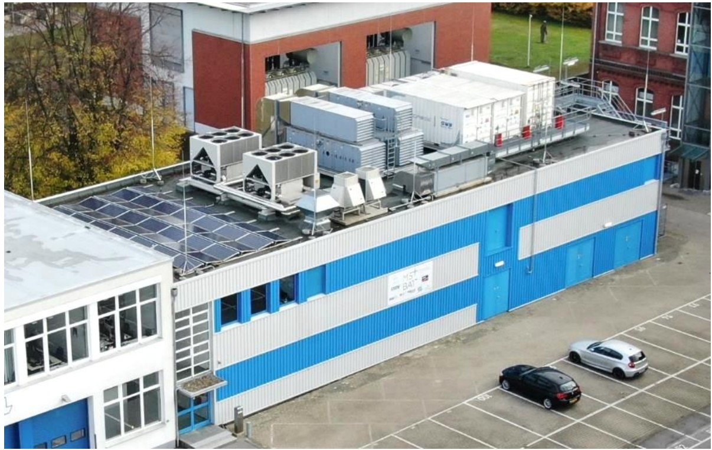

natural_image

Aerial view of a modern industrial building with blue and white buildings, solar panels on roof, and parked cars in the courtyard (no visible text or symbols)

## Technical data

■ Power: approx. 6 MW
■ Energy: approx. 7.5 MWh
■ 5 Battery technologies (Li-Ion & lead-acid)
■ 10 independent battery units

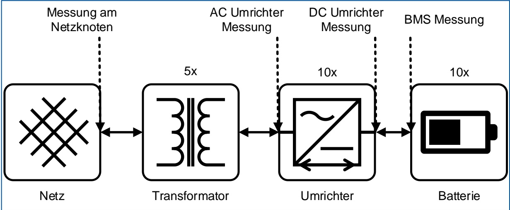

flowchart

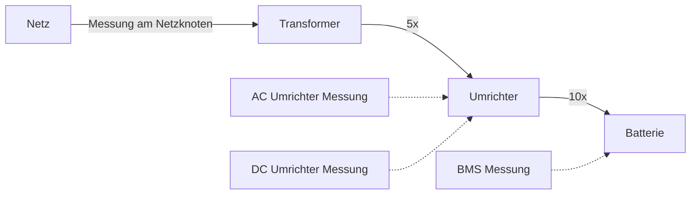

text_image

QR code image containing encoded data, no visible human-readable text

## Operation

■ System services
■ 3 MW FCR (frequency containment reserve)
■ Intraday trading (15 min market)
■ In preparation: aFRR (frequency restoration)

## Overview of sector coupling in industry applications: everything is connected!

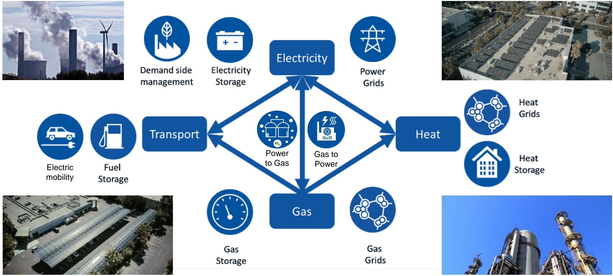

## Co-operation with industry partners in many different industrial areas (incomplete)

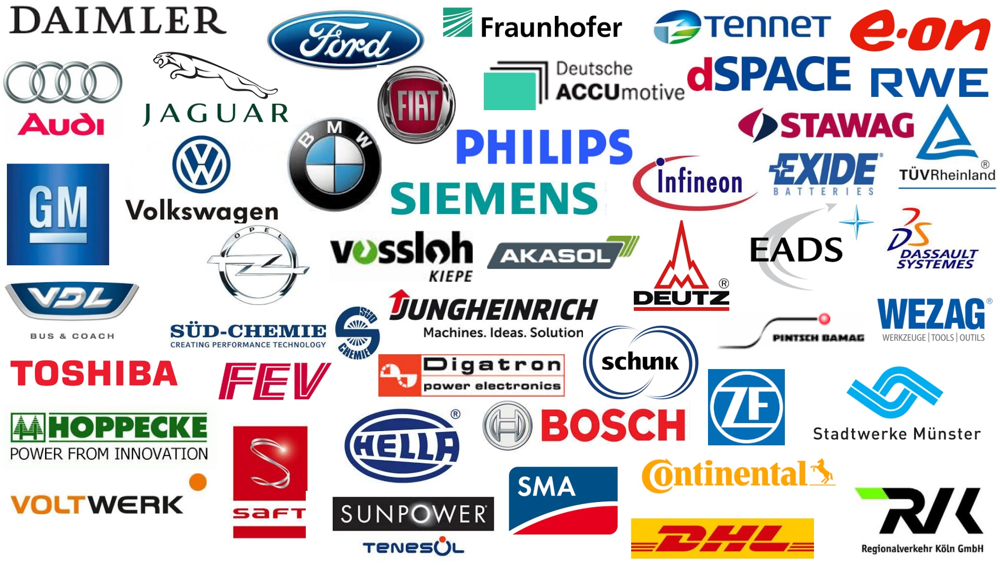

word_cloud

| Company |
| --- |
| DAIMLER |
| Audi |
| Ford |
| Fraunhofer |
| Tennet |
| e.on |
| JAGUAR |
| Fiat |
| Deutsche ACCUMotive |
| dSPACE |
| RWE |
| BMW |
| PHILIPS |
| STAWAG |
| GM |
| Volkswagen |
| Siemens |
| Infineon |
| EXIDE BATTERIES |
| TÜVRheinland |
| VDSL |
| Opel |
| vossloh KIEPE |
| AKASOL |
| EADS |
| DASSAULT SYSTEMES |
| VDL |
| BUS & COACH |
| SÜD-CHEMIE |
| JUNGHEINRICH Machines. Ideas. Solution |
| DEUTZ |
| WEZAG WERKZEUGE | TOOLS | OUTILS |
| FEV |
| Digatron power electronics |
| PINTSCH BAMAG |
| SCHUNK |
| HOPPECKE POWER FROM INNOVATION |
| SAFT |
| KELLA |
| BOSCH |
| ZF |
| Stadtwerke Münster |
| VOLTWERK |
| SUNPOWER TENESÖL |
| SMA |
| Continental |
| RK Regionalverkehr Köln GmbH |

## Spin-off “Batterieingenieure GmbH” – Services in Industriestandards

BATTERIE
INGENIEURE

Willkommen bei den Batterielingenieuren

## Die Partner für Ihr Speicherprojekt

Wir sind ein Hightechunternehmen aus Aachen. Neben unserer langjährigen Projekterfahrung, zeichnet uns vor allem die Verbundenheit zur Universitäts – und Forschungslandschaft in der Region aus. Technologieunabhängig sind wir dabei in den Bereichen Prüfen und Testen, Entwicklung sowie technische Beratung für Sie aktiv.

BatterielIngenieure GmbH
Hüttenstr. 5, 52068 Aachen +49 (0) 241 99004916 (techn. Anfragen)
+49 (0) 241 99004915 (sonstige
Anfragen)
info@batt-ing.de

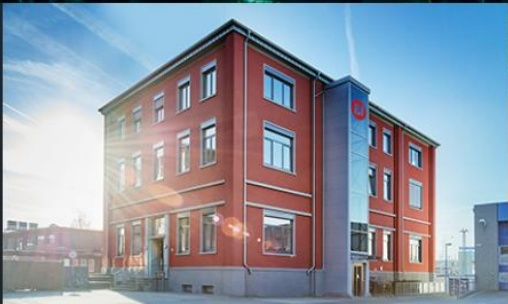

natural_image

Exterior view of a red multi-story office building under bright sunlight (no signage or text visible)

Karriere

Kontakt

Sprache auswählen

Beratung & Gutachten

Prüfen von Zellen und Batterien

Sicherheitstests

Post-Mortem Analyse

Diagnose & Modellierung

Qualitätssicherung

Batterieentwicklung und -fertigung

## Spin-off "Safion GmbH" – Zustandsbestimmung & Qualitätskontrolle

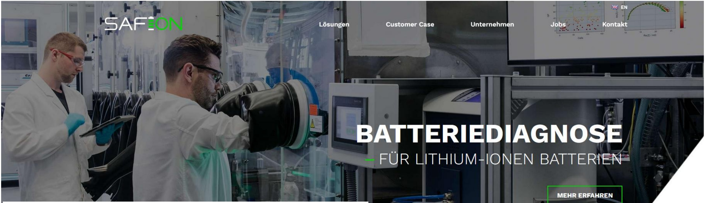

other

| Category | Description |
| --- | --- |
| Brand | SAFEON |
| Product | BATTERIEDIAGNOSE |
| Details | FÜR LITHIUM-IONEN BATTERIEN |
| Context | MEHR ERFAHREN |

— ELEKTROCHEMISCHE IMPEDANZSPEKTROSKOPIE (EIS)

WIR MESSEN INNOVATIV

1

Sekunde Messdauer

32

Simultane

Impedanzmessungen

> 30.000

Vermessene Zellen

## BATTERIEDIAGNOSE

FÜR LITHIUM-IONEN BATTERIEN

MEHR ERFAHREN

## Spin-off "ebusplan GmbH" – Einsatz- und Umsatzplanung für E-Busse

## ebusplan

Solutions for Clean Transportation

Aktuelles

Unsere Philosophie

Dienstleistungen

Über uns

Kontakt

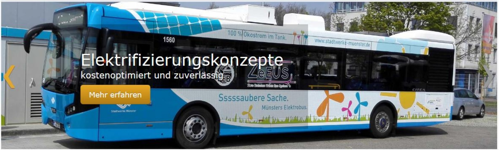

text_image

1560
100 % Ökostrom im Tank.
www.stadtwerke-muenstar.de
Elektrifizierungskonzepte
kostenoptimiert und zuverlässig
ZeEUS
Zene Einkommen (Wüllner des Systems)
Mehr erfahren
Ssssaubere Sache.
Münsters Elektrobus.

## ebusplan - Ihr Partner für die Einführung von Elektrobussen

Die Einführung von Elektrobussen stellt alle Akteure vor neue Herausforderungen. Die langlebige und kostenintensive Infrastruktur muss vorausschauend geplant und in den täglichen Betrieb integriert werden. Wir stehen Ihnen mit unserer Fachkompetenz und den innovativen Planungs- und Optimierungstools in diesem Prozess zur Seite und machen elektrischen ÖPNV verlässlich planbar.

natural_image

Two people seated at a conference table facing each other, facing a white wall (no visible text or symbols)

lider-1

## Seminare und Workshops

## Ihr Schnelleinstieg ins Thema E-Busse

- Überblick über Stand der Technik, Vor- und Nachteile einzelner Technologien
- Ausräumen falscher Erwartungen an die Technik
- Kostenfaktoren bei Einführung und Einsatz von E-Bussen
- Konzepte für Planung, Monitoring und Evaluierung

## Lösungen für

Busbetreiber

Städte
und
Kommunen

Bushersteller
und
Systemanbieter

## Aktuelles

Offenbach stellt ab 2019 auf

Elektrobusse um

3. März 2018

Ergebnisse der Machbarkeitsstudie und Umsetzungsplanung vorgestellt

ACCURE BATTERY INTELLIGENCE

# Empower your batteries

The industry of the 21st century is built on batteries. To understand and improve the safety, reliability and lifetime of batteries, companies around the world rely on ACCURE's actionable data analytics.

LEARN MORE

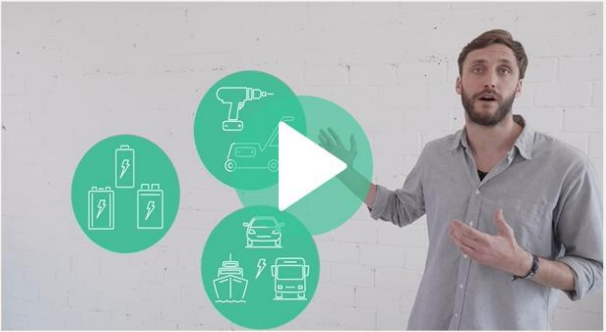

text_image

Man presenting three green circular icons representing energy and vehicle technologies: battery, robotic arm, and ship.

## Masterstudiengang „Battery Science and Technology in Engineering“

Manufacturer of rail vehicles, ships & aircraft

Manufacturer of power and garden tools, cleaning machines & power tools

Recycling companies

Energy supply and grid operators

Medical technology & mobility aids

Automotive industry incl. cars, trucks & buses

Mechanical engineering, automation and process engineering companies

Finance and insurance industry

Industrial truck manufacturer & transport logistics provider

Manufacturer of bicycles, motorcycles & scooters

Battery cell & battery pack manufacturer

Operators of critical infrastructures (communication, data centers,

Chemical industry

Electrical engineering and electronics industry

## Battery development & teaching are highly interdisciplinary

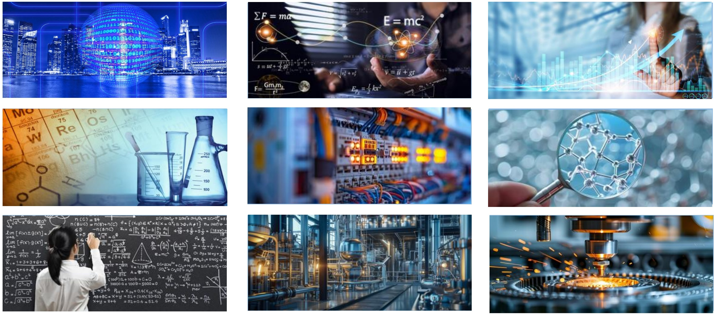

## Curriculum „Battery Science and Technology in Engineering“

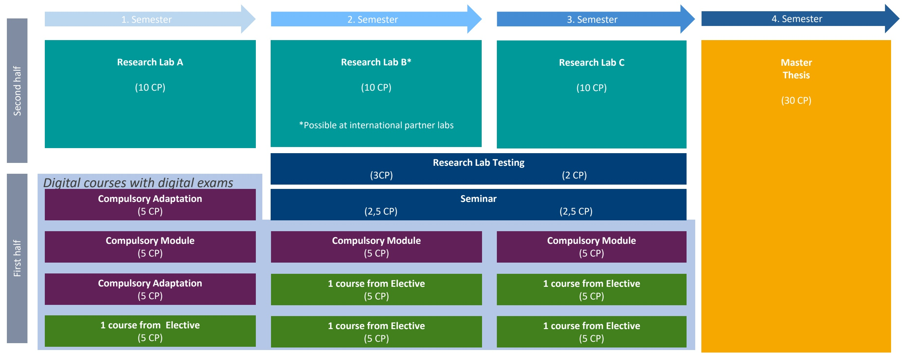

funnel

| Group | Term | Course Details |
| --- | --- | --- |
| Second half | 1. Semester | Research Lab A (10 CP) |
| Second half | 2. Semester | Research Lab B* (10 CP); *Possible at international partner labs |
| Second half | 3. Semester | Research Lab C (10 CP) |
| First half | Digital courses with digital exams | Compulsory Adaptation (5 CP) |
| First half | Digital courses with digital exams | Compulsory Module (5 CP) |
| First half | Digital courses with digital exams | Compulsory Adaptation (5 CP) |
| First half | Digital courses with digital exams | 1 course from Elective (5 CP) |
| First half | Digital courses with digital exams | Compulsory Module (5 CP) |
| First half | Digital courses with digital exams | 1 course from Elective (5 CP) |
| First half | Digital courses with digital exams | 1 course from Elective (5 CP) |
| First half | Digital courses with digital exams | 1 course from Elective (5 CP) |
| First half | Digital courses with digital exams | Seminar (2,5 CP) |
| First half | Digital courses with digital exams | Research Lab Testing (3CP) |
| First half | Digital courses with digital exams | Seminar (2,5 CP) |
| Master Thesis | 4. Semester | Master Thesis (30 CP) |

## Curriculum in Block courses

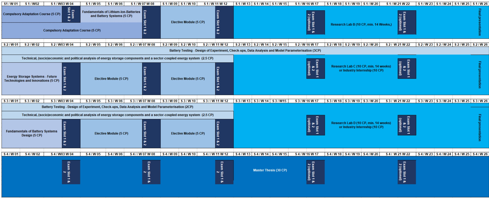

other

| Task | Time Period | Exam Slot Details |
| :--- | :--- | :--- |
| Compulsory Adaptation Course (5 CP) | S1 / W 01 | Exam Slot 1 & 2 |
| Compulsory Adaptation Course (5 CP) | S1 / W 04 | Fundamentals of Lithium-Ion-Batteries and Battery Systems (5 CP) |
| Compulsory Adaptation Course (5 CP) | S1 / W 08 | Exam Slot 1 & 2 |
| Battery Testing - Design of Experiment, Check-ups, Data Analysis and Model Parameterisation (3CP) | S2 / W 01 | N/A |
| Battery Testing - Design of Experiment, Check-ups, Data Analysis and Model Parameterisation (3CP) | S2 / W 02 | N/A |
| Battery Testing - Design of Experiment, Check-ups, Data Analysis and Model Parameterisation (3CP) | S2 / W 04 | N/A |
| Battery Testing - Design of Experiment, Check-ups, Data Analysis and Model Parameterisation (3CP) | S2 / W 05 | N/A |
| Battery Testing - Design of Experiment, Check-ups, Data Analysis and Model Parameterisation (3CP) | S2 / W 06 | N/A |
| Battery Testing - Design of Experiment, Check-ups, Data Analysis and Model Parameterisation (3CP) | S2 / W 07 | N/A |
| Battery Testing - Design of Experiment, Check-ups, Data Analysis and Model Parameterisation (3CP) | S2 / W 08 | N/A |
| Battery Testing - Design of Experiment, Check-ups, Data Analysis and Model Parameterisation (3CP) | S2 / W 09 | N/A |
| Battery Testing - Design of Experiment, Check-ups, Data Analysis and Model Parameterisation (3CP) | S2 / W 10 | N/A |
| Battery Testing - Design of Experiment, Check-ups, Data Analysis and Model Parameterisation (3CP) | S2 / W 11 | N/A |
| Battery Testing - Design of Experiment, Check-ups, Data Analysis and Model Parameterisation (3CP) | S2 / W 12 | N/A |
| Battery Testing - Design of Experiment, Check-ups, Data Analysis and Model Parameterisation (3CP) | S2 / W 13 | N/A |
| Battery Testing - Design of Experiment, Check-ups, Data Analysis and Model Parameterisation (3CP) | S2 / W 14 | N/A |
| Battery Testing - Design of Experiment, Check-ups, Data Analysis and Model Parameterisation (3CP) | S2 / W 15 | N/A |
| Battery Testing - Design of Experiment, Check-ups, Data Analysis and Model Parameterisation (3CP) | S2 / W 16 | N/A |
| Battery Testing - Design of Experiment, Check-ups, Data Analysis and Model Parameterisation (3CP) | S2 / W 17 | N/A |
| Battery Testing - Design of Experiment, Check-ups, Data Analysis and Model Parameterisation (3CP) | S2 / W 18 | N/A |
| Battery Testing - Design of Experiment, Check-ups, Data Analysis and Model Parameterisation (3CP) | S2 / W 19 | N/A |
| Battery Testing - Design of Experiment, Check-ups, Data Analysis and Model Parameterisation (3CP) | S2 / W 20 | N/A |
| Battery Testing - Design of Experiment, Check-ups, Data Analysis and Model Parameterisation (3CP) | S2 / W 21 | N/A |
| Battery Testing - Design of Experiment, Check-ups, Data Analysis and Model Parameterisation (3CP) | S2 / W 22 | N/A |
| Battery Testing - Design of Experiment, Check-ups, Data Analysis and Model Parameterisation (3CP) | S2 / W 23 | N/A |
| Battery Testing - Design of Experiment, Check-ups, Data Analysis and Model Parameterisation (3CP) | S2 / W 24 | N/A |
| Battery Testing - Design of Experiment, Check-ups, Data Analysis and Model Parameterisation (3CP) | S2 / W 25 | N/A |
| Battery Testing - Design of Experiment, Check-ups, Data Analysis and Model Parameterisation (3CP) | S2 / W 26 | N/A |
| Battery Testing - Design of Experiment, Check-ups, Data Analysis and Model Parameterisation (3CP) | S3 / W 01 | N/A |
| Battery Testing - Design of Experiment, Check-ups, Data Analysis and Model Parameterisation (3CP) | S3 / W 02 | N/A |
| Battery Testing - Design of Experiment, Check-ups, Data Analysis and Model Parameterisation (3CP) | S3 / W 03 | N/A |
| Battery Testing - Design of Experiment, Check-ups, Data Analysis and Model Parameterisation (3CP) | S3 / W 04 | N/A |
| Battery Testing - Design of Experiment, Check-ups, Data Analysis and Model Parameterisation (3CP) | S3 / W 05 | N/A |
| Battery Testing - Design of Experiment, Check-ups, Data Analysis and Model Parameterisation (3CP) | S3 / W 06 | N/A |
| Battery Testing - Design of Experiment, Check-ups, Data Analysis and Model Parameterisation (3CP) | S3 / W 07 | N/A |
| Battery Testing - Design of Experiment, Check-ups, Data Analysis and Model Parameterisation (3CP) | S3 / W 08 | N/A |
| Battery Testing - Design of Experiment, Check-ups, Data Analysis and Model Parameterisation (3CP) | S3 / W 09 | N/A |
| Battery Testing - Design of Experiment, Check-ups, Data Analysis and Model Parameterisation (3CP) | S3 / W 10 | N/A |
| Battery Testing - Design of Experiment, Check-ups, Data Analysis and Model Parameterisation (3CP) | S3 / W 11 | N/A |
| Battery Testing - Design of Experiment, Check-ups, Data Analysis and Model Parameterisation (3CP) | S3 / W 12 | N/A |
| Battery Testing - Design of Experiment, Check-ups, Data Analysis and Model Parameterisation (3CP) | S3 / W 13 | N/A |
| Battery Testing - Design of Experiment, Check-ups, Data Analysis and Model Parameterisation (3CP) | S3 / W 14 | N/A |
| Battery Testing - Design of Experiment, Check-ups, Data Analysis and Model Parameterisation (3CP) | S3 / W 15 | N/A |
| Battery Testing - Design of Experiment, Check-ups, Data Analysis and Model Parameterisation (3CP) | S3 / W 16 | N/A |
| Battery Testing - Design of Experiment, Check-ups, Data Analysis and Model Parameterisation (3CP) | S3 / W 17 | N/A |
| Battery Testing - Design of Experiment, Check-ups, Data Analysis and Model Parameterisation (3CP) | S3 / W 18 | N/A |
| Battery Testing - Design of Experiment, Check-ups, Data Analysis and Model Parameterisation (3CP) | S3 / W 19 | N/A |
| Battery Testing - Design of Experiment, Check-ups, Data Analysis and Model Parameterisation (3CP) | S3 / W 20 | N/A |
| Battery Testing - Design of Experiment, Check-ups, Data Analysis and Model Parameterisation (3CP) | S3 / W 21 | N/A |
| Battery Testing - Design of Experiment, Check-ups, Data Analysis and Model Parameterisation (3CP) | S3 / W 22 | N/A |
| Battery Testing - Design of Experiment, Check-ups, Data Analysis and Model Parameterisation (3CP) | S3 / W 23 | N/A |
| Battery Testing - Design of Experiment, Check-ups, Data Analysis and Model Parameterisation (3CP) | S3 / W 24 | N/A |
| Battery Testing - Design of Experiment, Check-ups, Data Analysis and Model Parameterisation (3CP) | S3 / W 25 | N/A |
| Battery Testing - Design of Experiment, Check-ups, Data Analysis and Model Parameterisation (3CP) | S3 / W 26 | N/A |
| Battery Testing - Design of Experiment, Check-ups, Data Analysis and Model Parameterisation (3CP) | S4 / W 01 | N/A |
| Battery Testing - Design of Experiment, Check-ups, Data Analysis and Model Parameterisation (3CP) | S4 / W 02 | N/A |
| Battery Testing - Design of Experiment, Check-ups, Data Analysis and Model Parameterisation (3CP) | S4 / W 03 | N/A |
| Battery Testing - Design of Experiment, Check-ups, Data Analysis and Model Parameterisation (3CP) | S4 / W 04 | N/A |
| Battery Testing - Design of Experiment, Check-ups, Data Analysis and Model Parameterisation (3CP) | S4 / W 05 | N/A |
| Battery Testing - Design of Experiment, Check-ups, Data Analysis and Model Parameterisation (3CP) | S4 / W 06 | N/A |
| Battery Testing - Design of Experiment, Check-ups, Data Analysis and Model Parameterisation (3CP) | S4 / W 07 | N/A |
| Battery Testing - Design of Experiment, Check-ups, Data Analysis and Model Parameterisation (3CP) | S4 / W 08 | N/A |
| Battery Testing - Design of Experiment, Check-ups, Data Analysis and Model Parameterisation (3CP) | S4 / W 09 | N/A |
| Battery Testing - Design of Experiment, Check-ups, Data Analysis and Model Parameterisation (3CP) | S4 / W 10 | N/A |
| Battery Testing - Design of Experiment, Check-ups, Data Analysis and Model Parameterisation (3CP) | S4 / W 11 | N/A |
| Battery Testing - Design of Experiment, Check-ups, Data Analysis and Model Parameterisation (3CP) | S4 / W 12 | N/A |
| Battery Testing - Design of Experiment, Check-ups, Data Analysis and Model Parameterisation (3CP) | S4 / W 13 | N/A |
| Battery Testing - Design of Experiment, Check-ups, Data Analysis and Model Parameterisation (3CP) | S4 / W 14 | N/A |
| Battery Testing - Design of Experiment, Check-ups, Data Analysis and Model Parameterisation (3CP) | S4 / W 15 | N/A |
| Battery Testing - Design of Experiment, Check-ups, Data Analysis and Model Parameterisation (3CP) | S4 / W 16 | N/A |
| Battery Testing - Design of Experiment, Check-ups, Data Analysis and Model Parameterisation (3CP) | S4 / W 17 | N/A |
| Battery Testing - Design of Experiment, Check-ups, Data Analysis and Model Parameterisation (3CP) | S4 / W 18 | N/A |
| Battery Testing - Design of Experiment, Check-ups, Data Analysis and Model Parameterisation (3CP) | S4 / W 19 | N/A |
| Battery Testing - Design of Experiment, Check-ups, Data Analysis and Model Parameterisation (3CP) | S4 / W 20 | N/A |
| Battery Testing - Design of Experiment, Check-ups, Data Analysis and Model Parameterisation (3CP) | S4 / W 21 | N/A |
| Battery Testing - Design of Experiment, Check-ups, Data Analysis and Model Parameterisation (3CP) | S4 / W 22 | N/A |
| Battery Testing - Design of Experiment, Check-ups, Data Analysis and Model Parameterisation (3CP) | S4 / W 23 | N/A |
| Battery Testing - Design of Experiment, Check-ups, Data Analysis and Model Parameterisation (3CP) | S4 / W 24 | N/A |
| Battery Testing - Design of Experiment, Check-ups, Data Analysis and Model Parameterisation (3CP) | S4 / W 25 | N/A |
| Battery Testing - Design of Experiment, Check-ups, Data Analysis and Model Parameterisation (3CP) | S4 / W 26 | N/A |

The chart is a structured layout representing the course of a study on battery testing. The table above provides a summary table for each task step. The table columns represent the time allocation for each task step.

## Noch Fragen?

## Sie erreichen uns wie folgt:

## Kontakt

Prof. Dirk Uwe Sauer

Tel.: +49 241 80-96977

dirkuwe.sauer@isea.rwth-aachen.de

Dominic Peltzer

et1@isea.rwth-aachen.de

Lehrstuhl für Elektrochemische Energiewandlung

und Speichersystemtechnik

RWTH Aachen University

Campus Boulevard 89, 52074 Aachen GERMANY

www.isea.rwth-aachen.de

## Fragen, Anregungen, Fehler

Bitte schauen Sie zunächst in unserem Vorlesungs-FAQ im moodle-Lernraum, ob es zu Ihrem Anliegen dort schon einen Eintrag gibt.

Wenn das nicht der Fall ist, dann schreiben Sie bitte eine Email an

et1 @isea.rwth-aachen.de

Die Antwort wird in unser Vorlesungs-FAQ eingearbeitet und wird damit auch allen anderen zur Verfügung stehen. Das Vorlesungs-FAQ wird also kontinuierlich wachsen.

CC BY-SA 3.0 → http://creativecommons.org/licenses/by-sa/3.0/