Ageing • Models Diagnostics Pack Design Electromobility Stationary Energy Storage Energy System Analysis

## Grundgebiete der Elektrotechnik 1 – Einführung in die Schaltungstechnik

Kapitel 2 – Beschreibung Physikalischer Grundprinzipien

G1 2 V4

Prof. Dirk Uwe Sauer

**Lehrstuhl für Elektrochemische Energiewandlung**

**und Speichersystemtechnik**1

## Kapitel 2 - Beschreibung Physikalischer Grundprinzipien

■ Maxwell-Gleichungen
■ Bewegung, Kraft und Energie
■ Aufbau der Materie und Atombindungen
■ Physikalische Basisgrößen und -einheiten

## Physikalische Grundprinzipien

## Maxwell-Gleichungen

## Die Maxwell-Gleichungen – Die Größen und Operatoren

1. $\varepsilon _ { 0 } \cdot d i v \vec { E } = \rho$
2. $d i v \overrightarrow { B } = 0$
3. $r o t \vec { B } = \mu _ { 0 } \left( \vec { J } + \varepsilon _ { 0 } \frac { \partial \vec { E } } { \partial t } \right)$
4. 𝑟𝑜𝑡 $i \vec { E } = - \frac { \partial \vec { B } } { \partial t }$

Erklärvideo zur Herleitung und Bedeutung der Maxwell-

Gleichungen: https://youtu.be/wFA-0hP3Wx0

$d i \nu$ : Die Divergenz wird für ein Vektorfeld berechnet und ist selber ein Skalar. Sie gibt z.B. für ein Strömungsfeld an, ob aus einem infinitesimalen Volumen mehr Flüssigkeit heraus- als hineinströmt.
■ rot : Die Rotation wird für ein Vektorfeld berechnet und ist selber ein Vektor. Betrachtet man ein infinitesimales Volumen im Vektorfeld, so gibt der Rotationsvektor an, wie stark und um welche Drehachse sich das Volumen dreht.
■ $\vec { E }$ : Elektrisches Feld
■ $\vec { B }$ : Magnetisches Feld
■ $\rho$ : Ladungsdichte
■ $\vec { J }$ : Stromdichte
■ $\varepsilon _ { o }$ : Permittivität (allgemeine Dielektrizitätskonstante)
■ $\mu _ { o }$ : Permeabilität (magnetische Feldkonstante)
■ $\varepsilon _ { o } \mu _ { o } = \frac { 1 } { c ^ { 2 } }$ : Zusammenhang mit der Lichtgeschwindigkeit

## Die Maxwell-Gleichungen – Die Größen und Operatoren

1. $\varepsilon _ { 0 } \cdot d i v \vec { E } = \rho$
2. $d i v \overrightarrow { B } = 0$
3. $r o t \vec { B } = \mu _ { 0 } \left( \vec { J } + \varepsilon _ { 0 } \frac { \partial \vec { E } } { \partial t } \right)$
4. 𝑟𝑜𝑡 $i \vec { E } = - \frac { \partial \vec { B } } { \partial t }$

Erklärvideo zur Herleitung und Bedeutung der Maxwell-

Gleichungen: https://youtu.be/wFA-0hP3Wx0

■ Die vier **Maxwell-Gleichungen** (nach **James C.**
**Maxwell**) beschreiben die elektrischen, magnetischen und optischen Erscheinungen.
■ Genauso grundlegend wie die Newton‘schen Axiome und das Newton‘sche Gravitationsgesetzt.
■ Die Maxwell-Gleichungen (MG) haben die folgende Kernbedeutungen:

□ Die MG beschreiben die Existenz elektromagnetischer Wellen
□ Ein veränderliches Magnetfeld erzeugt um sich herum ein veränderliches elektrisches Feld
□ Ein veränderliches elektrisches Feld erzeugt wiederum ein veränderliches Magnetfeld, usw.

## Das elektrische Feld

□ Das elektrische Feld definiert die Größe und die Richtung einer Kraft auf einer Probeladung in genau diesem elektrischen Feld. Das elektrische Feld ist also genau wie die Kraft auch ein Vektor.

## Das magnetische Feld

□ Im Gegensatz zum elektrischen Feld hat das magnetische Feld keine Kraftwirkung auf ein ruhendes Elektron. Erst bei der Bewegung der Probeladung wirkt eine magnetische Kraft.
□ Senkrecht zur Geschwindigkeitsrichtung, dem Geschwindigkeitsvektor, und senkrecht zum Magnetfeld wirkt dann eine Kraft auf die Probeladung.

## Lorentzkraft

□ Die Auswirkung beider Felder, dem elektrischen Feld und dem magnetischen Feld ergibt die Lorentzkraft $\vec { F } = q \cdot ( \vec { E } + \vec { v } \times \vec { B } )$

## Elektrische Raumladungsdichte

□ bezeichnet die eingeschlossene Ladung in einem infinitesimal kleinen Volumen.

## Elektrische Stromdichte

□ Die elektrische Stromdichte bezeichnet die Stromstärke, also die Anzahl der bewegten Ladungsträger pro Zeit durch eine infinitesimal kleine Fläche.

## Kontinuitätsgleichung

□ In ein kleines Volumen müssen immer so viel Ladungsträger herausfließen wie hineinfließen. Ladungen gehen nicht verloren.
□ Daraus ergibt sich die Kontinuitätsgleichung div J = -∂δ/∂t (Divergenz div: Änderung in alle Raumrichtungen)

## Die Maxwell-Gleichungen – Praktische Bedeutung der einzelnen Gleichungen

1. $\varepsilon _ { 0 } \cdot d i v \vec { E } = \rho$
2. $d i v \overrightarrow { B } = 0$
3. $r o t \vec { B } = \mu _ { 0 } \left( \vec { J } + \varepsilon _ { 0 } \frac { \partial \vec { E } } { \partial t } \right)$
4. 𝑟𝑜𝑡 $t \vec { E } = - \frac { \partial \vec { B } } { \partial t }$

■ Die erste Maxwell-Gleichung ist das **Coulomb‘sche Gesetz**: Elektrische Felder $\vec { E }$ werden durch elektrische Ladungen hervorgerufen $( \rho -$ Ladungsträgerdichte)
■ Die zweite Maxwell-Gleichung besagt, dass es **keine magnetischen Punktladungen** (Monopole) gibt und damit, dass magnetische Feldlinien immer geschlossen sind.
■ Die dritte Maxwell-Gleichung, das sog. **Durchflutungsgesetz**, gibt an, wie durch zeitlich veränderliche elektrische Felder magnetische Felder entstehen.
■ Die vierte Maxwell-Gleichung beschreibt die **elektromagnetische Induktion**, also die Erzeugung elektrischer Felder bzw. Spannungen durch veränderliche Magnetfelder.

## Physikalische Grundprinzipien

## Bewegung, Kraft und Energie

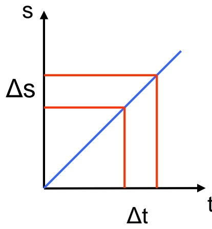

area

| Time (t) | Entropy (s) |
| --- | --- |
| 0 | 0 |
| \(\Delta t\) | \(\Delta s\) |
| \(\Delta t\) | \(\Delta s\) |
| \(\Delta t\) | 0 |

$$
v = \frac {\Delta s}{\Delta t}
$$

Steigung der Funktion ist konstant $\leftrightarrow$ Geschwindigkeit ist konstant

Quelle: RWTH IWE1

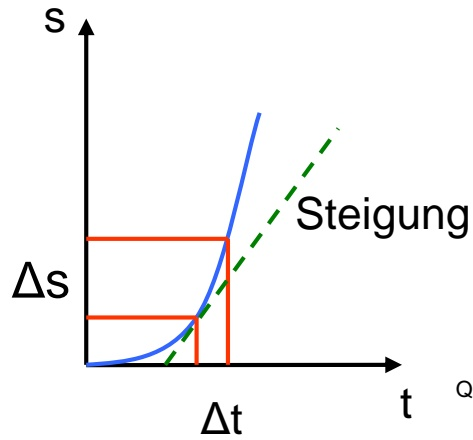

line

| Variable | Description |
| --- | --- |
| s | Stress (Y-axis) |
| t | Time (X-axis) |
| \(\Delta t\) | Time interval marked by red rectangle |
| \(\Delta s\) | Stress change (Orange bar) |
| Steigung | Point on the curve representing the Steigung value |

$$
v = \lim _ {\Delta t \to 0} \frac {\Delta s}{\Delta t} = \frac {d s}{d t}
$$

Funktion mit beliebiger Steigung $\leftrightarrow$ beschleunigte Bewegung

Quelle: RWTH IWE1

Die Geschwindigkeit ergibt sich als Ableitung des Weges nach der Zeit

( = Steigung der Kurve in diesem Punkt)

## Physikalische Gleichungen – Beispiel Geschwindigkeit

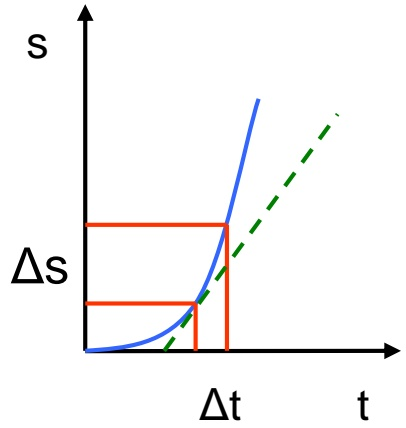

line

| Variable | Description |
| --- | --- |
| s | Y-axis variable (labeled 's') |
| t | X-axis variable (labeled 't') |
| \(\Delta s\) | Horizontal segment of the blue curve |
| \(\Delta t\) | Vertical segment of the green dashed line |

$$
v = \lim _ {\Delta t \to 0} \frac {\Delta s}{\Delta t} = \frac {d s}{d t}
$$

Quelle: RWTH IWE1

■ Geschwindigkeit v: Ableitung der Strecke s nach der Zeit t (links)
Beschleunigung a: Ableitung der Geschwindigkeit v nach der Zeit t (rechts), als zweifache Ableitung der Strecke s nach der Zeit

t

$$
a = \frac {d ^ {2} s}{d t ^ {2}} \Rightarrow a d t = \frac {d s}{d t} \Rightarrow a d t ^ {2} = s \Rightarrow
$$

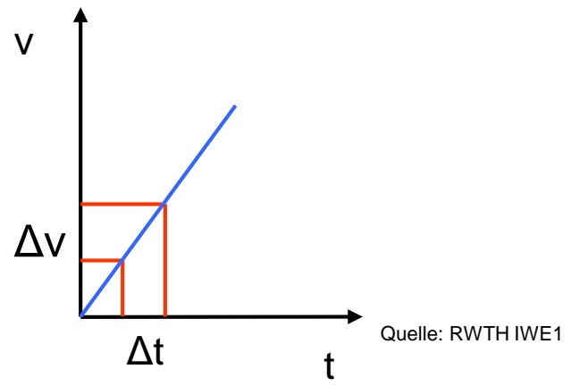

line

| Variable | Description |
| --- | --- |
| v | Velocity (Y-axis) |
| t | Time (X-axis) |
| \(\Delta v\) | Change in velocity (Red line segment) |
| \(\Delta t\) | Time interval (Red line segment) |

■ Andersherum: Berechnung des Weges s durch einfache Integration der Geschwindigkeit v oder zweifache Integration der Beschleunigung a über die Zeit t:

$$
s = \int_ {t _ {0}} ^ {t _ {1}} v \mathrm{d} t = \int_ {t _ {0}} ^ {t _ {1}} \left(\int_ {t _ {0}} ^ {t _ {1}} a \mathrm{d} t\right) \mathrm{d} t
$$

Anfangsgeschwindigkeit zum Zeitpunkt $t = t _ { 0 } \colon v _ { o }$

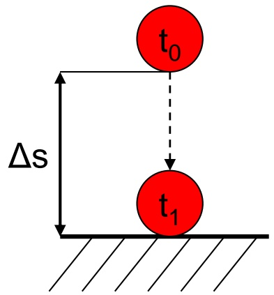

text_image

t₀
Δs
t₁

Quelle: RWTH IWE1

$$
\Delta s = \int_ {t _ {o}} ^ {t _ {1}} [ v _ {o} + g (t - t _ {0}) ] d t \quad \Rightarrow \Delta s = v _ {o} (t _ {1} - t _ {0}) + \frac {1}{2} g (t _ {1} - t _ {0}) ^ {2}
$$

$$
\Rightarrow \Delta s = v _ {o} \int_ {t _ {o}} ^ {t _ {1}} d t + g \int_ {t _ {o}} ^ {t _ {1}} (t - t _ {0}) d t
$$

Rechenbeispiel mit Anfangsbedingungen: $\begin{array} { r } { v _ { o } = 0 \frac { m } { s } ,   t _ { 0 } = 0 s ,   t _ { 1 } = 1 5 s ,   \mathrm { g } = 9 { , } 8 1 \frac { m } { s ^ { 2 } } ;   \Delta s = ? } \end{array}$

$$
\Delta s = v _ {o} \int_ {t _ {o}} ^ {t _ {1}} d t + g \int_ {t _ {o}} ^ {t _ {1}} (t - t _ {0}) d t \quad \Rightarrow \Delta s = \frac {1}{2} \cdot 9, 8 1 \frac {m}{s ^ {2}} \cdot (1 5 s) ^ {2}
$$

$$
\Rightarrow \Delta s = 9, 8 1 \frac {m}{s ^ {2}} \int_ {0 s} ^ {1 5 s} t d t \quad \Rightarrow \Delta s = 1 1 0 4 m
$$

## Physikalische Gleichungen - Beispiel Sportwagen

## Porsche 911 GT3

■ **Motor :** Heckmotor
■ **Hubraum :** 3.799 $\mathbf { c m ^ { 3 } }$
■ **Zylinder :** 6 Zylinder Boxer
■ **Leistung :** 475 PS
**Höchstgeschwindigkeit:** 315 km/h
■ **Beschleunigung:** 0 - 100 km/h in $t   = 3 { , } 5 \mathrm { ~ s ~ }$ 10

Annahme: konstante Beschleunigung:

$$
a = \frac {\mathrm{d} v}{\mathrm{d} t} = \frac {1 0 0 \frac {\mathrm{km}}{\mathrm{h}}}{3 , 5 \mathrm{s}} = 7, 9 4 \frac {\mathrm{m}}{\mathrm{s} ^ {2}}
$$

Weg, der zurückgelegt wird:

$$
s = \int_ {0} ^ {t} v \mathrm{d} t = \int_ {0} ^ {t} a \cdot t \mathrm{d} t = \frac {1}{2} \cdot a \cdot t ^ {2} = \frac {1}{2} \cdot 7, 9 4 \cdot 3, 5 ^ {2} \frac {\mathrm{m} \cdot \mathrm{s} ^ {2}}{\mathrm{s} ^ {2}} \approx 4 9 \mathrm{m}
$$

Quelle: Porsche

## Definition Kraft (F)

$$
F = m \cdot a \quad (\text {Isaac Newton}) \quad [ F ] = \frac {\mathrm{kg} \cdot \mathrm{m}}{\mathrm{s} ^ {2}} = N
$$

Das Gravitationsgesetz beschreibt die Kräfte zwischen zwei Massen m und M mit dem Abstand r:

$$
F = \gamma \frac {m \cdot M}{r ^ {2}}
$$

$\gamma$ beschreibt dabei die Gravitationskonstante (Naturkonstante, $\gamma = 6 , 7 \cdot 1 0 ^ { - 1 1 } \mathrm { ~ m } ^ { 3 } / ( \mathrm { k g ~ s } ^ { 2 } ) )$

## Definition Arbeit (W)

$$
\Delta W = F \cdot \Delta s
$$

Wird eine Masse in einem Kraftfeld bewegt, so wird Arbeit geleistet.

Voraussetzung: $F$ ist konstant und wirkt in Richtung der Verschiebung um Δs

Bilden $F$ und Δs den Winkel α miteinander, so gilt:

$$
\Delta W = F \cdot \Delta s \cdot \cos (\alpha)
$$

$$
\left[ W \right] = N m
$$

## Physikalische Grundlagen: Energie und Leistung

## Definition Leistung $( P )$

$$
\boldsymbol {P} = \frac {\Delta W}{\Delta t} \quad [ P ] = \frac {k g \cdot m ^ {2}}{s ^ {3}}
$$

$$
P (t) = \frac {d W (t)}{d t} \quad P = U \cdot I = I ^ {2} \cdot R = \frac {U ^ {2}}{R}
$$

Beispiel: Leistung einer bewegten Körpers

Energie: $W = { \frac { 1 } { 2 } } \cdot m \cdot v ^ { 2 }$

Leistung:

$$
W = \int_ {1} ^ {2} \vec {F} \mathrm{d} \vec {s}
$$

Weg- oder Linienintegral

Bewegung in einem Gravitationsfeld

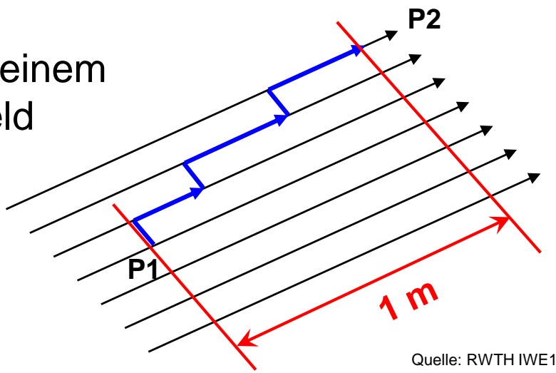

text_image

einem
eld
P2
P1
1 m
Quelle: RWTH IWE1

Quelle: RWTH IWE1

Einteilung des Weges in Teilstücke parallel $\mathsf { Z U }$ den Feldlinien (mit Arbeit, $\alpha { = } 0 ^ { \circ }$ , cos (α) = 1) und senkrecht dazu (ohne Arbeit , $a = 9 0 ^ { \circ }$ , cos $( \alpha ) = 0 )$

$$
\mathrm{Bsp.:} g \approx 10 \mathrm{ms}^{-2}; m = 1 \mathrm{kg}; \Delta s = 1 \mathrm{m}
$$

$$
\Rightarrow \Delta W = F \cdot \Delta s = m \cdot g \cdot \Delta s = 1 k g \cdot 10 m s^{-2} \cdot 1 m = 10 J = 0,01 kJ = 10 Ws = 2,8 mWh
$$

## Physikalische Grundprinzipien

## Aufbau der Materie und Atombindungen

## Aufbau der Materie – Atom

Ein Atom besteht aus einem positiv geladenen Kern und einer negativ geladene Elektronenhülle. Im Atomkern befinden sich positiv geladenen Protonen und neutrale Neutronen.

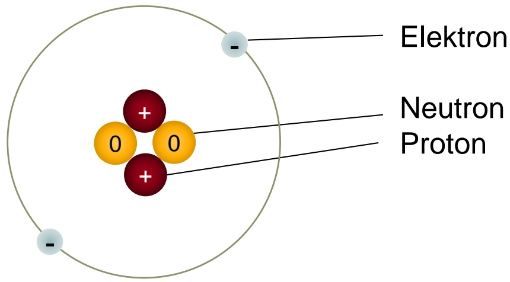

chemical

Diagram of a nucleus with labeled electron, neutron, and proton atoms

Quelle: RWTH ISEA

Helium-Atom im Bohr'schen Atommodell

Interessantes Lehrvideo: Das Schalenmodell: Der Aufbau der Atome nach Bohr – Chemie | Duden [https://www.youtube.com/watch?v=6OfmF-3D51 I](https://www.youtube.com/watch?v=6OfmF-3D51I)

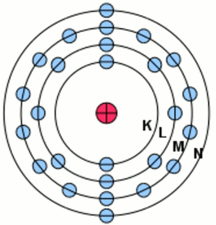

chemical

Diagram of a layered atomic structure with labeled layers K, L, M, N and a central red atom

Quelle: nach http://www.chemie-master.de/lex/begriffe/img/e17.jpg

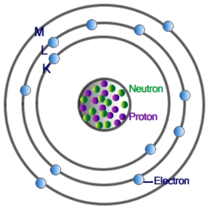

chemical

Diagram of a neutron-proton interaction in a nucleus with labeled electrons, protons, and neutrons

Quelle: https://chadwicksphysics.weebly.com/uploads/1/7/3/4/17347989/1360666721.jpg

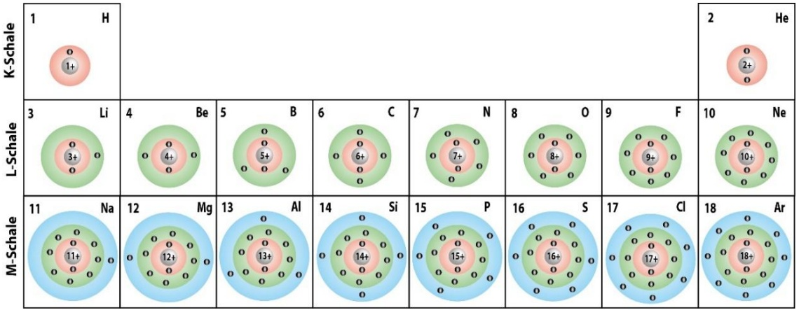

bubble

| Schale | Element | Concentration |
| :--- | :--- | :--- |
| K-Schale | H | 1+ |
| K-Schale | He | 2+ |
| L-Schale | Li | 3+ |
| L-Schale | Be | 4+ |
| L-Schale | B | 5+ |
| L-Schale | C | 6+ |
| L-Schale | N | 7+ |
| L-Schale | O | 8+ |
| L-Schale | F | 9+ |
| L-Schale | Ne | 10+ |
| M-Schale | Na | 11+ |
| M-Schale | Mg | 12+ |
| M-Schale | Al | 13+ |
| M-Schale | Si | 14+ |
| M-Schale | P | 15+ |
| M-Schale | S | 16+ |
| M-Schale | Cl | 17+ |
| M-Schale | Ar | 18+ |

Quelle: nach https://media.studienkreis.de/assets/courses/media/schalenmodell-tabelle-hauptgruppen-periode-k-l-m-schalen-ordnungszahl-aussenelektronen-ca.png

## Aufbau der Materie – Atom

■ Elektronen umkreisen den Atomkern auf diskreten Bahnen (Schalen, Atomorbitale)
■ Gewicht eines Protons ist etwa $1 , 6 6 \cdot 1 0 ^ { - 2 7 }$ **kg**
■ Protonen und Neutronen sind ca. gleich schwer und etwa **1800** mal schwerer als Elektronen $( 9 . 1 \cdot 1 0 ^ { - 3 1 } \mathrm { k g } )$
■ Durchmesser des Atomkerns ist etwa 10 $\mathrm { f m } = 1 0 ^ { - 1 4 }$ m
■ Durchmesser des gesamten Atoms: 0,1 $nm=100   mm =10^{-10}$ **m** (auch: 1 Ångström)
■ Ladung eines Protons: Elementarladung $q = e = 1 , 6 0 2 \cdot 1 0 ^ { - 1 9 } \mathrm { C }$
■ Ladung eines Elektrons: $q = - e ,$ Ladung eines Neutrons $q = 0$
■ Gesamtladung des Atoms: Summe der Kernladungen + Elektronenladungen

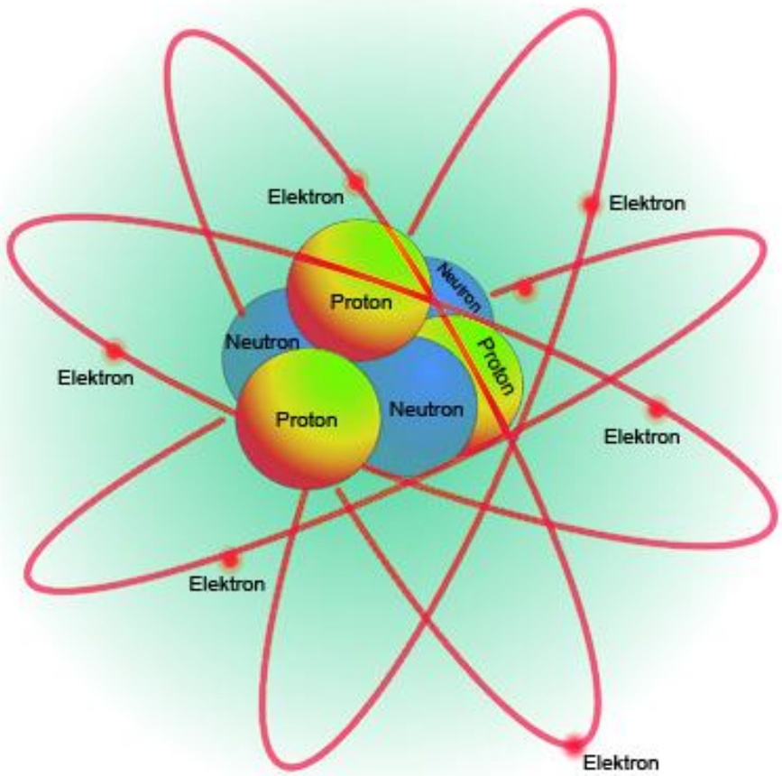

text_image

Elektron
Proton
Neutron
Neutron
Proton
Elektron
Elektron
Elektron
Elektron
Elektron
Elektron
Elektron
Elektron
Elektron
Elektron
Elektron
Elektron
Elektron
Elektron
Elektron
Elektron
Elektron
Elektron
Elektron
Elektron
Elektron
Elektron
Elektron
Elektron
Elektron
Elekton
Elektron
Elektron
Elektron
Elektron
Elektron
Elektron
Elektron
Elektron
Elektron
Elektron
Elektron
Elektron
Elektron
Elektron
Elektron
Elektron
Elektron
Elektron
Elektron
Elektron
Elektron
Elektron
Elektron
Elektron
Elekkron
Elekkron
Elekkron
Elekkron
Elekkron
Elekkron
Elekkron
Elekkron
Elekkron
Elekkron
Elekkron
Elekkron
Elekkron
Elekkron
Elekkron
Elekkron
Elekkron
Elekkron
Elekkron
Elekkron
Elekkron
Elekkron
Elekkron
Elekkron
Elekkron
Elekkren

Quelle: http://www.biologie-schule.de/atom.php

## Aufbau der Materie – Chemische Elemente

■ Atome (chemische Elemente) unterscheiden sich in der Kernladungszahl (= Anzahl der Protonen)
■ Es existieren ca. 90 stabile chemische Elemente
■ Elektronenhüllen sind aus Haupt- und Unterschalen mit verschiedenen Quantenzahlen aufgebaut:

□ Hauptschale n (Hauptquantenzahl) = 1, 2, 3,…

■ Hauptschalen werden mit K, L, M, N, O, P, Q bezeichnet
■ Hauptquantenzahl ist ein Maß für Energie des Elektrons im E-Feld des Kerns

□ Drehimpulsquantenzahl oder Nebenquantenzahl $\mathsf { I } = 0 ,   1 , 2 , 3 , . . . ,   \mathsf { n } \text {-} 1$

■ Unterschalen bezeichnet als $\mathrm { s - , p - , d - , f - , \ldots }$ Niveau, beschreibt die Form des Orbitals

□ Magnetquantenzahl $- 1 \ldots 0 \ldots 1$ (beschreibt die räumliche Ausrichtung der Orbitale)

■ Anzahl der Unterschalen festgelegt durch die magn. Quantenzahl $m _ { 1 } = 2 \cdot 1 + 1$

□ Spinquantenzahl $m _ { s } = \pm Y _ { 2 }$ (maximal zwei Elektronen pro Energieniveau (Pauliprinzip))

■ Elektronenkonfiguration der äußersten besetzten Schale bestimmt chemisches Verhalten eines Elementes

## Aufbau der Materie – Chemische Elemente: Quantenzahlen

<table><tr><td>Schale</td><td>n</td><td>l</td><td>Orbitaltyp</td><td colspan="4">m</td><td>s</td><td colspan="2">Anzahl der Quantenzustände</td></tr><tr><td>K</td><td>1</td><td>0</td><td>1s</td><td></td><td colspan="3">0</td><td>±1/2</td><td>2</td><td>2</td></tr><tr><td rowspan="2">L</td><td>2</td><td>0</td><td>2s</td><td></td><td colspan="3">0</td><td>±1/2</td><td>2</td><td rowspan="2">8</td></tr><tr><td></td><td>1</td><td>2p</td><td></td><td>-1</td><td>0</td><td>+1</td><td>±1/2</td><td>6</td></tr><tr><td rowspan="3">M</td><td>3</td><td>0</td><td>3s</td><td></td><td colspan="3">0</td><td>±1/2</td><td>2</td><td></td></tr><tr><td></td><td>1</td><td>3p</td><td></td><td>-1</td><td>0</td><td>+1</td><td>±1/2</td><td>6</td><td>18</td></tr><tr><td></td><td>2</td><td>3d</td><td>-2</td><td>-1</td><td>0</td><td>+1 +2</td><td>±1/2</td><td>10</td><td></td></tr><tr><td rowspan="4">N</td><td>4</td><td>0</td><td>4s</td><td></td><td colspan="3">0</td><td>±1/2</td><td>2</td><td></td></tr><tr><td></td><td>1</td><td>4p</td><td></td><td>-1</td><td>0</td><td>+1</td><td>±1/2</td><td>6</td><td rowspan="2">32</td></tr><tr><td></td><td>2</td><td>4d</td><td>-2</td><td>-1</td><td>0</td><td>+1 +2</td><td>±1/2</td><td>10</td></tr><tr><td></td><td>3</td><td>4f</td><td>-3</td><td>-2</td><td>-1</td><td>0</td><td>+1 +2 +3</td><td>±1/2</td><td>14</td></tr></table>

Hauptquantenzahl

<table><tr><td></td><td></td><td>1s</td><td>2s</td><td colspan="3">2p</td><td>3s</td><td colspan="3">3p</td><td></td></tr><tr><td>1</td><td>H</td><td></td><td></td><td></td><td></td><td></td><td></td><td></td><td></td><td>=</td><td> $1s^1$ </td></tr><tr><td>2</td><td>He</td><td></td><td></td><td></td><td></td><td></td><td></td><td></td><td></td><td>=</td><td> $1s^2$ </td></tr><tr><td>3</td><td>Li</td><td></td><td></td><td></td><td></td><td></td><td></td><td></td><td></td><td>=</td><td> $1s^2 2s^1$ </td></tr><tr><td>4</td><td>Be</td><td></td><td></td><td></td><td></td><td></td><td></td><td></td><td></td><td>=</td><td> $1s^2 2s^2$ </td></tr><tr><td>5</td><td>B</td><td></td><td></td><td></td><td></td><td></td><td></td><td></td><td></td><td>=</td><td> $1s^2 2s^2 2p^1$ </td></tr><tr><td>6</td><td>C</td><td></td><td></td><td></td><td></td><td></td><td></td><td></td><td></td><td>=</td><td> $1s^2 2s^2 2p^2$ </td></tr><tr><td>7</td><td>N</td><td></td><td></td><td></td><td></td><td></td><td></td><td></td><td></td><td>=</td><td> $1s^2 2s^2 2p^3$ </td></tr><tr><td>8</td><td>O</td><td></td><td></td><td></td><td></td><td></td><td></td><td></td><td></td><td>=</td><td> $1s^2 2s^2 2p^4$ </td></tr><tr><td>9</td><td>F</td><td></td><td></td><td></td><td></td><td></td><td></td><td></td><td></td><td>=</td><td> $1s^2 2s^2 2p^5$ </td></tr><tr><td>10</td><td>Ne</td><td></td><td></td><td></td><td></td><td></td><td></td><td></td><td></td><td>=</td><td> $1s^2 2s^2 2p^6$ </td></tr><tr><td>14</td><td>Si</td><td></td><td></td><td></td><td></td><td></td><td></td><td></td><td></td><td>=</td><td> $1s^2 2s^2 2p^6 3s^2 3p^2$ </td></tr></table>

Quelle: https://www.study-hamnat.de/backend/ueben/aufgabe/title/HAMNat+Vorbereitung+

%7C+HAM-Nat+Chemie+%7C+Atomkern%2C+Elektronenh%C3%BClle/public\_inhalt/

1/id/787/uid/29

## Wichtige Grundpostulate

■ Atomarten bleiben in der Chemie immer unverändert.
■ Masse bleibt in der Chemie immer unverändert.

## Chemie ist die Physik der Valenzelektronen

Chemische Bindung entsteht durch Wechselwirkung der äußeren Elektronenschalen von Atomen (Ionisierung, Elektronenaufnahme, Überlappung von Elektronenwolken).

Ursache ist immer die elektrostatische Anziehung.

## Kovalente Bindung

■ Überlappung teilbesetzter Atomorbitale
■ Partnerelektronen verhelfen gegenseitig zu einer voll besetzten Außenschale
■ Erhöhte Elektronendichte zwischen den Kernen: Elektrostatische Anziehung zwischen Kernen und Elektronen

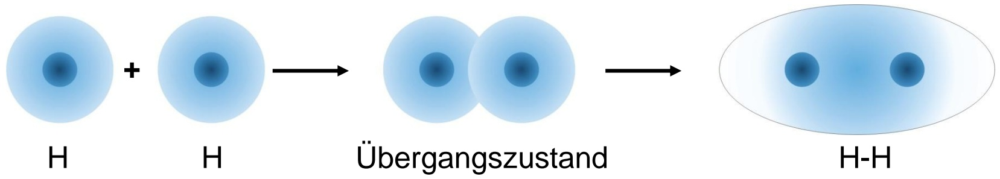

flowchart

Kovalente Bindung beim $H _ { 2 }$ – Molekül

Quelle: RWTH IWE1

## Aufbau der Materie – Beispiel einer Bindung

## Ethen $( \mathbf { C } _ { 2 } \mathbf { H } _ { 4 } )$

Chemische Darstellung der Bindungen:

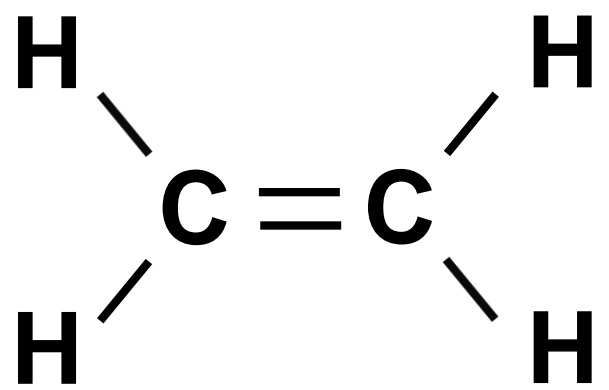

chemical

Chemical structure showing a carbon-carbon double bond with hydrogen atoms attached to each carbon

Quelle: RWTH ISEA

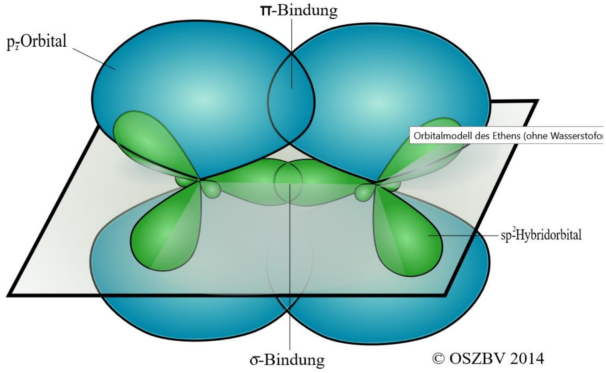

chemical

Diagram of ethane bonding states showing p_zOrbital, π-Bindung, sp²-Hybridorbital, and σ-Bindung with orbital modell (ohne Wasserstoff)

Orbitalmodell des Ethens (ohne Wasserstoforbitale)

Quelle: http://www.chemie.osz-buv.de/2014-15/ch32014/kunststoffe2\_14.html

## Ionenbindung:

■ Abgabe eines oder mehrerer Elektronen an ein anderes Atom: Na + Cl → Na+ Cl-

## Metallische Bindung:

■ In einem Metall sind alle Atome ionisiert, freie Elektronen bilden einen Elektronensee
■ Elektronensee hält positive Ionen im Kristall zusammen
■ Elektronen können keinen bestimmten Atomen zugeordnet werden

## Elektronenleitung

■ Ladungstransport über Elektronen (negative Ladung) und Löcher (positive Ladung)
■ Sehr hohe Beweglichkeit der Ladungsträger
■ Beispiel: Metallkabel

## Ionenleitung

■ Ladungstransport über bewegliche Ionen (schwer, z.B. Gewicht von Li+ über 12.000x schwerer als ein Elektron)
■ Hohe Ionenkonzentration, mäßige Beweglichkeit (geringer als elektronische Leitfähigkeit)
■ Beispiel: Elektrolytlösung in Batterien; galvanische Abscheidung von Metallen

## Physikalische Grundprinzipien

## Physikalische Basisgrößen und -einheiten

## Physikalische Größen

| Gebiet | Physikalische Größe | Symbol |
| --- | --- | --- |
| Mechanik | GeschwindigkeitBeschleunigungKraftMasseArbeitWeg, Länge, Radius | vafmWs, L, r |
| Elektrizitätslehre | LadungSpannungFeldstärkeStromWiderstand | QUEEIR |
| Wärmelehre | TemperaturWärmemengeEntropie | TQS |

Physikalische Größen sind

■ quantitativ messbar
■ objektiv

■ Voneinander unabhängige physikalische Größen heißen Basisgrößen:

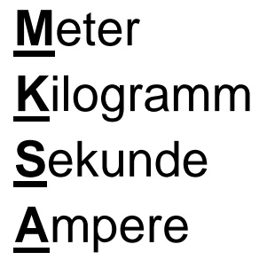

text_image

Meter
Kilogramm
Sekunde
Ampere

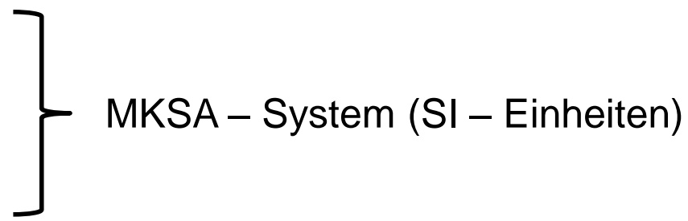

flowchart

■ Andere Größen werden von diesen Basisgrößen abgeleitet, z.B.

$$
\text {Geschwindigkeit} = \frac {\text {Weg}}{\text {Zeit}}
$$

■ Eindeutige Festlegung einer physikalischen Größe über Zahlenwert und Einheit, z.B.

$$
\text {Geschwindigkeit} = 120 \mathrm{km/h}
$$

Internationales Einheitensystem (SI) – frz. für “Système international d’unites”

| MeterUrsprung:Heute: | 1 m = 40millionster Teil des Erdumfangs1 m = 1650763,73fache Wellenlänge der von $^{86}Kr$ beim Übergang eines Elektrons vom 5d5- zum 2p10 – Niveau ausgesandten Strahlung |
| --- | --- |

| SekundeUrsprung:Heute: | 1 s = 86400ster Teil eines mittleren Sonnentages1 s = 9192631770fache der Periodendauer der dem Übergang zwischen den Hyperfeinstrukturniveaus des Grundzustandes von $^{133}Cs$ entsprechenden Strahlung |
| --- | --- |

| KilogrammUrsprung:Heute: | 1 kg = Masse von einem Liter Wasser bei 4°C1 kg = Masse des internationalen Kilogrammprototyps (Pt/Ir 90%/10%, Zylinder) |
| --- | --- |

## SI – Basiseinheiten – insgesamt 7 Einheiten, die alles beschreiben

| AmpereUrsprung:Heute: | 1 A = 1,118 mg/s Ag elektrochemisch aus AgNO3 – Lösung abgeschieden1 A = Stärke eines Gleichstroms, der in zwei unendlich langen, in 1 m Abstand parallelzueinander angeordneten Leitern, pro 1 m Leiterlänge die Kraft 2 · 10-7 N hervorrufenwürde |
| --- | --- |

| Kelvin | 1 K = 273,16ter Teil der thermodynamischen Temperatur des ersten Tripelpunktes von Wasser |
| --- | --- |

| Candela | 1 cd = Lichtstärke, mit der ein 600000stel m2 der Oberfläche eines schwarzen Strahlers bei der Temperatur von erstarrendem Platin (2024 K) bei einem Druck von 101325 Nm-2(1 atm) senkrecht zur Oberfläche leuchtet |
| --- | --- |

| Mol | 1 mol = Stoffmenge eines Systems, das aus ebenso vielen Elementareinheiten besteht, wie Atome in 12 g des Nuklids $^{12}C$ enthalten sind |
| --- | --- |

## SI – Basiseinheiten

| Größe | Formelzeichen | Einheit | Zeichen |
| --- | --- | --- | --- |
| Länge, Weg, Radius | L, s, r | Meter | m |
| Masse | m | Kilogramm | kg |
| Zeit | t | Sekunde | s |
| elektr. Stromstärke | I | Ampere | A |
| absolute Temperatur | T | Kelvin | K |
| Lichtstärke | $I_V$ | Candela | cd |
| Stoffmenge | n | Mol | mol |