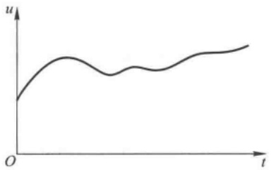
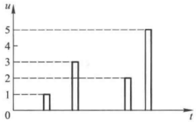
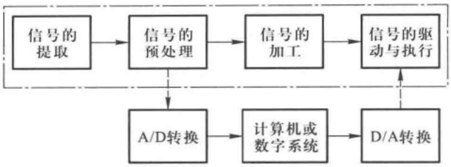
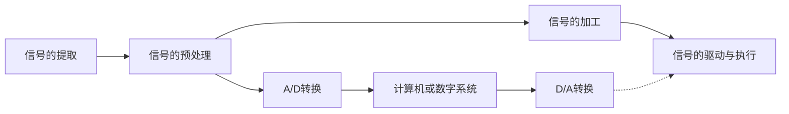

# 第0章 绪论

原始 PDF 第 24–30 页。

## 第0章 绪论

## 本章讨论的问题

- 什么是信号？为什么常将非电的物理量通过传感器转换为电信号？
- 什么是模拟信号？什么是数字信号？
- 电子系统由哪些部分组成？各部分的作用是什么？
- 电子信息系统中有哪些常见的模拟电路？它们各具有什么功能？
- 如何学习模拟电子技术基础？
- 什么是EDA？为什么说它使电子电路的设计和实现产生革命性变化？

## 0.1 电信号

## 0.1.1 什么是电信号

信号是反映消息的物理量,例如工业控制中的温度、压力、流量、自然界的声音信号等,因而信号是消息的表现形式。人们所说的信息,是指存在于消息之中的新内容,例如人们从各种媒体上获得原来未知的消息,就是获得了信息。可见,信息需要借助于某些物理量(如声、光、电)的变化来表示和传递,广播和电视利用电磁波来传送声音和图像就是最好的例证。

由于电信号较容易传送、处理和控制,人们就将非电的物理量通过各种传感器转换成电信号,以达到信息的提取、传送、交换、存储等目的。

电信号是指随时间而变化的电压 u 或电流 i，因此在数学描述上可将它表示为时间 t 的函数，即  $u = f(t)$  或  $i = f(t)$ ，并可画出其波形。电子电路中的信号均为电信号，以下简称为信号。

## 0.1.2 模拟信号和数字信号

信号的形式是多种多样的,可以从不同角度进行分类。例如,根据信号是否具有随机性分为确定信号和随机信号,根据信号是否具有周期性分为周期信号和非周期信号,根据信号对时间的取值分为连续时间信号和离散时间信号,等等。在电子电路中则将信号分为模拟信号和数字信号。

模拟信号在时间和数值上均具有连续性,即对应于任意时间值 t 均有确定的函数值 u 或 i,并且 u 或 i 的幅值是连续取值的。例如,正弦波信号是典型的模拟信号,图 0.1.1(a) 所示也是典型的模拟信号。

与模拟信号不同,数字信号在时间和数值上均具有离散性,u 或 i 的变化在时间上不连续,总是发生在离散的瞬间,且它们的数值是一个最小量值的整倍数,并以此倍数作为数字信号的数值,如图 0.1.1(b) 所示。当实际信号的值在 N 与  $N+1$  (N 为整数) 之间时,则需通过设定的阈值将其确定为 1 或  $N+1$ ,即认为 N 与  $N+1$  之间的数值没有意义。

---

2

第0章 绪论

line

| t | u |
| --- | --- |
| 0 | ~1.5 |
| ~1 | ~3.5 |
| ~2 | ~4.0 |
| ~3 | ~3.0 |
| ~4 | ~3.5 |
| ~5 | ~3.0 |
| ~6 | ~3.5 |
| ~7 | ~4.0 |
| ~8 | ~4.5 |

(a)

bar

| t | u |
| --- | --- |
| 1 | 1 |
| 2 | 3 |
| 3 | 2 |
| 4 | 5 |

(b)

图 0.1.1 模拟信号与数字信号

(a) 模拟信号 (b) 数字信号

应当指出,大多数物理量所转换成的电信号均为模拟信号。在信号处理时,模拟信号和数字信号可以相互转化。例如,用计算机处理信号时,由于计算机只能识别数字信号,故需将模拟信号转换为数字信号,称为模-数转换 $^{①}$ ;由于负载常需模拟信号驱动,故需将计算机输出的数字信号转换为模拟信号,称为数-模转换 $^{②}$ 。

本书所涉及的信号多为模拟信号。

## 0.2 电子信息系统

电子信息系统可简称为电子系统。本节简要介绍模拟电子系统所包含的主要组成部分和各部分的作用，以及电子系统的设计原则、组成系统时所要考虑的问题和系统中常用的模拟电子电路。

## 0.2.1 模拟电子系统的组成

图 0.2.1 所示点画线框内为模拟电子系统的示意图。系统首先采集信号，即进行信号的提取。通常，这些信号来源于转换各种物理量为电信号的传感器、接收器，或者来源于用于测试的信号发生器。对于实际系统，传感器或接收器所提供的信号的幅值往往很小，噪声很大，且易受干扰，有时甚至分不清什么是有用信号，什么是干扰或噪声；因此，在加工信号之前需将其进行预处理。预处理时需根据实际情况利用隔离、滤波、阻抗变换等各种手段将信号分离出来并进行放大。当信号足够大时，再进行信号的运算、转换、比较、采样保持等不同的加工。最后，通常要经过功率放大以驱动执行机构（负载）。

若系统不经过计算机处理,则图0.2.1中的信号的预处理和信号的加工可合而为一,统称为信号的处理,为模拟系统。若要进行数字化处理,则将模拟信号预处理后经A/D转换器送入计算机或专门的数字系统进行处理,然后再经D/A转换器返回功率放大以驱动执行机构,如图0.2.1点画线框外所示。

<small>① 模-数转换，简称 A/D(Analog to Digital) 转换。</small>

<small>② 数 - 模转换, 简称 D/A (Digital to Analog) 转换。</small>

---

0.2 电子信息系统

3

flowchart

图 0.2.1 电子系统的示意图

对模拟信号处理的电路称为模拟电路,对数字信号处理的电路称为数字电路;目前实用系统常常是两种信号都存在的模-数混合系统。

## 0.2.2 电子信息系统的组成原则

在设计电子信息系统时,不但要考虑如何实现预期的功能和性能指标,而且还要考虑系统的可测性和可靠性。所谓可测性,包含两个含义,其一是为了调试方便引出合适的测试点,其二是为系统设计有一定故障覆盖率的自检电路和测试激励信号。所谓可靠性是指系统在工作环境下能够稳定运行,具有一定的抗干扰能力。

在系统设计时,应尽可能做到以下几点:

(1) 必须满足功能和性能指标的要求。
（2）在满足基本要求的前提下，电路要尽量简单。因为具有同样功能和性能的电路，电路越简单，元器件数目越少，连线和焊点越少，出现故障的概率越小，系统的可靠性也就越强。因此，对于电子系统，通常，集成电路能实现的就不选用分立元件电路，大规模集成电路能实现的就不选用小规模集成电路。
（3）电磁兼容性。电子系统常常不可避免地工作在复杂的电磁环境中，其中既有来自大自然的各种放电现象、宇宙的各种电磁变化，又有人类自己利用电和电磁场从事的各种活动。空间电磁场的变化对于电子系统均会造成不同程度的干扰；与此同时，电子系统本身也在不同程度上成为其它电子设备的干扰源。所谓电磁兼容性，是指电子系统在预定的环境下，既能够抵御周围电磁场的干扰，又能够较少地影响周围环境。在设计电子系统时，电磁兼容性设计的重点是研究周围环境电磁干扰的物理特性，以及采取必要措施抑制干扰源或阻断干扰源的传播途径，使系统正常工作。

在电子系统中，多采用隔离、屏蔽、接地、滤波、去耦等技术来获得较强的抗干扰能力。

（4）系统的可测性。合理引出测试点，设计自检电路，使系统调试简单易操作，且生产工艺简单方便。
（5）设计电路和选择元器件时，需统筹考虑，权衡利弊，满足设计需求即可，不盲目追求某单一方面性能特别优秀；因为对于多数电子电路，当其某方面性能改善时，其它方面的性能可能会变坏。

其次，用通用型元器件能实现的，就不用专用型元器件，从而减小系统造价。换言之，只有当系统电路结构正确、但性能不满足要求时，才考虑更换所选的元器件。

---

4

第0章 绪论

## 0.2.3 电子信息系统中的模拟电路

在电子系统中,常用的模拟电路及其功能如下:

(1) 放大电路: 用于信号的电压、电流或功率放大。
(2) 滤波电路: 用于信号的提取、变换或抗干扰。
(3) 运算电路: 完成一个信号或多个信号的加、减、乘、除、积分、微分、对数、指数……运算。
（4）信号转换电路:用于将电流信号转换成电压信号或将电压信号转换成电流信号、将直流信号转换为交流信号或将交流信号转换为直流信号、将直流电压转换成与之成正比的频率……
(5) 信号发生电路: 用于产生正弦波、矩形波、三角波、锯齿波等。
（6）直流电源:将  $220 \, V$ 、 $50 \, Hz$  交流电转换成不同输出电压和电流的直流电，作为各种电子电路的供电电源。

应当指出,放大是对模拟信号最基本的处理,在上述电路中均含有放大电路,因此放大电路是构成各种功能模拟电路的基本电路。

## 0.3 模拟电子技术基础课程

## 0.3.1 模拟电子技术基础的课程特点

模拟电子技术基础课是入门性质的技术基础课,目的是使学生初步掌握模拟电子电路的基本理论、基本知识和基本技能。本课程与数学、物理、甚至电路课程有着明显的差别,主要表现在它的工程性和实践性上。因而学习时应特别注意由此带来的课程特点,进而调整过去形成的学习方法和思维习惯,学会像电子科学家那样思考问题。

## 一、工程性

在模拟电子技术基础课程中,需学会从工程的角度思考和处理问题。

1. 当掌握模拟电子技术的基础知识时,不必通过计算,而根据电路的组成、结构特征及各部分电路的特点,就可推论出整个电路的基本功能和性能,这个过程称为“定性分析”。本课程特别重视电子电路的“定性分析”。

实际工程的解决方案往往不是唯一的,因而不但要提出满足需求的方案,还要对各种方案进行可行性分析;即阐明能够达到预期功能和性能的理由,比较不同方案的优缺点,并能选定一种,这个过程也是定性分析。

2. 实际工程在满足基本性能指标的前提下总是容许存在一定的误差范围的, 在电子电路的定量分析中也容许存在一定的误差范围, 比如 5% 以下, 因而称这种计算为“估算”。

由于半导体器件性能参数的分散性和对温度的敏感性,精确的计算常常没有意义。若确实需要精确求解,则可借助于各种 EDA $^{①}$ 软件。

3. 近似分析要“合理”。估算就是近似分析，因而在估算前必须考虑“研究的是什么问题、在什么条件下、哪些参数被忽略不计及其原因”。换言之，要“近似”得有道理。

<small>① 电子设计自动化(Electronic Design Automation)的英文缩写。</small>

---

0.3 模拟电子技术基础课程

5

4. 估算不同的参数需采用不同的模型。模拟电子电路归根结底是“电路”，其特殊性表现在含有具有非线性特性的半导体器件。通常，在求解模拟电子电路时需将其转换成用线性元件组成的电路，即将电路中的半导体器件用其等效模型（或称等效电路）取代。不同的条件、解决不同的问题，应构造不同的等效模型。当等效模型取代半导体器件时，就可利用解决一般电路的所有规律来求解电子电路了。

## 二、实践性

课程的工程性决定了解决问题时不能“纸上谈兵”，因此强调理论与实践相结合，将理论分析的“可行”转换为“硬件实现”。

实用的模拟电子电路几乎都要通过调试才能达到预期的指标，掌握常用电子仪器的使用方法、模拟电子电路的测试方法、故障的判断和排除方法、仿真方法是教学基本要求。了解各元器件参数对电路性能的影响是正确调试的前提，而对所测试电路原理的理解是正确判断和排除故障的基础，掌握一种仿真软件是提高分析问题、解决问题能力的必要手段。

实现电子电路的方法是,首先在 EDA 环境下对分析或设计的电路进行仿真,调整电路参数直至达到预期目的,然后搭建实际电路,再进行调试,最后实测性能指标。

## 0.3.2 如何学习模拟电子技术基础课

既然模拟电子技术基础课具有上述特点,那么应如何学习这门课程呢?

## 一、重点掌握“基本概念、基本电路、基本分析方法”

1. 基本概念的含义是不变的,但应用是灵活的。对于任何一个基本概念,至少应了解引入这一概念的必要性及其物理意义,如果是一个物理参数,则还应了解其求解方法及求解过程中的注意事项。
2. 基本电路的组成原则是不变的，电路是千变万化的，实际上不可能也没必要记住所有电路。每一章都有其基本电路，掌握这些电路是学好该课程的关键。某种基本电路常不是特指某一个电路，而是指具有同样功能和结构特征的所有电路。掌握它们至少应了解其产生背景（即为满足什么需求）、结构特点和性能特点，以及在电子系统中的作用。
3. 在掌握基本概念、基本电路的基础上还应掌握基本分析方法。不同类型的电路具有不同的功能，需用不同的参数和不同的方法描述，而不同的参数有不同的求解方法。基本分析方法包括电路的识别方法、性能指标的估算方法和描述方法、电路形式及电路参数的选择方法等。

## 二、学会全面、辩证地分析模拟电子电路中的问题

应当指出,对于实际需求,从适用的角度出发,没有最好的电路,只有最合适的电路,或者说在某一应用场合中最合适的电路才是最好的电路,“最合适”是由各种约束条件得出的,比如环境、现有元器件、甚至造价,等等。而且,当你为改善电路某方面性能而采取某种措施时,必须自问,这种措施还改变了什么?怎么变的?能容忍这种变化吗?因为一个电子电路是一个整体,各方面性能是相互联系的,通常“有一利将有一弊”,不能“顾此失彼”。

## 三、注意电路的基本定理、定律在模拟电子电路分析中的应用

如前所述，当模拟电子电路中的半导体器件用其等效电路取代后，则与一般电路一样了。因此，电路的基本定理、定律均可用于模拟电子电路的分析计算，如基尔霍夫定理、戴维宁定理、诺顿定理等。

---

6

第0章 绪论

## 0.4 电子电路的计算机辅助分析和设计软件介绍

## 0.4.1 概述

随着计算机的飞速发展,以计算机辅助设计(Computer Aided Design,简称 CAD)为基础的电子设计自动化(EDA)技术已成为电子学领域的重要学科。EDA 工具使电子电路和电子系统的设计产生了革命性的变化,它摒弃了靠硬件调试来达到设计目标的繁琐过程,实现了硬件设计软件化。

EDA 技术自 20 世纪 70 年代开始发展, 其标志是美国加利福尼亚大学柏克莱 (Berkeley) 分校开发的 SPICE (Simulation Program with Integrated Circuit Emphasis) 于 1972 年研制成功, 并于 1975 年推出实用化版本。当时仅适用于模拟电路的分析, 而且只能用程序的方式输入。此后, 在扩充电路分析功能、改进和完善算法、增加元器件模型库、改进用户界面等方面做了很多实用化的工作, 使之成为享有盛誉的电子电路计算机辅助设计工具, 1988 年被定为美国国家工业标准。与此同时, 各种以 SPICE 为核心的商用仿真软件应运而生, 常用的有 PSpice $^{①}$  和 Electronics Workbench EDA (简称 EWB) $^{②}$ 。

## 0.4.2 PSpice

PSpice 是非常出色的 EDA 软件, 它的 5.00 以上版本是在 Windows 下的模拟电路和数字电路的混合仿真软件, 因而得到相当广泛的应用。

PSpice 由电路原理图输入程序 (Schematic)、激励源编辑程序 (Stimulus Editor)、电路仿真程序 (PSpice A/D)、输出结果绘图程序 (Probe)、模型参数提取程序 (Parts) 和元器件模型参数库 (LIB) 六部分组成。

PSpice 支持电路原理图和网单文件两种输入方式,电路元器件符号库提供绘制电路原理图的所有元器件符号;具有正弦波、脉冲源、指数源、分段线性源、单频调频源等种类繁多的信号源。作为 PSpice 的核心部分——仿真功能包括:直流工作点分析、直流转移特性分析、直流小信号传递函数分析、交流小信号分析、交流小信号噪声分析、瞬态分析、傅里叶分析、直流灵敏度分析、温度分析、最坏情况分析和蒙特卡罗统计分析等;仿真结果可在屏幕绘出曲线、波形,并可打印输出。PSpice 提供一个从元器件特性提取模型参数的软件包,它利用优化算法以用户给出的特性或初值为基础求得参数的最优解。PSpice 具有二极管库、晶体管库、通用集成运放库、晶体振荡器库,Analog Device 公司、Harris 公司等专用 IC 库以及 74 系列、PAL、GAL 等几十个元器件模型参数库,而且在不断扩展。

## 0.4.3 Multisim

EWB 是基于 PC 平台的电子设计软件, 它提供了一个功能全面的 SPICE A/D 系统, 支持模

<small>① 较早 Micro Sim 公司开发，后 Micro Sim 公司被 OrCAD 公司兼并，再后 OrCAD 公司又被 Cadence 公司并购，目前最新版本为 16.3。</small>

<small>② 加拿大 Interactive Image Technologies Ltd. 公司开发的产品，后称为 Multisim。该公司在 2005 年推出 Multisim8 之后，被美国国家仪器 (NI) 有限公司收购，目前最新版本为 Multisim13.0。</small>

---

0.4 电子电路的计算机辅助分析和设计软件介绍

7

拟和数字混合电路的分析和设计,创造了集成的一体化设计环境,把电路原理图的输入、仿真和分析紧密地结合起来。系统将 SPICE 仿真器完全集成在原理图输入和测试仪器等工具之中。与其它 Windows 环境下的系统软件相类似,它具有图形化界面,提供按钮式的工具栏,各个菜单中各个选项的物理意义一目了然。在输入原理图时,自动地将其编辑成网络表送到仿真器,加快建立和管理的时间;而在仿真过程中,若改变设计,则立刻获得该变化所带来的影响,实现了交互式的设计和仿真。

Multisim 是 EWB 的新产品, 具有更为庞大的元器件模型参数库和更为齐全的仪器仪表库; 除了具有 SPICE A/D 全部分析功能外, 还包含万用表、信号发生器、示波器、频谱分析仪、网络分析仪、失真分析仪、频率计、逻辑分析仪、逻辑转换仪、波特图仪、瓦特表等 18 种虚拟仪器仪表, 可模拟实验室内的操作进行各种实验。因而, 学习 Multisim, 除了可以提高仿真能力、综合能力和设计能力外, 还可进一步提高实践能力。

初步掌握一种电子电路计算机辅助分析和设计软件对学习模拟电子技术基础课很有必要。鉴于 Multisim 的上述特点,本书选用 Multisim 作为基本工具,在各章的最后一节讲述应用举例,力图使读者从中学习电子电路的仿真方法和测试方法。
