# 第2章 基本放大电路

原始 PDF 第 81–145 页。

## 第2章

## 基本放大电路

## 本章讨论的问题

- 什么是放大？放大电路放大电信号与放大镜放大物体的意义相同吗？放大的特征是什么？
- 为什么晶体管的输入输出特性说明它有放大作用？如何将晶体管接入电路才能使其起放大作用？组成放大电路的原则是什么？有几种接法？
- 如何评价放大电路的性能？有哪些主要指标？用什么方法分析这些参数？
- 晶体管的三种基本放大电路各有什么特点？如何根据需求利用它们的特点组成派生电路？
- 怎样根据放大电路的组成原则利用场效应管构成放大电路？它也有三种接法吗？场效应管放大电路的特点是什么？
- 在什么场合下应选用晶体管放大电路？在什么场合下应选用场效应管放大电路？
- 在不同场合下，应如何选用不同接法的基本放大电路？

## 2.1 放大的概念和放大电路的主要性能指标

## 2.1.1 放大的概念

放大现象存在于各种场合,例如,利用放大镜放大微小物体,这是光学中的放大;利用杠杆原理用小力移动重物,这是力学中的放大;利用变压器将低电压变换为高电压,这是电学中的放大。研究它们的共同点,一是都将原物形状或大小的差异按一定比例放大了,二是放大前后能量守恒,例如,杠杆原理中前后端做功相同,理想变压器的一次功率(也称原边功率)、二次功率(也称副边功率)相同等。

利用扩音机放大声音,是电子学中的放大,其原理框图如图2.1.1所示;图中V为供电电源 $^{①}$ ,“⊥”为电路的公共端 $^{②}$ 。话筒(传感器)将微弱的声音转换成电信号,经放大电路放大成足够强的电信号后,驱动扬声器(执行机构),使其发出较原来强得多的声音。这种放大与上述放大的相同之处是放大的对象均为变化量(差异),不同之处在于扬声器所获得的能量(或输出功率)远大于话筒送出的能量(或输入功率)。可见,放大电路放大的本质是能量的控制和转换;是在输入信号作用下,通过放大电路将直流电源的能量转换成负载所获得的能量,使负载从电源获

<small>① 实际的扩音机可能是一个电源供电，也可能是正、负两个电源供电，图2.1.1示意性地画一个电源。 ② 也称为电路的接地端(点)。在电子电路中若电源的负极接地，则电源标为“+V”；若电源的正极接地，则电源标为“-V”。</small>

---

2.1 放大的概念和放大电路的主要性能指标

59

得的能量大于信号源所提供的能量。因此，电子电路放大的基本特征是功率放大，即负载上总是获得比输入信号大得多的电压或电流，有时兼而有之。能够控制能量的元件称为有源元件，因而在放大电路中必须存在有源元件，如晶体管和场效应管等。

flowchart

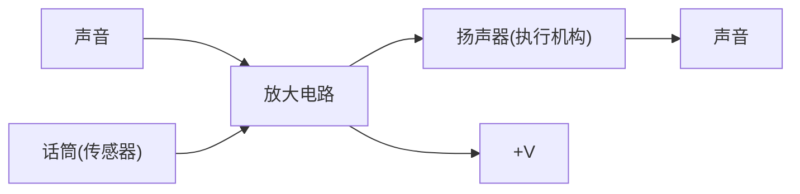

图 2.1.1 扩音机示意图

放大的前提是不失真,即只有在不失真的情况下放大才有意义。晶体管和场效应管是放大电路的核心元件,只有它们工作在合适的区域(晶体管工作在放大区、场效应管工作在恒流区),才能使输出量与输入量始终保持线性关系,即电路才不会产生失真。

由于任何稳态信号都可分解为若干频率正弦信号(谐波)的叠加,所以放大电路常以正弦波作为测试信号。

## 2.1.2 放大电路的性能指标

图2.1.2(a)所示为放大电路的示意图。对于信号而言，任何一个放大电路均可看成一个两端口网络。左边为输入端口，当内阻为 $R_{s}$ 的正弦波信号源 $\dot{U}_{s}$ 作用时，放大电路得到输入电压 $\dot{U}_{i}$，同时产生输入电流 $\dot{I}_{i}$；右边为输出端口，输出电压为 $\dot{U}_{o}$，输出电流为 $\dot{I}_{o}, R_{L}$ 为负载电阻。不同放大电路在 $\dot{U}_{s}$ 和 $R_{L}$ 相同的条件下，$\dot{U}, \dot{I}_{i}, \dot{U}_{o}, \dot{I}_{o}$ 将不同，说明不同放大电路从信号源索取的电流和获不同，且对同样信号的放大能力也不同；同一放大电路在幅值相同、频率不同的 $\dot{U}_{s}$ 作用下，$\dot{U}_{o}$ 也将不同，即同一放大电路对不同频率信号的放大能力也存在差异。为了反映放大电路的各方面性能，引出如下主要指标。

text_image

i_i
+
R_s
+
U_s
-
U_i
-
R_i
放大电路
i_o
+
R_o
+
U_o'
-
R_L
U_o
-

(a)

text_image

İs
Rs
Ri
Üi
+

(b)

图 2.1.2 放大电路示意图

(a) 放大电路示意图 (b) 信号源等效变换为电流源

## 一、放大倍数

放大倍数是直接衡量放大电路放大能力的重要指标,其值为输出量  $\dot{X}_{\mathrm{o}}(\dot{U}_{\mathrm{o}} \text{ 或 } \dot{I}_{\mathrm{o}})$  与输入量  $\dot{X}_{\mathrm{i}}(\dot{U}_{\mathrm{i}} \text{ 或 } \dot{I}_{\mathrm{i}})$  之比。对于小功率放大电路,人们常常只关心电路单一指标的放大倍数,如电压放

---

60

第 2 章 基本放大电路

大倍数,而不研究其功率放大能力。

电压放大倍数是输出电压  $\dot{U}_{o}$  与输入电压  $\dot{U}_{i}$  之比，记作  $\dot{A}_{uu}^{①}$ ，即

$$
\dot {A} _ {u u} = \dot {A} _ {u} = \frac {\dot {U} _ {\mathrm{o}}}{\dot {U} _ {\mathrm{i}}} \tag {2.1.1}
$$

电流放大倍数是输出电流  $\dot{I}_{o}$  与输入电流  $\dot{I}_{i}$  之比，即

$$
\dot {A} _ {i i} = \dot {A} _ {i} = \frac {\dot {I} _ {\mathrm{o}}}{\dot {I} _ {\mathrm{i}}} \tag {2.1.2}
$$

电压对电流的放大倍数是输出电压  $\dot{U}_{o}$  与输入电流  $\dot{I}_{i}$  之比，即

$$
\dot {A} _ {u i} = \frac {\dot {U} _ {\mathrm{o}}}{\dot {I} _ {\mathrm{i}}} \tag {2.1.3}
$$

因其量纲为电阻,有些文献也称之为互阻放大倍数。

电流对电压的放大倍数是输出电流  $\dot{I}_{o}$  与输入电压  $\dot{U}_{i}$  之比，即

$$
\dot {A} _ {i u} = \frac {\dot {I} _ {\mathrm{o}}}{\dot {U} _ {\mathrm{i}}} \tag {2.1.4}
$$

因其量纲为电导,有些文献也称之为互导放大倍数。

本章重点研究电压放大倍数  $\dot{A}_{u}$  。应当指出，在实测放大倍数时，必须用示波器观察输出端的波形，只有在不失真的情况下，测试数据才有意义；测试其它指标时也应如此。

当输入信号为缓慢变化量或直流变化量时，输入电压、输入电流、输出电压和输出电流分别用 $\Delta u_{1},\Delta i_{1},\Delta u_{0}$ 和 $\Delta i_0$ 表示。放大倍数 $A_{u} = \Delta u_{0} / \Delta u_{1},A_{i} = \Delta i_{0} / \Delta i_{1},A_{ui} = \Delta u_{0} / \Delta i_{1},A_{iu} =$ $\Delta i_0 / \Delta u_1$ 。

## 二、输入电阻

放大电路与信号源相连接就成为信号源的负载,必然从信号源索取电流,电流的大小表明放大电路对信号源的影响程度。输入电阻  $R_{i}$  是从放大电路输入端看进去的等效电阻,定义为输入电压有效值  $U_{i}$  和输入电流有效值  $I_{i}$  之比,即

$$
R _ {\mathrm{i}} = \frac {U _ {\mathrm{i}}}{I _ {\mathrm{i}}} \tag {2.1.5}
$$

$R_{\mathrm{i}}$ 越大，表明放大电路从信号源索取的电流越小，放大电路所得到的输入电压 $U_{\mathrm{i}}$ 越接近信号源电压 $U_{\mathrm{s}}$；换言之，信号源内阻的压降越小，信号电压损失越小。根据诺顿定理，可将信号源等效变换为电流源，如图2.1.2(b)所示；通常信号源内阻 $R_{\mathrm{s}}$ 是常量，$R_{\mathrm{i}}$ 越小，输入电流 $I_{\mathrm{i}}$ 就越接近信号源电流 $I_{\mathrm{s}}$，信号源内阻 $R_{\mathrm{s}}$ 的分流越小，信号电流损失越小。可见，放大电路输入电阻的大小要视放大电路对信号的需要而设计。

## 三、输出电阻

任何放大电路的输出都可以等效成一个有内阻的电压源，从放大电路输出端看进去的等效内阻称为输出电阻 $R_{0}$ ，如图2.1.2(a)所示。 $U_{0}^{\prime}$ 为空载时输出电压的有效值， $U_{0}$ 为带负载后输出

<small>① 放大倍数 A 下标的第一个字母表示输出量, 第二个字母表示输入量, 为电压时标 u, 为电流时标 i。</small>

---

2.1 放大的概念和放大电路的主要性能指标

61

电压的有效值,因此

$$
U _ {\mathrm{o}} = \frac {R _ {\mathrm{L}}}{R _ {\mathrm{o}} + R _ {\mathrm{L}}} \cdot U _ {\mathrm{o}} ^ {\prime}
$$

输出电阻

$$
R _ {\mathrm{o}} = \left(\frac {U _ {\mathrm{o}} ^ {\prime}}{U _ {\mathrm{o}}} - 1\right) R _ {\mathrm{L}} \tag {2.1.6}
$$

$R_{o}$  愈小, 负载电阻  $R_{L}$  变化时,  $U_{o}$  的变化愈小, 放大电路的带负载能力愈强。然而, 若要使负载电阻获得的信号电流大一些, 则放大电路的输出电阻就应当小一些。因此, 放大电路输出电阻的大小要视负载的需要而设计。

输入电阻与输出电阻描述了电子电路在相互连接时所产生的影响。当两个放大电路相互连接时（如图2.1.3所示），放大电路Ⅱ的输入电阻 $R_{i2}$ 是放大电路Ⅰ的负载电阻，而放大电路Ⅰ是放大电路Ⅱ的信号源，其内阻就是放大电路Ⅰ的输出电阻 $R_{o1}$ 。因此，输入电阻和输出电阻均会直接或间接地影响放大电路的放大能力。

text_image

+
Üi
-
Ri1
放大电路
I
Ro1
+
Üo1
-
+
Üo1
-
Ri2
放大电路
II
Ro2
+
Üo2
-
RL
+
Üo
-

图 2.1.3 两个放大电路相连接的示意图

## 四、通频带

通频带用于衡量放大电路对不同频率信号的放大能力。由于放大电路中电容、电感及半导体器件结电容等电抗元件的存在，在输入信号频率较低或较高时，放大倍数的数值会下降并产生相移。一般情况，放大电路只适用于放大某一个特定频率范围内的信号。图2.1.4所示为某放大电路放大倍数的数值与信号频率的关系曲线，称为幅频特性曲线，图中 $\dot{A}_{m}$ 为中频放大倍数。

line

| Low (fL) | 0.707 |
| --- | --- |
| High (fH) | 0.707 |

图 2.1.4 放大电路的频率指标

在信号频率下降到一定程度时，放大倍数的数值明显下降，使放大倍数的数值等于0.707倍 $|\dot{A}_{\mathrm{m}}|$ 的频率称为下限截止频率 $f_{\mathrm{L}}$ 。信号频率上升到一定程度，放大倍数数值也将减小，使放大倍数的数值等于0.707倍 $|\dot{A}_{\mathrm{m}}|$ 的频率称为上限截止频率 $f_{\mathrm{H}}$ 。 $f$ 小于 $f_{\mathrm{L}}$ 的部分称为放大电路的低频段， $f$ 大

---

62

第 2 章 基本放大电路

于 $f_{H}$ 的部分称为高频段，而 $f_{L}$ 与 $f_{H}$ 之间形成的频带称为中频段，也称为放大电路的通频带 $f_{bw}$ 。

$$
f _ {\mathrm{bw}} = f _ {\mathrm{H}} - f _ {\mathrm{L}} \tag {2.1.7}
$$

通频带宽,表明放大电路对不同频率信号的适应能力越强。当频率趋近于零或无穷大时放大倍数的数值趋近于零。对于扩音机,其通频带应宽于音频(20 Hz\~20 kHz)范围,才能完全不失真地放大声音信号。在实用电路中有时也希望频带尽可能窄,比如选频放大电路,从理论上讲希望它只对单一频率的信号放大,以避免干扰和噪声的影响。

## 五、非线性失真系数

由于放大器件均具有非线性特性,它们的线性放大范围有一定的限度,当输入信号幅度超过一定值后,输出电压将会产生非线性失真。输出波形中的谐波成分总量与基波成分之比称为非线性失真系数D。设基波幅值为 $A_{1}$ ,谐波幅值为 $A_{2}$ 、 $A_{3}\cdots$ 则

$$
D = \sqrt {\left(\frac {A _ {2}}{A _ {1}}\right) ^ {2} + \left(\frac {A _ {3}}{A _ {1}}\right) ^ {2} + \cdots} \tag {2.1.8}
$$

## 六、最大不失真输出电压

最大不失真输出电压定义为当输入电压再增大就会使输出波形产生非线性失真时的输出电压。实测时，需要定义非线性失真系数的额定值，比如 $10\%$ ，输出波形的非线性失真系数刚刚达到此额定值时的输出电压即为最大不失真输出电压。一般以有效值 $U_{\mathrm{om}}$ 表示，也可以用峰-峰值 $U_{\mathrm{opp}}$ 表示， $U_{\mathrm{opp}} = 2\sqrt{2} U_{\mathrm{om}}$ 。

## 七、最大输出功率与效率

在输出信号不失真的情况下,负载上能够获得的最大功率称为最大输出功率  $P_{om}$  。此时,输出电压达到最大不失真输出电压。

直流电源能量的利用率称为效率  $\eta$ ，设电源消耗的功率为  $P_{v}$ ，则效率  $\eta$  等于最大输出功率  $P_{om}$  与  $P_{v}$  之比，即

$$
\eta = \frac {P _ {\mathrm{om}}}{P _ {\mathrm{v}}} \tag {2.1.9}
$$

在测试上述指标参数时，对于 $A, R_{\mathrm{i}}, R_{\mathrm{o}}$ ，应给放大电路输入中频段小幅值信号；对于 $f_{\mathrm{L}}, f_{\mathrm{H}}, f_{\mathrm{BW}}$ ，应给放大电路输入小幅值、宽频率范围的信号；对于 $U_{\mathrm{om}}, P_{\mathrm{om}}, \eta$ 和 $D$ ，应给放大电路输入中频段大幅值信号。

## 思考题

2.1.1 在放大电路中,输出电流和输出电压是由有源元件提供的吗?为什么?
2.1.2 在放大电路中,输出电压是否一定大于输入电压? 输出电流是否一定大于输入电流? 放大电路放大的特征是什么?
2.1.3 已知放大电路空载时的电压放大倍数  $\left|\dot{A}_{u}\right|=U_{o}/U_{i}$  ( $U_{o}$  和  $U_{i}$  均为有效值)、输入电阻  $R_{i}$ 、输出电阻  $R_{o}$ ，试求出  $\left|\dot{A}_{ui}\right|$ 、 $\left|\dot{A}_{iu}\right|$  和  $\left|\dot{A}_{ii}\right|$ 。
2.1.4 两级放大电路的方框图如图 2.1.3 所示, 已知电路 I 和电路 II 空载时的电压放大倍数, 以及它们的输入电阻和输出电阻, 试求解整个电路的电压放大倍数。

---

2.2 基本共射放大电路的工作原理

63

## 2.2 基本共射放大电路的工作原理

本节将以 NPN 型晶体管组成的基本共射放大电路为例, 阐明放大电路的组成原则及电路中各元件的作用。

## 2.2.1 基本共射放大电路的组成及各元件的作用

图 2.2.1 所示为基本共射放大电路，晶体管是起放大作用的核心元件。输入信号  $u_{i}$  为正弦波电

压。由于该电路是依据晶体管工作在放大状态 b-e、c-e 所需电压而组成，故也称之为原理性电路，以区别于实用电路。

当 $u_{\mathrm{i}} = 0$ 时，称放大电路处于静态。在输入回路中，基极电源 $V_{\mathrm{BB}}$ 使晶体管b-e间电压 $U_{\mathrm{BE}}$ 大于开启电压 $U_{\mathrm{on}}$ ，并与基极电阻 $R_{\mathrm{b}}$ 共同决定基极电流 $I_{\mathrm{B}}$ ；在输出回路中，集电极电源 $V_{\mathrm{CC}}$ 应足够高，使晶体管的集电结反向偏置，以保证晶体管工作在放大状态，因此集电极电流 $I_{\mathrm{C}} = \beta I_{\mathrm{B}}$ ；集电极电阻 $R_{\mathrm{c}}$ 上的电流等于 $I_{\mathrm{C}}$ ，因而其电压为 $I_{\mathrm{C}}R_{\mathrm{c}}$ ，从而确定了c-e间电压 $U_{\mathrm{CE}} = V_{\mathrm{CC}} - I_{\mathrm{C}}R_{\mathrm{c}}$ 。

text_image

Rb
+
ui
-
VBB
T
Rc
+
uo
-
VCC

图 2.2.1 基本共射放大电路

当 $u_{\mathrm{i}}$ 不为0时，在输入回路中，必将在静态值的基础上产生一个动态的基极电流 $i_{\mathrm{b}}$ ；当然，在输出回路就得到动态电流 $i_{\mathrm{c}}$ ；集电极电阻 $R_{\mathrm{c}}$ 将集电结电流的变化转化成电压的变化，使得管压降 $u_{\mathrm{CE}}$ 产生变化，管压降的变化量就是输出动态电压 $u_{\mathrm{o}}$，从而实现了电压放大。直流电源 $V_{\mathrm{CC}}$ 为输出提供所需能量。

由于图 2.2.1 所示电路的输入回路与输出回路以发射极为公共端, 故称之为共射放大电路。在电子电路中, 称公共端为“地”。

## 2.2.2 设置静态工作点的必要性

## 一、静态工作点

由以上分析可知，在放大电路中，当有信号输入时，交流量与直流量共存。将输入信号为零、即直流电源单独作用时晶体管的基极电流 $I_{\mathrm{B}}$ 、集电极电流 $I_{\mathrm{C}}$ 、b-e间电压 $U_{\mathrm{BE}}$ 、管压降 $U_{\mathrm{CE}}$ 称为放大电路的静态工作点 $Q^{①}$，常将四个物理量记作 $I_{\mathrm{BQ}}$ 、 $I_{\mathrm{CQ}}$ 、 $U_{\mathrm{BEQ}}$ 、 $U_{\mathrm{CEQ}}$ 。在近似估算中常认为 $U_{\mathrm{BEQ}}$ 为已知量，对于硅管，取 $|U_{\mathrm{BEQ}}|$ 为0.6\~0.8V中的某一值，如0.7V；对于锗管，取 $|U_{\mathrm{BEQ}}|$ 为0.1\~0.3V中的某一值，如0.2V；而且认为穿透电流 $I_{\mathrm{CEO}} = 0, \bar{\beta} = \beta$ 。

在图 2.2.1 所示电路中，令  $\dot{U}_{i}=0$ ，根据回路方程，便可得到静态工作点的表达式

$$
\left\{ \begin{array}{l l} I _ {\mathrm{BQ}} = \frac {V _ {\mathrm{BB}} - U _ {\mathrm{BEQ}}}{R _ {\mathrm{b}}} & (2. 2. 1 \mathrm{a}) \\ I _ {\mathrm{CQ}} = \overline {{\beta}} I _ {\mathrm{BQ}} = \beta I _ {\mathrm{BQ}} & (2. 2. 1 \mathrm{b}) \\ U _ {\mathrm{CEQ}} = V _ {\mathrm{CC}} - I _ {\mathrm{CQ}} R _ {\mathrm{c}} & (2. 2. 1 \mathrm{c}) \end{array} \right.
$$

<small>① Q 是英文 Quiescent 的字头。</small>

---

64

第 2 章 基本放大电路

## 二、为什么要设置静态工作点

既然放大电路要放大的对象是动态信号,那么为什么要设置静态工作点呢?为了说明这一问题,不妨将基极电源去掉,如图2.2.2所示,电源 $+V_{CC}$ 的负端接“地”。

图 2.2.2 没有设置合适的静态工作点

(a) 电路 (b) 分析

在图2.2.2所示电路中，静态时将输入端A与B短路，必然得出 $I_{\mathrm{BQ}} = 0, I_{\mathrm{CQ}} = 0, U_{\mathrm{CEQ}} \approx V_{\mathrm{CC}}$ 的结论，因而晶体管处于截止状态。当加入输入电压 $u_{\mathrm{i}}$ 时， $u_{\mathrm{AB}} = u_{\mathrm{i}}$，若其峰值小于b-e间开启电压 $U_{\mathrm{on}}$，则在信号的整个周期内晶体管始终工作在截止状态，因而 $U_{\mathrm{CE}}$ 毫无变化，输出电压为零；即使 $u_{\mathrm{i}}$ 的幅值足够大，晶体管也只可能在信号正半周大于 $U_{\mathrm{on}}$ 的时间间隔内导通，所以输出电压必然严重失真。

对于放大电路的最基本要求,一是不失真,二是能够放大。如果输出波形严重失真,所谓“放大”就毫无意义了。因此,设置合适的静态工作点,以保证放大电路不产生失真是非常必要的。

应当指出，$Q$ 点不仅影响电路是否会产生失真，而且影响着放大电路几乎所有的动态参数，这些将在后面几节中详细加以说明。

## 2.2.3 基本共射放大电路的工作原理及波形分析

在图2.2.1所示的基本放大电路中，静态时的 $I_{\mathrm{BQ}}$ 、 $I_{\mathrm{CQ}}$ 、 $U_{\mathrm{CEQ}}$ 如图2.2.3(b)、(c)中虚线所标注。

当有输入电压时，基极电流是在原来直流分量 $I_{\mathrm{BQ}}$ 的基础上叠加一个正弦交流电流 $i_{\mathrm{b}}$，因而基极总电流 $i_{\mathrm{B}} = I_{\mathrm{BQ}} + i_{\mathrm{b}}$，见图2.2.3(b)中实线所画波形。根据晶体管基极电流对集电极电流的控制作用，集电极电流也会在直流分量 $I_{\mathrm{CQ}}$ 的基础上产生一个正弦交流电流 $i_{\mathrm{c}}$，而且 $i_{\mathrm{c}} = \beta i_{\mathrm{b}}$，集电结总电流 $i_{\mathrm{C}} = I_{\mathrm{CQ}} + \beta i_{\mathrm{b}}$。不难理解，集电极动态电流 $i_{\mathrm{c}}$ 必将在集电极电阻 $R_{\mathrm{c}}$ 上产生一个与 $i_{\mathrm{c}}$ 波形相同的交变电压。而由于 $R_{\mathrm{c}}$ 上的电压增大时，管压降 $u_{\mathrm{CE}}$ 必然减小；$R_{\mathrm{c}}$ 上的电压减小时，$u_{\mathrm{CE}}$ 必然增大，所以管压降是在直流分量 $U_{\mathrm{CEQ}}$ 的基础上叠加上一个与 $i_{\mathrm{c}}$ 变化方向相反的交变电压 $u_{\mathrm{ce}}$。管压降总量 $u_{\mathrm{CE}} = U_{\mathrm{CEQ}} + u_{\mathrm{ce}}$，见图2.2.3(c)中实线所画波形。将管压降中的直流分量 $U_{\mathrm{CEQ}}$ 去掉，就得到一个与输入电压 $u_{\mathrm{i}}$ 相位相反且放大了的交流电压 $u_{\mathrm{o}}$，如图2.2.3(d)所示。

---

2.2 基本共射放大电路的工作原理

65

图 2.2.3 基本共射放大电路的波形分析

(a)  $u_{i}$  的波形 (b)  $i_{\mathrm{B}}(i_{\mathrm{C}})$  的波形 (c)  $u_{CE}$  的波形 (d)  $u_{o}$  的波形

从以上分析可知,对于基本共射放大电路,只有设置合适的静态工作点,使交流信号驮载在直流分量之上,以保证晶体管在输入信号的整个周期内始终工作在放大状态,输出电压波形才不会产生非线性失真。基本共射放大电路的电压放大作用是利用晶体管的电流放大作用,并依靠 $R_{c}$ 将电流的变化转化成电压的变化来实现的。

## 2.2.4 放大电路的组成原则

## 一、组成原则

通过对基本共射放大电路的简单分析可以总结出,在组成放大电路时必须遵循以下几个原则。

（1）必须根据所用放大管的类型提供直流电源，以便设置合适的静态工作点，并作为输出的能源。对于晶体管放大电路，电源的极性和大小应使晶体管发射结处于正向偏置，且静态电压 $|U_{BEQ}|$ 大于开启电压 $U_{on}$，以保证晶体管工作在导通状态；集电结处于反向偏置，以保证晶体管工作在放大区。对于场效应管放大电路，电源的极性和大小应为场效应管的栅-源之间、漏-源之间提供合适的电压，从而使之工作在恒流区。

(2) 电阻取值得当,与电源配合,使放大管有合适的静态工作电流。

（3）输入信号必须能够作用于放大管的输入回路。对于晶体管，输入信号必须能够改变基极与发射极之间的电压，产生  $\Delta u_{BE}$ ，从而改变基极或发射极电流，产生  $\Delta i_{B}$  或  $\Delta i_{E}$ 。对于场效应管，输入信号必须能够改变栅-源之间的电压，产生  $\Delta u_{GS}$ 。这样，才能改变放大管输出回路的电流，从而放大输入信号。

（4）当负载接入时，必须保证放大管输出回路的动态电流（晶体管的  $\Delta i_{C}$ 、 $\Delta i_{E}$  或场效应管的  $\Delta i_{D}$ 、 $\Delta i_{S}$ ）能够作用于负载，从而使负载获得比输入信号大得多的信号电流或信号电压。

## 二、两种实用的共射放大电路

根据上述原则,可以构成与图 2.2.1 不尽相同的共射放大电路。

在实用放大电路中,为了防止干扰,常要求输入信号、直流电源、输出信号均有一端接在公共

---

66

第 2 章 基本放大电路

端，即“地”端，称为“共地”。这样，将图2.2.1所示电路中的基极电源与集电极电源合二为一，

并且为了合理设置静态工作点，在基极回路又增加一个电阻，便得到图2.2.4所示的共射放大电路。由于图2.2.1和图2.2.4所示电路中信号源与放大电路、放大电路与负载电阻均直接相连，故称为“直接耦合”，“耦合”即为“连接”。

将图 2.2.4 所示电路的输入端短路便可求出静态工作点。

$$
\left\{ \begin{array}{l l} I _ {\mathrm{BQ}} = \frac {V _ {\mathrm{CC}} - U _ {\mathrm{BEQ}}}{R _ {\mathrm{b2}}} - \frac {U _ {\mathrm{BEQ}}}{R _ {\mathrm{b1}}} & (2. 2. 2 \mathrm{a}) \\ I _ {\mathrm{CQ}} = \overline {{\beta}} I _ {\mathrm{BQ}} = \beta I _ {\mathrm{BQ}} & (2. 2. 2 \mathrm{b}) \\ U _ {\mathrm{CEQ}} = V _ {\mathrm{CC}} - I _ {\mathrm{CQ}} R _ {\mathrm{c}} & (2. 2. 2 \mathrm{c}) \end{array} \right.
$$

text_image

Rb1
+ VCC
Rb2
Rc
T
+
uI
uo
RL
-

图 2.2.4 直接耦合共射放大电路

应当指出， $R_{b1}$ 是必不可少的。试想，若 $R_{b1}=0$，则静态时，由于输入端短路， $I_{BQ}=0$，晶体管将截止，电路不可能正常工作。 $R_{b1}$ 、 $R_{b2}$ 的取值与 $V_{CC}$ 相配合，才能得到合适的基极电流 $I_{BQ}$，合理地选取 $R_{c}$，才能得到合适的管压降 $U_{CEQ}$ 。有输入信号时的波形分析如图2.2.3所示。

当输入信号作用时，由于信号电压在图2.2.1所示电路中的 $R_{b}$ 和图2.2.4所示电路中的 $R_{b1}$ 上均有损失，因而减小了晶体管基极与发射极之间的信号电压，也就影响了电路的放大能力。同时，上述两种电路接入负载后，负载电阻不但有信号电压，还有直流电源作用的结果，即存在直流分量，这常常需要去除。图2.2.5(a)所示电路既解决了“共地”问题，又使一定频率范围内的输入信号几乎毫无损失地加到放大管的输入回路，而且负载电阻上没有直流分量。

text_image

Rb
C1
+
UBEQ
+
ui
-
Rc
C2
+
UCEQ
-
+
T
uo
RL
+VCC
-

(a)

text_image

UBEQ
+
ui
-
T

(b)

图 2.2.5 阻容耦合共射放大电路

(a) 电路 (b) 输入回路等效电路

图 2.2.5(a) 中电容  $C_{1}$  用于连接信号源与放大电路，电容  $C_{2}$  用于连接放大电路与负载。在电子电路中起连接作用的电容称为耦合电容 $^{①}$ ，利用电容连接电路称为阻容耦合，故图 2.2.5(a) 所示电路为阻容耦合共射放大电路。由于电容对直流量的容抗无穷大，所以信号源与放大电路、放大电路与负载之间没有直流量通过。耦合电容的容量应足够大，使其在输入信号频率范围内

<small>① 耦合电容容量较大，多为电解电容，接入电路时应注意其正、负极。</small>

---

2.2 基本共射放大电路的工作原理

67

的容抗很小,可视为短路,所以输入信号几乎无损失地加在放大管的基极与发射极之间。可见,耦合电容的作用是“隔离直流,通过交流”。令输入端短路,可以求出静态工作点。

$$
\left\{ \begin{array}{l l} I _ {\mathrm{BQ}} = \frac {V _ {\mathrm{CC}} - U _ {\mathrm{BEQ}}}{R _ {\mathrm{b}}} & (2. 2. 3 \mathrm{a}) \\ I _ {\mathrm{CQ}} = \overline {{\beta}} I _ {\mathrm{BQ}} = \beta I _ {\mathrm{BQ}} & (2. 2. 3 \mathrm{b}) \\ U _ {\mathrm{CEQ}} = V _ {\mathrm{CC}} - I _ {\mathrm{CQ}} R _ {\mathrm{c}} & (2. 2. 3 \mathrm{c}) \end{array} \right.
$$

电容 $C_1$ 上的电压为 $U_{\mathrm{BEQ}}$ ，电容 $C_2$ 上的电压为 $U_{\mathrm{CEQ}}$ ，方向如图2.2.5(a)中所标注。由于在输入信号作用时， $C_1$ 上电压基本不变，因此可将其等效成一个电池，如图2.2.5(b)所示。这样，放大管基极与发射极之间总电压为 $U_{\mathrm{BEQ}}$ 与 $u_{\mathrm{i}}$ 之和。 $u_{\mathrm{i}},i_{\mathrm{B}},i_{\mathrm{C}},u_{\mathrm{CE}},u_{\mathrm{o}}$ 的波形分析如图2.2.3所示。应该注意，输出电压 $u_{\mathrm{o}}$ 等于集电极与发射极之间总电压减去 $C_2$ 上的电压 $U_{\mathrm{CEQ}}$ ，所以 $u_{\mathrm{o}}$ 为纯交流信号。

【例 2.2.1】现有一个直流电源,试用一只 PNP 型管组成共射放大电路。

解: 在放大电路中, 直流电源一方面设置合适的静态工作点, 另一方面作为负载的能源。为使晶体管导通, 发射结应正偏, 因而 PNP 型管的发射极应接电源的正极, 而基极应接电源的负极; 且为了限制基极电流, 基极回路应加电阻  $R_{b}$ , 如图 2.2.6(a) 所示。为使晶体管工作在放大状态, 集电结应反偏, 因而 PNP 型管的集电极应接电源的负极; 且为了将集电极电流的变化转换为电压的变化, 集电极应通过电阻  $R_{c}$  接电源的负极, 如图(b) 所示。为了使输入信号驮载在 b-e 静态电压之上, 则应在晶体管基极与信号源之间加一个电阻或电容, 如图(c)、(d) 所示; 图(c) 电路的输入端为直接耦合方式, 图(d) 电路的输入端为阻容耦合方式; 它们的输出端均采用了直接耦合方式, 当然也可采用阻容耦合方式。

text_image

-Vcc
Rb
T

(a)

text_image

Rb
Rc
- VCC
T

(b)

text_image

R
Rb
-VCC
Rc
+
T
uO
RL
uI
-

(c)

text_image

C
+
ui
-
Rb
T
Rc
-VCC
+
uo
RL
-

(d)

图 2.2.6 用 PNP 型管组成共射放大电路

(a) 使发射结正偏

(b) 使集电结反偏

(c) 输入端为直接耦合的共射放大电路

(d) 输入端为阻容耦合的共射放大电路

## 思考题

2.2.1 试用 NPN 型管组成一个共射放大电路,使之在输入为零时输出为零。要求画出电路图。可以用一路电源,也可用两路电源。
2.2.2 试标出图 2.2.6(d) 中耦合电容的极性。
2.2.3 PNP 管共射放大电路的输出电压与输入电压反相吗？用波形来分析这个问题。
2.2.4 在图 2.2.1 所示电路中, 若在输出端接入负载电阻  $R_{L}$ , 则如何求解静态管压降  $U_{CEQ}$ ?

---

68

第 2 章 基本放大电路

## 2.3 放大电路的分析方法

分析放大电路就是在理解放大电路工作原理的基础上求解静态工作点和各项动态参数。本节以 NPN 型晶体管组成的基本共射放大电路为例，针对电子电路中存在着晶体管或场效应管等非线性器件，而且直流量与交流量同时作用的特点，提出分析方法。

## 2.3.1 直流通路与交流通路

通常，在放大电路中，直流电源的作用和交流信号的作用总是共存的，即静态电流、电压和动态电流、电压总是共存的。但是由于电容、电感等电抗元件的存在，直流量所流经的通路与交流信号所流经的通路不完全相同。因此，为了研究问题方便起见，常把直流电源对电路的作用和输入信号对电路的作用区分开来，分成直流通路和交流通路。

直流通路是在直流电源作用下直流电流流经的通路,也就是静态电流流经的通路,用于研究静态工作点。对于直流通路,①电容视为开路;②电感线圈视为短路(即忽略线圈电阻);③信号源视为短路,但应保留其内阻。

交流通路是输入信号作用下交流信号流经的通路,用于研究动态参数。对于交流通路,
① 容量大的电容(如耦合电容)视为短路,② 无内阻的直流电源(如  $V_{cc}$ )视为短路。

根据上述原则，图2.2.1所示共射放大电路的直流通路如图2.3.1(a)所示。图中，基极电源 $V_{BB}$ 和集电极电源 $V_{CC}$ 的负极均接地。为了得到交流通路，应将直流电源 $V_{BB}$ 和 $V_{CC}$ 均短路，因而集电极电阻 $R_{c}$ 并联在晶体管的集电极和发射极之间，如图2.3.1(b)所示。

text_image

+V_BB R_b T +V_CC
R_c
(a)
R_b T R_c
+ U_i - U_o -
(b)
R_b T R_c U_o
+ U_i - U_o -

图 2.3.1 图 2.2.1 所示共射放大电路的直流通路和交流通路

(a) 直流通路 (b) 交流通路

在图2.3.2(a)所示的直接耦合共射放大电路中， $R_{\mathrm{s}}$ 为信号源内阻，因此其直流通路如图(b)所示。从直流通路可以看出，直接耦合放大电路的静态工作点既与信号源内阻 $R_{\mathrm{s}}$ 有关，又与负载电阻 $R_{\mathrm{L}}$ 有关。由于直流电源 $V_{\mathrm{CC}}$ 对交流信号短路，所以，在交流通路中， $R_{\mathrm{b2}}$ 并联在晶体管的基极与发射极之间，而集电极电阻 $R_{\mathrm{c}}$ 和负载电阻 $R_{\mathrm{L}}$ 均并联在晶体管的集电极与发射极之间，如图2.3.2(c)所示。

---

2.3 放大电路的分析方法

69

text_image

Rb1
Rs
+
us
-
Rb2
T
Rc
+VCC
+
RL
uO
-

(a)

text_image

Rb1
Rs
Rb2
T
+VCC
Rc
RL

(b)

text_image

Rs
+
Us
-
Rb1
T
Rb2
Rc
RL
Uo
+

(c)

图 2.3.2 直接耦合共射放大电路及其直流通路和交流通路

(a) 直接耦合共射放大电路 (b) 直流通路 (c) 交流通路

在图2.2.5(a)所示阻容耦合放大电路中，信号源内阻为0。对于直流量， $C_1, C_2$ 开路，所以直流通路如图2.3.3(a)所示。对于交流信号， $C_1, C_2$ 相当于短路，直流电源 $V_{\mathrm{CC}}$ 短路，因而输入电压 $\dot{U}_{\mathrm{i}}$ 加在晶体管基极与发射极之间，基极电阻 $R_{\mathrm{b}}$ 并联在输入端；集电极电阻 $R_{\mathrm{e}}$ 与负载电阻$R_{\mathrm{L}}$ 并联在集电极与发射极之间，即并联在输出端。因此，交流通路如图2.3.3(b)所示。从直流通路可以看出，由于 $C_1, C_2$ 的“隔直”作用，静态工作点与信号源内阻和负载电阻无关。

text_image

Rb
Rc
+Vcc
T

(a)

text_image

+
Üᵢ
-
Rb
T
Rc
RL
Üₒ
+

(b)

图 2.3.3 阻容耦合共射放大电路的直流通路和交流通路

(a) 直流通路 (b) 交流通路

在分析放大电路时，应遵循“先静态，后动态”的原则，求解静态工作点时应利用直流通路，求解动态参数时应利用交流通路，两种通路切不可混淆。静态工作点合适，动态分析才有意义。对于简单电路，不一定非画出直流通路不可。读者不难发现，在式(2.2.1)、(2.2.2)、(2.2.3)的分析过程中已经使用了直流通路。

---

70

第 2 章 基本放大电路

## 2.3.2 图解法

在实际测出放大管的输入特性、输出特性和已知放大电路中其它各元件参数的情况下，利用作图的方法对放大电路进行分析即为图解法。

## 一、静态工作点的分析

将图 2.2.1 所示电路变换成图 2.3.4 所示电路, 用虚线将晶体管与外电路分开, 两条虚线之间为晶体管, 虚线之外是电路的其它元件。

text_image

ΔuI
+
-
VBB
Rb
iB
+
-
uBE
T
iC
+
-
uCE
Rc
VCC

图 2.3.4 共射放大电路

当输入信号  $\Delta u_{1}=0$  时, 在晶体管的输入回路中, 静态工作点既应在晶体管的输入特性曲线上, 又应满足外电路的回路方程:

$$
u _ {\mathrm{BE}} = V _ {\mathrm{BB}} - i _ {\mathrm{B}} R _ {\mathrm{b}} \tag {2.3.1}
$$

在输入特性坐标系中，画出式(2.3.1)所确定的直线，它与横轴的交点为 $(V_{\mathrm{BB}},0)$ ，与纵轴的交点为 $(0,V_{\mathrm{BB}}/R_{\mathrm{b}})$ ，斜率为 $-1/R_{b}$ 。直线与曲线的交点就是静态工作点Q，其横坐标值为 $U_{BEQ}$ ，纵坐标值为 $I_{BQ}$ ，如图2.3.5(a)中所标注。式(2.3.1)所确定的直线称为输入回路负载线。

line

| 特征 | 描述 |
| --- | --- |
| Y轴标签 | i_B |
| X轴标签 | u_BE |
| 曲线类型 | 线性 (Line) |
| 关键点 | Q (均衡点) |
| 曲线交点 | V_BB/R_b |
| 曲线交点 | I_BQ |
| 曲线交点 | U_BEQ |

(a)

line

| uCE | ic (Curve 1) | ic (Curve 2) | ic (Curve 3) | ic (Curve 4) |
| --- | --- | --- | --- | --- |
| 0 | 0 | 0 | 0 | 0 |
| U_CEQ | I_CQ | I_CQ | I_CQ | I_CQ |
| >U_CEQ | Constant | Constant | Constant | Constant |

(b)

图 2.3.5 利用图解法求解静态工作点

(a) 输入回路的图解分析 (b) 输出回路的图解分析

与输入回路相似,在晶体管的输出回路中,静态工作点既应在 $I_{B}=I_{BQ}$ 的那条输出特性曲线上,又应满足外电路的回路方程:

$$
u _ {\mathrm{CE}} = V _ {\mathrm{CC}} - i _ {\mathrm{C}} R _ {\mathrm{c}} \tag {2.3.2}
$$

在输出特性坐标系中，画出式(2.3.2)所确定的直线，它与横轴的交点为 $(V_{\mathrm{CC}},0)$，与纵轴的交点为（0，$V_{\mathrm{CC}} / R_{\mathrm{c}}$），斜率为 $-1 / R_{\mathrm{c}}$；并且找到 $I_{\mathrm{B}} = I_{\mathrm{BQ}}$ 的那条输出特性曲线，该曲线与上述直线的交点就是

---

2.3 放大电路的分析方法

71

静态工作点 $Q$ ，其纵坐标值为 $I_{\mathrm{CQ}}$ ，横坐标值为 $U_{\mathrm{CEQ}}$ ，如图2.3.5(b)中所标注。由式(2.3.2)所确定的直线称为输出回路负载线。

应当指出，如果输出特性曲线中没有 $I_{\mathrm{B}} = I_{\mathrm{BQ}}$ 的那条输出特性曲线，则应当补测该曲线。

## 二、电压放大倍数的分析

当加入输入信号  $\Delta u_{1}$  时, 输入回路方程为

$$
u _ {\mathrm{BE}} = V _ {\mathrm{BB}} + \Delta u _ {\mathrm{I}} - i _ {\mathrm{B}} R _ {\mathrm{b}} \tag {2.3.3}
$$

该直线与横轴的交点为 $(V_{\mathrm{BB}}+\Delta u_{1},0)$ ，与纵轴的交点为 $\left(0,\frac{V_{\mathrm{BB}}+\Delta u_{1}}{R_{\mathrm{b}}}\right)$ 。但斜率仍为 $-1/R_{b}$ 。

在求解电压放大倍数 $A_{u}$ 时，首先给定 $\Delta u_{\mathrm{I}}$ ，然后根据式(2.3.3)做输入回路负载线，从输入回路负载线与输入特性曲线的交点便可得到在 $\Delta u_{\mathrm{I}}$ 作用下的基极电流变化量 $\Delta i_{\mathrm{B}}$ ；在输出特性中，找到 $i_{\mathrm{B}} = I_{\mathrm{BQ}} + \Delta i_{\mathrm{B}}$ 的那条输出特性曲线，输出回路负载线与曲线的交点为（ $U_{\mathrm{CEQ}} + \Delta u_{\mathrm{CE}}, I_{\mathrm{CQ}} + \Delta i_{\mathrm{C}}$ )，其中 $\Delta u_{\mathrm{CE}}$ 就是输出电压，见图2.3.6所示。从而可得电压放大倍数

$$
A _ {u} = \frac {\Delta u _ {\mathrm{CE}}}{\Delta u _ {\mathrm{I}}} = \frac {\Delta u _ {\mathrm{O}}}{\Delta u _ {\mathrm{I}}} \tag {2.3.4}
$$

line

| 特征 | 描述 |
| --- | --- |
| Y轴标签 | i_B |
| X轴标签 | u_BE |
| 关键点 | Q (基极点) |
| 曲线1 | V_BB/R_b |
| 曲线2 | (V_BB+Δu_1)/R_b |
| 曲线3 | U_BEQ |
| 曲线4 | V_BB |
| 曲线5 | \(\Delta u_BE\) |
| 曲线6 | \(\Delta u_1\) |
| 曲线7 | I_BQ |
| 曲线8 | \(\Delta i_B\) |

(a)

line

| u_CE | ic (IB=IBQ) | ic (IB=IBQ+I_BQ) |
| --- | --- | --- |
| 0 | 0 | 0 |
| U_CEQ | I_CQ | — |
| U_CEQ | I_CQ | I_CQ + I_BQ |
| >U_CEQ | I_CQ | I_B = I_BQ + \(\Delta i_B\) |

(b)

图2.3.6 利用图解法求解电压放大倍数

(a) 从 $\Delta u_{\mathrm{I}}$ 得出 $\Delta i_{\mathrm{B}}$ (b) 从 $\Delta i_{\mathrm{B}}$ 得出 $\Delta i_{\mathrm{C}}$ 和 $\Delta u_{\mathrm{CE}}(\Delta u_{\mathrm{O}})$

上述求解过程可简述如下:首先给定  $\Delta u_{1}$

$$
\Delta u _ {1} (\text {经输入回路图解}) \rightarrow \Delta i _ {\mathrm{B}} (\text {经输出回路图解}) \rightarrow \Delta i _ {\mathrm{C}} \rightarrow \Delta u _ {\mathrm{CE}} \rightarrow A _ {u}
$$

从图解分析可知，当 $\Delta u_{1} > 0$ 时，$\Delta i_{\mathrm{B}} > 0, \Delta i_{\mathrm{C}} > 0$，而 $\Delta u_{\mathrm{CE}} < 0$；反之，当 $\Delta u_{1} < 0$ 时，$\Delta i_{\mathrm{B}} < 0, \Delta i_{\mathrm{C}} < 0$，而 $\Delta u_{\mathrm{CE}} > 0$；说明输出电压与输入电压的变化相反。在输入回路中，若直流电压 $V_{\mathrm{BB}}$ 的数值不变，则基极电阻 $R_{\mathrm{b}}$ 的值愈小，$Q$ 点愈高（即 $I_{\mathrm{BQ}}$ 和 $U_{\mathrm{BEQ}}$ 的值愈大），$Q$ 点附近的曲线愈陡，因而在同样的 $\Delta u_{1}$ 作用下所产生的 $\Delta i_{\mathrm{B}}$ 就愈大，也就意味着 $|A_u|$ 将愈大。在输出回路中，$R_{\mathrm{c}}$ 的数值愈小，负载线愈陡，这就意味着同样的 $\Delta i_{\mathrm{C}}$ 下所产生的 $\Delta u_{\mathrm{CE}}$ 愈小，即 $|A_u|$ 将愈小。可见，$Q$ 点的位置影响着放大电路的电压放大能力。

应当指出，利用图解法求解电压放大倍数时，$\Delta u_{1}$ 的数值愈大，晶体管的非线性特性对分析结果的影响愈大。另外，其分析过程与后面将阐述的微变等效电路法相比，较为繁琐，而且误差较大。因此，讲述图解法求解 $A_{u}$ 的目的是为了进一步体会放大电路的工作原理和 $Q$ 点对 $A_{u}$ 的

---

72

第 2 章 基本放大电路

影响。

## 三、波形非线性失真的分析

当输入电压为正弦波时，若静态工作点合适且输入信号幅值较小，则晶体管b-e间的动态电压为正弦波，基极动态电流也为正弦波，如图2.3.7(a)所示。在放大区内集电极电流随基极电流按 $\beta$ 倍变化，并且 $i_{\mathrm{C}}$ 与 $u_{\mathrm{CE}}$ 将沿负载线变化。当 $i_{\mathrm{C}}$ 增大时，$u_{\mathrm{CE}}$ 减小；当 $i_{\mathrm{C}}$ 减小时，$u_{\mathrm{CE}}$ 增大。由此得到动态管压降 $u_{\mathrm{ce}}$ ，即输出电压 $u_{\mathrm{o}}, u_{\mathrm{o}}$ 与 $u_{\mathrm{i}}$ 反相，如图(b)所示。

line

| Parameter | Description |
| --- | --- |
| iB | Input Current |
| uBE | Output Voltage |
| t | Time |
| IBQ | Breakdown Current |
| Q | Point of Charge/Transition |
| VBW | Voltage waveform |
| UBEQ | Equilibrium voltage level |
| ube | Base current level |
| ui | Input current level |

(a)

line

| Parameter | Description |
| --- | --- |
| ic | Collector Current |
| iC | Base Current |
| ICO | Output Current |
| IBQ | Base Output Current |
| uBE | Base-Emitter Voltage |
| UCES | Critical Voltage Level |
| UCEQ | Critical Voltage Level |
| t | Time (t) |
| VCC/Rc | Supply Voltage Ratio |
| Q | Point of Charge/Transition |

(b)

图 2.3.7 基本共射放大电路的波形分析

(a) 输入回路的波形分析 (b) 输出回路的波形分析

当 $Q$ 点过低时，在输入信号负半周靠近峰值的某段时间内，晶体管b-e间电压总量 $u_{\mathrm{BE}}$ 小于其开启电压 $U_{\mathrm{on}}$ ，晶体管截止。因此基极电流 $i_{\mathrm{b}}$ 将产生底部失真，如图2.3.8(a)所示。集电极电流 $i_{\mathrm{c}}$ 和集电极电阻 $R_{\mathrm{c}}$ 上电压的波形必然随 $i_{\mathrm{b}}$ 产生同样的失真；而由于输出电压 $u_{\mathrm{o}}$ 与 $R_{\mathrm{c}}$ 上电压的变化相位相反，从而导致 $u_{\mathrm{o}}$ 波形产生顶部失真，如图2.3.8(b)所示。因晶体管截止而产生的失真称为截止失真。在图2.3.4所示电路中，只有增大基极电源 $V_{\mathrm{BB}}$ ，才能消除截止失真。

line

| Variable | Description |
| --- | --- |
| iB | Base Current (Y-axis) |
| vBE | Voltage (X-axis) |
| t | Time (t-axis) |
| VBB/Rb | Voltage ratio of base to base |
| IBQ | Base Current |
| UBEQ | Breakdown voltage |
| ube | Base current |
| iB | Peak current level |
| vBE | Voltage at break point |

(a)

line

| Parameter | Description |
| --- | --- |
| Y-axis | ic |
| X-axis | uCE |
| Curve 1 | iCQ |
| Curve 2 | U_CEQ |
| Curve 3 | V_CC |
| Point Q | Intersection of I_CQ and u_CQ |
| Note | 截止失真 |

(b)

图 2.3.8 基本共射放大电路的截止失真

(a) 输入回路的波形分析 (b) 输出回路的波形分析

---

2.3 放大电路的分析方法

73

当 $Q$ 点过高时，虽然基极动态电流 $i_{\mathrm{b}}$ 为不失真的正弦波，如图2.3.9(a)所示，但是由于输入信号正半周靠近峰值的某段时间内晶体管进入了饱和区，导致集电极动态电流 $i_{\mathrm{c}}$ 产生顶部失真，集电极电阻 $R_{\mathrm{c}}$ 上的电压波形随之产生同样的失真。由于输出电压 $u_{\mathrm{o}}$ 与 $R_{\mathrm{c}}$ 上电压的变化相位相反，从而导致 $u_{\mathrm{o}}$ 波形产生底部失真，如图2.3.9(b)所示。因晶体管饱和而产生的失真称为饱和失真。为了消除饱和失真，就要适当降低 $Q$ 点。为此，可以增大基极电阻 $R_{\mathrm{b}}$ 以减小基极静态电流 $I_{\mathrm{BQ}}$ ，从而减小集电极静态电流 $I_{\mathrm{CQ}}$ ；也可以减小集电极电阻 $R_{\mathrm{c}}$ 以改变负载线斜率，从而增大管压降 $U_{\mathrm{CEQ}}$ ；或者更换一只 $\beta$ 较小的管子，以便在同样的 $I_{\mathrm{BQ}}$ 情况下减小 $I_{\mathrm{CQ}}$ 。

图 2.3.9 基本共射放大电路的饱和失真

(a) 输入回路的波形分析 (b) 输出回路的波形分析

应当指出,截止失真和饱和失真都是比较极端的情况。实际上,在输入信号的整个周期内,即使晶体管始终工作在放大区域,也会因为输入特性和输出特性的非线性使输出波形产生失真,只不过当输入信号幅值较小时,这种失真非常小,可忽略不计。

如果将晶体管的特性理想化，即认为在管压降总量 $u_{\mathrm{CE}}$ 最小值大于饱和管压降 $U_{\mathrm{CES}}$ （即管子不饱和），且基极电流总量 $i_{\mathrm{B}}$ 的最小值大于0（即管子不截止）的情况下，非线性失真可忽略不计，那么就可以得出放大电路的最大不失真输出电压 $U_{\mathrm{om}}$ 。对于图2.3.4所示的放大电路，从图2.3.7(b)所示输出特性的图解分析可得最大不失真输出电压的峰值，其方法是以 $U_{\mathrm{CEQ}}$ 为中心，取“$V_{\mathrm{CC}} - U_{\mathrm{CEQ}}$”和“$U_{\mathrm{CEQ}} - U_{\mathrm{CES}}$”这两段距离中较小的数值，并除以 $\sqrt{2}$，则得到其有效值 $U_{\mathrm{om}}$ 。为了使 $U_{\mathrm{om}}$ 尽可能大，应将 $Q$ 点设置在放大区内负载线的中点，即其横坐标值为 $\frac{V_{\mathrm{CC}} + U_{\mathrm{CES}}}{2}$ 的位置，此时的 $U_{\mathrm{om}} = \frac{V_{\mathrm{CC}} - U_{\mathrm{CEQ}}}{\sqrt{2}}$。

## 四、直流负载线与交流负载线

从图2.3.3(b)所示阻容耦合放大电路的交流通路可以看出，当电路带上负载电阻 $R_{\mathrm{L}}$ 时，输出电压是集电极动态电流 $i_{\mathrm{c}}$ 在集电极电阻 $R_{\mathrm{c}}$ 和负载电阻 $R_{\mathrm{L}}$ 并联总电阻 $(R_{\mathrm{e}} / / R_{\mathrm{L}})$ 上所产生的电压，而不仅决定于 $R_{\mathrm{c}}$ 。因此，由直流通路所确定的负载线 $u_{\mathrm{CE}} = V_{\mathrm{CC}} - i_{\mathrm{C}}R_{\mathrm{c}}$，称为直流负载线，而动态信号遵循的负载线称为交流负载线。交流负载线应具备两个特征:第

---

74

第 2 章 基本放大电路

一，由于输入电压 $u_{i}=0$ 时，晶体管的集电极电流应为 $I_{CQ}$ ，管压降应为 $U_{CEQ}$ ，所以它必过Q

点；第二，由于集电极动态电流 $i_{\mathrm{c}}$ 仅决定于基极动态电流 $i_{\mathrm{b}}$，而动态管压降 $u_{\mathrm{ce}}$ 等于 $i_{\mathrm{c}}$ 与 $R_{\mathrm{c}} / / R_{\mathrm{L}}$ 之积，所以它的斜率为 $-1 / (R_{\mathrm{c}} / / R_{\mathrm{L}})$ 。根据上述特征，只要过 $Q$ 点做一条斜率为 $-1 / (R_{\mathrm{c}} / / R_{\mathrm{L}})$ 的直线就是交流负载线。实际上，已知直线上一点为 $Q$，再寻找另一点，连接两点即可。在图2.3.10中，对于直角三角形 $QAB$，已知直角边 $QA$ 为 $I_{\mathrm{CQ}}$，斜率为 $-1 / (R_{\mathrm{c}} / / R_{\mathrm{L}})$，因而另一直角边 $AB$ 为 $I_{\mathrm{CQ}}(R_{\mathrm{c}} / / R_{\mathrm{L}})$，所以交流负载线与横轴的交点坐标为 $[U_{\mathrm{CEQ}} + I_{\mathrm{CQ}}(R_{\mathrm{c}} / / R_{\mathrm{L}}), 0]$，连接该点与 $Q$ 点所得的直线就是交流负载线，如图2.3.10所示。

放大电路带负载  $R_{L}$  后，在输入信号  $u_{i}$  不变的情况下，输出电压  $u_{o}$  的幅值变小，即电压放大倍数的数值变小。同时，最大不失真输出电压也产生变化，其峰值等于  $(U_{\mathrm{CEQ}} - U_{\mathrm{CES}})$  与  $I_{\mathrm{CQ}}(R_{\mathrm{c}} // R_{\mathrm{L}})$  中的小者；有效值是峰值除以  $\sqrt{2}$ 。

line

| Parameter | Description |
| --- | --- |
| ic | Collector Current (Y-axis) |
| ib(ic) | Base Current (Y-axis) |
| IcQ | Common Mode Voltage (X-axis) |
| Uceq | Common-mode Voltage (X-axis) |
| Vcc | Common-mode Voltage (X-axis) |
| t | Switching Period (X-axis) |

图 2.3.10 直流负载线和交流负载线

对于放大电路与负载直接耦合的情况,直流负载线与交流负载线是同一条直线;而对于阻容耦合放大电路,则只有在空载时两条直线才合二而一。

## 五、图解法的适用范围

图解法的特点是直观形象地反映晶体管的工作情况,但是必须实测所用管的特性曲线,而且用图解法进行定量分析时误差较大。此外,晶体管的特性曲线只反映信号频率较低时的电压、电流关系,而不反映信号频率较高时极间电容产生的影响。因此,图解法多适用于分析输出幅值比较大而工作频率不太高时的情况。在实际应用中,多用于分析Q点位置、最大不失真输出电压和失真情况等。

【例 2.3.1】在图 2.2.1 所示基本共射放大电路中,由于电路参数的改变使静态工作点产生如图 2.3.11 所示的变化。试问:

line

| uCE (V) | \(IC (\mu A)\) :: IB=10 \(\mu A\) | \(IC (\mu A)\) :: 20 \(\mu A\) | \(IC (\mu A)\) :: 30 \(\mu A\) | \(IC (\mu A)\) :: 40 \(\mu A\) |
| --- | --- | --- | --- | --- |
| 0.7 | 1 | 2 | 3 | 4 |
| 4 | — | 2 | — | — |
| 6 | — | — | 2 | — |
| 9 | 1 | — | — | — |
| 12 | — | — | — | 4 |

图2.3.11 例2.3.1图

---

2.3 放大电路的分析方法

75

（1）当静态工作点从 $Q_{1}$ 移到 $Q_{2}$ 、从 $Q_{2}$ 移到 $Q_{3}$ 、从 $Q_{3}$ 移到 $Q_{4}$ 时，分别是因为电路的哪个参数变化造成的？这些参数是如何变化的？
（2）当电路的静态工作点分别为  $Q_{1} \sim Q_{4}$  时，从输出电压的角度看，哪种情况下最易产生截止失真？哪种情况下最易产生饱和失真？哪种情况下最大不失真输出电压  $U_{om}$  最大？其值约为多少？
（3）电路的静态工作点为  $Q_{4}$  时，集电极电源  $V_{cc}$  的值为多少伏？集电极电阻  $R_{c}$  为多少千欧？

解:(1) 因为  $Q_{2}$  与  $Q_{1}$  在一条输出特性曲线上, 所以  $I_{BQ}$  相同, 说明  $R_{b}$ 、 $V_{BB}$  均没变;  $Q_{2}$  与  $Q_{1}$  不在同一条负载线上, 说明  $R_{c}$  变化了, 由于负载线变陡, 所以静态工作点从  $Q_{1}$  移到  $Q_{2}$  的原因是  $R_{c}$  减小。

因为  $Q_{3}$  与  $Q_{2}$  都同在一条负载线上，所以  $R_{e}$  没变；而  $Q_{3}$  与  $Q_{2}$  不在同一条输出特性曲线上，说明  $R_{b}$ 、 $V_{BB}$  产生变化。由于  $Q_{3}$  的  $I_{BQ}(20\mu A)$  大于  $Q_{2}$  的  $I_{BQ}(10\mu A)$ ，因此从  $Q_{2}$  移到  $Q_{3}$  的原因是  $R_{b}$  减小或  $V_{BB}$  增大，当然也可能兼而有之。

因为  $Q_{4}$  与  $Q_{3}$  在同一条输出特性曲线上，所以输入回路参数没有变化；而  $Q_{4}$  所在负载线平行于  $Q_{3}$  所在负载线，说明  $R_{c}$  没变；从负载线与横轴交点可知，从  $Q_{3}$  移到  $Q_{4}$  的原因是集电极电源  $V_{cc}$  增大。

（2）从 Q 点在晶体管输出特性坐标平面中的位置可知， $Q_{2}$  最靠近截止区，因而电路最易出现截止失真； $Q_{3}$  最靠近饱和区，因而电路最易出现饱和失真； $Q_{4}$  距饱和区和截止区最远，所以静态工作点为  $Q_{4}$  时的最大不失真电压  $U_{om}$  最大。

因为  $Q_{4}$  点  $U_{CEQ}=6\ V$ ，正居负载线中点，所以其最大不失真输出电压有效值

$$
U _ {\mathrm{om}} = \frac {U _ {\mathrm{CEQ}} - U _ {\mathrm{CES}}}{\sqrt {2}} \approx 3. 7 5 \mathrm{V}
$$

估算时  $U_{CES}$  取 0.7 V。

（3）根据  $Q_{4}$  所在负载线与横轴的交点可知，集电极电源为 12 V；根据  $Q_{4}$  所在负载线与纵轴的交点可知，集电极电阻

$$
R _ {\mathrm{c}} = V _ {\mathrm{cc}} / I _ {\mathrm{c}} = (1 2 / 4) \mathrm{k} \Omega = 3 \mathrm{k} \Omega
$$

## 2.3.3 等效电路法

晶体管电路分析的复杂性在于其特性的非线性,如果能在一定条件下将特性线性化,即用线性电路来描述其非线性特性,建立线性模型,就可应用线性电路的分析方法来分析晶体管电路了。针对应用场合的不同和所分析问题的不同,同一只晶体管有不同的等效模型①。这里首先简单介绍晶体管在分析静态工作点时所用的直流模型;然后重点阐述用于低频小信号时的h参数等效模型,以及使用该模型分析动态参数的方法。

## 一、晶体管的直流模型及静态工作点的估算法

在对图 2.2.1、图 2.2.4、图 2.2.5 所示各共射放大电路进行静态分析时，分别得出静态工作

<small>① 在计算机辅助分析或设计电子电路时，较为常见的晶体管模型为 EM 模型，EM 为 J. J. Ebers 和 J. L. Moll 二人姓的字头。详细内容见参考文献[18]。</small>

---

76

第 2 章 基本放大电路

点的表达式(2.2.1)、(2.2.2)、(2.2.3)。当将b-e间电压 $U_{BEQ}$ 取一个固定数值时，也就是认为b-e间等效为直流恒压源，说明已将晶体管输入特性折线化，如图2.3.12(a)所示。式中集电极电流 $I_{CQ}=\beta I_{BQ}$ ，说明 $I_{CQ}$ 仅决定于 $I_{BQ}$ 而与静态管压降 $U_{CEQ}$ 无关，即输出特性曲线是横轴的平行线，如图2.3.12(b)所示，所以晶体管的直流模型如图(c)所示。图(c)中的理想二极管限定了电流方向。

line

| uBE | iB (Solid Line) | iB (Dashed Line) |
| --- | --- | --- |
| 0 | 0 | 0 |
| U_on | >I_B | ~I_B |

(a)

line

| uCE | iC (IB1) | iC (IB2) | iC (IB3) |
| --- | --- | --- | --- |
| 0 | 0 | 0 | 0 |
| High | ~I_B1 | ~I_B2 | ~I_B3 |

(b)

chemical

Electrical circuit diagram with transistor symbols and current/voltage labels

(c)

图 2.3.12 晶体管的直流模型

(a) 输入特性折线化 (b) 输出特性理想化 (c) 直流模型

应当特别指出,晶体管的直流模型是晶体管在静态时工作在放大状态的模型,它的使用条件是: $U_{BE}>U_{on}$ 且 $U_{CE}\geqslant U_{BE}$ ,并认为 $\bar{\beta}=\beta$ 。

在图2.2.5(a)所示电路中，若已知 $V_{\mathrm{CC}} = 12\mathrm{V}, R_{\mathrm{b}} = 510\mathrm{k}\Omega, R_{\mathrm{c}} = 3\mathrm{k}\Omega$；晶体管的 $\beta = 100$，$U_{\mathrm{BEQ}} \approx 0.7\mathrm{V}$，则根据式(2.2.3)可得，$I_{\mathrm{BQ}} \approx 22\mu \mathrm{A}, I_{\mathrm{CQ}} \approx 2.2\mathrm{mA}, U_{\mathrm{CEQ}} \approx 5.35\mathrm{V}$。

## 二、晶体管共射 $h$ 参数等效模型

在共射接法的放大电路中，在低频小信号作用下，将晶体管看成一个线性双口网络，利用网络的 h 参数来表示输入端口、输出端口的电压与电流的相互关系，便可得出等效电路，称之为共射 h 参数等效模型。这个模型只能用于放大电路低频动态小信号参数的分析。

## 1. $h$ 参数等效模型的由来

若将晶体管看成一个双口网络，并以 b-e 作为输入端口，以 c-e 作为输出端口，如图 2.3.13(a) 所示，则网络外部的端电压和电流关系就是晶体管的输入特性和输出特性，如图 2.3.13(b)、(c) 所示。可以写成关系式

$$
\left\{ \begin{array}{l l} u _ {\mathrm{BE}} = f (i _ {\mathrm{B}}, u _ {\mathrm{CE}}) & \text {(2.3.5a)} \\ i _ {\mathrm{C}} = f (i _ {\mathrm{B}}, u _ {\mathrm{CE}}) & \text {(2.3.5b)} \end{array} \right.
$$

式中  $u_{BE}$ 、 $i_{B}$ 、 $u_{CE}$ 、 $i_{C}$  均为各电量的瞬时总量。为了研究低频小信号作用下各变化量之间的关系，对上边两式求全微分，得出

$$
\left\{ \begin{array}{l} \mathrm{d} u _ {\mathrm{BE}} = \frac {\partial u _ {\mathrm{BE}}}{\partial i _ {\mathrm{B}}} \Bigg | _ {U _ {\mathrm{CE}}} \mathrm{d} i _ {\mathrm{B}} + \frac {\partial u _ {\mathrm{BE}}}{\partial u _ {\mathrm{CE}}} \Bigg | _ {I _ {\mathrm{B}}} \mathrm{d} u _ {\mathrm{CE}} \\ \mathrm{d} i _ {\mathrm{C}} = \frac {\partial i _ {\mathrm{C}}}{\partial i _ {\mathrm{B}}} \Bigg | _ {U _ {\mathrm{CE}}} \mathrm{d} i _ {\mathrm{B}} + \frac {\partial i _ {\mathrm{C}}}{\partial u _ {\mathrm{CE}}} \Bigg | _ {I _ {\mathrm{B}}} \mathrm{d} u _ {\mathrm{CE}} \end{array} \right. \tag {2.3.6a}
$$

由于  $du_{BE}$  代表  $u_{BE}$  的变化部分, 可以用  $\dot{U}_{be}$  取代; 同理  $di_{B}$  可用  $\dot{I}_{b}$  取代,  $di_{C}$  可用  $\dot{I}_{c}$  取代,  $du_{CE}$  可用  $\dot{U}_{ce}$  取代。根据电路原理网络分析知识, 可从式 (2.3.6) 得出 h 参数方程

---

2.3 放大电路的分析方法

77

text_image

İb
+
Übe
-
Ic
+
Üce
-

(a)

line

| Point | uBE | iB |
| --- | --- | --- |
| Q | U_BEQ | I_BQ |

(b)

line

| uCE | iC (Curve 1) | iC (Curve 2) | iC (Curve 3) | iC (Curve 4) |
| --- | --- | --- | --- | --- |
| U_CEQ | — | — | — | I_CQ |
| V_CC | — | — | — | I_BQ |

(c)

text_image

i_b
+
U_be
-
h_11
+
h_12 Û_ce
-
h_12 Û_b
-
1/h_22
i_c
+
U_ce
-

(d)

图 2.3.13 晶体管的共射 h 参数等效模型

(a) 将晶体管看成线性双口网络 (b) 输入特性曲线

(c) 输出特性曲线 (d) 共射 $h$ 参数等效模型

$$
\left\{ \begin{array}{l l} \dot {U} _ {\mathrm{be}} = h _ {1 1 \mathrm{e}} \dot {I} _ {\mathrm{b}} + h _ {1 2 \mathrm{e}} \dot {U} _ {\mathrm{ce}} & (2. 3. 7 \mathrm{a}) \\ \dot {I} _ {\mathrm{c}} = h _ {2 1 \mathrm{e}} \dot {I} _ {\mathrm{b}} + h _ {2 2 \mathrm{e}} \dot {U} _ {\mathrm{ce}} & (2. 3. 7 \mathrm{b}) \end{array} \right.
$$

下标 e 表示共射接法, 式中

$$
\left\{ \begin{array}{l l} h _ {1 1 \mathrm{e}} = \frac {\partial u _ {\mathrm{BE}}}{\partial i _ {\mathrm{B}}} \Bigg | _ {U _ {\mathrm{CE}}} & (2. 3. 8 \mathrm{a}) \\ h _ {1 2 \mathrm{e}} = \frac {\partial u _ {\mathrm{BE}}}{\partial u _ {\mathrm{CE}}} \Bigg | _ {I _ {\mathrm{B}}} & (2. 3. 8 \mathrm{b}) \\ h _ {2 1 \mathrm{e}} = \frac {\partial i _ {\mathrm{C}}}{\partial i _ {\mathrm{B}}} \Bigg | _ {U _ {\mathrm{CE}}} & (2. 3. 8 \mathrm{c}) \\ h _ {2 2 \mathrm{e}} = \frac {\partial i _ {\mathrm{C}}}{\partial u _ {\mathrm{CE}}} \Bigg | _ {I _ {\mathrm{B}}} & (2. 3. 8 \mathrm{d}) \end{array} \right.
$$

式(2.3.7a)表明,电压 $\dot{U}_{be}$ 由两部分组成,第一项表示由 $\dot{I}_{b}$ 产生一个电压,因而 $h_{11e}$ 为一电

---

78

第 2 章 基本放大电路

阻；第二项表示由 $\dot{U}_{\mathrm{ce}}$ 产生一个电压，因而 $h_{12e}$ 量纲为一；所以b-e间等效成一个电阻与一个电压控制的电压源串联。式(2.3.7b)表明，电流 $\dot{I}_{\mathrm{c}}$ 也由两部分组成，第一项表示由 $\dot{I}_{\mathrm{b}}$ 控制产生一个电流，因而 $h_{21e}$ 量纲为一；第二项表示由 $\dot{U}_{\mathrm{ce}}$ 产生一个电流，因而 $h_{22e}$ 为电导；所以c-e间等效成一个电流控制的电流源与一个电阻并联。这样，得到晶体管的等效模型如图2.3.13(d)所示。由于式(2.3.8)中四个参数的量纲不同，故称为 $h^{\text{①}}$ （混合）参数，由此得到的等效电路称为 $h$ 参数等效模型。

## 2. $h$ 参数的物理意义

研究 h 参数与晶体管特性曲线的关系,可以进一步理解它们的物理意义和求解方法。

$h_{11e}$ 是当 $u_{CE}=U_{CEQ}$ 时 $u_{BE}$ 对 $i_{B}$ 的偏导数。从输入特性上看，就是 $u_{CE}=U_{CEQ}$ 那条输入特性曲线在Q点处切线斜率的倒数。小信号作用时， $h_{11e}=\partial u_{BE}/\partial i_{B}\approx\Delta u_{BE}/\Delta i_{B}$ ，见图2.3.14(a)所示。因此 $h_{11e}$ 表示小信号作用下b-e间的动态电阻，常记作 $r_{be}$ 。Q点愈高，输入特性曲线愈陡， $h_{11e}$ 的值也就愈小。

$h_{12e}$ 是当 $i_{B}=I_{BQ}$ 时 $u_{BE}$ 对 $u_{CE}$ 的偏导数。从输入特性上看，就是在 $i_{B}=I_{BQ}$ 的情况下 $u_{CE}$ 对 $u_{BE}$ 的影响，可以用 $\Delta u_{BE}/\Delta u_{CE}$ 求出 $h_{12e}$ 的近似值，如图2.3.14(b)所示。 $h_{12e}$ 描述了晶体管输出回路电压 $u_{CE}$ 对输入回路电压 $u_{BE}$ 的影响，故称之为内反馈系数。当c-e间电压足够大时，如 $U_{CE}\geqslant1V$ ， $\Delta u_{BE}/\Delta u_{CE}$ 的值很小，多小于 $10^{-2}$ 。

图 2.3.14 h 参数的物理意义及求解方法

(a) 求解  $h_{11e}$  (b) 求解  $h_{12e}$  (c) 求解  $h_{21e}$  (d) 求解  $h_{22e}$

<small>① h 是英文 Hybrid 的字头。</small>

---

2.3 放大电路的分析方法

79

$h_{21\mathrm{e}}$ 是当 $u_{\mathrm{CE}} = U_{\mathrm{CEQ}}$ 时 $i_{\mathrm{C}}$ 对 $i_{\mathrm{B}}$ 的偏导数。从输出特性上看，当小信号作用时，$h_{21\mathrm{e}} = \partial i_{\mathrm{C}} / \partial i_{\mathrm{B}} \approx \Delta i_{\mathrm{C}} / \Delta i_{\mathrm{B}}$ ，如图2.3.14(c)所示。所以，$h_{21\mathrm{e}}$ 表示晶体管在 $Q$ 点附近的电流放大系数 $\beta$ 。

$h_{22e}$ 是当 $i_{B}=I_{BQ}$ 时， $i_{C}$ 对 $u_{CE}$ 的偏导数。从输出特性上看， $h_{22e}$ 是在 $i_{B}=I_{BQ}$ 的那条输出特性曲线上Q点处导数，如图2.3.14(d)所示，它表示输出特性曲线上翘的程度，可以利用 $\Delta i_{C}/\Delta u_{CE}$ 得到其近似值。由于大多数管子工作在放大区时曲线均几乎平行于横轴，所以其值常小于 $10^{-5}S$ 。常称 $1/h_{22e}$ 为c-e间动态电阻 $r_{ce}$，其值在几百千欧以上。

## 3. 简化的 $h$ 参数等效模型

由以上分析可知，在输入回路，内反馈系数 $h_{12e}$ 很小，即内反馈很弱，近似分析中可忽略不

计，故晶体管的输入回路可近似等效为只有一个动态电阻 $r_{\mathrm{be}}(h_{11\mathrm{e}})$ ；在输出回路， $h_{22\mathrm{e}}$ 很小，即 $r_{\mathrm{ce}}$ 很大，说明在近似分析中该支路的电流可忽略不计，故晶体管的输出回路可近似等效为只有一个受控电流源 $\dot{I}_{\mathrm{c}}, \dot{I}_{\mathrm{c}} = \beta \dot{I}_{\mathrm{b}}$ ；因此，简化的h参数等效模型如图2.3.15所示。

应当指出,如果晶体管输出回路所接负载电阻  $R_{L}$  与  $r_{ce}$  可比,如  $r_{ce}<10R_{L}$ ,则在电路分析中应当考虑  $r_{ce}$  的影响。

text_image

i_b
+
U_be r_be βi_b i_c
-
U_ce
+

图2.3.15 简化的 $h$ 参数等效模型

## 4. $r_{\mathrm{be}}$ 的近似表达式

在简化的 $h$ 参数等效模型中，可以通过实测得到工作在 $Q$ 点下的 $\beta$ ，并可以通过以下分析所得的近似表达式来计算 $r_{\mathrm{be}}$ 的数值。

从图2.3.16(a)所示晶体管的结构示意图中可以看出，b-e间电阻由基区体电阻 $r_{\mathrm{bb'}}$ 、发射结电阻 $r_{\mathrm{b'e'}}$ 和发射区体电阻 $r_{\mathrm{e}}$ 三部分组成。 $r_{\mathrm{bb'}}$ 与 $r_{\mathrm{e}}$ 仅与杂质浓度及制造工艺有关，由于基区很薄且多子浓度很低， $r_{\mathrm{bb'}}$ 数值较大，对于小功率管，多在几十欧到几百欧，可以通过查阅手册得到。由于发射区多数载流子浓度很高， $r_{\mathrm{e}}$ 数值很小，只有几欧，与 $r_{\mathrm{bb'}}$ 和 $r_{\mathrm{b'e}}$ 相比可以忽略不计。因此，晶体管输入回路的等效电路如图2.3.16(b)所示。流过 $r_{\mathrm{bb'}}$ 的电流为 $\dot{I}_{\mathrm{b}}$ ，而流过 $r_{\mathrm{b'e}}$ 的电流为$\dot{I}_{\mathrm{e}}$ ，所以

$$
\dot {U} _ {\mathrm{be}} \approx \dot {I} _ {\mathrm{b}} r _ {\mathrm {bb^ {\prime}}} + \dot {I} _ {\mathrm{e}} r _ {\mathrm {b^ {\prime} e}}
$$

text_image

i_b
b
r_bb'
i_c
b'
i_e
r_b'e'
e'
e
r_e

(a)

text_image

r_{bb'}
I_b
b'
β\dot{I}_b
c
r_{b'e}
\dot{I}_e
e

(b)

图 2.3.16 晶体管输入回路的分析

(a) 结构 (b) 等效电路

根据第1章中对PN结电流方程的分析可知，发射结的总电流

$$
i _ {\mathrm{E}} = I _ {\mathrm{S}} (\mathrm{e} ^ {\frac {u}{U _ {\mathrm{T}}}} - 1) \quad (u \mathrm{为发射结所加总电压})
$$

---

80

第2章 基本放大电路

因而

$$
\frac {1}{r _ {\mathrm {b^ {'} e}}} = \frac {\mathrm{d} i _ {\mathrm{E}}}{\mathrm{d} u} = \frac {1}{U _ {\mathrm{T}}} \cdot I _ {\mathrm{s}} \cdot \mathrm{e} ^ {\frac {u}{U _ {\mathrm{T}}}}
$$

由于发射结处于正向偏置，u 大于开启电压（如硅管  $U_{on}$  为 0.5 V 左右），而常温下  $U_{T} \approx 26 \, mV$ ，因此可以认为  $i_{E} \approx I_{S} e^{\frac{u}{U_{T}}}$ ，代入上式可得

$$
\frac {1}{r _ {\mathrm {b^{\prime} e}}} \approx \frac {1}{U _ {\mathrm{T}}} \cdot i _ {\mathrm{E}}
$$

当用以 $Q$ 点为切点的切线取代 $Q$ 点附近的曲线时

$$
\frac {1}{r _ {\mathrm {b^{\prime} e}}} \approx \frac {1}{U _ {\mathrm{T}}} \cdot I _ {\mathrm{EQ}}
$$

根据 $r_{\mathrm{be}}$ 的定义

$$
r _ {\mathrm{be}} = \frac {U _ {\mathrm{be}}}{I _ {\mathrm{b}}} \approx \frac {U _ {\mathrm {bb^ {\prime}}} + U _ {\mathrm {b^ {\prime}e}}}{I _ {\mathrm{b}}} = \frac {U _ {\mathrm {bb^ {\prime}}}}{I _ {\mathrm{b}}} + \frac {U _ {\mathrm {b^ {\prime}e}}}{I _ {\mathrm{b}}} = r _ {\mathrm {bb^ {\prime}}} + \frac {I _ {\mathrm{e}} r _ {\mathrm {b^ {\prime}e}}}{I _ {\mathrm{b}}}
$$

由此得出 $r_{\mathrm{be}}$ 的近似表达式

$$
r _ {\mathrm{be}} \approx r _ {\mathrm {b b ^ {\prime}}} + (1 + \beta) \frac {U _ {\mathrm{T}}}{I _ {\mathrm{EQ}}} \quad \text {或} \quad r _ {\mathrm{be}} \approx r _ {\mathrm {b b ^ {\prime}}} + \beta \frac {U _ {\mathrm{T}}}{I _ {\mathrm{CQ}}} \tag {2.3.9}
$$

式(2.3.9)进一步表明，Q点愈高，即 $I_{\mathrm{EQ}}(I_{\mathrm{CQ}})$ 愈大， $r_{be}$ 愈小。

h 参数等效模型用于研究动态参数, 它的四个参数都是在 Q 点处求偏导数得到的。因此, 只有在信号比较小, 且工作在线性度比较好的区域内, 分析计算的结果误差才较小。而且, 由于 h 参数等效模型没有考虑结电容的作用, 只适用低频信号的情况, 故也称之为晶体管的低频小信号模型。

## 三、共射放大电路动态参数的分析

利用 h 参数等效模型可以求解放大电路的电压放大倍数、输入电阻和输出电阻。在放大电路的交流通路中，用 h 参数等效模型取代晶体管便可得到放大电路的交流等效电路。图 2.2.1 所示基本共射放大电路的交流等效电路如图 2.3.17(a) 所示。

图 2.3.17 基本共射放大电路的动态分析

(a) 交流等效电路 (b) 输出电阻的分析

1. 电压放大倍数  $\dot{A}_{u}$

根据电压放大倍数的定义,利用晶体管  $\dot{I}_{b}$  对  $\dot{I}_{c}$  的控制关系,可得  $\dot{U}_{\mathrm{i}} = \dot{I}_{\mathrm{b}} (R_{\mathrm{b}} + r_{\mathrm{be}})$ ,  $\dot{U}_{o} = -\dot{I}_{c} R_{c} = -\beta \dot{I}_{b} R_{c}$ , 因此电压放大倍数的表达式为

---

2.3 放大电路的分析方法

81

$$
\dot {A} _ {u} = \frac {\dot {U} _ {\mathrm{o}}}{\dot {U} _ {\mathrm{i}}} = - \frac {\beta R _ {\mathrm{e}}}{R _ {\mathrm{b}} + r _ {\mathrm{be}}} \tag {2.3.10}
$$

2. 输入电阻  $R_{i}$

$R_{i}$ 是从放大电路输入端看进去的等效电阻。因为输入电流有效值 $I_{i}=I_{b}$，输入电压有效值 $U_{i}=I_{b}(R_{b}+r_{be})$，故输入电阻为

$$
R _ {\mathrm{i}} = \frac {U _ {\mathrm{i}}}{I _ {\mathrm{i}}} = R _ {\mathrm{b}} + r _ {\mathrm{be}} \tag {2.3.11}
$$

3. 输出电阻  $R_{0}$

根据诺顿定理将放大电路输出回路进行等效变换,使之成为一个有内阻的电压源,如图2.3.17(b)所示,可得

$$
R _ {\mathrm{o}} = R _ {\mathrm{c}} \tag {2.3.12}
$$

对电子电路输出电阻进行分析时,还可令信号源电压  $\dot{U}_{s}=0$ ,但保留内阻  $R_{s}$ ;然后,在输出端加一正弦波测试信号  $U_{o}$ ,必然产生动态电流  $I_{o}$ ,则

$$
R _ {\mathrm{o}} = \frac {U _ {\mathrm{o}}}{I _ {\mathrm{o}}} \Bigg | _ {U _ {\mathrm{s}} = 0} \tag {2.3.13}
$$

在图2.3.17(a)所示电路中，所加信号 $\dot{U}_{\mathrm{i}}$ 为恒压源，内阻为0。当 $\dot{U}_{\mathrm{i}} = 0$ 时， $\dot{I}_{\mathrm{b}} = 0$ ，当然$\dot{I}_{\mathrm{c}} = 0$ ，因此，

$$
R _ {\mathrm{o}} = \frac {U _ {\mathrm{o}}}{I _ {\mathrm{o}}} = \frac {U _ {\mathrm{o}}}{U _ {\mathrm{o}} / R _ {\mathrm{c}}} = R _ {\mathrm{c}}
$$

应当指出,虽然利用 h 参数等效模型分析的是动态参数,但是由于  $r_{be}$  与 Q 点紧密相关,因而使动态参数与 Q 点紧密相关;对放大电路的分析应遵循“先静态,后动态”的原则,只有 Q 点合适,动态分析才有意义。

上述分析方法为等效电路法,有些文献也称之为微变等效电路法。

【例 2.3.2】 在图 2.2.1 所示电路中，已知  $V_{BB} = 1 \, V, R_{b} = 24 \, k\Omega, V_{CC} = 12 \, V, R_{c} = 5.1 \, k\Omega$ ; 晶体管的  $r_{bb}' = 100 \, \Omega, \beta = 100$ ，导通时的  $U_{BEQ} = 0.7 \, V$ 。

(1) 静态工作点 Q;

(2) 求解  $\dot{A}_{u}$ 、 $R_{i}$  和  $R_{o}$ 。

解:(1) 利用式(2.2.1)求出 Q 点。

$$
I _ {\mathrm{BQ}} = \frac {V _ {\mathrm{BB}} - U _ {\mathrm{BEQ}}}{R _ {\mathrm{b}}} = \left(\frac {1 - 0 . 7}{2 4 \times 1 0 ^ {3}}\right) \mathrm{A} = (1 2. 5 \times 1 0 ^ {- 6}) \mathrm{A} = 1 2. 5 \mu \mathrm{A}
$$

$$
I _ {\mathrm{CQ}} = \bar {\beta} I _ {\mathrm{BQ}} = \beta I _ {\mathrm{BQ}} = (1 0 0 \times 1 2. 5 \times 1 0 ^ {- 6}) \mathrm{A} = 1. 2 5 \mathrm{mA}
$$

$$
U _ {\mathrm{CEQ}} = V _ {\mathrm{CC}} - I _ {\mathrm{CQ}} R _ {\mathrm{c}} = (1 2 - 1. 2 5 \times 5. 1) \mathrm{V} \approx 5. 6 3 \mathrm{V}
$$

$U_{CEQ}$ 大于 $U_{BEQ}$，说明晶体管工作在放大区。

(2) 动态分析时, 先求出  $r_{be}$ 。

$$
r _ {\mathrm{be}} \approx r _ {\mathrm {b b ^ {\prime}}} + \beta \frac {U _ {\mathrm{T}}}{I _ {\mathrm{CQ}}} \approx \left(1 0 0 + 1 0 0 \times \frac {2 6}{1 . 2 5}\right) \Omega \approx 2 2 0 0 \Omega = 2. 2 \mathrm{k} \Omega
$$

根据式(2.3.10)、(2.3.11)、(2.3.12)可得

---

82

第 2 章 基本放大电路

$$
\dot {A} _ {u} = - \frac {\beta R _ {\mathrm{c}}}{R _ {\mathrm{b}} + r _ {\mathrm{be}}} \approx - \frac {1 0 0 \times 5 . 1}{2 4 + 2 . 2} \approx - 1 9. 5
$$

$$
R _ {\mathrm{i}} = R _ {\mathrm{b}} + r _ {\mathrm{be}} \approx (2 4 + 2. 2) \mathrm{k} \Omega = 2 6. 2 \mathrm{k} \Omega
$$

$$
R _ {\mathrm{o}} = R _ {\mathrm{c}} = 5. 1 \mathrm{k} \Omega
$$

【例 2.3.3】在图 2.2.5(a) 所示电路中，已知  $V_{CC} = 12 \, V, R_{b} = 510 \, k\Omega, R_{c} = 3 \, k\Omega$ ; 晶体管的  $r_{bb'} = 150 \, \Omega, \beta = 80, U_{BEQ} = 0.7 \, V; R_{L} = 3 \, k\Omega$ ; 耦合电容对交流信号可视为短路。

(1) 求出电路的  $A_{u}$ 、 $R_{i}$  和  $R_{o}$ ;
(2) 若所加信号源内阻  $R_{s}$  为  $2 k\Omega$ ，求出  $\dot{A}_{us} = \dot{U}_{o} / \dot{U}_{s} = ?$
(3) 若电容  $C_{2}$  短路, 则对电路的静态和动态有哪些影响? 简述理由。

解:(1) 首先求出 Q 点和  $r_{be}$ ，再求出  $\dot{A}_{u}, R_{b}$  和  $R_{o}$ 。

根据式(2.2.3)可得

$$
\begin{array}{l} I _ {\mathrm{BQ}} = \frac {V _ {\mathrm{CC}} - U _ {\mathrm{BEQ}}}{R _ {\mathrm{b}}} = \left(\frac {1 2 - 0 . 7}{5 1 0}\right) \mathrm{mA} \approx 0. 0 2 2 2 \mathrm{mA} = 2 2. 2 \mu \mathrm{A} \\ I _ {\mathrm{CQ}} = \beta I _ {\mathrm{BQ}} \approx (8 0 \times 0. 0 2 2 2) \mathrm{mA} \approx 1. 7 7 \mathrm{mA} \\ U _ {\mathrm{CEQ}} = V _ {\mathrm{CC}} - I _ {\mathrm{CQ}} R _ {\mathrm{c}} \approx (1 2 - 1. 7 7 \times 3) \mathrm{V} = 6. 6 9 \mathrm{V} \\ \end{array}
$$

$U_{CEQ}$  大于  $U_{BEQ}$ ，说明 Q 点在晶体管的放大区。

$$
r _ {\mathrm{be}} \approx r _ {\mathrm {bb^ {\prime}}} + \beta \frac {U _ {\mathrm{T}}}{I _ {\mathrm{CQ}}} \approx \left(1 5 0 + 8 0 \times \frac {2 6}{1 . 7 7}\right) \Omega \approx 1 3 2 5 \Omega \approx 1. 3 3 \mathrm{k} \Omega
$$

画出交流等效电路,如图 2.3.18 所示。

从图2.3.18可知， $\dot{U}_{\mathrm{o}} = -\dot{I}_{\mathrm{c}}(R_{\mathrm{c}} / / R_{\mathrm{L}}) = -\beta \dot{I}_{\mathrm{b}}(R_{\mathrm{c}} / / R_{\mathrm{L}}),\dot{U}_{\mathrm{i}} = \dot{I}_{\mathrm{b}}r_{\mathrm{be}}$ ，根据 $\dot{A}_u$ 的定义可以得出

$$
\dot {A} _ {\mathrm{u}} = \frac {\dot {U} _ {\mathrm{o}}}{\dot {U} _ {\mathrm{i}}} = - \frac {\beta R _ {\mathrm{L}} ^ {\prime}}{r _ {\mathrm{be}}} \quad (R _ {\mathrm{L}} ^ {\prime} = R _ {\mathrm{c}} / / R _ {\mathrm{L}}) \tag {2.3.14}
$$

代入数据

$$
\dot {A} _ {u} \approx - 8 0 \times \frac {\frac {3 \times 3}{3 + 3}}{1 . 3 3} \approx - 9 0
$$

根据 $R_{i}$ 定义可以得出

$$
R _ {\mathrm{i}} = \frac {U _ {\mathrm{i}}}{I _ {\mathrm{i}}} = R _ {\mathrm{b}} / / r _ {\mathrm{be}} \tag {2.3.15}
$$

通常情况下  $R_{b} \gg r_{be}$ ，所以  $R_{i} \approx r_{be} \approx 1.33 k\Omega$ 。

$$
R _ {\mathrm{o}} = R _ {\mathrm{c}} \tag {2.3.16}
$$

代入数据, 得  $R_{o}=3\ k\Omega$ 。

应当指出,放大电路的输入电阻与信号源内阻无关,输出电阻与负载无关。

(2) 根据  $\dot{A}_{us}$  的定义

$$
\dot {A} _ {u s} = \frac {\dot {U} _ {\mathrm{o}}}{\dot {U} _ {\mathrm{s}}} = \frac {\dot {U} _ {\mathrm{i}}}{\dot {U} _ {\mathrm{s}}} \cdot \frac {\dot {U} _ {\mathrm{o}}}{\dot {U} _ {\mathrm{i}}} = \frac {R _ {\mathrm{i}}}{R _ {\mathrm{s}} + R _ {\mathrm{i}}} \cdot \dot {A} _ {u} \tag {2.3.17}
$$

代入数据后,得

---

2.4 放大电路静态工作点的稳定

83

text_image

Rs
+ 
Ûs
-
+ 
Ûi
Rb
rbe
îi
îb
βîb
Rc
RL
Ûo
-

图 2.3.18 图 2.2.5(a) 所示电路的交流等效电路

chemical

Electronic circuit diagram of a transistor amplifier with labeled components and voltage supply

图2.3.19 例2.3.3解图

$$
\dot {A} _ {u s} \approx \frac {1 . 3 3}{2 + 1 . 3 3} \times (- 9 0) \approx - 3 6
$$

$\left|\dot{A}_{us}\right|$  总是小于  $\left|\dot{A}_{u}\right|$ ，输入电阻愈大， $\dot{U}_{i}$  愈接近  $\dot{U}_{s}$ ， $\left|\dot{A}_{u}\right|$  也就愈接近  $\left|\dot{A}_{us}\right|$ 。

（3）若电容  $C_{2}$  短路，则电路输出端与负载电阻由阻容耦合变为直接耦合， $R_{L}$  将影响 Q 点。此时，虽然由于静态时晶体管的输入回路没有变化，因此  $I_{BQ}$ 、 $I_{CQ}$  保持不变；但是，输出回路经戴维宁定理进行等效变换为新的直流电源  $V_{CC}^{\prime}$  和等效电阻  $R_{c}^{\prime}$ ，分别为

$$
V _ {\mathrm{cc}} ^ {\prime} = \frac {R _ {\mathrm{L}}}{R _ {\mathrm{c}} + R _ {\mathrm{L}}} \cdot V _ {\mathrm{cc}}, \quad R _ {\mathrm{c}} ^ {\prime} = R _ {\mathrm{c}} / / R _ {\mathrm{L}}
$$

如图2.3.19所示，代入数据，得 $V_{\mathrm{CC}}^{\prime} = 6\mathrm{V},R_{\mathrm{c}}^{\prime} = 1.5\mathrm{k}\Omega$ 。因此，管压降

$$
U _ {\mathrm{CEQ}} = V _ {\mathrm{CC}} ^ {\prime} - I _ {\mathrm{CQ}} R _ {\mathrm{c}} ^ {\prime} \approx (6 - 1. 7 7 \times 1. 5) \mathrm{V} = 3. 3 5 \mathrm{V}
$$

管压降减小,图解分析可知,放大电路的最大不失真输出电压明显变小。

因为交流等效电路没变,所以电路的电压放大倍数、输入电阻和输出电阻未变。

## 思考题

2.3.1 “若输入信号为直流信号,则用直流通路分析电路;若输入信号为交流信号,则用交流通路分析电路。”这种说法正确吗?为什么?
2.3.2 试用图解法分别说明如何消除图 2.2.1 和图 2.2.5(a) 所示两个放大电路的截止失真和饱和失真。
2.3.3 利用等效电路法求解出的电压放大倍数、输入电阻和输出电阻都是在中频段小信号下的参数，在大信号作用下这些参数有变化吗？为什么？
2.3.4 分别说明采用什么措施可以增强图 2.2.1 和图 2.2.5(a) 所示共射放大电路的电压放大能力, 采用什么措施可以增大输入电阻; 并说明增大输入电阻将对电压放大倍数有什么影响。

## 2.4 放大电路静态工作点的稳定

## 2.4.1 静态工作点稳定的必要性

从上节的分析可以看出,静态工作点不但决定了电路是否会产生失真,而且还影响着电压放大倍数、输入电阻等动态参数。实际上,电源电压的波动、元件的老化以及因温度变化所引起晶体管参数的变化,都会造成静态工作点的不稳定,从而使动态参数不稳定,有时

---

84

第 2 章 基本放大电路

电路甚至无法正常工作。在引起 Q 点不稳定的诸多因素中, 温度对晶体管参数的影响是最为主要的。

在图 2.4.1 中, 实线为晶体管在  $20^{\circ}$ C 时的输出特性曲线, 虚线为  $40^{\circ}$ C 时的输出特性曲线。

从图可知，当环境温度升高时，晶体管的电流放大系数 $\beta$ 增大，穿透电流 $I_{CEO}$ 增大；这一切集中地表现为集电极电流 $I_{CQ}$ 明显增大，共射电路中晶体管的管压降 $U_{CEQ}$ 将减小，Q点沿直流负载线上移到 $Q'$，向饱和区变化；而要想使之回到原来位置，必须减小基极电流 $I_{BQ}$ 。可以想象，当温度降低时，Q点将沿直流负载线下移，向截止区变化，要想使之基本不变，则必须增大 $I_{BQ}$ 。

由此可见，所谓稳定 Q 点，通常是指在环境温度变化时静态集电极电流  $I_{CQ}$  和管压降  $U_{CEQ}$  基本不变，即 Q 点在晶体管输出特性坐标平面中的位置基本不变，而且，必须依靠  $I_{BQ}$  的变化来抵消  $I_{CQ}$  和  $U_{CEQ}$  的变化。常用引入直流负反馈或温度补偿的方法使  $I_{BQ}$  在温度变化时产生与  $I_{CQ}$  相反的变化。

line

| Feature | Description |
| --- | --- |
| Y-axis | iC |
| X-axis | uCE |
| Curve 1 | VCC/RC |
| Curve 2 | IB2 |
| Curve 3 | ICQ |
| Curve 4 | IBQ |
| Curve 5 | IB1 |
| Point Q | Intersection of curves |
| Point Q' | Intersection of curves |
| Point O | Origin (0,0) |
| Point U_CEQ | Collector-emitter voltage (at U_CEQ) |
| Point V_CC | Collector-emitter voltage (at V_CC) |
| Point I'_CEO | Collector-emitter current (at I'_CEO) |

图 2.4.1 晶体管在不同环境温度下的输出特性曲线

## 2.4.2 典型的静态工作点稳定电路

## 一、电路组成和 $Q$ 点稳定原理

典型的 Q 点稳定电路如图 2.4.2 所示, 图(a)为直接耦合方式, 图(b)为阻容耦合方式, 它们具有相同的直流通路, 如图(c)所示。

text_image

Rb2
Rb1
+
-
u1
T
Rc
uo
Re
+VCC
-

(a)

text_image

Rb2
C1
+
ui
-
Rb1
T
P
Re
Ce
+VCC
Rc
C2
+
RL
uo
-

(b)

text_image

Rb2 I2 Rc ICQ
UBQ B T UEQ
IBQ
Rb1 I1 Re IEQ
+VCC

(c)

图 2.4.2 静态工作点稳定电路

(a) 直接耦合电路 (b) 阻容耦合电路 (c) 图(a)、(b) 所示电路的直流通路

在图 2.4.2(c) 所示电路中, 节点 B 的电流方程为

$$
I _ {2} = I _ {1} + I _ {\mathrm{BQ}}
$$

---

2.4 放大电路静态工作点的稳定

85

为了稳定 Q 点,通常使参数的选取满足

$$
I _ {1} \gg I _ {\mathrm{BQ}} \tag {2.4.1}
$$

因此， $I_{2}\approx I_{1}$ ，B点电位

$$
U _ {\mathrm{BQ}} \approx \frac {R _ {\mathrm{b1}}}{R _ {\mathrm{b1}} + R _ {\mathrm{b2}}} \cdot V _ {\mathrm{CC}} \tag {2.4.2}
$$

式(2.4.2)表明基极电位几乎仅决定于 $R_{b1}$ 与 $R_{b2}$ 对 $V_{CC}$ 的分压，而与环境温度无关，即当温度变化时 $U_{BQ}$ 基本不变。

当温度升高时，集电极电流 $I_{\mathrm{C}}$ 增大，发射极电流 $I_{\mathrm{E}}$ 必然相应增大，因而发射极电阻 $R_{e}$ 上的电压 $U_{\mathrm{E}}$ （即发射极的电位）随之增大；因为 $U_{\mathrm{BQ}}$ 基本不变，而 $U_{\mathrm{BE}} = U_{\mathrm{B}} - U_{\mathrm{E}}$，所以 $U_{\mathrm{BE}}$ 势必减小，导致基极电流 $I_{\mathrm{B}}$ 减小，$I_{\mathrm{C}}$ 随之相应减小。结果，$I_{\mathrm{C}}$ 随温度升高而增大的部分几乎被由于 $I_{\mathrm{B}}$ 减小而减小的部分相抵消，$I_{\mathrm{C}}$ 将基本不变，$U_{\mathrm{CE}}$ 也将基本不变，从而 $Q$ 点在晶体管输出特性坐标平面上的位置基本不变。可将上述过程简写为:

$$
T (\mathrm{C}) \uparrow \rightarrow I _ {\mathrm{C}} \uparrow (I _ {\mathrm{E}} \uparrow) \rightarrow U _ {\mathrm{E}} \uparrow (\text {因为} U _ {\mathrm{BQ}} \text {基本不变}) \rightarrow U _ {\mathrm{BE}} \downarrow \rightarrow I _ {\mathrm{B}} \downarrow
$$

当温度降低时,各物理量向相反方向变化, $I_{C}$  和  $U_{CE}$  也将基本不变。

不难看出，在稳定的过程中， $R_{e}$  起着重要作用，当晶体管的输出回路电流  $I_{C}$  变化时，通过  $R_{e}$  上产生电压的变化来影响 b-e 间电压，从而使  $I_{B}$  向相反方向变化，达到稳定 Q 点的目的。这种将输出量 ( $I_{C}$ ) 通过一定的方式（利用  $R_{e}$  将  $I_{C}$  的变化转化成电压的变化）引回到输入回路来影响输入量 ( $U_{BE}$ ) 的措施称为反馈；由于反馈的结果使输出量的变化减小，故称为负反馈；又由于反馈出现在直流通路之中，故称为直流负反馈。 $R_{e}$  为直流负反馈电阻。

由此可见，图2.4.2(c)所示电路 $Q$ 点稳定的原因是:

(1) $R_{e}$ 的直流负反馈作用；
(2) 在  $I_{1} \gg I_{BQ}$  的情况下,  $U_{BQ}$  在温度变化时基本不变。

所以也称这种电路为分压式电流负反馈 Q 点稳定电路。从理论上讲， $R_{e}$  愈大，反馈愈强，Q 点愈稳定。但是实际上，对于一定的集电极电流  $I_{c}$ ，由于  $V_{cc}$  的限制， $R_{e}$  太大会使晶体管进入饱和区，电路将不能正常工作。

## 二、静态工作点的估算

已知 $I_{1} \gg I_{\mathrm{BQ}}$

$$
U _ {\mathrm{BQ}} \approx \frac {R _ {\mathrm{b1}}}{R _ {\mathrm{b1}} + R _ {\mathrm{b2}}} \cdot V _ {\mathrm{CC}}
$$

发射极电流

$$
I _ {\mathrm{EQ}} = \frac {U _ {\mathrm{BQ}} - U _ {\mathrm{BEQ}}}{R _ {\mathrm{c}}} \tag {2.4.3}
$$

由于 $I_{\mathrm{CQ}} \approx I_{\mathrm{EQ}}$ ，管压降

$$
U _ {\mathrm{CEQ}} \approx V _ {\mathrm{CC}} - I _ {\mathrm{CQ}} (R _ {\mathrm{c}} + R _ {\mathrm{e}}) \tag {2.4.4}
$$

基极电流

$$
I _ {\mathrm{BQ}} = \frac {I _ {\mathrm{EQ}}}{1 + \beta} \tag {2.4.5}
$$

---

86

第 2 章 基本放大电路

应当指出，不管电路参数是否满足 $I_{1} \gg I_{\mathrm{BQ}}, R_{\mathrm{e}}$ 的负反馈作用都存在。利用戴维宁定理，可将图2.4.2(c)所示电路变换成图2.4.3所示电路，其中

$$
V _ {\mathrm{BB}} = \frac {R _ {\mathrm{b1}}}{R _ {\mathrm{b1}} + R _ {\mathrm{b2}}} \cdot V _ {\mathrm{cc}}
$$

$$
R _ {\mathrm{b}} = R _ {\mathrm{b1}} / / R _ {\mathrm{b2}}
$$

列输入回路方程

$$
V _ {\mathrm{BB}} = I _ {\mathrm{BQ}} R _ {\mathrm{b}} + U _ {\mathrm{BEQ}} + I _ {\mathrm{EQ}} R _ {\mathrm{e}}
$$

可得出 $I_{\mathrm{EQ}}$

$$
I _ {\mathrm{EQ}} = \frac {V _ {\mathrm{BB}} - U _ {\mathrm{BEQ}}}{\frac {R _ {\mathrm{b}}}{1 + \beta} + R _ {\mathrm{e}}}
$$

chemical

Electronic circuit diagram of a transistor amplifier with labeled resistors and power supply connections

图 2.4.3 图 2.4.2(c)
所示电路的等效电路

当 $R_{\mathrm{e}} \gg \frac{R_{\mathrm{b}}}{1 + \beta}$, 即 $(1 + \beta) R_{\mathrm{e}} \gg R_{\mathrm{b}}$ 时, $I_{\mathrm{EQ}}$ 的表达式与式(2.4.3)相同。因此, 可用 $(1 + \beta) R_{\mathrm{e}}$ 与 $R_{\mathrm{b1}} / / R_{\mathrm{b2}}$ 的大小关系来判断式(2.4.1)是否成立。

## 三、动态参数的估算

画出图2.4.2(b)所示电路的交流等效电路如图2.4.4(a)所示，电容 $C_{\mathrm{e}}$ 为旁路电容，容量很大，对交流信号可视为短路。若将 $R_{\mathrm{b1}} / / R_{\mathrm{b2}}$ 看成一个电阻 $R_{\mathrm{b}}$ ，则图2.4.4(a)所示电路与阻容耦合共射放大电路的交流等效电路（见图2.3.18)完全相同，因此动态参数

$$
\left\{ \begin{array}{l l} \dot {A} _ {\mathrm{u}} = \frac {\dot {U} _ {\mathrm{o}}}{\dot {U} _ {\mathrm{i}}} = - \frac {\beta R _ {\mathrm{L}} ^ {\prime}}{r _ {\mathrm{be}}} & (R _ {\mathrm{L}} ^ {\prime} = R _ {\mathrm{c}} / / R _ {\mathrm{L}}) \\ R _ {\mathrm{i}} = \frac {\dot {U} _ {\mathrm{i}}}{\dot {I} _ {\mathrm{i}}} = R _ {\mathrm{b}} / / r _ {\mathrm{be}} = R _ {\mathrm{b1}} / / R _ {\mathrm{b2}} / / r _ {\mathrm{be}} & \\ R _ {\mathrm{o}} = R _ {\mathrm{c}} & \end{array} \right. \tag {2.4.6a}
$$

图 2.4.4 阻容耦合 Q 点稳定电路的交流等效电路

（a）有旁路电容时的交流等效电路 （b）无旁路电容时的交流等效电路

---

2.4 放大电路静态工作点的稳定

87

倘若没有旁路电容  $C_{e}$ ，则图 2.4.2(b) 所示电路的交流等效电路如图 2.4.4(b) 所示。由图可知

$$
\dot {U} _ {\mathrm{i}} = \dot {I} _ {\mathrm{b}} r _ {\mathrm{be}} + \dot {I} _ {\mathrm{e}} R _ {\mathrm{e}} = \dot {I} _ {\mathrm{b}} r _ {\mathrm{be}} + \dot {I} _ {\mathrm{b}} (1 + \beta) R _ {\mathrm{e}}
$$

$$
\dot {U} _ {\mathrm{o}} = - \dot {I} _ {\mathrm{c}} R _ {\mathrm{L}} ^ {'}
$$

所以

$$
\left\{ \begin{array}{l} \dot {A} _ {\mathrm{u}} = \frac {\dot {U} _ {\mathrm{o}}}{\dot {U} _ {\mathrm{i}}} = - \frac {\beta R _ {\mathrm{L}} ^ {\prime}}{r _ {\mathrm{be}} + (1 + \beta) R _ {\mathrm{e}}} \quad (R _ {\mathrm{L}} ^ {\prime} = R _ {\mathrm{c}} / / R _ {\mathrm{L}}) \\ R _ {\mathrm{i}} = \frac {\dot {U} _ {\mathrm{i}}}{\dot {I} _ {\mathrm{i}}} = R _ {\mathrm{b1}} / / R _ {\mathrm{b2}} / / [ r _ {\mathrm{be}} + (1 + \beta) R _ {\mathrm{e}} ] \\ R _ {\mathrm{o}} = R _ {\mathrm{c}} \end{array} \right. \tag {2.4.7a}
$$

在式(2.4.7a)中, 若 $(1+\beta)R_{\mathrm{e}} \gg r_{\mathrm{be}}$ , 且  $\beta \gg 1$ , 则

$$
\dot {A} _ {u} = \frac {\dot {U} _ {\mathrm{o}}}{\dot {U} _ {\mathrm{i}}} \approx - \frac {R _ {\mathrm{L}} ^ {\prime}}{R _ {\mathrm{c}}} \quad (R _ {\mathrm{L}} ^ {\prime} = R _ {\mathrm{c}} / / R _ {\mathrm{L}}) \tag {2.4.8}
$$

可见,虽然  $R_{e}$  使  $\left|A_{u}\right|$  减小了,但由于  $A_{u}$  仅决定于电阻取值,不受环境温度的影响,所以温度稳定性好。

【例 2.4.1】 在图 2.4.2(b) 所示电路中, 已知  $V_{CC} = 12 \, V, R_{b1} = 5 \, k\Omega, R_{b2} = 15 \, k\Omega, R_{e} = 2.3 \, k\Omega, R_{c} = 5.1 \, k\Omega, R_{L} = 5.1 \, k\Omega$ ; 晶体管的  $\beta = 50, r_{be} = 1.5 \, k\Omega, U_{BEQ} = 0.7 \, V$ 。

(1) 估算静态工作点 Q;
(2) 分别求出有、无  $C_{e}$  两种情况下的  $\dot{A}_{u}$  和  $R_{i}$ 。
(3) 若  $R_{bi}$  因虚焊而开路, 则电路会产生什么现象?

解:(1) 求解 Q 点，因为  $(1 + \beta)R_{\mathrm{e}} \gg R_{\mathrm{b}1} // R_{\mathrm{b}2}$ ，所以

$$
U _ {\mathrm{BQ}} \approx \frac {R _ {\mathrm{b1}}}{R _ {\mathrm{b1}} + R _ {\mathrm{b2}}} \cdot V _ {\mathrm{CC}} = \left(\frac {5}{5 + 1 5} \times 1 2\right) \mathrm{V} = 3 \mathrm{V}
$$

$$
I _ {\mathrm{EQ}} = \frac {U _ {\mathrm{BQ}} - U _ {\mathrm{BEQ}}}{R _ {\mathrm{e}}} \approx \left(\frac {3 - 0 . 7}{2 . 3}\right) \mathrm{mA} = 1 \mathrm{mA}
$$

$$
U _ {\mathrm{CEQ}} \approx V _ {\mathrm{CC}} - I _ {\mathrm{CQ}} (R _ {e} + R _ {e}) = [ 1 2 - 1 \times (5. 1 + 2. 3) ] \mathrm{V} = 4. 6 \mathrm{V}
$$

$$
I _ {\mathrm{BQ}} = \frac {I _ {\mathrm{EQ}}}{1 + \beta} = \left(\frac {1}{1 + 5 0}\right) \mathrm{mA} \approx 0. 0 2 \mathrm{mA} = 2 0 \mu \mathrm{A}
$$

(2) 求解  $\dot{A}_{u}$  和  $R_{i}$ 。当有  $C_{e}$  时:

$$
\dot {A} _ {u} = - \frac {\beta R _ {\mathrm{L}} ^ {\prime}}{r _ {\mathrm{be}}} = - \frac {5 0 \times \frac {5 . 1 \times 5 . 1}{5 . 1 + 5 . 1}}{1 . 5} = - 8 5
$$

$$
R _ {\mathrm{i}} = R _ {\mathrm{b1}} / / R _ {\mathrm{b2}} / / r _ {\mathrm{be}} \approx 1. 0 7 \mathrm{k} \Omega
$$

当无 $C_e$ 时，由于 $(1 + \beta)R_{\mathrm{e}}\gg r_{\mathrm{be}}$ ，且 $\beta \gg 1$ ，所以

$$
\dot {A} _ {u} \approx - \frac {R _ {\mathrm{L}} ^ {\prime}}{R _ {e}} = - 1. 7
$$

---

88

第 2 章 基本放大电路

$$
R _ {\mathrm{i}} = R _ {\mathrm{b1}} / / R _ {\mathrm{b2}} / / \left[ r _ {\mathrm{be}} + (1 + \beta) R _ {\mathrm{e}} \right] \approx 3. 7 5 \mathrm{k} \Omega
$$

当无  $C_{e}$  时,电路的电压放大能力很差,因此在实用电路中常常将  $R_{e}$  分为两部分,只将其中一部分接旁路电容。

（3）若  $R_{b1}$  开路，则电路如图 2.4.5 所示。设电路中晶体管仍工作在放大状态，则基极电流和集电极电流（也约为发射极电流）分别为

$$
\begin{array}{l} I _ {\mathrm{BQ}} = \frac {V _ {\mathrm{CC}} - U _ {\mathrm{BEQ}}}{R _ {\mathrm{b2}} + (1 + \beta) R _ {\mathrm{e}}} \\ = \left[ \frac {1 2 - 0 . 7}{1 5 + (1 + 5 0) \times 2 . 3} \right] \mathrm{mA} = 0. 0 9 \mathrm{mA} \\ I _ {\mathrm{CQ}} = \beta I _ {\mathrm{BQ}} = (5 0 \times 0. 0 9) \mathrm{mA} = 4. 5 \mathrm{mA} \\ \end{array}
$$

管压降

$$
\begin{array}{l} U _ {\mathrm{CEQ}} \approx V _ {\mathrm{CC}} - I _ {\mathrm{CQ}} (R _ {\mathrm{c}} + R _ {\mathrm{e}}) \\ = [ 1 2 - 4. 5 \times (5. 1 + 2. 3) ] \mathrm{V} = - 2 1. 3 \mathrm{V} \\ \end{array}
$$

上式表明,原假设不成立,管子已不工作在放大区,而进入饱和区,动态分析已无意义。

text_image

Rb2
C1 +
+VCC
Rc
C2
+
T
uI
-
RL
uo
Ce
Re

图 2.4.5 例 2.4.1 电路图

若晶体管的饱和管压降  $U_{CES} = U_{BEQ} = 0.7 \, V$ ，则管子的发射极电位和集电极电位分别近似为

$$
U _ {\mathrm{EQ}} = \frac {V _ {\mathrm{CC}} - U _ {\mathrm{CES}}}{R _ {\mathrm{c}} + R _ {\mathrm{e}}} \cdot R _ {\mathrm{e}} = \left(\frac {1 2 - 0 . 7}{5 . 1 + 2 . 3} \times 2. 3\right) \mathrm{V} = 3. 5 2 \mathrm{V}
$$

$$
U _ {\mathrm{CQ}} = U _ {\mathrm{EQ}} + U _ {\mathrm{CES}} = (3. 5 2 + 0. 7) \mathrm{V} = 4. 2 2 \mathrm{V}
$$

本题也可假设晶体管工作在饱和区,然后通过分析来判断假设的正确性。

## 2.4.3 稳定静态工作点的措施

典型的静态工作点稳定电路中利用负反馈稳定 Q 点, 而图 2.4.6(a) 中则采用温度补偿的方法来稳定 Q 点。

图 2.4.6 稳定静态工作点的措施

（a）利用二极管的反向特性进行温度补偿 （b）利用二极管的正向特性进行温度补偿

使用温度补偿方法稳定静态工作点时，必须在电路中采用对温度敏感的器件，如二极管、热敏电阻等。在图2.4.6(a)所示电路中，电源电压 $V_{CC}$ 远大于晶体管b-e间导通电压 $U_{BEQ}$，因此

---

2.5 晶体管单管放大电路的三种基本接法

89

$R_{b}$ 中静态电流

$$
I _ {R _ {\mathrm{b}}} = \frac {V _ {\mathrm{CC}} - U _ {\mathrm{BEQ}}}{R _ {\mathrm{b}}} \approx \frac {V _ {\mathrm{CC}}}{R _ {\mathrm{b}}}
$$

节点 B 的电流方程为

$$
I _ {R _ {\mathrm{b}}} = I _ {\mathrm{R}} + I _ {\mathrm{BQ}}
$$

$I_{R}$  为二极管的反向电流, $I_{BQ}$  为晶体管基极静态电流。当温度升高时,一方面 $I_{C}$  增大,另一方面由于 $I_{R}$  增大导致 $I_{B}$  减小,从而 $I_{C}$  随之减小。当参数合适时, $I_{C}$  可基本不变。其过程简述如下:

$$
\begin{array}{c} T (\mathrm {^\circ C}) \uparrow \longrightarrow I _ {\mathrm{C}} \uparrow \\ \searrow I _ {\mathrm{R}} \uparrow \longrightarrow I _ {\mathrm{B}} \downarrow \longrightarrow I _ {\mathrm{C}} \downarrow \end{array}
$$

从这个过程的分析可知,温度补偿的方法是靠温度敏感器件直接对基极电流  $I_{B}$  产生影响,使之产生与  $I_{C}$  相反方向的变化。

图 2.4.6(b) 所示电路同时使用引入直流负反馈和温度补偿两种方法来稳定 Q 点。设温度升高时二极管内电流基本不变，因此其压降  $U_{D}$  必然减小，稳定过程简述如下:

$$
T (^ {\circ} \mathrm{C}) \uparrow \xrightarrow {} I _ {\mathrm{C}} \uparrow \longrightarrow U _ {\mathrm{E}} \uparrow \xrightarrow {} U _ {\mathrm{BE}} \downarrow \longrightarrow I _ {\mathrm{C}} \downarrow
$$

当温度降低时,各物理量向相反方向变化。

## 思考题

2.4.1 在典型的静态工作点稳定电路中，既然 $R_{\mathrm{e}}$ 的阻值越大，负反馈越强，$Q$ 点越稳定，那么 $R_{\mathrm{e}}$ 有上限值吗？
2.4.2 在图 2.4.2(a)、(b) 所示电路中, 为了增强 Q 点的稳定性, 若  $R_{b1}$ 、 $R_{b2}$  采用热敏电阻, 则分别说明它们应具有正温度系数, 还是负温度系数? 为什么?
2.4.3 为了增强图2.4.2(b)所示电路电压放大倍数 $\dot{A}_{u}$ 的稳定性，又不至于使 $|\dot{A}_{u}|$ 下降太多，可将 $R_{e}$ 的一部分加旁路电容，画出图来，并写出 $Q, \dot{A}_{u}, R_{i}$ 和 $R_{o}$ 的表达式。

## 2.5 晶体管单管放大电路的三种基本接法

晶体管组成的基本放大电路有共射、共集、共基三种基本接法，即除了前面所述的共射放大电路外，还有以集电极为公共端的共集放大电路和以基极为公共端的共基放大电路。它们的组成原则和分析方法完全相同，但动态参数具有不同的特点，使用时要根据需求合理选用。

## 2.5.1 基本共集放大电路

## 一、电路的组成

根据放大电路的组成原则，晶体管应工作在放大区，即 $u_{\mathrm{BE}} > U_{\mathrm{on}}, u_{\mathrm{CE}} \geqslant u_{\mathrm{BE}}$，所以在图2.5.1所示基本共集放大电路中，晶体管的输入回路加基极电源 $V_{BB}$，它与 $R_{b}, R_{e}$ 共同确定合适的基极静态电流；晶体管的输出回路加集电极电源 $V_{CC}$，它提供集电极电流和输出电流。画出图2.5.1(a)所示电路的直流通路如图(b)所示，电源 $V_{BB}$ 和 $V_{CC}$ 的负端接地；交流通路如图(c)所示，集电极是输入回路和输出回路的公共端。

---

90

第 2 章 基本放大电路

text_image

+
ui
-
VBB
Rb
T
Re
uo
-
VCC

(a)

text_image

+V_BB R_b T +V_CC
I_BQ
R_e I_EQ

(b)

text_image

Rb
T
+ 
Üi
-
Re
Üo
-

(c)

图 2.5.1 基本共集放大电路

(a) 电路 (b) 直流通路 (c) 交流通路

交流信号  $u_{i}$  输入时，产生动态的基极电流  $i_{b}$ ，驮载在静态电流  $I_{BQ}$  之上，通过晶体管得到放大了的发射极电流  $i_{E}$ ，其交流分量  $i_{e}$  在发射极电阻  $R_{e}$  上产生的交流电压即为输出电压  $u_{o}$ 。由于输出电压由发射极获得，故也称共集放大电路为射极输出器。

## 二、静态分析

在图 2.5.1(b) 所示直流通路中, 列出输入回路的方程

$$
V _ {\mathrm{BB}} = I _ {\mathrm{BQ}} R _ {\mathrm{b}} + U _ {\mathrm{BEQ}} + I _ {\mathrm{EQ}} R _ {\mathrm{e}} = I _ {\mathrm{BQ}} R _ {\mathrm{b}} + U _ {\mathrm{BEQ}} + (1 + \beta) I _ {\mathrm{BQ}} R _ {\mathrm{e}}
$$

便得到基极静态电流  $I_{BQ}$  、发射极静态电流  $I_{EQ}$  和管压降  $U_{CEQ}$

$$
\left\{ \begin{array}{l l} I _ {\mathrm{BQ}} = \frac {V _ {\mathrm{BB}} - U _ {\mathrm{BEQ}}}{R _ {\mathrm{b}} + (1 + \beta) R _ {\mathrm{e}}} & \tag {2.5.1a} \\ I _ {\mathrm{EQ}} = (1 + \beta) I _ {\mathrm{BQ}} & \tag {2.5.1b} \\ U _ {\mathrm{CEQ}} = V _ {\mathrm{CC}} - I _ {\mathrm{EQ}} R _ {\mathrm{e}} & \tag {2.5.1c} \end{array} \right.
$$

## 三、动态分析

把图 2.5.1(c) 所示电路中的晶体管用其 h 参数等效模型取代便得到共集放大电路的交流等效电路, 如图 2.5.2 所示。

根据电压放大倍数的定义,利用  $\dot{I}_{b}$  对  $\dot{I}_{c}$  的控制关系,可得出  $\dot{A}_{u}$  的表达式为

$$
\dot {A} _ {u} = \frac {\dot {U} _ {\mathrm{o}}}{\dot {U} _ {\mathrm{i}}} = \frac {I _ {\mathrm{e}} R _ {\mathrm{e}}}{I _ {\mathrm{b}} (R _ {\mathrm{b}} + r _ {\mathrm{be}}) + I _ {\mathrm{e}} R _ {\mathrm{e}}} = \frac {(1 + \beta) I _ {\mathrm{b}} R _ {\mathrm{e}}}{(R _ {\mathrm{b}} + r _ {\mathrm{be}}) I _ {\mathrm{b}} + (1 + \beta) I _ {\mathrm{b}} R _ {\mathrm{e}}}
$$

$$
\dot {A} _ {u} = \frac {(1 + \beta) R _ {\mathrm{e}}}{R _ {\mathrm{b}} + r _ {\mathrm{be}} + (1 + \beta) R _ {\mathrm{e}}} \tag {2.5.2}
$$

式(2.5.2)表明，$\dot{A}_{u}$ 大于0且小于1，即 $\dot{U}_{\mathrm{o}}$ 与 $\dot{U}_{\mathrm{i}}$ 同相且 $U_{\mathrm{o}} < U_{\mathrm{i}}$ 。当 $(1 + \beta)R_{\mathrm{e}} \gg R_{\mathrm{b}} + r_{\mathrm{be}}$ 时，$\dot{A}_{u} \approx 1$ ，即 $\dot{U}_{\mathrm{o}} \approx \dot{U}_{\mathrm{i}}$ ，故常称共集放大电路为射极跟随器。虽然 $|\dot{A}_{u}| < 1$ ，电路无电压放大能力，但是输出电流 $I_{\mathrm{e}}$ 远大于输入电流 $I_{\mathrm{b}}$ ，所以电路仍有功率放大作用。

根据输入电阻  $R_{i}$  的物理意义能够得出  $R_{i}$  的表达式

$$
R _ {\mathrm{i}} = \frac {\dot {U} _ {\mathrm{i}}}{\dot {I} _ {\mathrm{i}}} = \frac {\dot {U} _ {\mathrm{i}}}{\dot {I} _ {\mathrm{b}}} = \frac {\dot {I} _ {\mathrm{b}} (R _ {\mathrm{b}} + r _ {\mathrm{be}}) + \dot {I} _ {\mathrm{e}} R _ {\mathrm{e}}}{\dot {I} _ {\mathrm{b}}}
$$

$$
R _ {\mathrm{i}} = R _ {\mathrm{b}} + r _ {\mathrm{be}} + (1 + \beta) R _ {\mathrm{e}} \tag {2.5.3}
$$

---

2.5 晶体管单管放大电路的三种基本接法

91

可见,发射极电阻  $R_{e}$  等效到基极回路时,将增大到  $(1+\beta)$  倍,因此共集放大电路的输入电阻比共射放大电路的输入电阻大得多,可达几十千欧到几百千欧。

为了计算输出电阻 $R_{\mathrm{o}}$ ，令输入信号为零，在输出端加正弦波电压 $U_{\mathrm{o}}$ ，求出因其产生的电流$I_{\mathrm{o}}$ ，则输出电阻 $R_{\mathrm{o}} = U_{\mathrm{o}} / I_{\mathrm{o}}$ ，如图2.5.3所示。在图中， $I_{\mathrm{o}}$ 由两部分组成，一部分是 $U_{\mathrm{o}}$ 在 $R_{\mathrm{e}}$ 上产生的电流 $I_{R_{\mathrm{e}}}$ ，另一部分是 $U_{\mathrm{o}}$ 由于作用于晶体管的基极回路产生基极电流 $I_{\mathrm{b}}$ 从而获得的 $I_{\mathrm{e}}$ ，它们分别为

text_image

Rb b rbe e ie +
+ ïb Re Uo
Üi βîb c -

图 2.5.2 基本共集放大电路的交流等效电路

text_image

Rb
rbe
iB
iE
io
+
- Uo
+
βiB
Re
iRe
Uo
-

图 2.5.3 基本共集放大电路输出电阻的求解

$$
I _ {\mathrm{b}} = \frac {U _ {\mathrm{o}}}{R _ {\mathrm{b}} + r _ {\mathrm{be}}}, I _ {\mathrm{e}} = (1 + \beta) \frac {U _ {\mathrm{o}}}{R _ {\mathrm{b}} + r _ {\mathrm{be}}}
$$

$$
I _ {\mathrm{o}} = I _ {R _ {\mathrm{e}}} + I _ {\mathrm{e}}
$$

所以,输出电阻的表达式为

$$
R _ {\mathrm{o}} = \frac {U _ {\mathrm{o}}}{I _ {\mathrm{o}}} = \frac {U _ {\mathrm{o}}}{\frac {U _ {\mathrm{o}}}{R _ {\mathrm{e}}} + (1 + \beta) \frac {U _ {\mathrm{o}}}{R _ {\mathrm{b}} + r _ {\mathrm{be}}}} = \frac {1}{\frac {1}{R _ {\mathrm{e}}} + (1 + \beta) \frac {1}{R _ {\mathrm{b}} + r _ {\mathrm{be}}}}
$$

故

$$
R _ {\mathrm{o}} = R _ {\mathrm{e}} / / \frac {R _ {\mathrm{b}} + r _ {\mathrm{be}}}{1 + \beta} \tag {2.5.4}
$$

可见，基极回路电阻 $R_{\mathrm{b}}$ 等效到射极回路时，应减小到原来的 $1 / (1 + \beta)$ 。由于通常情况下，$R_{\mathrm{e}}$ 取值较小，$r_{\mathrm{be}}$ 也多在几百欧到几千欧，而 $\beta$ 至少几十倍，所以 $R_{\mathrm{o}}$ 可小到几十欧。

因为共集放大电路输入电阻大、输出电阻小，因而从信号源索取的电流小而且带负载能力强，所以常用于多级放大电路的输入级和输出级；也可用它连接两电路，减少电路间直接相连所带来的影响，起缓冲作用。

【例 2.5.1】 在图 2.5.1(a) 所示电路中, 已知  $V_{BB} = 6 \, V, V_{CC} = 12 \, V, R_{b} = 15 \, k\Omega, R_{e} = 5 \, k\Omega$ ; 晶体管的  $U_{BEQ} = 0.7 \, V, r_{bb'} = 200 \, \Omega, \beta = 150$ 。

试估算 Q 点、 $\dot{A}_{u}$ 、 $R_{i}$  和  $R_{o}$ 。

解:根据式(2.5.1)

$$
I _ {\mathrm{BQ}} = \frac {V _ {\mathrm{BB}} - U _ {\mathrm{BEQ}}}{R _ {\mathrm{b}} + (1 + \beta) R _ {\mathrm{e}}} = \frac {6 - 0 . 7}{1 5 + (1 + 1 5 0) \times 5} \mathrm{mA} \approx 0. 0 0 6 8 8 \mathrm{mA} = 6. 8 8 \mu \mathrm{A}
$$

$$
I _ {\mathrm{EQ}} = (1 + \beta) I _ {\mathrm{BQ}} \approx (1 + 1 5 0) \times 0. 0 0 6 8 8 \mathrm{mA} \approx 1. 0 4 \mathrm{mA}
$$

$$
U _ {\mathrm{CEQ}} = V _ {\mathrm{CC}} - I _ {\mathrm{EQ}} R _ {\mathrm{e}} \approx (1 2 - 1. 0 4 \times 5) \mathrm{V} = 6. 8 \mathrm{V}
$$

---

92

第 2 章 基本放大电路

$$
r _ {\mathrm{be}} \approx r _ {\mathrm {b b ^ {\prime}}} + \beta \frac {U _ {\mathrm{T}}}{I _ {\mathrm{CQ}}} \approx \left(2 0 0 + 1 5 0 \times \frac {2 6}{1}\right) \Omega = 4 1 0 0 \Omega = 4. 1 \mathrm{k} \Omega
$$

根据式(2.5.2)、(2.5.3)、(2.5.4)可得

$$
\begin{array}{l} \dot {A} _ {u} = \frac {(1 + \beta) R _ {\mathrm{e}}}{R _ {\mathrm{b}} + r _ {\mathrm{be}} + (1 + \beta) R _ {\mathrm{e}}} \approx \frac {(1 + 1 5 0) \times 5}{1 5 + 4 . 1 + (1 + 1 5 0) \times 5} \approx 0. 9 7 5 \\ R _ {\mathrm{i}} = R _ {\mathrm{b}} + r _ {\mathrm{be}} + (1 + \beta) R _ {\mathrm{e}} \approx (1 5 + 4. 1 + 1 5 1 \times 5) \mathrm{k} \Omega \approx 7 7 4 \mathrm{k} \Omega \\ R _ {\mathrm{o}} = R _ {\mathrm{e}} / / \frac {R _ {\mathrm{b}} + r _ {\mathrm{be}}}{1 + \beta} \approx \frac {R _ {\mathrm{b}} + r _ {\mathrm{be}}}{1 + \beta} = \left(\frac {1 5 + 4 . 1}{1 5 1} \times 1 0 ^ {3}\right) \Omega \approx 1 2 6 \Omega \\ \end{array}
$$

## 2.5.2 基本共基放大电路

图2.5.4(a)所示为基本共基放大电路，根据放大电路的组成原则，为使晶体管发射结正向偏置且 $U_{\mathrm{BE}} > U_{\mathrm{on}}$，在其输入回路加电源 $V_{\mathrm{BB}}, V_{\mathrm{BB}}$ 与 $R_{\mathrm{e}}$ 共同确定发射极静态电流 $I_{\mathrm{EQ}}$；为使晶体管的集电结反向偏置，在其输出回路加电源 $V_{\mathrm{CC}}, V_{\mathrm{CC}}$ 提供集电极电流和输出电流。画出交流通路如图2.5.4(b)所示，可以看出输入回路与输出回路的公共端为基极。

text_image

+
u₁
-
V_BB
R_e
T
R_c
u_O
-
V_CC

(a)

text_image

Rₑ
T
Rₑ
Uₒ
+ 
- 
Üᵢ

(b)

text_image

R_e
i_e
e
i_c
c
+
U_i
r_be
i_b
R_c
U_o
-
b
-

(c)

图 2.5.4 基本共基放大电路

(a) 电路 (b) 交流通路 (c) 交流等效电路

在图2.5.4(a)所示电路中，令 $\dot{U}_{\mathrm{i}} = 0$ ，发射极电位 $U_{\mathrm{EQ}} = -U_{\mathrm{BE}}$ ，集电极电位 $U_{\mathrm{CQ}} = V_{\mathrm{CC}} - I_{\mathrm{CQ}}R_{\mathrm{e}}$ ，便可得出静态工作点

$$
\left\{ \begin{array}{l l} I _ {\mathrm{EQ}} = \frac {V _ {\mathrm{BB}} - U _ {\mathrm{BEQ}}}{R _ {\mathrm{e}}} & (2. 5. 5 \mathrm{a}) \\ I _ {\mathrm{BQ}} = \frac {I _ {\mathrm{EQ}}}{1 + \beta} & (2. 5. 5 \mathrm{b}) \\ U _ {\mathrm{CEQ}} = U _ {\mathrm{CQ}} - U _ {\mathrm{EQ}} = V _ {\mathrm{CC}} - I _ {\mathrm{CQ}} R _ {\mathrm{c}} + U _ {\mathrm{BEQ}} & (2. 5. 5 \mathrm{c}) \end{array} \right.
$$

用晶体管的 h 参数等效模型取代图 2.5.4(b) 所示电路中的晶体管, 便可得到基本共基放大

---

2.5 晶体管单管放大电路的三种基本接法

93

电路的交流等效电路,如图2.5.4(c)所示。根据上节所讲的等效电路法可得电压放大倍数 $A_{u}$ 、输入电阻 $R_{i}$ 和输出电阻 $R_{o}$ 。

$$
\left\{ \begin{array}{l} \dot {A} _ {u} = \frac {\dot {U} _ {\mathrm{o}}}{\dot {U} _ {\mathrm{i}}} = \frac {\dot {I} _ {\mathrm{c}} R _ {\mathrm{c}}}{\dot {I} _ {\mathrm{e}} R _ {\mathrm{e}} + \dot {I} _ {\mathrm{b}} r _ {\mathrm{be}}} = \frac {\beta R _ {\mathrm{c}}}{r _ {\mathrm{be}} + (1 + \beta) R _ {\mathrm{e}}} \\ R _ {\mathrm{i}} = \frac {\dot {U} _ {\mathrm{i}}}{\dot {I} _ {\mathrm{i}}} = \frac {\dot {U} _ {\mathrm{i}}}{\dot {I} _ {\mathrm{e}}} = \frac {\dot {I} _ {\mathrm{e}} R _ {\mathrm{e}} + \dot {I} _ {\mathrm{b}} r _ {\mathrm{be}}}{\dot {I} _ {\mathrm{e}}} = R _ {\mathrm{e}} + \frac {r _ {\mathrm{be}}}{1 + \beta} \\ R _ {\mathrm{o}} = R _ {\mathrm{c}} \end{array} \right. \tag {2.5.6a}
$$

由于共基电路的输入回路电流为 $i_{E}$，而输出回路电流为 $i_{C}$，所以无电流放大能力。而当 $R_{e}$ 为信号源内阻时，电压放大倍数与阻容耦合共射放大电路的数值相同，均为 $\beta R_{c}/r_{be}$，所以有足够的电压放大能力，从而实现功率放大。此外，共基放大电路的输出电压与输入电压同相；输入电阻较共射电路小；输出电阻与共射电路相当，均为 $R_{c}$ 。共基放大电路的最大优点是频带宽，因而常用于无线电通信等方面。

【例2.5.2】电路如图2.5.4(a)所示。设 $R_{\mathrm{e}} = 300\Omega$ ， $R_{\mathrm{c}} = 5\mathrm{k}\Omega$ ；晶体管的 $\beta = 100,r_{\mathrm{be}} =$ $1\mathrm{k}\Omega$ ；静态工作点合适。试估算 $\dot{A}_{u},R_{i}$ 和 $R_{o}$ 的值。

解:根据式(2.5.6)可得

$$
\begin{array}{l} \dot {A} _ {u} = \frac {\beta R _ {\mathrm{c}}}{r _ {\mathrm{be}} + (1 + \beta) R _ {\mathrm{e}}} = \frac {1 0 0 \times 5}{1 + 1 0 1 \times 0 . 3} \approx 1 6 \\ R _ {\mathrm{i}} = R _ {\mathrm{e}} + \frac {r _ {\mathrm{be}}}{1 + \beta} = \left(3 0 0 + \frac {1 0 ^ {3}}{1 0 1}\right) \Omega \approx 3 1 0 \Omega = 0. 3 1 \mathrm{k} \Omega \\ R _ {\mathrm{o}} = R _ {\mathrm{c}} = 5 \mathrm{k} \Omega \\ \end{array}
$$

## 2.5.3 三种接法的比较

综上所述,晶体管单管放大电路的三种基本接法的特点归纳如下:

（1）共射电路既能放大电流又能放大电压，输入电阻居三种电路之中，输出电阻较大，频带较窄。常作为低频电压放大电路的单元电路。
（2）共集电路只能放大电流不能放大电压，是三种接法中输入电阻最大、输出电阻最小的电路，并具有电压跟随的特点。常用于电压放大电路的输入级和输出级，在功率放大电路中也常采用射极输出的形式。
（3）共基电路只能放大电压不能放大电流，具有电流跟随的特点；输入电阻小，电压放大倍数、输出电阻与共射电路相当，是三种接法中高频特性最好的电路。常作为宽频带放大电路。

## 思考题

2.5.1 如何判别晶体管基本放大电路是哪种(共射、共集、共基)接法?
2.5.2 试用 NPN 型管分别组成单管阻容耦合共集放大电路和共基放大电路，并分析它们的 Q 点、 $\hat{A}_{u}$ 、 $R_{i}$  和  $R_{o}$ 。
2.5.3 在图 2.5.1(a) 和图 2.5.4(a) 所示电路中, 若输出电压波形出现底部失真, 则分别说明这是产生了饱和失真还是截止失真?

---

94

第2章 基本放大电路

2.5.4 在三种基本接法的单管放大电路中,要实现电压放大,应选用什么电路?要实现电流放大,应选用什么电路?要实现电压跟随,应选用什么电路?要实现电流跟随,应选用什么电路?

## 2.6 场效应管放大电路

场效应管通过栅-源之间电压 $u_{GS}$ 来控制漏极电流 $i_{D}$，因此，它和晶体管一样可以实现对能量的控制，构成放大电路。由于栅-源之间电阻可达 $10^{7}\sim10^{12}\Omega$，所以常作为高输入阻抗放大器的输入级。

## 2.6.1 场效应管放大电路的三种接法

场效应管的源极、栅极和漏极与晶体管的发射极、基极和集电极相对应，因此在组成放大电路时也有三种接法，即共源放大电路、共漏放大电路和共栅放大电路。以N沟道结型场效应管为例，三种接法的交流通路如图2.6.1所示，由于共栅电路很少使用，本节只对共源和共漏两种电路进行分析。

图 2.6.1 场效应管放大电路的三种接法

(a) 共源放大电路 (b) 共漏放大电路 (c) 共栅放大电路

## 2.6.2 场效应管放大电路静态工作点的设置方法及其分析估算

与晶体管放大电路一样,为了使电路正常放大,必须设置合适的静态工作点,以保证在信号的整个周期内场效应管均工作在恒流区。下面以共源电路为例,说明设置Q点的几种方法。

## 一、基本共源放大电路

图2.6.2所示共源放大电路采用的是N沟道增强型MOS管，为使它工作在恒流区，在输入回路加栅极电源 $V_{\mathrm{GG}}, V_{\mathrm{GG}}$ 应大于开启电压 $U_{\mathrm{GS(th)}}$ ；在输出回路加漏极电源 $V_{\mathrm{DD}}$，它一方面使漏-源电压大于预夹断电压以保证管子工作在恒流区，另一方面作为负载的能源； $R_{\mathrm{d}}$ 与共射放大电路中 $R_{\mathrm{c}}$ 具有完全相同的作用，它将漏极电流 $i_{\mathrm{D}}$ 的变化转换成电压 $u_{\mathrm{DS}}$ 的变化，从而实现电压放大。

令  $\dot{U}_{i}=0$ ，由于栅-源之间是绝缘的，故栅极电流为0，所以  $U_{GSQ}=V_{GG}$ 。如果已知场效应管的输出特性曲线，那么首先在输出特性中找到  $U_{GS}=V_{GG}$  的那条曲线（若没有，需测出该曲线），然后作负载线  $u_{DS}=V_{DD}-i_{D}R_{d}$ ，如图2.6.3所示，曲线与直线的交点就是Q点，读其坐标值即得  $I_{DQ}$  和  $U_{DSQ}$ 。

---

2.6 场效应管放大电路

95

text_image

+VDD
Rd
+
T
u1
-
RG
VGG
uo
-

图 2.6.2 基本共源放大电路

line

| Parameter | Description |
| --- | --- |
| Y-axis | iD |
| X-axis | uDS |
| Curve 1 | High-current region |
| Curve 2 | Low-current region |
| Curve 3 | Saturation current (IDQ) |
| Line | Threshold voltage (VDD/Rd) |
| Point Q | Intersection of VDD/Rd and IDQ at UDSQ |
| Line | Gate-source voltage (UGS = VGG) |

图 2.6.3 图解法求基本共源放大电路的静态工作点

当然,也可以利用场效应管的电流方程,求出 $I_{DQ}$ 。因为

$$
i _ {\mathrm{D}} = I _ {\mathrm{DO}} \left(\frac {u _ {\mathrm{GS}}}{U _ {\mathrm{GS(th)}}} - 1\right) ^ {2}
$$

所以  $I_{DQ}$  和  $U_{DSQ}$  分别为

$$
I _ {\mathrm{DQ}} = I _ {\mathrm{DO}} \left(\frac {V _ {\mathrm{GG}}}{U _ {\mathrm{GS(th)}}} - 1\right) ^ {2} \tag {2.6.1}
$$

$$
U _ {\mathrm{DSQ}} = V _ {\mathrm{DD}} - I _ {\mathrm{DQ}} R _ {\mathrm{d}} \tag {2.6.2}
$$

为了使信号源与放大电路“共地”，也为了采用单电源供电，在实用电路中多采用下面介绍的自给偏压电路和分压式偏置电路。

## 二、自给偏压电路

图 2.6.4(a) 所示为 N 沟道结型场效应管共源放大电路,也是典型的自给偏压电路。N 沟道结型场效应管只有在栅 - 源电压  $U_{GS}$  小于零时电路才能正常工作,那么图示电路中为什么  $U_{GS}$  会小于零呢?

text_image

+VDD
Rd
C2
+
C1
+
ui
-
Rg
Rs
Cs
+
RL
uO
-

(a)

text_image

+VDD
Rd
C1
+
-
u1
-
Rg
C2
+
-
RL
uo
-

(b)

图 2.6.4 自给偏压共源放大电路

(a) 由 N 沟道结型场效应管组成的电路 (b) 由 N 沟道耗尽型管组成的电路

在静态时，由于场效应管栅极电流为零，因而电阻 $R_{\mathrm{g}}$ 的电流为零，栅极电位 $U_{\mathrm{GQ}}$ 也就为零；而漏极电流 $I_{\mathrm{DQ}}$ 流过源极电阻 $R_{s}$ 必然产生电压，使源极电位 $U_{\mathrm{SQ}} = I_{\mathrm{DQ}}R_{s}$，因此，栅-源之间静态电压

---

96

第2章 基本放大电路

$$
U _ {\mathrm{GSQ}} = U _ {\mathrm{GQ}} - U _ {\mathrm{SQ}} = - I _ {\mathrm{DQ}} R _ {\mathrm{s}} \tag {2.6.3}
$$

可见，电路是靠源极电阻上的电压为栅-源两极提供一个负偏压的，故称为自给偏压。将式(2.6.3)与场效应管的电流方程联立，即可解出 $I_{DQ}$ 和 $U_{GSQ}$ 。

$$
I _ {\mathrm{DQ}} = I _ {\mathrm{DSS}} \left(1 - \frac {U _ {\mathrm{GSQ}}}{U _ {\mathrm{GS(off)}}}\right) ^ {2} \tag {2.6.4}
$$

$$
U _ {\mathrm{DSQ}} = V _ {\mathrm{DD}} - I _ {\mathrm{DQ}} (R _ {\mathrm{d}} + R _ {\mathrm{s}}) \tag {2.6.5}
$$

也可用图解法求解 Q 点。

图 2.6.4(b) 所示电路是自给偏压的一种特例，其  $U_{GSQ} = 0$ 。图中采用耗尽型 N 沟道 MOS 管，因此其栅-源之间电压在小于零、等于零和大于零的一定范围内均能正常工作。求解 Q 点时，可先在转移特性上求得  $U_{GS} = 0$  时的  $i_{D}$ ，即  $I_{DQ}$ ；然后利用式 (2.6.2) 求出管压降  $U_{DSQ}$ 。

## 三、分压式偏置电路

图 2.6.5 所示为 N 沟道增强型 MOS 管构成的共源放大电路, 它靠  $R_{g1}$  与  $R_{g2}$  对电源  $V_{DD}$  分压来设置偏压, 故称分压式偏置电路。

静态时,由于栅极电流为0,所以电阻 $R_{g3}$ 上的电流为0,栅极电位和源极电位分别为

$$
U _ {\mathrm{GQ}} = U _ {\mathrm{A}} = \frac {R _ {\mathrm{g1}}}{R _ {\mathrm{g1}} + R _ {\mathrm{g2}}} \cdot V _ {\mathrm{DD}}, U _ {\mathrm{SQ}} = I _ {\mathrm{DQ}} R _ {\mathrm{s}}
$$

因此，栅-源电压

$$
U _ {\mathrm{GSQ}} = U _ {\mathrm{GQ}} - U _ {\mathrm{SQ}} = \frac {R _ {\mathrm{g1}}}{R _ {\mathrm{g1}} + R _ {\mathrm{g2}}} \cdot V _ {\mathrm{DD}} - I _ {\mathrm{DQ}} R _ {\mathrm{s}} \tag {2.6.6}
$$

与式(1.4.5)联立可得 $I_{DQ}$ 和 $U_{GSQ}$，再利用式(2.6.5)可得管压降 $U_{DSQ}$。

text_image

Rg2
C1
+
u1
-
A
Rg3
Rg1
g
Rd
C2
+
VDD
Rs
Cs
RL
uO
-

图 2.6.5 分压式偏置电路

电路中的  $R_{g3}$  可取值到几兆欧，以增大输入电阻。

## 2.6.3 场效应管放大电路的动态分析

## 一、场效应管的低频小信号等效模型

与分析晶体管的 h 参数等效模型相同, 将场效应管也看成一个两端口网络, 栅极与源极之间看成输入端口, 漏极与源极之间看成输出端口。以 N 沟道增强型 MOS 管为例, 可以认为栅极电流为零, 栅 - 源之间只有电压存在。而漏极电流  $i_{D}$  是栅 - 源电压  $u_{GS}$  和漏 - 源电压  $u_{DS}$  的函数, 即

$$
i _ {\mathrm{D}} = f (u _ {\mathrm{GS}}, u _ {\mathrm{DS}})
$$

研究动态信号作用时用全微分表示

$$
\mathrm{d} i _ {\mathrm{D}} = \frac {\partial i _ {\mathrm{D}}}{\partial u _ {\mathrm{GS}}} \Bigg | _ {U _ {\mathrm{DS}}} \mathrm{d} u _ {\mathrm{GS}} + \frac {\partial i _ {\mathrm{D}}}{\partial u _ {\mathrm{DS}}} \Bigg | _ {U _ {\mathrm{GS}}} \mathrm{d} u _ {\mathrm{DS}} \tag {2.6.7}
$$

令式中

$$
\left. \frac {\partial i _ {\mathrm{D}}}{\partial u _ {\mathrm{GS}}} \right| _ {U _ {\mathrm{DS}}} = g _ {\mathrm{m}} \tag {2.6.8}
$$

---

2.6 场效应管放大电路

97

$$
\left. \frac {\partial i _ {\mathrm{D}}}{\partial u _ {\mathrm{DS}}} \right| _ {U _ {\mathrm{GS}}} = \frac {1}{r _ {\mathrm{ds}}} \tag {2.6.9}
$$

当信号幅值较小时，管子的电流、电压只在 $Q$ 点附近变化，因此可以认为在 $Q$ 点附近的特性是线性的，$g_{\mathrm{m}}$ 与 $r_{\mathrm{ds}}$ 近似为常数。用交流信号 $\dot{I}_{\mathrm{d}}$、$\dot{U}_{\mathrm{gs}}$ 和 $\dot{U}_{\mathrm{ds}}$ 取代变化量 $\mathrm{di}_{\mathrm{D}}$、$\mathrm{du}_{\mathrm{GD}}$ 和 $\mathrm{du}_{\mathrm{DS}}$，式(2.6.7)可写成

$$
\dot {I} _ {\mathrm{d}} = g _ {\mathrm{m}} \dot {U} _ {\mathrm{gs}} + \frac {1}{r _ {\mathrm{ds}}} \cdot \dot {U} _ {\mathrm{ds}} \tag {2.6.10}
$$

根据此式可构造出场效应管的低频小信号作用下的等效模型，如图2.6.6所示。输入回路栅-源之间相当于开路；输出回路与晶体管的h参数等效模型相似，是一个电压 $\dot{U}_{gs}$ 控制的电流源和一个电阻 $r_{ds}$ 并联。

图 2.6.6 MOS 管的低频小信号等效模型

(a) N 沟道增强型 MOS 管 (b) 交流等效模型

可以从场效应管的转移特性和输出特性曲线上求出 $g_{\mathrm{m}}$ 和 $r_{\mathrm{ds}}$ ，如图2.6.7所示。从转移特性可知， $g_{\mathrm{m}}$ 是 $U_{\mathrm{DS}} = U_{\mathrm{DSQ}}$ 那条转移特性曲线上 $Q$ 点处的导数，即以 $Q$ 点为切点的切线斜率。在小信号作用时可用切线来等效 $Q$ 点附近的曲线。由于 $g_{\mathrm{m}}$ 是输出回路电流与输入回路电压之比，故称为跨导，其量纲是电导。

line

| Parameter | Description |
| --- | --- |
| U_DS | Drain-Source Voltage |
| U_DSQ | Drain-Source Quiesing Voltage |
| U_GSQ | Gate-Source Quiesing Voltage |
| \(\Delta\)u_GS | Gate-Source Voltage Change |
| I_DQ | Drain-Drain Current |
| \(\Delta i_D\) | Drain-Drain Current Change |

(a)

line

| Parameter | Description |
| --- | --- |
| U_GS | Gate-Source Voltage (U_GS) = U_GSQ |
| I_DQ | Drain Current (IDQ) |
| \(\Delta i_D\) | Change in Drain Current |
| U_DSQ | Drain-Source Voltage |
| \(\Delta u_DS\) | Saturation Voltage |
| Q | Saturation Current Point |

(b)

图 2.6.7 从特性曲线求解  $g_{m}$  和  $r_{ds}$

(a) 从转移特性曲线求解  $g_{m}$  (b) 从输出特性曲线求解  $r_{ds}$

从输出特性可知， $r_{ds}$  是  $U_{GS} = U_{GSQ}$  这条输出特性曲线上 Q 点处斜率的倒数，与  $r_{ce}$  一样，它描述曲线上翘的程度， $r_{ds}$  越大，曲线越平。通常  $r_{ds}$  在几十千欧到几百千欧之间，如果外电路的电阻

---

98

第2章 基本放大电路

较小时,也可忽略 $r_{ds}$ 中的电流,将输出回路只等效成一个受控电流源。

对增强型 MOS 管的电流方程求导可得出  $g_{m}$  的表达式。

$$
g _ {\mathrm{m}} = \frac {\partial i _ {\mathrm{D}}}{\partial u _ {\mathrm{GS}}} \Bigg | _ {U _ {\mathrm{DS}}} = \frac {2 I _ {\mathrm{DO}}}{U _ {\mathrm{GS(th)}}} \Big (\frac {u _ {\mathrm{GS}}}{U _ {\mathrm{GS(th)}}} - 1 \Big) \Bigg | _ {U _ {\mathrm{DS}}} = \frac {2}{U _ {\mathrm{GS(th)}}} \sqrt {I _ {\mathrm{DO}} i _ {\mathrm{D}}}
$$

在小信号作用时,可用 $I_{DQ}$ 来近似 $i_{D}$ ,得出

$$
g _ {\mathrm{m}} \approx \frac {2}{U _ {\mathrm{GS(th)}}} \sqrt {I _ {\mathrm{DO}} I _ {\mathrm{DQ}}} \tag {2.6.11}
$$

上式表明， $g_{m}$  与 Q 点紧密相关，Q 点愈高， $g_{m}$  愈大。因此，场效应管放大电路与晶体管放大电路相同，Q 点不仅影响电路是否会产生失真，而且影响着电路的动态参数。

## 二、基本共源放大电路的动态分析

画出图 2.6.2 所示基本共源放大电路的交流等效电路如图 2.6.8 所示, 图中采用了 MOS 管的简化模型, 即认为  $r_{ds} = \infty$  。根据电路可得

$$
\left\{ \begin{array}{l l} \dot {A} _ {u} = \frac {\dot {U} _ {\mathrm{o}}}{\dot {U} _ {\mathrm{i}}} = \frac {- \dot {I} _ {\mathrm{d}} R _ {\mathrm{d}}}{\dot {U} _ {\mathrm{gs}}} = - \frac {g _ {\mathrm{m}} \dot {U} _ {\mathrm{gs}} R _ {\mathrm{d}}}{\dot {U} _ {\mathrm{gs}}} = - g _ {\mathrm{m}} R _ {\mathrm{d}} & (2. 6. 1 2 \mathrm{a}) \\ R _ {\mathrm{i}} = \infty & (2. 6. 1 2 \mathrm{b}) \\ R _ {\mathrm{o}} = R _ {\mathrm{d}} & (2. 6. 1 2 \mathrm{c}) \end{array} \right.
$$

text_image

Rg
+
-
U̇i
g
+
-
U̇gs
gm U̇gs
d
s
Rd
+
-
U̇o
-

图 2.6.8 基本共源放大电路的交流等效电路

与共射放大电路类似,共源放大电路具有一定的电压放大能力,且输出电压与输入电压反相,只是共源电路比共射电路的输入电阻大得多。

【例 2.6.1】已知图 2.6.2 所示电路中， $V_{GG} = 6 \, V, V_{DD} = 12 \, V, R_{d} = 3 \, k\Omega$ ; 场效应管的开启电压  $U_{\mathrm{GS(th)}} = 4 \, \mathrm{V}, I_{\mathrm{DO}} = 10 \, \mathrm{mA}$ 。试估算电路的 Q 点、 $\dot{A}_{u}$  和  $R_{o}$ 。

解:(1) 估算静态工作点:已知  $U_{GS}=V_{GG}=6\ V$ , 根据式(2.6.1)、(2.6.2)可以得出

$$
I _ {\mathrm{DQ}} = I _ {\mathrm{DO}} \left(\frac {V _ {\mathrm{GG}}}{U _ {\mathrm{GS(th)}}} - 1\right) ^ {2} = \left[ 1 0 \times \left(\frac {6}{4} - 1\right) ^ {2} \right] \mathrm{mA} = 2. 5 \mathrm{mA}
$$

$$
U _ {\mathrm{DSQ}} = V _ {\mathrm{DD}} - I _ {\mathrm{DQ}} R _ {\mathrm{d}} = (1 2 - 2. 5 \times 3) \mathrm{V} = 4. 5 \mathrm{V}
$$

(2) 估算  $\dot{A}_{u}$  和  $R_{0}$ :

$$
g _ {\mathrm{m}} = \frac {2}{U _ {\mathrm{GS(th)}}} \sqrt {I _ {\mathrm{DO}} I _ {\mathrm{DQ}}} = \left(\frac {2}{4} \sqrt {1 0 \times 2 . 5}\right) \mathrm{mS} = 2. 5 \mathrm{mS}
$$

$$
\dot {A} _ {u} = - g _ {\mathrm{m}} R _ {\mathrm{d}} = - 2. 5 \times 3 = - 7. 5
$$

$$
R _ {\mathrm{o}} = R _ {\mathrm{d}} = 3 \mathrm{k} \Omega
$$

---

2.6 场效应管放大电路

99

由以上分析可知,要提高共源电路的电压放大能力,最有效的方法是增大漏极静态电流以增大  $g_{m}$ 。

## 三、基本共漏放大电路的动态分析

基本共漏放大电路如图 2.6.9(a) 所示, 图(b) 是它的交流等效电路。

可以利用输入回路方程和场效应管的电流方程联立

$$
V _ {\mathrm{GG}} = U _ {\mathrm{GSQ}} + I _ {\mathrm{DQ}} R _ {\mathrm{s}}
$$

$$
I _ {\mathrm{DQ}} = I _ {\mathrm{DO}} \left(\frac {U _ {\mathrm{GSQ}}}{U _ {\mathrm{GS(th)}}} - 1\right) ^ {2}
$$

求出漏极静态电流  $I_{DQ}$  和栅-源静态电压  $U_{GSQ}$ ，再根据输出回路方程求出管压降

$$
U _ {\mathrm{DSQ}} = V _ {\mathrm{DD}} - I _ {\mathrm{DQ}} R _ {\mathrm{s}}
$$

text_image

+
uI
-
VGG
Rg
+VDD
Rs
+
uo
-

(a)

text_image

Rg g
+ +
Ugs
s
-
+
U̇i gm U̇gs d Rs U̇o
-

(b)

图 2.6.9 基本共漏放大电路

(a) 电路 (b) 交流等效电路

从图(b)可得动态参数

$$
\dot {A} _ {u} = \frac {\dot {U} _ {\mathrm{o}}}{\dot {U} _ {\mathrm{i}}} = \frac {\dot {I} _ {\mathrm{d}} R _ {\mathrm{s}}}{\dot {U} _ {\mathrm{gs}} + \dot {I} _ {\mathrm{d}} R _ {\mathrm{s}}} = \frac {g _ {\mathrm{m}} \dot {U} _ {\mathrm{gs}} R _ {\mathrm{s}}}{\dot {U} _ {\mathrm{gs}} + g _ {\mathrm{m}} \dot {U} _ {\mathrm{gs}} R _ {\mathrm{s}}} = \frac {g _ {\mathrm{m}} R _ {\mathrm{s}}}{1 + g _ {\mathrm{m}} R _ {\mathrm{s}}} \tag {2.6.13}
$$

$$
R _ {\mathrm{i}} = \infty \tag {2.6.14}
$$

分析输出电阻时,将输入端短路,在输出端加交流电压  $U_{o}$ , 如图 2.6.10 所示, 然后求出  $I_{o}$ , 则  $R_{o} = U_{o} / I_{o}$ 。由图可知

text_image

Rg
-
g
gmÛo
+
s
d
Rs
iO
iRS
+
Ûo
-

图 2.6.10 求解基本共漏放大电路的输出电阻

$$
\dot {I} _ {\mathrm{o}} = \frac {\dot {U} _ {\mathrm{o}}}{R _ {\mathrm{s}}} + \dot {I} _ {\mathrm{d}} = \frac {\dot {U} _ {\mathrm{o}}}{R _ {\mathrm{s}}} + g _ {\mathrm{m}} \dot {U} _ {\mathrm{o}}
$$

所以

---

100

第 2 章 基本放大电路

$$
R _ {\mathrm{o}} = R _ {\mathrm{s}} / / \frac {1}{g _ {\mathrm{m}}} \tag {2.6.15}
$$

【例 2.6.2】电路如图 2.6.9(a) 所示, 已知场效应管的开启电压  $U_{\mathrm{GS(th)}} = 3 \, \mathrm{V}, I_{\mathrm{DO}} = 8 \, \mathrm{mA}$ ;  $R_{s} = 3 \, k\Omega$ ; 静态时  $I_{DQ} = 2.5 \, mA$ , 场效应管工作在恒流区。

试估算电路的  $\dot{A}_{u}$ 、 $R_{i}$  和  $R_{o}$ 。

解:首先求出  $g_{m}$

$$
g _ {\mathrm{m}} = \frac {2}{U _ {\mathrm{GS(th)}}} \sqrt {I _ {\mathrm{DO}} I _ {\mathrm{DQ}}} = \left(\frac {2}{3} \sqrt {8 \times 2 . 5}\right) \mathrm{mS} \approx 2. 9 8 \mathrm{mS}
$$

然后根据式(2.6.13)、(2.6.14)和(2.6.15)可得

$$
\dot {A} _ {u} = \frac {g _ {\mathrm{m}} R _ {\mathrm{s}}}{1 + g _ {\mathrm{m}} R _ {\mathrm{s}}} \approx \frac {2 . 9 8 \times 3}{1 + 2 . 9 8 \times 3} \approx 0. 8 9 9
$$

$$
R _ {\mathrm{i}} = \infty
$$

$$
R _ {\mathrm{o}} = R _ {\mathrm{s}} / / \frac {1}{g _ {\mathrm{m}}} \approx \left(\frac {3 \times \frac {1}{2 . 9 8}}{3 + \frac {1}{2 . 9 8}}\right) \mathrm{k} \Omega \approx 0. 3 0 2 \mathrm{k} \Omega = 3 0 2 \Omega
$$

场效应管(单极型管)与晶体管(双极型管)相比,最突出的优点是可以组成高输入电阻的放大电路。此外,由于它还有噪声低、温度稳定性好、抗辐射能力强等优于晶体管的特点,而且便于集成化,构成低功耗电路,所以被广泛地应用于各种电子电路中。

## 思考题

2.6.1 什么应用场合下采用场效应管放大电路？

2.6.2 试根据图 1.4.13 用各种场效应管分别组成类似图 2.6.2 所示的基本共源放大电路。

2.6.3 哪些场效应管组成的放大电路可以采用自给偏压的方法设置静态工作点？画出图来。

2.6.4 试分别比较共射放大电路和共源放大电路、共集放大电路和共漏放大电路的相同之处和不同之处。

## 2.7 基本放大电路的派生电路

在实际应用中,为了进一步改善放大电路的性能,可用多只晶体管构成复合管来取代基本电路中的一只晶体管;也可根据需要将两种基本接法组合起来,以得到多方面性能俱佳的放大电路。

## 2.7.1 复合管放大电路

## 一、复合管

1. 晶体管组成的复合管及其电流放大系数

图 2.7.1(a) 和 (b) 所示为两只同类型 (NPN 或 PNP) 晶体管组成的复合管, 等效成与组成它们的晶体管同类型的管子; 图 (c) 和 (d) 所示为不同类型晶体管组成的复合管, 等效成与  $T_{1}$  管同

---

2.7 基本放大电路的派生电路

101

类型的管子。下面以图(a)为例说明复合管的电流放大系数  $\beta$  与  $T_{1}$ 、 $T_{2}$  的电流放大系数  $\beta_{1}$ 、 $\beta_{2}$  的关系。

text_image

iB1
T1
iE1(iB2)
T2
iE
→
○—●—●—●—●—●—●—●—●—●—●—●—●—●—●—●—●—●—●—●—●—●—●—●—●—●—●—●—●—●—●—●—●—●—●—●—●—●—●—●—●—●—●—●—●—●—●—●—●—●—●—○

(a)

text_image

iE1(iB2)
T2
iE2
T1
iB1

(b)

text_image

iB1
T1
iB2(iC1)
T2
iE2

(c)

text_image

iB1
T1
iB2(iC1)
T2
iE2

(d)

图 2.7.1 复合管

(a) 由两只 NPN 型管组成 (b) 由两只 PNP 型管组成

(c) 由 PNP 型管和 NPN 型管组成 (d) 由 NPN 型管和 PNP 型管组成

在图(a)中,复合管的基极电流 $i_{B}$ 等于 $T_{1}$ 管的基极电流 $i_{B1}$,集电极电流 $i_{C}$ 等于 $T_{2}$ 管的集电极电流 $i_{C2}$ 与 $T_{1}$ 管的集电极电流 $i_{C1}$ 之和,而 $T_{2}$ 管的基极电流 $i_{B2}$ 等于 $T_{1}$ 管的发射极电流 $i_{E1}$,所以

$$
i _ {\mathrm{C}} = i _ {\mathrm{C1}} + i _ {\mathrm{C2}} = \beta_ {1} i _ {\mathrm{B1}} + \beta_ {2} (1 + \beta_ {1}) i _ {\mathrm{B1}} = (\beta_ {1} + \beta_ {2} + \beta_ {1} \beta_ {2}) i _ {\mathrm{B1}}
$$

因为  $\beta_{1}$  和  $\beta_{2}$  至少为几十，因而  $\beta_{1}\beta_{2}\gg(\beta_{1}+\beta_{2})$ ，所以可以认为复合管的电流放大系数

$$
\beta \approx \beta_ {1} \beta_ {2} \tag {2.7.1}
$$

用上述方法可以推导出图2.7.1(b)、(c)、(d)所示复合管的 $\beta$ 均约为 $\beta_{1}\beta_{2}$ 。

本章所述单管放大电路输出的动态电流大约在几毫安,采用复合管后,在信号源提供的输入电流不变的情况下,可以得到高达几安的输出驱动电流,要注意的是此时应选择中等功率或大功率管。从另一角度看,若驱动电流仍为几毫安,采用复合管后,需要信号源提供的输入电流会非常小,这对于微弱信号的放大是非常有意义的。

## 2. 场效应管与晶体管组成的复合管及其跨导

图2.7.2所示为N沟道增强型场效应管和NPN型晶体管组成的复合管，等效为场效应管。由图可知，复合管的栅-源动态电压 $\Delta u_{\mathrm{GS}}$ 等于 $\mathrm{T}_{1}$ 管的栅-源动态电压 $\Delta u_{\mathrm{GS1}}$ 和 $\mathrm{T}_{2}$ 管的b-e动态电压 $\Delta u_{\mathrm{BE}}$ 之和，漏极动态电流 $\Delta i_{\mathrm{D}}$ 等于 $\mathrm{T}_{1}$ 管的漏极动态电流 $\Delta i_{\mathrm{D1}}$ 和 $\mathrm{T}_{2}$ 管集电极动态电流 $\Delta i_{\mathrm{C2}}$ 之和，$\mathrm{T}_{2}$ 管的基极动态电流 $\Delta i_{\mathrm{B2}}$ 等于 $\mathrm{T}_{1}$ 管的源极动态电流 $\Delta i_{\mathrm{S1}}$ （即 $\Delta i_{\mathrm{D1}}$）。

---

102

第 2 章 基本放大电路

chemical

Electronic circuit diagram showing a transistor amplifier with MOSFETs and associated current/voltage labels

(a)

text_image

g
+
-
Ugs
+
-
Ube2
-
g1
d1
gm1
Ugs1
s1
rbe
iB2
β2iB2
S
d
-

(b)

图 2.7.2 由场效应管与晶体管组成的复合管

(a) 接法 (b) 交流等效电路

下面说明复合管的跨导 $g_{m}$ 与 $T_{1}$ 管的跨导 $g_{m1}$ 、 $T_{2}$ 管的电流放大系数 $\beta_{2}$ 的关系，画出它们的交流等效电路，如图(b)所示。复合管的栅-源电压和漏极电流

$$
\dot {U} _ {\mathrm{gs}} = \dot {U} _ {\mathrm{gsl}} + \dot {U} _ {\mathrm{be}} = \dot {U} _ {\mathrm{gsl}} + g _ {\mathrm{ml}} \dot {U} _ {\mathrm{gsl}} r _ {\mathrm{be}} = (1 + g _ {\mathrm{ml}} r _ {\mathrm{be}}) \dot {U} _ {\mathrm{gsl}}
$$

$$
\dot {I} _ {\mathrm{d}} = \dot {I} _ {\mathrm{d1}} + \dot {I} _ {\mathrm{c2}} = g _ {\mathrm{m1}} \dot {U} _ {\mathrm{gs1}} + \beta_ {2} g _ {\mathrm{m1}} \dot {U} _ {\mathrm{gs1}} = (1 + \beta_ {2}) g _ {\mathrm{m1}} \dot {U} _ {\mathrm{gs1}}
$$

因而跨导

$$
g _ {\mathrm{m}} = \frac {\Delta i _ {\mathrm{D}}}{\Delta u _ {\mathrm{GS}}} = \frac {\dot {I} _ {\mathrm{d}}}{\dot {U} _ {\mathrm{gs}}} = \frac {(1 + \beta_ {2}) g _ {\mathrm{ml}} \dot {U} _ {\mathrm{gs1}}}{(1 + g _ {\mathrm{ml}} r _ {\mathrm{be}}) \dot {U} _ {\mathrm{gs1}}} = \frac {(1 + \beta_ {2}) g _ {\mathrm{ml}}}{1 + g _ {\mathrm{ml}} r _ {\mathrm{be}}}
$$

因为  $\beta_{2} \gg 1$ ，所以可以认为复合管的跨导

$$
g _ {\mathrm{m}} \approx \frac {\beta_ {2} g _ {\mathrm{ml}}}{1 + g _ {\mathrm{ml}} r _ {\mathrm{be}}} \tag {2.7.2}
$$

场效应管与晶体管还可用其它接法构成复合管,但两只管子的位置不能互换,它们的跨导表达式与式(2.7.2)相类似。

## 3. 复合管的组成原则

（1）在正确的外加电压下，每只管子的各极电流均有合适的通路，且均工作在放大区或恒流区；
（2）为了实现电流放大，应将第一只管的集电极（漏极）或发射极（源极）电流作为第二只管子的基极电流。

由于晶体管构成的复合管有很高的电流放大系数，所以只需很小的输入驱动电流 $i_{\mathrm{B}}$，便可获得很大的集电极（或发射极）电流 $i_{\mathrm{C}}$ （或 $i_{\mathrm{E}}$）。在一些场合下，还可将三只晶体管接成复合管。应当指出，使用三只以上管子构成复合管的情况比较少，因为管子数目太多时，会因结电容的作用使高频特性变坏；复合管的穿透电流会很大，温度稳定性变差；而且为保证复合管中每一只管子都工作在放大区，必然要求复合管的直流管压降足够大，这就需要提高电源电压。

## 二、复合管共射放大电路

将图2.2.5(a)所示电路中的晶体管用图2.7.1(a)所示复合管取代,便可得到如图2.7.3(a)所示的复合管共射放大电路,图(b)是它的交流等效电路。

---

2.7 基本放大电路的派生电路

103

text_image

C1
+
-
u1
Rb
T1
T2
Rc
C2
+
-
RL
uO
+VCC
-

(a)

text_image

i_{b1} → βi_{b1} → i_{c1} → i_{c2}
+       βi_{b2} →
U_i R_b      R_c      R_L      U_o
-       r_{be1}          r_{be2}          (i_{e1})
-

(b)

图 2.7.3 阻容耦合复合管共射放大电路

(a) 电路 (b) 交流等效电路

从图(b)可知

$$
\dot {I} _ {\mathrm{c}} = \dot {I} _ {\mathrm{c1}} + \dot {I} _ {\mathrm{c2}} \approx \beta_ {1} \beta_ {2} \dot {I} _ {\mathrm{b1}}
$$

$$
\dot {U} _ {\mathrm{i}} = \dot {I} _ {\mathrm{b1}} r _ {\mathrm{be1}} + \dot {I} _ {\mathrm{b2}} r _ {\mathrm{be2}} = \dot {I} _ {\mathrm{b1}} r _ {\mathrm{be1}} + \dot {I} _ {\mathrm{b1}} (1 + \beta_ {1}) r _ \mathrm{be2}
$$

$$
\dot {U} _ {\mathrm{o}} \approx - \beta_ {1} \beta_ {2} \dot {I} _ {\mathrm{bl}} (R _ {\mathrm{c}} / / R _ {\mathrm{L}})
$$

电压放大倍数

$$
\dot {A} _ {u} \approx - \frac {\beta_ {1} \beta_ {2} (R _ {\mathrm{c}} / / R _ {\mathrm{L}})}{r _ {\mathrm{be1}} + (1 + \beta_ {1}) r _ {\mathrm{be2}}} \tag {2.7.3}
$$

输入电阻

$$
R _ {\mathrm{i}} = R _ {\mathrm{b}} / / \left[ r _ {\mathrm{be1}} + (1 + \beta_ {1}) r _ {\mathrm{be2}} \right] \tag {2.7.4}
$$

与式(2.3.15)相比, $R_{i}$ 明显增大。说明当 $\dot{U}_{i}$ 相同时,从信号源索取的电流将显著减小,降低了对信号源输出电流的要求。

## 三、复合管共源放大电路

若要进一步提高图 2.6.5 所示电路的输入电阻, 可将图中的场效应管用图 2.7.2(a) 所示复合管取代, 便得到如图 2.7.4(a) 所示的复合管共源放大电路, 图(b) 是它的交流等效电路。

text_image

Rg2
C1
+
u1
-
Rg1
Rg3
T1
T2
Rd
C2
+
VCC
+
RL
uO
-

(a)

text_image

Rg3
U̇i
Rg1 Rg2
- U̇be2
+ - +
- gml Ûgs1
β2 Ib2
- i̇b2
Id
Rd RL U̇o
+ -

(b)

图 2.7.4 阻容耦合复合管共源放大电路

(a) 电路 (b) 交流等效电路

---

104

第 2 章 基本放大电路

从图(b)可知

$$
\dot {I} _ {\mathrm{d}} = \dot {I} _ {\mathrm{dl}} + \dot {I} _ {\mathrm{c2}} = g _ {\mathrm{ml}} \dot {U} _ {\mathrm{gs1}} + \beta_ {2} g _ {\mathrm{ml}} \dot {U} _ {\mathrm{gs1}} = (1 + \beta_ {2}) g _ {\mathrm{ml}} \dot {U} _ {\mathrm{gs1}} \approx g _ {\mathrm{ml}} \beta_ {2} \dot {U} _ {\mathrm{gs1}}
$$

$$
\dot {U} _ {\mathrm{i}} = \dot {U} _ {\mathrm{gs1}} + \dot {U} _ {\mathrm{be2}} = \dot {U} _ {\mathrm{gs1}} + g _ {\mathrm{m1}} \dot {U} _ {\mathrm{gs1}} r _ {\mathrm{be}} = (1 + g _ {\mathrm{m1}} r _ {\mathrm{be}}) \dot {U} _ {\mathrm{gs1}}
$$

$$
\dot {U} _ {\mathrm{o}} = - \dot {I} _ {\mathrm{d}} (R _ {\mathrm{d}} / / R _ {\mathrm{L}}) \approx - g _ {\mathrm{ml}} \beta_ {2} \dot {U} _ {\mathrm{gsl}} (R _ {\mathrm{d}} / / R _ {\mathrm{L}})
$$

电压放大倍数

$$
\dot {A} _ {u} = \frac {\dot {U} _ {\mathrm{o}}}{\dot {U} _ {\mathrm{i}}} \approx - \frac {g _ {\mathrm{ml}} \beta_ {2} (R _ {\mathrm{d}} / / R _ {\mathrm{L}})}{1 + g _ {\mathrm{ml}} r _ {\mathrm{be}}} \tag {2.7.5}
$$

输入电阻

$$
R _ {\mathrm{i}} = R _ {\mathrm{g3}} + R _ {\mathrm{g1}} / / R _ {\mathrm{g2}} \tag {2.7.6}
$$

与式(2.7.4)相比可知,由于 $R_{g3}$ 可取几兆欧,电路的输入电阻比复合管共射放大电路的输入电阻大得多,表现出场效应管放大电路的突出优点。

## 四、复合管共集放大电路

图 2.7.5(a) 所示为阻容耦合复合管共集放大电路, 其交流通路如图(b) 所示, 交流等效电路如图(c) 所示。

text_image

Rs
+
us
-
+
C1
+
-
Rb
T1
T2
C2
+
RL
uo
-
+VCC

(a)

text_image

Rs
+ 
Us
-
Ui
-
Rb
T1
T2
Re
RL
Uo
-

(b)

text_image

Rs
+ 
Ûs
-
+
Ûi
-
Rb
b1
rbe1
îb2(îe1)
rbe2
b2(e1)
îb1
β1îb1
c1
c2
e2
îe2
β2îb2
Re
RL
Ûo
-

(c)

图 2.7.5 阻容耦合复合管共集放大电路

(a) 电路 (b) 交流通路 (c) 交流等效电路

根据输入电阻和输出电阻的物理意义,从图(c)可知

$$
\begin{array}{l} \dot {U} _ {\mathrm{i}} = \dot {I} _ {\mathrm{b1}} r _ {\mathrm{be1}} + \dot {I} _ {\mathrm{b2}} r _ {\mathrm{be2}} + \dot {I} _ {\mathrm{e2}} (R _ {\mathrm{e}} / / R _ {\mathrm{L}}) \\ = \dot {I} _ {\mathrm{bl}} r _ {\mathrm{be1}} + \dot {I} _ {\mathrm{bl}} (1 + \beta_ {1}) r _ {\mathrm{be2}} + \dot {I} _ {\mathrm{bl}} (1 + \beta_ {1}) (1 + \beta_ {2}) (R _ {\mathrm{e}} / / R _ {\mathrm{L}}) \\ \end{array}
$$

$$
R _ {\mathrm{i}} = R _ {\mathrm{b}} / / \left[ r _ {\mathrm{be1}} + (1 + \beta_ {1}) r _ {\mathrm{be2}} + (1 + \beta_ {1}) (1 + \beta_ {2}) (R _ {\mathrm{e}} / / R _ {\mathrm{L}}) \right] \tag {2.7.7}
$$

---

2.7 基本放大电路的派生电路

105

$$
R _ {\mathrm{o}} = R _ {\mathrm{e}} / / \frac {r _ {\mathrm{be2}} + \frac {R _ {\mathrm{s}} / / R _ {\mathrm{b}} + r _ {\mathrm{bel}}}{1 + \beta_ {1}}}{1 + \beta_ {2}} \tag {2.7.8}
$$

以上表明，由于采用复合管，输入电阻 $R_{i}$ 中与 $R_{b}$ 相并联的部分大大提高，而输出电阻 $R_{o}$ 中与 $R_{e}$ 相并联的部分大大降低，使共集放大电路 $R_{i}$ 大、 $R_{o}$ 小的特点得到进一步的发挥。

从式(2.7.7)可知,共集放大电路的输入电阻与负载电阻有关;从式(2.7.8)可知,共集放大电路的输出电阻与信号源内阻有关。但是必须特别指出,根据输入、输出电阻的定义,无论什么样的放大电路, $R_{i}$ 均与 $R_{s}$ 无关,而 $R_{o}$ 均与 $R_{L}$ 无关。

## 2.7.2 共射 - 共基放大电路

将共射电路与共基电路组合在一起，既保持共射放大电路电压放大能力较强的优点，又获得共基放大电路较好的高频特性。图2.7.6所示为共射-共基放大电路的交流通路，$\mathrm{T}_{1}$ 组成共射电路，$\mathrm{T}_{2}$ 组成共基电路，由于 $\mathrm{T}_{1}$ 管以输入电阻小的共基电路为负载，使 $\mathrm{T}_{1}$ 管集电结电容对输入回路的影响减小①，从而使共射电路高频特性得到改善。

text_image

R_s
+
Û_s
-
+ 
Û_i
-
î_b1
T_1
î_c1(î_e2)
T_2
î_c2
R_c
R_L
Û_o
+
-
î_b2

图 2.7.6 共射 - 共基放大电路的交流通路

从图 2.7.6 可以推导出电压放大倍数  $\dot{A}_{u}$  的表达式。设  $T_{1}$  的电流放大系数为  $\beta_{1}$ ，b-e 间动态电阻为  $r_{be1}$ ； $T_{2}$  的电流放大系数为  $\beta_{2}$ ，则

$$
\dot {A} _ {u} = \frac {\dot {U} _ {\mathrm{o}}}{\dot {U} _ {\mathrm{i}}} = \frac {\dot {I} _ {\mathrm{c1}}}{\dot {U} _ {\mathrm{i}}} \cdot \frac {\dot {U} _ {\mathrm{o}}}{\dot {I} _ {\mathrm{e2}}} = \frac {\beta_ {1} \dot {I} _ {\mathrm{b1}}}{\dot {I} _ {\mathrm{b1}} r _ {\mathrm{be}}} \cdot \frac {- \beta_ {2} \dot {I} _ {\mathrm{b2}} (R _ {\mathrm{c}} / / R _ {\mathrm{L}})}{(1 + \beta_ {2}) \dot {I} _ {\mathrm{b2}}}
$$

因为 $\beta_{2} \gg 1$，即 $\beta_{2} / (1 + \beta_{2}) \approx 1$，所以

$$
\dot {A} _ {u} \approx \frac {- \beta_ {\mathrm{l}} (R _ {\mathrm{c}} / / R _ {\mathrm{L}})}{r _ {\mathrm{bel}}} \tag {2.7.9}
$$

与单管共射放大电路的  $\dot{A}_{u}$  相同。

## 2.7.3 共集 - 共基放大电路

图 2.7.7 所示为共集-共基放大电路的交流通路，它以  $T_{1}$  管组成的共集电路作为输入端，故输入电阻较大；以  $T_{2}$  管组成的共基电路作为输出端，故具有一定电压放大能力；由于共集电路和共基电路均有较高的上限截止频率，故电路有较宽的通频带。

<small>① 可参阅第4章关于晶体管高频等效电路中对 $C_{\mu}$ 的分析。</small>

---

106

第2章 基本放大电路

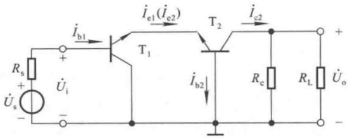

text_image

R_s
+
U_s
-
+ 
U_i
i_b1
T_1
i_e1(i_e2)
T_2
i_c2
R_c
R_L
U_o
+
-
i_b2

图 2.7.7 共集 - 共基放大电路的交流通路

根据具体需要,还可以组成其它电路,如共漏-共射放大电路,既保持高输入电阻,又具有高的电压放大倍数。可见,利用两种基本接法组合,可以同时获得两种接法的优点。

## 思考题

2.7.1 如何判断两只连接在一起的管子是否可作为复合管？举例说明，什么样的连接能够作为复合管，什么样的连接不能作为复合管。
2.7.2 电路如图 2.7.3(a)、图 2.2.5(a) 所示，已知所有晶体管的电流放大系数均为  $\beta, r_{bb'}$  均可忽略不计。试比较两个电路的电压放大倍数和输入电阻，并说明复合管在图 2.7.3(a) 所示电路中的作用。
2.7.3 画出共漏 - 共射放大电路的交流通路。

## 2.8 Multisim 应用举例

## 2.8.1 利用“直流扫描分析”测试基本共射放大电路电压传输特性

所谓电压传输特性,是指一个电路输出电压  $u_{0}$  与输入电压  $u_{1}$  之间的函数关系,即  $u_{0}=f(u_{1})$ ,通常用曲线描述。电压传输特性是稳态特性,可用逐点测试的方法获得。

## 一、仿真电路

在 Multisim 电路图区域搭建基本共射放大电路,选择元器件型号和参数值,如图 2.8.1 所示。

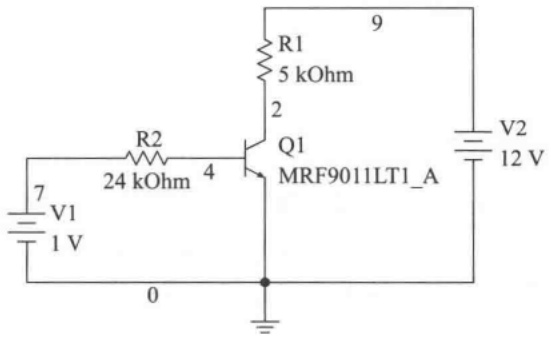

text_image

R1
5 kOhm
2
9
Q1
MRF9011LT1_A
R2
24 kOhm
4
7
V1
1 V
0
V2
12 V

图 2.8.1 基本共射放大电路

---

2.8 Multisim 应用举例

107

## 二、仿真方法与步骤

首先设置直流扫描分析(DC Sweep Analysis)参数；在Analysis Parameters栏目中选定V1为自变量输入电压，设定其起始值(Start value)、终了值(Stop value)和步长(Increment)，在Output variables栏目中选定节点2作为函数，即输出电压，也就是晶体管的管压降，如图2.8.2(a)所示；按仿真(Simulate)按钮即得到基本共射放大电路的电压传输特性，如图2.8.2(b)所示。

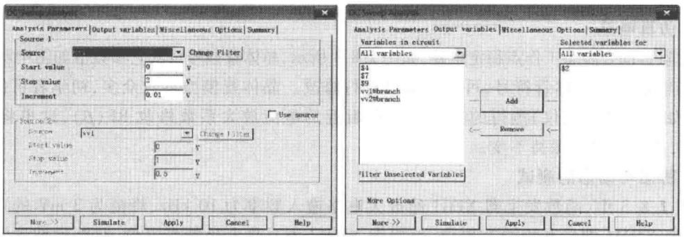

(a)

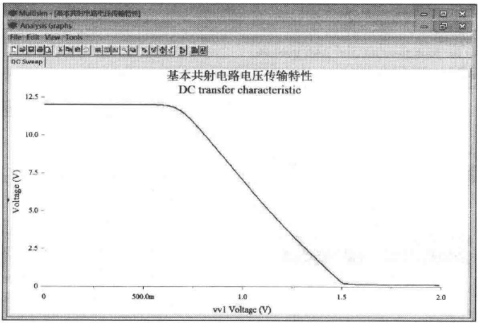

line

| vvl Voltage (V) | Voltage (V) |
| --- | --- |
| 0 | ~12.0 |
| 0.5 | ~12.0 |
| 0.7 | ~11.8 |
| 1.0 | ~6.5 |
| 1.5 | ~0.2 |
| 2.0 | ~0.1 |

(b)

图 2.8.2 基本共射放大电路电压传输特性的测试

(a) 仿真参数的设定 (b) 仿真结果

## 三、仿真结果分析

1. 在仿真电路中，应将 V1 理解为加在输入的交、直流总量。从图 2.8.2(b) 能够读出使晶体管处于放大区时 V1 的近似值，当 V1 < 0.7 V 时晶体管截止，当 V1 > 1.5 V 晶体管饱和，当 0.7 V < V1 < 1.5 V 时晶体管工作在放大区，静态工作点 Q 应设置在这个区域。当已知 Q 在曲线上的位置时，就可得出，电路不出现失真时输入交流信号的峰值。从另一角度讲，若已知输入交流信号的峰值，则可确定出使电路不失真的 Q 点的合适位置；当然，也可能 Q 点没有合适的位置，需要重新选择电路参数。

---

108

第 2 章 基本放大电路

2. 直流扫描分析用于研究一个或两个直流电源发生变化时电路中各点的变化。若扫描一个直流电源，则仿真结果得到一条曲线；若同时扫描两个直流电源，则仿真结果可得到一组曲线，因此可用它测试晶体管和场效应管的输出特性曲线。可见，它与1.6节中介绍的IV分析仪有异曲同工之妙。

## 2.8.2 放大电路静态工作点及电压放大倍数的测试

## 一、仿真电路

搭建阻容耦合静态工作点稳定电路,如图2.8.3所示,晶体管型号及其它参数值如图中所标注。

双击电路图中晶体管符号,可对其参数进行修改。晶体管模型参数众多,初学者可仅根据实际仪器(如晶体管测试仪)测得的静态工作点附近的电流放大系数修改BF( $\beta$ ),这里将 $\beta$ 由87改为200,其它参数可保持不变。

## 二、静态与动态的测试

在图 2.8.3 中, 函数发生器 XFG1 给放大电路输入频率为 10 kHz、峰值为 2 mV 的正弦波电压, 万用表 XMM1 测量基极静态电位, 万用表 XMM2 测量集电极静态电位, 双踪示波器测量输入电压和输出电压。

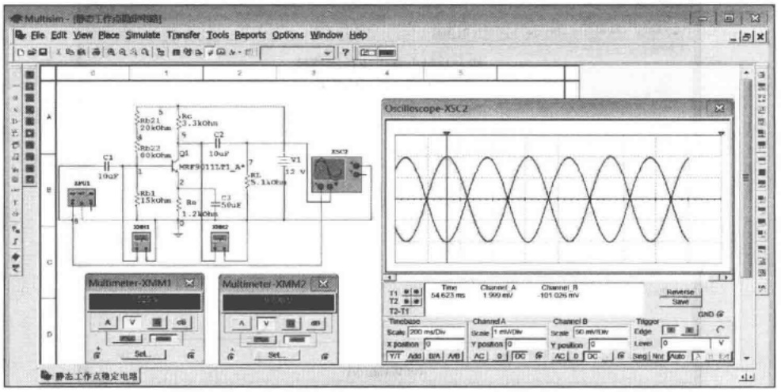

text_image

Multisim - [静态工作点跟踪网]e
File Edit View Place Simulate Transfer Tools Reports Options Window Help
Oscilloscope-XSC2
A
B
C
D
E
F
G
H
I
J
K
L
M
N
O
P
Q
R
S
T
U
V
W
X
Y
Z
A1
A2
A3
A4
A5
A6
A7
A8
A9
A10
A11
A12
A13
A14
A15
A16
A17
A18
A19
A20
A21
A22
A23
A24
A25
A26
A27
A28
A29
A30
A31
A32
A33
A34
A35
A36
A37
A38
A39
A40
A41
A42
A43
A44
A45
A46
A47
A48
A49
A50
A51
A52
A53
A54
A55
A56
A57
A58
A59
A60
A61
A62
A63
A64
A65
A66
A67
A68
A69
A70
A71
A72
A73
A74
A75
A76
A77
A78
A79
A80
A81
A82
A83
A84
A85
A86
A87
A88
A89
A90
A91
A92
A93
A94
A95
A96
A97
A98
A99
A100

图 2.8.3 静态工作点稳定共射放大电路静态和动态电压的测试

根据万用表的读数, $U_{BQ}=1.525\ V$ , $U_{CQ}=9.808\ V$ ,可以计算出静态工作点

$$
I _ {\mathrm{CQ}} = \frac {V _ {\mathrm{CC}} - U _ {\mathrm{CQ}}}{R _ {\mathrm{c}}} \tag {2.8.1}
$$

$$
I _ {\mathrm{BQ}} = \frac {I _ {\mathrm{CQ}}}{\beta} \tag {2.8.2}
$$

$$
U _ {\mathrm{CEQ}} \approx V _ {\mathrm{CC}} - I _ {\mathrm{CQ}} (R _ {\mathrm{c}} + R _ {\mathrm{e}}) \tag {2.8.3}
$$

得  $I_{CQ} \approx 0.66 \, mA, I_{BQ} \approx 3.3 \, \mu A, U_{CEQ} \approx 9.03 \, V$ 。

根据示波器读数可得输入电压正半周峰值约为2 mV时，输出电压负半周峰值约为100 mV，因此电压放大倍数  $\dot{A}_{u}=U_{omax}/U_{imax}\approx-50$ 。

---

2.8 Multisim 应用举例

109

从示波器读数中可以看到,输入电压正半周峰值约为2 mV时,输出电压负半周峰值约为98 mV,可见电路稍有非线性失真,这是因为晶体管的非线性特性造成的。通常,失真度为5%以下时肉眼是很难观察出来的,需要用专门设备(失真度仪)来测试。

## 三、总结

1. 在 Multisim 环境下可以像在实验室里一样搭建电路并用虚拟仪器进行各种测量, 这些仪器的调节方法和在实验室利用真实仪器时的操作过程完全相同, 故而可在软件环境下学习各种仪器的使用方法和电路的测试方法。
2. 为了测试的准确性, 测试仪器与被测电路应“共地”, 如图 2.8.3 所示。因此静态测电位, 再通过计算求得电压和电流。
3. 由于晶体管的非线性特性,单管放大电路的输出电压总会或多或少有些失真,而饱和失真和截止失真是比较极端的情况。通过输出电压正、负半周峰值是否相同,可初步判断电路失真的情况,再根据需求决定是否采取措施。

## 2.8.3 利用“参数扫描分析”研究电阻变化对静态工作点的影响

对于放大电路,若已知静态工作点 Q,则可根据集电极电流  $I_{CQ}$  (或发射极电流  $I_{EQ}$ ) 得出 b-e 间动态电阻  $r_{be}$ , 进而得到输入电阻、电压放大倍数等性能指标。因此, 研究电阻变化对 Q 点的影响, 便可得到其对动态性能的影响。以下是对图 2.8.3 所示的静态工作点稳定共射放大电路进行研究。

## 一、研究偏置电阻变化对静态工作点的影响

在参数扫描分析(Parameter Sweep Analysis)中利用如前所述直流扫描分析的仿真方法与步骤,首先设置 $R_{b22}$ 的起始值、终了值和点数,分别为3 000 Ω、12 000 Ω、6;点数即 $R_{b22}$ 从起始值到终了值取值的个数,它决定扫描时每次变化的步长,得1 800 Ω;Analysis to 选“DC operating point”;如图2.8.4(a)所示。然后进行扫描,得到发射极(S2)电位 $U_{E}$ 和集电极(S9)电位 $U_{C}$ 的变化,分别如图(b)所示。

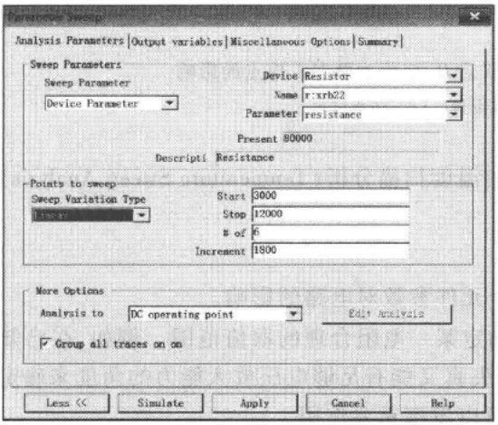

text_image

Parameters Sweep
Analysis Parameters | Output variables | Miscellaneous Options | Summary |
Sweep Parameters
Sweep Parameter Device Resistor
Device Parameter Name r:xrb22
Parameter resistance
Present 80000
Descripti Resistance
Points to sweep
Sweep Variation Type Start 3000
Linear Stop 12000
# of 6
Increment 1800
More Options
Analysis to DC operating point Edit Analysis
✓ Group all traces on on
Less << Simulate Apply Cancel Help

(a)

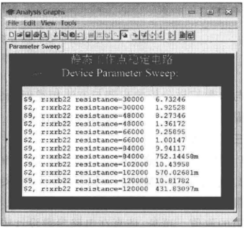

text_image

Parameter Sweep
静态工作点稳定电路
Device Parameter Sweep:
$9, r:xrb22 resistance=30000 6.73246
$2, r:xrb22 resistance=30000 1.92528
$9, r:xrb22 resistance=48000 8.27346
$2, r:xrb22 resistance=48000 1.36172
$9, r:xrb22 resistance=66000 9.25895
$2, r:xrb22 resistance=66000 1.00147
$9, r:xrb22 resistance=94000 9.94117
$2, r:xrb22 resistance=94000 752.14450m
$9, r:xrb22 resistance=102000 10.43958
$2, r:xrb22 resistance=102000 570.02681m
$9, r:xrb22 resistance=120000 10.81782
$2, r:xrb22 resistance=120000 431.83097m

(b)

图 2.8.4 利用参数扫描分析研究  $R_{b22}$  变化对静态工作点的影响  
(a)  $R_{b22}$  的仿真参数设置 (b) 仿真结果

---

110

第 2 章 基本放大电路

由图可知，随 $R_{\mathrm{b22}}$ 增大，$U_{\mathrm{B}}$ 降低，$U_{\mathrm{C}}$ 升高，说明集电极电流 $I_{\mathrm{CQ}}$ 随之减小；可以推论，电压放大倍数的数值将逐渐减小，而输入电阻将逐渐增大。同时，若已设定 $I_{\mathrm{CQ}}$ 的值，根据式(2.8.3)可得 $U_{\mathrm{C}}$ 的值，则从扫描结果中就可确定 $R_{\mathrm{b22}}$ 的值，从而完成 $R_{\mathrm{b22}}$ 的选取。

## 二、研究集电极电阻变化对静态工作点的影响

设置 $R_{\mathrm{c}}$ 的起始值、终了值和点数，分别为 $3300\Omega ,20000\Omega ,6$ （即步长为 $3340\Omega$），如图2.8.5(a)所示。然后进行扫描，得到发射极(S2)电位 $U_{\mathrm{E}}$ 和集电极(S9)电位 $U_{\mathrm{C}}$ 的变化，分别如图(b)所示。

由图(b)可知，在 $R_{c}$ 的变化过程中， $U_{E}$ 变化很小，说明 $R_{c}$ 变化对 $I_{EQ}$ （即 $I_{CQ}$ ）的影响很小；但 $U_{C}$ 随之降低，使管压降随之减小，当 $R_{c}$ 增至16.66 kΩ时 $U_{C}$ 与 $U_{E}$ 接近，说明管子进入饱和区，电路不能正常放大。可见，虽然 $R_{c}$ 的增大可使电压放大能力增强，但应以电路不产生失真为度。

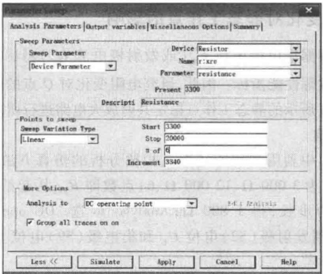

text_image

Analysis Parameters | Output variables | Miscellaneous Options | Summary |
Sweep Parameters
Sweep Parameter Device Resistor
Device Parameter Name r:xre
Parameter resistance
Present 3300
Descripti Resistance
Points to sweep
Sweep Variation Type Start 3300
Linear Stop 20000
# of 6
Increment 3340
More Options
Analysis to DC operating point
✓ Group all traces on on
Less << Simulate Apply Cancel Help

(a)

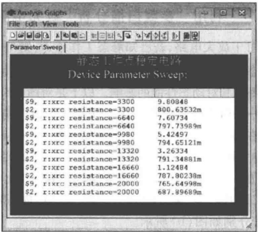

text_image

Parameter Sweep
静态工作点稳定电路
Device Parameter Sweep:
$9, r:xrc resistance=3300 9.80848
$2, r:xrc resistance=3300 800.63532m
$9, r:xrc resistance=6640 7.60734
$2, r:xrc resistance=6640 797.73989m
$9, r:xrc resistance=9980 5.42497
$2, r:xrc resistance=9980 794.65121m
$9, r:xrc resistance=13320 3.26334
$2, r:xrc resistance=13320 791.34881m
$9, r:xrc resistance=16660 1.12484
$2, r:xrc resistance=16660 787.80238m
$9, r:xrc resistance=20000 765.64998m
$2, r:xrc resistance=20000 687.89689m

(b)

图 2.8.5 利用参数扫描分析研究  $R_{c}$  变化对静态工作点的影响

(a) $R_{\mathrm{c}}$ 的仿真参数设置 (b) 仿真结果

与参数扫描分析的步骤与方法相类似,利用温度扫描分析(Temperature Sweep Analysis)可以研究温度变化对静态工作点的影响,不赘述。

## 三、总结

1. 利用参数扫描分析可以研究电路中各个元件参数对电路的影响。
2. 通过参数扫描分析可以从不同需求来确定某一电阻合理的取值范围。例如，在已知输入电压最大幅值的情况下，结合动态测试，从既不失真又能有足够电压放大能力的角度来确定集电极电阻的取值。可见，仿真在电路参数设计中可以发挥重要作用。
3. 扫描分析(包括 DC、参数、温度等)的仿真方法与步骤有共性, 即首先选定研究对象, 对自变量设定起始值、终了值、步长(点数), 其后确定函数, 仿真, 便得到它们的关系, 进而分析仿真结果。

---

2.8 Multisim 应用举例

111

## 2.8.4  $U_{GSQ}$  对共源放大电路电压放大倍数的影响

仿真电路为共源放大电路，MOS场效应管型号及其它参数如图2.8.6中所标注。

## 一、仿真内容

1. 通过直流扫描分析方法（DC Sweep）测量2N7000的转移特性，测量电路及结果如图2.8.6所示。在图左边所示电路中，设定直流电源V1为被扫描电压，节点2为输出，由于源极电阻为 $1\Omega$ ，因而其电压可表示源极（即漏极）电流；图右边所示为几组测试数据；中间是测试所得转移特性曲线。测量结果表明，2N7000的开启电压 $U_{\mathrm{GS(th)}} = 2\mathrm{V}, I_{\mathrm{DO}} \approx 200\mathrm{mA}$ 。

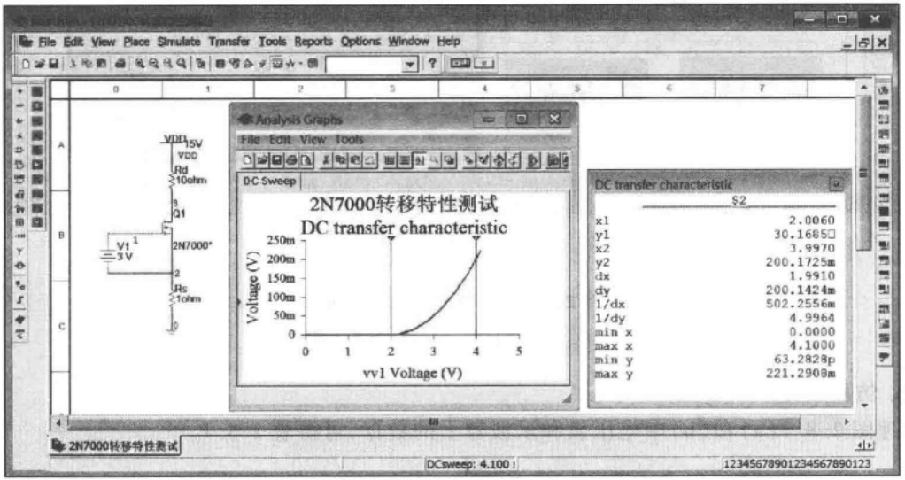

line

| vv1 Voltage (V) | Voltage (V) |
| --- | --- |
| 0 | 0 |
| 1 | ~5 |
| 2 | ~15 |
| 3 | ~45 |
| 4 | ~110 |

图 2.8.6 场效应管转移特性的测试

2. 图 2.8.7(a)、(b) 所示为  $R_{g2}$  分别等于 6 MΩ 和 6.1 MΩ 情况下  $U_{GSQ}$ 、 $U_{DSQ}$  和  $U_{o}$  的测试结果。左边的电压表指示的是  $U_{GSQ}$ ，右边的电压表指示的是  $U_{DSQ}$ ，从示波器中读出  $U_{o}$  的峰值。

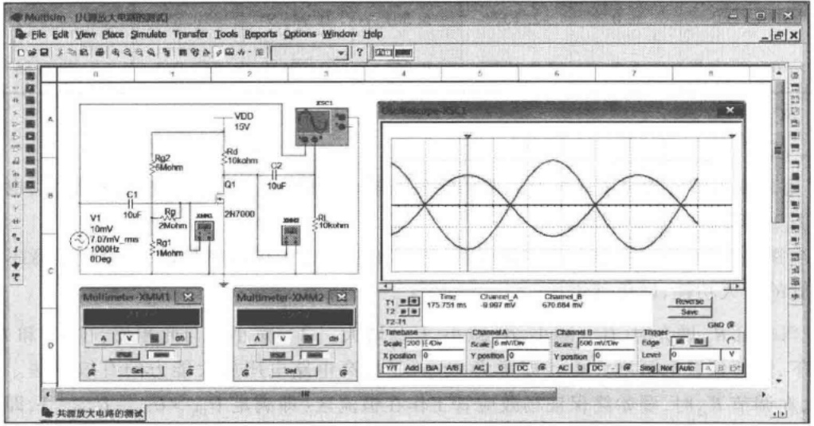

text_image

Multsim - 计算放大电路的测试
File Edit View Place Simulate Transfer Tools Reports Options Window Help
A
B
C
D
0 1 2 3 4 5 6 7 8
VDD
15V
Rd
10kohm
C1
10uF
Rp2
Mohm
Q1
10uF
Rg1
1Mohm
XMM2
2N7000
Rf
10kohm
Multimeter-XXM1
Multimeter-XXM2
Time Channel_A Channel_B
T1 175.751 ms -9.997 mV 670.884 mV Reverse Save GND @
T2:31
Timebase Channel_A Channel_B Trigger Edge Edge
Scale [200]/-Div Scale 0 mV/Div Scale 500 mV/Div X position 0 Y position 0 Y position 0 Level 0 V
Y/Y Add B/A A/B AC 0 DC AC 0 DC - # Sing Hor Auto

(a)

---

112

第 2 章 基本放大电路

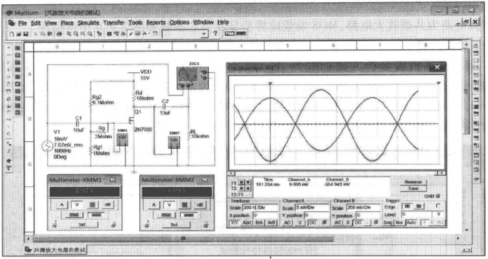

text_image

Multism - [共源放大电路的测试]
File Edit View Place Simulate Transfer Tools Reports Options Window Help
0 1 2 3 4 5 6 7 8
A
B
C
D
Multimeter-XMM1
2.157%
A V dB
Set
Multimeter-XMM2
9.211%
A V dB
Set
VDD
15V
Rg2
6.1Mohm
Rg
2Mohm
Rg1
1Mohm
Q1
2N7000
Rd
10kohm
C2
10uF
xsec2
RL
10kohm
Channel A Channel B Trigger Edge Level Noise Auto
Time: 161.254 ms 9.995 mV -564.943 mV Reverse Save
Timebase Channel A Channel B Trigger GND @ Scale 200 f/div Scale 5 mW/div Scale 200 mW/div X position 0 Y position 0 Y position 0 AC 0 DC AC 0 DC ... Sag Now Auto

(b)

图 2.8.7 共源放大电路的测试

(a)  $R_{g2}$  为 6 MΩ 时 (b)  $R_{g2}$  为 6.1 MΩ 时

## 二、仿真结果

整理图 2.8.7(a) 和 (b) 中电压表和示波器上的数据, 可得表 2.8.1。

表 2.8.1

| 输入电压峰值$U_{ipp}/mV$ | $R_{g2}$/MΩ | $U_{GSQ}$/V | $U_{DSQ}$/V | 漏极电流$I_{DQ}/mA$ | 输出电压$U_o/mV$ | 电压放大倍数$\dot{A}_u$ |
| --- | --- | --- | --- | --- | --- | --- |
| 10 | 6.0 | 2.137 | 5.561 | 0.9439 | 670.884 | -67 |
| 10 | 6.1 | 2.107 | 9.251 | 0.5749 | 554.943 | -55 |

## 三、总结

1. 用直流扫描分析可测试场效应管的转移特性，从中可读出 $U_{\mathrm{GS(th)}}$ 和 $I_{\mathrm{DO}}$ 的数值，也可读出在不同 $U_{\mathrm{GS}}$ 所确定的 $I_{\mathrm{D}}$ 的数值。

应当指出，由于  $u_{GS}$  变化时  $i_{D}$  变化较快，因而用常用电子仪器测量时，应特别注意不能超过场效应管的最大功耗，以免其烧坏。

2. 当电阻 $R_{\mathrm{g2}}$ 增大时，$U_{\mathrm{GSQ}}$ 减小，$I_{\mathrm{DQ}}$ 减小，$U_{\mathrm{DSQ}}$ 增大，$|\dot{A}_u|$ 减小。与此相反，在 $R_{\mathrm{d}}$ 和 $R_{\mathrm{L}}$ 不变的情况下，调整偏置电阻增大 $I_{\mathrm{DQ}}$ （即增大 $U_{\mathrm{GSQ}}$）是提高电路电压放大能力的有效方法。需要注意的是，在调节 $R_{\mathrm{g2}}$ 时，要始终保证场效应管工作在恒流区（即满足 $U_{\mathrm{DS}} > U_{\mathrm{GS}} - U_{\mathrm{GS(th)}}$），即保证电路不失真。

---

本章小结

113

3. 由 $U_{\mathrm{GS(th)}} = 2 \mathrm{~V}$、$I_{\mathrm{DO}} = 200.172 \mathrm{~mA}$ 和公式 $g_{\mathrm{m}} = \frac{2}{U_{\mathrm{GS(th)}}} \sqrt{I_{\mathrm{DO}} \cdot I_{\mathrm{DQ}}}$，分别计算出 $R_{\mathrm{g2}}$ 等于 $6.0 \mathrm{M}\Omega$ 和 $6.1 \mathrm{M}\Omega$ 时的 $g_{\mathrm{m}}$ 分别为 $13.7 \mathrm{~mS}$ 和 $10.7 \mathrm{~mS}$，因此电压放大倍数为

$$
\begin{array}{l} \dot {A} _ {u} = - g _ {\mathrm{m}} (R _ {\mathrm{d}} / / R _ {\mathrm{L}}) \approx - 1 3. 7 \times 5 \approx - 6 8 \\ \dot {A} _ {u} = - g _ {\mathrm{m}} (R _ {\mathrm{d}} / / R _ {\mathrm{L}}) \approx - 1 0. 7 \times 5 \approx - 5 4 \\ \end{array}
$$

与仿真结果近似。说明公式的近似程度很好，也说明仿真对电路的实际调试具有指导意义。

## 本章小结

本章既是学习的重点又是学习的难点；一是因为它是后面各章学习的基础，二是因为对于初学者来讲它包含了太多的基本概念、电路、方法，而且它们几乎贯穿于全书。主要内容如下:

## 一、放大的概念

在电子电路中,放大的对象是变化量,常用的测试信号是正弦波。放大的本质是在输入信号的作用下,通过有源元件(晶体管或场效应管)对直流电源的能量进行控制和转换,使负载从电源中获得的输出信号能量比信号源向放大电路提供的能量大得多,因此放大的特征是功率放大,表现为输出电压大于输入电压,或者输出电流大于输入电流,或者二者兼而有之。放大的前提是不失真,换言之,如果电路输出波形产生失真便谈不上放大。

## 二、放大电路的组成原则

1. 放大电路的核心元件是有源元件, 即晶体管或场效应管。
2. 供电电源电压的数值、极性及其它电路参数应使晶体管工作在放大区、场效应管工作在恒流区，即建立起合适的静态工作点，保证即使输入信号幅值最大电路也不产生失真。
3. 输入信号应能够有效地作用于有源元件的输入回路，即晶体管的 b-e 回路和场效应管的 g-s 回路；输出信号应能够作用于负载之上。

## 三、放大电路的主要性能指标

1. 放大倍数 A: 输出变化量幅值与输入变化量幅值之比, 或二者的正弦交流量之比, 用以衡量电路的放大能力。
2. 输入电阻  $R_{i}$ : 从输入端看进去的等效电阻, 反映放大电路从信号源索取电流的大小。
3. 输出电阻  $R_{0}$  : 从输出端看进去的等效输出信号源的内阻, 说明放大电路的带负载能力。
4. 最大不失输出电压  $U_{om}$  : 未产生截止失真和饱和失真时, 最大输出电压信号的正弦有效值或峰-峰值。
5. 下限、上限截止频率 $f_{\mathrm{L}}$ 和 $f_{\mathrm{H}}$ 、通频带 $f_{\mathrm{bw}}$ :均为频率响应参数，反映电路对信号频率的适应能力，见第4章。
6. 最大输出功率  $P_{om}$  和效率  $\eta$ : 衡量在输出波形基本不失真情况下负载能够从电路获得的最大功率, 以及电源为此应提供的功率, 见第 8 章。

## 四、放大电路的分析方法

1. 静态分析就是求解静态工作点 Q，在输入信号为零时，晶体管和场效应管各电极间的电流与电压就是 Q 点。可用估算法或图解法求解。
2. 动态分析就是求解各动态参数和分析输出波形。通常，利用 h 参数等效电路计算小信号作用时的  $\dot{A}_{u}$ 、 $R_{i}$  和  $R_{o}$ ，利用图解法分析  $U_{om}$  和失真情况。

放大电路的分析应遵循“先静态、后动态”的原则，只有静态工作点合适，动态分析才有意义；Q点不但影响电路输出是否失真，而且与动态参数密切相关，稳定Q点非常必要。

---

114

第 2 章 基本放大电路

## 五、晶体管和场效应管的基本放大电路

1. 晶体管基本放大电路有共射、共集、共基三种接法。共射放大电路既能放大电流又能放大电压，输入电阻居三种电路之中，输出电阻较大，适用于一般放大。共集放大电路只放大电流不放大电压，具有电压跟随作用；因输入电阻高而常作为多级放大电路的输入级，因输出电阻低而常作为多级放大电路的输出级，并可作为中间级起隔离作用。共基电路只放大电压不放大电流，具有电流跟随作用，输入电阻小；高频特性好，适用于宽频带放大电路。
2. 场效应管放大电路有共源、共漏、共栅接法，与晶体管放大电路的共射、共集、共基接法相对应，因共源、共漏电路比晶体管电路输入电阻高、噪声系数低、抗辐射能力强，适用于做电压放大电路的输入级。

## 六、基本放大电路的派生电路

在基本放大电路不能满足性能要求时,可将放大管采用复合管结构或两种接法组合的方式构成放大电路,前者可提高等效管的电流放大能力,后者可集中两种接法的优点于一个电路。

学完本章希望能够达到以下要求:

一、掌握基本概念和定义:放大，静态工作点，饱和失真与截止失真，直流通路与交流通路，直流负载线与交流负载线，h参数等效模型，放大倍数，输入电阻和输出电阻，最大不失真输出电压，静态工作点的稳定。
二、“会看”，即会根据结构判断电路的基本接法，从而掌握组成放大电路的原则和各种基本放大电路的工作原理及特点。
三、“会算”，即掌握放大电路的分析方法，能够正确估算基本放大电路的静态工作点和动态参数  $\dot{A}_{u}$ 、 $R_{i}$  和  $R_{o}$ ，正确分析电路的输出波形和产生截止失真、饱和失真的原因。
四、“会选”，即能够根据需求选择电路的类型，根据对静态工作点和动态性能的要求选择放大管的种类和部分电路参数。
五、了解稳定静态工作点的必要性及稳定方法。

## 自测题

## 一、在括号内用“✓”或“×”表明下列说法是否正确

(1) 只放大电压不放大电流或只放大电流不放大电压的电路, 不能称其为放大电路; ()
(2) 可以说任何放大电路都有功率放大作用；()
(3) 放大电路中输出的电流和电压都是由有源元件提供的；()
(4) 电路中各电量的交流成分是交流信号源提供的；()
(5) 放大电路必须加上合适的直流电源才能正常工作；()
(6) 由于放大的对象是变化量, 所以当输入信号为直流信号时, 任何放大电路的输出都毫无变化; ()
(7) 只要是共射放大电路, 输出电压的底部失真都是饱和失真。( )

二、试分析图 T2.2 所示各电路是否能够放大正弦交流信号, 简述理由。设图中所有电容对交流信号均可视为短路。
三、在图 T2.3 所示电路中，已知  $V_{CC} = 12 \, V$ ，晶体管的  $\beta = 100, R_{b}^{\prime} = 100 \, k\Omega$ 。填空:要求先填文字表达式后填得数。

（1）当  $\dot{U}_{i}=0\ V$  时，测得  $U_{BEQ}=0.7\ V$ ，若要基极电流  $I_{BQ}=20\ \mu A$ ，则  $R_{b}^{\prime}$  和  $R_{w}$  之和  $R_{b}=$ \_\_\_\_ ≈ \_\_\_\_ kΩ；而若测得  $U_{CEQ}=6\ V$ ，则  $R_{c}=$ \_\_\_\_ ≈ \_\_\_\_ kΩ。
（2）若测得输入电压有效值  $U_{i}=5\ mV$  时，输出电压有效值  $U_{o}=0.6\ V$ ，则电压放大倍数  $\dot{A}_{u}=$  \_\_\_\_≈ \_\_\_\_；若负载电阻  $R_{L}$  值与  $R_{c}$  相等，则带上负载后输出电压有效值  $U_{o}=$  \_\_\_\_= \_\_\_\_ V。

四、已知图 T2.3 所示电路中  $V_{CC} = 12 \, V, R_{e} = 3 \, k\Omega$ ，静态管压降  $U_{CEQ} = 6 \, V$ ；并在输出端加负载电阻  $R_{L}$ ，其阻值为  $3 \, k\Omega$ 。选择一个合适的答案填入空内。

---

自测题

115

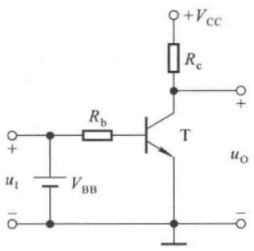

text_image

+VCC
Rc
+
T
uO
Rb
u1
VBB
-

(a)

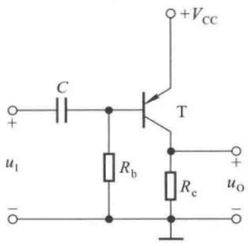

text_image

+VCC
C
T
+
u1
-
Rb
Rc
+
uO
-

(b)

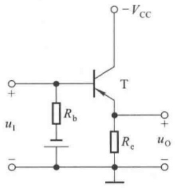

text_image

VCC
+
T
Rb
u1
-
Re
uo
-

(c)

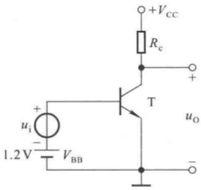

text_image

+VCC
Rc
+
ui
-
1.2 V
VBB
T
uo
-

(d)

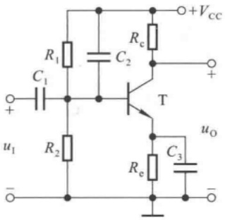

text_image

R1
C1
+
u1
-
R2
C2
T
Rc
+Vcc
+
uo
Re
C3
-

(e)

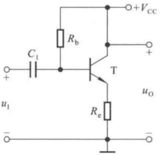

text_image

C₁
R_b
T
u₁
+
-
+Vcc
u_O
R_e

(f)

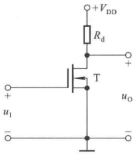

text_image

+VDD
Rd
T
uI
+
-
uo
-

(g)

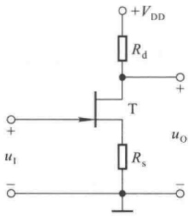

text_image

+VDD
Rd
T
+
uI
-
Rs
uo
-

(h)

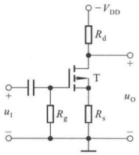

text_image

-VDD
Rd
+
T
uO
+
ui
-
Rg
Rs
-

(i)

图 T2.2

(1) 该电路的最大不失真输出电压有效值  $U_{om} \approx$ \_\_\_\_ ;

A. 2 V

B. 3 V

C. 6 V

（2）当  $U_{i}=1\ mV$  时，若在不失真的条件下，减小  $R_{w}$ ，则输出电压的幅值将 \_\_\_\_；

A. 减小

B. 不变

C. 增大

（3）在  $U_{i}=1\ mV$  时，将  $R_{w}$  调到输出电压最大且刚好不失真，若此时增大输入电压，则输出电压波形将 \_\_\_\_；

A. 顶部失真

B. 底部失真

C. 为正弦波

(4) 若发现电路出现饱和失真, 则为消除失真可将 \_\_\_\_。

A.  $R_{u}$  减小

B.  $R_{c}$  减小

C.  $V_{cc}$  减小

五、现有直接耦合基本放大电路如下:

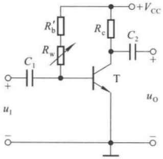

text_image

R'b
Rw
C1
+
ui
-
T
Rc
C2
+
Vcc
uo
-

图 T2.3

---

116

第 2 章 基本放大电路

A. 共射电路

B. 共集电路

C. 共基电路

D. 共源电路

E. 共漏电路

它们的电路分别如图2.2.1、2.5.1(a)、2.5.4(a)、2.7.2和2.7.9(a)所示；设图中 $R_{e}<R_{b}$ ，且 $I_{CQ}$ 、 $J_{DQ}$ 均相等。选择正确答案填入空内，只需填A、B……

(1) 输入电阻最小的电路是\_\_\_\_，最大的是\_\_\_\_；
(2) 输出电阻最小的电路是 \_\_\_\_;
(3) 有电压放大作用的电路是\_\_\_\_；
(4) 有电流放大作用的电路是\_\_\_\_；
(5) 高频特性最好的电路是 \_\_\_\_;
（6）输入电压与输出电压同相的电路是\_\_\_\_；反相的电路是\_\_\_\_。

六、未画完的场效应管放大电路如图 T2.6 所示, 试将合适的场效应管接入电路, 使之能够正常放大。要求给出两种方案。

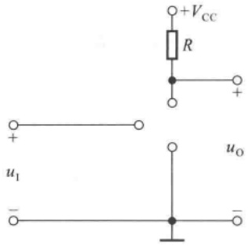

text_image

+VCC
R
+
+
u1
-
uo
-

图 T2.6

## 习题

2.1 分别改正图 P2.1 所示各电路中的错误,使它们有可能放大正弦波信号。要求保留电路原来的共射接法。

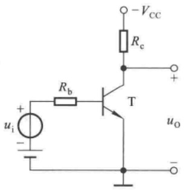

text_image

ui
+
-
Rb
T
- VCC
Rc
+
uo
-

(a)

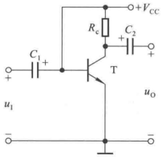

text_image

C1
+
-
u1
T
Rc
C2
+
-
+VCC
uo
-

(b)

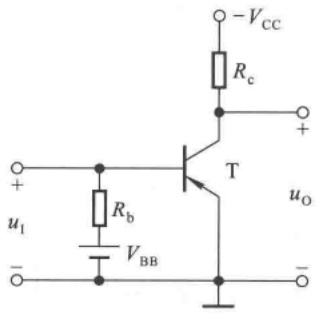

text_image

u_I
-
R_b
V_BB
T
R_c
-V_CC
+
u_O
-

(c)

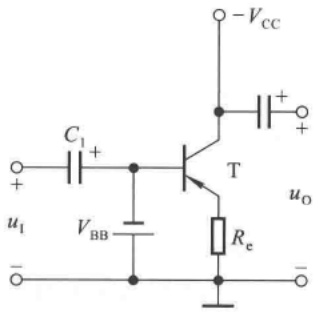

text_image

C₁ +
+ -
u₁
V_BB
T
R_e
-V_CC
+ -
u_O
-

(d)

图 P2.1

---

习题

117

2.2 画出图 P2.2 所示各电路的直流通路和交流通路。设图中所有电容对交流信号均可视为短路。

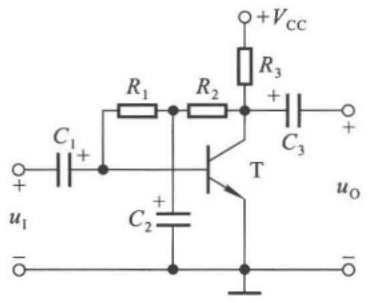

text_image

+VCC
R1 R2 R3
C1 C3
+ +
u1 T uO
C2 +

(a)

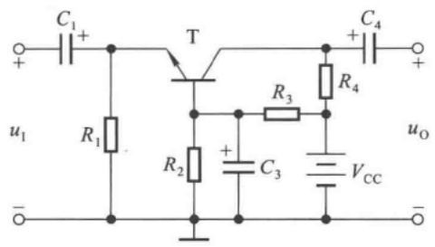

text_image

C₁
+
T
R₁
u₁
R₂
+
C₃
R₃
R₄
C₄
+
uₒ
Vₒₒ

(b)

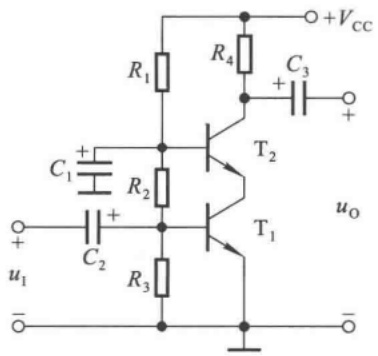

text_image

R1
C1 +
R2
C2 +
R3
R4
C3 +
T2
T1
uo
+VCC
u1
-

(c)

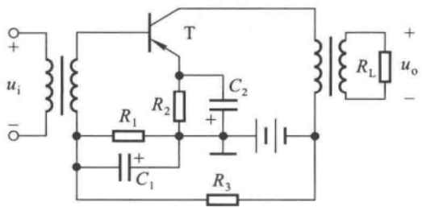

text_image

+
ui
-
T
R1
C1
R2
C2
+
R3
RL
uo
-

(d)

图 P2.2

2.3 分别判断图 P2.2(a)、(b) 所示两电路各是共射、共集、共基放大电路中的哪一种，并写出  $Q_{1}$ 、 $A_{u}$ 、 $R_{i}$  和  $R_{o}$  的表达式。
2.4 电路如图 P2.4(a) 所示, 图(b) 是晶体管的输出特性, 静态时  $U_{BEQ} = 0.7 \, V$ 。利用图解法分别求出  $R_{L} = \infty$  和  $R_{L} = 3 \, k\Omega$  时的静态工作点和最大不失真输出电压  $U_{om}$  (有效值)。

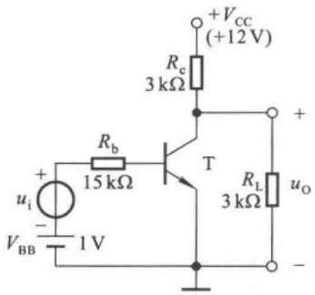

text_image

+VCC
(+12 V)
Rc
3 kΩ
+
ui
-
15 kΩ
T
RB
RL
3 kΩ
uo
- VBB
1 V

(a)

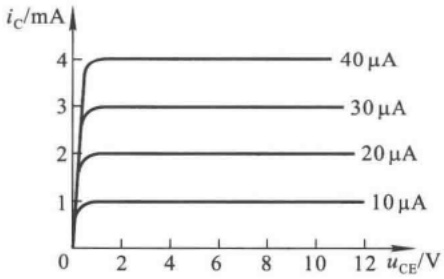

line

| \(uce/V\) | \(ic/mA::10 \mu A\) | \(ic/mA::20 \mu A\) | \(ic/mA::30 \mu A\) | \(ic/mA::40 \mu A\) |
| --- | --- | --- | --- | --- |
| 0 | 0 | 0 | 0 | 0 |
| ~0.5 | ~1 | ~2 | ~2.8 | ~3.8 |
| 2 | 1 | 2 | 3 | 4 |
| 4 | 1 | 2 | 3 | 4 |
| 6 | 1 | 2 | 3 | 4 |
| 8 | 1 | 2 | 3 | 4 |
| 10 | 1 | 2 | 3 | 4 |
| 12 | 1 | 2 | 3 | 4 |

(b)

图 P2.4

2.5 在图 P2.5 所示电路中，已知晶体管的  $\beta = 80, r_{be} = 1 \, k\Omega, U_{i} = 20 \, mV$ ; 静态时  $U_{BEQ} = 0.7 \, V, U_{CEQ} = 4 \, V, I_{BQ} = 20 \, \muA$ 。判断下列结论是否正确，凡对的在括号内打“√”，否则打“×”。

---

118

第 2 章 基本放大电路

(1)  $\dot{A}_{u} = -\frac{4}{20 \times 10^{-3}} = -200$  ( )

(2)  $\dot{A}_{u} = -\frac{4}{0.7} \approx -5.71$  ( )

(3)  $\dot{A}_{u} = -\frac{80 \times 5}{1} = -400$  ( )

(4)  $\dot{A}_{n} = -\frac{80 \times 2.5}{1} = -200$  ( )

(5)  $R_{i}=\frac{20}{20}k\Omega=1k\Omega$  ( )

(6)  $R_{i}=\frac{0.7}{0.02}k\Omega=35k\Omega$  ( )

(7)  $R_{i} \approx 3 \, k\Omega$  ( )

(8)  $R_{i} \approx 1 \, k\Omega$  ( )

(9)  $R_{\omega}=5\ k\Omega$  ( )

(10)  $R_{e}=2.5\ k\Omega$  ( )

(11)  $U_{s} \approx 20 \, mV$  ( )

(12)  $U_{s} \approx 60 \, mV$  ( )

2.6 电路如图 P2.6 所示, 已知晶体管  $\beta = 120, U_{BE} = 0.7 V$ , 饱和管压降  $U_{CES} = 0.5 V$ 。在下列情况下, 用直流电压表测晶体管的集电极电位, 应分别为多少?

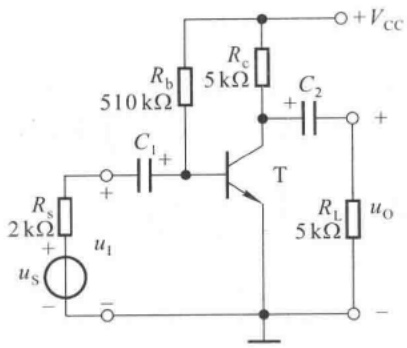

text_image

Rb
510 kΩ
Rc
5 kΩ
C2
+
+
Rs
2 kΩ
+
us
-
ui
T
RL
5 kΩ
uo
+Vcc
-

图 P2.5

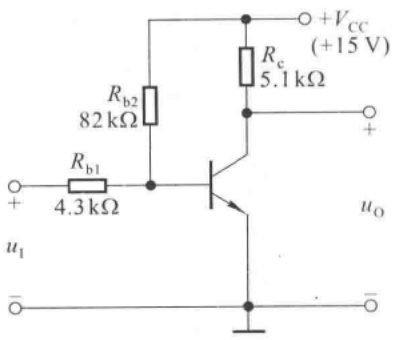

text_image

Rb2
82 kΩ
Rb1
4.3 kΩ
+VCC
(+15 V)
Rc
5.1 kΩ
+
uO
u1
-

图 P2.6

(1) 正常情况；(2)  $R_{b1}$  短路；(3)  $R_{b1}$  开路；
(4) $R_{b2}$ 开路； (5) $R_{b2}$ 短路； (6) $R_{c}$ 短路。

2.7 电路如图 P2.7 所示，晶体管的  $\beta = 80, r_{bb'} = 100 \Omega$ 。分别计算  $R_{L} = \infty$  和  $R_{L} = 3 k\Omega$  时的 Q 点、 $A_{a}, R_{i}$  和  $R_{o}$ 。

2.8 若将图 P2.7 所示电路中的 NPN 型管换成 PNP 型管, 其它参数不变, 则为使电路正常放大, 电源应作如何变化? Q 点、 $\dot{A}_{u}$ 、 $R_{i}$  和  $R_{o}$  变化吗? 如变, 如何变化? 若输出电压波形底部失真, 说明电路产生了什么失真, 如何消除。

2.9 已知电路如图 P2.9 所示。晶体管的  $\beta = 100, r_{be} = 1 k\Omega$ 。

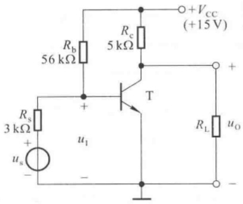

text_image

Rb
56 kΩ
+Vcc
(+15V)
Rc
5 kΩ
+
Rs
3 kΩ
us
u1
T
RL
uo
-

图 P2.7

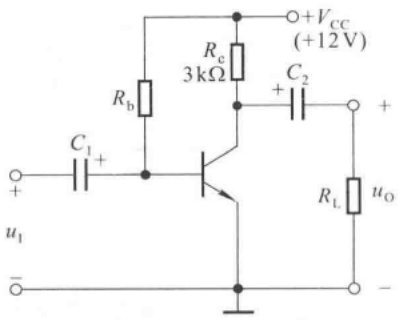

text_image

Rb
C1 +
+VCC (+12V)
Re
3kΩ
C2 +
+
u1
-
RL uO
-

图 P2.9

---

习题

119

（1）现已测得静态管压降  $U_{CEQ}=6V$ ，估算  $R_{b}$  约为多少千欧；
（2）已知负载电阻  $R_{L}=5\ k\Omega$ 。若保持  $R_{b}$  不变，则为了使输入电压有效值  $U_{i}=1\ mV$  时输出电压有效值  $U_{o}>220\ mV$ ，则  $R_{c}$  至少应选取多少千欧？

2.10 在图 P2.9 所示电路中，设静态时  $I_{CQ} = 2 \, mA$ ，晶体管饱和管压降  $U_{CES} = 0.6 \, V$ 。试问:当  $R_{L} = 3 \, k\Omega$  时电路的最大不失真输出电压为多少伏？若要使输出不失真输出电压最大，则在其它电路参数不变的情况下  $R_{b}$  应选取多少千欧？

2.11 电路如图 P2.11 所示, 晶体管的  $\beta = 100$ ,  $r_{bb'} = 100 \Omega$ 。

(1) 求电路的 Q 点、 $\dot{A}_{u}$ 、 $R_{i}$  和  $R_{o}$ ;
(2) 若改用  $\beta=200$  的晶体管, 则 Q 点如何变化?
（3）若电容  $C_{e}$  开路，则将引起电路的哪些动态参数发生变化？如何变化？

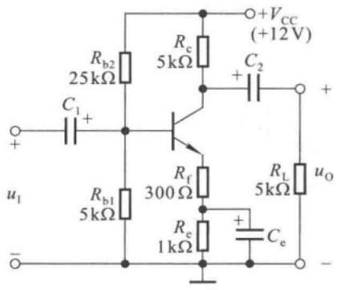

text_image

Rb2
25kΩ
C1
+
ui
-
Rb1
5kΩ
Rc
5kΩ
+VCC
(+12V)
C2
+
Rf
300Ω
Re
1kΩ
RL
5kΩ
uo
+
Ce
-

图 P2.11

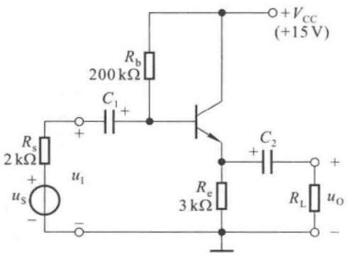

text_image

+VCC
(+15V)
Rb
200 kΩ
C1
+
Rs
2 kΩ
us
+
-
u1
+
-
Re
3 kΩ
C2
+
RL
uo
-

图 P2.12

2.12 电路如图 P2.12 所示, 晶体管的  $\beta = 80, r_{be} = 1 \, k\Omega$ 。

(1) 求出 Q 点；
(2) 分别求出  $R_{L} = \infty$  和  $R_{L} = 3 k\Omega$  时电路的  $\dot{A}_{u}, R_{i}$  和  $R_{o}$

2.13 电路如图 P2.13 所示, 晶体管的  $\beta = 60$ ,  $r_{bb'} = 100 \Omega$ 。

(1) 求解 Q 点、 $\dot{A}_{u}$ 、 $R_{i}$  和  $R_{o}$ ;
(2) 设  $U_{s}=10\ mV$  (有效值)，问  $U_{i}=?U_{o}=?$  若  $C_{3}$  开路，则  $U_{i}=?U_{o}=?$

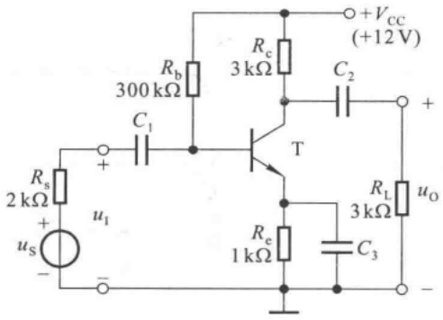

text_image

Rs
2 kΩ
+
us
-
+
ui
-
Rb
300 kΩ
C1
T
Rc
3 kΩ
C2
+Vcc
(+12V)
RL
3 kΩ
uo
Re
1 kΩ
C3
-

图 P2.13

---

120

第 2 章 基本放大电路

2.14 改正图 P2.14 所示各电路中的错误,使它们有可能放大正弦波电压。要求保留电路的共源接法。

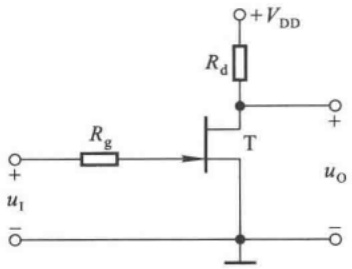

text_image

Rg
+VDD
Rd
T
+
uI
-
uo
-

(a)

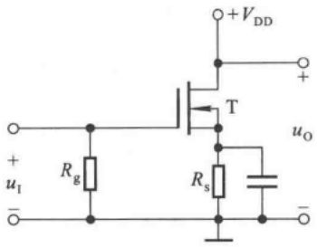

text_image

+VDD
+
T
uo
Rg
Rs
uI
-

(b)

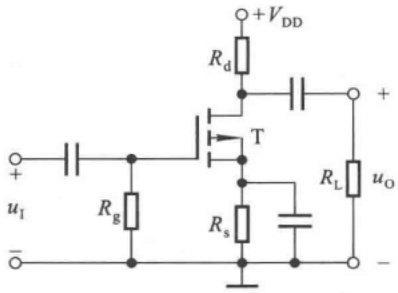

text_image

+VDD
Rd
+
T
uI
-
Rg
Rs
RL
uo
-

(c)

图 P2.14

2.15 已知图 P2.15(a) 所示电路中场效应管的转移特性和输出特性分别如图(b)、(c) 所示。

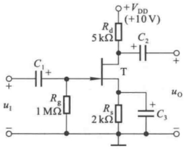

text_image

+VDD
(+10 V)
Rd
5 kΩ
C2
+
T
C1
+
ui
-
Rg
1 MΩ
Rs
2 kΩ
+
C3
uo
-

(a)

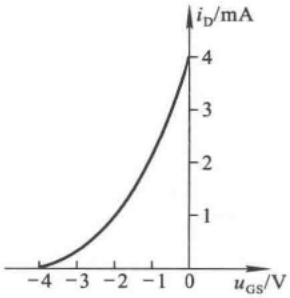

line

| uGS (V) | iD (mA) |
| --- | --- |
| -4 | 0 |
| -3 | ~0.2 |
| -2 | ~0.8 |
| -1 | ~2.0 |
| 0 | 4 |

(b)

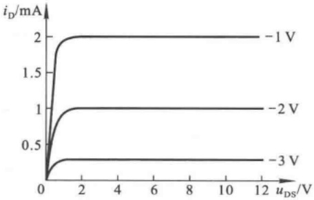

line

| uDS (V) | iD (mA)::-1 V | iD (mA)::-2 V | iD (mA)::-3 V |
| --- | --- | --- | --- |
| 0 | 0 | 0 | 0 |
| 2 | 2 | 1 | ~0.3 |
| 4 | 2 | 1 | ~0.3 |
| 6 | 2 | 1 | ~0.3 |
| 8 | 2 | 1 | ~0.3 |
| 10 | 2 | 1 | ~0.3 |
| 12 | 2 | 1 | ~0.3 |

(c)

图 P2.15

---

习题

121

(1) 利用图解法求解 Q 点；
(2) 利用等效电路法求解  $\dot{A}_{u}, R_{i}$  和  $R_{o}$ 。

2.16 已知图 P2.16(a) 所示电路中场效应管的转移特性如图(b)所示。求解电路的 Q 点和  $\dot{A}_{u}$ 。

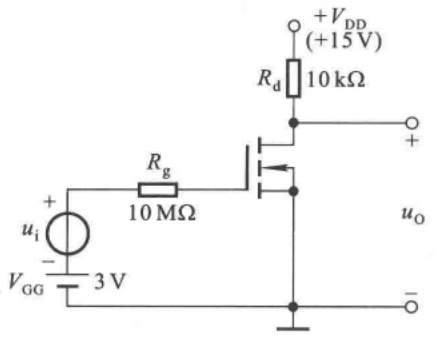

text_image

+VDD
(+15V)
Rd 10 kΩ
Rg
10 MΩ
ui
-
VGG 3 V
uo
-

(a)

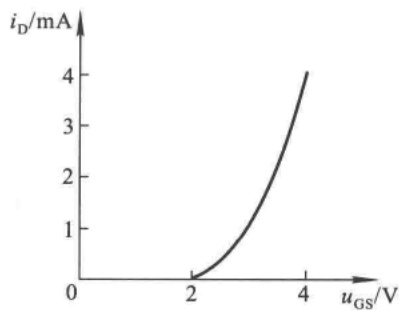

line

| uGS (V) | iD (mA) |
| --- | --- |
| 2 | 0 |
| ~3 | ~1.5 |
| 4 | 4 |

(b)

图 P2.16

2.17 电路如图 P2.17 所示。

(1) 若输出电压波形底部失真, 则可采取哪些措施? 若输出电压波形顶部失真, 则可采取哪些措施?
(2) 若想增大  $\left|\dot{A}_{u}\right|$ ，则可采取哪些措施？

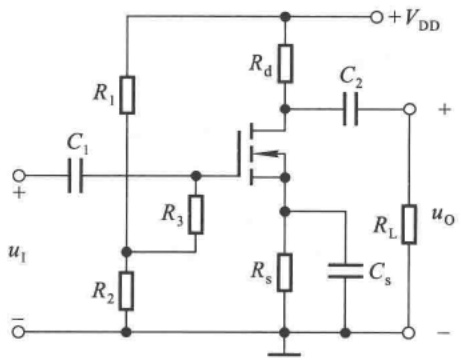

text_image

R1
C1
+
ui
-
R3
R2
Rd
C2
+
uo
Rs
Rs
Cs
+VDD
-

图 P2.17

2.18 图 P2.18 中的哪些接法可以构成复合管？标出它们等效管的类型（如 NPN 型、PNP 型、N 沟道结型……）及管脚（b、e、c、d、g、s）。

2.19 利用 Multisim 分析图 P2.5 所示电路中  $R_{b}$ 、 $R_{c}$  和晶体管参数变化对 Q 点、 $\dot{A}_{u}$ 、 $R_{i}$ 、 $R_{o}$  和  $U_{om}$  的影响。

出题目的:

(1) 学习在 Multisim 环境下搭建电路的方法；
(2) 学习静态工作点与动态参数的测试方法和分析方法；
（3）进一步理解放大电路的组成原则、各元件的作用及其对动态参数的影响。

提示:

（1）为便于设置和修改电路参数，以及研究参数对性能的影响，全部元件均可采用虚拟元件。
(2) 在研究某一电路参数变化对电路的影响时, 应假设其它参数均保持不变。

---

122

第 2 章 基本放大电路

natural_image

Pure electrical circuit lines without any symbols

(a)

natural_image

Pure electrical circuit lines without any symbols

(b)

natural_image

Pure electrical circuit lines without any symbols

(c)

natural_image

Pure electrical circuit lines without any symbols

(d)

natural_image

Pure electrical circuit lines without any symbols

(e)

natural_image

Pure electrical circuit lines without any symbols

(f)

natural_image

Pure electrical circuit lines without any symbols

(g)

图 P2.18

（3）测量 $Q$ 点时，应令 $u_{\mathrm{S}} = 0$ 。测量 $\dot{A}_{u}, R_{i}, R_{o}$ 时，$u_{\mathrm{S}}$ 应为中频小信号电压，即耦合电容容抗可忽略不计，结电容电流可忽略不计。测量 $U_{\mathrm{om}}$ 时，$u_{\mathrm{S}}$ 应为中频大信号电压。

实际上，在单管放大电路中，若输入电压幅值较大，则即使晶体管未饱和或截止，由于晶体管特性的非线性，输出电压波形也会产生失真，造成 $U_{om}$ 的值难以确定。因而，可采用将测量值与估算值相比较的方法来确定 $U_{om}$ ；也可设定若输出电压波形正半周峰值与负半周峰值相差10%，则认为产生失真，来确定 $U_{om}$ 。在用常用电子仪器测量时，可用失真度仪来判断输出电压是否失真。

2.20 电路如图 P2.17 所示。利用 Multisim 研究下列问题:

(1) 确定一组电路参数, 使电路的 Q 点合适。
（2）若输出电压波形底部失真，则可采取哪些措施？若输出电压波形顶部失真，则可采取哪些措施？调整Q点约在交流负载线的中点。

(3) 要想提高电路的电压放大能力, 可采用哪些措施?

提示:为便于设置和修改电路参数,全部元件均可采用虚拟元件。
