# 第3章 集成运算放大电路

原始 PDF 第 146–208 页。

## 第3章

## 集成运算放大电路

## 本章讨论的问题

- 为什么需要多级放大电路？如何将多个单级放大电路连接成多级放大电路？各种连接方式有什么特点？
- 多级放大电路的动态参数与组成它的各个单级放大电路有什么关系？
- 直接耦合放大电路的特殊问题是什么？如何解决？
- 如何根据要求组成多级放大电路？
- 集成运放有什么特点？它由哪几部分组成？各部分的作用是什么？各级放大电路的特点是什么？如何设置它们的静态工作点？
- 集成运放的电压传输特性有什么特点？为什么？
- 如何评价集成运放的性能？有哪些主要指标？
- 集成运放有哪些类型？如何选择？使用时应注意哪些问题？

## 3.1 多级放大电路的一般问题

在实际应用中,常对放大电路的性能提出多方面的要求。例如,要求一个放大电路输入电阻大于2 MΩ,电压放大倍数大于2 000,输出电阻小于100 Ω等。仅靠前面所讲的任何一种放大电路都不可能同时满足上述要求,这时就可选择多个基本放大电路,将它们合理连接构成多级放大电路。

## 3.1.1 多级放大电路的耦合方式

组成多级放大电路的每一个基本放大电路称为一级,级与级之间的连接称为级间耦合。多级放大电路有四种常见的耦合方式:直接耦合、阻容耦合、变压器耦合和光电耦合。

## 一、直接耦合放大电路

将前一级的输出端直接连接到后一级的输入端，称为直接耦合，如图3.1.1(a)所示。图中所示电路省去了第二级的基极电阻，而使 $R_{c1}$ 既作为第一级的集电极电阻，又作为第二级的基极电阻，只要 $R_{c1}$ 取值合适，就可以为 $T_{2}$ 管提供合适的基极电流。

## 1. 直接耦合放大电路静态工作点的设置

从图3.1.1(a)所示电路中可知，静态时，$\mathrm{T}_{1}$ 管的管压降 $U_{\mathrm{CEQ1}}$ 等于 $\mathrm{T}_{2}$ 管的b-e间电压 $U_{\mathrm{BEQ2}}$ 。通常情况下，若 $\mathrm{T}_{1}$ 管为硅管，$U_{\mathrm{BEQ2}}$ 约为 $0.7\mathrm{V}$，则 $\mathrm{T}_{1}$ 管的静态工作点靠近饱和区，在动态信号作用时容易引起饱和失真。因此，为使第一级有合适的静态工作点，就要抬高 $\mathrm{T}_{2}$ 管的基极电位。为此，可以在 $\mathrm{T}_{2}$ 管的发射极加电阻 $R_{e2}$，如图3.1.1(b)所示。

---

124

第 3 章 集成运算放大电路

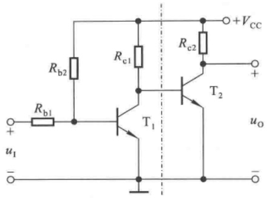

text_image

Rb2
Rc1
Rc2
+VCC
+
T2
T1
uO
uI
-
-

(a)

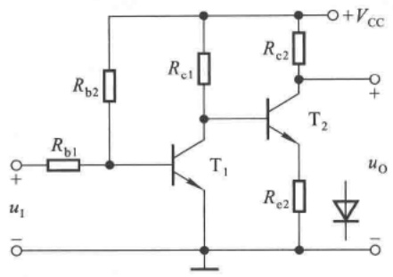

text_image

Rb2
Rc1
Rc2
+VCC
+
T2
T1
Rb1
u1
-
Re2
uo
-

(b)

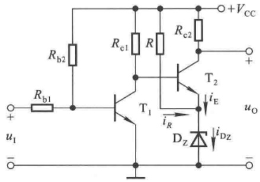

text_image

Rb2
Rc1 R Rc2
+VCC
+
T1
T2
iE
uO
iR
Dz iDz
u1
-
-

(c)

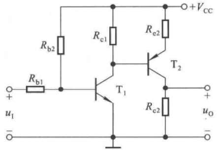

text_image

Rb2
Rc1
Re2
+VCC
Rb1
T1
T2
Rc2
uI
+
-
uo
-

(d)

图 3.1.1 直接耦合放大电路静态工作点的设置

(a) 前级的输出直接接到后级的输入 (b) 为增大 $U_{\mathrm{CE1}}$ 而加 $R_{e}$ 或二极管

(c) 后级发射极电阻用稳压管替代 (d) NPN 和 PNP 管混合使用

然而，增加 $R_{e2}$ 后，虽然在参数取值得当时，两级均可有合适的静态工作点，但是， $R_{e2}$ 会使第二级的电压放大倍数大大下降，从而影响整个电路的放大能力。因此，需要选择一种器件取代 $R_{e2}$，它应对直流量和交流量呈现出不同的特性；对直流量，它相当于一个电压源；而对交流量，它等效成一个小电阻；这样，既可以设置合适的静态工作点，又对放大电路的放大能力影响不大。二极管和稳压管都具有上述特性。

通过第1章对二极管正向特性的分析可知，当二极管流过直流电流时，在伏安特性上可以确定它的端电压 $U_{\mathrm{D}}$ ；而在这个直流信号上叠加一个交流信号时，二极管的动态电阻为 $du_{D}/di_{D}$ ，对于小功率管，其值仅为几至几十欧。若要求 $T_{1}$ 管的管压降 $U_{CEQ}$ 的数值小于2 V，则可用一只或两只二极管取代 $R_{e2}$ ，如图(b)所示。但如果要求 $U_{CEQ}$ 为几伏，则需要多个二极管串联。这样，一方面多个二极管串联后的动态电阻变大，使放大能力变差；另一方面元件数量的增多，必然使焊点增多，故障率增大，可靠性变差。

通过第1章对稳压管反向特性的分析可知，当稳压管工作在击穿状态时，在一定的电流范围内，其端电压基本不变，并且动态电阻也仅为十几至几十欧，所以可用稳压管取代 $R_{e2}$ ，如图(c)所示。为了保证稳压管工作在稳压状态，图(c)中电阻R的电流 $I_{R}$ 流经稳压管，使得稳压管中的电流大于稳定电流（多为5 mA或10 mA）。根据 $T_{1}$ 管管压降 $U_{CEQ}$ 所需的数值，选取稳压管的稳定电压 $U_{Z}$ 。

在图 3.1.1(a)、(b)、(c) 所示电路中，为使各级晶体管都工作在放大区，必然要求  $T_{2}$  管的集

---

3.1 多级放大电路的一般问题

125

电极电位高于其基极电位。可以设想，如果级数增多，且仍为NPN型管构成的共射电路，则由于集电极电位逐级升高，以至于接近电源电压，势必使后级的静态工作点不合适。因此，直接耦合多级放大电路常采用NPN型和PNP型管混合使用的方法解决上述问题，如图(d)所示。在图(d)所示电路中，虽然 $T_{1}$ 管的集电极电位高于其基极电位，但是为使 $T_{2}$ 管工作在放大区， $T_{2}$ 管的集电极电位应低于其基极电位（即 $T_{1}$ 管的集电极电位）。

## 2. 直接耦合方式的优缺点

从以上分析可知,采用直接耦合方式使各级之间的直流通路相连,因静态工作点相互影响,这样就给电路的分析、设计和调试带来一定的困难。在求解静态工作点时,应写出直流通路中各个回路的方程,然后求解多元一次方程组。实际应用时,则应采用各种计算机软件辅助分析。

直接耦合放大电路的突出优点是具有良好的低频特性,可以放大变化缓慢的信号;并且由于电路中没有大容量电容,所以易于将全部电路集成在一片硅片上,构成集成放大电路。由于电子工业的飞速发展,集成放大电路的性能越来越好,种类越来越多,价格也越来越便宜,所以凡能用集成放大电路的场合,均不再使用分立元件放大电路。

直接耦合放大电路最大的问题是存在零点漂移现象,即输入信号为零时,输出电压产生变化的现象,关于这种现象产生的原因以及为克服该现象而采用的差分放大电路,将在本章3.3节中讲述。

## 二、阻容耦合放大电路

将放大电路的前级输出端通过电容接到后级输入端,称为阻容耦合方式,图3.1.2所示为两级阻容耦合放大电路,第一级为共射放大电路,第二级为共集放大电路。

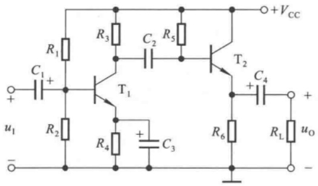

text_image

R1
C1 +
+ VCC
R3
C2
R5
T1
T2
C4
+
u1
R2
R4 +
C3
R6
RL uO
-

图 3.1.2 两级阻容耦合放大电路

由于电容对直流量的电抗为无穷大，因而阻容耦合放大电路各级之间的直流通路各不相通，各级的静态工作点相互独立，在求解或实际调试 $Q$ 点时可按单级处理，所以电路的分析、设计和调试简单易行。而且，只要输入信号频率较高，耦合电容容量较大，前级的输出信号就可以几乎没有衰减地传递到后级的输入端，因此，在分立元件电路中阻容耦合方式得到了非常广泛的应用。

阻容耦合放大电路的低频特性差,不能放大变化缓慢的信号。这是因为电容对这类信号呈现出很大的容抗,信号的一部分甚至全部都衰减在耦合电容上,而根本不向后级传递。此外,在集成电路中制造大容量电容很困难,甚至不可能,所以这种耦合方式不便于集成化。

应当指出,通常只有在信号频率很高、输出功率很大等特殊情况下,才采用阻容耦合方式的分立元件放大电路。

---

126

第 3 章 集成运算放大电路

## 三、变压器耦合放大电路

将放大电路前级的输出信号通过变压器接到后级的输入端或负载电阻上，称为变压器耦合。图3.1.3(a)所示为变压器耦合共射放大电路， $R_{L}$ 既可以是实际的负载电阻，也可以代表后级放大电路，图(b)是它的交流等效电路。

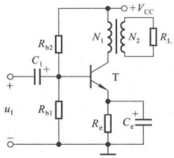

text_image

Rb2
C1 +
+
ui
-
T
N1
N2
+VCC
RL
Rb1
Re
Ce +
-

(a)

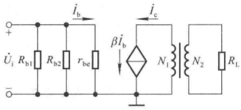

text_image

+
Üᵢ Rb1 Rb2 rbe
-
i̇b
βi̇b
i̇c
N1 N2 RL

(b)

图 3.1.3 变压器耦合共射放大电路

(a) 电路 (b) 交流等效电路

由于变压器耦合放大电路的前、后级靠磁路耦合，所以与阻容耦合放大电路一样，它的各级放大电路的静态工作点相互独立，便于分析、设计和调试。而它的低频特性差，不能放大变化缓慢的信号，且笨重，更不能集成化。与前两种耦合方式相比，其最大特点是可以实现阻抗变换，因而在分立元件功率放大电路中得到了广泛应用。

在实际系统中，负载电阻的数值往往很小。例如扩音系统中的扬声器，其阻值一般为 $3\Omega$ 、$4\Omega,8\Omega$ 和 $16\Omega$ 等几种。把它们接到直接耦合或阻容耦合的任何一种放大电路的输出端，都将使其电压放大倍数的数值变得很小，从而使负载上无法获得大功率。采用变压器耦合时，若忽略变压器自身的损耗，则一次侧损耗的功率等于二次侧负载电阻所获得的功率，即 $P_{1} = P_{2}$ 。设一次电流为 $I_{1}(I_{\mathrm{c}})$，二次电流为 $I_{2}$，将负载折合到一次侧的等效电阻为 $R_{\mathrm{L}}^{\prime}$，如图3.1.4所示，则 $I_{1}^{2}R_{\mathrm{L}}^{\prime} = I_{2}^{2}R_{\mathrm{L}}$ ，即

$$
R _ {\mathrm{L}} ^ {\prime} = \left(\frac {I _ {2}}{I _ {1}}\right) ^ {2} R _ {\mathrm{L}}
$$

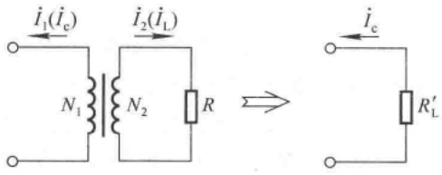

text_image

i₁(i_c)
N₁
i₂(i_L)
N₂
R
i_c
R'_L

图 3.1.4 变压器耦合的阻抗变换

因为变压器二次电流与一次电流之比等于一次线圈匝数 $N_{1}$ 与二次线圈匝数 $N_{2}$ 之比，所以

$$
R _ {\mathrm{L}} ^ {\prime} = \left(\frac {N _ {1}}{N _ {2}}\right) ^ {2} R _ {\mathrm{L}} \tag {3.1.1}
$$

对于图 3.1.3 所示电路, 可得电压放大倍数

---

3.1 多级放大电路的一般问题

127

$$
\dot {A} _ {u} = - \frac {\beta R _ {\mathrm{L}} ^ {\prime}}{r _ {\mathrm{be}}} \quad \left[ R _ {\mathrm{L}} ^ {\prime} = \left(\frac {N _ {1}}{N _ {2}}\right) ^ {2} R _ {\mathrm{L}} \right] \tag {3.1.2}
$$

根据所需的电压放大倍数,可以选择合适的匝数比,使负载电阻上获得足够大的电压。并且当匹配得当时,负载可以获得足够大的功率。在集成功率放大电路产生之前,几乎所有的功率放大电路都采用变压器耦合的形式。而目前,只有在集成功率放大电路无法满足需要的情况下,如需输出特大功率,或实现高频功率放大时,才考虑用分立元件构成变压器耦合放大电路。

## 四、光电耦合

光电耦合是以光信号为媒介来实现电信号的耦合和传递的,因其抗干扰能力强而得到越来越广泛的应用。

## 1. 光电耦合器

光电耦合器是实现光电耦合的基本器件,它将发光元件(发光二极管)与光敏元件(光电三极管)相互绝缘地组合在一起,如图3.1.5(a)所示。发光元件为输入回路,它将电能转换成光能;光敏元件为输出回路,它将光能再转换成电能,实现了两部分电路的电气隔离,从而可有效地抑制电干扰。在输出回路常采用复合管(也称为达林顿结构)形式以增大放大倍数。

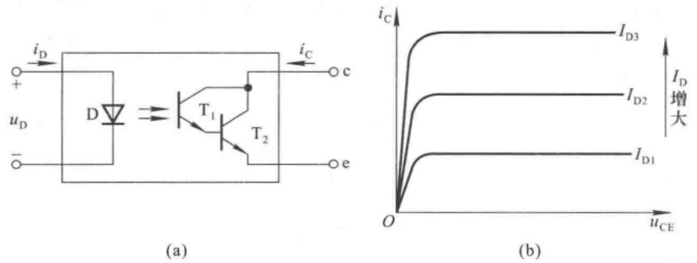

图 3.1.5 光电耦合器及其传输特性

光电耦合器的传输特性如图3.1.5(b)所示,它描述当发光二极管的电流为一个常量 $I_{D}$ 时,集电极电流 $i_{C}$ 与管压降 $u_{CE}$ 之间的函数关系,即

$$
i _ {\mathrm{C}} = f (u _ {\mathrm{CE}}) \mid_ {I _ {\mathrm{D}}} \tag {3.1.3}
$$

因此，与晶体管的输出特性一样，也是一族曲线。当管压降 $u_{\mathrm{CE}}$ 足够大时，$i_{\mathrm{C}}$ 几乎仅决定于 $i_{\mathrm{D}}$ 。与晶体管的 $\beta$ 相类似，在 $c - e$ 之间电压一定的情况下，$i_{\mathrm{C}}$ 的变化量与 $i_{\mathrm{D}}$ 的变化量之比称为传输比 $CTR$ 。

$$
C T R = \frac {\Delta i _ {\mathrm{C}}}{\Delta i _ {\mathrm{D}}} \big | _ {U _ {\mathrm{CE}}} \tag {3.1.4}
$$

不过 CTR 的数值比  $\beta$  小得多, 只有 0.1 \~ 1.5。

## 2. 光电耦合放大电路

图 3.1.6 所示为光电耦合放大电路，信号源部分可以是真实的信号源，也可以是前级放大电路。当动态信号为 0 时，输入回路有静态电流  $I_{DQ}$ ，输出回路有静态电流  $I_{CQ}$ ，从而确定出静态管压降  $U_{CEQ}$ 。有动态信号时，随着  $i_{D}$  的变化， $i_{C}$  将产生线性变化。当然， $u_{CE}$  也将产生相应的变化。

---

128

第 3 章 集成运算放大电路

由于传输比的数值较小,所以一般情况下,输出电压还需进一步放大。实际上,目前已有集成光电耦合放大电路,具有较强的放大能力。

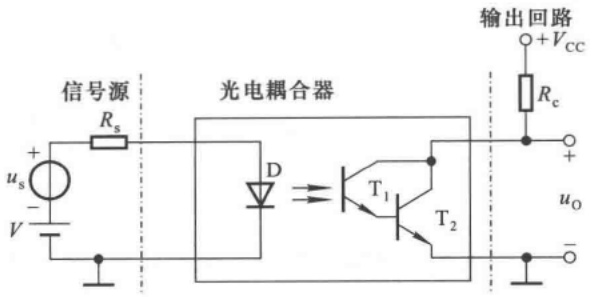

text_image

信号源
Rs
us
+
-
V
光电耦合器
D
T1
T2
输出回路
+VCC
Rc
+
uo
-

图 3.1.6 光电耦合放大电路

在图 3.1.6 所示电路中, 若信号源部分与输出回路部分采用独立电源且分别接不同的“地”, 则即使是远距离信号传输, 也可以避免受到各种电干扰。

## 3.1.2 多级放大电路的动态分析

一个 N 级放大电路的交流等效电路可用图 3.1.7 所示方框图表示。由图可知，放大电路中前级的输出电压就是后级的输入电压，即  $\dot{U}_{o1} = \dot{U}_{i2}$ 、 $\dot{U}_{o2} = \dot{U}_{i3}$ 、 $\cdots$ 、 $\dot{U}_{o(N-1)} = \dot{U}_{iN}$ ，所以，多级放大电路的电压放大倍数为

$$
\dot {A} _ {u} = \frac {\dot {U} _ {\mathrm{o1}}}{\dot {U} _ {\mathrm{i}}} \cdot \frac {\dot {U} _ {\mathrm{o2}}}{\dot {U} _ {\mathrm{i2}}} \cdot \dots \cdot \frac {\dot {U} _ {\mathrm{o}}}{\dot {U} _ {\mathrm{iN}}} = \dot {A} _ {u 1} \cdot \dot {A} _ {u 2} \cdot \dots \cdot \dot {A} _ {u N}
$$

即

$$
\dot {A} _ {u} = \prod_ {j = 1} ^ {N} \dot {A} _ {u j} \tag {3.1.5}
$$

式(3.1.5)表明,多级放大电路的电压放大倍数等于组成它的各级放大电路的电压放大倍数之积。对于第一级到第(N-1)级,每一级的放大倍数均应该是以后级输入电阻作为负载时的放大倍数。

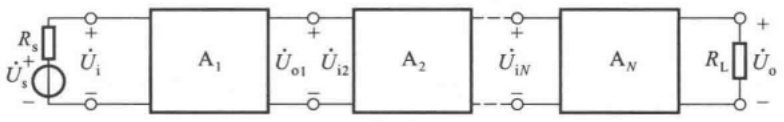

text_image

R_s
+ 
U_s +
U_i
A_1
+ 
U_o1 U_i2
A_2
+ 
U_iN
A_N
R_L
+ 
U_o
-

图 3.1.7 多级放大电路方框图

根据放大电路的输入电阻的定义,多级放大电路的输入电阻就是第一级的输入电阻,即

$$
R _ {\mathrm{i}} = R _ {\mathrm{il}} \tag {3.1.6}
$$

根据放大电路的输出电阻的定义,多级放大电路的输出电阻就是最后一级的输出电阻,即

$$
R _ {\mathrm{o}} = R _ {\mathrm{oN}} \tag {3.1.7}
$$

应当注意,当共集放大电路作为输入级(即第一级)时,它的输入电阻与其负载,即与第二级的输入电阻有关;而当共集放大电路作为输出级(即最后一级)时,它的输出电阻与其信号源内阻,即与倒数第二级的输出电阻有关。

---

3.1 多级放大电路的一般问题

129

当多级放大电路的输出波形产生失真时,应首先确定是在哪一级先出现的失真,然后再判断是产生了饱和失真还是截止失真,进而采用合适的方法消除这种失真。

【例 3.1.1】已知图 3.1.2 所示电路中， $R_{1}=15\ k\Omega, R_{2}=R_{3}=5\ k\Omega, R_{4}=2.3\ k\Omega, R_{5}=100\ k\Omega, R_{6}=R_{L}=5\ k\Omega; V_{CC}=12\ V$ ; 晶体管的  $\beta$  均为 150,  $r_{be1}=4\ k\Omega, r_{be2}=2.2\ k\Omega, U_{BEQ1}=U_{BEQ2}=0.7\ V$ 。

试估算电路的 Q 点、 $\dot{A}_{u}$ 、 $R_{i}$  和  $R_{o}$ 。

解:(1)求解 Q 点:由于电路采用阻容耦合方式,所以每一级的 Q 点都可以按单管放大电路来求解。

第一级为典型的 Q 点稳定电路,根据参数取值可以认为

$$
U _ {\mathrm{BQ1}} \approx \frac {R _ {1}}{R _ {1} + R _ {2}} \cdot V _ {\mathrm{CC}} = \frac {5}{1 5 + 5} \times 1 2 \mathrm{V} = 3 \mathrm{V}
$$

$$
I _ {\mathrm{EQ1}} = \frac {U _ {\mathrm{BQ1}} - U _ {\mathrm{BEQ1}}}{R _ {4}} \approx \frac {3 - 0 . 7}{2 . 3} \mathrm{mA} = 1 \mathrm{mA}
$$

$$
I _ {\mathrm{BQ1}} = \frac {I _ {\mathrm{EQ1}}}{1 + \beta_ {1}} \approx \frac {1}{1 5 0} \mathrm{mA} \approx 0. 0 0 6 7 \mathrm{mA} = 6. 7 \mu \mathrm{A}
$$

$$
U _ {\mathrm{CEQ1}} \approx V _ {\mathrm{CC}} - I _ {\mathrm{EQ1}} (R _ {3} + R _ {4}) = [ 1 2 - 1 \times (5 + 2. 3) ] \mathrm{V} = 4. 7 \mathrm{V}
$$

第二级为共集放大电路，根据其基极回路方程求出 $I_{BQ2}$ ，便可得到 $I_{EQ2}$ 和 $U_{CEQ2}$ 。即

$$
I _ {\mathrm{BQ2}} = \frac {V _ {\mathrm{CC}} - U _ {\mathrm{BEQ2}}}{R _ {5} + (1 + \beta_ {2}) R _ {6}} = \frac {1 2 - 0 . 7}{1 0 0 + 1 5 1 \times 5} \mathrm{mA} \approx 0. 0 1 3 \mathrm{mA} = 1 3 \mu \mathrm{A}
$$

$$
I _ {\mathrm{EQ2}} = (1 + \beta_ {2}) I _ {\mathrm{BQ2}} \approx (1 + 1 5 0) \times 1 3 \mu \mathrm{A} = 1 9 6 3 \mu \mathrm{A} \approx 2 \mathrm{mA}
$$

$$
U _ {\mathrm{CEQ2}} \approx V _ {\mathrm{CC}} - I _ {\mathrm{EQ2}} R _ {6} \approx (1 2 - 2 \times 5) \mathrm{V} = 2 \mathrm{V}
$$

(2) 求解  $\dot{A}_{u}$ 、 $R_{i}$  和  $R_{o}$ :画出图 3.1.2 所示电路的交流等效电路如图 3.1.8 所示。

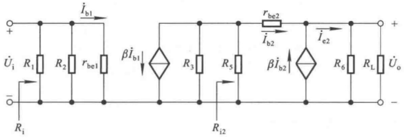

text_image

+
Üᵢ R₁ R₂ r_be1
-
Rᵢ
βİb1
R₃ R₅
R₆ R_L Üₒ
-
r_be2
İb2
βİb2
İe2
+

图 3.1.8 图 3.1.2 所示电路的交流等效电路

为了求出第一级的电压放大倍数  $\dot{A}_{u1}$ ，首先应求出其负载电阻，即第二级的输入电阻:

$$
R _ {\mathrm{i2}} = R _ {5} / / \{r _ {\mathrm{be2}} + [ (1 + \beta_ {2}) (R _ {6} / / R _ {\mathrm{L}}) ] \} \approx 7 9 \mathrm{k} \Omega
$$

$$
\dot {A} _ {u 1} = - \frac {\beta_ {1} (R _ {3} / / R _ {i 2})}{r _ {\mathrm{be1}}} \approx - \frac {1 5 0 \times \frac {5 \times 7 9}{5 + 7 9}}{4} \approx - 1 7 6
$$

第二级的电压放大倍数应接近1,根据电路可得

$$
\dot {A} _ {\mathrm{u2}} = \frac {(1 + \beta_ {2}) (R _ {6} / / R _ {\mathrm{L}})}{r _ {\mathrm{be2}} + (1 + \beta_ {2}) (R _ {6} / / R _ {\mathrm{L}})} = \frac {1 5 1 \times 2 . 5}{2 . 2 + 1 5 1 \times 2 . 5} \approx 0. 9 9 4
$$

---

130

第 3 章 集成运算放大电路

将  $\dot{A}_{u1}$  与  $\dot{A}_{u2}$  相乘,便可得出整个电路的电压放大倍数为

$$
\dot {A} _ {u} = \dot {A} _ {u 1} \cdot \dot {A} _ {u 2} \approx - 1 7 6 \times 0. 9 9 4 \approx - 1 7 5
$$

根据输入电阻的物理意义, 可知

$$
R _ {\mathrm{i}} = R _ {1} / / R _ {2} / / r _ {\mathrm{bel}} = \left(\frac {1}{1 / 1 5 + 1 / 5 + 1 / 4}\right) \mathrm{k} \Omega \approx 1. 9 4 \mathrm{k} \Omega
$$

电路的输出电阻  $R_{0}$  与第一级的输出电阻  $R_{3}$  有关，

$$
R _ {\mathrm{o}} = R _ {6} / / \frac {r _ {\mathrm{be2}} + R _ {3} / / R _ {5}}{1 + \beta_ {2}} \approx \frac {r _ {\mathrm{be2}} + R _ {3}}{1 + \beta_ {2}} = \frac {2 . 2 + 5}{1 + 1 5 0} \mathrm{k} \Omega \approx 0. 0 4 7 7 \mathrm{k} \Omega \approx 4 8 \Omega
$$

## 思考题

3.1.1 直接耦合放大电路只能放大直流信号,阻容耦合和变压器耦合放大电路只能放大交流信号,这种说法对吗?为什么?
3.1.2 如何组成一个输入电阻大于  $1 \, M\Omega$ 、输出电阻小于  $150 \, \Omega$ 、电压放大倍数的数值大于  $10^{3}$  的多级放大电路？画出方框图，填写每个方框的电路名称，并简述理由。
3.1.3 已知一个三级放大电路的负载电阻和各级电路的输入电阻、输出电阻、空载电压放大倍数，试求解整个放大电路的电压放大倍数。
3.1.4 已知两级共射放大电路由 NPN 型管组成, 其输出电压波形产生底部失真, 试说明产生失真所有可能的原因。

## 3.2 集成运算放大电路概述

集成电路是一种将“管”和“路”紧密结合的器件，它以半导体单晶硅为芯片，采用专门的制造工艺，把晶体管、场效应管、二极管、电阻和电容等元件及它们之间的连线所组成的完整电路制作在一起，使之具有特定的功能。集成放大电路最初多用于各种模拟信号的运算（如比例、求和、求差、积分、微分……）上，故被称为运算放大电路，简称集成运放。集成运放广泛用于模拟信号的处理和产生电路之中，因其高性能低价位，在大多数情况下，已经取代了分立元件放大电路。

## 3.2.1 集成运放的电路结构特点

由1.6节可知，在集成运放电路中，相邻元器件的参数具有良好的一致性；纵向晶体管的 $\beta$ 大，横向晶体管的耐压高；电阻的阻值和电容的容量均有一定的限制；以及便于制造互补式MOS电路等特点。这些特点就使得集成放大电路与分立元件放大电路在结构上有较大的差别。观察它们的电路图可以发现，后者除放大管外，其余元件多为电阻、电容、电感等；而前者以晶体管和场效应管为主要元件，电阻与电容的数量很少。归纳起来，集成运放有如下特点:

一、因为硅片上不能制作大电容，所以集成运放均采用直接耦合方式。
二、因为相邻元件具有良好的对称性,而且受环境温度和干扰等影响后的变化也相同,所以集成运放中大量采用元件具有对称性的各种差分放大电路(作输入级)和恒流源电路(作偏置电

---

3.2 集成运算放大电路概述

131

路或有源负载）。

三、因为制作不同形式的集成电路，只是所用掩模不同，增加元器件并不增加制造工序，即电路的复杂化并不会使工艺过程复杂化，所以集成运放允许采用复杂的电路形式，以达到提高各方面性能的目的。
四、集成运放电路中作为放大管的晶体管和场效应管数量很少，其余管子用做它用。例如，因为硅片上不宜制作高阻值的电阻，所以在集成运放中常用有源元件（晶体管或场效应管）取代电阻。
五、集成晶体管和场效应管因制作工艺不同,性能上有较大差异,所以在集成运放中常采用复合形式,以得到各方面性能俱佳的效果。

## 3.2.2 集成运放电路的组成及其各部分的作用

集成运放电路由输入级、中间级、输出级和偏置电路四部分组成，如图3.2.1所示。它有两个输入端和一个输出端，图中所标 $u_{\mathrm{P}}, u_{\mathrm{N}}, u_{\mathrm{O}}$ 均以“地”为公共端。

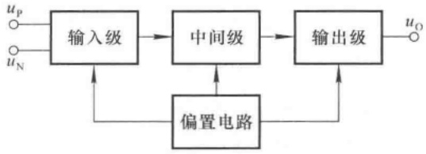

flowchart

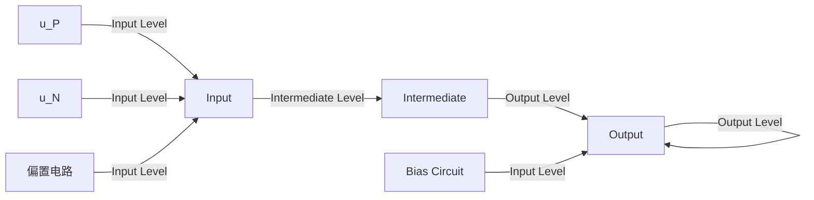

图 3.2.1 集成运放电路方框图

## 一、输入级

输入级又称前置级,它往往是一个双端输入的高性能差分放大电路。一般要求其输入电阻高,电压放大倍数大,抑制零点漂移现象的能力强,静态电流小。输入级的好坏直接影响集成运放的大多数性能参数,因此,在几代产品的更新过程中,输入级的变化最大。

## 二、中间级

中间级是整个放大电路的主放大器,其作用是使集成运放具有较强的放大能力,多采用共射或共源放大电路。而且,为了提高电压放大倍数,经常采用复合管作放大管,以恒流源作集电极负载。其电压放大倍数可达千倍以上。

## 三、输出级

输出级应具有输出电压线性范围宽,输出电阻小(即带负载能力强)、非线性失真小等特点。集成运放的输出级多采用互补输出电路。

## 四、偏置电路

偏置电路用于设置集成运放各级放大电路的静态工作点。与分立元件不同，集成运放采用电流源电路为各级提供合适的集电极（或发射极、漏极、源极）静态工作电流，从而确定了合适的静态工作点。

## 3.2.3 集成运放的电压传输特性

集成运放有同相输入端和反相输入端, 这里的“同相”和“反相”是指运放的输入电压与输出电压之间的相位关系, 其符号如图 3.2.2(a) 所示。从外部看, 可以认为集成运放是一个双端输

---

132

第 3 章 集成运算放大电路

入、单端输出，具有高电压放大倍数、高输入电阻、低输出电阻，能较好地抑制零点漂移现象的差分放大电路；有单电源供电和正负双电源供电之分。

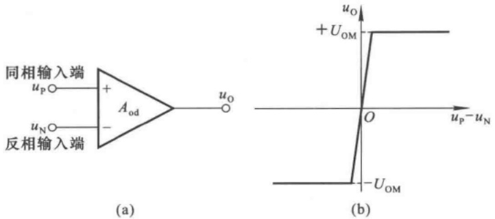

图 3.2.2 集成运放的符号和电压传输特性

(a) 符号 (b) 电压传输特性

集成运放的输出电压 $u_{0}$ 与输入电压（即同相输入端与反相输入端之间的电位差） $(u_{\mathrm{P}} - u_{\mathrm{N}})$ 之间的关系曲线称为电压传输特性，即

$$
u _ {\mathrm{O}} = f (u _ {\mathrm{P}} - u _ {\mathrm{N}}) \tag {3.2.1}
$$

对于正、负两路电源供电的集成运放，电压传输特性如图3.2.2(b)所示。从图示曲线可以看出，集成运放有线性放大区域(称为线性区)和饱和区域(称为非线性区)两部分。在线性区，曲线的斜率为电压放大倍数；在非线性区，输出电压只有两种可能的情况， $+U_{OM}$ 或 $-U_{OM}$ 。

由于集成运放放大的是 $u_{\mathrm{P}}$ 和 $u_{\mathrm{N}}$ 之间的差值信号，称为差模信号，且没有通过外电路引入反馈，故称其电压放大倍数为差模开环放大倍数，记作 $A_{\mathrm{od}}$，因而当集成运放工作在线性区时

$$
u _ {\mathrm{O}} = A _ {\mathrm{od}} (u _ {\mathrm{P}} - u _ {\mathrm{N}}) \tag {3.2.2}
$$

通常 $A_{\mathrm{od}}$ 非常高，可达几十万倍，因此集成运放电压传输特性中的线性区非常之窄。如果输出电压的最大值 $\pm U_{\mathrm{OM}} = \pm 14\mathrm{V}, A_{\mathrm{od}} = 5\times 10^{5}$，那么只有当 $|u_{\mathrm{P}} - u_{\mathrm{N}}| < 28\mu \mathrm{V}$ 时，电路才工作在线性区。换言之，若 $|u_{\mathrm{P}} - u_{\mathrm{N}}| > 28\mu \mathrm{V}$，则集成运放进入非线性区，因而输出电压 $u_{0}$ 不是 $+14\mathrm{V}$，就是 $-14\mathrm{V}$。

## 思考题

3.2.1 利用分立元件组成和集成运放内部完全相同的电路,是否会具有同样优良的性能?为什么?
3.2.2 为什么集成运放内部可以采用增加电路复杂性的方法来提高其性能,而分立元件电路不能采用同样的方法?
3.2.3 若集成运放的电源电压为  $\pm15\ V$ ，差模放大倍数为  $10^{5}$ ，则当其差模输入电压为  $\pm1\ \mu V$ 、 $\pm10\ \mu V$ 、 $\pm100\ \mu V$ 、 $\pm1\ mV$  时，输出电压各为多少？

## 3.3 集成运放中的单元电路

从上节分析可知,通用型集成运放是由差分放大电路、复合管共射放大电路、互补输出级以及偏置电路组成的直接耦合放大电路,本节将对直接耦合放大电路的零点漂移现象和各单元电

---

3.3 集成运放中的单元电路

133

路一一加以阐述。

## 3.3.1 直接耦合放大电路的零点漂移现象

工业控制中的很多物理量均为模拟量，如温度、流量、压力、液面、长度等，它们通过各种不同传感器转化成的电量也均为变化缓慢的非周期性信号，而且比较微弱，因而这类信号一般均需通过直接耦合放大电路放大后才能驱动负载。只有克服直接耦合放大电路存在的问题才能使之实用。

## 一、零点漂移现象及其产生的原因

人们在实验中发现，在直接耦合放大电路中，即使将输入端短路，用灵敏的直流表测量输出端，也会有变化缓慢的输出电压，如图3.3.1所示。这种输入电压 $\left(\Delta u_{1}\right)$ 为零而输出电压的变化 $\left(\Delta u_{0}\right)$ 不为零的现象称为零点漂移现象。

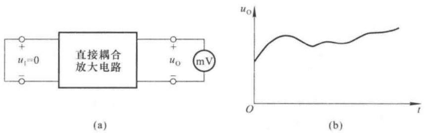

图 3.3.1 零点漂移现象

(a) 测试电路 (b) 测试结果

在放大电路中,任何元件参数的变化,如电源电压的波动、元件的老化、半导体元件参数随温度变化而产生的变化,都将产生输出电压的漂移。在阻容耦合放大电路中,这种缓慢变化的漂移电压都将降落在耦合电容之上,而不会传递到下一级电路进一步放大。但是,在直接耦合放大电路中,由于前后级直接相连,前一级的漂移电压会和有用信号一起被送到下一级,而且逐级放大,以至于有时在输出端很难区分什么是有用信号,什么是漂移电压,放大电路不能正常工作。

采用高质量的稳压电源和使用经过老化实验的元件就可以大大减小因此而产生的漂移。由温度变化所引起的半导体器件参数的变化就成为产生零点漂移现象的主要原因，因此，也称零点漂移为温度漂移，简称温漂。在第2章的2.4节曾分析了温度对晶体管参数的影响，这里不再赘述。

## 二、抑制温度漂移的方法

对于直接耦合放大电路,如果不采取措施抑制温度漂移,从理论分析上它的性能再优良,也不能成为实用电路。在第2章的2.4节曾经讲到稳定静态工作点的方法,这些方法也是抑制温度漂移的方法。因为从某种意义上讲,零点漂移就是Q点的漂移,因此抑制温度漂移的方法如下:

（1）在电路中引入直流负反馈，例如典型的静态工作点稳定电路（图 2.4.2）中  $R_{e}$  所起的作用。
（2）采用温度补偿的方法，利用热敏元件来抵消放大管的变化。例如图 2.4.6 所示电路中的二极管。
（3）采用特性相同的管子，使它们的温漂相互抵消，构成“差分放大电路”。这个方法也可归结为温度补偿。

---

134

第 3 章 集成运算放大电路

## 3.3.2 差分放大电路

差分放大电路是构成多级直接耦合放大电路的基本单元电路，常作为集成运放的输入级。

## 一、电路的组成

差分放大电路是由典型的工作点稳定电路演变而来的。在图3.3.2(a)所示电路中，若基极电阻 $R_{b}$ 上的静态电压可忽略不计，则发射极的静态电流 $I_{\mathrm{EQ}} \approx (V_{\mathrm{BB}} - U_{\mathrm{BEQ}}) / R_{e}$，因而可以认为其Q点基本稳定。但是，如果仔细研究在温度变化时Q点的稳定过程，就不难发现，最终，集电极电流 $I_{CQ}$ 会有微小的变化；而且也正是这种变化在发射极电阻 $R_{e}$ 上产生变化的电压（即负反馈电压），影响了晶体管的b-e间静态电压，才达到减小温漂的目的。可以想象，只要采用直接耦合方式，这种变化就会逐级放大。

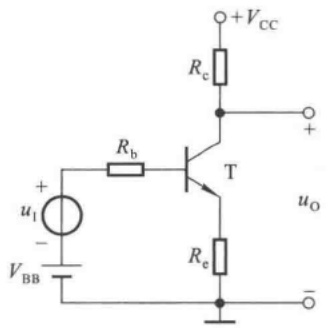

text_image

+VCC
Rc
+
T
uO
-
Rb
Re
uI
-
VBB

(a)

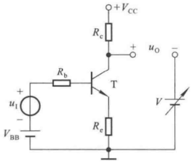

text_image

+VCC
Rc
+
uo
-
uI
-
RB
T
V
BB
Re

(b)

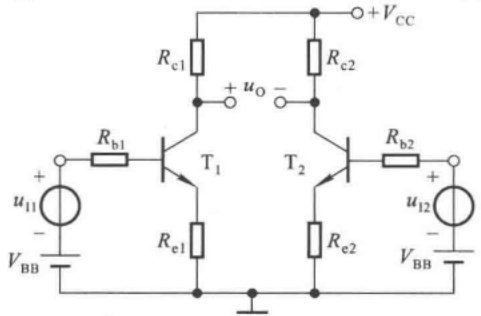

text_image

Rc1
+ uO -
Rc2
+ VCC
Rb1
T1
T2
Rb2
u11 +
-
VBB
Re1
Re2
u12 +
-
VBB

(c)

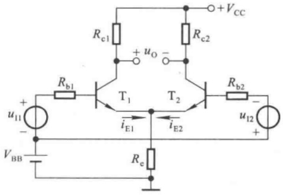

text_image

Rc1
+ uO -
Rc2
+VCC
Rb1
T1
T2
Rb2
+
u11
-
iE1
iE2
u12
+
VBB
Re

(d)

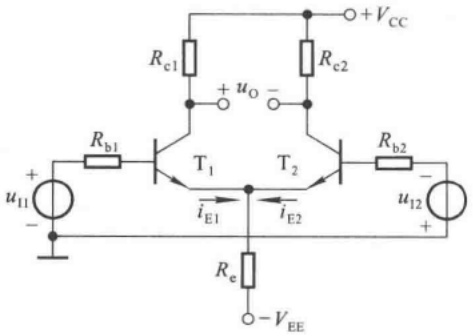

text_image

Rc1
+VCC
Rc2
+
uO
-
T1
T2
Rb1
uI1
-
iE1
iE2
Rb2
uI2
+
Re
-VEE

(e)

图 3.3.2 差分放大电路的组成

(a) 带有  $R_{e}$  负反馈电阻 (b) 带有温控的电压源 (c) 对称式电路加共模信号

(d) 加差模信号 (e) 实用差分放大电路

---

3.3 集成运放中的单元电路

135

但是，如果能像图3.3.2(b)所示电路那样，改变电压输出端，并能寻找到一个受温度控制的直流电压源 $V$ ，当晶体管集电极静态电位 $U_{\mathrm{CQ}}$ 变化时， $V$ 始终与之保持相等，那么输出电压中就只有动态信号 $u_{1}$ 作用的部分了，而与静态工作电位 $U_{\mathrm{CQ}}$ 及其温度漂移毫无关系。可以想象，如果采用与图(b)所示电路参数完全相同，管子特性也完全相同的电路，那么两只管子的集电极静态电位在温度变化时也将时时相等，电路以两只管子集电极电位差作为输出，就克服了温度漂移，实现了上述构思，如图(c)所示。

在图(c)所示电路中，当 $u_{\mathrm{II}}$ 与 $u_{\mathrm{I2}}$ 所加信号为大小相等、极性相同的输入信号（称为共模信号）时，由于电路参数对称，$\mathrm{T}_{1}$ 管和 $\mathrm{T}_{2}$ 管所产生的电流变化相等，即 $\Delta i_{\mathrm{B1}} = \Delta i_{\mathrm{B2}}, \Delta i_{\mathrm{C1}} = \Delta i_{\mathrm{C2}}$；因此集电极电位的变化也相等，即 $\Delta u_{\mathrm{C1}} = \Delta u_{\mathrm{C2}}$。那么，图中所标注的输出电压 $u_{0} = u_{\mathrm{C1}} - u_{\mathrm{C2}} = (U_{\mathrm{CQ1}} + \Delta u_{\mathrm{C1}}) - (U_{\mathrm{CQ2}} + \Delta u_{\mathrm{C2}}) = 0$，说明差分放大电路对共模信号具有很强的抑制作用，在参数理想对称的情况下，共模输出为零。

为使信号得以放大，需将其分成大小相等的两部分，按相反极性加在电路的两个输入端，如图(d)所示。称这种大小相等极性相反的信号为差模信号。由于 $\Delta u_{\mathrm{I1}} = -\Delta u_{\mathrm{I2}}$ ，又由于电路参数对称， $\mathrm{T}_{1}$ 管和 $\mathrm{T}_{2}$ 管所产生的电流的变化大小相等而变化方向相反，即 $\Delta i_{\mathrm{B1}} = -\Delta i_{\mathrm{B2}},\Delta i_{\mathrm{C1}} = -\Delta i_{\mathrm{C2}}$ ；因此集电极电位的变化也是大小相等且变化方向相反的，即 $\Delta u_{\mathrm{C1}} = -\Delta u_{\mathrm{C2}}$ ，这样得到的输出电压 $\Delta u_0 =$ $\Delta u_{\mathrm{C1}} - \Delta u_{\mathrm{C2}} = 2\Delta u_{\mathrm{C1}}$ ，从而实现了电压放大。但是，由于图(c)中 $R_{\mathrm{e1}}$ 和 $R_{\mathrm{e2}}$ 的存在使电路的电压放大能力变差，当它们数值较大时，甚至不能放大。研究差模输入信号作用时， $\mathrm{T}_{1}$ 管和 $\mathrm{T}_{2}$ 管发射极电流的变化，就会发现，它们与基极电流一样，变化量的大小相等方向相反，即 $\Delta i_{\mathrm{E1}} = -\Delta i_{\mathrm{E2}}$ 。若将 $\mathrm{T}_{1}$ 管和 $\mathrm{T}_{2}$ 管的发射极连在一起，将 $R_{\mathrm{e1}}$ 和 $R_{\mathrm{e2}}$ 合二而一，成为一个电阻 $R_{\mathrm{e}}$ ，如图(d)所示，则在差模信号作用下 $R_{\mathrm{e}}$ 中的电流变化为零，即 $R_{\mathrm{e}}$ 对差模信号无反馈作用，相当于短路，因此大大提高了对差模信号的放大能力。为了简化电路，便于调节 $Q$ 点，也为了使电源与信号源“共地”，就产生了图(e)所示的典型差分放大电路。也有文献称之为差动放大电路，所谓“差动”，是指只有当两个输入端之间的电位有差别（即变化量）时，输出电压才有变动（即变化量）的意思。

对于差分放大电路的分析,多是在电路参数理想对称情况下进行的。所谓电路参数理想对称,是指在对称位置的电阻值绝对相等,两只晶体管在任何温度下输入特性曲线与输出特性曲线均完全重合。

应当指出,由于实际电阻的阻值误差各不相同,特别是晶体管特性的分散性,任何分立元件差分放大电路的参数不可能理想对称,也就不可能完全抑制零点漂移;而在集成电路中,由于相邻元件具有良好的对称性,故能够实现趋于参数理想对称的差分放大电路。

## 二、长尾式差分放大电路

图3.3.3所示为典型的差分放大电路，由于 $R_{\mathrm{e}}$ 接负电源 $-V_{\mathrm{EE}}$ ，拖一个尾巴，故称为长尾式电路，电路参数理想对称，即 $R_{\mathrm{b1}} = R_{\mathrm{b2}} = R_{\mathrm{b}}, R_{\mathrm{c1}} = R_{\mathrm{c2}} = R_{\mathrm{c}};\mathrm{T}_{1}$ 管与 $\mathrm{T}_{2}$ 管的特性相同， $\beta_{1} = \beta_{2} = \beta ,r_{\mathrm{be1}} = r_{\mathrm{be2}} = r_{\mathrm{be}};R_{\mathrm{e}}$ 为公共的发射极电阻。

## 1. 静态分析

当输入信号  $u_{11}=u_{12}=0$  时，电阻  $R_{e}$  中的电流等于  $T_{1}$  管和  $T_{2}$  管的发射极电流之和，即

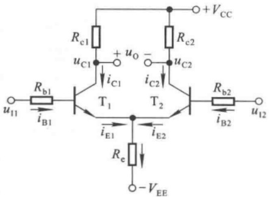

text_image

Rc1
+VCC
uC1 + uO -
Rc2
uC2
iC1
iC2
T1
T2
Rb1
u11 iB1
iE1 iE2
Re
-VEE
u12
iB2

图 3.3.3 长尾式差分放大电路

---

136

第 3 章 集成运算放大电路

$$
I _ {R _ {\mathrm{c}}} = I _ {\mathrm{EQ1}} + I _ {\mathrm{EQ2}} = 2 I _ {\mathrm{EQ}}
$$

根据基极回路方程

$$
I _ {\mathrm{BQ}} R _ {\mathrm{b}} + U _ {\mathrm{BEQ}} + 2 I _ {\mathrm{EQ}} R _ {\mathrm{e}} = V _ {\mathrm{EE}} \tag {3.3.1}
$$

可以求出基极静态电流 $I_{\mathrm{BQ}}$ 或发射极电流 $I_{\mathrm{EQ}}$，从而解出静态工作点。通常情况下，由于 $R_{\mathrm{b}}$ 阻值很小（很多情况下 $R_{\mathrm{b}}$ 为信号源内阻），而且 $I_{\mathrm{BQ}}$ 也很小，所以 $R_{\mathrm{b}}$ 上的电压可忽略不计，发射极电位 $U_{\mathrm{EQ}} \approx -U_{\mathrm{BEQ}}$，因而发射极的静态电流为

$$
I _ {\mathrm{EQ}} \approx \frac {V _ {\mathrm{EE}} - U _ {\mathrm{BEQ}}}{2 R _ {\mathrm{e}}} \tag {3.3.2}
$$

可见，只要合理地选择 $R_{\mathrm{e}}$ 的阻值，并与电源 $V_{\mathrm{EE}}$ 相配合，就可以设置合适的静态工作点。由 $I_{\mathrm{EQ}}$ 可得

$$
I _ {\mathrm{BQ}} = \frac {I _ {\mathrm{EQ}}}{1 + \beta} \tag {3.3.3}
$$

$$
U _ {\mathrm{CEQ}} = U _ {\mathrm{CQ}} - U _ {\mathrm{EQ}} \approx V _ {\mathrm{CC}} - I _ {\mathrm{CQ}} R _ {\mathrm{c}} + U _ {\mathrm{BEQ}} \tag {3.3.4}
$$

由于  $U_{CQ1}=U_{CQ2}$ ，所以  $u_{0}=U_{CQ1}-U_{CQ2}=0$ 。

## 2. 对共模信号的抑制作用

从差分放大电路组成的分析可知，电路参数的对称性起了相互补偿的作用，抑制了温度漂移。当电路输入共模信号时，如图3.3.4所示，基极电流和集电极电流的变化量相等，即 $\Delta i_{B1}=\Delta i_{B2},\Delta i_{C1}=\Delta i_{C2}$ ;因此，集电极电位的变化也相等，即 $\Delta u_{C1}=\Delta u_{C2}$ ，从而使得输出电压 $u_{0}=0$ ，即对共模信号不放大。由于电路参数的理想对称性，温度变化时管子的电流变化完全相同，故可以将温度漂移等效成共模信号。

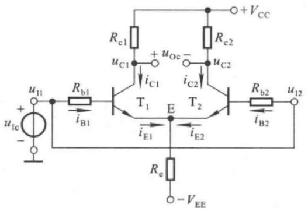

text_image

uI1
+
-
uIc
Rb1
iB1
T1
E
iE1
iE2
Re
-VEE
Rc1
+ uOc -
Rc2
uC1
uC2
uC2
uC1
uC2
uI2
Rb2
iB2
uCC

图 3.3.4 差分放大电路输入共模信号

实际上，差分放大电路对共模信号的抑制，不但利用了电路参数对称性所起的补偿作用，使两只晶体管的集电极电位变化相等；而且还利用了发射极电阻 $R_{e}$ 对共模信号的负反馈作用，抑制了每只晶体管集电极电流的变化，从而抑制集电极电位的变化。

从图3.3.4中可以看出，当共模信号作用于电路时，两只管子发射极电流的变化量相等，即$\Delta i_{\mathrm{E1}} = \Delta i_{\mathrm{E2}} = \Delta i_{\mathrm{E}}$；因而 $R_{\mathrm{e}}$ 上电流的变化量为2倍的 $\Delta i_{\mathrm{E}}$ ，发射极电位的变化量 $\Delta u_{\mathrm{E}} = 2\Delta i_{\mathrm{E}}R_{\mathrm{e}}$ 。 $\Delta u_{\mathrm{E}}$ 的变化方向与输入共模信号的变化方向相同，致使b-e间电压的变化（ $\Delta u_{\mathrm{BE}}$ )方向与 $\Delta u_{\mathrm{E}}$ 相反，而基极电流必将随 $\Delta u_{\mathrm{BE}}$ 产生与 $\Delta u_{\mathrm{BE}}$ 变化方向相同的变化 $\Delta i_{\mathrm{B}}$ ，从而减小集电极电流的变化 $\Delta i_{\mathrm{C}}$ 也就抑制了集电极电位的变化。例如，当所加共模信号 $\Delta u_{\mathrm{Ic}}$ 为正时，简述晶体管各极之间电流、

---

3.3 集成运放中的单元电路

137

电压的变化方向如下:

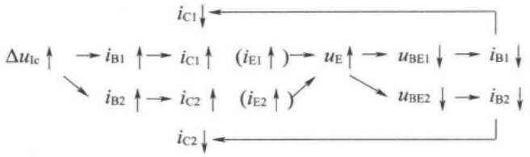

flowchart

```mermaid
graph LR
  A["Δu_Ic"] --> B["i_B1"]
  B --> C["i_C1"]
  C --> D["(i_E1 ↑)"]
  D --> E["u_E"]
  E --> F["u_BE1"]
  F --> G["i_B1"]
  H["i_B2"] --> I["i_C2"]
  I --> J["(i_E2 ↑)"]
  J --> K["u_BE2"]
  K --> L["i_B2"]
  M["i_C1"] -.-> N["Output Node"]
  M -.-> O["Output Node"]
  M -.-> P["Output Node"]
  M -.-> Q["Output Node"]
  M -.-> R["Output Node"]
  M -.-> S["Output Node"]
  M -.-> T["Output Node"]
  M -.-> U["Output Node"]
  M -.-> V["Output Node"]
  M -.-> W["Output Node"]
  M -.-> X["Output Node"]
  M -.-> Y["Output Node"]
  M -.-> Z["Output Node"]
  M -.-> AA["Output Node"]
  M -.-> AB["Output Node"]
  M -.-> AC["Output Node"]
  M -.-> AD["Output Node"]
  M -.-> AE["Output Node"]
  M -.-> AF["Output Node"]
  M -.-> AG["Output Node"]
  M -.-> AH["Output Node"]
  M -.-> AI["Output Node"]
  M -.-> AJ["Output Node"]
  M -.-> AK["Output Node"]
  M -.-> AL["Output Node"]
  M -.-> AM["Output Node"]
  M -.-> AN["Output Node"]
  M -.-> AO["Output Node"]
  M -.-> AP["Output Node"]
  M -.-> AQ["Output Node"]
  M -.-> AR["Output Node"]
  M -.-> AS["Output Node"]
  M -.-> AT["Output Node"]
  M -.-> AU["Output Node"]
  M -.-> AV["Output Node"]
  M -.-> AW["Output Node"]
  M -.-> AX["Output Node"]
  M -.-> AY["Output Node"]
  M -.-> AZ["Output Node"]
  M -.-> BA["Output Node"]
  M -.-> BC["Output Node"]
  M -.-> BD["Output Node"]
  M -.-> BE["Output Node"]
  M -.-> BF["Output Node"]
  M -.-> BG["Output Node"]
  M -.-> BH["Output Node"]
  M -.-> BI["Output Node"]
  M -.-> BJ["Output Node"]
  M -.-> BK["Output Node"]
  M -.-> BL["Output Node"]
  M -.-> BM["Output Node"]
  M -.-> BN["Output Node"]
  M -.-> BO["Output Node"]
  M -.-> BP["Output Node"]
  M -.-> BR["Output Node"]
  M -.-> CB["Output Node"]
  M -.-> CD["Output Node"]
  M -.-> CE["Output Node"]
  M -.-> CF["Output Node"]
  M -.-> CG["Output Node"]
  M -.-> CH["Output Node"]
  M -.-> CI["Output Node"]
  M -.-> CJ["Output Node"]
  M -.-> CL["Output Node"]
  M -.-> CM["Output Node"]
  M -.-> CN["Output Node"]
  M -.-> CO["Output Node"]
  M -.-> CP["Output Node"]
  M -.-> CR["Output Node"]
  M -.-> CS["Output Node"]
  M -.-> CT["Output Node"]
  M -.-> CU["Output Node"]
  M -.-> CV["Output Node"]
  M -.-> CW["Output Node"]
  M -.-> CX["Output Node"]
  M -.-> CY["Output Node"]
  M -.-> CZ["Output Node"]
  M -.-> CDX["Output Node"]
  M -.-> CEY["Output Node"]
  M -.-> CEZ["Output Node"]
  M -.-> CCX["Output Node"]
  M -.-> CEYX["Output Node"]
  M -.-> CEZX["Output Node"]
  M -.-> CCXX["Output Node"]
  M -.-> CEYXX["Output Node"]
```

因为  $\Delta u_{\mathrm{E}} = \Delta i_{\mathrm{E}} (2 R_{\mathrm{e}})$ ，所以对于每边晶体管而言，发射极等效电阻为  $2 R_{e}$ 。由于  $R_{e}$  对共模信号起负反馈作用，故称之为共模负反馈电阻。 $R_{e}$  阻值愈大，负反馈作用愈强，集电极电流变化愈小，因而集电极电位的变化也就愈小。但  $R_{e}$  的取值不宜过大，因为由式(3.3.2)可知，它受电源电压  $V_{EE}$  的限制。为了描述差分放大电路对共模信号的抑制能力，引入“共模放大倍数  $A_{e}$ ”这一参数 $^{①}$ ，定义为

$$
A _ {\mathrm{c}} = \frac {\Delta u _ {\mathrm{Oc}}}{\Delta u _ {\mathrm{Ic}}} \tag {3.3.5}
$$

式中， $\Delta u_{1c}$  为共模输入电压， $\Delta u_{0c}$  是  $\Delta u_{1c}$  作用下的输出电压。它们可以是缓慢变化的信号，也可以是正弦交流信号。

在图 3.3.3 所示差分放大电路中, 若电路参数理想对称, 则  $A_{c}=0$ 。

## 3. 对差模信号的放大作用

当给差分放大电路输入一个差模信号  $\Delta u_{1d}$  时，由于电路参数的对称性， $\Delta u_{1d}$  经分压后，加在  $T_{1}$  管一边的为  $+\Delta u_{1d}/2$ ，加在  $T_{2}$  管一边的为  $-\Delta u_{1d}/2$ ，如图 3.3.5(a) 所示。

由于 E 点电位在差模信号作用下不变，相当于接“地”；又由于负载电阻的中点电位在差模信号作用下也不变，也相当于接“地”，因而  $R_{L}$  被分成相等的两部分，分别接在  $T_{1}$  管和  $T_{2}$  管的 c-e 之间，所以图 3.3.5(a) 所示电路在差模信号作用下的交流等效电路如图(b) 所示。

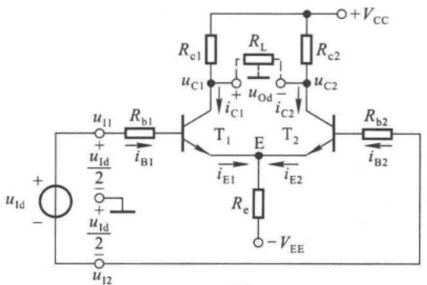

text_image

u1d
+
-
u1d
2
+
-
u1d
2
-
u11
Rb1
iB1
T1
E
T2
Rc1
RL
+
-
uC1
uC2
uC2
+VCC
iC1
iC2
iE1
iE2
Re
-VEE
Rb2
iB2

(a)

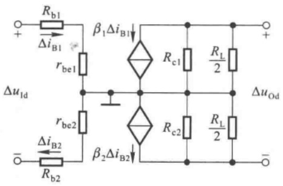

text_image

Rb1
ΔiB1
rbe1
β1ΔiB1
Rc1
RL/2
ΔuId
rbe2
β2ΔiB2
Rb2
ΔiB2
Rc2
RL/2
ΔuOd
-

(b)

图 3.3.5 差分放大电路加差模信号

(a) 电路 (b) 交流等效电路

<small>① 脚注 C 是 common 的字头。</small>

---

138

第 3 章 集成运算放大电路

输入差模信号时的电压放大倍数称为差模放大倍数，记作 $A_{d}^{①}$ ，定义为

$$
A _ {\mathrm{d}} = \frac {\Delta u _ {\mathrm{0d}}}{\Delta u _ {\mathrm{1d}}} \tag {3.3.6}
$$

式中的 $\Delta u_{\mathrm{Od}}$ 是 $\Delta u_{\mathrm{Id}}$ 作用下的输出电压。从图（b）中可知，$\Delta u_{\mathrm{Id}} = 2\Delta i_{\mathrm{B1}}(R_{\mathrm{b}} + r_{\mathrm{be}})$，$\Delta u_{\mathrm{Od}} = -2\Delta i_{\mathrm{Cl}}\left(R_{\mathrm{c}} / / \frac{R_{\mathrm{L}}}{2}\right)$，所以

$$
A _ {\mathrm{d}} = - \frac {\beta \left(R _ {\mathrm{c}} / / \frac {R _ {\mathrm{L}}}{2}\right)}{R _ {\mathrm{b}} + r _ {\mathrm{be}}} \tag {3.3.7}
$$

由此可见,虽然差分放大电路用了两只晶体管,但它的电压放大能力只相当于单管共射放大电路。因而,差分放大电路是以牺牲一只管子的放大倍数为代价来换取低温漂的效果的。

根据输入电阻的定义,从图(b)可以看出

$$
R _ {\mathrm{i}} = 2 (R _ {\mathrm{b}} + r _ {\mathrm{be}}) \tag {3.3.8}
$$

它是单管共射放大电路输入电阻的两倍。

电路的输出电阻

$$
R _ {\mathrm{o}} = 2 R _ {\mathrm{c}} \tag {3.3.9}
$$

也是单管共射放大电路输出电阻的两倍。

为了综合考察差分放大电路对差模信号的放大能力和对共模信号的抑制能力,特引入了一个指标参数——共模抑制比,记作 $K_{CMR}$ ,定义为

$$
K _ {\mathrm{CMR}} = \left| \frac {A _ {\mathrm{d}}}{A _ {\mathrm{c}}} \right| \tag {3.3.10}
$$

其值愈大，说明电路性能愈好。在图3.3.3所示电路中，若电路参数理想对称，由于 $A_{\mathrm{c}} = 0$ $K_{\mathrm{CMR}} = \infty$ 。

## 4. 电压传输特性

放大电路输出电压与输入电压之间的关系曲线称为电压传输特性,即

$$
u _ {0} = f (u _ {1}) \tag {3.3.11}
$$

将差模输入电压  $\Delta u_{1d}$  按图 3.3.5(a) 接到输入端，并令其幅值由零逐渐增加时，输出端的  $\Delta u_{0d}$  也将出现相应的变化，画出二者的关系，如图 3.3.6 中的实线 $^{②}$ 所示。可以看出，只有在中间一段二者是线性关系，斜率就是式 (3.3.6) 所表示的差模放大倍数。当输入电压幅值过大时，输出电压就会产生失真，若再加大  $\Delta u_{1d}$ ，则  $\Delta u_{0d}$  将趋于不变，其数值取决于电源电压  $V_{CC}$ 。

若改变  $\Delta u_{Id}$  的极性, 则可得到另一条如图 3.3.6 中虚线所示的曲线, 它与实线完全对称。

text_image

uOd
u1d
O
线性关系

图 3.3.6 差分放大电路的电压传输特性

<small>① 脚注中的 d 是 differential 的字头。</small>

<small>② 图中曲线可用  $u_{0d}=i_{C}R_{c}$ th $\left(-\frac{u_{1d}}{2U_{T}}\right)$ 来表示。</small>

---

3.3 集成运放中的单元电路

139

## 三、差分放大电路的四种接法

在图 3.3.3 所示电路中, 输入端与输出端均没有接“地”点, 称为双端输入、双端输出电路。在实际应用中, 为了防止干扰和负载的安全, 常将信号源的一端接地, 或者将负载电阻的一端接地。根据输入端和输出端接地情况不同, 除上述双端输入、双端输出电路外, 还有双端输入、单端输出, 单端输入、双端输出和单端输入、单端输出, 共四种接法。下面分别介绍其电路的特点。

## 1. 双端输入、单端输出电路

图 3.3.7 所示为双端输入、单端输出差分放大电路。与图 3.3.3 所示电路相比，只在输出端不同，其负载电阻  $R_{L}$  的一端接  $T_{1}$  管的集电极，另一端接地。它的输出回路已不对称，因此影响了它的静态工作点和动态参数。

画出图 3.3.7 所示电路的直流通路如图 3.3.8 所示, 图中  $V_{CC}^{\prime}$  和  $R_{c}^{\prime}$  是利用戴维宁定理进行变换得出的等效电源和电阻, 其表达式分别为

$$
V _ {\mathrm{cc}} ^ {\prime} = \frac {R _ {\mathrm{L}}}{R _ {\mathrm{c}} + R _ {\mathrm{L}}} \cdot V _ {\mathrm{cc}} \tag {3.3.12}
$$

$$
R _ {\mathrm{c}} ^ {\prime} = R _ {\mathrm{c}} / / R _ {\mathrm{L}} \tag {3.3.13}
$$

text_image

Rc
+VCC
Rc
+
RL
uO
T1
-
T2
Rb
uI
-
Re
-VEE

图 3.3.7 双端输入、单端输出差分放大电路

text_image

+V'CC
R'c
UCCQ1
Rc
+VCC
T1
T2
Rb
Re
-VEE

图 3.3.8 图 3.3.7 所示电路的直流通路

虽然由于输入回路参数对称，使静态电流 $I_{\mathrm{BQ1}} = I_{\mathrm{BQ2}}$，从而 $I_{\mathrm{CQ1}} = I_{\mathrm{CQ2}}$；但是，由于输出回路的不对称性，使 $\mathrm{T}_{1}$ 管和 $\mathrm{T}_{2}$ 管的集电极电位 $U_{\mathrm{CQ1}} \neq U_{\mathrm{CQ2}}$，从而使管压降 $U_{\mathrm{CEQ1}} \neq U_{\mathrm{CEQ2}}$。由图3.3.8可得

$$
U _ {\mathrm{CQ1}} = V _ {\mathrm{CC}} ^ {\prime} - I _ {\mathrm{CQ}} R _ {\mathrm{c}} ^ {\prime} \tag {3.3.14}
$$

$$
U _ {\mathrm{CQ2}} = V _ {\mathrm{CC}} - I _ {\mathrm{CQ}} R _ {\mathrm{e}} \tag {3.3.15}
$$

静态工作点  $I_{CQ}$ 、 $I_{BQ}$  和  $U_{CEQ1}$ 、 $U_{CEQ2}$  可通过式(3.3.2)、(3.3.3)、(3.3.4)计算。

因为在差模信号作用时，负载电阻仅取得 $\mathrm{T}_{1}$ 管集电极电位的变化量，所以与双端输出电路相比，差模放大倍数的数值减小。画出图3.3.7所示电路对差模信号的等效电路，如图3.3.9所示。在差模信号作用时，由于 $\mathrm{T}_{1}$ 管与 $\mathrm{T}_{2}$ 管中电流大小相等且方向相反，所以发射极相当于接地。输出电压 $\Delta u_{\mathrm{0d}} = -\Delta i_{\mathrm{C}}(R_{\mathrm{c}} / / R_{\mathrm{L}})$，输入电压 $\Delta u_{\mathrm{Id}} = 2\Delta i_{\mathrm{B}}(R_{\mathrm{b}} + r_{\mathrm{be}})$，因此差模放大倍数

$$
A _ {\mathrm{d}} = \frac {\Delta u _ {\mathrm{0d}}}{\Delta u _ {\mathrm{1d}}} = - \frac {1}{2} \cdot \frac {\beta (R _ {\mathrm{c}} / / R _ {\mathrm{L}})}{R _ {\mathrm{b}} + r _ {\mathrm{be}}} \tag {3.3.16}
$$

电路的输入回路没有变,所以输入电阻  $R_{i}$  仍为  $2(R_{\mathrm{b}} + r_{\mathrm{be}})$ 。

电路的输出电阻  $R_{o}$  为  $R_{c}$ ，是双端输出电路输出电阻的一半。

如果输入差模信号极性不变,而输出信号取自 $T_{2}$ 管的集电极,则输出与输入同相。

---

140

第 3 章 集成运算放大电路

text_image

Rb
ΔiB
βΔiB
Rc
RL
ΔuOd
+
-
ΔuId
rbe
rbe
Rc
Rb
-

图 3.3.9 图 3.3.7 所示电路对差模信号的等效电路

当输入共模信号时，由于两边电路的输入信号大小相等且极性相同。所以发射极电阻 $R_{\mathrm{e}}$ 上的电流变化量 $\Delta i_{\mathrm{E}} = 2\Delta i_{\mathrm{E}}$，发射极电位的变化量 $\Delta u_{\mathrm{E}} = 2\Delta i_{\mathrm{E}}R_{\mathrm{e}}$；对于每只管子而言，可以认为是 $\Delta i_{\mathrm{E}}$ 流过阻值为 $2R_{\mathrm{e}}$ 所造成的，如图3.3.10(a)所示。因此，与输出电压相关的 $T_{1}$ 管一边电路对共模信号的等效电路如图3.3.10(b)所示。从图上可以求出

text_image

Rc
+VCC
RL
uO
+
Rb
T1
-
T2
Rb
2Re
2Re
+ uic
-
VEE

(a)

text_image

Rb
βΔiB
rbe
2Re
Rc
RL
ΔuIc
ΔuOc
+

(b)

图 3.3.10 图 3.3.7 所示电路对共模信号的等效电路

(a) 等效变换 (b) 等效电路

$$
A _ {\mathrm{c}} = \frac {\Delta u _ {\mathrm{Oc}}}{\Delta u _ {\mathrm{Ic}}} = - \frac {\beta (R _ {\mathrm{c}} / / R _ {\mathrm{L}})}{R _ {\mathrm{b}} + r _ {\mathrm{be}} + 2 (1 + \beta) R _ {\mathrm{e}}} \tag {3.3.17}
$$

共模抑制比

$$
K _ {\mathrm{CMR}} = \left| \frac {A _ {\mathrm{d}}}{A _ {\mathrm{c}}} \right| = \frac {R _ {\mathrm{b}} + r _ {\mathrm{be}} + 2 (1 + \beta) R _ {\mathrm{e}}}{2 (R _ {\mathrm{b}} + r _ {\mathrm{be}})} \tag {3.3.18}
$$

从式(3.3.17)和式(3.3.18)可以看出， $R_{e}$  愈大， $A_{c}$  的值愈小， $K_{CMR}$  愈大，电路的性能也就愈好。因此，增大  $R_{e}$  是改善共模抑制比的基本措施。

## 2. 单端输入、双端输出电路

图 3.3.11(a) 所示为单端输入、双端输出电路，两个输入端中有一个接地，输入信号加在另一端与地之间。因为电路对于差模信号是通过发射极相连的方式将  $T_{1}$  管的发射极电流传递到  $T_{2}$  管的发射极的，故称这种电路为射极耦合电路。

---

3.3 集成运放中的单元电路

141

text_image

Rc
+ uO -
RL
+VCC
Rb
T1
T2
Rc
-VEE
uI
-

(a)

text_image

Rc
+ uO -
RL
+ VCC
Rb
T1
T2
Rb
u1/2
+
-
u1/2
-
-
Re
-VEE
u1/2
+
-
u1/2
+

(b)

图 3.3.11 单端输入、双端输出电路

(a) 电路 (b) 输入信号的等效变换

为了说明这种输入方式的特点,不妨将输入信号进行如下的等效变换。在加信号一端,可将输入信号分为两个串联的信号源,它们的数值均为  $\Delta u_{1}/2$ , 极性相同; 在接地一端,也可等效为两个串联的信号源,它们的数值均为  $\Delta u_{1}/2$ , 但极性相反, 如图(b)所示。不难看出, 同双端输入时一样, 左右两边获得的差模信号仍为  $\pm\Delta u_{1}/2$ ; 但是与此同时, 两边输入了  $\Delta u_{1}/2$  的共模信号。可见, 单端输入电路与双端输入电路的区别在于: 在输入差模信号的同时, 伴随着共模信号的输入。因此, 在共模放大倍数  $A_{c}$  不为零时, 输出端不仅有差模信号作用而得到的差模输出电压, 而且还有共模信号作用而得到的共模输出电压, 即输出电压

$$
\Delta u _ {0} = A _ {\mathrm{d}} \Delta u _ {1} + A _ {\mathrm{c}} \cdot \frac {\Delta u _ {1}}{2} \tag {3.3.19}
$$

当然，若电路参数理想对称，则 $A_{c}=0$ ，即式中的第二项为0，此时 $K_{CMR}$ 将为无穷大。

单端输入、双端输出电路与双端输入、双端输出电路的静态工作点以及动态参数的分析完全相同，这里不再一一推导。

## 3. 单端输入、单端输出电路

图 3.3.12 所示为单端端入、单端输出电路，对于单端输出电路，常将不输出信号一边的  $R_{c}$  省掉。该电路对 Q 点、 $A_{d}$ 、 $A_{c}$ 、 $R_{i}$  和  $R_{o}$  的分析与图 3.3.7 所示电路相同，对输入信号作用的分析与图 3.3.11 所示电路相同。

text_image

Rc
+VCC
RL
uo
+
T1
-
T2
Rb
u1
-
Rc
-VEE

图 3.3.12 单端输入、单端输出电路

---

142

第 3 章 集成运算放大电路

由以上分析可知,将四种接法的动态参数特点归纳如下:

(1) 输入电阻均为  $2(R_{\mathrm{b}} + r_{\mathrm{be}})$ 。
（2） $A_{d}$ 、 $A_{c}$ 、 $R_{o}$ 与输出方式有关，双端输出时， $A_{d}$ 见式（3.3.7）， $A_{c}=0, R_{o}=2R_{c}$ ；单端输出时， $A_{d}$ 与 $A_{c}$ 分别见式（3.3.16）、（3.3.17），而 $R_{o}=R_{c}$ 。
（3）单端输入时，在差模信号输入的同时总伴随着共模输入。若输入信号为  $\Delta u_{1}$ ，则  $\Delta u_{Id} = \Delta u_{1}, \Delta u_{Ic} = +\Delta u_{1}/2$ ，输出电压表达式为式(3.3.19)。

## 四、改进型差分放大电路

在差分放大电路中，增大发射极电阻 $R_{\mathrm{e}}$ 的阻值，能够有效地抑制每一边电路的温漂，提高共模抑制比，这一点对于单端输出电路尤为重要。可以设想，若 $R_{\mathrm{e}}$ 为无穷大，则即使是单端输出电路，根据式(3.3.17)和式(3.3.10)，$A_{\mathrm{c}}$ 也为零，$K_{\mathrm{CMR}}$ 也为无穷大。设晶体管发射极静态电流为 $0.5\mathrm{mA}$，则 $R_{\mathrm{e}}$ 中电流就为 $1\mathrm{mA}$；若 $R_{\mathrm{e}}$ 为 $10\mathrm{k}\Omega$，则电源 $V_{\mathrm{EE}}$ 的值约为 $10.7\mathrm{V}$；若 $R_{\mathrm{e}} = 100\mathrm{k}\Omega$，则 $V_{\mathrm{EE}} \approx 100.7\mathrm{V}$，这显然是不现实的。考虑到故障情况下这样高的电源电压会全部加在差分管上，差分管必须选择高耐压管，对于小信号放大电路这是不合理的。差分电路需要既能采用较低的电源电压、又能有很大的等效电阻 $R_{\mathrm{e}}$ 的发射极电路，电流源具备上述特点。

利用工作点稳定电路来取代 $R_{\mathrm{e}}$ ，就得到如图3.3.13所示的具有恒流源的差分放大电路。图中 $R_{1}, R_{2}, R_{3}$ 和 $\mathrm{T}_{3}$ 组成工作点稳定电路，电源 $V_{\mathrm{EE}}$ 可取几伏，电路参数应满足 $I_{2} >> I_{\mathrm{B3}}$ 。这样，$I_{1} \approx I_{2}$，所以 $R_{2}$ 上的电压为

$$
U _ {R 2} \approx \frac {R _ {2}}{R _ {1} + R _ {2}} \cdot V _ {\mathrm{EE}} \tag {3.3.20}
$$

text_image

Rc
+ uO -
Rc
+VCC
Rb
T1
T2
Rb
u11
iE1
iE2
I1
IB3
T3
I2
R1
R2
I3
R3
-VEE
u12

图 3.3.13 具有恒流源的差分放大电路

$T_{3}$ 管的集电极电流

$$
I _ {\mathrm{C3}} \approx I _ {\mathrm{E3}} = \frac {U _ {R 2} - U _ {\mathrm{BE3}}}{R _ {3}} \tag {3.3.21}
$$

若 $U_{\mathrm{BE3}}$ 的变化可忽略不计，则 $I_{\mathrm{C3}}$ 基本不受温度影响。而且，由图3.3.13可知，没有动态信号能够作用到 $\mathrm{T}_{3}$ 管的基极或发射极，因此 $I_{\mathrm{C3}}$ 为恒流，发射极所接电路可以等效成一个恒流源。 $\mathrm{T}_{1}$ 管和 $\mathrm{T}_{2}$ 管的发射极静态电流

---

3.3 集成运放中的单元电路

143

$$
I _ {\mathrm{EQ1}} = I _ {\mathrm{EQ2}} = \frac {I _ {\mathrm{C3}}}{2} \tag {3.3.22}
$$

当  $T_{3}$  管输出特性为理想特性时， $T_{3}$  在放大区的输出特性曲线是横轴的平行线时，恒流源的内阻为无大，即相当于  $T_{1}$  管和  $T_{2}$  管的发射极接了一个阻值为无穷大的电阻，对共模信号的负反馈作用无穷大，因此使电路的  $A_{c}=0, K_{CMR}=\infty$ 。

恒流源的具体电路是多种多样的，在集成运放中一般采用3.3.3节所述的电流源电路。若用恒流源符号取代具体电路，则可得到图3.3.14所示差分放大电路。在实际电路中，由于难于做到参数理想对称，常用一个阻值很小的电位器加在两只管子发射极之间，见图中的 $R_{w}$ 。调节电位器滑动端的位置便可使电路在 $u_{11}=u_{12}=0$ 时 $u_{0}=0$ ，所以常称 $R_{w}$ 为调零电位器。

为了获得高输入电阻的差分放大电路,可以将前面所讲电路中的差放管用场效应管取代,如图3.3.15所示。这种电路特别适于做直接耦合多级放大电路的输入级。通常情况下,可以认为其输入电阻为无穷大。和晶体管差分放大电路相同,场效应管差分放大电路也有四种接法,可以采用前面叙述的方法对四种接法进行分析,这里不赘述。

text_image

Rc
+ VCC
uO
-
Rc
Rb
T1
Rw
T2
iE1
iE2
I
-Vee
u11
u12

图 3.3.14 恒流源电路的简化画法及电路调零措施

text_image

Rd
+ VDD
RD
uO
-
T1
T2
Rg
u11
RG
iS1
iS2
I
-VSS
Rg
u12

图 3.3.15 场效应管差分放大电路

【例3.3.1】电路如图3.3.5(a)所示，已知 $R_{\mathrm{b}} = 1\mathrm{k}\Omega ,R_{\mathrm{c}} = 10\mathrm{k}\Omega ,R_{\mathrm{L}} = 5.1\mathrm{k}\Omega ,V_{\mathrm{CC}} = 12\mathrm{V},$ $V_{\mathrm{EE}} = 6\mathrm{V}$ ；晶体管的 $\beta = 100,r_{\mathrm{be}} = 2\mathrm{k}\Omega ,U_{\mathrm{BEQ}} = 0.7\mathrm{V};\mathrm{T}_{1}$ 管和 $\mathrm{T}_{2}$ 管的发射极静态电流均为$0.5\mathrm{mA}_{\circ}$

(1) $R_{e}$ 的取值应为多少？ $T_{1}$ 管和 $T_{2}$ 管的管压降 $U_{CEQ}$ 等于多少？

(2) 计算  $A_{u}^{①}$ 、 $R_{i}$  和  $R_{o}$  的数值；

（3）若将电路改成单端输出，如图3.3.7所示，用直流表测得输出电压 $u_{0}=3\ V$ ，试问输入电压 $u_{1}$ 约为多少？设共模输出电压可忽略不计。

解:(1)根据式(3.3.2)有

$$
R _ {\mathrm{e}} \approx \frac {V _ {\mathrm{EE}} - U _ {\mathrm{BEQ}}}{2 I _ {\mathrm{EQ}}} = \frac {6 - 0 . 7}{2 \times 0 . 5} \mathrm{k} \Omega = 5. 3 \mathrm{k} \Omega
$$

$$
U _ {\mathrm{cQ}} = V _ {\mathrm{cc}} - I _ {\mathrm{cQ}} R _ {\mathrm{e}} \approx (1 2 - 0. 5 \times 1 0) \mathrm{V} = 7 \mathrm{V}
$$

根据式(3.3.4)有

<small>① 因为所加信号为有用信号，也就是差模信号，故 $A_{u}$ 就是 $A_{\mathrm{d}}$。</small>

---

144

第 3 章 集成运算放大电路

$$
U _ {\mathrm{CEQ}} = U _ {\mathrm{CQ}} - U _ {\mathrm{EQ}} \approx (7 + 0. 7) \mathrm{V} = 7. 7 \mathrm{V}
$$

(2) 根据式 $(3.3.7)$ 、 $(3.3.8)$ 、 $(3.3.9)$ ，可计算出动态参数。

$$
A _ {u} = - \frac {\beta \left(R _ {\mathrm{c}} / / \frac {R _ {\mathrm{L}}}{2}\right)}{R _ {\mathrm{b}} + r _ {\mathrm{be}}} = - \frac {1 0 0 \times \frac {1 0 \times 2 . 5 5}{1 0 + 2 . 5 5}}{1 + 2} \approx - 6 8
$$

$$
R _ {\mathrm{i}} = 2 (R _ {\mathrm{b}} + r _ {\mathrm{be}}) = 2 \times (1 + 2) \mathrm{k} \Omega = 6 \mathrm{k} \Omega
$$

$$
R _ {\mathrm{o}} = 2 R _ {\mathrm{c}} = 2 \times 1 0 \mathrm{k} \Omega = 2 0 \mathrm{k} \Omega
$$

（3）由于用直流表测得的输出电压中既含有直流（静态）量又含有变化量（信号作用的结果），所以首先应计算出静态时 $T_{1}$ 管的集电极电位，然后用所测电压减去计算出静态电位就可得到动态电压。根据式(3.3.12)、(3.3.13)、(3.3.14)可得

$$
U _ {\mathrm{CQ1}} = \frac {R _ {\mathrm{L}}}{R _ {\mathrm{c}} + R _ {\mathrm{L}}} \cdot V _ {\mathrm{CC}} - I _ {\mathrm{CQ}} (R _ {\mathrm{c}} / / R _ {\mathrm{L}}) = \left(\frac {5 . 1}{1 0 + 5 . 1} \times 1 2 - 0. 5 \times \frac {1 0 \times 5 . 1}{1 0 + 5 . 1}\right) \mathrm{V} \approx 2. 3 6 \mathrm{V}
$$

$$
\Delta u _ {0} = u _ {0} - U _ {\mathrm{CQ1}} \approx (3 - 2. 3 6) \mathrm{V} = 0. 6 4 \mathrm{V}
$$

已知  $\Delta u_{o}$ ，且共模输出电压可忽略不计，因而若能计算出差模电压放大倍数，就可以得出输入电压的数值。根据式(3.3.16)有

$$
A _ {\mathrm{d}} = - \frac {1}{2} \cdot \frac {\beta (R _ {\mathrm{c}} / / R _ {\mathrm{L}})}{R _ {\mathrm{b}} + r _ {\mathrm{be}}} = - \frac {1}{2} \times \frac {1 0 0 \times \frac {1 0 \times 5 . 1}{1 0 + 5 . 1}}{1 + 2} \approx - 5 6
$$

所以输入电压

$$
\Delta u _ {1} \approx \frac {\Delta u _ {0}}{A _ {\mathrm{d}}} = \left(\frac {0 . 6 4}{- 5 6}\right) \mathrm{V} \approx - 0. 0 1 1 4 \mathrm{V} = - 1 1. 4 \mathrm{mV}
$$

## 3.3.3 电流源电路

集成运放电路中的晶体管和场效应管,除了作为放大管外,还构成电流源电路,为各级提供合适的静态电流;或作为有源负载取代高阻值的电阻,从而提高放大电路的放大能力。本节将介绍常见的电流源电路及有源负载的应用。

## 一、基本电流源电路

## 1. 镜像电流源

图 3.3.16 所示为镜像电流源电路, 它由两只特性完全相同的管子  $T_{0}$  和  $T_{1}$  构成, 由于  $T_{0}$  的管

压降 $U_{\mathrm{CE0}}$ 与其b-e间电压 $U_{\mathrm{BE0}}$ 相等，从而保证 $T_0$ 工作在放大状态，而不进入饱和状态，故集电极电流 $I_{\mathrm{CO}} = \beta_0 I_{\mathrm{BO}}$ 。由于图中 $T_0$ 和 $T_1$ 的b-e间电压相等，故基极电流 $I_{\mathrm{B0}} = I_{\mathrm{B1}} = I_{\mathrm{B}}$ ；而由于电流放大系数 $\beta_0 = \beta_1 = \beta$，故集电极电流 $I_{\mathrm{C0}} = I_{\mathrm{C1}} = I_{\mathrm{C}} = \beta I_{\mathrm{B}}$ 。可见，电路的这种特殊接法，造成 $I_{\mathrm{C1}}$ 和 $I_{\mathrm{C0}}$ 呈镜像关系，因而称此电路为镜像电流源。 $I_{\mathrm{C1}}$ 为输出电流。

电阻 R 中的电流为基准电流, 其表达式为

$$
I _ {\mathrm{R}} = \frac {V _ {\mathrm{CC}} - U _ {\mathrm{BE}}}{R} = I _ {\mathrm{C}} + 2 I _ {\mathrm{B}} = I _ {\mathrm{C}} + 2 \cdot \frac {I _ {\mathrm{C}}}{\beta}
$$

所以集电极电流

text_image

+VCC
IR
R
2IB
IC0
T0
IB0
IB1
T1
IC1

图 3.3.16 镜像电流源

---

3.3 集成运放中的单元电路

145

$$
I _ {\mathrm{C}} = \frac {\beta}{\beta + 2} \cdot I _ {\mathrm{R}} \tag {3.3.23}
$$

当 $\beta\gg2$ 时,输出电流

$$
I _ {\mathrm{C}} \approx I _ {\mathrm{R}} = \frac {V _ {\mathrm{CC}} - U _ {\mathrm{BE}}}{R} \tag {3.3.24}
$$

集成运放中纵向晶体管的  $\beta$  均在百倍以上，因而式(3.3.24)成立。当  $V_{CC}$  和 R 的数值一定时， $I_{C1}$  也就随之确定。

镜像电流源具有一定的温度补偿作用,简述如下:

$$
\text {当温度升高时} \xrightarrow [ I _ {\mathrm{C0}} ]{I _ {\mathrm{C1}} \uparrow} \begin{array}{l} I _ {\mathrm{C1}} \downarrow \\ I _ {\mathrm{C0}} \uparrow \end{array} \xrightarrow [ I _ {\mathrm{R}} ]{I _ {\mathrm{R}} \uparrow} \begin{array}{l} U _ {\mathrm{R}} (I _ {\mathrm{R}} R) \uparrow \\ U _ {\mathrm{B}} \downarrow \end{array} \xrightarrow [ I _ {\mathrm{B}} ]{I _ {\mathrm{B}} \downarrow}
$$

当温度降低时,电流、电压的变化与上述过程相反,因此提高了输出电流 $I_{C1}$ 的稳定性。

镜像电流源电路简单，应用广泛。但是，在电源电压 $V_{CC}$ 一定的情况下，若要求 $I_{CI}$ 较大，则根据式(3.3.24)， $I_{R}$ 势必增大，R的功耗也就增大，这是集成电路中应当避免的；若要求 $I_{CI}$ 很小，则 $I_{R}$ 势必也小，R的数值必然很大，这在集成电路中是很难做到的。因此，派生了其它类型的电流源电路。

## 2. 比例电流源

比例电流源电路改变了镜像电流源中 $I_{\mathrm{Cl}} \approx I_{\mathrm{R}}$ 的关系，而使 $I_{\mathrm{Cl}}$ 可以大于 $I_{\mathrm{R}}$，可以小于 $I_{\mathrm{R}}$，与 $I_{\mathrm{R}}$ 成比例关系，从而克服镜像电流源的上述缺点，其电路如图3.3.17所示。

从电路可知

$$
U _ {\mathrm{BE0}} + I _ {\mathrm{E0}} R _ {\mathrm{e0}} = U _ {\mathrm{BE1}} + I _ {\mathrm{E1}} R _ {\mathrm{e1}} \tag {3.3.25}
$$

根据晶体管发射结电压与发射极电流的近似关系 $^{①}$ 可得

$$
U _ {\mathrm{BE}} \approx U _ {\mathrm{T}} \ln \frac {I _ {\mathrm{E}}}{I _ {\mathrm{S}}}
$$

由于  $T_{0}$  与  $T_{1}$  的特性完全相同, 所以

$$
U _ {\mathrm{BE0}} - U _ {\mathrm{BE1}} \approx U _ {\mathrm{T}} \ln \frac {I _ {\mathrm{E0}}}{I _ {\mathrm{E1}}}
$$

代入式(3.3.25)，整理可得

$$
I _ {\mathrm{E1}} R _ {\mathrm{e1}} \approx I _ {\mathrm{E0}} R _ {\mathrm{e0}} + U _ {\mathrm{T}} \ln \frac {I _ {\mathrm{E0}}}{I _ {\mathrm{E1}}}
$$

当  $\beta \gg 2$  时， $I_{C0} \approx I_{E0} \approx I_{R}$ ， $I_{C1} \approx I_{E1}$ ，所以

$$
I _ {\mathrm{Cl}} \approx \frac {R _ {\mathrm{e0}}}{R _ {\mathrm{e1}}} \cdot I _ {\mathrm{R}} + \frac {U _ {\mathrm{T}}}{R _ {\mathrm{e1}}} \ln \frac {I _ {\mathrm{R}}}{I _ {\mathrm{Cl}}} \tag {3.3.26}
$$

在一定的取值范围内,若式(3.3.26)中的对数项可忽略,则

$$
I _ {\mathrm{Cl}} \approx \frac {R _ {\mathrm{e0}}}{R _ {\mathrm{e1}}} \cdot I _ {\mathrm{R}} \tag {3.3.27}
$$

可见，只要改变 $R_{e0}$ 和 $R_{e1}$ 的阻值，就可以改变 $I_{C1}$ 和 $I_{R}$ 的比例关系。式中基准电流

text_image

+VCC
IR
R
IC0
T0
IB0+IB1
IB0
IB1
T1
IC1
Re0
IE0
IE1
Re1

图 3.3.17 比例电流源

<small>① 在忽略基区电阻  $r_{bb'}$  上的电压时，晶体管发射极电流与 b-e 间电压的关系约为  $I_{E} \approx I_{S} e^{\frac{U_{BE}}{U_{T}}}$ 。</small>

---

146

第 3 章 集成运算放大电路

$$
I _ {\mathrm{R}} \approx \frac {V _ {\mathrm{CC}} - U _ {\mathrm{BE0}}}{R + R _ {\mathrm{e0}}} \tag {3.3.28}
$$

与典型的静态工作点稳定电路一样， $R_{e0}$  和  $R_{e1}$  是电流负反馈电阻，因此与镜像电流源比较，比例电流源的输出电流  $I_{CI}$  具有更高的温度稳定性。

## 3. 微电流源

集成运放输入级放大管的集电极(发射极)静态电流很小,往往只有几十微安,甚至更小。

为了只采用阻值较小的电阻，而又获得较小的输出电流 $I_{\mathrm{C1}}$，可以将比例电流源中 $R_{\mathrm{e0}}$ 的阻值减小到零，便得到如图3.3.18所示的微电流源电路。当 $\beta \gg 1$ 时，$T_1$ 管集电极电流

$$
I _ {\mathrm{Cl}} \approx I _ {\mathrm{E1}} = \frac {U _ {\mathrm{BE0}} - U _ {\mathrm{BE1}}}{R _ {\mathrm{e}}} \tag {3.3.29}
$$

式中 $(U_{\mathrm{BE0}}-U_{\mathrm{BE1}})$ 只有几十毫伏，甚至更小，因此，只要几千欧的 $R_{e}$ ，就可得到几十微安的 $I_{C1}$ 。

图中 $\mathrm{T}_{1}$ 与 $\mathrm{T}_0$ 特性完全相同，根据式(3.3.26)可得

$$
I _ {\mathrm{Cl}} \approx \frac {U _ {\mathrm{T}}}{R _ {\mathrm{e}}} \ln \frac {I _ {\mathrm{R}}}{I _ {\mathrm{Cl}}} \tag {3.3.30}
$$

text_image

+VCC
IR
R
IB0+IB1
IC0
T0
IB0
IB1
T1
IC1
Re
IE1

图 3.3.18 微电流源

在已知  $R_{e}$  的情况下, 上式对  $I_{CI}$  而言是超越方程, 可以通过图解法或累试法解出  $I_{CI}$ 。式中基准电流

$$
I _ {\mathrm{R}} \approx \frac {V _ {\mathrm{CC}} - U _ {\mathrm{BE0}}}{R} \tag {3.3.31}
$$

实际上，在设计电路时，首先应确定 $I_{\mathrm{R}}$ 和 $I_{\mathrm{CI}}$ 的数值，然后求出 $R$ 和 $R_{\mathrm{e}}$ 的数值。例如，在图3.3.18所示电路中，若 $V_{\mathrm{CC}} = 15\mathrm{V}, I_{\mathrm{R}} = 1\mathrm{mA}, U_{\mathrm{BE0}} = 0.7\mathrm{V}, U_{\mathrm{T}} = 26\mathrm{mV}, I_{\mathrm{CI}} = 20\mu \mathrm{A}$；则根据式(3.3.31)可得 $R = 14.3\mathrm{k}\Omega$，根据式(3.3.30)可得 $R_{\mathrm{e}} \approx 5.09\mathrm{k}\Omega$。可见求解过程并不复杂。

## 二、改进型电流源电路

在基本电流源电路中，$\beta$ 足够大时式（3.3.24）、(3.3.26)、(3.3.30)才成立。换言之，在上述电路的分析中均忽略了基极电流对 $I_{\mathrm{C1}}$ 的影响。如果在基本电流源中采用横向PNP型管，则 $\beta$ 只有几倍至十几倍。例如，若镜像电流源中 $\beta = 10$ ，则根据式（3.3.23），$I_{\mathrm{C1}} \approx 0.833 I_{\mathrm{R}}$ ，$I_{\mathrm{C1}}$ 与 $I_{\mathrm{R}}$ 相差很大。为了减小基极电流 $I_{\mathrm{B0}}$ 和 $I_{\mathrm{B1}}$ 的影响，提高输出电流与基准电流的传输精度，稳定输出电流，可对基本镜像电流源电路加以改进。

## 1. 加射极输出器的电流源

在镜像电流源  $T_{0}$  管的集电极与基极之间加一只从射极输出的晶体管  $T_{2}$ ，便构成图 3.3.19 所示电路。利用  $T_{2}$  管的电流放大作用，减小了基极电流  $I_{B0}$  和  $I_{B1}$  对基准电流  $I_{R}$  的分流。

$\mathrm{T_0,T_1}$ 和 $\mathrm{T}_{2}$ 特性完全相同，因而 $\beta_0 = \beta_1 = \beta_2 = \beta$ ，而由于 $U_{\mathrm{BE1}} = U_{\mathrm{BE0}},I_{\mathrm{B1}} = I_{\mathrm{B0}} = I_{\mathrm{B}}$ ，因此输出电流

$$
I _ {\mathrm{C1}} = I _ {\mathrm{C0}} = I _ {\mathrm{R}} - I _ {\mathrm{B2}} = I _ {\mathrm{R}} - \frac {I _ {\mathrm{E2}}}{1 + \beta} = I _ {\mathrm{R}} - \frac {2 I _ {\mathrm{B}}}{1 + \beta} = I _ {\mathrm{R}} - \frac {2 I _ {\mathrm{C1}}}{(1 + \beta) \beta}
$$

整理后可得

---

3.3 集成运放中的单元电路

147

$$
I _ {\mathrm{CI}} = \frac {I _ {\mathrm{R}}}{1 + \frac {2}{(1 + \beta) \beta}} \approx I _ {\mathrm{R}} \tag {3.3.32}
$$

若  $\beta=10$ ，则代入上式可得  $I_{C1}\approx0.982I_{R}$ 。说明即使  $\beta$  很小，也可以认为  $I_{C1}\approx I_{R}, I_{C1}$  与  $I_{R}$  保持很好的镜像关系。

在实际电路中,有时在  $T_{0}$  管和  $T_{1}$  管的基极与地之间加电阻  $R_{e2}$  (如图中虚线所画),用来增大  $T_{2}$  管的工作电流,从而提高  $T_{2}$  的  $\beta$ 。此时,  $T_{2}$  管发射极电流  $I_{E2}=I_{B0}+I_{B1}+I_{R_{e2}}$ 。

## 2. 威尔逊电流源

图3.3.20所示电路为威尔逊电流源， $I_{\mathrm{C2}}$ 为输出电流。 $T_{1}$ 管c-e串联在 $T_{2}$ 管的发射极，其作用与典型工作点稳定电路中的 $R_{e}$ 相同。因为c-e间等效电阻非常大，所以可使 $I_{\mathrm{C2}}$ 高度稳定。图中 $T_{0}$ 、 $T_{1}$ 和 $T_{2}$ 管特性完全相同，因而 $\beta_{0}=\beta_{1}=\beta_{2}=\beta,I_{\mathrm{C1}}=I_{\mathrm{C0}}=I_{\mathrm{C}}$ 。

text_image

+VCC
IR
R
IC0
T0
IB2
T2
IE2
IB0
RE2
IB1
T1
IC1

图 3.3.19 加射极输出器的电流源

text_image

+VCC
T0
IC0
2IB
A
IC1
IE2
B
IR
R
IB2
T2
IC2

图 3.3.20 威尔逊电流源

根据各管的电流可知，A 点的电流方程为

$$
I _ {\mathrm{E2}} = I _ {\mathrm{C}} + 2 I _ {\mathrm{B}} = I _ {\mathrm{C}} + \frac {2 I _ {\mathrm{C}}}{\beta}
$$

所以

$$
I _ {\mathrm{C}} = \frac {\beta}{\beta + 2} \cdot I _ {\mathrm{E2}} = \frac {\beta}{\beta + 2} \cdot \frac {1 + \beta}{\beta} I _ {\mathrm{C2}} = \frac {\beta + 1}{\beta + 2} \cdot I _ {\mathrm{C2}}
$$

在 B 点

$$
I _ {\mathrm{R}} = I _ {\mathrm{B2}} + I _ {\mathrm{C}} = \frac {I _ {\mathrm{C2}}}{\beta} + \frac {\beta + 1}{\beta + 2} \cdot I _ {\mathrm{C2}} = \frac {\beta^ {2} + 2 \beta + 2}{\beta^ {2} + 2 \beta} \cdot I _ {\mathrm{C2}}
$$

整理可得

$$
I _ {\mathrm{C2}} = \left(1 - \frac {2}{\beta^ {2} + 2 \beta + 2}\right) I _ {\mathrm{R}} \approx I _ {\mathrm{R}} \tag {3.3.33}
$$

当  $\beta=10$  时， $I_{C2}\approx0.984I_{R}$ ，可见，在  $\beta$  很小时也可认为  $I_{C2}\approx I_{R}$ ， $I_{C2}$  受基极电流影响很小。

## 三、多路电流源电路

集成运放是一个多级放大电路,因而需要多路电流源分别给各级提供合适的静态电流。可以利用一个基准电流去获得多个不同的输出电流,以适应各级的需要。

---

148

第 3 章 集成运算放大电路

图 3.3.21 所示电路是在比例电流源基础上得到的多路电流源， $I_{R}$  为基准电流， $I_{C1}$ 、 $I_{C2}$  和  $I_{C3}$  为三路输出电流。根据  $T_{0} \sim T_{3}$  的接法，可得

text_image

I_R
R
I_C0
T_0
R_e0
I_E0
T_1
R_e1
I_E1
T_2
R_e2
I_E2
T_3
R_e3
I_E3
I_C1
I_C2
I_C3

图 3.3.21 基于比例电流源的多路电流源

$$
U _ {\mathrm{BE0}} + I _ {\mathrm{E0}} R _ {\mathrm{e0}} = U _ {\mathrm{BE1}} + I _ {\mathrm{E1}} R _ {\mathrm{e1}} = U _ {\mathrm{BE2}} + I _ {\mathrm{E2}} R _ {\mathrm{e2}} = U _ {\mathrm{BE3}} + I _ {\mathrm{E3}} R _ {\mathrm{e3}}
$$

由于各管的 b-e 间电压  $U_{BE}$  数值大致相等, 因此可得近似关系

$$
I _ {\mathrm{E0}} R _ {\mathrm{e0}} \approx I _ {\mathrm{E1}} R _ {\mathrm{e1}} \approx I _ {\mathrm{E2}} R _ {\mathrm{e2}} \approx I _ {\mathrm{E3}} R _ {\mathrm{e3}} \tag {3.3.34}
$$

当  $I_{E0}$  确定后, 各级只要选择合适的电阻, 就可以得到所需的电流。

图 3.3.22 所示电路为多集电极管构成的多路电流源，T 多为横向 PNP 型管。当基极电流一定时，集电极电流之比等于它们的集电区面积之比。设各集电区面积分别为  $S_{0}$ 、 $S_{1}$ 、 $S_{2}$ ，则

$$
\frac {I _ {\mathrm{C1}}}{I _ {\mathrm{C0}}} = \frac {S _ {1}}{S _ {0}}, \quad \frac {I _ {\mathrm{C2}}}{I _ {\mathrm{C0}}} = \frac {S _ {2}}{S _ {0}} \tag {3.3.35}
$$

text_image

+VCC
IB
T
IR
R
IC0
IC1
IC2

图 3.3.22 多集电极管构成的多路电流源

text_image

+VDD
IR
R
ID1
ID2
ID3
T0
T1
T2
T3

图 3.3.23 MOS 管多路电流源

用场效应管同样可以组成镜像电流源、比例电流源等。在实际电路中，常见图3.3.23所示的MOS管多路电流源。 $T_{0}\sim T_{3}$ 均为N沟道增强型MOS管，它们的开启电压 $U_{\mathrm{GS(th)}}$ 等参数相等，在 $U_{\mathrm{GS0}} = U_{\mathrm{GS1}} = U_{\mathrm{GS2}} = U_{\mathrm{GS3}}$ 时，它们的漏极电流 $I_{D}$ 正比于沟道的宽长比。设宽长比W/L=S，且 $T_{0}\sim T_{3}$ 的宽长比分别为 $S_{0},S_{1},S_{2},S_{3}$ ，则

$$
\frac {I _ {\mathrm{D1}}}{I _ {\mathrm{D0}}} = \frac {S _ {1}}{S _ {0}}, \quad \frac {I _ {\mathrm{D2}}}{I _ {\mathrm{D0}}} = \frac {S _ {2}}{S _ {0}}, \quad \frac {I _ {\mathrm{D3}}}{I _ {\mathrm{D0}}} = \frac {S _ {3}}{S _ {0}} \tag {3.3.36}
$$

可以通过改变场效应管的几何尺寸来获得各种数值的电流。

为了获得更加稳定的输出电流,多路电流源中可以采用带有射极输出器的电流源和威尔逊电流源等形式,这里不赘述。

【例 3.3.2】图 3.3.24 所示电路是型号为 F007 的通用型集成运放的电流源部分。其中

---

3.3 集成运放中的单元电路

149

$\mathrm{T}_{10}$ 与 $\mathrm{T}_{11}$ 为纵向管； $\mathrm{T}_{12}$ 与 $\mathrm{T}_{13}$ 是横向PNP型管，它们的 $\beta$ 均为5，它们b-e间电压值均约为$0.7\mathrm{V}$ 。试求出各管的集电极电流。

text_image

T12
IC12
T13
IC13
+VCC
(+15V)
IR
R5
39 kΩ
IB10+IB11
IC10
T10
R4
3 kΩ
T11
- VCC
(-15V)

图 3.3.24 F007 中的电流源电路

解: 图中  $R_{5}$  上的电流是基准电流, 根据  $R_{5}$  所在回路可以求出

$$
I _ {\mathrm{R}} = \frac {2 V _ {\mathrm{CC}} - U _ {\mathrm{EB12}} - U _ {\mathrm{BE11}}}{R _ {5}} \approx \left(\frac {3 0 - 0 . 7 - 0 . 7}{3 9}\right) \mathrm{mA} \approx 0. 7 3 \mathrm{mA}
$$

$T_{10}$ 与 $T_{11}$ 构成微电流源,根据式(3.3.30)

$$
I _ {\mathrm{C10}} \approx \frac {U _ {\mathrm{T}}}{R _ {4}} \mathrm{ln} \frac {I _ {\mathrm{R}}}{I _ {\mathrm{C10}}} \approx \left(\frac {2 6}{3} \mathrm{ln} \frac {0 . 7 3}{I _ {\mathrm{C10}}}\right) \mu \mathrm{A}
$$

利用累试法或图解法求出  $I_{C10} \approx 28 \mu A$ 。

$T_{12}$ 与 $T_{13}$ 构成镜像电流源,根据式(3.3.23)有

$$
I _ {\mathrm{C13}} = I _ {\mathrm{C12}} = \frac {\beta}{\beta + 2} \cdot I _ {\mathrm{R}} \approx \frac {5}{5 + 2} \times 0. 7 3 \mathrm{mA} \approx 0. 5 2 \mathrm{mA}
$$

在电流源电路的分析中,首先应求出基准电流 $I_{R},I_{R}$ 常常是集成运放电路中唯一一个通过列回路方程直接估算出的电流;然后利用与 $I_{R}$ 的关系,分别求出各路输出电流。

## 四、以电流源为有源负载的放大电路

在共射(共源)放大电路中,为了提高电压放大倍数的数值,行之有效的方法是增大集电极电阻 $R_{c}$ (或漏极电阻 $R_{d}$ )。然而,为了维持晶体管(场效应管)的静态电流不变,在增大 $R_{c}(R_{d})$ 的同时必须提高电源电压。当电源电压增大到一定程度时,电路的设计就变得不合理了。在集成运放中,常用电流源电路取代 $R_{c}$ (或 $R_{d}$ ),这样在电源电压不变的情况下,既可获得合适的静态电流,对于交流信号,又可得到很大的等效的 $R_{c}$ (或 $R_{d}$ )。由于晶体管和场效应管是有源元件,而上述电路中又以它们作为负载,故称之为有源负载。

## 1. 有源负载共射放大电路

图3.3.25(a)所示为有源负载共射放大电路。 $\mathrm{T}_{1}$ 为放大管， $\mathrm{T}_{2}$ 与 $\mathrm{T}_{3}$ 构成镜像电流源， $\mathrm{T}_{2}$ 是 $\mathrm{T}_{1}$ 的有源负载。设 $\mathrm{T}_{2}$ 与 $\mathrm{T}_{3}$ 管特性完全相同，因而 $\beta_{2} = \beta_{3} = \beta, I_{\mathrm{C2}} = I_{\mathrm{C3}}$ 。基准电流

$$
I _ {\mathrm{R}} = \frac {V _ {\mathrm{CC}} - U _ {\mathrm{EB3}}}{R}
$$

---

150

第 3 章 集成运算放大电路

根据式(3.3.23)，空载时 $T_{1}$ 管的静态集电极电流

$$
I _ {\mathrm{CQ1}} = I _ {\mathrm{C2}} = \frac {\beta}{\beta + 2} \cdot I _ {\mathrm{R}}
$$

可见，电路中并不需要很高的电源电压，只要 $V_{CC}$ 与R相配合，就可设置合适的集电极电流 $I_{CQ1}$ 。

text_image

T2
+VCC
T3
IC2
+
IR
Rb
u1
-
IC1
T1
RL
uo
-
R

(a)

text_image

Rb
+   iB
Üi   rbe1   β1iB
-   -   -   -   -   -   -   -
rce1   rce2   RL   Ûo
-   -   -   -   -   -

(b)

图 3.3.25 有源负载共射放大电路

(a) 电路 (b) 交流等效电路

应当指出，输入端的 $u_{1}$ 中应含有直流分量，为 $\mathrm{T}_{1}$ 提供静态基极电流 $I_{\mathrm{BQ1}}, I_{\mathrm{BQ1}}$ 应等于 $I_{\mathrm{CQ1}} / \beta_{1}$，而不应与镜像电流源提供的 $I_{\mathrm{C2}}$ 产生冲突。应当注意，当电路带上负载电阻 $R_{\mathrm{L}}$ 后，由于 $R_{\mathrm{L}}$ 对 $I_{\mathrm{C2}}$ 的分流作用，$I_{\mathrm{CQ1}}$ 将有所变化。

若负载电阻  $R_{L}$  很大，则  $T_{1}$  管和  $T_{2}$  管在 h 参数等效电路中的  $1/h_{22}$  就不能忽略不计，即应考虑 c-e 之间动态电阻中的电流，因此图(a)所示电路的交流等效电路如图(b)所示。这样，电路的电压放大倍数

$$
\dot {A} _ {u} = - \frac {\beta_ {1} (r _ {\mathrm{ce1}} / / r _ {\mathrm{ce2}} / / R _ {\mathrm{L}})}{R _ {\mathrm{b}} + r _ {\mathrm{bel}}} \tag {3.3.37}
$$

若 $R_{\mathrm{L}} \ll (r_{\mathrm{cel}} / / r_{\mathrm{ce2}})$，则

$$
\dot {A} _ {u} \approx - \frac {\beta_ {1} R _ {\mathrm{L}}}{R _ {\mathrm{b}} + r _ {\mathrm{bel}}} \tag {3.3.38}
$$

说明  $T_{1}$  管集电极的动态电流  $\beta_{1}\dot{I}_{b}$  全部流向负载  $R_{L}$ ，有源负载使  $\left|\dot{A}_{u}\right|$  大大提高。

## 2. 有源负载差分放大电路

利用镜像电流源可以使单端输出差分放大电路的差模放大倍数提高到双端输出时的情况，常见的电路形式如图 3.3.26 所示。

图中 N 沟道增强型 MOS 管  $T_{1}$  与  $T_{2}$  为放大管；P 沟道增强型 MOS 管  $T_{3}$  与  $T_{4}$  的特性理想对称，组成镜像电流源作为有源负载， $i_{D3}=i_{D4}$ 。

静态时， $T_{1}$ 管和 $T_{2}$ 管的源极电流 $I_{S1}=I_{S2}=I/2$ ；同样，漏极电流 $I_{D1}=I_{D2}=I/2$ ；因可认为栅极电流为零，故 $I_{D3}=I_{D1}$ ；又因 $I_{D4}=I_{D3}=I_{D1}$ ，所以 $i_{0}=I_{D4}-I_{D2}=0$ 。

当差模信号  $\Delta u_{I}$  输入时，根据差分放大电路的特点，动态漏极电流  $\Delta i_{D1} = -\Delta i_{D2}$ ，而  $\Delta i_{D3} = \Delta i_{D1}$ ；由于  $i_{D4}$  和  $i_{D3}$  的镜像关系， $\Delta i_{D4} = \Delta i_{D3} = \Delta i_{D1}$ ；所以， $\Delta i_{0} = \Delta i_{D4} - \Delta i_{D2} = \Delta i_{D1} - (-\Delta i_{D1}) = 2\Delta i_{D1}$ 。由此可见，输出电流为单端输出时的两倍，这时输出电流与输入电压之比

---

3.3 集成运放中的单元电路

151

text_image

+VDD
T3
iD3
iD1
T1
T4
iD4
iD2
iQ
+
uI
-
T2
RL uO
-
I
-VSS

图 3.3.26 利用 MOS 管作差分管的有源负载差分放大电路

$$
A _ {i u} = \frac {\Delta i _ {\mathrm{O}}}{\Delta u _ {\mathrm{I}}} = \frac {2 \Delta i _ {\mathrm{DI}}}{2 \cdot \frac {\Delta u _ {\mathrm{I}}}{2}} = g _ {\mathrm{m}}
$$

式中 $g_{\mathrm{m}}$ 为MOS管的跨导。设 $\mathrm{T}_{1}$ 管和 $\mathrm{T}_{4}$ 管漏-源之间动态电阻分别为 $r_{\mathrm{ds1}}$ 和 $r_{\mathrm{ds4}}$；当电路带负载电阻 $R_{\mathrm{L}}$ 时，其电压放大倍数的分析与图3.3.25所示电路相同，若 $R_{\mathrm{L}}$ 与 $(r_{\mathrm{ds1}} / / r_{\mathrm{ds4}})$ 可以相比，则

$$
A _ {u} = \frac {\Delta u _ {0}}{\Delta u _ {1}} = \frac {\Delta i _ {0}}{\Delta u _ {1}} \cdot (r _ {\mathrm{ds1}} / / r _ {\mathrm{ds4}} / / R _ {\mathrm{L}}) = g _ {\mathrm{m}} (r _ {\mathrm{ds1}} / / r _ {\mathrm{ds4}} / / R _ {\mathrm{L}}) \tag {3.3.39}
$$

因而电压放大倍数与双端输出时的情况相等。

若 $R_{\mathrm{L}} \ll (r_{\mathrm{ds1}} / / r_{\mathrm{ds4}})$，则

$$
A _ {u} = g _ {\mathrm{m}} R _ {\mathrm{L}} \tag {3.3.40}
$$

说明利用镜像电流源作有源负载,不但可将  $T_{1}$  管的漏极电流变化转换为输出电流,而且还将所有变化电流流向负载  $R_{L}$ 。

若将图 3.3.25(a) 所示电路中的晶体管用合适的场效应管取代, 则构成有源负载共源放大电路; 若将图 3.3.26 所示电路中的场效应管用合适的晶体管取代, 则构成双极型管差分放大电路; 它们也具有上述电路的特点, 分析过程相类似, 这里不赘述。

## 3.3.4 直接耦合互补输出级

对于电压放大电路的输出级,一般有两个基本要求:一是输出电阻低,二是最大不失真输出电压尽可能大。分析所学过的各种基本放大电路,共集放大电路满足前一要求,但它带上负载后静态工作点会产生变化,且输出不失真电压也将减小。为了满足上述要求,并且做到输入电压为零时输出电压为零,便产生了双向跟随的互补输出级。

## 一、基本电路

图 3.3.27(a) 所示为互补输出级的基本电路。虽然  $T_{1}$  管为 NPN 型管， $T_{2}$  管为 PNP 型管，但是要求它的参数相同，特性对称。

---

152

第 3 章 集成运算放大电路

text_image

+VCC
T1
ui
T2
RL
+ uo
-VCC
-

(a)

line

| uBE | iB |
| --- | --- |
| 0 | 0 |
| ~Low | ~0 |
| ~High | ~High |

(b)

line

| Time \((\omega t)\) | u_i | u_o |
| --- | --- | --- |
| 0 | O | O |
| ~1.5 | Peak | Peak |
| ~3.5 | Trough | Trough |
| ~6.5 | Peak | Peak |
| ~8.5 | O | O |

(c)

图 3.3.27 互补输出级的基本电路及其交越失真

(a) 电路 (b)  $T_{1}$  管的理想输入特性 (c) 交越失真

设晶体管有理想输入特性，见图(b)中实线所示。静态时，输入电压为零（即将输入端接地），输出电压为零（即输出端电位为零）。设输入电压 $\dot{U}_{\mathrm{i}}$ 为正弦波，当 $u_{\mathrm{i}} > 0$ 时，$\mathrm{T}_{1}$ 管导通，$\mathrm{T}_{2}$ 管截止，$\mathrm{T}_{1}$ 管以射极输出形式将正半周信号传递到负载，$u_{\mathrm{o}} = u_{\mathrm{i}}$ 。此时正电源 $+V_{\mathrm{CC}}$ 供电，电流通路如图3.3.27(a)中实线所标注。与此相反，当 $u_{\mathrm{i}} < 0$ 时，$\mathrm{T}_{1}$ 管截止，$\mathrm{T}_{2}$ 管导通，$\mathrm{T}_{2}$ 管以射极输出形式将负半周信号传递到负载，$u_{\mathrm{o}} = u_{\mathrm{i}}$ 。此时负电源 $-V_{\mathrm{CC}}$ 供电，电流通路如图3.3.27(a)中虚线所标注。这样，$\mathrm{T}_{1}$ 管与 $\mathrm{T}_{2}$ 管以互补的方式交替工作，正、负电源交替供电，电路实现了双向跟随。在输入电压幅值足够大时，输出电压的最大幅值可达 $\pm (V_{\mathrm{CC}} - |U_{\mathrm{CES}}|)$，$U_{\mathrm{CES}}$ 为饱和管压降。

如果考虑晶体管的实际输入特性如图(b)中虚线所示,则不难发现,当输入电压小于b-e间开启电压 $U_{on}$ 时, $T_{1}$ 管与 $T_{2}$ 管均处于截止状态。也就是说,只有当 $|u_{i}|>U_{on}$ 时,输出电压才跟随 $u_{i}$ 变化。因此,当输入电压为正弦波时,在 $u_{i}$ 过零附近输出电压将产生失真,波形如图(c)所示,这种失真称为交越失真。

与一般放大电路相同,消除失真的方法是设置合适的静态工作点。可以设想,若在静态时 $T_{1}$ 管与 $T_{2}$ 管均处于临界导通或微导通(即有一个微小的静态电流)状态,则当输入信号作用时,就能保证至少有一只管子导通,实现双向跟随。

## 二、消除交越失真的互补输出级

在图 3.3.28(a) 所示电路中, 静态时, 从正电源  $+V_{CC}$  经  $R_{1}$ 、 $D_{1}$ 、 $D_{2}$ 、 $R_{2}$  到负电源  $-V_{CC}$  形成一个直流电流, 必然使  $T_{1}$  和  $T_{2}$  的两个基极之间产生电压

$$
U _ {\mathrm{B1B2}} = U _ {\mathrm{D1}} + U _ {\mathrm{D2}}
$$

如果晶体管与二极管采用同一种材料，如都为硅管，就可以通过调整 $R_{1}$ 、 $R_{2}$ 的阻值来改变二极管管压降，使 $T_{1}$ 和 $T_{2}$ 均处于微导通状态。由于二极管的动态电阻很小，可以认为 $T_{1}$ 管基极动态电位与 $T_{2}$ 管基极动态电位近似相等，且均约为 $u_{i}$，即 $u_{b1}\approx u_{b2}\approx u_{i}$ 。

为消除交越失真，在集成电路中常采用图3.3.28(b)所示电路。若 $I_{2}\gg I_{B}$ ，则

$$
U _ {\mathrm{B1B2}} = U _ {\mathrm{CE}} \approx \frac {R _ {3} + R _ {4}}{R _ {4}} \cdot U _ {\mathrm{BE}} = \left(1 + \frac {R _ {3}}{R _ {4}}\right) U _ {\mathrm{BE}} \tag {3.3.41}
$$

合理选择  $R_{3}$  和  $R_{4}$ ，可以得到  $U_{BE}$  任意倍数的直流电压，故称为  $U_{BE}$  倍增电路。同时也可得到 PN 结任意倍数的温度系数，从而得到温度补偿。

---

3.3 集成运放中的单元电路

153

text_image

R1
D1
u_i
D2
R2
b1
T1
b2
T2
+Vcc
+
RL
uo
-
-Vcc

(a)

text_image

I
R₃ I₁
R₄ I₂ I_B T
b₁
b₂

(b)

图 3.3.28 消交越失真的互补输出级

(a) 用二极管电路 (b) 用  $U_{BE}$  倍增电路

为了增大  $T_{1}$  管和  $T_{2}$  管的电流放大系数，以减小前级驱动电流，常采用复合管结构。而要寻找特性完全对称的 NPN 型和 PNP 型管是比较困难的，所以，在实用电路中常采用图 3.3.29 所示电路。图中  $T_{1}$  管和  $T_{2}$  管复合成 NPN 型管， $T_{3}$  管和  $T_{4}$  管复合成 PNP 型管。从输出端看进去， $T_{2}$  管和  $T_{4}$  管均采用了同类型管，较容易做到特性相同。这种输出管为同一类型管的电路称为准互补电路。

text_image

R1
R3
ui
R4
R2
T5
T1
T2
T3
T4
RL
uo
-
+VCC
-VCC

图 3.3.29 采用复合的互补输出级

本节所介绍的互补输出级(简称互补电路)常作为功率放大电路,也称为 OCL $^{①}$  电路。有关输出功率及效率等问题见第 8 章。

## 三、CMOS互补输出级

与晶体管构成的互补输出级相类似，利用MOS管也可构成互补电路，称为CMOS电路。CMOS互补输出级由具有对称特性的增强型NMOS管和PMOS管组成，它们的两个栅极相连作为输入端，两个源极相连作为输出端，两个漏极分别接正、负电源，如图3.3.30(a)所示。与晶体管构成的互补输出级工作原理相同，设输入信号 $u_{1}$ 为正弦波电压；则正半周时 $T_{1}$ 导通、 $T_{2}$ 截止，

<small>① OCL 为英文 Output Capacitorless 的缩写。</small>

---

154

第 3 章 集成运算放大电路

$+V_{DD}$ 供电,构成源极输出电路,输出跟随输入变化;负半周时 $T_{1}$ 截止、 $T_{2}$ 导通, $-V_{DD}$ 供电,仍构成源极输出电路,输出仍跟随输入变化。

text_image

+VDD
T1
ui
T2
RL u0
-VDD

(a)

text_image

I
R1
ui
R2
R3
+VDD
T1
T2
-VDD
+
RL uo
-

(b)

图 3.3.30 CMOS 互补输出级

(a) 基本电路 (b) 消除交越失真的电路

由于 MOS 管的开启电压要大于晶体管的开启电压, 可达几伏, 因而消除交越失真显得尤为重要, 图(b) 所示为一种消除交越失真的 CMOS 输出级。图中电流源 I 既为前级提供静态电流, 又作为前级电路的有源负载, I 在  $R_{1}$  和  $R_{2}$  上的压降等于  $T_{1}$  管和  $T_{2}$  管栅极间的静态电压, 应使两只管子处于临界导通或微导通状态, 从而能够消除交越失真。

## 思考题

3.3.1 已知图 3.3.3 所示电路中  $R_{c1} = 1.01 R_{c2}$ ，其余参数理想对称。试问:与全部参数理想对称情况相比，电路的静态和动态参数有哪些不同？
3.3.2 在图 3.3.7 所示电路中, 若从  $T_{2}$  集电极单端输出, 则对电路的静态和动态有什么影响?
3.3.3 在图 3.3.18 所示微电流源电路中，电阻  $R_{e}$  是否具有稳定输出电流  $I_{C1}$  的作用？简述理由。
3.3.4 共射放大电路采用有源负载后输出电阻是增大了还是减小了？输出电流是增大了还是减小了？为什么？
3.3.5 在图 3.3.30(b) 电路中, 可以认为  $T_{1}$  和  $T_{2}$  动态电位相等吗? 为什么?

## 3.4 集成运放电路简介

从本质上看,集成运放是一种高性能的直接耦合放大电路。尽管品种繁多,内部电路结构也不尽相同,但是它们的基本组成部分、结构形式和组成原则基本一致。本章首先从集成运放电路的原理电路谈起,然后对典型电路进行分析。分析集成运放电路的目的,一是从中更加深入地理解集成运放的性能特点,二是了解复杂电路的分析方法。

## 3.4.1 双极型集成运放电路

在分析集成运放电路时,首先应将电路“化整为零”,分为偏置电路、输入级、中间级和输出

---

3.4 集成运放电路简介

155

级四个部分；进而“分析功能”，弄清每部分电路的结构形式和性能特点；最后“统观整体”，研究各部分相互间的联系，从而理解电路如何实现所具有的功能；必要时再进行“定量估算”。

## 一、原理电路

双极型集成运放的原理电路如图 3.4.1(a) 所示, 首先将偏置电路分离出来, 然后再对放大电路进行分析。

## 1. 对偏置电路的分析

在集成运放电路中,若有一个支路的电流可以直接估算出来,通常该电流就是偏置电路的基准电流。观察图3.4.1(a)所示电路,电阻 $R_{4}$ 中的电流

$$
I _ {R _ {4}} = \frac {2 V _ {\mathrm{CC}} - U _ {\mathrm{EB10}}}{R _ {4}}
$$

为电流源的基准电流。 $T_{12}$ 与 $T_{10}$ 构成镜像电流源， $T_{11}$ 、 $R_{5}$ 与 $T_{10}$ 构成微电流源，故 $T_{10}$ 、 $T_{11}$ 、 $T_{12}$ 和 $R_{4}$ 、 $R_{5}$ 构成多路电流源； $T_{11}$ 的集电极电流为输入级提供静态电流， $T_{12}$ 的集电极电流为中间级和输出级提供静态电流。用电流源符号取代两路电流源电路，则得图(b)所示简化后的放大电路部分，两个输入端的差值 $(u_{11}-u_{12})$ 为输入电压。

text_image

R5
T11
T10
T12
+VCC
u11○
T1
T2
u12
IR
R4
R2
T5
T6
T7
+
RL
uO
-
R3
T3
T4
T8
T9
-VCC

(a)

text_image

I1
+ VCC
T1 T2
u11 - u12
R1 -
T3 T4
I2
R2
T5
R3
T6 T7
+
T8
T9
RL uO
- VCC

(b)

图 3.4.1 双极型集成运放的原理电路

(a) 原理电路 (b) 放大电路部分

---

156

第 3 章 集成运算放大电路

## 2. 对原理电路的定性分析

观察图(b)电路，按输入信号 $(u_{11} - u_{12})$ 传递的顺序可以看出，所示为三级大电路。与图3.2.1所示集成运放电路方框图对照，第一级是以 $\mathrm{T}_{1}$ 管和 $\mathrm{T}_{2}$ 管为放大管、双端输入、单端输出的差分放大电路，以减小整个电路的温漂，增大共模抑制比。第二级是以 $\mathrm{T}_{3}$ 和 $\mathrm{T}_{4}$ 管组成的复合管为放大管、以恒流源作有源负载的共射放大电路，可获得很高的电压放大倍数。第三级是准互补电路，带负载能力强，且最大不失真输出电压幅值接近电源电压； $R_{2}, R_{3}$ 和 $\mathrm{T}_{5}$ 组成 $U_{\mathrm{BE}}$ 倍增电路，用来消除交越失真。电路还采用NPN和PNP型混合使用的方法，以保证各级均有合适的静态工作点，且输入电压为零时输出电压为零。

当输入的差模信号极性 $u_{11}$ 为正、 $u_{12}$ 为负时， $T_{1}$ 管集电极动态电位的极性为负，即 $T_{3}$ 管的基极动态电位为负，因而 $T_{3}$ 和 $T_{4}$ 管集电极动态电位为正（共射电路输出电压与输入电压反相），所以输出电压为正（OCL电路是电压跟随电路）。因此， $u_{11}$ 与 $u_{0}$ 极性相同， $u_{12}$ 与 $u_{0}$ 极性相反。可见， $u_{11}$ 为同相输入端， $u_{12}$ 为反相输入端。

## 3. 对原理电路的定量估算

为了分析动态参数,首先应画出图3.4.1(b)所示电路的交流等效电路,如图3.4.2所示。因为 $T_{3}$ 和 $T_{4}$ 管的集电极所接恒流源的动态电阻无穷大,所以 $T_{3}$ 和 $T_{4}$ 管的动态电流全部流向输出级;且 $T_{5}$ 管的集电极和发射极之间无动态压降,即可视为短路。因为在输入信号极性不同时,输出级的 $T_{6}$ 和 $T_{7}$ 、 $T_{8}$ 和 $T_{9}$ 中只有一对管子工作,所以交流等效电路中可只画一半电路。

text_image

+
İb1
rbe1
β1İb1
R1
İb3
rbe3
β3İb3
rbe4
β4İb4
rbe6
İb6
β6İb6
β7İb7
RL
Üo
-
Input级
中间级
输出级
İe7
İb7
İb2
β2İb2
rbe2
-

图3.4.2 图3.4.1所示电路的交流等效电路

交流等效电路中各支路的电流方向是以输入信号方向为依据逐级确定的。设电路中所有晶体管的电流放大系数均为  $\beta$ ，以下逐级分析电流关系。

若电阻 $R_{1}$ 远远大于第二级放大电路的输入电阻，则 $\mathrm{T}_{3}$ 管的基极电流 $\dot{I}_{\mathrm{b3}} \approx \dot{I}_{\mathrm{c1}} = \beta \dot{I}_{\mathrm{b1}}$，而且根据图中电流关系可得

$$
\dot {I} _ {\mathrm{b4}} \approx \dot {I} _ {\mathrm{c3}} = \beta \dot {I} _ {\mathrm{b3}} = \beta^ {2} \dot {I} _ {\mathrm{b1}}
$$

$$
\dot {I} _ {\mathrm{b6}} \approx \dot {I} _ {\mathrm{c4}} = \beta \dot {I} _ {\mathrm{b4}} = \beta^ {3} \dot {I} _ {\mathrm{b1}}
$$

$$
\dot {I} _ {\mathrm{b} 7} \approx \dot {I} _ {\mathrm{c} 6} = \beta \dot {I} _ {\mathrm{b} 6} = \beta^ {4} \dot {I} _ {\mathrm{b} 1}
$$

$T_{7}$ 管的发射极电流全部流入负载,负载电阻上的电流

---

3.4 集成运放电路简介

157

$$
\dot {I} _ {\mathrm{L}} = \dot {I} _ {\mathrm{e7}} \approx \dot {I} _ {\mathrm{e7}} = \beta \dot {I} _ {\mathrm{b7}} \approx \beta^ {5} \dot {I} _ {\mathrm{b1}}
$$

因此，图 3.4.1 所示电路的电压放大倍数

$$
\dot {A} _ {u} = \frac {\Delta u _ {0}}{\Delta (u _ {1 1} - u _ {1 2})} = \frac {\dot {I} _ {\mathrm{L}} R _ {\mathrm{L}}}{\dot {I} _ {\mathrm{bl}} \cdot 2 r _ {\mathrm{bel}}} \approx \frac {\beta^ {5} R _ {\mathrm{L}}}{2 r _ {\mathrm{bel}}}
$$

上式表明要使电压放大倍数达到几十万甚至上百万倍不是太困难的事。同时说明，双极型管放大电路高电压放大倍数是依靠晶体管的电流放大作用的积累来实现的。

输入电阻

$$
R _ {\mathrm{i}} = r _ {\mathrm{bel}} + r _ {\mathrm{be2}} = 2 r _ {\mathrm{bel}}
$$

因为差分放大电路的集电极静态电流很小,为几十微安甚至更小,所以输入电阻很大。

## 二、F007 电路分析

在集成运放电路中,若有一个支路的电流可以直接估算出来,通常该电流就是偏置电路的基准电流,电路中与之相关联的电流源(如镜像电流源、比例电流源等)部分,就是偏置电路。将偏置电路分离出来,剩下部分一般为三级放大电路,按信号的流通方向,以“输入”和“输出”为线索,既可将三级分开,又可得出每一级属于哪种基本放大电路。

F007 是通用型集成运放，其电路如图 3.4.3 所示，它由 ±15 V 两路电源供电。从图中可以看出，从 +V$_{CC}$ 经 T$_{12}$、R$_{5}$ 和 T$_{11}$ 到 -V$_{CC}$ 所构成的回路的电流能够直接估算出来，因而 R$_{5}$ 中的电流为偏置电路的基准电流。T$_{10}$ 与 T$_{11}$ 构成微电流源，而且 T$_{10}$ 的集电极电流 I$_{C10}$ 等于 T$_{9}$ 管集电极电流 I$_{C9}$ 与 T$_{3}$、T$_{4}$ 的基极电流 I$_{B3}$、I$_{B4}$ 之和，即 I$_{C10}$ = I$_{C9}$ + I$_{B3}$ + I$_{B4}$；T$_{8}$ 与 T$_{9}$ 为镜像关系，为第一级提供静态电流；T$_{13}$ 与 T$_{12}$ 为镜像关系，为第二、三级提供静态电流。F007 的偏置电路如图中所标注，其分析估算见例 3.3.2。将偏置电路分离出来后，可得到 F007 的放大电路部分，如图 3.4.4 所示。根据信号的流通方向可将其分为三级，下面就各级作具体分析。

text_image

T8
T9
T12
T13
+VCC
T14
R9
25 Ω
uO
T1
T2
T3
T4
T7
R5
39 kΩ
C
30pF
R7
4.5 kΩ
T15
R8
7.5 kΩ
D1
R10
50 Ω
D2
T16
T17
T18
T19
-Rw
R1
1 kΩ
R2
50 kΩ
R3
1 kΩ
外接调零电位器
输入级
偏置电路
中间级
输出级
-R4
3 kΩ
-VCC

图 3.4.3 F007 电路原理图

---

158

第 3 章 集成运算放大电路

text_image

T8
T9
+VCC
T1
T2
T4
iC13
iC9
R7
T14
R9
uO
T3
iC3
iB3+iB4
T7
iC4
iB16
R8
D1
T15
R10
T5
iC5
iC6
T6
IC10
T16
T17
D2
T18
T19
恒流源负载
共射电路
R1
R2
R3
- VCC
共集-共基差分
放大电路
准互补
输出级

图 3.4.4 F007 电路中的放大电路部分

## 1. 输入级

输入信号 $u_{1}$ 加在 $T_{1}$ 和 $T_{2}$ 管的基极，而从 $T_{4}$ 管（即 $T_{6}$ 管）的集电极输出信号，故输入级是双端输入、单端输出的差分放大电路，完成了整个电路对地输出的转换。 $T_{1}$ 与 $T_{2}$ 、 $T_{3}$ 与 $T_{4}$ 管两、两特性对称，构成共集-共基电路，从而提高电路的输入电阻，改善频率响应。 $T_{1}$ 与 $T_{2}$ 管为纵向管， $\beta$ 大； $T_{3}$ 与 $T_{4}$ 管为横向管， $\beta$ 小但耐压高； $T_{5}$ 、 $T_{6}$ 与 $T_{7}$ 管构成的电流源电路作为差分放大电路的有源负载；因此输入级可承受较高的差模输入电压并具有较强的放大能力。

$\mathrm{T}_{5}, \mathrm{T}_{6}$ 与 $\mathrm{T}_{7}$ 构成的电流源电路不但作为有源负载，而且将 $\mathrm{T}_{3}$ 管集电极动态电流转换为输出电流 $\Delta i_{\mathrm{B16}}$ 的一部分。由于电路的对称性，当有差模信号输入时，$\Delta i_{\mathrm{C3}} = -\Delta i_{\mathrm{C4}}, \Delta i_{\mathrm{C5}} \approx \Delta i_{\mathrm{C3}}$（忽略 $\mathrm{T}_{7}$ 管的基极电流），$\Delta i_{\mathrm{C5}} = \Delta i_{\mathrm{C6}}$（因为 $R_{1} = R_{3}$），因而 $\Delta i_{\mathrm{C6}} \approx -\Delta i_{\mathrm{C4}}$，所以 $\Delta i_{\mathrm{B16}} = \Delta i_{\mathrm{C4}} - \Delta i_{\mathrm{C6}} \approx 2\Delta i_{\mathrm{C4}}$ 输出电流加倍，当然会使电压放大倍数增大。电流源电路还对共模信号起抑制作用，当共模信号输入时，$\Delta i_{\mathrm{C3}} = \Delta i_{\mathrm{C4}}$，而 $\Delta i_{\mathrm{C6}} = \Delta i_{\mathrm{C5}} \approx \Delta i_{\mathrm{C3}}$（忽略 $\mathrm{T}_{7}$ 管的基极电流），$\Delta i_{\mathrm{B16}} = \Delta i_{\mathrm{C4}} - \Delta i_{\mathrm{C6}} \approx 0$，可见，共模信号基本不传递到下一级，提高了整个电路的共模抑制比。

此外，当某种原因使输入级静态电流增大时，$\mathrm{T_8}$ 与 $\mathrm{T_9}$ 管集电极电流会相应增大，但因为 $I_{\mathrm{C10}} = I_{\mathrm{C9}} + I_{\mathrm{B3}} + I_{\mathrm{B4}}$ ，且 $I_{\mathrm{C10}}$ 基本恒定，所以 $I_{\mathrm{C9}}$ 的增大势必使 $I_{\mathrm{B3}}$ 、 $I_{\mathrm{B4}}$ 减小，从而使输入级静态电流$I_{\mathrm{C1}}$ 、 $I_{\mathrm{C2}}$ 、 $I_{\mathrm{C3}}$ 、 $I_{\mathrm{C4}}$ 减小，保持它们基本不变。当某种原因使输入级静态电流减小时，各电流的变化与上述过程相反。

综上所述,输入级是一个输入电阻大、输入端耐压高、对共模信号抑制能力强、有较大差模放大倍数的双端输入、单端输出差分放大电路。

## 2. 中间级

中间级是以  $T_{16}$  和  $T_{17}$  组成的复合管为放大管，以电流源为集电极负载的共射放大电路，具有很强的放大能力。

## 3. 输出级

输出级是准互补电路， $T_{18}$  和  $T_{19}$  复合而成的 PNP 型管与 NPN 型管  $T_{14}$  构成互补形式，为了弥

---

3.4 集成运放电路简介

159

补它们的非对称性，在发射极加了两个阻值不同的电阻 $R_{9}$ 和 $R_{10}$ 。$R_{7}, R_{8}$ 和 $\mathrm{T}_{15}$ 构成 $U_{\mathrm{BE}}$ 倍增电路，为输出级设置合适的静态工作点，以消除交越失真。$R_{9}$ 和 $R_{10}$ 还作为输出电流 $i_{0}$ （发射极电流）的采样电阻与 $\mathrm{D}_1, \mathrm{D}_2$ 共同构成过流保护电路，这是因为 $\mathrm{T}_{14}$ 导通时 $R_{7}$ 上电压与二极管 $\mathrm{D}_1$ 上电压之和等于 $\mathrm{T}_{14}$ 管b-e间电压与 $R_{9}$ 上电压之和，即

$$
u _ {R _ {7}} + u _ {\mathrm{D1}} = u _ {\mathrm{BE14}} + i _ {\mathrm{O}} R _ {9}
$$

当 $i_0$ 未超过额定值时，$u_{\mathrm{D1}} < U_{\mathrm{ON}}$，$\mathrm{D}_1$ 截止；而当 $i_0$ 过大时，$R_9$ 上电压变大使 $\mathrm{D}_1$ 导通，为 $\mathrm{T}_{14}$ 的基极分流，从而限制了 $\mathrm{T}_{14}$ 的发射极电流，保护了 $\mathrm{T}_{14}$ 管。$\mathrm{D}_2$ 在 $\mathrm{T}_{18}$ 和 $\mathrm{T}_{19}$ 导通时起保护作用。

在图 3.4.3 中, 电容 C 的作用是相位补偿, 具体分析见第 5 章 5.6 节; 外接电位器  $R_{w}$  起调零作用, 改变其滑动端, 可改变  $T_{5}$  和  $T_{6}$  管的发射极电阻, 以调整输入级的对称程度。

读者可参阅本节对图 3.4.1 所示电路的定量分析自行分析 F007 电路的输入电阻、输出电阻和电压放大倍数。其电压放大倍数可达几十万倍，输入电阻可达 2 MΩ 以上。

## 3.4.2 单极型集成运放

在测量设备中，常需要高输入电阻的集成运放，其输入电流小到 $10\mathrm{pA}$ 以下，这对于任何双极型集成运放都无法实现，必须采用场效应管构成的集成运放。由于同时制作N沟道和P沟道互补对称管工艺较易实现，所以CMOS技术广泛用于集成运放。CMOS集成运放的输入电阻高达 $10^{10}\Omega$ 以上，并可在很宽的电源电压范围内工作。它们所需的芯片面积只是可比的双极型设计的 $1 / 5\sim 1 / 3$ ，因此CMOS电路的集成度更高。

C14573 是四个独立的运放制作在一个芯片上的器件，其电路原理图如图 3.4.5 所示，它全部由增强型 MOS 管构成，与晶体管集成运放电路结构相类比可知。 $T_{1}$ 、 $T_{2}$  和  $T_{7}$  管构成多路电流源，在已知  $T_{1}$  管的开启电压的前提下，利用外接电阻可以求出基准电压  $I_{R}$ ，一般选择  $I_{R}$  为  $20 \sim 200 \mu A$ 。根据  $T_{1}$ 、 $T_{2}$  和  $T_{7}$  管的结构尺寸可以得到  $T_{2}$  与  $T_{7}$  管的漏极电流，它们为放大电路提供静态电流。把偏置电路简化后，便可得到如图 3.4.6 所示的放大电路部分；由图可知，C14573 是两级放大电路。

text_image

T₁
T₂
+VDD
u₁
-
T₃
T₄
C
T₈
uO
R
T₅
T₆
-VSS

图 3.4.5 C14573 电路图

第一级是以 P 沟道管  $T_{3}$  和  $T_{4}$  为放大管、以  $T_{5}$  和  $T_{6}$  管构成的电流源为有源负载、采用共源形式的双端输入、单端输出差分放大电路，有源负载使单端输出电路的动态输出电流近似等于双端输出电流的情况。由于第二级电路从  $T_{8}$  的栅极输入，其输入电阻非常大，所以使第一级具有很强的电压放大能力。

---

160

第 3 章 集成运算放大电路

text_image

+VDD
I1
+
u1
-
T3
T4
T5
T6
I2
uO
T8
-VSS

图 3.4.6 C14573 的放大电路部分

第二级是共源放大电路，以 N 沟道管  $T_{8}$  为放大管，漏极带有源负载，因此也具有很强的电压放大能力。但它的输出电阻很大，因而带负载能力较差，是为高阻抗负载而设计的，适用于以场效应管为负载的电路。

电容 C 起相位补偿作用。

在使用时，工作电源电压 $V_{\mathrm{DD}}$ 与 $V_{\mathrm{SS}}$ 之间的差值应满足 $5\mathrm{V}\leqslant (V_{\mathrm{DD}} - V_{\mathrm{SS}})\leqslant 15\mathrm{V}$ ；可以单电源供电（正、负均可）；也可以双电源供电，并允许正负电源不对称。使用者可根据对输出电压动态范围的要求选择电源电压的数值。

## 3.4.3 双极型与单极型混合结构集成运放

为了提高集成运放的性能,常采用晶体管和场效应管混合方式构成内部电路,包括Bi-MOS(晶体管-MOS管混合)、Bi-CMOS(晶体管-CMOS电路混合)、Bi-FET(晶体管-结型场效应管混合)等。本节介绍一种Bi-FET电路,第8章将介绍一种Bi-CMOS电路。

LF153 是双运放, 每个运放由输入级、中间级、输出级和偏置电路等四部分组成, 如图 3.4.7 (a) 所示。其中  $T_{12} \sim T_{16}$  与  $D_{Z}$ 、 $R_{11}$  组成偏置电路, 简化后如图 (b) 所示。图 (b) 中电流源  $I_{1}$ 、 $I_{2}$  分别为各级提供静态电流。

LF153 的输入级可与图 3.4.1 所示 F007 电路原理图相类比,除了用结型场效应管  $T_{1}$ 、 $T_{2}$  取代 F007 的晶体管  $T_{1} \sim T_{4}$  之外,其余部分几乎完全相同,工作原理不赘述。

LF153 的中间级由  $T_{6}$ 、 $T_{7}$  构成共集-共射形式，以增大电流放大能力；由电流源  $I_{2}$  作有源负载，以增大电压放大能力；是主放大器。

LF153 的输出级是由  $T_{10}$ 、 $T_{11}$  构成的互补输出级， $T_{8}$ 、 $T_{9}$ 、 $R_{5}$  所构成的电路用以消除交越失真。

电阻  $R_{10}$  在输出短路时可起到过流保护作用。

LF153 的部分性能指标与 F007 相当,但它的输入阻抗更高、输入偏置电流更小、功耗更低,且能够实现输出短路过流保护。此外,还有与之电路结构完全相同但用于不同环境温度的 LF253、LF353。

---

3.4 集成运放电路简介

161

text_image

+VCC
(+15 V)
T14
T15
T16
+
u1
-
T1
T2
C
D
T8
T9
R7
R10
+
uO
-
T6
T6
R5
R9
T11
T13
T12
R11
DZ
(-15 V)
-R1
R2
R3
R4
R6
T4
T7
R6
T3

(a)

text_image

+VCC
(+15 V)
T1
T2
C
D
T5
T8
T9
R7
R10
+
uO
-
T10
T6
T11
R5
R9
T7
R4
R6
T3
T4
R1
R2
R3
R6
(-15 V)
-VCC

(b)

图 3.4.7 LF153 内部电路图

(a) 电路 (b) 简化电路

## 思考题

3.4.1 如何将偏置电路从集成运放电路中分离出来？
3.4.2 根据什么原则来判断集成运算放大电路中各级放大电路的基本接法和性能特点？
3.4.3 对于单电源供电的集成运放,为了使其输出电压在两个变化方向上的最大值相等,应如何设置静态工作点?画出信号源与集成运放直接耦合和阻容耦合两种方式的电路。
3.4.4 为什么采用双极型管和单极型管混合应用来构成集成运放？

---

162

第 3 章 集成运算放大电路

## 3.5 集成运放的性能指标及低频等效电路

## 3.5.1 集成运放的主要性能指标

在考察集成运放的性能时,常用下列参数来描述:

## 一、开环差模增益 $A_{\mathrm{od}}$

在集成运放无外加反馈时的差模放大倍数称为开环差模增益，记作 $A_{\mathrm{od}} \circ A_{\mathrm{od}} = \Delta u_{\mathrm{O}} / \Delta (u_{\mathrm{P}} - u_{\mathrm{N}})$，常用分贝（dB）表示，其分贝数为 $20 \lg |A_{\mathrm{od}}|$。通用型集成运放的 $A_{\mathrm{od}}$ 通常在 $10^{5}$ 左右，即 $100 \mathrm{~dB}$ 左右。F007C 的 $A_{\mathrm{od}}$ 大于 $94 \mathrm{~dB}$。

## 二、共模抑制比 $K_{\mathrm{CMR}}$

共模抑制比等于差模放大倍数与共模放大倍数之比的绝对值，即 $K_{\mathrm{CMR}} = \left|A_{\mathrm{od}} / A_{\mathrm{oc}}\right|$，也常用分贝表示，其数值为 $20\lg K_{\mathrm{CMR}}$。

F007 的  $K_{CMR}$  大于 80 dB。由于  $A_{od}$  大于 94 dB，所以  $A_{oc}$  小于 14 dB。

## 三、差模输入电阻 $r_{\mathrm{id}}$

$r_{id}$ 是集成运放对输入差模信号的输入电阻。 $r_{id}$ 愈大，从信号源索取的电流愈小。F007C 的 $r_{id}$ 大于 2 MΩ。

## 四、输入失调电压 $U_{10}$ 及其温漂 $\mathrm{d}U_{10} / \mathrm{d}T$

由于集成运放的输入级电路参数不可能绝对对称，所以当输入电压为零时， $u_{0}$  并不为零。 $U_{10}$  是使输出电压为零时在输入端所加的补偿电压，若运放工作在线性区，则  $U_{10}$  的数值是  $u_{1}$  为零时输出电压折合到输入端的电压，即

$$
U _ {1 0} = - \frac {U _ {0} \Big | _ {u _ {1} = 0}}{A _ {\mathrm{od}}} \tag {3.5.1}
$$

$U_{10}$  愈小,表明电路参数对称性愈好。对于有外接调零电位器的运放,可以通过改变电位器滑动端的位置使得输入为零时输出为零。

$dU_{10}/dT$ 是 $U_{10}$ 的温度系数,是衡量运放温漂的重要参数,其值愈小,表明运放的温漂愈小。

F007C 的 $U_{10}$ 小于 2 mV, d$U_{10}$/dT 小于 20 μV/℃。因为 F007C 的开环差模增益为 94 dB，约 $5 \times 10^{4}$ 倍；根据式 (3.2.2) 可知，在输入失调电压 (2 mV) 作用下，集成运放已工作在非线性区；所以若不加调零措施，则输出电压不是 + $U_{OM}$，就是 - $U_{OM}$，而无法放大。

## 五、输入失调电流 $I_{10}$ 及其温漂 $\mathrm{d}I_{10} / \mathrm{d}T$

$$
I _ {\mathrm{IO}} = \left| I _ {\mathrm{B1}} - I _ {\mathrm{B2}} \right| \tag {3.5.2}
$$

$I_{10}$  反映输入级差放管输入电流的不对称程度。 $dI_{10}/dT$  与  $dU_{10}/dT$  的含义相类似，只不过研究的对象为  $I_{10}$ 。 $I_{10}$  和  $dI_{10}/dT$  愈小，运放的质量愈好。

## 六、输入偏置电流 $I_{\mathrm{IB}}$

$I_{1B}$ 是输入级差放管的基极(栅极)偏置电流的平均值,即

---

3.5 集成运放的性能指标及低频等效电路

163

$$
I _ {\mathrm{IB}} = \frac {1}{2} (I _ {\mathrm{B1}} + I _ {\mathrm{B2}}) \tag {3.5.3}
$$

$I_{IB}$  愈小,信号源内阻对集成运放静态工作点的影响也就愈小。而通常  $I_{IB}$  愈小,往往  $I_{10}$  也愈小。

## 七、最大共模输入电压  $U_{Icmax}$

$U_{1cmax}$ 是输入级能正常放大差模信号情况下允许输入的最大共模信号,若共模输入电压高于此值,则运放不能对差模信号进行放大。因此,在实际应用时,要特别注意输入信号中共模信号的大小。

F007 的  $U_{lemax}$  高达 ±13 V。

## 八、最大差模输入电压  $U_{Idmax}$

当集成运放所加差模信号大到一定程度时，输入级至少有一个PN结承受反向电压， $U_{1dmax}$ 是不至于使PN结反向击穿所允许的最大差模输入电压。当输入电压大于此值时，输入级将损坏。运放中NPN型管的b-e间耐压值只有几伏，而横向PNP型管的b-e间耐压值可达几十伏。

F007C 中输入级采用了横向 PNP 型管, 因而  $U_{Idmax}$  可达 ±30 V。

## 九、-3 dB 带宽  $f_{H}$

$f_{H}$ 是使 $A_{od}$ 下降3 dB(即下降到约0.707倍)时的信号频率。由于集成运放中晶体管(或场效应管)数目多,因而极间电容就较多;又因为那么多元件制作在一小块硅片上,分布电容和寄生电容也较多;因此,当信号频率升高时,这些电容的容抗变小,使信号受到损失,导致 $A_{od}$ 数值下降且产生相移。

F007C 的  $f_{H}$  仅为 7 Hz。

应当指出,在实用电路中,因为引入负反馈,展宽了频带 $^{①}$ ,所以上限频率可达数百千赫以上。

## 十、单位增益带宽 $f_{c}$

$f_{c}$ 是使 $A_{od}$ 下降到零分贝（即 $A_{od}=1$，失去电压放大能力）时的信号频率，与晶体管的特征频率 $f_{T}$ 相类似。

## 十一、转换速率 $SR$

$SR^{②}$ 是在大信号作用下输出电压在单位时间变化量的最大值,即

$$
S R = \left| \frac {\mathrm{d} u _ {0}}{\mathrm{d} t} \right| _ {\max} \tag {3.5.4}
$$

SR 表示集成运放对信号变化速度的适应能力, 是衡量运放在大幅值信号作用时工作速度的参数, 常用每微秒输出电压变化多少伏来表示。当输入信号变化斜率的绝对值小于 SR 时, 输出电压才能按线性规律变化。信号幅值愈大、频率愈高, 要求集成运放的 SR 也就愈大。

在近似分析时，常把集成运放的参数理想化，即认为 $A_{\mathrm{od}}, K_{\mathrm{CMR}}, r_{\mathrm{id}}, f_{\mathrm{H}}$ 等参数值均为无穷大，而 $U_{10}$ 和 $\mathrm{d}U_{10} / \mathrm{d}T, I_{10}$ 和 $\mathrm{d}I_{10} / \mathrm{d}T, I_{1B}$ 等参数值均为零。

<small>① 具体分析参阅第 5 章 5.4 节，上限频率与负反馈的深度有关。</small>

<small>② SR 是英文 Slew Rate 的缩写,也称为“压摆率”。</small>

---

164

第 3 章 集成运算放大电路

## 3.5.2 集成运放的低频等效电路

在分立元件放大电路的交流通路中，若用晶体管、场效应管的交流等效模型取代管子，则电路的分析与一般线性电路完全相同。同理，如果在集成运放应用电路中用运放的等效模型取代运放，那么电路的分析也将与线性电路完全相同。但是，如果在运放电路中将所有管子都用其等效模型取代去构造运放的模型，那么势必使等效电路非常复杂。例如F007电路中有19只晶体管，在计算机辅助分析中，若采用EM2模型，每只管子均由11个元件构成，则19只管子共有$11\times 19 = 209$ 个元件，可以想象电路的复杂程度。因此，人们常构造集成运放的宏模型，即在一定的精度范围内构造一个等效电路，使之与运放（或其它复杂电路）的输入端口和输出端口的特性相同或相似。分析的问题不同，所构造的宏模型也有所不同。

图 3.5.1 集成运放低频等效电路

图3.5.1所示为集成运放的低频等效电路，对于输入回路，考虑了差模输入电阻 $r_{\mathrm{id}}$ 、偏置电流 $I_{\mathrm{IB}}$ 、失调电压 $U_{\mathrm{IO}}$ 和失调电流 $I_{\mathrm{IO}}$ 等四个参数；对于输出回路，考虑了差模输出电压 $u_{\mathrm{OD}}$，共模输出电压 $u_{\mathrm{OC}}$ 和输出电阻 $r_{\mathrm{o}}$ 等三个参数。显然，图示电路中没有考虑管子的结电容及分布电容、寄生电容等的影响，因此，只适用于输入信号频率不高情况下的电路分析。

如果仅研究对输入信号（即差模信号）的放大问题，而不考虑失调因素对电路的影响，那么可用简化的集成运放低频等效电路，如图3.5.2所示。这时，从运放输入端看进去，等效为一个电阻 $r_{id}$ ；从输出端看进去，等效为一个电压 $u_{1}$ （即 $u_{p}-u_{N}$ ）控制的电压源 $A_{od}u_{1}$ ，内阻为 $r_{o}$ 。若将集成运放理想化，则 $r_{id}=\infty, r_{o}=0$ 。

text_image

+
u₁
-
rᵢₐ
- Aₒd u₁ +
rₒ
uₒ

图 3.5.2 简化的集成运放低频等效电路

## 思考题

3.5.1 对于实际的集成运放,当差模输入信号为零时其输出电压为零吗?为什么?
3.5.2 集成运放的主要参数中有哪些描述输入级的非对称性？它们与温度有关吗？为什么？

---

3.6 集成运放的种类及选择

165

## 3.6 集成运放的种类及选择

## 3.6.1 集成运放的发展概况

集成运放自20世纪60年代问世以来，飞速发展，目前已经历了四代产品。

第一代产品虽然基本沿用了分立元件放大电路的设计思想，采用了集成数字电路的制造工艺，利用了少量横向PNP型管，构成以电流源作偏置电路的三级直接耦合放大电路；但是，它各方面性能都远远优于分立元件电路，满足了一般应用的要求。典型产品有 $\mu \mathrm{A}709$ ，国产的F003、5G23等。

第二代产品普遍采用了有源负载，简化了电路设计，并使开环增益有了明显的提高，各方面性能指标比较均衡，因此属于通用型运放，应用非常广泛。典型产品有 $\mu \mathrm{A}741$ 、LM324，国产的F007、F324、5G24等。

第三代产品的输入级采用了超 $\beta$ 管，$\beta$ 值高达1 000～5 000，而且版图设计上考虑了热效应的影响，从而减小了失调电压、失调电流及它们的温漂，增大了共模抑制比和输入电阻。典型产品有AD508、MC1556、国产的F1556、F030等。

第四代产品采用了斩波稳零和动态稳零技术，使各性能指标参数更加理想化，一般情况下不需调零就能正常工作，大大提高了精度。典型产品有 HA2900、SN62088，国产的 5G7650 等。

目前,除有不同增益的各种通用型运放外,还有品种繁多的专用型运放,以满足各种特殊要求。

## 3.6.2 集成运放的种类

从前面集成运放典型电路的分析可知，按供电方式可将运放分为双电源供电和单电源供电，在双电源供电中又分正、负电源对称型和不对称型供电。按集成度（即一个芯片上运放个数）可分为单运放、双运放和四运放，目前四运放日益增多。按内部结构和制造工艺可将运放分为双极型、CMOS型、Bi-JFET和Bi-MOS型。双极型运放一般输入偏置电流及器件功耗较大，但由于采用多种改进技术，所以种类多、功能强。CMOS型运放输入阻抗高、功耗小，可在低电源电压下工作，目前已有低失调电压、低噪声、高速度、强驱动能力的产品。Bi-JFET、Bi-MOS型运放采用双极型管与单极型管混合搭配的生产工艺，以场效应管作输入级，使输入电阻高达 $10^{12}\Omega$ 以上；Bi-MOS常以CMOS电路作输出级，可输出较大功率。目前具有各不相同电参数的产品种类繁多。

除以上几种分类方法外,还可从内部电路的工作原理、电路的可控性和电参数的特点等三个方面分类,下面简单加以介绍。

## 一、按工作原理分类

## 1. 电压放大型

实现电压放大，输出回路等效成由电压 $u_{\mathrm{I}}$ 控制的电压源 $u_{0} = A_{\mathrm{od}}u_{\mathrm{I}}$ 。F007、F324、C14573均属这类产品。

## 2. 电流放大型

实现电流放大，输出回路等效成由电流 $i_{1}$ 控制的电流源 $i_{0}=A_{i}i_{1}$ 。LM3900、F1900属于这类

---

166

第 3 章 集成运算放大电路

产品。

## 3. 跨导放大型

将输入电压转换成输出电流，输出回路等效成由电压 $u_{1}$ 控制的电流源 $i_{0}$，即 $i_{0}=A_{in}u_{1}, A_{iu}$ 的量纲为电导，它是输出电流与输入电压之比，故称跨导，常记作 $g_{m}$ 。LM3080、F3080属于这类产品。

## 4. 互阻放大型

将输入电流转换成输出电压，输出回路等效成由电流 $i_{1}$ 控制的电压源 $u_{0}$，即 $u_{0}=A_{ui}i_{1}, A_{ui}$ 的量纲为电阻，故称这种电路为互阻放大电路。AD8009、AD8011属于这类产品。

输出等效为电压源的运放,输出电阻很小,通常为几十至上百欧;而输出等效为电流源的运放,输出电阻较大,通常为几千欧以上。

## 二、按可控性分类

## 1. 可变增益运放

可变增益运放有两类电路，一类由外接的控制电压 $u_{\mathrm{C}}$ 来调整开环差模增益 $A_{\mathrm{od}}$，称为电压控制增益的放大电路，如VCA610，当 $u_{\mathrm{C}}$ 从 $0\mathrm{V}$ 变为 $-2\mathrm{V}$ 时，$A_{\mathrm{od}}$ 从 $-40\mathrm{dB}$ 变为 $+40\mathrm{dB}$，中间连续可调；另一类是利用数字编码信号来控制开环差模增益 $A_{\mathrm{od}}$ 的，这类运放是模拟电路与数字电路的混合集成电路，具有较强的编程功能，例如AD526，其控制变量为 $A_{2}, A_{1}, A_{0}$，当给定不同的二进制码时，$A_{\mathrm{od}}$ 将随之改变。

## 2. 选通控制运放

此类运放的输入为多通道，输出为一个通道，即对“地”输出电压信号。利用输入逻辑信号的选通作用来确定电路对哪个通道的输入信号进行放大。图3.6.1所示为两通道选通控制运放OPA676的原理示意图。当 $\overline{CHA}$ 为 $0\mathrm{V}$ 时，开关S倒向电路 $\mathrm{A}_{1}$ 的输出端，电路对 $u_{\mathrm{IA}}$ 放大，输出电压 $u_{\mathrm{O}} = A_{\mathrm{od}}u_{\mathrm{IA}}$；当 $\overline{CHA}$ 为 $2.7\mathrm{V}$ 时，开关S倒向电路 $\mathrm{A}_2$ 的输出端，电路对 $u_{\mathrm{IB}}$ 放大，输出电压 $u_{\mathrm{O}} = A_{\mathrm{od}}u_{\mathrm{IB}}$；$A_{\mathrm{od}}$ 为开环差模增益。由于开关起切换输入通道的作用，故也称这类电路为输入切换运放。

text_image

+ uIA
-
+
A1
-
S
A2
+
uIB
-
+
A3
uO
CHA

图 3.6.1 两通道选通控制运放 OPA676 的原理示意图

## 三、按性能指标分类

按性能指标可分为通用型和专用型两类。通用型运放用于无特殊要求的电路之中，其性能指标的数值范围见表3.6.1，少数运放可能超出表中数值范围；专用型运放为了适应各种特殊要求，某一方面性能特别突出，下面作一简单介绍。

---

3.6 集成运放的种类及选择

167

表 3.6.1 通用型运放的性能指标

<table><tr><td>参数</td><td>单位</td><td>数值范围</td><td>参数</td><td>单位</td><td>数值范围</td></tr><tr><td> $A_{\text{od}}$ </td><td>dB</td><td>65~100</td><td> $K_{\text{CMR}}$ </td><td>dB</td><td>70~90</td></tr><tr><td> $r_{\text{id}}$ </td><td>MΩ</td><td>0.5~2</td><td rowspan="2">单位增益带宽</td><td rowspan="2">MHz</td><td rowspan="2">0.5~2</td></tr><tr><td> $U_{\text{IO}}$ </td><td>mV</td><td>2~5</td></tr><tr><td> $I_{\text{IO}}$ </td><td>μA</td><td>0.2~2</td><td>SR</td><td>V/μs</td><td>0.5~0.7</td></tr><tr><td> $I_{\text{IB}}$ </td><td>μA</td><td>0.3~7</td><td>功耗</td><td>mW</td><td>80~120</td></tr></table>

## 1. 高阻型

具有高输入电阻 $(r_{\mathrm{id}})$ 的运放称为高阻型运放。它们的输入级多采用超 $\beta$ 管或场效应管， $r_{id}$ 大于 $10^{9}\Omega$ ，适用于测量放大电路、信号发生电路或采样-保持电路。

国产的 F3130, 输入级采用 MOS 管。输入电阻大于  $10^{12} \Omega$ ,  $I_{IB}$  仅为 5 pA。

## 2. 高速型

单位增益带宽和转换速率高的运放为高速型运放。它的种类很多，增益带宽多在10 MHz左右，有的高达千兆赫；转换速率大多在几十伏/微秒至几百伏/微秒，有的高达几千伏/微秒。适用于模数转换器、数模转换器、锁相环电路和视频放大电路。

国产超高速运放 3554 的 SR 为 1 000 V/ $\mu$ s，单位增益带宽为 1.7 GHz。

## 3. 高精度型

高精度型运放具有低失调、低温漂、低噪声、高增益等特点，它的失调电压和失调电流比通用型运放小两个数量级，而开环差模增益和共模抑制比均大于100 dB。适用于对微弱信号的精密测量和运算，常用于高精度的仪器设备中。

国产的超低噪声高精度运放 F5037 的  $U_{10}$  为  $10 \mu V$ ，其温漂为  $0.2 \mu V/^{ \circ C}$ ;  $I_{10}$  为 7 nA；等效输入噪声电压密度约为  $3.5 nV/\sqrt{Hz}$ ，电流密度约为  $1.7 pA/\sqrt{Hz}$ ;  $A_{od}$  约为 105 dB。

## 4. 低功耗型

低功耗型运放具有静态功耗低、工作电源电压低等特点，它们的功耗只有几毫瓦，甚至更小，电源电压为几伏，而其它方面的性能不比通用型运放差。适用于能源有严格限制的情况，例如空间技术、军事科学及工业中的遥感遥测等领域。

微功耗高性能运放 TLC2252 的功耗约为  $180 \mu W$ ，工作电源为 5 V，开环差模增益为 100 dB，差模输入电阻为  $10^{12} \Omega$ 。可见，它集高阻与低功耗于一身。

此外,还有能够输出高电压(如100 V)的高压型运放,能够输出大功率(如几十瓦)的大功率型运放等。

除了通用型和专用型运放外，还有一类运放是为完成某种特定功能而生产的，例如仪表用放大器、隔离放大器、缓冲放大器、对数/反对数放大器等。随着EDA技术的发展，人们会越来越多地自己设计专用芯片。目前可编程模拟器件也在发展之中，人们可以在一块芯片上通过编程的方法实现对多路信号的各种处理，如放大、有源滤波、电压比较等。

---

168

第 3 章 集成运算放大电路

## 3.6.3 集成运放的选择

通常情况下,在设计集成运放应用电路时,没有必要研究运放的内部电路,而是根据设计需求寻找具有相应性能指标的芯片。因此,了解运放的类型,理解运放主要性能指标的物理意义,是正确选择运放的前提。应根据以下几方面的要求选择运放。

## 一、信号源的性质

根据信号源是电压源还是电流源，内阻大小、输入信号的幅值及频率的变化范围等，选择运放的差模输入电阻 $r_{id}$ 、-3 dB带宽（或单位增益带宽）、转换速率SR等指标参数。

## 二、负载的性质

根据负载电阻的大小,确定所需运放的输出电压和输出电流的幅值。对于容性负载或感性负载,还要考虑它们对频率参数的影响。

## 三、精度要求

对模拟信号的处理,如放大、运算等,往往提出精度要求;如电压比较,往往提出响应时间、灵敏度要求。根据这些要求选择运放的开环差模增益 $A_{od}$ 、失调电压 $U_{10}$ 、失调电流 $I_{10}$ 及转换速率SR等指标参数。

## 四、环境条件

根据环境温度的变化范围,可正确选择运放的失调电压及失调电流的温漂  $dU_{10}/dT$ 、 $dI_{10}/dT$  等参数;根据所能提供的电源(如有些情况只能用干电池)选择运放的电源电压;根据对能耗有无限制,选择运放的功耗等。

根据上述分析就可以通过查阅手册等手段选择某一型号的运放了,必要时还可以通过各种EDA软件进行仿真,最终确定最满意的芯片。目前,各种专用运放和多方面性能俱佳的运放种类繁多,采用它们会大大提高电路的质量。

不过,从性能价格比方面考虑,应尽量采用通用型运放,只有在通用型运放不能满足应用要求时才采用专用型运放。

## 3.7 集成运放的使用

本节将对使用集成运放时必做的工作和运放的保护措施作简单的介绍。

## 3.7.1 使用时必做的工作

## 一、集成运放的外引线（管脚）

目前集成运放的常见封装方式有金属壳封装和双列直插式封装，外形如图3.7.1所示，以后者居多。双列直插式有8、10、12、14、16管脚等种类，虽然它们的外引线排列日趋标准化，但各制造厂仍略有区别。因此，使用运放前必须查阅有关手册，辨认管脚，以便正确连线。

## 二、参数测量

使用运放之前往往要用简易测试法判断其好坏,例如用万用表电阻的中间挡(“×100Ω”或“×1kΩ”挡,避免电流或电压过大)对照管脚测试有无短路和断路现象。必要时还可采用测试设备量测运放的主要参数。

---

3.7 集成运放的使用

169

natural_image

Line drawing of a cylindrical electronic component with multiple pins (no text or symbols)

(a)

natural_image

Technical line drawing of an integrated circuit chip with multiple pins (no text or symbols)

(b)

图 3.7.1 集成电路的外形

(a) 圆壳式外形 (b) 双列直插式外形

## 三、调零和设置偏置电压

由于失调电压及失调电流的存在,输入为零时输出往往不为零。对于内部无自动稳零措施的运放需外加调零电路,使之在零输入时输出为零。

对于单电源供电的运放，常需在输入端加直流偏置电压，设置合适的静态点，以便能放大正、负两个方向的变化信号。例如，为使正、负两个方向信号变化的幅值相同，应将 $Q$ 点设置在集成运放电压传输特性的中点，即 $V_{\mathrm{cc}} / 2$ 处，如图3.7.2(a)所示。图(b)和(c)分别为阻容耦

line

| uP - un | uO |
| --- | --- |
| 0 | 0 |
| 1/2Vcc | 0 |
| >1/2Vcc | 1/2Vcc |
| >1/2Vcc | 1 |

(a)

text_image

u11○─C─R─R─uP＋A─o uO
u12○─C─R─R─uN─o uO
          │           │           │
          │           │           │
          │           │           │
          │           │           │
          │           │           │
          │           │           │
          │           │           │
          │           │           │
          │           │           │
          │           │           │
          │           │           │
          │           │           │
          │           │           │
          │           │           │
          │           │           │
         │           │           │
         │           │           │
         │           │           │
         │           │           │
         │           │           │
         │           │           │
         │           │           │
         │           │           │
         │           │           │
         │           │           │
         └───+VCC

(b)

text_image

u11
R
R
uP
+
A
uO
uN
u12
R

(c)

图 3.7.2 单电源集成运放静态工作点的设置

(a) Q 点在电压传输特性上的位置 (b) 阻容耦合偏置电路 (c) 直接耦合偏置电路

---

170

第 3 章 集成运算放大电路

合和直接耦合两种情况下的偏置电路；静态时， $u_{11}=u_{12}=0$ ，由于4个电阻均为R，阻值相等，故 $u_{P}=u_{N}=V_{CC}/2$ 。如果正、负两个方向信号变化的幅值不同，可通过调整偏置电路中电阻阻值来调高或调低Q点。

## 四、消除自激振荡

为防止电路产生自激振荡 $^{①}$ ，且消除各电路因共用一个电源相互之间所产生的影响，应在集成运放的电源端加去耦电容；“去耦”是指去掉联系，一般去耦电容多用一个容量大的和一个容量小的电容并联在电源正、负极。

有的集成运放还需外接频率补偿电容,应特别注意接入电容的容量需合适,否则会影响集成运放的带宽,详细分析可查阅第5章5.5节。

## 3.7.2 保护措施

集成运放在使用中常因以下三种原因被损坏:输入信号过大,使 PN 结击穿;电源电压极性接反或过高;输出端直接接“地”或接电源,运放将因输出级功耗过大而损坏。因此,为使运放安全工作,也从三个方面进行保护。

## 一、输入保护

一般情况下,运放工作在开环(即未引反馈)状态时,易因差模电压过大而损坏;在闭环状态时,易因共模电压超出极限值而损坏。图3.7.3(a)所示是防止差模电压过大的保护电路,(b)所示是防止共模电压过大的保护电路。

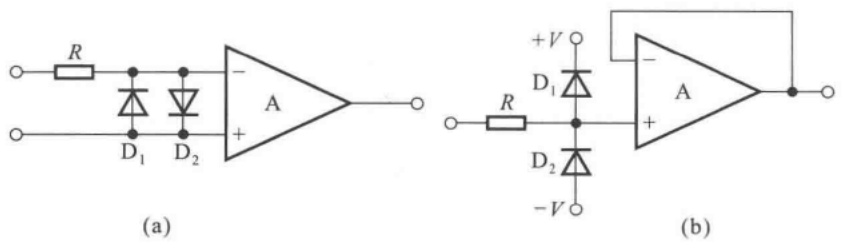

图 3.7.3 输入保护措施

(a) 防止输入差模信号过大 (b) 防止共模信号过大

## 二、输出保护

图 3.7.4 所示为输出端保护电路,限流电阻 R 与稳压管  $D_{z}$  构成限幅电路。一方面将负载与集成运放输出端隔离开来,限制了运放的输出电流;另一方面也限制了输出电压的幅值。当然,任何保护措施都是有限度的,若将输出端直接接电源,则稳压管会损坏,使电路的输出电阻大大提高,影响了电路的性能。

## 三、电源端保护

为了防止电源极性接反,可利用二极管的单向导电性,在电源端串联二极管来实现保护,如图3.7.5所示。

<small>① 关于自激振荡，请参阅第5章5.5节。</small>

---

3.8 Multisim 应用举例

171

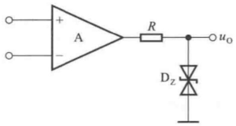

text_image

A
R
Dz
uO

图 3.7.4 输出保护电路

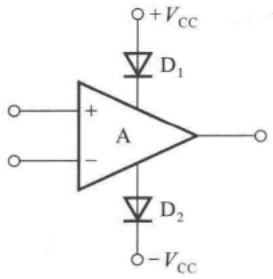

text_image

+VCC
D1
A
-
D2
-VCC

图 3.7.5 电源端保护

## 3.8 Multisim 应用举例

## 3.8.1 直接耦合多级放大电路调试方法的研究

## 一、仿真电路

在图3.8.1中所示两级直接耦合放大电路中，第一级为双端输入、单端输出差分放大电路，放大管Q1、Q2和恒流源电路中的晶体管Q3均为2N2222A, $\beta = 220, r_{\mathrm{bb'}} = 130\Omega$；稳压管的型号为IN4730A，稳定电压为 $3.891\mathrm{V}$；第二级为PNP型管组成的共射放大电路，管子型号为2N3720，$\beta = 133, r_{\mathrm{bb'}} = 10\Omega$。

## 二、仿真目的

调整两级放大电路的集电极电阻  $R_{1}$ 、 $R_{5}$ （其余电阻阻值如图 3.8.1 所标注保持不变），使电路静态时放大管 Q4 的集电极电位为 2～3 V，以保证电路的最大不失真输出电压尽可能大些；而且使电路电压放大倍数的数值大于 500。

在满足上述条件下,研究电路共模抑制比的测试方法和温度对电路静态工作点的影响。

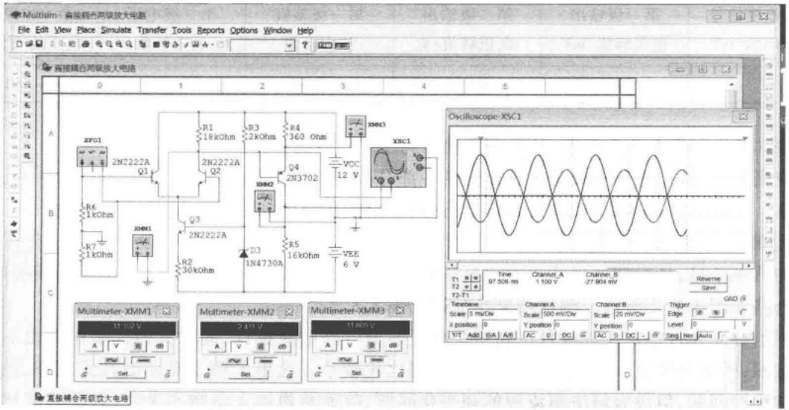

text_image

Multim - 直接耦合两级放大电路
File Edit View Place Simulate Transfer Tools Reports Options Window Help
直接耦合两级放大电路
Oscilloscope-XSC1
XPG1
2N2222A
Q1
R1
18kOhm
R3
2kOhm
R4
360 Ohm
XMC3
XSC1
R6
1kOhm
JDM1
R7
1kOhm
Q3
2N2222A
Q2
R2
30kOhm
D3
1N4730A
VCC
12 V
Q4
2N3702
R5
16kOhm
VSE
6 V
Multimeter-XMM1
Multimeter-XMM2
Multimeter-XMM3
11.10V
A V dB
Set
Multimeter-XMM2
A V dB
Set
Multimeter-XMM3
A V dB
Set
A V dB
Channel_A  Channel_B  Reverse Save
Time  Channel_A  Channel_B  Thigger Edge  C
97.508 ms  1.100 V  -27.904 mV  Save
Scale: 5 MHz/Div  Scale: 500 mV/Div  Scale: 20 mV/Div  Level: 0  V
X position  B Y position  B Y position  B Level: 0  V
Y/T Add B/A A/B AC 0 DC AC 0 DC - Steg Nor Auto

图 3.8.1 两级直接耦合放大电路的测试

---

172

第 3 章 集成运算放大电路

## 三、仿真内容

## 1. 根据仿真目的确定部分电路参数

利用参数扫描分析或者累试的方法,结合虚拟仪器的测试调整  $R_{1}$  和  $R_{5}$  阻值,使之满足 Q4 集电极静态电位在 2\~3 V 之间,且  $\left|\dot{A}_{u}\right|>500$ 。

在图 3.8.1 中,用自左至右三个万用表的直流电压挡,分别测量 Q2 集电极、Q4 集电极和 Q4 发射极静态电位;用函数发生器给放大电路输入频率为 100 Hz、峰-峰值为 2 mV 的正弦波电压,用示波器测量 Q2 集电极、Q4 集电极的交流信号的峰值电压。参数调试结果如图中标注,测试数据见万用表和示波器的读数。

静态数据整理如表 3.8.1 所示。

表 3.8.1 静态工作点的调试

| Q2集电极电阻$R_1/k\Omega$ | Q4集电极电阻$R_5/k\Omega$ | Q2集电极静态电位$U_{C2Q}/V$ | Q4集电极静态电位$U_{C4Q}/V$ | Q4集电极静态电流$I_{C4Q}/mA$ | Q4静态管压降$U_{CE4Q}/V$ |
| --- | --- | --- | --- | --- | --- |
| 18 | 16 | 11.102 | 2.411 | 0.53 | 8.441 |

表中 Q4 的静态电流和管压降算式如下:

$$
I _ {\mathrm{C4Q}} = \frac {U _ {\mathrm{C4Q}} + V _ {\mathrm{EE}}}{R _ {5}} = \frac {(2 . 4 1 1 + 6) \mathrm{V}}{1 6 \mathrm{k} \Omega} \approx 0. 5 3 \mathrm{mA}
$$

$$
U _ {\mathrm{CE4Q}} = U _ {\mathrm{C4Q}} + V _ {\mathrm{EE}} = (2. 4 1 1 + 6) \mathrm{V} = 8. 4 4 1 \mathrm{V}
$$

管压降数据表明 Q4 远离饱和区；且由于总电源电压为  $V_{CC} + V_{EE} = 18 \, V$ ，表明 Q4 也远离截止区；所以最大不失真输出电压较大。

动态测试数据及整理如表 3.8.2 所示。

表 3.8.2 电压放大倍数的调试

| 输入差模信号电压峰值/mV | 第一级输出电压峰值/mV | 第二级输出电压峰值/V | 第一级差模放大倍数 | 第二级电压放大倍数 | 整个电路的电压放大倍数 |
| --- | --- | --- | --- | --- | --- |
| 2 | -27.904 | 1.100 | -13.95 | 39.42 | -550 |

表 3.8.1 和表 3.8.2 表明,从静态到动态均达到仿真的目的。

应当指出,选取电路参数是电路设计的一部分,而且通常满足要求的参数不是唯一的,可以有多组。根据确定的参数,读者可自行进行分析估算,并与仿真结果比较,这里不赘述。

## 2. 测试电路的共模抑制比

加共模信号,从示波器可读出输出电压的峰值,得到共模电压放大倍数,从而得共模抑制比。测试电路如图3.8.2所示。测试结果及分析见表3.8.3。

利用分立元件搭建实际硬件电路很难保证差分电路的对称性,同时其恒流源电路也不是理想恒流源,因此共模放大倍数比较大,共模抑制比比较小。这里采用了器件的真实模型,虽然解决了对称性问题,但没有解决恒流源的理想化问题,故而共模放大倍数不是零,共模抑制比不是无穷大。尽管如此,与实际的分立元件电路比较,这两项指标已相当优秀了。

---

3.8 Multisim 应用举例

173

## 3. 温度对静态工作点的影响

在 Multisim 环境下, 默认温度是  $27^{\circ}C$  。利用“温度扫描分析”(Temperature Sweep Analysis)能够了解温度对静态工作点的影响。首先设置温度的起始值( $0^{\circ}C$ )、终了值( $50^{\circ}C$ )和点数(步长为  $10^{\circ}C$ ), 然后确定扫描对象 Q2 集电极(S6)和 Q4 集电极(S5)的电位, 最后按扫描键, 结果如图 3.8.3 所示。

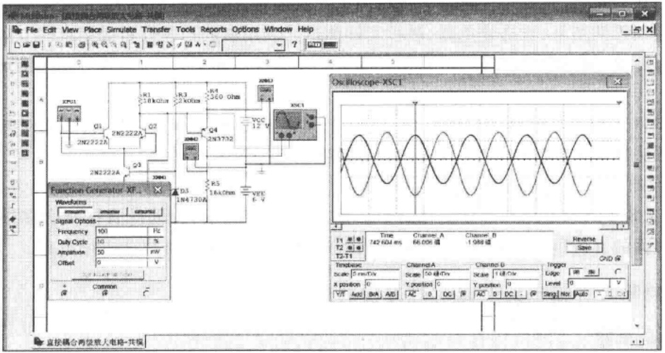

text_image

File Edit View Place Simulate Transfer Tools Reports Options Window Help
XPU1
2N2222A
Q1
2N2222A
Q2
2N2222A
Function Generator XF
Waveform
Signal Options
Frequency 101 Hz
Duty Cycles 50 %
Amplitude 50 mV
Offset 0 V
Common
@ # -
On-Bioscope-XSC.T
XNC1
XNC2
XNC3
XNC4
XNC5
XNC6
XNC7
XNC8
XNC9
XNC10
XNC11
XNC12
XNC13
XNC14
XNC15
XNC16
XNC17
XNC18
XNC19
XNC20
XNC21
XNC22
XNC23
XNC24
XNC25
XNC26
XNC27
XNC28
XNC29
XNC30
XNC31
XNC32
XNC33
XNC34
XNC35
XNC36
XNC37
XNC38
XNC39
XNC40
XNC41
XNC42
XNC43
XNC44
XNC45
XNC46
XNC47
XNC48
XNC49
XNC50
XNC51
XNC52
XNC53
XNC54
XNC55
XNC56
XNC57
XNC58
XNC59
XNC60
XNC61
XNC62
XNC63
XNC64
XNC65
XNC66
XNC67
XNC68
XNC69
XNC70
XNC71
XNC72
XNC73
XNC74
XNC75
XNC76
XNC77
XNC78
XNC79
XNC80
XNC81
XNC82
XNC83
XNC84
XNC85
XNC86
XNC87
XNC88
XNC89
XNC90
XNC91
XNC92
XNC93
XNC94
XNC95
XNC96
XNC97
XNC98
XNC99
XNSC1

图 3.8.2 两级直接耦合放大电路共模放大倍数的测试

表 3.8.3 共模放大倍数的测试

| 输入共模信号电压峰值/mV | 第一级输出电压峰值/μV | 第二级输出电压/μV | 第一级共模放大倍数 | 整个电路的共模放大倍数 | 共模抑制比 |
| --- | --- | --- | --- | --- | --- |
| 50 | 1.988 | 66.006 | $4 \times 10^{-5}$ | $-1.32 \times 10^{-3}$ | $4.08 \times 10^{5}$ |

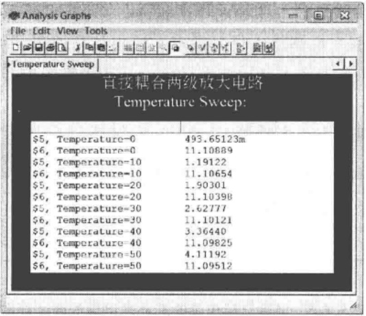

text_image

直接耦合两级放大电路
Temperature Sweep:
$5, Temperature=0 493.65123m
$6, Temperature=0 11.10889
$5, Temperature=10 1.19122
$6, Temperature=10 11.10654
$5, Temperature=20 1.90301
$6, Temperature=20 11.10398
$5, Temperature=30 2.62777
$6, Temperature=30 11.10121
$5, Temperature=40 3.36440
$6, Temperature=40 11.09825
$5, Temperature=50 4.11192
$6, Temperature=50 11.09512

图 3.8.3 两级直接耦合放大电路温度扫描分析结果

从扫描结果可以看出，Q2集电极电位变化较小，这是因为差分放大电路中恒流源电路的共模负反馈作用很强，使之温度漂移不明显。而第二级电路直流负反馈较弱，因而随着温度的升高，Q4集电极电位不断升高，即Q4集电极电阻上电压不断增大，说明其集电极电流增大，管压

---

174

第 3 章 集成运算放大电路

降减小，Q点明显漂移。Q点变化，将引起一系列动态参数的变化；因此，如果直接耦合放大电路不解决温度漂移的问题就不能成为实用电路。

## 四、总结

1. 由于直接耦合放大电路各级之间的静态工作点相互影响，在变化某一电路参数时会引起多个静态参数变化，直接在硬件电路中进行调试比较困难；因此，应通过EDA软件调整电路参数使之基本达到预期结果，再搭建电路，进行实际测试。利用参数扫描分析或累试的方法均可较快地确定电路参数，而且电路仿真时应采用实际所用元器件的模型参数，仿真对硬件实现才有指导意义。
2. 图 3.8.1 所示电路可等效为一个双端输入单端输出的差分放大电路, 可用对差分放大电路的评价方法来测评其性能好坏, 其电压放大倍数就是差模放大倍数。
3. 实际的差分放大电路的共模放大倍数不可能为零，即共模抑制比不可能无穷大；而且仿真表明，图 3.8.1 所示电路在温度变化时第二级 Q 点的变化很大，因此直接耦合多级放大电路需引入足够强的直流负反馈才能稳定静态工作点，克服漂移，也才能成为实用电路。

## 3.8.2 消除互补输出级交越失真方法的研究

## 一、仿真电路

基本互补电路和消除交越失真互补输出级如图 3.8.4(a) 所示。晶体管采用 NPN 型晶体管 2N3904 和 PNP 型晶体管 2N3906。二极管采用 1N4009。

在实际的实验中,几乎不可能得到具有较为理想对称特性的 NPN 型和 PNP 型管,但是在 Multisim 中却可以做到。因此,可以看到只受晶体管输入特性影响(不受其它因素影响)所产生的失真和消除这种失真的方法。

## 二、仿真内容

1. 利用直流电压表测量两个电路中晶体管基极和发射极电位, 得到静态工作点, 如图 3.8.4(a) 所示。各电压表所测量的电压如图中所标注。
2. 用示波器分别观察两个电路输入信号波形和输出信号波形，并测试输出电压的幅值。如图3.8.4(b)所示。Channel A为输入电压波形，Channel B为输出电压波形。

## 三、仿真结果

仿真结果如表 3.8.4 和表 3.8.5 所示。

表 3.8.4 基本互补电路的测试数据

| 直流电压表1读数$U_{B1}$/mV | 直流电压表2读数$U_{E1}$/nV | 输入信号V1峰值/V | 输出信号峰值/V |
| --- | --- | --- | --- |
| 0 | -8.987 | 2 | 1.331 |

表 3.8.5 消除交越失真的互补输出级的测试数据

| 直流电压表3读数$U_{B3}$/mV | 直流电压表4读数$U_{B4}$/mV | 直流电压表5读数$U_{E3}$/mV | 输入信号V2峰值/V | $Q_3$基极动态电位/V | $Q_4$基极动态电位/V | 输出信号峰值/V |
| --- | --- | --- | --- | --- | --- | --- |
| 721.256 | -721.324 | 14.705 | 2 | 1.406 | 1.406 | 1.997 |

---

3.8 Multisim应用举例

175

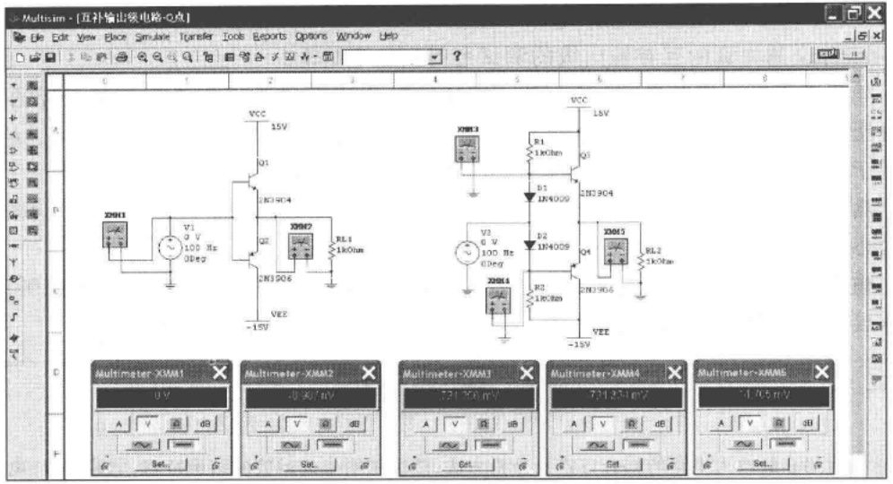

text_image

Multisim - [互补输出集成电路-0点]
File Edit View Place Simulate Transfer Tools Reports Options Window Help
A
B
C
D
E
F
G
H
I
J
K
L
M
N
O
P
Q
R
S
T
U
V
W
X
Y
Z
VCC 15V
Q1
180404
Q2
20042
RL1 1kOhm
-15V
VCC 15V
R1 1kOhm
Q1
R1 1k4009
203904
V3 0 V 100 Hz 0deg
R2 1k4009
Q4
20044
RL2 1kOhm
-15V
Multimeter-XMM1
U/V
A V dB
Set...
Multimeter-XMM2
-0.90 mV
A V dB
Set...
Multimeter-XMM3
721.25 mV
A V dB
Set...
Multimeter-XMM4
721.25 mV²
A V dB
Set...
Multimeter-XMM5
-1.75 mV
A V dB
Set...

(a)

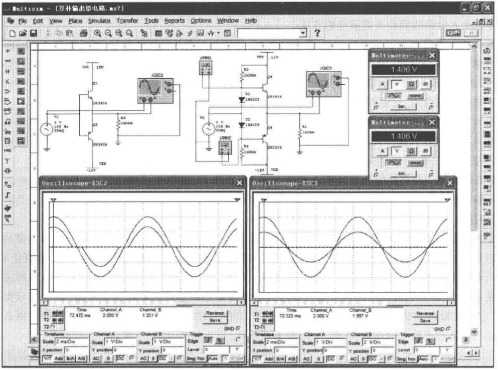

text_image

Multisim - [互补输出级电路.ms7]
File Edit View Place Simulate Transfer Tools Reports Options Window Help
VCL 1kV
Q1
JSC2
JSC3
Multimeter...
1.406 V
A V
Set...
Multimeter...
1.406 V
A V
Set...
Oscilloscope-XSC2
Oscilloscope-XSC3
T1 Time Channel_A Channel_B Reverse T2 Time Channel_A Channel_B Reverse T2-T1
72.472 ms 2.000 V 1.331 V
Timebase Channel_A Channel_B Trigger Edge SND C
Scale 2 ms/Div Scale 1 V/Div Scale 1 V/Div
X position 0 Y position 0 Y position 0 Y position 0 Y position 0 Y position 0 Y position 0 Y position 0 Y position 0 Y position 0 Y position 0 Y position 0 Y position 0 Y position 0 Y position 0 Y position 0 Y position 0 Y position 0 Y position 0 Y position 0 Y position 0 Y position 0 Y position 0 Y position 0 Y position 0 Y position 0
Add B/A A/S AC 0 DC C Sing, Nor, Auto

(b)

图 3.8.4 互补输出级电路的测试

(a) 静态测试 (b) 动态测试

## 四、总结

1. 对基本互补电路的测试可得到如下结论:

(1) 静态时晶体管基极和发射极的直流电压均为0, 静态功耗小。

---

176

第 3 章 集成运算放大电路

（2）由于输入电压小于 b-e 间的开启电压时两只晶体管均截止，输出信号波形明显产生了交越失真，且输出电压峰值小于输入电压峰值。

2. 对消除交越失真的互补输出级的测试可得到如下结论:

（1）晶体管基极直流电位 $U_{\mathrm{B3}} \approx -U_{\mathrm{B4}} = 721 \mathrm{~mV}$，表明两只管子在静态均处于导通状态，发射极的直流电位 $U_{\mathrm{E3}} \approx 14.7 \mathrm{~mV}$，很接近0，说明管子具有很好的对称性。 $U_{\mathrm{B3}} \neq -U_{\mathrm{B4}}, U_{\mathrm{E3}} \neq 0$ 的原因仍在于NPN型晶体管2N3904和PNP型晶体管2N3906的不对称性。
（2）输入电压的峰值为 2 V，有效值约为 1.414 V。在动态测试中， $U_{b3} = U_{b4} = 1.406 V \approx U_i$ ，说明在动态的近似分析中可将  $T_3$  和  $T_4$  的基极与输入端看成为一个点。
（3）输出电压峰值与输入电压峰值相差无几，且输出信号波形没有产生失真，说明合理设置静态工作点是消除交越失真的基本方法，且使电路的跟随特性更好。

## 本章小结

本章首先讲述多级放大电路的耦合方式及分析方法，然后阐明集成运放的结构特点、电路组成、电压传输特性，进而分析组成运放的差分放大电路、电流源电路、互补输出级电路，最后简述集成运放内部电路的工作原理、主要性能指标、种类及使用方法等。

一、多级放大电路的耦合方式和分析方法。

直接耦合放大电路存在温度漂移问题，低频特性好，能够放大变化缓慢的信号，便于集成化，应用广泛；阻容耦合放大电路利用耦合电容“隔离直流，通过交流”，低频特性差，不便于集成化，仅用于非用分立元件电路不可的情况；变压器耦合放大电路能够实现阻抗变换，常用作调谐放大电路或输出功率很大的功率放大电路；光电耦合方式具有电气隔离作用，使电路抗干扰能力强，适用于信号的隔离和远距离传送。

多级放大电路的电压放大倍数等于组成它的各级电路电压放大倍数之积，在求解某一级的电压放大倍数时应将后级输入电阻作为负载。其输入电阻是第一级的输入电阻，输出电阻是末级的输出电阻。输出波形失真时，应首先判断从哪一级开始产生失真，然后再判断失真性质并予以消除。

二、集成运放是一种高性能的直接耦合放大电路，从外部看，可等效成双端输入、单端输出的差分放大电路。通常由输入级、中间级、输出级和偏置电路四部分组成。输入级多用差分放大电路，中间级为共射（共源）电路，输出级多用互补输出级，偏置电路是多路电流源电路。
三、基本差分放大电路利用参数的对称性进行补偿来抑制温漂，长尾式放大电路和具有恒流源的差分放大电路还利用共模负反馈抑制每只放大管的温漂。用共模放大倍数 $A_{e}$ 、差模放大倍数 $A_{d}$ 、共模抑制比 $K_{CMR}$ 、输入电阻和输出电阻来描述差分电路的性能。根据输入端与输出端接地情况不同，差分放大电路有四种接法。

在集成运放中,不但充分利用元件参数一致性好的特点构成高质量的差分放大电路,而且还可构成各种电流源电路,它们既为各级放大电路提供合适的静态电流,又作为有源负载,从而大大提高了运放的增益。

互补输出电路在零输入时零输出，输出正、负方向对称，双向跟随，具有很强的带负载能力。

四、集成运放的主要性能指标有 $A_{\mathrm{od}}, r_{\mathrm{id}}, U_{10}$ 和 $\mathrm{d}U_{10} / \mathrm{d}T, I_{10}$ 和 $\mathrm{d}I_{10} / \mathrm{d}T, -3$ dB带宽 $f_{\mathrm{H}}$ 、单位增益带宽 $f_{\mathrm{c}}$ 和 $SR$ 等。通用型运放各方面参数均衡，适合一般应用；专用型运放在某方面的性能指标特别优秀，适合有特殊要求的场合。
五、使用运放时应注意调零、设置偏置电压、频率补偿和必要的保护措施。目前多数产品内部有补偿电容，部分产品内部有稳零措施。

学完本章后希望能够达到以下要求:

一、掌握以下概念及定义:零点漂移与温度漂移，共模信号与共模放大倍数，差模信号与差模放大倍数，共模抑制比，差模输入电阻，失调电压和失调电流，-3 dB带宽 $f_{H}$ 等。

---

自测题

177

二、掌握各种耦合方式的优缺点，能够正确估算多级放大电路的 $\dot{A}_{u}$ 、 $R_{i}$ 和 $R_{o}$ 。

三、熟悉集成运放的组成及各部分的作用，正确理解主要指标参数的物理意义及其使用注意事项。

四、理解差分放大电路的组成和工作原理,掌握静态和动态参数的分析方法;了解电流源电路的工作原理;掌握互补输出级(OCL电路)的正确接法和输入-输出关系。

五、了解一种运放电路的工作原理。

## 自测题

## 一、现有基本放大电路:

A. 共射电路

B. 共集电路

C. 共基电路

D. 共源电路

E. 共漏电路

根据要求选择合适电路组成两级放大电路。

（1）要求输入电阻为 $1\sim 2\mathrm{k}\Omega$ ，电压放大倍数大于3000，第一级应采用\_\_\_\_，第二级应采用\_\_\_\_。
(2) 要求输入电阻大于  $10 \, M\Omega$ ，电压放大倍数大于 300，第一级应采用 \_\_\_\_，第二级应采用 \_\_\_\_。
（3）要求输入电阻为  $100 \sim 200 \, k\Omega$ ，电压放大倍数数值大于 100。第一级应采用 \_\_\_\_，第二级应采用 \_\_\_\_。
(4) 要求电压放大倍数的数值大于 10, 输入电阻大于  $10 \, M\Omega$ , 输出电阻小于  $100 \, \Omega$ , 第一级应采用 \_\_\_\_ , 第二级应采用 \_\_\_\_ 。
（5）设信号源为内阻很大的电压源，要求将输入电流转换成输出电压，且 $|\dot{A}_{si}|=|\dot{U}_{o}/\dot{I}_{i}|>1000$ ，输出电阻 $R_{o}<100$ ，第一级应采用\_\_\_\_，第二级应采用\_\_\_\_。

## 二、选择合适的答案填入空内。

(1) 直接耦合放大电路存在零点漂移的原因是\_\_\_\_。

A. 元件老化

B. 晶体管参数受温度影响

C. 放大倍数不够稳定

D. 电源电压不稳定

(2) 集成放大电路采用直接耦合方式的原因是 \_\_\_\_。

A. 便于设计

B. 放大交流信号

C. 不易制作大容量电容

(3)差分放大电路的差模信号是两个输入端信号的\_\_\_\_，共模信号是两个输入端信号的\_\_\_\_。

A. 差

B. 和

C. 平均值

（4）用恒流源取代长尾式差分放大电路中的发射极电阻  $R_{e}$ ，将使电路的 \_\_\_\_。

A. 差模放大倍数数值增大

B. 抑制共模信号能力增强

C. 差模输入电阻增大

(5) 通用型集成运放适用于放大\_\_\_\_。

A. 高频信号

B. 低频信号

C. 任何频率信号

(6) 集成运放的输入级采用差分放大电路是因为可以 \_\_\_\_。

A. 减小温漂

B. 增大放大倍数

C. 提高输入电阻

(7) 为增大电压放大倍数, 集成运放的中间级多采用 \_\_\_\_。

A. 共射放大电路

B. 共集放大电路

C. 共基放大电路

(8)集成运放的末级采用互补输出级是为了\_\_\_\_。

A. 电压放大倍数大

B. 不失真输出电压大

C. 带负载能力强

三、电路如图 T3.3 所示，所有晶体管均为硅管， $\beta$ 均为 200， $r_{bb'} = 200 \Omega$，静态时 $|U_{BEQ}| \approx 0.7 V$。试求:

(1) 静态时  $T_{1}$  管和  $T_{2}$  管的发射极电流；
（2）若静态时  $u_{0}>0$ ，则应如何调节  $R_{c2}$  的值才能使  $u_{0}=0\ V$ ？若静态  $u_{0}=0\ V$ ，则  $R_{c2}=$ ？电压放大倍数为多少？

---

178

第 3 章 集成运算放大电路

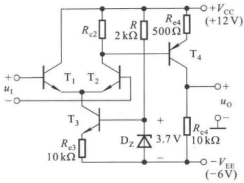

text_image

+VCC
(+12V)
Rc2 2 kΩ R Re4 500Ω T4
+ uI T1 T2
- T3 + uO
Re3 10 kΩ DZ 3.7 V - Rc4 10 kΩ -VEE (-6V)

图 T3.3

四、电路如图 T3.4 所示，已知  $\beta_{1}=\beta_{2}=\beta_{3}=100$ 。各管的  $U_{BE}$  均为 0.7 V，试求  $I_{C2}$  的值。

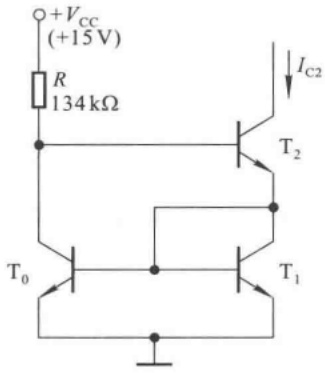

text_image

+Vcc
(+15V)
R
134kΩ
T2
IC2
T0
T1

图 T3.4

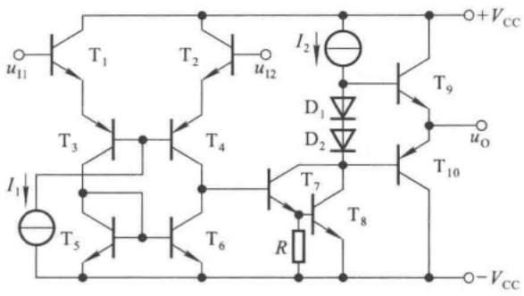

text_image

u11
T1
T2
u12
I2
T3
T4
D1
D2
T7
T8
R
T5
T6
+VCC
T9
uO
T10
-VCC

图 T3.5

五、某型号集成运放的简化电路如图 T3.5 所示。

（1）说明电路是几级放大电路，各级分别是哪种形式的放大电路（共射、共集、差分……）:
(2) 分别说明各级采用了哪些措施来改善其性能指标(如增大放大倍数、增大输入电阻……)。

## 习题

3.1 判断图 P3.1 所示各两级放大电路中， $T_{1}$  和  $T_{2}$  管分别组成哪种组态（共射、共射……接法）。设图中所有电容对于交流信号均可视为短路。
3.2 设图 P3.2 所示各电路的静态工作点均合适, 分别画出它们的交流等效电路, 并写出  $\dot{A}_{u}$ 、 $R_{i}$  和  $R_{o}$  的表达式。
3.3 基本放大电路如图 P3.3(a)、(b) 所示，图 (a) 点画线框内为电路 I，图 (b) 点画线框内为电路 II。由电路 I、II 组成的多级放大电路如图 (c)、(d)、(e) 所示，它们均正常工作。试说明图 (c)、(d)、(e) 所示电路中

(1) 哪些电路的输入电阻比较大；
(2) 哪些电路的输出电阻比较小；
(3) 哪个电路的  $\dot{A}_{us} = | \dot{U}_{o} / \dot{U}_{s} |$  最大。

---

习题

179

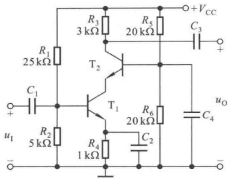

text_image

R1
25 kΩ
C1
+
u1
-
R2
5 kΩ
T1
R3
3 kΩ
R5
20 kΩ
+VCC
C3
+
T2
R6
20 kΩ
C4
uO
R4
1 kΩ
C2
-

(a)

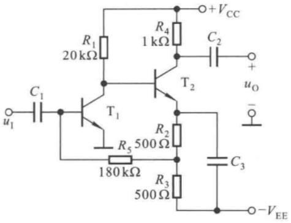

text_image

R1
20 kΩ
R4
1 kΩ
C2
+VCC
T2
uO
+
-
C1
T1
R5 500 Ω
180 kΩ
R2
R3
500 Ω
C3
-VEE

(b)

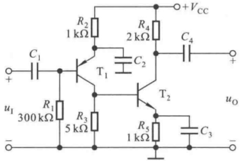

text_image

C1
+
ui
R1
300 kΩ
R2
1 kΩ
T1
R3
5 kΩ
C2
R4
2 kΩ
T2
R5
1 kΩ
C4
+VCC
+
uo
-
C3

(c)

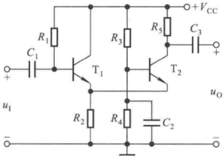

text_image

R1
C1
+
ui
-
T1
R3
R5
C3
+
VCC
T2
uO
R2
R4
C2
-

(d)

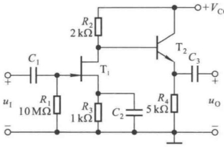

text_image

R2
2 kΩ
+VCC
C1
T1
T2
C3
+
ui
R1
10 MΩ
R3
1 kΩ
C2
5 kΩ
uO
-

(e)

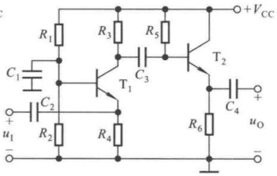

text_image

C1
+
ui
-
R1
C2
R2
R3
T1
R4
C3
R5
T2
C4
R6
+VCC
uo
-

(f)

图 P3.1

3.4 电路如图 P3.1(e) 所示, 晶体管的  $\beta$  为 200,  $r_{be}$  为 3 kΩ, 场效应管的  $g_{m}$  为 15 mS; Q 点合适。求解  $\dot{A}_{u}$ 、 $R_{i}$  和  $R_{o}$ 。
3.5 图 P3.5 所示电路参数理想对称，晶体管的  $\beta$  均为 100,  $r_{bb'} = 100 \Omega$ ,  $U_{BEQ} \approx 0.7$ 。试计算  $R_{w}$  滑动端在中点时  $T_{1}$  管和  $T_{2}$  管的发射极静态电流  $I_{EQ}$ ，以及动态参数  $A_{d}$  和  $R_{i}$ 。
3.6 电路如图 P3.6 所示，已知  $T_{1}$  管和  $T_{2}$  管的  $\beta$  均为 140,  $r_{be}$  均为 4 kΩ。试问:若输入直流信号  $u_{11} = 20 \, mV, u_{t2} = 10 \, mV$ ，则电路的共模输入电压  $u_{1c} = ?$  差模输入电压  $u_{1d} = ?$  输出动态电压  $\Delta u_{0} = ?$
3.7 电路如图 P3.7 所示， $T_{1}$  和  $T_{2}$  的低频跨导  $g_{m}$  均为 10 mS。试求解差模放大倍数和输入电阻。
3.8 电路如图 P3.8 所示， $T_{1} \sim T_{5}$  的电流放大系数分别为  $\beta_{1} \sim \beta_{5}$ ，b - e 间动态电阻分别为  $r_{bel} \sim r_{be5}$ ，写出  $\dot{A}_{u}, R_{i}$  和  $R_{0}$  的表达式。

---

180

第 3 章 集成运算放大电路

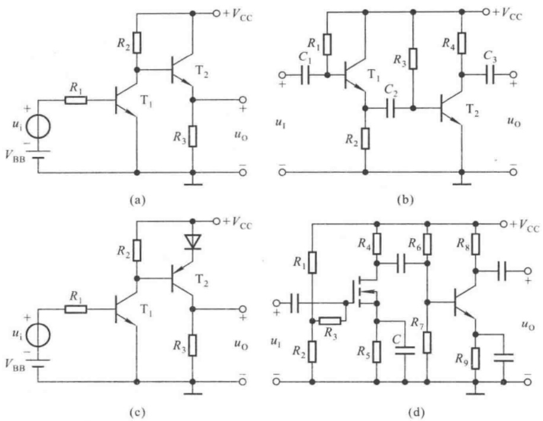

图 P3.2

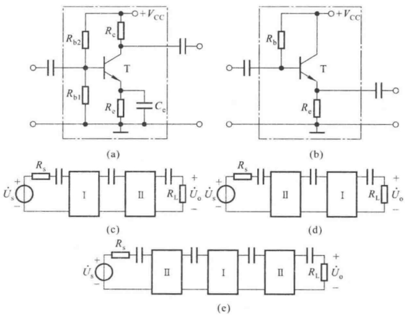

图 P3.3

---

习题

181

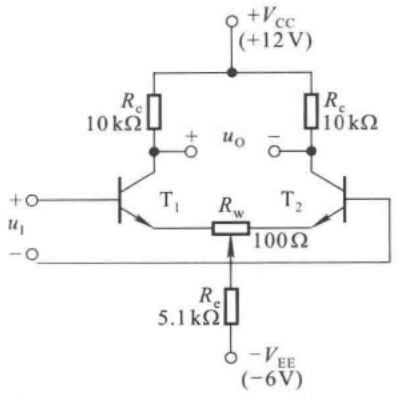

text_image

+VCC
(+12V)
Rc
10 kΩ
+
uo
-
Rc
10 kΩ
T1
Rw
T2
100 Ω
ui
-
Re
5.1 kΩ
-VEE
(-6V)

图 P3.5

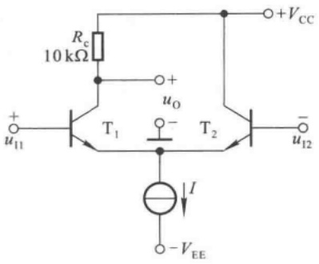

text_image

Rc
10 kΩ
+VCC
+
uo
-
T1
T2
u11
u12
-
I
-VEE

图P3.6

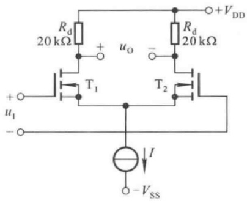

text_image

Rd
20 kΩ
+
uo
-
Rd
20 kΩ
+VDD
T1
T2
u1
-
I
-Vss

图 P3.7

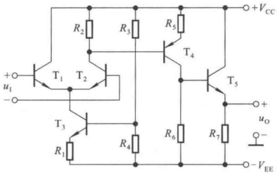

text_image

+VCC
R2 R3 R5
T1 T2 T4
+ u1 -
T3 R1 R4 R6 R7
T5 + uO -
- VEE

图P3.8

3.9 电路如图 P3.9 所示。已知电压放大倍数为 -100，输入电压  $u_{1}$  为正弦波， $T_{2}$  和  $T_{3}$  管的饱和压降  $\left|U_{CES}\right|=1\ V$ 。试问:

(1) 在不失真的情况下, 输入电压最大有效值  $U_{imax}$  为多少?
(2) 若  $U_{i}=10\ mV$  (有效值)，则  $U_{o}=?$  若此时  $R_{3}$  开路，则  $U_{o}=?$  若  $R_{3}$  短路，则  $U_{o}=?$

text_image

R3
+VCC
(+12 V)
R2
D1
T2
D2
T3
RL
uO
+
-
R1
T1
u1
-
- VCC
(-12 V)

图 P3.9

3.10 根据下列要求,将应优先考虑使用的集成运放填入空内。已知现有集成运放的类型是:

① 通用型 ② 高阻型 ③ 高速型 ④ 低功耗型 ⑤ 高压型 ⑥ 大功率型 ⑦ 高精度型

(1) 作低频放大器, 应选用 \_\_\_\_ ;

---

182

第 3 章 集成运算放大电路

(2) 作宽频带放大器, 应选用 \_\_\_\_ ;
(3) 作幅值为  $1 \mu V$  以下微弱信号的测量放大器, 应选用 \_\_\_\_ ;
(4) 作内阻为  $100 \, k\Omega$  信号源的放大器, 应选用 \_\_\_\_ ;
(5) 负载需 5 A 电流驱动的放大器, 应选用 \_\_\_\_ ;
(6) 要求输出电压幅值为  $\pm80\ V$  的放大器, 应选用 \_\_\_\_ ;
(7) 宇航仪器中所用的放大器, 应选用 \_\_\_\_。

3.11 已知几个集成运放的参数如表 P3.11 所示, 试分别说明它们各属于哪种类型的运放。

表 P3.11

| 特性指标 | $A_{cd}$ | $r_{id}$ | $U_{IO}$ | $I_{IO}$ | $I_{IB}$ | -3 dB$f_{H}$ | $K_{CMR}$ | SR | 单位增益带宽 |
| --- | --- | --- | --- | --- | --- | --- | --- | --- | --- |
| 单位 | dB | MΩ | mV | nA | nA | Hz | dB | V/μs | MHz |
| $A_1$ | 100 | 2 | 5 | 200 | 600 | 7 | 86 | 0.5 |  |
| $A_2$ | 130 | 2 | 0.01 | 2 | 40 | 7 | 120 | 0.5 |  |
| $A_3$ | 100 | 1 000 | 5 | 0.02 | 0.03 |  | 86 | 0.5 | 5 |
| $A_4$ | 100 | 2 | 2 | 20 | 150 |  | 96 | 65 | 12.5 |

3.12 多路电流源电路如图 P3.12 所示, 已知所有晶体管的特性均相同,  $U_{BE}$  均为 0.7 V。试求  $I_{C1}$ 、 $I_{C2}$  各为多少。

3.13 电路如图 P3.13 所示，各晶体管的低频跨导均为  $g_{m}$ ， $T_{1}$  和  $T_{2}$  管 D-S 间的动态电阻分别为  $r_{ds1}$  和  $r_{ds2}$ 。试求解电压放大倍数  $A_{u} = \Delta u_{0} / \Delta u_{1}$  的表达式。

text_image

+VCC
(+15V)
R 136 kΩ
T3
IC1
IC2
T0
T1
T2

图 P3.12

text_image

+VDD
T3
T2
uO
I
T1
u1
-VSS

图 P3.13

3.14 电路如图 P3.14 所示， $T_{1}$  与  $T_{2}$  管特性相同，它们的低频跨导为  $g_{m}$ ； $T_{3}$  与  $T_{4}$  管特性对称； $T_{2}$  与  $T_{4}$  管 d-s 间动态电阻分别为  $r_{d+2}$  和  $r_{d+4}$ 。试求出电压放大倍数  $A_{u} = \Delta u_{0} / \Delta (u_{11} - u_{12})$  的表达式。

3.15 电路如图 P3.15 所示, $T_{1}$ 与 $T_{2}$ 管为超 $\beta$ 管,电路具有理想的对称性。选择合适的答案填入空内。

(1) 该电路采用了 \_\_\_\_;

A. 共集 - 共基接法

B. 共集 - 共射接法

C. 共射 - 共基接法

(2) 电路所采用的上述接法是为了 \_\_\_\_；

A. 增大输入电阻

B. 增大电流放大系数

C. 展宽频带

---

习题

183

text_image

+VDD
I
u11
T1
T2
u12
uO
T3
T4
-VSS

图 P3.14

text_image

+VCC
Rc R Rc
+ uO -
T3 T4
D1
uI1 T1 D2 T2 uI2
I - VEE

图 P3.15

(3) 电路采用超  $\beta$  管能够 \_\_\_\_ ;

A. 增大输入级的耐压值

B. 增大放大能力

C. 增大带负载能力

(4)  $T_{1}$  与  $T_{2}$  管的静态管压降约为 \_\_\_\_。

A. 0.7 V

B. 1.4 V

C. 不可知

3.16 在图 P3.16 所示电路中，已知  $T_{1} \sim T_{3}$  管的特性完全相同， $\beta \gg 2$ ；反相输入端的输入电流为  $i_{11}$ ，同相输入端的输入电流为  $i_{12}$ 。试问:

(1)  $i_{C2} \approx ?$
(2)  $i_{B3} \approx ?$
(3) $A_{\mathrm{m}} = \Delta u_0 / (i_{11} - i_{12})\approx ?$

text_image

i11
iB3
T3
+VCC
Rc
uO
iC2
iC1
T2
T1
i12

图 P3.16

3.17 比较图 P3.17 所示两个电路, 分别说明它们是如何消除交越失真和如何实现过流保护的。

3.18 图 P3.18 所示为简化的高精度运放电路原理图, 试分析:

(1) 两个输入端中哪个是同相输入端, 哪个是反相输入端;
(2)  $T_{3}$  与  $T_{4}$  的作用；
(3) 电流源  $I_{3}$  的作用；
(4)  $D_{2}$  与  $D_{3}$  的作用。

3.19 通用型运放 F747 的内部电路如图 P3.19 所示, 试分析:

（1）偏置电路由哪些元件组成？基准电流约为多少？
(2) 哪些是放大管？组成几级放大电路？每级各是什么基本电路？

---

184

第 3 章 集成运算放大电路

图 P3.17

text_image

T3
T4
I2
T6
T5
T7
T8
D2
D3
T10
uO
T11
u11
T1
T2
u12
I1
I3
I4
T9
+VCC
-VCC

图 P3.18

text_image

T8
T9
T13
T21
+VCC (+15V)
T23
T1
T2
u12
T12
R9
uO
T4
T7
R5 39 kΩ
T19
T20
T22
R8
R10
T24
T16
T14
T15
T17
T18
R1 R2 R3
R4
T5 T6 T10 T11
R6 R7
-Rw
-VCC (-15V)

图 P3.19

---

习题

185

(3)  $T_{19}$ 、 $T_{20}$  和  $R_{8}$  组成的电路的作用是什么?

3.20 型号为 5G28 的集成运放内部电路如图 P3.20 所示。试分析:

text_image

R1
1.4 kΩ
T1
3
T2
T3
4
C
9
T4
T5
T6
T7
T8
R5
600 Ω
R4
30 kΩ
R6
600 Ω
Rw
2 kΩ
R3
30 kΩ
R8
60 Ω
D1
D2
D3
D4
R7
50 Ω
R9
50 Ω
T10
+VCC
8
7
T11
5
-VEE

图 P3.20

(1) 该运放属于哪种类型的运放(双极型、单极型……);
(2) 哪些是放大管？组成几级放大电路？每级各是什么基本电路；
(3) $R_{7}$ 、 $R_{9}$ 的作用是什么？
(4) 电容 C 的作用是什么?

3.21 利用 Multisim 研究图 P3.5 所示电路在下列情况下对电路静态和动态的影响:

(1) 两个  $R_{c}$  阻值相差 5%;
(2) $R_{w}$ 不在中点；
(3) 两个差分管的电流放大倍数不相等。

提示:为便于调节晶体管参数,采用虚拟晶体管。

3.22 利用 Multisim 为图 P3.8 所示电路选择电路参数, 使之正常工作, 并测试 Q 点、电压放大倍数和输入电阻。

出题目的:

(1) 学习搭建复杂电路的方法和利用 Multisim 辅助设计电子电路的方法。
(2) 了解直接耦合多级放大电路 Q 点的调试方法。

提示:

(1) 晶体管采用实际晶体管, 其余可采用虚拟元件。
(2) 需思考为提高输入电阻, $R_{1} \sim R_{7}$ 应如何选取; 为提高差模放大能力, $R_{1} \sim R_{7}$ 应如何选取。
（3）若测试过程中电路产生了自激振荡，即在输入电压为零时输出为一定频率、一定幅值的正弦波，则在 $T_{4}$ 管基极与集电极之间加一个小容量的电容（如10 pF）消振。
