# 第4章 放大电路的频率响应

原始 PDF 第 209–242 页。

## 第4章

## 放大电路的频率响应

## 本章讨论的问题

- 为什么要研究放大电路的频率响应？
- 如何测定一个RC网络的频率响应？怎样画出频率特性曲线？
- 晶体管与场效应管的h参数等效模型在高频信号下还适用吗？为什么？如何构造高频等效模型？
- 什么是放大电路的通频带？哪些因素影响通频带？如何确定放大电路的通频带？
- 如果放大电路的频率响应不满足要求，应该怎么办？
- 对于放大电路，是通频带愈宽愈好吗？为什么？
- 为什么集成运放的通频带很窄？

## 4.1 频率响应概述

本节将讲述研究频率响应的必要性、有关频率响应的基本概念、放大电路频率响应的分析方法以及频率特性曲线的画法等问题。

## 4.1.1 研究放大电路频率响应的必要性

在放大电路中，由于电抗元件（如电容、电感线圈等）及半导体管极间电容的存在，当输入信号的频率过低或过高时，不但放大倍数的数值会变小，而且还将产生超前或滞后的相移，说明放大倍数是信号频率的函数，这种函数关系称为频率响应或频率特性。第2章中所介绍的“通频带”就是用来描述电路对不同频率信号适应能力的动态参数，对于任何一个具体的放大电路都有一个确定的通频带。因此，在设计电路时，必须首先了解信号的频率范围，以便使所设计的电路具有适应于该信号频率范围的通频带；在使用电路前，应查阅手册、资料，或实测其通频带，以便确定电路的适用范围。

在前面的电路分析中,所用的双极型管和单极型管的等效模型均未考虑极间电容的作用,即认为它们对信号频率呈现出的电抗值为无穷大,因而它们只适用于对低频信号的分析。本章将引入半导体管的高频等效模型,并阐明放大电路上限频率、下限频率和通频带的求解方法,以及频率响应的描述方法。

## 4.1.2 频率响应的基本概念

在放大电路中,由于耦合电容的存在,对信号构成了高通电路,即对于频率足够高的信号电容相当于短路,信号几乎毫无损失地通过;而当信号频率低到一定程度时,电容的容抗不可忽略,信号

---

4.1 频率响应概述

187

将在其上产生压降,从而导致放大倍数的数值减小且产生相移。与耦合电容相反,由于半导体管极间电容的存在,对信号构成了低通电路,即对于频率足够低的信号相当于开路,对电路不产生影响;而当信号频率高到一定程度时,极间电容将分流,从而导致放大倍数的数值减小且产生相移。为了便于理解有关频率响应的基本要领,这里将对无源单级RC电路的频率响应加以分析。

## 一、高通电路

在图4.1.1(a)所示高通电路中，设输出电压 $\dot{U}_{\mathrm{o}}$ 与输入电压 $\dot{U}_{\mathrm{i}}$ 之比为 $\dot{A}_u$ ，则

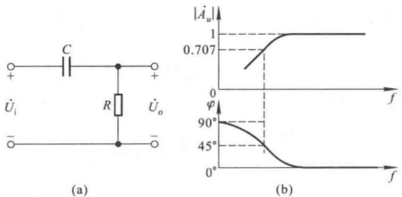

图 4.1.1 高通电路及其频率响应

(a) 电路 (b) 频率响应

$$
\dot {A} _ {u} = \frac {\dot {U} _ {o}}{\dot {U} _ {i}} = \frac {R}{\frac {1}{j \omega C} + R} = \frac {1}{1 + \frac {1}{j \omega R C}} \tag {4.1.1}
$$

式中  $\omega$  为输入信号的角频率, RC 为回路的时间常数  $\tau$ , 令  $\omega_{L}=\frac{1}{RC}=\frac{1}{\tau}$ , 则

$$
f _ {\mathrm{L}} = \frac {\omega_ {\mathrm{L}}}{2 \pi} = \frac {1}{2 \pi \tau} = \frac {1}{2 \pi R C} \tag {4.1.2}
$$

因此

$$
\dot {A} _ {u} = \frac {1}{1 + \frac {\omega_ {\mathrm{L}}}{\mathrm{j} \omega}} = \frac {1}{1 + \frac {f _ {\mathrm{L}}}{\mathrm{j} f}} = \frac {\mathrm{j} \frac {f}{f _ {\mathrm{L}}}}{1 + \mathrm{j} \frac {f}{f _ {\mathrm{L}}}} \tag {4.1.3}
$$

将  $\dot{A}_{u}$  用其幅值与相角表示, 得出

$$
\left\{ \begin{array}{l} \mid \dot {A} _ {u} \mid = \frac {\frac {f}{f _ {\mathrm{L}}}}{\sqrt {1 + \left(\frac {f}{f _ {\mathrm{L}}}\right) ^ {2}}} \\ \varphi = 9 0 ^ {\circ} - \arctan \frac {f}{f _ {\mathrm{L}}} \end{array} \right. \tag {4.1.4a}
$$

因式(4.1.4a)表明  $\dot{A}_{u}$  的幅值与频率的函数关系,故称之为  $\dot{A}_{u}$  的幅频特性;因式(4.1.4b)表明  $\dot{A}_{u}$  的相位与频率的函数关系,故称之为  $\dot{A}_{u}$  的相频特性。

由式(4.1.4)可知，当 $f \gg f_{L}$ 时， $\left|\dot{A}_{u}\right| \approx 1, \varphi \approx 0^{\circ}$ ; 当 $f = f_{L}$ 时， $\left|\dot{A}_{u}\right| = 1 / \sqrt{2} \approx 0.707, \varphi =$

---

188

第 4 章 放大电路的频率响应

$45^{\circ}$; 当 $f \ll f_{\mathrm{L}}$ 时, $f / f_{\mathrm{L}} \ll 1$, $|\dot{A}_u| \approx f / f_{\mathrm{L}}$, 表明 $f$ 每下降 10 倍, $|\dot{A}_u|$ 也下降 10 倍; 当 $f$ 趋于零时, $|\dot{A}_u|$ 也趋于零, $\varphi$ 趋于 $+90^{\circ}$。由此可见, 对于高通电路, 频率愈低, 衰减愈大, 相移愈大; 只有当信号频率远高于 $f_{\mathrm{L}}$ 时, $\dot{U}_{\mathrm{o}}$ 才约为 $\dot{U}_{\mathrm{i}}$。称 $f_{\mathrm{L}}$ 为下限截止频率, 简称下限频率, 在该频率下, $\dot{A}_u$ 的幅值下降到 $70.7\%$, 相移恰为 $+45^{\circ}$。画出图 4.1.1(a) 所示电路的频率特性曲线如图(b)所示, 上边为幅频特性曲线, 下边为相频特性曲线。

## 二、低通电路

图 4.1.2(a) 所示为低通电路, 输出电压  $\dot{U}_{o}$  与输入电压  $\dot{U}_{i}$  之比

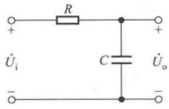

text_image

R
+   +
Üi   C   Üo
-   -

(a)

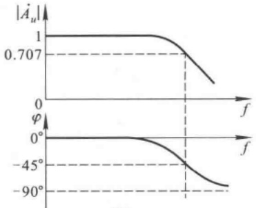

line

| Magnitude | 0.707 |
| --- | --- |
| Phase \(\phi\) | \(0{}^{\circ}\) |
| Phase | \(-45{}^{\circ}\) |
| Phase | \(-90{}^{\circ}\) |

(b)

图 4.1.2 低通电路及其频率响应

(a) 电路 (b) 频率响应

$$
\dot {A} _ {u} = \frac {\dot {U} _ {\mathrm{o}}}{\dot {U} _ {\mathrm{i}}} = \frac {\frac {1}{\mathrm{j} \omega C}}{R + \frac {1}{\mathrm{j} \omega C}} = \frac {1}{1 + \mathrm{j} \omega R C} \tag {4.1.5}
$$

回路的时间常数  $\tau = RC$ ，令  $\omega_{H} = \frac{1}{\tau}$ ，则

$$
f _ {\mathrm{H}} = \frac {\omega_ {\mathrm{H}}}{2 \pi} = \frac {1}{2 \pi \tau} = \frac {1}{2 \pi R C} \tag {4.1.6}
$$

代入式(4.1.5)可得

$$
\dot {A} _ {u} = \frac {1}{1 + \mathrm{j} \frac {\omega}{\omega_ {\mathrm{H}}}} = \frac {1}{1 + \mathrm{j} \frac {f}{f _ {\mathrm{H}}}} \tag {4.1.7}
$$

将  $\dot{A}_{u}$  用其幅值及相角表示, 得出

$$
\left\{ \begin{array}{l} \mid \dot {A} _ {u} \mid = \frac {1}{\sqrt {1 + \left(\frac {f}{f _ {\mathrm{H}}}\right) ^ {2}}} \\ \varphi = - \arctan \frac {f}{f _ {\mathrm{H}}} \end{array} \right. \tag {4.1.8a}
$$

式(4.1.8a)是 $\dot{A}_{u}$ 的幅频特性,式(4.1.8b)是 $\dot{A}_{u}$ 的相频特性。从对式(4.1.8)的分析可得,当 $f\ll f_{H}$ 时, $|\dot{A}_{u}|\approx1,\varphi\approx0^{\circ}$ ;当 $f=f_{H}$ 时, $|\dot{A}_{u}|=1/\sqrt{2}\approx0.707,\varphi=-45^{\circ}$ ;当 $f\gg f_{H}$ 时, $f/f_{H}\gg1$ , $|\dot{A}_{u}|\approx f_{H}/f$ ,表明f每升高10倍, $|\dot{A}_{u}|$ 降低10倍;当f趋于无穷时, $|\dot{A}_{u}|$ 趋于零, $\varphi$ 趋于

---

4.1 频率响应概述

189

$-90^{\circ}$ 。由此可见，对于低通电路，频率愈高，衰减愈大，相移愈大；只有当频率远低于 $f_{\mathrm{H}}$ 时， $\dot{U}_{\circ}$ 才约为 $\dot{U}_{\mathrm{i}}$ 。称 $f_{\mathrm{H}}$ 为上限截止频率，简称上限频率，在该频率下， $\left|\dot{A}_{u}\right|$ 降到 $70.7\%$ ，相移为 $-45^{\circ}$ 。画出幅频特性曲线与相频特性曲线如图4.1.2(b)所示。

放大电路上限频率 $f_{H}$ 与下限频率 $f_{L}$ 之差就是其通频带 $f_{hw}$ ，即

$$
f _ {\mathrm{bw}} = f _ {\mathrm{H}} - f _ {\mathrm{L}} \tag {4.1.9}
$$

## 4.1.3 波特图

在研究放大电路的频率响应时,输入信号(即加在放大电路输入端的测试信号)的频率范围常常设置在几赫到上百兆赫,甚至更宽;而放大电路的放大倍数可从几倍到上百万倍;为了在同一坐标系中表示如此宽的变化范围,在画频率特性曲线时常采用对数坐标,称为波特图 $^{①}$ 。

波特图由对数幅频特性和对数相频特性两部分组成，它们的横轴采用对数刻度 $\lg f$ ，幅频特性的纵轴采用 $20\mathrm{lg}|\dot{A}_u|$ 表示，单位是分贝（dB）；相频特性的纵轴仍用 $\varphi$ 表示。这样不但开阔了视野，而且将放大倍数的乘除运算转换成加减运算。

根据式(4.1.4a)，高通电路的对数幅频特性为

$$
2 0 \lg | \dot {A} _ {u} | = 2 0 \lg \frac {f}{f _ {\mathrm{L}}} - 2 0 \lg \sqrt {1 + \left(\frac {f}{f _ {\mathrm{L}}}\right) ^ {2}} \tag {4.1.10}
$$

与式(4.1.4b)联立可知，当 $f >> f_{\mathrm{L}}$ 时，$20\lg |\dot{A}_{u}| \approx 0\mathrm{dB}, \varphi \approx 0^{\circ}$；当 $f = f_{\mathrm{L}}$ 时，$20\lg |\dot{A}_{u}| = -20\lg \sqrt{2} \approx -3\mathrm{dB}, \varphi = +45^{\circ}$；当 $f << f_{\mathrm{L}}$ 时，$20\lg |\dot{A}_{u}| \approx 20\lg \frac{f}{f_{\mathrm{L}}}$，表明 $f$ 每下降10倍，增益下降$20\mathrm{dB}$，即对数幅频特性在此区间可等效成斜率为 $20\mathrm{dB}/$ 十倍频的直线。

根据式(4.1.8a)，低通电路的对数幅频特性为

$$
2 0 \lg | \dot {A} _ {u} | = - 2 0 \lg \sqrt {1 + \left(\frac {f}{f _ {\mathrm{H}}}\right) ^ {2}} \tag {4.1.11}
$$

与式(4.1.8b)联立可知，当 $f<<f_{H}$ 时， $20\lg|\dot{A}_{u}|\approx0\mathrm{~dB},\varphi\approx0^{\circ}$ ; 当 $f=f_{H}$ 时， $20\lg|\dot{A}_{u}|=-20\lg\sqrt{2}\approx-3\mathrm{~dB},\varphi=-45^{\circ}$ ; 当 $f>>f_{H}$ 时， $20\lg|\dot{A}_{u}|\approx-20\lg\frac{f}{f_{H}}$ ，表明f每上升10倍，增益下降20 dB，即对数幅频特性在此区间可等效成斜率为-20 dB/十倍频的直线。

在电路的近似分析中，为简单起见，常将波特图的曲线折线化，称为近似的波特图。对于高通电路，在对数幅频特性中，以截止频率 $f_{\mathrm{L}}$ 为拐点，由两段直线近似曲线。当 $f > f_{\mathrm{L}}$ 时，以 $20\lg |\dot{A}_u| = 0$ dB 的直线近似；当 $f < f_{\mathrm{L}}$ 时，以斜率为 $20\mathrm{dB} /$ 十倍频的直线近似。在对数相频特性中，用三段直线取代曲线；以 $10f_{\mathrm{L}}$ 和 $0.1f_{\mathrm{L}}$ 为两个拐点，当 $f > 10f_{\mathrm{L}}$ 时，用 $\varphi = 0^{\circ}$ 的直线近似，即认为 $f = 10f_{\mathrm{L}}$ 时 $\dot{A}_u$ 开始产生相移（误差为 $-5.71^\circ$ ）；当 $f < 0.1f_{\mathrm{L}}$ 时，用 $\varphi = +90^\circ$ 的直线近似，即认为 $f = 0.1f_{\mathrm{L}}$ 时已产生 $-90^\circ$ 相移（误差为 $5.71^\circ$ ）；当 $0.1f_{\mathrm{L}} < f < 10f_{\mathrm{L}}$ 时，$\varphi$ 随 $f$ 线性下降，因此当 $f = f_{\mathrm{L}}$ 时 $\varphi = +45^\circ$ 。图4.1.1(a)所示高通电路的波特图如图4.1.3(a)所示。

用同样的方法，将低通电路的对数幅频特性以 $f_{\mathrm{H}}$ 为拐点用两段直线近似，对数相频特性以

<small>① 由 H. W. Bode 提出。</small>

---

190

第 4 章 放大电路的频率响应

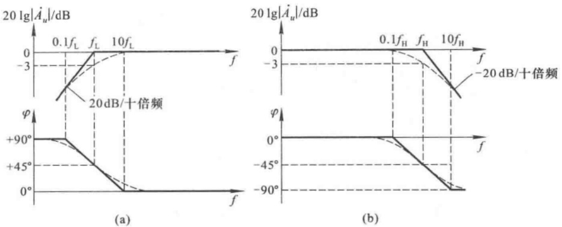

图 4.1.3 高通电路与低通电路的波特图

(a) 高通电路波特图 (b) 低通电路波特图

0.1 $f_{H}$ 和 $10f_{H}$ 为拐点用三段直线近似，图4.1.2(a)所示低通电路的波特图如图4.1.3(b)所示。

在本节的分析中,具有普遍意义的结论是:

（1）电路的截止频率决定于电容所在回路的时间常数  $\tau$ ，如图 4.1.1(a) 和图 4.1.2(a) 所示电路的  $f_{L}$  和  $f_{H}$  分别如式(4.1.2)、(4.1.6) 所示。
（2）当信号频率等于下限频率 $f_{L}$ 或上限频率 $f_{H}$ 时，放大电路的增益下降3 dB，且产生 $+45^{\circ}$ 或 $-45^{\circ}$ 相移。
(3) 在近似分析中, 可用折线化的近似波特图描述放大电路的频率特性。

## 思考题

4.1.1 试分别用相量图说明图 4.1.1 和图 4.1.2 所示两电路的频率响应。
4.1.2 若一放大电路的电压增益为 100 dB, 则其电压放大倍数为多少?

## 4.2 晶体管的高频等效模型

从晶体管的物理结构出发,考虑发射结和集电结电容的影响,就可以得到在高频信号作用下的物理模型,称为混合  $\pi$  模型。由于晶体管的混合  $\pi$  模型与第 2 章所介绍的 h 参数等效模型在低频信号作用下具有一致性,因此,可用 h 参数来计算混合  $\pi$  模型中的某些参数,并用于高频信号作用下的电路分析。

## 4.2.1 晶体管的混合 $\pi$ 模型

## 一、完整的混合 $\pi$ 模型

图 4.2.1(a) 所示为晶体管结构示意图。 $r_{e}$  和  $r_{e}$  分别为集电区体电阻和发射区体电阻，它们的数值较小，常常忽略不计。 $C_{\mu}$  为集电结电容， $r_{b'e'}$  为集电结电阻， $r_{bb'}$  为基区体电阻， $C_{\pi}$  为发射结电容， $r_{b'e'}$  为发射结电阻。图(b) 是与图(a) 对应的混合  $\pi$  模型。

图中，由于  $C_{\pi}$  与  $C_{\mu}$  的存在，使  $\dot{I}_{c}$  和  $\dot{I}_{b}$  的大小、相角均与频率有关，即电流放大系数是频率的函数，应记作  $\dot{\beta}$ 。根据半导体物理的分析，晶体管的受控电流  $\dot{I}_{c}$  与发射结电压  $\dot{U}_{b'e}$  成线性

---

4.2 晶体管的高频等效模型

191

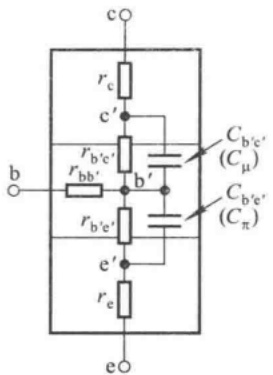

text_image

c
r_c
c'
R_{b'e'}
R_{bb'}
b'
C_{b'e'} (C_μ)
C_{b'e'} (C_π)
e'
R_{b'e'}
e
e

(a)

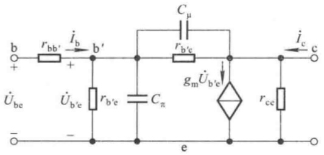

text_image

b
+
rbb'
i_b
b'
+
U_be
-
U_b'e
r_b'e
C_π
C_μ
r_b'c
g_m U_b'e
i_c
c
e
r_ce

(b)

图 4.2.1 晶体管结构示意图及混合  $\pi$  模型

(a) 晶体管的结构示意图 (b) 混合  $\pi$  模型

关系，且与信号频率无关。因此，混合 $\pi$ 模型中引入了一个新参数 $g_{\mathrm{m}}, g_{\mathrm{m}}$ 为跨导，描述 $\dot{U}_{\mathrm{b'e}}$ 对 $\dot{I}_{\mathrm{c}}$ 的控制关系，即 $\dot{I}_{\mathrm{e}} = g_{\mathrm{m}} \dot{U}_{\mathrm{b'e}}$。

## 二、简化的混合 $\pi$ 模型

在图4.2.1(b)所示电路中，通常情况下， $r_{ce}$ 远大于c-e间所接的负载电阻，而 $r_{b'e}$ 也远大于 $C_{\mu}$ 的容抗，因而可认为 $r_{ee}$ 和 $r_{b'e}$ 开路，如图4.2.2(a)所示。

由于  $C_{\mu}$  跨接在输入与输出回路之间，使电路的分析变得十分复杂。因此，为简单起见，将  $C_{\mu}$  等效到输入回路和输出回路中去，称为单向化。单向化是通过等效变换来实现的。设  $C_{\mu}$  折合到  $b^{\prime}-e$  间的电容为  $C_{\mu}^{\prime}$ ，折合到 c-e 间的电容为  $C_{\mu}^{\prime\prime}$ ，则单向化之后的电路如图(b)所示。

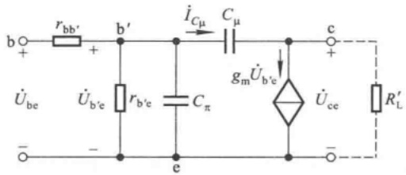

text_image

b
+
rbb'
+
b'
iCμ
Cμ
gmUb'e
c
+
Ube
Ub'e
rbe
Cπ
e
Uce
RL'

(a)

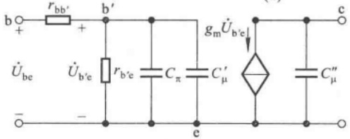

text_image

b
+
rbb'
+
b'
Ube
Ub'e
rbe'
Cπ
Cμ'
gm Ub'e
e
c
Cμ''
-

(b)

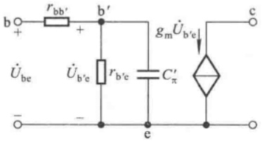

text_image

b
+
rbb'
+
b'
gmÛb'e
Ûbe
Ûb'e
r b'e
C'π
e
c
-

(c)

图 4.2.2 混合  $\pi$  模型的简化

（a）简化的混合 $\pi$ 模型 (b）单向化后的混合 $\pi$ 模型 (c）忽略 $C_{\mu}^{\prime \prime}$ 的混合 $\pi$ 模型

等效变换过程如下: 在图(a)所示电路中, 从 b' 看进去  $C_{\mu}$  中流过的电流为

$$
\dot {I} _ {C \mu} = \frac {\dot {U} _ {\mathrm {b^{\prime} e}} - \dot {U} _ {\mathrm{ce}}}{X _ {C \mu}} = \frac {(1 - \dot {K}) \dot {U} _ {\mathrm {b^{\prime} e}}}{X _ {C \mu}} \quad \left(\dot {K} = \frac {\dot {U} _ {\mathrm{ce}}}{\dot {U} _ {\mathrm {b^{\prime} e}}}\right)
$$

为保证变换的等效性，要求流过 $C_{\mu}^{\prime}$ 的电流仍为 $\dot{I}_{C\mu}$，而它的端电压为 $\dot{U}_{\mathrm{b'e}}$，因此 $C_{\mu}^{\prime}$ 的电抗为

---

194

第 4 章 放大电路的频率响应

率,因此共基放大电路可作为宽频带放大电路。

在器件手册中查出 $f_{\beta}$ （或 $f_{\mathrm{T}}$ ）和 $C_\mathrm{ob}$ （近似为 $C_\mu$），并估算出发射极静态电流 $I_{\mathrm{EQ}}$，从而得到 $r_{\mathrm{b'e}}$ [见式(4.2.4)]，再根据式(4.2.7)、(4.2.10)就可求出 $C_\pi$ 的值。

## 思考题

4.2.1 为什么在研究晶体管的高频等效电路时引入参数 $g_{\mathrm{m}}$，而且只考虑 $\mathrm{b}' - \mathrm{e}$ 间等效电容的影响，而不考虑 $\mathrm{c} - \mathrm{e}$ 间等效电容的影响？
4.2.2 在共射放大电路中,若静态工作点沿直流负载线上移,则放大管发射结等效电容  $C_{\pi}^{\prime}$  如何变化?为什么?

## 4.3 场效应管的高频等效模型

由于场效应管各极之间存在极间电容，因而其高频响应与晶体管相似。根据场效应管的结构，可得出图4.3.1(a)所示的高频等效模型，大多数场效应管的参数如表4.3.1所示。由于一般情况下 $r_{gs}$ 和 $r_{ds}$ 比外接电阻大得多，因而，在近似分析时，可认为它们是开路的。而对于跨接在g-d之间的电容 $C_{gd}$ ，可将其进行等效变换，即将其折合到输入回路和输出回路，使电路单向化。这样，g-s间的等效电容为

$$
C _ {\mathrm{gs}} ^ {\prime} = C _ {\mathrm{gs}} + (1 - \dot {K}) C _ {\mathrm{gd}} \quad (\dot {K} \approx - g _ {\mathrm{m}} R _ {\mathrm{L}} ^ {\prime}) \tag {4.3.1}
$$

d-s间的等效电容为

$$
C _ {\mathrm{ds}} ^ {\prime} = C _ {\mathrm{ds}} + \frac {\dot {K} - 1}{\dot {K}} C _ {\mathrm{gd}} \quad (\dot {K} \approx - g _ {\mathrm{m}} R _ {\mathrm{L}} ^ {\prime}) \tag {4.3.2}
$$

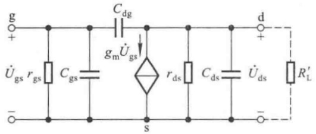

text_image

g
+
U̇gs rgs Cgs gm U̇gs d
-
s
rds Cds U̇ds R'L

(a)

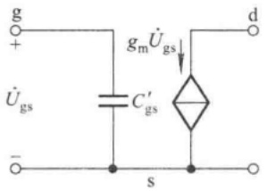

chemical

Electrical circuit diagram of a MOSFET with gate, source, and drain terminals labeled

(b)

图 4.3.1 场效应管的高频等效模型

(a) 高频等效模型 (b) 简化模型

由于输出回路的时间常数通常比输入回路的小得多,故分析频率特性时可忽略  $C_{ds}^{\prime}$  的影响。这样就得到场效应管的简化的单向化的高频等效模型,如图 4.3.1(b) 所示。

表 4.3.1 场效应管的主要参数

| 管子类型\\参数(单位) | $g_m/mS$ | $r_{ds}/\Omega$ | $r_{gs}/\Omega$ | $C_{gs}/pF$ | $C_{gd}/pF$ | $C_{ds}/pF$ |
| --- | --- | --- | --- | --- | --- | --- |
| 结型 | 0.1~10 | $10^5$ | $>10^7$ | 1~10 | 1~10 | 0.1~1 |
| 绝缘栅型 | 0.1~20 | $10^4$ | $>10^9$ | 1~10 | 1~10 | 0.1~1 |

---

4.2 晶体管的高频等效模型

193

与  $\dot{I}_{b}$  之比, 因此  $\dot{K}=0$  。根据式(4.2.2)

$$
C _ {\pi} ^ {\prime} \approx C _ {\pi} + (1 + | \dot {K} |) C _ {\mu} = C _ {\pi} + C _ {\mu}
$$

由于  $\dot{I}_{c}=g_{m}\dot{U}_{b'e}, g_{m}=\beta_{0}/r_{b'e}$ ，所以

$$
\dot {\beta} = \frac {I _ {\mathrm{e}}}{I _ {r _ {\mathrm{b} ^ {\prime} \mathrm{e}}} + I _ {C _ {\pi} ^ {\prime}}} = \frac {g _ {\mathrm{m}} U _ {\mathrm{b} ^ {\prime} \mathrm{e}}}{U _ {\mathrm{b} ^ {\prime} \mathrm{e}} \left(\frac {1}{r _ {\mathrm{b} ^ {\prime} \mathrm{e}}} + \mathrm{j} \omega C _ {\pi} ^ {\prime}\right)} = \frac {\beta_ {0}}{1 + \mathrm{j} \omega r _ {\mathrm{b} ^ {\prime} \mathrm{e}} C _ {\pi} ^ {\prime}} \tag {4.2.6}
$$

与式(4.1.5)的形式完全一样，说明  $\dot{\beta}$  的频率响应与低通电路相似。 $f_{\beta}$  为  $\dot{\beta}$  的截止频率，称为共射截止频率。

$$
f _ {\beta} = \frac {1}{2 \pi \tau} = \frac {1}{2 \pi r _ {\mathrm{b'e}} C _ {\pi} ^ {\prime}} \quad (C _ {\pi} ^ {\prime} = C _ {\pi} + C _ {\mu}) \tag {4.2.7}
$$

将其代入式(4.2.6)，得出

$$
\dot {\beta} = \frac {\beta_ {0}}{1 + \mathrm{j} \frac {f}{f _ {\beta}}} \tag {4.2.8}
$$

写出  $\dot{\beta}$  的对数幅频特性与对数相频特性为

$$
\left\{ \begin{array}{l} 2 0 \lg | \dot {\beta} | = 2 0 \lg \beta_ {0} - 2 0 \lg \sqrt {1 + \left(\frac {f}{f _ {\beta}}\right) ^ {2}} \\ \varphi = - \arctan \frac {f}{f _ {\beta}} \end{array} \right. \tag {4.2.9a}
$$

画出  $\dot{\beta}$  的折线化波特图如图 4.2.3 所示，图中  $f_{T}$  是使  $\left|\dot{\beta}\right|$  下降到 1（即 0 dB）时的频率。

令式(4.2.9a)等于0，则 $f=f_{T}$ ，由此可求出 $f_{T}$ 。

$$
2 0 \mathrm{lg} \beta_ {0} - 2 0 \mathrm{lg}   \sqrt {1 + \left(\frac {f _ {\mathrm{T}}}{f _ {\beta}}\right) ^ {2}} = 0 \quad \text {或} \quad \sqrt {1 + \left(\frac {f _ {\mathrm{T}}}{f _ {\beta}}\right) ^ {2}} = \beta_ {0}
$$

因 $f_{T} \gg f_{\beta}$ ，所以

$$
f _ {\mathrm{T}} \approx \beta_ {0} f _ {\beta} \tag {4.2.10}
$$

利用  $\beta$  的表达式, 可以求出  $\dot{\alpha}$  的截止频率

$$
\dot {\alpha} = \frac {\dot {\beta}}{1 + \dot {\beta}} = \frac {\frac {\beta_ {0}}{1 + \mathrm{j} f / f _ {\beta}}}{1 + \frac {\beta_ {0}}{1 + \mathrm{j} f / f _ {\beta}}} = \frac {\beta_ {0}}{1 + \beta_ {0} + \mathrm{j} f / f _ {\beta}} = \frac {\frac {\beta_ {0}}{1 + \beta_ {0}}}{1 + \mathrm{j} \frac {f}{(1 + \beta_ {0}) f _ {\beta}}}
$$

$$
\dot {\alpha} = \frac {\alpha_ {0}}{1 + \mathrm{j} \frac {f}{f _ {\alpha}}} \qquad \left[ f _ {\alpha} = (1 + \beta_ {0}) f _ {\beta} \right] \tag {4.2.11}
$$

$f_{\alpha}$  是使  $\left|\dot{\alpha}\right|$  下降到 70.7%  $\alpha_{0}$  的频率, 称为共基截止频率。式(4.2.11)表明

$$
f _ {\alpha} = (1 + \beta_ {0}) f _ {\beta} \approx f _ {\mathrm{T}} \tag {4.2.12}
$$

可见,共基电路的截止频率远高于共射电路的截止频

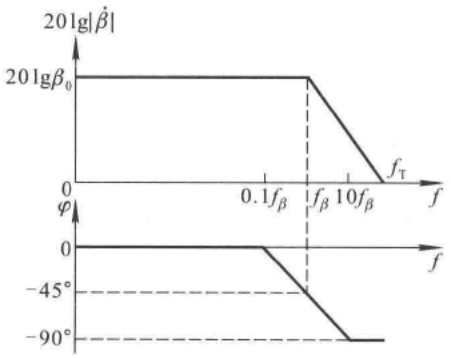

line

| \(0\) | \(20lg\beta_{0}\) | 0 |
| --- | --- | --- |
| \(0.1f\beta\) | \(20lg\beta_{0}\) | 0 |
| \(f\beta\) | \(20lg\beta_{0}\) | \(-45{}^{\circ}\) |
| \(10f\beta\) | \(0\) | \(-90{}^{\circ}\) |

图 4.2.3  $\dot{\beta}$  的波特图

---

192

第 4 章 放大电路的频率响应

$$
X _ {C _ {\mu} ^ {\prime}} = \frac {\dot {U} _ {\mathrm {b^ {\prime} e}}}{\dot {I} _ {C _ {\mu}}} = \frac {\dot {U} _ {\mathrm {b^ {\prime} e}}}{(1 - \dot {K}) \frac {\dot {U} _ {\mathrm {b^ {\prime} e}}}{X _ {C _ {\mu}}}} = \frac {X _ {C _ {\mu}}}{1 - \dot {K}}
$$

考虑在近似计算时，$\dot{K}$ 取中频时的值，所以 $|\dot{K}| = -\dot{K}$。$X_{C\mu}$ 约为 $X_{C\mu}$ 的 $(1 + |\dot{K} |)$ 分之一，因此

$$
C _ {\mu} ^ {\prime} = (1 - \dot {K}) C _ {\mu} \approx (1 + | \dot {K} |) C _ {\mu} \tag {4.2.1}
$$

$b' - e$  间总电容为

$$
C _ {\pi} ^ {\prime} = C _ {\pi} + C _ {\mu} ^ {\prime} \approx C _ {\pi} + (1 + | \dot {K} |) C _ {\mu} \tag {4.2.2}
$$

用同样的分析方法,可以得出

$$
C _ {\mu} ^ {\prime \prime} = \frac {\dot {K} - 1}{\dot {K}} \cdot C _ {\mu} \tag {4.2.3}
$$

因为 $C_{\pi}^{\prime} \gg C_{\mu}^{\prime \prime}$, 且一般情况下 $C_{\mu}^{\prime \prime}$ 的容抗远大于 $R_{\mathrm{L}}^{\prime}, C_{\mu}^{\prime \prime}$ 中的电流可忽略不计, 所以简化的混合 $\pi$ 模型如图 (c) 所示。

## 三、混合 $\pi$ 模型的主要参数

将简化的混合  $\pi$  模型与简化的 h 参数等效模型相比较, 它们的电阻参数是完全相同的, 从手册中可查得  $r_{bb'}$ , 而

$$
r _ {\mathrm {b^ {\prime} e}} = (1 + \beta_ {0}) \frac {U _ {\mathrm{T}}}{I _ {\mathrm{EQ}}} \tag {4.2.4}
$$

式中  $\beta_{0}$  为低频段晶体管的电流放大系数。虽然利用  $\beta$  和  $g_{m}$  表述的受控关系不同，但是它们所要表述的却是同一个物理量，即

$$
\dot {I} _ {\mathrm{c}} = g _ {\mathrm{m}} \dot {U} _ {\mathrm {b^ {\prime} e}} = \beta_ {0} \dot {I} _ {\mathrm{b}}
$$

由于  $\dot{U}_{b'e} = \dot{I}_{b} r_{b'e}$ ，且  $r_{b'e}$  如式(4.2.4)所示，又由于通常  $\beta_{0} \gg 1$ ，所以

$$
g _ {\mathrm{m}} = \frac {\beta_ {0}}{r _ {\mathrm {b^{\prime} e}}} \approx \frac {I _ {\mathrm{EQ}}}{U _ {\mathrm{T}}} \tag {4.2.5}
$$

在半导体器件手册中可以查得参数 $C_{\mathrm{ob}}, C_{\mathrm{ob}}$ 是晶体管为共基接法且发射极开路时 $\mathrm{c - b}$ 间的结电容，$C_{\mu}$ 近似为 $C_{\mathrm{ob}}$。$C_{\pi}$ 的数值可通过手册给出的特征频率 $f_{\mathrm{T}}$ 和放大电路的静态工作点求解，具体分析见4.2.2节。$\dot{K}$ 是电路的电压放大倍数，可通过计算得到。

## 4.2.2 晶体管电流放大倍数的频率响应

从混合 $\pi$ 等效模型可以看出，管子工作在高频段时，若基极注入的交流电流 $\dot{I}_{\mathrm{b}}$ 的幅值不变，则随着信号频率的升高，$\mathrm{b}' - \mathrm{e}$ 间的电压 $\dot{U}_{\mathrm{b'e}}$ 的幅值将减小，相移将增大；从而使 $\dot{I}_{\mathrm{c}}$ 的幅值随 $|\dot{U}_{\mathrm{b'e}}|$ 线性下降，并产生与 $\dot{U}_{\mathrm{b'e}}$ 相同的相移。可见，在高频段，当信号频率变化时 $\dot{I}_{\mathrm{c}}$ 与 $\dot{I}_{\mathrm{b}}$ 的关系也随之变化，电流放大系数不是常量，$\dot{\beta}$ 是频率的函数。

根据电流放大系数的定义

$$
\dot {\beta} = \frac {\dot {I} _ {\mathrm{c}}}{\dot {I} _ {\mathrm{b}}} \Bigg | _ {U _ {\mathrm{CE}}}
$$

表明  $\dot{\beta}$  是在 c-e 间无动态电压, 即令图 4.2.2(c) 所示电路中 c-e 间电压为零时动态电流  $\dot{I}_{c}$

---

4.4 单管放大电路的频率响应

195

## 思考题

4.3.1 场效应管栅 - 源等效电容是常量吗？它决定于哪些参数？

## 4.4 单管放大电路的频率响应

利用晶体管和场效应管的高频等效模型,可以分析放大电路的频率响应。本节通过单管放大电路来讲述频率响应的一般分析方法。

## 4.4.1 单管共射放大电路的频率响应

考虑到耦合电容和结电容的影响,图4.4.1(a)所示电路的等效电路如图(b)所示。

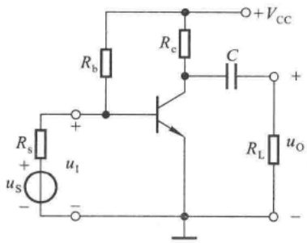

text_image

Rb
+VCC
Rc
C
+
Rs
+
us
u1
-
RL
uo
-

(a)

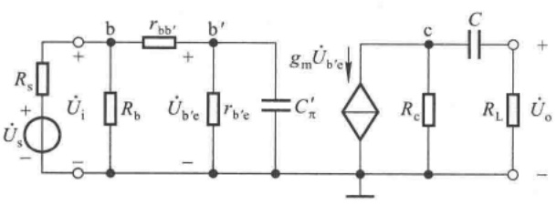

text_image

Rs
+
Us
-
b
+
-
Rb
U̇i
Rb
U̇b'e
rbb'
b'
+
-
r b'e
C'π
gm U̇b'e
c
C
+
-
RL
Uo
-

(b)

图 4.4.1 单管共射放大电路及其等效电路

(a) 共射放大电路 (b) 适应于频率从零到无穷大的交流等效电路

在分析放大电路的频率响应时,为了方便起见,一般将输入信号的频率范围分为中频、低频和高频三个频段。在中频段,极间电容因容抗很大而视为开路,耦合电容(或旁路电容)因容抗很小而视为短路,故不考虑它们的影响;在低频段,应当考虑耦合电容(或旁路电容)的影响,此时极间电容仍视为开路;在高频段,应当考虑极间电容的影响,此时耦合电容(或旁路电容)仍视为短路;根据上述原则,便可得到放大电路在各频段的等效电路,从而得到各频段的放大倍数。

## 一、中频电压放大倍数

在中频电压信号  $\dot{U}_{s}$  作用于电路时，由于  $\frac{1}{\omega C_{\pi}^{\prime}} \gg r_{b'e}, C_{\pi}^{\prime}$  可视为开路；又由于  $\frac{1}{\omega C} \ll R_{L}, C$  可视为短路；因此，图 4.4.1(a) 所示电路的中频等效电路如图 4.4.2 所示。输入电阻  $R_{i} = R_{b} // (r_{bb'} + r_{b'e}) = R_{b} // r_{be}$ ，中频电压放大倍数

$$
\dot {A} _ {\mathrm{usm}} = \frac {\dot {U} _ {\mathrm{o}}}{\dot {U} _ {\mathrm{s}}} = \frac {\dot {U} _ {\mathrm{i}}}{\dot {U} _ {\mathrm{s}}} \cdot \frac {\dot {U} _ {\mathrm {b^{\prime}e}}}{\dot {U} _ {\mathrm{i}}} \cdot \frac {\dot {U} _ {\mathrm{o}}}{\dot {U} _ {\mathrm {b^{\prime}e}}} = \frac {R _ {\mathrm{i}}}{R _ {\mathrm{s}} + R _ {\mathrm{i}}} \cdot \frac {r _ {\mathrm {b^{\prime}e}}}{r _ {\mathrm{be}}} \cdot (- g _ {\mathrm{m}} R _ {\mathrm{L}} ^ {\prime}) \tag {4.4.1}
$$

$$
(R _ {\mathrm{L}} ^ {\prime} = R _ {\mathrm{c}} / / R _ {\mathrm{L}})
$$

电路空载时的中频电压放大倍数为

$$
\dot {A} _ {\mathrm{usm}} = \frac {\dot {U} _ {\mathrm{o}}}{\dot {U} _ {\mathrm{s}}} = \frac {R _ {\mathrm{i}}}{R _ {\mathrm{s}} + R _ {\mathrm{i}}} \cdot \frac {r _ {\mathrm {b^{\prime} e}}}{r _ {\mathrm{be}}} \cdot (- g _ {\mathrm{m}} R _ {\mathrm{c}}) \tag {4.4.2}
$$

---

196

第 4 章 放大电路的频率响应

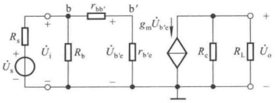

text_image

Rs
+
Us
-
+
b
rbb'
+
b'
gmÛb'e
Rb
Ui
Ub'e
rb'e
Rc
RL
Uo
+
-

图 4.4.2 单管共射放大电路的中频等效电路

## 二、低频电压放大倍数

考虑到低频电压信号作用时耦合电容 C 的影响, 图 4.4.1(a) 所示电路的低频等效电路如图 4.4.3(a) 所示。将受控电流源  $g_{m}\dot{U}_{b'e}$  与  $R_{c}$  进行等效变换如图 (b) 所示,  $\dot{U}'_{o}$  是空载时的输出电压, 电容 C 与负载电阻  $R_{L}$  组成了如图 4.1.1(a) 所示的高通电路。

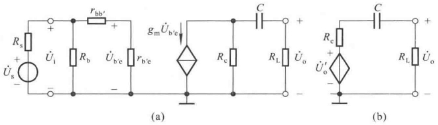

图 4.4.3 单管共射放大电路的低频等效电路

(a) 低频等效电路 (b) 输出回路的等效电路

低频电压放大倍数为

$$
\dot {A} _ {\mathrm{usl}} = \frac {\dot {U} _ {\mathrm{o}}}{\dot {U} _ {\mathrm{s}}} = \frac {\dot {U} _ {\mathrm{o}} ^ {\prime}}{\dot {U} _ {\mathrm{s}}} \cdot \frac {\dot {U} _ {\mathrm{o}}}{\dot {U} _ {\mathrm{o}} ^ {\prime}}
$$

将式(4.4.2)代入上式

$$
\dot {A} _ {\mathrm{usl}} = \frac {R _ {\mathrm{i}}}{R _ {\mathrm{s}} + R _ {\mathrm{i}}} \cdot \frac {r _ {\mathrm {b^ {\prime} e}}}{r _ {\mathrm{be}}} \cdot (- g _ {\mathrm{m}} R _ {\mathrm{c}}) \cdot \frac {R _ {\mathrm{L}}}{R _ {\mathrm{c}} + \frac {1}{\mathrm{j} \omega C} + R _ {\mathrm{L}}}
$$

将上式的分子与分母同除以 $(R_{\mathrm{c}}+R_{\mathrm{L}})$ 便可得到

$$
\dot {A} _ {\mathrm{usl}} = \frac {R _ {\mathrm{i}}}{R _ {\mathrm{s}} + R _ {\mathrm{i}}} \cdot \frac {r _ {\mathrm {b^{\prime} e}}}{r _ {\mathrm{be}}} \cdot (- g _ {\mathrm{m}} R _ {\mathrm{L}} ^ {\prime}) \cdot \frac {\mathrm{j} \omega (R _ {\mathrm{c}} + R _ {\mathrm{L}}) C}{1 + \mathrm{j} \omega (R _ {\mathrm{c}} + R _ {\mathrm{L}}) C}
$$

与式(4.4.1)比较,得出

$$
\dot {A} _ {\mathrm{usl}} = \dot {A} _ {\mathrm{usm}} \cdot \frac {\mathrm{j} \frac {f}{f _ {\mathrm{L}}}}{1 + \mathrm{j} \frac {f}{f _ {\mathrm{L}}}} = \dot {A} _ {\mathrm{usm}} \cdot \frac {1}{1 + \frac {f _ {\mathrm{L}}}{\mathrm{j} f}} \tag {4.4.3}
$$

其中 $f_{L}$ 为下限频率,其表达式为

$$
f _ {\mathrm{L}} = \frac {1}{2 \pi (R _ {\mathrm{c}} + R _ {\mathrm{L}}) C} \tag {4.4.4}
$$

式(4.4.4)中的 $(R_{\mathrm{c}}+R_{\mathrm{L}})C$ 正是C所在回路的时间常数,它等于从电容C两端向外看的等效总

---

4.4 单管放大电路的频率响应

197

电阻乘以 C。

根据式(4.4.3)，单管共射放大电路的对数幅频特性及相频特性的表达式为

$$
\left\{ \begin{array}{l} 2 0 \lg | \dot {A} _ {\mathrm{usl}} | = 2 0 \lg | \dot {A} _ {\mathrm{usm}} | + 2 0 \lg \frac {\frac {f}{f _ {\mathrm{L}}}}{\sqrt {1 + \left(\frac {f}{f _ {\mathrm{L}}}\right) ^ {2}}} \\ \varphi = - 1 8 0 ^ {\circ} + \left(9 0 ^ {\circ} - \arctan \frac {f}{f _ {\mathrm{L}}}\right) = - 9 0 ^ {\circ} - \arctan \frac {f}{f _ {\mathrm{L}}} \end{array} \right. \tag {4.4.5a}
$$

式(4.4.5b)中的  $-180^{\circ}$  表示中频段时  $\dot{U}_{o}$  与  $\dot{U}_{s}$  反相。因电抗元件引起的相移称为附加相移，因而式(4.4.5b)表明低频段最大附加相移为  $+90^{\circ}$ 。

## 三、高频电压放大倍数

考虑到高频信号作用时  $C_{\pi}^{\prime}$  的影响, 图 4.4.1(a) 所示电路的高频等效电路如图 4.4.4(a) 所示。

利用戴维宁定理，从  $C_{\pi}^{\prime}$  两端向左看，电路可等效成图(b)所示电路，R 和  $C_{\pi}^{\prime}$  构成如图4.1.2(a)所示的低通电路。通过图(c)所示电路可以求出  $b^{\prime}-e$  间的开路电压及等效内阻 R 的表达式。

$$
\dot {U} _ {\mathrm{s}} ^ {\prime} = \frac {r _ {\mathrm {b^ {\prime} e}}}{r _ {\mathrm{be}}} \cdot \dot {U} _ {\mathrm{i}} = \frac {r _ {\mathrm {b^ {\prime} e}}}{r _ {\mathrm{be}}} \cdot \frac {R _ {\mathrm{i}}}{R _ {\mathrm{s}} + R _ {\mathrm{i}}} \cdot \dot {U} _ {\mathrm{s}} \tag {4.4.6}
$$

$$
R = r _ {\mathrm {b^ {\prime} e}} / / (r _ {\mathrm {bb^ {\prime}}} + R _ {\mathrm{s}} / / R _ {\mathrm{b}}) \tag {4.4.7}
$$

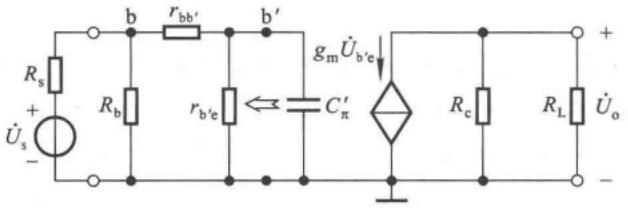

text_image

Rs
+
Us
-
b
rbb'
b'
Rb
rb'e
C'π
gmÛb'e
Rc
RL
Uo
+

(a)

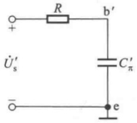

chemical

Electrical circuit diagram with resistor and capacitor components labeled R, b', C'π, and Ũ'

(b)

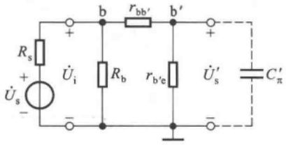

text_image

Rs
+
Us
-
b
rbb'
b'
+
Ui
Rb
rb'e
Us'
C'π

(c)

图 4.4.4 单管共射放大电路的高频等效电路

(a) 高频等效电路 (b) 输入回路的等效变换 (c) 输入回路

因为  $b^{\prime}-e$  间电压  $\dot{U}_{b^{\prime}e}$  与输出电压  $\dot{U}_{o}$  的关系没变, 所以高频电压放大倍数

$$
\dot {A} _ {\mathrm{ush}} = \frac {\dot {U} _ {\mathrm{o}}}{\dot {U} _ {\mathrm{s}}} = \frac {\dot {U} _ {\mathrm{s}} ^ {\prime}}{\dot {U} _ {\mathrm{s}}} \cdot \frac {\dot {U} _ {\mathrm {b^ {\prime} e}}}{\dot {U} _ {\mathrm{s}} ^ {\prime}} \cdot \frac {\dot {U} _ {\mathrm{o}}}{\dot {U} _ {\mathrm {b^ {\prime} e}}} = \frac {R _ {\mathrm{i}}}{R _ {\mathrm{s}} + R _ {\mathrm{i}}} \cdot \frac {r _ {\mathrm {b^ {\prime} e}}}{r _ {\mathrm{be}}} \cdot \frac {\frac {1}{\mathrm{j} \omega R C _ {\pi} ^ {\prime}}}{1 + \frac {1}{\mathrm{j} \omega R C _ {\pi} ^ {\prime}}} \cdot (- g _ {\mathrm{m}} R _ {\mathrm{L}} ^ {\prime})
$$

将上式与式(4.4.1)比较,可得

---

198

第 4 章 放大电路的频率响应

$$
\dot {A} _ {u s h} = \dot {A} _ {u s m} \cdot \frac {1}{1 + j \omega R C}
$$

令 $f_{\mathrm{H}} = \frac{1}{2\pi RC_{\pi}^{\prime}}, RC_{\pi}^{\prime}$ 是 $C_{\pi}^{\prime}$ 所在回路的时间常数，因而

$$
\dot {A} _ {u s h} = \dot {A} _ {u s m} \cdot \frac {1}{1 + \mathrm{j} \frac {f}{f _ {\mathrm{H}}}} \tag {4.4.8}
$$

$\dot{A}_{ush}$ 的对数幅频特性与相频特性的表达式为

$$
\left\{ \begin{array}{l} 2 0 \lg | \dot {A} _ {\mathrm{ush}} | = 2 0 \lg | \dot {A} _ {\mathrm{usm}} | - 2 0 \lg \sqrt {1 + \left(\frac {f}{f _ {\mathrm{H}}}\right) ^ {2}} \\ \varphi = - 1 8 0 ^ {\circ} - \arctan \frac {f}{f _ {\mathrm{H}}} \end{array} \right. \tag {4.4.9a}
$$

式(4.4.9b)表明,在高频段,由 $C_{\pi}^{\prime}$ 引起的最大附加相移为 $-90^{\circ}$ 。

## 四、波特图

综上所述,若考虑耦合电容及结电容的影响,对于频率从零到无穷大的输入电压,电压放大倍数的表达式应为

$$
\dot {A} _ {u s} = \dot {A} _ {u s m} \cdot \frac {\mathrm{j} \frac {f}{f _ {\mathrm{L}}}}{\left(1 + \mathrm{j} \frac {f}{f _ {\mathrm{L}}}\right) \left(1 + \mathrm{j} \frac {f}{f _ {\mathrm{H}}}\right)} = \dot {A} _ {u s m} \cdot \frac {1}{\left(1 + \frac {f _ {\mathrm{L}}}{\mathrm{j} f}\right) \left(1 + \mathrm{j} \frac {f}{f _ {\mathrm{H}}}\right)} \tag {4.4.10}
$$

当 $f_{\mathrm{L}} \ll f \ll f_{\mathrm{H}}$ 时，$f_{\mathrm{L}} / f$ 趋于零，$f / f_{\mathrm{H}}$ 也趋于零，因而式(4.4.10)近似为 $\dot{A}_{us} \approx \dot{A}_{usm}$，即 $\dot{A}_{us}$ 为中频电压放大倍数，其表达式为式(4.4.1)。当 $f$ 接近 $f_{\mathrm{L}}$ 时，必有 $f \ll f_{\mathrm{H}}, f / f_{\mathrm{H}}$ 趋于零，因而式(4.4.10)近似为 $\dot{A}_{us} \approx \dot{A}_{usl}$，即 $\dot{A}_{us}$ 为低频电压放大倍数，其表达式为式(4.4.3)。当 $f$ 接近 $f_{\mathrm{H}}$ 时，必有 $f \gg f_{\mathrm{L}}, f_{\mathrm{L}} / f$ 趋于零，因而式(4.4.10)近似为 $\dot{A}_{us} \approx \dot{A}_{ush}$，即 $\dot{A}_{us}$ 为高频电压放大倍数，其表达式为式(4.4.8)。根据式(4.4.10)，或者式(4.4.2)、(4.4.5)、(4.4.9)，可画出图4.4.1(a)所示单管放大电路的折线化波特图，如图4.4.5所示。

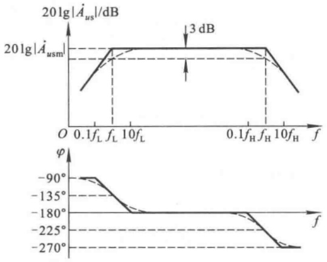

图 4.4.5 单管共射放大电路的波特图

---

4.4 单管放大电路的频率响应

199

从以上分析可知,式(4.4.10)可以全面表示任何频段的电压放大倍数,而且上限频率和下限频率均可表示为 $\frac{1}{2\pi\tau},\tau$ 分别是极间电容 $C_{\pi}^{\prime}$ 和耦合电容C所在回路的时间常数, $\tau$ 是从电容两端向外看的总等效电阻与相应的电容之积。可见,求解上、下限截止频率的关键是正确求出回路的等效电阻。

【例 4.4.1】 在图 4.4.1(a) 所示电路中, 已知  $V_{CC} = 15 \, V, R_{s} = 1 \, k\Omega, R_{b} = 20 \, k\Omega, R_{c} = R_{L} = 5 \, k\Omega, C = 5 \, \muF$ ; 晶体管的  $U_{BEQ} = 0.7 \, V, r_{bb'} = 100 \, \Omega, \beta = 100, f_{\beta} = 0.5 \, MHz, C_{ob} = 5 \, pF$ 。

试估算电路的截止频率 $f_{H}$ 和 $f_{L}$，并画出 $\dot{A}_{us}$ 的波特图。

解:(1) 求解 Q 点

$$
I _ {\mathrm{BQ}} = \frac {V _ {\mathrm{CC}} - U _ {\mathrm{BEQ}}}{R _ {\mathrm{b}}} - \frac {U _ {\mathrm{BEQ}}}{R _ {\mathrm{s}}} = \left(\frac {1 5 - 0 . 7}{2 0} - \frac {0 . 7}{1}\right) \mathrm{mA} = 0. 0 1 5 \mathrm{mA}
$$

$$
I _ {\mathrm{CQ}} = \beta I _ {\mathrm{BQ}} = (1 0 0 \times 0. 0 1 5) \mathrm{mA} = 1. 5 \mathrm{mA}
$$

$$
U _ {\mathrm{CEQ}} = V _ {\mathrm{CC}} - I _ {\mathrm{CQ}} R _ {\mathrm{e}} = (1 5 - 1. 5 \times 5) \mathrm{V} = 7. 5 \mathrm{V}
$$

可见,放大电路的 Q 点合适。

(2) 求解混合  $\pi$  模型中的参数

$$
r _ {\mathrm {b^{\prime} e}} = (1 + \beta) \frac {U _ {\mathrm{T}}}{I _ {\mathrm{EQ}}} = \frac {U _ {\mathrm{T}}}{I _ {\mathrm{BQ}}} = \frac {2 6}{0 . 0 1 5} \Omega \approx 1 7 3 3 \Omega
$$

根据式(4.2.7)

$$
C _ {\pi} = \frac {1}{2 \pi r _ {\mathrm {b^{\prime} o}} f _ {\beta}} - C _ {\mu} \approx \frac {1}{2 \pi r _ {\mathrm {b^{\prime} o}} f _ {\beta}} - C _ {\mathrm{ob}} = \left(\frac {1 0 ^ {1 2}}{2 \pi \times 1 7 3 3 \times 5 \times 1 0 ^ {5}} - 5\right) \mathrm{pF} \approx 1 7 8 \mathrm{pF}
$$

$$
g _ {\mathrm{m}} = \frac {I _ {\mathrm{EQ}}}{U _ {\mathrm{T}}} \approx \frac {1 . 5}{2 6} \mathrm{S} \approx 0. 0 5 7 7 \mathrm{S}
$$

$$
\dot {K} = \frac {\dot {U} _ {\mathrm{ce}}}{\dot {U} _ {\mathrm{be}}} = - g _ {\mathrm{m}} (R _ {\mathrm{c}} / / R _ {\mathrm{L}}) \approx - 0. 0 5 7 7 \times 2 5 0 0 \approx - 1 4 4
$$

$$
C _ {\pi} ^ {\prime} = C _ {\pi} + (1 - \dot {K}) C _ {\mu} \approx (1 7 8 + 1 4 4 \times 5) \mathrm{pF} = 8 9 8 \mathrm{pF}
$$

(3) 求解中频电压放大倍数

$$
r _ {\mathrm{be}} = r _ {\mathrm {b b ^ {\prime}}} + r _ {\mathrm {b^ {\prime} e}} \approx (1 0 0 + 1 7 3 3) \Omega \approx 1. 8 3 \mathrm{k} \Omega
$$

$$
R _ {\mathrm{i}} = R _ {\mathrm{b}} / / r _ {\mathrm{be}} \approx \frac {2 0 \times 1 . 8 3}{2 0 + 1 . 8 3} \mathrm{k} \Omega \approx 1. 6 8 \mathrm{k} \Omega
$$

$$
\dot {A} _ {u s m} = \frac {\dot {U} _ {\mathrm{o}}}{\dot {U} _ {\mathrm{s}}} = \frac {R _ {\mathrm{i}}}{R _ {\mathrm{s}} + R _ {\mathrm{i}}} \cdot \frac {r _ {\mathrm {b^ {\prime} e}}}{r _ {\mathrm{be}}} \cdot (- g _ {\mathrm{m}} R _ {\mathrm{L}}) \approx \frac {1 . 6 8}{1 + 1 . 6 8} \times \frac {1 . 7 3}{1 . 8 3} \times (- 1 4 4) \approx - 8 5
$$

(4) 求解  $f_{H}$  和  $f_{L}$

$$
f _ {\mathrm{H}} = \frac {1}{2 \pi [ r _ {\mathrm {b^ {'} e}} / / (r _ {\mathrm {bb^ {'}}} + R _ {\mathrm{s}} / / R _ {\mathrm{b}}) ] C _ {\pi} ^ {\prime}}
$$

因为 $R_{\mathrm{s}} \ll R_{\mathrm{b}}$ ，所以

$$
\begin{array}{l} f _ {\mathrm{H}} = \frac {1}{2 \pi [ r _ {\mathrm {b^{\prime} e}} / / (r _ {\mathrm {bb^{\prime}}} + R _ {\mathrm{s}}) ] C _ {\pi} ^ {\prime}} \\ \approx \frac {1}{2 \pi \times \frac {1 7 3 3 \times (1 0 0 + 1 0 0 0)}{1 7 3 3 + (1 0 0 + 1 0 0 0)} \times 8 9 8 \times 1 0 ^ {- 1 2}} \mathrm{Hz} \\ \end{array}
$$

---

200

第 4 章 放大电路的频率响应

$$
\begin{array}{l} \approx 2 6 3 0 0 0 \mathrm{Hz} \\ = 2 6 3 \mathrm{kHz} \\ f _ {\mathrm{L}} = \frac {1}{2 \pi (R _ {\mathrm{c}} + R _ {\mathrm{L}}) C} = \frac {1}{2 \pi (5 \times 1 0 ^ {3} + 5 \times 1 0 ^ {3}) \times 5 \times 1 0 ^ {- 6}} \mathrm{Hz} \approx 3. 2 \mathrm{Hz} \\ \end{array}
$$

(5) 画  $\dot{A}_{us}$  的波特图

根据式(4.4.10)及以上的计算结果可得

$$
\dot {A} _ {u s} = \dot {A} _ {u s m} \cdot \frac {\mathrm{j} \frac {f}{f _ {\mathrm{L}}}}{\left(1 + \mathrm{j} \frac {f}{f _ {\mathrm{L}}}\right) \left(1 + \mathrm{j} \frac {f}{f _ {\mathrm{H}}}\right)} \approx \frac {- 8 5 \times \left(\mathrm{j} \frac {f}{3 . 2}\right)}{\left(1 + \mathrm{j} \frac {f}{3 . 2}\right) \left(1 + \mathrm{j} \frac {f}{2 6 3 \times 1 0 ^ {3}}\right)}
$$

$20\lg\left|\dot{A}_{usm}\right| \approx 38.6\mathrm{~dB}$ ，画出 $\dot{A}_{us}$ 的波特图如图4.4.6所示。

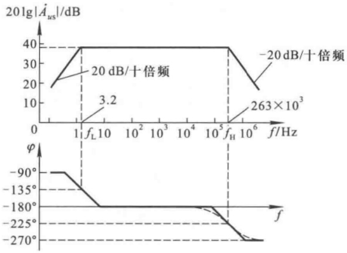

line

| Frequency (f/Hz) | Magnitude (dB) | Phase \((\phi)\) |
| --- | --- | --- |
| 3.2 | 40 | -180 |
| 263x10^3 | 40 | -180 |
| f_H | 40 | -225 |
| ~10^6 | -20 | -270 |

图 4.4.6 例 4.4.1 图

## 4.4.2 单管共源放大电路的频率响应

对于图 4.4.7(a) 所示共源放大电路, 考虑到极间电容和耦合电容的影响, 其动态等效电路如图(b) 所示。

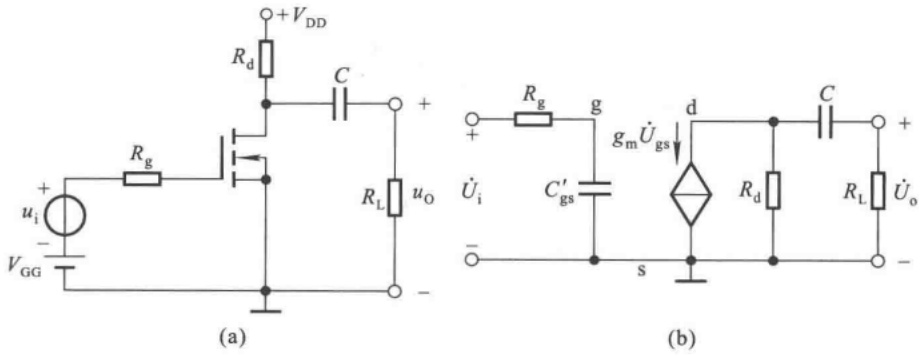

图 4.4.7 单管共源放大电路及其等效电路

（a）共源放大电路 （b）适应于频率从零到无穷大的交流等效电路

---

4.4 单管放大电路的频率响应

201

在中频段, $C'_{gs}$ 开路,C短路,因而中频电压放大倍数

$$
\dot {A} _ {\mathrm{um}} = \frac {\dot {U} _ {\mathrm{o}}}{\dot {U} _ {\mathrm{i}}} = \frac {- g _ {\mathrm{m}} \dot {U} _ {\mathrm{gs}} (R _ {\mathrm{d}} / / R _ {\mathrm{L}})}{\dot {U} _ {\mathrm{gs}}} = - g _ {\mathrm{m}} R _ {\mathrm{L}} ^ {\prime} \tag {4.4.11}
$$

在高频段， $C$ 短路，考虑 $C_{\mathrm{gs}}^{\prime}$ 的影响，它所在回路的时间常数 $\tau = R_{\mathrm{g}}C_{\mathrm{gs}}^{\prime}$，因而上限频率为

$$
f _ {\mathrm{H}} = \frac {1}{2 \pi R _ {\mathrm{g}} C _ {\mathrm{gs}} ^ {\prime}} \tag {4.4.12}
$$

在低频段， $C_{\mathrm{gs}}^{\prime}$ 开路，考虑 $C$ 的影响，它所在回路的时间常数 $\tau = (R_{\mathrm{d}} + R_{\mathrm{L}})C$ ，因而下限频率为

$$
f _ {\mathrm{L}} = \frac {1}{2 \pi (R _ {\mathrm{d}} + R _ {\mathrm{L}}) C} \tag {4.4.13}
$$

写出 $\dot{A}_{u}$ 的表达式

$$
\dot {A} _ {u} = \dot {A} _ {u m} \cdot \frac {\mathrm{j} \frac {f}{f _ {\mathrm{L}}}}{\left(1 + \mathrm{j} \frac {f}{f _ {\mathrm{L}}}\right) \left(1 + \mathrm{j} \frac {f}{f _ {\mathrm{H}}}\right)} \tag {4.4.14}
$$

式(4.4.14)与式(4.4.10)形式上相同,若画出 $\dot{A}_{u}$ 的波特图,则与图4.4.5相似,此处从略。

## 4.4.3 放大电路频率响应的改善和增益带宽积

为了改善单管放大电路的低频特性,需加大耦合电容及其回路电阻,以增大回路时间常数,从而降低下限频率。然而这种改善是很有限的,因此在信号频率很低的使用场合,应考虑采用直接耦合方式。

为了改善单管放大电路的高频特性,需减小  $b^{\prime}-e$  间等效电容  $C_{\pi}^{\prime}$  或 g-s 间等效电容  $C_{gs}^{\prime}$  及其回路电阻,以减小回路时间常数,从而增大上限频率。

根据式(4.2.2)， $C_{\pi}^{\prime} = C_{\pi} + (1 + |\dot{K}|)C_{\mu}\approx C_{\pi} + (1 + g_{\mathrm{m}}R_{\mathrm{L}}^{\prime})C_{\mu}$ ；而根据式（4.4.1），中频电压放大倍数 $\dot{A}_{usm} = \frac{R_i}{R_s + R_i}\cdot \frac{r_{b'e}}{r_{be}}\cdot (-g_mR_L')$ ；因此，为减小 $C_\pi^\prime$ 需减小 $g_{\mathrm{m}}R_{\mathrm{L}}^{\prime}$ ，而减小 $g_{\mathrm{m}}R_{\mathrm{L}}^{\prime}$ 必然使$|\dot{A}_{usm}|$ 减小。可见， $f_{\mathrm{H}}$ 的提高与 $\mid \dot{A}_{usm}\mid$ 的增大是相互矛盾的。

对于大多数放大电路， $f_{H} \gg f_{L}$ ，因而通频带 $f_{bw} = f_{H} - f_{L} \approx f_{H}$ 。也就是说， $f_{H}$ 与 $| \dot{A}_{usm} |$ 的矛盾就是带宽与增益的矛盾，即增益提高时，必使带宽变窄，增益减小时，必使带宽变宽。为了综合考察这两方面的性能，引入一个新的参数“带宽增益积”。

根据式(4.4.1)和式(4.4.7)，图4.4.1(a)所示单管共射放大电路的带宽增益积

$$
\left| \dot {A} _ {\mathrm{usm}} f _ {\mathrm{bw}} \right| \approx \left| \dot {A} _ {\mathrm{usm}} f _ {\mathrm{H}} \right| = \frac {R _ {\mathrm{i}}}{R _ {\mathrm{s}} + R _ {\mathrm{i}}} \cdot \frac {r _ {\mathrm {b^{\prime} e}}}{r _ {\mathrm{be}}} \cdot g _ {\mathrm{m}} R _ {\mathrm{L}} ^ {\prime} \cdot \frac {1}{2 \pi \left[ r _ {\mathrm {b^{\prime} e}} / / (r _ {\mathrm {bb^{\prime}}} + R _ {\mathrm{s}} / / R _ {\mathrm{b}}) \right] C _ {\pi} ^ {\prime}}
$$

为使问题简单化，设电路中 $R_{\mathrm{b}} \gg r_{\mathrm{be}}$ ，则 $R_{\mathrm{i}} \approx r_{\mathrm{be}}$ ；设 $R_{\mathrm{b}} \gg R_{\mathrm{s}}$ ，则 $R_{\mathrm{b}} / / R_{\mathrm{s}} \approx R_{\mathrm{s}}$ ；设 $(1 + g_{\mathrm{m}}R_{\mathrm{L}}^{\prime})C_{\mu} \gg C_{\pi}$ ，且 $g_{\mathrm{m}}R_{\mathrm{L}}^{\prime} \gg 1$ ，则 $C_{\pi}^{\prime} \approx g_{\mathrm{m}}R_{\mathrm{L}}^{\prime}C_{\mu}$ 。在假设条件均成立的条件下，上式将变换成

$$
\begin{array}{l} \mid \dot {A} _ {\mathrm{usm}} f _ {\mathrm{bw}} \mid \approx \frac {r _ {\mathrm{be}}}{R _ {\mathrm{s}} + r _ {\mathrm{be}}} \cdot \frac {r _ {\mathrm {b^{\prime} e}}}{r _ {\mathrm{be}}} \cdot g _ {\mathrm{m}} R _ {\mathrm{L}} ^ {\prime} \cdot \frac {1}{2 \pi [ r _ {\mathrm {b^{\prime} e}} / / (r _ {\mathrm {bb^ {\prime}}} + R _ {\mathrm{s}}) ] g _ {\mathrm{m}} R _ {\mathrm{L}} ^ {\prime} C _ {\mu}} \\ = \frac {r _ {\mathrm{b} ^ {\prime} \mathrm{e}}}{R _ {\mathrm{s}} + r _ {\mathrm{be}}} \cdot \frac {1}{2 \pi \cdot \frac {r _ {\mathrm{b} ^ {\prime} \mathrm{e}} \cdot (r _ {\mathrm{bb} ^ {\prime}} + R _ {\mathrm{s}})}{r _ {\mathrm{b} ^ {\prime} \mathrm{e}} + (r _ {\mathrm{bb} ^ {\prime}} + R _ {\mathrm{s}})} \cdot C _ {\mu}} \\ \end{array}
$$

---

202

第 4 章 放大电路的频率响应

整理可得

$$
\mid \dot {A} _ {\mathrm{usm}} f _ {\mathrm{bw}} \mid \approx \frac {1}{2 \pi (r _ {\mathrm{bb} ^ {\prime}} + R _ {\mathrm{s}}) C _ {\mu}} \tag {4.4.15}
$$

上式表明，当晶体管选定后， $r_{bb'}$  和  $C_{\mu}$ （约为  $C_{ob}$ ）就随之确定，因而增益带宽积也就大体确定，即增益增大多少倍，带宽几乎就变窄多少倍，这个结论具有普遍性。

从另一角度看,为了改善电路的高频特性,展宽频带,首先应选用 $r_{bb'}$ 和 $C_{ob}$ 均小的高频管,与此同时还要尽量减小 $C'_{\pi}$ 所在回路的总等效电阻。另外,还可考虑采用共基电路。

根据式(4.3.1)、式(4.4.11)和式(4.4.12)，图4.4.7(a)所示场效应管共源放大电路的增益带宽积

$$
\mid \dot {A} _ {\mathrm{um}} f _ {\mathrm{bw}} \mid \approx \mid \dot {A} _ {\mathrm{um}} f _ {\mathrm{H}} \mid = g _ {\mathrm{m}} R _ {\mathrm{L}} ^ {\prime} \cdot \frac {1}{2 \pi R _ {\mathrm{g}} \left[ C _ {\mathrm{gs}} + (1 + g _ {\mathrm{m}} R _ {\mathrm{L}} ^ {\prime}) C _ {\mathrm{gd}} \right]}
$$

若 $g_{\mathrm{m}}R_{\mathrm{L}}^{\prime}\gg 1$ ，且 $(1 + g_{\mathrm{m}}R_{\mathrm{L}}^{\prime})C_{\mathrm{gd}}\gg C_{\mathrm{gs}}$ ，则

$$
\left| \dot {A} _ {\mathrm{um}} f _ {\mathrm{bw}} \right| \approx g _ {\mathrm{m}} R _ {\mathrm{L}} ^ {\prime} \cdot \frac {1}{2 \pi R _ {\mathrm{g}} g _ {\mathrm{m}} R _ {\mathrm{L}} ^ {\prime} C _ {\mathrm{gd}}} = \frac {1}{2 \pi R _ {\mathrm{g}} C _ {\mathrm{gd}}} \tag {4.4.16}
$$

可见,场效应管选定后,增益带宽积也近似为常量。因此改善高频特性的根本办法是选择  $C_{gd}$  小的管子并减小  $R_{g}$  的阻值。

应当指出，并不是在所有的应用场合都需要宽频带的放大电路，例如正弦波振荡电路中的放大电路就应具有选频特性，它仅对某单一频率的信号进行放大，而其余频率的信号均被衰减，而且衰减愈快，电路的选频特性愈好，振荡的波形将愈好。应当说，在信号频率范围已知的情况下，放大电路只需具有与信号频段相对应的通频带即可，而且这样做将有利于抵抗外部的干扰信号。盲目追求宽频带不但无益，而且还将牺牲放大电路的增益。

## 思考题

4.4.1 在图 4.4.1(a) 所示电路中, 耦合电容 C 和 b'-e 间的等效电容  $C_{\pi}^{\prime}$  分别构成的是低通电路还是高通电路? 为什么?

4.4.2 电路如图2.2.5(a)所示，已知所有电路参数及负载电阻 $R_{\mathrm{L}}$ 。试分别求解上限频率 $f_{\mathrm{H}}, C_{1}$ 所确定的下限频率 $f_{\mathrm{L1}}$ 和 $C_{2}$ 所确定的下限频率 $f_{\mathrm{L2}}$ 的表达式。

4.4.3 在图 4.4.1 所示电路中, 若空载, 则该电路的电压放大倍数和上限频率有何变化? 简述理由。

## 4.5 多级放大电路的频率响应

在多级放大电路中含有多个放大管，因而在高频等效电路中就含有多个 $C_{\pi}^{\prime}$ （或 $C_{\mathrm{gs}}^{\prime}$），即有多个低通电路。在阻容耦合放大电路中，如有多个耦合电容或旁路电容，则在低频等效电路中就含有多个高通电路。对于含有多个电容回路的电路，如何求解截止频率呢？电路的截止频率与每个电容回路的时间常数有什么关系呢？这是本节所要讨论的问题。

## 4.5.1 多级放大电路频率特性的定性分析

设一个 N 级放大电路各级的电压放大倍数分别为  $\dot{A}_{u1}, \dot{A}_{u2}, \cdots, \dot{A}_{uN}$ ，则该电路的电压放大

---

4.5 多级放大电路的频率响应

203

倍数

$$
\dot {A} _ {u} = \prod_ {k = 1} ^ {N} \dot {A} _ {u k} \tag {4.5.1}
$$

对数幅频特性和相频特性表达式为

$$
\left\{ \begin{array}{l} 2 0 \lg | \dot {A} _ {u} | = \sum_ {k = 1} ^ {N} 2 0 \lg | \dot {A} _ {u k} | \\ \varphi = \sum_ {k = 1} ^ {N} \varphi_ {k} \end{array} \right. \tag {4.5.2a}
$$

即该电路的增益为各级放大电路增益之和,相移也为各级放大电路相移之和。

设组成两级放大电路的两个单管共射放大电路具有相同的频率响应， $\dot{A}_{u1}=\dot{A}_{u2}$ ；即它们的中频电压增益 $\dot{A}_{um1}=\dot{A}_{um2}$ ，下限频率 $f_{L1}=f_{L2}$ ，上限频率 $f_{H1}=f_{H2}$ ；故整个电路的中频电压增益

$$
2 0 \lg | \dot {A} _ {u} | = 2 0 \lg | \dot {A} _ {u m 1} \cdot \dot {A} _ {u m 2} | = 4 0 \lg | \dot {A} _ {u m 1} |
$$

当 $f = f_{\mathrm{L1}}$ 时， $\mid \dot{A}_{u1}\mid = \mid \dot{A}_{u12}\mid = \frac{\mid\dot{A}_{um1}\mid}{\sqrt{2}}$ ，所以

$$
2 0 \lg | A _ {u} | = 4 0 \lg | \dot {A} _ {u m 1} | - 4 0 \lg \sqrt {2}
$$

说明增益下降6 dB，并且由于  $\dot{A}_{u1}$  和  $\dot{A}_{u2}$  均产生 +45° 的附加相移，所以  $\dot{A}_{u}$  产生 +90° 附加相移。根据同样的分析可得，当  $f = f_{H1}$  时，增益也下降6 dB，但所产生的附加相移为 -90°。因此，两级放大电路和组成它的单级放大电路的波特图如图4.5.1所示。根据截止频率的定义，在幅频特性中找到使增益下降3 dB 的频率就是两级放大电路的下限频率  $f_{L}$  和上限频率  $f_{H}$ ，如图中所标注。显然， $f_{L} > f_{L1}(f_{L2})$ ,  $f_{H} < f_{H1}(f_{H2})$ ，因此两级放大电路的通频带比组成它的单级放大电路窄。

图 4.5.1 两级放大电路的波特图

上述结论具有普遍意义。对于一个 N 级放大电路，设组成它的各级放大电路的下限频率分别为  $f_{L1}, f_{L2}, \cdots, f_{LN}$ ，上限频率分别为  $f_{H1}, f_{H2}, \cdots, f_{HN}$ ，通频带分别为  $f_{bw1}, f_{bw2}, \cdots, f_{bwN}$ ；该多级放大

---

204

第 4 章 放大电路的频率响应

电路的下限频率为 $f_{L}$ ，上限频率为 $f_{H}$ ，通频带为 $f_{bw}$ ；则

$$
\left\{ \begin{array}{l l} f _ {\mathrm{L}} > f _ {\mathrm{Lk}} & (k = 1 \sim N) \\ f _ {\mathrm{H}} <   f _ {\mathrm{Hk}} & (k = 1 \sim N) \\ f _ {\mathrm{bw}} <   f _ {\mathrm{bwk}} & (k = 1 \sim N) \end{array} \right. \tag {4.5.3a}
$$

## 4.5.2 截止频率的估算

## 一、下限频率 $f_{L}$

将式(4.5.1)中的  $\dot{A}_{uk}$  用低频电压放大倍数  $\dot{A}_{ulk}$  的表达式代入并取模, 得出多级放大电路低频段的电压放大倍数为

$$
\mid \dot {A} _ {u 1} \mid = \prod_ {k = 1} ^ {N} \frac {\mid \dot {A} _ {u m k} \mid}{\sqrt {1 + \left(\frac {f _ {L k}}{f}\right) ^ {2}}}
$$

根据 $f_{L}$ 的定义, 当 $f=f_{L}$ 时

$$
\mid \dot {A} _ {u 1} \mid = \frac {\prod_ {k = 1} ^ {N} \mid \dot {A} _ {u m k} \mid}{\sqrt {2}}
$$

即  $\prod_{k=1}^{N}\sqrt{1+\left(\frac{f_{\mathrm{L}k}}{f_{\mathrm{L}}}\right)^{2}}=\sqrt{2}$

等式两边取平方,得

$$
\prod_ {k = 1} ^ {N} \left[ 1 + \left(\frac {f _ {\mathrm{L} k}}{f _ {\mathrm{L}}}\right) ^ {2} \right] = 2
$$

展开上式,得

$$
1 + \sum \left(\frac {f _ {\mathrm{Lk}}}{f _ {\mathrm{L}}}\right) ^ {2} + \text {高次项} = 2
$$

由于 $f_{Lk}/f_{L}$ 小于1,可将高次项忽略,得出

$$
f _ {\mathrm{L}} \approx \sqrt {\sum_ {k = 1} ^ {N} f _ {\mathrm{L} k} ^ {2}} \tag {4.5.4}
$$

如加上修正系数 $^{①}$ ，则

$$
f _ {\mathrm{L}} \approx 1. 1 \sqrt {\sum_ {k = 1} ^ {N} f _ {\mathrm{L} k} ^ {2}} \tag {4.5.5}
$$

## 二、上限频率 $f_{H}$

将式(4.5.1)中的  $\dot{A}_{uk}$  用高频电压放大倍数  $\dot{A}_{uhk}$  的表达式代入并取模, 得

$$
\mid \dot {A} _ {u h} \mid = \prod_ {k = 1} ^ {N} \frac {\mid \dot {A} _ {u m k} \mid}{\sqrt {1 + \left(\frac {f}{f _ {\mathrm{H} k}}\right) ^ {2}}}
$$

<small>① 参阅 J. 米尔曼. 微电子学: 数字和模拟电路与系统 中册 [M]. 清华大学电子学教研组, 译. 北京: 人民教育出版社, 1981:111\~112.</small>

---

4.5 多级放大电路的频率响应

205

根据 $f_{H}$ 的定义, 当 $f=f_{H}$ 时

$$
\mid \dot {A} _ {u h} \mid = \frac {\prod_ {k = 1} ^ {N} \mid \dot {A} _ {u m k} \mid}{\sqrt {2}}
$$

即 $\prod_{k=1}^{N}\sqrt{1 + \left(\frac{f_{\mathrm{H}}}{f_{\mathrm{H}k}}\right)^2} = \sqrt{2}$

等式两边取平方,得

$$
\prod_ {k = 1} ^ {N} \left[ 1 + \left(\frac {f _ {\mathrm{H}}}{f _ {\mathrm{H} k}}\right) ^ {2} \right] = 2
$$

展开等式,得

$$
1 + \sum_ {k = 1} ^ {N} \left(\frac {f _ {\mathrm{H}}}{f _ {\mathrm{H} k}}\right) ^ {2} + \mathrm{高次项} = 2
$$

由于 $f_{H}/f_{Hk}$ 小于1,所以可以忽略高次项,得出 $f_{H}$ 的近似表达式

$$
\frac {1}{f _ {\mathrm{H}}} \approx \sqrt {\sum_ {k = 1} ^ {N} \frac {1}{f _ {\mathrm{H} k} ^ {2}}}
$$

如加上修正系数,则得

$$
\frac {1}{f _ {\mathrm{H}}} \approx 1. 1 \sqrt {\sum_ {k = 1} ^ {N} \frac {1}{f _ {\mathrm{Hk}} ^ {2}}} \tag {4.5.6}
$$

根据以上分析可知,若两级放大电路是由两个具有相同频率特性的单管放大电路组成,则其上、下限频率分别为

$$
\left\{ \begin{array}{l l} \frac {1}{f _ {\mathrm{H}}} \approx 1. 1 \sqrt {\frac {2}{f _ {\mathrm{HI}} ^ {2}}}, & f _ {\mathrm{H}} \approx \frac {f _ {\mathrm{HI}}}{1 . 1 \sqrt {2}} \approx 0. 6 4 3 f _ {\mathrm{HI}} \\ f _ {\mathrm{L}} \approx 1. 1 \sqrt {2} f _ {\mathrm{L1}} \approx 1. 5 6 f _ {\mathrm{L1}} \end{array} \right. \tag {4.5.7a}
$$

对各级具有相同频率特性的三级放大电路,其上、下限频率分别为

$$
\left\{ \begin{array}{l l} \frac {1}{f _ {\mathrm{H}}} \approx 1. 1 \sqrt {\frac {3}{f _ {\mathrm{H1}} ^ {2}}}, & f _ {\mathrm{H}} \approx \frac {f _ {\mathrm{H1}}}{1 . 1 \sqrt {3}} \approx 0. 5 2 f _ {\mathrm{H1}} \\ f _ {\mathrm{L}} \approx 1. 1 \sqrt {3} f _ {\mathrm{L1}} \approx 1. 9 1 f _ {\mathrm{L1}} \end{array} \right. \tag {4.5.8a}
$$

可见,三级放大电路的通频带几乎是单级电路的一半。放大电路的级数愈多,频带愈窄。

在多级放大电路中,若某级的下限频率远高于其它各级的下限频率,则可认为整个电路的下限频率近似为该级的下限频率;同理,若某级的上限频率远低于其它各级的上限频率,则可认为整个电路的上限频率近似为该级的上限频率。因此式(4.5.5)、(4.5.6)多用于各级截止频率相差不多的情况。此外,对于有多个耦合电容和旁路电容的单管放大电路,在分析下限频率时,应先求出每个电容所确定的截止频率,然后利用式(4.5.5)求出电路的下限频率。

【例 4.5.1】已知某电路的各级均为共射放大电路, 其对数幅频特性如图 4.5.2 所示。试求解下限频率  $f_{L}$  、上限频率  $f_{H}$  和电压放大倍数  $\dot{A}_{u}$ 。

解:由图 4.5.2 可知

（1）频率特性曲线的低频段只有一个拐点，且低频段曲线斜率为20 dB/十倍频，说明影响低频特性的只有一个电容，故电路的下限频率为10 Hz。

---

206

第 4 章 放大电路的频率响应

line

| Frequency (Hz) | Gain (dB) |
| --- | --- |
| 10 | 80 |
| 200000 | 80 |
| >200000 | ~25 |

图4.5.2 例4.5.1图

（2）频率特性曲线的高频段只有一个拐点，且高频段曲线斜率为-60 dB/十倍频，说明影响高频特性的有三个电容，即电路为三级放大电路，且每一级的上限频率均为 $2 \times 10^{5}$ Hz，根据式(4.5.8a)可得上限频率为

$$
f _ {\mathrm{H}} \approx 0. 5 2 f _ {\mathrm{H1}} = (0. 5 2 \times 2 \times 1 0 ^ {5}) \mathrm{Hz} = 1. 0 4 \times 1 0 ^ {5} \mathrm{Hz} = 1 0 4 \mathrm{kHz}
$$

（3）因各级均为共射电路，所以在中频段输出电压与输入电压相位相反。因此，电压放大倍数

$$
\dot {A} _ {u} = \frac {- 1 0 ^ {4}}{\left(1 + \frac {1 0}{\mathrm{j} f}\right) \left(1 + \mathrm{j} \frac {f}{2 \times 1 0 ^ {5}}\right) ^ {3}} \quad \text {或} \quad \dot {A} _ {u} = \frac {- 1 0 ^ {3} \mathrm{j} f}{\left(1 + \mathrm{j} \frac {f}{1 0}\right) \left(1 + \mathrm{j} \frac {f}{2 \times 1 0 ^ {5}}\right) ^ {3}}
$$

【例 4.5.2】在图 2.4.2(b) 所示 Q 点稳定电路中, 已知  $C_{1} = C_{2} = C_{e}$ , 其余参数选择合适, 电路在中频段工作正常。试问: 电路的下限频率决定于哪个电容? 为什么?

解: 考虑到  $C_{1}$ 、 $C_{2}$ 、 $C_{e}$  的作用, 图 2.4.2(b) 所示电路的低频等效电路如图 4.5.3(a) 所示。在考虑某一电容对频率响应的影响时, 应将其它电容作理想化处理, 即将其它耦合电容或旁路电容视为短路。比较三个电容所在回路的等效电阻, 数值最小的说明该电容的时间常数最小, 因而它所确定的下限频率最高, 若能判断出这个下限频率远高于其它两个, 则说明整个电路的下限频率就是该频率。

图 4.5.3 例 4.5.2 图

(a) $Q$ 点稳定电路的交流等效电路 (b) $C_1$ 所在回路的等效电路

(c)  $C_{2}$  所在回路的等效电路 (d)  $C_{e}$  所在回路的等效电路

---

4.6 频率响应与阶跃响应

207

在考虑  $C_{1}$  对低频特性的影响时, 应将  $C_{2}$ 、 $C_{e}$  短路。图(b)所示是  $C_{1}$  所在回路的等效电路, 其时间常数

$$
\tau_ {1} = (R _ {\mathrm{s}} + R _ {\mathrm{b1}} / / R _ {\mathrm{b2}} / / r _ {\mathrm{be}}) C _ {1} = (R _ {\mathrm{s}} + R _ {\mathrm{i}}) C _ {1} \tag {4.5.9}
$$

在考虑  $C_{2}$  对低频特性的影响时, 应将  $C_{1}$ 、 $C_{e}$  短路。图(c)所示是  $C_{2}$  所在回路的等效电路, 其时间常数

$$
\tau_ {2} = (R _ {\mathrm{c}} + R _ {\mathrm{L}}) C _ {2} \tag {4.5.10}
$$

式(4.5.9)与(4.5.10)在本质上是相同的,因为倘若电路的负载是下一级放大电路,则式(4.5.10)中的 $R_{L}$ 即为后级的输入电阻 $R_{i}$ ,而 $R_{c}$ 正是后级电路的信号源内阻 $R_{s}$ 。

在考虑  $C_{e}$  对低频特性的影响时，应将  $C_{1}$ 、 $C_{2}$  短路。图(d)所示是  $C_{e}$  所在回路的等效电路。从  $C_{e}$  两端向左看的等效电阻是射极输出器的输出电阻，因此它的时间常数

$$
\tau_ {\mathrm{e}} = \left(R _ {\mathrm{e}} / / \frac {r _ {\mathrm{be}} + R _ {\mathrm{b1}} / / R _ {\mathrm{b2}} / / R _ {\mathrm{s}}}{1 + \beta}\right) C _ {\mathrm{e}} \tag {4.5.11}
$$

设 $C_1, C_2, C_e$ 所在回路所确定的下限频率分别为 $f_{\mathrm{L1}} \sqrt{f_{\mathrm{L2}}} \sqrt{f_{\mathrm{Le}}}$。比较时间常数 $\tau_1, \tau_2, \tau_e$，不难看出，当取 $C_1 = C_2 = C_e$ 时，$\tau_e$ 将远小于 $\tau_1, \tau_2$，即 $f_{\mathrm{Le}}$ 远大于 $f_{\mathrm{L1}} \sqrt{f_{\mathrm{L2}}}$，因此可以认为 $f_{\mathrm{Le}}$ 就约为该电路的下限频率，即

$$
f _ {\mathrm{L}} \approx f _ {\mathrm{Le}} = \frac {1}{2 \pi \tau_ {\mathrm{e}}} = \frac {1}{2 \pi \left(R _ {\mathrm{e}} / / \frac {r _ {\mathrm{be}} + R _ {\mathrm{b1}} / / R _ {\mathrm{b2}} / / R _ {\mathrm{s}}}{1 + \beta}\right) C _ {\mathrm{e}}}
$$

从另一角度考虑，为改善电路的低频特性， $C_{e}$  的容量应远大于  $C_{1}$ 、 $C_{2}$ 。当  $f_{L1}$ 、 $f_{L2}$  和  $f_{Le}$  的数值相差不大时，可用式(4.5.5)求解电路的  $f_{L}$ 。

## 思考题

4.5.1 为什么说放大电路的级数越多、耦合电容和旁路电容越多,通频带越窄?
4.5.2 一般情况下,要想改善图2.4.2(b)所示电路的低频特性,应增大哪个电容的容量?为什么?
4.5.3 试求解图 2.4.2(b) 所示电路适用于频率从零到无穷大的电压放大倍数的表达式。

## 4.6 频率响应与阶跃响应

频率响应描述放大电路对不同频率正弦信号放大的能力，即在输入信号幅值不变的情况下改变信号频率，来考察输出信号幅值与相位的变化，这种方法称为频域法。实际上，还可以用阶跃函数作为放大电路的输入，考察输出信号前沿与顶部的变化，来研究电路的放大性能，这种方法称为时域法。所谓阶跃函数，就是在 $t < 0$ 时 $u_{1} = 0\mathrm{V}, t \geqslant 0$ 时 $u_{1} = U_{1}(U_{1}$ 为常量）的信号，如图4.6.1所示。

输出对于阶跃函数的响应,应采用过渡过程的分析方法。

## 4.6.1 阶跃响应的指标

阶跃函数是在 t=0 时刻产生单位突变的信号,由于电路中电容(如耦合电容、极间电容等)上的电压不会跃变,造成输出信号跟不上输入信号的变化,因而产生失真,如图 4.6.2 所示。

line

| t | u1 |
| --- | --- |
| 0 | U1 |

图 4.6.1 阶跃信号

---

208

第 4 章 放大电路的频率响应

text_image

u₁
U₁
O
t

(a)

line

| Time (t) | Output Voltage (uO) |
| --- | --- |
| 0 | 0.1Um |
| tr | 0.9Um |
| >tr | Um |

(b)

line

| Time (t) | Voltage (u_O) |
| --- | --- |
| 0 | 0 |
| Peak | U_Om |
| tp | U'_{Om} - U'_{Om} |

(c)

图 4.6.2 放大电路的阶跃响应

(a) 输入阶跃信号 (b) 输出电压波形 (c) 输出电压波形的近似分析

为了描述输出电压的失真情况,引入以下三个指标:

（1）上升时间:指输出电压从终了值的 $10\%$ 上升到终了值的 $90\%$ 所需要的时间，见图4.6.2(b)中标注的 $t_{\mathrm{r}}$。
(2) 倾斜率: 指在指定的时间  $t_{p}$  内, 输出电压顶部的变化量与上升的终了值的百分比, 即倾斜率

$$
\delta = \frac{U_{0\mathrm{m}} - U'_{0\mathrm{m}}}{U_{0\mathrm{m}}} \cdot 100\% \tag{4.6.1}
$$

见图(c)中所标注。

（3）超调量:指在输出电压上升的瞬态过程中，上升值超过终了值的部分，一般用超过终了值的百分比来表示。

## 4.6.2 频率响应与阶跃响应的关系

从频谱的概念去理解,一个阶跃函数的频谱应包含从0到无穷大无数个频率成分,因此只有放大电路的频带无限宽,才可能在阶跃函数作用时,在输出端得到与输入信号成比例的输出信号,即输出信号也为阶跃信号,或仅仅反相。下面以图4.4.1(a)所示单管共射放大电路为例来说明 $f_{H}$ 与 $t_{r},f_{L}$ 与 $\delta$ 之间的关系,从中理解频率响应与阶跃响应的关系。

从频率特性的分析已知 $C_{\pi}^{\prime}$ 所在回路是低通电路，如图4.6.3(a)所示。因此，在阶跃信号作用时，$C_{\pi}^{\prime}$ 上的电压 $u_{\mathrm{b'e}}$ 将按指数规律上升。$u_{\mathrm{b'e}}$ 的起始值为 $0\mathrm{V}$，终了值为 $U_{1}$，回路时间常数为 $RC_{\pi}^{\prime}$，因而 $u_{\mathrm{b'e}}$ 的表达式为

$$
u _ {\mathrm {b^ {'} e}} = U _ {\mathrm{I}} (1 - \mathrm{e} ^ {- \frac {t}{R C _ {\pi} ^ {'}}}) \tag {4.6.2}
$$

---

4.6 频率响应与阶跃响应

209

$u_{1}$ 与 $u_{\mathrm{b'e}}$ 随时间的变化波形如图4.6.3(b)所示。根据式(4.6.2)可以计算出， $u_{\mathrm{b'e}}$ 上升到 $10\% U_{1}$ 所需的时间为 $0.1RC_{\pi}^{\prime}$，上升到 $90\% U_{1}$ 所需的时间为 $2.3RC_{\pi}^{\prime}$，因此 $u_{\mathrm{b'e}}$ 的上升时间

图 4.6.3 图 4.4.1 所示电路输入回路的阶跃响应  
(a) 输入回路 (b) 阶跃响应

$$
t _ {\mathrm{r}} = 2. 2 R C _ {\pi} ^ {\prime} \tag {4.6.3}
$$

因为上限频率 $f_{\mathrm{H}} = \frac{1}{2\pi RC'_{\pi}}$，所以与式(4.6.3)联立可得出 $t_{r}$ 与 $f_{\mathrm{H}}$ 的关系式，

$$
t _ {\mathrm{r}} \approx \frac {0 . 3 5}{f _ {\mathrm{H}}} \tag {4.6.4}
$$

上述分析表明,与上限频率一样,上升时间也决定于  $C_{\pi}^{\prime}$  所在回路的时间常数, $f_{H}$  愈大, $t_{r}$  愈小,放大电路的高频特性愈好。

根据定义，倾斜率是研究输入信号从突变到某一固定值时引起输出电压变化的过程，因此电路的低频参数将起主要作用。从放大电路低频特性的分析可知，耦合电容 $C$ 所在回路是高通电路，如图4.6.4(a)所示。 $u_0^{\prime}$ 为开路时的输出电压， $u_0^{\prime} = -g_{\mathrm{m}}u_{\mathrm{b'e}}R_{\mathrm{c}}$ ，它随 $u_{\mathrm{b'e}}$ 而产生线性变化，并与之反相。因为回路时间常数 $(R_{\mathrm{c}} + R_{\mathrm{L}})C >> t_{\mathrm{r}}$ ，所以可以认为在 $u_{\mathrm{b'e}}$ 从零到 $U_{1}$ 的变化阶段， $u_0$ 跟随 $u_0^{\prime}$ 按比例变化。即认为电容 $C$ 近似为短路， $u_0 = \frac{R_L}{R_c + R_L}\cdot u_0^{\prime}\circ$ 当 $u_{\mathrm{b'e}}$ 达到稳态值 $U_{1}$ 时， $u_0$ 也达到最大值 $U_{0\mathrm{m}}$ 。之后 $u_0$ 以 $U_{0\mathrm{m}}$ 为起始值，以 $(R_{\mathrm{c}} + R_{\mathrm{L}})C$ 为时间常数，以零为终了值，按指数规律变化， $u_0$ 的表达式为

$$
u _ {0} = U _ {0 \mathrm{m}} \mathrm{e} ^ {- \frac {t}{R C}} \quad (R = R _ {\mathrm{c}} + R _ {\mathrm{L}}) \tag {4.6.5}
$$

图 4.6.4 图 4.4.1 所示电路输出回路的阶跃响应  
(a) 输出回路 (b) 阶跃响应

---

210

第 4 章 放大电路的频率响应

当 $t \ll RC$ 时

$$
u _ {0} \approx U _ {0 \mathrm{m}} \bigg (1 - \frac {t}{R C} \bigg)
$$

在图4.6.4中， $t_{\mathrm{r}} \ll t_{\mathrm{p}} \ll RC$ ，因此倾斜率 $\delta$ 为

$$
\delta = \frac {U _ {\mathrm{Om}} - U _ {\mathrm{Om}} ^ {\prime}}{U _ {\mathrm{Om}}} \cdot 100 \% \approx \frac {U _ {\mathrm{Om}} - U _ {\mathrm{Om}} \left(1 - \frac {t _ {\mathrm{p}}}{R C}\right)}{U _ {\mathrm{Om}}} = \frac {t _ {\mathrm{p}}}{R C} \cdot 100 \% \tag {4.6.6}
$$

因为下限频率 $f_{\mathrm{L}} = \frac{1}{2\pi RC}$，所以与式(4.6.6)联立后，可得到 $\delta$ 与 $f_{\mathrm{L}}$ 的关系为

$$
\delta \approx 2\pi f_{\mathrm{L}}t_{\mathrm{p}}\times 100\%
$$

上述分析表明,与下限频率 $f_{L}$ 一样,倾斜率 $\delta$ 也决定于C所在回路的时间常数, $f_{L}$ 愈低, $\delta$ 愈小,放大电路的低频特性愈好。

综上所述,频率响应与阶跃响应有着内在的联系,这是因为它们只是分别从频域和时域两个角度描述同一个电路模型的放大性能,从而得出不同的指标。这些指标的优劣都取决于电抗元件所在回路的时间常数。

## 4.7 Multisim应用举例

## 4.7.1 放大电路频率响应的仿真方法

仿真电路为典型的阻容耦合静态工作点稳定电路，如图4.7.1所示。其中晶体管采用小功率高频晶体管ZTX325，它的电流放大系数 $\beta$ 为93，发射结电容 $C_{\pi}$ 为1.18pF，集电结电容 $C_{\mu}$ 为1.54pF；其余参数如图中所标注。

## 一、仿真内容

在 Multisim 中, 可采用两种方法测试放大电路的频率响应。

方法一是利用“交流分析（AC Analysis）”获得幅频特性曲线和相频特性曲线。方法与扫描分析相类似，首先设定起始频率、终了频率、点数、扫描方式、扫描对象，然后按扫描键即可；方法二是利用虚拟仪器波特图仪（Bode Plotter）直接测试，在图示仪上只能分别看幅频特性曲线和相频特性曲线；如图4.7.1(a)所示。第二种方法也可在“Analysis Graphs”同时观察两条曲线，如图(b)所示。

## 二、仿真结果

在图 4.7.1(a) 中, 波特图仪上指针正好在通频带内, 可读出电路的中频段增益, 为 33.499 dB。移动指针, 在低频段和高频段分别找到使增益下降 3 dB 的频率, 即为下限频率和上限频率, 结果如表 4.7.1 所示。

---

4.7 Multisim 应用举例

211

text_image

Multism - [E]Q-10(368)450
File Edit View Place Simulate Transfer Tools Reports Options Window Help
VCC 12V
C1
V1
1mV
0.71mV_mrs
10kHz
0Deg
Rb2
40kohm
C2
14
Q1
ZTX325
7
Re
1kohm
Ce
10uF
R1
1kohm
XBP1
JN
DLP
Analysis Graphs
File Edit View Tools
AC Analysis Bode Plotter-XBP1
稳Q电路频率响应
Magnitude
100
log
10
Phase (deg)
100
log
100
Frequency (Hz)
100
1k
10k
100k
1M
10M
100M
1G
10G
Mode Magnitude Phase Horizontal Vertical Log Lin Log Lin
Controls Reverse Save Set...
Bode Plotter-XBP1
325.024 kHz 33.499 dB + In In - + Out In -
按Q电路频率响应

(a)

line

| Frequency (Hz) | Magnitude | Phase (deg) |
| --- | --- | --- |
| 100 | ~6 | ~-100 |
| 1k | ~30 | ~-120 |
| 10k | ~45 | ~-170 |
| 100k | ~45 | ~-180 |
| 500k | ~45 | ~-180 |
| 1M | ~45 | ~180 |
| 10M | ~45 | ~180 |
| 100M | ~45 | ~160 |
| 1G | ~10 | ~80 |
| 2G | ~5 | ~60 |

(b)

图 4.7.1 放大电路频率响应的测试

（a）测试电路和两种测试方法 （b）在“Analysis Graphs”观察波特图仪的测试结果

表 4.7.1 图 4.7.1(a) 所示放大电路的频率响应

| 中频段增益/dB | 下限频率$f_{L}$/kHz | $f=f_{L}$时的增益/dB | 上限频率$f_{H}$/MHz | $f=f_{H}$时的增益/dB |
| --- | --- | --- | --- | --- |
| 33.499 | ≈1.558 | 30.479 | ≈233.723 | 30.36 |

## 三、结论

1. 在 Multisim 中,无论是用“交流分析(AC Analysis)”还是用波特图仪,均可方便地测试出放大电路的对数幅频特性曲线和相频特性曲线。在波特图仪上很难寻找到准确的下限频率和上

---

212

第 4 章 放大电路的频率响应

限频率,因而需在幅频特性曲线上耐心调整指针,尽量找到最接近-3 dB的频率,以获得它们的近似值。

2. 表 4.7.1 所示数据表明,由于影响阻容耦合静态工作点稳定电路低频特性的电容有 3 个之多,导致其下限频率高达千赫以上,需要进行改进,才能有更宽泛的应用场合。

## 4.7.2 静态工作点稳定电路频率响应的研究

本节将分别研究图 4.7.1(a) 所示阻容耦合静态工作点稳定电路中耦合电容、旁路电容和静态工作点对电路频率响应的影响。

## 一、仿真内容

利用上节所述测试方法测试电路参数变化前后电路的频率特性。

1. 变化输入端耦合电容  $C_{1}$  和旁路电容  $C_{e}$  的容量, 分别测试它们对低频特性的影响, 如图 4.7.2(a)、(b) 所示。

text_image

VCC 12V
Rb2
40kohm
C1
100uF
V1
1mV
0.71mV_rms
10kHz
0Deg
Rb1
20kohm
ZTX325
Q1
10uF
Rc
1kohm
C2
RL
1kohm
Ce
10uF
XBP1
OUT

text_image

VCC 12V
R1
40kohm
R2
1kohm
C4
10uF
C3
10uF
G2
ZTX325
R4
20kohm
R5
1kohm
Ce1
10uF
R3
11kohm
V2
1mV
0.71mV_rms
10kHz
60Deg
XBP2
OUT

text_image

Bode Plotter-XBP1
Mode
Magnitude
Phase
Horizontal
Log
Lib
Vertical
Log
Lin
F 1 GHz F 50
10 Hz -50
Controls
Reverse
Save
Set.
+ @ In @ - + @ Out @ -
1.61 MHz 30.667 dB

text_image

Bode Plotter: X0V2
Mode
Magnitude Phase
Horizontal
Log Lin Vertical
F 1 GHz F 50 dB
10 Hz -50 dB
Controls
Reverse Save Set
+ @ In @ - +@ Out @ -
1.61 kHz 30.62 dB

(a)

text_image

VCC 12V
Rb2
40kohm
C1
10uF
V1
1mV
0.71mV_rms
10kHz
0Deg
Rb1
20kohm
Q1
ZTX325
Re
1kohm
Ce
10uF
RL
1kohm
XXP1
IN OUT

text_image

VCC 12V
R1
40kohm
R2
1kohm
C4
10uF
C3
10uF
Q2
2TX325
V2
1mV
0.71mV_rms
10kHz
0Deg
R4
20kohm
R5
1kohm
Ce1
100uF
R3
11kohm
ZBP2
IN
OUT

text_image

Bode Plotter-XBP1
Mode
Magnitude	Phase
Horizontal	Vertical
Log Lin Log Liti
F 1 GHz F 50
10 Hz I -50
Controls
Reverse	Save	Set_
+ @ In @ -	+@ Out @ -

text_image

Mode
Magnitude Phase
Horizontal
Log Lin
F 1 GHz F 50 dB
I 10 Hz I 50 dB
Controls
Reverse Save Set
+ @ In @ - +@ Out @ -
163.604 Hz 30.266 dB

(b)

---

4.7 Multisim 应用举例

213

(c)

图 4.7.2 典型的静态工作点稳定电路频率响应的测试

(a) 耦合电容  $C_{1}$  变化 (b) 旁路电容  $C_{e}$  变化 (c) 偏置电阻  $R_{b2}$  变化

2. 变化偏置电路中  $R_{b2}$  的阻值, 测试静态工作点对频率特性的影响, 如图 4.7.2(c) 所示。

图(c)中两只万用表分别测试左右两个电路中发射极的静态地位,已知它们的发射极电阻均为1 kΩ,由此计算出两个电路的发射极静态电流,分别为2.795 mA和2.292 mA,可近似为集电极电流,并根据电路的其它参数可估算基极静态电位、管压降等。

## 二、仿真结果

如表 4.7.2 所示。

表 4.7.2 电路参数变化时对频率响应的影响

| 耦合电容 $C_{1}$$(C_{3})/\mu F$ | 耦合电容 $C_{2}$$(C_{4})/\mu F$ | 旁路电容 $C_{e}$$(C_{5})/\mu F$ | 偏置电阻 $R_{b2}$$(R_{1})/k\Omega$ | 中频电压增益/dB | 下限频率$f_{L}/Hz$ | 上限频率$f_{H}/MHz$ |
| --- | --- | --- | --- | --- | --- | --- |
| 10 | 10 | 10 | 40 | 33.499 | 1610 |  |
| 100 | 10 | 10 | 40 | 33.499 | 1610 |  |
| 10 | 10 | 100 | 40 | 33.499 | 163.604 | 227.118 |
| 10 | 10 | 100 | 50 | 31.96 | 134.7 | 252.223 |

## 三、结论

1. 实验表明，耦合电容 $C_1$ 从 $10\mu \mathrm{F}$ 变为 $100~\mu \mathrm{F}$ 时下限频率基本不变，而旁路电容 $C_{e}$ 从$10\mu \mathrm{F}$ 变为 $100~\mu \mathrm{F}$ 时下限频率明显减小。这一方面说明由于 $C_{e}$ 所在回路的等效电阻最小，要想改善该电路的低频特性应增大 $C_{e}$ ；另一方面还说明在分析电路的下限频率时，如果有一个电容所在回路的时间常数远小于其它电容所在回路的时间常数，那么该电容所确定的下限频率就可近似为整个电路的下限频率，而没有必要计算其它电容所确定的下限频率，因而计算前的定性分析很重要。

---

214

第 4 章 放大电路的频率响应

2. 在静态工作点稳定电路中，当偏置电阻 $R_{\mathrm{b2}}$ 从 $40\mathrm{k}\Omega$ 变为 $50\mathrm{k}\Omega$ 时，一方面放大管的静态发射极电流减小，b-e间等效电阻变大，导致增益减小；同时跨导 $g_{\mathrm{m}}$ 减小，$k = g_{\mathrm{m}}R'_{\mathrm{L}}$ 减小，$C_{\pi}'$ 随之减小，$C_{\pi}'$ 回路时间常数变小，从而上限频率 $f_{\mathrm{H}}$ 升高。另一方面b-e间等效电阻变大，导致输入电阻增大，使得 $C_1$ 和 $C_e$ 回路时间常数增大，从而下限频率 $f_{\mathrm{L}}$ 降低。

综上所述,放大电路增益减小的同时通频带变宽,说明增益与带宽的矛盾关系;静态工作点对频率响应产生影响的原因是改变了电容所在回路的时间常数。

## 本章小结

本章主要讲述有关频率响应的基本概念,介绍晶体管和场效应管的高频等效模型,并阐明放大电路频率响应的分析方法。

一、频率响应描述放大电路对不同频率信号的适应能力。耦合电容和旁路电容所在回路为高通电路，在低频段使放大倍数的数值下降，且产生超前相移。极间电容所在回路为低通电路，在高频段使放大倍数的数值下降，且产生滞后相移。

二、在研究频率响应时，应采用放大管的高频等效模型。在晶体管高频等效模型中，极间电容等效为 $C_{\pi}^{\prime}$ ；在场效应管高频等效模型中，极间电容等效为 $C_{gs}^{\prime}$ 。

三、放大电路的上限频率 $f_{\mathrm{H}}$ 和下限频率 $f_{\mathrm{L}}$ 决定于电容所在回路的时间常数 $\tau, f_{\mathrm{H}} = \frac{1}{2\pi\tau_{\mathrm{H}}}, f_{\mathrm{L}} = \frac{1}{2\pi\tau_{\mathrm{L}}}$ 。通频带 $f_{\mathrm{bw}}$ 等于 $f_{\mathrm{H}}$ 与 $f_{\mathrm{L}}$ 之差 $(f_{\mathrm{H}} - f_{\mathrm{L}})$ 。

四、对于单管共射放大电路，若已知 $f_{H}\sqrt{f_{L}}$ 和中频放大倍数 $\dot{A}_{um}$ （或 $\dot{A}_{usm}$ ），便可画出波特图，并可写出适于频率从零到无穷大情况下的放大倍数 $\dot{A}_{u}$ （或 $\dot{A}_{us}$ ）的表达式。当 $f=f_{L}$ 或 $f=f_{H}$ 时，增益下降3 dB，附加相移为 $+45^{\circ}$ 或 $-45^{\circ}$ 。

在一定条件下，增益带宽积 $|\dot{A}_{\mathrm{um}}f_{\mathrm{bw}}|$ （或 $|\dot{A}_{\mathrm{usm}}f_{\mathrm{bw}}|$ ）约为常量。要想高频特性好，首先应选择截止频率高的管子，然后合理选择参数，使 $C_{\pi}^{\prime}$ 所在回路的等效电阻尽可能小。要想低频特性好，应采用直接耦合方式。

五、多级放大电路的波特图是已考虑了前后级相互影响的各级波特图的代数和。若各级的上限频率（或下限频率）相近，则可根据式(4.5.6)[或式(4.5.5)]方便地求解整个电路的上限频率（或下限频率）。若各级上限频率或下限频率相差较大，则可以近似认为各上限频率中最低的频率为整个电路的上限频率，各下限频率中最高的频率为整个电路的下限频率。

学完本章后，应掌握以下几方面:

一、掌握以下概念:上限频率，下限频率，通频带，波特图，增益带宽积。
二、能够计算放大电路中只含一个时间常数时的 $f_{H}$ 和 $f_{L}$ ，并会画出波特图。
三、了解多级放大电路频率响应与组成它的各级电路频率响应间的关系。

## 自测题

一、选择正确答案填入空内。

（1）测试放大电路输出电压幅值与相位的变化，可以得到它的频率响应，条件是\_\_\_\_。

A. 输入电压幅值不变, 改变频率

---

自测题

215

B. 输入电压频率不变, 改变幅值

C. 输入电压的幅值与频率同时变化

（2）放大电路在高频信号作用时放大倍数数值下降的原因是\_\_\_\_，而低频信号作用时放大倍数数值下降的原因是\_\_\_\_。

A. 耦合电容和旁路电容的存在
B. 半导体管极间电容和分布电容的存在
C. 半导体管的非线性特性
D. 放大电路的静态工作点不合适

（3）当信号频率等于放大电路的 $f_{L}$ 或 $f_{H}$ 时，放大倍数的值约下降到中频时的\_\_\_\_。

A. 0.5

B. 0.7

C. 0.9

即增益约下降\_\_\_\_。

A. 3 dB

B. 4 dB

C. 5 dB

（4）对于单管共射放大电路，当 $f=f_{L}$ 时， $\dot{U}_{o}$ 与 $\dot{U}_{i}$ 相位关系是\_\_\_\_。

A.  $+45^{\circ}$

B.  $-90^{\circ}$

C.  $-135^{\circ}$

当 $f=f_{H}$ 时， $\dot{U}_{o}$ 与 $\dot{U}_{i}$ 的相位关系是\_\_\_\_。

A.  $-45^{\circ}$

B.  $-135^{\circ}$

C.  $-225^{\circ}$

二、电路如图 T4.2 所示。已知:晶体管的  $C_{\mu}=4\ pF, f_{T}=50\ MHz, r_{bb'}=100\ \Omega, \beta_{0}=80$ 。试求解:

(1) 中频电压放大倍数  $\dot{A}_{usm}$ ;
(2)  $C'_{\pi}$ ;
(3) $f_{H}$  和  $f_{L}$ ;
(4) 画出波特图。

text_image

Rb
500 kΩ
C
+
5 μF
Rs
1 kΩ
+
us
-
u1
T
Rc
5 kΩ
+VCC
(+12V)
+
uo
-

图 T4.2

三、已知某放大电路的波特图如图 T4.3 所示, 填空:

line

| Frequency (f/Hz) | Magnitude (dB) |
| --- | --- |
| ~1 | ~25 |
| 10^1 | 60 |
| 10^4 | 60 |
| 10^5 | 40 |
| ~3x10^5 | ~15 |

图 T4.3

---

216

第 4 章 放大电路的频率响应

(1) 电路的中频电压增益  $20 \lg \left| \dot{A}_{um} \right| = \_\_\_\_\mathrm{dB}, \dot{A}_{um} = \_\_\_\_\circ$
(2) 电路的下限频率 $f_{\mathrm{L}} \approx$ \_\_\_\_ Hz, 上限频率 $f_{\mathrm{H}} \approx$ \_\_\_\_ kHz。
(3) 电路的电压放大倍数的表达式  $\dot{A}_{u}=$ \_\_\_\_。

## 习题

4.1 在图 P4.1 所示电路中，已知晶体管的  $r_{bb'}$ 、 $C_{\mu}$ 、 $C_{\pi}$ ， $R_{i} \approx r_{be}$ 。

填空:除要求填写表达式的之外,其余各空填入①增大、②基本不变、③减小。

（1）在空载情况下，下限频率的表达式 $f_{\mathrm{L}} =$ \_\_\_\_。当 $R_{\mathrm{b}}$ 减小时，$f_{\mathrm{L}}$ 将\_\_\_\_；当带上负载电阻后，$f_{\mathrm{L}}$ 将\_\_\_\_。
（2）在空载情况下，若 b-e 间等效电容为  $C_{\pi}^{\prime}$ ，则上限频率的表达式  $f_{H}=$  \_\_\_\_；当  $R_{s}$  为零时， $f_{H}$  将 \_\_\_\_；当  $R_{b}$  减小时， $g_{m}$  将 \_\_\_\_， $C_{\pi}^{\prime}$  将 \_\_\_\_， $f_{H}$  将 \_\_\_\_。

text_image

Rs
+
us
-
ui
+
C1
Rb
Rc
C2
T
+
VCC
uo
RL

图P4.1

line

| Frequency (Hz) | Magnitude (dB) | Phase \(({}^{\circ})\) |
| --- | --- | --- |
| 10^0 | ~8 | -90 |
| 10^1 | 30 | -135 |
| 10^2 | 30 | -180 |
| 10^4 | 30 | -180 |
| 10^5 | 30 | -225 |
| 10^6 | ~6 | -270 |

图 P4.2

4.2 已知某电路的波特图如图 P4.2 所示, 试写出  $\dot{A}_{u}$  的表达式。
4.3 已知某共射放大电路的波特图如图 P4.3 所示, 试写出  $\dot{A}_{u}$  的表达式。

---

习题

217

line

| Frequency (f/Hz) | Gain (dB) |
| --- | --- |
| 10^0 | 40 |
| 10^5 | 40 |

图 P4.3

4.4 已知某电路的幅频特性如图 P4.4 所示, 试问:

line

| 0 | 60 |
| --- | --- |
| 10^4 | 60 |
| 10^5 | 0 |

图 P4.4

(1) 该电路的耦合方式；
(2) 该电路由几级放大电路组成；
(3) 当  $f=10^{4}$  Hz 时, 附加相移为多少? 当  $f=10^{5}$  Hz 时, 附加相移又为多少?
(4) 该电路的上限频率 $f_{H}$ 约为多少?

4.5 已知某电路电压放大倍数

$$
\dot {A} _ {u} = \frac {- 1 0 \mathrm{j} f}{\left(1 + \mathrm{j} \frac {f}{1 0}\right) \left(1 + \mathrm{j} \frac {f}{1 0 ^ {5}}\right)}
$$

试求解  $\dot{A}_{um}f_{L}f_{H}$ ，并画出波特图。

4.6 已知两级共射放大电路的电压放大倍数

$$
\dot {A} _ {u} = \frac {2 0 0 \mathrm{j} f}{\left(1 + \mathrm{j} \frac {f}{1 0}\right) \left(1 + \mathrm{j} \frac {f}{1 0 ^ {4}}\right) \left(1 + \mathrm{j} \frac {f}{1 0 ^ {5}}\right)}
$$

试求解  $\dot{A}_{um}f_{L}\sqrt{f_{H}}$ ，并画出波特图。

4.7 电路如图 P4.7 所示。已知:晶体管的  $\beta_{r}$ 、 $r_{bb'}$ 、 $C_{\mu}$  均相等，所有电容的容量均相等，静态时所有电路中晶体管的发射极电流  $I_{EQ}$  均相等。定性分析各电路，将结论填入空内。

（1）低频特性最差即下限频率最高的电路是\_\_\_\_；
(2) 低频特性最好即下限频率最低的电路是 \_\_\_\_;
(3) 高频特性最差即上限频率最低的电路是\_\_\_\_。

4.8 在图 P4.7(b) 所示电路中, 若要求  $C_{1}$  与  $C_{2}$  所在回路的时间常数相等, 且已知  $r_{be} = 1 \, k\Omega$ , 则  $C_{1}: C_{2} = ?$  若  $C_{1}$  与  $C_{2}$  所在回路的时间常数均为 25 ms, 则  $C_{1}, C_{2}$  各为多少? 下限频率  $f_{L} \approx ?$

---

218

第 4 章 放大电路的频率响应

text_image

Rs
1 kΩ
+
us
-
+
C1
Rb
100 kΩ
Rc
5 kΩ
C2
T
Rc
2 kΩ
Ce
RL
5 kΩ
uo
+Vcc
-

(a)

text_image

620 kΩ
Rb
5 kΩ
C1
Rs
1 kΩ
+
us
-
T
+
VCC
C2
RL
5 kΩ
uo
-

(b)

text_image

Rs
1 kΩ
+
us
-
Rb
100 kΩ
Rb1
7 kΩ
T
Rc
5 kΩ
C
+VCC
RL
5 kΩ
uo
-

(c)

text_image

620 kΩ
Rb
+VCC
Rc
2.5 kΩ
C
T
Rs
1 kΩ
+
us
-
+
-
uo

(d)

图 P4.7

4.9 在图 P4.7(a) 所示电路中, 若  $C_{e}$  突然开路, 则中频电压放大倍数  $A_{usm} f_{H}$  和  $f_{L}$  各产生什么变化(是增大、减小、还是基本不变)? 为什么?
4.10 电路如图 P4.10 所示, 已知 $C_{\mathrm{gs}} = C_{\mathrm{gd}} = 5 \mathrm{~pF}$, $g_{\mathrm{m}} = 5 \mathrm{~mS}$, $C_1 = C_2 = C_s = 10 \mu \mathrm{F}$。试求 $f_{\mathrm{H}} f_{\mathrm{L}}$ 各约为多少, 并写出 $\dot{A}_{\mathrm{us}}$ 的表达式。

text_image

+VDD
Rd
10 kΩ
C2
+
10 μF
Rs
2 kΩ
+
us
-
uI
C1
+
10 μF
Rg
1 MΩ
Rs
1 kΩ
+
Cs
10 μF
RL
3.3 kΩ
uo
-

图 P4.10

4.11 在图 4.4.7(a) 所示电路中，已知  $R_{g}=2\ M\Omega, R_{d}=R_{L}=10\ k\Omega, C=10\ \mu F$ ; 场效应管的  $C_{gs}=C_{gd}=4\ pF, g_{m}=10\ mS$ 。试画出电路的波特图，并标出有关数据。
4.12 已知一个两级放大电路各级电压放大倍数分别为

$$
\dot {A} _ {\mathrm{u1}} = \frac {\dot {U} _ {\mathrm{o1}}}{U _ {\mathrm{i}}} = \frac {- 2 5 \mathrm{j} f}{\left(1 + \mathrm{j} \frac {f}{4}\right) \left(1 + \mathrm{j} \frac {f}{1 0 ^ {5}}\right)}, \quad \dot {A} _ {\mathrm{u2}} = \frac {\dot {U} _ {\mathrm{o}}}{\dot {U} _ {\mathrm{i2}}} = \frac {- 2 \mathrm{j} f}{\left(1 + \mathrm{j} \frac {f}{5 0}\right) \left(1 + \mathrm{j} \frac {f}{1 0 ^ {5}}\right)}
$$

---

习题

219

(1) 写出该放大电路的电压放大倍数的表达式；
(2) 求出该电路的  $f_{L}$  和  $f_{H}$  各约为多少；
(3) 画出该电路的波特图。

4.13 电路如图 P4.13 所示。试定性分析下列问题，并简述理由。

(1) 哪一个电容决定电路的下限频率；
(2) 若  $T_{1}$  和  $T_{2}$  静态时发射极电流相等，且  $r_{bb'}$  和  $C'_{\pi}$  相等，则哪一级的上限频率低。

text_image

R1
600 kΩ
R2
3 kΩ
C2
+
10 μF
R3
15 kΩ
R5
5 kΩ
+VCC
(+12 V)
+
Rs
1 kΩ
+
us
-
10 μF
T1
T2
R4
5 kΩ
R6
2.3 kΩ
Ce
10 μF
uo
-

图 P4.13

4.14 利用 Multisim 来从下列几个方面研究图 P4.7(b) 所示电路的频率响应。

（1）设  $C_{1}=C_{2}=10\mu F$ ，分别测试它们所确定的下限频率；
(2) $C_{1}=C_{2}=10\ \mu F$ 时电路的频率响应及 $C_{1},C_{2}$ 取值对低频特性的影响；
(3) 放大管的集电极静态电流对上限频率的影响。

出题目的:虽然正确估算具有一个耦合电容电子电路的频率特性是教学基本要求,但实际放大电路若采用阻容耦合方式,则很少只含有一个电容的。因此,了解实际电路频率特性的测试方法和改善频率特性的方法非常必要。

提示:

（1）晶体管采用高频小信号晶体管，如 ZTX325。若函数发生器作信号源，则应在放大电路输入端接  $1 \, k\Omega$  电阻，等效为信号源内阻；并可用波特图仪测量幅频特性。
(2) 若测  $C_{1}(10\mu F)$  所确定的下限频率, 则应取  $C_{2}$  远远大于  $C_{1}$ , 如取  $C_{2}$  为  $500\mu F$ , 使  $C_{2}$  对放大电路的下限频率几乎无影响。

4.15 利用 Multisim 从下列两个方面研究图 P4.10 所示电路的频率响应。

（1）为改善低频特性，应增大三个耦合电容中的哪一个最有效。
(2) 场效应管的漏极静态电流对上限频率的影响。

提示: 可采用虚拟 N 沟道耗尽型 MOS 场效应管, 便于设置参数。例如, 设置虚拟 MOS 管的沟道长度 Channel length = 100 μm、沟道宽度 Channel width = 100 μm, 设置模型参数 VT = $U_{\text{GS(th)}}$ = -2 V, KP = 1 \* $10^{-3}$ mA/V$^{2}$, CGSO = 1 \* $10^{-8}$ F/m, CGDO = 2 \* $10^{-8}$ F/m。
