# 第5章 放大电路中的反馈

原始 PDF 第 243–298 页。

## 第5章

## 放大电路中的反馈

## 本章讨论的问题

- 什么是反馈？什么是直流反馈和交流反馈？什么是正反馈和负反馈？为什么要引入反馈？
- 如何判断电路中有无引入反馈？引入的是直流反馈还是交流反馈？是正反馈还是负反馈？
- 交流负反馈有哪四种组态？如何判断？
- 交流负反馈放大电路的一般表达式是什么？
- 放大电路中引入不同组态的负反馈将对性能分别产生什么样的影响？
- 什么是深度负反馈？在深度负反馈条件下，如何估算放大倍数？
- 什么是理想运放？指标参数有哪些特点？为什么理想运放工作在线性区时会有“虚短”和“虚断”的特点？如何计算由理想运放组成的负反馈放大电路的放大倍数？
- 为什么放大电路以三级为最常见？
- 负反馈愈深愈好吗？什么是自激振荡？什么样的负反馈放大电路容易产生自激振荡？如何消除自激振荡？
- 放大电路中只能引入负反馈吗？放大电路引入正反馈能改善性能吗？

## 5.1 反馈的基本概念及判断方法

在实用放大电路中,几乎都要引入这样或那样的反馈,以改善放大电路某些方面的性能。因此,掌握反馈的基本概念及判断方法是研究实用电路的基础。

## 5.1.1 反馈的基本概念

## 一、什么是反馈

反馈也称为“回授”，广泛应用于各个领域。例如，在行政管理中，通过对执行部门工作效果（输出）的调研，以便修订政策（输入）；在商业活动中，通过对商品销售（输出）的调研来调整进货渠道及进货数量（输入）；在控制系统中，通过对执行机构偏移量（输出量）的监测来修正系统的输入量；等等。上述例子表明，反馈的目的是通过输出对输入的影响来改善系统的运行状况及控制效果。

什么是电子电路中的反馈呢？在电子电路中，将输出量（输出电压或输出电流）的一部分或全部通过一定的电路形式作用到输入回路，用来影响其输入量（放大电路的输入电压或输入电流）的措施称为反馈。

将反馈放大电路网络化后,按照各部分电路的主要功能可将其分为基本放大电路和反馈网

---

5.1 反馈的基本概念及判断方法

221

络两部分,如图 5.1.1 所示。前者主要功能是放大信号,后者主要功能是传输反馈信号。基本放大电路的输入信号称为净输入量,它不但决定于输入信号(输入量),还与反馈信号(反馈量)有关。


<details>
<summary>flowchart</summary>

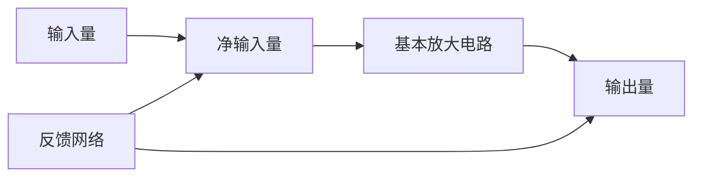
</details>

图 5.1.1 反馈放大电路的方框图

## 二、正反馈与负反馈

根据反馈的效果可以区分反馈的极性,使基本放大电路净输入量增大的反馈称为正反馈,使基本放大电路净输入量减小的反馈称为负反馈。由于反馈的结果影响了净输入量,就必然影响输出量;所以,根据输出量的变化也可以区分反馈的极性,反馈的结果使输出量的变化增大的为正反馈,使输出量的变化减小的为负反馈。

在图2.4.2(b)所示的典型工作点稳定电路中，温度的变化引起集电极电流 $I_{\mathrm{C}}$ （输出量）变化，这种变化在发射极电阻 $R_{\mathrm{e}}$ 上产生变化的电压，并影响放大管b-e间的电压（净输入量），导致基极电流 $I_{\mathrm{B}}$ 向相反方向变化，从而使 $I_{\mathrm{C}}$ 向相反方向变化。可见，反馈的结果使 $|\Delta I_{\mathrm{C}}|$ 减小，说明电路中引入的是负反馈。

## 三、直流反馈与交流反馈

如果反馈量只含有直流量，则称为直流反馈；如果反馈量只含有交流量，则称为交流反馈。或者说，仅在直流通路中存在的反馈称为直流反馈；仅在交流通路中存在的反馈称为交流反馈。在很多放大电路中，常常是交、直流反馈兼而有之。在图2.4.2(b)所示电路中， $R_{e}$ 仅存在于直流通路，故引入的是直流反馈；但若去掉旁路电容 $C_{e}$ ，则 $R_{e}$ 上的电压就既有直流量又有交流量，因而电路中既引入了直流反馈又引入了交流反馈。

直流负反馈主要用于稳定放大电路的静态工作点，本章的重点是研究交流负反馈。

## 5.1.2 反馈的判断

反馈的判断就是对放大电路中的反馈进行定性分析,正确判断反馈的性质是研究反馈放大电路的基础。

## 一、有无反馈的判断

若放大电路中存在将输出回路与输入回路相连接的通路，并由此影响放大电路的净输入，则表明电路引入了反馈；否则电路中便没有反馈。

在图5.1.2(a)所示电路中，集成运放的输出端与同相输入端、反相输入端均无通路，故电路中没有引入反馈。在图(b)所示电路中，电阻 $R_{2}$ 将集成运放的输出端与反相输入端相连接，因而集成运放的净输入量不仅决定于输入信号，还与输出信号有关，所以该电路中引入了反馈。在图(c)所示电路中，虽然电阻 $R$ 跨接在集成运放的输出端与同相输入端之间，但是因为同相输入端接地，$R$ 只不过是集成运放的负载，而不会使 $u_{0}$ 作用于输入回路，所以电路中没有引入反馈。

---

222

第 5 章 放大电路中的反馈


图 5.1.2 有无反馈的判断

(a) 没引入反馈的放大电路 (b) 引入反馈的放大电路 (c) R 的接入没有引入反馈

由以上分析可知,通过寻找电路中有无反馈通路,即可判断出电路是否引入了反馈。

## 二、反馈极性的判断

瞬时极性法是判断电路中反馈极性的基本方法。具体做法是:规定电路输入信号在某一时刻对地的极性,并以此为依据,逐级判断电路中各相关点电流的流向和电位的极性,从而得到输出信号的极性;根据输出信号的极性判断出反馈信号的极性;若反馈信号使基本放大电路的净输入信号增大,则说明引入了正反馈;若反馈信号使基本放大电路的净输入信号减小,则说明引入了负反馈。

在图 5.1.3（a）所示电路中，设输入电压  $u_{1}$  的瞬时极性对地为正，即集成运放同相输入端电位  $u_{P}$  对地为正，因而输出电压  $u_{0}$  对地也为正； $u_{0}$  在  $R_{2}$  和  $R_{1}$  回路产生电流，方向如图中虚线所示，并且该电流在  $R_{1}$  上产生极性为上“+”下“-”的反馈电压  $u_{F}$，使反相输入端电位对地为正；由此导致集成运放的净输入电压  $u_{\mathrm{D}}(u_{\mathrm{P}} - u_{\mathrm{N}})$  的数值减小，说明电路引入了负反馈。


<details>
<summary>text_image</summary>

+
uP
+
uD
A
+
uO
-
uN
R1
+
uF
-
R2
</details>

(a)


<details>
<summary>text_image</summary>

+
uN
+
uD
A
-
uO
uI
-
+
R1
uP
-
R2
uF
+
</details>

(b)


<details>
<summary>text_image</summary>

i₁
+
u₁
R₁
+
uₙ
iₙ
-
A
+
R₂
i_F
-
uₒ
</details>

(c)

图 5.1.3 反馈极性的判断

（a）通过净输入电压的变化判断反馈的极性 （b）电路引入了正反馈

(c) 通过净输入电流的变化判断反馈的极性

应当特别指出，反馈量是仅仅决定于输出量的物理量，而与输入量无关。例如，在图5.1.3(a)所示电路中，反馈电压 $u_{\mathrm{F}}$ 不表示 $R_{1}$ 上的实际电压，而只表示输出电压 $u_{0}$ 作用的结果。因此，在分析反馈极性时，可将输出量视为作用于反馈网络的独立源。

若将图(a)所示电路中集成运放的同相输入端和反相输入端互换时，则得到图(b)所示电路。设 $u_{1}$ 瞬时极性对地为正，则输出电压 $u_{0}$ 极性对地为负； $u_{0}$ 作用于 $R_{1}$ 和 $R_{2}$ 回路所产生的电流的方向如图中虚线所示，由此可得 $R_{1}$ 上所产生的反馈电压 $u_{F}$ 的极性为上“-”下“+”，即同相输入端电位 $u_{P}$ 对地为负；所以必然导致集成运放的净输入电压 $u_{\mathrm{D}}(u_{\mathrm{P}} - u_{\mathrm{N}})$ 的数值增大，说明电路引入了正反馈。

---

5.1 反馈的基本概念及判断方法

223

在图 5.1.3(c) 所示电路中，设输入电流  $i_{1}$  瞬时极性如图所示。集成运放反相输入端的电流  $i_{N}$  流入集成运放，电位  $u_{N}$  对地为正，因而输出电压  $u_{0}$  极性对地为负； $u_{0}$  作用于电阻  $R_{2}$ ，产生电流  $i_{F}$ ，如图中虚线所标注； $i_{F}$  对  $i_{1}$  分流，导致集成运放的净输入电流  $i_{N}$  的数值减小，故说明电路引入了负反馈。

以上分析说明,在集成运放组成的反馈放大电路中,可以通过分析集成运放的净输入电压 $u_{D}$ ,或者净输入电流 $i_{P}$ (或 $i_{N}$ ),因反馈的引入是增大了还是减小了,来判断反馈的极性。

由于集成运放输出电压的变化总是与其反相输入端电位的变化方向相反，因而从集成运放的输出端通过电阻、电容等反馈通路引回到其反相输入端的电路必然构成负反馈电路；同理，由于集成运放输出电压的变化总是与其同相输入端电位的变化方向相同，因而从集成运放的输出端通过电阻、电容等反馈通路引回到其同相输入端的电路必然构成正反馈电路；上述结论可用于单个集成运放中引入反馈的极性的判断。

对于分立元件电路,可以通过判断输入级放大管的净输入电压(b-e间或e-b间电压,g-s间或s-g间电压)或者净输入电流( $i_{B}$ 或 $i_{E},i_{S}$ )因反馈的引入被增大还是被减小,来判断反馈

的极性。例如，在图5.1.4所示电路中，设输入电压 $u_{1}$ 的瞬时极性对地为“+”，因而 $T_{1}$ 管的基极电位对地为“+”；共射电路输出电压与输入电压反相，故 $T_{1}$ 管的集电极电位对地为“-”，即 $T_{2}$ 管的基极电位对地为“-”；第二级仍为共射电路，故 $T_{2}$ 管的集电极电位对地为“+”，即输出电压 $u_{0}$ 极性为上“+”下“-”； $u_{0}$ 作用于 $R_{6}$ 和 $R_{3}$ 回路，产生电流，如图中虚线所示，从而在 $R_{3}$ 上得到反馈电压 $u_{F}$ ；根据 $u_{0}$ 的极性得到 $u_{F}$ 的极性为上“+”下“-”，如图中所标注； $u_{F}$ 作用的结果使 $T_{1}$ 管b-e间电压减小，故判定电路引入了负反馈。


<details>
<summary>text_image</summary>

R1
C1
+
-
u1
R2
T1
R3
uF
-
R4
T2
R6
R5
C2
+
-
+VCC
uo
C3
</details>

图 5.1.4 分立元件放大电路反馈极性的判断

## 三、直流反馈与交流反馈的判断

根据直流反馈与交流反馈的定义,可以通过反馈存在于放大电路的直流通路之中还是交流通路之中,来判断电路引入的是直流反馈还是交流反馈。

在图 5.1.5(a) 所示电路中, 已知电容 C 对交流信号可视为短路, 因而它的直流通路和交流通路分别如图(b) 和图(c) 所示, 与图 5.1.3(a) 和图 5.1.2(c) 所示电路相比较可知, 图(a) 所示电路中只引入了直流反馈, 而没有引入交流反馈。


<details>
<summary>text_image</summary>

u₁
+
A
-
R₁
R₂
uₒ
</details>

(a)


<details>
<summary>text_image</summary>

u₁
+
A
-
R₁
R₂
uₒ
</details>

(b)


<details>
<summary>text_image</summary>

u₁
+
A
-
R₂
uₒ
</details>

(c)

图 5.1.5 直流反馈与交流反馈的判断(一)

(a) 电路 (b) 直流通路 (c) 交流通路

---

224

第 5 章 放大电路中的反馈

在图 5.1.6 所示电路中, 已知电容 C 对交流信号可视为短路。对于直流量, 电容 C 相当于开路, 即在直流通路中不存在连接输出回路与输入回路的通路, 故电路中没有直流负反馈。对于交流量, C 相当于短路,  $R_{2}$  将集成运放的输出端与反相输入端相连接, 故电路中引入了交流反馈。

【例 5.1.1】判断 5.1.7 所示电路中是否引入了反馈；若引入了反馈，是直流反馈还是交流反馈，是正反馈还是负反馈。


<details>
<summary>text_image</summary>

u₁
+
A
-
R₁
C
R₂
uₒ
</details>

图 5.1.6 直流反馈与交流反馈的判断(二)


<details>
<summary>text_image</summary>

+
u₁
+
-
R₁
uD
+
-
uF
A₁
-
-
uO₁
R₂
R₃
A₂
+
-
R₄
uO
</details>

图 5.1.7 例 5.1.1 电路图

解: 观察图 5.1.7 所示电路, 电阻  $R_{4}$  将输出回路与输入回路相连接, 故电路中引入了反馈。又因为无论在直流通路还是在交流通路中, 反馈通路均存在, 所以电路中既引入了直流反馈又引入了交流反馈。

利用瞬时极性法可以判断反馈的极性。设输入电压 $u_{1}$ 的极性对地为“+”，$A_{1}$ 的输出电位 $u_{01}$ 为“-”，即后级电路的输入电压对地为“-”，故输出电压 $u_{0}$ 对地为“+”；$u_{0}$ 作用于 $R_{4}$ 和 $R_{1}$ 回路，所产生的电流（如图中虚线所示）在 $R_{1}$ 上获得反馈电压 $u_{F}$，极性如图中所注；由于 $u_{F}$ 使 $A_{1}$ 的净输入电压 $u_{D}$ 减小，故电路中引入了负反馈。

在图 5.1.7 所示电路中， $A_{2}$  与  $R_{2}$ 、 $R_{3}$  所构成的电路与图 5.1.3(c) 相同，也引入了负反馈，因其只影响局部电路，故称之为“局部反馈”；而  $R_{4}$  所引入的反馈影响整个电路，故称之为“总体反馈”或“级间反馈”；本章重点研究后者。

## 思考题

5.1.1 “直接耦合放大电路只能引入直流反馈，阻容耦合放大电路只能引入交流反馈。”这种说法正确吗？举例说明。
5.1.2 为什么说“反馈量是仅仅决定于输出量的物理量”？在判断反馈极性时如何体现上述概念？
5.1.3 试分别修改图 5.1.7 所示电路,使之只引入直流负反馈或者只引入交流反馈。

## 5.2 负反馈放大电路的四种基本组态

通常,引入了交流负反馈的放大电路称为负反馈放大电路。本节将讲述交流负反馈的四种基本组态及其特点。

## 5.2.1 负反馈放大电路分析要点

利用前面所讲的方法可以判断出图 5.2.1(a) 所示电路中引入了交流负反馈, 输出电压  $u_{0}$

---

5.2 负反馈放大电路的四种基本组态

225

的全部作为反馈电压作用于集成运放的反相输入端。在输入电压 $u_{1}$ 不变的情况下，若由于某种原因（例如负载电阻 $R_{L}$ 变化）引起输出电压 $u_{0}$ 增大，则集成运放反相输入端电位 $u_{N}$ 势必随之升高，导致集成运放的净输入电压 $u_{D}$ 减小，从而使 $u_{0}$ 减小。上述过程可表示为


<details>
<summary>flowchart</summary>

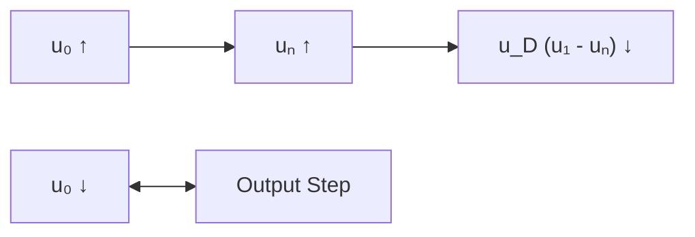
</details>


<details>
<summary>text_image</summary>

uI
+
-
uD
A
RL
uo
</details>

(a)


<details>
<summary>text_image</summary>

iI
iD
+
uD
-
+
A
iF
RL
uO
uo
iO
uo'
</details>

(b)

图 5.2.1 负反馈放大电路

（a）输出电压引回后影响净输入电压 （b）输出电流引回后影响净输入电流

若由于某种原因使 $u_{0}$ 减小时，则负反馈的结果将使 $u_{0}$ 增大；总之，反馈的结果使输出电压的变化减小。当开环增益很大时，净输入电压 $u_{\mathrm{D}}$ 必然很小，因而图5.2.1所示电路的输出电压$u_{0}$ 近似等于输入电压 $u_{1}$，即 $u_{0} \approx u_{1}$。

经判断，图(b)所示电路中也引入了交流负反馈，输出电流 $i_{0}$ 的全部作为反馈电流作用于集成运放的反相输入端。在输入电流 $i_{1}$ 不变的情况下，若由于某种原因（例如负载电阻 $R_{L}$ 变化）引起输出电流 $i_{0}$ 增大， $i_{F}$ 随之增大，则集成运放反相输入端的电流 $i_{D}$ 将减小，导致 $u_{D}$ 减小，反相输入端电位 $u_{N}$ 势必降低，从而使集成运放的输出电压 $u_{0}^{\prime}$ 升高， $i_{0}$ 随之减小。上述过程可表示为


<details>
<summary>flowchart</summary>

```mermaid
graph LR
  A["i₀ ↑"] --> B["i_F ↑"]
  B --> C["i_D ↓"]
  C --> D["u_D ↓"]
  D --> E["u_N ↓"]
  E --> F["u'₀ ↑"]
  G["i₀ ↓"] <--> H[""]
  style A fill:#fff,stroke:#333
  style B fill:#fff,stroke:#333
  style C fill:#fff,stroke:#333
  style D fill:#fff,stroke:#333
  style E fill:#fff,stroke:#333
  style F fill:#fff,stroke:#333
```
</details>

若由于某种原因使 $i_0$ 减小时，则负反馈的结果将使 $i_0$ 增大；总之，反馈的结果使输出电流的变化减小。当净输入电流 $i_D$ 很小时，图 5.2.1(b) 所示电路的输出电流 $i_0$ 近似等于输入电流 $i_1$，即 $i_0 \approx i_1$。

对上述电路的分析,可以得出如下结论:

（1）交流负反馈稳定放大电路的输出量，任何因素引起的输出量的变化均将得到抑制。由于输入量的变化所引起的输出量的变化也同样会受到抑制，所以交流负反馈使电路的放大能力下降。
（2）反馈量实质上是对输出量的采样，它既可能来源于输出电压，如图(a)所示电路；又可能来源于输出电流，如图(b)所示电路；其数值与输出量成正比。
（3）负反馈的基本作用是将引回的反馈量与输入量相减，从而调整电路的净输入量和输出量。净输入量既可能是输入电压减反馈电压，如图5.2.1(a)所示电路；也可能是输入电流减反馈电流，如图(b)所示电路。
（4）反馈量取自输出电压将使输出电压稳定，如图5.2.1(a)所示电路；反馈量取自输出电流将使输出电流稳定，如图(b)所示电路。

---

226

第 5 章 放大电路中的反馈

因此,对于具体的负反馈放大电路,首先应研究下列问题,进而进行定量分析。

（1）从输出端看，反馈量是取自于输出电压，还是取自于输出电流；即反馈的目的是稳定输出电压，还是稳定输出电流。
（2）从输入端看，反馈量与输入量是以电压方式相叠加，还是以电流方式相叠加；即反馈的结果是减小净输入电压，还是减小净输入电流。

反馈量若取自输出电压,则称为电压反馈;若取自输出电流,则称为电流反馈。反馈量与输入量若以电压方式相叠加,则称为串联反馈;若以电流方式相叠加,则称为并联反馈。因此,交流负反馈有四种组态,即电压串联、电压并联、电流串联和电流并联,有时也称为交流负反馈的四种方式。

## 5.2.2 由集成运放组成的四种组态负反馈放大电路

## 一、电压串联负反馈电路

图 5.2.1(a) 所示电路将输出电压的全部作为反馈电压, 而大多数电路均采用电阻分压的方式将输出电压的一部分作为反馈电压, 如图 5.2.2 所示。电路各点电位的瞬时极性如图中所标注。由图可知, 反馈量

$$
u _ {\mathrm{F}} = \frac {R _ {1}}{R _ {1} + R _ {2}} \cdot u _ {0} \tag {5.2.1}
$$

表明反馈量取自于输出电压  $u_{0}$ ，且正比于  $u_{0}$ ，并将与输入电压  $u_{1}$  求差后放大，故电路引入了电压串联负反馈。

## 二、电流串联负反馈电路

在图 5.2.2 所示电路中, 若将负载电阻  $R_{L}$  接在  $R_{2}$  处, 则  $R_{L}$  中就可得到稳定的电流, 如图 5.2.3(a) 所示, 习惯上常画成图 (b) 所示形式。电路中相关电位及电流的瞬时极性和电流流向如图中所标注。由图可知, 反馈量

$$
u _ {\mathrm{F}} = i _ {0} R _ {1} \tag {5.2.2}
$$

表明反馈量取自于输出电流  $i_{0}$ ，且转换为反馈电压  $u_{F}$ ，并将与输入电压  $u_{1}$  求差后放大，故电路引入了电流串联负反馈。


<details>
<summary>text_image</summary>

uI
+
-
uD
A
R1
+
uF
-
R2
RL
uo
</details>

图 5.2.2 电压串联负反馈电路


<details>
<summary>text_image</summary>

u₁
+
A
-
iₒ
R₁
iᵣ₁
Rₗ
uₒ
</details>

(a)


<details>
<summary>text_image</summary>

u₁
+
-
uD
A
iₒ
R₁
Rₗ
uₒ
+
-
uF
-
</details>

(b)

图 5.2.3 电流串联负反馈电路

(a) 基本电路 (b) 习惯画法

## 三、电压并联负反馈电路

在图 5.2.4 所示电路中, 相关电位及电流的瞬时极性和电流流向如图中所标注。由图可知, 反馈量

---

5.2 负反馈放大电路的四种基本组态

227

$$
i _ {\mathrm{F}} = - \frac {u _ {0}}{R} \tag {5.2.3}
$$

表明反馈量取自输出电压  $u_{0}$ ，且转换成反馈电流  $i_{F}$ ，并将与输入电流  $i_{1}$  求差后放大，因此电路引入了电压并联负反馈。

## 四、电流并联负反馈电路

在图 5.2.5 所示电路中, 各支路电流的瞬时极性如图中所标注。由图可知, 反馈量

$$
i _ {\mathrm{F}} = - \frac {R _ {2}}{R _ {1} + R _ {2}} \cdot i _ {\mathrm{O}} \tag {5.2.4}
$$

表明反馈信号取自输出电流  $i_{0}$ ，且转换成反馈电流  $i_{F}$ ，并将与输入电流  $i_{1}$  求差后放大，因而电路引入了电流并联负反馈。


<details>
<summary>text_image</summary>

iI
iD
A
-
R
iF
uO
RL
</details>

图 5.2.4 电压并联负反馈电路


<details>
<summary>text_image</summary>

uP
+
iI
iD
A
-
R1
iF
R2
iO
uo
+
-
</details>

图 5.2.5 电流并联负反馈电路

由上述四个电路可知，串联负反馈电路所加信号源均为电压源，这是因为若加恒流源，则电路的净输入电压将等于信号源电流与集成运放输入电阻之积，而不受反馈电压的影响；同理，并联负反馈电路所加信号源均为电流源，这是因为若加恒压源，则电路的净输入电流将等于信号源电压除以集成运放输入电阻，而不受反馈电流的影响。换言之，串联负反馈适用于输入信号为恒压源或近似恒压源的情况，而并联负反馈适用于输入信号为恒流源或近似恒流源的情况。

综上所述,放大电路中应引入电压负反馈还是电流负反馈,取决于负载欲得到稳定的电压还是稳定的电流;放大电路中应引入串联负反馈还是并联负反馈,取决于输入信号源是恒压源(或近似恒压源)还是恒流源(或近似恒流源)。

## 5.2.3 反馈组态的判断

## 一、电压负反馈与电流负反馈的判断

电压反馈与电流反馈的区别在于基本放大电路的输出回路与反馈网络的连接方式不同。如前所述，负反馈电路中的反馈量不是取自输出电压就是取自输出电流；因此，只要令负反馈放大电路的输出电压 $u_{0}$ 为零，若反馈量也随之为零，则说明电路中引入了电压负反馈；若反馈量依然存在，则说明电路中引入了电流负反馈。

通过判断可知，图5.2.6(a)所示电路中引入了交流负反馈，输入电流 $i_{1}$ 与反馈电流 $i_{\mathrm{F}}$ 如图中所标注。令输出电压 $u_{0} = 0$，即将集成运放的输出端接地，便得到图(b)所示电路。此时，虽然反馈电阻 $R_{\mathrm{f}}$ 中仍有电流，但那是输入电流 $i_{1}$ 作用的结果，而因为输出电压 $u_{0}$ 为零，所以它在 $R_{\mathrm{f}}$ 中产生的电流（即反馈电流）也必然为零，故电路中引入的是电压反馈。

---

228

第 5 章 放大电路中的反馈


<details>
<summary>text_image</summary>

i₁
+
A
-
i_F
R_f
R_L
u_O
</details>

(a)


<details>
<summary>text_image</summary>

i₁
A
Rₗ
</details>

(b)

图 5.2.6 电压反馈与电流反馈的判断(一)

(a) 电路 (b) 令输出电压为零

通过判断可知，图5.2.7(a)所示电路中引入了交流负反馈，各支路电流如图中所标注。令输出电压 $u_{0}=0$ ，即将负载电阻 $R_{L}$ 两端短路，便得到如图(b)所示电路。因为输出电流 $i_{0}$ 仅受集成运放输入信号的控制，所以即使 $R_{L}$ 短路， $i_{0}$ 也并不为零；又因为反馈电流 $i_{F}$ 与 $i_{0}$ 的关系不变，仍如式(5.2.4)所示，说明反馈量依然存在，故电路中引入的是电流反馈。


<details>
<summary>text_image</summary>

iI
A
+
-
RL
iO
uO
R1
iF
R2
</details>

(a)


<details>
<summary>text_image</summary>

i₁
+
A
-
R₁ i_F
iₒ
R₂
</details>

(b)

图 5.2.7 电压反馈与电流反馈的判断(二)

(a) 电路 (b) 令输出电压为零

应当特别指出,上述方法仅仅是判断方法,而不是实验方法;因为如果将集成运放的输出端强制接地,常会使之因电流过大而烧坏。

## 二、串联反馈与并联反馈的判断

串联反馈与并联反馈的区别在于基本放大电路的输入回路与反馈网络的连接方式不同。若反馈信号为电压量，与输入电压求差而获得净输入电压，则为串联反馈；若反馈信号为电流量，与输入电流求差获得净输入电流，则为并联反馈。

在图 5.2.2 和图 5.2.3 所示两电路中, 集成运放的净输入电压

$$
u _ {\mathrm{D}} = u _ {\mathrm{I}} - u _ {\mathrm{F}}
$$

故它们均引入了串联反馈。

在图 5.2.4 和图 5.2.5 所示两电路中, 集成运放的净输入电流

$$
i _ {\mathrm{D}} = i _ {\mathrm{I}} - i _ {\mathrm{F}}
$$

故它们均引入了并联反馈。

【例 5.2.1】试分析图 5.2.8 所示电路中有无引入反馈；若有反馈，则说明引入的是直流反馈还是交流反馈，是正反馈还是负反馈；若为交流负反馈，则说明反馈的组态。

解: 观察电路,  $R_{2}$  将输出回路与输入回路相连接, 因而电路引入了反馈。无论在直流通路

---

5.3 负反馈放大电路的方块图及一般表达式

229

中,还是在交流通路中, $R_{2}$ 形成的反馈通路均存在,因而电路中既引入了直流反馈,又引入了交流反馈。

设输入电压 $u_{1}$ 对地为“+”，集成运放的输出端电位（即晶体管T的基极电位）为“+”，因此集电极电流（即输出电流 $i_{0}$ ）的流向如图中所标注。 $i_{0}$ 通过 $R_{3}$ 和 $R_{2}$ 所在支路分流，在 $R_{1}$ 上获得反馈电压 $u_{\mathrm{F}}, u_{\mathrm{F}}$ 的极性为上“+”下“-”，使集成运放的净输入电压 $u_{\mathrm{D}}$ 减小，故电路中引入的是负反馈。

根据 $u_{1}, u_{\mathrm{F}}$ 和 $u_{\mathrm{D}}$ 的关系，说明电路引入的是串联反馈。令输出电压 $u_{0} = 0$ ，即将 $R_{\mathrm{L}}$ 短路，因 $i_{0}$ 仅受 $i_{\mathrm{B}}$ 的控制而依然存在，$u_{\mathrm{F}}$ 和 $i_{0}$ 的关系不变，故电路中引入的是电流反馈。所以，电路中引入了电流串联负反馈。

【例 5.2.2】试分析图 5.2.9 所示电路中引入了哪种组态的交流负反馈。


<details>
<summary>text_image</summary>

uI
+
-
uD
A
+
-
RL
+VCC
+
uo
-
iO
T
R2
R1
+
uF
-
R3
</details>

图5.2.8 例5.2.1电路图


<details>
<summary>text_image</summary>

R1
+
u1
-
T1
T2
I
-
R2
+
uF
-
R4
R3
T3
+
R5
+
uo
-
VCC
-
</details>

图5.2.9 例5.2.2电路图

解: 在假设输入电压  $u_{1}$  对地为“+”的情况下, 电路中各点的电位如图中所标注, 在电阻  $R_{2}$  上获得反馈电压  $u_{F}$ 。 $u_{F}$  使差分放大电路的净输入电压 (即  $T_{1}$  管和  $T_{2}$  管的基极电位之差) 变小, 故电路中引入了串联反馈。

令输出电压 $u_{0} = 0$，即将 $T_{3}$ 管的集电极接地，将使 $u_{\mathrm{F}}$ 为零，故电路中引入了电压负反馈。

可见，该电路中引入了电压串联负反馈。

## 思考题

5.2.1 当负载电阻变化时,电压负反馈放大电路和电流负反馈放大电路的输出电压分别如何变化?为什么?
5.2.2 在分析分立元件放大电路和集成运放电路中反馈的性质时,净输入电压和净输入电流分别指的是什么地方的电压和电流?电流负反馈电路的输出电流一定是负载电流吗?举例说明。
5.2.3 在图 5.2.9 所示电路中, 当输出电压为零时, 电阻  $R_{2}$  上电压不为零。为什么认为这个电路引入的是电压负反馈, 而不是电流负反馈?

## 5.3 负反馈放大电路的方块图及一般表达式

因为负反馈放大电路有四种基本组态,而且对于同一种组态,具体电路也各不相同;所以为研究负反馈放大电路的共同规律,可以利用方块图来描述所有电路。本节将讲述负反馈放大电

---

230

第 5 章 放大电路中的反馈

路的方块图及其一般表达式。

## 5.3.1 负反馈放大电路的方块图表示法

任何负反馈放大电路都可以用图5.3.1所示的方块图来表示，上面一个方块是负反馈放大

电路的基本放大电路,下面一个方块是负反馈放大电路的反馈网络。负反馈放大电路的基本放大电路是在断开反馈且考虑了反馈网络的负载效应 $^{①}$ 的情况下所构成的放大电路;反馈网络是指与反馈系数 $\dot{F}$ 有关的所有元器件构成的网络。

图中  $\dot{X}_{i}$  为输入量， $\dot{X}_{f}$  为反馈量， $\dot{X}_{i}^{\prime}$  为净输入量， $\dot{X}_{\alpha}$  为输出量。图中连线的箭头表示信号的流通方向，说明方块图中的信号是单向流通的，即输入信号  $\dot{X}_{i}$  仅通过基本放大电


<details>
<summary>flowchart</summary>

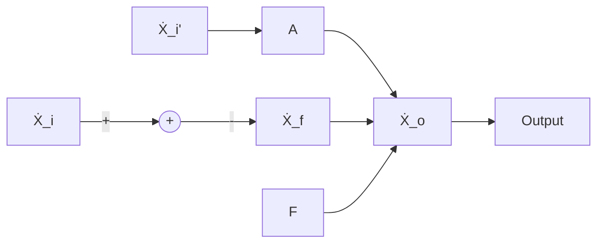
</details>

图 5.3.1 负反馈放大电路的方块图

路传递到输出，而输出信号 $\dot{X}_{\mathrm{o}}$ 仅通过反馈网络传递到输入；换言之，$\dot{X}_{\mathrm{i}}$ 不通过反馈网络传递到输出，而 $\dot{X}_{\mathrm{o}}$ 也不通过基本放大电路传递到输入。输入端的圆圈 $\oplus$ 表示信号 $\dot{X}_{\mathrm{i}}$ 和 $\dot{X}_{\mathrm{f}}$ 在此叠加，“+”号和“-”号表明了 $\dot{X}_{\mathrm{i}}, \dot{X}_{\mathrm{f}}$ 和 $\dot{X}_{\mathrm{i}}'$ 之间的关系为

$$
\dot {X} _ {\mathrm{i}} ^ {\prime} = \dot {X} _ {\mathrm{i}} - \dot {X} _ {\mathrm{f}} \tag {5.3.1}
$$

在信号的中频段， $\dot{X}_{i}^{\prime},\dot{X}_{i}$  和  $\dot{X}_{i}$  均为实数，所以可写为

$$
\mid \dot {X} _ {\mathrm{i}} ^ {\prime} \mid = \mid \dot {X} _ {\mathrm{i}} \mid - \mid \dot {X} _ {\mathrm{f}} \mid \text {或} X _ {\mathrm{i}} ^ {\prime} = X _ {\mathrm{i}} - X _ {\mathrm{f}} \tag {5.3.2}
$$

在方块图中定义基本放大电路的放大倍数为

$$
\dot {A} = \frac {\dot {X} _ {\mathrm{o}}}{\dot {X} _ {\mathrm{i}} ^ {\prime}} \tag {5.3.3}
$$

反馈系数为

$$
\dot {F} = \frac {\dot {X} _ {\mathrm{f}}}{\dot {X} _ {\mathrm{o}}} \tag {5.3.4}
$$

负反馈放大电路的放大倍数(也称闭环放大倍数)为

$$
\dot {A} _ {\mathrm{f}} = \frac {\dot {X} _ {\mathrm{o}}}{\dot {X} _ {\mathrm{i}}} \tag {5.3.5}
$$

根据式(5.3.3)、(5.3.4)可得

$$
\dot {A} \dot {F} = \frac {\dot {X} _ {\mathrm{f}}}{\dot {X} _ {\mathrm{i}} ^ {\prime}} \tag {5.3.6}
$$

$\dot{A}\dot{F}$ 称为电路的环路放大倍数。

## 5.3.2 四种组态电路的方块图

若将负反馈放大电路的基本放大电路与反馈网络均看为两端口网络,则不同反馈组态表明两个网络的不同连接方式。四种反馈组态电路的方块图如图5.3.2所示。其中图(a)所示为电

<small><span class="docvortex-page-footnote" data-block-type="page_footnote" style="color:#6b7280">① 参阅童诗白、华成英主编的《模拟电子技术基础(第三版)》6.3.4节。</span></small>

---

5.3 负反馈放大电路的方块图及一般表达式

231

压串联负反馈电路，图(b)所示为电流串联负反馈电路，图(c)所示为电压并联负反馈电路，图(d)所示为电流并联负反馈电路。


图 5.3.2 四种反馈组态电路的方块图

(a) 电压串联负反馈电路 (b) 电流串联负反馈电路

(c) 电压并联负反馈电路 (d) 电流并联负反馈电路

由于电压负反馈电路中  $\dot{X}_{o} = \dot{U}_{o}$ ，电流负反馈电路中  $\dot{X}_{o} = \dot{I}_{o}$ ；串联负反馈电路中， $\dot{X}_{i} = \dot{U}_{i}$ ， $\dot{X}_{i}' = \dot{U}_{i}'$ ， $\dot{X}_{f} = \dot{U}_{f}$ ；并联负反馈电路中， $\dot{X}_{i} = \dot{I}_{i}$ ， $\dot{X}_{i}' = \dot{I}_{i}'$ ， $\dot{X}_{f} = \dot{I}_{f}$ ；因此，不同的反馈组态， $\dot{A}$ 、 $\dot{F}$  和  $\dot{A}_{f}$  的物理意义不同，量纲也不同，电路实现的控制关系不同，因而功能也就不同，如表 5.3.1 所示。

表 5.3.1 四种组态负反馈放大电路的比较

| 反馈组态 | $\dot{X}_{i}\dot{X}_{f}\dot{X}_{i}^{\prime}$ | $\dot{X}_{o}$ | $\dot{A}$ | $\dot{F}$ | $\dot{A}_{f}$ | 功能 |
| --- | --- | --- | --- | --- | --- | --- |
| 电压串联 | $\dot{U}_{i}\dot{U}_{f}\dot{U}_{i}^{\prime}$ | $\dot{U}_{o}$ | $\dot{A}_{uu}=\frac{\dot{U}_{o}}{\dot{U}_{i}^{\prime}}$ | $\dot{F}_{uu}=\frac{\dot{U}_{f}}{\dot{U}_{o}}$ | $\dot{A}_{uuf}=\frac{\dot{U}_{o}}{\dot{U}_{i}}$ | $\dot{U}_{i}$控制$\dot{U}_{o}$,电压放大 |
| 电流串联 | $\dot{U}_{i}\dot{U}_{f}\dot{U}_{i}^{\prime}$ | $\dot{I}_{o}$ | $\dot{A}_{iu}=\frac{\dot{I}_{o}}{\dot{U}_{i}^{\prime}}$ | $\dot{F}_{ui}=\frac{\dot{U}_{f}}{\dot{I}_{o}}$ | $\dot{A}_{inf}=\frac{\dot{I}_{o}}{\dot{U}_{i}}$ | $\dot{U}_{i}$控制$\dot{I}_{o}$,电压转换成电流 |
| 电压并联 | $\dot{I}_{i}\dot{I}_{f}\dot{I}_{i}^{\prime}$ | $\dot{U}_{o}$ | $\dot{A}_{ui}=\frac{\dot{U}_{o}}{\dot{I}_{i}^{\prime}}$ | $\dot{F}_{ui}=\frac{\dot{I}_{f}}{\dot{U}_{o}}$ | $\dot{A}_{uif}=\frac{\dot{U}_{o}}{\dot{I}_{i}}$ | $\dot{I}_{i}$控制$\dot{U}_{o}$,电流转换成电压 |
| 电流并联 | $\dot{I}_{i}\dot{I}_{f}\dot{I}_{i}^{\prime}$ | $\dot{I}_{o}$ | $\dot{A}_{ii}=\frac{\dot{I}_{o}}{\dot{I}_{i}^{\prime}}$ | $\dot{F}_{ii}=\frac{\dot{I}_{f}}{\dot{I}_{o}}$ | $\dot{A}_{inf}=\frac{\dot{I}_{o}}{\dot{I}_{i}}$ | $\dot{I}_{i}$控制$\dot{I}_{o}$,电流放大 |

表 5.3.1 说明, 负反馈放大电路的放大倍数具有广泛的含义, 而且环路放大倍数  $\dot{A}\dot{F}$  在四种组态中均量纲为一。

---

232

第 5 章 放大电路中的反馈

## 5.3.3 负反馈放大电路的一般表达式

根据式(5.3.3)、(5.3.4)、(5.3.5)、(5.3.6)，可得

$$
\dot {A} _ {\mathrm{f}} = \frac {\dot {X} _ {\mathrm{o}}}{\dot {X} _ {\mathrm{i}}} = \frac {\dot {X} _ {\mathrm{o}}}{\dot {X} _ {\mathrm{i}} ^ {\prime} + \dot {X} _ {\mathrm{f}}} = \frac {\dot {A} \dot {X} _ {\mathrm{i}} ^ {\prime}}{\dot {X} _ {\mathrm{i}} ^ {\prime} + \dot {A} \dot {F} \dot {X} _ {\mathrm{i}} ^ {\prime}}
$$

由此得到 $\dot{A}_{\mathrm{f}}$ 的一般表达式

$$
\dot {A} _ {\mathrm{f}} = \frac {\dot {A}}{1 + \dot {A} \dot {F}} \tag {5.3.7}
$$

在中频段， $\dot{A}_{f}$ 、 $\dot{A}$  和  $\dot{F}$  均为实数，因此式(5.3.7)可写为

$$
A _ {\mathrm{f}} = \frac {A}{1 + A F} \tag {5.3.8}
$$

当电路引入负反馈时,AF>0,表明引入负反馈后电路的放大倍数等于基本放大电路放大倍数的 $(1+AF)$ 分之一,而且A、F和 $A_{f}$ 的符号均相同。

倘若在分析中发现 $\dot{A}\dot{F} < 0$ ，即 $1 + \dot{A}\dot{F} < 1$ ，即 $|\dot{A}_{\mathrm{f}}|$ 大于 $|\dot{A}|$ ，则说明电路中引入了正反馈；而若 $\dot{A}\dot{F} = -1$ ，使 $1 + \dot{A}\dot{F} = 0$ ，则说明电路在输入量为零时就有输出，称电路产生了自激振荡。

若电路引入深度负反馈, 即  $1 + AF \gg 1$ , 则

$$
A _ {\mathrm{f}} \approx \frac {1}{F} \tag {5.3.9}
$$

表明放大倍数几乎仅仅决定于反馈网络，而与基本放大电路无关。由于反馈网络常为无源网络，受环境温度的影响极小，因而放大倍数获得很高的稳定性。从深度负反馈的条件可知，反馈网络的参数确定后，基本放大电路的放大能力愈强，即 $A$ 的数值愈大，反馈愈深，$A_{\mathrm{f}}$ 与 $1 / F$ 的近似程度愈好。

大多数负反馈放大电路,特别是用集成运放组成的负反馈放大电路,一般均满足 $1+AF\gg1$ 的条件,因而在近似分析中均可认为 $A_{f}\approx1/F$ ,而不必求出A,当然也就不必定量分析基本放大电路了。

应当指出,通常所说的负反馈放大电路是指中频段的反馈极性;当信号频率进入低频段或高频段时,由于附加相移的产生,负反馈放大电路可能对某一特定频率产生正反馈过程,甚至产生自激振荡,5.6节将重点讲述这一问题。

## 思考题

5.3.1 利用图 5.3.2 所示方块图说明为什么串联负反馈适用于输入信号为恒压源或近似恒压源的情况，而并联负反馈适用于输入信号为恒流源或近似恒流源的情况。
5.3.2 说明在负反馈放大电路的方块图中,什么是反馈网络,什么是基本放大电路;在研究负反馈放大电路时,为什么重点研究的是反馈网络,而不是基本放大电路。
5.3.3 为什么说“无论用集成运放组成哪种组态的负反馈放大电路，通常都可以认为引入的是深度负反馈”？

---

5.4 深度负反馈放大电路放大倍数的分析

233

## 5.4 深度负反馈放大电路放大倍数的分析

实用的放大电路中多引入深度负反馈,因此分析负反馈放大电路的重点是从电路中分离出反馈网络,并求出反馈系数 $\dot{F}$ 。为了便于研究和测试,人们还常常需要求出不同组态负反馈放大电路的电压放大倍数。本节将重点研究具有深度负反馈放大电路的放大倍数的估算方法。

## 5.4.1 深度负反馈的实质

在负反馈放大电路的一般表达式中, 若  $\left|1+\dot{A}\dot{F}\right|\gg1$ , 则

$$
\dot {A} _ {\mathrm{f}} \approx \frac {1}{\dot {F}} \tag {5.4.1}
$$

根据  $\dot{A}_{f}$  和  $\dot{F}$  的定义，

$$
\dot {A} _ {\mathrm{f}} = \frac {\dot {X} _ {\mathrm{o}}}{\dot {X} _ {\mathrm{i}}}, \quad \dot {F} = \frac {\dot {X} _ {\mathrm{f}}}{\dot {X} _ {\mathrm{o}}}, \quad \dot {A} _ {\mathrm{f}} \approx \frac {1}{\dot {F}} = \frac {\dot {X} _ {\mathrm{o}}}{\dot {X} _ {\mathrm{f}}}
$$

说明  $\dot{X}_{i} \approx \dot{X}_{f}$ 。可见，深度负反馈的实质是在近似分析中忽略净输入量。但不同组态，可忽略的净输入量也将不同。当电路引入深度串联负反馈时，

$$
\dot {U} _ {\mathrm{i}} \approx \dot {U} _ {\mathrm{f}} \tag {5.4.2}
$$

认为净输入电压  $\dot{U}_{i}^{\prime}$  可忽略不计。当电路引入深度并联负反馈时，

$$
\dot {I} _ {\mathrm{i}} \approx \dot {I} _ {\mathrm{f}} \tag {5.4.3}
$$

认为净输入电流  $\dot{I}^{\prime}$  可忽略不计。

利用式 $(5.4.1)$ 、 $(5.4.2)$ 、 $(5.4.3)$ 可以求出四种不同组态负反馈放大电路的放大倍数。

## 5.4.2 反馈网络的分析

反馈网络连接放大电路的输出回路与输入回路,并且影响着反馈量。寻找出负反馈放大电路的反馈网络,便可根据定义求出反馈系数。

图 5.2.2 所示电压串联负反馈电路的反馈网络如图 5.4.1(a) 方框中所示。因而反馈系数为

$$
\dot {F} _ {u u} = \frac {\dot {U} _ {\mathrm{f}}}{\dot {U} _ {\mathrm{o}}} = \frac {R _ {1}}{R _ {1} + R _ {2}} \tag {5.4.4}
$$

图 5.2.3(b) 所示电流串联负反馈电路的反馈网络如图 5.4.1(b) 方框中所示。其反馈系数

$$
\dot {F} _ {u i} = \frac {\dot {U} _ {\mathrm{f}}}{\dot {I} _ {\mathrm{o}}} = \frac {\dot {I} _ {\mathrm{o}} R}{\dot {I} _ {\mathrm{o}}} = R \tag {5.4.5}
$$

图 5.2.4 所示电压并联负反馈电路的反馈网络如图 5.4.1(c) 方框中所示。其反馈系数为

$$
\dot {F} _ {i u} = \frac {\dot {I} _ {\mathrm{f}}}{\dot {U} _ {\mathrm{o}}} = \frac {- \frac {\dot {U} _ {\mathrm{o}}}{R}}{\dot {U} _ {\mathrm{o}}} = - \frac {1}{R} \tag {5.4.6}
$$

---

234

第 5 章 放大电路中的反馈

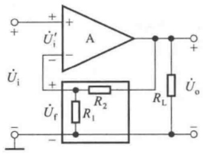

<details>
<summary>text_image</summary>

+
-
U'i'
A
-
+
U'i
R2
R1
U'f
-
RL
U'o
+
</details>

(a)

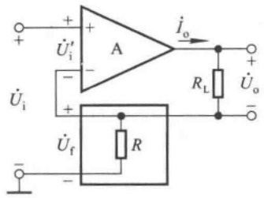

<details>
<summary>text_image</summary>

+
-
U'i'
A
i_o
R_L
+
-
U_o
U'i
U_f
R
</details>

(b)

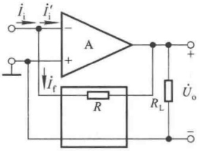

<details>
<summary>text_image</summary>

i_i
i'_i
A
+
-
i_f
R
R_L
U_o
-
</details>

(c)

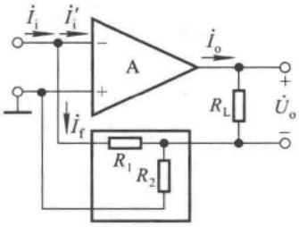

<details>
<summary>text_image</summary>

i_i
i'_i
A
+
-
i_o
R_L
U_o
-
I_f
R_1
R_2
</details>

(d)

图 5.4.1 反馈网络的分析

(a) 电压串联负反馈电路 (b) 电流串联负反馈电路

(c) 电压并联负反馈电路 (d) 电流并联负反馈电路

图 5.2.5 所示电流并联负反馈电路的反馈网络如图 5.4.1(d) 方框中所示。其反馈系数为

$$
\dot {F} _ {i i} = \frac {\dot {I} _ {\mathrm{f}}}{\dot {I} _ {\mathrm{o}}} = - \frac {R _ {2}}{R _ {1} + R _ {2}} \tag {5.4.7}
$$

这里再次特别指出,由于反馈量仅决定于输出量,因此反馈系数仅决定于反馈网络,而与放大电路的输入、输出特性及负载电阻 $R_{L}$ 无关。

## 5.4.3 基于反馈系数的放大倍数分析

## 一、电压串联负反馈电路

根据表 5.3.1, 电压串联负反馈电路的放大倍数就是电压放大倍数, 即

$$
\dot {A} _ {u u f} = \dot {A} _ {u f} = \frac {\dot {U} _ {o}}{\dot {U} _ {i}} \approx \frac {\dot {U} _ {o}}{\dot {U} _ {f}} = \frac {1}{\dot {F} _ {u u}}. \tag {5.4.8}
$$

根据式(5.4.4)，图5.4.1(a)所示电路的 $\dot{A}_{uf}\approx1+\frac{R_{2}}{R_{1}}$ 。 $\dot{A}_{uf}$ 与负载电阻 $R_{L}$ 无关，表明引入深度电压负反馈后，电路的输出可近似为受控恒压源。

## 二、电流串联负反馈电路

根据表 5.3.1, 电流串联负反馈电路的放大倍数

$$
\dot {A} _ {i u f} = \frac {\dot {I} _ {\mathrm{o}}}{\dot {U} _ {\mathrm{i}}} \approx \frac {\dot {I} _ {\mathrm{o}}}{\dot {U} _ {\mathrm{f}}} = \frac {1}{\dot {F} _ {u i}} \tag {5.4.9}
$$

从图 5.3.2(b) 所示方块图可知, 输出电压  $\dot{U}_{o} = \dot{I}_{o} R_{L}, \dot{U}_{o}$  与  $\dot{I}_{o}$  随负载的变化成线性关系,

---

5.4 深度负反馈放大电路放大倍数的分析

235

故电压放大倍数

$$
\dot {A} _ {\mathrm{uf}} = \frac {\dot {U} _ {\mathrm{o}}}{\dot {U} _ {\mathrm{i}}} \approx \frac {\dot {I} _ {\mathrm{o}} R _ {\mathrm{L}}}{\dot {U} _ {\mathrm{f}}} = \frac {1}{F _ {\mathrm{ui}}} \cdot R _ {\mathrm{L}} \tag {5.4.10}
$$

根据式(5.4.5)，图5.4.1(b)所示电路的 $\dot{A}_{uf}\approx\frac{R_{L}}{R}$ 。

## 三、电压并联负反馈电路

根据表 5.3.1, 电压并联负反馈电路的放大倍数

$$
\dot {A} _ {u \mathrm{if}} = \frac {\dot {U} _ {\mathrm{o}}}{\dot {I} _ {\mathrm{i}}} \approx \frac {\dot {U} _ {\mathrm{o}}}{\dot {I} _ {\mathrm{f}}} = \frac {1}{\dot {F} _ {i u}} \tag {5.4.11}
$$

实际上，并联负反馈电路的输入量通常不是理想的恒流信号  $\dot{I}_{i}$  。在绝大多数情况下，信号源  $\dot{I}_{s}$  有内阻  $R_{s}$ ，如图 5.4.2(a) 所示。根据诺顿定理，可将信号源转换成内阻为  $R_{s}$  的电压源  $\dot{U}_{s}$ ，如图(b) 所示。由于  $\dot{I}_{i} \approx \dot{I}_{f}, \dot{I}_{i}'$  趋于零，可以认为  $\dot{U}_{s}$  几乎全部降落在电阻  $R_{s}$  上，所以

$$
\dot {U} _ {\mathrm{s}} \approx \dot {I} _ {\mathrm{i}} R _ {\mathrm{s}} \approx \dot {I} _ {\mathrm{f}} R _ {\mathrm{s}} \tag {5.4.12}
$$

于是可得电压放大倍数

$$
\dot {A} _ {\mathrm{usf}} = \frac {\dot {U} _ {\mathrm{o}}}{\dot {U} _ {\mathrm{s}}} \approx \frac {\dot {U} _ {\mathrm{o}}}{\dot {I} _ {\mathrm{f}} R _ {\mathrm{s}}} = \frac {1}{\dot {F} _ {i u}} \cdot \frac {1}{R _ {\mathrm{s}}} \tag {5.4.13}
$$

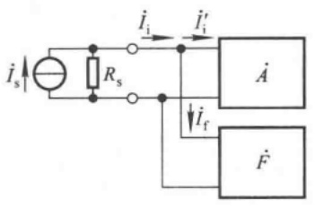

<details>
<summary>text_image</summary>

i_s
R_s
i_i
i'_i
A
i_f
F
</details>

(a)

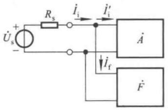

<details>
<summary>text_image</summary>

Üs +
-
Rs
i̇i
i̇i'
A
i̇f
F
</details>

(b)

图 5.4.2 并联负反馈电路的信号源

(a) 信号源为内阻是 $R_{\mathrm{s}}$ 的电流源 (b) 将电流源转换成电压源

将内阻为  $R_{s}$  的信号源  $\dot{U}_{s}$  加在图 5.4.1(c) 所示电路的输入端，根据式(5.4.6)，可得出电压放大倍数  $\dot{A}_{usf} \approx -\frac{R}{R_{s}}$ 。

如前所述,并联负反馈电路适用于恒流源或内阻 $R_{s}$ 很大的恒压源(即近似恒流源),因而在电路测试时,若信号源内阻很小,则应外加一个相当于 $R_{s}$ 的电阻。

## 四、电流并联负反馈电路

根据表 5.3.1, 电流并联负反馈电路的放大倍数

$$
\dot {A} _ {i i f} = \frac {\dot {I} _ {\mathrm{o}}}{\dot {I} _ {\mathrm{i}}} \approx \frac {\dot {I} _ {\mathrm{o}}}{\dot {I} _ {\mathrm{f}}} = \frac {1}{\dot {F} _ {i i}} \tag {5.4.14}
$$

从图 5.3.2(d) 所示方块图可知, 输出电压  $\dot{U}_{o} = \dot{I}_{o} R_{L}$ , 当以  $R_{s}$  为内阻的电压源  $\dot{U}_{s}$  为输入信号时, 根据式 (5.4.12), 电压放大倍数为

---

236

第 5 章 放大电路中的反馈

$$
\dot {A} _ {\mathrm{usf}} = \frac {\dot {U} _ {\mathrm{o}}}{\dot {U} _ {\mathrm{s}}} \approx \frac {\dot {I} _ {\mathrm{o}} R _ {\mathrm{L}}}{\dot {I} _ {\mathrm{f}} R _ {\mathrm{s}}} = \frac {1}{\dot {F} _ {i i}} \cdot \frac {R _ {\mathrm{L}}}{R _ {\mathrm{s}}} \tag {5.4.15}
$$

将内阻为  $R_{s}$  的电压源  $\dot{U}_{s}$  加在图 5.4.1(d) 所示电路的输入端，根据式(5.4.7)，可得电压放大倍数  $\dot{A}_{usf} \approx -\left(1 + \frac{R_{1}}{R_{2}}\right) \cdot \frac{R_{L}}{R_{s}}$ 。

当电路引入并联负反馈时，多数情况下可以认为 $\dot{U}_{\mathrm{s}} \approx \dot{I}_{\mathrm{f}} R_{\mathrm{s}}$；当电路引入电流负反馈时，$\dot{U}_{\mathrm{o}} = \dot{I}_{\mathrm{o}} R_{\mathrm{L}}^{\prime}, R_{\mathrm{L}}^{\prime}$ 是电路输出端所接总负载，可能是若干电阻的并联，也可能就是负载电阻 $R_{\mathrm{L}}$。

综上所述,求解深度负反馈放大电路放大倍数的一般步骤是:

(1) 正确判断反馈组态；
(2) 求解反馈系数；
(3) 利用  $\dot{F}$  求解  $\dot{A}_{f}$ 、 $\dot{A}_{uf}$ （或  $\dot{A}_{usf}$ ）。

从式（5.4.8）、（5.4.10）、（5.4.13）、（5.4.15）可知，$\dot{A}_{uf}$（或 $\dot{A}_{usf}$）与 $\dot{F}$ 符号相同；从式（5.3.7）可知，$\dot{A}$、$\dot{F}$ 和 $\dot{A}_{f}$ 符号也相同；因而 $\dot{A}$、$\dot{F}$、$\dot{A}_{f}$ 和 $\dot{A}_{uf}$（或 $\dot{A}_{usf}$）均同符号；它们反映了瞬时极性法判断出的 $\dot{U}_{o}$ 与 $\dot{U}_{i}$ 的相位关系，同相时为正号，反相时为负号。

【例 5.4.1】在图 5.2.9 所示电路中, 已知  $R_{2}=10\ k\Omega, R_{4}=100\ k\Omega$ 。求解深度负反馈条件下的电压放大倍数  $\dot{A}_{uf}$ 。

解: 图 5.2.9 所示电路中引入了电压串联负反馈,  $R_{2}$  和  $R_{4}$  组成反馈网络。所以

$$
\dot {F} _ {u u} = \frac {\dot {U} _ {\mathrm{f}}}{\dot {U} _ {\mathrm{o}}} = \frac {R _ {2}}{R _ {2} + R _ {4}}
$$

$$
\dot {A} _ {u f} = \frac {\dot {U} _ {\mathrm{o}}}{\dot {U} _ {\mathrm{i}}} \approx \frac {1}{\dot {F} _ {u u}} = 1 + \frac {R _ {4}}{R _ {2}} = 1 + \frac {1 0 0}{1 0} = 1 1
$$

【例 5.4.2】电路如图 5.4.3 所示。

（1）判断电路中引入了哪种组态的交流负反馈；
(2) 求出在深度负反馈条件下的  $\dot{A}_{f}$  和  $\dot{A}_{uf}$ 。

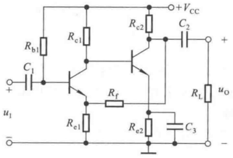

<details>
<summary>text_image</summary>

Rb1
C1
+
u1
-
Rc1
Rc2
+VCC
C2
+
Rf
Re1
Re2
RL
uo
C3
-
</details>

图 5.4.3 例 5.4.2 电路图

解:（1）图5.4.3所示电路为两级共射放大电路， $\dot{U}_{o}$ 与 $\dot{U}_{i}$ 同相； $R_{e1}$ 和 $R_{f}$ 组成反馈网络， $\dot{U}_{o}$ 作用于反馈网络，在 $R_{e1}$ 上获得的电压为反馈电压；因而电路中引入了电压串联负反馈。

---

5.4 深度负反馈放大电路放大倍数的分析

237

(2) 因为  $\dot{U}_{o}$  与  $\dot{U}_{i}$  同相，所以  $\dot{A}_{f}$  和  $\dot{A}_{uf}$  均为正号。

$$
\begin{array}{l} \dot {F} _ {u u} = \frac {\dot {U} _ {\mathrm{f}}}{\dot {U} _ {\mathrm{o}}} = \frac {R _ {\mathrm{e1}}}{R _ {\mathrm{e1}} + R _ {\mathrm{f}}} \\ \dot {A} _ {\mathrm{f}} = \dot {A} _ {\mathrm{uf}} = \frac {\dot {U} _ {\mathrm{o}}}{\dot {U} _ {\mathrm{i}}} \approx \frac {1}{\dot {F} _ {\mathrm{uu}}} = 1 + \frac {R _ {\mathrm{f}}}{R _ {\mathrm{el}}} \\ \end{array}
$$

【例5.4.3】电路如图5.4.4所示，已知 $R_{\mathrm{s}} = R_{\mathrm{e1}} = R_{\mathrm{e2}} = 1\mathrm{k}\Omega ,R_{\mathrm{c1}} = R_{\mathrm{c2}} = R_{\mathrm{L}} = 10\mathrm{k}\Omega$

（1）判断电路中引入了哪种组态的交流负反馈；
（2）在深度负反馈条件下，若要 $\mathrm{T}_{2}$ 管集电极动态电流与输入电流的比值 $|\dot{A}_i| \approx 10$ ，则反馈电阻 $R_{\mathrm{f}}$ 的阻值约取多少？此时 $\dot{A}_{usf} = \dot{U}_{o} / \dot{U}_{s} \approx ?$

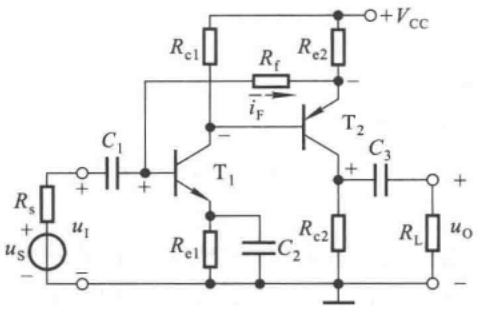

<details>
<summary>text_image</summary>

Rc1
Rf
Re2
+VCC
C1
iF
T2
C3
Rs
+
us
-
+
-
T1
Re1
C2
Rc2
RL
uo
-
</details>

图 5.4.4 例 5.4.3 电路图

解:（1）设输入电压方向为上“+”下“-”，各相关点的电位和反馈电流的流向如图中所标注，说明电路引入了负反馈，且 $R_{f}$ 和 $R_{e2}$ 构成反馈网络。输入量、反馈量和净输入量以电流的方式相叠加，且当负载电阻短路时反馈电流依然存在，因而电路引入了电流并联负反馈。

(2) 由于 $\dot{U}_{\mathrm{o}}$ 与 $\dot{U}_{\mathrm{i}}$ 同相, $\dot{F}$, $\dot{A}_{\mathrm{f}}$ 和 $\dot{A}_{\mathrm{uf}}$ 均为正号。输出电流 $\dot{I}_{\mathrm{o}}$ (即 $\dot{I}_{\mathrm{e}}$ 或 $\dot{I}_{\mathrm{c}}$) 作用于反馈网络所得反馈电流为

$$
\dot {I} _ {\mathrm{f}} = \frac {R _ {\mathrm{e2}}}{R _ {\mathrm{e2}} + R _ {\mathrm{f}}} \cdot \dot {I} _ {\mathrm{o}}
$$

因此反馈系数为

$$
\dot {F} _ {i i} = \frac {\dot {I} _ {\mathrm{f}}}{\dot {I} _ {\mathrm{o}}} = \frac {R _ {\mathrm{e2}}}{R _ {\mathrm{e2}} + R _ {\mathrm{f}}}
$$

放大倍数为

$$
\dot {A} _ {i i f} = \frac {\dot {I} _ {o}}{\dot {I} _ {i}} \approx \frac {1}{\dot {F} _ {i i}} = 1 + \frac {R _ {f}}{R _ {e 2}} = 1 0
$$

将  $R_{e2}=1\ k\Omega$  代入，得  $R_{f}=9\ k\Omega$ 。

根据式(5.4.15)，电压放大倍数为

$$
\dot {A} _ {\mathrm{usf}} = \frac {\dot {U} _ {\mathrm{o}}}{\dot {U} _ {\mathrm{s}}} \approx \frac {1}{\dot {F} _ {i i}} \cdot \frac {R _ {\mathrm{L}} ^ {\prime}}{R _ {\mathrm{s}}} = \left(1 + \frac {R _ {\mathrm{f}}}{R _ {\mathrm{e2}}}\right) \cdot \frac {R _ {\mathrm{c2}} / / R _ {\mathrm{L}}}{R _ {\mathrm{s}}} = 1 0 \times \frac {\frac {1 0 \times 1 0}{1 0 + 1 0}}{1} = 5 0
$$

---

238

第 5 章 放大电路中的反馈

## 5.4.4 基于理想运放的放大倍数分析

## 一、理想运放的线性工作区

利用集成运放作为放大电路,可以引入各种组态的负反馈。在分析由集成运放组成的负反馈放大电路时,通常都将其性能指标理想化,即将其看成理想运放。尽管集成运放的应用电路多种多样,但就其工作区域却只有两个;在电路中,它们不是工作在线性区,就是工作在非线性区。在由集成运放组成的负反馈放大电路中集成运放工作在线性区。

## 1. 理想运放的性能指标

集成运放的理想化参数是:

(1) 开环差模增益(放大倍数) $A_{od}=\infty$ ;

(2) 差模输入电阻  $r_{id} = \infty$ ;

(3) 输出电阻  $r_{o}=0$ ;

(4) 共模抑制比  $K_{CMR} = \infty$ ;

(5) 上限截止频率  $f_{H} = \infty$ ;

（6）失调电压  $U_{10}$  、失调电流  $I_{10}$  和它们的温漂  $\mathrm{d}U_{10}/\mathrm{d}T(\mathrm{^{\circ}C})$  、 $\mathrm{d}I_{10}/\mathrm{d}T(\mathrm{^{\circ}C})$  均为零，且无任何内部噪声。

实际上，集成运放的技术指标均为有限值，理想化后必然带来分析误差。但是，在一般的工程计算中，这些误差都是允许的。而且，随着新型运放的不断出现，性能指标越来越接近理想，误差也就越来越小。因此，只有在进行误差分析时，才考虑实际运放有限的增益、带宽、共模抑制比、输入电阻和失调因素等所带来的影响。

## 2. 理想运放在线性区的特点

设集成运放同相输入端和反相输入端的电位分别为  $u_{P}$ 、 $u_{N}$ ，电流分别为  $i_{P}$ 、 $i_{N}$ 。当集成运放工作在线性区时，输出电压应与输入差模电压成线性关系，即应满足

$$
u _ {\mathrm{O}} = A _ {\mathrm{od}} (u _ {\mathrm{P}} - u _ {\mathrm{N}}) \tag {5.4.16}
$$

由于  $u_{0}$  为有限值,  $A_{od} = \infty$ , 因而净输入电压  $u_{P} - u_{N} = 0$ , 即

$$
u _ {\mathrm{P}} = u _ {\mathrm{N}} \tag {5.4.17}
$$

称两个输入端“虚短路”。所谓“虚短路”是指理想运放的两个输入端电位无穷接近，但又不是真正短路的特点。

因为净输入电压为零,又因为理想运放的输入电阻为无穷大,所以两个输入端的输入电流也均为零,即

$$
i _ {\mathrm{p}} = i _ {\mathrm{N}} = 0 \tag {5.4.18}
$$

换言之,从集成运放输入端看进去相当于断路,称两个输入端“虚断路”。所谓“虚断路”是指理想运放两个输入端的电流趋于零,但又不是真正断路的特点。

应当特别指出，“虚短”和“虚断”是非常重要的概念。对于运放工作在线性区的应用电路，“虚短”和“虚断”是分析其输入信号和输出信号关系的两个基本出发点。

## 3. 集成运放工作在线性区的电路特征

对于理想运放,由于 $A_{od}=\infty$ ,因而即使两个输入端之间加微小电压,输出电压都将超出其线性范围,不是正向最大电压 $+U_{OM}$ ,就是负向最大电压 $-U_{OM}$ 。因此,只有电路引入负反馈,使净输入量

---

5.4 深度负反馈放大电路放大倍数的分析

239

趋于零,才能保证集成运放工作在线性区;从另一角度考虑,可以通过电路是否引入了负反馈,来判断运放是否工作在线性区。

对于单个的集成运放,通过无源的反馈网络将集成运放的输出端与反相输入端连接起来,就表明电路引入了负反馈,如图5.4.5所示。

反之，若理想运放处于开环状态（即无反馈）或仅引入正反馈，则工作在非线性区。此时，输出电压 $u_{0}$ 与输入电压 $(u_{\mathrm{P}} - u_{\mathrm{N}})$ 不再是线性关系，当 $u_{\mathrm{P}} > u_{\mathrm{N}}$ 时 $u_{\mathrm{O}} = +U_{\mathrm{OM}}, u_{\mathrm{P}} < u_{\mathrm{N}}$ 时 $u_{\mathrm{O}} = -U_{\mathrm{OM}}^{①}$ 。

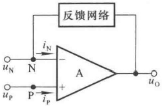

<details>
<summary>text_image</summary>

反馈网络
iN
-
A
+
iP
uN
N
P
uP
uO
</details>

图 5.4.5 集成运放引入负反馈

## 二、放大倍数的分析

由集成运放组成的四种组态负反馈放大电路如图 5.4.6 所示, 它们的瞬时极性及反馈量均分别标注于图中。由于它们均引入了深度负反馈, 故集成运放的两个输入端都有“虚短”和“虚断”的特点, 以下分析中不赘述。

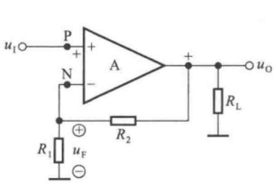

<details>
<summary>text_image</summary>

u_I ○─P + A     +
      │
      N       │
      │
      │
      R_1   R_2   R_L
      │
      u_F
      │
      └───┐
      │
      │
      │
      │
      │
      u_O
</details>

(a)

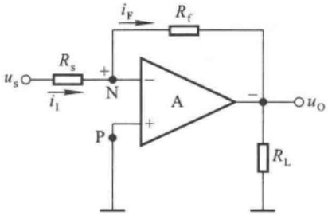

<details>
<summary>text_image</summary>

iF
Rf
Rs
+
-
N
A
P
+
-
RL
us
uo
</details>

(b)

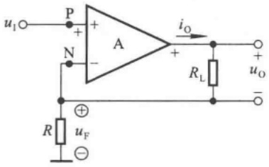

<details>
<summary>text_image</summary>

u₁○─P─A
      │   │
      │   │
      N─●─●─●─●─●─●─●─●─●─●─●─●─●─●─●─●─●─●─●─●─●─●─●─●─●─●─●─●─●─●─●─●─●─●─●─●─●─●─●─●─●─●─●─●─●─●─●─●─●─●─○
          │     │     │     │     │     │     │     │     │     │     │     │     │     │     │     │     │     │     │     │     │     │     │     │     │     │     │     │     │     │     │     │     │     │     │     │     │     │     │     │     │     │     │     │     │     │     │     │     │     │     │    ○
          │       │       │       │       │       │       │       │       │       │       │       │       │       │       │       │       │       │       │       │       │       │       ○
          R       Rₗ       Rₗ       Rₗ       Rₗ       Rₗ       Rₗ       Rₗ       Rₗ       Rₗ       Rₗ       Rₗ       Rₗ       Rₗ       Rₗ       Rₗ       Rₗ       Rₗ       Rₗ       Rₗ       Rₗ       Rₗ       Rₗ       Rₗ       Rₗ       Rₗ       Rₖ
          ⊕           ⊕           ⊕           ⊕           ⊕           ⊕           ⊕           ⊕           ⊕           ⊕           ⊕           ⊕           ⊕           ⊕           ⊕           ⊕           ⊕           ⊕           ⊕           ⊕           ⊕           ⊕           ⊕           ⊕           ⊕           ⊕           ⊕           ⊕           ⊕           ⊕           ⊕           ⊕           ⊕           ⊕           ────┐
          └───┐
          └───┘
          └───┘
          └───┘
          └───┘
          └───┘
          └───┘
          └───┘
          └───┘
          └───┘
          └───┘
          └───┘
          └───┘
          └───┘
          └───┘
          └───┘
         └───┘
         └───┘
         └───┘
         └───┘
         └───┘
         └───┘
         └───┘
         └───┘
         └───┘
         └───┘
         └───┘
         └───┘
         └───┘
         └───┘
         ┏───────┐
         ┏───────┐
         ┏───────┐
         ┏───────┐
         ┏───────┐
         ┏───────┐
         ┏───────┐
         ┏───────┐
         ┏───────┐
         ┏───────┐
         ┏───────┐
         ┏───────┐
         ┏───────┐
         └───────┘
         └───────┘
         └───────┘
         └───────┘
         └───────┘
         └───────┘
         └───────┘
         └───────┘
         └───────┘
         └───────┘
         └───────┘
         └───────┘
         └───────┘
         ┏───────┐
         ┏───────┐
         ┏───────┐
         ┏───────┐
         ┏───────┐
         ┏───────┐
         ┏───────┐
         ┏───────┐
         ┏───────┘
         └───────┘
         └───────┘
         └───────┘
         └───────┘
         └───────┘
         └───────┘
         └───────┘
         └───────┘
         └───────┘
         └───────┘
</details>

(c)

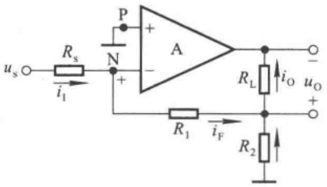

<details>
<summary>text_image</summary>

u_s ○─R_s
      i_1
      N
      +
      P
      A
      R_L
      i_O
      u_O
      +
      R_1
      i_F
      R_2
</details>

(d)

图 5.4.6 由理想运放组成的负反馈放大电路

(a) 电压串联负反馈电路 (b) 电压并联负反馈电路

(c) 电流串联负反馈电路 (d) 电流并联负反馈电路

在图(a)所示电压串联负反馈电路中,由于输入电压  $\dot{U}_{i}$  等于反馈电压  $\dot{U}_{f}, R_{2}$  的电流等于  $R_{1}$  的电流,所以输出电压

$$
\dot {U} _ {\mathrm{o}} = \frac {R _ {1} + R _ {2}}{R _ {1}} \cdot \dot {U} _ {\mathrm{i}}
$$

电压放大倍数为

<small><span class="docvortex-page-footnote" data-block-type="page_footnote" style="color:#6b7280">① 关于理想运放工作在非线性区的特点及其主要应用见 7.2 节。</span></small>

---

240

第 5 章 放大电路中的反馈

$$
\dot {A} _ {u f} = 1 + \frac {R _ {2}}{R _ {1}} \tag {5.4.19}
$$

在图(b)所示电压并联负反馈电路中,由于输入电流(即信号电流) $\dot{I}_{i}$ 等于反馈电流 $\dot{I}_{f}$ ,集成运放的两个输入端电位均为零,称为“虚地”,即 $u_{P}=u_{N}=0$ ;因此,输出电压 $\dot{U}_{o}=-\dot{I}_{f}R_{f}=-\dot{I}_{i}R_{f}$ ,放大倍数

$$
\dot {A} _ {u i f} = \frac {\dot {U} _ {\mathrm{o}}}{\dot {I} _ {\mathrm{i}}} = - R _ {\mathrm{f}} \tag {5.4.20}
$$

由于信号源电压  $\dot{U}_{s} = \dot{I}_{i} R_{s}$ ，电压放大倍数

$$
\dot {A} _ {\mathrm{usf}} = \frac {\dot {U} _ {\mathrm{o}}}{\dot {U} _ {\mathrm{s}}} = - \frac {R _ {\mathrm{f}}}{R _ {\mathrm{s}}} \tag {5.4.21}
$$

在图(c)所示电流串联负反馈电路中,由于输入电压  $\dot{U}_{i}$  等于反馈电压  $\dot{U}_{f}, R$  的电流等于  $R_{L}$  的电流,即输出电流  $\dot{I}_{o}$ ,所以放大倍数

$$
\dot {A} _ {i u f} = \frac {\dot {I} _ {\mathrm{o}}}{\dot {U} _ {\mathrm{i}}} = \frac {1}{R} \tag {5.4.22}
$$

输出电压 $\dot{U}_{\mathrm{o}} = \dot{I}_{\mathrm{o}}R_{\mathrm{L}}$ ，电压放大倍数

$$
\dot {A} _ {\mathrm{uf}} = \frac {\dot {U} _ {\mathrm{o}}}{\dot {U} _ {\mathrm{i}}} = \frac {R _ {\mathrm{L}}}{R} \tag {5.4.23}
$$

在图(d)所示电流并联负反馈电路中,集成运放的两个输入端为“虚地”, $u_{P}=u_{N}=0$ ;反馈电流 $\dot{I}_{f}$ 等于输入电流 $\dot{I}_{i}$ (即信号电流),是输出电流 $\dot{I}_{o}$ 在电阻 $R_{1}$ 支路分流,即

$$
\dot {I} _ {\mathrm{f}} = - \frac {R _ {2}}{R _ {1} + R _ {2}} \cdot \dot {I} _ {\mathrm{o}}
$$

放大倍数

$$
\dot {A} _ {\mathrm{if}} = \frac {\dot {I} _ {\mathrm{o}}}{\dot {I} _ {\mathrm{i}}} = - \left(1 + \frac {R _ {2}}{R _ {1}}\right) \tag {5.4.24}
$$

由于信号源电压 $\dot{U}_{\mathrm{s}} = \dot{I}_{\mathrm{i}}R_{\mathrm{s}}$ ，输出电压 $\dot{U}_{\mathrm{o}} = \dot{I}_{\mathrm{o}}R_{\mathrm{L}}$ ，故电压放大倍数

$$
\dot {A} _ {\mathrm{usf}} = \frac {\dot {U} _ {\mathrm{o}}}{\dot {U} _ {\mathrm{s}}} = - \left(1 + \frac {R _ {2}}{R _ {1}}\right) \frac {R _ {\mathrm{L}}}{R _ {\mathrm{s}}} \tag {5.4.25}
$$

将式（5.4.19）、（5.4.20）、（5.4.22）、（5.4.24）与四种负反馈组态反馈系数 $\dot{F}$ 表达式(5.4.4）、(5.4.5）、(5.4.6）、(5.4.7）分别比较，不难发现前者是 $1 / \dot{F}$ ；将式（5.4.19）、(5.4.21）、(5.4.23）、(5.4.25)与(5.4.8）、(5.4.10）、(5.4.13）、(5.4.15)分别比较，不难发现它们具有一致性。由此可见，理想运放引入的负反馈是深度负反馈；而且由于参数的理想化，放大倍数表达式中的“$\approx$”变为“=”。

【例 5.4.4】 在图 5.2.8 所示电路中, 已知集成运放为理想运放,  $R_{1}=10\ k\Omega$ ,  $R_{2}=100\ k\Omega$ ,  $R_{3}=2\ k\Omega$ ,  $R_{L}=5\ k\Omega$ 。求解其电压放大倍数  $\dot{A}_{usf}$ 。

---

5.5 负反馈对放大电路性能的影响

241

解: 图 5.2.8 所示电路中引入了电流串联负反馈, 具有“虚短”和“虚断”的特点。 $R_{2}$  的电流等于  $R_{1}$  的电流, 它们是输出电流  $\dot{I}_{0}$  在  $R_{2}$  支路的分流, 表达式为

$$
\dot {I} _ {R _ {2}} = \frac {R _ {3}}{R _ {1} + R _ {2} + R _ {3}} \cdot \dot {I} _ {\mathrm{o}}
$$

输入电压  $\dot{U}_{i}$  等于反馈电压  $\dot{U}_{f}$ ，为

$$
\dot {U} _ {\mathrm{i}} = \dot {U} _ {\mathrm{f}} = \dot {I} _ {R _ {2}} R _ {1} = \frac {R _ {1} R _ {3}}{R _ {1} + R _ {2} + R _ {3}} \cdot \dot {I} _ {\mathrm{o}}
$$

输出电压  $\dot{U}_{o} = \dot{I}_{o} R_{L}$ ，因此，电压放大倍数为

$$
\dot {A} _ {\mathrm{uf}} = \frac {\dot {U} _ {\mathrm{o}}}{\dot {U} _ {\mathrm{i}}} = \frac {R _ {1} + R _ {2} + R _ {3}}{R _ {1} R _ {3}} \cdot R _ {\mathrm{L}}
$$

代入已知数据，得  $\dot{A}_{uf}=28$ 。

## 思考题

5.4.1 试从深度负反馈条件下四种组态负反馈放大电路的电压放大倍数表达式,来说明电压负反馈稳定输出电压,电流负反馈稳定输出电流。
5.4.2 为什么集成运放引入的负反馈通常可以认为是深度负反馈？
5.4.3 在分析集成运放组成的负反馈放大电路时,利用深度负反馈的条件和利用理想运放“虚短”、“虚断”的特点求解出的放大倍数有区别吗？为什么？

## 5.5 负反馈对放大电路性能的影响

放大电路中引入交流负反馈后,其性能会得到多方面的改善;比如,可以稳定放大倍数,改变输入电阻和输出电阻,展宽频带,减小非线性失真等。下面将一一加以说明。

## 5.5.1 稳定放大倍数

当放大电路引入深度负反馈时， $\dot{A}_{f}\approx\frac{1}{\dot{F}},\dot{A}_{f}$ 几乎仅决定于反馈网络，而反馈网络通常由电阻、电容组成，因而可获得很好的稳定性。那么，就一般情况而言，是否引入交流负反馈就一定使 $\dot{A}_{f}$ 得到稳定呢？

在中频段， $\dot{A}_{f}$ 、 $\dot{A}$  和  $\dot{F}$  均为实数， $\dot{A}_{f}$  的表达式可写成

$$
A _ {\mathrm{f}} = \frac {A}{1 + A F} \tag {5.5.1}
$$

对上式求微分得

$$
\mathrm{d} A _ {\mathrm{f}} = \frac {(1 + A F) \mathrm{d} A - A F \mathrm{d} A}{(1 + A F) ^ {2}} = \frac {\mathrm{d} A}{(1 + A F) ^ {2}} \tag {5.5.2}
$$

用式(5.5.2)的左右式分别除以式(5.5.1)的左右式,可得

---

242

第 5 章 放大电路中的反馈

$$
\frac {\mathrm{d} A _ {\mathrm{f}}}{A _ {\mathrm{f}}} = \frac {1}{1 + A F} \cdot \frac {\mathrm{d} A}{A} \tag {5.5.3}
$$

式(5.5.3)表明,负反馈放大电路放大倍数 $A_{f}$ 的相对变化量 $dA_{f}/A_{f}$ 仅为其基本放大电路放大倍数A的相对变化量dA/A的 $(1+AF)$ 分之一,也就是说 $A_{f}$ 的稳定性是A的 $(1+AF)$ 倍。

例如, 当 A 变化 10% 时, 若  $1 + AF = 100$ , 则  $A_{f}$  仅变化 0.1%。

对式(5.5.3)的内涵进行分析可知,引入交流负反馈,因环境温度的变化、电源电压的波动、元件的老化、器件的更换等原因引起的放大倍数的变化都将减小。特别是在制成产品时,因半导体器件参数的分散性所造成的放大倍数的差别也将明显减小,从而使放大能力具有很好的一致性。

应当指出， $A_{\mathrm{f}}$ 的稳定性是以损失放大倍数为代价的，即 $A_{\mathrm{f}}$ 减小到 $A$ 的 $(1 + AF)$ 分之一，才使其稳定性提高到 $A$ 的 $(1 + AF)$ 倍。一些文献定义（HAF）为反馈深度。

## 5.5.2 改变输入电阻和输出电阻

在放大电路中引入不同组态的交流负反馈,将对输入电阻和输出电阻产生不同的影响。

## 一、对输入电阻的影响

输入电阻是从放大电路输入端看进去的等效电阻,因而负反馈对输入电阻的影响,决定于基本放大电路与反馈网络在电路输入端的连接方式,即决定于电路引入的是串联反馈还是并联反馈。

## 1. 串联负反馈增大输入电阻

图 5.5.1 所示为串联负反馈放大电路的方块图, 根据输入电阻的定义, 基本放大电路的输入电阻

$$
R _ {\mathrm{i}} = \frac {U _ {\mathrm{i}} ^ {\prime}}{I _ {\mathrm{i}}}
$$

而整个电路的输入电阻

$$
R _ {\mathrm{if}} = \frac {U _ {\mathrm{i}}}{I _ {\mathrm{i}}} = \frac {U _ {\mathrm{i}} ^ {\prime} + U _ {\mathrm{f}}}{I _ {\mathrm{i}}} = \frac {U _ {\mathrm{i}} ^ {\prime} + A F U _ {\mathrm{i}} ^ {\prime}}{I _ {\mathrm{i}}}
$$

从而得出串联负反馈放大电路输入电阻  $R_{if}$  的表达式为

$$
R _ {\mathrm{if}} = (1 + A F) R _ {\mathrm{i}} \tag {5.5.4}
$$

表明输入电阻增大到  $R_{i}$  的  $(1 + AF)$  倍。

应当指出，在某些负反馈放大电路中，有些电阻并不在反馈环内，例如，在图5.4.3所示电路的交流通路中， $R_{bl}$ 并联在输入端，反馈对它不产生影响。这类电路的方块图如图5.5.2所示，可以看出

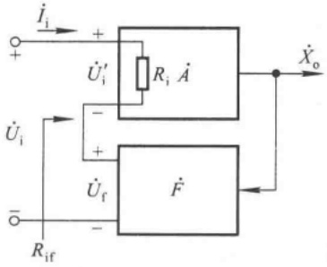

<details>
<summary>text_image</summary>

i₁ → +
+   Rᵢ A
U̇ᵢ'      -
+   U̇ᵢ
-       F
Rᵢf      -
Xₒ
</details>

图 5.5.1 串联负反馈电路的方块图

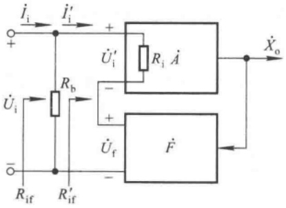

<details>
<summary>text_image</summary>

i_i → i'_i → +
+       +       +
U'_i     R_i A
-       -
U_i      R_b      +
+       +
U_f      F
-       -
R_if     R'_if
</details>

图 5.5.2  $R_{h}$  在反馈环之外时串联负反馈电路的方块图

---

5.5 负反馈对放大电路性能的影响

243

$$
R _ {\mathrm{if}} ^ {\prime} = (1 + A F) R _ {\mathrm{i}}
$$

而整个电路的输入电阻

$$
R _ {\mathrm{if}} = R _ {\mathrm{b}} / / R _ {\mathrm{if}} ^ {\prime}
$$

因此,更确切地说,引入串联负反馈,使引入反馈的支路的等效电阻增大到基本放大电路的 $(1+AF)$ 倍。但是,不管哪种情况,引入串联负反馈都将增大输入电阻。

## 2. 并联负反馈减小输入电阻

并联负反馈放大电路的方块图如图 5.5.3 所示。根据输入电阻的定义, 基本放大电路的输入电阻

$$
R _ {\mathrm{i}} = \frac {U _ {\mathrm{i}}}{I _ {\mathrm{i}} ^ {\prime}}
$$

整个电路的输入电阻

$$
R _ {\mathrm{if}} = \frac {U _ {\mathrm{i}}}{I _ {\mathrm{i}}} = \frac {U _ {\mathrm{i}}}{I _ {\mathrm{i}} ^ {\prime} + I _ {\mathrm{f}}} = \frac {U _ {\mathrm{i}}}{I _ {\mathrm{i}} ^ {\prime} + A F I _ {\mathrm{i}} ^ {\prime}}
$$

从而得出并联负反馈放大电路输入电阻  $R_{if}$  的表达式

$$
R _ {\mathrm{if}} = \frac {R _ {\mathrm{i}}}{1 + A F} \tag {5.5.5}
$$

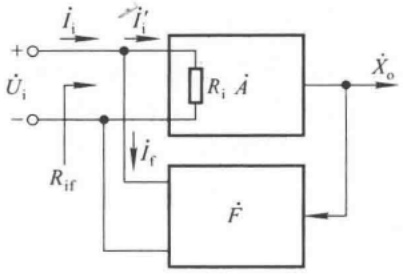

<details>
<summary>text_image</summary>

i_i
+ 
Ü_i
- 
R_if
i'_i
R_i A
i_f
F
X_o
</details>

图 5.5.3 并联负反馈电路的方块图

表明引入并联负反馈后，输入电阻减小，仅为基本放大电路输入电阻的 $(1+AF)$ 分之一。

## 二、对输出电阻的影响

输出电阻是从放大电路输出端看进去的等效内阻,因而负反馈对输出电阻的影响决定于基本放大电路与反馈网络在放大电路输出端的连接方式,即决定于电路引入的是电压反馈还是电流反馈。

## 1. 电压负反馈减小输出电阻

电压负反馈的作用是稳定输出电压，故必然使其输出电阻减小。电压负反馈放大电路的方块图如图5.5.4所示，令输入量 $X_{i}=0$ ，在输出端加交流电压 $U_{o}$ ，产生电流 $I_{o}$ ，则电路的输出电阻为

$$
R _ {\mathrm{of}} = \frac {U _ {\mathrm{o}}}{I _ {\mathrm{o}}} \tag {5.5.6}
$$

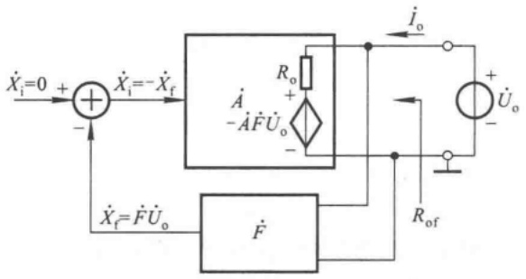

<details>
<summary>text_image</summary>

Ẋi=0 + Ẋi=-Ẋf
- Ȧ -ȦḞU̇o
+ -
Ẋf=ḞU̇o
Ḟ
i̇o
+ U̇o
Rof
</details>

图 5.5.4 电压负反馈电路的方块图

$U_{o}$  作用于反馈网络, 得到反馈量  $X_{f}=FU_{o}, -X_{f}$  又作为净输入量作用于基本放大电路, 产生输出电压为  $-AFU_{o}$ 。基本放大电路的输出电阻为  $R_{o}$ , 因为在基本放大电路中已考虑

---

244

第 5 章 放大电路中的反馈

了反馈网络的负载效应 $^{①}$ ，所以可以不必重复考虑反馈网络的影响，因而 $R_{o}$ 中的电流为 $I_{o}$ ，其表达式为

$$
I _ {\mathrm{o}} = \frac {U _ {\mathrm{o}} - (- A F U _ {\mathrm{o}})}{R _ {\mathrm{o}}} = \frac {(1 + A F) U _ {\mathrm{o}}}{R _ {\mathrm{o}}}
$$

将上式代入式(5.5.6)，得到电压负反馈放大电路输出电阻的表达式为

$$
R _ {\mathrm{of}} = \frac {R _ {\mathrm{o}}}{1 + A F} \tag {5.5.7}
$$

表明引入负反馈后输出电阻仅为其基本放大电路输出电阻的 $(1+AF)$ 分之一。当 $(1+AF)$ 趋于无穷大时， $R_{of}$ 趋于零，此时电压负反馈电路的输出具有恒压源特性。

## 2. 电流负反馈增大输出电阻

电流负反馈稳定输出电流,故其必然使输出电阻增大。

图 5.5.5 所示为电流负反馈放大电路的方块图, 令  $X_{i}=0$ , 在输出端断开负载电阻并外加交流电压  $U_{o}$ , 由此产生了电流  $I_{o}$ , 则电路的输出电阻为

$$
R _ {\mathrm{of}} = \frac {U _ {\mathrm{o}}}{I _ {\mathrm{o}}} \tag {5.5.8}
$$

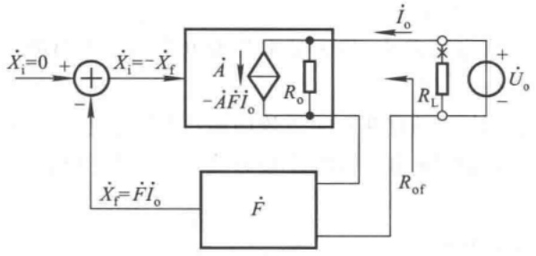

<details>
<summary>text_image</summary>

Ẋi=0 + Ẋi=-Ẋf
- Ȧ -ȦFi̇o Ro
Ẋf=Ḟİo
Ḟ
i̇o
RL
+ U̇o
- Rof
</details>

图 5.5.5 电流负反馈电路的方块图

$I_{o}$  作用于反馈网络, 得到反馈量  $X_{f}=FI_{o}, -X_{f}$  又作为净输入量作用于基本放大电路, 所产生的输出电流为  $-AFI_{o}$ 。 $R_{o}$  为基本放大电路的输出电阻, 由于在基本放大电路中已经考虑了反馈网络的负载效应, 所以可以认为此时作用于反馈网络的输入电压为零, 即  $R_{o}$  上的电压为  $U_{o}$ 。因此, 流入基本放大电路的电流  $I_{o}$  为

$$
I _ {\mathrm{o}} = \frac {U _ {\mathrm{o}}}{R _ {\mathrm{o}}} + (- A F I _ {\mathrm{o}})
$$

即

$$
I _ {\mathrm{o}} = \frac {\frac {U _ {\mathrm{o}}}{R _ {\mathrm{o}}}}{1 + A F}
$$

将上式代入(5.5.8)，便得到电流负反馈放大电路输出电阻的表达式

$$
R _ {\mathrm{of}} = (1 + A F) R _ {\mathrm{o}} \tag {5.5.9}
$$

说明 $R_{\mathrm{of}}$ 增大到 $R_{\mathrm{o}}$ 的 $(1 + AF)$ 倍。当 $(1 + AF)$ 趋于无穷大时，$R_{\mathrm{of}}$ 也趋于无穷大，电路的输出具有

<small><span class="docvortex-page-footnote" data-block-type="page_footnote" style="color:#6b7280">① 可参阅童诗白、华成英主编的《模拟电子技术基础（第三版）》6.3.4节。</span></small>

---

5.5 负反馈对放大电路性能的影响

245

恒流源特性。

需要注意的是，与图5.5.2所示的方块图中的 $R_{\mathrm{b}}$ 相类似，在一些电路中有的电阻并联在反馈环之外，如图5.4.4所示电路中的 $R_{c2}$，反馈的引入对它们所在支路没有影响。因此，对这类电路，电流负反馈仅仅稳定了引出反馈的支路的电流，并使该支路的等效电阻 $R_{\mathrm{o}}^{\prime}$ 增大到基本放大电路的 $(1 + AF)$ 倍。

表5.5.1中列出四种组态负反馈对放大电路输入电阻与输出电阻的影响。表中括号内的“0”或“∞”，表示在理想情况下，即当 $1 + AF = \infty$ 时，输入电阻和输出电阻的值。可以认为由理想运放构成负反馈放大电路的 $(1 + AF)$ 趋于无穷大，因而它们的输入电阻和输出电阻趋于表中的理想值。

表 5.5.1 交流负反馈对输入电阻、输出电阻的影响

| 反馈组态 | 电压串联 | 电流串联 | 电压并联 | 电流并联 |
| --- | --- | --- | --- | --- |
| $R_{\text{if}}$(或 $R'_{\text{if}}$) | 增大(∞) | 增大(∞) | 减小(0) | 减小(0) |
| $R_{\text{of}}$(或 $R'_{\text{of}}$) | 减小(0) | 增大(∞) | 减小(0) | 增大(∞) |

## 5.5.3 展宽频带

由于引入负反馈后,各种原因引起的放大倍数的变化都将减小,当然也包括因信号频率变化而引起的放大倍数的变化,因此其效果是展宽了通频带。

为了使问题简单化,设反馈网络为纯电阻网络,且在放大电路波特图的低频段和高频段各仅有一个拐点;基本放大电路的中频放大倍数为  $\dot{A}_{m}$ , 上限频率为  $f_{H}$ , 下限频率为  $f_{L}$ , 因此高频段放大倍数的表达式为

$$
\dot {A} _ {\mathrm{h}} = \frac {\dot {A} _ {\mathrm{m}}}{1 + \mathrm{j} \frac {f}{f _ {\mathrm{H}}}}
$$

引入负反馈后,电路的高频段放大倍数为

$$
\dot {A} _ {\mathrm{hf}} = \frac {\dot {A} _ {\mathrm{h}}}{1 + \dot {A} _ {\mathrm{h}} \dot {F} _ {\mathrm{h}}} = \frac {\frac {\dot {A} _ {\mathrm{m}}}{1 + \mathrm{j} \frac {f}{f _ {\mathrm{H}}}}}{1 + \frac {\dot {A} _ {\mathrm{m}}}{1 + \mathrm{j} \frac {f}{f _ {\mathrm{H}}}} \cdot \dot {F}} = \frac {\dot {A} _ {\mathrm{m}}}{1 + \mathrm{j} \frac {f}{f _ {\mathrm{H}}} + \dot {A} _ {\mathrm{m}} \dot {F}}
$$

将分子分母均除以 $(1 + \dot{A}_{\mathrm{m}}\dot{F})$ ，可得

$$
\dot {A} _ {\mathrm{hf}} = \frac {\frac {\dot {A} _ {\mathrm{m}}}{1 + \dot {A} _ {\mathrm{m}} \dot {F}}}{1 + \mathrm{j} \frac {f}{(1 + \dot {A} _ {\mathrm{m}} \dot {F}) f _ {\mathrm{H}}}} = \frac {\dot {A} _ {\mathrm{mf}}}{1 + \mathrm{j} \frac {f}{f _ {\mathrm{Hf}}}}
$$

---

246

第 5 章 放大电路中的反馈

式中  $\dot{A}_{mf}$  为负反馈放大电路的中频放大倍数,  $f_{Hf}$  为其上限频率, 故

$$
f _ {\mathrm{Hf}} = (1 + A _ {\mathrm{m}} F) f _ {\mathrm{H}} \tag {5.5.10}
$$

表明引入负反馈后上限频率增大到基本放大电路的 $(1+A_{m}F)$ 倍。

利用上述推导方法可以得到负反馈放大电路下限频率的表达式

$$
f _ {\mathrm{Lf}} = \frac {f _ {\mathrm{L}}}{1 + A _ {\mathrm{m}} F} \tag {5.5.11}
$$

可见，引入负反馈后，下限频率减小到基本放大电路的 $(1+A_{\mathrm{m}}F)$ 分之一。

一般情况下,由于 $f_{H} \gg f_{L}, f_{Hf} \gg f_{Lf}$ ,因此,基本放大电路及负反馈放大电路的通频带分别可近似表示为

$$
f _ {\mathrm{bw}} = f _ {\mathrm{H}} - f _ {\mathrm{L}} \approx f _ {\mathrm{H}}
$$

$$
f _ {\mathrm{bwf}} = f _ {\mathrm{Hf}} - f _ {\mathrm{Lf}} \approx f _ {\mathrm{Hf}} \tag {5.5.12}
$$

即引入负反馈使频带展宽到基本放大电路的 $(1+AF)$ 倍。

应当指出，由于不同组态负反馈电路放大倍数的物理意义不同，因而式（5.5.10）、(5.5.11)、(5.5.12)所具有的含义也就不同。根据式(5.5.12)可知，对于电压串联负反馈电路，$\dot{A}_{uuf}$ 的频带是 $\dot{A}_{uu}$ 的 $(1 + AF)$ 倍；对于电压并联负反馈电路，$\dot{A}_{uif}$ 的频带是 $\dot{A}_{ui}$ 的 $(1 + AF)$ 倍；对于电流串联负反馈电路，$\dot{A}_{iuf}$ 的频带是 $\dot{A}_{iu}$ 的 $(1 + AF)$ 倍；对于电流并联负反馈电路，$\dot{A}_{iif}$ 的频带是 $\dot{A}_{ii}$ 的 $(1 + AF)$ 倍。

若放大电路的波特图中有多个拐点,且反馈网络不是纯电阻网络,则问题的分析就比较复杂了,但是频带展宽的趋势不变。

## 5.5.4 减小非线性失真

对于理想的放大电路,其输出信号与输入信号应完全呈线性关系。但是,由于组成放大电路的半导体器件(如晶体管和场效应管)均具有非线性特性,当输入信号为幅值较大的正弦波时,输出信号往往不是正弦波。经谐波分析,输出信号中除含有与输入信号频率相同的基波外,还含有其它谐波,因而产生失真。怎样才能消除这种失真呢?我们不妨看下面的例子。

设放大电路输入级放大管的b-e间得到正弦电压 $u_{\mathrm{be}}$，由于晶体管输入特性的非线性，$i_{\mathrm{h}}$ 将要失真，其正半周幅值大，负半周幅值小，如图5.5.6(a)所示，这样必然造成输出电压、电流的失真。可以设想，如果能使b-e间电压的正半周幅值小些而负半周幅值大些，那么 $i_{\mathrm{h}}$ 将近似为正弦波，如图(b)所示。电路引入负反馈，将使净输入量产生类似上述b-e间电压的变化，因此减小了非线性失真。

图 5.5.7 所示为减小非线性失真的定性分析。设在正弦波输入量  $X_{i}$  作用下，输出量  $X_{o}$  与  $X_{i}$  同相，且产生正半周幅值大负半周幅值小的失真，反馈量  $X_{f}$  与  $X_{o}$  的失真情况相同，如图（a）所示。当电路闭环后，由于净输入量  $X_{i}^{\prime}$  为  $X_{i}$  和  $X_{f}$  之差，因而其正半周幅值小而负半周幅值大，如图（b）所示。结果将使输出波形正、负半周的幅值趋于一致，从而使非线性失真减小。

设图(a)中的输出量(即电路开环时的输出量)为

$$
X _ {\mathrm{o}} = A X _ {\mathrm{i}} ^ {\prime} + X _ {\mathrm{o}} ^ {\prime}
$$

式中， $AX_{i}^{\prime}$  为  $X_{o}$  中的基波部分， $X_{o}^{\prime}$  为由半导体器件的非线性所产生的谐波部分。

---

5.5 负反馈对放大电路性能的影响

247

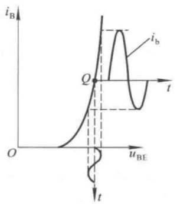

<details>
<summary>line</summary>

| Point | uBE | iB |
| --- | --- | --- |
| Q | ~0.5 | ~0.5 |
</details>

(a)

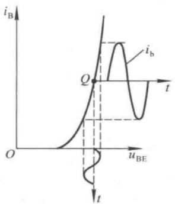

<details>
<summary>line</summary>

| Variable | Description |
| --- | --- |
| iB | Current (Vertical Axis) |
| uBE | Voltage (Horizontal Axis) |
| t | Time (Horizontal Axis) |
| Q | Point on curve at t=0, iB=0 |
</details>

(b)

图 5.5.6 消除  $i_{h}$  失真的方法

(a) $u_{\mathrm{be}}$ 为正弦波时 $i_{\mathrm{b}}$ 失真 (b) $u_{\mathrm{be}}$ 为非正弦波使 $i_{\mathrm{b}}$ 近似为正弦波

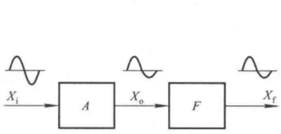

<details>
<summary>flowchart</summary>

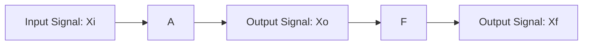
</details>

(a)

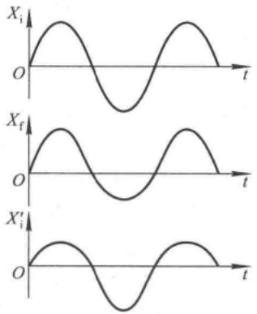

<details>
<summary>text_image</summary>

Xi
Xf
Xi'
</details>

(b)

图 5.5.7 引入负反馈使非线性失真减小

(a) 开环时各点的波形 (b) 闭环后的波形分析

为了使非线性失真情况在电路闭环前后具有可比性，当电路闭环后（如图5.3.1所示），应增大输入量 $X_{i}$ ，使 $X_{i}^{\prime}$ 中的基波成分与开环时相同，以保证输出量的基波成分与开环时相同。设此时 $X_{0}$ 中的谐波部分为 $X_{0}^{\prime\prime}$ ，则可将 $X_{0}^{\prime\prime}$ 分为两部分，一部分是因 $X_{i}^{\prime}$ （与开环时相同）而产生的 $X_{0}^{\prime}$ ，另一部分是输出量中的谐波 $X_{0}^{\prime\prime}$ 经反馈网络和基本放大电路而产生的输出 $-AFX_{0}^{\prime\prime}$ ，写成表达式为

$$
X _ {\mathrm{o}} ^ {\prime \prime} = X _ {\mathrm{o}} ^ {\prime} - A F X _ {\mathrm{o}} ^ {\prime \prime}
$$

因此

$$
X _ {\mathrm{o}} ^ {\prime \prime} = \frac {X _ {\mathrm{o}} ^ {\prime}}{1 + A F} \tag {5.5.13}
$$

表明在输出基波幅值不变的情况下,引入负反馈后,输出的谐波部分被减小到基本放大电路的 $(1+AF)$ 分之一。

综上所述,可以得到如下结论:

（1）只有信号源有足够的潜力，能使电路闭环后基本放大电路的净输入电压与开环时相等，

---

248

第 5 章 放大电路中的反馈

即输出量在闭环前、后保持基波成分不变,非线性失真才能减小到基本放大电路的 $(1+AF)$ 分之一。

（2）非线性失真产生于电路内部，引入负反馈后才被抑制。换言之，当非线性信号混入输入量或干扰来源于外界时，引入负反馈将无济于事，必须采用信号处理（如有源滤波）或屏蔽等方法才能解决。

## 5.5.5 放大电路中引入负反馈的一般原则

通过以上分析可知,负反馈对放大电路性能方面的影响,均与反馈深度 $(1+AF)$ 有关。应当说明的是,以上的定量分析是为了更好地理解反馈深度与电路各性能指标的定性关系。从某种意义上讲,对负反馈放大电路的定性分析比定量计算更重要。这一方面是因为在分析实用电路时,几乎均可认为它们引入的是深度负反馈,如当基本放大电路为集成运放时,便可认为 $(1+AF)$ 趋于无穷大;另一方面,即使需要精确分析电路的性能指标,也不需要利用方块图进行手工计算,而应借助于如 PSpice、Multisim 等电子电路计算机辅助分析和设计软件。

引入负反馈可以改善放大电路多方面的性能,而且反馈组态不同,所产生的影响也各不相同。因此,在设计放大电路时,应根据需要和目的,引入合适的反馈,这里提供部分一般原则。

（1）为了稳定静态工作点，应引入直流负反馈；为了改善电路的动态性能，应引入交流负反馈。
（2）根据信号源的性质决定引入串联负反馈或并联负反馈。当信号源为恒压源或内阻较小的电压源时，为增大放大电路的输入电阻，以减小信号源的输出电流和内阻上的压降，应引入串联负反馈。当信号源为恒流源或内阻很大的电压源时，为减小放大电路的输入电阻，使电路获得更大的输入电流，应引入并联负反馈。
（3）根据负载对放大电路输出量的要求，即负载对其信号源的要求，决定引入电压负反馈或电流负反馈。当负载需要稳定的电压信号驱动时，应引入电压负反馈；当负载需要稳定的电流信号驱动时，应引入电流负反馈。
（4）根据表 5.3.1 所示的四种组态反馈电路的功能，在需要进行信号变换时，选择合适的组态。例如，若将电流信号转换成电压信号，则应引入电压并联负反馈；若将电压信号转换成电流信号，则应引入电流串联负反馈，等等。

【例 5.5.1】电路如图 5.5.8 所示,为了达到下列目的,分别说明应引入哪种组态的负反馈以及电路如何连接。

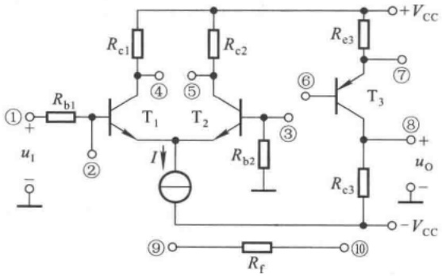

<details>
<summary>text_image</summary>

①
+
u₁
-
Rb1
②
T₁
I
T₂
Rc1
④
⑤
Rc2
Rb2
③
⑥
T₃
⑦
Re3
⑧
+ uₒ
Rc3
Rf
⑨
⑩
-Vcc
</details>

图5.5.8 例5.5.1电路图

---

5.6 负反馈放大电路的稳定性

249

(1) 减小放大电路从信号源索取的电流并增强带负载能力；
(2) 将输入电流  $i_{1}$  转换成与之成稳定线性关系的输出电流  $i_{0}$ ;
(3) 将输入电流  $i_{1}$  转换成稳定的输出电压  $u_{0}$ 。

解: 若  $u_{1}$  瞬时极性对地为“+”，则  $T_{1}$  管集电极电位为“-”， $T_{2}$  管集电极电位为“+”，如图中所标注；而若要  $T_{3}$  管的发射极电位为“+”，集电极电位为“-”，则需将其基极接  $T_{2}$  管集电极，否则需将其基极接  $T_{1}$  管集电极。

（1）电路需要增大输入电阻并减小输出电阻，故应引入电压串联负反馈。

反馈信号从输出电压采样，故将⑧与⑩相连接；反馈量应为电压量，故将③与⑨相连接；这样， $u_{0}$ 作用于 $R_{f}$ 和 $R_{b2}$ 回路，在 $R_{b2}$ 上得到反馈电压 $u_{F}$ 。为了保证电路引入的为负反馈，当 $u_{1}$ 对地为“+”时， $u_{F}$ 应为上“+”下“-”，即⑧的电位为“+”，因此应将④与⑥连接起来。

结论:电路中应将④与⑥、③与⑨、⑧与⑩分别连接起来。

(2) 电路应引入电流并联负反馈。

将⑦与⑩、②与⑨分别相连， $R_{f}$  与  $R_{e3}$  对  $i_{0}$  分流， $R_{f}$  中的电流为反馈电流  $i_{F}$ 。为保证电路引入的是负反馈，当  $u_{1}$  对地为“+”时， $i_{F}$  应自输入流向输出，即应使⑦端的电位为“-”，因此应将④与⑥连接起来。

结论:电路中应将④与⑥、⑦与⑩、②与⑨分别连接起来。

(3) 电路应引入电压并联负反馈。

电路中应将②与⑨、⑧与⑩、⑤与⑥分别连接起来。

应当指出，对于一个确定的放大电路，输出量与输入量的相位关系唯一地被确定，因此所引入的负反馈的组态将受它们相位关系的约束。例如，当⑤与⑥相连接时， $u_{0}$ 与 $u_{1}$ 将反相，该电路将不可能引入电压串联负反馈，而只能引入电压并联负反馈。读者可自行总结这方面的规律。

## 思考题

5.5.1 列表总结交流负反馈对放大电路各方面性能的影响。
5.5.2 只要放大电路中引入交流负反馈,都可使电压放大倍数的稳定性增强、频带展宽吗?为什么?
5.5.3 试利用集成运放分别构成四种组态的负反馈放大电路，并求出它们在深度负反馈条件下的放大倍数和电压放大倍数。要求所设计的电路与图 5.4.6 所示各电路有所不同。
5.5.4 在图 5.5.8 所示电路中,为什么不能通过将反馈电阻  $R_{f}$  接到  $T_{1}$  和  $T_{2}$  发射极来引入串联负反馈? 若要引入电流串联负反馈,则应如何连接电路?

## 5.6 负反馈放大电路的稳定性

从 5.5 节的分析可知,交流负反馈可以改善放大电路多方面的性能,而且反馈愈深,性能改善得愈好。但是,有时会事与愿违,如果电路的组成不合理,反馈过深,那么在输入量为零时,输出却产生了一定频率和一定幅值的信号,称电路产生了自激振荡。此时,电路不能正常工作,不具有稳定性。

自激振荡现象产生的原因和条件是什么？深度负反馈电路是否一定会产生自激振荡呢？如何消除自激振荡呢？本节将对这些问题进行深入的分析。

---

250

第 5 章 放大电路中的反馈

## 5.6.1 负反馈放大电路自激振荡产生的原因和条件

## 一、自激振荡产生的原因

由图 5.3.1 所示方块图可知, 负反馈放大电路的一般表达式为

$$
\dot {A} _ {\mathrm{f}} = \frac {\dot {A}}{1 + \dot {A} \dot {F}}
$$

在中频段，由于 $\dot{A}\dot{F} >0,\dot{A}$ 和 $\dot{F}$ 的相角 $\varphi_{\mathrm{A}} + \varphi_{\mathrm{F}} = 2n\pi (n$ 为整数），因此净输入量 $\dot{X}_{\mathrm{i}}^{\prime}$ 、输入量$\dot{X}_{\mathrm{i}}$ 和反馈量 $\dot{X}_{\mathrm{f}}$ 之间的关系为

$$
\mid \dot {X} _ {\mathrm{i}} ^ {\prime} \mid = \mid \dot {X} _ {\mathrm{i}} \mid - \mid \dot {X} _ {\mathrm{f}} \mid
$$

在低频段，因为耦合电容、旁路电容的存在，$\dot{A}\dot{F}$ 将产生超前相移；在高频段，因为半导体元件极间电容的存在，$\dot{A}\dot{F}$ 将产生滞后相移；在中频段相位关系的基础所产生的这些相移称为附加相移，用 $(\varphi_{\mathrm{A}}^{\prime} + \varphi_{\mathrm{F}}^{\prime})$ 来表示。当某一频率 $f_0$ 的信号使附加相移 $\varphi_{\mathrm{A}}^{\prime} + \varphi_{\mathrm{F}}^{\prime} = n\pi (n$ 为奇数）时，反馈量 $\dot{X}_{\mathrm{f}}$ 与中频段相比产生超前或滞后 $180^{\circ}$ 的附加相移，因而使净输入量

$$
\mid \dot {X} _ {\mathrm{i}} ^ {\prime} \mid = \mid \dot {X} _ {\mathrm{i}} \mid + \mid \dot {X} _ {\mathrm{f}} \mid \tag {5.6.1}
$$

于是输出量  $\left|\dot{X}_{0}\right|$  也随之增大, 反馈的结果使放大倍数增大。

若在输入信号为零时（如图5.6.1所示），因为某种电扰动（如合闸通电），其中含有频率为 $f_{0}$ 的信号，使 $\varphi_{A}^{\prime} + \varphi_{F}^{\prime} = \pm \pi$，由此产生了输出信号 $\dot{X}_{o}$；则根据式(5.6.1)， $|\dot{X}_{o}|$ 将不断增大。其过程如下:

$$
\begin{array}{l} \mid \dot {X} _ {\mathrm{o}} \mid \uparrow \longrightarrow \mid \dot {X} _ {\mathrm{f}} \mid \uparrow \longrightarrow \mid X _ {\mathrm{i}} ^ {\prime} \mid \uparrow \\ \mid \dot {X} _ {\mathrm{o}} \mid \uparrow \uparrow \longleftarrow \end{array}
$$

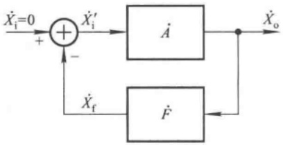

<details>
<summary>flowchart</summary>

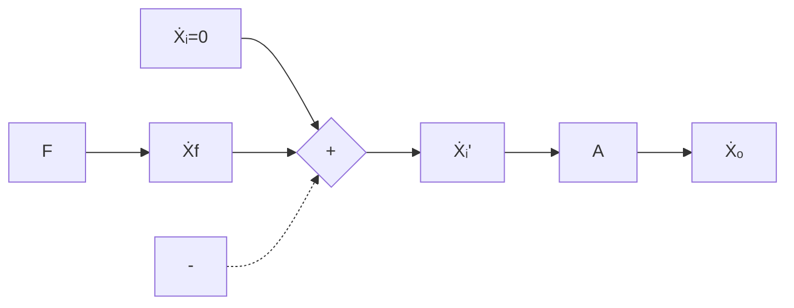
</details>

图 5.6.1 负反馈放大电路的自激振荡

由于半导体器件的非线性特性,若电路最终达到动态平衡,即反馈信号(也就是负的净输入信号)维持着输出信号,而输出信号又维持着反馈信号,它们互相依存,则称电路产生了自激振荡。

可见,电路产生自激振荡时,输出信号有其特定的频率 $f_{0}$ 和一定的幅值,且振荡频率 $f_{0}$ 必在电路的低频段或高频段。而电路一旦产生自激振荡将无法正常放大,称电路处于不稳定状态。

## 二、自激振荡的平衡条件

从图5.6.1可以看出，在电路产生自激振荡时，由于 $\dot{X}_{\mathrm{o}}$ 与 $\dot{X}_{\mathrm{f}}$ 相互维持，所以 $\dot{X}_{\mathrm{o}} = \dot{A}\dot{X}_{\mathrm{i}}^{\prime} = -\dot{A}\dot{F}\dot{X}_{\mathrm{o}}$ ，即

$$
\dot {A} \dot {F} = - 1 \tag {5.6.2}
$$

可写成模及相角形式

$$
\left\{ \begin{array}{l} \left| \dot {A} \dot {F} \right| = 1 \\ \varphi_ {\mathrm{A}} + \varphi_ {\mathrm{F}} = (2 n + 1) \pi \quad (n \text {为整数}) \end{array} \right. \tag {5.6.3a}
$$

上式称为自激振荡的平衡条件,式(5.6.3a)为幅值平衡条件,式(5.6.3b)为相位平衡条件,简称幅值条件和相位条件。只有同时满足上述两个条件,电路才会产生自激振荡。在起振过程中, $\left|\dot{X}_{0}\right|$ 有一个从小到大的过程,故起振条件为

---

5.6 负反馈放大电路的稳定性

251

$$
\mid \dot {A} \dot {F} \mid > 1 \tag {5.6.4}
$$

## 5.6.2 负反馈放大电路稳定性的定性分析

设放大电路采用直接耦合方式,且反馈网络为纯电阻网络,则附加相移仅产生于放大电路,且为滞后相移,电路只可能产生高频振荡。

在上述条件下，在单管放大电路中引入负反馈，因其产生的最大附加相移为 $-90^{\circ}$，不存在满足相位条件的频率，故不可能产生自激振荡。在两级放大电路中引入负反馈，当频率从零变化到无穷大时，附加相移从 $0^{\circ}$ 变化到 $-180^{\circ}$，虽然从理论上存在满足相位条件的频率 $f_{0}$，但 $f_{0}$ 趋于无穷大，且当 $f = f_{0}$ 时 $\dot{A}$ 的值为零，不满足幅值条件，故不可能产生自激振荡。在三级放大电路中引入负反馈，当频率从零变化到无穷大时，附加相移从零变化到 $-270^{\circ}$，因而存在使 $\varphi_{\mathrm{A}}' = -180^{\circ}$ 的频率 $f_{0}$，且当 $f = f_{0}$ 时 $|\dot{A}| > 0$，有可能满足幅值条件，故可能产生自激振荡。可以推论，四级、五级放大电路更易产生自激振荡，因为它们一定存在 $f_{0}$，且更易满足幅值条件。因此，实用电路中以三级放大电路最常见。

由以上分析可知,放大电路级数愈多,引入负反馈后愈容易产生高频振荡。与上述分析相类似,放大电路中耦合电容、旁路电容等愈多,引入负反馈后,愈容易产生低频振荡。而且 $(1+AF)$ 愈大,即反馈愈深,满足幅值条件的可能性愈大,产生自激振荡的可能性就愈大。

应当指出,电路的自激振荡是由其自身条件决定的,不因其输入信号的改变而消除。要消除自激振荡,就必须破坏产生振荡的条件;而只有消除了自激振荡,放大电路才能稳定地工作。

## 5.6.3 负反馈放大电路稳定性的判断

利用负反馈放大电路环路增益的频率特性可以判断电路闭环后是否产生自激振荡,即电路是否稳定。

## 一、判断方法

图 5.6.2 所示为两个电路环路增益的频率特性,从图中可以看出它们均为直接耦合放大电路。

设满足自激振荡相位条件[如式(5.6.3b)所示]的频率为 $f_{0}$ ，满足幅值条件[如式(5.6.3a)所示]的频率为 $f_{e}$ 。

在图(a)所示曲线中，使 $\varphi_{\mathrm{A}} + \varphi_{\mathrm{F}} = -180^{\circ}$ 的频率为 $f_{0}$，使 $20\lg |\dot{A}\dot{F}| = 0$ dB的频率为 $f_{\mathrm{c}}$。因为当 $f = f_{0}$ 时，$20\lg |\dot{A}\dot{F}| > 0$ dB，即 $|\dot{A}\dot{F}| > 1$，说明满足式(5.6.4)所示的起振条件，所以，具有图(a)所示环路增益频率特性的放大电路闭环后必然产生自激振荡，振荡频率为 $f_{0}$。

在图(b)所示曲线中，使 $\varphi_{\mathrm{A}} + \varphi_{\mathrm{F}} = -180^{\circ}$ 的频率为 $f_{0}$，使 $20\lg |\dot{A}\dot{F}| = 0$ dB的频率为 $f_{\mathrm{c}}$。因为当 $f = f_{0}$ 时，$20\lg |\dot{A}\dot{F}| < 0$ dB，即 $|\dot{A}\dot{F}| < 1$，说明不满足式(5.6.4)所示的起振条件，所以具有图(b)所示环路增益频率特性的放大电路闭环后不可能产生自激振荡。

综上所述，在已知环路增益频率特性的条件下，判断负反馈放大电路是否稳定的方法如下:

(1) 若不存在 $f_{0}$ ，则电路稳定。
（2）若存在 $f_{0}$ ，且 $f_{0}<f_{c}$ ，则电路不稳定，必然产生自激振荡；若存在 $f_{0}$ ，但 $f_{0}>f_{c}$ ，则电路稳定，不会产生自激振荡。

---

252

第 5 章 放大电路中的反馈

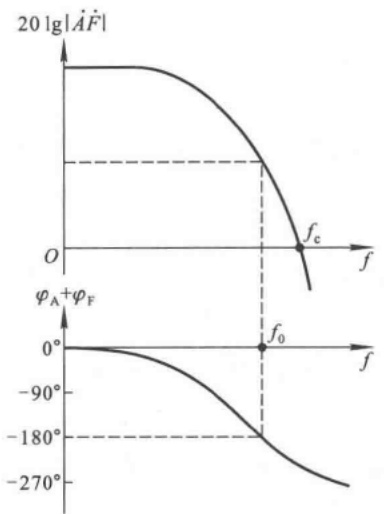

(a)

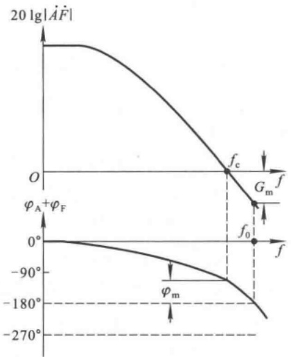

<details>
<summary>line</summary>

| 0 | ~180 | \(0{}^{\circ}\) |
| --- | --- | --- |
| fc | 0 | — |
| f0 | — | \(0{}^{\circ}\) |
| f | ~-40 | — |
| \(\phi m\) | — | \(-90{}^{\circ}\) |
| -180 | — | \(-180{}^{\circ}\) |
| -270 | — | \(-270{}^{\circ}\) |
</details>

(b)

图 5.6.2 两个负反馈电路环路增益的频率特性

(a) $f_{0} < f_{\mathrm{c}}$ 的情况 (b) $f_{0} > f_{\mathrm{c}}$ 的情况

## 二、稳定裕度

虽然根据负反馈放大电路稳定性的判断方法, 只要  $f_{0} > f_{e}$  电路就稳定, 但是为了使电路具有足够的可靠性, 还规定电路应具有一定的稳定裕度。

定义 $f=f_{0}$ 时所对应的 $20\lg|\dot{A}\dot{F}|$ 的值为幅值裕度 $G_{m}$ ，如图5.6.2(b)所示幅频特性曲线中所标注， $G_{m}$ 的表达式为

$$
G _ {\mathrm{m}} = 2 0 \lg \left| \dot {A} \dot {F} \right| _ {f = f _ {0}} \tag {5.6.5}
$$

稳定的负反馈放大电路的  $G_{m}<0$  ，而且  $\left|G_{m}\right|$  愈大，电路愈稳定。通常认为  $G_{m}\leqslant-10\ dB$  ，电路就具有足够的幅值稳定裕度。

定义 $f=f_{c}$ 时的 $\left|\varphi_{A}+\varphi_{F}\right|$ 与 $180^{\circ}$ 的差值为相位裕度 $\varphi_{m}$ ，如图5.6.2(b)所示相频特性曲线中所标注，其表达式为

$$
\varphi_ {\mathrm{m}} = 1 8 0 ^ {\circ} - \left| \varphi_ {\mathrm{A}} + \varphi_ {\mathrm{F}} \right| _ {f = f _ {\mathrm{c}}} \tag {5.6.6}
$$

稳定的负反馈放大电路的  $\varphi_{m}>0$ ，而且  $\varphi_{m}$  愈大，电路愈稳定。通常认为  $\varphi_{m}>45^{\circ}$ ，电路就具有足够的相位稳定裕度。

综上所述，只有当  $G_{m} \leqslant -10$  dB 且  $\varphi_{m} > 45^{\circ}$  时，才认为负反馈放大电路具有可靠的稳定性。

## 5.6.4 负反馈放大电路自激振荡的消除方法

通过对负反馈放大电路稳定性的分析可知,当电路产生了自激振荡时,如果采用某种方法能够改变  $\dot{A}\dot{F}$  的频率特性,使之根本不存在  $f_{0}$ ,或者即使存在  $f_{0}$ ,但  $f_{0}>f_{c}$ ,那么自激振荡必然被消除。下面对常用消振方法加以介绍。为简单起见,设反馈网络为纯电阻网络。

## 一、滞后补偿

## 1. 简单滞后补偿

设某负反馈放大电路环路增益的幅频特性如图5.6.3中虚线所示，在电路中找出产生 $f_{HI}$ 的

---

5.6 负反馈放大电路的稳定性

253

那级电路，加补偿电路，如图5.6.4(a)所示，其高频等效电路如图5.6.4(b)所示。 $R_{\mathrm{o1}}$ 为前级输出电阻， $R_{\mathrm{i2}}$ 为后级输入电阻， $C_{\mathrm{i2}}$ 为后级输入电容，因此加补偿电容前的上限频率

$$
f _ {\mathrm{H1}} = \frac {1}{2 \pi (R _ {\mathrm{o1}} / / R _ {\mathrm{i2}}) C _ {\mathrm{i2}}} \tag {5.6.7}
$$

加补偿电容 C 后的上限频率

$$
f _ {\mathrm{HI}} ^ {\prime} = \frac {1}{2 \pi (R _ {\mathrm{o1}} / / R _ {\mathrm{i2}}) (C _ {\mathrm{i2}} + C)} \tag {5.6.8}
$$

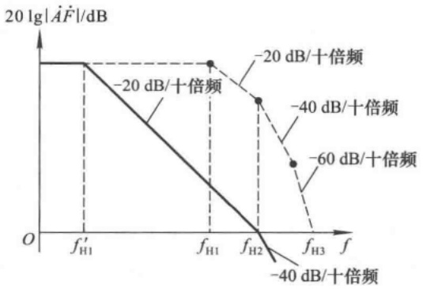

<details>
<summary>line</summary>

| Frequency | Magnitude (dB) |
| --- | --- |
| f'H1 | -20 |
| fH1 | -20 |
| fH2 | -40 |
| fH3 | -60 |
</details>

图 5.6.3 简单滞后补偿前后环路增益的幅频特性

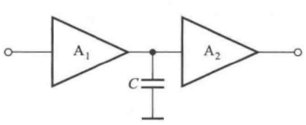

<details>
<summary>text_image</summary>

A₁
C
A₂
</details>

(a)

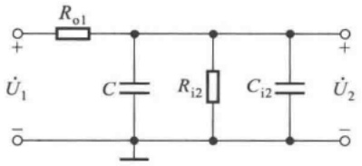

<details>
<summary>chemical</summary>

Electrical circuit diagram with resistors and capacitors labeled R₀₁, C, Rᵢ₂, Cᵢ₂, U₁, U₂
</details>

(b)

图 5.6.4 放大电路中的简单滞后补偿

(a) 简单滞后补偿电路 (b) 高频等效电路

如果补偿后，使 $f=f_{H2}$ 时， $20\lg|\dot{A}\dot{F}|=0\ dB$ ，且 $f_{H2}\geqslant10f'_{H1}$ ，如图5.6.3中实线所示，则表明 $f=f_{c}$ 时， $(\varphi_{\mathrm{A}}+\varphi_{\mathrm{F}})$ 趋于 $-135^{\circ}$ ，即 $f_{0}>f_{c}$ ，并具有 $45^{\circ}$ 的相位裕度，所以电路一定不会产生自激振荡。

应当指出,简单滞后补偿的代价是带宽大大变窄。

## 2. RC 滞后补偿

简单滞后补偿方法虽然可以消除自激振荡，但以频带变窄为代价，如图5.6.3中所示，上限频率由 $f_{H1}$ 变为 $f'_{H1}$ 。采用RC滞后补偿不仅可以消除自激振荡，而且可以使带宽的损失有所改善。具体方法如图5.6.5(a)所示，其高频等效电路如图(b)所示；通常应选择 $R\ll(R_{o1}//R_{i2})$ ， $C\gg C_{i2}$ ，因而简化电路如图(c)所示，其中

$$
\dot {U} _ {\mathrm{o1}} ^ {\prime} = \frac {R _ {\mathrm{i2}}}{R _ {\mathrm{o1}} + R _ {\mathrm{i2}}} \cdot \dot {U} _ {\mathrm{o1}}, R ^ {\prime} = R _ {\mathrm{o1}} / / R _ {\mathrm{i2}}
$$

---

254

第 5 章 放大电路中的反馈

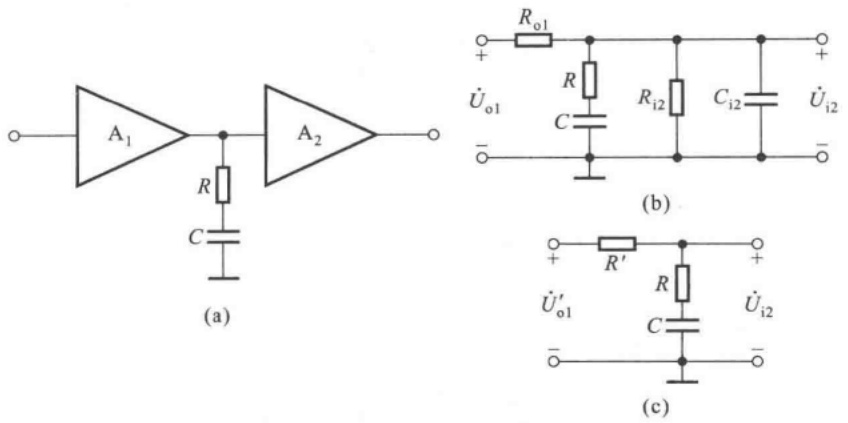

图 5.6.5 负反馈放大电路中的 RC 滞后补偿

(a) RC 滞后补偿电路 (b) 高频等效电路 (c) 简化的高频等效电路

因此，

$$
\frac {\dot {U} _ {\mathrm{i2}}}{\dot {U} _ {\mathrm{ol}} ^ {\prime}} = \frac {R + \frac {1}{\mathrm{j} \omega C}}{R ^ {\prime} + R + \frac {1}{\mathrm{j} \omega C}} = \frac {1 + \mathrm{j} \omega R C}{1 + \mathrm{j} \omega (R + R ^ {\prime}) C} = \frac {1 + \mathrm{j} \frac {f}{f _ {\mathrm{H2}} ^ {\prime}}}{1 + \mathrm{j} \frac {f}{f _ {\mathrm{H1}} ^ {\prime}}} \tag {5.6.9}
$$

式中 $f_{\mathrm{H1}}^{\prime} = \frac{1}{2\pi(R^{\prime} + R)C}, f_{\mathrm{H2}}^{\prime} = \frac{1}{2\pi RC}$ 。若补偿前放大电路的环路增益表达式为

$$
\dot {A} \dot {F} = \frac {\dot {A} _ {\mathrm{m}} \dot {F}}{\left(1 + \mathrm{j} \frac {f}{f _ {\mathrm{H1}}}\right) \left(1 + \mathrm{j} \frac {f}{f _ {\mathrm{H2}}}\right) \left(1 + \mathrm{j} \frac {f}{f _ {\mathrm{H3}}}\right)} \tag {5.6.10}
$$

并且 RC 的取值使  $f_{H2}^{\prime}=f_{H2}$ ，则将式(5.6.9)代入式(5.6.10)可得补偿后放大电路的环路增益表达式，为

$$
\dot {A} \dot {F} = \frac {\dot {A} _ {\mathrm{m}} \dot {F}}{\left(1 + \mathrm{j} \frac {f}{f _ {\mathrm{H1}} ^ {\prime}}\right) \left(1 + \mathrm{j} \frac {f}{f _ {\mathrm{H3}}}\right)} \tag {5.6.11}
$$

上式表明,补偿后环路增益幅频特性曲线中只有两个拐点,因而电路不可能产生自激振荡。

图 5.6.6 所示为放大电路补偿前后的幅频特性, 右边虚线为未加补偿的幅频特性, 左边虚线是加简单电容补偿后的幅频特性, 实线是加 RC 补偿后的幅频特性。三者相比, 显然 RC 补偿比简单电容补偿的带宽有所改善。实际上, 当  $f = f_{H3}$  时, 即使  $20 \lg |\dot{A} \dot{F}| > 0$  dB, 电路也不可能产生自激振荡, 因此 RC 补偿后的幅频特性曲线还可右移, 即频带还可更宽些。

## 3. 密勒效应补偿

为减小补偿电容的容量,可以利用密勒效应,将补偿电容、或补偿电阻和电容跨接在放大电路的输入端和输出端,如图5.6.7所示。

设图 5.6.7(a) 所示电路中  $A_{2} = -100, C = 20 \, pF$ ，则相当于在图 5.6.4(a) 电路中补偿电容  $C \approx (20 \times 100) \, pF = 2000 \, pF$ 。

---

5.6 负反馈放大电路的稳定性

255

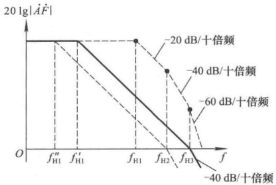

<details>
<summary>line</summary>

| Frequency | -20 dB/decibels | -40 dB/decibels | -60 dB/decibels |
| --- | --- | --- | --- |
| f''H1 | 0 | — | — |
| f'H1 | 0 | — | — |
| fH1 | 0 | — | — |
| fH2 | — | ~-40 dB | — |
| fH3 | — | — | ~-60 dB |
</details>

图 5.6.6 RC 滞后补偿前后环路增益的幅频特性

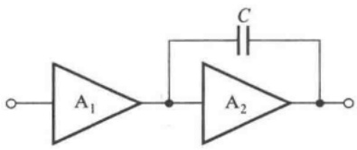

<details>
<summary>text_image</summary>

A₁
C
A₂
</details>

(a)

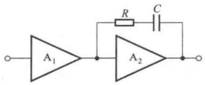

<details>
<summary>text_image</summary>

A₁
R
C
A₂
</details>

(b)

图 5.6.7 密勒效应补偿电路

(a) 电容补偿 (b) 电容 - 电阻补偿

## 二、超前补偿

若改变负反馈放大电路在环路增益为0 dB点的相位，使之超前，则 $f_{0}>f_{c}$ ，也能破坏其自激振荡条件，这种补偿方法称为超前补偿方法。通常，将超前补偿电容加在反馈回路，如图5.6.8所示。

未加补偿电路时的反馈系数

$$
\dot {F} _ {0} = \frac {R _ {1}}{R _ {1} + R _ {2}}
$$

加了补偿电容后的反馈系数

$$
\begin{array}{l} \dot {F} = \frac {R _ {1}}{R _ {1} + R _ {2} / / \frac {1}{\mathrm{j} \omega C}} = \frac {R _ {1}}{R _ {1} + R _ {2}} \cdot \frac {1 + \mathrm{j} \omega R _ {2} C}{1 + \mathrm{j} \omega (R _ {1} / / R _ {2}) C} \\ = \dot {F} _ {0} \cdot \frac {1 + \mathrm{j} \frac {f}{f _ {1}}}{1 + \mathrm{j} \frac {f}{f _ {2}}} \\ \end{array}
$$

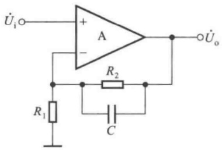

<details>
<summary>text_image</summary>

Üᵢ○─+ A ──●───○Ûₒ
          │     │
          └───R₂
          │     │
          └───R₁ ──● ──● ──● ──●
          │     │
          └───C ──● ──●
          │     │
</details>

图 5.6.8 超前补偿电路

式中 $f_{1} = \frac{1}{2\pi R_{2}C}, f_{2} = \frac{1}{2\pi(R_{1} / / R_{2})C}$，显然 $f_{1} < f_{2}$。画出 $\dot{F}$ 的波特图，近似为图5.6.9所示。从相频特性曲线可知，在 $f_{1}$ 与 $f_{2}$ 之间，相位超前，最大超前相移为 $90^{\circ}$。可以想象，如果补偿前 $f_{1} < f_{c} < f_{2}$，且 $f_{0} < f_{c}$；那么补偿后，$f_{0}$ 将因 $\varphi_{\mathrm{F}}$ 的超前相移而增大，当所取参数合适时，就可以做到 $f_{0} > f_{c}$，从而使电路消除自激振荡。

---

256

第 5 章 放大电路中的反馈

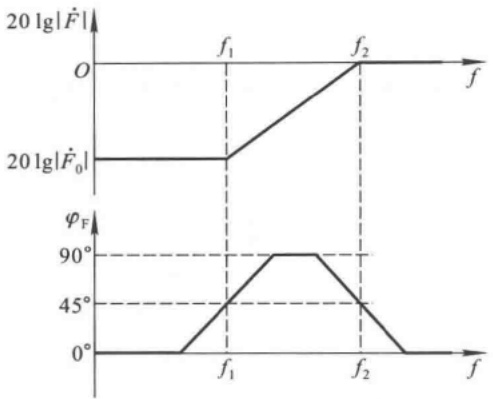

<details>
<summary>line</summary>

| Frequency (f) | Magnitude (20 lg | \(F\)̇ | ) | Phase \((\phi F)\) |
| --- | --- | --- | --- | --- |
| \(< f_{1}\) | 20 lg | \(F\)̇\(_{0}\) |  | \(0{}^{\circ}\) |
| \(f_{1}\) | 20 lg | \(F\)̇\(_{0}\) |  | \(45{}^{\circ}\) |
</details>

图 5.6.9 加补偿电容后反馈系数的频率特性

综上所述,无论是滞后补偿还是超前补偿,都可以用很简单的电路来实现。补偿后对带宽的影响由小到大依次为超前补偿、RC滞后补偿、电容滞后补偿。应当指出,理解消除自激振荡的基本思路以及不同方法的特点,要比具体计算补偿元件的参数重要得多;这是因为在很多情况下,需要在正确思路的指导下,通过实验来获得理想的补偿效果。

【例 5.6.1】某负反馈放大电路产生了自激振荡,现用 40 pF 电容分别按图 5.6.4(a) 和图 5.6.7(a) 所示方法均可消除振荡,试问:一般情况下应选择哪种方法为好?简述理由。

解:一般情况下应采用图 5.6.4(a) 所示的简单滞后方法。

因为采用密勒效应补偿方法将使等效到  $A_{2}$  输入端与地之间的电容约为 40 pF 的  $\left|A_{2}\right|$  倍，从而使上限频率约为简单滞后补偿后电路上限频率的  $\left|1/A_{2}\right|$ ，所以频带大大变窄。因此，为了消振后对带宽影响小些，在这里应采用简单滞后补偿方法。

【例 5.6.2】已知放大电路幅频特性近似如图 5.6.10 所示。引入负反馈时，反馈网络为纯电阻网络，且其参数的变化对基本放大电路的影响可忽略不计。

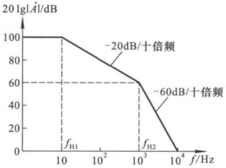

<details>
<summary>line</summary>

| Frequency (Hz) | Response (dB) |
| --- | --- |
| 10 | 100 |
| 10^3 | 60 |
| 10^4 | 0 |
</details>

图 5.6.10 例 5.6.2 放大电路的幅频特性

回答下列问题:

(1) 当  $f=10^{3}$  Hz 时,  $20\lg|\dot{A}| \approx ?$   $\varphi_{A} \approx ?$
(2) 若引入反馈后反馈系数  $\dot{F}=1$ ，则电路是否会产生自激振荡？
(3) 若想引入负反馈后电路稳定, 则  $\left|\dot{F}\right|$  的上限值约为多少?

---

5.6 负反馈放大电路的稳定性

257

解:（1）从图5.6.10所示曲线可知，当 $f=10^{3}$ Hz时， $20\lg|\dot{A}|\approx60\ dB$ 。

在 $f=10^{3}$ Hz前后幅频特性曲线下降斜率由-20 dB/十倍频变为-60 dB/十倍频，说明在 $f=10^{3}$ Hz处有两个截止频率，它们产生的相移约为 $-90^{\circ}$ ；而由于 $f_{H2}=100f_{H1}$ ，确定 $f_{H1}$ 的RC环节产生的相移约为 $-90^{\circ}$ ，故当 $f=f_{H2}=10^{3}$ Hz时， $\varphi_{A}\approx-180^{\circ}$ 。

（2）根据上述分析可知， $f_{0}\approx10^{3}$ Hz，且当 $f=f_{0}$ 时，因 $\dot{F}=1$ ，使得 $20\lg|\dot{A}\dot{F}|\approx60\ dB>0\ dB$ ，所以电路必定会产生自激振荡。
（3）为使 $f=10^{3}$ Hz 时， $20\lg|\dot{A}\dot{F}|<0$ dB，即 $20\lg|\dot{A}|+20\lg|\dot{F}|\approx60\mathrm{~dB}+20\mathrm{~lg}|\dot{F}|<0$ dB，因而要求 $20\lg|\dot{F}|<-60\mathrm{~dB}$，所以 $|\dot{F}|<0.001$。

## 5.6.5 集成运放的频率响应和频率补偿

## 一、集成运放的频率响应

集成运放是直接耦合多级放大电路，具有很好的低频特性，它的各级半导体管的极间电容将影响它的高频特性。由于输入级和中间级均有很高的电压增益（高达几百倍，甚至上千倍），所以尽管结电容的数值很小，但晶体管发射结等效电容 $C_{\pi}^{\prime}$ 或场效应管g-s间等效电容 $C_{gs}^{\prime}$ 却很大，致使上限频率很低，通用型运放的-3dB带宽只有十几赫到几十赫。

为了防止集成运放引入负反馈后产生自激振荡，通常在电路内部加频率补偿。图5.6.11所示为某通用性集成运放未加频率补偿时的频率响应，其开环差模增益为 $100\mathrm{dB}$ （即 $A_{\mathrm{od}} = 10^{5}$），三个上限频率分别为 $10\mathrm{Hz}, 100\mathrm{Hz}$ 和 $1000\mathrm{Hz}$。当反馈系数为1时，$f_0$ 和 $f_{\mathrm{c}}$ 如图中所标注。这个频率响应具有典型性。

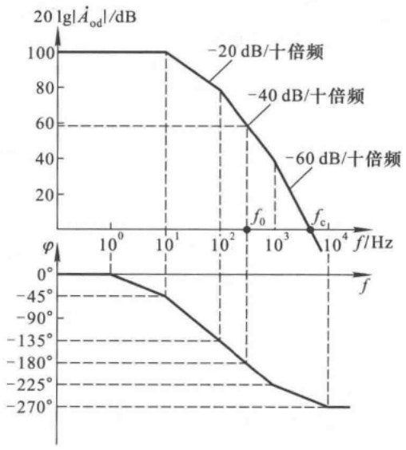

<details>
<summary>line</summary>

| Frequency (Hz) | Magnitude (dB) | Phase \((\phi)\) |
| --- | --- | --- |
| 1 | 100 | \(0{}^{\circ}\) |
| 10 | 100 | \(-45{}^{\circ}\) |
| 100 | 80 | \(-135{}^{\circ}\) |
| f0 | — | \(-225{}^{\circ}\) |
| fc | — | \(-270{}^{\circ}\) |
| 1000 | 40 | — |
| 10000 | 0 | — |
</details>

图 5.6.11 未加补偿电容的集成运放的频率响应

## 二、集成运放中的频率补偿

通常，集成运放内部的频率补偿多为简单滞后补偿（密勒补偿）或超前补偿，用以改变其频率响应，使之在开环差分增益降至0 dB时最大附加相移为 $-135^{\circ}$ 。这样，在引入负反馈且反馈

---

258

第 5 章 放大电路中的反馈

网络为纯电阻网络时电路一定不会产生自激振荡，并具有足够的稳定性。

图 5.6.12(a) 所示电路中 C 为补偿电容, 为密勒补偿; 图(b) 所示电路中 R 和 C 组成补偿电路, 为超前补偿。

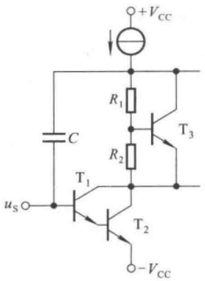

<details>
<summary>text_image</summary>

+VCC
R1
C
T3
R2
T1
T2
-VCC
us
</details>

(a)

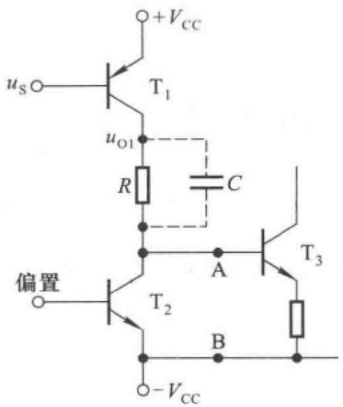

<details>
<summary>text_image</summary>

+VCC
us
T1
uo1
R
C
偏置
A
T3
T2
B
-VCC
</details>

(b)

图 5.6.12 集成运放的频率补偿

(a) 密勒补偿 (b) 超前补偿

集成运放加滞后补偿后的幅频特性如图 5.6.13(a) 中实线所示, 加超前补偿后的幅频特性如图(b) 中实线所示, 虚线是未加补偿电容时的幅频特性。由图可知, 加滞后补偿使通频带变窄; 加超前补偿环节时, 若 RC 取值得当, 则通频带变宽 $^{①}$ 。

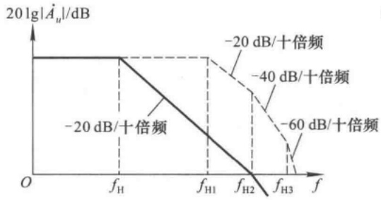

<details>
<summary>line</summary>

| Frequency Point | Magnitude (dB) |
| --- | --- |
| fH | -20 |
| fH1 | -20 |
| fH2 | -40 |
| fH3 | -60 |
</details>

(a)

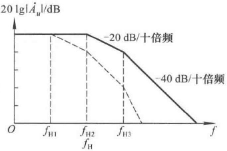

<details>
<summary>line</summary>

| Frequency Point | Attenuation Level (dB) |
| --- | --- |
| fH1 | -20 |
| fH2 | -20 |
| fH3 | -40 |
</details>

(b)

图 5.6.13 加频率补偿的集成运放的频率响应

(a) 加滞后补偿 (b) 加超前补偿

## 思考题

5.6.1 为什么在集成运放内部常加相位补偿电容？
5.6.2 在负反馈放大电路产生自激振荡时,若用 50 pF 和 500 pF 的电容作滞后补偿均可消振,应当用哪个电容?为什么?
5.6.3 若负反馈放大电路产生自激振荡,为什么总是在上限频率最低的那一级电路加补偿电容(或电容、电阻)?

<small><span class="docvortex-page-footnote" data-block-type="page_footnote" style="color:#6b7280">① 可参阅童诗白、华成英主编《模拟电子技术基础(第三版)》5.6.2节。</span></small>

---

5.7 放大电路中其它形式的反馈

259

## 5.7 放大电路中其它形式的反馈

在实用放大电路中,除了引入四种基本组态的交流负反馈外,还常引入合适的正反馈,以改善电路的性能;在高速宽频带电路中,还常选用“电流反馈型”运算放大电路。本节将对上述内容加以简单介绍。

## 5.7.1 放大电路中的正反馈

## 一、电压-电流转换电路

在放大电路中引入电流串联负反馈，可以实现电压-电流的转换。实际上，若信号源能够输出足够大的电流且集成运放有足够大的耗散功率，则在电路中引入电流并联负反馈也可实现电压-电流转换，如图5.7.1(a)所示。设集成运放为理想运放，因而引入负反馈后具有“虚短”和“虚断”的特点，图中 $u_{\mathrm{N}} = u_{\mathrm{P}} = 0, i_{0} = i_{R}$，即

$$
i _ {\mathrm{O}} = i _ {R} = \frac {u _ {\mathrm{I}}}{R} \tag {5.7.1}
$$

$i_{0}$  与  $u_{1}$  成线性关系。

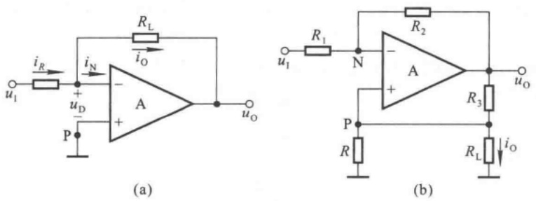

图 5.7.1 电压 - 电流转换电路

(a) 一般电路 (b) 豪兰德电流源电路

在实用电路中，常需要负载电阻 $R_{\mathrm{L}}$ 有接地端，为此产生了如图5.7.1(b)所示的豪兰德(Howland)电流源电路。设集成运放为理想运放，由于电路通过 $R_{2}$ 引入负反馈，使之具有“虚短”和“虚断”的特点，故图中 $u_{\mathrm{N}} = u_{\mathrm{P}}, R_{1}$ 和 $R_{2}$ 的电流相等，结点N的电流方程为

$$
\frac {u _ {\mathrm{I}} - u _ {\mathrm{N}}}{R _ {\mathrm{I}}} = \frac {u _ {\mathrm{N}} - u _ {\mathrm{O}}}{R _ {2}}
$$

因而 N 点电位

$$
u _ {\mathrm{N}} = \left(\frac {u _ {1}}{R _ {1}} + \frac {u _ {0}}{R _ {2}}\right) \cdot R _ {\mathrm{N}} \quad (R _ {\mathrm{N}} = R _ {1} / / R _ {2}) \tag {5.7.2}
$$

结点 P 的电流方程

$$
\frac {u _ {\mathrm{P}}}{R} + i _ {\mathrm{O}} = \frac {u _ {\mathrm{O}} - u _ {\mathrm{P}}}{R _ {3}}
$$

因而 P 点电位

---

260

第 5 章 放大电路中的反馈

$$
u _ {\mathrm{p}} = \left(\frac {u _ {0}}{R _ {3}} - i _ {0}\right) \cdot (R / / R _ {3}) \tag {5.7.3}
$$

利用式(5.7.2)和式(5.7.3)相等的关系,并将它们展开、整理,可得

$$
\frac {R _ {2}}{R _ {1} + R _ {2}} \cdot u _ {1} + \frac {R _ {1}}{R _ {1} + R _ {2}} \cdot u _ {0} = \frac {R}{R + R _ {3}} \cdot u _ {0} - i _ {0} \cdot \frac {R R _ {3}}{R + R _ {3}}
$$

若 $\frac{R_2}{R_1} = \frac{R_3}{R}$，则 $\frac{R_2}{R_1 + R_2} = \frac{R_3}{R + R_3}, \frac{R_1}{R_1 + R_2} = \frac{R}{R + R_3}$，消去上式中的公因子，得到

$$
i _ {0} = - \frac {u _ {1}}{R} \tag {5.7.4}
$$

与式(5.7.1)仅差符号,说明图5.7.1所示两电路均具有电压-电流转换功能。

从物理概念上看，在图(b)所示电路中既引入了负反馈，又引入了正反馈。若负载电阻 $R_{L}$ 减小，因电路内阻的存在，则一方面 $i_{0}$ 将增大，另一方面 $u_{p}$ 将下降，从而导致 $u_{0}$ 下降， $i_{0}$ 将随之减小，其过程简述如下:

$$
R _ {\mathrm{L}} \xrightarrow {i _ {\mathrm{O}} \uparrow} u _ {\mathrm{P}} \xrightarrow {i _ {\mathrm{O}} \downarrow} u _ {\mathrm{O}}
$$

当满足 $R_{2}/R_{1}=R_{3}/R$ 时，因 $R_{L}$ 减小引起的 $i_{0}$ 的增大等于因正反馈作用引起的 $i_{0}$ 的减小，即正好抵消，因而在电路参数确定后， $i_{0}$ 仅受控于 $u_{1}$ 。 $i_{0}$ 不受负载电阻的影响，说明电路的输出电阻为无穷大。

为了求解电路的输出电阻, 可令  $u_{1}=0$ , 且断开  $R_{L}$ , 在  $R_{L}$  处加交流电压  $U_{o}^{\prime}$ , 由此产生电流  $I_{o}$ , 则  $U_{o}^{\prime}/I_{o}$  即为输出电阻。此时运放同相输入端电位

$$
U _ {\mathrm{p}} = U _ {\mathrm{o}} ^ {\prime}
$$

对于理想运放,输出端电位

$$
U _ {\mathrm{o}} = \left(1 + \frac {R _ {2}}{R _ {1}}\right) \cdot U _ {\mathrm{o}} ^ {\prime} \tag {5.7.5}
$$

因而输出电流

$$
I _ {\mathrm{o}} = \frac {U _ {\mathrm{o}} - U _ {\mathrm{o}} ^ {\prime}}{R _ {3}} - \frac {U _ {\mathrm{o}} ^ {\prime}}{R}
$$

将式(5.7.5)代入上式

$$
I _ {\mathrm{o}} = \frac {R _ {2}}{R _ {1} R _ {3}} \cdot U _ {\mathrm{o}} ^ {\prime} - \frac {U _ {\mathrm{o}} ^ {\prime}}{R} = \frac {R _ {2}}{R _ {1}} \cdot \frac {U _ {\mathrm{o}} ^ {\prime}}{R _ {3}} - \frac {R _ {3}}{R} \cdot \frac {U _ {\mathrm{o}} ^ {\prime}}{R _ {3}}
$$

因为 $R_{2}/R_{1}=R_{3}/R$ ，所以 $I_{0}=0$ ，因此

$$
R _ {\mathrm{o}} = \frac {U _ {\mathrm{o}} ^ {\prime}}{I _ {\mathrm{o}}} = \infty \tag {5.7.6}
$$

可见, 只有严格保证  $R_{1}$ 、 $R_{2}$ 、 $R_{3}$  和 R 之间的匹配关系, 输出电阻才趋于无穷大, 输出电流也才具有恒流特性。

## 二、自举电路

在阻容耦合放大电路中,常在引入负反馈的同时,引入合适的正反馈,以提高输入电阻,见图5.7.2(a)所示电路。

---

5.7 放大电路中其它形式的反馈

261

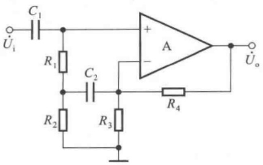

<details>
<summary>text_image</summary>

C₁
Uᵢ
R₁
C₂
R₂
R₃
A
+
-
R₄
Uₒ
</details>

(a)

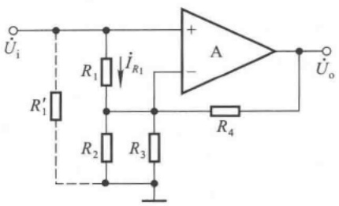

<details>
<summary>text_image</summary>

Ui
R'1
R1
iR1
A
+
-
R2
R3
R4
Uo
</details>

(b)

图 5.7.2 自举电路举例

(a) 电路 (b) 交流通路

为使集成运放静态时能正常工作,必须在同相输入端与地之间加电阻。若不加电容  $C_{2}$ , 则电路中虽然引入了电压串联负反馈,但输入电阻的值却不大。在理想运放情况下

$$
R _ {\mathrm{i}} = R _ {1} + R _ {2} \tag {5.7.7}
$$

当加  $C_{2}$  时，电路的交流通路如图(b)所示， $R_{2}$  和  $R_{3}$  并联， $R_{1}$  跨接在运放的两个输入端。利用瞬时极性法可以判断出电路中除了通过  $R_{4}$  接反相输入端引入负反馈外，还通过  $R_{1}$  接同相输入端而引入了正反馈；当信号源为有内阻的电压源时，正反馈的结果使输入端的动态电位升高。这种通过引入正反馈使输入端动态电位升高的电路，称为自举电路。

由于引入交流正反馈, $R_{1}$ 中的交流电流 $I_{R_{1}}$ 大大减小,其表达式为

$$
I _ {R _ {1}} = \frac {U _ {\mathrm{p}} - U _ {\mathrm{N}}}{R _ {1}}
$$

式中  $U_{p}=U_{i}$ 。若将  $R_{1}$  等效到输入端与地之间，如图中虚线所示，则等效电阻

$$
R _ {1} ^ {\prime} = \frac {U _ {\mathrm{i}}}{I _ {R _ {1}}} = \frac {U _ {\mathrm{p}}}{U _ {\mathrm{p}} - U _ {\mathrm{N}}} \cdot R _ {1}
$$

在理想运放情况下， $U_{N}=U_{P}$ ，故 $R_{1}^{\prime}$ 趋于无穷大。因而电路的输入电阻

$$
R _ {\mathrm{i}} = R _ {1} ^ {\prime} / / R _ {\mathrm{i}} ^ {\prime} = \infty \tag {5.7.8}
$$

与式 $(5.7.7)$ 比较可知,引入正反馈使输入电阻大大提高。

## 5.7.2 电流反馈运算放大电路

## 一、什么是电流反馈集成运算放大电路

传统的集成运放均为电压放大电路，以电压作为输入信号和输出信号。当同相输入端和反相输入端有差值电压（即差模输入电压）时，电路产生响应，逐级放大，从而获得相应的输出电压。因此，用开环差模增益来描述输入量和输出量的传递关系。它们的性能指标除了追求尽可能大的电压增益外，还应具有尽可能大的输入电阻，以便获得尽可能大的输入电压。在使用时，无论引入什么形式的反馈，最终必然产生差模输入电压经集成运放放大，故称这类电路为电压反馈运算放大电路，简称为VFA $^{①}$ 。VFA电路因受其信号传递方式的限制，在工作速度和频率等性能方面不能满足目前迅猛发展的高速系统的要求。

<small><span class="docvortex-page-footnote" data-block-type="page_footnote" style="color:#6b7280">① VFA 为英文 Voltage Feedback Operational Amplifier 的缩写。</span></small>

---

262

第 5 章 放大电路中的反馈

采用电流模技术设计和制造的模拟集成电路，在工作速度、精度、带宽和线性度等方面均获得很高的性能，电流反馈运算放大电路（简称 CFA $^{①}$ ）就是其中一种。CFA 电路以电流为输入信号，以电压为输出信号。当其同相输入端与反相输入端产生差值电流时，电路产生响应，逐级放大，最终转换成电压输出。因此，开环增益为输出电压与输入电流之比，其量纲为欧姆，故也称为互阻放大电路。为获得更大的输入电流，CFA 均有低输入电阻的输入端。在使用时，无论引入什么形式的反馈，最终必须产生差值输入电流，经运放放大，故称之为电流反馈运算放大电路。

由以上分析可知，VFA 和 CFA 的“电压反馈”和“电流反馈”与反馈组态中的“电压反馈”和“电流反馈”是不同的概念。

## 二、电流模电路

以电压作为参量进行处理的电路称为电压模电路，而以电流作为参量进行处理的电路为电流模电路；即电压模电路的处理对象是电压，而电流模电路的处理对象是电流。由于电流与电压具有相关性，因此难以给电流模电路以一个严格的定义。一般称信号传递过程中除与晶体管b-e间电压有关外，其余各参量均为电流量的电路，即为电流模电路。因此，利用电流模技术设计的电流放大电路最具有典型性。由于电流模电路的种种优点，VFA电路也在局部采用此技术，以获得性能的改善。

由于电流源电路能够按比例传输电流,因而作为基本单元电路广泛用于各种电流模电路之

中。图5.7.3所示为最简单的电流源电路，即镜像电流源。 $\mathrm{T}_{1}$ 管一边注入输入电流 $i_{1}$，产生b-e间电压 $u_{\mathrm{BE1}}$ ，并作为 $\mathrm{T}_{2}$ 管的基极偏压，若 $\mathrm{T}_{1}$ 与 $\mathrm{T}_{2}$ 理想对称，且 $\beta \gg 2$ ，则输出电流 $i_0 \approx i_1$ 。虽然镜像电流源电路简单，但可以看出电流模电路的如下优点:

（1）只要  $T_{2}$  管的管压降  $u_{CE2}$  足够大，保证其工作在放大状态，输出电流的幅值就仅受管子最大集电极电流  $I_{CM}$  的限制，因此电路可在低电源电压下工作，并且输出电流可以有很大的变化范围。

而电压模电路的输出电压幅值受电源电压的限制。

（2）只要  $T_{1}$  与  $T_{2}$  管理想对称， $i_{0}$  与  $i_{1}$  就具有良好的线性关系，而不受晶体管输入特性非线性的影响，因此电路的非线性失真很小。

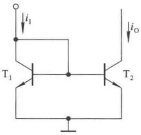

<details>
<summary>text_image</summary>

i₁
T₁
T₂
i₀
</details>

图 5.7.3 镜像电流源

而在电压模电路中,输入电压作用于 b-e 之间,产生  $\Delta u_{BE}$ ,由于输入特性的指数规律, $\Delta i_{B}$  与  $\Delta u_{BE}$  成非线性关系,最终导致输出电压产生非线性失真。

（3）在信号传递过程中，由于b-e间电压随 $i_{1}$ 的变化仅有微小的变化，而且晶体管的极间电容 $C_{\mathrm{b'e}}$ （即 $C_{\pi}$ ）和 $C_{\mathrm{b'e}}$ （即 $C_{\mu}$ ）所在回路均为低阻回路，故电路的截止频率很高，可以接近管子的特征频率 $f_{T}$ 。

而在电压模电路中,各级电压放大倍数很大,使得管子发射结等效电容较大,且回路电阻大,因而截止频率很低。

虽然实际的电流模电路要比图 5.7.3 所示电路复杂得多,但它们所具有的频带宽、速度高、失真小、输出动态范围大等优点是共同的。

<small><span class="docvortex-page-footnote" data-block-type="page_footnote" style="color:#6b7280">① CFA 为英文 Current Feedback Operational Amplifier 的缩写。</span></small>

---

5.7 放大电路中其它形式的反馈

263

## 三、电流反馈运算放大电路工作原理

电流反馈运算放大电路的简化原理图如图 5.7.4 所示, $T_{1}$ 管的基极为同相输入端, $T_{3}$ 管和 $T_{4}$ 管的发射极为反相输入端, R 为外接电阻。


<details>
<summary>text_image</summary>

i₁
+
同相
输入端
T₁
T₂
T₃
R
反相
输入端
Z
C
T₇
T₈
T₅
T₆
I₁
I₂
+VCC
T₁₁
uₒ
T₁₀
T₁₂
I₁
I₂
-VCC
</details>

图 5.7.4 电流反馈运算放大电路的简化原理图

输入级是由  $T_{1} \sim T_{4}$  管组成的射极输出互补电路。反相输入端电位  $U_{N}$  跟随同相输入端电位  $U_{P}$  的变化，即  $U_{N} = U_{P}$ ; 且若同相输入端电流  $I_{P} = I_{i}$ ，则反相输入端电流  $I_{N} = -I_{i}$ ; 所以，称输入级为单位增益缓冲器。图中虚线箭头为电流的假设正方向。

$T_{5} \sim T_{8}$ 管构成的两个镜像电流源将输入电流传递到输出级， $T_{6}$ 管和 $T_{8}$ 管的集电极为输出端，输出电阻很大，理想情况下可以认为是无穷大，因而输出呈恒流源特性，且输出电流等于 $I_{i}$ 。因此， $T_{1} \sim T_{8}$ 管所组成的电路实现了电流控制电流源的功能。

$T_{9} \sim T_{12}$ 管组成互补输出级，仅对电流具有放大作用，其电压放大倍数等于1，在电路空载情况时的输入电阻趋于无穷大。因为前级电路均为电流模电路，所以管子极间电容所在回路均为低阻回路，因而电路中唯一的高阻节点为图中所示的Z点。设Z点到地的等效电容为C，等效电阻是前级的输出电阻与输出级的输入电阻的并联值 $R_{z}$ 。C的数值主要决定于电路中所接频率补偿电容的大小，一般为3\~5pF。因此，图5.7.5所示电路的截止频率主要取决于 $R_{z}C$ 。

图 5.7.5 所示为图 5.7.4 电路输入级和输出级的等效电路图。图中， $r_{0}$ 是输入级从反相输入端看进去的输入电阻，也是输入级的输出电阻。


<details>
<summary>text_image</summary>

单位增益缓冲器
+○ → iᵢ → iₚ → 1 → iₙ → rₒ → iₒ → iᵢ → Z → Rₓ → C → 1 → ůₒ
互补输出级
</details>

图 5.7.5 电流反馈运算放大电路的等效电路

---

264

第 5 章 放大电路中的反馈

设  $T_{6} \sim T_{12}$  具有理想特性, c-e 间动态电阻为无穷大时, 则  $R_{z} = \infty$ , 因而放大倍数为

$$
\dot {A} _ {u i} = \frac {\dot {U} _ {\mathrm{o}}}{\dot {I} _ {\mathrm{i}}} = \frac {\dot {I} _ {\mathrm{i}} \cdot \frac {1}{\mathrm{j} \omega C}}{\dot {I} _ {\mathrm{i}}} = \frac {1}{\mathrm{j} \omega C}
$$

画出  $\dot{A}_{ui}$  的幅频特性, 如图 5.7.6 所示。信号频率 f 愈低,  $\left|\dot{A}_{ui}\right|$  愈大; 当 f 趋近零时,  $\left|\dot{A}_{ui}\right|$  趋于无穷大。

## 四、由电流反馈运算放大电路组成的负反馈放大电路的频率特性

下面以图 5.7.7(a) 所示电压并联负反馈放大电路为例, 说明电流反馈运放构成的电路的幅频特性的特点。图

(b)为图(a)的等效电路,根据对图5.7.5所示电路的分析可知


<details>
<summary>line</summary>

| 1 | ~1.5 |
| --- | --- |
| 10^6 | 0 |
</details>

图 5.7.6 电流反馈运算放大电路的幅频特性

$$
\dot {U} _ {\mathrm{o}} = \dot {I} _ {\mathrm{i}} \cdot \frac {1}{\mathrm{j} \omega C}
$$

$\dot{I}_{i}$  为同相输入端的输入电流, 因而在图 5.7.7(b) 所示电路中,  $\dot{I}_{n} = -\dot{I}_{i}$ , 且  $\dot{I}_{n} = \dot{U}_{n}/r_{o}$ , 故

$$
\dot {U} _ {\mathrm{o}} = - \dot {I} _ {\mathrm{n}} \cdot \frac {1}{\mathrm{j} \omega C} = - \frac {\dot {U} _ {\mathrm{n}}}{\mathrm{j} \omega r _ {\mathrm{o}} C}
$$

$$
\dot {U} _ {\mathrm{n}} = - \mathrm{j} \omega r _ {\mathrm{o}} C \dot {U} _ {\mathrm{o}} \tag {5.7.9}
$$


<details>
<summary>text_image</summary>

R₁
+
A
-
R₂
Uᵢ
Uₒ
</details>

(a)


<details>
<summary>text_image</summary>

i₁
iₙ
R₁
U̇ᵢ
U̇ₙ
1
rₒ
-
+
R₂
i₂
U̇ₒ
</details>

(b)

图 5.7.7 由电流反馈运放构成的电压并联负反馈放大电路

(a) 电路 (b) 等效电路

运放反相输入端的结点电流方程为

$$
\frac {\dot {U} _ {\mathrm{i}} - \dot {U} _ {\mathrm{n}}}{R _ {1}} = \frac {\dot {U} _ {\mathrm{n}}}{r _ {\mathrm{o}}} + \frac {\dot {U} _ {\mathrm{n}} - \dot {U} _ {\mathrm{o}}}{R _ {2}}
$$

整理后,得出

$$
\frac {\dot {U} _ {\mathrm{i}}}{R _ {1}} = - \frac {\dot {U} _ {\mathrm{o}}}{R _ {2}} + \frac {\dot {U} _ {\mathrm{n}}}{R _ {\mathrm{n}}} \quad (R _ {\mathrm{n}} = R _ {1} / / R _ {2} / / r _ {\mathrm{o}}) \tag {5.7.10}
$$

若 $R_{1} / / R_{2}\gg r_{\mathrm{o}}$ ，则 $R_{\mathrm{n}}\approx r_{\mathrm{o}}$ 。将 $R_{\mathrm{n}}\approx r_{\mathrm{o}}$ 和式(5.7.9)代入(5.7.10)，可得

$$
\frac {\dot {U} _ {\mathrm{i}}}{R _ {1}} \approx - \dot {U} _ {\mathrm{o}} \cdot \left(\frac {1}{R _ {2}} + \mathrm{j} \omega C\right)
$$

因此,电压放大倍数为

---

5.8 Multisim 应用举例

265

$$
\dot {A} _ {u} = \frac {\dot {U} _ {\mathrm{o}}}{\dot {U} _ {\mathrm{i}}} \approx - \frac {R _ {2}}{R _ {1}} \cdot \frac {1}{1 + \mathrm{j} \omega R _ {2} C} \tag {5.7.11}
$$

令  $\omega_{H}=\frac{1}{R_{2}C}$ ，则上限频率

$$
f _ {\mathrm{H}} = \frac {1}{2 \pi R _ {2} C} \tag {5.7.12}
$$

$f_{H}$  与  $R_{1}$  无关。将式(5.7.12)代入式(5.7.11)，得出

$$
\dot {A} _ {u} \approx - \frac {R _ {2}}{R _ {1}} \cdot \frac {1}{1 + \mathrm{j} \frac {f}{f _ {\mathrm{H}}}} \tag {5.7.13}
$$

因此， $\dot{A}_{u}$  的幅频特性如图 5.7.8 所示。当  $R_{1}$  取值减小为  $R_{1}^{\prime}$  时，电路的低频放大倍数的数值增大，但其带宽不变，如图中虚线所示。

综上所述，在由电流反馈运放组成的负反馈放大电路中，当参数选择合适时，即使改变电压放大倍数，带宽也基本不变。这一点与传统的增益带宽积为常量的概念，全然不同。


<details>
<summary>line</summary>

| Frequency (f) | Value (Solid Line) | Value (Dashed Line) |
| --- | --- | --- |
| 0 | R2/R1 | R2/R1' |
| fH | R2/R1 | R2/R1' |
| >fH | 0 | ~0.35 |
</details>

图 5.7.8 图 5.7.7(a) 所示电路的幅频特性

## 思考题

5.7.1 放大电路中有可能引入直流正反馈吗？只能引入交流负反馈吗？如能引入交流正反馈，则应依据什么原则？
5.7.2 电流反馈集成运放与第四章所述集成运放有什么明显的区别？

## 5.8 Multisim 应用举例

## 5.8.1 开环放大倍数对闭环放大倍数的影响

## 一、仿真电路

仿真电路如图5.8.1所示，为电压串联负反馈放大电路。其中U1A、U2A均采用通用型运放LM347，具有较为理想的性能指标；电阻取值如图中所标注。它们分别引入了局部电压并联负反馈，因而可以认为闭环电压放大倍数分别为 $\dot{A}_{\mathrm{ufl}} \approx -R_7 / R_1$ 、 $\dot{A}_{\mathrm{uf2}} \approx -R_3 / R_2$ ，该负反馈放大电路的基本放大电路的放大倍数

$$
\dot {A} _ {u} \approx \dot {A} _ {u f 1} \dot {A} _ {u f 2} \tag {5.8.1}
$$

整个电路引入了级间电压串联负反馈，在开环放大倍数趋于无穷大时，闭环电压放大倍数

$$
\dot {A} _ {u f} = \frac {1}{\dot {F}} = 1 + \frac {R _ {4}}{R _ {5}} = 1 0 0 \tag {5.8.2}
$$

## 二、仿真内容

为电路输入频率为  $10 \, Hz$ 、峰值为  $10 \, mV$  的正弦波电压，用双踪示波器分别测量  $R_{5} = 10 \, k\Omega$  和  $1 \, M\Omega$  时输出的峰值电压，如图 5.8.1 所示，从而得到电压放大倍数的变化。

---

266

第 5 章 放大电路中的反馈


<details>
<summary>text_image</summary>

R1
1kOhm
R2
100kOhm
R5 10kOhm
U1A
1
4
LF347D
R4
1kOhm
R7
1kOhm
R6
99kOhm
U2A
1
4
LF347D
V2
15 V
V3
15 V
XFG1
R3
1kOhm
R9
100kOhm
R12 1000kOhm
U3A
1
4
LF347D
R11
1kOhm
R14
1kOhm
R13
99kOhm
U4A
1
4
LF347D
V1
15 V
V4
15 V
XFG2
R8
1kOhm
R10
1kOhm
Oscilloscope XSC1
T1 Time 125.392 ms Channel_A 988.809 mV Channel_B 900.531 mV Reverse Save T2-T1
Timebase Channel A Scale T V/Div Channel B Scale 500 mV/Div Trigger Edge GND @ X position 0 Y position 0 Y position 0 Level 0 V Y/T Add B/A A/B AC 0 DC @ AC 0 DC - @ Sing/Nor Auto D Ed
</details>

图 5.8.1 改变开环增益测量输出电压

测试数据及整理如表 5.8.1 所示。

表 5.8.1 开环放大倍数变化对闭环放大倍数的影响

| 实测信号源峰值 $U_{ip}$/mV | 反馈电阻$R_5$/kΩ | 运放 U2A 输出电压峰值 $U_{op}$/V | 闭环电压放大倍数 $\dot{A}_{uf}$ | 电压放大倍数$\dot{A}_{uft}$ | 电压放大倍数$\dot{A}_{uf2}$ | 开环电压放大倍数 $\dot{A}_u$ |
| --- | --- | --- | --- | --- | --- | --- |
| 9.997 | 10 | 900.531 | 90.5 | -100 | -10 | $10^3$ |
| 9.997 | 1000 | 988.809 | 98.9 | -100 | -1000 | $10^5$ |

表中采用峰值之比来计算电压放大倍数。

## 三、结论

1. 由表 5.8.1 可知, 当  $R_{5}$  从 10 kΩ 变为 1 MΩ 时, 开环增益变大, 使闭环电压放大倍数由 90.5 变为 98.9, 更接近式 (5.8.2) 所示理想情况下的数值。
2. 当  $R_{5}$  从  $10 \, k\Omega$  变为  $1 \, M\Omega$  时，电路的开环电压放大倍数 A 从  $10^{3}$  变为  $10^{5}$ ，相对变化  $\Delta\dot{A}_{u}/\dot{A}_{u} = (10^{3} - 10^{5})/10^{5} = -0.99$ ，闭环电压放大倍数相对变化  $\Delta\dot{A}_{uf}/\dot{A}_{uf} = (90.5 - 98.9)/98.9 \approx -0.08$ ，数值远小于开环放大倍数的相对变化，说明负反馈提高了放大倍数的稳定性。

## 5.8.2 交流负反馈对频率特性的影响

两级直接耦合放大电路由图 3.4.1 所示电路演变而来, 电路参数也与之相同, 如图 5.8.2(a) 所示。

## 一、仿真内容

研究电路引入电压串联负反馈前后增益和带宽的变化,测试电路分别如图5.8.2(a)、(b)所示,图中采用波特图仪测试对数幅频特性曲线,测试数据及整理见表5.8.2。

---

本章小结

267


<details>
<summary>text_image</summary>

XFG1
R6
1kOhm
Q1
2N2222A
2N2222A
R1
18kOhm
Q2
R3
2kOhm
R4
360 Ohm
VCC
12 V
Q4
2N3702
R7
1kOhm
Q3
2N2222A
D3
1N4730A
R2
30kOhm
R5
16kOhm
VEE
6 V
R8
20kOhm
XSC1
XBP1
Mode Magnitude Phase
Horizonte Vertical Log Lin Log Lin
F 10 MHz F 100 dB
1 Hz 20 dB
Controls Reverse Save Set...
71.076 kHz 51.573 dB
C
</details>

(a)


<details>
<summary>text_image</summary>

XFG1
R6
1kOhm
Q1
2N2222A
2N2222A
R1
18kOhm
Q2
R3
2kOhm
R4
360 Ohm
VCC
12 V
Q4
2N3702
R7
1kOhm
Q3
2N2222A
D3
1N4730A
R2
30kOhm
R5
16kOhm
VEE
6 V
R8
20kOhm
XSC1
XBP1
Mode
Magnitude
Phase
Horizontal
Vertical
Log Lin
Log Lin
F 10 MHz F 50 Hz
1 Hz -20
Controls
Reverse Save Set...
2.944 MHz 22.807 dB
C
</details>

(b)

图 5.8.2 引入交流负反馈前后对数幅频特性曲线的测试

(a) 引入反馈前 (b) 引入反馈前后

表 5.8.2 引入交流负反馈前后增益及上限频率的变化

| 电路 | 中频增益/dB | 上限频率/kHz |
| --- | --- | --- |
| 引入反馈之前 | 54.532 | ≈71.076 |
| 引入反馈之后 | 25.848 | ≈2944 |

## 二、总结

1. 本电路引入的反馈是交、直流共存的负反馈, 故在引入反馈后应测试电路静态工作点仍正常, 方可进行动态测试, 这里为节省篇幅而略去。
2. 当静态工作点变化时,晶体管的动态参数会有所变化,故上述测试存在误差。另外,由图5.8.2可知,表5.8.2中所示上限频率并不是准确的增益下降3 dB频率,因而也只是近似值。
3. 尽管测试是近似的,但是数据仍可表明,放大电路引入交流负反馈使得频带明显展宽。

## 本章小结

本章既是全书的重点,也是难点;原因一是实用电路中几乎没有不引入反馈的,要想学以致用,必须深刻了解反馈;原因二是除了要综合应用前几章的基本知识,还引入了其特有的概念、方法和解决问题的思路。

本章主要讲述了反馈的基本概念、负反馈放大电路的方块图及一般表达式、负反馈对放大电路性能的影响

---

268

第 5 章 放大电路中的反馈

和放大电路的稳定性等问题,阐明了反馈的判断方法、深度负反馈条件下放大倍数的估算方法、根据需要正确引入负反馈的方法、负反馈放大电路稳定性的判断方法和自激振荡的消除方法等。主要内容为:

一、在电子电路中，将输出量（输出电压或输出电流）的一部分或全部通过一定的电路形式作用到输入回路，用来影响其输入量（放大电路的输入电压或输入电流）的措施称为反馈。若反馈的结果使输出量的变化（或净输入量）减小，则称之为负反馈；反之，则称之为正反馈。若反馈存在于直流通路，则称为直流反馈；若反馈存在于交流通路，则称为交流反馈。本章重点研究交流负反馈。

交流负反馈有四种组态:电压串联负反馈，电压并联负反馈，电流串联负反馈，电流并联负反馈。反馈量取自输出电压的称为电压反馈；反馈量取自输出电流的称为电流反馈；若输入量 $\dot{X}_{\mathrm{i}}$ 、反馈量 $\dot{X}_{\mathrm{f}}$ 和净输入量 $\dot{X}_{\mathrm{i}}^{\prime}$ 以电压形式相叠加，即 $\dot{U}_{\mathrm{i}} = \dot{U}_{\mathrm{i}}^{\prime} + \dot{U}_{\mathrm{f}}$ ，则称为串联反馈；以电流形式相叠加，即 $\dot{I}_{\mathrm{i}} = \dot{I}_{\mathrm{i}}^{\prime} + \dot{I}_{\mathrm{f}}$ ，则称为并联反馈。反馈组态不同， $\dot{X}_{\mathrm{i}},\dot{X}_{\mathrm{f}},\dot{X}_{\mathrm{i}}^{\prime},\dot{X}_{\mathrm{o}}$ 的量纲也就不同。

二、在分析反馈放大电路时，“有无反馈”决定于输出回路和输入回路是否存在反馈通路；“直流反馈或交流反馈”决定于反馈通路存在于直流通路还是交流通路；“正、负反馈”用瞬时极性法来判断，反馈的结果使净输入量减小的为负反馈，使净输入量增大的为正反馈。电压负反馈和电流负反馈的判断方法是令放大电路输出电压等于零，若反馈量随之为零，则为电压反馈；若反馈量依然存在，则为电流反馈；串联反馈和并联反馈决定于 $\dot{X}_{i}$ 、 $\dot{X}_{f}$ 、 $\dot{X}_{i}^{\prime}$ 叠加时的量纲。

三、负反馈放大电路放大倍数的一般表达式为 $\dot{A}_{\mathrm{f}} = \frac{\dot{A}}{1 + \dot{A}\dot{F}}$ ，若 $(1 + \dot{A}\dot{F})\gg 1$ ，即在深度负反馈条件下， $\dot{A}_{\mathrm{f}}$ $\approx 1 / \dot{F}$ ，即 $\dot{X}_{\mathrm{i}}\approx \dot{X}_{\mathrm{f}}$ 。若电路引入深度串联负反馈，则 $\dot{U}_{\mathrm{i}}\approx \dot{U}_{\mathrm{f}}$ ；若电路引入深度并联负反馈，则 $\dot{I}_{\mathrm{i}}\approx \dot{I}_{\mathrm{f}}$ ，通常可以认为信号源电压 $\dot{U}_{s}\approx \dot{I}_{s}R_{s}$ 。引入电流负反馈时， $\dot{U}_{\mathrm{o}}\approx \dot{I}_{\mathrm{o}}R^{\prime}_{\mathrm{L}}$ 。利用 $\dot{A}_{\mathrm{f}}\approx 1 / \dot{F}$ 可以求出四种反馈组态放大电路的电压放大倍数 $\dot{A}_{\mathrm{uf}}$ 或 $\dot{A}_{\mathrm{usf}}$ 。

开环差模增益、共模抑制比、输入电阻为无穷大，输出电阻、所有失调参数及其温漂、噪声均为零的运放为理想运放。对于用理想运放组成的负反馈放大电路，可利用其“虚短”和“虚断”的特点求解放大倍数。

四、引入交流负反馈后可以提高放大倍数的稳定性、改变输入电阻和输出电阻、展宽频带、减小非线性失真等。引入不同组态负反馈对放大电路性能的影响不尽相同，在实用电路中应根据需求引入合适组态的负反馈。

五、负反馈放大电路的级数愈多，反馈愈深，产生自激振荡的可能性愈大，因此实用的负反馈放大电路以三级最常见。在已知环路增益的波特图的情况下，可以根据 $f_{0}$ 和 $f_{c}$ 的关系判断电路的稳定性，若 $f_{0}<f_{c}$ ，则电路不稳定，会产生自激振荡；若 $f_{0}>f_{c}$ ，则电路稳定，不会产生自激振荡。为使电路具有足够的稳定性，幅值裕度应小于-10 dB，相位裕度应大于45°。若负反馈放大电路产生了自激振荡，则应在电路中合适的位置加小容量电容或电阻和电容来消振。

在放大电路中除了引入负反馈外,有时还可能引入正反馈。此外,利用电流反馈型集成运放构成的负反馈放大电路还可在改变增益的情况下使上限截止频率基本不变。

学完本章后，应在理解反馈基本概念的基础上，达到下列要求:

一、“会判”，即能够正确判断电路中是否引入了反馈及反馈的性质，例如是直流反馈还是交流反馈，是正反馈还是负反馈；如为交流负反馈，是哪种组态的反馈等。

二、“会算”，即理解负反馈放大电路放大倍数  $A_{f}$  在不同反馈组态下的物理意义，并能够估算深度负反馈条件下的放大倍数。

三、“会引”，即掌握负反馈四种组态对放大电路性能的影响，并能够根据需要在放大电路中引入合适的交流负反馈。

四、“会判振消振”，即理解负反馈放大电路产生自激振荡的原因，能够利用环路增益的波特图判断电路的稳定性，并了解消除自激振荡的方法。

---

自测题

269

## 自测题

## 一、已知交流负反馈有四种组态:

A. 电压串联负反馈

B. 电压并联负反馈

C. 电流串联负反馈

D. 电流并联负反馈

选择合适的答案填入下列空格内，只填入 A、B、C 或 D。

（1）欲得到电流-电压转换电路，应在放大电路中引入\_\_\_\_；
(2) 欲将电压信号转换成与之成比例的电流信号,应在放大电路中引入\_\_\_\_;
（3）欲减小电路从信号源索取的电流，增强带负载能力，应在放大电路中引入\_\_\_\_；
（4）欲从信号源获得更大的电流，并稳定输出电流，应在放大电路中引入\_\_\_\_。

## 二、判断图 T5.2 所示各电路中是否引入了反馈；若引入了反馈，则判断是正反馈还是负反馈；若引入了交流负反馈，则判断是哪种组态的负反馈，并求出反馈系数和深度负反馈条件下的电压放大倍数  $\dot{A}_{uf}$  或  $\dot{A}_{usf}$ 。设图中所有电容对交流信号均可视为短路。


<details>
<summary>text_image</summary>

电流表
+VCC
+
uO
-
iO
u1
+
A
-
R1
R2
R3
</details>

(a)


<details>
<summary>text_image</summary>

u₁
R₁
+
-
A₁
+
-
A₂
R₂
uₒ
</details>

(b)


<details>
<summary>text_image</summary>

Rb
+VCC
C1
T
C2
u1
Re
RL uO
-
</details>

(c)


<details>
<summary>text_image</summary>

R1
R2
R4
R6
+VCC
+
T1
T2
u1
R3
R5
R7
R8
RL uO
-
</details>

(d)

图 T5.2

## 三、电路如图 T5.3 所示。

（1）正确接入信号源和反馈，使电路的输入电阻增大、输出电阻减小；


<details>
<summary>text_image</summary>

u1
+
-
R1
10 kΩ
R2
10 kΩ
A
D1
D2
R3
T1
+VCC
R4
T2
RL
uo
-
Rf
-VCC
</details>

图 T5.3

---

270

第 5 章 放大电路中的反馈

(2) 若  $\left|\dot{A}_{u}\right|=\frac{U_{o}}{U_{i}}=20$ ，则  $R_{f}$  应取多少千欧？

四、已知一个负反馈放大电路中基本放大电路的对数幅频特性如图 T5.4 所示，反馈网络由纯电阻组成。试问:若要求电路稳定工作，即不产生自激振荡，则反馈系数的上限值为多少分贝？简述理由。


<details>
<summary>line</summary>

| Frequency (Hz) | Gain (dB) |
| --- | --- |
| 10^2 | 60 |
| 10^4 | 60 |
| 10^5 | 40 |
| ~5x10^5 | 0 |
</details>

图 T5.4

## 习题

5.1 选择合适的答案填入空内。

(1) 对于放大电路,所谓开环是指 \_\_\_\_;

A. 无信号源

B. 无反馈通路

C. 无电源

D. 无负载

而所谓闭环是指\_\_\_\_。

A. 考虑信号源内阻

B. 存在反馈通路

C. 接入电源

D. 接入负载

(2) 在输入量不变的情况下, 若引入反馈后 \_\_\_\_, 则说明引入的反馈是负反馈。

A. 输入电阻增大

B. 输出量增大

C. 净输入量增大

D. 净输入量减小

(3) 直流负反馈是指 \_\_\_\_。

A. 直接耦合放大电路中所引入的负反馈
B. 只有放大直流信号时才有的负反馈
C. 在直流通路中的负反馈

(4) 交流负反馈是指 \_\_\_\_。

A. 阻容耦合放大电路中所引入的负反馈
B. 只有放大交流信号时才有的负反馈
C. 在交流通路中的负反馈

(5) 为了实现下列目的, 应引入

A. 直流负反馈

B. 交流负反馈

①为了稳定静态工作点,应引入\_\_\_\_;
②为了稳定放大倍数,应引入\_\_\_\_;
③为了改变输入电阻和输出电阻,应引入\_\_\_\_;
④ 为了抑制温漂,应引入\_\_\_\_;
⑤为了展宽频带,应引入\_\_\_\_。

5.2 选择合适答案填入空内。

A. 电压

B. 电流

C. 串联

D. 并联

(1) 为了稳定放大电路的输出电压,应引入\_\_\_\_负反馈;

---

习题

271

(2) 为了稳定放大电路的输出电流, 应引入 \_\_\_\_ 负反馈;
(3) 为了增大放大电路的输入电阻, 应引入 \_\_\_\_ 负反馈;
（4）为了减小放大电路的输入电阻，应引入\_\_\_\_负反馈；
(5) 为了增大放大电路的输出电阻, 应引入 \_\_\_\_ 负反馈;
(6) 为了减小放大电路的输出电阻, 应引入\_\_\_\_负反馈。

5.3 分别简述下列说法中的问题。

(1) 为了改善放大电路的性能,电路中只能引入负反馈。
(2) 放大电路中引入的负反馈越强,电路的放大倍数就一定越稳定。
(3) 在图 T5.2(a) 所示电路中,  $R_{1}$  上的电压就是反馈电压。
（4）既然电流负反馈稳定输出电流，那么必然稳定输出电压；既然电压负反馈稳定输出电压，那么也必然稳定输出电流；因此电流负反馈与电压负反馈没有本质的区别。

5.4 判断图 P5.4 所示各电路中是否引入了反馈, 是直流反馈还是交流反馈, 是正反馈还是负反馈。设图中所有电容对交流信号均可视为短路。


<details>
<summary>text_image</summary>

Üi
+
A1
-
C
R1
R2
R3
Üo
</details>

(a)


<details>
<summary>text_image</summary>

Üi
+
A1
-
R3
R4
A2
+
R2
R1
Üo
</details>

(b)


<details>
<summary>text_image</summary>

R₁
R₂
C
R₃
Uᵢ
A₁
+
Uₒ
</details>

(c)


<details>
<summary>text_image</summary>

R₁
+ A₁ R₂ R₃
- A₂
Uᵢ - -
Iₒ + Ûₒ
Rₗ
-
</details>

(d)


<details>
<summary>text_image</summary>

R₁
R₃
A
Uᵢ
R₂
Uₒ
</details>

(e)


<details>
<summary>text_image</summary>

Üi
+
A
-
R1
R2
C
Üo
</details>

(f)


<details>
<summary>text_image</summary>

uI
A
+
R1
R2
R3
T
+VCC
R1
uO
-
- VCC
</details>

(g)


<details>
<summary>text_image</summary>

R2 R2
+VCC
A
uO
R1
R1
R3
ui
-VCC
</details>

(h)

图 P5.4

---

272

第 5 章 放大电路中的反馈

5.5 电路如图 P5.5 所示, 要求同题 5.4。
5.6 分别判断图 P5.4(d) \~ (h) 所示各电路中引入了哪种组态的交流负反馈。
5.7 分别判断图 P5.5(a)、(b)、(e)、(f) 所示各电路中引入了哪种组态的交流负反馈。
5.8 分别估算图 P5.4(d) \~ (h) 所示各电路在理想运放条件下的电压放大倍数。
5.9 分别估算图 P5.5(a)、(b)、(e)、(f) 所示各电路在深度负反馈条件下的电压放大倍数。


<details>
<summary>text_image</summary>

+
us
-
Rs
+
ui
-
C1
Rf
T
Rc
C2
+VCC
+
RL
uo
-
</details>

(a)


<details>
<summary>text_image</summary>

R2
R3
+VCC
T1 T2
T3
+
u1
-
R1
R4
R1
R5
uo
-VCC
</details>

(b)


<details>
<summary>text_image</summary>

R1
C1
Rs
+
us
-
Rg
C2
T
Rd
C2
+
RL
uo
-
Rs
</details>

(c)


<details>
<summary>text_image</summary>

R1
+
u1
-
R2
T1
R3
R4
T2
+
uo
-
R5
+VCC
</details>

(d)


<details>
<summary>text_image</summary>

C1
R1
+VCC
R2
T1
T2
C2
Rs
+
us
-
R3
R4
RL
uo
-
VEE
-
</details>

(e)


<details>
<summary>text_image</summary>

C1
+
u1
-
R1
R3
C2
T1
R4
R2
T2
R5
R7
R6
C3
R9
T3
R8
+VCC
+
RL uO
-
</details>

(f)

图 P5.5

5.10 电路如图 P5.10 所示, 已知集成运放为理想运放, 最大输出电压幅值为  $\pm14$  V。填空:

电路引入了\_\_\_\_（填入反馈组态）交流负反馈，电路的输入电阻趋近于\_\_\_\_，电压放大倍数 $A_{uf}=\Delta u_{0}/\Delta u_{1}=$ \_\_\_\_。设 $u_{1}=1\ V$，则 $u_{0}=$ \_\_\_\_ V；若 $R_{1}$ 开路，则 $u_{0}$ 变为 \_\_\_\_ V；

若  $R_{1}$  短路，则  $u_{0}$  变为 \_\_\_\_ V；若  $R_{2}$  开路，则  $u_{0}$  变为 \_\_\_\_ V；若  $R_{2}$  短路，则  $u_{0}$  变为 \_\_\_\_ V。

5.11 设计一个电压串联负反馈放大电路,要求电压放大倍数  $A_{uf}=20$ , 且基本放大电路的电压放大倍数  $A_{u}$  的相对变化率为 1% 时,  $A_{uf}$  的相对变化率为 0.01%, 求出 F 和  $A_{u}$  各为多少, 并以集成运放为放大电路画出电路图来, 标注出各电阻值。


<details>
<summary>text_image</summary>

R₁
10 kΩ
R₂
100 kΩ
A
+
u₁
uₒ
</details>

图 P5.10

---

习题

273

5.12 已知负反馈放大电路的 $\dot{A} = \frac{10^4}{\left(1 + \mathrm{j}\frac{f}{10^4}\right)\left(1 + \mathrm{j}\frac{f}{10^5}\right)^2}$ 。试分析:为了使放大电路能够稳定工作（即不产生自激振荡），反馈系数的上限值为多少？

5.13 以集成运放作为放大电路，引入合适的负反馈，分别达到下列目的，要求画出电路图来。

(1) 实现电流 - 电压转换电路；
(2) 实现电压 - 电流转换电路；
（3）实现输入电阻高、输出电压稳定的电压放大电路；
(4) 实现输入电阻低、输出电流稳定的电流放大电路。

5.14 电路如图 P5.14 所示。

（1）试通过电阻引入合适的交流负反馈，使输入电压 $u_{1}$ 转换成稳定的输出电流 $i_{L}$；
(2) 若  $u_{1}=0\sim5\ V$  时， $i_{L}=0\sim10\ mA$ ，则反馈电阻  $R_{F}$  应取多少？


<details>
<summary>text_image</summary>

R2
R2
10 kΩ
A
+
-
u1
R1
10 kΩ
T1 T2
R2
20 kΩ
R4
5 kΩ
R5
2.3 kΩ
R1
R6
1.5 kΩ
-VCC
+VCC
iL
</details>

图 P5.14

5.15 图 P5.15(a) 所示放大电路  $\dot{A}\dot{F}$  的波特图如图(b) 所示。

(1) 判断该电路是否会产生自激振荡？简述理由。
(2) 若电路产生了自激振荡, 则应采取什么措施消振? 要求在图(a)中画出来。
（3）若仅有一个 50 pF 电容，分别接在三个晶体管的基极和地之间均未能消振，则将其接在何处有可能消振？为什么？


图 P5.15

---

274

第 5 章 放大电路中的反馈

5.16 试分析如图 P5.16 所示电路中是否引入了正反馈（即构成自举电路），如有，则在电路中标出，并简述正反馈起什么作用。设电路中所有电容对交流信号视为短路。

5.17 电路如图 P5.4(b) 所示, 已知  $A_{1}$ 、 $A_{2}$  均为理想运放, 其最大输出电压幅值  $\pm U_{OM} = \pm 14 V$ ;  $R_{1} = R_{3} = 10 k\Omega$ ,  $R_{2} = R_{4} = 100 k\Omega$ ; 输入电压  $u_{1} = 1 V$ 。回答下列问题:

(1) 正常情况下  $u_{0} = \_\_\_\_\_\mathrm{V}$ ;
(2) 若  $R_{1}$  开路，则  $u_{0}=$  \_\_\_\_ V；若  $R_{1}$  短路，则  $u_{0}=$  \_\_\_\_ V；
(3) 若  $R_{2}$  开路，则  $u_{0}=$  \_\_\_\_ V；若  $R_{2}$  短路，则  $u_{0}=$  \_\_\_\_ V；
(4) 若  $R_{4}$  开路，则  $u_{0}=$  \_\_\_\_ V；若  $R_{4}$  短路，则  $u_{0}=$  \_\_\_\_ V；
(5) 简化电路, 利用一个集成运放实现与原图同样功能, 画出电路图。


<details>
<summary>text_image</summary>

R_s
+
u_S
-
C_1
+
-
R_1
T
R_3
C_2
R_2
C_3
R_4
+
u_O
-
+V_CC
</details>

图 P5.16


<details>
<summary>text_image</summary>

+Vcc
T
R
A
+
R
uo
</details>

图 P5.18

5.18 测试 NPN 型晶体管穿透电流的电路如图 P5.18 所示。

(1) 电路中引入了哪种反馈？测试晶体管穿透电流的原理是什么？
(2) 选择合适的 R，在 Multisim 环境下测试四种型号晶体管的穿透电流。

提示:首先应了解穿透电流的定义、小功率管和大功率晶体管穿透电流的数量级,然后根据所加  $V_{cc}$  的数值和所希望输出电压的数值选择 R 的取值。由于穿透电流数值较小,为了测量比较精确,R 的取值不可太小。

5.19 测试 N 沟道场效应管夹断电压(或开启电压)的电路如图 P5.19 所示。


<details>
<summary>text_image</summary>

R4
1.00 kOhm_1%
V2 15 V R1 301 kOhm_1%
Q1 2N3686 R3 10.0 kOhm_1%
U1A
2 11
3 +
4
LF347M D1
1BH 62
V1 15 V R2 100 kOhm_1%
XMM1
</details>

图 P5.19

（1）分析电路的测试原理，并在 Multisim 环境下测试五种不同型号场效应管的夹断电压（或开启电压）。所选场效应管应具有典型性。
(2) 修改电路,使之能够测试 P 沟道场效应管的夹断电压(或开启电压),并进行仿真。

## 出题目的:

(1) 联系实际,研究负反馈放大电路的应用。
(2) 熟悉场效应管的种类及夹断电压(开启电压)的物理意义。

---

习题

275

提示:手册中给出的夹断电压或开启电压,通常是漏极电流 $I_{D}$ 为一很小数值(如5 $\mu$ A)下的栅-源电压 $U_{GS}$ 。

5.20 图 P5.20 所示为简易测试集成运放开环差模增益的电路。因集成运放的上限频率很低，开环差模增益很高，故输入为低频正弦波小信号（如频率为 10 Hz、峰值  $U_{ip}$  为 10 mV），测得输出电压峰值为  $U_{op}$ ，即可得开环差模放大倍数。

C 为耦合电容, 故应取值足够大。


<details>
<summary>text_image</summary>

C
u₁
R₂ 50 kΩ
R₁ 50 Ω
A
+
R₄ 50 Ω
R₃ 5 kΩ
uₒ
</details>

图 P5.20

（1）分析电路中的反馈，说明测量原理，求出开环差模放大倍数的表达式。
(2) 在 Multisim 环境下仿真, 测试不同型号集成运放的开环差模增益。
