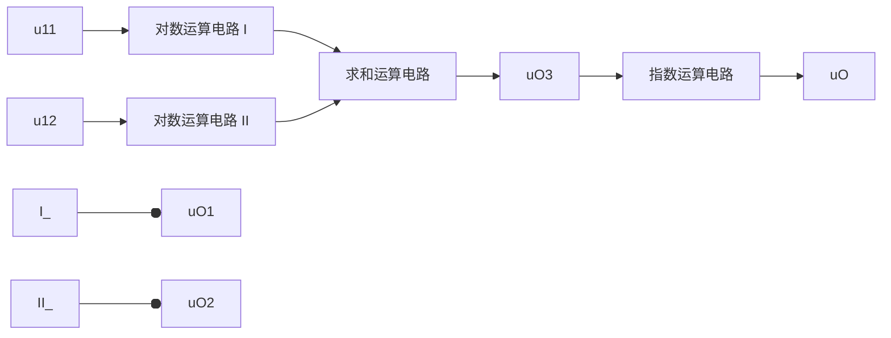
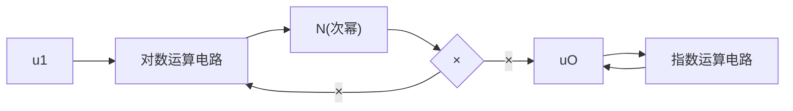
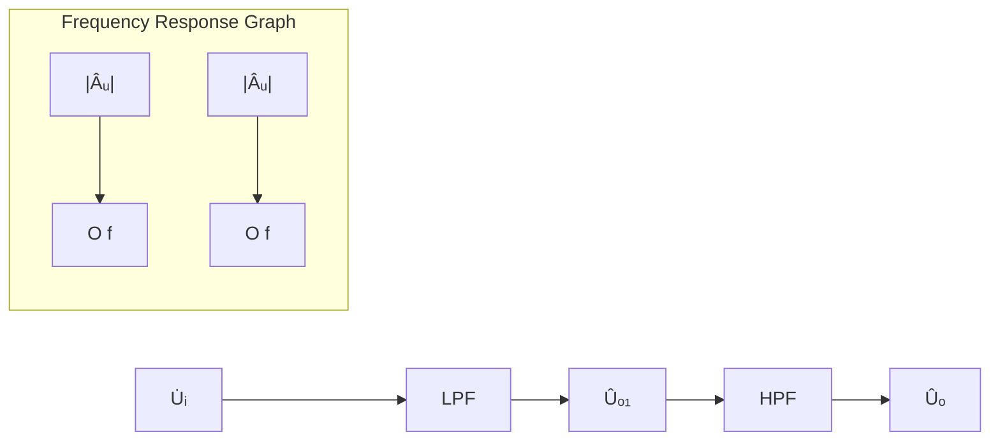
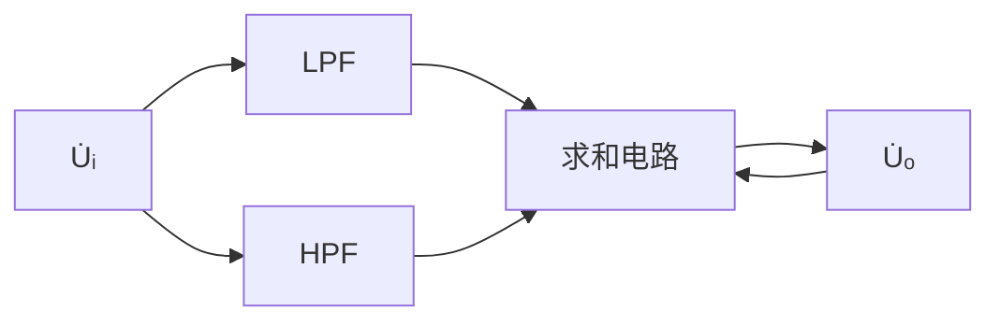

# 第6章 信号的运算和处理

原始 PDF 第 299–362 页。

## 第6章

## 信号的运算和处理

## 本章讨论的问题

- 什么情况下需要进行模拟信号的数学运算？
- 运算电路一定要引入负反馈吗？运算电路中集成运放必须工作在线性区吗？不是理想运放就不能构成运算电路吗？
- 如何判断电路是否是运算电路？怎样分析运算电路的运算关系？
- 为了获得信号中的直流分量,或者为了获得信号中的高频分量,或者为了传送某一频段的信号,或者为了去掉信号中电源所带来的50 Hz干扰,应采用什么电路?
- 为什么说有源滤波电路是信号处理电路？有几种滤波电路？它们分别有什么特点？应用在什么场合？有哪些主要性能指标？如何描述它们的特性？
- 由集成运放组成的有源滤波电路中一定要引入负反馈吗？能否引入正反馈？为什么？

## 6.1 基本运算电路

集成运放的基本应用之一是能构成各种运算电路，并因此而得名。在运算电路中，以输入电压作为自变量，以输出电压作为函数；当输入电压变化时，输出电压将按一定的数学规律变化，即输出电压反映输入电压某种运算的结果。运算电路首先应用在控制电路中，例如在自动控制系统中，常常需要其主要参数（如温度、压力、流量……）经传感器变为电信号放大后，再经一定数学运算（如比例、积分、微分……）的结果去驱动执行机构，才能获得最佳控制；另外，基本运算电路也是构成其它集成运放应用电路的基础电路。

本节将介绍比例、加减、积分、微分、对数、指数等基本运算电路。

## 6.1.1 概述

## 一、电路的组成

为了实现输出电压与输入电压的某种运算关系,运算电路中的集成运放应当工作在线性区,因而电路中必须引入负反馈;且为了稳定输出电压,故均引入电压负反馈。可见,运算电路的特征是从集成运放的输出端到其反相输入端存在反馈通路,如图5.4.5所示。

由于集成运放优良的指标参数,不管引入电压串联负反馈,还是引入电压并联负反馈,均为深度负反馈。因此电路是利用反馈网络和输入网络来实现各种数学运算的。

## 二、“虚短”和“虚断”是分析运算电路的基本出发点

通常,在分析运算电路时均设集成运放为理想运放,因而其两个输入端的净输入电压和净输入电流均为零,即具有“虚短路”和“虚断路”两个特点,这是分析运算电路输出电压与输入电压

---

6.1 基本运算电路

277

运算关系的基本出发点。

在运算电路中,无论输入电压,还是输出电压,均对“地”而言。

在求解运算关系式时,多采用节点电流法;对于多输入的电路,还可利用叠加原理。

## 6.1.2 比例运算电路

## 一、反相比例运算电路

## 1. 基本电路

反相比例运算电路如图6.1.1所示，与图5.4.6(b)所示电路相比可知，这是典型的电压并

联负反馈电路。输入电压 $u_{1}$ 通过电阻R作用于集成运放的反相输入端，故输出电压 $u_{0}$ 与 $u_{1}$ 反相。同相输入端通过电阻 $R'$ 接地， $R'$ 为补偿电阻，以保证集成运放输入级差分放大电路外接电阻的对称性；其值为 $u_{1}=0$ （将输入端接地）时反相输入端的总等效电阻，即各支路电阻的并联，因此 $R'=R//R_{f}$ 。电路中通过 $R_{f}$ 引入负反馈，故

$$
u _ {\mathrm{N}} = u _ {\mathrm{P}} = 0 \tag {6.1.1}
$$

text_image

iF
Rf
iN
u1 R iR N A uO
P iP + R'
R'

图 6.1.1 反相比例运算电路

为“虚地”；“虚”即“假”，表明电位为零，但又不真正接地。

$$
i _ {\mathrm{P}} = i _ {\mathrm{N}} = 0 \tag {6.1.2}
$$

节点 N 的电流方程为

$$
i _ {\mathrm{R}} = i _ {\mathrm{F}}
$$

$$
\frac {u _ {\mathrm{I}} - u _ {\mathrm{N}}}{R} = \frac {u _ {\mathrm{N}} - u _ {\mathrm{O}}}{R _ {\mathrm{f}}}
$$

由于 N 点为虚地, 整理得出

$$
u _ {0} = - \frac {R _ {\mathrm{f}}}{R} u _ {1} \tag {6.1.3}
$$

$u_{0}$ 与 $u_{1}$ 成比例关系，比例系数为 $-R_{f}/R$，负号表示 $u_{0}$ 与 $u_{1}$ 反相。比例系数的数值可以是大于、等于和小于1的任何值。

因为电路引入了深度电压负反馈,且  $1 + AF = \infty$ , 所以输出电阻  $R_{0} = 0$ , 电路带负载后运算关系不变。

因为从电路输入端和地之间看进去的等效电阻等于输入端和虚地之间看进去的等效电阻，所以电路的输入电阻

$$
R _ {\mathrm{i}} = R \tag {6.1.4}
$$

可见,尽管理想运放的输入电阻为无穷大,但是由于电路引入的是并联负反馈,反相比例运算电路的输入电阻却不大。

式(6.1.4)表明为了增大输入电阻,必须增大 $R_{0}$ 。例如,在比例系数为-50的情况下,若要求 $R_{i}=10\ k\Omega$ ,则R应取 $10\ k\Omega,R_{f}$ 应取 $500\ k\Omega$ ;若要求 $R_{i}=100\ k\Omega$ ,则R应取 $100\ k\Omega,R_{f}$ 应取 $5\ M\Omega$ 。实际上,当电路中电阻取值过大时,一方面由于工艺的原因,电阻的稳定性差且噪声大;

---

278

第6章 信号的运算和处理

另一方面，当阻值与集成运放的输入电阻等数量级时，式(6.1.3)所示比例系数会发生较大变化，其值将不仅决定于反馈网络，还与集成运放的参数有关。使用阻值较小的电阻，达到数值较大的比例系数，并且具有较大的输入电阻，是实际应用的需要。

在基本电路中，由于反馈电流与输入电流相等，所以使比例系数为 $-R_{f}/R$ 。可以想象，若 $i_{F}$ 远大于 $i_{1}$，则利用阻值不大的电阻就可以得到较大的输出电压，从而获得同样的比例系数。利用T形网络取代图6.1.1所示电路中的 $R_{f}$，可以达到上述目的。

## 2. T形网络反相比例运算电路

在图 6.1.2 所示电路中，电阻  $R_{2}$ 、 $R_{3}$  和  $R_{4}$  构成英文字母 T，故称为 T 形网络电路。

节点 N 的电流方程为

$$
\frac {u _ {1}}{R _ {1}} = \frac {- u _ {\mathrm{M}}}{R _ {2}}
$$

因而节点 M 的电位

$$
u _ {\mathrm{M}} = - \frac {R _ {2}}{R _ {1}} \cdot u _ {1}
$$

$R_{3}$  和  $R_{4}$  的电流分别为

text_image

R1
u1 → N
R2
i2
M
R3
i3
R4
i4
A
+
R5
uO

图 6.1.2 T 形网络反相比例运算电路

$$
i _ {3} = - \frac {u _ {\mathrm{M}}}{R _ {3}} = \frac {R _ {2}}{R _ {1} R _ {3}} u _ {1}
$$

$$
i _ {4} = i _ {2} + i _ {3}
$$

输出电压

$$
u _ {0} = - i _ {2} R _ {2} - i _ {4} R _ {4}
$$

将各电流表达式代入,整理可得

$$
u _ {0} = - \frac {R _ {2} + R _ {4}}{R _ {1}} \bigg (1 + \frac {R _ {2} / / R _ {4}}{R _ {3}} \bigg) u _ {1} \tag {6.1.5}
$$

上式表明当 $R_{3} = \infty$ 时，反馈电阻 $R_{\mathrm{f}} = R_{2} + R_{4}, u_{0}$ 与 $u_{1}$ 的关系如式(6.1.3)所示。T形网络电路的输入电阻 $R_{\mathrm{i}} = R_{1}$ 。若要求比例系数为-50且 $R_{\mathrm{i}} = 100\mathrm{k}\Omega$ ，则 $R_{1}$ 应取 $100\mathrm{k}\Omega$ ；如果 $R_{2}$ 和 $R_{4}$ 也取$100\mathrm{k}\Omega$ ，那么只要 $R_{3}$ 取 $2.08\mathrm{k}\Omega$ ，即可得到-50的比例系数。

因为  $R_{3}$  的引入使反馈系数减小, 所以为保证足够的反馈深度, 应选用开环增益更大的集成运放。

## 二、同相比例运算电路

将图 6.1.1 所示电路中的输入端和接地端互换, 就得到同相比例运算电路, 如图 6.1.3 所示。电路引入了电压串联负反馈, 故可以认为输入电阻为无穷大, 输出电阻为零。即使考虑集成运放参数的影响, 输入电阻也可达  $10^{9} \Omega$  以上。

根据“虚短”和“虚断”的概念,集成运放的净输入电压为零,即

$$
u _ {\mathrm{P}} = u _ {\mathrm{N}} = u _ {\mathrm{I}} \tag {6.1.6}
$$

说明集成运放有共模输入电压。

---

6.1 基本运算电路

279

净输入电流为零,因而  $i_{R}=i_{F}$ , 即

$$
\frac {u _ {\mathrm{N}} - 0}{R} = \frac {u _ {\mathrm{O}} - u _ {\mathrm{N}}}{R _ {\mathrm{f}}}
$$

$$
u _ {\mathrm{O}} = \left(1 + \frac {R _ {\mathrm{f}}}{R}\right) u _ {\mathrm{N}} = \left(1 + \frac {R _ {\mathrm{f}}}{R}\right) u _ {\mathrm{P}} \tag {6.1.7}
$$

将式(6.1.6)代入,得

$$
u _ {0} = \left(1 + \frac {R _ {\mathrm{f}}}{R}\right) u _ {\mathrm{I}} \tag {6.1.8}
$$

text_image

uF +
R
iF
uN
A
Rf
+
-
R'
uP
+
-
uI
+
-
uo

图 6.1.3 同相比例运算电路

上式表明  $u_{0}$  与  $u_{1}$  同相，且  $u_{0}$  大于  $u_{1}$ 。

应当指出,虽然同相比例运算电路具有高输入电阻、低输出电阻的优点,但因为集成运放有共模输入,所以为了提高运算精度,应当选用高共模抑制比的集成运放。从另一角度看,在对电路进行误差分析时,应特别注意共模信号的影响。

比例运算电路可作为反相或同相放大电路,其放大倍数非常稳定;且电路设计较分立元件电路要简单得多,只需选择几个电阻值即可。

## 三、电压跟随器

在同相比例运算电路中,若将输出电压的全部反馈到反相输入端,就构成图6.1.4所示的电压跟随器。电路引入了电压串联负反馈,且反馈系数为1。由于 $u_{0}=u_{N}=u_{P}$ ,故输出电压与输入电压的关系为

$$
u _ {0} = u _ {1} \tag {6.1.9}
$$

图 6.1.4 电压跟随器

理想运放的开环差模增益为无穷大,因而电压跟随器具有比射极输出器和源极输出器好得多的跟随特性。实用时,还可选择集成电压跟随器,它们在多方面具有更优良的性能。

综上所述,对于单一信号作用的运算电路,在分析运算关系时,应首先列出关键节点的电流方程,所谓关键节点是指那些与输入电压和输出电压产生关系的节点,如 N 点和 P 点;然后根据

“虚短”和“虚断”的原则,进行整理,即可得到输出电压和输入电压的运算关系。

【例 6.1.1】电路如图 6.1.5 所示, 已知  $R_{2} \gg R_{4}, R_{1} = R_{2}$ , 试问:

(1) $u_{0}$ 与 $u_{1}$ 的比例系数为多少?
(2) 若  $R_{4}$  开路, 则  $u_{0}$  与  $u_{1}$  的比例系数为多少?

解: 比较图 6.1.5 和图 6.1.2 所示的电路不难发现, 它们

text_image

R5
+
A
R1
i1
u1
-
R2
i2
R3
M
uO
R4

图 6.1.5 例 6.1.1 的电路图

---

280

第 6 章 信号的运算和处理

是完全相同的运算电路, 即 T 形网络反相比例运算电路。

(1) 由于  $u_{N}=u_{P}=0$  , 因而

$$
i _ {2} = i _ {1} = \frac {u _ {1}}{R _ {1}}
$$

M 点的电位

$$
u _ {\mathrm{M}} = - i _ {2} R _ {2} = - \frac {R _ {2}}{R _ {1}} u _ {1}
$$

由于 $R_{2} \gg R_{4}$, 可以认为

$$
u _ {\mathrm{O}} \approx \left(1 + \frac {R _ {3}}{R _ {4}}\right) u _ {\mathrm{M}}
$$

$$
u _ {0} \approx - \frac {R _ {2}}{R _ {1}} \bigg (1 + \frac {R _ {3}}{R _ {4}} \bigg) u _ {1}
$$

在上式中，由于 $R_{1} = R_{2}$ ，故 $u_{0}$ 与 $u_{1}$ 的关系式为

$$
u _ {0} \approx - \left(1 + \frac {R _ {3}}{R _ {4}}\right) u _ {1}
$$

所以，比例系数约为  $-(1 + R_{3}/R_{4})$ 。

(2) 若  $R_{4}$  开路, 则电路变为典型的反相比例运算电路, 根据式 (6.1.3),  $u_{0}$  与  $u_{1}$  的运算关系式为

$$
u _ {0} = - \frac {R _ {2} + R _ {3}}{R _ {1}} \cdot u _ {1}
$$

由于 $R_{1} = R_{2}$ ，故比例系数为 $-(1 + R_{3} / R_{1})$ 。

【例 6.1.2】电路如图 6.1.6 所示, 已知集成运放输出的最大幅值为  $\pm14\ V; u_{0} = -55u_{1}$ , 其余参数如图中所标注。回答下列问题:

(1) 求出  $R_{5}$  的值；
(2) 若  $u_{1}$  与地接反, 则输出电压与输入电压的关系将产生什么变化?
(3) 若  $u_{1}=10\ mV$ ，而  $u_{0}=-14\ V$ ，则电路可能出现了什么故障？

text_image

R1
10 kΩ
R2
100 kΩ
A1
+
uO1
R4
100 kΩ
R5
A2
+
uO

图6.1.6 例6.1.2的电路图

解: 在图 6.1.6 所示电路中,  $A_{1}$  构成同相比例运算电路,  $A_{2}$  构成反相比例运算电路。

(1) $u_{01}=\left(1+\frac{R_{2}}{R_{1}}\right)u_{1}=\left(1+\frac{100\ k\Omega}{10\ k\Omega}\right)u_{1}=11u_{1}$

$$
u _ {0} = - \frac {R _ {5}}{R _ {4}} u _ {0 1} = - \frac {R _ {5}}{1 0 0 \mathrm{k} \Omega} \times 1 1 u _ {1} = - 5 5 u _ {1}
$$

---

6.1 基本运算电路

281

得出  $R_{5}=500\ k\Omega$ 。

(2) 若  $u_{1}$  与地接反, 则第一级变为反相比例运算电路。因此,

$$
u _ {0 1} = - \frac {R _ {2}}{R _ {1}} \cdot u _ {1} = - \frac {1 0 0 \mathrm{k} \Omega}{1 0 \mathrm{k} \Omega} \cdot u _ {1} = - 1 0 u _ {1}
$$

由于第二级电路的比例系数仍为 -5，所以  $u_{0}=50u_{1}$ 。

在多级运算电路的分析中,因各级电路的输出电阻均为零,后级电路作为前级电路的负载不影响前级电路的运算关系,所以对每级电路的分析和单级电路完全相同。

（3）电路正常工作时，若 $u_{1} = 10\mathrm{mV}$ ，则 $u_0 = -550~\mathrm{mV}$ 。 $u_0 = -14\mathrm{V}$ 表明至少有一级电路的集成运放工作在开环状态，即反馈电阻 $R_{2}$ 或 $R_{5}$ 断开，或者二者均断开；当然，也可能至少有一级电路接成正反馈，即 $\mathrm{A}_{1}$ 或 $\mathrm{A}_{2}$ 的同相输入端和反相输入端接反，或者二者均接反。

实验中常常会出现故障,只有在理论的指导下才能迅速查出并排除故障。

## 6.1.3 加减运算电路

实现多个输入信号按各自不同的比例求和或求差的电路统称为加减运算电路。若所有输入信号均作用于集成运放的同一个输入端，则实现加法运算；若一部分输入信号作用于同相输入端，而另一部分输入信号作用于反相输入端，则实现加减法运算。

## 一、求和运算电路

## 1. 反相求和运算电路

反相求和运算电路的多个输入信号均作用于集成运放的反相输入端，如图6.1.7所示。根据“虚短”和“虚断”的原则， $u_{N}=u_{P}=0$ ，节点N的电流方程为

$$
i _ {1} + i _ {2} + i _ {3} = i _ {\mathrm{F}}
$$

$$
\frac {u _ {1 1}}{R _ {1}} + \frac {u _ {1 2}}{R _ {2}} + \frac {u _ {1 3}}{R _ {3}} = - \frac {u _ {0}}{R _ {\mathrm{f}}}
$$

所以 $u_{0}$ 的表达式为

$$
u _ {0} = - R _ {\mathrm{f}} \left(\frac {u _ {\mathrm{I1}}}{R _ {1}} + \frac {u _ {\mathrm{I2}}}{R _ {2}} + \frac {u _ {\mathrm{I3}}}{R _ {3}}\right) \tag {6.1.10}
$$

对于多输入的电路除了用上述节点电流法求解运算关系外,还可利用叠加原理,首先分别求出各输入电压单独作用时的输出电压,然后将它们相加,便得到所有信号共同作用时输出电压与输入电压的运算关系。

设  $u_{11}$  单独作用, 此时应将  $u_{12}$  和  $u_{13}$  接地, 如图 6.1.8 所示。由于电阻  $R_{2}$  和  $R_{3}$  的一端是“地”, 一端是“虚地”, 故它们的电流为零。因此, 电路实现的是反相比例运算

$$
u _ {\mathrm{01}} = - \frac {R _ {\mathrm{f}}}{R _ {\mathrm{1}}} u _ {\mathrm{11}}
$$

利用同样方法，分别求出 $u_{12}$ 和 $u_{13}$ 单独作用时的输出 $u_{02}$ 和 $u_{03}$，即

$$
u _ {\mathrm{O2}} = - \frac {R _ {\mathrm{f}}}{R _ {2}} u _ {\mathrm{I2}}, \quad u _ {\mathrm{O3}} = - \frac {R _ {\mathrm{f}}}{R _ {3}} u _ {\mathrm{I3}}
$$

text_image

R₁
u₁₁ → i₁
R₂
u₁₂ → i₂
R₃
u₁₃ → i₃
N
i_F
A
+
R₄=R₁//R₂//R₃//R_f
uₒ

图 6.1.7 反相求和运算电路

---

282

第6章 信号的运算和处理

当 $u_{11}, u_{12}$ 和 $u_{13}$ 同时作用时，有

$$
u _ {0} = u _ {0 1} + u _ {0 2} + u _ {0 3} = - \frac {R _ {\mathrm{f}}}{R _ {1}} u _ {\mathrm{I1}} - \frac {R _ {\mathrm{f}}}{R _ {2}} u _ {\mathrm{I2}} - \frac {R _ {\mathrm{f}}}{R _ {3}} u _ {\mathrm{I3}}
$$

与式(6.1.10)相同。

若  $R_{1}=5\ k\Omega, R_{2}=20\ k\Omega, R_{3}=50\ k\Omega, R_{f}=100\ k\Omega$ ，则  $u_{0}=-20u_{11}-5u_{12}-2u_{13}$ 。

从反相求和运算电路的分析可知,各信号源为运算电路提供的输入电流各不相同,表明从不同的输入端看进去的等效电阻不同,即输入电阻不同。

## 2. 同相求和运算电路

当多个输入信号同时作用于集成运放的同相输入端时,就构成同相求和运算电路,如图6.1.9所示。

text_image

R1
u11 → i1
R2
i2
R3
i3
N
iF
A
+
R4
Rf
uo

图 6.1.8 利用叠加原理求解运算关系

text_image

R
Rf
u11○─R1─●─P─A─●○
      i1─●─●─+   │
      R2─●─●─↓i4
      i2─●─●─R4
      u12○─R3─●─●─●─o
      i3─●─●─R4
      u13○─R3─●─●─o
      i3─●─●─o
      uO

图 6.1.9 同相求和运算电路

在同相比例运算电路的分析中,曾得到式(6.1.7)所示的结论。因此求出图6.1.9所示电路的 $u_{p}$ ,即可得到输出电压与输入电压的运算关系。

节点 P 的电路方程为

$$
i _ {1} + i _ {2} + i _ {3} = i _ {4}
$$

$$
\frac {u _ {\mathrm{II}} - u _ {\mathrm{P}}}{R _ {1}} + \frac {u _ {\mathrm{I2}} - u _ {\mathrm{P}}}{R _ {2}} + \frac {u _ {\mathrm{I3}} - u _ {\mathrm{P}}}{R _ {3}} = \frac {u _ {\mathrm{P}}}{R _ {4}}
$$

$$
\left(\frac {1}{R _ {1}} + \frac {1}{R _ {2}} + \frac {1}{R _ {3}} + \frac {1}{R _ {4}}\right) u _ {\mathrm{p}} = \frac {u _ {\mathrm{I1}}}{R _ {1}} + \frac {u _ {\mathrm{I2}}}{R _ {2}} + \frac {u _ {\mathrm{I3}}}{R _ {3}}
$$

所以同相输入端电位为

$$
u _ {\mathrm{P}} = R _ {\mathrm{P}} \left(\frac {u _ {\mathrm{I1}}}{R _ {1}} + \frac {u _ {\mathrm{I2}}}{R _ {2}} + \frac {u _ {\mathrm{I3}}}{R _ {3}}\right) \tag {6.1.11}
$$

式中， $R_{p}=R_{1}\parallel R_{2}\parallel R_{3}\parallel R_{4}$ 。

将式(6.1.11)代入式(6.1.7)，得出

$$
\begin{array}{l} u _ {0} = \left(1 + \frac {R _ {\mathrm{f}}}{R}\right) \cdot R _ {\mathrm{p}} \cdot \left(\frac {u _ {1 1}}{R _ {1}} + \frac {u _ {1 2}}{R _ {2}} + \frac {u _ {1 3}}{R _ {3}}\right) \\ = \frac {R + R _ {\mathrm{f}}}{R} \cdot \frac {R _ {\mathrm{f}}}{R _ {\mathrm{f}}} \cdot R _ {\mathrm{p}} \cdot \left(\frac {u _ {1 1}}{R _ {1}} + \frac {u _ {1 2}}{R _ {2}} + \frac {u _ {1 3}}{R _ {3}}\right) \\ \end{array}
$$

---

6.1 基本运算电路

283

$$
= R _ {\mathrm{f}} \cdot \frac {R _ {\mathrm{P}}}{R _ {\mathrm{N}}} \cdot \left(\frac {u _ {\mathrm{I1}}}{R _ {1}} + \frac {u _ {\mathrm{I2}}}{R _ {2}} + \frac {u _ {\mathrm{I3}}}{R _ {3}}\right) \tag {6.1.12}
$$

式中， $R_{N}=R\parallel R_{f}$ 。若 $R_{N}=R_{p}$ ，则

$$
u _ {\mathrm{O}} = R _ {\mathrm{f}} \left(\frac {u _ {\mathrm{I1}}}{R _ {\mathrm{I}}} + \frac {u _ {\mathrm{I2}}}{R _ {\mathrm{2}}} + \frac {u _ {\mathrm{I3}}}{R _ {\mathrm{3}}}\right) \tag {6.1.13}
$$

与式(6.1.10)相比,仅差符号。应当说明,只有在 $R_{N}=R_{P}$ 的条件下,式(6.1.13)才成立,否则应利用式(6.1.12)求解。若 $R\parallel R_{f}=R_{1}\parallel R_{2}\parallel R_{3}$ ,则可省去 $R_{4}$ 。

与反相求和运算电路相同,也可用叠加原理求解同相求和运算电路的  $u_{p}$ , 可得

$$
u _ {\mathrm{P}} = \frac {R _ {2} / / R _ {3} / / R _ {4}}{R _ {1} + R _ {2} / / R _ {3} / / R _ {4}} u _ {\mathrm{I1}} + \frac {R _ {1} / / R _ {3} / / R _ {4}}{R _ {2} + R _ {1} / / R _ {3} / / R _ {4}} u _ {\mathrm{I2}} + \frac {R _ {1} / / R _ {2} / / R _ {4}}{R _ {3} + R _ {1} / / R _ {2} / / R _ {4}} u _ {\mathrm{I3}}
$$

输出电压

$$
u _ {0} = \left(1 + \frac {R _ {\mathrm{f}}}{R}\right) \left(\frac {R _ {2} / / R _ {3} / / R _ {4}}{R _ {1} + R _ {2} / / R _ {3} / / R _ {4}} u _ {1 1} + \frac {R _ {1} / / R _ {3} / / R _ {4}}{R _ {2} + R _ {1} / / R _ {3} / / R _ {4}} u _ {1 2} + \frac {R _ {1} / / R _ {2} / / R _ {4}}{R _ {3} + R _ {1} / / R _ {2} / / R _ {4}} u _ {1 3}\right) \tag {6.1.14}
$$

虽然式中每一项的物理意义非常明确,但计算过程繁琐。

由以上分析可知,对于不同的运算电路,应选用不同的分析方法,以简化求解过程,并获得简洁的表达式。

## 二、加减运算电路

从对比例运算电路和求和运算电路的分析可知,输出电压与同相输入端信号电压极性相同,与反相输入端信号电压极性相反,因而如果多个信号同时作用于两个输入端时,那么必然可以实现加减运算。

图 6.1.10 所示为四个输入的加减运算电路, 表示反相输入端各信号作用和同相输入端各信号作用的电路分别如图 6.1.11(a) 和 (b) 所示。

text_image

u11○─R₁─●─●─Rf─●─o─uO
          │     │
u12○─R₂─●─●─A─●─o─uO
          │     │
u13○─R₃─●─●─+─o─uO
          │     │
u14○─R₄─●─●─R₅─●─o─uO

图 6.1.10 加减运算电路

text_image

u11○─R₁─●─Rf─┐
          │     │
u12○─R₂─●─A─●─uO1
          │     │
u13○─R₃─●─+ ──┐
          │     │
u14○─R₄─●─R₅─┘

(a)

text_image

u11
R1
Rf
u12
R2
-
A
u13
R3
+
u14
R4
R5
uO2

(b)

图 6.1.11 利用叠加原理求解加减运算电路

（a）反相输入端各信号作用时的等效电路 （b）同相输入端各信号作用时的等效电路

图 6.1.11(a) 所示电路为反相求和运算电路, 故输出电压为

$$
u _ {\mathrm{O1}} = - R _ {\mathrm{f}} \bigg (\frac {u _ {\mathrm{II}}}{R _ {1}} + \frac {u _ {\mathrm{I2}}}{R _ {2}} \bigg)
$$

---

284

第 6 章 信号的运算和处理

图 6.1.11(b) 所示电路为同相求和运算电路, 若  $R_{1} \parallel R_{2} \parallel R_{f} = R_{3} \parallel R_{4} \parallel R_{5}$ , 则输出电压为

$$
u _ {0 2} = R _ {\mathrm{f}} \bigg (\frac {u _ {1 3}}{R _ {3}} + \frac {u _ {1 4}}{R _ {4}} \bigg)
$$

因此,所有输入信号同时作用时的输出电压为

$$
u _ {0} = u _ {0 1} + u _ {0 2} = R _ {\mathrm{f}} \left(\frac {u _ {1 3}}{R _ {3}} + \frac {u _ {1 4}}{R _ {4}} - \frac {u _ {1 1}}{R _ {1}} - \frac {u _ {1 2}}{R _ {2}}\right) \tag {6.1.15}
$$

若电路只有两个输入,且参数对称,如图 6.1.12 所示,则

$$
u _ {0} = \frac {R _ {\mathrm{f}}}{R} (u _ {1 2} - u _ {1 1}) \tag {6.1.16}
$$

电路实现了对输入差模信号的比例运算。

使用单个集成运放构成加减运算电路存在两个缺点:一是电阻的选取和调整不方便；二是对于每个信号源的输入电阻均较小。因此，必要时可采用两级电路。例如，可用图6.1.13所示的电路实现差分比例运算。第一级电路为同相比例运算电路，因而

text_image

u11○─R─●─A─●─o uO
          │       │
          └───R        └───Rf
          │       │
          └───R        │
          │       │
          └───Rf
          │       │

图 6.1.12 差分比例运算电路

$$
u _ {\mathrm{01}} = \left(1 + \frac {R _ {\mathrm{fl}}}{R _ {\mathrm{l}}}\right) u _ {\mathrm{II}}
$$

利用叠加原理,第二级电路的输出为

$$
u _ {\mathrm{o}} = - \frac {R _ {\mathrm{f2}}}{R _ {3}} u _ {\mathrm{o1}} + \left(1 + \frac {R _ {\mathrm{f2}}}{R _ {3}}\right) u _ {\mathrm{t2}}
$$

若 $R_{1} = R_{\mathrm{f2}}, R_{3} = R_{\mathrm{f1}}$ ，则

$$
u _ {0} = \left(1 + \frac {R _ {\mathrm{f2}}}{R _ {3}}\right) (u _ {\mathrm{I2}} - u _ {\mathrm{II}}) \tag {6.1.17}
$$

text_image

Rf1
R1
u11
R2
A1
+
-
uo1
R3
R4
u12
Rf2
A2
+
-
uo

图 6.1.13 高输入电阻的差分比例运算电路

从电路的组成可以看出,无论对于  $u_{11}$  还是对于  $u_{12}$ ,均可认为输入电阻为无穷大。

【例 6.1.3】设计一个运算电路,要求输出电压和输入电压的运算关系式为  $u_{0}=10u_{11}-5u_{12}-4u_{13}$ 。

解:根据已知的运算关系式可知,当采用单个集成运放构成电路时, $u_{11}$ 应作用于同相输入端,而 $u_{12}$ 和 $u_{13}$ 应作用于反相输入端,如图6.1.14所示。

选取  $R_{f}=100\ k\Omega$ ，若  $R_{2}\parallel R_{3}\parallel R_{f}=R_{1}\parallel R_{4}$ ，则

---

6.1 基本运算电路

285

$$
u _ {\mathrm{o}} = R _ {\mathrm{f}} \bigg (\frac {u _ {\mathrm{I1}}}{R _ {1}} - \frac {u _ {\mathrm{I2}}}{R _ {2}} - \frac {u _ {\mathrm{I3}}}{R _ {3}} \bigg)
$$

因为  $R_{f}/R_{1}=10$ ，故  $R_{1}=10\ k\Omega$ ；因为  $R_{f}/R_{2}=5$ ，故  $R_{2}=20\ k\Omega$ ；因为  $R_{f}/R_{3}=4$ ，故  $R_{3}=25\ k\Omega$ 。

$$
\frac {1}{R _ {4}} = \frac {1}{R _ {2}} + \frac {1}{R _ {3}} + \frac {1}{R _ {\mathrm{f}}} - \frac {1}{R _ {1}} = \left(\frac {1}{2 0} + \frac {1}{2 5} + \frac {1}{1 0 0} - \frac {1}{1 0}\right) \mathrm{k} \Omega^ {- 1} \approx 0 \mathrm{k} \Omega^ {- 1}
$$

即  $R_{4}=\infty$ ，故可省去  $R_{4}$ 。所设计的电路如图 6.1.15 所示。

text_image

u13○─R3─●─●─Rf─┐
          │     │
u12○─R2─●─●─A─●─o─uO
          │     │
u11○─R1─●─●─+─R4─┘

图 6.1.14 例 6.1.3 的电路(一)

text_image

R₃
25 kΩ
R₂
20 kΩ
u₁₃○─R₃
          │
          │
          │
          │
          │
          │
          │
          │
          │
          │
          │
          │
          │
          │
          │
          │
          │
          │
          │
          │
          │
          │
          │
          │
          │
          │
          │
          │
          │
          │
          │
          │
          │
          │

R_f
100 kΩ

u₁₂○─R₂
          │
          │
          │
          │
          │
          │
          │
          │
          │
          │
          │
          │
          │
          │
          │
          │
          │
          │
          │
          A

u₁₁○─R₁
         │
          │
          │
          │
          │
          │
          │
          │
          │
          │
          │

uₒ○─A

图 6.1.15 例 6.1.3 的电路(二)

## 6.1.4 积分运算电路和微分运算电路

积分运算和微分运算互为逆运算。在自控系统中，常用积分电路和微分电路作为调节环节。此外，它们还被广泛应用于波形的产生和变换以及仪器仪表之中。以集成运放作为放大电路，利用电阻和电容作为反馈网络，可以实现这两种运算电路。

## 一、积分运算电路

在图 6.1.16 所示积分运算电路中,由于集成运放的同相输入端通过  $R'$  接地,  $u_{P} = u_{N} = 0$ , 为“虚地”。

电路中,电容 C 中的电流等于电阻 R 中的电流,即

$$
i _ {C} = i _ {R} = \frac {u _ {1}}{R}
$$

输出电压与电容上电压的关系为

$$
u _ {0} = - u _ {c}
$$

而电容上电压等于其电流的积分,故

$$
u _ {0} = - \frac {1}{C} \int i _ {c} \mathrm{d} t = - \frac {1}{R C} \int u _ {1} \mathrm{d} t \tag {6.1.18}
$$

text_image

Rf
C
iC
uI
iR
A
+
R'
uo

图 6.1.16 积分运算电路

求解 $t_1$ 到 $t_2$ 时间段的积分值，有

$$
u _ {0} = - \frac {1}{R C} \int_ {t _ {1}} ^ {t _ {2}} u _ {1} \mathrm{d} t + u _ {0} (t _ {1}) \tag {6.1.19}
$$

式中  $u_{0}(t_{1})$  为积分起始时刻的输出电压, 即积分运算的起始值, 积分的终值是  $t_{2}$  时刻的输出电压。

当  $u_{1}$  为常量时, 输出电压

---

286

第6章 信号的运算和处理

$$
u _ {0} = - \frac {1}{R C} u _ {1} (t _ {2} - t _ {1}) + u _ {0} (t _ {1}) \tag {6.1.20}
$$

当输入为阶跃信号时，若 $t_0$ 时刻电容上的电压为零，则输出电压波形如图6.1.17(a)所示。当输入为方波和正弦波时，输出电压波形分别如图(b)和(c)所示。可见，利用积分运算电路可以实现方波-三角波的波形变换和正弦-余弦的移相功能。

text_image

u₁
O
t
u₀
O
t

(a)

line

| Time (t) | u1 | u0 |
| --- | --- | --- |
| 0 | High | High |
| 1 | Low | 0 |
| 2 | High | High |
| 3 | Low | 0 |

(b)

(c)

图 6.1.17 积分运算电路在不同输入情况下的波形

(a) 输入为阶跃信号 (b) 输入为方波 (c) 输入为正弦波

在实用电路中,为了防止低频信号增益过大,常在电容上并联一个电阻加以限制,如图6.1.16中虚线所示。

## 二、微分运算电路

## 1. 基本微分运算电路

若将图 6.1.16 所示电路中电阻 R 和电容 C 的位置互换, 则得到基本微分运算电路, 如图 6.1.18 所示。

根据“虚短”和“虚断”的原则， $u_{P}=u_{N}=0$ ，为“虚地”，电容两端电压 $u_{C}=u_{I}$ 。因而

$$
i _ {R} = i _ {C} = C \frac {\mathrm{d} u _ {1}}{\mathrm{d} t}
$$

输出电压

$$
u _ {0} = - i _ {R} R = - R C \frac {\mathrm{d} u _ {\mathrm{I}}}{\mathrm{d} t} \tag {6.1.21}
$$

text_image

uI
C
iC
-
A
+
R'
R
iR
uO

图 6.1.18 基本微分运算电路

输出电压与输入电压的变化率成比例。

## 2. 实用微分运算电路

在图 6.1.18 所示电路中,无论是输入电压产生阶跃变化,还是脉冲式大幅值干扰,都会使得集成运放内部的放大管进入饱和或截止状态,以至于即使信号消失,管子还不能脱离原状态回到放大区,出现阻塞现象,电路不能正常工作;同时,由于反馈网络为滞后环节,它与集成运放内部的滞后环节相叠加,易于满足自激振荡的条件,从而使电路不稳定。

为了解决上述问题,可在输入端串联一个小阻值的电阻  $R_{1}$ , 以限制输入电流,也就限制了 R 中电流;在反馈电阻 R 上并联稳压二极管,以限制输出电压幅值,保证集成运放中的放大管始终

---

6.1 基本运算电路

287

工作在放大区，不至于出现阻塞现象；在 $R$ 上并联小容量电容 $C_1$ ，起相位补偿作用，提高电路的稳定性，如图6.1.19所示。该电路的输出电压与输入电压成近似微分关系。若输入电压为方波，且 $RC \ll \frac{T}{2}$ （$T$ 为方波的周期），则输出为尖顶波，如图6.1.20所示。

text_image

Dz1 Dz2
C1
R
R1 C
u1 - - A uO
+ R'
-

图 6.1.19 实用微分运算电路

line

| Time (t) | u1 | u0 |
| --- | --- | --- |
| 0 | High | Low |
| 1 | High | Low |
| 2 | Low | High |
| 3 | Low | Low |
| 4 | High | Low |
| 5 | High | High |
| 6 | Low | Low |

图 6.1.20 微分电路输入、输出波形分析

## 3. 逆函数型微分运算电路

若将积分运算电路作为负反馈回路，则可得到微分运算电路，如图6.1.21所示。若输入电

压 $u_{1}$ 假设正方向为“+”，则只有电阻 $R_{2}$ 的电流方向如图中所示，即 $u_{02}$ 极性为“-”，才说明电路引入的是负反馈；而因为 $u_{0}$ 为积分电路的输入，积分电路的输出电压与输入电压反相，故 $u_{0}$ 极性必须为“+”，即 $u_{0}$ 与 $u_{1}$ 极性相同；由此推出 $u_{1}$ 应加在 $\mathrm{A}_1$ 的同相输入端一边。因此，各部分电流与电压的极性如图6.1.21所示。

在图 6.1.21 所示电路中， $i_{R_{1}} = i_{R_{2}}$ ，即

$$
\frac {u _ {1}}{R _ {1}} = - \frac {u _ {0 2}}{R _ {2}}
$$

$$
u _ {0 2} = - \frac {R _ {2}}{R _ {1}} \cdot u _ {1}
$$

根据积分运算电路的运算关系可知

text_image

C
iC
uO2
-
A2
+
R3
iR3
R2
iR2
R1
uI
+
iR1
+
A1
-
R4
R5
+
uO

图 6.1.21 逆函数型微分运算电路

$$
u _ {0 2} = - \frac {1}{R _ {3} C} \int u _ {0} \mathrm{d} t
$$

因此

$$
- \frac {R _ {2}}{R _ {1}} u _ {1} = - \frac {1}{R _ {3} C} \int u _ {0} \mathrm{d} t
$$

从而得到输出电压的表达式为

$$
u _ {\mathrm{o}} = \frac {R _ {2} R _ {3} C}{R _ {1}} \cdot \frac {\mathrm{d} u _ {1}}{\mathrm{d} t} \tag {6.1.22}
$$

利用积分运算电路来实现微分运算的方法具有普遍意义。例如，若以乘法运算电路、乘方运算电路、对数运算电路分别作为集成运放的负反馈通路，则可分别实现除法运算、开方运算和指

---

288

第 6 章 信号的运算和处理

数运算。必须强调的是,只要是运算电路,就必须引入负反馈。

【例 6.1.4】电路如图 6.1.22 所示， $C_{1}=C_{2}=C$ ，试求出  $u_{0}$  与  $u_{1}$  的运算关系式。

解:根据“虚短”和“虚断”的原则,在节点 N 上,电流方程为

$$
\begin{array}{l} i _ {1} = i _ {c _ {1}} \\ - \frac {u _ {\mathrm{N}}}{R} = C \frac {\mathrm{d} (u _ {\mathrm{N}} - u _ {\mathrm{o}})}{\mathrm{d} t} = C \frac {\mathrm{d} u _ {\mathrm{N}}}{\mathrm{d} t} - C \frac {\mathrm{d} u _ {\mathrm{o}}}{\mathrm{d} t} \\ C \frac {\mathrm{d} u _ {\mathrm{o}}}{\mathrm{d} t} = C \frac {\mathrm{d} u _ {\mathrm{N}}}{\mathrm{d} t} + \frac {u _ {\mathrm{N}}}{R} \\ \end{array}
$$

在节点 P 上,电流方程为

$$
\begin{array}{l} i _ {2} = i _ {C _ {2}} \\ \frac {u _ {\mathrm{I}} - u _ {\mathrm{P}}}{R} = C \frac {\mathrm{d} u _ {\mathrm{P}}}{\mathrm{d} t} \\ \frac {u _ {\mathrm{I}}}{R} = C \frac {\mathrm{d} u _ {\mathrm{P}}}{\mathrm{d} t} + \frac {u _ {\mathrm{P}}}{R} \\ \end{array}
$$

因为 $u_{\mathrm{P}} = u_{\mathrm{N}}$ ，所以

$$
\begin{array}{l} C \frac {\mathrm{d} u _ {0}}{\mathrm{d} t} = \frac {u _ {1}}{R} \\ u _ {0} = \frac {1}{R C} \int u _ {1} \mathrm{d} t \\ \end{array}
$$

在  $t_{1} \sim t_{2}$  时间段中， $u_{0}$  的表达式为

$$
u _ {0} = \frac {1}{R C} \int_ {t _ {1}} ^ {t _ {2}} u _ {1} \mathrm{d} t + u _ {0} (t _ {1})
$$

电路实现了同相积分运算。

【例 6.1.5】在自动控制系统中,常采用如图 6.1.23 所示的 PID $^{①}$ 调节器,试分析输出电压与输入电压的运算关系式。

text_image

i₁ → R
R
u₁ ○─ R─ P─ A
i₂
i_C₁
C₁
C₂
i_C₂
uₒ

图 6.1.22 例 6.1.4 的电路图

text_image

C₁
i_C₁
R₂
C₂
i_F
u₁
R₁
i₁
N
A
P
R₃
uₒ

图 6.1.23 PID 调节器电路图

解:根据“虚短”和“虚断”的原则, $u_{P}=u_{N}=0$ ,为虚地。N点的电流方程为

$$
i _ {\mathrm{F}} = i _ {C _ {1}} + i _ {1}
$$

<small>① PID 是 Propotional Integral Differential 的缩写。</small>

---

6.1 基本运算电路

289

$$
i _ {c _ {1}} = C _ {1} \frac {\mathrm{d} u _ {\mathrm{I}}}{\mathrm{d} t}, \qquad i _ {1} = \frac {u _ {\mathrm{I}}}{R _ {1}}
$$

输出电压  $u_{0}$  等于  $R_{2}$  两端的电压  $u_{R_{2}}$  和  $C_{2}$  两端的电压  $u_{C_{2}}$  之和，而

$$
u _ {R _ {2}} = i _ {\mathrm{F}} R _ {2} = \frac {R _ {2}}{R _ {1}} u _ {1} + R _ {2} C _ {1} \frac {\mathrm{d} u _ {1}}{\mathrm{d} t}
$$

$$
\begin{array}{l} u _ {C _ {2}} = \frac {1}{C _ {2}} \int i _ {\mathrm{F}} \mathrm{d} t = \frac {1}{C _ {2}} \int \left(C _ {1} \frac {\mathrm{d} u _ {1}}{\mathrm{d} t} + \frac {u _ {1}}{R _ {1}}\right) \mathrm{d} t \\ = \frac {C _ {1}}{C _ {2}} u _ {1} + \frac {1}{R _ {1} C _ {2}} \int u _ {1} \mathrm{d} t \\ \end{array}
$$

所以

$$
u _ {0} = - \left(\frac {R _ {2}}{R _ {1}} + \frac {C _ {1}}{C _ {2}}\right) u _ {1} - R _ {2} C _ {1} \frac {\mathrm{d} u _ {1}}{\mathrm{d} t} - \frac {1}{R _ {1} C _ {2}} \int u _ {1} \mathrm{d} t
$$

因电路中含有比例、积分和微分运算,故称之为 PID 调节器。

当  $R_{2}=0$  时,电路只有比例和积分运算部分,称为 PI 调节器;当  $C_{2}=0$  时,电路只有比例和微分运算部分,称为 PD 调节器。根据控制中的不同需要,采用不同的调节器。

## 6.1.5 对数运算电路和指数运算电路

利用 PN 结伏安特性所具有的指数规律, 将二极管或者晶体管分别接入集成运放的反馈回路和输入回路, 可以实现对数运算和指数运算, 而利用对数运算、指数运算和加减运算电路相组合, 便可实现乘法、除法、乘方和开方等运算。

## 一、对数运算电路

## 1. 采用二极管的对数运算电路

图 6.1.24 所示为采用二极管的对数运算电路,为使二极管导通,输入电压  $u_{1}$  应大于零。根据半导体基础知识可知,二极管的正向电流与其端电压的

近似关系为

$$
i _ {\mathrm{D}} \approx I _ {\mathrm{S}} \mathrm{e} ^ {\frac {u _ {\mathrm{D}}}{U _ {\mathrm{T}}}}
$$

因而

$$
u _ {\mathrm{D}} \approx U _ {\mathrm{T}} \ln \frac {i _ {\mathrm{D}}}{I _ {\mathrm{S}}}
$$

由于  $u_{P}=u_{N}=0$ ，为虚地，因而

$$
i _ {\mathrm{D}} = i _ {R} = \frac {u _ {1}}{R}
$$

根据以上分析可得输出电压

$$
u _ {\mathrm{O}} = - u _ {\mathrm{D}} \approx - U _ {\mathrm{T}} \ln \frac {u _ {\mathrm{I}}}{I _ {\mathrm{S}} R} \tag {6.1.23}
$$

text_image

u₁
(u₁>0)
R
iᵣ
D
iₐ
A
+
R′
uₒ

图 6.1.24 采用二极管的对数运算电路

上式表明,运算关系与 $U_{T}$ 和 $I_{S}$ 有关,因而运算精度受温度的影响;而且,二极管在电流较小时内部载流子的复合运动不可忽略,在大电流较大时内阻不可忽略;所以,仅在一定的电流范围才满

---

290

第6章 信号的运算和处理

足指数特性。为了扩大输入电压的动态范围,实用电路中常用晶体管取代二极管。

## 2. 利用晶体管的对数运算电路

利用晶体管的对数运算电路如图 6.1.25 所示,由于集成运放的反相输入端为虚地,因此节点方程为

$$
i _ {\mathrm{C}} = i _ {R} = \frac {u _ {1}}{R}
$$

在忽略晶体管基区体电阻压降且认为晶体管的共基电路放大系数  $\alpha\approx1$  的情况下, 若  $u_{BE}\gg U_{T}$ , 则

$$
i _ {\mathrm{C}} = \alpha i _ {\mathrm{E}} \approx I _ {\mathrm{S}} \mathrm{e} ^ {\frac {u _ {\mathrm{BE}}}{U _ {\mathrm{T}}}}
$$

$$
u _ {\mathrm{BE}} = U _ {\mathrm{T}} \ln \frac {i _ {\mathrm{C}}}{I _ {\mathrm{S}}}
$$

text_image

(u₁>0) R i_R → A
+ R' i_C T u_O

图 6.1.25 利用晶体管的对数运算电路

输出电压

$$
u _ {\mathrm{O}} = - u _ {\mathrm{BE}} = - U _ {\mathrm{T}} \ln \frac {u _ {\mathrm{I}}}{I _ {\mathrm{S}} R}
$$

与式(6.1.23)相同。与二极管构成的对数运算电路一样,运算关系仍受温度的影响,而且在输入电压较小和较大的情况下,运算精度变差。

在设计实用的对数运算电路时,人们总要采用一定的措施来减小 $I_{s}$ 对运算关系的影响。

## 3. 集成对数运算电路

在集成对数运算电路中，根据差分电路的基本原理，利用特性相同的两只晶体管进行补偿，消去 $I_{s}$ 对运算关系的影响。型号为ICL8048的对数运算电路如图6.1.26所示，点画线框内为集成电路，框外为外接电阻。

电路分析的思路是: 欲知  $u_{0}$  需知  $u_{P2}$ ，而根据图中所标注的电压方向， $u_{P2} = u_{BE2} - u_{BE1}$ ；因为  $u_{BE2}$  与  $I_{R}$  成对数关系， $u_{BE1}$  与  $i_{1}$  成对数关系，而  $i_{1}$  与  $u_{1}$  成线性关系，故可求出  $u_{0}$  与  $u_{1}$  的运算关系。

text_image

i₁
u₁ R₃
R₄
N₁
A₁
+
-
T₁
R₁
T₂
P₂
U_REF R I_R
uₒ
A₂
N₂
R₂
R₅

图 6.1.26 集成对数运算电路

---

6.1 基本运算电路

291

节点  $N_{1}$  的电流方程为

$$
i _ {\mathrm{C1}} = i _ {\mathrm{I}} = \frac {u _ {\mathrm{I}}}{R _ {3}} \approx I _ {\mathrm{S}} \mathrm{e} ^ {\frac {u _ {\mathrm{BE1}}}{U _ {\mathrm{T}}}}
$$

因而 $u_{\mathrm{BE1}} \approx U_{\mathrm{T}} \ln \frac{u_{\mathrm{I}}}{I_{\mathrm{S}} R_{3}}$

节点  $P_{2}$  的电流方程为

$$
i _ {\mathrm{C2}} = I _ {R} \approx I _ {\mathrm{S}} \mathrm{e} ^ {\frac {u _ {\mathrm{BE2}}}{U _ {\mathrm{T}}}}
$$

因而 $u_{\mathrm{BE2}} \approx U_{\mathrm{T}} \ln \frac{I_R}{I_{\mathrm{S}}}$

$P_{2}$ 点的电位为

$$
u _ {\mathrm{P2}} = u _ {\mathrm{BE2}} - u _ {\mathrm{BE1}} \approx - U _ {\mathrm{T}} \ln \frac {u _ {\mathrm{I}}}{I _ {R} R _ {3}}
$$

$u_{\mathrm{P}} = u_{\mathrm{N}}$ ，因此输出电压

$$
u _ {0} \approx - \left(1 + \frac {R _ {2}}{R _ {5}}\right) U _ {\mathrm{T}} \ln \frac {u _ {1}}{I _ {R} R _ {3}} \tag {6.1.24}
$$

若外接电阻  $R_{5}$  为热敏电阻，则可补偿  $U_{T}$  的温度特性。 $R_{5}$  应具有正温度系数，当环境温度升高时， $R_{5}$  阻值增大，使得放大倍数  $(1 + R_{2}/R_{5})$  减小，以补偿  $U_{T}$  的增大，使  $u_{0}$  在  $u_{1}$  不变时基本不变。

## 二、指数运算电路

将图 6.1.25 所示对数运算电路中的电阻和晶体管互换,便可得到指数运算电路,如图 6.1.27 所示。

因为集成运放反相输入端为虚地,所以

$$
u _ {\mathrm{BE}} = u _ {\mathrm{I}}
$$

$$
i _ {R} = i _ {\mathrm{E}} \approx I _ {\mathrm{S}} \mathrm{e} ^ {\frac {u _ {\mathrm{I}}}{U _ {\mathrm{T}}}}
$$

输出电压

$$
u _ {0} = - i _ {R} R = - I _ {\mathrm{S}} \mathrm{e} ^ {\frac {u _ {\mathrm{I}}}{U / \mathrm{T}}} R \tag {6.1.25}
$$

为使晶体管导通, $u_{1}$ 应大于零,且只能在发射结导通电压范围内,故其变化范围很小。同时,从式(6.1.25)可以

看出，由于运算结果与受温度影响较大的 $I_{s}$ 有关，因而指数运算的精度也与温度有关。

在集成指数运算电路中,采用了类似集成对数运算电路的方法,利用两只双极型晶体管特性的对称性,消除 $I_{s}$ 对运算关系的影响;并且,采用热敏电阻补偿 $U_{T}$ 的变化;电路如图6.1.28所示。

对照图 6.1.26 所示集成对数运算电路的分析过程,读者可自行推出集成指数运算电路的运算关系式,这里不赘述。

text_image

iE
R
iR
uI
T
A
+
R'
uO

图 6.1.27 指数运算电路

---

292

第6章 信号的运算和处理

text_image

I_REF
u_1
R_1
T_1 T_2
E
R_2
A_1
P
+
-
u_O1
R_f
A_2
u_O

图 6.1.28 集成指数运算电路

## 6.1.6 利用对数和指数运算电路实现的乘法运算电路和除法运算电路

利用对数和指数运算电路实现的乘法运算电路的方框图如图 6.1.29 所示, 具体电路如图 6.1.30 所示。

flowchart

图 6.1.29 利用对数和指数运算电路实现的乘法运算电路的方框图

text_image

T1
R
u11
A1
+
-
uO1
R
R
R1
T2
u12
R
A2
+
-
uO2
R3
A3
+
-
uO3
T3
R
A4
+
-
uO
R4
R

图 6.1.30 乘法运算电路

在图 6.1.30 所示电路中, 有

$$
u _ {0 1} \approx - U _ {\mathrm{T}} \ln \frac {u _ {1 1}}{I _ {\mathrm{s}} R}
$$

$$
u _ {0 2} \approx - U _ {\mathrm{T}} \ln \frac {u _ {1 2}}{I _ {\mathrm{S}} R}
$$

---

6.1 基本运算电路

293

为了满足指数运算电路输入电压的幅值要求,求和运算电路的系数为1,故

$$
u _ {0 3} = - (u _ {0 1} + u _ {0 2}) \approx U _ {\mathrm{T}} \ln \frac {u _ {1 1} u _ {1 2}}{(I _ {\mathrm{S}} R) ^ {2}}
$$

$$
u _ {0} \approx - I _ {\mathrm{S}} R \mathrm{e} ^ {\frac {u _ {0 3}}{U _ {\mathrm{T}}}} \approx - \frac {u _ {1 1} u _ {1 2}}{I _ {\mathrm{S}} R} \tag {6.1.26}
$$

若将图 6.1.29 和图 6.1.30 所示电路中的求和运算电路换为求差(差分)运算电路, 则可实现除法运算电路。

## 6.1.7 集成运放性能指标对运算误差的影响

在上述各电路运算关系的分析中，均认为集成运放为理想运放。而实际上，当利用运放构成运算电路时，由于开环差模增益 $A_{od}$ 、差模输入电阻 $r_{id}$ 和共模抑制比 $K_{CMR}$ 为有限值，且输入失调电压 $U_{10}$ 、失调电流 $I_{10}$ 以及它们的温漂 $\frac{dU_{10}}{dT}$ 、 $\frac{dI_{10}}{dT}$ 均不为零，必然造成误差。

对于任何运算电路,若元器件参数理想情况下输出电压为  $u_{0}^{\prime}$ , 电路的实际输出电压为  $u_{0}$ , 则输出电压的绝对误差  $\Delta u_{0} = |u_{0}| - |u_{0}^{\prime}|$ , 而相对误差为

$$
\delta = \frac{\Delta u_0}{u_0'}\times 100\% \tag{6.1.27}
$$

本节仅对几种情况作一简要分析。

## 一、 $A_{od}$  和  $r_{id}$  为有限值时，对反相比例运算电路运算误差的影响

考虑  $A_{od}$  和  $r_{id}$  为有限值时，反相比例运算电路的等效电路如图 6.1.31 所示。由于  $r_{id} \gg R'$ ，可以认为

$$
u _ {\mathrm{N}} \approx - u _ {\mathrm{Id}} = - \frac {u _ {0}}{A _ {\mathrm{od}}} \tag {6.1.28}
$$

text_image

R
N
i₁
u₁
R
i_R
R_f
i_F
A_{od}u_{id}
+
-
P
u_{id}
R'
u_O

图 6.1.31  $A_{od}$  和  $r_{id}$  为有限值时反相比例运算电路的等效电路

节点 N 的电流方程为  $i_{R}=i_{F}+i_{1}$ ，即

$$
\frac {u _ {\mathrm{I}} - u _ {\mathrm{N}}}{R} = \frac {u _ {\mathrm{N}} - u _ {\mathrm{O}}}{R _ {\mathrm{f}}} + \frac {u _ {\mathrm{N}}}{r _ {\mathrm{id}} + R ^ {\prime}}
$$

将式(6.1.28)代入上式,并令 $R_{N}=R\parallel R_{f}\parallel(r_{id}+R')$ ,整理可得

---

294

第 6 章 信号的运算和处理

$$
u _ {\mathrm{O}} \approx - \frac {R _ {\mathrm{f}}}{R} \cdot \frac {A _ {\mathrm{od}} R _ {\mathrm{N}}}{R _ {\mathrm{f}} + A _ {\mathrm{od}} R _ {\mathrm{N}}} \cdot u _ {\mathrm{I}} \tag {6.1.29}
$$

理想运放时的输出电压

$$
u _ {0} ^ {\prime} = - \frac {R _ {\mathrm{f}}}{R} \cdot u _ {\mathrm{I}} \tag {6.1.30}
$$

故相对误差

$$
\delta \approx -\frac{R_{\mathrm{f}}}{R_{\mathrm{f}} + A_{\mathrm{od}}R_{\mathrm{N}}} \times 100\% \tag{6.1.31}
$$

若 $R = 10\mathrm{k}\Omega ,R_{\mathrm{f}} = 100\mathrm{k}\Omega ,R^{\prime} = R / / R_{\mathrm{f}},A_{\mathrm{od}} = 2\times 10^{5},r_{\mathrm{id}} = 2\mathrm{M}\Omega$ ，则 $\delta \approx -0.0055\%$ 。式(6.1.31)表明， $A_{\mathrm{od}}$ 和 $r_\mathrm{id}$ 愈大，相对误差的数值愈小。

## 二、 $A_{od}$  和  $K_{CMR}$  为有限值时，对同相比例运算电路运算误差的影响

因为同相比例运算电路在输入差模信号的同时伴随着共模信号输入，因此共模抑制比成为影响运算误差的重要因素。图6.1.32所示为 $A_{od}$ 和 $K_{CMR}$ 为有限值时同相比例运算电路的等效电路。由于 $r_{id}$ 为无穷大， $i_{1}=0$ ，故 $R^{\prime}$ 上电压为零， $u_{P}=u_{1}$ 。输出电压是差模信号和共模信号两部分作用的结果，其中

text_image

R
iR
N
i1
Rf
iF
AoduId
Acuc
+
-
+
uo
R'
P
u1
-

图 6.1.32 考虑  $A_{od}$  和  $K_{CMR}$  为有限值时同相比例运算电路的等效电路

$$
u _ {\mathrm{Id}} = u _ {\mathrm{P}} - u _ {\mathrm{N}}
$$

$$
u _ {\mathrm{1c}} = \frac {u _ {\mathrm{p}} + u _ {\mathrm{N}}}{2}
$$

输出电压的表达式为

$$
u _ {\mathrm{O}} = A _ {\mathrm{od}} (u _ {\mathrm{P}} - u _ {\mathrm{N}}) + A _ {\mathrm{c}} \cdot \frac {u _ {\mathrm{P}} + u _ {\mathrm{N}}}{2} \tag {6.1.32}
$$

因为  $u_{P}=u_{I}, u_{N}=\frac{R}{R+R_{f}}\cdot u_{O}=F u_{O}, A_{c}=\frac{A_{od}}{K_{CMR}}$ ，所以

$$
u _ {\mathrm{O}} = A _ {\mathrm{od}} u _ {\mathrm{I}} - A _ {\mathrm{od}} F u _ {\mathrm{O}} + \frac {A _ {\mathrm{od}}}{K _ {\mathrm{CMR}}} \cdot \frac {u _ {\mathrm{I}}}{2} + \frac {A _ {\mathrm{od}}}{K _ {\mathrm{CMR}}} \cdot \frac {F u _ {\mathrm{O}}}{2}
$$

整理可得

$$
u _ {\mathrm{O}} = \left(1 + \frac {R _ {\mathrm{f}}}{R}\right) \cdot \frac {1 + \frac {1}{K _ {\mathrm{CMR}}}}{1 + \frac {1}{A _ {\mathrm{od}} F}} \cdot u _ {\mathrm{I}} \tag {6.1.33}
$$

---

6.1 基本运算电路

295

理想运放情况下的输出电压

$$
u _ {0} ^ {\prime} = \left(1 + \frac {R _ {\mathrm{f}}}{R}\right) u _ {1} \tag {6.1.34}
$$

所以相对误差

$$
\delta = \left(\frac {1 + \frac {1}{K _ {\mathrm{CMR}}}}{1 + \frac {1}{A _ {\mathrm{od}} F}} - 1\right) \times 100\% \tag{6.1.35}
$$

若 $R = 10\mathrm{k}\Omega ,R_{\mathrm{f}} = 100\mathrm{k}\Omega ,R^{\prime} = R / / R_{\mathrm{f}},A_{\mathrm{od}} = 2\times 10^{5},K_{\mathrm{CMR}} = 10^{4}$ ，则 $\delta \approx 0.0045\%$ 。式(6.1.35)表明， $A_{\mathrm{od}}$ 和 $K_{\mathrm{CMR}}$ 愈大，相对误差的数值愈小。

## 三、失调参数对积分运算电路运算误差的影响

考虑集成运放失调电压  $U_{10}$  和失调电流  $I_{10}$  的影响, 积分运算电路在输入电压为零时的等效电路如图 6.1.33 所示, 此时输出电压仅决定于失调因素。

text_image

R
iR
N
iI
UIO
IIO
P
C
iC
uo

图 6.1.33 考虑  $U_{10}$  和  $I_{10}$  时，积分运算电路在输入电压为零时的等效电路

因为 $u_{\mathrm{p}} = 0\mathrm{V}$ ，集成运放的差模输入电阻为无穷大，电流源 $I_{10}$ 上的电压可忽略不计，所以$u_{\mathrm{N}} = U_{10}\circ \mathrm{N}$ 点的电流方程为

$$
\frac {U _ {\mathrm{10}}}{R} + I _ {\mathrm{10}} = i _ {c}
$$

输出电压

$$
u _ {0} = - \frac {1}{C} \int \left(\frac {U _ {1 0}}{R} + I _ {1 0}\right) \mathrm{d} t \tag {6.1.36}
$$

若仅考虑失调温漂,则输出电压的变化量

$$
\Delta u _ {0} = - \frac {1}{C} \int \left(\frac {\Delta U _ {1 0}}{R} + \Delta I _ {1 0}\right) \mathrm{d} t \tag {6.1.37}
$$

因为在理想运放情况下的输出电压为

$$
u _ {0} ^ {\prime} = - \frac {1}{C} \int \frac {u _ {1}}{R} \mathrm{d} t \tag {6.1.38}
$$

所以因失调温漂所引起的相对误差的数值为

$$
\left| \delta \right| = \left| \frac {\Delta u _ {0}}{u _ {0}} \right| = \left| \frac {\Delta U _ {1 0} + \Delta I _ {1 0} R}{u _ {1}} \right| \times 1 0 0
$$

---

296

第6章 信号的运算和处理

可见，失调温漂愈大，R愈大， $u_{1}$ 愈小，相对误差愈大。

应当指出,运算电路的运算误差不仅来源于集成运放非理想的指标参数,还取决于其它元器件的精度及电源电压的稳定性等。因此,为了提高运算精度,除了应选择高质量的集成运放外,还应合理选择其它元器件,提高电源电压的稳定性,减小环境温度的变化,抑制干扰和噪声,精心设计电路板等。

## 思考题

6.1.1 如何识别电路是否为运算电路？为什么两个运算电路在相互连接时可以不考虑前后级之间的影响？
6.1.2 如何分析运算电路输出电压与输入电压的运算关系式？
6.1.3 在图 6.1.7 所示电路中, 对各个信号源, 电路的输入电阻分别为多少?
6.1.4 设计一个电路,要求输出电压与输入电压的运算关系式为  $u_{0}=k_{1}u_{11}-k_{2}u_{12}, k_{1}, k_{2}$  为正数,且两个信号源  $u_{11}$  和  $u_{12}$  的输出电流均为零。
6.1.5 对于积分运算电路, 当输入一个幅值为  $\pm U_{1max}$  的方波时, 定性画出输出电压初始值为零和不为零两种情况下的波形, 并对它们进行比较。

## 6.2 模拟乘法器及其在运算电路中的应用

模拟乘法器是实现两个模拟量相乘的非线性电子器件,利用它可以方便地实现乘法、除法、乘方和开方运算电路。此外,由于它还能广泛地应用于广播电视、通信、仪表和自动控制系统之中,进行模拟信号的处理,所以发展很快,成为模拟集成电路的重要分支之一。

## 6.2.1 模拟乘法器简介

模拟乘法器有两个输入端,一个输出端,输入及输出均对“地”而言,如图6.2.1(a)所示。输入的两个模拟信号是互不相关的物理量,输出电压是它们的乘积,即

$$
u _ {0} = k u _ {\mathrm{X}} u _ {\mathrm{Y}} \tag {6.2.1}
$$

k 为乘积系数,也称为乘积增益或标尺因子,其值多为  $+0.1\ V^{-1}$  或  $-0.1\ V^{-1}$ 。

text_image

uₓ○─×─uₒ
uᵧ○─

(a)

text_image

ΔuX
+
-
ΔuY
-
ri2
ri1
ro
kΔuxΔuy
ΔuO
+

(b)

图 6.2.1 模拟乘法器的符号及其等效电路

(a) 符号 (b) 等效电路

模拟乘法器的等效电路如图(b)所示， $r_{i1}$  和  $r_{i2}$  分别为两个输入端的输入电阻， $r_{o}$  是输出电阻。理想模拟乘法器应具备如下条件:

(1) $r_{i1}$ 和 $r_{i2}$ 为无穷大；

---

6.2 模拟乘法器及其在运算电路中的应用

297

(2) $r_{0}$ 为零;
(3) k 值不随信号幅值和频率而产生变化；
（4）当  $u_{x}$  或  $u_{y}$  为零时  $u_{0}$  为零，电路没有失调电压、电流和噪声。

在上述条件下,无论  $u_{x}$  和  $u_{y}$  的波形、幅值、频率、极性如何变化,式(6.2.1)均成立。本节的分析均设模拟乘法器为理想器件。

输入信号 $u_{\mathrm{X}}$ 和 $u_{\mathrm{Y}}$ 的极性有四种可能的组合，在 $u_{\mathrm{X}}$ 和 $u_{\mathrm{Y}}$ 的坐标平面上，分为四个区域，即四个象限，如图6.2.2所示。按照允许输入信号的极性，模拟乘法器有单象限、两象限和四象限之分。

text_image

u_Y
II
(u_X<0,u_Y>0)
I
(u_X>0,u_Y>0)
O
u_X
III
(u_X<0,u_Y<0)
IV
(u_X>0,u_Y<0)

图 6.2.2 模拟乘法器输入信号的四个象限

## 6.2.2 变跨导型模拟乘法器的工作原理

实现模拟量相乘可有多种方案,但就集成电路而言,多采用变跨导型电路。变跨导型电路利用一路输入电压控制差分放大电路差分管的发射极电路,使之跨导作相应的变化,从而达到与另一路输入电压相乘的目的。

## 一、差分放大电路的差模传输特性

差分放大电路的差模传输特性是指在差模信号作用下,输出电压与输入电压的函数关系。

在图 6.2.3(a) 所示差分放大电路中， $u_{x}$  为差模输入电压，

$$
u _ {\mathrm{X}} = u _ {\mathrm{Id}} = u _ {\mathrm{BE1}} - u _ {\mathrm{BE2}} \tag {6.2.2}
$$

差分管的跨导

$$
g _ {\mathrm{m}} = \frac {I _ {\mathrm{EQ}}}{U _ {\mathrm{T}}} = \frac {I _ {0}}{2 U _ {\mathrm{T}}} \tag {6.2.3}
$$

恒流源电流

$$
\begin{array}{l} I _ {0} \approx i _ {\mathrm{E1}} + i _ {\mathrm{E2}} \\ = I _ {\mathrm{S}} \mathrm{e} ^ {\frac {u _ {\mathrm{BE1}}}{U _ {\mathrm{T}}}} + I _ {\mathrm{S}} \mathrm{e} ^ {\frac {u _ {\mathrm{BE2}}}{U _ {\mathrm{T}}}} \\ = I _ {\mathrm{S}} \mathrm{e} ^ {\frac {u _ {\mathrm{BE2}}}{U _ {\mathrm{T}}}} \left(1 + \mathrm{e} ^ {\frac {u _ {\mathrm{BE1}} - u _ {\mathrm{BE2}}}{U _ {\mathrm{T}}}}\right) \\ = i _ {\mathrm{E2}} \left(1 + \mathrm{e} ^ {\frac {u _ {\mathrm{BE1}} - u _ {\mathrm{BE2}}}{U _ {\mathrm{T}}}}\right) \\ \end{array}
$$

因此  $T_{2}$  管的发射极电流

$$
i _ {\mathrm{E2}} = \frac {I _ {0}}{1 + \mathrm{e} ^ {\frac {u _ {\mathrm{X}}}{U _ {\mathrm{T}}}}}
$$

同理,可得  $T_{1}$  管的发射极电流

$$
i _ {\mathrm{E1}} = \frac {I _ {0}}{1 + \mathrm{e} ^ {\frac {- u _ {\mathrm{X}}}{U _ {\mathrm{T}}}}}
$$

---

298

第6章 信号的运算和处理

text_image

+VCC
Rc
+
uo
-
Rc
T1
T2
uX
-
I0
-VEE

(a)

contour

| Point | uX/UT | uO |
| --- | --- | --- |
| Top | < 0 | I0Rc |
| Bottom | > 0 | -I0Rc |

(b)

图 6.2.3 差分放大电路及其差模传输特性

(a) 电路 (b) 差模传输特性

因此

$$
i _ {\mathrm{C1}} - i _ {\mathrm{C2}} \approx i _ {\mathrm{E1}} - i _ {\mathrm{E2}} = I _ {0} \mathrm{th} \frac {u _ {\mathrm{x}}}{2 U _ {\mathrm{T}}} \tag {6.2.4}
$$

当 $u_{\mathrm{X}} \ll 2U_{\mathrm{T}}$ （约为 $2 \times 26 \mathrm{mV}$）时，有

$$
i _ {\mathrm{C1}} - i _ {\mathrm{C2}} \approx I _ {0} \frac {u _ {\mathrm{X}}}{2 U _ {\mathrm{T}}} = g _ {\mathrm{m}} u _ {\mathrm{X}}
$$

输出电压

$$
u _ {\mathrm{0}} = - (i _ {\mathrm{C1}} - i _ {\mathrm{C2}}) R _ {\mathrm{c}} \approx - I _ {0} \frac {u _ {\mathrm{X}}}{U _ {\mathrm{T}}} \cdot R _ {\mathrm{c}} = - g _ {\mathrm{m}} R _ {\mathrm{c}} u _ {\mathrm{X}} \tag {6.2.5}
$$

因而电路的差模电压传输特性如图 6.2.3(b) 所示。

## 二、可控恒流源差分放大电路的乘法特性

在图 6.2.4 所示差分放大电路中，

$$
i _ {\mathrm{C3}} = I = \frac {u _ {\mathrm{Y}} - u _ {\mathrm{BE3}}}{R _ {\mathrm{e}}}
$$

代入式(6.2.5)可得

$$
u _ {\mathrm{0}} = - \frac {u _ {\mathrm{Y}} - u _ {\mathrm{BE3}}}{R _ {\mathrm{e}}} \cdot \frac {u _ {\mathrm{X}}}{2 U _ {\mathrm{T}}} \cdot R _ {\mathrm{c}} \tag {6.2.6}
$$

若 $u_{\mathrm{Y}} \gg u_{\mathrm{BE3}}$ ，则

$$
u _ {\mathrm{O}} \approx - \frac {R _ {\mathrm{c}}}{2 U _ {\mathrm{T}} R _ {\mathrm{e}}} \cdot u _ {\mathrm{X}} u _ {\mathrm{Y}} = k u _ {\mathrm{X}} u _ {\mathrm{Y}} \tag {6.2.7}
$$

式中  $u_{x}$  可正可负，但  $u_{y}$  必须大于零，故图 6.2.4 所示为两象限模拟乘法器。电路有如下明显的缺点:

(1) 式(6.2.6)表明, $u_{Y}$ 的值越小,运算误差越大;
(2) 式(6.2.7)表明, $u_{0}$ 与 $U_{T}$ 有关, 即 k 与温度有关;
(3) 电路只能工作在两象限。

## 三、四象限变跨导型模拟乘法器

图 6.2.5 所示为双平衡四象限变跨导型模拟乘法器。通过对图 6.2.3 所示电路的分析, 得到的式 (6.2.4) 适用于图 6.2.5 所示电路, 因而

text_image

+VCC
Rc
+
uo
-
Rc
T1
T2
ux
-
T3
Re
uY
-

图 6.2.4 两象限模拟乘法器

---

6.2 模拟乘法器及其在运算电路中的应用

299

$$
i _ {1} - i _ {2} \approx i _ {5} \mathrm{th} \frac {u _ {\mathrm{x}}}{2 U _ {\mathrm{T}}} \tag {6.2.8}
$$

$$
i _ {4} - i _ {3} \approx i _ {6} \mathrm{th} \frac {u _ {\mathrm{X}}}{2 U _ {\mathrm{T}}} \tag {6.2.9}
$$

$$
i _ {5} - i _ {6} \approx I \mathrm{th} \frac {u _ {\mathrm{Y}}}{2 U _ {\mathrm{T}}} \tag {6.2.10}
$$

$$
i _ {0 1} - i _ {0 2} = (i _ {1} + i _ {3}) - (i _ {4} + i _ {2}) = (i _ {1} - i _ {2}) - (i _ {4} - i _ {3})
$$

将式(6.2.8)、(6.2.9)、(6.2.10)代入上式,得

$$
i _ {0 1} - i _ {0 2} \approx (i _ {5} - i _ {6}) \mathrm{th} \frac {u _ {\mathrm{X}}}{2 U _ {\mathrm{T}}} \approx I \bigg (\mathrm{th} \frac {u _ {\mathrm{Y}}}{2 U _ {\mathrm{T}}} \bigg) \bigg (\mathrm{th} \frac {u _ {\mathrm{X}}}{2 U _ {\mathrm{T}}} \bigg)
$$

当 $u_{\mathrm{X}} \ll 2U_{\mathrm{T}}$ ，且 $u_{\mathrm{Y}} \ll 2U_{\mathrm{T}}$ 时，

$$
i _ {\mathrm{O1}} - i _ {\mathrm{O2}} \approx \frac {I}{4 U _ {\mathrm{T}} ^ {2}} \cdot u _ {\mathrm{X}} u _ {\mathrm{Y}}
$$

所以,输出电压

$$
u _ {\mathrm{0}} = - (i _ {0 1} - i _ {0 2}) R _ {\mathrm{c}} \approx - \frac {I}{4 U _ {\mathrm{T}} ^ {2}} u _ {\mathrm{X}} u _ {\mathrm{Y}} = k u _ {\mathrm{X}} u _ {\mathrm{Y}} \tag {6.2.11}
$$

由于  $u_{x}$  和  $u_{y}$  均可正可负，故图 6.2.5 所示电路为四象限模拟乘法器。它是双端输出形式，可利用图 6.2.6 所示的集成运算电路，将其转换成单端输出形式。

text_image

+VCC
Rc
iO1
iO2
Rc
+
uO
-
i1
i2
i3
i4
T1 T2
T3 T4
+ uX
-
i5
T5
i6
T6
+ uY
-
I

图 6.2.5 双平衡四象限变跨导型模拟乘法器

text_image

+ R
uO - R
- R
A
+ R
R
uO'

图 6.2.6 双端输入、单端输出电路

## 四、模拟乘法器的性能指标

与集成运放一样,为了衡量模拟乘法器的性能好坏,特别设定一些指标参数。表 6.2.1 中列出了主要参数及其典型数值。

表 6.2.1 模拟乘法器的主要参数

| 参数名称 | 单位 | 典型值 | 测试条件 |
| --- | --- | --- | --- |
| 输入失调电流$I_{IO}$ | $\mu A$ | 0.2 | $u_{X}=u_{Y}=0$ V |
| 输入偏置电流$I_{B}$ | $\mu A$ | 2.0 | $u_{X}=u_{Y}=0$ V |

---

300

第6章 信号的运算和处理

续表

| 参数名称 | 单位 | 典型值 | 测试条件 |
| --- | --- | --- | --- |
| 输出不平衡电流$I_{\text{oo}}$ | μA | 20 | $u_{\text{x}} = u_{\text{y}} = 0 \text{ V}$ |
| 输出精度$\varepsilon_{\text{Rx}} \varepsilon_{\text{Ry}}$ | % | 1~2 | $u_{\text{x}} = 10 \text{ V}, u_{\text{y}} = \pm 10 \text{ V}$和$u_{\text{y}} = 10 \text{ V}, u_{\text{x}} = \pm 10 \text{ V}$ |
| -3 dB增益带宽$f_{\text{bw}}$ | MHz | 3.0 | 满刻度位置 |
| 满功率响应$f_{\text{p}}$ | kHz | 700 | 满刻度位置 |
| 上升速度SR | V/μs | 45 | 满刻度位置 |
| 输入电阻$r_{\text{i}}$ | MΩ | 35 |  |

此外，还有共模输入电压范围、共模增益、输出电阻和矢量误差等。

## 6.2.3 模拟乘法器在运算电路中的应用

模拟乘法器除了自身能够实现两个模拟信号的乘法和平方运算外,还可以和其它电路相配合构成除法、开方、均方根等运算电路。

## 一、乘方运算电路

利用四象限模拟乘法器能够实现四象限平方运算电路,如图 6.2.7 所示。

输出电压

$$
u _ {0} = k u _ {1} ^ {2} \tag {6.2.12}
$$

当  $u_{1}$  为正弦波  $U_{i}$ ，且  $u_{1}=\sqrt{2}U_{i}\sin\omega t$  时，则

$$
u _ {0} = U _ {\mathrm{o}} = 2 k U _ {\mathrm{i}} ^ {2} \sin^ {2} \omega t = k U _ {\mathrm{i}} ^ {2} (1 - \cos 2 \omega t) \tag {6.2.13}
$$

text_image

u₁
×
u₀=ku₁²

图 6.2.7 平方运算电路

输出为输入的二倍频电压信号,为了得到纯交流电压,可在输出端加耦合电容,以隔离直流电压。

从理论上讲,可以用多个模拟乘法器串联组成  $u_{1}$  的任意次方的运算电路,图 6.2.8(a) 和 (b) 所示分别为 3 次方和 4 次方运算电路。它们的表达式分别为

$$
u _ {0 1} = k ^ {2} u _ {1} ^ {3}
$$

$$
u _ {\mathrm{O2}} = k ^ {2} u _ {\mathrm{I}} ^ {4}
$$

text_image

u₁
×
×
u₀₁

(a)

text_image

u₁
×
×
uₒ₂

(b)

图 6.2.8 3 次方和 4 次方运算电路

(a) 3 次方运算电路 (b) 4 次方运算电路

但是,实际上,当串联的模拟乘法器超过3个时,运算误差的积累就使得电路的精度变得很差,在要求较高时将不适用。因此,在实现高次幂的乘方运算时,可以考虑采用模拟乘法器与集成对数运算电路和指数运算电路组合而成,如图6.2.9所示。

---

6.2 模拟乘法器及其在运算电路中的应用

301

flowchart

图 6.2.9 N 次幂运算电路

对数运算电路的输出电压

$$
u _ {\mathrm{O1}} = k _ {1} \ln u _ {1}
$$

模拟乘法器的输出电压

$$
u _ {0 2} = k _ {1} k _ {2} N \ln u _ {1}
$$

$k_{2}$ 为乘积系数。输出电压

$$
u _ {0} = k _ {3} u _ {1} ^ {k _ {1} k _ {2} N} = k _ {3} u _ {1} ^ {k N} \tag {6.2.14}
$$

设  $k_{1}=10, k_{2}=0.1\ V^{-1}$ ，则当 N>1 时，电路实现乘方运算。若 N=2，则电路为平方运算电路；若 N=10，则电路为 10 次幂运算电路。

## 二、除法运算电路

利用反函数型运算电路的基本原理,将模拟乘法器置于集成运放的负反馈通路中,便可构成

除法运算电路,如图6.2.10所示。与只用集成运放组成的运算电路一样,在用模拟乘法器和集成运放共同构成运算电路时,也必须引入负反馈,据此可确定二者的连接方法。

对于图6.2.10所示电路，必须保证 $i_{1}=i_{2}$ ，电路引入的才是负反馈。即当 $u_{11}>0\ V$ 时， $u_{0}^{\prime}<0\ V$ ；而 $u_{11}<0\ V$ 时， $u_{0}^{\prime}>0\ V$ 。由于 $u_{0}$ 与 $u_{11}$ 反相，故要求 $u_{0}^{\prime}$ 与 $u_{0}$ 同符号。因此，当模拟乘法器的k小于零时， $u_{12}$ 应小于零；而k大于零时， $u_{12}$ 应大于零；即 $u_{12}$ 与k同符号。同理，若模拟乘法器的输出端通过电阻接集成运放的同相输入端，则为保证电路引入的是负反馈， $u_{12}$ 与k的符号应当相反。

text_image

u'₀
R₂
i₂
u₁₁
R₁
i₁
A
R₃
u₁₂
u₀

图 6.2.10 除法运算电路

在图6.2.10所示电路中，设集成运放为理想运放，则 $u_{\mathrm{N}} = u_{\mathrm{P}} = 0$，为虚地， $i_1 = i_2$，即

$$
\frac {u _ {\mathrm{II}}}{R _ {1}} = - \frac {u _ {\mathrm{O}} ^ {\prime}}{R _ {2}} = - \frac {k u _ {\mathrm{I2}} u _ {\mathrm{O}}}{R _ {2}}
$$

整理上式,得出输出电压

$$
u _ {0} = - \frac {R _ {2}}{k R _ {1}} \cdot \frac {u _ {1 1}}{u _ {1 2}} \tag {6.2.15}
$$

由于  $u_{12}$  的极性受 k 的限制, 故图 6.2.10 所示电路为两象限除法运算电路。对于一个确定的除法运算电路, 模拟乘法器 k 的极性是唯一的, 故  $u_{12}$  的极性是唯一的, 其运算关系式也是唯一的; 换言之, 若 k 或  $u_{12}$  的极性变化, 则电路的接法应遵循引入负反馈的原则产生相应的变化。

## 三、开方运算电路

利用乘方运算电路作为集成运放的负反馈通路，就可构成开方运算电路。在除法运算电路中，令 $u_{12}=u_{0}$ ，就构成平方根运算电路，如图6.2.11所示。

---

302

第 6 章 信号的运算和处理

若电路引入的是负反馈，则 $u_{\mathrm{N}} = u_{\mathrm{P}} = 0$，为虚地，$i_1 = i_2$，即

$$
\frac {- u _ {1}}{R _ {1}} = \frac {u _ {0} ^ {\prime}}{R _ {2}}
$$

$$
u _ {0} ^ {\prime} = - \frac {R _ {2}}{R _ {1}} \cdot u _ {1} = k u _ {0} ^ {2} \tag {6.2.16}
$$

故

$$
\mid u _ {0} \mid = \sqrt {- \frac {R _ {2} u _ {1}}{k R _ {1}}} \tag {6.2.17}
$$

为了使根号下为正数， $u_{1}$ 与k必须符号相反。因此，由于 $u_{0}$ 与 $u_{1}$ 极性相反，故当 $u_{1}>0, k<0$ 时，运算关系式应为

text_image

u'O
R2
i2
R1
u1
i1
A
+
R3
uO

图 6.2.11 平方根运算电路

$$
u _ {0} = - \sqrt {- \frac {R _ {2} u _ {1}}{k R _ {1}}} \tag {6.2.18}
$$

当  $u_{1}<0, k>0$  时, 运算关系式应为

$$
u _ {0} = \sqrt {- \frac {R _ {2} u _ {1}}{k R _ {1}}} \tag {6.2.19}
$$

与除法运算电路相同,因为当模拟乘法器选定后 k 的极性就唯一地被确定,因此实际电路的运算关系式只可能是式(6.2.18)和式(6.2.19)中的一个。

在图 6.2.11 中, 若  $u_{1}<0, k>0$ , 则图中所标注的电流方向是在上述条件下电阻中电流的实际方向。如果因某种原因使  $u_{1}$  大于零, 则必然导致  $u_{0}^{\prime}$  大于零, 从而使反馈极性变正, 最终使集成运放电路内部的晶体管工作到截止区或饱和区, 输出电压接近电源电压, 以至于即使  $u_{1}$  变得小于零, 集成运放也不能回到线性区, 电路不能恢复正常工作, 运放出现闭锁或称为锁定现象。为了防止闭锁现象的出现, 实用电路中常在输出回路串联一个二极管, 如图 6.2.12 所示。

按照平方根运算电路的组成思路,将3次方电路作为集成运放的负反馈通路,就可实现立方根运算电路,如图6.2.13所示。图中,

$$
u _ {\mathrm{0}} ^ {\prime} = k ^ {2} u _ {\mathrm{0}} ^ {3}
$$

text_image

R₁
R₂
×
u₁
A
+
R₃
D
uₒ
Rₗ
1 MΩ

图 6.2.12 防止闭锁现象的平方根电路

text_image

u₁ → R₁
i₁ → R₂
R₃
A
+
-
u'₀
×
×
u₀

图 6.2.13 立方根运算电路

由于 $k^2$ 大于零，且 $u_0^3$ 与 $u_{1}$ 反相，所以不管 $k$ 值为正还是为负，电路均引入了负反馈。电路中$u_{\mathrm{N}} = u_{\mathrm{P}} = 0$ ，为虚地， $i_1 = i_2$ ，即

$$
\frac {u _ {1}}{R _ {1}} = - \frac {u _ {0} ^ {\prime}}{R _ {2}}
$$

---

6.3 有源滤波电路

303

$$
u _ {0} ^ {\prime} = - \frac {R _ {2}}{R _ {1}} \cdot u _ {1} = k ^ {2} u _ {0} ^ {3}
$$

整理可得

$$
u _ {0} = \sqrt [ 3 ]{- \frac {R _ {2}}{k ^ {2} R _ {1}} \cdot u _ {1}} \tag {6.2.20}
$$

与乘方运算电路相类似，当多个模拟乘法器串联实现高次根的运算时，将产生较大的误差。因此，为了提高精度，也可采用如图6.2.9所示电路。从式(6.2.14)可以看出，若 $k_{1}=10,k_{2}=0.1\ V^{-1}$ ，则k=1；故N<1时，电路为开方运算电路。当N=0.1时， $u_{0}=k_{3}\sqrt[10]{u_{1}}$ ；当N=0.5时， $u_{0}=k_{3}\sqrt{u_{1}}$ 。

【例6.2.1】运算电路如图6.2.14所示。已知模拟乘法器的运算关系式为 $u_{0}^{\prime} = ku_{X}u_{Y} = -0.1\mathrm{V}^{-1}u_{X}u_{Y}$ 。

(1) 电路对  $u_{13}$  的极性是否有要求, 简述理由;
(2) 求解电路的运算关系式。

解:(1) 只有电路中引入负反馈,才能实现运算。而只有  $u_{11}$  与  $u_{0}^{\prime}$  符号相反,电路引入的才是负反馈;已知  $u_{0}$  与  $u_{11}$  反相,故  $u_{0}^{\prime}$  应与  $u_{0}$  同符号。因为 k<0,所以  $u_{13}$  应小于零。

(2) P 点电位

$$
u _ {\mathrm{p}} = \frac {R _ {2}}{R _ {1} + R _ {2}} \cdot u _ {\mathrm{I2}} = u _ {\mathrm{N}}
$$

text_image

u'o
R2 100 kΩ
u11 R1 N - A
10 kΩ P +
u12 R1 R2 uO

图 6.2.14 例 6.2.1 电路图

N 点的电流方程为

$$
\frac {u _ {\mathrm{II}} - u _ {\mathrm{N}}}{R _ {1}} = \frac {u _ {\mathrm{N}} - u _ {\mathrm{O}} ^ {\prime}}{R _ {2}}
$$

将 $u_{\mathrm{N}}$ 的表达式代入上式，整理得出

$$
u _ {0} ^ {\prime} = \frac {R _ {2}}{R _ {1}} (u _ {1 2} - u _ {1 1}) = k u _ {0} u _ {1 3}
$$

所以输出电压

$$
u _ {0} = \frac {R _ {2}}{k R _ {1}} \cdot \frac {u _ {1 2} - u _ {1 1}}{u _ {1 3}} = \frac {1 0 0}{0 . 1 \times 1 0} \cdot \frac {u _ {1 1} - u _ {1 2}}{u _ {1 3}} = 1 0 0 \cdot \frac {u _ {1 1} - u _ {1 2}}{u _ {1 3}}
$$

## 思考题

6.2.1 为了得到正弦波电压的二倍频纯交流信号,应采用什么电路?画出图来。
6.2.2 试说明利用逆运算即逆函数型方法组成运算电路的原则。
6.2.3 试利用模拟乘法器和集成运放实现除法运算电路，画出模拟乘法器的乘积系数不同极性和输入信号不同极性各种组合情况下电路的构成。

## 6.3 有源滤波电路

对于信号的频率具有选择性的电路称为滤波电路,它的功能是使特定频率范围内的信号通

---

304

第 6 章 信号的运算和处理

过，而阻止其它频率信号通过。有源滤波电路是应用广泛的信号处理电路。

## 6.3.1 滤波电路的基础知识

## 一、滤波电路的种类

通常,按照滤波电路的工作频带为其命名,分为低通滤波器( $LPF^{①}$ )、高通滤波器( $HPF^{②}$ )、带通滤波器( $BPF^{③}$ )、带阻滤波器( $BEF^{④}$ )和全通滤波器( $APF^{⑤}$ )。

设截止频率为 $f_{p}$ ，频率低于 $f_{p}$ 的信号能够通过，高于 $f_{p}$ 的信号被衰减的滤波电路称为低通滤波器；反之，频率高于 $f_{p}$ 的信号能够通过，而频率低于 $f_{p}$ 的信号被衰减的滤波电路称为高通滤波器。前者可以作为直流电源整流后的滤波电路，以便得到平滑的直流电压；后者可以作为交流放大电路的耦合电路，隔离直流成分，通过放大频率高于 $f_{p}$ 的信号。实际上，常利用它们分别在难于分辨的电压中提取出有用的低频或高频信号。

设低频段的截止频率为 $f_{p1}$ ，高频段的截止频率为 $f_{p2}$ ，频率为 $f_{p1}$ 到 $f_{p2}$ 之间的信号能够通过，低于 $f_{p1}$ 或高于 $f_{p2}$ 的信号被衰减的滤波电路称为带通滤波器；反之，频率低于 $f_{p1}$ 和高于 $f_{p2}$ 的信号能够通过，而频率在 $f_{p1}$ 到 $f_{p2}$ 之间的信号被衰减的滤波电路称为带阻滤波器。前者常用于载波通信或弱信号提取等场合，以提高信噪比；后者常用于在已知干扰或噪声频率的情况下，阻止其通过。

全通滤波器对于频率从零到无穷大的信号具有同样的比例系数,但对于不同频率的信号将产生不同的相移,可根据相移来检测信号的频率。

理想滤波电路的幅频特性如图 6.3.1 所示。允许通过的频段称为通带，将信号衰减到零的频段称为阻带。

area

| Region | Frequency Range |
| --- | --- |
| 通带 | 0 ~ fp |
| 阻带 | fp ~ >fp |

(a)

text_image

|Ȧu|
|Ȧup|
阻带
通带
O
fp
f

(b)

text_image

|Ȧu|
|Ȧup|
阻带
通带
阻带
O
fp1 fp2 f

(c)

area

| Region | Description |
| --- | --- |
| Top | 通带 |
| Middle | 阻带 |
| Bottom | 通带 |

(d)

图 6.3.1 理想滤波电路的幅频特性

(a) LPF 的幅频特性 (b) HPF 的幅频特性 (c) BPF 的幅频特性 (d) BEF 的幅频特性

<small>① Low Pass Filter 的缩写。</small>

<small>② High Pass Filter 的缩写。</small>

<small>③ Band Pass Filter 的缩写。</small>

<small>④ Band Elimination Filter 的缩写。</small>

<small>⑤ All Pass Filter 的缩写。</small>

---

6.3 有源滤波电路

305

## 二、滤波器的幅频特性

实际上，任何滤波器均不可能具备图6.3.1所示的幅频特性，在通带和阻带之间存在着过渡带。称通带中输出电压与输入电压之比 $\dot{A}_{up}$ 为通带放大倍数。图6.3.2所示为某低通滤波器的实际幅频特性， $\dot{A}_{up}$ 是频率等于零时输出电压与输入电压之比，使 $\left|\dot{A}_{u}\right| \approx 0.707\left|\dot{A}_{up}\right|$ 的频率为通带截止频率 $f_{p}$ ，从 $f_{p}$ 到 $\left|\dot{A}_{u}\right|$ 接近零的频段称为过渡带，使 $\left|\dot{A}_{u}\right|$ 趋近于零的频段称为阻带。过渡带愈窄，电路的选择性愈好，滤波特性愈理想。

line

| Frequency (f) | Magnitude ( | \(\dot{A}_u\) | ) |
| --- | --- | --- | --- |
| 0 | \( | \dot{A}_{up}\) |  |

图 6.3.2 低通滤波器的实际幅频特性

对于 LPF、HPF、BPF 和 BEF，分析滤波电路就是研究其幅频特性，即求解出  $\dot{A}_{up}$ 、 $f_{p}$  和过渡带的斜率。

## 三、无源滤波电路和有源滤波电路

若滤波电路仅由无源元件(电阻、电容、电感)组成,则称为无源滤波电路。若滤波电路由无源元件和有源元件(双极型管、单极型管、集成运放)共同组成,则称为有源滤波电路。

## 1. 无源低通滤波器

图 6.3.3(a) 所示为 RC 低通滤波器, 当信号频率趋于零时, 电容的容抗趋于无穷大, 故通带放大倍数

$$
\dot {A} _ {u p} = \frac {\dot {U} _ {o}}{\dot {U} _ {i}} = 1
$$

chemical

Simple RC circuit diagram with resistor, capacitor, and load resistor labeled with input voltage and output voltage

(a)

line

| Frequency (f) | Response (dB) |
| --- | --- |
| 0 | 0 |
| fp | 3 |
| fp' | -20 |

(b)

图 6.3.3 RC 低通滤波器及其幅频特性

(a) 电路 (b) 幅频特性

频率从零到无穷大时的电压放大倍数

$$
\dot {A} _ {u} = \frac {\dot {U} _ {o}}{\dot {U} _ {i}} = \frac {\frac {1}{\mathrm{j} \omega C}}{R + \frac {1}{\mathrm{j} \omega C}} = \frac {1}{1 + \mathrm{j} \omega R C} \tag {6.3.1}
$$

---

306

第 6 章 信号的运算和处理

令 $f_{\mathrm{p}} = \frac{1}{2\pi\tau} = \frac{1}{2\pi RC}$ ，则上式变换为

$$
\dot {A} _ {u} = \frac {1}{1 + \mathrm{j} \frac {f}{f _ {\mathrm{p}}}} = \frac {\dot {A} _ {u \mathrm{p}}}{1 + \mathrm{j} \frac {f}{f _ {\mathrm{p}}}} \tag {6.3.2}
$$

其模为

$$
\left| \dot {A} _ {u} \right| = \frac {\left| \dot {A} _ {u p} \right|}{\sqrt {1 + \left(\frac {f}{f _ {p}}\right) ^ {2}}} \tag {6.3.3}
$$

当 $f=f_{p}$ 时，有

$$
\left| \dot {A} _ {u} \right| = \frac {\left| \dot {A} _ {u p} \right|}{\sqrt {2}} \approx 0. 7 0 7 \left| \dot {A} _ {u p} \right|
$$

当 $f >> f_{\mathrm{p}}$ 时， $\left|\dot{A}_{u}\right| \approx \frac{f}{f_{\mathrm{p}}}\left|\dot{A}_{up}\right|$，频率每升高10倍， $\left|\dot{A}_{u}\right|$ 下降10倍，即过渡带的斜率为-20dB/十倍频。电路的幅频特性如图6.3.3(b)中实线所示。

当图 6.3.3(a) 所示电路带上负载(如图 6.3.3(a) 中虚线所示)后,通带放大倍数变为

$$
\dot {A} _ {\mathrm{up}} = \frac {\dot {U} _ {\mathrm{o}}}{\dot {U} _ {\mathrm{i}}} = \frac {R _ {\mathrm{L}}}{R + R _ {\mathrm{L}}}
$$

电压放大倍数为

$$
\dot {A} _ {\mathrm{u}} = \frac {\dot {U} _ {\mathrm{o}}}{\dot {U} _ {\mathrm{i}}} = \frac {R _ {\mathrm{L}} / / \frac {1}{\mathrm{j} \omega C}}{R + R _ {\mathrm{L}} / / \frac {1}{\mathrm{j} \omega C}} = \frac {\frac {R _ {\mathrm{L}}}{R + R _ {\mathrm{L}}}}{1 + \mathrm{j} \omega (R / / R _ {\mathrm{L}}) C}
$$

$$
\dot {A} _ {u} = \frac {\dot {U} _ {\mathrm{o}}}{\dot {U} _ {\mathrm{i}}} = \frac {\dot {A} _ {u \mathrm{p}}}{1 + \mathrm{j} \frac {f}{f _ {\mathrm{p}} ^ {\prime}}} \quad \left(f _ {\mathrm{p}} ^ {\prime} = \frac {1}{2 \pi (R / / R _ {\mathrm{L}}) C}\right) \tag {6.3.4}
$$

式(6.3.4)表明,带负载电阻后,通带放大倍数的数值减小,通带截止频率升高。可见,无源滤波电路的通带放大倍数及其截止频率都随负载而变化,这一缺点常不符合对信号处理电路的要求,因而产生有源滤波电路。

## 2. 有源滤波电路

为了使负载不影响滤波特性,可在无源滤波电路和负载之间加一个高输入电阻、低输出电阻的隔离电路,最简单的方法是加一个电压跟随器,如图6.3.4所示,这样就构成了有源滤波电路。

在理想运放的条件下，由于电压跟随器的输入电阻为无穷大，输出电阻为零，因而 $\dot{U}_{p}$ 仅决定于RC的取值。输出电压 $\dot{U}_{o}=\dot{U}_{p}$ ，所以电压放大倍数与式(6.3.2)相同。在集成运放功耗允许的情况下，负载变化时放大倍数的表达式不变，因此频率特性不变。

有源滤波电路一般由 RC 网络和集成运放组成, 因而必须在合适的直流电源供电的情况下才能起滤波作用, 与此同

text_image

Üᵢ○─R─Ûₚ─A─○── Uₒ
          │       │
          C       Rₗ      │
          │       │
          └───┘

图 6.3.4 有源滤波电路

---

6.3 有源滤波电路

307

时还可以进行放大。组成电路时应选用带宽合适的集成运放。有源滤波电路不适于高电压大电流的负载，只适用于信号处理。通常，直流电源中整流后的滤波电路均采用无源电路；且在大电流负载时，应采用LC（电感、电容）电路，详见第9章。

## 四、有源滤波电路的传递函数

在分析有源滤波电路时，常常通过“拉氏变换”将电压与电流变换成“象函数” $U(\mathrm{s})$ 和 $I(\mathrm{s})$，因而电阻的 $R(\mathrm{s}) = R$，电容的 $Z_{C}(\mathrm{s}) = 1 / sC$，电感的 $Z_{L}(\mathrm{s}) = sL$，输出量与输入量之比称为传递函数，即

$$
A _ {u} (s) = \frac {U _ {\mathrm{o}} (s)}{U _ {\mathrm{i}} (s)}
$$

图6.3.4所示电路的传递函数为

$$
A _ {u} (s) = \frac {U _ {\mathrm{o}} (s)}{U _ {\mathrm{i}} (s)} = \frac {U _ {\mathrm{p}} (s)}{U _ {\mathrm{i}} (s)} = \frac {\frac {1}{s C}}{R + \frac {1}{s C}} = \frac {1}{1 + s R C} \tag {6.3.5}
$$

将 $s$ 换成 $\mathrm{j}\omega$ ，便可得到放大倍数，如式(6.3.1)所示。令 $s = 0$ ，即 $\omega = 0$ ，就可得到通带放大倍数。传递函数分母中 $s$ 的最高指数称为滤波器的阶数。式(6.3.5)表明，图6.3.4所示电路为一阶低通滤波器。根据频率特性的基本知识可知，电路中RC环节愈多，阶数愈高，过渡带将愈窄。

## 6.3.2 低通滤波器

本节以低通滤波器为例，阐明有源滤波电路的组成、特点及分析方法。

## 一、同相输入低通滤波器

## 1. 一阶电路

图 6.3.5 所示为一阶低通滤波电路, 其传递函数为

$$
A _ {u} (s) = \frac {U _ {\mathrm{o}} (s)}{U _ {\mathrm{i}} (s)} = \left(1 + \frac {R _ {2}}{R _ {1}}\right) \frac {U _ {\mathrm{p}} (s)}{U _ {\mathrm{i}} (s)} = \left(1 + \frac {R _ {2}}{R _ {1}}\right) \frac {1}{1 + s R C}
$$

用 $\mathrm{j}\omega$ 取代 $s$ ，且令 $f_{0} = \frac{1}{2\pi RC}$ ，得出电压放大倍数

$$
\dot {A} _ {u} = \left(1 + \frac {R _ {2}}{R _ {1}}\right) \cdot \frac {1}{1 + \mathrm{j} \frac {f}{f _ {0}}} \tag {6.3.6}
$$

式中， $f_{0}$ 称为特征频率。令 $f = 0$ ，可得通带放大倍数

$$
\dot {A} _ {u p} = 1 + \frac {R _ {2}}{R _ {1}} \tag {6.3.7}
$$

当 $f=f_{0}$ 时， $\dot{A}_{u}=\frac{\dot{A}_{up}}{\sqrt{2}}$ ，故通带截止频率 $f_{p}=f_{0}$ 。幅频特性如图6.3.6所示，当 $f\gg f_{p}$ 时，曲线按-20 dB/十倍频下降。

## 2. 简单二阶电路

一阶电路的过渡带较宽，幅频特性的最大衰减斜率仅为 $-20\mathrm{dB}/$ 十倍频。增加 $RC$ 环节，可加大衰减斜率，使过渡带变窄。

---

308

第6章 信号的运算和处理

text_image

R₁
R₂
Ui(s)
R
A
+
Uₒ(s)
C

图 6.3.5 一阶低通滤波电路

line

| f/f0 | Value (dB) |
| --- | --- |
| 0.1 | ~-3 |
| 1 | -3 |
| 10 | -20 |

图 6.3.6 一阶低通滤波电路的幅频特性

text_image

R
M
R1
R2
Ui(s)
+
A
Uo(s)
C1
C2

图 6.3.7 简单二阶低通滤波电路

图 6.3.7 所示为简单二阶低通滤波电路。其通带放大倍数与一阶电路相同，传递函数为

$$
A _ {u} (s) = \left(1 + \frac {R _ {2}}{R _ {1}}\right) \cdot \frac {U _ {\mathrm{p}} (s)}{U _ {\mathrm{i}} (s)} = \left(1 + \frac {R _ {2}}{R _ {1}}\right) \cdot \frac {U _ {\mathrm{p}} (s)}{U _ {\mathrm{m}} (s)} \cdot \frac {U _ {\mathrm{m}} (s)}{U _ {\mathrm{i}} (s)} \tag {6.3.8}
$$

当 $C_1 = C_2 = C$ 时，

$$
\frac {U _ {\mathrm{p}} (s)}{U _ {\mathrm{m}} (s)} = \frac {1}{1 + s R C}
$$

$$
\frac {U _ {\mathrm{m}} (s)}{U _ {\mathrm{i}} (s)} = \frac {\frac {1}{s C} / / \left(R + \frac {1}{s C}\right)}{R + \left[ \frac {1}{s C} / / \left(R + \frac {1}{s C}\right) \right]}
$$

代入式(6.3.8)，整理可得

$$
A _ {u} (s) = \left(1 + \frac {R _ {2}}{R _ {1}}\right) \frac {1}{1 + 3 s R C + (s R C) ^ {2}} \tag {6.3.9}
$$

用 $\mathrm{j}\omega$ 取代 $s$ ，且令 $f_{0} = \frac{1}{2\pi RC}$ ，得出电压放大倍数的表达式为

$$
\dot {A} _ {u} = \frac {1 + \frac {R _ {2}}{R _ {1}}}{1 - \left(\frac {f}{f _ {0}}\right) ^ {2} + \mathrm{j} 3 \frac {f}{f _ {0}}} \tag {6.3.10}
$$

称 $f_{0}$ 为特征频率。令式(6.3.10)分母的模等于 $\sqrt{2}$ ，可解出通带截止频率

$$
f _ {\mathrm{p}} \approx 0. 3 7 f _ {0} \tag {6.3.11}
$$

幅频特性如图6.3.8所示。虽然衰减斜率达-40 dB/十倍频，但是 $f_{p}$ 远离 $f_{0}$ 。若使 $f=f_{0}$ 附近的

---

6.3 有源滤波电路

309

电压放大倍数数值增大,则可使 $f_{p}$ 接近 $f_{0}$ ,滤波特性趋于理想。从反馈的概念可知,引入正反馈,可以增大放大倍数。

line

| Frequency (f/f0) | Magnitude (dB) |
| --- | --- |
| 0 | 0 |
| 0.37 | ~-15 |
| 1 | ~-40 |

图 6.3.8 简单二阶低通滤波电路的幅频特性

## 3. 压控电压源二阶低通滤波电路

将图 6.3.7 所示电路中  $C_{1}$  的接地端改接到集成运放的输出端,便可得到压控电压源二阶低通

滤波电路，如图6.3.9所示。电路中既引入了负反馈，又引入了正反馈。当信号频率趋于零时，由于 $C_{1}$ 的电抗趋于无穷大，因而正反馈很弱；当信号频率趋于无穷大时，由于 $C_{2}$ 的电抗趋于零，因而 $U_{\mathrm{p}}(s)$ 趋于零。可以想象，只要正反馈引入得当，就既可能在 $f = f_{0}$ 时使电压放大倍数数值增大，又不会因正反馈过强而产生自激振荡。因为同相输入端电位控制由集成运放和 $R_{1}, R_{2}$ 组成的电压源，故称之为压控电压源滤波电路。

text_image

R
M
R1
R2
Ui(s)
C1
C2
P
A
+
Uo(s)

图 6.3.9 压控电压源二阶低通滤波电路

设  $C_{1}=C_{2}=C$ 。M 点的电流方程为

$$
\frac {U _ {\mathrm{i}} (s) - U _ {\mathrm{m}} (s)}{R} = \frac {U _ {\mathrm{m}} (s) - U _ {\mathrm{o}} (s)}{\frac {1}{s C}} + \frac {U _ {\mathrm{m}} (s) - U _ {\mathrm{p}} (s)}{R} \tag {6.3.12}
$$

P 点的电流方程为

$$
\frac {U _ {\mathrm{m}} (s) - U _ {\mathrm{p}} (s)}{R} = \frac {U _ {\mathrm{p}} (s)}{\frac {1}{s C}} \tag {6.3.13}
$$

联立式(6.3.12)和式(6.3.13)，解出传递函数为

$$
A _ {u} (s) = \frac {A _ {u p} (s)}{1 + [ 3 - A _ {u p} (s) ] s R C + (s R C) ^ {2}} \tag {6.3.14}
$$

在式(6.3.14)中, 只有当  $\dot{A}_{up}$  (即  $1 + R_{2}/R_{1}$ ) 小于 3, 即分母中 s 的一次项系数大于零时, 电路才能稳定工作, 而不产生自激振荡。

若令 $s = \mathrm{j}\omega, f_0 = \frac{1}{2\pi RC}$，则电压放大倍数为

$$
\dot {A} _ {u} = \frac {\dot {A} _ {u p}}{1 - \left(\frac {f}{f _ {0}}\right) ^ {2} + \mathrm{j} (3 - \dot {A} _ {u p}) \frac {f}{f _ {0}}} \tag {6.3.15}
$$

---

310

第 6 章 信号的运算和处理

若令 $Q = \left|\frac{1}{3 - \dot{A}_{up}}\right|$，则 $f = f_0$ 时，有 $|\dot{A}_u| \bigg|_{f = f_0} = \frac{|\dot{A}_{up}|}{|3 - \dot{A}_{up}|} = Q\dot{A}_{up}$，即

$$
Q = \frac {\mid \dot {A} _ {u} \mid \Big | _ {f = f _ {0}}}{\mid \dot {A} _ {u p} \mid} \tag {6.3.16}
$$

可见，Q 是  $f = f_{0}$  时的电压放大倍数与通带放大倍数之比。

line

| f/f0 | Q=10 (dB) | Q=5 (dB) | Q=2.5 (dB) | Q=1 (dB) | Q=0.6 (dB) |
| --- | --- | --- | --- | --- | --- |
| 0.1 | 0 | 0 | 0 | 0 | 0 |
| 1 | ~20 | ~14 | ~8 | ~2 | ~-8 |
| 10 | -40 | -40 | -40 | -40 | -40 |

图 6.3.10 压控电压源二阶低通滤波电路的幅频特性

当 $2 < \dot{A}_{\mathrm{up}} < 3$ 时，$\left|\dot{A}_u\right|_{f = f_0} > \dot{A}_{\mathrm{up}}$。图6.3.10所示为 $Q$ 值不同时的幅频特性，当 $f >> f_{\mathrm{p}}$ 时，曲线按-40 dB/十倍频下降。

## 二、反相输入低通滤波器

## 1. 一阶电路

积分运算电路具有低通特性,但是当频率趋于零时电压放大倍数的数值趋于无穷大,其幅频特性如图6.3.11(b)中虚线所示。由前面的分析可知,通带放大倍数决定于由电阻组成的负反馈网络,故在积分运算电路中电容C上并联一个电阻 $R_{2}$ ,可得到图6.3.11(a)所示的反相输入一阶低通滤波电路。令信号频率等于零,可得通带放大倍数

$$
\dot {A} _ {u p} = - \frac {R _ {2}}{R _ {1}} \tag {6.3.17}
$$

图 6.3.11 反相输入一阶低通滤波电路

(a) 电路 (b) 幅频特性

---

6.3 有源滤波电路

311

电路的传递函数

$$
A _ {u} (s) = - \frac {R _ {2} / / \frac {1}{s C}}{R _ {1}} = - \frac {R _ {2}}{R _ {1}} \cdot \frac {1}{1 + s R _ {2} C} \tag {6.3.18}
$$

用 $\mathrm{j}\omega$ 取代 $s$ ，令 $f_{0} = \frac{1}{2\pi R_{2}C}$ ，得出电压放大倍数

$$
\dot {A} _ {u} = \frac {\dot {A} _ {u p}}{1 + \mathrm{j} \frac {f}{f _ {0}}} \tag {6.3.19}
$$

通带截止频率 $f_{p}=f_{0}$ ，幅频特性如图6.3.11(b)中实线所示。

## 2. 二阶电路

与同相输入电路类似,增加 RC 环节,可以使滤波器的过渡带变窄,衰减斜率的值加大,如图 6.3.12 所示。为了改善  $f_{0}$  附近的频率特性,也可采用压控电压源二阶滤波器相似的方法,即多路反馈的方法,如图 6.3.13 所示。

text_image

Ui(s)
R1
C1
R2
-
A
+
R3
Rf
C2
Uo(s)

图 6.3.12 简单二阶低通滤波电路图

text_image

R1
M
R2
N
A
Ui(s)
I1(s)
I2(s)
C1
C2
Rf
Uo(s)
IC(s)
R3

图 6.3.13 无限增益多路反馈二阶低通滤波电路

在图 6.3.13 所示电路中, 当 f=0 时,  $C_{1}$  和  $C_{2}$  均开路, 故通带放大倍数

$$
\dot {A} _ {\mathrm{up}} = - \frac {R _ {\mathrm{f}}}{R _ {1}} \tag {6.3.20}
$$

M 点的电流方程为

$$
I _ {1} (s) = I _ {\mathrm{f}} (s) + I _ {2} (s) + I _ {c} (s)
$$

$$
\frac {U _ {\mathrm{i}} (s) - U _ {\mathrm{m}} (s)}{R _ {1}} = \frac {U _ {\mathrm{m}} (s) - U _ {\mathrm{o}} (s)}{R _ {\mathrm{f}}} + \frac {U _ {\mathrm{m}} (s)}{R _ {2}} + U _ {\mathrm{m}} (s) s C _ {1} \tag {6.3.21}
$$

其中

$$
U _ {\mathrm{o}} (s) = - \frac {1}{s R _ {2} C _ {2}} \cdot U _ {\mathrm{m}} (s) \tag {6.3.22}
$$

解式(6.3.21)和式(6.3.22)组成的联立方程,得到传递函数

$$
A _ {u} (s) = \frac {A _ {u p} (s)}{1 + s C _ {2} R _ {2} R _ {\mathrm{f}} \left(\frac {1}{R _ {1}} + \frac {1}{R _ {2}} + \frac {1}{R _ {\mathrm{f}}}\right) + s ^ {2} C _ {1} C _ {2} R _ {2} R _ {\mathrm{f}}} \tag {6.3.23}
$$

与式(6.3.14)对比,可得

---

312

第6章 信号的运算和处理

$$
\left\{ \begin{array}{l} f _ {0} = \frac {1}{2 \pi \sqrt {\mathrm{C} _ {1} C _ {2} R _ {2} R _ {\mathrm{f}}}} \\ Q = (R _ {1} / / R _ {2} / / R _ {\mathrm{f}}) \sqrt {\frac {C _ {1}}{R _ {2} R _ {\mathrm{f}} C _ {2}}} \end{array} \right. \tag {6.3.24a}
$$

从式(6.3.23)的分母可以看出,滤波器不会因通带放大倍数数值过大而产生自激振荡。因为图6.3.13所示电路中的运放可看成理想运放,即可认为其增益无穷大,故称该电路为无限增益多路反馈滤波电路。

当多个低通滤波器串联起来时,就可得到高阶低通滤波器,图6.3.14所示为四阶低通滤波器的方框图。实用时,有现成的集成高阶电路,如十一阶,它们几乎具有理想的滤波特性。

flowchart

图 6.3.14 四阶低通滤波器方框图

## 三、三种类型的有源低通滤波器

滤波器的品质因数 $Q$ ，也称为滤波器的截止特性系数。其值决定于 $f = f_{0}$ 附近的频率特性。按照 $f = f_{0}$ 附近频率特性的特点，可将滤波器分为巴特沃斯（Butterworth）、切比雪夫（Chebyshev）和贝塞尔（Bessel）三种类型。图6.3.15是这三种类型二阶LPF的幅频特性，它们的 $Q$ 值分别为0.707、0.96、0.56。巴特沃斯滤波器的幅频特性无峰值，在 $f = f_{0}$ 附近的幅频特性曲线为单调减。切比雪夫滤波器在 $f = f_{0}$ 附近的截止特性最好，曲线的衰减斜率最陡。贝塞尔滤波器的过渡特性最好，相频特性无峰值。

line

| f/f0 | 切比雪夫滤波器 (dB) | 贝塞尔滤波器 (dB) | 巴特沃斯滤波器 (dB) |
| --- | --- | --- | --- |
| 0.5 | ~0 | ~-1.5 | ~-2.5 |
| 1 | 0 | -6 | -6 |
| 2 | ~-13 | ~-13 | ~-13 |

图6.3.15 三种类型二阶LPF的幅频特性

## 6.3.3 其它滤波电路

## 一、高通滤波电路

高通滤波电路与低通滤波电路具有对偶性,如果将图6.3.5、图6.3.7和图6.3.9所示电路

---

6.3 有源滤波电路

313

中的电容替换成电阻,电阻替换成电容,就可得到各种高通滤波器。图6.3.16(a)所示为压控电压源二阶高通滤波电路,图(b)所示为无限增益多路反馈高通滤波电路。

图 6.3.16 二阶高通滤波电路

(a) 压控电压源二阶高通滤波电路 (b) 无限增益多路反馈高通滤波电路

图 6.3.16(a) 所示电路的传递函数、通带放大倍数、截止频率和品质因数分别为

$$
A _ {u} (s) = A _ {u p} (s) \cdot \frac {s R C}{1 + [ 3 - A _ {u p} (s) ] s R C + (s R C) ^ {2}} \tag {6.3.25}
$$

$$
\dot {A} _ {\mathrm{up}} = 1 + \frac {R _ {\mathrm{f}}}{R _ {\mathrm{l}}} \tag {6.3.26}
$$

$$
f _ {\mathrm{p}} = \frac {1}{2 \pi R C} \tag {6.3.27}
$$

$$
Q = \frac {1}{3 - \dot {A} _ {u p}} \tag {6.3.28}
$$

图 6.3.16(b) 所示电路的传递函数、通带放大倍数、截止频率和品质因数分别为

$$
A _ {a} (s) = A _ {a p} (s) \cdot \frac {s ^ {2} R _ {1} R _ {2} C _ {2} C _ {3}}{1 + s R _ {1} (C _ {1} + C _ {2} + C _ {3}) + s ^ {2} R _ {1} R _ {2} C _ {2} C _ {3}} \tag {6.3.29}
$$

$$
\dot {A} _ {\mathrm{up}} = - \frac {C _ {1}}{C _ {3}} \tag {6.3.30}
$$

$$
f _ {\mathrm{p}} = \frac {1}{2 \pi \sqrt {R _ {1} R _ {2} C _ {2} C _ {3}}} \tag {6.3.31}
$$

$$
Q = (C _ {1} + C _ {2} + C _ {3}) \sqrt {\frac {R _ {1}}{C _ {2} C _ {3} R _ {2}}} \tag {6.3.32}
$$

## 二、带通滤波电路

将低通滤波器和高通滤波器串联，如图6.3.17所示，就可得到带通滤波器。设前者的截止频率为 $f_{p1}$ ，后者的截止频率为 $f_{p2}, f_{p2}$ 应小于 $f_{p1}$ ，则通频带为 $(f_{p1} - f_{p2})$ 。实用电路中也常采用单个集成运放构成压控电压源二阶带通滤波电路，如图6.3.18所示。

flowchart

图 6.3.17 由低通滤波器和高通滤波器串联组成的带通滤波器

---

314

第6章 信号的运算和处理

$\dot{U}_{p}$  为同相比例运算电路的输入, 比例系数为

$$
\dot {A} _ {\mathrm{uf}} = \frac {\dot {U} _ {\mathrm{o}}}{\dot {U} _ {\mathrm{p}}} = 1 + \frac {R _ {\mathrm{f}}}{R _ {1}} \tag {6.3.33}
$$

当 $C_1 = C_2 = C, R_1 = R, R_2 = 2R$ 时，令中心频率 $f_0 = \frac{1}{2\pi RC}$，可得电压放大倍数、通带放大倍数、下限截止频率 $f_{\mathrm{p1}}$ 和上限截止频率 $f_{\mathrm{p2}}$ 、通频带分别为

$$
\dot {A} _ {u} = \frac {\dot {A} _ {u f}}{3 - \dot {A} _ {u f}} \cdot \frac {1}{1 + \mathrm{j} \frac {1}{3 - \dot {A} _ {u f}} \left(\frac {f}{f _ {0}} - \frac {f _ {0}}{f}\right)} \tag {6.3.34}
$$

当 $f = f_0$ 时，得出

$$
\dot {A} _ {u \mathrm{p}} = \frac {\dot {A} _ {u \mathrm{f}}}{\left| 3 - \dot {A} _ {u \mathrm{f}} \right|} = Q \dot {A} _ {u \mathrm{f}} \tag {6.3.35}
$$

$$
\left\{ \begin{array}{l} f _ {\mathrm{p1}} = \frac {f _ {0}}{2} \left[ \sqrt {\left(3 - \dot {A} _ {u \mathrm{f}}\right) ^ {2} + 4} - \left(3 - \dot {A} _ {u \mathrm{f}}\right) \right] \\ f _ {\mathrm{p2}} = \frac {f _ {0}}{2} \left[ \sqrt {\left(3 - \dot {A} _ {u \mathrm{f}}\right) ^ {2} + 4} + \left(3 - \dot {A} _ {u \mathrm{f}}\right) \right] \end{array} \right. \tag {6.3.36a}
$$

$$
f _ {\mathrm{bw}} = f _ {\mathrm{p2}} - f _ {\mathrm{pl}} = | 3 - \dot {A} _ {\mathrm{uf}} | f _ {0} = \frac {f _ {0}}{Q} \tag {6.3.37}
$$

电路的幅频特性如图 6.3.19 所示。Q 值愈大，通带放大倍数数值愈大，频带愈窄，选频特性愈好。调整电路的  $\dot{A}_{up}$ ，能够改变频带宽度。

text_image

Rf
Ui(s)
R1
C1
C2
R2
A
+
Uo(s)
R3

图 6.3.18 压控电压源二阶带通滤波电路

contour

| Frequency (f) | Q大 (Gain) | Q小 (Gain) |
| --- | --- | --- |
| f0 | Peak | Peak |

图 6.3.19 压控电压源二阶带通滤波电路的幅频特性

## 三、带阻滤波器

将输入电压同时作用于低通滤波器和高通滤波器，再将两个电路的输出电压求和，就可以得到带阻滤波器，如图6.3.20所示。其中低通滤波器的截止频率 $f_{p1}$ 应小于高通滤波器的截止频率 $f_{p2}$，因此，电路的阻带为 $(f_{\mathrm{p2}} - f_{\mathrm{p1}})$ 。

实用电路常利用无源 LPF 和 HPF 并联构成无源带阻滤波电路, 然后接同相比例运算电路, 从而得到有源带阻滤波电路, 如图 6.3.21 所示。由于两个无源滤波电路均由三个元件构成英文字母 T, 故称之为双 T 网络。

---

6.3 有源滤波电路

315

flowchart

图 6.3.20 带阻滤波器的方框图

text_image

Ui(s)
R
C
R1
C
Rf
A
+
2C
R/2
Uo(s)

图 6.3.21 双 T 网络有源带阻滤波电路

同相比例运算电路的比例系数,即电路的电压放大倍数为

$$
\dot {A} _ {\mathrm{up}} = 1 + \frac {R _ {\mathrm{f}}}{R _ {\mathrm{l}}} \tag {6.3.38}
$$

当输入信号的频率趋于零时，信号通过两个电阻直接作用于集成运放的同相输入端；当输入信号的频率趋于无穷大时，信号通过两个电容直接作用于集成运放的同相输入端。上述两种情况下的电压放大倍数均如式(6.3.38)所示。而在其它情况下，电压放大倍数均会衰减并产生相移。可见，电路具有带阻特性，式(6.3.38)所示为通带放大倍数。

text_image

Ui(s)
R
2C
R/2
C
C
R1
Rf
A
+
Uo(s)

图 6.3.22 实用双 T 网络带阻滤波电路

若将电路适当引入正反馈,如图6.3.22所示,并满足图中所示电阻和电容的取值关系,则中心频率和阻带宽度分别 $^{①}$ 为

<small>① 有关推导可参阅童诗白、华成英主编的《模拟电子技术基础》第三、四版有关部分。</small>

---

316

第6章 信号的运算和处理

$$
f _ {0} = \frac {1}{2 \pi R C} \tag {6.3.39}
$$

$$
B W = 2 \mid 2 - \dot {A} _ {_ {u p}} \mid f _ {0} = \frac {f _ {0}}{Q} \tag {6.3.40}
$$

其中  $Q = \frac{1}{2 \left| 2 - \dot{A}_{up} \right|}$ ，不同 Q 值时的幅频特性如图 6.3.23 所示。

contour

| f/f0 | Q大 (dB) | Q小 (dB) |
| --- | --- | --- |
| 0.1 | 0 | 0 |
| 0.2 | ~-1 | ~-3 |
| 0.5 | ~-8 | ~-12 |
| 1 | -40 | -40 |
| 2 | ~-8 | ~-12 |
| 5 | ~-1 | ~-3 |
| 10 | 0 | 0 |

图 6.3.23 图 6.3.22 所示带阻滤波器的幅频特性

## 四、全通滤波电路

图 6.3.24 所示为两个一阶全通滤波电路。

text_image

Ui(s)
R
C
P
R
N
A
+
Uo(s)

(a)

text_image

U_i(s) R N - A R U_o(s)
R R P +
C

(b)

图 6.3.24 全通滤波电路

(a) 电路一 (b) 电路二

在图 6.3.24(a) 所示电路中, N 点和 P 点的电位分别为

$$
\dot {U} _ {\mathrm{n}} = \dot {U} _ {\mathrm{p}} = \frac {R}{\frac {1}{\mathrm{j} \omega C} + R} \cdot \dot {U} _ {\mathrm{i}} = \frac {\mathrm{j} \omega R C}{1 + \mathrm{j} \omega R C} \cdot \dot {U} _ {\mathrm{i}}
$$

因而,输出电压

$$
\dot {U} _ {\mathrm{o}} = - \frac {R}{R} \cdot \dot {U} _ {\mathrm{i}} + \left(1 + \frac {R}{R}\right) \frac {\mathrm{j} \omega R C}{1 + \mathrm{j} \omega R C} \cdot \dot {U} _ {\mathrm{i}}
$$

式中第一项是  $\dot{U}_{i}$  对集成运放反相输入端作用的结果, 第二项是  $\dot{U}_{i}$  对同相输入端作用的结果, 所以电压放大倍数

---

6.3 有源滤波电路

317

$$
\dot {A} _ {u} = - \frac {1 - \mathrm{j} \omega R C}{1 + \mathrm{j} \omega R C} \tag {6.3.41}
$$

写成模和相角的形式

$$
\left\{ \begin{array}{l} \left| \dot {A} _ {u} \right| = 1 \\ \varphi = 1 8 0 ^ {\circ} - 2 \arctan \frac {f}{f _ {0}} \quad \left(f _ {0} = \frac {1}{2 \pi R C}\right) \end{array} \right. \tag {6.3.42a}
$$

式(6.3.42a)表明,信号频率从零到无穷大,输出电压的数值与输入电压相等。式(6.3.42b)表明,当 $f=f_{0}$ 时, $\varphi=90^{\circ};f$ 趋于零时, $\varphi$ 趋于 $180^{\circ};f$ 趋于无穷大时, $\varphi$ 趋于 $0^{\circ}$ 。相频特性如图6.3.25中实线所示。

用上述方法可以得出图 6.3.24(b) 所示电路的相频特性如图 6.3.25 中虚线所示。

line

| \(f/f_{0}\) | \(\phi (\)Solid Line) | \(\phi (\)Dashed Line) |
| --- | --- | --- |
| 0.1 | 180 | 0 |
| 1 | 90 | 90 |
| 10 | 0 | 180 |

图 6.3.25 全通滤波电路的相频特性

## 6.3.4 开关电容滤波器

开关电容电路由受时钟脉冲信号控制的模拟开关、电容器和运算放大电路三部分组成。这种电路的特性与电容器的精度无关，而仅与各电容器电容量之比的准确性有关。在集成电路中，可以通过均匀地控制硅片上氧化层的介电常数及其厚度，使电容量之比主要取决于每个电容电极的面积，从而获得准确性很高的电容比。自20世纪80年代以来，开关电容电路广泛地应用于滤波器、振荡器、平衡调制器和自适应均衡器等各种模拟信号处理电路之中。由于开关电容电路应用MOS工艺，故尺寸小，功耗低，工艺过程较简单，且易于制成大规模集成电路。

## 一、基本开关电容单元

图6.3.26所示为基本开关电容单元电路，两个相时钟脉冲 $\phi$ 和 $\bar{\phi}$ 互补，即 $\phi$ 为高电平时 $\bar{\phi}$

为低电平， $\phi$  为低电平时  $\phi$  为高电平；它们分别控制电子开关  $S_{1}$  和  $S_{2}$ ，因此两个开关不可能同时闭合或断开。当  $S_{1}$  闭合时， $S_{2}$  必然断开， $u_{1}$  对 C 充电，充电电荷  $Q_{1}=Cu_{1}$ ；而  $S_{1}$  断开时， $S_{2}$  必然闭合，C 放电，放电电荷  $Q_{2}=Cu_{2}$ 。设开关的周期为  $T_{e}$ ，节点从左到右传输的总电荷为

$$
\Delta Q = C \Delta u = C (u _ {1} - u _ {2})
$$

chemical

Electrical circuit diagram with switches S1, S2 and capacitor C

图 6.3.26 基本开关电容单元电路

等效电流

$$
i = \frac {\Delta Q}{T _ {c}} = \frac {C}{T _ {c}} (u _ {1} - u _ {2})
$$

如果时钟脉冲的频率 $f_{c}$ 足够高,以至于可以认为在一个时钟周期内两个端口的电压基本不变,则基本开关电容单元就可以等效为电阻,其阻值为

$$
R = \frac {u _ {1} - u _ {2}}{i} = \frac {T _ {\mathrm{e}}}{C} \tag {6.3.43}
$$

若  $C = 1 \, pF, f_{c} = 100 \, kHz$ ，则等效电阻 R 等于  $10 \, M\Omega$ 。利用 MOS 工艺，电容只需硅片面积  $0.01 \, mm^{2}$ ，所占面积极小，所以解决了集成运放不能直接制作大电阻的问题。

---

318

第 6 章 信号的运算和处理

## 二、开关电容滤波电路

图6.3.27(a)所示为开关电容低通滤波器，图(b)所示为它的原型电路。电路正常工作的条件是 $\phi$ 和 $\bar{\phi}$ 的频率 $f_{\mathrm{c}}$ 远大于输入电压 $\dot{U}_{\mathrm{i}}$ 的频率。因而开关电容单元可等效成电阻 $R$ ，且 $R = T_{\mathrm{c}} / C_{1}$ 。电路的通带截止频率 $f_{\mathrm{p}}$ 决定于时间常数

$$
\tau = R C _ {2} = \frac {C _ {2}}{C _ {1}} T _ {\mathrm{c}}
$$

$$
f _ {\mathrm{p}} = \frac {1}{2 \pi \tau} = \frac {C _ {1}}{C _ {2}} \cdot f _ {\mathrm{c}} \tag {6.3.44}
$$

chemical

Electrical circuit diagram with capacitors and switches, showing voltage and current labels

(a)

chemical

Simple RC circuit diagram with resistor and capacitor components labeled R, C2, and voltage nodes U_i, U_o

(b)

图 6.3.27 开关电容低通滤波器及其原型电路

(a) 开关电容低通滤波器 (b) 原型电路

由于 $f_{c}$ 是时钟脉冲，频率相当稳定；而且 $C_{1}/C_{2}$ 是两个电容的电容量之比，在集成电路制作时易于做到准确和稳定，所以开关电容电路容易实现稳定准确的时间常数，从而使滤波器的截止频率稳定。实际电路常常在图6.3.27(a)所示电路的后面加电压跟随器或同相比例运算电路，如图6.3.28所示。

text_image

R₁
R_f
φ
U̇ᵢ
φ̅
A
+
C₁
C₂
U̇ₒ

图 6.3.28 实际开关电容低通滤波器

## 6.3.5 状态变量型有源滤波器

将比例、积分、求和等基本运算电路组合在一起，并能对其自由设置传递函数，实现各种滤波功能的电路，称为状态变量型有源滤波电路。本节仅以二阶滤波器为例，从定性的角度简单介绍状态变量型有源滤波器的组成、特点和原理以及负反馈在电路中的作用 $^{①}$ 。

## 一、积分电路在状态变量型滤波器中的应用

在图 6.3.11(a) 所示由积分电路组成的一阶低通滤波器分析可知, 电阻  $R_{2}$  引入负反馈后与  $R_{1}$  共同确定了通带放大倍数。在状态变量型滤波器中, 用纯电阻负反馈网络来决定通带放大倍

<small>① 关于二阶电路的传递函数及其设置方法，可参阅童诗白、华成英主编的《模拟电子技术基础》第四版有关部分。</small>

---

6.3 有源滤波电路

319

数具有普遍性。

## 1. 利用积分电路实现高通滤波器

既然积分电路具有低通特性,根据实现逆运算的原理,将积分电路置于集成运放的负反馈通

路中就可使电路具有高通特性，电路如图6.3.29所示。图中 $A_{2}$ 和 $C、R_{3}、R_{5}$ 组成积分运算电路；根据瞬时极性法在图中标注出各处的电位和电流方向， $i_{1}=i_{2}$ ，表明积分电路构成负反馈通路。

电路的高通特性使之随信号频率的增大，电压放大倍数的数值将线性增大；当输入信号的频率 $f$ 趋于无穷大时，$C$ 相当于短路，$\mathrm{A}_2$ 的输出电压 $u_{02}$ 趋于零；此时 $\mathrm{A}_1$ 处于开环状态，工作在非线性区，其输出电压 $u_{01}$ 趋于集成运放的正向或负向饱和电压 $\pm U_{\mathrm{OM}}$；为使 $\mathrm{A}_1$ 工作在线性区，有确定的通带放大倍数，需用电阻 $R_6$ 引入负反馈，如图6.3.29中虚线所示。令 $f = \infty$，则 $\dot{U}_{o2} = 0$，根据节点电流方程，可得

text_image

C
iC
Uo2(s)
-
A2
+
R3
i3
R2
i2
R5
Ui(s) +
R1
+
A1
-
R6
R4
Uo(s)

图 6.3.29 利用积分电路实现高通滤波器

$$
i _ {1} = i _ {2}, \text {即} \frac {\dot {U} _ {\mathrm{i}} - \dot {U} _ {\mathrm{p1}}}{R _ {1}} = \frac {\dot {U} _ {\mathrm{p1}} - \dot {U} _ {\mathrm{o2}}}{R _ {2}} \tag {6.3.45}
$$

$$
\dot {U} _ {\mathrm{p1}} = \frac {R _ {4}}{R _ {4} + R _ {6}} \cdot \dot {U} _ {\mathrm{o}} \tag {6.3.46}
$$

将式(6.3.46)代入式(6.3.45)整理可得

$$
\dot {A} _ {u p} = \frac {\dot {U} _ {0}}{\dot {U} _ {i}} = \left(\frac {R _ {2}}{R _ {1} + R _ {2}}\right) \left(1 + \frac {R _ {6}}{R _ {4}}\right) \tag {6.3.47}
$$

读者可自行分析下限频率。

## 2. 利用积分电路实现多阶滤波器

利用多个积分电路串接便可实现多阶滤波器，图6.3.30所示为二阶低通滤波器。图中以 $A_{1}$ 为核心组成反相放大电路；为确定通带放大倍数，由 $R_{5}$ 引入电压负反馈（瞬时极性如图中所标注），确定了通带放大倍数

$$
\dot {A} _ {\mathrm{up}} = \frac {\dot {U} _ {\mathrm{o}}}{\dot {U} _ {\mathrm{i}}} = - \frac {R _ {5}}{R _ {1}} \tag {6.3.48}
$$

text_image

R1
+ 
Ui
R2
A1
+
-
R3
C1
R5
A2
+
-
R4
C2
R6
R7
A3
+
-
R8
- 
Uo
-

图 6.3.30 利用积分电路实现二阶低通滤波器

若将串接的两个积分电路置于  $A_{1}$  的负反馈通路中，并从  $A_{1}$  输出，则构成了二阶高通滤波器。

---

320

第6章 信号的运算和处理

## 二、集成状态变量型滤波电路

集成状态变量型滤波电路由若干基本运算电路组合而成，仅需外接几个电阻，就可得到低通、高通、带通和带阻四种滤波器，实现多种功能。型号为 AF100 的集成电路是二阶集成状态变量型滤波电路，内部电路如图 6.3.31 所示。

text_image

输入2
R2 100 kΩ
R3 10 kΩ
A1
+
-
R1
100 kΩ
Uo1(s)
Ui2(s) Uo2(s)
1000 pF
C1
A2
+
-
Ui3(s) Uo3(s)
1000 pF
C2
A3
+
-
反相输入
Uo4(s)
同相输入
输入1

图 6.3.31 AF100 的内部电路

AF100 中以  $A_{1}$  为核心构成反相放大电路，以  $A_{2}$ 、 $A_{3}$  各自为核心分别组成的积分电路构成两个低通环节。

图 6.3.32 所示为 AF100 的典型接法之一, 凡打“\*”的均为外接电阻, 四个集成运放的输出实现四种滤波功能。对照逆运算的原理, 若放大电路的反馈通路是低通滤波电路, 则整个电路实现高通滤波; 若反馈通路是高通滤波电路, 则整个电路实现低通滤波。在参数选择得当时, 若高通滤波电路串联一个低通滤波电路, 则整个电路实现带通滤波; 若高通滤波电路的输出与低通滤波电路的输出接求和运算电路, 则整个电路实现带阻滤波。据此, 可对图 6.3.32 所示电路进行定性分析 $^{①}$ 。

text_image

R2 100 kΩ
R3 10 kΩ
U1(s) 10 kΩ
R4* A1 R6 10 kΩ
+ -
R1 100 kΩ
R5* 1.11 kΩ
1000 pF C1
A2
+ -
R7 10 kΩ
R8* 10 kΩ
1000 pF C2
A3
+ -
Uo3(s) (低通)
R9* 10 kΩ
R10* 10 kΩ
A4
+ -
Uo2(s) (带通)
Uo4(s) (带阻)
Uo1(s) (高通)

图 6.3.32 AF100 的典型接法之一

以 $U_{\mathrm{i}}(s)$ 为输入，经 $\mathrm{A}_1, \mathrm{A}_2, \mathrm{A}_3$ 以 $U_{\mathrm{o3}}(s)$ 为输出时，由于经两个低通环节，故构成二阶低通滤波器，通过电阻 $R_{2}$ 引入负反馈，$R_{2}$ 和 $R_{4}$ 确定通带放大倍数；若以 $U_{\mathrm{o1}}(s)$ 为输出，由于两个积分电

<small>① 定量分析可参阅童诗白、华成英主编的《模拟电子技术基础》第四版的有关部分。</small>

---

6.4 电子信息系统预处理中所用放大电路

321

路在  $A_{1}$  的负反馈通路中，则构成二阶高通滤波器， $R_{3}$  和  $R_{4}$  确定通带放大倍数；若以  $U_{o2}(s)$  为输出，以  $U_{o1}(s)$  为输出的高通滤波器串联了一级低通滤波器，则只要参数选取合适，就能构成带通滤波器，并通过电阻  $R_{1}$  引入负反馈， $R_{1}$  和  $R_{5}$  确定通带放大倍数；若以  $U_{o4}(s)$  为输出，则因高通滤波的输出  $U_{o1}(s)$  和低通滤波的输出  $U_{o3}(s)$  经求和运算，故必然实现带阻滤波。

## 思考题

6.3.1 如何识别集成运放所组成的电路是否为有源滤波电路？它与运算电路有什么相同之处和不同之处？

6.3.2 如何判别滤波电路是 LPF、HPF、BPF 还是 BEF？是几阶电路？
6.3.3 举例说明利用积分运算电路除了能完成积分运算外,还能实现哪些功能?

## 6.4 电子信息系统预处理中所用放大电路

在电子信息系统中,通过传感器或其它途径所采集的信号往往很小,不能直接进行运算、滤波等处理,必须进行放大。本节将介绍几种常用的放大电路和预处理中的一些实际问题。

## 6.4.1 仪表放大器

集成仪表放大器,也称为精密放大器,用于弱信号放大。

## 一、仪表放大器的特点

在测量系统中,通常被测物理量均通过传感器转换为电信号,然后进行放大。因此,传感器的输出是放大器的信号源。然而,多数传感器的等效电阻均不是常量,它们随所测物理量的变化而变。这样,对于放大器而言,信号源内阻 $R_{s}$ 是变量,根据电压放大倍数的表达式

$$
\dot {A} _ {u s} = \frac {R _ {\mathrm{i}}}{R _ {\mathrm{s}} + R _ {\mathrm{i}}} \cdot \dot {A} _ {u}
$$

可知，放大器的放大能力将随信号大小而变。为了保证放大器对不同幅值信号具有稳定的放大倍数，就必须使得放大器的输入电阻 $R_{i} \gg R_{s}, R_{i}$ 愈大，因信号源内阻变化而引起的放大误差就愈小。

此外，从传感器所获得的信号常为差模小信号，并含有较大共模部分，其数值有时远大于差模信号。因此，要求放大器具有较强的抑制共模信号的能力。

综上所述,仪表放大器除了具有足够大的差模放大倍数外,还应具有高输入电阻和高共模抑制比。

## 二、基本电路

集成仪表放大器的具体电路多种多样,但是很多电路都是在图6.4.1所示电路的基础上演变而来的。根据运算电路的基本分析方法,在图6.4.1所示电路中, $u_{A}=u_{H},u_{B}=u_{I2}$ ,因而

$$
u _ {1 1} - u _ {1 2} = \frac {R _ {2}}{2 R _ {1} + R _ {2}} (u _ {0 1} - u _ {0 2})
$$

即

$$
u _ {\mathrm{01}} - u _ {\mathrm{02}} = \left(1 + \frac {2 R _ {1}}{R _ {2}}\right) (u _ {\mathrm{11}} - u _ {\mathrm{12}})
$$

---

322

第6章 信号的运算和处理

text_image

u11
+
A1
-
uO1
R
Rf
i
A
R2
B
A3
+
uO
uO2
R
Rf
u12
+
A2

图 6.4.1 三运放构成的精密放大器

所以输出电压

$$
u _ {\mathrm{O}} = - \frac {R _ {\mathrm{f}}}{R} (u _ {\mathrm{O1}} - u _ {\mathrm{O2}}) = - \frac {R _ {\mathrm{f}}}{R} \left(1 + \frac {2 R _ {1}}{R _ {2}}\right) (u _ {\mathrm{I1}} - u _ {\mathrm{I2}}) \tag {6.4.1}
$$

设 $u_{\mathrm{Id}} = u_{\mathrm{II}} - u_{\mathrm{I2}}$ ，则

$$
u _ {0} = - \frac {R _ {\mathrm{f}}}{R} \bigg (1 + \frac {2 R _ {1}}{R _ {2}} \bigg) u _ {\mathrm{Id}} \tag {6.4.2}
$$

当 $u_{11} = u_{12} = u_{1c}$ 时，由于 $u_{\mathrm{A}} = u_{\mathrm{B}} = u_{\mathrm{Ic}}, R_{2}$ 中电流为零，$u_{01} = u_{02} = u_{1c}$，输出电压 $u_{0} = 0$。

可见,电路放大差模信号,抑制共模信号。差模放大倍数数值愈大,共模抑制比愈高。当输入信号中含有共模噪声时,也将被抑制。

## 三、集成仪表放大器

图 6.4.2 所示是型号为 INA102 的集成仪表放大器，图中各电容均为相位补偿电容。第一级电路由  $A_{1}$  和  $A_{2}$  组成，与图 6.4.1 所示电路中的  $A_{1}$  和  $A_{2}$  对应，电阻  $R_{1}$ 、 $R_{2}$  和  $R_{3}$  与图 6.4.1 中的  $R_{2}$  对应， $R_{4}$  和  $R_{5}$  与图 6.4.1 中的  $R_{1}$  对应；第二级电路的电压放大倍数为 1。

text_image

① ⑯ 输入级失调调节
反相输入
② ×10
③ ×100
④ ×1000
⑤ 1000倍增益设定
⑦ 设定增益
⑥ 增益测定
⑮ 同相输入
R₁ 4.44 kΩ
R₂ 404 Ω
40.04 Ω
R₃
A₁
R₄ 20 kΩ
5pF
5pF
R₅ 20 kΩ
A₂
20 kΩ
20 kΩ
5pF
5pF
A₃
20 kΩ
20 kΩ
5pF
⑪ 输出
⑩ 公共端
⑫ +Vcc
⑨ -Vcc

图 6.4.2 型号为 INA102 的集成仪表放大器

---

6.4 电子信息系统预处理中所用放大电路

323

INA102 的外接电源和输入级失调调整引脚接法如图 6.4.3 所示, 两个 1 μF 电容为去耦电容。改变其它引脚的外部接线可以改变第一级电路的增益, 分为 1、10、100 和 1 000 四挡, 接法见表 6.4.1。

text_image

输入级失调调整
- Vcc
15 +
A
16
uO
14
9
10
+ Vcc
1 μF
1 μF

图 6.4.3 INA102 的外接电源和输入级失调调整引脚接法

表 6.4.1 INA102 集成仪表放大器增益的设定

| 增益 | 引脚连接 | 增益 | 引脚连接 |
| --- | --- | --- | --- |
| 1 | 6 和 7 | 100 | 3 和 6 和 7 |
| 10 | 2 和 6 和 7 | 1 000 | 4 和 7,5 和 6 |

INA102 的输入电阻可达  $10^{4}$  MΩ, 共模抑制比为 100 dB, 输出电阻为 0.1 Ω, 小信号带宽为 300 kHz; 当电源电压为 ±15 V 时, 最大共模输入电压为 ±12.5 V。

## 四、应用举例

图 6.4.4 所示为采用 PN 结温度传感器的数字式温度计电路，测量范围为  $-50 \sim +150^{\circ}C$ ，分辨率为  $0.1^{\circ}C$ 。电路由三部分组成，如图中所标注。 $R_{1}$ 、 $R_{2}$ 、D 和  $R_{w1}$  构成测量电桥，D 为温度测试元件，即温度传感器。电桥的输出信号接到集成仪表放大器 INA102 即  $A_{1}$  的输入端进行放大。 $A_{2}$  构成的电压跟随器，起隔离作用，并驱动电压表，实现数字化显示。

text_image

测量电桥
R1 R2
D
Rw1
A1
+
-
A2
uO2
uO1
R4
R5 Rw2
-199.9
数字电压表

图 6.4.4 数字式温度计电路

---

324

第 6 章 信号的运算和处理

设放大后电路的灵敏度为 $10\mathrm{mV / }^{\circ}\mathrm{C}$ ，则在温度从 $-50^{\circ}\mathrm{C}$ 变化到 $+150^{\circ}\mathrm{C}$ 时，输出电压的变化范围为 $2\mathrm{V}$ ，即从 $-0.5\sim +1.5\mathrm{V}$ 。当INA102的电源电压为 $\pm 18\mathrm{V}$ 时，可将INA102的引脚②、⑥和⑦连接在一起，设定仪表放大器的电压放大倍数为10，因而仪表放大器的输出电压范围为 $-5\sim +15\mathrm{V}$ 。根据运算电路的分析方法，可以求出 $\mathrm{A}_{1}$ 和 $\mathrm{A}_2$ 输出电压的表达式为

$$
\left\{ \begin{array}{l} u _ {0 1} = - 1 0 (u _ {\mathrm{D}} - u _ {R _ {\mathrm{w1}}}) \\ u _ {0 2} = - \frac {1 0 R _ {5}}{R _ {\mathrm{w2}}} (u _ {\mathrm{D}} - u _ {R _ {\mathrm{w1}}}) \end{array} \right. \tag {6.4.3a}
$$

改变 $R_{w2}$ 滑动端的位置可以改变放大电路的电压放大倍数，从而调整数字电压表的显示数据。

## 6.4.2 电荷放大器

某些传感器属于电容性传感器,如压电式加速度传感器、压力传感器等。这类传感器的阻抗非常高,呈容性,输出电压很微弱;它们工作时,将产生正比于被测物理量的电荷量,且具有较好的线性度。

积分运算电路可以将电荷量转换成电压量，电路如图6.4.5所示。电容性传感器可等效为因存储电荷而产生的电动势 $u_{1}$ 与一个输出电容 $C_{1}$ 串联，如图中点画线框内所示。 $u_{1}$ 、 $C_{1}$ 和电容上的电量q之间的关系为

$$
u _ {\mathrm{t}} = \frac {q}{C _ {\mathrm{t}}} \tag {6.4.4}
$$

在理想运放条件下,根据“虚短”和“虚断”的概念, $u_{P}=u_{N}=0$ ,为虚地。将传感器对地的杂散电容C短路,消除因C而产生的误差。集成运放A的输出电压

$$
u _ {\mathrm{o}} = - \frac {\frac {1}{\mathrm{j} \omega C _ {\mathrm{f}}}}{\frac {1}{\mathrm{j} \omega C _ {\mathrm{t}}}} u _ {\mathrm{t}} = - \frac {C _ {\mathrm{t}}}{C _ {\mathrm{f}}} u _ {\mathrm{t}}
$$

将式(6.4.4)代入上式,可得

$$
u _ {0} = - \frac {q}{C _ {\mathrm{f}}} \tag {6.4.5}
$$

为了防止因  $C_{f}$  长时间充电导致集成运放饱和，常在  $C_{f}$  上并联电阻  $R_{f}$ ，如图 6.4.6 所示。并联  $R_{f}$  后，为了使  $\frac{1}{\omega C_{f}} \ll R_{f}$ ，传感器输出信号的频率不能过低，f 应大于  $\frac{1}{2\pi R_{f} C_{f}}$ 。

text_image

电容性
传感器
Cf
+
ut
-
C
A
+
uo

图 6.4.5 电荷放大器

text_image

传感器
Rf
Cf
A
+
uo

图 6.4.6  $C_{f}$  上并联电阻  $R_{f}$  的电荷放大器

---

6.4 电子信息系统预处理中所用放大电路

325

在实用电路中,为了减少传感器输出电缆的电容对放大电路的影响,一般常将电荷放大器装在传感器内,而为了防止传感器在过载时有较大的输出,则在集成运放输入端加保护二极管,如图6.4.6所示。

## 6.4.3 隔离放大器

在远距离信号传输的过程中,常因强干扰的引入使放大电路的输出有着很强的干扰背景,甚至将有用信号淹没,造成系统无法正常工作。将电路的输入侧和输出侧在电气上完全隔离的放大电路称为隔离放大器。它既可切断输入侧和输出侧电路间的直接联系,避免干扰混入输出信号,又可使有用信号畅通无阻。

目前集成隔离放大器有光电耦合式、变压器耦合式和电容耦合式三种。这里仅就光电耦合式电路简单加以介绍。

图 6.4.7 所示是型号为 ISO100 的光电耦合放大器，由两个运放  $A_{1}$  和  $A_{2}$ 、两个恒流源  $I_{REF1}$  和  $I_{REF2}$  以及一个光电耦合器组成。光电耦合器由一个发光二极管 LED 和两个光电二极管  $D_{1}$ 、 $D_{2}$  组成，起隔离作用，使输入侧和输出侧没有电通路。两侧电路的电源与地也相互独立。

text_image

IREF1
BAL(平衡)
⑯ ⑬ ⑬ ⑭ ⑮ ⑥
⑮ ⑰ ⑰ ⑦
IN ⑮ ⑰ ⑰
IN ⑰ ⑰
ISO100
A1
D1
D2
LED
⑫ -VCC1 +VCC1 INCOM OUTCOM
⑩ ⑪ ⑨ ④ ②
A1的电源
A2的电源
③ OUT
⑧ IREF2 BAL(平衡)

图 6.4.7 ISO100 光电耦合放大器

ISO100 的基本接法如图 6.4.8 所示, R 和  $R_{f}$  为外接电阻, 调整它们可以改变增益。若  $D_{1}$  和  $D_{2}$  所受光照相同, 则可以证明

$$
u _ {0} = \frac {R _ {\mathrm{f}}}{R} \cdot u _ {1} \tag {6.4.6}
$$

text_image

R
ISO100
15
16
7
8
3
Rf
+
-
uI
-
17
18
9
uo
-

图 6.4.8 ISO100 的基本接法

---

326

第6章 信号的运算和处理

## 6.4.4 放大电路中的干扰和噪声及其抑制措施

在微弱信号放大时,干扰和噪声的影响不容忽视。因此,常用抗干扰能力和信号噪声比作为性能指标来衡量放大电路这方面的能力。

## 一、干扰的来源及抑制措施

较强的干扰常常来源于高压电网、电焊机、无线电发射装置（如电台、电视台等）以及雷电等，它们所产生的电磁波或尖峰脉冲通过电源线、磁耦合或传输线间的电容进入放大电路。

因此，为了减小干扰对电路的影响，在可能的情况下应远离干扰源，必要时加金属屏蔽罩；并且在电源接入电路之处加滤波环节，通常将一个 $10\sim 30~\mu \mathrm{F}$ 的钽电容和一个 $0.01\sim 0.1\mu \mathrm{F}$ 独石电容并联接在电源接入处；同时，在已知干扰的频率范围的情况下，还可在电路中加一个合适的有源滤波电路。

## 二、噪声的来源及抑制措施

在电子电路中，因电子无序的热运动而产生的噪声，称为热噪声；因单位时间内通过PN结的载流子数目的随机变化而产生的噪声，称为散弹噪声；上述两种噪声的功率频谱均为均匀的。此外，还有一种频谱集中在低频段且与频率成反比的噪声，称为闪烁噪声或 $1 / f$ 噪声。晶体管和场效应管中存在上述三种噪声，而电阻中仅存在热噪声和 $1 / f$ 噪声。

若设放大器的输入信号和输出信号的功率分别为 $P_{\mathrm{si}}$ 和 $P_{\mathrm{so}}$ ，输入和输出的噪声功率为 $P_{\mathrm{ni}}$ 和$P_{\mathrm{no}}$ ，则噪声系数定义为

$$
N _ {\mathrm{f}} = \frac {P _ {\mathrm{si}} / P _ {\mathrm{ni}}}{P _ {\mathrm{so}} / P _ {\mathrm{no}}} \text {或} N _ {\mathrm{f}} (\mathrm{dB}) = 1 0 \lg N _ {\mathrm{f}} \tag {6.4.7}
$$

因为 $P = U^2 / R$，故可以将式(6.4.7)改写为

$$
N _ {\mathrm{f}} (\mathrm{dB}) = 1 0 \lg \frac {(U _ {\mathrm{si}} / U _ {\mathrm{ni}}) ^ {2}}{(U _ {\mathrm{so}} / U _ {\mathrm{no}}) ^ {2}} = 2 0 \lg \frac {U _ {\mathrm{si}} / U _ {\mathrm{ni}}}{U _ {\mathrm{so}} / U _ {\mathrm{no}}} \tag {6.4.8}
$$

在放大电路中,为了减小电阻产生的噪声,可选用金属膜电阻,且避免使用大阻值电阻;为了减小放大电路的噪声,可选用低噪声集成运放;当已知信号的频率范围时,可加有源滤波电路。此外,在数据采集系统中,可提高放大电路输出量的采样频率,剔除异常数据取平均值的方法,减小噪声影响。

## 6.5 Multisim应用举例

## 6.5.1 利用运算电路求解方程的方法研究

本节研究利用运算电路求出方程的解。

## 一、仿真题目及仿真电路

已知一元二次方程为 $2X^{2} + X - 6 = 0$ ，试求其解。

按方程式搭建电路,如图6.5.1(a)所示。图中模拟乘法器和运放均为虚拟元件,其参数可自行设定,分别如图6.5.1(b)和(c)所示,其余参数见图中标注。

---

6.5 Multisim应用举例

327

text_image

Y
18 X A1 R2 50kOhm
1 V/V 0 V 1 R1 100kOhm 7 U1 +
V1 0 V 17 R3 50kOhm 10 R5 100kOhm 15 XMM1
2 V3 0 V 17 V2 3 V
0

(a)

text_image

CONTROL FUNCTION BLOCKS
Label | Display Value | Fault |
Output Gain (K): 1 V/±
Output Offset (OFF): 0 V ±
Y Offset (YOFF): 0 V ±
Y Gain (KY): 1 V/±
X Offset (XOFF): 0 V ±
X Gain (KX): 1 V/±
Replace 确定 取消 Info 帮助

(b)

text_image

Label | Display Value | Fault |
Open Loop Gain (A): 200 kV/±
Input Resistance (RI): 3 MOhr±
Output Resistance (RO): 75 Oh±
Positive Voltage Swing (VSW+): 21 V ±
Negative Voltage Swing (VSW-): -21 V ±
Input Offset Voltage (VOS): 1 mV ±
Input Bias Current (IBS): 80 nA ±
Input Offset Current (IOS): 20 nA ±
Slew Rate (SR): 500 kV/±
Unity-Gain Bandwidth (FU): 5 MHz ±
Compensation Capacitance (CC): 10 pF ±
Replace 确定 取消 Info 帮助

(c)

图 6.5.1 一元二次方程求解电路

(a) 仿真电路 (b) 模拟乘法器参数设置 (c) 集成运放参数设置

应当指出,求解上述方程的电路,图6.5.1(a)不是唯一的。

## 二、仿真内容

分别以图 6.5.1(a) 所示电路的 V1、V3 为自变量，以输出电压为函数进行直流扫描，得出 1.5 V 和 -2 V 两个解，如图 6.5.2(a) 和 (b) 所示。给电路分别加 1.5 V 和 -2 V 的直流信号，观察输出电压，如图 6.5.2(c) 所示，均约为 1 mV。

## 三、结论

（1）方程  $2X^{2} + X - 6 = 0$  的求解过程具有通用性。利用 Multisim 可以构建描述数学方程的运算电路，并可通过直流扫描分析或累试的方法求解。对于一些利用数学方法难解的方程，如超越方程，这样求解不失为一种有效的方法。
（2）当输入分别为1.5 V和-2.0 V时，输出电压均约为1 mV，说明存在一定的误差，这是由于集成运放的非理想参数引起的，利用高精度运放可进一步提高求解的精度。

---

328

第6章 信号的运算和处理

line

| vv1 Voltage (V) | Voltage (V) |
| --- | --- |
| 0 | -6 |
| ~500.0m | ~-5 |
| 1.0 | ~-3 |
| 1.5 | ~0 |
| ~1.9 | ~3 |

(a)

line

| vv1 Voltage (V) | Voltage (V) |
| --- | --- |
| -3.0 | 9.0 |
| -2.5 | ~4.0 |
| -2.0 | 0.0 |
| -1.5 | ~-3.0 |
| -1.0 | ~-5.0 |
| -500.0m | ~-6.0 |

(b)

text_image

Y
18 V/V 0 V
A1
R2 50kOhm
1 R1
100kOhm 7
U1
+
-
V1 1.5 V
2
V3 0 V
17 R3 50kOhm 10 R5 100kOhm 15
V2 3 V
0
XEN1

text_image

Y
18 x A1 R250kOhm
1 V/V 0 V 1 R1 100kOhm² U1
V1 0 V R3 17 50kOhm R5 16 100kOhm 15 XMM1
2 V3 2 V 3 V
0

(c)

图 6.5.2 利用直流扫描求出一元二次方程的解

(a) 以 V1 为自变量扫描得出正解 1.5 V (b) 以 V1 为自变量扫描得出负解 -2 V

(c) 分别给电路输入 1.5 V、-2 V，观察输出电压

## 6.5.2 压控电压源二阶 LPF 幅频特性的研究

本节研究压控电压源二阶低通滤波电路品质因素 Q 对频率特性的影响。仿真电路如图 6.5.3 所示，其中集成运放采用 LM324，其电源电压为  $\pm15$  V，图中 Multisim 默认为电源端 4、11 已接电源。

## 一、仿真内容

分别测量  $R_{f}=10\ k\Omega$ 、 $15\ k\Omega$  时的幅频特性。移动波特图仪显示屏上的指针分别测量通带电压增益、 $f=f_{0}$  处的电压增益以及高频段增益下降 3 dB 的频率。

## 二、仿真结果

如表 6.5.1 所示。

---

本章小结

329

图 6.5.3 压控电压源二阶低通滤波器幅频特性的测试

表 6.5.1 压控电压源二阶低通滤波器幅频特性的测试结果

| 反馈电阻 | 特征频率 | 通带电压增益/dB | 通带电压放大倍数 | $f = {f}_{0}$处的电压增益/dB | $f = {f}_{0}$处的电压放大倍数 | 品质因数 |
| --- | --- | --- | --- | --- | --- | --- |
| ${R}_{\mathrm{f}}/\mathrm{k}\Omega$ | ${f}_{0}/\mathrm{{Hz}}$ | ${20}\lg \left\| {\dot{A}}_{up}\right\|$ | ${\dot{A}}_{up}$ | ${20}\lg \left\| {\dot{A}}_{u}\right\| _{{f = {f}_{0}}}\|$ | ${\dot{A}}_{u}\|_{{f = {f}_{0}}}$ | $Q = \left\| \frac{{\dot{A}}_{u}\|_{{f = {f}_{0}}}}{{\dot{A}}_{up}}\right\|$ |
| 10 | 1 000 | 6.02 | 2 | 7.233 | 2.30 | 1.15 |
| 15 | 1 000 | 7.959 | 2.5 | 14.261 | 5.16 | 2.06 |

## 三、结论

反馈电阻 $R_{\mathrm{f}}$ 增大，通带电压放大倍数 $\dot{A}_{\mathrm{up}}$ 增大，使品质因素 $Q$ 增大，从而使 $f = f_0$ 处的电压放大倍数增大。适当调节 $\dot{A}_{\mathrm{up}}$ 增大品质因素 $Q$ ，可以改善滤波电路的频率特性。当通带电压放大倍数 $\dot{A}_{\mathrm{up}}$ 分别为2和2.5时，计算得到的 $Q$ 值分别为1和2，与实验结果近似。

## 本章小结

本章主要讲述了基本运算电路和有源滤波电路,内容如下:

## 一、基本运算电路

## 1. 运算电路的特点

运算电路研究时域问题,即电路实现的是输出电压为该时刻输入电压某种运算的结果。集成运放引入电压

---

330

第 6 章 信号的运算和处理

负反馈后，可以实现模拟信号的比例、加减、乘除、积分、微分、对数和指数等各种基本运算。模拟乘法器引入电压负反馈后，可以实现模拟信号的乘法、除法、乘方和开方等各种基本运算。因此其电路特征是引入电压负反馈。

## 2. 运算关系的分析方法

通常,求解运算电路输出电压与输入电压的运算关系时认为集成运放和模拟乘法器均具有理想化的指标参数,基本方法有两种:

## (1) 节点电流法

列出集成运放同相输入端和反相输入端及其它关键节点的电流方程,利用虚短和虚断的概念,求出运算关系。

## (2) 叠加原理

对于多信号输入的电路,可以首先分别求出每个输入电压单独作用时的输出电压,然后将它们相加,就是所有信号同时输入时的输出电压,也就得到了输出电压与输入电压的运算关系。

对于多级电路,一般均可将前级电路看成是恒压源,故可分别求出各级电路的运算关系式,然后以前级的输出作为后级的输入,逐级代入后级的运算关系式,从而得出整个电路的运算关系式。

## 二、有源滤波电路

运算电路研究频域问题,即电路要实现的是输出电压与输入电压的频率成所需的函数关系。

1. 有源滤波电路一般由 RC 网络和集成运放组成，主要用于小信号处理。按其幅频特性可分为低通滤波器、高通滤波器、带通滤波器和带阻滤波器四种电路。应用时，应根据有用信号、无用信号和干扰等所占频段来选择合理的类型。
2. 有源滤波电路一般均引入电压负反馈，因而集成运放工作在线性区，故分析方法与运算电路基本相同，常用传递函数表示输出与输入的函数关系。有源滤波电路的主要性能指标有通带放大倍数 $A_{up}$ 、通带截止频率 $f_{p}$ 、特征频率 $f_{0}$ 、带宽 $f_{bw}$ 和品质因数Q等，用幅频特性描述。
3. 在有源滤波电路中也常常引入正反馈,以实现压控电压源滤波电路,当参数选择不合适时,电路会产生自激振荡。

除了上述内容外,本章还介绍了全通滤波器、状态变量型滤波器、开关电容滤波器以及用于小信号放大的仪表用放大器、电荷放大器和隔离放大器等,并简述了放大电路的干扰和噪声及其抑制措施。

学完本章后,希望能够达到下列基本要求:

一、“会看”，即能够识别运算电路；“会算”，即掌握基本运算电路输出电压和输入电压运算关系的分析方法；“会选”，根据需求选择电路和电路参数。
二、正确理解 LPF、HPF、BPF 和 BEF 的组成及特点；“会看”，即能够识别滤波电路；“会选”，即能够根据需要合理选择电路。
三、了解干扰和噪声的来源及抑制方法。

## 自测题

## 一、现有电路:

A. 反相比例运算电路

B. 同相比例运算电路

C. 积分运算电路

D. 微分运算电路

E. 加法运算电路

F. 乘方运算电路

选择一个合适的答案填入空内。

(1) 欲将正弦波电压移相 +90°, 应选用 \_\_\_\_。
(2) 欲将正弦波电压转换成二倍频电压, 应选用 \_\_\_\_。
(3) 欲将正弦波电压叠加上一个直流量, 应选用 \_\_\_\_。

---

习题

331

(4) 欲实现  $A_{u} = -100$  的放大电路, 应选用 \_\_\_\_。
(5) 欲将方波电压转换成三角波电压, 应选用 \_\_\_\_。
(6) 欲将方波电压转换成尖顶波电压, 应选用 \_\_\_\_。

## 二、填空:

(1) 为了避免  $50 \, Hz$  电网电压的干扰进入放大器, 应选用 \_\_\_\_ 滤波电路。
(2) 已知输入信号的频率为  $10 \sim 12 \, kHz$ ，为了防止干扰信号的混入，应选用 \_\_\_\_ 滤波电路。
(3) 为了获得输入电压中的低频信号, 应选用 \_\_\_\_ 滤波电路。
(4) 为了使滤波电路的输出电阻足够小,保证负载电阻变化时滤波特性不变,应选用\_\_\_\_滤波电路。

## 三、已知图 T6.3 所示各电路中的集成运放均为理想运放，模拟乘法器的乘积系数 k 大于零，试分别求解各电路的运算关系。

图 T6.3

## 习题

本章习题中的集成运放均为理想运放。

## 6.1 填空:

(1) 运算电路可实现  $A_{u} > 1$  的放大器。
(2) \_\_\_\_ 运算电路可实现  $A_{u} < 0$  的放大器。
(3) 运算电路可将三角波电压转换成方波电压。
(4) 运算电路可实现函数  $Y = aX_{1} + bX_{2} + cX_{3}$ ，a、b 和 c 均大于零。
(5) \_\_\_\_ 运算电路可实现函数  $Y = aX_{1} + bX_{2} + cX_{3}$ ，a、b 和 c 均小于零。
(6) 运算电路可实现函数  $Y = aX^{2}$ 。

## 6.2 电路如图 P6.2 所示, 集成运放输出电压的最大幅值为  $\pm14$  V, 填表。

---

332

第6章 信号的运算和处理

text_image

R
10 kΩ
u₁
R
A₁
+
R // R_f
R_f
100 kΩ
uₒ₁

(a)

text_image

R
10 kΩ
Rf
100 kΩ
u1
R // Rf
A2
+
-
uo2

(b)

图 P6.2

| $u_{1}/V$ | 0.1 | 0.5 | 1.0 | 1.5 |
| --- | --- | --- | --- | --- |
| $u_{01}/V$ |  |  |  |  |
| $u_{02}/V$ |  |  |  |  |

6.3 设计一个比例运算电路,要求输入电阻  $R_{i}=20\ k\Omega$ , 比例系数为 -100。
6.4 电路如图 P6.4 所示, 试求其输入电阻和比例系数。

text_image

R1
50 kΩ
u1
R2
100 kΩ
M
R3
100 kΩ
R4
2 kΩ
A
+
-
uO
R5

图 P6.4

6.5 电路如图 P6.4 所示, 集成运放输出电压的最大幅值为  $\pm14\ V$ ,  $u_{1}$  为 2 V 的直流信号。分别求出下列各种情况下的输出电压。

(1) $R_{2}$ 短路；(2) $R_{3}$ 短路；(3) $R_{4}$ 短路；(4) $R_{4}$ 断路。
6.6 试求图 P6.6 所示各电路输出电压与输入电压的运算关系式。
6.7 在图 P6.6 所示各电路中, 集成运放的共模信号分别为多少? 要求写出表达式。
6.8 图 P6.8 所示为恒流源电路, 已知稳压管工作在稳压状态, 试求负载电阻  $R_{L}$  中的电流; 若要求  $R_{L}$  中电流的变化范围是 1\~10 mA, 则电阻  $R_{2}$  应如何变化?

6.9 电路如图 P6.9 所示。

(1) 写出  $u_{0}$  与  $u_{11}$ 、 $u_{12}$  的运算关系式；
(2) 当  $R_{w}$  的滑动端在最上端时, 若  $u_{11}=10\ mV, u_{12}=20\ mV$ , 则  $u_{0}=$ ?
（3）若 $u_{0}$ 的最大幅值为 $\pm 14\mathrm{V}$，输入电压最大值 $u_{11\max} = 10\mathrm{mV}, u_{12\max} = 20\mathrm{mV}$，它们的最小值均为0，则为了保证集成运放工作在线性区，$R_{2}$ 的最大值为多少？

6.10 分别求解图 P6.10 所示各电路的运算关系。

---

习题

333

text_image

R₁ 50 kΩ
u₁₁○─ R₂ 50 kΩ ── R_f
          │     │
          │     │
          │     │
          │     │
          │     │
          │     │
          │     │
          │     │
          │     │
          │     │
          │     │
          │     │
          │     │
          │     │
          │     │
          │     │
          │     │
          │     │
          │     │
          │     │
          │     A       uₒ
           │         │
           │         │
           │         │
           │         │
           │         │
           │         │
           │         │
           │         │
           │         │
           │         │
           │         │
           │         │
           │         │
           │         │
           │         │
           │         │
           │         │
           │         │
           │         │
           │         │
           │         ○

(a)

text_image

Rf
100 kΩ
R1 10 kΩ
u11 ○─●─A
     │
     ──┐
     │
     └───┐
     │
     └───┘
     │
     └───┘
     │
     └───┘
     │
     └───┘
     │
     └───┘
     │
     └───┘
     │
     └───┘
     │
     └───┘
     │
     └───┘
     │
     └───┘
     │
     └───┐
     │
     └───┐
     │
     └───┐
     │
     └───┘
     │
     └───┘
     │
     └───┘
     │
     └───┘
     │
     └───┘
     │
     └───┘
     │
     └───┘
     │
     └───┘
     │
     └─────┘
     │
     └─────┘
     │
     └─────┘
     │
     └─────┘
     │
     └─────┘
     │
     └─────┘
     │
     └─────┘
     │
     └─────┘
     │
     └─────┘
     │
     └─────┘
     │
     └─────────┘
     │
     └─────────┘
     │
     └─────────┘
     │
     └─────────┘
     │
     └─────────┘
    │o

(b)

text_image

u11○─R1 25 kΩ─┐
          │
          └───A
          │
          └───Rf 200 kΩ─┐
          │
          └───Rf 200 kΩ─┘
          │
          └───uO

(c)

text_image

u11○─R1 10 kΩ─●─●─●─●─●─●─●─●─●─●─●─●─●─●─●─●─●─●─●─●─●─●─●─●─●─●─●─●─●─●─●─●─●─●─●─●─●─●─●─●─●─●─●─●─●─●─●─●─●─●─○
u12○─R2 10 kΩ─●─●─●─●─●─●─●─●─●─●─●─●─●─●─●─●─●─●─●─●─●─●─●─●─●─●─●─●─●─●─●─●─●─●─●─●─●─●─●─●─●─●─●─●─●─●─● ────○
u13○─R3 5 kΩ─●─●─●─●─●─●─●─●─●─●─●─●─●─●─●─●─●─●─●─●─●─●─●─●─●─●─●─●─●─●─●─●─●─●─●─●─●─●─●─●─●─●─●─●─●─●─●─●─○
 u14○─R4 200 kΩ─●─●─●─●─●─●─●─●─●─●─●─●─●─●─●─●─●─●─●─●─●─●─●─●─○

(d)

图 P6.6

text_image

+Vcc
R
R1
10 kΩ
+
A
Dz
UZ=6 V
R2
10 kΩ
RL
IL
UO
-

图 P6.8

text_image

u11○─R
        10 kΩ
u12○─R
        Rf
        Rf
        A1
        +
        R2
        Rw
        R1
        uO
        -
        +

图 P6.9

6.11 在图 P6.11(a) 所示电路中, 已知输入电压  $u_{1}$  的波形如图(b) 所示, 当 t = 0 时  $u_{0} = 0$ 。试画出输出电压  $u_{0}$  的波形。
6.12 已知图 P6.12 所示电路输入电压  $u_{1}$  的波形如图 P6.11(b) 所示，且当 t=0 时  $u_{0}=0$ 。试画出输出电压  $u_{0}$  的波形。

---

334

第 6 章 信号的运算和处理

text_image

u11○─R1─●─R3─●─R4─
          │     │     │     │
          └───●─●─●─●─●─●─●─●─●─●─●─●─●─●─●─●─●─●─●─●─●─●─●─●─●─●─●─●─●─●─●─●─●─●─●─●─●─●─●─●─●─●─●─●─●─●─●─●─●─●─○
          │     │     │     │     │     │     │     │     │     │     │     │     │     │     │     │     │     │     │     │     │     │     │     │     │     │     │     │     │     │     │     │     │     │     │     │     │     │     │     │     │     │     │     │     │     │     │     │     │     │     │    R2─●─○─A─●─○─o
          │     │     │     │     │     │     │     │     │     │     │     │     │     │     │     │     │     │     │     │     │     │     │     │     │     │     │     │     │     │     │     │     │     │     │     │     │    R6─●─○─R6─●─+
          └───●─●─●─●─●─●─●─●─●─●─●─●─●─●─●─●─●─●─●─●─●─●─●─●─●─●─●─●─●─●─●─●─●─●─●─●─●─●─●─●─●─●─●─●─●─●─●─○
          └───●─●─●─●─●─●─●─●─●─●─●─●─●─●─●─●─●─●─●─●─●─●─●─●─●─●─●─●─●─●─●─●─●─●─●─●─●─●─●─●─●─●─●─●─●─●─●＝
          └───○────────────────────────────────────────────────────────────────────────────────────────────────────────────────────────────────────────────────────────────────────────────────────────────────────────────────────────────────────────────────────────────────────────────────────────────────────────────────じ
          └──────────────────────────────────────────────────────────────────────────────────────────────────────────────────────────────────────────────────────────────────────────────────────────────────────────────────────────────────────────────────────────────────────────────────────────────────────────────────────────────────────────────────────────────────────────────────────────────────────────────────────────────────────────────────────────────────────────────────────────────────────────────────────────────────────────────────────────────────────────────────────────────────────────────────────────────────────────────────────────────────────────────────────────────────────────────────────────────────────────────────────────────────────────────────────────────────────────────────────────────────一一○

(a)

text_image

R1
R2
u1
-
A1
+
R3
R4
R5
R6
A2
+
R3: R1=R4: R5
uO

(b)

text_image

u11○—+ A1 —— R1 33 kΩ —— + A4 ○ uO
          |           |
          └─A2       └─R1       └─R4 330 kΩ
          |           │
          └─A3       └─R1       └─R2 330 kΩ     |           │
          └─A2       └─R1       └─R3 11 kΩ
          |           │
          └─A3       └─R1       └─R2 330 kΩ

(c)

图 P6.10

text_image

0.1 μF
R
100 kΩ
u₁
A
+
R
uₒ

(a)

line

| Time (ms) | Voltage (V) |
| --- | --- |
| 0 | 5 |
| 2.5 | 5 |
| 3 | -5 |
| 12.5 | -5 |
| 13 | 5 |
| 22.5 | 5 |
| 23 | -5 |
| 35 | -5 |

(b)

图 P6.11

text_image

R
100 kΩ
u₁○─R
      │
      └───A
      │
      └───C
      │
      └───0.1 μF
      │
      └───uₒ

图 P6.12

6.13 试分别求解图 P6.13 所示各电路的运算关系。
6.14 在图 P6.14 所示电路中, 已知  $R_{1}=R=R^{\prime}=R_{2}=R_{f}=100\ k\Omega$ ,  $C=1\ \mu F$ 。

(1) 试求出  $u_{0}$  与  $u_{1}$  的运算关系。
(2) 设 t=0 时  $u_{0}=0$ ，且  $u_{1}$  由零跃变为 -1 V，试求输出电压由零上升到 +6 V 所需要的时间。

6.15 试求出图 P6.15 所示电路的运算关系。

---

习题

335

图 P6.13

text_image

u₁
R₁
R₂
R′
A₁
+
-
uₒ₁
R
C
R
A₂
+
-
uₒ
R

图 P6.14

text_image

R1
50 kΩ
C
+
10 μF
R2
50 kΩ
A2
-
+
R3
50 kΩ
R4
25 kΩ
u1
A1
+
-
R5
50 kΩ
uo

图 P6.15

6.16 在图 P6.16 所示电路中, 已知  $u_{11}=4\ V, u_{12}=1\ V$ 。回答下列问题:

(1) 当开关 S 闭合时, 分别求解 A、B、C、D 和  $u_{0}$  的电位;
(2) 设 t=0 时 S 打开, 问经过多长时间  $u_{0}=0$ ?

---

336

第6章 信号的运算和处理

text_image

u11
+
A1
-
A
R1
50 kΩ
S
C
1 μF
B
R2
A3
+
R
R
R
A4
+
uO
u12
+
A2
-
D
R/2

图 P6.16

6.17 为了使图 P6.17 所示电路实现除法运算，

text_image

R'
A
u11
Rf
R
uO
X
Y
uO
u12
(u12<0)
uO'=-0.1uxuy

图 P6.17

(1) 标出集成运放的同相输入端和反相输入端；
(2) 求出  $u_{0}$  和  $u_{11}$ 、 $u_{12}$  的运算关系式。

6.18 求出图 P6.18 所示各电路的运算关系。

text_image

u'0=0.1uXuY
R1 R3 u'O X uI3 (uI3>0)
uI1 R2 - A X Y
uI2 R4 + uO

(a)

text_image

u₁
kuₓuᵧ
R₂
R₄
kuₓuᵧ
R₃
A
+
-
R₁
R₅

(b)

图 P6.18

---

习题

337

6.19 分别设计完成以下函数关系的运算电路,画出电路图,并选取电路参数。

(1) $u_{\mathrm{e1}} = -\sqrt{2u_{\mathrm{II}}^2 + 2u_{\mathrm{I2}}^2}$
(2) $u_{02}=\frac{4u_{11}}{2u_{12}+2u_{13}}$
(3) $u_{\mathrm{a3}} = -\frac{1}{10^3}\int (6u_{\mathrm{II}} \cdot u_{\mathrm{I2}})\,\mathrm{d}t$

6.20 试说明图 P6.20 所示各电路属于哪种类型的滤波电路；是几阶滤波电路？

图 P6.20

6.21 设一阶 HPF 和二阶 LPF 的通带放大倍数均为 2，通带截止频率分别为 2 Hz 和 100 kHz。试用它们构成一个带通滤波电路，并画出幅频特性。
6.22 在图 6.3.9 所示电路中, 已知通带放大倍数为 2, 截止频率为 1 kHz, C 取值为  $1 \mu F$ 。试选取电路中各电阻的阻值。
6.23 试分析图 P6.23 所示电路的输出 $u_{01}$、$u_{02}$ 和 $u_{03}$ 分别具有哪种滤波特性 (LPF、HPF、BPF、BEF)?
6.24 利用 Multisim 分析图 P6.13(a)、(c) 所示电路的输入电压为 200 Hz、幅值为 ±1 V 的方波时输出电压的波形。

出题目的:具有积分或微分环节的运算电路的波形分析是学习的一个难点,本题借助于 Multisim 来了解输出电压与输入电压的波形关系。

---

338

第6章 信号的运算和处理

text_image

R1
u1
R2
+
A1
-
R4
uO1
R6
C
A2
+
R7
uO2
R3
C
uO3
A3
+

图 P6.23

提示:

（1）为防止图示电路的直流增益过大，可在电容上并联阻值为1 MΩ的电阻。
(2) 在什么情况下输出电压有直流分量。

6.25 在图 P6.25 所示电路中, 已知  $R = 51 \, k\Omega, R_{3} = 500 \, \Omega; f_{0} = 1 \, kHz$ 。利用 Multisim 分析下列问题:

(1) 选取合适的  $R_{1}$ 、 $R_{2}$ 、 $C_{1}$ 、 $C_{2}$  的值，使  $f_{0}=1\ kHz$ ;
(2) 测试幅频特性, 求出通带放大倍数和通带截止频率。

text_image

Ui(s)
R1
C1
R
C2
R3
Rf
A
+
Uo(s)
R3

图 P6.25

提示:

(1) 集成运放选用通用型器件, 其余采用虚拟元件, 以便调试。
（2）波特图仪的频率扫描范围和增益的设定范围均不宜太宽，否则一方面不利于观察，另一方面影响测试精度。

6.26 在图 P6.26 所示电容测量电路中，已知输入电压是频率为 100 Hz、幅值为 ±5 V 的锯齿波， $C_{X}$  为被测电容，通过测量输出电压的直流电压得到  $C_{X}$  的容量； $C_{1}$  为消振电容。利用 Multisim 研究下列问题:

text_image

u₁
A₁
+
-
Cₓ
uₒ₁
D
C₁
R
A₂
+
-
R
uₒ

图 P6.26

---

习题

339

(1) 设  $C_{x}=0.05\mu F$  时  $u_{0}=-10\ V$ ，选取 R 的阻值。
(2) 设  $C_{x}=0.05\mu F$ ，进行仿真，观察  $u_{01}, u_{0}$  的波形，测试  $u_{0}$  的直流值。
(3) 改变  $C_{x}$  的值, 测试电路的测量范围及线性度。

提示:

(1) 分析两个集成运放各组成什么基本运算电路,弄清电路的工作原理。
(2) 集成运放可用通用型元件,其余可用虚拟元件。从函数发生器获得锯齿波电压信号。
（3）所谓线性度是指输出电压与 $C_{x}$ 的比例系数是否为常量，在 $C_{x}$ 变化时比例系数的变化情况。
