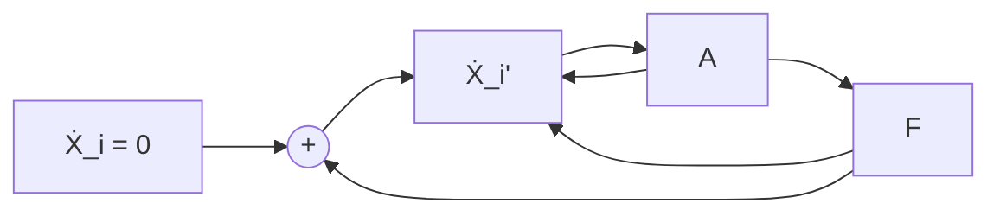
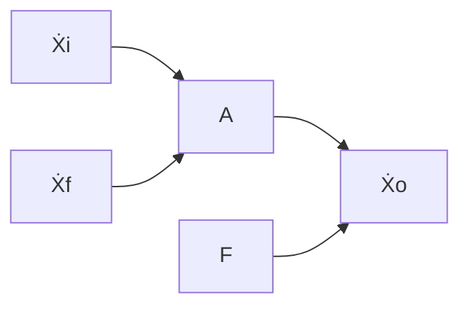
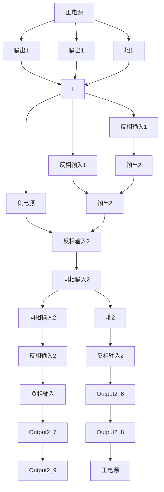
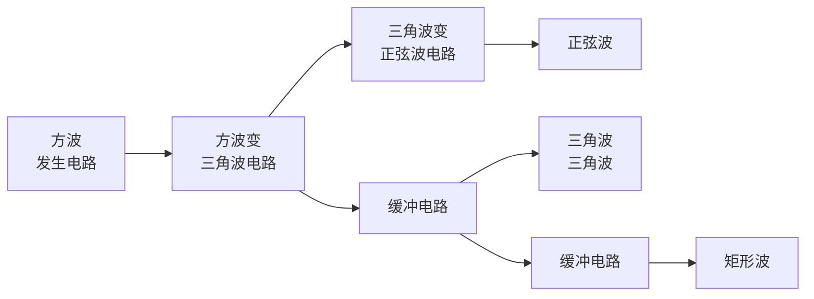
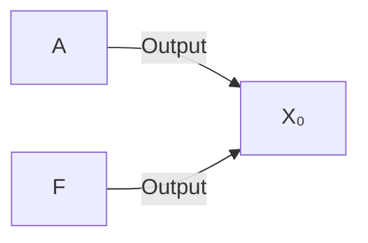

# 第7章 波形的发生和信号的转换

原始 PDF 第 363–426 页。

## 第7章

## 波形的发生和信号的转换

## 本章讨论的问题

- 在模拟电子电路中需要哪些波形的信号作为测试信号和控制信号？
- 什么是自激振荡？正弦波振荡电路所产生的自激振荡和负反馈放大电路中所产生的自激振荡有区别吗？为什么正弦波振荡电路中必须有选频网络？选频网络可由哪些元件组成？
- 怎样组成正弦波振荡电路？如何判断电路是否是正弦波振荡电路？
- 波形发生电路中必须有放大电路吗？
- 为什么说矩形波发生电路是产生其它非正弦波信号的基础？为什么非正弦波发生电路中几乎都含有电压比较器？
- 电压比较器与放大电路有什么区别？集成运放在电压比较器电路和运算电路中的工作状态一样吗？为什么？如何判断电路中集成运放的工作状态？
- 如何组成矩形波、三角波和锯齿波发生电路？
- 为什么需要将输入信号进行转换？有哪些基本的转换？这些转换电路组成的基本思路是什么？

在模拟电子电路中，常常需要各种波形的信号，作为测试信号或控制信号等。例如，在测量放大电路的指标参数时需要给电路输入正弦波信号；又如，在用示波器测试电路的电压传输特性时需要给电路输入锯齿波电压；再如，在增益可控集成运放的控制端需要输入矩形波，等等。而为了使所采集的信号能够用于测量、控制、驱动负载或送入计算机，常常需要将信号进行变换，如将电压变换成电流、将电流变换成电压、将电压变换成频率与之成正比的脉冲，等等。

本章将讲述有关波形发生和信号转换电路的组成原则、工作原理以及主要参数。

## 7.1 正弦波振荡电路

正弦波振荡电路是在没有外加输入信号的情况下，依靠电路自激振荡而产生正弦波输出电压的电路。它被广泛地应用于量测、遥控、通信、自动控制、热处理和超声波电焊等加工设备之中，也作为模拟电子电路的测试信号。本节将就正弦波振荡电路的种类、组成和工作原理一一加以介绍。

## 7.1.1 概述

## 一、产生正弦波振荡的条件

在负反馈放大电路中，若在低频段或高频段中存在频率 $f_{0}$ ，使电路产生的附加相移为 $\pm\pi$ ，而且当 $f=f_{0}$ 时 $|\dot{A}\dot{F}|>1$ ，则电路将产生自激振荡。振荡频率除了决定于电路中的电阻和电容

---

7.1 正弦波振荡电路

341

外,还决定于晶体管的极间电容、电路的分布电容等人们不能确定的因素 $^{①}$ ,因此不能作为信号源。

虽然正弦波振荡电路的振荡原理在本质上与负反馈放大电路产生自激振荡的原理相同,但是,正弦波振荡电路引入正反馈以满足振荡条件,而且外加选频网络使振荡频率人为可控,这是其电路组成的显著特征。

通常，可将正弦波振荡电路分解为图7.1.1(a)所示方框图，上一个方框为放大电路，下一个方框为反馈网络，反馈极性为正。当输入量为零时，反馈量等于输入量，如图(b)所示。由于电扰动（如合闸通电的瞬间），电路产生一个幅值很小的输出量，它含有丰富的频率，若电路只对频率为 $f_{0}$ 的正弦波产生正反馈过程，则将产生如下过程:

$$
X _ {\mathrm{o}} \uparrow \rightarrow X _ {\mathrm{f}} \uparrow (X _ {\mathrm{i}} ^ {\prime} \uparrow) \rightarrow X _ {\mathrm{o}} \uparrow \uparrow
$$

即输出量  $X_{o}$  的增大使反馈量  $X_{f}$  增大，因放大电路的输入量就是  $X_{i}^{\prime}$  反馈量  $X_{f}$ ，故  $X_{o}$  将进一步增大。

flowchart

(a)

flowchart

(b)

图 7.1.1 正弦波振荡电路的方框图

(a) 电路引入正反馈 (b) 反馈量作为净输入量

$X_{o}$  不会无限制地增大, 当  $X_{o}$  增大到一定数值时, 由于晶体管的非线性特性和电源电压的限制, 使放大电路放大倍数的数值减小, 最终  $X_{o}$  的幅值将维持在一个确定值, 电路达到动态平衡。这时, 输出量  $X_{o}$  通过反馈网络产生反馈量  $X_{f}$  作为放大电路的输入量  $X_{i}^{\prime}$ , 而输入量  $X_{i}^{\prime}$  又通过放大电路维持着输出量  $X_{o}$ , 写成表达式为

$$
\dot {X} _ {\mathrm{o}} = \dot {A} \dot {X} _ {\mathrm{f}} = \dot {A} \dot {F} \dot {X} _ {\mathrm{o}}
$$

也就是说,正弦波振荡的平衡条件为

$$
\dot {A} \dot {F} = 1 \tag {7.1.1}
$$

写成幅值与相角的形式为

$$
\left\{ \begin{array}{l l} {\mid \dot {A} \dot {F} \mid = 1} & {(7. 1. 2 \mathrm{a})} \\ {\varphi_ {\mathrm{A}} + \varphi_ {\mathrm{F}} = 2 n \pi} & {(n \text {为整数})} \end{array} \right. \tag {7.1.2b}
$$

式(7.1.2a)称为幅值平衡条件,式(7.1.2b)称为相位平衡条件,分别简称为幅值条件和相位条件。为了使输出量在合闸后能够有一个从小到大直至平衡在一定幅值的过程,电路的起振条件为

$$
\mid \dot {A} \dot {F} \mid > 1 \tag {7.1.3}
$$

电路把频率 $f=f_{0}$ 以外的输出量均逐渐衰减为零，因此输出量为 $f=f_{0}$ 的正弦波。

<small>① 参阅 5.6 节。</small>

---

342

第 7 章 波形的发生和信号的转换

## 二、正弦波振荡电路的组成及分类

从以上分析可知,正弦波振荡电路必须由以下四个部分组成:

（1）放大电路:保证电路能够有从起振到幅值逐渐增大直至动态平衡的过程，使电路获得一定幅值的输出量，实现能量的控制。
（2）选频网络:确定电路的振荡频率，使电路产生单一频率的振荡，即保证电路产生正弦波振荡。
(3) 正反馈网络: 引入正反馈, 使放大电路的输入信号等于反馈信号。
(4) 稳幅环节: 也就是非线性环节, 作用是使输出信号幅值稳定。

在不少实用电路中,常将选频网络和正反馈网络“合二而一”;而且,对于分立元件放大电路,也不再另加稳幅环节,而依靠晶体管特性的非线性来达到稳幅作用。

正弦波振荡电路常用选频网络所用元件来命名，分为 RC 正弦波振荡电路、LC 正弦波振荡电路和石英晶体正弦波振荡电路三种类型。RC 正弦波振荡电路的振荡频率较低，一般在 1 MHz 以下；LC 正弦波振荡电路的振荡频率多在 1 MHz 以上；石英晶体正弦波振荡电路也可等效为 LC 正弦波振荡电路，其特点是振荡频率非常稳定。

## 三、判断电路是否可能产生正弦波振荡的方法和步骤

（1）观察电路是否包含了放大电路、选频网络、正反馈网络和稳幅环节四个组成部分。
（2）判断放大电路是否能够正常工作，即是否有合适的静态工作点且动态信号是否能够输入、输出和放大。
（3）利用瞬时极性法判断电路是否满足正弦波振荡的相位条件。具体做法是:断开反馈，在

断开处给放大电路加频率为 $f_{0}$ 的正弦波输入电压 $\dot{U}_{i}$，并给定其瞬时极性，如图7.1.2所示；然后以 $\dot{U}_{i}$ 极性为依据判断输出电压 $\dot{U}_{0}$ 的极性，从而得到反馈电压 $\dot{U}_{f}$ 的极性；若 $\dot{U}_{f}$ 与 $\dot{U}_{i}$ 极性相同，则说明满足相位条件，电路有可能产生正弦波振荡，否则表明不满足相位条件，电路不可能产生正弦波振荡。

text_image

Üi
+
-
Üi'
A
Üf
F
Üo
+

图7.1.2 利用瞬时极性法判断相位条件

（4）判断电路是否满足正弦波振荡的幅值条件，即是否满足起振条件。具体方法是:分别求解电路的 $\dot{A}$ 和 $\dot{F}$，然后判断 $|\dot{A}\dot{F}|$ 是否大于1。只有在电路满足相位条件的情况下，判断是否满足幅值条件才有意义。换言之，若电路不满足相位条件，则电路一定不可能振荡。

## 7.1.2 RC 正弦波振荡电路

实用的 RC 正弦波振荡电路多种多样,但最具典型性的是 RC 桥式正弦波振荡电路,在文献中也称之为文氏桥振荡电路。本节介绍它的电路组成、工作原理和振荡频率。

## 一、RC串并联选频网络

将电阻 $R_{1}$ 与电容 $C_1$ 串联、电阻 $R_{2}$ 与电容 $C_2$ 并联所组成的网络称为 $RC$ 串并联选频网络，如图7.1.3(a)所示。通常，选取 $R_{1} = R_{2} = R, C_{1} = C_{2} = C$ 。因为 $RC$ 串并联选频网络在正弦波振荡电路中既为选频网络，又为正反馈网络，所以其输入电压为 $\dot{U}_{\mathrm{o}}$ ，输出电压为 $\dot{U}_{\mathrm{f}}$ 。

---

7.1 正弦波振荡电路

343

图 7.1.3 RC 串并联选频网络及其在低频段和高频段的等效电路

(a) RC 串并联选频网络 (b) 低频段等效电路及其相量图

(c) 高频段等效电路及其相量图

当信号频率足够低时， $\frac{1}{\omega C}\gg R$ ，因而网络的简化电路及其电压和电流的相量图如图7.1.3(b)所示。 $\dot{U}_{f}$  超前 $\dot{U}_{o}$ ，当频率趋近于零时，相位超前趋近于 $+90^{\circ}$ ，且 $|\dot{U}_{f}|$  趋近于零。

当信号频率足够高时， $\frac{1}{\omega C}\ll R$ ，因而网络的简化电路及其电压和电流的相量图如图7.1.3(c)所示。 $\dot{U}_{f}$ 滞后 $\dot{U}_{o}$ ，当频率趋近于无穷大时，相位滞后趋近于 $-90^{\circ}$ ，且 $|\dot{U}_{f}|$ 趋近于零。

可以想象, 当信号频率从零逐渐变化到无穷大时,  $\dot{U}_{f}$  的相位将从  $+90^{\circ}$  逐渐变化到  $-90^{\circ}$ 。因此, 对于 RC 串并联选频网络, 必定存在一个频率  $f_{0}$ , 当  $f = f_{0}$  时,  $\dot{U}_{f}$  与  $\dot{U}_{o}$  同相。通过以下计算, 可以求出 RC 串并联选频网络的频率特性和  $f_{0}$ 。

$$
\dot {F} = \frac {\dot {U} _ {\mathrm{f}}}{\dot {U} _ {\mathrm{o}}} = \frac {R / / \frac {1}{\mathrm{j} \omega C}}{R + \frac {1}{\mathrm{j} \omega C} + R / / \frac {1}{\mathrm{j} \omega C}}
$$

整理可得

$$
\dot {F} = \frac {1}{3 + \mathrm{j} \left(\omega R C - \frac {1}{\omega R C}\right)}
$$

令 $\omega_0 = \frac{1}{RC}$ ，则

$$
f _ {0} = \frac {1}{2 \pi R C} \tag {7.1.4}
$$

代入上式,得出

$$
\dot {F} = \frac {1}{3 + \mathrm{j} \left(\frac {f}{f _ {0}} - \frac {f _ {0}}{f}\right)} \tag {7.1.5}
$$

---

344

第 7 章 波形的发生和信号的转换

幅频特性为

$$
\mid \dot {F} \mid = \frac {1}{\sqrt {3 ^ {2} + \left(\frac {f}{f _ {0}} - \frac {f _ {0}}{f}\right) ^ {2}}} \tag {7.1.6}
$$

相频特性为

$$
\varphi_ {\mathrm{F}} = - \arctan \frac {1}{3} \left(\frac {f}{f _ {0}} - \frac {f _ {0}}{f}\right) \tag {7.1.7}
$$

根据式(7.1.6)和式(7.1.7)画出 $\dot{F}$ 的频率特性，如图7.1.4所示。当 $f = f_{0}$ 时，$\dot{F} = \frac{1}{3}$，即 $\left|\dot{U}_{\mathrm{f}}\right| = \frac{1}{3}\left|\dot{U}_{\mathrm{o}}\right|, \varphi_{\mathrm{F}} = 0^{\circ}$。

line

| Function | Description |
| --- | --- |
| Left Chart | Probability density function |
| Right Chart | Phase response curve |
| Key Points | f0, 1/3, +90°, 0°, -90° |

图 7.1.4 RC 串并联选频网络的频率特性

## 二、RC 桥式正弦波振荡电路

根据式(7.1.1)，因为当 $f=f_{0}$ 时， $\dot{F}=\frac{1}{3}$ ，所以

$$
\dot {A} = \dot {A} _ {u} = 3 \tag {7.1.8}
$$

式(7.1.8)表明,只要为RC串并联选频网络匹配一个电压放大倍数等于3(即输出电压与输入电压同相,且放大倍数的数值为3)的放大电路就可以构成正弦波振荡电路,如图7.1.5所示。考虑到起振条件,所选放大电路的电压放大倍数应略大于3。

从理论上讲,任何满足放大倍数要求的放大电路与RC串并联选频网络都可组成正弦波振荡电路;但是,实际上,所选用的放大电路应具有尽可能大的输入电阻和尽可能小的输出电阻,以减小放大电路对选频特性的影响,使振荡频率几乎仅仅决定于选频网络。因此,通常选用引入电压串联负反馈的放大电路,如同相比例运算电路。

由 RC 串并联选频网络和同相比例运算电路所构成的 RC 桥式正弦波振荡电路如图 7.1.6(a) 所示。观察电路，负反馈网络的  $R_{1}$ 、 $R_{f}$  以及正反馈网络串联的 R 和

text_image

放大电路
Âu≥3
+ 
Ûo -

图 7.1.5 利用 RC 串并联选频网络构成正弦波振荡电路的方框图

---

7.1 正弦波振荡电路

345

C、并联的 R 和 C 各为一臂构成桥路，故此得名。集成运放的输出端和“地”接桥路的两个顶点作为电路的输出；集成运放的同相输入端和反相输入端接另外两个顶点，是集成运放的净输入电压；如图(b)所示。

图 7.1.6 RC 桥式正弦波振荡电路

(a) 电路 (b) 电路中的桥路

正反馈网络的反馈电压  $\dot{U}_{f}$  是同相比例运算电路的输入电压, 因而要把同相比例运算电路作为整体看成电压放大电路, 它的比例系数是电压放大倍数, 根据起振条件和幅值平衡条件

$$
\dot {A} _ {u} = \frac {\dot {U} _ {\mathrm{o}}}{\dot {U} _ {\mathrm{p}}} = 1 + \frac {R _ {\mathrm{f}}}{R} \geqslant 3
$$

$$
R _ {\mathrm{f}} \geqslant 2 R _ {1} \tag {7.1.9}
$$

$R_{\mathrm{f}}$ 的取值要略大于 $2R_{1}$ 。应当指出，由于 $U_{\mathrm{o}}$ 与 $U_{\mathrm{f}}$ 具有良好的线性关系，所以为了稳定输出电压的幅值，一般应在电路中加入非线性环节。例如，可选用 $R_{1}$ 为正温度系数的热敏电阻，当 $U_{\mathrm{o}}$ 因某种原因而增大时，流过 $R_{\mathrm{f}}$ 和 $R_{1}$ 上的电流增大，$R_{1}$ 上的功耗随之增大，导致温度升高，因而 $R_{1}$ 的阻值增大，从而使得 $\dot{A}_{u}$ 数值减小，$U_{\mathrm{o}}$ 也就随之减小；当 $U_{\mathrm{o}}$ 因某种原因而减小时，各物理量与上述变化相反，从而使输出电压稳定。当然，也可选用 $R_{\mathrm{f}}$ 为负温度系数的热敏电阻。

此外,还可在  $R_{f}$  回路串联两个并联的二极管,如图 7.1.7 所示,利用电流增大时二极管动态电阻减小、电流减小时二极管动态电阻增大的特点,加入非线性环节,从而使输出电压稳定。此时比例系数为

$$
\dot {A} _ {u} = 1 + \frac {R _ {\mathrm{f}} + r _ {\mathrm{d}}}{R _ {1}} \tag {7.1.10}
$$

## 三、振荡频率可调的 $RC$ 桥式正弦波振荡电路

为了使得振荡频率连续可调，常在 RC 串并联网络中，用双层波段开关接不同的电容作为振荡频率  $f_{0}$  的粗调；用同轴电位器实现  $f_{0}$  的微调，如图 7.1.8 所示。振荡频率的可调范围能够从几赫兹到几百千赫。

综上所述，RC 桥式正弦波振荡电路以 RC 串并联网络为选频网络和正反馈网络，以电压串联负反馈放大电路为

text_image

Rf
D1
D2
A
uO

图7.1.7 利用二极管作为非线性环节

---

346

第 7 章 波形的发生和信号的转换

放大环节,具有振荡频率稳定、带负载能力强、输出电压失真小等优点,因此获得相当广泛的应用。

text_image

C1 C2 C3 C4
Rw
R
Uo
Rw
R
C1 C2 C3 C4
Uf

图 7.1.8 振荡频率连续可调的 RC 串并联选频网络

为了提高 RC 桥式正弦波振荡电路的振荡频率, 必须减小 R 和 C 的数值。然而, 一方面, 当 R 减小到一定程度时, 同相比例运算电路的输出电阻将影响选频特性; 另一方面, 当 C 减小到一定程度时, 晶体管的极间电容和电路的分布电容将影响选频特性; 因此, 振荡频率  $f_{0}$  高到一定程度时, 其值不仅决定于选频网络, 还与放大电路的参数有关。这样,  $f_{0}$  不但与一些未知因素有关, 而且还将受环境温度的影响。因此, 当振荡频率较高时, 应选用 LC 正弦波振荡电路。

【例 7.1.1】在图 7.1.8 所示电路中, 若电容的取值分别为  $0.01 \mu F$ 、 $0.1 \mu F$ 、 $1 \mu F$ 、 $10 \mu F$ ，电阻  $R = 50 \Omega$ ，电位器  $R_{w} = 10 k\Omega$ 。试问:  $f_{0}$  的调节范围为多少?

解: 因为  $f_{0}=\frac{1}{2\pi RC}$ ，所以  $f_{0}$  的最小值

$$
f _ {0 \mathrm{min}} = \frac {1}{2 \pi (R + R _ {\mathrm{w}}) C _ {\mathrm{max}}} = \frac {1}{2 \pi \times (5 0 + 1 0 \times 1 0 ^ {3}) \times 1 0 \times 1 0 ^ {- 6}} \mathrm{Hz} \approx 1. 5 9 \mathrm{Hz}
$$

$f_{0}$ 的最大值

$$
f _ {0 \mathrm{max}} = \frac {1}{2 \pi R C _ {\mathrm{min}}} = \frac {1}{2 \pi \times 5 0 \times 0 . 0 1 \times 1 0 ^ {- 6}} \mathrm{Hz} \approx 3 1 8 0 0 0 \mathrm{Hz} = 3 1 8 \mathrm{kHz}
$$

$f_{0}$ 的调节范围为1.59 Hz\~318 kHz。

## 7.1.3 LC正弦波振荡电路

LC正弦波振荡电路与RC桥式正弦波振荡电路的组成原则在本质上是相同的，只是选频网络采用LC电路。在LC振荡电路中，当 $f = f_{0}$ 时，放大电路的放大倍数数值最大，而其余频率的信号均被衰减到零；引入正反馈后，使反馈电压作为放大电路的输入电压，以维持输出电压，从而形成正弦波振荡。由于LC正弦波振荡电路的振荡频率较高，所以放大电路多采用分立元件电路，必要时还应采用共基电路，也可采用宽频带集成运放。

---

7.1 正弦波振荡电路

347

## 一、LC谐振回路的频率特性

常见的 LC 正弦波振荡电路中的选频网络多采用 LC 并联网络, 如图 7.1.9 所示。图 (a) 为理想电路, 无损耗, 谐振频率为

text_image

i
C
L

(a)

text_image

i
C
L
R

(b)

图 7.1.9 LC 并联网络

(a) 理想情况下的网络 (b) 考虑电路损耗时的网络

$$
f _ {0} = \frac {1}{2 \pi \sqrt {L C}}
$$

在信号频率较低时,电容的容抗很大,网络呈感性;在信号频率较高时,电感的感抗很大,网络呈容性;只有当 $f=f_{0}$ 时,网络才呈纯阻性,且阻抗无穷大。这时电路产生电流谐振,电容的电场能转换成磁场能,而电感的磁场能又转换成电场能,两种能量相互转换。

实际的 LC 并联网络总是有损耗的, 将各种损耗等效成电阻 R, 如图(b)所示。电路的导纳为

$$
Y = \mathrm{j} \omega C + \frac {1}{R + \mathrm{j} \omega L} = \frac {R}{R ^ {2} + (\omega L) ^ {2}} + \mathrm{j} \left[ \omega C - \frac {\omega L}{R ^ {2} + (\omega L) ^ {2}} \right] \tag {7.1.11}
$$

令式中虚部为零,可求出谐振角频率

$$
\omega_ {0} = \frac {1}{\sqrt {1 + \left(\frac {R}{\omega_ {0} L}\right) ^ {2}}} \cdot \frac {1}{\sqrt {L C}} = \frac {1}{\sqrt {1 + \frac {1}{Q ^ {2}}} \cdot \sqrt {L C}}
$$

式中 $Q$ 为品质因数，并且

$$
Q = \frac {\omega_ {0} L}{R} \tag {7.1.12}
$$

当 $Q \gg 1$ 时, $\omega_0 \approx \frac{1}{\sqrt{LC}}$, 所以谐振频率

$$
f _ {0} \approx \frac {1}{2 \pi \sqrt {L C}} \tag {7.1.13}
$$

将式(7.1.13)代入式(7.1.12)，得出

$$
Q \approx \frac {1}{R} \sqrt {\frac {L}{C}} \tag {7.1.14}
$$

可见,选频网络的损耗愈小;谐振频率相同时,电容容量愈小,电感数值愈大,品质因数愈大,将使得选频特性愈好。

---

348

第 7 章 波形的发生和信号的转换

当 $f=f_{0}$ 时,电抗

$$
Z _ {0} = \frac {1}{Y _ {0}} = \frac {R ^ {2} + (\omega_ {0} L) ^ {2}}{R} = R + Q ^ {2} R
$$

当 $Q \gg 1$ 时，$Z_0 \approx Q^2 R$，将式(7.1.14)代入，整理可得

$$
Z _ {0} \approx Q X _ {L} \approx Q X _ {C} \tag {7.1.15}
$$

$X_{L}$  和  $X_{C}$  分别是电感和电容的电抗。因此，当网络的输入电流为  $I_{0}$  时，电容和电感的电流约为  $QI_{0}$ 。

根据式(7.1.11)，可得适用于频率从零到无穷大时 LC 并联网络电抗的表达式为

$$
Z = \frac {1}{Y}
$$

Z 是频率的函数, 其频率特性如图 7.1.10 所示。Q 值愈大, 曲线愈陡, 选频特性愈好。

图 7.1.10 LC 并联网络电抗的频率特性

若以 LC 并联网络作为共射放大电路的集电极负载, 如图 7.1.11 所示, 则电路的电压放大倍数

$$
\dot {A} _ {u} = - \beta \frac {Z}{r _ {\mathrm{be}}}
$$

根据 LC 并联网络的频率特性, 当  $f = f_{0}$  时, 电压放大倍数的数值最大, 且无附加相移。对于其余频率的信号, 电压放大倍数不但数值减小, 而且有附加相移。电路具有选频特性, 故称之为

选频放大电路。若在电路中引入正反馈，并能用反馈电压取代输入电压，则电路就成为正弦波振荡电路。根据引入反馈的方式不同，LC正弦波振荡电路分为变压器反馈式、电感反馈式和电容反馈式三种电路；所用放大电路视振荡频率而定，可用共射电路、共基电路或者是宽频带集成运放。

## 二、变压器反馈式振荡电路

## 1. 工作原理

引入正反馈最简单的方法是采用变压器反馈方式,如图7.1.12所示;为使反馈电压与输入电压同相,同名端如

text_image

Rb2
C
L
+VCC
+
Üi
Rb1
T
Re
Ce
-

图 7.1.11 选频放大电路

---

7.1 正弦波振荡电路

349

图中所标注。当反馈电压取代输入电压时,就得到变压器反馈式振荡电路,如图 7.1.13 所示。

text_image

+VCC
Rb2
C1
C
N1
+
-
T
uF
ui
-
Rb1
Re
Ce
RL

图 7.1.12 在选频放大电路中引入正反馈

text_image

+VCC
Rb2
C
N1
uF N2
RL
+
-
T
C1
+
-
ui
-
Rb1
Re Ce

图 7.1.13 变压器反馈式振荡电路

对于图 7.1.13 所示的电路, 可以用前面所叙述的方法判断电路产生正弦波振荡的可

能性。首先，观察电路，存在放大电路、选频网络、正反馈网络以及用晶体管的非线性特性所实现的稳幅环节四个部分。然后，判断放大电路能否正常工作，图中放大电路是典型的工作点稳定电路，可以设置合适的静态工作点；电路的交流通路如图7.1.14所示，交流信号传递过程中无开路或短路现象，电路可以正常放大。最后，采用瞬时极性法判断电路是否满足相位平衡条件。在图7.1.14中，断开P点，加 $f=f_{0}$ 的输入电压，规定其极性，得到变压器一次

text_image

P
+
ui
-
Rb1
+
Rb2
T
C
N1
+
-
N2
+
-
N3
RL

图 7.1.14 变压器反馈式振荡电路的交流通路

线圈 $N_{1}$ 电压的极性，进而得到二次线圈 $N_{2}$ 电压的极性，如图中所标注，故电路满足相位条件，有可能产生正弦波振荡。

而在多数情况下，不必画出交流通路就可判断电路是否满足相位条件。具体做法是:在图7.1.13所示电路中，断开P点，在断开处给放大电路加 $f=f_{0}$ 的输入电压 $\dot{U}_{1}$ ，给定其极性对“地”为正，因而晶体管基极动态电位对“地”为正，由于放大电路为共射接法，故集电极动态电位对“地”为负；对于交流信号，电源相当于“地”，所以线圈 $N_{1}$ 上电压为上“正”下“负”；根据同名端， $N_{2}$ 上电压也为上“正”下“负”，即反馈电压对“地”为正，与输入电压假设极性相同，满足正弦波振荡的相位条件。

图 7.1.13 所示电路表明, 变压器反馈式振荡电路中放大电路的输入电阻是放大电路负载的一部分, 因此  $\dot{A}$  与  $\dot{F}$  相互关联。一般情况下, 只要合理选择变压器一次、二次线圈的匝数比以及其它电路参数, 电路很容易满足幅值条件。

## 2. 振荡频率及起振条件

图7.1.13所示变压器反馈式振荡电路的交流等效电路如图7.1.15所示。 $R$ 是 $LC$ 谐振回路、负载等的总损耗， $L_{1}$ 为考虑到 $N_{3}$ 回路参数折合到一次侧的等效电感， $L_{2}$ 为二次电感， $M$ 为 $N_{1}$ 和 $N_{2}$ 间的等效互感； $R_{\mathrm{i}}$ 为放大电路的输入电阻，其值 $R_{\mathrm{i}} = R_{\mathrm{b1}} / / R_{\mathrm{b2}} / / r_{\mathrm{be}}$ 。

---

350

第 7 章 波形的发生和信号的转换

图 7.1.15 变压器反馈式振荡电路的交流等效电路

(a) 交流等效电路 (b) 变压器部分的等效电路

为了分析振荡频率和起振条件,首先求解图 7.1.15(a) 中从 A 和 B 两点向右边看进去的等效电路及其参数。在变压器一次侧,有

$$
\dot {U} _ {\mathrm{o}} = (R + \mathrm{j} \omega L _ {1}) \dot {I} _ {1} - \mathrm{j} \omega M \dot {I} _ {2} \tag {7.1.16}
$$

在二次侧,有

$$
\dot {I} _ {2} = \frac {\mathrm{j} \omega M \dot {I} _ {1}}{R _ {\mathrm{i}} + \mathrm{j} \omega L _ {2}} \tag {7.1.17}
$$

将式(7.1.17)代入式(7.1.16)，整理可得

$$
\dot {U} _ {\mathrm{o}} = (R ^ {\prime} + \mathrm{j} \omega L _ {1} ^ {\prime}) \dot {I} _ {1} \tag {7.1.18}
$$

其中

$$
\left\{ \begin{array}{l l} R ^ {\prime} = R + \frac {\omega^ {2} M ^ {2}}{R _ {\mathrm{i}} ^ {2} + \omega^ {2} L _ {2} ^ {2}} \cdot R _ {\mathrm{i}} & (7. 1. 1 9 \mathrm{a}) \\ L _ {1} ^ {\prime} = L _ {1} - \frac {\omega^ {2} M ^ {2}}{R _ {\mathrm{i}} ^ {2} + \omega^ {2} L _ {2} ^ {2}} \cdot L _ {2} & (7. 1. 1 9 \mathrm{b}) \end{array} \right.
$$

因此，从变压器一次侧向二次侧看进去的等效电路如图7.1.15(b)所示，为典型的LC谐振回路。但与之相比，带负载后，电感量变小，损耗变大，因而品质因数变小，选频特性变差。其品质因数

$$
Q \approx \frac {1}{R ^ {\prime}} \sqrt {\frac {L _ {i} ^ {\prime}}{C}} \tag {7.1.20}
$$

当 $Q \gg 1$ 时, 振荡频率

$$
f _ {0} \approx \frac {1}{2 \pi \sqrt {L _ {1} ^ {\prime} C}} \tag {7.1.21}
$$

根据前面的分析可知，在谐振频率下， $L_{1}$ 中电流的数值约为晶体管集电极电流的Q倍，即

$$
\mid \dot {I} _ {\mathrm{t}} \mid \approx Q \mid \dot {I} _ {\mathrm{c}} \mid = Q \beta \mid \dot {I} _ {\mathrm{b}} \mid = Q \beta \frac {\mid \dot {U} _ {\mathrm{i}} \mid}{r _ {\mathrm{be}}}
$$

根据式(7.1.17)，反馈电压

$$
\dot {U} _ {\mathrm{f}} = \dot {I} _ {\mathrm{f}} R _ {\mathrm{i}} = \frac {\mathrm{j} \omega_ {0} M \dot {I} _ {1}}{R _ {\mathrm{i}} + \mathrm{j} \omega_ {0} L _ {2}} \cdot R _ {\mathrm{i}}
$$

---

7.1 正弦波振荡电路

351

通常， $\omega_0L_2\ll R_i$ ，所以

$$
\mid \dot {U} _ {\mathrm{f}} \mid \approx \omega_ {0} M \mid \dot {I} _ {1} \mid = \omega_ {0} M Q \beta \frac {\mid \dot {U} _ {\mathrm{i}} \mid}{r _ {\mathrm{be}}}
$$

电路的起振条件

$$
\left| \frac {\dot {U} _ {\mathrm{f}}}{\dot {U} _ {\mathrm{i}}} \right| > 1
$$

即

$$
\beta > \frac {r _ {\mathrm{be}}}{\omega_ {0} M Q} \tag {7.1.22}
$$

式(7.1.22)表明选频网络的品质因数愈大,对晶体管电流放大系数的要求愈低。若将式(7.1.20)和式(7.1.21)代入式(7.1.22),则得出起振条件为

$$
\beta > \frac {r _ {\mathrm{be}} R ^ {\prime} C}{M} \tag {7.1.23}
$$

## 3. 优缺点

变压器反馈式振荡电路易于产生振荡,波形较好,应用范围广泛。但是,由于输出电压与反馈电压靠磁路耦合,因而耦合不紧密,损耗较大。并且振荡频率的稳定性不高。

## 三、电感反馈式振荡电路

## 1. 电路组成

为了克服变压器反馈式振荡电路中变压器一次线圈和二次线圈耦合不紧密的缺点, 可将  $N_{1}$  和  $N_{2}$  合并为一个线圈, 把图 7.1.13 所示电路中线圈  $N_{1}$  接电源的一端和  $N_{2}$  接地的一端相连作为中间抽头; 为了加强谐振效果, 将电容 C 跨接在整个线圈两端, 如图 7.1.16 所示。

## 2. 工作原理

利用判断电路能否产生正弦波振荡的方法来分析图7.1.16所示电路。首先观察电路，它包含了放大电路、选频网络、反馈网络和非线性元件——晶体管四个部分，而且放大电路能够正常工作。然后用瞬时极性法判断电路是否满足正弦波振荡的相位条件:断开反馈，加频率为 $f_{0}$ 的输入电压，给定其极性，判断出从 $N_{2}$ 上获得的反馈电压极性与输入电压相

text_image

+Vcc
C
N2
+
-
Rb2
N1
RL
C1
T
ui
+
-
Rb1
Re
Ce

图 7.1.16 电感反馈式振荡电路

同，故电路满足正弦波振荡的相位条件，各点瞬时极性如图中所标注。只要电路参数选择得当，电路就可满足幅值条件，而产生正弦波振荡。

图 7.1.17 所示为电感反馈式振荡电路的交流通路,一次线圈的三个端分别接在晶体管的三个极,故称电感反馈式振荡电路为电感三点式电路。

## 3. 振荡频率和起振条件

断开反馈且空载情况下的交流等效电路如图 7.1.18 所示。

设 $N_{1}$ 的电感量为 $L_{1}, N_{2}$ 的电感量为 $L_{2}, N_{1}$ 与 $N_{2}$ 间的互感为 $M$ ，且品质因数远大于1，则振荡频率

---

352

第 7 章 波形的发生和信号的转换

text_image

Rb1 Rb2 T C N1 N2 RL

图 7.1.17 电感反馈式振荡电路的交流通路

text_image

i̇b
βi̇b
Rb1 Rb2 rbe
U̇i
-
R''L U̇o
A
+
-
B
N1(L1)
N2(L2) C
+ -
- -
+ - +
Ri
U̇f
+

图 7.1.18 电感反馈式振荡电路的交流等效电路

$$
f _ {0} \approx \frac {1}{2 \pi \sqrt {(L _ {1} + L _ {2} + 2 M) C}} \tag {7.1.24}
$$

反馈系数的数值

$$
\left| \dot {F} \right| = \left| \frac {\dot {U} _ {\mathrm{f}}}{\dot {U} _ {\mathrm{o}}} \right| \approx \frac {\mathrm{j} \omega L _ {2} + \mathrm{j} \omega M}{\mathrm{j} \omega L _ {1} + \mathrm{j} \omega M} = \frac {L _ {2} + M}{L _ {1} + M} \tag {7.1.25}
$$

因而,从 A 和 B 两端向右看的等效电阻为

$$
R _ {\mathrm{i}} ^ {\prime} = \frac {R _ {\mathrm{i}}}{\mid \dot {F} \mid^ {2}} \tag {7.1.26}
$$

设  $R_{L}^{\prime}$  为  $R_{L}$  折合到 A、B 两点间的等效电阻，则集电极总负载

$$
R _ {\mathrm{L}} ^ {\prime \prime} = R _ {\mathrm{L}} ^ {\prime} / / R _ {\mathrm{i}} ^ {\prime} \tag {7.1.27}
$$

当 $f=f_{0}$ 且Q>>1时，LC回路产生谐振，等效电阻非常大，所取电流可忽略不计，因此放大电路的电压放大倍数

$$
\dot {A} _ {u} = - \beta \frac {R _ {\mathrm{L}} ^ {\prime \prime}}{r _ {\mathrm{be}}} \tag {7.1.28}
$$

根据  $\left|\dot{A}\dot{F}\right|>1$  , 利用式 (7.1.25) 和式 (7.1.28), 可得起振条件为

$$
\beta > \frac {L _ {1} + M}{L _ {2} + M} \cdot \frac {r _ {\mathrm{be}}}{R _ {\mathrm{L}} ^ {\prime \prime}} \tag {7.1.29}
$$

从式(7.1.25)、(7.1.28)、(7.1.29)可以看出，若增大 $L_{2}$ 与 $L_{1}$ 的比值，则一方面 $|\dot{F}|$ 随之增大，有利于电路起振；另一方面，它又使 $R_{L}^{\prime\prime}$ 减小，从而使 $|\dot{A}_{u}|$ 减小，不利于电路起振。所以， $L_{2}/L_{1}$ 既不能太大，也不能太小。在大批量生产时，应通过实验确定 $N_{2}$ 与 $N_{1}$ 的比值，一般在 $1/7\sim1/4$ 之间。

## 4. 优缺点

电感反馈式振荡电路中  $N_{2}$  与  $N_{1}$  之间耦合紧密，振幅大；当 C 采用可变电容时，可以获得调节范围较宽的振荡频率，最高振荡频率可达几十兆赫。由于反馈电压取自电感，对高频信号具有较大的电抗，输出电压波形中常含有高次谐波。因此，电感反馈式振荡电路常用在对波形要求不高的设备之中，如高频加热器、接收机的本机振荡器等。

## 四、电容反馈式振荡电路

## 1. 电路组成

为了获得较好的输出电压波形,若将电感反馈式振荡电路中的电容换成电感,电感换成电

---

7.1 正弦波振荡电路

353

容，并在置换后将两个电容的公共端接地，且增加集电极电阻 $R_{c}$ ，就可得到电容反馈式振荡电

路,如图 7.1.19 所示。因为两个电容的三个端分别接晶体管的三个极,故也称之为电容三点式电路。

## 2. 工作原理

根据正弦波振荡电路的判断方法,观察图7.1.19所示电路,包含了放大电路、选频网络、反馈网络和非线性元件——晶体管四个部分,而且放大电路能够正常工作。断开反馈,加频率为 $f_{0}$ 的输入电压,给定其极性,判断出从 $C_{2}$ 上所获得的反馈电压的极性与输入电压相同,故电路满足正弦波振荡的相位条件,各点瞬时极性如图中所标注。只要电路参数选择得当,电路就可满足幅值条件,而产生正弦波振荡。

text_image

Rb2
C3
+
ui
-
Rb1
T
Rc
+VCC
Ce
Re
C1
+
uf
C2
L

图 7.1.19 电容反馈式振荡电路

## 3. 振荡频率和起振条件

当由  $L, C_{1}$  和  $C_{2}$  所构成的选频网络的品质因数 Q 远大于 1 时，振荡频率

$$
f _ {0} \approx \frac {1}{2 \pi \sqrt {L \frac {C _ {1} C _ {2}}{C _ {1} + C _ {2}}}} \tag {7.1.30}
$$

设 $C_1$ 和 $C_2$ 的电流分别为 $\dot{I}_{c_1}$ 和 $\dot{I}_{c_2}$，则反馈系数

$$
\mid \dot {F} \mid = \left| \frac {\dot {U} _ {\mathrm{f}}}{\dot {U} _ {\mathrm{o}}} \right| = \left| \frac {I _ {C _ {2}} / \mathrm{j} \omega C _ {2}}{I _ {C _ {1}} / \mathrm{j} \omega C _ {1}} \right| \approx \frac {C _ {1}}{C _ {2}} \tag {7.1.31}
$$

电压放大倍数

$$
\left| \dot {A} _ {u} \right| = \left| \frac {\dot {U} _ {\mathrm{o}}}{\dot {U} _ {\mathrm{i}}} \right| = \beta \frac {R _ {\mathrm{L}} ^ {\prime}}{r _ {\mathrm{be}}} \tag {7.1.32}
$$

在空载情况下,类比式(7.1.26)可知,式(7.1.32)中集电极等效负载

$$
R _ {\mathrm{L}} ^ {\prime} = R _ {\mathrm{c}} / / \frac {R _ {\mathrm{i}}}{| \dot {F} | ^ {2}}
$$

根据  $\left|\dot{A}\dot{F}\right|>1$  , 利用式 (7.1.31) 和式 (7.1.32), 可得起振条件为

$$
\beta > \frac {C _ {2}}{C _ {1}} \cdot \frac {r _ {\mathrm{be}}}{R _ {\mathrm{L}} ^ {\prime}} \tag {7.1.33}
$$

与电感反馈式振荡电路相类似,若增大  $C_{1}/C_{2}$ , 则一方面反馈系数数值随之增大, 有利于电路起振; 另一方面, 它又使  $R_{L}^{\prime}$  减小, 从而造成电压放大倍数数值减小, 不利于电路起振。因此,

$C_{1}/C_{2}$ 既不能太大,又不能太小,具体数值应通过实验来确定。

电容反馈式振荡电路的输出电压波形好,但若用改变电容的方法来调节振荡频率,则会影响电路的起振条件;而若用改变电感的方法来调节振荡频率,则比较困难。所以,电容反馈式振荡电路常常用在固定振荡频率的场合。在振荡频率可调范围不大的情况下,可采用图7.1.20所示电路取代图7.1.19所示电路中的选频网络。

chemical

Electrical circuit diagram with capacitors C1, C2, capacitor C3, and inductor L

图 7.1.20 频率可调的选频网络

---

354

第 7 章 波形的发生和信号的转换

## 4. 稳定振荡频率的措施

若要提高电容反馈式振荡电路的振荡频率，则势必要减小 $C_1, C_2$ 的电容量和 $L$ 的电感量。实际上，当 $C_1$ 和 $C_2$ 减小到一定程度时，晶体管的极间电容和电路中的杂散电容将影响振荡频率。这些电容等效为放大电路的输入电容 $C_i$ 和输出电容 $C_o$，它们分别与 $C_1$ 和 $C_2$ 并联，如图7.1.21所标注。由于极间电容受温度的影响，杂散电容又难于确定，为了稳定振荡频率，在设计电路时，必须能够使 $C_i$ 和 $C_o$ 对选频特性的影响忽略不计。试想，如果 $C_1$ 和 $C_2$ 远大于极间电容和杂散电容，只起分压作用，以便获得合适的反馈电压，而几乎对振荡频率无影响，那么电路的振荡频率就可能很稳定。具体方法是在电感所在支路串联一个小容量电容 $C$，而且 $C \ll C_1, C \ll C_2$，这样

$$
\frac {1}{C _ {1}} + \frac {1}{C _ {2}} + \frac {1}{C} \approx \frac {1}{C}
$$

总电容约为 C, 因而电路的振荡频率

$$
f _ {0} \approx \frac {1}{2 \pi \sqrt {L C}} \tag {7.1.34}
$$

几乎与  $C_{1}$  和  $C_{2}$  无关, 当然, 也就几乎与极间电容和杂散电容无关了。

若要求电容反馈式振荡电路的振荡频率高达 $100\mathrm{MHz}$ 以上，则要考虑采用共基放大电路，如图7.1.22所示。图中 $C_{\mathrm{b}}$ 为旁路电容，对交流信号可视为短路；放大电路为共基放大电路。断开反馈，给放大电路加频率为 $f_{0}$ 的输入电压，极性为上“+”下“-”；因共基放大电路的输出电压与输入电压同相，故集电极动态电位为“+”；选频网络的电压方向为上“-”下“+”，因此从 $C_{1}$ 上获得的反馈电压也为上“-”下“+”，与输入电压同相，所以电路满足正弦波振荡的相位平衡条件。如果参数选择合适，使电路满足起振条件，那么电路就一定会产生正弦波振荡。

text_image

Rb2
C3
Rb1
Ci
T
Re
Ce
Co
C1
L
C2
C
+VCC

图 7.1.21 电容反馈式振荡电路的改进

text_image

C_b
R_{b1}
R_{b2}
L
C_1
u_f
+
-
C_2
+
+
R_e
u_i
-
+V_CC

图 7.1.22 采用共基放大电路的电容反馈式振荡电路

由以上分析可知,在判断电路是否可能产生正弦波振荡,即判断电路是否满足正弦波振荡的相位条件时,必须弄清反馈电压取自哪个线圈或电容,而通常这个线圈或电容总有一端为交流通路的“地”。

【例 7.1.2】电路如图 7.1.23 所示, 图中  $C_{b}$  为旁路电容,  $C_{1}$  为耦合电容, 对交流信号均可视为短路。为使电路可能产生正弦波振荡, 试说明变压器一次线圈和二次线圈的同名端。

解: 图 7.1.23 所示电路中的放大电路为共基放大电路。断开反馈, 给放大电路加频率为  $f_{0}$  的输入电压, 极性为上“+”下“-”; 集电极动态电位为“+”, 选频网络的电压极性为上“-”下

---

7.1 正弦波振荡电路

355

“+”;从变压器二次侧获得的反馈电压应为上“+”下“-”,才满足正弦波振荡的相位平衡条件。因此,变压器一次线圈的下端和二次线圈的上端为同名端;或者说一次线圈的上端和二次线圈的下端为同名端。

【例 7.1.3】改正图 7.1.24 所示电路中的错误,使之有可能产生正弦波振荡。要求不能改变放大电路的基本接法。

text_image

+VCC
Rb2
C
N1
N2
T
Cb
Rb1
Re
C1

图 7.1.23 例 7.1.2 电路图

text_image

Rb2
L
T
C1 4000 pF
Rb1
Re
+
Ce 10 μF
C2 4000 pF
+VCC

图 7.1.24 例 7.1.3 电路图

解: 观察电路,  $C_{e}$  容量远大于  $C_{1}$  和  $C_{2}$ , 故为旁路电容, 对交流信号可视为短路。 $C_{1}$ 、 $C_{2}$  和 L 构

成 LC 并联谐振网络,  $C_{2}$  上的电压为输出电压,  $C_{1}$  上的电压为反馈电压, 因而电路为电容反馈式振荡电路。

电感 L 连接晶体管的基极和集电极，在直流通路中使两个极近似短路，造成放大电路的静态工作点不合适，故应在选频网络与放大电路输入端之间加耦合电容。

晶体管的集电极直接接电源，在交流通路中使集电极与发射极短路，因而输出电压恒等于零，所以必须在集电极加电阻 $R_{e}$ 。

改正电路如图 7.1.25 所示,与图 7.1.19 所示电路相比,同为电容反馈式振荡电路,只是画法不同而已。

text_image

Rb2
L
C
T
C1
Rb1
Re
Ce
+VCC
C2

图7.1.25 图7.1.24所示电路的改正电路

## 7.1.4 石英晶体正弦波振荡电路

石英晶体谐振器,简称石英晶体,具有非常稳定的固有频率。对于振荡频率的稳定性要求高的电路,应选用石英晶体作选频网络。

## 一、石英晶体的特点

将二氧化硅 $\left(\mathrm{SiO}_{2}\right)$ 结晶体按一定的方向切割成很薄的晶片，再将晶片两个对应的表面抛光和涂敷银层，并作为两个极引出引脚，加以封装，就构成石英晶体谐振器。其结构示意图和符号如图7.1.26所示。

## 1. 压电效应和压电振荡

在石英晶体两个引脚加交变电场时,它将会产生一定频率的机械变形,而这种机械振动又会产生交变电场,上述物理现象称为压电效应。一般情况下,无论是机械振动的振幅,还是交变电场的振幅都非常小。但是,当交变电场的频率为某一特定值时,振幅骤然增大,产生共振,称之为压电振荡。这一特定频率就是石英晶体的固有频率,也称为谐振频率。

---

356

第 7 章 波形的发生和信号的转换

text_image

引脚
晶片
引脚
敷银层

(a)

(b)

图 7.1.26 石英晶体谐振器的结构示意图及符号

(a) 结构示意图 (b) 符号

## 2. 石英晶体的等效电路和振荡频率

石英晶体的等效电路如图7.1.27(a)所示。当石英晶体不振动时，可等效为一个平板电容 $C_{0}$ ，称为静态电容；其值决定于晶片的几何尺寸和电极面积，一般约为几皮法到几十皮法。当晶片产生振动时，机械振动的惯性等效为电感L，其值为几毫亨到几十毫亨。晶片的弹性等效为电容C，其值仅为0.01\~0.1 pF，因此 $C\ll C_{0}$ 。晶片的摩擦损耗等效为电阻R，其值约为100Ω，理想情况下 $R=0\Omega$ 。

chemical

Simple RC circuit diagram with capacitors and inductor

(a)

contour

| Point | f | X |
| --- | --- | --- |
| fs | 0 | 0 |
| fp | fp | 0 |

(b)

图 7.1.27 石英晶体的等效电路及其频率特性

(a) 等效电路 (b) 频率特性

当等效电路中的 L、C、R 支路产生串联谐振时，该支路呈纯阻性，等效电阻为 R，谐振频率

$$
f _ {\mathrm{s}} = \frac {1}{2 \pi \sqrt {L C}} \tag {7.1.35}
$$

谐振频率下整个网络的电抗等于 R 并联  $C_{0}$  的容抗，因  $R \ll \omega_{0} C_{0}$ ，故可以近似认为石英晶体也呈纯阻性，等效电阻为 R。

当 $f<f_{s}$ 时， $C_{0}$ 和C电抗较大，起主导作用，石英晶体呈容性。

当 $f>f_{s}$ 时，L、C、R支路呈感性，将与 $C_{0}$ 产生并联谐振，石英晶体又呈纯阻性，谐振频率

$$
f _ {\mathrm{p}} = \frac {1}{2 \pi \sqrt {L \frac {C C _ {0}}{C + C _ {0}}}} = f _ {\mathrm{s}} \sqrt {1 + \frac {C}{C _ {0}}} \tag {7.1.36}
$$

由于  $C \ll C_{0}$ ，所以  $f_{p} \approx f_{s}$ 。

当 $f>f_{p}$ 时，电抗主要决定于 $C_{0}$ ，石英晶体又呈容性。因此，若 $R=0\Omega$ ，则石英晶体电抗的

---

7.1 正弦波振荡电路

357

频率特性如图7.1.27(b)所示，只有在 $f_{\mathrm{s}} < f < f_{\mathrm{p}}$ 的情况下，石英晶体才呈感性；并且 $C$ 和 $C_0$ 的容量相差愈悬殊， $f_{\mathrm{s}}$ 和 $f_{\mathrm{p}}$ 愈接近，石英晶体呈感性的频带愈狭窄。

根据品质因数的表达式

$$
Q \approx \frac {1}{R} \sqrt {\frac {L}{C}}
$$

由于 C 和 R 的数值都很小，L 数值很大，所以 Q 值高达  $10^{4} \sim 10^{6}$ 。而且，因为振荡频率几乎仅决定于晶片的尺寸，所以其稳定度  $\Delta f/f_{0}$  可达  $10^{-8} \sim 10^{-6}$ ，一些产品甚至高达到  $10^{-11} \sim 10^{-10}$ 。而即使最好的 LC 振荡电路，Q 值也只能达到几百，振荡频率的稳定度也只能达到  $10^{-5}$ 。因此，石英晶体的选频特性是其它选频网络不能比拟的。

## 二、石英晶体正弦波振荡电路

## 1. 并联型石英晶体正弦波振荡电路

如果用石英晶体取代图 7.1.19 所示电路中的电感, 就得到并联型石英晶体正弦波振荡电路, 如图 7.1.28 所示。

图中电容  $C_{1}$  和  $C_{2}$  与石英晶体中的  $C_{0}$  并联，总容量大于  $C_{0}$ ，当然远大于石英晶体中的 C，所以电路的振荡频率约等于石英晶体的并联谐振频率  $f_{p}$ 。

## 2. 串联型石英晶体正弦波振荡电路

图7.1.29所示为串联型石英晶体正弦波振荡电路。电容 $C$ 为旁路电容，对交流信号可视为短路。电路的第一级为共基放大电路，第二级为共集放大电路。若断开反馈，给放大电路加输入电压，极性上“+”下“-”；则 $\mathrm{T}_{1}$ 管的集电极动态电位为“+”，$\mathrm{T}_{2}$ 管的发射极动态电位也为“+”。只有在石英晶体呈纯阻性，即产生串联谐振时，反馈电压才与输入电压同相，电路才满足正弦波振荡的相位平衡条件。所以，电路的振荡频率为石英晶体的串联谐振频率 $f_{\mathrm{s}}$ 。调整 $R_{\mathrm{f}}$ 的阻值，可使电路满足正弦波振荡的幅值平衡条件。

text_image

Rb2
C
Rb1
T
Rc
+VCC
Re
Ce
C1
C2

图 7.1.28 并联型石英晶体振荡电路

text_image

C₁
Rb₂
Rb₁
T₁
Rc
+
-
uᵢ
Rₑ₁
+
-
Rf
T₂
+Vcc
Rₑ₂

图 7.1.29 串联型石英晶体振荡电路

## 思考题

7.1.1 负反馈放大电路产生自激振荡与正弦波振荡电路产生自激振荡有什么相同之处和不同之处？为什么不能用产生自激振荡的负反馈放大电路作信号发生电路用？
7.1.2 用单管共射放大电路、共基放大电路或共集放大电路与 RC 串并联网络相连接能构成正弦波振荡电路吗？为什么？在桥式正弦波振荡电路的放大电路中，为什么必须引入电压串联负反馈？
7.1.3 如何根据应用场合(如振荡频率的高低、振荡频率的稳定性)选择正弦波振荡电路?

---

358

第 7 章 波形的发生和信号的转换

## 7.1.4 判断电路是否可能产生正弦波振荡的基本要点是什么？

## 7.2 电压比较器

电压比较器是对输入信号进行鉴幅与比较的电路,是组成非正弦波发生电路的基本单元电路,在测量和控制系统中有着相当广泛的应用。本节主要讲述各种电压比较器的特点及电压传输特性,同时阐明电压比较器的组成特点和分析方法。

## 7.2.1 概述

## 一、电压比较器的电压传输特性

电压比较器的输出电压 $u_{0}$ 与输入电压 $u_{1}$ 的函数关系 $u_{0}=f(u_{1})$ 一般用曲线来描述，称为电压传输特性。输入电压 $u_{1}$ 是模拟信号，而输出电压 $u_{0}$ 只有两种可能的状态，不是高电平 $U_{\mathrm{OH}}$，就是低电平 $U_{\mathrm{OL}}$，用以表示比较的结果。使 $u_{0}$ 从 $U_{\mathrm{OH}}$ 跃变为 $U_{\mathrm{OL}}$，或者从 $U_{\mathrm{OL}}$ 跃变为 $U_{\mathrm{OH}}$ 的输入电压称为阈值电压或转折电压，记作 $U_{\mathrm{T}}$。

为了正确画出电压传输特性,必须求出以下三个要素:

(1) 输出电压高电平和低电平的数值  $U_{OH}$  和  $U_{OL}$ ;
(2) 阈值电压的数值  $U_{T}$ ;
(3) 当  $u_{I}$  变化且经过  $U_{T}$  时， $u_{0}$  跃变的方向，即是从  $U_{OH}$  跃变为  $U_{OL}$ ，还是从  $U_{OL}$  跃变为  $U_{OH}$ 。

电压比较器是最简单的模/数转换电路,即从模拟信号转换成一位二值信号的电路。它的输出表明模拟信号是否超出预定范围,因此报警电路是其最基本的应用。

## 二、集成运放的非线性工作区

在电压比较器电路中，绝大多数集成运放不是处于开环状态（即没有引入反馈），就是只引入了正反馈，如图7.2.1(a)、(b)所示；图(b)中反馈通路为电阻网络。对于理想运放，由于差模增益无穷大，只要同相输入端与反相输入端之间有无穷小的差值电压，输出电压就将达到正的最大值或负的最大值，即输出电压 $u_{0}$ 与输入电压 $(u_{\mathrm{P}} - u_{\mathrm{N}})$ 不再是线性关系，称集成运放工作在非线性工作区，其电压传输特性如图(c)所示。

理想运放工作在非线性区的两个特点是:

（1）若集成运放的输出电压 $u_{0}$ 的幅值为 $\pm U_{OM}$，则当 $u_{\mathrm{P}} > u_{\mathrm{N}}$ 时 $u_{\mathrm{O}} = +U_{\mathrm{OM}}$，当 $u_{\mathrm{N}} > u_{\mathrm{P}}$ 时 $u_{\mathrm{O}} = -U_{\mathrm{OM}}$；
(2) 由于理想运放的差模输入电阻无穷大, 故净输入电流为零, 即  $i_{P} = i_{N} = 0$ 。

## 三、电压比较器的种类

## 1. 单限比较器

电路只有一个阈值电压，输入电压 $u_{1}$ 逐渐增大或减小过程中，当通过 $U_{T}$ 时，输出电压 $u_{0}$ 产生跃变，从高电平 $U_{OH}$ 跃变为低电平 $U_{OL}$，或者从 $U_{OL}$ 跃变为 $U_{OH}$。图7.2.2(a)是某单限比较器的电压传输特性。

## 2. 滞回比较器

电路有两个阈值电压,输入电压  $u_{1}$  从小变大过程中使输出电压  $u_{0}$  产生跃变的阈值电压  $U_{T1}$ ,

---

7.2 电压比较器

359

不等于从大变小过程中使输出电压 $u_{0}$ 产生跃变的阈值电压 $U_{\mathrm{r2}}$，电路具有滞回特性。它与单限比较器的相同之处在于:当输入电压向单一方向变化时，输出电压只跃变一次。图7.2.2(b)是某滞回比较器的电压传输特性。

text_image

uP
+
A
-
uN
uO

(a)

text_image

反馈通路
uP
+
A
-
uN
uO

(b)

line

| Category | Value |
| --- | --- |
| UOM | Positive |
| -UOM | Negative |

(c)

图 7.2.1 集成运放工作在非线性区的电路特点及其电压传输特性

(a) 集成运放的开环状态 (b) 集成运放引入正反馈 (c) 集成运放的电压传输特性

line

| u1 | uO |
| --- | --- |
| Low | High |
| High | Low |

(a)

text_image

uO
UOH
UT1 O UT2 u1
UOL

(b)

line

| u1 | u0 |
| --- | --- |
| 0 | High |
| UT1 | Low |
| UT2 | High |

(c)

图 7.2.2 电压比较器电压传输特性举例

(a) 单限比较器 (b) 滞回比较器 (c) 窗口比较器

## 3. 窗口比较器

电路有两个阈值电压，输入电压 $u_{1}$ 从小变大或从大变小过程中使输出电压 $u_{0}$ 产生两次跃变。例如，某窗口比较器的两个阈值电压 $U_{\mathrm{T1}}$ 小于 $U_{\mathrm{T2}}$，且均大于零；输入电压 $u_{1}$ 从零开始增大，当经过 $U_{\mathrm{T1}}$ 时，$u_{0}$ 从高电平 $U_{\mathrm{OH}}$ 跃变为低电平 $U_{\mathrm{OL}}$；$u_{1}$ 继续增大，当经过 $U_{\mathrm{T2}}$ 时，$u_{0}$ 又从 $U_{\mathrm{OL}}$ 跃变为 $U_{\mathrm{OH}}$；电压传输特性如图7.2.2(c)所示，中间如开了个窗口，故此得名。窗口比较器与前两种比较器的区别在于:输入电压向单一方向变化过程中，输出电压跃变两次。

上述为常见的三种电压比较器，在实际应用中还有其它种类，如三态电压比较器。

---

360

第 7 章 波形的发生和信号的转换

## 7.2.2 单限比较器

## 一、过零比较器

过零比较器，顾名思义，其阈值电压 $U_{\mathrm{T}} = 0 \mathrm{~V}$ 。电路如图7.2.3(a)所示，集成运放工作在开环状态，其输出电压为 $+U_{\mathrm{OM}}$ 或 $-U_{\mathrm{OM}}$ 。当输入电压 $u_{1} < 0 \mathrm{~V}$ 时， $U_{0} = +U_{\mathrm{OM}}$ ；当 $u_{1} > 0 \mathrm{~V}$ 时， $U_{0} = -U_{\mathrm{OM}}$ 。因此，电压传输特性如图(b)所示。若想获得 $u_{0}$ 跃变方向相反的电压传输特性，则应在图(a)所示电路中将反相输入端接地，而在同相输入端接输入电压。

图 7.2.3 过零比较器及其电压传输特性

(a) 电路 (b) 电压传输特性

为了限制集成运放的差模输入电压,保护其输入级,可加二极管限幅电路,如图7.2.4所示。

text_image

R D₁ D₂
u₁ - A uₒ
+

图 7.2.4 电压比较器输入级的保护电路

在实用电路中为了满足负载的需要，常在集成运放的输出端加稳压管限幅电路，从而获得合适的 $U_{\mathrm{OL}}$ 和 $U_{\mathrm{OH}}$，如图7.2.5(a)所示。图中 $R$ 为限流电阻，两只稳压管的稳定电压均应小于集成运放的最大输出电压 $U_{\mathrm{OM}}$ 。设稳压管 $\mathrm{D}_{\mathrm{Z1}}$ 的稳定电压为 $U_{\mathrm{Z1}}, \mathrm{D}_{\mathrm{Z2}}$ 的稳定电压为 $U_{\mathrm{Z2}}; \mathrm{D}_{\mathrm{Z1}}$ 和 $\mathrm{D}_{\mathrm{Z2}}$ 的正向导通电压均为 $U_{\mathrm{D}}$ 。当 $u_{\mathrm{I}} < 0 \mathrm{~V}$ 时，由于集成运放的输出电压 $u_{\mathrm{O}}^{\prime} = +U_{\mathrm{OM}}$，使 $\mathrm{D}_{\mathrm{Z1}}$ 工作在稳压状态，$\mathrm{D}_{\mathrm{Z2}}$ 工作在正向导通状态，所以输出电压 $u_{\mathrm{O}} = U_{\mathrm{OH}} = + (U_{\mathrm{Z1}} + U_{\mathrm{D}})$ 。当 $u_{\mathrm{I}} > 0 \mathrm{~V}$ 时，由于集成运

图 7.2.5 电压比较器的输出限幅电路

（a）两只稳压管稳压值不同 （b）两只稳压管的稳压值相同

---

7.2 电压比较器

361

放的输出电压 $u_{0}^{\prime} = -U_{0\mathrm{M}}$，使 $\mathrm{D}_{\mathrm{Z2}}$ 工作在稳压状态，$\mathrm{D}_{\mathrm{Z1}}$ 工作在正向导通状态，所以输出电压 $u_{0} = U_{\mathrm{OL}} = -(U_{\mathrm{Z2}} + U_{\mathrm{D}})$。若要求 $U_{\mathrm{Z1}} = U_{\mathrm{Z2}}$，则可以采用两只特性相同而又制作在一起的稳压管，其符号如图7.2.5(b)所示，导通时的端电压标为 $\pm U_{\mathrm{Z}}$。当 $u_{\mathrm{I}} < 0 \mathrm{~V}$ 时，$u_{\mathrm{O}} = U_{\mathrm{OH}} = +U_{\mathrm{Z}}$；当 $u_{\mathrm{I}} > 0 \mathrm{~V}$ 时，$u_{\mathrm{O}} = U_{\mathrm{OL}} = -U_{\mathrm{Z}}$。

限幅电路的稳压管还可跨接在集成运放的输出端和反相输入端之间，如图7.2.6所示。假

设稳压管截止，则集成运放必然工作在开环状态，输出电压不是 $+U_{OM}$ ，就是 $-U_{OM}$ ；这样，必将导致稳压管击穿而工作在稳压状态， $D_{Z}$ 构成负反馈通路，使反相输入端为“虚地”，限流电阻上的电流 $i_{R}$ 等于稳压管的电流 $i_{Z}$ ，输出电压 $u_{0}=±U_{Z}$ 。可见，虽然图示电路中引入了负反馈，但它仍具有电压比较器的基本特征。

text_image

u₁
R
D_Z
A
+
-
uₒ

图 7.2.6 将稳压管接在反馈通路中

图 7.2.6 所示电路具有如下两个优点: 一是由于集成运放的净输入电压和净输入电流均近似为零, 从而保

护了输入级；二是由于集成运放并没有工作到非线性区，因而在输入电压过零时，其内部的晶体管不需要从截止区逐渐进入饱和区，或从饱和区逐渐进入截止区，所以提高了输出电压的变化速度。

应当指出,在图7.2.5和图7.2.6中,需根据稳压管的稳定电流和最大稳定电流选取限流电阻R的阻值,使稳压管既工作在稳压状态又不至于因电流过大而损坏;具体选取方法可参阅9.4节。

## 二、一般单限比较器

图 7.2.7(a) 所示为一般单限比较器,  $U_{REF}$  为外加参考电压。根据叠加原理, 集成运放反相输入端的电位为

$$
u _ {\mathrm{N}} = \frac {R _ {1}}{R _ {1} + R _ {2}} u _ {1} + \frac {R _ {2}}{R _ {1} + R _ {2}} U _ {\mathrm{REF}}
$$

令  $u_{N}=u_{P}=0$ ，则求出阈值电压为

$$
U _ {\mathrm{T}} = - \frac {R _ {2}}{R _ {1}} U _ {\mathrm{REF}} \tag {7.2.1}
$$

text_image

U_REF
R_1
R_2
u_1
A
+
-
u'_O
R
u_O
u_O

(a)

line

| u1 | u |
| --- | --- |
| 0 | +Uz |
| U_T | -Uz |

(b)

图 7.2.7 一般单限比较器及其电压传输特性

(a) 电路 (b) 电压传输特性

---

362

第 7 章 波形的发生和信号的转换

当 $u_{\mathrm{I}} < U_{\mathrm{T}}$ 时，$u_{\mathrm{N}} < u_{\mathrm{P}}$ ，所以 $u_0' = +U_{\mathrm{OM}}, u_0 = U_{\mathrm{OH}} = +U_{\mathrm{Z}}$；当 $u_{\mathrm{I}} > U_{\mathrm{T}}$ 时，$u_{\mathrm{N}} > u_{\mathrm{P}}$ ，所以 $u_0' = -U_{\mathrm{OM}}, u_0 = U_{\mathrm{OL}} = -U_{\mathrm{Z}}$。若 $U_{\mathrm{REF}} > 0$ ，则图7.2.7(a)所示电路的电压传输特性如图7.2.7(b)所示。

根据式(7.2.1)可知,只要改变参考电压的大小和极性以及电阻 $R_{1}$ 和 $R_{2}$ 的阻值,就可以改变阈值电压的大小和极性。若要改变 $u_{1}$ 过 $U_{T}$ 时 $u_{0}$ 的跃变方向,则应将集成运放的同相输入端和反相输入端所接外电路互换。

综上所述,分析电压传输特性三个要素的方法是:

（1）通过研究集成运放输出端所接的限幅电路来确定电压比较器的输出低电平  $U_{OL}$  和输出高电平  $U_{OH}$ ;
（2）分别求出集成运放同相输入端  $u_{P}$  和反相输入端电位  $u_{N}$  的表达式，令  $u_{P} = u_{N}$ ，解得的输入电压就是阈值电压  $U_{T}$ ;

（3） $u_{0}$  在  $u_{1}$  过  $U_{T}$  时的跃变方向决定于  $u_{1}$  作用于集成运放的哪个输入端。当  $u_{1}$  从反相输入端（或通过电阻）输入时， $u_{1} < U_{T}, u_{0} = U_{OH}; u_{1} > U_{T}, u_{0} = U_{OL}$ 。当  $u_{1}$  从同相输入端（或通过电阻）输入时， $u_{1} < U_{T}, u_{0} = U_{OL}; u_{1} > U_{T}, u_{0} = U_{OH}$ 。

【例 7.2.1】在图 7.2.6 所示电路中, 稳压管的稳定电压  $U_{z} = \pm 6 \, V$ ; 在图 7.2.7(a) 所示电路中,  $R_{1} = R_{2} = 5 \, k\Omega$ , 基准电压  $U_{REF} = 2 \, V$ , 稳压管的稳定电压  $U_{z} = \pm 5 \, V$ ; 它们的输入电压均为图 7.2.8(a) 所示的三角波。试分别画出两电路输出电压的波形。

解:根据图7.2.6所示电路可知,当 $u_{1}<0\ V$ 时, $u_{01}=+U_{z}=+6\ V$ ;当 $u_{1}>0\ V$ , $u_{01}=-U_{z}=-6\ V$ ;所以画出其输出电压 $u_{01}$ 的波形如图7.2.8(b)所示。

根据式(7.2.1)

$$
U _ {\mathrm{T}} = - \frac {R _ {2}}{R _ {1}} U _ {\mathrm{REF}} = \left(- \frac {5}{5} \times 2\right) \mathrm{V} = - 2 \mathrm{V}
$$

因此，当 $U_{1} < -2\mathrm{V}$ 时， $U_{01} = +U_{\mathrm{Z}} = +5\mathrm{V}$ ；当 $U_{1} > -2\mathrm{V}$ $U_{01} = -U_{\mathrm{Z}} = -5\mathrm{V}$ ；所以画出其输出电压 $u_{02}$ 的波形如图7.2.8(c)所示。

可见,利用电压比较器可以实现波形变换。

line

| Time Interval | u1/V | uO1/V | uO2/V |
| --- | --- | --- | --- |
| 1 | -5 | 6 | 5 |
| 2 | 0 | -6 | -5 |
| 3 | 5 | 6 | -5 |
| 4 | 0 | -6 | 5 |
| 5 | -5 | 6 | -5 |
| 6 | 0 | -6 | -5 |
| 7 | 5 | 6 | -5 |
| 8 | 0 | -6 | 5 |
| 9 | -5 | 6 | -5 |
| 10 | 0 | -6 | -5 |
| 11 | 5 | 6 | -5 |
| 12 | 0 | -6 | 5 |
| 13 | -5 | 6 | -5 |
| 14 | 0 | -6 | -5 |
| 15 | 5 | 6 | -5 |
| 16 | 0 | -6 | 5 |
| 17 | -5 | 6 | -5 |
| 18 | 0 | -6 | -5 |
| 19 | 5 | 6 | -5 |
| 20 | 0 | -6 | 5 |
| 21 | -5 | 6 | -5 |
| 22 | 0 | -6 | -5 |
| 23 | 5 | 6 | -5 |
| 24 | 0 | -6 | 5 |
| 25 | -5 | 6 | -5 |
| 26 | 0 | -6 | -5 |
| 27 | 5 | 6 | -5 |
| 28 | 0 | -6 | 5 |
| 29 | -5 | 6 | -5 |
| 30 | 0 | -6 | -5 |
| 31 | 5 | 6 | -5 |
| 32 | 0 | -6 | 5 |
| 33 | -5 | 6 | -5 |
| 34 | 0 | -6 | -5 |
| 35 | 5 | 6 | -5 |
| 36 | 0 | -6 | 5 |
| 37 | -5 | 6 | -5 |
| 38 | 0 | -6 | -5 |
| 39 | 5 | 6 | -5 |
| 40 | 0 | -6 | 5 |
| 41 | -5 | 6 | -5 |
| 42 | 0 | -6 | -5 |
| 43 | 5 | 6 | -5 |
| 44 | 0 | -6 | 5 |
| 45 | -5 | 6 | -5 |
| 46 | 0 | -6 | -5 |
| 47 | 5 | 6 | -5 |
| 48 | 0 | -6 | 5 |
| 49 | -5 | 6 | -5 |

图 7.2.8 例 7.2.1 波形图  
(a) 输入电压波形

(b) 过零比较器输出电压波形

(c) 单限比较器输出电压波形

## 7.2.3 滞回比较器

在单限比较器中,输入电压在阈值电压附近的任何微小变化都将引起输出电压的跃变,不管这种微小变化是来源于输入信号还是外部干扰。因此,虽然单限比较器很灵敏,但是抗干扰能力差。滞回比较器具有滞回特性,即具有惯性,因而也就具有一定的抗干扰能力。从反相输入端输入的滞回比较器电路如图7.2.9(a)所示,滞回比较器电路中引入了正反馈。

从集成运放输出端的限幅电路可以看出， $u_{0}=\pm U_{z}$ 。集成运放反相输入端电位 $u_{N}=u_{1}$ ，同相输入端电位

---

7.2 电压比较器

363

图 7.2.9 滞回比较器及其电压传输特性

(a) 电路 (b) 电压传输特性

$$
u _ {\mathrm{p}} = \frac {R _ {1}}{R _ {1} + R _ {2}} \cdot U _ {\mathrm{z}}
$$

令 $u_{\mathrm{N}} = u_{\mathrm{P}}$ ，求出的 $u_{1}$ 就是阈值电压，因此得出

$$
\pm U _ {\mathrm{T}} = \pm \frac {R _ {1}}{R _ {1} + R _ {2}} \cdot U _ {\mathrm{z}} \tag {7.2.2}
$$

输出电压在输入电压 $u_{\mathrm{I}}$ 等于阈值电压时是如何变化的呢？假设 $u_{\mathrm{I}} < -U_{\mathrm{T}}$，那么 $u_{\mathrm{N}}$ 一定小于 $u_{\mathrm{P}}$，因而 $u_{0} = +U_{\mathrm{Z}}$，所以 $u_{\mathrm{P}} = +U_{\mathrm{T}}$。只有当输入电压 $u_{\mathrm{I}}$ 增大到 $+U_{\mathrm{T}}$，再增大一个无穷小量时，输出电压 $u_{0}$ 才会从 $+U_{\mathrm{Z}}$ 跃变为 $-U_{\mathrm{Z}}$。同理，假设 $u_{\mathrm{I}} > +U_{\mathrm{T}}$，那么 $u_{\mathrm{N}}$ 一定大于 $u_{\mathrm{P}}$，因而 $u_{0} = -U_{\mathrm{Z}}$，所以 $u_{\mathrm{P}} = -U_{\mathrm{T}}$。只有当输入电压 $u_{\mathrm{I}}$ 减小到 $-U_{\mathrm{T}}$，再减小一个无穷小量时，输出电压 $u_{0}$ 才会从 $-U_{\mathrm{Z}}$ 跃变为 $+U_{\mathrm{Z}}$。可见，$u_{0}$ 从 $+U_{\mathrm{Z}}$ 跃变为 $-U_{\mathrm{Z}}$ 和 $u_{0}$ 从 $-U_{\mathrm{Z}}$ 跃变为 $+U_{\mathrm{Z}}$ 的阈值电压是不同的，电压传输特性如图7.2.9(b)所示。

从电压传输特性曲线上可以看出，当 $-U_{\mathrm{T}} < u_{\mathrm{I}} < +U_{\mathrm{T}}$ 时，$u_{0}$ 可能是 $+U_{\mathrm{Z}}$ ，也可能是 $-U_{\mathrm{Z}}$ 。如果 $u_{1}$ 是从小于 $-U_{\mathrm{T}}$ 的值逐渐增大到 $-U_{\mathrm{T}} < u_{\mathrm{I}} < +U_{\mathrm{T}}$ ，那么 $u_{0}$ 应为 $+U_{\mathrm{Z}}$ ；如果 $u_{1}$ 是从大于 $+U_{\mathrm{T}}$ 的值逐渐减小到 $-U_{\mathrm{T}} < u_{\mathrm{I}} < +U_{\mathrm{T}}$ ，那么 $u_{0}$ 应为 $-U_{\mathrm{Z}}$ ；曲线具有方向性，如图7.2.9(b)中所标注；说明在 $-U_{\mathrm{T}} < u_{\mathrm{I}} < +U_{\mathrm{T}}$ 范围内，$u_{1}$ 的变化不影响 $u_{0}$，电路具有抗干扰能力。两个阈值电压差值的绝对值称为回差电压 $\Delta U, \Delta U$ 愈大，抗干扰能力愈强，但灵敏度愈差，需视应用场合合理设定。

实际上，由于集成运放的开环差模增益不是无穷大，只有当它的差模输入电压足够大时，输出电压 $u_{0}$ 才为 $\pm U_{\mathrm{Z}}$ 。 $u_{0}$ 在从 $+U_{\mathrm{Z}}$ 变为 $-U_{\mathrm{Z}}$ 或从 $-U_{\mathrm{Z}}$ 变为 $+U_{\mathrm{Z}}$ 的过程中，随着 $u_{1}$ 的变化，将经过线性区，并需要一定的时间。滞回比较器中引入了正反馈，加快了 $u_{0}$ 的转换速度。例如，当 $u_{0} = +U_{\mathrm{Z}}, u_{\mathrm{P}} = +U_{\mathrm{T}}$ 时，只要 $u_{1}$ 略大于 $+U_{\mathrm{T}}$ 足以引起 $u_{0}$ 的下降，就会产生如下的正反馈过程:

$$
\begin{array}{c} u _ {0} \downarrow \quad \longrightarrow u _ {\mathrm{P}} \downarrow \\ u _ {0} \downarrow \downarrow \longleftarrow \end{array}
$$

即  $u_{0}$  的下降导致  $u_{p}$  下降，而  $u_{p}$  的下降又使得  $u_{0}$  进一步下降，反馈的结果使  $u_{0}$  迅速变为  $-U_{z}$ ，从而获得较为理想的电压传输特性。

为使滞回比较器的电压传输特性曲线向左或向右平移,需将两个阈值电压叠加相同的正电压或负电压。把电阻  $R_{1}$  的接地端接参考电压  $U_{REF}$ , 可达到此目的, 如图 7.2.10(a) 所示。图中同相输入端的电位

$$
u _ {\mathrm{p}} = \frac {R _ {2}}{R _ {1} + R _ {2}} U _ {\mathrm{REF}} \pm \frac {R _ {1}}{R _ {1} + R _ {2}} U _ {\mathrm{z}}
$$

---

364

第 7 章 波形的发生和信号的转换

图 7.2.10 加了参考电压的滞回比较器

(a) 电路 (b) 电压传输特性

令 $u_{\mathrm{N}} = u_{\mathrm{P}}$ ，求出的 $u_{1}$ 就是阈值电压，因此得出

$$
\left\{ \begin{array}{l l} U _ {\mathrm{T1}} = \frac {R _ {2}}{R _ {1} + R _ {2}} U _ {\mathrm{REF}} - \frac {R _ {1}}{R _ {1} + R _ {2}} U _ {\mathrm{z}} & (7. 2. 3 \mathrm{a}) \\ U _ {\mathrm{T2}} = \frac {R _ {2}}{R _ {1} + R _ {2}} U _ {\mathrm{REF}} + \frac {R _ {1}}{R _ {1} + R _ {2}} U _ {\mathrm{z}} & (7. 2. 3 \mathrm{b}) \end{array} \right.
$$

两式中第一项是曲线在横轴左移或右移的距离, 当  $U_{REF} > 0$  V 时, 图 7.2.10(a) 所示电路的电压传输特性如图 7.2.10(b) 所示, 改变  $U_{REF}$  的极性即可改变曲线平移的方向。

为使电压传输特性曲线上、下平移，则应改变稳压管的稳定电压。

【例 7.2.2】现测得某电路输入电压  $u_{1}$  和输出电压  $u_{0}$  的波形如图 7.2.11(a) 和 (b) 所示。

(1) 判断该电路是哪种电压比较器,并求解电压传输特性;
(2) 若要使  $U_{T1}=2\ V$ 、 $U_{T2}=-4\ V$ ，则应在电路中采取什么措施？

line

| Time (t) | u1 (V) | uO (V) |
| --- | --- | --- |
| Start | ~-5 | 9 |
| t | 3 | -9 |
| End | ~-4 | 9 |

(b)

contour

| u1 (V) | uO (V) |
| --- | --- |
| -3 | 9 |
| 0 | 9 |
| 3 | 9 |
| 3 | -9 |
| 0 | -9 |
| -3 | -9 |

(c)

图 7.2.11 例 7.2.2 波形图

(a) 输入电压波形 (b) 输出电压波形 (c) 电压传输特性

---

7.2 电压比较器

365

解:(1) 从图7.2.11(b)所示 $u_{0}$ 的波形可知，输出高、低电平分别为 $\pm U_{\mathrm{Z}} = \pm 9\mathrm{V}$；从 $u_{0}$ 与 $u_{1}$ 的波形关系可知，阈值电压 $\pm U_{\mathrm{T}} = \pm 3\mathrm{V}$；因为当 $u_{1} < -3\mathrm{V}$ 时 $u_{0} = U_{\mathrm{OH}}$，当 $u_{1} > +3\mathrm{V}$ 时 $u_{0} = U_{\mathrm{OL}}$，说明输入信号从反相输入端输入；因为当 $-3\mathrm{V} < u_{1} < +3\mathrm{V}$ 时 $u_{1}$ 变化 $u_{0}$ 保持不变，说明电路有滞回特性；故该电路是从反相输入端输入的滞回比较器，如图7.2.9(a)所示。根据上述分析，其电压传输特性如图7.2.11(c)所示。

（2）将 $U_{\mathrm{T1}} = 2 \mathrm{~V}, U_{\mathrm{T2}} = -4 \mathrm{~V}$ 与原阈值电压 $U_{\mathrm{T1}} = 3 \mathrm{~V}, U_{\mathrm{T2}} = -3 \mathrm{~V}$ 相比可知，它们均在原数值上减 $1 \mathrm{~V}$，说明电压传输特性向左平移 $1 \mathrm{~V}$，故电路如图7.2.10(a)所示，且 $U_{\mathrm{REF}} < 0$。

根据式(7.2.3)， $U_{REF}$ 数值应满足

$$
\frac {R _ {2}}{R _ {1} + R _ {2}} \cdot U _ {\mathrm{REF}} = - 1 \tag {7.2.4}
$$

原电路的阈值电压表达式为  $\pm U_{T} = \pm \frac{R_{1}}{R_{1} + R_{2}} \cdot U_{Z}$ ，将  $\pm U_{T} = \pm 3 V$ 、 $\pm U_{Z} = \pm 9 V$  代入，可得  $R_{1}: R_{2} = 1: 2$ ，代入式(7.2.4)解得  $U_{REF} = -1.5 V$ 。

【例 7.2.3】设计一个电压比较器,使其电压传输特性如图 7.2.12(a) 所示,除稳压管的限流电阻外,要求所用电阻的阻值在 20\~100 kΩ 之间。

line

| u1 (V) | uO (V) |
| --- | --- |
| -3 | -6 |
| -3 | 6 |
| 0 | 6 |
| 3 | 6 |
| 3 | -6 |

(a)

text_image

R1
u1
A
+
R
R2
Dz ±Uz
uo

(b)

图7.2.12 例7.2.3图

(a) 电压传输特性 (b) 所设计电路

解:根据电压传输特性可知,输入电压作用于同相输入端,而且  $u_{0} = \pm U_{z} = \pm 6 V$ ,  $U_{T1} = -U_{T2} = 3 V$ ,电路没有外加基准电压,故电路如图7.2.12(b)所示。求解阈值电压的表达式:

$$
u _ {\mathrm{p}} = \frac {R _ {2}}{R _ {1} + R _ {2}} u _ {\mathrm{I}} + \frac {R _ {1}}{R _ {1} + R _ {2}} u _ {\mathrm{O}} = u _ {\mathrm{N}} = 0
$$

$$
\pm U _ {\mathrm{T}} = \pm \frac {R _ {1}}{R _ {2}} \cdot U _ {\mathrm{z}} = \left(\pm \frac {R _ {1}}{R _ {2}} \cdot 6\right) \mathrm{V} = \pm 3 \mathrm{V}
$$

解得  $R_{2}=2R_{1}$ 。

若取  $R_{1}$  为 25 kΩ，则  $R_{2}$  应取为 50 kΩ；若取  $R_{1}$  为 50 kΩ，则  $R_{2}$  应取为 100 kΩ。

## 7.2.4 窗口比较器

图 7.2.13(a) 所示为一种窗口比较器, 外加参考电压  $U_{RH} > U_{RL}$ , 电阻  $R_{1}, R_{2}$  和稳压管  $D_{z}$  构成限幅电路。

---

366

第 7 章 波形的发生和信号的转换

text_image

U_{RH} ○─A_1     u_{O1} ○─D_1     R_1     u_O
          │           │
u_I      ○─A_2     u_O2 ○─D_2     R_2     D_Z
          │           │
U_{RL} ○─A_2     U_O

(a)

line

| Region | Voltage Level |
| --- | --- |
| O to U_RL | U_OH |
| U_RL to U_RH | U_OL |
| U_RH to U_RH | U_OH |

(b)

图 7.2.13 窗口比较器及其电压传输特性

(a) 电路 (b) 电压传输特性

当输入电压 $u_{1}$ 大于 $U_{\mathrm{RH}}$ 时，必然大于 $U_{\mathrm{RL}}$，所以集成运放 $A_{1}$ 的输出 $u_{01} = +U_{OM}, A_{2}$ 的输出 $u_{02} = -U_{OM}$，使得二极管 $D_{1}$ 导通，$D_{2}$ 截止，电流通路如图中实线所标注，稳压管 $D_{Z}$ 工作在稳压状态，输出电压 $u_{0} = +U_{Z}$。

当 $u_{1}$ 小于 $U_{\mathrm{RL}}$ 时，必然小于 $U_{\mathrm{RH}}$ ，所以 $\mathrm{A}_1$ 的输出 $u_{01} = -U_{\mathrm{OM}},\mathrm{A}_2$ 的输出 $u_{02} = +U_{\mathrm{OM}}$ 。因此 $\mathrm{D}_2$ 导通， $\mathrm{D}_1$ 截止，电流通路如图中虚线所标注， $\mathrm{D_Z}$ 工作在稳压状态， $u_0$ 仍为 $+U_{\mathrm{Z}}$ 。

当 $U_{\mathrm{RL}} < u_1 < U_{\mathrm{RH}}$ 时，$u_{01} = u_{02} = -U_{0M}$，所以 $D_1$ 和 $D_2$ 均截止，稳压管截止，$u_0 = 0 \, \mathrm{V}$。

$U_{RH}$  和  $U_{RL}$  分别为比较器的两个阈值电压, 设  $U_{RH}$  和  $U_{RL}$  均大于零, 则图 7.2.13(a) 所示电路的电压传输特性如图(b) 所示。

通过以上三种电压比较器的分析,可得出如下结论:

（1）电压比较器电路的显著特征是集成运放多工作在非线性区，可据此识别电路；其输出电压只有高电平和低电平两种可能的情况。
(2) 通常用电压传输特性来描述输出电压与输入电压的函数关系。
（3）电压传输特性的三个要素是输出电压的高、低电平，阈值电压和输出电压的跃变方向。输出电压的高、低电平决定于限幅电路；令 $u_{\mathrm{P}} = u_{\mathrm{N}}$ 所求出的 $u_{1}$ 就是阈值电压； $u_{1}$ 等于阈值电压时输出电压的跃变方向决定于输入电压作用于同相输入端还是反相输入端。

## 7.2.5 集成电压比较器

## 一、集成电压比较器的主要特点和分类

电压比较器可将模拟信号转换成二值信号，即只有高电平和低电平两种状态的离散信号。因此，可用电压比较器作为模拟电路和数字电路的接口电路。集成电压比较器虽然比集成运放的开环增益低，失调电压大，共模抑制比小；但其响应速度快，传输延迟时间短，而且一般不需要外加限幅电路就可直接驱动TTL、CMOS和ECL等集成数字电路；有些芯片带负载能力很强，还可直接驱动继电器和指示灯。

按一个器件上所含有电压比较器的个数,可分为单、双和四电压比较器;按功能,可分为通用型、高速型、低功耗型、低电压型和高精度型电压比较器;按输出方式,可分为普通输出、集电极(或漏极)开路输出或互补输出三种情况。集电极(或漏极)开路输出电路必须在输出端接一个电阻至电源才能正常工作,常称该电阻为上拉电阻。互补输出电路有两个输出端,若一个为高电

---

7.2 电压比较器

367

平,则另一个必为低电平。

此外,还有的集成电压比较器带有选通端,用来控制电路是处于工作状态,还是处于禁止状态。所谓工作状态,是指电路按电压传输特性工作;所谓禁止状态,是指电路不再按电压传输特性工作,从输出端看进去相当于开路,即处于高阻状态。

## 二、集成电压比较器的基本接法

## 1. 通用型集成电压比较器 AD790

图 7.2.14(a) 所示为双列直插式 AD790 单集成电压比较器的引脚图（顶视图），与集成运放相同，它有同相和反相两个输入端，分别是引脚 2 和 3；正、负两个外接电源 ±V$_{s}$，分别为引脚 1 和 4；当单电源供电时，-V$_{s}$ 应接地。此外，引脚 8 接逻辑电源①，其值决定于负载所需的高电平。为了驱动 TTL 电路，应接 +5 V，此时比较器输出高电平为 4.3 V。引脚 5 为锁存控制端，当它为低电平时，锁存输出信号。

图 7.2.14 AD790 及其基本接法

(a) 引脚图 (b) 单电源供电 (c) ±5 V 双电源供电, 且正电源与逻辑电源相等

(d) ±15 V 双电源供电, 逻辑电源为 5 V

图 7.2.14(b)、(c)、(d) 所示为 AD790 外接电源的基本接法。图中电容均为去耦电容，用于滤去比较器输出产生变化时电源电压的波动，这种做法也常见于其它电子电路。图 (b) 所示电路中的 510 Ω 是输出高电平时的上拉电阻。

用 AD790 替换前面所讲各种比较器电路中的集成运放, 就可组成单限比较器、滞回比较器

<small>① 是指决定比较器输出高电平大小的外接电源，因比较器输出的是逻辑信号（即不是高电平就是低电平），故称之为“逻辑电源”。</small>

---

368

第7章 波形的发生和信号的转换

和窗口比较器。

## 2. 集电极开路集成电压比较器 LM119

图 7.2.15 所示为金属封装的双集成电压比较器 LM119 的引脚图（顶视图），可双电源供电，也可单电源供电。

flowchart

图 7.2.15 LM119 的引脚图

LM119为集电极开路输出，两个比较器的输出可直接并联，共用外接电阻，实现“线与”，如图7.2.16(a)所示。所谓“线与”，是指只有在比较器I和Ⅱ的输出均应为高电平时， $u_{0}$ 才为高电平，否则 $u_{0}$ 就为低电平的逻辑关系。对于一般输出方式的集成电压比较器或集成运放，两个电路的输出端不得并联使用；否则，当两个电路输出电压产生冲突时，会因输出回路电流过大而造成器件损坏。分析图7.2.16(a)所示电路，可以得出其电压传输特性如图7.2.16(b)所示，因此，电路为窗口比较器。

text_image

U_TH
3 +
4 -
10
I
2
1
500 Ω
+5 V
u_I
8 +
9 -
6
7
U_TL
U_TH > U_TL > 0

(a)

line

| u1 | uO |
| --- | --- |
| 0~U_TL | UOL |
| U_TL~U_TH | UOH |
| U_TH~U_OL | UOL |

(b)

图7.2.16 由LM119构成的窗口比较器及其电压传输特性

(a) 电路的接法 (b) 电压传输特性

## 思考题

7.2.1 如何识别电路是否为电压比较器？滞回比较器与其它比较器电路的区别是什么？
7.2.2 电压比较器的电压传输特性有哪几个基本要素？如何求解它们？
7.2.3 已知矩形波在一个周期内高电平的时间与周期之比称为占空比，试利用电压比较器将正弦波电压

---

7.3 非正弦波发生电路

369

分别变换成与之同频率的方波（占空比为 $50\%$ ）和矩形波（占空比不为 $50\%$ ）以及二倍频的矩形波，画出原理电路图，不必计算电路参数。

7.2.4 设计三个温度报警器，问在什么不同需求下应分别选择单限比较器、滞回比较器和窗口比较器？

## 7.3 非正弦波发生电路

在实用电路中除了常见的正弦波外，还有矩形波、三角波、锯齿波、尖顶波和阶梯波，如图7.3.1所示。

(a)

(b)

(c)

natural_image

Pure waveform diagram with two vertical spikes and a horizontal baseline (no text or symbols)

(d)

natural_image

Pure geometric staircase pattern without any text, numbers, or symbols

(e)

图 7.3.1 几种常见的非正弦波

(a) 矩形波 (b) 三角波 (c) 锯齿波 (d) 尖顶波 (e) 阶梯波

本节主要讲述模拟电子电路中常用的矩形波、三角波和锯齿波三种非正弦波波形发生电路的组成、工作原理、波形分析和主要参数以及波形变换电路的原理。

## 7.3.1 矩形波发生电路

矩形波发生电路是其它非正弦波发生电路的基础,例如,若方波电压加在积分运算电路的输入端,则输出就获得三角波电压;若改变积分电路正向积分和反向积分时间常数,使某一方向的积分常数趋于零,则可获得锯齿波。

## 一、电路组成及工作原理

因为矩形波电压只有两种状态,不是高电平,就是低电平,所以电压比较器是它的重要组成部分;因为产生振荡,就是要求输出的两种状态自动地相互转换,所以电路的输出必须通过一定的方式引回到它的输入,以控制输出状态的转换;因为输出状态应按一定的时间间隔交替变化,即产生周期性变化,所以电路中要有延迟环节来确定每种状态维持的时间。图7.3.2所示为矩形波发生电路,它由反相输入的滞回比较器和RC电路组成。RC回路作为延迟环节,C上电压作为滞回比较器的输入,通过RC充放电实现输出状态的自动转换。

图中滞回比较器的输出电压 $u_{0} = \pm U_{z}$ ，阈值电压

$$
\pm U _ {\mathrm{T}} = \pm \frac {R _ {1}}{R _ {1} + R _ {2}} \cdot U _ {\mathrm{Z}} \tag {7.3.1}
$$

因而电压传输特性如图 7.3.3 所示。

---

370

第 7 章 波形的发生和信号的转换

text_image

uN
(uC)
C
R1
A
+
-
R3
R4
uO
R2
Dz ±Uz

图 7.3.2 矩形波发生电路

text_image

uO
+UZ
-UT O +UT uI
-UZ

图 7.3.3 电压传输特性

设某一时刻输出电压 $u_{0} = +U_{\mathrm{Z}}$，则同相输入端电位 $u_{\mathrm{P}} = +U_{\mathrm{T}}$。$u_{0}$ 通过 $R_{3}$ 对电容 $C$ 正向充电，如图中实线箭头所示。反相输入端电位 $u_{\mathrm{N}}$ 随时间 $t$ 增长而逐渐升高，当 $t$ 趋近于无穷时，$u_{\mathrm{N}}$ 趋于 $+U_{\mathrm{Z}}$；但是，一旦 $u_{\mathrm{N}} = +U_{\mathrm{T}}$，再稍增大，$u_{0}$ 就从 $+U_{\mathrm{Z}}$ 跃变为 $-U_{\mathrm{Z}}$，与此同时 $u_{\mathrm{P}}$ 从 $+U_{\mathrm{T}}$ 跃变为 $-U_{\mathrm{T}}$。随后，$u_{0}$ 又通过 $R_{3}$ 对电容 $C$ 反向充电，或者说放电，如图中虚线箭头所示。反相输入端电位 $u_{\mathrm{N}}$ 随时间 $t$ 增长而逐渐降低，当 $t$ 趋近于无穷时，$u_{\mathrm{N}}$ 趋于 $-U_{\mathrm{Z}}$；但是，一旦 $u_{\mathrm{N}} = -U_{\mathrm{T}}$，再稍减小，$u_{0}$ 就从 $-U_{\mathrm{Z}}$ 跃变为 $+U_{\mathrm{Z}}$，与此同时 $u_{\mathrm{P}}$ 从 $-U_{\mathrm{T}}$ 跃变为 $+U_{\mathrm{T}}$，电容又开始正向充电。上述过程周而复始，电路产生了自激振荡。

## 二、波形分析及主要参数

由于图 7.3.2 所示电路中电容正向充电与反向充电的时间常数均为 RC，而且充电的总幅值

也相等，因而在一个周期内 $u_{0} = +U_{\mathrm{z}}$ 的时间与 $u_{0} = -U_{\mathrm{z}}$ 的时间相等，$u_{0}$ 为对称的方波，所以也称该电路为方波发生电路。电容上电压 $u_{C}$ （即集成运放反相输入端电位 $u_{\mathrm{N}}$）和电路输出电压 $u_{0}$ 波形如图7.3.4所示。矩形波的宽度 $T_{\mathrm{k}}$ 与周期$T$ 之比称为占空比，因此 $u_{0}$ 是占空比为1/2的矩形波。

根据电容上电压波形可知,在1/2周期内,电容充电的起始值为 $-U_{T}$ ,终了值为 $+U_{T}$ ,时间常数为 $R_{3}C$ ;时间t趋于无穷时, $u_{C}$ 趋于 $+U_{Z}$ ,利用一阶RC电路的三要素法可列出方程

$$
+ U _ {\mathrm{T}} = (U _ {\mathrm{Z}} + U _ {\mathrm{T}}) \left(1 - \mathrm{e} ^ {- \frac {T / 2}{R _ {3} C}}\right) + (- U _ {\mathrm{T}})
$$

将式(7.3.1)代入上式,即可求出振荡周期

line

| Time Point | uc (Voltage) | uo (Voltage) |
| --- | --- | --- |
| 1 | -UT | +Uz |
| 2 | +UT | -Uz |
| 3 | -UT | +Uz |
| 4 | +UT | -Uz |

图 7.3.4 方波发生电路的波形图

$$
T = 2 R _ {3} C \ln \left(1 + \frac {2 R _ {1}}{R _ {2}}\right) \tag {7.3.2}
$$

振荡频率 $f=1/T$ 。

通过以上分析可知,调整电压比较器的电路参数  $R_{1}$  和  $R_{2}$  可以改变  $u_{C}$  的幅值,调整电阻  $R_{1}$ 、 $R_{2}$ 、 $R_{3}$  和电容 C 的数值可以改变电路的振荡频率。而要调整输出电压  $u_{0}$  的振幅,则要换稳压管以改变  $U_{z}$ ,此时  $u_{C}$  的幅值也将随之变化。

## 三、占空比可调电路

通过对方波发生电路的分析,可以想象,欲改变输出电压的占空比,就必须使电容正向充电和反向充电的时间常数不同,即两个充电回路的参数不同。利用二极管的单向导电性可以引导

---

7.3 非正弦波发生电路

371

电流流经不同的通路,占空比可调的矩形波发生电路如图7.3.5(a)所示,电容上电压和输出电压波形如图(b)所示。

text_image

R3
D1
Rw
Rw1
Rw2
D2
A
+
-
C
R4
uO
R1
R2
Dz ±UZ

(a)

line

| Time | uc | uo |
| --- | --- | --- |
| t1 | -UT | +Uz |
| t2 | +UT | -Uz |

(b)

图 7.3.5 占空比可调的矩形波发生电路

(a) 电路 (b) 波形分析

当  $u_{0}=+U_{z}$  时， $u_{0}$  通过  $R_{wl}$ 、 $D_{1}$  和  $R_{3}$  对电容 C 正向充电，若忽略二极管导通时的等效电阻，则时间常数

$$
\tau_ {1} \approx (R _ {\mathrm{w1}} + R _ {3}) C
$$

当  $u_{0} = -U_{z}$  时， $u_{0}$  通过  $R_{w2}$ 、 $D_{2}$  和  $R_{3}$  对电容 C 反向充电，若忽略二极管导通时的等效电阻，则时间常数

$$
\tau_ {2} \approx (R _ {w 2} + R _ {3}) C
$$

利用一阶 $RC$ 电路的三要素法可以解出

$$
\left\{ \begin{array}{l l} T _ {1} \approx \tau_ {1} \ln \left(1 + \frac {2 R _ {1}}{R _ {2}}\right) & (7. 3. 3 \mathrm{a}) \\ T _ {2} \approx \tau_ {2} \ln \left(1 + \frac {2 R _ {1}}{R _ {2}}\right) & (7. 3. 3 \mathrm{b}) \end{array} \right.
$$

$$
T = T _ {1} + T _ {2} \approx (R _ {\mathrm{w}} + 2 R _ {3}) C \ln \left(1 + \frac {2 R _ {1}}{R _ {2}}\right) \tag {7.3.4}
$$

式(7.3.4)表明改变电位器的滑动端可以改变占空比,但周期不变。占空比为

$$
q = \frac {T _ {1}}{T} \approx \frac {R _ {\mathrm{w1}} + R _ {3}}{R _ {\mathrm{w}} + 2 R _ {3}} \tag {7.3.5}
$$

【例7.3.1】在图7.3.5(a)所示电路中，已知 $R_{1} = R_{2} = 25\mathrm{k}\Omega ,R_{3} = 5\mathrm{k}\Omega ,R_{\mathrm{w}} = 100\mathrm{k}\Omega ,C =$ $0.1\mu \mathrm{F},\pm U_{\mathrm{Z}} = \pm 8\mathrm{V}$ 。试求:

(1) 输出电压的幅值和振荡频率约为多少;
(2) 占空比的调节范围约为多少;
(3) 若  $D_{1}$  断路, 则产生什么现象。

解:（1）输出电压  $u_{0} = \pm 8 \, V$ 。振荡周期

$$
T \approx (R _ {\mathrm{w}} + 2 R _ {3}) C \ln \left(1 + \frac {2 R _ {1}}{R _ {2}}\right)
$$

---

372

第 7 章 波形的发生和信号的转换

$$
\begin{array}{l} = \left[ (1 0 0 + 1 0) \times 1 0 ^ {3} \times 0. 1 \times 1 0 ^ {- 6} \ln \left(1 + \frac {2 \times 2 5 \times 1 0 ^ {3}}{2 5 \times 1 0 ^ {3}}\right) \right] \mathrm{s} \\ \approx 1 2. 1 \times 1 0 ^ {- 3} \mathrm{s} \\ = 1 2. 1 \mathrm{ms} \\ \end{array}
$$

振荡频率  $f=1/T \approx 83$  Hz。

(2) 根据式(7.3.5)，将  $R_{w1}$  的最小值 0 代入，可得 q 的最小值

$$
q _ {\min} = \frac {T _ {1}}{T} \approx \frac {R _ {\mathrm{w1}} + R _ {3}}{R _ {\mathrm{w}} + 2 R _ {3}} = \frac {5}{1 0 0 + 1 0} \approx 0. 0 4 5
$$

将 $R_{\mathrm{w1}}$ 的最大值 $100\mathrm{k}\Omega$ 代入，可得 $q$ 的最大值

$$
q _ {\max} = \frac {T _ {1}}{T} \approx \frac {R _ {\mathrm{w1}} + R _ {3}}{R _ {\mathrm{w}} + 2 R _ {3}} = \frac {1 0 0 + 5}{1 0 0 + 1 0} \approx 0. 9 5
$$

占空比  $T_{1}/T \approx 0.045 \sim 0.95$ 。

（3）若  $D_{1}$  断路，则电路不振荡，输出电压  $u_{0}$  恒为  $+U_{Z}$ 。因为在  $D_{1}$  断路的瞬间，若  $u_{0}=+U_{Z}$ ，电容电压将不变，则  $u_{0}$  保持  $+U_{Z}$  不变；若  $u_{0}=-U_{Z}$ ，则电容仅有反向充电回路，必将使  $u_{N}<u_{P}$ ，导致  $u_{0}=+U_{Z}$ 。

## 7.3.2 三角波发生电路

## 一、电路的组成

在方波发生电路中,当滞回比较器的阈值电压数值较小时,可将电容两端的电压看成为近似三角波。但是,一方面这个三角波的线性度较差,另一方面带负载后将使电路的性能产生变化。实际上,只要将方波电压作为积分运算电路的输入,在其输出就得到三角波电压,如图7.3.6(a)

图 7.3.6 采用波形变换的方法得到三角波

(a) 电路 (b) 波形分析

---

7.3 非正弦波发生电路

373

所示。当方波发生电路的输出电压 $u_{01} = +U_{\mathrm{Z}}$ 时，积分运算电路的输出电压 $u_{0}$ 将线性下降；而当 $u_{01} = -U_{\mathrm{Z}}$ 时， $u_{0}$ 将线性上升；波形如图(b)所示。

由于图7.3.6(a)所示电路中存在RC电路和积分电路两个延迟环节，在实用电路中，将它们“合二为一”，即去掉方波发生电路中的RC回路，使积分运算电路即作为延迟环节，又作为方波变三角波电路，滞回比较器和积分运算电路的输出互为另一个电路的输入，如图7.3.7所示。由图7.3.4和图7.3.6(b)所示波形可知，前者RC回路充电方向与后者积分电路的积分方向相反，故为了满足极性的需要，滞回比较器改为同相输入。

## 二、工作原理

在图 7.3.7 所示三角波发生电路中, 虚线左边为同相输入滞回比较器, 右边为积分运算电路。对于由多个集成运放组成的应用电路, 一般应首先分析每个集成运放所组成电路输出与输入的函数关系, 然后分析各电路间的相互联系, 在此基础上得出电路的功能。

图中滞回比较器的输出电压  $u_{01} = \pm U_{z}$ ，它的输入电压是积分电路的输出电压  $u_{0}$ ，根据叠加原理，集成运放  $A_{1}$  同相输入端的电位

$$
u _ {\mathrm{p1}} = \frac {R _ {2}}{R _ {1} + R _ {2}} u _ {0} + \frac {R _ {1}}{R _ {1} + R _ {2}} u _ {0 1} = \frac {R _ {2}}{R _ {1} + R _ {2}} u _ {0} \pm \frac {R _ {1}}{R _ {1} + R _ {2}} U _ {\mathrm{z}}
$$

令 $u_{\mathrm{Pl}} = u_{\mathrm{N1}} = 0$ ，则阈值电压

$$
\pm U _ {\mathrm{T}} = \pm \frac {R _ {1}}{R _ {2}} U _ {\mathrm{Z}} \tag {7.3.6}
$$

因此，滞回比较器的电压传输特性如图 7.3.8 所示。

text_image

A₁
R₄ uₒ₁ R₃
C
A₂
uₒ
R₂
R₁
R₅

图 7.3.7 三角波发生电路

text_image

uO1
+UZ
-U_T O +U_T uO
-UZ

图 7.3.8 三角波发生电路中滞回比较器的电压传输特性

积分电路的输入电压是滞回比较器的输出电压  $u_{01}$ ，而且  $u_{01}$  不是  $+U_{z}$ ，就是  $-U_{z}$ ，所以输出电压的表达式为

$$
u _ {0} = - \frac {1}{R _ {3} C} u _ {0 1} (t _ {1} - t _ {0}) + u _ {0} (t _ {0}) \tag {7.3.7}
$$

式中 $u_{0}(t_{0})$ 为初态时的输出电压。设初态时 $u_{01}$ 正好从 $-U_{\mathrm{Z}}$ 跃变为 $+U_{\mathrm{Z}}$ ，则式(7.3.7)应写成

$$
u _ {0} = - \frac {1}{R _ {3} C} U _ {\mathrm{Z}} (t _ {1} - t _ {0}) + u _ {0} (t _ {0}) \tag {7.3.8}
$$

积分电路反向积分， $u_{0}$  随时间的增长线性下降，根据图 7.3.8 所示电压传输特性，一旦  $u_{0} = -U_{T}$ ，再稍减小， $U_{01}$  将从  $+U_{Z}$  跃变为  $-U_{Z}$ 。使得式 (7.3.7) 变为

---

374

第 7 章 波形的发生和信号的转换

$$
u _ {0} = \frac {1}{R _ {3} C} U _ {\mathrm{Z}} (t _ {2} - t _ {1}) + u _ {0} (t _ {1}) \tag {7.3.9}
$$

$u_{0}(t_{1})$  为  $u_{01}$  产生跃变时的输出电压。积分电路正向积分， $u_{0}$  随时间的增长线性增大，根据图

7.3.8 所示电压传输特性, 一旦  $u_{0} = +U_{T}$ , 再稍增大,  $u_{01}$  将从  $-U_{Z}$  跃变为  $+U_{Z}$ , 回到初态, 积分电路又开始反向积分。电路重复上述过程, 因此产生自激振荡。

由以上分析可知， $u_{0}$ 是三角波，幅值为 $\pm U_{T}$ ; $u_{01}$ 是方波，幅值为 $\pm U_{Z}$，如图7.3.9所示，因此也可称图7.3.7所示电路为三角波-方波发生电路。由于积分电路引入了深度电压负反馈，所以在负载电阻相当大的变化范围里，三角波电压几乎不变。

## 三、振荡频率

根据图 7.3.9 所示波形可知, 正向积分的起始值为  $-U_{T}$ , 终了值为  $+U_{T}$ , 积分时间为 1/2 周期, 将它们代入式 (7.3.9), 得出

$$
+ U _ {\mathrm{T}} = \frac {1}{R _ {3} C} U _ {\mathrm{z}} \cdot \frac {T}{2} + (- U _ {\mathrm{T}})
$$

line

| Time (t) | uO1 | uO |
| --- | --- | --- |
| 0 | +Uz | +UT |
| 1 | +Uz | -UT |
| 2 | -Uz | 0 |
| 3 | -Uz | +UT |
| 4 | +Uz | -UT |
| 5 | +Uz | 0 |
| 6 | -Uz | +UT |

图 7.3.9 三角波 - 方波发生电路的波形图

式中 $U_{\mathrm{T}} = \frac{R_1}{R_2} U_{\mathrm{Z}}$ ，经整理可得出振荡周期

$$
T = \frac {4 R _ {1} R _ {3} C}{R _ {2}} \tag {7.3.10}
$$

振荡频率

$$
f = \frac {R _ {2}}{4 R _ {1} R _ {3} C} \tag {7.3.11}
$$

调节电路中  $R_{1}$ 、 $R_{2}$ 、 $R_{3}$  的阻值和 C 的容量，可以改变振荡频率；而调节  $R_{1}$  和  $R_{2}$  的阻值，可以改变三角波的幅值。

## 7.3.3 锯齿波发生电路

如果图 7.3.7 所示积分电路的正向积分的时间常数远大于反向积分的时间常数, 或者反向积分的时间常数远大于正向积分的时间常数, 那么输出电压  $u_{0}$  上升和下降的斜率相差很多, 就可以获得锯齿波。利用二极管的单向导电性使积分电路两个方向的积分通路不同, 就可得到锯齿波发生电路, 如图 7.3.10(a) 所示。图中  $R_{3}$  的阻值远小于  $R_{w}$ 。

设二极管导通时的等效电阻可忽略不计，电位器的滑动端移到最上端。当 $u_{01}=+U_{z}$ 时， $D_{1}$ 导通， $D_{2}$ 截止，输出电压的表达式为

$$
u _ {0} = - \frac {1}{R _ {3} C} U _ {\mathrm{Z}} (t _ {1} - t _ {0}) + u _ {0} (t _ {0}) \tag {7.3.12}
$$

$u_{0}$  随时间线性下降。当  $u_{01} = -U_{z}$  时， $D_{2}$  导通， $D_{1}$  截止，输出电压的表达式为

$$
u _ {0} = \frac {1}{(R _ {3} + R _ {\mathrm{w}}) C} U _ {z} (t _ {2} - t _ {1}) + u _ {0} (t _ {1}) \tag {7.3.13}
$$

---

7.3 非正弦波发生电路

375

text_image

A₁
R₄ uₒ₁ R₃
D₁
Rₓ
D₂
C
A₂
uₒ
R₂
±Uₓ
Dₓ
R₁
R₅

(a)

line

| Time Interval | Signal Type | Voltage Level |
| --- | --- | --- |
| T1 to T2 | uO1 | +UZ |
| T1 to T2 | uO | -UZ |
| T2 to T3 | uO1 | +UZ |
| T2 to T4 | uO | -UZ |

(b)

图 7.3.10 锯齿波发生电路及其波形

(a) 电路 (b) 波形分析

$u_{0}$  随时间线性上升。由于  $R_{w} \gg R_{3}, u_{01}$  和  $u_{0}$  的波形如图 7.3.10(b) 所示。

根据三角波发生电路的振荡周期的计算方法,可得出下降时间和上升时间,分别为

$$
T _ {1} = t _ {1} - t _ {0} \approx 2 \cdot \frac {R _ {1}}{R _ {2}} \cdot R _ {3} C
$$

$$
T _ {2} = t _ {2} - t _ {1} \approx 2 \cdot \frac {R _ {1}}{R _ {2}} \cdot (R _ {3} + R _ {\mathrm{w}}) C
$$

所以振荡周期

$$
T = \frac {2 R _ {1} (2 R _ {3} + R _ {\mathrm{w}}) C}{R _ {2}} \tag {7.3.14}
$$

因为  $R_{3}$  的阻值远小于  $R_{w}$ ，所以可以认为  $T \approx T_{2}$ 。

根据  $T_{1}$  和 T 的表达式, 可得  $u_{01}$  的占空比

$$
\frac {T _ {1}}{T} = \frac {R _ {3}}{2 R _ {3} + R _ {\mathrm{w}}} \tag {7.3.15}
$$

调整  $R_{1}$  和  $R_{2}$  的阻值可以改变锯齿波的幅值；调整  $R_{1}, R_{2}$  和  $R_{w}$  的阻值以及 C 的容量，可以改变振荡周期；调整电位器滑动端的位置，可以改变  $u_{01}$  的占空比以及锯齿波上升和下降的斜率。

## 7.3.4 波形变换电路

从三角波和锯齿波发生电路的分析可知,这些电路构成的基本思路是将一种形状的波形变

---

376

第 7 章 波形的发生和信号的转换

换成另一种形状的波形,即实现波形变换。只是由于电路中两个组成部分的输出互为另一部分

的输入,因此产生了自激振荡。实际上,可以利用基本电路来实现波形的变换。例如,利用积分电路将方波变为三角波,利用微分电路将三角波变为方波,利用电压比较器将正弦波变为矩形波,利用模拟乘法器将正弦波变为二倍频,等等。

这里介绍采用特殊方法来实现三角波变锯齿波电路和三角波变正弦波电路。

## 一、三角波变锯齿波电路

三角波电压如图 7.3.11(a)，经波形变换电路所获得的二倍频锯齿波电压如图(b)所示。分析两个波形的关系可知，当三角波上升时，锯齿波与之相等，即

$$
u _ {0}: u _ {1} = 1: 1 \tag {7.3.16}
$$

当三角波下降时,锯齿波与之相反,即

line

| Time (t) | u1 | u0 |
| --- | --- | --- |
| 0 | -UIM | — |
| t1 | +UIM | — |
| t2 | -UIM | — |
| t3 | +UIM | — |
| t4 | -UIM | — |
| t5 | — | A_u = 1 |
| t6 | — | A_u = -1 |

图 7.3.11 三角波变锯齿波的波形

$$
u _ {0}: u _ {1} = - 1: 1 \tag {7.3.17}
$$

因此，波形变换电路应为比例运算电路，当三角波上升时，比例系数为1；当三角波下降时，比例系数为-1；利用可控的电子开关，可以实现比例系数的变化。

三角波变锯齿波电路如图7.3.12所示，其中电子开关为示意图， $u_{C}$ 是电子开关的控制电压，它与输入三角波电压的对应关系如图中所示。当 $u_{C}$ 为低电平时，开关断开；当 $u_{C}$ 为高电平时，开关闭合。分析含有电子开关的电路时，应分别求出开关断开和闭合两种情况下输出和输入间的函数关系，而且为了简单起见，常常忽略开关断开时的漏电流和闭合时的压降。

text_image

R2=R/2
Rf=R
u1○─●─●─●─●─●─●─●─●─●─●─●─●─●─●─●─●─●─●─●─●─●─●─●─●─●─●─●─●─●─●─●─●─●─●─●─●─●─●─●─●─●─●─●─●─●─●─●─●─●─●─○
R1=R─●─●─●─●─●─●─●─●─●─●─●─●─●─●─●─●─●─●─●─●─●─●─●─●─●─●─●─●─●─●─●─●─●─●─●─●─●─●─●─●─●─●─●─●─●─●─●─●─●─ ●
R3=R/2 R4=R/2 N A
+ P
uC     M     R5=R
uO

图 7.3.12 三角波变锯齿波电路

设开关断开,则  $u_{1}$  同时作用于集成运放的反相输入端和同相输入端,根据虚短和虚断的概念有

$$
u _ {\mathrm{N}} = u _ {\mathrm{P}} = \frac {R _ {5}}{R _ {3} + R _ {4} + R _ {5}} \cdot u _ {1} = \frac {u _ {1}}{2} \tag {7.3.18}
$$

列 N 点电流方程

$$
\frac {u _ {\mathrm{I}} - u _ {\mathrm{N}}}{R _ {1}} = \frac {u _ {\mathrm{N}}}{R _ {2}} + \frac {u _ {\mathrm{N}} - u _ {\mathrm{O}}}{R _ {\mathrm{f}}} \tag {7.3.19}
$$

将 $R_{1} = R, R_{2} = R / 2, R_{\mathrm{f}} = R$ 及式(7.3.18)代入式(7.3.19)，解得

---

7.3 非正弦波发生电路

377

$$
u _ {\mathrm{O}} = u _ {\mathrm{I}} \tag {7.3.20}
$$

设开关闭合,则集成运放的同相输入端和反相输入端为虚地, $u_{N}=u_{P}=0\ V$ ,电阻 $R_{2}$ 中电流为零,等效电路是反相比例运算电路,因此

$$
u _ {0} = - u _ {1} \tag {7.3.21}
$$

式(7.3.20)和式(7.3.21)正好符合式(7.3.16)和式(7.3.17)的要求,从而实现了将三角波转换成锯齿波。在实际电路中,可以利用图7.3.13所示电路取代图7.3.12所示电路中的开关,在电路参数一定的情况下,控制电压的幅值应足够大,以保证管子工作在开关状态;可以利用微分运算电路将输入的三角波转换为方波,用来作为电子开关的控制信号,读者可自行设计这部分电路。

text_image

uC
20 pF
100 kΩ
M

图 7.3.13 电子开关电路

## 二、三角波变正弦波电路

## 1. 滤波法

在三角波电压为固定频率或频率变化范围很小的情况下,可以考虑采用低通滤波(或带通滤波)的方法将三角波变换为正弦波,电路框图如图7.3.14(a)所示。输入电压和输出电压的波形如图(b)所示, $u_{0}$ 的频率等于 $u_{1}$ 基波的频率。

图 7.3.14 利用低通滤波器将三角波变换成正弦波

(a) 电路框图 (b) 波形分析

将三角波按傅里叶级数展开

$$
u _ {1} (\omega t) = \frac {8}{\pi^ {2}} U _ {\mathrm{m}} \bigg (\sin \omega t - \frac {1}{9} \sin 3 \omega t + \frac {1}{2 5} \sin 5 \omega t - \dots \bigg)
$$

其中  $U_{m}$  是三角波的幅值。根据上式可知，低通滤波器的通带截止频率应大于三角波的基波频率且小于三角波的三次谐波频率。例如，若三角波的频率范围为 100～200 Hz，则低通滤波器的通带截止频率可取 250 Hz，带通滤波器的通频带可取 50～250 Hz。但是，如果三角波的最高频率超过其最低频率的三倍，就要考虑采用折线法来实现变换了。

## 2. 折线法

比较三角波和正弦波的波形可以发现,在正弦波从零逐渐增大到峰值的过程中,与三角波的差别越来越大;即零附近的差别最小,峰值附近的差别最大。因此,根据正弦波与三角波的差别,将三角波分成若干段,按不同的比例衰减,就可以得到近似于正弦波的折线化波形,如图7.3.15所示。

---

378

第 7 章 波形的发生和信号的转换

根据上述思路，应采用比例系数可以自动调节的运算电路。利用二极管和电阻构成的反馈通路，可以随着输入电压的数值不同而改变电路的比例系数，如图7.3.16所示。由于反馈通路中有电阻 $R_{f}$ ，即使电路中所有二极管均截止，负反馈仍然存在，故集成运放的反相输入端和同相输入端为虚地， $u_{N}=u_{P}=0\ V$ 。当 $u_{1}=0\ V$ 时， $u_{0}=0\ V$ ；由于 $+V_{CC}$ 和 $-V_{CC}$ 的作用，所有二极管均截止；电阻阻值的选择应保证 $u_{1}<u_{2}<u_{3},u_{1}^{\prime}>u_{2}^{\prime}>u_{3}^{\prime}$ 。

line

| \(\omega t ({}^{\circ})\) | u/UImax (Line 1) | u/UImax (Line 2) |
| --- | --- | --- |
| 0 | 0 | — |
| 25 | 0.3 | 0.3 |
| 50 | 0.55 | 0.5 |
| 70 | 0.8 | 0.6 |
| 90 | 1.0 | 0.62 |

图 7.3.15 用折线近似正弦波的示意图

text_image

D1
u1
R4
- VCC
(-15 V)
D2
u2
R1
R5
D3
u3
R2
R6
D1'
u1'
R3
R4'
+ VCC
(+15 V)
D2'
u2'
R1'
R5'
R2'
R6'
D3'
u3'
R3'
Rf
u1
R
-
A1
+
uo
R7

图 7.3.16 三角波变正弦波电路

当 $u_{1}$ 从零逐渐降低且 $\left|u_{1}\right| < 0.3U_{\mathrm{m}}$ 时，$u_{0}$ 从零逐渐升高，从而 $u_{1}, u_{2}, u_{3}$ 也随之逐渐升高，但各二极管仍处于截止状态，根据图7.3.15所示曲线，$u_{0} = -u_{1}$，比例系数的值

$$
\mid k \mid = \left| \frac {u _ {\mathrm{O}}}{u _ {\mathrm{I}}} \right| = 1
$$

当 $u_{1}$ 继续降低且 $0.3U_{\mathrm{m}} \leqslant |u_{1}| < 0.56U_{\mathrm{m}}$ 时，$\mathrm{D}_{1}$ 导通，此时的等效电路如图7.3.17所示。若忽略二极管的正向电阻，则N点的电流方程为

$$
\frac {- u _ {\mathrm{I}}}{R} + \frac {V _ {\mathrm{CC}}}{R _ {4}} \approx \frac {u _ {\mathrm{O}}}{R _ {\mathrm{f}}} + \frac {u _ {\mathrm{O}}}{R _ {\mathrm{I}}}
$$

根据图7.3.15所示曲线， $|u_0|\approx 0.89u_1$ 。合理选择 $R_{4}$ ，使

$$
\frac {V _ {\mathrm{cc}}}{R _ {4}} = \frac {u _ {0}}{R _ {\mathrm{f}}}
$$

从而比例系数为

$$
\mid k \mid \approx \frac {R _ {1}}{R} \approx 0. 8 9
$$

选择 $R_{1} \approx 0.89R$ ，就可得到 $\left|u_0\right| \approx 0.89u_{1}$。

随着  $u_{1}$  逐渐降低， $u_{0}$  逐渐升高， $D_{2}$ 、 $D_{3}$  依次导通，等效反馈电阻逐渐减小，比例系数的数值依次约为 0.77、0.63。当  $u_{1}$  从负的峰值逐渐增大时， $D_{3}$ 、 $D_{2}$ 、 $D_{1}$  依次截止，比例系数的数值依次约为 0.63、

text_image

D1
u1
R4
-VCC
(-15 V)
i4
R1
Rf
u1
R
(u1<0)
-
A1
+
R7
uo
(u0>0)

图 7.3.17 三角波变正弦波电路的分析

---

7.3 非正弦波发生电路

379

0.77、0.89、1。

同理，当 $u_{1}$ 逐渐升高，$u_{0}$ 逐渐降低，$\mathrm{D}_1^{\prime}, \mathrm{D}_2^{\prime}, \mathrm{D}_3^{\prime}$ 依次导通，等效反馈电阻逐渐减小，比例系数的数值依次约为1、0.89、0.77、0.63；当 $u_{1}$ 从正的峰值逐渐减小时，$\mathrm{D}_3^{\prime}, \mathrm{D}_2^{\prime}, \mathrm{D}_1^{\prime}$ 依次截止，比例系数的数值依次约为0.63、0.77、0.89、1；使输出电压接近正弦波的变化规律，波形如图所示，与输入三角波反相。

应当指出,为了使输出电压波形更接近于正弦波,应当将三角波的四分之一区域分成更多的线段,尤其是在三角波和正弦波差别明显的部分,然后再按正弦波的规律控制比例系数,逐段衰减。

折线法的优点是不受输入电压频率范围的限制,便于集成化,缺点是反馈网络中电阻的匹配比较困难。

## 7.3.5 函数发生器

函数发生器是一种可以同时产生方波、三角波和正弦波的专用集成电路。当调节外部电路参数时，还可以获得占空比可调的矩形波和锯齿波。因此，函数发生器被广泛用于仪器仪表之中。

## 一、电路结构

函数发生器电路的基本原理框图如图 7.3.18 所示,为有足够强的带负载能力,输出级为缓冲电路,可用电压跟随器。图中各方框表述的是其实现的功能,在实际芯片中,电路结构是多种多样的。另外,为了使振荡频率、振荡幅值、三角波的对称性、直流偏置等均可调,实际电路会更加复杂。

flowchart

图 7.3.18 函数发生器电路的基本原理框图

## 二、函数发生器ICL8038的性能特点及常用接法

ICL8038 是性能优良的集成函数发生器, 其引脚图如图 7.3.19 所示。可用单电源供电, 即将引脚 11 接地, 引脚 6 接 + $V_{CC}$, $V_{CC}$ 为 10 \~ 30V; 也可用双电源供电, 即将引脚 11 接 - $V_{EE}$, 引脚 6 接 + $V_{CC}$, 它们的值为 ±5 \~ ±15 V。

## 1. 性能特点

ICL8038 频率的可调范围为 0.001 Hz \~ 300 kHz；输出矩形波的占空比可调范围为 2% \~ 98%，上升时间为 180 ns，下降时间为 40 ns；输出三角波（斜坡波）的非线性小于 0.05%；输出正弦波的失真度小于 1%。

text_image

正弦波
失真度调整
正弦波输出
三角波输出
占空比及
频率调整
+VCC
调频偏置
电压
ICL8038
14
13
12
正弦波
失真度调整
-VEE或地
外接电容
9
矩形波输出
调频电压
输入端
7
5
4
3
2
1

图 7.3.19 ICL8038 的引脚图

---

380

第 7 章 波形的发生和信号的转换

引脚8为频率调节(简称调频)电压输入端,电路的振荡频率与调频电压成正比。引脚7输出调频偏置电压,数值是引脚7与电源 $+V_{cc}$ 之差,它可作为引脚8的输入电压。

## 2. 两种基本接法

图7.3.20所示为ICL8038最常见的两种基本接法，矩形波输出端为集电极开路形式，需外接电阻 $R_{\mathrm{L}}$ 至 $+V_{\mathrm{CC}}$ 。在图7.3.20(a)所示电路中， $R_{\mathrm{A}}$ 和 $R_{\mathrm{B}}$ 可分别独立调整。在图7.3.20(b)所示电路中，通过改变电位器 $R_{\mathrm{w}}$ 滑动端的位置来调整 $R_{\mathrm{A}}$ 和 $R_{\mathrm{B}}$ 的数值。当 $R_{\mathrm{A}} = R_{\mathrm{B}}$ 时，各输出端的波形如图7.3.21(a)所示，矩形波的占空比为 $50\%$，因而为方波。当 $R_{\mathrm{A}} \neq R_{\mathrm{B}}$ 时，矩形波不再是方波，引脚2的输出也就不再是正弦波了，图7.3.21(b)所示为矩形波占空比是 $15\%$ 时各输出端的波形图。

text_image

4
7
8
10
5
6
9
ICL8038
11
12
R_A
R_B
RL
10 kΩ
+V_CC
u_9
3
u_3
u_2
82 kΩ
-V_EE /地

(a)

text_image

Rw
1 kΩ
RA
RB
4
5
6
9
RL
10 kΩ
u9
ICL8038
3
u3
u2
10
11
12
100 kΩ
-VEE/地

(b)

图 7.3.20 ICL8038 的两种基本接法

(a) 接法之一 (b) 接法之二

text_image

u₃
u₂
u₉

(a)

line

| Time Period | u3 | u2 | u9 |
| --- | --- | --- | --- |
| Start | High | Low | Low |
| Peak 1 | High | Medium | Low |
| Trough 1 | Low | Low | High |
| Peak 2 | High | Medium | Low |
| Trough 2 | Low | Low | High |
| End | High | Low | Low |

(b)

图 7.3.21 ICL8038 的输出波形

(a) 矩形波占空比为 $50\%$ 时的输出波形 (b) 矩形波占空比为 $15\%$ 时的输出波形

## 思考题

7.3.1 如何判断电路是否会产生非正弦波振荡？与判断电路是否产生正弦波振荡的方法有何区别？如果已知电路为振荡电路，则如何区分它是非正弦波振荡电路还是正弦波振荡电路？
7.3.2 怎样通过波形分析来求解非正弦波振荡的振幅和周期？
7.3.3 试利用基本运算电路、有源滤波电路、电压比较器等实现尽可能多的波形转换。

---

7.4 利用集成运放实现的信号转换电路

381

## 7.4 利用集成运放实现的信号转换电路

在控制、遥控、遥测、近代生物物理和医学等领域，常常需要将模拟信号进行转换，如将信号电压转换成电流，将信号电流转换成电压，将直流信号转换成交流信号，将模拟信号转换成数字信号，等等。本节将对用集成运放实现的几种信号转换电路加以简单介绍。

## 7.4.1 电压 - 电流转换电路

在控制系统中,为了驱动执行机构,如记录仪、继电器等,常需要将电压转换成电流;而在监测系统中,为了数字化显示,又常将电流转换成电压,再接数字电压表。在放大电路中引入合适的反馈,就可实现上述转换。

## 一、电压-电流转换电路

在5.7.1节中曾介绍过电压-电流转换电路，图5.7.1(a)所示为基本原理电路，图5.7.1(b)所示为负载接地的豪兰德电流源电路。图7.4.1所示电路为另一种负载接地的实用电压-电流转换电路。 $A_{1}$ 、 $A_{2}$ 均引入了负反馈，前者构成同相求和运算电路，后者构成电压跟随器。图中 $R_{1}=R_{2}=R_{3}=R_{4}=R$ ，因此

$$
\begin{array}{l} u _ {\mathrm{O2}} = u _ {\mathrm{P2}} \\ u _ {\mathrm{P1}} = \frac {R _ {4}}{R _ {3} + R _ {4}} \cdot u _ {1} + \frac {R _ {3}}{R _ {3} + R _ {4}} \cdot u _ {\mathrm{P2}} = 0. 5 u _ {1} + 0. 5 u _ {\mathrm{P2}} \tag {7.4.1} \\ \end{array}
$$

$$
u _ {\mathrm{O1}} = \left(1 + \frac {R _ {2}}{R _ {1}}\right) u _ {\mathrm{P1}} = 2 u _ {\mathrm{P1}}
$$

将式(7.4.1)代入上式，得 $u_{01} = u_{\mathrm{P2}} + u_1,R_\circ$ 上的电压

$$
u _ {R _ {\mathrm{o}}} = u _ {\mathrm{O1}} - u _ {\mathrm{P2}} = u _ {1}
$$

所以  $i_{0}=\frac{u_{1}}{R_{o}}$  (7.4.2)

与豪兰德电流源电路的表达式[式(5.7.4)]相比,仅差符号。

## 二、电流-电压转换电路

集成运放引入电压并联负反馈即可实现电流-电压转换，如图7.4.2所示，在理想运放条件下，输入电阻 $R_{\mathrm{if}} = 0$，因而 $i_{\mathrm{F}} = i_{\mathrm{S}}$，故输出电压

text_image

R1
R2
N1
A1
uO1
Ro
iO
RL
R3
P1
+
R4
uO2
A2
N2
P2

图 7.4.1 实用的电压/电流转换电路

text_image

iF
Rf
A
+
-
Rs
R
Ri
is
uo
RL

图 7.4.2 电流/电压转换电路

---

382

第7章 波形的发生和信号的转换

$$
u _ {\mathrm{O}} = - i _ {\mathrm{S}} R _ {\mathrm{f}} \tag {7.4.3}
$$

应当指出，因为实际电路的 $R_{\mathrm{if}}$ 不可能为零，所以 $R_{\mathrm{s}}$ 比 $R_{\mathrm{if}}$ 大得愈多，转换精度愈高。

## 7.4.2 精密整流电路

将交流电转换为直流电，称为整流。精密整流电路的功能是将微弱的交流电压转换成直流电压。整流电路的输出保留输入电压的形状，而仅仅改变输入电压的相位。当输入电压为正弦波时，半波整流电路和全波整流电路的输出电压波形分别如图7.4.3中 $u_{01}$ 和 $u_{02}$ 所示。

在图7.4.4(a)所示的一般半波整流电路中，由于二极管的伏安特性如图7.4.4(b)所示，当输入电压 $u_{1}$ 的幅值小于二极管的开启电压 $U_{\mathrm{ON}}$ 时，二极管在信号的整个周期均处于截止状态，输出电压始终为零。即使 $u_{1}$ 的幅值足够大，输出电压也只反映 $u_{1}$ 大于 $U_{\mathrm{ON}}$ 的那部分电压的大小。因此，该电路不能对微弱信号整流。

line

| Time (t) | u1 | uO1 (或-uO1) | uO2 (或-uO2) |
| --- | --- | --- | --- |
| 0 | O | O | O |
| 1 | Peak | Peak | Peak |
| 2 | 0 | 0 | 0 |
| 3 | Trough | Trough | Trough |
| 4 | 0 | 0 | 0 |
| 5 | Peak | Peak | Peak |
| 6 | 0 | 0 | 0 |
| 7 | Trough | Trough | Trough |
| 8 | 0 | 0 | 0 |
| 9 | Peak | Peak | Peak |
| 10 | 0 | 0 | 0 |
| 11 | Trough | Trough | Trough |
| 12 | 0 | 0 | 0 |
| 13 | Peak | Peak | Peak |
| 14 | 0 | 0 | 0 |
| 15 | Trough | Trough | Trough |
| 16 | 0 | 0 | 0 |
| 17 | Peak | Peak | Peak |
| 18 | 0 | 0 | 0 |
| 19 | Trough | Trough | Trough |
| 20 | 0 | 0 | 0 |
| 21 | Peak | Peak | Peak |
| 22 | 0 | 0 | 0 |
| 23 | Trough | Trough | Trough |
| 24 | 0 | 0 | 0 |
| 25 | Peak | Peak | Peak |
| 26 | 0 | 0 | 0 |
| 27 | Trough | Trough | Trough |
| 28 | 0 | 0 | 0 |
| 29 | Peak | Peak | Peak |
| 30 | 0 | 0 | 0 |
| 31 | Trough | Trough | Trough |
| 32 | 0 | 0 | 0 |
| 33 | Peak | Peak | Peak |
| 34 | 0 | 0 | 0 |
| 35 | Trough | Trough | Trough |
| 36 | 0 | 0 | 0 |
| 37 | Peak | Peak | Peak |
| 38 | 0 | 0 | 0 |
| 39 | Trough | Trough | Trough |
| 40 | 0 | 0 | 0 |
| 41 | Peak | Peak | Peak |
| 42 | 0 | 0 | 0 |
| 43 | Trough | Trough | Trough |
| 44 | 0 | 0 | 0 |
| 45 | Peak | Peak | Peak |
| 46 | 0 | 0 | 0 |
| 47 | Trough | Trough | Trough |
| 48 | 0 | 0 | 0 |
| 49 | Peak | Peak | Peak |
| 50 | 0 | 0 | 0 |
| 51 | Trough | Trough | Trough |
| 52 | 0 | 0 | 0 |
| 53 | Peak | Peak | Peak |
| 54 | 0 | 0 | 0 |
| 55 | Trough | Trough | Trough |
| 56 | 0 | 0 | 0 |
| 57 | Peak | Peak | Peak |
| 58 | 0 | 0 | 0 |
| 59 | Trough | Trough | Trough |
| 60 | 0 | 0 | 0 |

图 7.4.3 整流电路的波形

text_image

D
u₁ O R u₀

(a)

text_image

i
O
Uon
u
t

(b)

图 7.4.4 一般半波整流电路

(a) 半波整流电路 (b) 二极管的伏安特性

图 7.4.5(a) 所示为半波精密整流电路。当  $u_{1}>0$  时，必然使集成运放的输出  $u_{0}^{\prime}<0$ ，从而导致二极管  $D_{2}$  导通， $D_{1}$  截止，电路实现反相比例运算，输出电压

text_image

R
u₁
R
D₁
A
+
-
R′
u′₀
D₂
u₀
Rf

(a)

text_image

u₁
O
t
u₀
O
t

(b)

图 7.4.5 半波精密整流电路及其波形

(a) 电路 (b) 波形分析

---

7.4 利用集成运放实现的信号转换电路

383

$$
u _ {0} = - \frac {R _ {\mathrm{f}}}{R} \cdot u _ {1} \tag {7.4.4}
$$

当 $u_{1} < 0$ 时，必然使集成运放的输出 $u_0' > 0$ ，从而导致二极管 $\mathrm{D}_1$ 导通， $\mathrm{D}_2$ 截止， $R_{\mathrm{f}}$ 中的电流为零，因此输出电压 $u_0 = 0$ 。 $u_{1}$ 和 $u_{0}$ 的波形如图7.4.5(b)所示。

如果设二极管的导通电压为 0.7 V, 集成运放的开环差模放大倍数为 50 万倍, 那么为使二极管  $D_{1}$  导通, 集成运放的净输入电压

$$
u _ {\mathrm{p}} - u _ {\mathrm{N}} = \left(\frac {0 . 7}{5 \times 1 0 ^ {5}}\right) \mathrm{V} = 0. 1 4 \times 1 0 ^ {- 5} \mathrm{V} = 1. 4 \mu \mathrm{V}
$$

同理, 可估算出为使  $D_{2}$  导通集成运放所需的净输入电压, 也是同数量级。可见, 只要输入电压  $u_{1}$  使集成运放的净输入电压产生非常微小的变化, 就可以改变  $D_{1}$  和  $D_{2}$  的工作状态, 从而达到精密整流的目的。

图 7.4.5(b) 所示波形说明当  $u_{1}>0$  时  $u_{0}=-Ku_{1}(K>0)$ ，当  $u_{1}<0$  时， $u_{0}=0$ 。可以想象，若利用反相求和电路将  $-Ku_{1}$  与  $u_{1}$  负半周波形相加，就可实现全波整流，电路如图 7.4.6(a) 所示。

图 7.4.6 全波精密整流电路及其波形

(a) 电路 (b) 输入正弦波时的输出波形 (c) 输入三角波时的输出波形

分析由  $A_{2}$  所组成的反相求和运算电路可知, 输出电压

$$
u _ {0} = - u _ {0 1} - u _ {1}
$$

当 $u_{1} > 0$ 时，$u_{01} = -2u_{1}, u_{0} = 2u_{1} - u_{1} = u_{1}$；当 $u_{1} < 0$ 时，$u_{01} = 0, u_{0} = -u_{1}$；所以

$$
u _ {0} = \left| u _ {1} \right| \tag {7.4.5}
$$

故图 7.4.6(a) 所示电路也称为绝对值电路。当输入电压为正弦波和三角波时，电路输出波

---

384

第 7 章 波形的发生和信号的转换

形分别如图 7.4.6(b) 和 (c) 所示。

【例 7.4.1】 分析图 7.4.7 所示电路的输出电压与输入电压间的关系,并说明电路功能。

已知 $R_{1} = R_{2}$ 。

解: 当  $u_{1}>0$  时,  $u_{02}<0$ , 二极管 D 截止, 故  $u_{P1}=u_{N2}=u_{1}$ , 使  $i_{1}=i_{2}=0$ , 因而  $u_{0}=u_{1}$ 。

当  $u_{1}<0$  时， $u_{02}>0$ ，D 导通， $u_{P1}=u_{N2}=u_{P2}=0$ ，为虚地，故

$$
u _ {0} = - \frac {R _ {2}}{R _ {1}} \cdot u _ {1} = - u _ {1}
$$

因此 $u_{0} = |u_{1}|$

电路的功能是实现精密全波整流,或者说构成绝对值电路。

通过对精密整流电路的分析可知,当分析含有二极管(或三极管、场效应管)的电路时,一般应首先判断管子的工

text_image

R1
i1
R2
i2
uI
N1
A1
+
P1
D
uO
R3
N2
A2
+
P2
uO2
R4

图 7.4.7 例 7.4.1 的电路图

作状态,然后求解输出信号与输入信号间的函数关系。而管子的工作状态通常决定于输入电压(如整流电路)或输出电压(如压控振荡电路)的极性。

## 7.4.3 电压 - 频率转换电路

电压-频率转换电路（VFC $^{①}$ ）的功能是将输入直流电压转换成频率与其数值成正比的输出电压，故也称为电压控制振荡电路（VCO $^{②}$ ），简称压控振荡电路。通常，它的输出是矩形波。可以想象，如果任何物理量通过传感器转换成电信号后，经预处理变换为合适的电压信号，然后去控制压控振荡电路，再用压控振荡电路的输出驱动计数器，使之在一定时间间隔内记录矩形波个数，并用数码显示，那么都可以得到该物理量的数字式测量仪表，如图7.4.8所示。因此，可以认为电压-频率转换电路是一种模拟量到数字量的转换电路，即模/数转换电路。电压-频率转换电路被广泛应用于模拟/数字信号的转换、调频、遥控遥测等各种设备之中。其电路形式很多，这里仅对其基本电路加以介绍。

flowchart

图 7.4.8 数字式测量仪表

## 一、由集成运放构成的电压-频率转换电路

## 1. 电荷平衡式电压 - 频率转换电路

电荷平衡式电压-频率转换电路由积分器和滞回比较器组成，它的一般原理框图如图7.4.9所示。图中S为电子开关，受输出电压 $u_{0}$ 的控制。

<small>① 英文 Voltage Frequency Converter 的缩写。</small>

<small>② 英文 Voltage Controlled Oscillator 的缩写。</small>

---

7.4 利用集成运放实现的信号转换电路

385

text_image

u₁
(i₁)
(u₁<0)
R
A
+
-
R
I
S
uₒ₁
滞回
比较器
uₒ

(a)

text_image

uO1
uO
Uo1
UT1
UT2
UOH
UOL
T1
T
T2

(b)

图 7.4.9 电荷平衡式电压 - 频率转换电路的原理框图及波形分析  
(a) 原理框图 (b) 波形分析

设 $u_{1} < 0, |I| \gg |i_{1}|$; $u_{0}$ 的高电平为 $U_{\mathrm{OH}}, u_{0}$ 的低电平为 $U_{\mathrm{OL}}$; 当 $u_{0} = U_{\mathrm{OH}}$ 时 S 闭合, 当 $u_{0} = U_{\mathrm{OL}}$ 时 S 断开。若初态 $u_{0} = U_{\mathrm{OL}}, \mathrm{S}$ 断开, 积分器对输入电流 $i_{1}$ 积分, 且 $i_{1} = u_{1} / R, u_{01}$ 随时间逐渐上升; 当增大到一定数值时, $u_{0}$ 从 $U_{\mathrm{OL}}$ 跃变为 $U_{\mathrm{OH}}$, 使 S 闭合, 积分器对恒流源电流 $I$ 与 $i_{1}$ 的差值积分, 且 $I$ 与 $i_{1}$ 的差值近似为 $I, u_{01}$ 随时间下降; 因为 $|I| \gg |i_{1}|$, 所以 $u_{01}$ 的下降速度远大于其上升速度; 当 $u_{01}$ 减小到一定数值时, $u_{0}$ 从 $U_{\mathrm{OH}}$ 跃变为 $U_{\mathrm{OL}}$, 回到初态, 电路重复上述过程, 产生自激振荡, 波形如图7.4.9(b)所示。由于 $T_{1} \gg T_{2}$, 可以认为振荡周期 $T \approx T_{1}$ 。而且, $u_{1}$ 数值愈大, $T_{1}$ 愈小, 振荡频率 $f$ 愈高, 因此实现了电压-频率转换, 或者说实现了压控振荡。由于电流源 $I$ 对电容 $C$ 在很短时间内放电 (或称反向充电) 的电荷量等于 $i_{1}$ 在较长时间内充电 (或称正向充电) 的电荷量, 故称这类电路为电荷平衡式电路。

在图7.3.10(a)所示锯齿波发生电路中，若将电位器滑动端置于最上端，且积分电路正向积分决定于输入电压，则构成压控振荡电路，如图7.4.10(a)所示，这是电荷平衡式电压-频率转换电路的一种。在实际电路中，将图7.4.10(a)中的 $\mathrm{D}_2$ 省略，将 $R_{\mathrm{w}}$ 换为固定电阻，并习惯画成为如图7.4.10(b)所示电路，两个集成运放输出电压的波形如图7.4.10(c)所示。根据7.3.3节对锯齿波发生电路的定量分析可知，图7.4.10(b)所示电路中滞回比较器的阈值电压

$$
\pm U _ {\mathrm{T}} = \pm \frac {R _ {1}}{R _ {2}} \cdot U _ {\mathrm{z}}
$$

在图 7.4.10(c) 波形中的  $T_{2}$  时间段,  $u_{01}$  是对  $u_{1}$  的线性积分, 其起始值为  $-U_{T}$ , 终了值  $+U_{T}$ , 因而  $T_{2}$  应满足

$$
U _ {\mathrm{T}} = - \frac {1}{R _ {\mathrm{w}} C} \cdot u _ {1} T _ {2} - U _ {\mathrm{T}}
$$

解得

$$
T _ {2} = \frac {2 R _ {1} R _ {\mathrm{w}} C}{R _ {2}} \cdot \frac {U _ {\mathrm{z}}}{| u _ {1} |}
$$

当 $R_{\mathrm{w}} \gg R_{3}$ 时，振荡周期 $T \approx T_{2}$，故振荡频率

---

386

第 7 章 波形的发生和信号的转换

图 7.4.10 由锯齿波发生电路演变为电压 - 频率转换电路

(a) 原理电路图 (b) 习惯画法 (c) 波形分析

$$
f \approx \frac {1}{T _ {2}} = \frac {R _ {2}}{2 R _ {1} R _ {\mathrm{w}} C U _ {\mathrm{z}}} \cdot | u _ {1} | \tag {7.4.6}
$$

振荡频率受控于输入电压。

## 2. 复位式电压 - 频率转换电路

复位式电压-频率转换电路的原理框图如图7.4.11(a)所示，电路由积分器和单限比较器组成，S为模拟电子开关，可由晶体管或场效应管组成。设输出电压 $u_{0}$ 为高电平 $U_{OH}$ 时S断开， $u_{0}$ 为低电平 $U_{OL}$ 时S闭合。当电源接通后，由于电容C上的电压为零，即 $u_{01}=0$ ，使 $u_{0}=U_{OH}$ ，S

---

7.4 利用集成运放实现的信号转换电路

387

断开，积分器对 $u_{1}$ 积分，$u_{01}$ 逐渐减小；一旦 $u_{01}$ 过基准电压 $-U_{\mathrm{REF}}$，$u_{0}$ 将从 $U_{\mathrm{OH}}$ 跃变为 $U_{\mathrm{OL}}$，导致S闭合，使 $C$ 迅速放电至零，即 $u_{01} = 0$，从而 $u_{0}$ 从 $U_{\mathrm{OL}}$ 跃变为 $U_{\mathrm{OH}}$；S又断开，重复上述过程，电路产生自激振荡，波形如图7.4.11(b)所示。$u_{1}$ 愈大，$u_{01}$ 从零变化到 $U_{\mathrm{REF}}$ 所需的时间愈短，振荡频率也就愈高。

text_image

i₁
u₁○─R─┐
(u₁＞0)─┐
          │
          └───A
          │
          └───+
          │
          └───U_REF
          │
          └───电压
          比较器
          │
          └───uₒ

(a)

line

| Time Interval | u_O1 State | Reference Voltage (U_REF) |
| --- | --- | --- |
| t < T1 | High | Low |
| T1 | Low | High |
| T1 < T2 | High | Low |
| T2 | Low | High |
| T > T2 | High | Low |

(b)

图 7.4.11 复位式电压 - 频率转换电路的原理框图及波形分析

(a) 原理框图 (b) 波形分析

text_image

u1
(u1>0)
R1
+
-
A1
uO1
R2
T
C
R5
UREF
R3
+
-
A2
R4
R9
uO
Dz
±Uz

图 7.4.12 复位式电压 - 频率转换电路

图 7.4.12 所示为复位式电压 - 频率转换电路, 读者可比照图 7.4.11 所示原理框图分析该电路, 其振荡周期 T 和频率 f 分别为

$$
T \approx R _ {1} C \cdot \frac {U _ {\mathrm{REF}}}{u _ {1}} \tag {7.4.7}
$$

$$
f \approx \frac {R _ {1} C u _ {1}}{U _ {\mathrm{REF}}} \tag {7.4.8}
$$

## 二、集成电压-频率转换电路

集成电压-频率转换电路分为电荷平衡式（如 AD650、VFC101）和多谐振荡器式（如 AD654）两类，它们的性能比较见表 7.4.1。

---

388

第 7 章 波形的发生和信号的转换

表 7.4.1 集成电压 - 频率转换电路的主要性能指标

| 指标参数 | 单位 | AD650 | AD654 |
| --- | --- | --- | --- |
| 满刻度频率 | MHz | 1 | 0.5 |
| 非线性 | % | 0.005 | 0.06 |
| 电压输入范围 | V | -10~0 | 0~($V_S$-4)(单电源供电)-$V_S$~($V_S$-4)(双电源供电) |
| 输入阻抗 | kΩ | 250 | $250 \times 10^3$ |
| 电源电压范围 | V | ±9~±18 | 单电源供电:4.5~3.6双电源供电:±5~±18 |
| 电源电流最大值 | mA | 8 | 3 |

表中参数表明,电荷平衡式电压-频率转换电路的满刻度输出频率高,线性误差小,但其输入阻抗低,必须正、负双电源供电,且功耗大。多谐振荡器式电压-频率转换电路功耗低,输入阻抗高,而且内部电路结构简单,输出为方波,价格便宜,但不如前者精度高。

很多集成电压-频率转换电路均可方便地实现频率-电压转换，如型号为 AD650 和 AD654 的集成电路，使用时可查阅相关资料。

## 思考题

7.4.1 在信号转换电路中往往有二极管、晶体管和场效应管等作为电子开关,如何分析这类电路的工作原理?

7.4.2 若输入信号  $u_{1}>0$ ，则应对图 7.4.10(b) 所示电路如何改动，才能实现电压-频率转换？

## 7.5 Multisim 应用举例

## 7.5.1 RC 桥式正弦波振荡电路的调试

仿真电路如图 7.5.1(a) 所示, 其中集成运放采用 LM324, 其电源电压为  $\pm15$  V, Multisim 默认为电源端 4、11 已接电源。

## 一、仿真内容

(1) 调节反馈电阻  $R_{f}$  的阻值, 使电路产生正弦波振荡。
(2) 观察电路的起振过程。
（3）利用示波器测量稳定振荡时输出电压峰值  $U_{op}$  、运放同相输入端电压峰值  $U_{+p}$  、二极管两端电压峰值  $U_{Dp}$  。

---

7.5 Multisim 应用举例

389

text_image

Multisim - [RC正弦振荡电路]
File Edit View Place Simulate Transfer Tools Reports Options Window Help
A
B
C
D
R1
1.8kohm
R2
51kOhm
C2
0.01uF
R1
18H62
D2
18H62
U2A
LM324AJ
R1
51kOhm
C1
0.01uF
XSC1
XSC2
Oscilloscope-XSC2
T1  Time  Channel_A  Channel_B
T2  Time  0.000 s  0.000 V  0.000 V
T2-T1  Time  20.000 ms  9.557 V  3.174 V
Timebase  Channel_A  Channel_B
Scale  Z ms/DIV  Scale  5 V/DIV  Scale  5 V/DIV
X position  0  Y position  0  Y position  0
Y/T Add B/A A/B AC  DC AC  DC - 
Reverse
Save
GND @
Trigger Edge
Level 0 V
Sing Nor Auto A
RC正弦振荡电路

(a)

line

| Metric | Value |
| --- | --- |
| Time (Channel A) | 12.269 V |
| Time (Channel B) | 11.587 V |
| X position (Channel A) | 0 |
| X position (Channel B) | 0 |
| Y position (Channel A) | 0 |
| Y position (Channel B) | 0 |
| Scale (Channel A) | 5 V/Div |
| Scale (Channel B) | 10 V/Div |
| Edge Position | 0 |
| Edge Voltage | 0 |
| Level Position | 0 |
| Level Voltage | 0 |
| Sweep Time | 0.000 ms |
| Sweep Time | 0.000 ms |
| Gain | 505.779 mV |

line

| Time (ms) | Channel_A (V) | Channel_B (V) |
| --- | --- | --- |
| 49.238 | 12.265 | 4.136 |
| 66.040 | 3.722 | 1.130 |
| 16.803 | -8.543 | -3.006 |

(b)

图 7.5.1 RC 桥式正弦波振荡电路的调试

(a) 起振过程中输出电压波形 (b) 稳定振荡时各点的波形

## 二、仿真结果

测试电路及电路的起振过程如图7.5.1(a)所示,示波器显示数据如图7.5.1(b)所示,读出示波器指针对应的数据并整理,见表7.5.1。

表 7.5.1 RC 桥式正弦波振荡电路的测试数据

| 反馈电阻$R_{\mathrm {f}}/\mathrm {k}\Omega$ | 输出电压峰值 $U_{\mathrm {op}}/\mathrm {V}$ | $R_{\mathrm {f}}$ 右端电压峰值 $U_{\mathrm {fp}}/\mathrm {V}$ | 运放同相端电压峰值 $U_{+\mathrm {p}}/\mathrm {V}$ | 二极管两端电压峰值 $U_{\mathrm {Dp}} = U_{\mathrm {op}} - U_{\mathrm {fp}}/\mathrm {V}$ |
| --- | --- | --- | --- | --- |
| 1.8 | 12.269 | 11.587 | 4.136 | 0.682 |

## 三、结论

(1) 在硬件实验中很难观察到振荡电路起振的过渡过程,但在 Multisim 中可以很方便地

---

390

第 7 章 波形的发生和信号的转换

看到。

（2）当反馈电阻  $R_{f}$  调节到 1.8 kΩ 时，电路产生正弦波振荡，由于二极管存在动态电阻，因此  $R_{f}$  与 R 的比值小于理论计算值 2。
（3）由表7.5.1可知，稳定振荡时，运放反相(即同相)输入端电压峰值是输出电压峰值 $U_{op}$ 的1/3；而R的电流峰值等于 $R_{f}$ 的电流峰值，即

$$
\frac {U _ {\mathrm{op}}}{3 R} = \frac {U _ {\mathrm{op}} - U _ {\mathrm{Dp}} - U _ {\mathrm{op}} / 3}{R _ {\mathrm{f}}}
$$

$U_{op}$ 与二极管两端电压峰值 $U_{Dp}$ 之间的关系基本满足 $U_{\mathrm{op}} = [3R / (2R - R_{\mathrm{f}})]U_{\mathrm{Dp}}$，说明输出电压峰值与二极管两端电压峰值成正比。

## 7.5.2 滞回比较器电压传输特性的测量

滞回比较器及其电压传输特性的测量方法，如图7.5.2所示。其中U1为虚拟集成电压比较器，其输出电压的最大值为 $\pm 12\mathrm{V}$，即将虚拟电压比较器属性对话框中Value页的正电源Positive Supply Voltage设置为 $+12\mathrm{V}$、负电源Negative Supply Voltage设置为 $-12\mathrm{V}$；其余参数如图中所标注。

图 7.5.2 滞回比较器及其电压传输特性的测量方法

电压传输特性是稳态特性,为便于观察电压传输特性的变化,输入信号的频率应尽可能低一些,信号波形在一个周期内应具有线性变化的特点,如锯齿波、三角波。这里采用函数发生器产生幅值为10 V、频率为10 Hz的三角波电压。

## 一、仿真内容

利用示波器测试滞回比较器的电压传输特性,并读出阈值电压及输出电压的幅值。

移动指针，读出阈值电压  $\pm U_{T} = \pm 2.014 V \approx \pm 2 V$ ，输出电压的幅值  $\pm U_{om} = \pm 11.993 V \approx \pm 12 V$ ，与理论估算相同。

---

7.5 Multisim 应用举例

391

## 二、结论

（1）与用实验的方法相同，将输入电压加在示波器X输入、输出电压加在示波器Y输入，将扫描时间区块Timebase的显示方式设置为B/A方式，即可测得电压传输特性。
（2）为便于观察电压传输特性的变化，输入信号应设置为低频三角波信号。输入信号峰值应大于 $\pm U_{T}$ ，这样，才能显示出完整的电压传输特性。

## 7.5.3 压控振荡电路的测试

仿真电路如图 7.5.3 所示, 集成运放采用 LM324, 其电源电压为 ±15 V, Multisim 默认为电源端 4、11 已接电源。输入直流电压采用虚拟电压源, 锯齿波电压由函数发生器提供, 为锯齿波。

## 一、仿真内容

（1）分别测量  $u_{1} = -6 \, V$ 、-3 V 时  $u_{0}$  的频率，观察  $u_{0}$  与  $u_{01}$  的波形。
(2) 观察  $u_{1}$  是幅值为  $-3 \sim -15 \, V$  的锯齿波时  $u_{01}$  的波形。

## 二、仿真结果

如表 7.5.2 所示。

(a)

---

392

第 7 章 波形的发生和信号的转换

text_image

Multishm - 控制器2
File Edit View Place Simulate Transfer Tools Reports Options Window Help
A
B
C
D
E
Function Generator-XF_:
Waveforms
Signal Options
Frequency 50 Hz
Duty Cycle 95
Amplitude 6 V
Offset -9 V
+ Common C
D2 R3
DIODE_VIRTUAL 1kohm
C1 0.01uF
U2A Uo1 R2 10kohm
LM324AJ R1 5kohm
R6 50kohm
R5 50kohm
U1 R4 Uo
R4 1kohm
D3 5.4V
D1 5.4V
XSC1
T1 Time Channel_A Channel_B Reverse
20.063 ms -14.960 V -5.971 V T2 38.950 ms -3.032 V -5.978 V T2-T1 18.887 ms 11.929 V -7.357 mV GND @
Timebase Channel A Channel B Trigger
Scale 5 mV/Div Scale 5 V/Div Scale 5 V/Div Edge Edge
X position 0 Y position 0 Y position 0 Level 0 V
Y/T Add B/A A/B AC 0 DC @ AC 0 DC ~ @ Sing Nor Auto A E D

(b)

图 7.5.3 压控振荡电路的测试

(a) 输入为直流电压时 (b) 输入为锯齿波时

表 7.5.2 压控振荡电路在不同输入电压下的振荡频率

| $u_1/V$ | $u_0$和$u_{01}$的周期T/ms | $u_0$和$u_{01}$的频率f/Hz | $u_0$的幅值/V |
| --- | --- | --- | --- |
| -6 | 4.279 | 233.7 | ±5.98 |
| -3 | 2.132 | 469.0 | ±5.98 |

## 三、结论

(1)  $u_{0}$  为脉冲波,  $u_{01}$  为锯齿波, 两者频率相同。
(2) $u_{1} = -6 \mathrm{~V}$ 时 $u_{0}$ 的频率约为 $u_{1} = -3 \mathrm{~V}$ 时的两倍,说明压控振荡电路的输出波形频率与输入电压幅度成正比,能够完成模拟信号到数字信号的转换。实用压控振荡器还需要增加一些措施来改进转换的进度。
（3）当 $u_{1}$ 为幅值为 $-3\sim -15\mathrm{V}$ 的锯齿波时， $u_{0}$ 是幅值为 $\pm 6.0\mathrm{V}$ 、频率随 $u_{1}$ 幅值而变化的、疏密相间的脉冲波。可用之驱动扬声器，获得频率相对丰富的声音信号。

## 本章小结

本章主要讲述了正弦波振荡电路、非正弦波发生电路、波形变换电路和信号转换电路。具体内容如下:

## 一、正弦波振荡电路

（1）正弦波振荡电路由放大电路、选频网络、正反馈网络和稳幅环节四部分组成。正弦波振荡的幅值平衡

---

本章小结

393

条件为 $|\dot{A}\dot{F}| = 1$ ，相位平衡条件为 $\varphi_{\mathrm{A}} + \varphi_{\mathrm{F}} = 2n\pi (n$ 为整数）。按选频网络所用元件不同，正弦波振荡电路可分为RC、LC和石英晶体几种类型。在分析电路是否可能产生正弦波振荡时，应首先观察电路是否包含四个组成部分，进而检查放大电路能否正常放大，然后利用瞬时极性法判断电路是否满足相位平衡条件，必要时再判断电路是否满足幅值平衡条件。

（2）RC正弦波振荡电路的振荡频率较低。常用的RC桥式正弦波振荡电路由RC串并联网络和同相比例运算电路组成。若RC串并联网络中的电阻均为R，电容均为C，则振荡频率 $f_{0}=\frac{1}{2\pi RC}$ ，反馈系数 $\dot{F}=1/3$ ，因而 $\dot{A}_{u}\geqslant3$ 。
（3）LC正弦波振荡电路的振荡频率较高，分为变压器反馈式、电感反馈式和电容反馈式三种。谐振回路的品质因数 $Q$ 值越大，电路的选频特性越好。
（4）石英晶体的振荡频率非常稳定，有串联和并联两个谐振频率，分别为 $f_{s}$ 和 $f_{p}$，且 $f_{p} \approx f_{s}$ 。在 $f_{s} < f < f_{p}$ 极窄的频率范围内呈感性。利用石英晶体可构成串联型和并联型两种正弦波振荡电路。

## 二、电压比较器

（1）电压比较器能够将模拟信号转换成具有数字信号特点的两值信号，即输出不是高电平就是低电平，其电路中的集成运放一般工作在非线性区。它既用于信号转换，又作为非正弦波发生电路的重要组成部分。
（2）通常用电压传输特性来描述电压比较器的输出电压与输入电压的函数关系。电压传输特性具有三个要素:一是输出高、低电平，它决定于集成运放输出电压的最大幅度或输出端的限幅电路；二是阈值电压，它是使集成运放输出电压产生跃变的输入电压；三是输入电压过阈值电压时输出电压的跃变方向，它决定于输入电压是作用于集成运放的反相输入端，还是同相输入端。
（3）本章介绍了单限比较器、滞回比较器和窗口比较器。单限比较器只有一个阈值电压；窗口比较器有两个阈值电压，当输入电压向单一方向变化时，输出电压跃变两次；滞回比较器具有滞回特性，虽有两个阈值电压，但当输入电压向单一方向变化时输出电压仅跃变一次。

## 三、非正弦波发生电路

模拟电路中的非正弦波发生电路由滞回比较器和 RC 延时电路组成, 主要参数是振荡幅值和振荡频率。由于滞回比较器引入了正反馈, 从而加速了输出电压的变化; 延时电路使比较器输出电压周期性地从高电平跃变为低电平, 再从低电平跃变为高电平, 而不停留在某一稳态, 从而使电路产生振荡。

图7.3.2、图7.3.7和图7.3.10(a)所示分别为方波发生电路、三角波发生电路和锯齿波发生电路，式(7.3.2)、式(7.3.10)和式(7.3.14)分别是它们的振荡周期。若利用二极管的单向导电性改变 $RC$ 电路正向充电和反向充电的时间常数，则可将方波发生电路变为占空比可调的矩形波发生电路；改变正向积分和反向积分的时间常数，则可由三角波发生电路变为锯齿波发生电路。

## 四、波形变换电路

波形变换电路利用非线性电路将一种形状的波形变为另一种形状。电压比较器可将周期性变化的波形变为矩形波，积分运算电路可将方波变为三角波，微分运算电路可将三角波变为方波。利用比例系数可控的比例运算电路可将三角波变为锯齿波，利用滤波法或折线法可将三角波变为正弦波。

## 五、信号转换电路

信号转换电路是信号处理电路。利用反馈的方法可将电流转换为电压，也可将电压转换为电流。利用精密整流电路可将交流信号转换为直流信号，利用电压-频率转换电路（压控振荡电路）可将直流电压转换成频率与其值成正比的矩形波、三角波或锯齿波电压。

学完本章,希望达到如下要求:

一、掌握电路产生正弦波振荡的幅值平衡条件和相位平衡条件以及RC桥式正弦波振荡电路的组成和工作原理。了解变压器反馈式、电感反馈式、电容反馈式和石英晶体正弦波振荡电路的工作原理，理解它们的振荡频率与电路参数的关系。并能够根据相位平衡条件正确判断电路是否可能产生正弦波振荡。

---

394

第 7 章 波形的发生和信号的转换

二、理解典型电压比较器的电路组成、工作原理和性能特点。
三、理解由集成运放构成的矩形波、三角波和锯齿波发生电路的工作原理、波形分析和有关参数。
四、了解信号转换电路的工作原理。

## 自测题

一、改错:改正图 T7.1 所示各电路中的错误，使电路可能产生正弦波振荡。要求不能改变放大电路的基本接法（共射、共基、共集）。

text_image

R₁
+VCC
T
L
C₁
C₂
R₂
R₃

(a)

text_image

+VCC
R1
C2
T
C1
R2
R3

(b)

图 T7.1

二、试将图 T7.2 所示电路合理连线，组成 RC 桥式正弦波振荡电路。

图 T7.2

三、已知图 T7.3(a) 所示方框图各点的波形如图(b) 所示, 填写各电路的名称。

电路 1 为 \_\_\_\_，电路 2 为 \_\_\_\_，电路 3 为 \_\_\_\_，电路 4 为 \_\_\_\_。

四、试分别求出图 T7.4 所示各电路的电压传输特性。

五、电路如图 T7.5 所示。

(1) 分别说明  $A_{1}$  和  $A_{2}$  各构成哪种基本电路；
(2) 求出  $u_{01}$  与  $u_{0}$  的关系曲线  $u_{01}=f(u_{0})$ ;
(3) 求出  $u_{0}$  与  $u_{01}$  的运算关系式  $u_{0}=f(u_{01})$ ;
(4) 定性画出  $u_{01}$  与  $u_{0}$  的波形；
(5) 说明若要提高振荡频率, 则可以改变哪些电路参数, 如何改变。

---

自测题

395

flowchart

(a)

line

| Time Interval | uO1 | uO2 | uO3 | uO4 |
| --- | --- | --- | --- | --- |
| Phase 1 | Positive peak | High constant value | Decreasing linearly to zero | High constant value |
| Phase 2 | Negative trough | Low constant value | Increasing linearly to zero | Zero |
| Phase 3 | Positive peak | High constant value | Decreasing linearly to zero | High constant value |

(b)

图 T7.3

text_image

u₁
+
A
-
R
Dz
±Uz
uₒ

(a)

text_image

R₁
u₁
A
+
R₂
R₁
Dz
u₀

(b)

图 T7.4

text_image

0.01 µF
C
A2
uO
R3
uO1
R4
50 kΩ
±8 V
R2
20 kΩ
R1
20 kΩ
R5

图 T7.5

---

396

第 7 章 波形的发生和信号的转换

## 习题

7.1 判断下列说法是否正确，用“√”、“×”表示判断结果。

（1）在图 P7.1 所示方框图中，只要  $\dot{A}$  和  $\dot{F}$  同符号，就有可能产生正弦波振荡。（）

（2）因为 RC 串并联选频网络作为反馈网络时的  $\varphi_{F}=0^{\circ}$ ，单管共集放大电路的  $\varphi_{A}=0^{\circ}$ ，满足正弦波振荡的相位条件  $\varphi_{A}+\varphi_{F}=2n\pi$ （n 为整数），故合理连接它们可以构成正弦波振荡电路。（）

(3) 电路只要满足  $\left|\dot{A}\dot{F}\right|=1$ ，就一定会产生正弦波振荡。（）

(4) 负反馈放大电路不可能产生自激振荡。（）

（5）在 LC 正弦波振荡电路中，不用通用型集成运放作放大电路的原因是其上限截止频率太低。（）

(6) 只要集成运放引入正反馈, 就一定工作在非线性区。( )

flowchart

图 P7.1

7.2 判断下列说法是否正确,用“√”、“×”表示判断结果。

（1）为使电压比较器的输出电压不是高电平就是低电平，就应在其电路中使集成运放不是工作在开环状态，就是仅仅引入正反馈。（）
（2）如果一个滞回比较器的两个阈值电压和一个窗口比较器的相同，那么当它们的输入电压相同时，它们的输出电压波形也相同。（）
(3) 输入电压在单调变化的过程中, 单限比较器和滞回比较器的输出电压均只可能跃变一次。( )
(4) 单限比较器比滞回比较器抗干扰能力强,而滞回比较器比单限比较器灵敏度高。( )

7.3 选择下面一个答案填入空内，只需填入 A、B 或 C。

A. 容性

B. 阻性

C. 感性

（1）LC 并联网络在谐振时呈 \_\_\_\_，在信号频率大于谐振频率时呈 \_\_\_\_，在信号频率小于谐振频率时呈 \_\_\_\_。
（2）当信号频率等于石英晶体的串联谐振频率或并联谐振频率时，石英晶体呈\_\_\_\_；当信号频率在石英晶体的串联谐振频率和并联谐振频率之间时，石英晶体呈\_\_\_\_；其余情况下石英晶体呈\_\_\_\_。
(3) 当信号频率  $f = f_{0}$  时, RC 串并联网络呈 \_\_\_\_。

7.4 判断图 P7.4 所示各电路是否可能产生正弦波振荡, 简述理由。设图(b)中  $C_{4}$  容量远大于其它三个电容的容量。

text_image

Rb
+Vcc
Rc
C1
C2
C3
T
R1
R2

(a)

text_image

Rb
C4
+Vcc
Rc
T
C1
R1
C2
R2
C3

(b)

图 P7.4

7.5 电路如图 P7.4 所示, 试问:

（1）若去掉两个电路中的 $R_{2}$ 和 $C_3$ ，则两个电路是否可能产生正弦波振荡？为什么？

---

习题

397

(2) 若在两个电路中再加一级 RC, 则两个电路是否可能产生正弦波振荡? 为什么?

7.6 电路如图 P7.6 所示, 试求解:

(1) $R_{w}$ 的下限值；

(2) 振荡频率的调节范围。

7.7 电路如图 P7.7 所示, 稳压管  $D_{z}$  起稳幅作用, 其稳定电压  $\pm U_{z} = \pm 6 V$ 。试估算:

text_image

10 kΩ
R
C
0.01 μF
Rf
18 kΩ
5.1 kΩ
R'w
A
+
-
uo
R1
10 kΩ
R2
C
R2
100 kΩ

图 P7.6

text_image

Dz
R1
C
1 μF
Rf
A
+
-
uo
R
16 kΩ
C
1 μF
R
16 kΩ

图 P7.7

(1) 输出电压不失真情况下的有效值；
(2) 振荡频率。

7.8 电路如图 P7.8 所示。

（1）为使电路产生正弦波振荡，标出集成运放的“+”和“-”；并说明电路是哪种正弦波振荡电路。
(2) 若  $R_{1}$  短路, 则电路将产生什么现象?
(3) 若  $R_{1}$  断路, 则电路将产生什么现象?
(4) 若  $R_{f}$  短路, 则电路将产生什么现象?
(5) 若  $R_{f}$  断路, 则电路将产生什么现象?

text_image

R₁
C
A
R_f
uₒ
R
C
R

图 P7.8

7.9 分别标出图 P7.9 所示各电路中变压器的同名端, 使之满足正弦波振荡的相位条件。

图 P7.9

---

398

第 7 章 波形的发生和信号的转换

7.10 分别判断图 P7.10 所示各电路是否满足正弦波振荡的相位条件。

(a)

(b)

text_image

+Vcc
R1
C
5000 pF
T
R2
R3
Ce
0.1 μF

(c)

text_image

+Vcc
R1
C
4700 pF
C
C
Cb
0.01 μF
R2
Re

(d)

图 P7.10

7.11 改正图 P7.10(b)(c) 所示两电路中的错误, 使之有可能产生正弦波振荡。
7.12 试分别指出图 P7.12 所示两电路中的选频网络、正反馈网络和负反馈网络，并说明电路是否满足正弦波振荡的相位条件。

text_image

C
500 pF
C1
0.1 μF
R1
R3
T1 C2
0.1 μF
Rw
R4
C3
0.1 μF
+VCC
T2
uo

(a)

text_image

R1
C1
50 μF
R2
T1
C2
R4
0.01 μF
L
5 mH
C3
+ Vcc
R6
50 μF
uO
R5
+
C2
50 μF
R7
+
C4
50 μF
R8

(b)

图 P7.12

---

习题

399

7.13 试分别求解图 P7.13 所示各电路的电压传输特性。

text_image

R1
u1
+3 V
R1
10 kΩ
A
+
R
uO
Dz
±Uz=±8 V

(a)

text_image

u₁
+
A
-
R
D_Z
U_Z=5 V
uₒ
锗管

(b)

text_image

+3 V
R1
10 kΩ
u1
-
A
+
R2
20 kΩ
R3
Dz
±Uz=±6 V
uo

(c)

text_image

+3 V
R₁
10 kΩ
u₁
A
+
-
R₂
20 kΩ
R₃
Dz
uₒ

(d)

text_image

+3 V
A₁
D₁
R₂
+Vcc
u₀
u₁
D₂
±U₂=±5 V
A₂
-3 V

(e)

图 P7.13

7.14 已知三个电压比较器的电压传输特性分别如图 P7.14(a)、(b)、(c) 所示，它们的输入电压波形均如图(d) 所示，试画出  $u_{01}$ 、 $u_{02}$  和  $u_{03}$  的波形。

line

| u1 (V) | uO1 (V) |
| --- | --- |
| < 2 | -6 |
| 2 | 6 |
| > 2 | 6 |

(a)

line

| u1 (V) | uO2 (V) |
| --- | --- |
| 0 | 6 |
| 1.5 | 6 |
| 1.5 | -6 |
| 0 | -6 |
| 1.5 | -6 |
| 1.5 | -6 |

(b)

line

| u1 (V) | uO3 (V) |
| --- | --- |
| < 2 | 6 |
| 0~2 | 0 |
| > 2 | 6 |

(c)

line

| t | u1 (V) |
| --- | --- |
| 0 | ~-1.2 |
| ~0.5 | 0 |
| ~1.2 | ~2.9 |
| ~2.5 | ~1.2 |
| ~3.8 | ~3.8 |
| ~5.5 | ~-1.2 |

(d)

图 P7.14

---

400

第 7 章 波形的发生和信号的转换

7.15 图 P7.15 所示为光控电路的一部分, 它将连续变化的光电信号转换成离散信号(即不是高电平, 就是低电平), 电流  $i_{1}$  随光照的强弱而变化。

text_image

光照
光电
三极管
-5 V
i₁
R₁
100 kΩ
A₁
+
-
R₂
10 kΩ
uₒ₁
A₂
+
-
R₃
20 kΩ
R₄
20 kΩ
R₅
1 kΩ
uₒ
±5 V

图 P7.15

(1) 在  $A_{1}$  和  $A_{2}$  中, 哪个工作在线性区? 哪个工作在非线性区? 为什么?

(2) 试求出表示  $u_{0}$  与  $i_{1}$  关系的传输特性。

7.16 设计三个报警电路, 它们的电压传输特性分别如图 P7.14(a)、(b)、(c) 所示。要求合理选择电路中各电阻的阻值, 限定最大值为 50 kΩ。

7.17 在图 P7.17 所示电路中, 已知  $R_{1}=10\ k\Omega, R_{2}=20\ k\Omega, C=0.01\ \mu F$ , 集成运放的最大输出电压幅值为  $\pm12\ V$ , 二极管的动态电阻可忽略不计。

(1) 求出电路的振荡周期；

(2) 画出  $u_{0}$  和  $u_{c}$  的波形。

text_image

R
+
A
-
R1
D1
uO
R2
D2
uC
C

图 P7.17

text_image

C
+
A
-
R
R1
R2
Dz ±Uz
uo

图 P7.18

7.18 图 P7.18 所示电路为某同学所接的方波发生电路, 试找出图中的三个错误, 并改正。

7.19 波形发生电路如图 P7.19 所示, 设振荡周期为 T, 在一个周期内  $u_{01} = U_{z}$  的时间为  $T_{1}$ , 则占空比为  $T_{1}/T; R_{w1} \ll R_{w2}$ ; 在电路某一参数变化时, 其余参数不变。选择①增大、②不变或③减小填入空内:

text_image

R3
A1
+
-
R4
uO1
R1
R2
Rw1
D1
Rw2
D2
C
A2
+
-
uO2
R5

图 P7.19

当  $R_{1}$  增大时， $u_{01}$  的占空比将 \_\_\_\_ ，振荡频率将 \_\_\_\_ ， $u_{02}$  的幅值将 \_\_\_\_ ；若  $R_{w1}$  的滑动端向上移动，则  $u_{01}$  的占空比将 \_\_\_\_ ，振荡频率将 \_\_\_\_ ， $u_{02}$  的幅值将 \_\_\_\_ ；若  $R_{w2}$  的滑动端向上移动，则  $u_{01}$  的占空比将

---

习题

401

\_\_\_\_，振荡频率将\_\_\_\_， $u_{02}$ 的幅值将\_\_\_\_。

7.20 电路如图 P7.20 所示, 已知集成运放的最大输出电压幅值为  $\pm12\ V$ ,  $u_{T}$  的数值在  $u_{01}$  的峰 - 峰值之间。

text_image

C 0.1 μF
R1
100 kΩ
uO1
R2
15 kΩ
R3
30 kΩ
A1
+
-
R7 50 kΩ R5 10 kΩ R4 10 kΩ A2
uO2
R6 10 kΩ A3 uO3
uI

图 P7.20

(1) 求解  $u_{03}$  的占空比与  $u_{1}$  的关系式；
(2) 设  $u_{1}=2.5\ V$ ，画出  $u_{01}, u_{02}$  和  $u_{03}$  的波形。
(3) 至少说出三种故障情况(某元件开路或短路)使得  $A_{2}$  的输出电压  $u_{02}$  恒为 12 V。

7.21 现有一频率计,它可以记录并显示矩形波的频率。分别给出下列电路的基本设计方案,要求画出方框图,并说明各部分的作用。

(1) 数字式温度计；
(2) 数字式交流电压表；
(3) 数字式电容测量电路。

7.22 试分析图 P7.22 所示各电路输出电压与输入电压的函数关系。

text_image

R1
10 kΩ
R3
uI
R2
-
A1
+
R4 10 kΩ
D1
D2
uO
R5 10 kΩ
D3
D4
A2
+
R5
-

(a)

text_image

D1
D2
D3
D4
RL
uO
+
-
u1
R1
R2
A
+

(b)

图 P7.22

7.23 电路如图 P7.23 所示。

(1) 定性画出  $u_{01}$  和  $u_{0}$  的波形；
(2) 估算振荡频率 f 与  $u_{1}$  的关系式。

7.24 已知图 P7.24 所示电路为压控振荡电路, 晶体管 T 工作在开关状态, 当其截止时相当于开关断开, 当其导通时相当于开关闭合, 管压降近似为零。

（1）分别求解 T 导通和截止时  $u_{01}$  和  $u_{1}$  的运算关系式  $u_{01}=f(u_{1})$ ;
(2) 求出  $u_{0}$  和  $u_{01}$  的关系曲线  $u_{0}=f(u_{01})$ ;

---

402

第 7 章 波形的发生和信号的转换

text_image

(u1>0) R1 100 kΩ C 0.01 μF D R3 2 kΩ
A1 uO1 R4 A2 R6 810 Ω R5 50 kΩ DZ Uz=±8 V
R2 100 kΩ

图 P7.23

text_image

T
R1 15 kΩ R2 15 kΩ C 1 μF R5 50 kΩ
u1 +
A1 uO1 -
R3 20 kΩ + R4 10 kΩ R6 50 kΩ A2 R8 200 Ω R7 50 kΩ Dz ±UZ=±10 V uO

图 P7.24

(3) 定性画出  $u_{0}$  和  $u_{01}$  的波形；
(4) 求解振荡频率 f 和  $u_{1}$  的关系式。

7.25 试将直流电流信号转换成频率与其幅值成正比的矩形波,要求画出电路来,并定性画出各部分电路的输出波形。

7.26 电路如图 P7.26 所示。利用 Multisim 分析下列问题:

text_image

R1 1 kΩ
C
0.1 μF
R
16 kΩ
R2
1.5 kΩ
A
+
-
Dz
Rf
uo
C
0.1 μF
R
16 kΩ

图 P7.26

(1) 选择合适的  $R_{f}$  和稳压管, 使电路产生正弦波振荡, 并观察起振过程;
(2) 调整电路参数, 使输出电压峰值约为 14 V。
(3) 测量输出电压的频率和幅值。

提示:由于稳压管特性的影响,当参数选取不当时,输出电压会因含有多次谐波而产生失真,调试时应做到输出电压波形基本不失真。

7.27 利用 Multisim 测试图 P7.13 所示各电路的电压传输特性。

---

习题

403

提示:

（1）图中所有 A 均采用虚拟电压比较器。要合理选择稳压管的限流电阻，使其既稳压又不至于损坏。
（2）由于电压传输特性是静态特性，测试时应在电压比较器的输入端输入频率尽可能低、线性度好、幅值足够大的电压，如10 Hz、峰值为10 V的三角波电压，可从函数发生器获得。
（3）将输入电压  $u_{1}$  接入示波器的 A 通道，将输出电压  $u_{0}$  接入 B 通道，利用 Y/T 扫描，即可测得  $u_{0}$  与  $u_{1}$  之间的关系曲线。

7.28 利用 Multisim 确定图 P7.19 所示电路中各元件的参数, 使输出电压的频率为 500 Hz、幅值为 ±6 V 的三角波。

出题目的:

（1）进一步理解非正弦波发生电路的工作原理及各参数对输出电压频率和幅值的影响。
(2) 借助 Multisim, 学习复杂电路的电路参数的选择。

提示: $A_{1}$  采用虚拟电压比较器， $A_{2}$  采用通用型集成运放，如 LM324。为便于调节，其余元件均可采用虚拟元件。

7.29 试将峰值为 1 V、频率为 100 Hz 的正弦波输入电压，变换为峰值为 5 V、频率为 200 Hz 锯齿波电压。利用 Multisim 对所设计的电路进行仿真、修改，直至满足设计要求。

出题目的:对所设计电路的仿真是 EDA 软件最典型的应用,希望通过本题得到基本的训练。

7.30 利用 Multisim 分析图 P7.23 所示电路, 测试其各项指标参数。

提示: $A_{1}$  采用通用型集成运放， $A_{2}$  采用虚拟电压比较器。
