# 第8章 功率放大电路

原始 PDF 第 427–454 页。

## 第8章

## 功率放大电路

## 本章讨论的问题

- 什么是功率放大电路？对功率放大电路的基本要求是什么？
- 电压放大电路和功率放大电路有什么区别？如何评价功率放大电路？
- 什么是晶体管的甲类、乙类和甲乙类工作状态？
- 功率放大电路的输出功率是交流功率、还是直流功率？晶体管的耗散功率最大时，电路的输出功率是最大吗？
- 功率放大电路有哪些种类型？各有什么特点？
- 在已知电源电压和负载电阻的情况下，如何估算出最大输出功率？
- 在电源电压相同且负载电阻也相同的情况下，对于不同电路形式的功放，最大输出功率都相同吗？什么样的电路转换效率高？
- 功放管和小信号放大电路中晶体管的选择有何不同？如何选择？

## 8.1 功率放大电路概述

在实用电路中，往往要求放大电路的末级（即输出级）输出一定的功率，以驱动负载。能够向负载提供足够信号功率的放大电路称为功率放大电路，简称功放。从能量控制和转换的角度看，功率放大电路与其它放大电路在本质上没有根本的区别；只是功放既不是单纯追求输出高电压，也不是单纯追求输出大电流，而是追求在电源电压确定的情况下，输出尽可能大的功率。因此，从功放电路的组成和分析方法，到其元器件的选择，都与小信号放大电路有着明显的区别。

## 8.1.1 功率放大电路的特点

## 一、主要技术指标

功率放大电路的主要技术指标为最大输出功率和转换效率。

1. 最大输出功率  $P_{om}$

功率放大电路提供给负载的信号功率称为输出功率。在输入为正弦波且输出基本不失真条件下，输出功率是交流功率，表达式为 $P_{o}=I_{o}U_{o}$ ，式中 $I_{o}$ 和 $U_{o}$ 均为交流有效值。最大输出功率 $P_{om}$ 是在电路参数确定的情况下负载上可能获得的最大交流功率。

2. 转换效率  $\eta$

功率放大电路的最大输出功率与电源所提供的功率之比称为转换效率。电源提供的功率是直流功率,其值等于电源输出电流平均值及其电压之积。

通常功放输出功率大,电源消耗的直流功率也就多。因此,在一定的输出功率下,减小直流

---

8.1 功率放大电路概述

405

电源的功耗,就可以提高电路的效率。

## 二、功率放大电路中的晶体管

在功率放大电路中，为使输出功率尽可能大，要求功放管工作在尽限应用状态。即对于晶体管，要求集电极电流最大时接近 $I_{\mathrm{CM}}$，管压降最大时接近 $U_{(\mathrm{BR})\mathrm{CEO}}$，耗散功率最大时接近 $P_{\mathrm{CM}} \circ I_{\mathrm{CM}}$、$U_{(\mathrm{BR})\mathrm{CEO}}$ 和 $P_{\mathrm{CM}}$ 分别是晶体管的极限参数:最大集电极电流、c-e间能承受的最大管压降和集电极最大耗散功率。对于场效应管，要求漏极电流最大时接近 $I_{\mathrm{DM}}$，管压降最大时接近 $U_{(\mathrm{BR})\mathrm{DS}}$，耗散功率最大时接近 $P_{\mathrm{DM}} \circ I_{\mathrm{DM}}$、$U_{(\mathrm{BR})\mathrm{DS}}$ 和 $P_{\mathrm{DM}}$ 分别是场效应管的极限参数:最大漏极电流、d-s间能承受的最大管压降和漏极最大耗散功率。因此，在选择功放管时，要特别注意极限参数的选择，以保证管子安全工作。

应当指出,功放管通常为大功率管,查阅手册时要特别注意其散热条件,使用时必须安装合适的散热片,有时还要采取各种保护措施。

## 三、功率放大电路的分析方法

因为功率放大电路的输出电压和输出电流幅值均很大,功放管特性的非线性不可忽略,所以在分析功放电路时,不能采用仅适用于小信号的交流等效电路法,而应采用图解法。

此外,由于功放的输入信号较大,输出波形容易产生非线性失真,电路中应采用适当方法改善输出波形,如引入交流负反馈。

## 8.1.2 功率放大电路的组成

在电源电压确定后,输出尽可能大的功率和提高转换效率始终是功率放大电路要研究的主要问题。因而围绕这两个性能指标的改善,可组成不同电路形式的功放。此外,还常围绕功率放大电路频率响应的改善和消除非线性失真来改进电路。

## 一、为什么共射放大电路不宜用作功率放大电路

图8.1.1(a)所示为小功率共射放大电路，其图解分析如图(b)所示。静态时，若晶体管的基极电流可忽略不计，直流电源提供的直流功率约为 $I_{\mathrm{CQ}}V_{\mathrm{CC}}$，即图中矩形ABCO的面积；集电极电阻 $R_{\mathrm{c}}$ 的功率损耗为 $I_{\mathrm{CQ}}U_{R_{\mathrm{e}}}$，即矩形QBCD的面积；晶体管集电极耗散功率为 $I_{\mathrm{CQ}}U_{\mathrm{CEQ}}$，即矩形AQDO的面积。

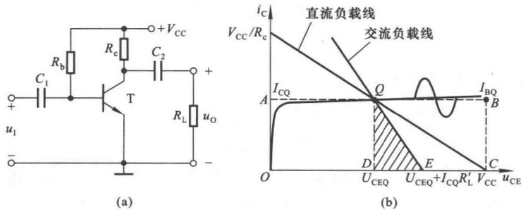

图 8.1.1 小功率共射放大电路的输出功率和效率的分析

(a) 共射放大电路 (b) 输出功率和效率的图解分析

---

406

第 8 章 功率放大电路

在输入信号为正弦波时，若集电极交流电流也为正弦波，如图中所画，则电源输出的平均电流为 $I_{CQ}$ ，因而电源提供的功率不变。交流负载线如图中所画，集电极电流交流分量的最大幅值为 $I_{CQ}$ ，管压降交流分量的最大幅值为 $I_{CQ}(R_{\mathrm{e}}//R_{\mathrm{L}})$ ，有效值为 $I_{CQ}(R_{\mathrm{e}}//R_{\mathrm{L}})/\sqrt{2}$ ，所以 $R_{\mathrm{L}}^{\prime}(=R_{\mathrm{e}}//R_{\mathrm{L}})$ 上可能获得的最大交流功率 $P_{om}^{\prime}$ 为

$$
P _ {\mathrm{om}} ^ {\prime} = \left(\frac {I _ {\mathrm{CQ}}}{\sqrt {2}}\right) ^ {2} R _ {\mathrm{L}} ^ {\prime} = \frac {1}{2} I _ {\mathrm{CQ}} (I _ {\mathrm{CQ}} R _ {\mathrm{L}} ^ {\prime})
$$

即图中三角形 $QDE$ 的面积。负载电阻 $R_{\mathrm{L}}$ 上所获得的功率（即输出功率）$P_{\mathrm{o}}$ 仅为 $P_{\mathrm{om}}^{\prime}$ 的一部分，$P_{\mathrm{o}}$ 小于 $P_{\mathrm{o}}^{\prime}$ 。从图解分析可知，若 $R_{\mathrm{L}}$ 数值很小，比如扬声器，仅为几欧，交流负载线很陡，则 $I_{\mathrm{CQ}}R_{\mathrm{L}}^{\prime}$ 必然很小，因而图8.1.1(a)所示电路不但输出功率很小，而且由于电源提供的功率始终不变，使得效率也很低，可见其不宜作为功率放大电路。

为了提高输出功率和效率,可以去掉集电极电阻  $R_{e}$ , 直接将负载接在晶体管的集电极, 并利用变压器实现阻抗变换, 同时调节 Q 点使晶体管达到极限工作状态。

## 二、变压器耦合功率放大电路

传统的功率放大电路为变压器耦合式电路。图8.1.2(a)所示为单管变压器耦合功率放大电路，因为变压器一次线圈电阻可忽略不计，所以直流负载线是垂直于横轴且过 $(V_{\mathrm{cc}},0)$ 的直线，如图(b)中所画。若忽略晶体管基极回路的损耗，则电源提供的功率为

$$
P _ {v} = I _ {\mathrm{CQ}} V _ {\mathrm{CC}} \tag {8.1.1}
$$

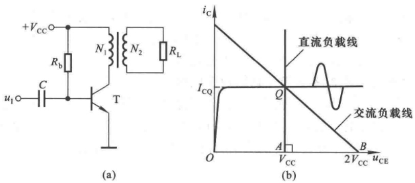

图 8.1.2 单管变压器耦合功率放大电路

(a) 电路 (b) 图解分析

静态时，电源提供的功率全部消耗在管子上。

从变压器一次侧向负载方向看的交流等效电阻为

$$
R _ {\mathrm{L}} ^ {\prime} = \left(\frac {N _ {1}}{N _ {2}}\right) ^ {2} R _ {\mathrm{L}}
$$

故交流负载线的斜率为 $-1 / R_{\mathrm{L}}^{\prime}$，且过 $Q$ 点，如图(b)中所画。通过调整变压器一次、二次侧的匝数比 $N_{1} / N_{2}$，实现阻抗匹配，可使交流负载线与横轴的交点约为 $2V_{\mathrm{CC}}$。此时，$R_{\mathrm{L}}^{\prime}$ 中交流电流的最大幅值为 $I_{\mathrm{CQ}}$，交流电压的最大幅值约为 $V_{\mathrm{CC}}$。因此，在理想变压器的情况下，最大输出功率为

$$
P _ {\mathrm{om}} = \frac {I _ {\mathrm{CQ}}}{\sqrt {2}} \cdot \frac {V _ {\mathrm{cc}}}{\sqrt {2}} = \frac {1}{2} I _ {\mathrm{CQ}} V _ {\mathrm{cc}}
$$

---

8.1 功率放大电路概述

407

即三角形 QAB 的面积。当输入正弦波电压时，集电极动态电流的波形如图(b)中所画。在不失真的情况下，集电极电流平均值仍为  $I_{CQ}$ ，故电源提供的功率仍如式(8.1.1)所示。可见，电路的最大效率  $P_{om}/P_{V}$  为 50%。

由于电源提供的功率不变，因而输入电压为零时，效率也为零；输入电压愈大， $i_{c}$  幅值愈大，负载获得的功率就愈大，管子的损耗就愈小，因而转换效率也就愈高。但是，人们通常希望输入信号为零时电源不提供功率，输入信号愈大，负载获得的功率也愈大，电源提供的功率也随之增大，从而提高效率。为了达到上述目的，在输入信号为零时，应使管子处于截止状态。而为了使负载上能够获得正弦波，常常需要采用两只管子，在信号的正、负半周交替导通，因此产生了变压器耦合乙类推挽功率放大电路，如图8.1.3(a)所示。

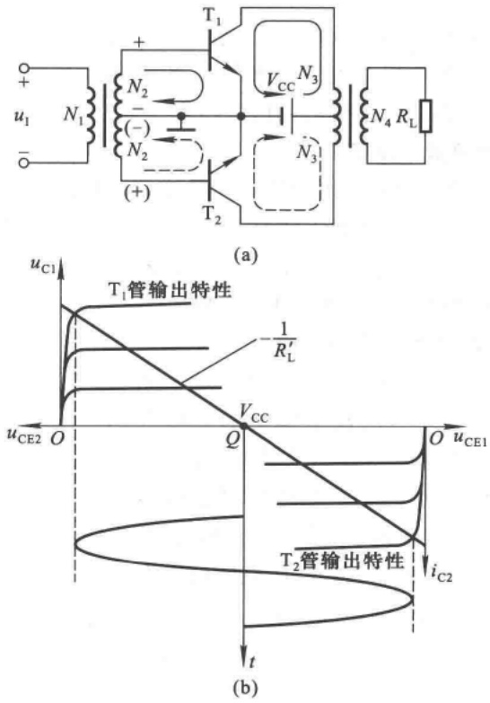

图 8.1.3 变压器耦合乙类推挽功率放大电路

(a) 电路 (b) 图解分析

在图8.1.3(a)所示电路中，设晶体管b-e间的开启电压可忽略不计，$\mathrm{T}_{1}$ 管和 $\mathrm{T}_{2}$ 管的特性完全相同，输入电压为正弦波。当输入电压为零时，由于 $\mathrm{T}_{1}$ 管和 $\mathrm{T}_{2}$ 管的发射结电压为零，均处于截止状态，因而电源提供的功率为零，负载上电压也为零。当输入信号使变压器二次电压极性为上“+”下“-”时，$\mathrm{T}_{1}$ 管导通，$\mathrm{T}_{2}$ 管截止，电流如图中实线所示；当输入信号使变压器二次电压极性为上“-”下“+”时，$\mathrm{T}_{2}$ 管导通，$\mathrm{T}_{1}$ 管截止，电流如图中虚线所示，因此负载 $R_{\mathrm{L}}$ 上获得正弦波电压，从而获得交流功率。图(b)为图(a)所示电路的图解分析，等效负载上能够获得的最大电压幅值近似等于 $V_{\mathrm{CC}}$ 。上述同类型管子 $(\mathrm{T}_{1}$ 和 $\mathrm{T}_{2})$ 在电路中交替导通的方式称为“推挽”工作

---

408

第8章 功率放大电路

方式。

在放大电路中，当输入信号为正弦波时，若晶体管在信号的整个周期内均导通（即导通角$\theta = 360^{\circ}$），则称之工作在甲类状态；若晶体管仅在信号的正半周或负半周导通（即 $\theta = 180^{\circ}$），则称之工作在乙类状态；若晶体管的导通时间大于半个周期且小于周期（即 $\theta = 180^{\circ} \sim 360^{\circ}$ 之间），则称之工作在甲乙类状态。可见，图8.1.2(a)所示电路中的晶体管工作在甲类状态，而图8.1.3(a)所示电路中的晶体管工作在乙类状态，故称该电路为乙类推挽功率放大电路。

提高功放效率的根本途径是减小功放管的功耗。方法之一是减小功放管的导通角，增大其在一个信号周期内的截止时间，从而减小管子所消耗的平均功率；因而在有些功放中，功放管工作在丙类状态 $^{①}$ ，即导通角 $\theta$ 小于 $180^{\circ}$ 。方法之二是使功放管工作在开关状态，也称为丁类 $^{②}$ 状态，此时管子仅在饱和导通时消耗功率，而且由于管压降很小，故无论电流大小，管子的瞬时功率都不大，因此管子的平均功耗也就不大，电路的效率必然较高。但是，应当指出，当功放中的功放管工作在丙类或丁类状态时，集电极电流将严重失真，因此必须采取措施消除失真，如采用谐振功率放大电路，从而使负载获得基本不失真的信号功率。

## 三、无输出变压器的功率放大电路

变压器耦合功率放大电路的优点是可以实现阻抗变换,缺点是体积庞大,笨重,消耗有色金

属，且效率较低，低频和高频特性均较差。无输出变压器的功率放大电路（简称为 $\mathrm{OTL}^{\text{③}}$ 电路）用一个大容量电容取代了变压器，如图8.1.4所示。虽然图中 $\mathrm{T}_{1}$ 为NPN型管，$\mathrm{T}_{2}$ 为PNP型管，但是它们的特性理想对称。

静态时，前级电路应使基极电位为 $V_{CC}/2$ ，由于 $T_{1}$ 和 $T_{2}$ 特性对称，发射极电位也为 $V_{CC}/2$ ，故电容上的电压为 $V_{CC}/2$ ，极性如图8.1.4所标注。设电容容量足够大，对交流信号可视为短路；晶体管b-e间的开启电压可忽略不计；输入电压为正弦波。当 $u_{i}>0$ 时， $T_{1}$ 管导通， $T_{2}$ 管截止，电流如图8.1.4中实线所示，由 $T_{1}$ 和 $R_{L}$ 组成的电路为

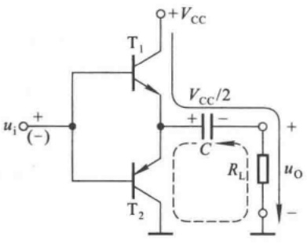

text_image

+Vcc
T1
+Vcc/2
ui (+)
(-)
C
RL
uO
-
T2

图8.1.4 OTL电路

射极输出形式， $u_{0}\approx u_{i}$ ；当 $u_{i}<0$ 时， $T_{2}$ 管导通， $T_{1}$ 管截止，电流如图8.1.4中虚线所示，由 $T_{2}$ 和 $R_{L}$ 组成的电路也为射极输出形式， $u_{0}\approx u_{i}$ ；故电路输出电压跟随输入电压。

由于一般情况下功率放大电路的负载电流很大,电容容量常选为几千微法,且为电解电容。电容容量愈大,电路低频特性将愈好。但是,当电容容量增大到一定程度时,由于两个极板面积很大,且卷制而成,电解电容不再是纯电容,而存在漏阻和电感效应,低频特性将不会明显改善。

## 四、无输出电容的功率放大电路

在集成运算放大电路一章中所介绍的互补输出级摒弃了输出电容,如图8.1.5所示,称为无输出电容的功率放大电路,简称OCL $^{④}$ 电路。

在 OCL 电路中， $T_{1}$  和  $T_{2}$  特性对称，采用了双电源供电。静态时， $T_{1}$  和  $T_{2}$  均截止，输出电压

<small>①② 关于丙类和丁类谐振功率放大电路可参阅谢嘉奎主编《电子线路 非线性部分(第四版)》第2章。</small>

<small>③ OTL 是 Output Transformerless 的缩写。</small>

<small>④ OCL 是 Output Capacitorless 的缩写。</small>

---

8.1 功率放大电路概述

409

为零。设晶体管b-e间的开启电压可忽略不计；输入电压为正弦波。当 $u_{i}>0$ 时， $T_{1}$ 管导通， $T_{2}$ 管截止，正电源供电，电流如图8.1.5中实线所示，电路为射极输出形式， $u_{0}\approx u_{i}$ ；当 $u_{i}<0$ 时， $T_{2}$ 管导通， $T_{1}$ 管截止，负电源供电，电流如图8.1.5中虚线所示，电路也为射极输出形式， $u_{0}\approx u_{i}$ 。可见，电路中“ $T_{1}$ 和 $T_{2}$ 交替工作，正、负电源交替供电，输出与输入之间双向跟随”。不同类型的两只晶体管（ $T_{1}$ 和 $T_{2}$ ）交替工作、且均组成射极输出形式的电路称为“互补”电路，两只管子的这种交替工作方式称为“互补”工作方式。

功率放大电路也可以采用功率 MOS 管实现, 图 8.1.6 为无输出电容的互补 MOS(CMOS) 功率放大电路, 其工作原理与图 8.1.5 所示电路相类似。

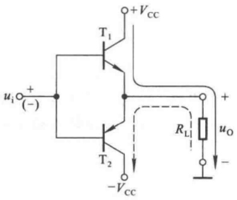

text_image

u_i + (-)
T_1
+V_CC
T_2
-V_CC
R_L
u_O
-

图 8.1.5 OCL 电路

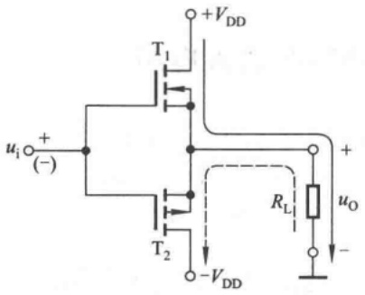

text_image

+VDD
T1
ui +
(-)
T2
-VDD
+
uo
RL
-

图 8.1.6 无输出电容的 CMOS 功率放大电路

## 五、桥式推挽功率放大电路

在 OCL 电路中采用了双电源供电,虽然就功放而言没有了变压器和大电容,但需制作两路

电源，且在制作电源时仍需用变压器或带铁心的电感、大电容等，所以就整个电路系统而言未必是最佳方案。为了实现单电源供电，且不用变压器和大电容，可采用桥式推挽功率放大电路，简称 BTL $^{①}$  电路，如图 8.1.7 所示。

图中四只管子特性理想对称,静态时均处于截止状态,负载上电压为零。设晶体管 b-e 间的开启电压可忽略不计;输入电压为正弦波,假设正方向如图中所标注。当  $u_{i}>0$  时,  $T_{1}$  和  $T_{4}$  管导通,  $T_{2}$  和  $T_{3}$

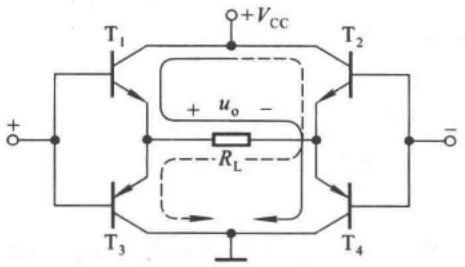

text_image

+VCC
T1
+
uo -
RL
-
T3
T2
T4
-

图8.1.7 BTL电路

管截止，电流如图8.1.7中实线所示，负载上获得正半周电压；当 $u_{i}<0$ 时， $T_{2}$ 和 $T_{3}$ 管导通， $T_{1}$ 和 $T_{4}$ 管截止，电流如图8.1.7中虚线所示，负载上获得负半周电压；因而负载电压跟随输入电压。

BTL 电路所用管子数量最多,难于做到四只管子特性理想对称;且管子的总损耗大,必然使得转换效率降低;电路采用双端输入双端输出方式,输入和输出均无接地点,因此有些场合不适用。

综上所述，变压器耦合乙类推挽电路、OTL、OCL和BTL电路中晶体管均工作在乙类状态，它们各有优缺点，使用时应根据需要合理选择。目前集成功率放大电路多为OTL和OCL电路，前

<small>① BTL 是 Balanced Transformerless 的缩写。</small>

---

410

第 8 章 功率放大电路

者需外接输出电容。当这两种集成电路不能满足负载所需功率要求时，应考虑采用分立元件OTL、OCL电路或变压器耦合乙类推挽功率放大电路。

## 思考题

8.1.1 为什么单管放大电路不适宜作功率放大电路？
8.1.2 在本节所介绍的功率放大电路中,为什么功放管均工作在乙类状态?
8.1.3 本节所述各种功率放大电路各具有什么特点？
8.1.4 在电源电压一定的情况下,为什么在功放电路中要使最大不失真输出电压最大?

## 8.2 互补功率放大电路

目前使用最广泛的是无输出变压器的功率放大电路(OTL 电路)和无输出电容的功率放大电路(OCL 电路)。本节以 OCL 电路为例,介绍功率放大电路最大输出功率和转换效率的分析计算,以及功放中晶体管的选择。

## 8.2.1 OCL电路的组成及工作原理

正如 3.3.4 节所述,为了消除图 8.1.5 所示的基本 OCL 电路所产生的交越失真,应当设置合适的静态工作点,使两只放大管均工作在临界导通或微导通状态。能够消除交越失真的 OCL 电路如图 8.2.1 所示。

在图中，静态时，从 $+V_{\mathrm{CC}}$ 经过 $R_{1}, R_{2}, \mathrm{D}_{1}, \mathrm{D}_{2}, R_{3}$ 到 $-V_{\mathrm{CC}}$ 有一个直流电流，它在 $\mathrm{T}_{1}$ 和 $\mathrm{T}_{2}$ 管两个基极之间所产生的电压为

$$
U _ {\mathrm{B1B2}} = U _ {\mathrm{R2}} + U _ {\mathrm{D1}} + U _ {\mathrm{D2}}
$$

使 $U_{\mathrm{B1B2}}$ 略大于 $\mathrm{T}_{1}$ 管发射结和 $\mathrm{T}_{2}$ 管发射结开启电压之和，从而使两只管子均处于微导通态，即都有一个微小的基极电流，分别为 $I_{\mathrm{B1}}$ 和 $I_{\mathrm{B2}}$ 。调节 $R_{2}$，可使发射极静态电位 $U_{\mathrm{E}}$ 为 $0\mathrm{V}$，即输出电压 $u_{0}$ 为 $0\mathrm{V}$。

当所加信号按正弦规律变化时，由于二极管 $\mathrm{D}_1$ 、 $\mathrm{D}_2$ 的动态电阻很小，而且 $R_{2}$ 的阻值也较小，因而可以认为 $\mathrm{T}_{1}$ 管基极电位的变化与 $\mathrm{T}_{2}$ 管基极电位的变化近似相等，即 $u_{\mathrm{b1}} \approx u_{\mathrm{b2}} \approx u_{\mathrm{i}}$；也就是说，可以认为两管基极之间电位差基本是一恒定值，两个基极的电位随 $u_{\mathrm{i}}$ 产生相同变化。这样，当 $u_{\mathrm{i}} > 0 \mathrm{~V}$ 且逐渐增大时，$u_{\mathrm{BE1}}$ 增大，$\mathrm{T}_{1}$ 管基极电流 $i_{\mathrm{B1}}$ 随之增大，发射极电流 $i_{\mathrm{E1}}$ 也必然增大，负载电阻 $R_{\mathrm{L}}$ 上得到正方向的电流；与此同时，$u_{\mathrm{i}}$ 的增大使 $u_{\mathrm{EB2}}$ 减小，当减小到一定数值时，$\mathrm{T}_{2}$ 管截止。同样道理，当 $u_{\mathrm{i}} < 0 \mathrm{~V}$ 且逐渐减小时，使 $u_{\mathrm{EB2}}$ 逐渐增大，$\mathrm{T}_{2}$ 管的基极电流 $i_{\mathrm{B2}}$ 随之增大，发射极电流 $i_{\mathrm{E2}}$ 也必然增大，负载电阻 $R_{\mathrm{L}}$ 上得到负方向的电流；与此同时，$u_{\mathrm{i}}$ 的减小，使 $u_{\mathrm{BE1}}$ 减小，当减小到一定数值时，$\mathrm{T}_{1}$ 管截止。这样，即使 $u_{\mathrm{i}}$ 很小，总能保证至少有一只晶体管导通，因而消除了交越失真。$\mathrm{T}_{1}$ 和 $\mathrm{T}_{2}$ 管在 $u_{\mathrm{i}}$ 作用下，其输入特性中的图解分析如图8.2.2所示。综上所述，输入信号的正半周主要是 $\mathrm{T}_{1}$ 管发射极驱动负载，而负半周主要是 $\mathrm{T}_{2}$ 管发射极驱动负载，而且两管的导通时间都比输入信号的半个周期长，即在信号电压很小时，两只管子同时导通，因而它们工作在甲乙类状态。

---

8.2 互补功率放大电路

411

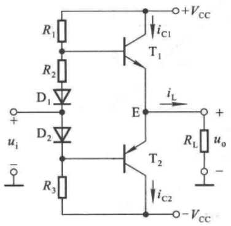

text_image

R1
R2
D1
D2
R3
ui
-
+
E
T1
iC1
iL
T2
iC2
-VCC
+VCC
RL uo
-

图 8.2.1 消除交越失真的 OCL 电路

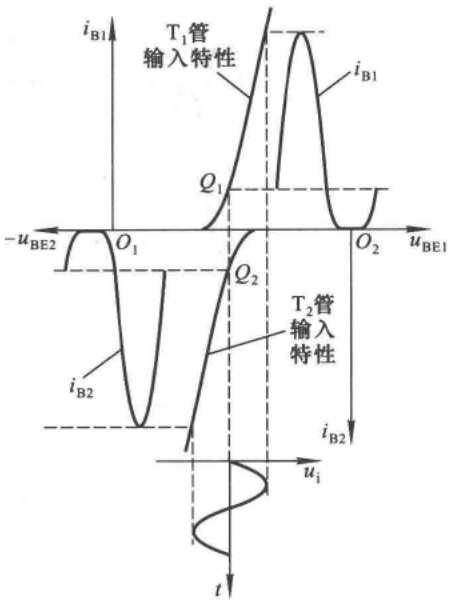

line

| Feature | Description |
| --- | --- |
| Y-axis | i_B1 / u_BE1 |
| X-axis | u_BE1 / u_i |
| Left side | T1管输入特性 (Input Characteristics) |
| Center-left | T2管输入特性 (Input Characteristics) |
| Left vertical dashed line | -u_BE2 |
| Center vertical dashed line | Q_1 |
| Right vertical dashed line | Q_2 |
| Right vertical dashed line | i_B2 |
| Bottom left curve | i_B2 |
| Bottom right curve | i_B2 |

图8.2.2 $\mathrm{T}_{1}$ 和 $\mathrm{T}_{2}$ 管在 $u_{i}$ 作用下输入特性中的图解分析

值得注意的是，若静态工作点失调，例如 $R_{2},\mathrm{D}_{1},\mathrm{D}_{2}$ 中任意一个元件虚焊，则从 $+V_{\mathrm{CC}}$ 经过$R_{1},\mathrm{T}_{1}$ 管发射结、 $\mathrm{T}_{2}$ 管发射结、 $R_{3}$ 到 $-V_{\mathrm{CC}}$ 形成一个通路，有较大的基极电流 $I_{\mathrm{B1}}$ 和 $I_{\mathrm{B2}}$ 流过，从而导致 $\mathrm{T}_{1}$ 管和 $\mathrm{T}_{2}$ 管有很大的集电极直流电流，且每只管子的管压降均为 $V_{\mathrm{CC}}$ ，以至于 $\mathrm{T}_{1}$ 管和 $\mathrm{T}_{2}$ 管可能因功耗过大而损坏。因此，常在输出回路中接入熔断器以保护功放管和负载。

## 8.2.2 OCL 电路的输出功率及效率

功率放大电路最重要的技术指标是电路的最大输出功率 $P_{om}$ 及效率 $\eta$ 。为了求解 $P_{om}$，需首先求出负载上能够得到的最大输出电压幅值。当输入电压足够大，且又不产生饱和失真时，电路的图解分析如图8.2.3所示。图中Ⅰ区为 $T_1$ 管的输出特性，Ⅱ区为 $T_2$ 管的输出特性。因两只管子的静态电流很小，所以可以认为静态工作点在横轴上，如图中所标注，因而最大输出电压幅值等于电源电压减去晶体管的饱和压降，即 $(V_{CC} - U_{CES1})$ 。

实际上，即使不画出图来，也能得到同样的结论。可以想象，在正弦波信号的正半周， $u_{i}$  从零逐渐增大时，输出电压随之逐渐增大， $T_{1}$  管管压降必然逐渐减小，当管压降下降到饱和管压降时，输出电压达到最大幅值，其值为 $(V_{\mathrm{CC}} - U_{\mathrm{CES1}})$ ，因此最大不失真输出电压的有效值

$$
U _ {\mathrm{om}} = \frac {V _ {\mathrm{CC}} - U _ {\mathrm{CES1}}}{\sqrt {2}}
$$

设饱和管压降

$$
U _ {\mathrm{CES1}} = - U _ {\mathrm{CES2}} = U _ {\mathrm{CES}} \tag {8.2.1}
$$

最大输出功率

$$
P _ {\mathrm{om}} = \frac {U _ {\mathrm{om}} ^ {2}}{R _ {\mathrm{L}}} = \frac {(V _ {\mathrm{CC}} - U _ {\mathrm{CES}}) ^ {2}}{2 R _ {\mathrm{L}}} \tag {8.2.2}
$$

---

412

第 8 章 功率放大电路

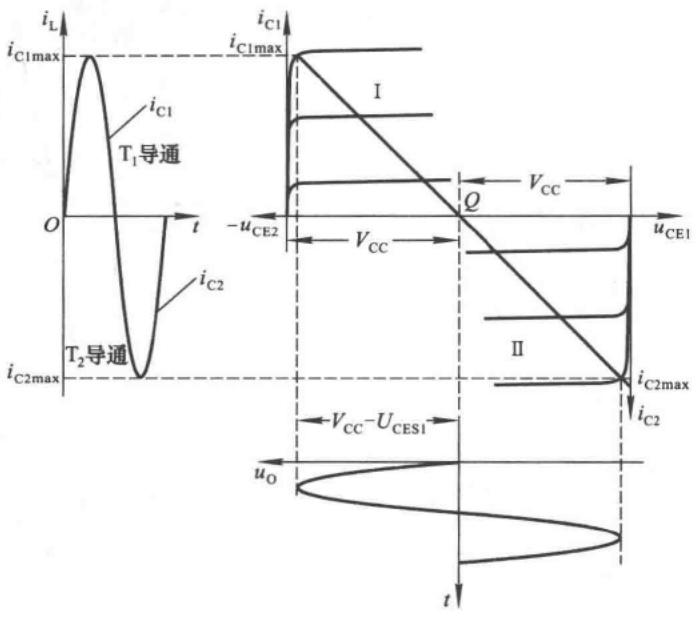

line

| Parameter | Description |
| --- | --- |
| iL | Inductor Current (Left panel) |
| iC1max | Capacitor Current (Left panel) |
| iC2max | Capacitor Current (Left panel) |
| uCE1 | Voltage (Right panel) |
| -uCE2 | Critical Voltage Level |
| VCC | Voltage Difference between curves |
| VCC-UCES1 | Voltage difference between curves |
| t | Time (t) |

图 8.2.3 OCL 电路的图解分析

在忽略基极回路电流的情况下,电源  $V_{cc}$  提供的电流

$$
i _ {\mathrm{c}} = \frac {V _ {\mathrm{cc}} - U _ {\mathrm{CES}}}{R _ {\mathrm{L}}} \sin \omega t
$$

电源在负载获得最大交流功率时所消耗的平均功率等于其平均电流与电源电压之积,其表达式为

$$
P _ {V} = \frac {1}{\pi} \int_ {0} ^ {\pi} \frac {V _ {\mathrm{CC}} - U _ {\mathrm{CES}}}{R _ {\mathrm{L}}} \sin \omega t \cdot V _ {\mathrm{CC}} \mathrm{d} \omega t
$$

整理后可得

$$
P _ {v} = \frac {2}{\pi} \cdot \frac {V _ {\mathrm{cc}} (V _ {\mathrm{cc}} - U _ {\mathrm{CES}})}{R _ {\mathrm{L}}} \tag {8.2.3}
$$

因此,转换效率

$$
\eta = \frac {P _ {\mathrm{om}}}{P _ {V}} = \frac {\pi}{4} \cdot \frac {V _ {\mathrm{CC}} - U _ {\mathrm{CES}}}{V _ {\mathrm{CC}}} \tag {8.2.4}
$$

在理想情况下,即饱和管压降可忽略不计的情况下

$$
P _ {\mathrm{om}} = \frac {U _ {\mathrm{om}} ^ {2}}{R _ {\mathrm{L}}} = \frac {V _ {\mathrm{CC}} ^ {2}}{2 R _ {\mathrm{L}}} \tag {8.2.5}
$$

$$
P _ {V} = \frac {2}{\pi} \cdot \frac {V _ {\mathrm{CC}} ^ {2}}{R _ {\mathrm{L}}} \tag {8.2.6}
$$

$$
\eta = \frac{\pi}{4}\approx 78.5\% \tag{8.2.7}
$$

---

8.2 互补功率放大电路

413

应当指出,大功率管的饱和管压降常为2\~3 V,因而一般情况下都不能忽略饱和管压降,即不能用式(8.2.5)和式(8.2.7)计算电路的最大输出功率和效率。

## 8.2.3 OCL电路中晶体管的选择

在功率放大电路中,应根据晶体管所承受的最大管压降、集电极最大电流和最大功耗来选择晶体管。

## 一、最大管压降

从 OCL 电路工作原理的分析可知,两只功放管中处于截止状态的管子将承受较大的管压降。设输入电压为正半周, $T_{1}$  导通, $T_{2}$  截止,当  $u_{i}$  从零逐渐增大到峰值时, $T_{1}$  和  $T_{2}$  管的发射极电位  $u_{E}$  从零逐渐增大到( $V_{CC}-U_{CES1}$ ),因此, $T_{2}$  管压降  $u_{EC2}$  的数值  $[u_{EC2}=u_{E}-(-V_{CC})=u_{E}+V_{CC}]$  将从  $V_{CC}$  增大到最大值

$$
u _ {\mathrm{EC2max}} = (V _ {\mathrm{CC}} - U _ {\mathrm{CES1}}) + V _ {\mathrm{CC}} = 2 V _ {\mathrm{CC}} - U _ {\mathrm{CES1}} \tag {8.2.8}
$$

利用同样的分析方法可得，当 $u_{\mathrm{i}}$ 为负峰值时， $\mathrm{T}_{1}$ 管承受最大管压降，数值为 $[2V_{\mathrm{CC}} - (-U_{\mathrm{CES2}})]$ 。所以，考虑留有一定的余量，管子承受的最大管压降为

$$
\left| U _ {\mathrm{CEmax}} \right| = 2 V _ {\mathrm{CC}} \tag {8.2.9}
$$

## 二、集电极最大电流

从电路最大输出功率的分析可知,晶体管的发射极电流等于负载电流,负载电阻上的最大电压为  $V_{CC} - U_{CES1}$ , 故集电极电流的最大值

$$
I _ {\mathrm{Cmax}} \approx I _ {\mathrm{Emax}} = \frac {V _ {\mathrm{CC}} - U _ {\mathrm{CES1}}}{R _ {\mathrm{L}}}
$$

考虑留有一定的余量

$$
I _ {\mathrm{Cmax}} = \frac {V _ {\mathrm{CC}}}{R _ {\mathrm{L}}} \tag {8.2.10}
$$

## 三、集电极最大功耗

在功率放大电路中，电源提供的功率，除了转换成输出功率外，其余部分主要消耗在晶体管上，可以认为晶体管所损耗的功率 $P_{\mathrm{T}} = P_{\mathrm{V}} - P_{\mathrm{o}}$ 。当输入电压为零，即输出功率最小时，由于集电极电流很小，使管子的损耗很小；当输入电压最大，即输出功率最大时，由于管压降很小，管子的损耗也很小；可见，管耗最大既不会发生在输入电压最小时，也不会发生在输入电压最大时。下面列出晶体管集电极功耗 $P_{\mathrm{T}}$ 与输出电压峰值 $U_{\mathrm{OM}}$ 的关系式，然后对 $U_{\mathrm{OM}}$ 求导，令导数为零，得出的结果就是 $P_{\mathrm{T}}$ 最大的条件。

管压降和集电极电流瞬时值的表达式分别为

$$
u _ {\mathrm{CE}} = (V _ {\mathrm{CC}} - U _ {\mathrm{OM}} \sin \omega t), \quad i _ {\mathrm{C}} = \frac {U _ {\mathrm{OM}}}{R _ {\mathrm{L}}} \cdot \sin \omega t
$$

功耗 $P_{\mathrm{T}}$ 为功放管所损耗的平均功率，所以每只晶体管的集电极功耗表达式为

$$
\begin{array}{l} P _ {\mathrm{T}} = \frac {1}{2 \pi} \int_ {0} ^ {\pi} \left(V _ {\mathrm{CC}} - U _ {\mathrm{OM}} \sin \omega t\right) \cdot \frac {U _ {\mathrm{OM}}}{R _ {\mathrm{L}}} \cdot \sin \omega t \mathrm{d} \omega t \\ = \frac {1}{R _ {\mathrm{L}}} \left(\frac {V _ {\mathrm{CC}} U _ {\mathrm{OM}}}{\pi} - \frac {U _ {\mathrm{OM}} ^ {2}}{4}\right) \\ \end{array}
$$

---

414

第8章 功率放大电路

令 $\frac{dP_{T}}{dU_{OM}}=0$ ，可以求得， $U_{OM}=\frac{2}{\pi}\cdot V_{CC}\approx0.6V_{CC}$ 。

以上分析表明，当 $U_{\mathrm{OM}} \approx 0.6 V_{\mathrm{CC}}$ 时，$P_{\mathrm{T}} = P_{\mathrm{Tmax}}$。将 $U_{\mathrm{OM}}$ 代入 $P_{\mathrm{T}}$ 的表达式，就可得出

$$
P _ {\mathrm{Tmax}} = \frac {V _ {\mathrm{CC}} ^ {2}}{\pi^ {2} R _ {\mathrm{L}}} \tag {8.2.11}
$$

当 $U_{\mathrm{CES}} = 0$ 时，根据式(8.2.5)可得

$$
P _ {\mathrm{Tmax}} = \frac {2}{\pi^ {2}} P _ {\mathrm{om}} \approx 0. 2 P _ {\mathrm{om}} \Big | _ {U _ {\mathrm{CES}} = 0} \tag {8.2.12}
$$

可见,晶体管集电极最大功耗仅为理想(饱和管压降为零)时最大输出功率的五分之一。

在查阅手册选择晶体管时,应使极限参数

$$
\left\{ \begin{array}{l l} U _ {(\mathrm{BR}) \mathrm{CEO}} > 2 V _ {\mathrm{CC}} & (8. 2. 1 3 \mathrm{a}) \\ I _ {\mathrm{CM}} > \frac {V _ {\mathrm{CC}}}{R _ {\mathrm{L}}} & (8. 2. 1 3 \mathrm{b}) \\ P _ {\mathrm{CM}} > 0. 2 P _ {\mathrm{om}} \Big | _ {U _ {\mathrm{CES}} = 0} & (8. 2. 1 3 \mathrm{c}) \end{array} \right.
$$

这里仍需强调，在选择晶体管时，其极限参数，特别是 $P_{CM}$ 应留有一定的余量，并严格按手册要求安装散热片。

【例 8.2.1】在图 8.2.1 所示电路中, 已知  $V_{CC} = 15 \, V$ , 输入电压为正弦波, 晶体管的饱和管压降  $\left| U_{CES} \right| = 3 \, V$ , 电压放大倍数约为 1, 负载电阻  $R_{L} = 4 \, \Omega$ 。

(1) 求解负载上可能获得的最大功率和效率；
(2) 若输入电压最大有效值为  $8 \, V$ ，则负载上能够获得的最大功率为多少？
(3) 若  $T_{1}$  管的集电极和发射极短路, 则将产生什么现象?

解:(1) 根据式(8.2.2)、(8.2.4)可得

$$
\begin{array}{l} P _ {\mathrm{om}} = \frac {(V _ {\mathrm{CC}} - | U _ {\mathrm{CES}} |) ^ {2}}{2 R _ {\mathrm{L}}} = \frac {(1 5 - 3) ^ {2}}{2 \times 4} \mathrm{W} = 1 8 \mathrm{W} \\ \eta = \frac {\pi}{4} \cdot \frac {V _ {\mathrm{cc}} - | U _ {\mathrm{CES}} |}{V _ {\mathrm{cc}}} \approx \frac {1 2 - 3}{1 2} \times 78.5\% = 62.8\% \\ \end{array}
$$

(2) 因为  $U_{o} \approx U_{i}$ ，所以  $U_{om} \approx 8 V$ 。最大输出功率

$$
P _ {\mathrm{om}} = \frac {U _ {\mathrm{om}} ^ {2}}{R _ {\mathrm{L}}} = \left(\frac {8 ^ {2}}{4}\right) \mathrm{W} = 1 6 \mathrm{W}
$$

可见,功率放大电路的最大输出功率除了决定于功放自身的参数外,还与输入电压是否足够大有关。

（3）若  $T_{1}$  管的集电极和发射极短路，则  $T_{2}$  管静态管压降为  $2V_{CC}$ ，且从  $+V_{CC}$  经  $T_{2}$  管的 e-b、 $R_{3}$  至  $-V_{CC}$  形成基极静态电流，由于  $T_{2}$  管工作在放大状态，集电极电流势必很大，使之因功耗过大而损坏。

【例 8.2.2】已知图 8.2.1 所示电路的负载电阻为  $8 \Omega$ ，晶体管饱和管压降  $\left| U_{CES} \right| = 2 V$ ，试问:

(1) 若负载所需最大功率为  $16 \, W$ ，则电源电压至少应取多少伏？
(2) 若电源电压取 20 V, 则晶体管的最大集电极电流、最大管压降和集电极最大功耗各为

---

8.3 功率放大电路的安全运行

415

多少？

解:(1) 根据  $P_{\mathrm{om}} = \frac{(V_{\mathrm{CC}} - |U_{\mathrm{CES}}|)^{2}}{2R_{\mathrm{L}}} = \frac{(V_{\mathrm{CC}} - 2)^{2}}{2 \times 8} \, \mathrm{W} = 16 \, \mathrm{W}$ ，可求出电源电压

$$
V _ {\mathrm{cc}} \geqslant 1 8 \mathrm{V}
$$

(2) 最大不失真输出电压的峰值

$$
U _ {\mathrm{OM}} = V _ {\mathrm{CC}} - \left| U _ {\mathrm{CES}} \right| = (2 0 - 2) \mathrm{V} = 1 8 \mathrm{V}
$$

因而负载电流最大值,即晶体管集电极最大电流

$$
I _ {\mathrm{Cmax}} \approx \frac {U _ {\mathrm{OM}}}{R _ {\mathrm{L}}} = \left(\frac {1 8}{8}\right) \mathrm{A} = 2. 2 5 \mathrm{A}
$$

最大管压降

$$
U _ {\mathrm{CEmax}} = 2 V _ {\mathrm{CC}} - U _ {\mathrm{CES}} = (2 \times 2 0 - 2) \mathrm{V} = 3 8 \mathrm{V}
$$

根据式(8.2.11)，晶体管集电极最大功耗

$$
P _ {\mathrm{Tmax}} = \frac {V _ {\mathrm{CC}} ^ {2}}{\pi^ {2} R _ {\mathrm{L}}} = \left(\frac {2 0 ^ {2}}{\pi^ {2} \times 8}\right) \mathrm{W} \approx 5. 0 7 \mathrm{W}
$$

## 思考题

8.2.1 试分析 OTL、BTL 电路的最大不失真输出电压、最大输出功率和效率。

## 8.3 功率放大电路的安全运行

在功率放大电路中,功放管既要流过大电流,又要承受高电压。例如,在 OCL 电路中,只有功放管满足式(8.2.13)所示极限值的要求,电路才能正常工作。因此,所谓功率放大电路的安全运行,就是要保证功放管安全工作。在实用电路中,常加保护措施,以防止功放管过电压、过电流和过功耗。本节仅就功放管的二次击穿和散热问题作简单介绍;关于保护措施,可参阅 9.5.2 节。

## 8.3.1 功放管的二次击穿

从晶体管的输出特性可知，对于某一条输出特性曲线，当c-e之间电压增大到一定数值时，晶体管将产生击穿现象；而且， $I_{B}$ 愈大，击穿电压愈低，称这种击穿为“一次击穿”。晶体管在一次击穿后，集电极电流会骤然增大，若不加以限制，则晶体管的工作点变化到临界点A时，工作点将以毫秒甚至微秒级的高速度从A点到B点，此时电流猛增，而管压降却减小，如图8.3.1(a)所示，称为“二次击穿”。晶体管经二次击穿后，性能将明显下降，甚至造成永久性损坏。

$I_{B}$  不同时二次击穿的临界点不同, 将它们连接起来, 便得到二次击穿临界曲线, 简称为 S/B 曲线, 如图 (b) 中所画。从二次击穿产生的过程可知, 防止晶体管的一次击穿, 并限制其集电极电流, 就可避免二次击穿。例如, 在功放管的 c-e 间加稳压管, 就可防止其一次击穿。

---

416

第 8 章 功率放大电路

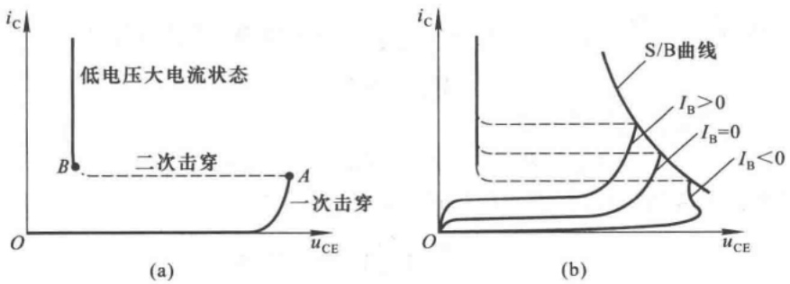

图 8.3.1 晶体管的击穿现象

(a) 二次击穿 (b) S/B 曲线

## 8.3.2 功放管的散热问题

功放管损坏的重要原因是其实际耗散功率超过额定数值 $P_{CM}$ 。而晶体管的耗散功率取决于管子内部的PN结（主要是集电结）温度 $T_{j}$ 。当 $T_{j}$ 超过允许值后，集电极电流将急剧增大而烧坏管子。硅管的结温允许值为120\~180℃，锗管的结温允许值为85℃左右。耗散功率等于结温在允许值时集电极电流与管压降之积。管子的功耗愈大，结温愈高。因而改善功放管的散热条件，可以在同样的结温下提高集电极最大耗散功率 $P_{CM}$ ，也就可以提高输出功率。

## 一、热阻的概念

热在物体中传导时所受到的阻力用“热阻”来表示。当晶体管集电结消耗功率时，PN结产生温升，热量要从管芯向外传递。设结温为 $T_{j}$ ，环境温度为 $T_{a}$ ，则温差 $\Delta T(=T_{j}-T_{a})$ 与集电结耗散功率 $P_{c}$ 成正比，比例系数称为热阻 $R_{T}$ ，即

$$
\Delta T = T _ {\mathrm{j}} - T _ {\mathrm{a}} = P _ {\mathrm{C}} R _ {\mathrm{T}} \tag {8.3.1}
$$

可见，热阻 $R_{T}$ 是传递单位功率时所产生的温差，单位为 $^{\circ}C/W$ 。 $R_{T}$ 愈大，表明相同温差下能够散发的热能愈小。换言之， $R_{T}$ 愈大，表明同样的功耗下结温升愈大。可见，热阻是衡量晶体管散热能力的一个重要参数。

当晶体管结温功耗达到最大允许值 $T_{\mathrm{jM}}$ 时，集电结功耗也达到 $P_{\mathrm{CM}}$，若环境温度为 $T_{\mathrm{a}}$，则

$$
\Delta T = T _ {\mathrm{jM}} - T _ {\mathrm{a}} = P _ {\mathrm{CM}} R _ {\mathrm{T}}
$$

$$
P _ {\mathrm{CM}} = \frac {T _ {\mathrm{jM}} - T _ {\mathrm{a}}}{R _ {\mathrm{T}}} \tag {8.3.2}
$$

式(8.3.2)中,若管子的型号确定,则 $T_{jM}$ 也就确定。 $T_{a}$ 常以25℃为基准,因而要想增大 $P_{CM}$ ,必须减小 $R_{T}$ 。

## 二、热阻的估算

以晶体管为例，管芯(J)向环境(A)散热的途径有两条:管芯(J)到外壳(C)，再经外壳到环境；或者管芯(J)到外壳(C)，再经散热片(S)到环境。即 $\mathrm{J}\rightarrow \mathrm{C}\rightarrow \mathrm{A}$ 或 $\mathrm{J}\rightarrow \mathrm{C}\rightarrow \mathrm{S}\rightarrow \mathrm{A}$，如图8.3.2(a)所示。设J-C间热阻为 $R_{\mathrm{jc}}$ ，C-A间热阻为 $R_{\mathrm{ca}}$ ，C-S间热阻为 $R_{\mathrm{cs}}$ ，S-A间热阻为$R_{\mathrm{sa}}$ ，则反映晶体管散热情况的热阻模型如图(b)所示。

---

8.3 功率放大电路的安全运行

417

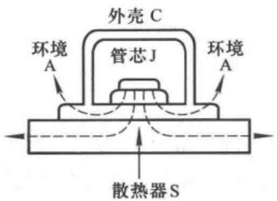

text_image

外壳 C
管芯 J
环境 A
环境 A
散热器 S

(a)

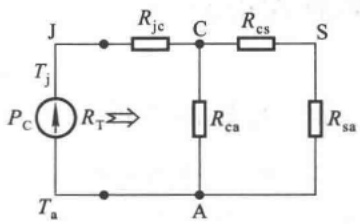

text_image

J
Rjc
C
Rcs
S
Tj
PC
RT
Ra
Ta
A
Rsa

(b)

图 8.3.2 晶体管的散热

(a) 晶体管的散热示意图 (b) 晶体管散热的等效电路

在小功率放大电路中,放大管一般不加散热器,故晶体管的等效热阻为

$$
R _ {\mathrm{T}} = R _ {\mathrm{je}} + R _ {\mathrm{ea}} \tag {8.3.3}
$$

在大功率放大电路中，功放管一般均要加散热器，且 $R_{cs} + R_{sa} \ll R_{ca}$ ，故

$$
R _ {\mathrm{T}} \approx R _ {\mathrm{jc}} + R _ {\mathrm{cs}} + R _ {\mathrm{sa}} \tag {8.3.4}
$$

不同型号的管子  $R_{jc}$  不同，如 3AD30 的  $R_{jc}$  为 1℃/W，而 3DG7 的  $R_{jc}$  却大于 150℃/W，可见其差别很大。 $R_{ca}$  与外壳所用材料和几何尺寸有关，如大功率管 3AD30 的  $R_{ca}$  为 30℃/W，而小功率管 3DG7 的  $R_{ca}$  为 150℃/W。

式(8.3.4)中 $R_{cs}$ 既取决于晶体管和散热器之间是否加绝缘层（如聚乙烯薄膜、0.05\~0.1 mm的云母片），又取决于二者之间的接触面积和压紧程度。 $R_{sa}$ 与散热器所用材料及其表面积大小、厚薄、颜色，和散热片的安装位置等因素紧密相关。

## 三、功放管的散热器

两种散热器如图 8.3.3 所示。经验表明，当散热器垂直或水平放置时，有利于通风，故散热效果较好。散热器表面钝化涂黑，有利于热辐射，从而可以减小热阻。在产品手册中给出的最大集电极耗散功率是在指定散热器（材料、尺寸等）及一定环境温度下的允许值；若改善散热条件，如加大散热器、用电风扇强制风冷，则可获得更大一些的耗散功率。

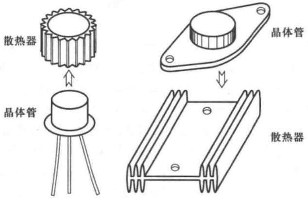

text_image

散热器
晶体管
晶体管
散热器

图 8.3.3 两种散热器

---

418

第 8 章 功率放大电路

## 8.4 集成功率放大电路

## 8.4.1 集成功率放大电路的分析

PA04 是一种以采用 MOS 管和晶体管相结合制造的 BiCMOS 集成功放, 具有电源电压范围大、输出功率大、输入阻抗高、转换速率高、静态电流小、有睡眠模式控制等特点, 可应用于驱动声纳换能器和扬声器。

## 一、PA04 内部电路

PA04 内部电路原理图如图 8.4.1 所示,与通用型集成运放相类似,是一个三级放大电路,如点画线所划分。

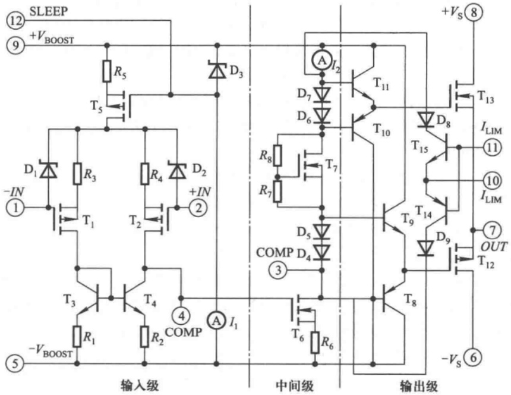

text_image

⑫ SLEEP
⑨ +VBOOST
R5
T5
D3
A I2
T11
D7
D6
T10
R8
T7
R7
D8
T15
I_LIM
⑪
-IN
① T1
T2
D2
+IN
②
D1
R3
R4
T3
T4
COMP D4
③
COMP D4
④ A I1
T9
T14
D9
T12
⑦ OUT
T13
T12
-VS ⑥
输入级 中间级 输出级

图 8.4.1 PA04 内部电路原理图

第一级为差分放大电路，NMOS管 $\mathrm{T}_{1},\mathrm{T}_{2}$ 分别作为差分放大电路的放大管；信号从 $\mathrm{T}_{1},\mathrm{T}_{2}$ 管的栅极输入，从 $\mathrm{T}_{2}$ 的漏极输出，为双端输入、单端输出差分电路。晶体管 $\mathrm{T}_{3},\mathrm{T}_{4}$ 和电阻 $R_{1},R_{2}$ 组成比例电流源，作为 $\mathrm{T}_{1},\mathrm{T}_{2}$ 的有源负载，可以使单端输出差分电路的增益近似等于双端输出电路的增益。NMOS管 $\mathrm{T}_{5}$ 、电阻 $R_{5}$ 、二极管 $\mathrm{D}_3$ 以及恒流源 $I_{1}$ 作为偏置电路，给第一级提供静态电流。

第二级为共源放大电路，NMOS管 $T_{6}$ 为放大管，电流源 $I_{2}$ 作为有源负载，以增大放大倍数。

第三级为互补输出级电路，NMOS管 $\mathrm{T}_{13}$ 和PMOS管 $\mathrm{T}_{12}$ 组成CMOS输出电路，NMOS管 $\mathrm{T}_7$ 和电阻 $R_{7}, R_{8}$ 提供合适的偏置电压。功率MOS管 $\mathrm{T}_{13}$ 和 $\mathrm{T}_{12}$ 栅极工作电流比小功率MOS管大，因此，晶体管 $\mathrm{T}_8, \mathrm{T}_9$ 以及 $\mathrm{T}_{10}, \mathrm{T}_{11}$ 分别组成互补输出级电路为它们提供合适的电流，而二极管 $\mathrm{D}_4, \mathrm{D}_5$ 以及 $\mathrm{D}_6, \mathrm{D}_7$ 则分别为两对晶体管提供合适的偏置电压。另外，二极管 $\mathrm{D}_8, \mathrm{D}_9$ 以及晶体管 $\mathrm{T}_{14}, \mathrm{T}_{15}$ 组成输出级保护电路，当功率MOS管输出电流过大时，它们将导通分流，从而使输出级电路不至

---

8.4 集成功率放大电路

419

于电流过大而损坏。使用时需要将第 10 和 11 端外接采样电阻。

利用瞬时极性法可以判断出，引脚1为反相输入端，引脚2为同相输入端。 $+V_{s}$  和  $-V_{s}$  为电源端，可双电源供电，为OCL电路；若采用单电源供电，则为OTL电路。

## 二、PA04的引脚图

PA04 的外形和引脚排列如图 8.4.2 所示。

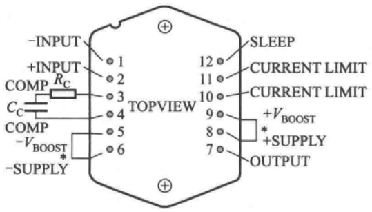

text_image

-INPUT
+INPUT
COMP RC
CC
COMP
-VBOOST *
-SUPPLY
TOPVIEW
1
2
3
4
5
6
SLEEP
12
CURRENT LIMIT
11
CURRENT LIMIT
10
9
8
7
+VBOOST
* +SUPPLY
OUTPUT

图8.4.2 PA04的外形和引脚排列

其中引脚1和2为差分输入端。引脚3和4为相位补偿端，使用时需外接电阻 $R_{c}$ 和电容 $C_{c}$ 进行相应补偿， $R_{c}$ 和 $C_{c}$ 的值与使用的负反馈电路的电压放大倍数有关，并影响带宽，如表8.4.1所示。引脚6和8为电源引脚，给MOS管 $T_{12}$ 和 $T_{13}$ 供电。引脚5和9为电压提升端，为除了

表 8.4.1 ${R}_{\mathrm{c}}$ 和 ${C}_{\mathrm{c}}$ 的值与电压放大倍数和带宽的近似关系

| 电压放大倍数 | $R_c/\Omega$ | $C_c/pF$ | 带宽/kHz |
| --- | --- | --- | --- |
| 1 | 120 | 470 | 10 |
| >3 | 120 | 220 | 23 |
| ≥10 | 120 | 120 | 46 |

MOS 管  $T_{12}$  和  $T_{13}$  以外的电路供电, 可外接比电源引脚 6 和 8 电压值高的电压, 也可分别接至电源

引脚6和8。引脚7为输出端。引脚10和11为输出限流端，使用时需要在输出端连接一个采样电阻 $R_{\mathrm{CL}}$，并将这两个引脚分别连接至 $R_{\mathrm{CL}}$ 两端，如图8.4.3所示。引脚12为睡眠控制端，高电平有效，可以使电路在不工作时进入睡眠模式，此时电路消耗的电流非常小；当不使用睡眠控制时，该引脚可悬空。

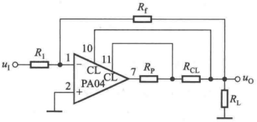

text_image

u₁
R₁
1
10
CL
PA04
+
-
2
11
CL
7
Rₚ
Rₐₐₐ
R_f
Rₐₐ
uₒ
R_L

图8.4.3 PA04的限流端连接方法

## 8.4.2 集成功率放大电路的主要性能指标

集成功率放大电路的主要性能指标有最大输出功率、电源电压范围、电源静态电流、电压增益、带宽、输入阻抗、输入偏置电流、总谐波失真等。

PA04 的电源电压范围为  $\pm15 \sim \pm100$  V。对于同一负载，当电源电压不同时，最大输出功率

---

420

第 8 章 功率放大电路

的数值将不同；而对于同一电源电压值，当负载不同时，最大输出功率的数值也将不同。当已知电源的静态电流和负载电流最大值时，可求出电源的功耗，从而得到转换效率。

几种典型产品的性能如表 8.4.2 所示。

表 8.4.2 几种集成功放的主要参数

| 型号 | LM386-4 | LM2877 | TDA1514A | TDA1556 | PA04 |
| --- | --- | --- | --- | --- | --- |
| 电路类型 | OTL | OTL(双通道) | OCL | BTL(双通道) | OCL |
| 电源电压范围/V | 5.0~18 | 6.0~24 | ±10~±30 | 6.0~18 | ±15~±100 |
| 电源静态电流/mA | 4 | 25 | 56 | 80 | 70 |
| 输入阻抗/kΩ | 50 |  | 1 000 | 120 | $10^8$ |
| 输出功率/W | 1($V_{CC}=16V$,$R_L=32Ω$) | 4.5 | 48($V_{CC}=±23V$,$R_L=4Ω$) | 22($V_{CC}=14.4V$,$R_L=4Ω$) | 400(音频输出) |
| 电压增益/dB | 26~46 | 70(开环) | 89(开环)30(闭环) | 26(闭环) | 可由电路设置 |
| 频带宽/kHz | 300(1,8开路) |  | 0.02~25 | 0.02~15 | 90($V_{OPP}=180V$,$R_L=4.5Ω$,$R_c=120Ω$,$C_c=100pF$) |
| 增益频带宽积/kHz |  | 65 |  |  | 2 000($I_o=10A$) |
| 总谐波失真/%(或dB) | 0.2% | 0.07% | -90 dB | 0.1% |  |

表 8.4.2 中的电压增益均在信号频率为 1 kHz 条件下测试所得。应当指出，表中所示均为典型数据，使用时应进一步查阅手册，以便获得更确切的数据。

## 8.4.3 集成功率放大电路的应用

## 一、集成 OTL 电路的应用

LM386 是一种音频集成功放, 其性能指标如表 8.4.2 所示。图 8.4.4 所示为 LM386 的一种基本用法, 也是外接元件最少的一种用法, $C_1$ 为输出电容。由于引脚 1 和 8 开路, 集成功放的电压增益为 26 dB, 即电压放大倍数为 20。利用 $R_w$ 可调节扬声器的音量。R 和 $C_2$ 串联构成校正网络用来进行相位补偿。

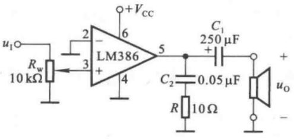

text_image

u1○─Rw
10 kΩ
2
LM386
+
Vcc
6
3
4
5
C1
250 μF
+
C2
0.05 μF
R
10 Ω
+
uo
-

图 8.4.4 LM386 外接元件最少的用法

---

8.4 集成功率放大电路

421

静态时输出电容上电压为  $V_{CC}/2$ ，LM386 的最大不失真输出电压的峰-峰值约为电源电压  $V_{CC}$ 。设负载电阻为  $R_{L}$ ，最大输出功率表达式为

$$
P _ {\mathrm{om}} \approx \frac {\left(\frac {V _ {\mathrm{CC}} / 2}{\sqrt {2}}\right) ^ {2}}{R _ {\mathrm{L}}} = \frac {V _ {\mathrm{CC}} ^ {2}}{8 R _ {\mathrm{L}}} \tag {8.4.1}
$$

此时的输入电压有效值的表达式为

$$
U _ {\mathrm{im}} = \frac {\frac {V _ {\mathrm{cc}}}{2} / \sqrt {2}}{A _ {u}} \tag {8.4.2}
$$

当  $V_{CC}=16\ V$ 、 $R_{L}=32\ \Omega$  时， $P_{om}\approx1\ W$ ， $U_{im}\approx283\ mV$ 。

图 8.4.5 所示为 LM386 电压增益最大时的用法， $C_{3}$  使引脚 1 和 8 在交流通路中短路，使  $A_{u} \approx 200; C_{4}$  为旁路电容； $C_{5}$  为去耦电容，滤掉电源的高频交流成分。当  $V_{CC} = 16 V, R_{L} = 32 \Omega$  时，与图 8.4.4 所示电路相同， $P_{om}$  仍约为 1 W；但输入电压的有效值  $U_{im}$  却仅需 28.3 mV。

图 8.4.6 所示为 LM386 的一般用法，图中利用  $R_{2}$  改变 LM386 的电压增益。

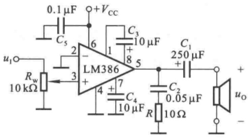

text_image

0.1 µF
+Vcc
C5
2
LM386
1
C3
10 µF
+
8
5
C1
250 µF
+
7
4
C4
10 µF
R
C2
0.05 µF
10 Ω
uO
-
u1
Rw
10 kΩ

图 8.4.5 LM386 电压增益最大的用法

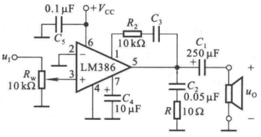

text_image

0.1 μF
+Vcc
C5
2
LM386
6
-
1
R2
C3
10 kΩ
C1
250 μF
+
7
4
C4
10 μF
R
C2
0.05 μF
10 Ω
uI
Rw
10 kΩ
+
uo
-

图 8.4.6 LM386 的一般用法

## 二、集成OCL电路的应用

图 8.4.7 所示为 TDA1521 的基本用法。TDA1521 为 2 通道 OCL 电路，可作为立体声扩音机左右两个声道的功放。其内部引入了深度电压串联负反馈，闭环电压增益为 30 dB，并具有待机、净噪功能以及短路和过热保护等。

查阅手册可知，当  $\pm V_{CC} = \pm 16 V, R_{L} = 8 \Omega$  时，若要求总谐波失真为 0.5%，则  $P_{om} \approx 12 W$ 。由于最大输出功率的表达式为

$$
P _ {\mathrm{om}} = \frac {U _ {\mathrm{om}} ^ {2}}{R _ {\mathrm{L}}}
$$

可得最大不失真输出电压  $U_{om} \approx 9.8 \, V$ ，其峰值约为 13.9 V，可见功放内部压降的最小值约为 2.1 V。当输出功率为  $P_{om}$  时，输入电压有效值  $U_{im} \approx 327 \, mV$ 。

## 三、集成BTL电路的应用

TDA1556 为 2 通道 BTL 电路,与 TDA1521 相同,也可作为立体声扩音机左右两个声道的功放,图 8.4.8 所示为其基本用法,两个通道的组成完全相同。TDA1556 内部具有待机、净噪功能,并有短路、电压反向、过电压、过热和扬声器保护等。

---

422

第8章 功率放大电路

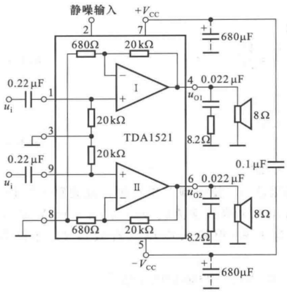

text_image

静噪输入
+Vcc
680Ω
20 kΩ
I
20 kΩ
TDA1521
4
0.022 μF
uo1
8.2Ω
0.22 μF
1
3
9
0.22 μF
ui
8
680Ω
20 kΩ
II
6
0.022 μF
uo2
8.2Ω
- Vcc
+ 680μF
8Ω
0.1 μF
8Ω

图 8.4.7 TDA1521 的基本用法

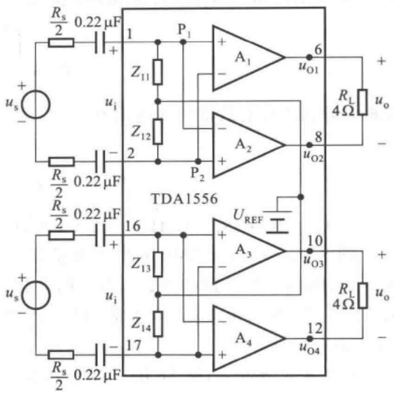

text_image

Rs/2 0.22 μF
+ 1 P1 + A1 uO1 +
us - Z11 -
Z12 -
2 P2 - A2 uO2 +
Rs/2 0.22 μF
+ 8
TDA1556 UREF
Rs/2 0.22 μF 16 + A3 uO3 +
us - Z13 -
Z14 - A4 uO4 +
Rs/2 0.22 μF
+ 17
RL 4Ω uo +
uo
R1 4Ω uo
-

图 8.4.8 TDA1556 的基本用法

TDA1556 内部的每个放大电路的电压放大倍数均为 10，当输入电压为  $U_{i}$  时， $A_{1}$  的净输入电压  $\dot{U}_{i1} = \dot{U}_{p1} - \dot{U}_{p2} = \dot{U}_{i}$ ， $\dot{U}_{o1} = \dot{A}_{u1} \dot{U}_{i}$ ； $A_{2}$  的净输入电压  $\dot{U}_{i2} = \dot{U}_{p2} - \dot{U}_{p1} = -\dot{U}_{i}$ ， $\dot{U}_{o2} = -\dot{A}_{u2} \dot{U}_{i}$ ；因此，电压放大倍数

$$
\dot {A} _ {u} = \frac {\dot {U} _ {\mathrm{o}}}{\dot {U} _ {\mathrm{i}}} = \frac {\dot {U} _ {\mathrm{o1}} - \dot {U} _ {\mathrm{o2}}}{\dot {U} _ {\mathrm{i}}} = \frac {\dot {A} _ {u 1} \dot {U} _ {\mathrm{i}} - (- \dot {A} _ {u 2} \dot {U} _ {\mathrm{i}})}{\dot {U} _ {\mathrm{i}}} = 2 \dot {A} _ {u 1} = 2 0
$$

电压增益  $20\lg|\dot{A}_{u}|\approx26\ dB$ 。

为了使最大不失真输出电压的峰值接近电源电压 $V_{\mathrm{CC}}$，应设置放大电路同相输入端和反相输入端的静态电位均为 $V_{\mathrm{CC}} / 2$，输出端静态电位也为 $V_{\mathrm{CC}} / 2$，因此内部提供的基准电压 $U_{\mathrm{REF}}$ 为 $V_{\mathrm{CC}} / 2$。当 $u_{\mathrm{i}}$ 由零逐渐增大时，$u_{\mathrm{o1}}$ 从 $V_{\mathrm{CC}} / 2$ 逐渐增大，$u_{\mathrm{o2}}$ 从 $V_{\mathrm{CC}} / 2$ 逐渐减小；当 $u_{\mathrm{i}}$ 增大到峰值时，$u_{\mathrm{o1}}$ 达到最大值，$u_{\mathrm{o2}}$ 达到最小值，负载上电压可接近 $+V_{\mathrm{CC}}$。同理，当 $u_{\mathrm{i}}$ 由零逐渐减小时，$u_{\mathrm{o1}}$ 和 $u_{\mathrm{o2}}$ 的变化与上述过程相反；当 $u_{\mathrm{i}}$ 减小到负峰值时，$u_{\mathrm{o1}}$ 达到最小值，$u_{\mathrm{o2}}$ 达到最大值，负载上电压可接近 $-V_{\mathrm{CC}}$。因此，最大不失真输出电压的峰值可接近电源电压 $V_{\mathrm{CC}}$。

查阅手册可知，当 $V_{\mathrm{CC}} = 14.4 \mathrm{~V}, R_{\mathrm{L}} = 4 \Omega$ 时，若总谐波失真为 $0.1\%$，则 $P_{\mathrm{OM}} \approx 22 \mathrm{~W}$ 。最大不失真输出电压 $U_{\mathrm{om}} \approx 9.38 \mathrm{~V}$，其峰值约为 $13.3 \mathrm{~V}$，因而内部放大电路压降的最小值约为 $1.1 \mathrm{~V}$ 。为了减小非线性失真，应增大内部放大电路压降的最小值，当然势必减小电路的最大输出功率。

## 思考题

8.4.1 如何从集成功率放大应用电路的组成来判断集成功放是 OCL、OTL 还是 BTL?

---

8.5 Multisim 应用举例——OCL 电路输出功率和效率的研究

423

## 8.5 Multisim 应用举例——OCL 电路输出功率和效率的研究

## 一、题目

研究 OCL 功率放大电路的输出功率和效率。

## 二、仿真电路

OCL 功率放大电路如图 8.5.1 所示。

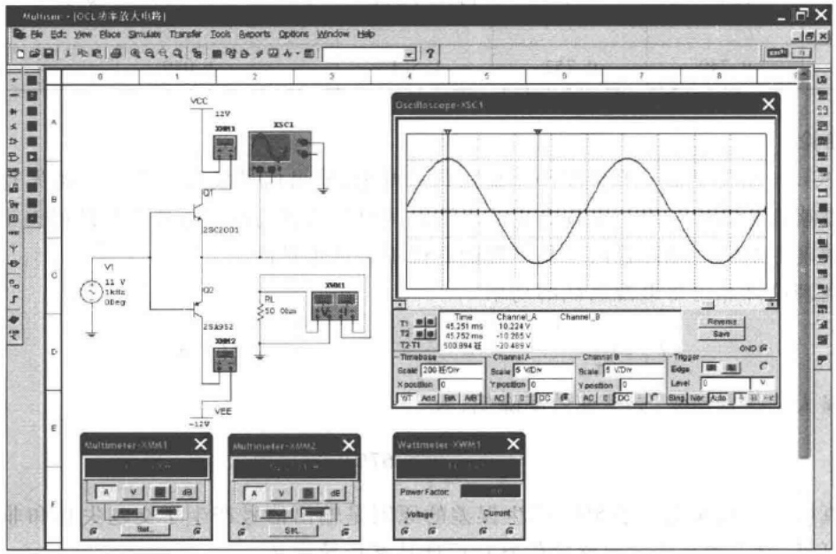

text_image

Multimeter - [OCL功率放大电路]
File Edit View Place Simulate Transfer Tools Reports Options Window Help
VCC
12V
XMM1
XSC1
Q1
29C2001
V1
11 V
1kHz
0Beg
Q2
25A932
XMM2
RL
50 Ncm
XMM1
-12V
VEE
OSCilloscope-XSC1
Time Channel_A Channel_B
45.251 ms 10.224 V
45.752 ms -10.265 V
T2-T1 508.994 E -20.489 V
Reverse
Save
Thmapbase Channel_A Channel_B Trigger
Scale 200 Hz/Div Scale 5 V/Div Scale 5 V/Div Edge C
X position 0 Y position 0 Y position 0 Level 0 V
'OT And BA MB AD O DC AC AD O DC C Bing Nav Auto % Bce
Multimeter-XMM1 Multimeter-XMM2 Wattmeter-XMM1 Power Factor Power Factor Voltage Current

图8.5.1

图中采用 NPN 型低频功率晶体管 2SC2001, 其参数为: $I_{\mathrm{CM}} = 700 \mathrm{~mA}, P_{\mathrm{T}} = 600 \mathrm{~mW}$, $U_{(\mathrm{BR})\mathrm{CEO}} = 25 \mathrm{~V}, U_{\mathrm{CES}} = 0.2 \mathrm{~V}$; PNP 型低频功率晶体管 2SA952, 其参数为: $I_{\mathrm{CM}} = -700 \mathrm{~mA}, P_{\mathrm{T}} = 600 \mathrm{~mW}, U_{(\mathrm{BR})\mathrm{CEO}} = -25 \mathrm{~V}, U_{\mathrm{CES}} = -0.25 \mathrm{~V}$。

输出功率  $P_{o}$  为交流功率, 可采用瓦特表测量; 电源消耗的功率  $P_{v}$  为平均功率, 可采用直流电流表测量电源的输出平均电流, 然后计算出  $P_{v}$ 。

## 三、仿真内容

1. 观察输出信号波形的失真情况。
2. 分别测量静态时以及输入电压峰值为 11 V 时的  $P_{o}$  和  $P_{v}$ ，计算效率。

## 四、仿真结果

仿真结果如表 8.5.1 所示。

表 8.5.1 测试数据

| 输入信号V1峰值/V | 直流电流表1读数$I_{C1}$/mA | 直流电流表2读数$I_{C2}$/mA | 电源消耗的功率$P_V$/W | 瓦特表读数$P_o$/W | OCL电路输出信号正、负向峰值$U_{omax+},U_{omax-}$/V |
| --- | --- | --- | --- | --- | --- |
| 0 | 0 | 0 | 0 | 0 | 0,0 |
| 11 | 62.445 | 62.688 | 1.502 | 1.013 | 10.224,-10.265 |

---

424

第8章 功率放大电路

利用表 8.5.1 中的数据, 经简单计算, 可得电源消耗的功率、输出功率和效率, 如表 8.5.2 所示。

表 8.5.2 功率和效率

| 输入电压峰值为11V | + $V_{CC}$功耗$P_{V+}/W$ | - $V_{CC}$功耗$P_{V-}/W$ | 电源总功耗$P_{V}/W$ | 输出功率$P_{om}/W$ | 效率/% |
| --- | --- | --- | --- | --- | --- |
| 计算公式 | $I_{C1}V_{CC}$ | $I_{C2}V_{CC}$ | $(I_{C1} + I_{C2})V_{CC}$ | $\left( \frac{U_{omax} + U_{omox-}}{2} \right)^{2} / (2R_{L})$ | $P_{om}/P_{V}$ |
| 计算结果 | 0.749 | 0.752 | 1.501 | 1.049 | 69.9% |

## 五、结论

（1）OCL电路输出信号峰值略小于输入信号峰值，输出信号波形产生了交越失真，且正、负向输出幅度略有不对称。产生交越失真的原因是两只晶体管均没有设置合适的静态工作点，正、负向输出幅度不对称的原因是两只晶体管的特性不是理想对称。

(2) 由理论计算可得电源消耗的功率

$$
P _ {V} = \frac {2}{\pi} \cdot \frac {V _ {\mathrm{CC}} \cdot (U _ {\mathrm{omax+}} + U _ {\mathrm{omax-}}) / 2}{R _ {\mathrm{L}}} \approx 1. 5 6 5 \mathrm{W}
$$

该数据明显大于仿真结果,必然使效率降低,为

$$
\eta = \frac{P_{\mathrm{om}}}{P_{V}}\approx 67\%
$$

与通过仿真所得结果误差小于5%，产生误差的原因是输出信号产生了交越失真和非对称性失真。由此可见，对于功率放大电路的仿真对设计具有指导意义。

(3) 从本例中可以学习功率的测试方法。

## 本章小结

本章主要阐明功率放大电路的组成、工作原理、最大输出功率和效率的估算，以及集成功放的应用。归纳如下:

一、功率放大电路是在电源电压确定情况下，以输出尽可能大的不失真的信号功率和具有尽可能高的转换效率为组成原则，功放管常工作在尽限应用状态。低频功放有变压器耦合乙类推挽电路、OTL、OCL、BTL电路等。
二、功放的输入信号幅值较大，分析时应采用图解法。首先求出功率放大电路负载上可能获得的最大交流电压的幅值，从而得出负载上可能获得的最大交流功率，即电路的最大输出功率 $P_{om}$ ；同时求出此时电源提供的直流平均功率 $P_{V}, P_{om}$ 与 $P_{V}$ 之比即为转换效率。

OCL 电路为直接耦合功率放大电路,为了消除交越失真,静态时应使功放管微导通;OCL 电路中功放管工作在甲乙类状态。在忽略静态电流的情况下,最大输出功率和转换效率分别为

$$
P _ {\mathrm{om}} = \frac {(V _ {\mathrm{CC}} - U _ {\mathrm{CES}}) ^ {2}}{2 R _ {\mathrm{L}}}, \quad \eta = \frac {\pi}{4} \cdot \frac {V _ {\mathrm{CC}} - U _ {\mathrm{CES}}}{V _ {\mathrm{CC}}}
$$

所选用的功放管的极限参数应满足 $U_{(\mathrm{BR})\mathrm{CEO}} > 2V_{\mathrm{CC}}, I_{\mathrm{CM}} > V_{\mathrm{CC}} / R_{\mathrm{L}}, P_{\mathrm{om}} > 0.2P_{\mathrm{om}} \bigg|_{U_{\mathrm{CES}} = 0}$

---

自测题

425

三、OTL、OCL 和 BTL 均有不同性能指标的集成电路，只需外接少量元件，就可成为实用电路。在集成功放内部均有保护电路，以防止功放管过流、过压、过损耗或二次击穿。

学习本章,应能达到下列要求:

一、掌握下列概念:晶体管的甲类、乙类和甲乙类工作状态,最大输出功率、转换效率。
二、理解功率放大电路的组成原则，掌握 OCL 的工作原理，并了解其它类型功率放大电路的特点。
三、理解功率放大电路最大输出功率和效率的分析方法，了解功放管的选择方法。
四、了解集成功率放大电路的工作原理。

## 自测题

一、选择合适的答案，填入空内。只需填入 A、B 或 C。

（1）功率放大电路的最大输出功率是在输入电压为正弦波时，输出基本不失真情况下，负载上可能获得的最大\_\_\_\_。

A. 交流功率

B. 直流功率

C. 平均功率

(2) 功率放大电路的转换效率是指 \_\_\_\_。

A. 输出功率与晶体管所消耗的功率之比
B. 最大输出功率与电源提供的平均功率之比
C. 晶体管所消耗的功率与电源提供的平均功率之比

(3) 在选择功放电路中的晶体管时, 应当特别注意的参数有 \_\_\_\_。

A.  $\beta$

B.  $I_{CM}$

C.  $I_{CBO}$

D.  $U_{(BR)CEO}$

E.  $P_{CM}$

F.  $f_{T}$

（4）若图 T8.1 所示电路中晶体管饱和管压降的数值为  $\left|U_{CES}\right|$ ，则最大输出功率  $P_{OM}=$ \_\_\_\_。

A.  $\frac{(V_{\mathrm{CC}}-|U_{\mathrm{CES}}|)^{2}}{2R_{\mathrm{L}}}$

B. $\frac{\left(\frac{1}{2} V_{\mathrm{CC}} - |U_{\mathrm{CES}}|\right)^2}{R_{\mathrm{L}}}$

C.  $\frac{\left(\frac{1}{2}V_{\mathrm{cc}}-|U_{\mathrm{CES}}|\right)^{2}}{2R_{\mathrm{L}}}$

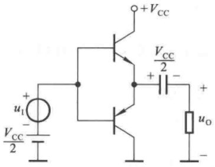

text_image

+VCC
+VCC/2 -
+ uI -
VCC/2
uO -
-

图 T8.1

二、电路如图 T8.2 所示，已知  $T_{1}$  和  $T_{2}$  的饱和管压降  $\left|U_{CES}\right|=2\ V$ ，直流功耗可忽略不计。

回答下列问题:

(1) $R_{3}$ 、 $R_{4}$ 和 $T_{3}$ 的作用是什么？
(2) 负载上可能获得的最大输出功率  $P_{om}$  和电路的转换效率  $\eta$  各为多少?
（3）设最大输入电压的有效值为 $1\mathrm{V}$ 。为了使电路的最大不失真输出电压的峰值达到 $16\mathrm{V}$，电阻 $R_{6}$ 至少应取多少千欧？

---

426

第8章 功率放大电路

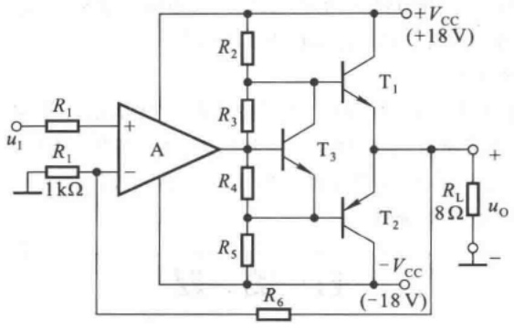

text_image

R1
u1
R1
1 kΩ
+
-
A
R2
T1
+VCC
(+18 V)
R3
T3
R4
T2
RL
8 Ω
uo
-
- VCC
(-18 V)
R5
R6

图 T8.2

## 习题

8.1 分析下列说法是否正确,用“√”、“×”表示判断结果填入括号内。

(1) 在功率放大电路中, 输出功率愈大, 功放管的功耗愈大。( )
(2) 功率放大电路的最大输出功率是指在基本不失真情况下, 负载上可能获得的最大交流功率。( )
(3) 当 OCL 电路的最大输出功率为 1 W 时, 功放管的集电极最大耗散功率应大于 1 W。( )

（4）功率放大电路与电压放大电路、电流放大电路的共同点是

① 都使输出电压大于输入电压；（）
② 都使输出电流大于输入电流；（）
③ 都使输出功率大于信号源提供的输入功率。（）

(5) 功率放大电路与电压放大电路的区别是

① 前者比后者电源电压高；（）
② 前者比后者电压放大倍数数值大；（）
③ 前者比后者效率高；（）
④ 在电源电压相同的情况下,前者比后者的最大不失真输出电压大;( )
⑤ 前者比后者的输出功率大。（）

(6) 功率放大电路与电流放大电路的区别是

① 前者比后者电流放大倍数大；（）
② 前者比后者效率高；（）
③ 在电源电压相同的情况下,前者比后者的输出功率大。( )

8.2 已知电路如图 P8.2 所示， $T_{1}$  和  $T_{2}$  管的饱和管压降  $\left|U_{CES}\right|=3\ V$ ， $V_{CC}=15\ V, R_{L}=8\ \Omega$ 。选择正确答案填入空内。

(1) 电路中  $D_{1}$  和  $D_{2}$  管的作用是消除 \_\_\_\_。

A. 饱和失真

B. 截止失真

C. 交越失真

(2) 静态时, 晶体管发射极电位  $U_{EQ}$  \_\_\_\_。

A. >0 V

B. =0 V

C. <0 V

(3) 最大输出功率  $P_{om}$  \_\_\_\_。

A.  $\approx28\ W$

B. =18 W

C. =9 W

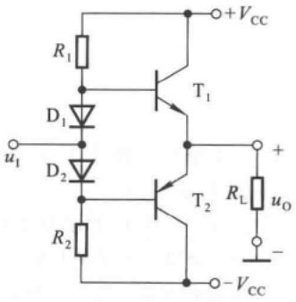

text_image

R₁
D₁
u₁
D₂
R₂
T₁
T₂
+Vcc
Rₗ
uₒ
-
- Vcc

图 P8.2

---

习题

427

（4）当输入为正弦波时，若 $R_{1}$ 虚焊，即开路，则输出电压\_\_\_\_。

A. 为正弦波

B. 仅有正半波

C. 仅有负半波

(5) 若  $D_{1}$  虚焊，则  $T_{1}$  管 \_\_\_\_。

A. 可能因功耗过大烧坏

B. 始终饱和

C. 始终截止

8.3 电路如图 P8.2 所示。在出现下列故障时，分别产生什么现象。

(1)  $R_{1}$  开路；(2)  $D_{1}$  开路；(3)  $R_{2}$  开路；(4)  $T_{1}$  集电极开路；

(5)  $R_{1}$  短路；(6)  $D_{1}$  短路。

8.4 在图 P8.2 所示电路中，已知  $V_{CC} = 16 \, V$ ,  $R_{L} = 4 \, \Omega$ ,  $T_{1}$  和  $T_{2}$  管的饱和管压降  $\left| U_{CES} \right| = 2 \, V$ ，输入电压足够大。试问:

(1) 最大输出功率  $P_{om}$  和效率  $\eta$  各为多少?

(2) 晶体管的最大功耗  $P_{Tmax}$  为多少?

(3) 为了使输出功率达到  $P_{om}$ ，输入电压的有效值约为多少？

8.5 在图 P8.5 所示电路中，已知二极管的导通电压  $U_{D}=0.7\ V$ ，晶体管导通时的  $\left|U_{BE}\right|=0.7\ V, T_{2}$  和  $T_{4}$  管发射极静态电位  $U_{EQ}=0\ V$ 。试问:

(1)  $T_{1}$ 、 $T_{3}$  和  $T_{5}$  管基极的静态电位各为多少?

（2）设 $R_{2} = 10\mathrm{k}\Omega ,R_{3} = 100\Omega$ 。若 $\mathrm{T}_{1}$ 和 $\mathrm{T}_{3}$ 管基极的静态电流可忽略不计，则 $\mathrm{T}_{5}$ 管集电极静态电流为多少？静态时 $u_{1} = ?$

(3) 若静态时  $i_{B1} > i_{B3}$ ，则应调节哪个参数可使  $i_{B1} = i_{B3}$ ？如何调节？

(4) 电路中二极管的个数可以是1、2、3、4吗？你认为哪个最合适？为什么？

8.6 电路如图 P8.5 所示。在出现下列故障时，分别产生什么现象。

(1) $R_{2}$ 开路；(2) $D_{1}$ 开路；(3) $R_{2}$ 短路；

(4)  $T_{1}$  集电极开路；(5)  $R_{3}$  短路。

8.7 在图 P8.5 所示电路中，已知  $T_{2}$  和  $T_{4}$  管的饱和管压降  $\left|U_{CES}\right|=2\ V$ ，静态时电源电流可忽略不计。试问:

(1) 负载上可能获得的最大输出功率  $P_{om}$  和效率  $\eta$  各约为多少?

(2)  $T_{2}$  和  $T_{4}$  管的最大集电极电流、最大管压降和集电极最大功耗各约为多少。

8.8 为了稳定输出电压,减小非线性失真,试通过电阻  $R_{f}$  在图 P8.5 所示电路中引入合适的负反馈;并估算在电压放大倍数数值约为 10 的情况下, $R_{f}$  的取值。

8.9 在图 P8.9 所示电路中，已知  $V_{CC} = 15 \, V, T_{1}$  和  $T_{2}$  管的饱和管压降  $\left| U_{CES} \right| = 2 \, V$ ，输入电压足够大。求解:

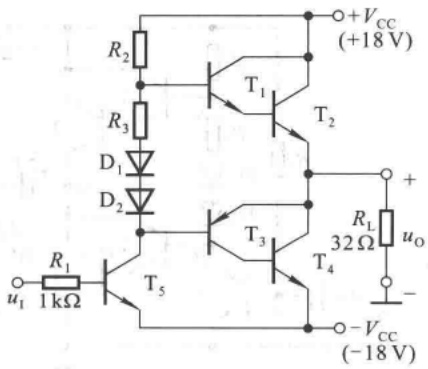

text_image

R2
+VCC
(+18 V)
T1
R3
D1
T2
D2
uI
R1
1 kΩ
T5
T3
T4
RL
32 Ω
uo
-
-VCC
(-18 V)

图 P8.5

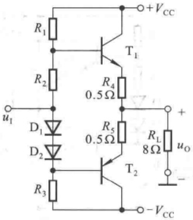

text_image

R1
+VCC
T1
R2
0.5Ω
R4
D1
uI
D2
R3
0.5Ω
RL
8Ω
uo
-
T2
-VCC

图 P8.9

---

428

第 8 章 功率放大电路

(1) 最大不失真输出电压的有效值；
(2) 负载电阻  $R_{1}$  上电流的最大值；
(3) 最大输出功率  $P_{om}$  和效率  $\eta$ 。

8.10 在图 P8.9 所示电路中, $R_{4}$  和  $R_{5}$  可起短路保护作用, 当输出因故障而短路时, 晶体管的最大集电极电流和功耗各为多少?

8.11 在图 P8.11 所示电路中，已知  $V_{CC} = 15 \, V, T_{1}$  和  $T_{2}$  管的饱和管压降  $\left| U_{CES} \right| = 1 \, V$ ，集成运放的最大输出电压幅值为  $\pm 13 \, V$ ，二极管的导通电压为 0.7 V。

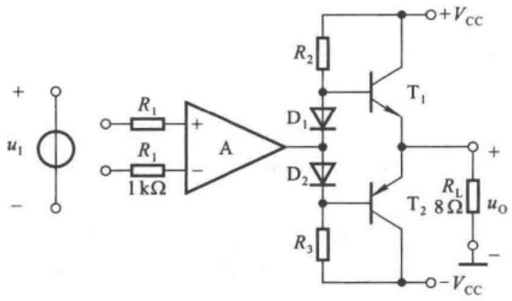

text_image

+
u1
-
R1
R1
1 kΩ
+
A
D1
D2
R2
T1
+VCC
R3
T2 8Ω
RL
uo
-VCC

图P8.11

(1) 若输入电压幅值足够大,则电路的最大输出功率为多少?
(2) 为了提高输入电阻,稳定输出电压,且减小非线性失真,应引入哪种组态的交流负反馈?画出图来。
(3) 若  $U_{i}=0.1\ V$  时,  $U_{o}=5\ V$ , 则反馈网络中电阻的取值约为多少?

8.12 OTL 电路如图 P8.12 所示。

（1）为了使得最大不失真输出电压幅值最大，静态时  $T_{2}$  和  $T_{4}$  管的发射极电位应为多少？若不合适，则一般应调节哪个元件参数？
(2) 若  $T_{2}$  和  $T_{4}$  管的饱和管压降  $\left|U_{CES}\right|=3\ V$ ，输入电压足够大，则电路的最大输出功率  $P_{om}$  和效率  $\eta$  各为多少？
(3)  $T_{2}$  和  $T_{4}$  管的  $I_{CM}$ 、 $U_{(BR)CEO}$  和  $P_{CM}$  应如何选择？

8.13 已知图 P8.13 所示电路中  $T_{2}$  和  $T_{4}$  管的饱和管压降  $\left|U_{CES}\right|=2\ V$ ，导通时的  $\left|U_{BE}\right|=0.7\ V$ ，输入电压足够大。

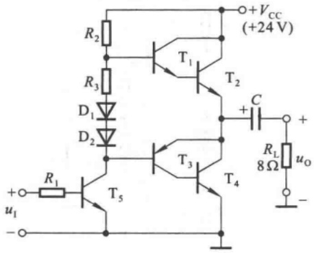

text_image

+VCC
(+24 V)
R2
T1
T2
C
+
R3
D1
D2
T3
T4
RL
8Ω uO
uI
-
R1
T5

图 P8.12

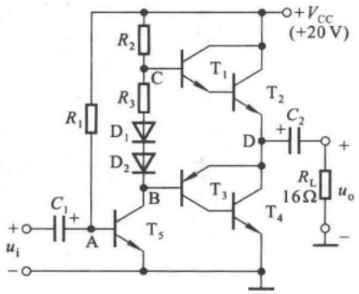

text_image

+VCC
(+20 V)
R2
C
T1
R3
D1
D2
B
T3
T5
D
C2
+
D
RL
16Ω
uo
-
ui
A
-

图 P8.13

---

习题

429

(1) A、B、C、D 点的静态电位各为多少?
(2) 若管压降  $\left|U_{CE}\right| \geqslant 3\ V$ ，为使最大输出功率  $P_{om}$  不小于 1.5 W，则电源电压至少应取多少？

8.14 LM1877N-9为2通道低频功率放大电路，单电源供电，最大不失真输出电压的峰-峰值 $U_{\mathrm{opp}} = (V_{\mathrm{CC}} - 6)\mathrm{V}$，开环电压增益为 $70~\mathrm{dB}$ 。图P8.14所示为LM1877N-9中一个通道组成的实用电路，电源电压为 $24\mathrm{V}, C_1 \sim C_3$ 对交流信号可视为短路； $R_{3}$ 和 $C_4$ 起相位补偿作用，可以认为负载为 $8\Omega$ 。

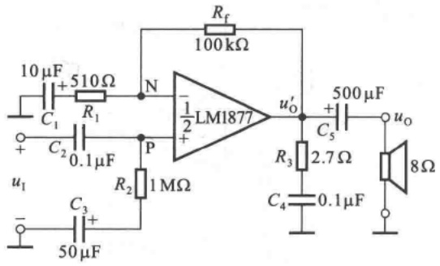

text_image

10 μF
C₁
+ 510 Ω
R₁
N
- ½ LM1877
+ 100 kΩ
C₂
0.1 μF
P
R₂
1 MΩ
u₁
-
C₃
+
50 μF
R₃
2.7 Ω
C₄
0.1 μF
R_f
500 μF
uₒ
+
C₅
8 Ω
uₒ

图 P8.14

(1) 图示电路为哪种功率放大电路?
(2) 静态时  $u_{p}$ 、 $u_{N}$ 、 $u_{0}^{\prime}$ 、 $u_{0}$  各为多少？
(3) 设输入电压足够大,电路的最大输出功率  $P_{om}$  和效率  $\eta$  各为多少?

8.15 电路如图 8.4.7 所示, 回答下列问题:

(1)  $\dot{A}_{u} = \dot{U}_{o1} / \dot{U}_{i} \approx ?$
(2) 若  $V_{CC} = 15 \, V$  时最大不失真输出电压的峰 - 峰值为  $27 \, V$ ，则电路的最大输出功率  $P_{om}$  和效率  $\eta$  各为多少？
(3) 为了使负载获得最大输出功率, 输入电压的有效值约为多少?

8.16 TDA1556 为 2 通道 BTL 电路, 图 P8.16 所示为 TDA1556 中一个通道组成的实用电路。已知  $V_{CC} = 15 \, V$ , 放大器的最大输出电压幅值为 13 V。

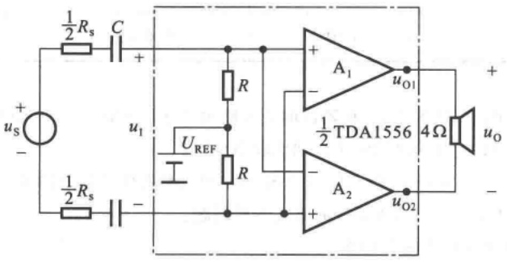

text_image

1/2 Rs C
+
us
-
1/2 Rs -
u1
UREF
R
R
A1
uO1
+
1/2 TDA1556 4Ω
uO
-
A2
uO2

图 P8.16

（1）为了使负载上得到的最大不失真输出电压幅值最大，基准电压  $U_{REF}$  应为多少伏？静态时  $u_{01}$  和  $u_{02}$  各为多少伏？

---

430

第 8 章 功率放大电路

(2) 若  $U_{i}$  足够大, 则电路的最大输出功率  $P_{om}$  和效率  $\eta$  各为多少?
(3) 若电路的电压放大倍数为 20, 则为了使负载获得最大输出功率, 输入电压的有效值约为多少?

8.17 TDA1556 为 2 通道 BTL, 图 P8.17 所示为 TDA1556 中一个通道组成的实用电路。已知  $V_{CC} = 15 \, V$ , 放大器的最大输出电压幅值为 13 V。

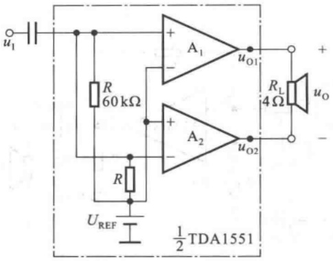

text_image

u₁
R
60 kΩ
U_REF
R
A₁
+
-
uₒ₁
A₂
+
-
uₒ₂
Rₗ
4 Ω
uₒ
½TDA1551

图 P8.17

（1）输入信号分别作用于 $A_{1}$ 、 $A_{2}$ 的同相输入端还是反相输入端？若输入电压为 $\dot{U}_{i}$，则 $A_{1}$ 、 $A_{2}$ 的输入各为多少？
(2) 为了使负载上得到的最大不失真输出电压幅值最大, 基准电压  $U_{REF}$  应为多少伏? 静态时  $u_{01}$  和  $u_{02}$  各为多少伏?

(3) 若  $U_{i}$  足够大, 则电路的最大输出功率  $P_{om}$  和效率  $\eta$  各为多少?

8.18 已知型号为 TDA1521、LM1877 和 TDA1556 的电路形式和电源电压范围如表所示，它们的功放管的最小管压降  $\left|U_{CEmin}\right|$  均为 3 V。

| 型号 | TDA1521 | LM1877 | TDA1556 |
| --- | --- | --- | --- |
| 电路形式 | OCL | OTL | BTL |
| 电源电压 | $\pm 7.5 \sim \pm 20$ V | 6.0~24 V | 6.0~18 V |

（1）设在负载电阻均相同的情况下，三种器件的最大输出功率均相同。已知OCL电路的电源电压 $\pm V_{\mathrm{CC}} = \pm 10\mathrm{V}$，试问OTL电路和BTL电路的电源电压分别应取多少伏？
(2) 设仅有一种电源, 其值为 15 V; 负载电阻为 32 Ω。问三种器件的最大输出功率各为多少?

8.19 电路如图 P8.19 所示。利用 Multisim 研究下列问题:

(1) 负载  $R_{6}$  上能够获得的最大输出功率；
(2) 电容  $C_{1}$ 、 $C_{2}$  的作用；
(3) 当输入电压为频率为  $1 \, kHz$ 、峰值为  $5 \, V$  的正弦波时，若  $R_{1}$  开路，将产生什么现象，解释理由。

8.20 电路如图 P8.19 所示。

（1）若输入正弦波的最大峰值为 $1.4\mathrm{V}$，则为使负载 $R_{6}$ 上获得最大输出功率，应采用什么措施？画出电路图来。

---

习题

431

（2）为了使信号源与图示电路直流通路隔离，同时为了稳定输出电压，减小非线性失真，引入合适的交流负反馈，画出电路图来。并利用Multisim选择合适的电路参数，使输入电压有效值 $U_{\mathrm{i}} = 0.1 \mathrm{~V}$ 时，输出电压有效值 $U_{\mathrm{o}} = 1 \mathrm{~V}$ 。

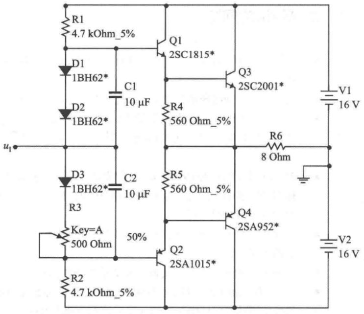

text_image

R1
4.7 kOhm_5%
D1
1BH62*
C1
10 µF
D2
1BH62*
u1
D3
1BH62*
C2
10 µF
R3
Key=A
500 Ohm
50%
R2
4.7 kOhm_5%
Q1
2SC1815*
Q3
2SC2001*
R4
560 Ohm_5%
R5
560 Ohm_5%
Q2
2SA1015*
Q4
2SA952*
R6
8 Ohm
V1
16 V
V2
16 V

图 P8.19
